# 19 可追加元素目录：总览与通用设计
> 状态：v0.1 | 负责：前端设计线 | 更新：2026-09-26（§4.21：新建。元素族总表 6 族 35 类、插入命令通用流程与工具态、默认落点与尺寸、通用设计 18 条、新增命令与 Mutation 汇总、元素渲染器登记表（承接原 30/07 渲染器表）、非目标清单）；2026-09-26（§4.21 整合：§1.2 艺术字行补 M2 P2 渐变字与描边字、墨迹与缩放定位补 M2 P1 整体变换、3D 元素名改 am3d:model3d；§5.2 setHeaderFooter 的 date 形状、flipShapes 加 reroute、insertFreeform 改收拟合几何、resetPicture 改 pixelSize）；2026-09-26（§4.21 复核：pic.setBlipFill 载荷补 external、effects；setBorders 形状；音视频入口写法）；2026-09-30（§4.22 设计待决收口：§2.1 与 §3.1 表格、图表、图片从插入页签插入时先填空内容占位符，多图拖入只填指针下的占位符；§3.2 表格行高 0.41 in、网格悬停 8 行 × 10 列与对话框上限待性能评估；§4.11 迷你工具条画在屏幕坐标浮层、`placeholder-empty` 三组；§8.1 第 7、9 条改为推迟）；2026-09-30（§4.22 整合：§3.1「空内容占位符填入」一行图表改为取占位符框、表格宽取框宽高随行数，与 50/24 §2.3、§3.3 对齐；Q1 行注明插入页签与命令面板插入表格、图表、图片走 `slide.fillPlaceholder`）；2026-09-30（§4.22 复核修正：§2.1 第 5 步与 §3.2 图表行改为插入后展开检查器「数据」分区；§3.1 Q1 行的图标、音视频括注改为与原规则一致）；2026-10-01（§4.23 插件管理：能力总表链接改为 26 域）；2026-10-04（design-language-v3 第 0 批：只改 ribbon 入口的通用说明（rulings §4.25 DS-1、DS-5）——§1.2 补「插入入口」列由 ribbon 写法换算到 v3 入口（底部创建工具条与「更多」、检查器分区、主菜单与右键）的对照表，逐行改写与族文档第 ③ 栏随第 1 批；「不在本文」表、§0.2 第 ③ ⑦ 栏、图 2-2 起点、§3.1 填占位符一行、§4.11 检查器分区与迷你工具条、§4.15 插入弹层、§4.18 插件入口、§7 非目标四行、§8.2 第 1 条与 §9 第 1 行同步；元素数、命令与里程碑不变）；2026-10-04（design-language-v3 第 0 批：术语残留清理：ribbon / 状态栏 / `ui.ribbon` / `ui.statusBar` 的历史陈述改用 check-terms 认可的标记措辞（废弃、作废、取代、原名））；2026-10-04（design-language-v3 第 0 批：复验第 2 轮修正——§1.2 换算表后的说明改为：50/23、50/24、50/25 的「插入入口」栏已按 v3 改写，本表与 50/20–22 的逐行改写随第 1 批（与 50/10 §12.3、50/README 一致））；2026-10-05（design-language-v3 第 0 批修正：§1.2 换算表补「开始 › 绘图 › 形状 ▾ / 排列 ▾」「开始 › 字体、段落」「开始 › 版式 ▾」「设计 › 设置背景格式…」五行（格式类 → 检查器对应节、排列类 → 主菜单「排列」与右键），说明正文同类写法同样按此表读；§4.11 `shapes` / `text` 行的主要分区按设计 03-02 §4.2–§4.3 改为 v3 节名，其余功能口径注「节划分随第 1 批」）；2026-10-05（design-language-v3 第 0 批修正：快捷键值按 rulings §4.25 DS-11 同步——§1.2 换算表与元素总表的超链接由 `Mod+K` 改为 `Mod+Shift+K`）；2026-10-05（design-language-v3 第 0 批修正：§4.11 标题与 §4 索引改称「检查器与上下文工具条」，文字迷你工具条按 rulings §4.25 DS-13 写明已取消、其余对象条去留随第 1 批；`placeholder-empty` 行按 DS-14 去掉「插入到占位符」按钮组，只放占位符属性，插入走画布图标条与底部工具条）；2026-10-07（design-language-v3 第 1 批：按已拍板样张与设计 03-02、03-04、03-05、03-15…03-18、03-26、03-30、03-31 定稿——§0.2 第 ③ 栏出处；§1.2 说明改为定稿、换算表逐行写到 v3 入口（「更多」四组、主菜单「插入」、链接…（TB-6）、排列 / 旋转 / 对齐的分处、检查器「文本」五节、版式与背景），元素总表「插入入口」列逐行改为 v3 入口；§2.1 第 5 步与 §3.2 表格行（数据面板 400，DS-26；对话框文案 TB-8）；§3.1 补单位口径（DS-27）；§4.1 `adjust` 改强调色菱形；§4.11 改名「检查器与上下文界面」，上下文工具条全部取消（DS-13、DS-22，`toolbar.<selectionKind>` 槽位删除 TB-29），分区表按样张逐类写出；§4.15 键盘按 03-15 §2.4、03-04 §4.4（整库一个 Tab 停靠点 TB-5）；§7 公式行；§8.1 第 2 条结案；元素数、命令与里程碑不变）；2026-10-08（design-language-v3 第 1 批收口：§1.2 `body` 占位符名称「正文」改为「文本」（rulings §4.25 TB-34）；§3.1 单位口径补段落间距始终 pt（TB-33）与 OOXML 默认值保留原单位（TB-37）；§4.7 替代文本的编辑入口（TB-32）；§4.11 `shapes` 行补快速样式（DS-31）、不透明度写填充与描边 alpha（TB-47）与替代文本节（TB-32），更改形状只走右键与命令面板（TB-18）；§5.2 末段注两条新薄命令（TB-46、TB-47）；元素数、命令计数与里程碑不变）；2026-10-08（design-language-v3 第 1 批评审修改：§4.11 `shapes` 行的快速样式按 rulings §4.25 DS-34 改为 42 格样式库在节内原位展开（修订 DS-31 的「样式库弹层」）；元素数、命令计数与里程碑不变）；2026-10-22（design-language-v3 第 3 批收口：检查器分区表 `degraded` 一行原写「v3 呈现随第 3 批」，核对为第 2 批已按 rulings §4.25 DS-52 定稿，改为引用 [09](09-ui-system-and-theming.md) §5a.6；口径不变） | 依赖：上游：[50/01 前端架构](01-overview-and-runtime-map.md) §1a / §5a / §5b，[30/01 总架构](../30-architecture/01-overview.md) §3a / §7；[PRD 02](../10-prd/03-features/02-editing.md) ED-05…ED-10、ED-15、ED-19、ED-20、ED-26、ED-28；[PRD 01](../10-prd/03-features/01-open-and-fidelity.md) 第 2.4–2.7 节支持矩阵；[PRD 07](../10-prd/03-features/07-masters-layouts-and-themes.md) ML-02、ML-03；设计 03-screens [04](../20-design/03-screens/04-insert-menu.md)、[15](../20-design/03-screens/15-insert-menu-and-shape-library.md)、[18](../20-design/03-screens/18-image-editing.md)；[30/04](../30-architecture/04-document-model.md) §3、§4、§6、§12；[30/05](../30-architecture/05-command-and-history.md) §8、§14；[30/06](../30-architecture/06-collaboration.md) §1.5、§8；[40/03](../40-modules/03-slide-domain-model.md) §2.6；[50/05](05-rendering-and-thumbnails.md) §8、§9；[50/10](10-editor-shell-and-interaction.md) §4、§5、§7；[50/16](16-i18n-and-accessibility.md) §6.3、§9；[ADR-0018](../30-architecture/adr/0018-editor-element-model-and-insert-commands.md)；rulings §4.21（q-table-depth、q-chart-route、q-media-insert、q-smartart、q-equation、q-extra-inserts）；rulings §4.25 DS-1、DS-5；设计 [09](../20-design/09-design-specification.md) §3.1、[03-02](../20-design/03-screens/02-editor-main.md) §3.4、[06](../20-design/06-extensibility-ux.md) §2.6、§2.12；rulings §4.25 DS-52

本文回答用户的三问里的第三问——**编辑器里能追加什么东西、每样东西有什么用、每样东西怎么设计**——的总览部分：全部 35 类元素按 6 个族登记一张总表，写清所有元素共用的设计（插入流程、默认落点、模型基类、z 序、继承、默认样式、替代文本、不透明保留、媒体通道、渲染降级、检查器、协同、规模与安全、导出 id、可访问性），汇总本轮新增的命令与 Mutation，并接收原 30/07 的元素渲染器表。**每个元素的逐项设计**（固定 14 栏）写在六篇族文档里，本文只给入口与共用口径。

不在本文（只链接）：

| 主题 | 事实源 |
|---|---|
| 各元素的逐项设计（14 栏） | 族文档 [50/20 文本类](20-elements-text.md)、[50/21 结构类](21-elements-structure.md)、[50/22 形状与线条](22-elements-shapes-and-lines.md)、[50/23 媒体类](23-elements-media.md)、[50/24 表格与图表](24-elements-tables-and-charts.md)、[50/25 只读与不透明类](25-elements-readonly-and-opaque.md) |
| 实体、值对象、字段与 OOXML 映射 | [30/04](../30-architecture/04-document-model.md) §3、§4（本轮补全见 §3.7–§3.9） |
| Mutation 与 Command 的契约、管线与事务边界 | [30/05](../30-architecture/05-command-and-history.md) §3、§8、§14；命令 id 登记在 [40/03](../40-modules/03-slide-domain-model.md) §2.6 |
| 模型补全、插入命令族与表格归一化的决策 | [ADR-0018](../30-architecture/adr/0018-editor-element-model-and-insert-commands.md) |
| 图表渲染与编辑路线（d3 + 自研 OOXML 布局） | [ADR-0036](../30-architecture/adr/0036-chart-rendering-and-editing.md) |
| 编辑器能力总表（26 域，2026-10-01 增插件管理域） | [50/18](18-editor-capabilities.md) |
| 前端复用组件与许可 | [50/17](17-reuse-and-dependency-catalog.md) |
| 画布交互、底部创建工具条、检查器的通用行为（2026-10-04 起 Ribbon 已废弃，rulings §4.25 DS-1） | [50/10](10-editor-shell-and-interaction.md) §4、§5、§7；v3 结构与命令去处见设计 [09](../20-design/09-design-specification.md) §3、§3.1 |
| 渲染管线、媒体缓存、降级占位 | [50/05](05-rendering-and-thumbnails.md) §8、§9 |

---

## 0. 读法与元素节模板

### 0.1 可编辑度图例

与 PRD 01 支持矩阵同一套记号，本文与六篇族文档统一使用：

| 记号 | 含义 | 典型元素 |
|---|---|---|
| **E** | 可编辑：能插入（或随版式生成）、能改建模字段，导出重生成 | 文本框、预设形状、图片、组合 |
| **E~** | 部分可编辑：只开放一部分操作，其余原样保留 | M2 的表格（只改单元格文字）、M2 的连接符（直线跟随）、页眉页脚 |
| **V** | 可查看：保真渲染，可整体移动、缩放、删除，内部不可改 | M1–M2 的图表、SmartArt |
| **V~** | 近似查看：走回退图或近似渲染，内部不可改 | 公式、OLE、3D 模型、墨迹、缩放定位 |
| **P** | 仅保留：不渲染内容（显示占位），导出原样写回 | ActiveX、VML、未知 graphicData |

里程碑写法沿用 PRD：`M2 P0` 表示 M2 必做，`P1`、`P2` 依次降级；`M4+` 表示本期不排。

### 0.2 元素节的固定 14 栏

族文档里**每个元素一节**，节内固定下列 14 栏（可用小标题，也可用两列定义表）。栏名与顺序不改，某栏确实没有内容写「无」并说明原因，不省略：

| # | 栏 | 写什么 | 主要事实源 |
|---|---|---|---|
| ① | 作用 | 用户为什么需要、典型场景；与相近元素的区别 | PRD 02、PRD 01 |
| ② | OOXML 来源 | 具体节点与属性（`p:sp`、`a:prstGeom@prst`…） | ECMA-376；[30/04](../30-architecture/04-document-model.md) §4 |
| ③ | 插入入口与默认 | 入口（2026-10-04 起为底部创建工具条的工具或「更多」项，旧的插入页签写法按 §1.2 的换算表读）、点击插入还是拖出绘制、默认尺寸、默认样式取主题哪一项 | 本文 §2、§3；设计 03-04、03-15（2026-10-07 按第 1 批样张改写）、09 §3.1、03-02 §3.4 |
| ④ | 模型 | 30/04 与 40/03 里的实体、值对象与字段；本轮新增字段标「新增（§4.21）」 | [30/04](../30-architecture/04-document-model.md) §3.7–§3.9 |
| ⑤ | 渲染 | DOM/SVG 怎么画、走哪个 `render.element`、降级方式 | 本文 §6；[50/05](05-rendering-and-thumbnails.md) §9 |
| ⑥ | 交互 | 选中框、各类手柄、双击进入的子编辑态、键盘等价 | [50/10](10-editor-shell-and-interaction.md) §7 |
| ⑦ | 检查器 | 检查器分区与控件（按 `selectionKind` 以 `ui.inspectorSection` 挂载，DS-5） | [50/10](10-editor-shell-and-interaction.md) §5；本文 §4.11；设计 06 §2.12 |
| ⑧ | 命令 | 命令 id 与参数，按三分法写清 Command / Mutation / Operation | [30/05](../30-architecture/05-command-and-history.md) §14；本文 §5 |
| ⑨ | 协同 | Yjs 结构与并发处理 | [30/06](../30-architecture/06-collaboration.md) §1.5、§8；本文 §4.12 |
| ⑩ | 导入导出与保真 | 可编辑度（E/E~/V/V~/P）与往返口径 | [30/04](../30-architecture/04-document-model.md) §5 |
| ⑪ | 无障碍 | 可访问树角色与名称、键盘路径、播报 | [50/16](16-i18n-and-accessibility.md) §9；本文 §4.15 |
| ⑫ | 复用 | 用哪个成熟库；写「维持自研」时必须写明为什么没有合适的成熟库 | [50/17](17-reuse-and-dependency-catalog.md)；本文 §4.17 |
| ⑬ | 里程碑 | 按 rulings §4.21 与 PRD | 本文 §1.2 |
| ⑭ | 待决 | 未定项、推荐默认值与影响面 | 本文 §8 |

族文档开头各有一张**族总览表**和至少一张图（插入流程、交互状态机、模型类图或渲染管线之一）；表格、图表、连接符、图片裁剪、占位符这五类复杂元素在各自节内再配交互状态机或时序图。

---

## 1. 元素族总表

### 1.1 六族一览

| 族 | 回答的问题 | 元素数 | 族文档 | 插入的最早里程碑 |
|---|---|---|---|---|
| 文本类 | 在页面上放文字、链接和会自动变化的文字 | 5 | [50/20](20-elements-text.md) | 文本框 M2 P0 |
| 结构类 | 版式预留的槽位、页面背景、把元素编成组 | 5 | [50/21](21-elements-structure.md) | 占位符随新建页 M2 P0 |
| 形状类 | 画示意图、流程、连线、导航按钮，以及插件新增的元素 | 6 | [50/22](22-elements-shapes-and-lines.md) | 预设形状、线条 M2 P0 |
| 媒体类 | 放图片、矢量图、图标、音视频 | 9 | [50/23](23-elements-media.md) | 图片 M2 P0 |
| 数据类 | 用表格和图表讲数据 | 2 | [50/24](24-elements-tables-and-charts.md) | 表格 M2（单元格文字），图表 M3 |
| 只读与不透明类 | 导入文件里认得但不提供插入的内容，保证看得见、不丢失 | 8 | [50/25](25-elements-readonly-and-opaque.md) | 不提供插入 |

**图 1-1 六族与承载实体**

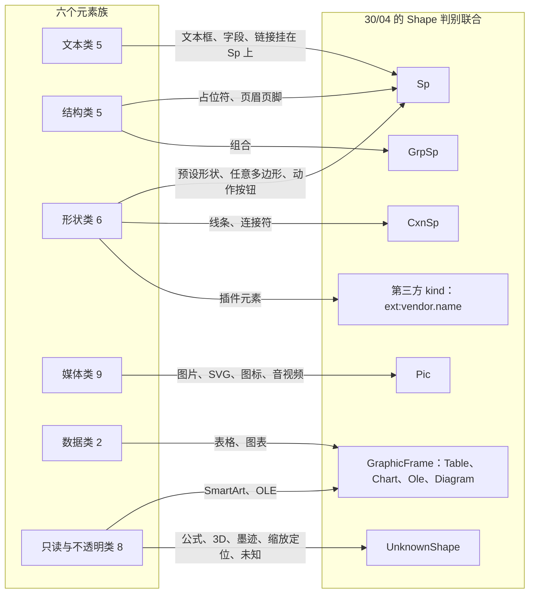

怎么读：左边是面向用户的六个族，右边是 30/04 模型里真正承载它们的六种形状分支加第三方 kind；族是按「用户想追加什么」分的，实体是按 OOXML 节点分的，一个族可落到多个实体，背景这类不落在 shapes 表的元素未画（它挂在页、版式、母版的 `commonSlide.background` 上）。

### 1.2 元素总表（35 类）

「插入入口」一列原按设计 03-04 与 playground 的插入页签七组写（文本 / 形状 / 图像 / 表格 / 图表 / 链接与批注 / 插件，R-d-61，随 DS-1 作废）；2026-10-07 起逐行改为 v3 入口。「—」表示不提供插入。

2026-10-04 起编辑器废弃 Ribbon（rulings §4.25 DS-1、DS-5），2026-10-07 第 1 批样张拍板（DS-21）：下表左列是族文档与旧稿里遗留的 ribbon 写法，只表示元素归在哪一类，右列是 v3 入口（设计 [03-04](../20-design/03-screens/04-insert-menu.md) §2、[03-02](../20-design/03-screens/02-editor-main.md) §2.3、§3.4、§4；样张 `docs/20-design/playground/src/v3/editor/Toolbar.tsx`、`insert-menus.tsx`）。六篇族文档第 ③ 栏与正文里遗留的同类写法按此表读；本节元素总表的「插入入口」列已逐行改为 v3 入口。

| 原写法（ribbon 版，已作废） | v3 入口 |
|---|---|
| 文本 › 文本框 | 底部工具条「文本」（T）；主菜单「插入 › 文本框」 |
| 形状 › 形状 ▾（含「线条」「动作按钮」） | 工具条「形状」（S）：常用 4 × 3，「全部形状 72 ›」在同一弹层原位换成形状库（最近使用 + 十类，设计 03-15 §1、§2）；主菜单「插入 › 形状库…」 |
| 图像 › 图片 ▾ | 工具条「图片 ▾」：此设备… · 来自 URL…（只收 https，TB-7）┊ 屏幕截图、相册（M4+ 不可用）（03-04 §5）；主菜单「插入 › 图片 ▸」 |
| 表格 › 表格 ▾ | 工具条「表格」：8 行 × 10 列网格 +「插入表格…」（03-30 §2）；主菜单「插入 › 表格…」 |
| 图表 › 图表 ▾ | 工具条「图表」→ `ChartTypeMenu`（03-31）；主菜单「插入 › 图表…」 |
| 链接与批注 › 超链接… | 「更多 › 链接…」、主菜单「插入 › 链接…」、文字与形状右键「链接…」，命令名统一为「链接…」（rulings §4.25 TB-6）；快捷键 `Mod+Shift+K`（2026-10-05 由 `Mod+K` 改，`Mod+K` 归命令面板，DS-11；族文档里写的超链接 `Mod+K` 同样按此读） |
| 图像 › 视频 / 音频；文本编辑态 文本 › 符号… | 「更多」插图组「视频」「音频」（P2 不可用）、文本组「符号…」（仅文本编辑态可用）（03-04 §4.2） |
| 插件组 | 「更多」末尾的插件分组，排在内置项之后、带归属标识；主行不开放（设计 06 §2.6，03-04 §4.3） |
| 文本 › 页眉和页脚…、文本 › 幻灯片编号 / 日期和时间 | 「更多」文本组「页眉和页脚…」「日期和时间…」「幻灯片编号」：未在编辑文字时后两项打开页眉和页脚对话框，插入符在文本里时分别打开日期格式选择器、直接插入页码字段（03-04 §4.2、§7.4） |
| 文本 › 公式 | 「更多」文本组「公式」（M4+ 不可用，03-04 §7.3） |
| 形状 › 图标… | 「更多」插图组「图标…」（03-15 §7） |
| 图像 › 屏幕截图 | 工具条「图片 ▾」里的「屏幕截图」（M4+ 不可用） |
| 检查器「幻灯片」分区 › 背景；设计页签 | 无选中时检查器「背景」节（设计 03-02 §4.1、03-28 §3.6）；版式与母版背景在母版视图检查器「背景」节（版式多「跟随母版」与「隐藏背景图形」，03-26 §5） |
| 开始 › 排列 › 组合 | 右键「组合」、主菜单「排列 › 组合」与 `Mod+G` |
| 开始 › 绘图 › 形状 ▾ | 同「形状 › 形状 ▾」：工具条「形状」弹层 |
| 开始 › 绘图 › 排列 ▾（旋转与翻转、对齐、层次） | 层次：主菜单「排列 ▸」与右键「排列 ▸」；旋转与翻转：检查器「位置与大小」节与右键「旋转 ▸」；对齐与分布：检查器顶部对齐行与多选右键「对齐与分布 ▸」，主菜单「排列」不放对齐（03-02 §2.3、§4.2，03-17 §5；50/18 SEL-11、ALN-02） |
| 开始 › 字体、段落（含渐变与轮廓等字符格式） | 检查器「文本」五节：字体 · 段落 · 颜色 · 列表 · 文本框，编辑文字与选中文本框时都出现（设计 03-16 §4.1）；渐变字与描边字（P2）样张未画，所在的节随实现 |
| 开始 › 版式 ▾ | 无选中时检查器「版式」字段（设计 03-02 §4.1）与缩略图、画布空白处右键「更换版式…」（03-27 §0） |
| 设计 › 设置背景格式… | 无选中时检查器「背景」节（设计 03-02 §4.1，rulings §4.25 DS-20）；版式与母版背景见上 |

| 族 | 元素 | 作用（为什么要追加它） | OOXML | 可编辑度 | 插入入口 | 里程碑 | PRD |
|---|---|---|---|---|---|---|---|
| 文本 | 文本框 | 在占位符之外放注释、标签、图注；无填充无线条、按文字自动增高 | `p:sp` + `p:cNvSpPr@txBox=1` + `p:txBody` | E | 工具条「文本」（T；单击自动宽、拖出定宽）；主菜单「插入 › 文本框」 | M2 P0；竖排 P2 | ED-05 |
| 文本 | 文本字段（页码、日期时间） | 文字里放会自动变化的页码与日期 | `a:fld@type=slidenum\|datetime1..13` | E~ | 文本编辑态：「更多」文本组「日期和时间…」（格式选择器）与「幻灯片编号」（直接插入页码字段） | M1 查看；M2 P2 | ED-31 |
| 文本 | 超链接（文本、形状） | 跳网页、邮件或本文稿某页，放映时导航 | `a:hlinkClick@r:id`、`@action` | E | 「更多 › 链接…」、主菜单「插入 › 链接…」、文字与形状右键「链接…」（`Mod+Shift+K`，2026-10-05 由 `Mod+K` 改） | M2 P1 | ED-19 |
| 文本 | 艺术字与文字效果 | 渐变字、描边字、弯曲变形等强调标题 | `a:bodyPr/a:prstTxWarp`、`a:rPr` 效果 | V~ | 渐变字与描边字：文本编辑态作为字符格式（检查器「文本」分区，P2）；弯曲变形等艺术字：本期不提供（M4+ 评估） | M1 查看；M2 P2 渐变字与描边字作为字符格式（ED-03 边界，命令在 P2 排期时登记，50/20 §5）；M4+ 艺术字 | ED-03 P2 |
| 文本 | 符号与特殊字符 | 输入键盘上没有的 ✓ ° ± → ① © | 普通 `a:r` 文本（不写 `a:sym`） | E | 文本编辑态：「更多 › 符号…」与主菜单「插入 › 符号…」 | M3 P2 | ED-33 |
| 结构 | 占位符：标题、居中标题、文本（`body`，原称「正文」，rulings §4.25 TB-34）、副标题、内容 | 版式预留的文字槽，换版式自动归位，是大纲与读屏顺序的来源 | `p:sp` + `p:nvPr/p:ph` | E | 页上随新建页与换版式生成；母版视图工具条「占位符」（M3，类型按 rulings §4.25 DS-30） | M1 查看；M2 P0；母版侧 M3 | ML-01…ML-03 |
| 结构 | 占位符：图片、图表、表格、媒体（内容族） | 点空占位符里的图标，把内容放到版式指定位置 | `p:ph@type=pic\|chart\|tbl\|media\|obj` | E | 空内容占位符的图标条；工具条「图片」「表格」「图表」按 §3.1 落点规则先填空占位符 | 图片 M2 P1；表格 M2 P1；图表 M3；媒体 P2 | ED-07、ML-03 |
| 结构 | 页眉页脚（日期、页脚、页码） | 统一给全部页加日期、页脚文字、页码 | `p:ph@type=dt\|ftr\|sldNum`、`p:hf` | E~ | 「更多 › 页眉和页脚…」与主菜单「插入 › 页眉和页脚…」（对话框） | M1 查看；M2 P2；母版复选 M3 | ED-31 |
| 结构 | 幻灯片、版式、母版背景 | 页面底色、渐变、背景图，「应用到全部」 | `p:bg/p:bgPr`、`p:bgRef` | E | 无选中时检查器「背景」节；母版视图检查器「背景」节 | M2 P1；母版版式背景 M3 | ED-20 |
| 结构 | 组合 | 多个元素当整体移动、缩放、对齐 | `p:grpSp` + `chOff/chExt` | E | 右键「组合」、主菜单「排列 › 组合」（`Mod+G`） | M2 P0；进入组合编辑 P1 | ED-08 |
| 形状 | 预设形状 | 最常用的示意、流程、标注与强调框，可带文字 | `p:sp` + `a:prstGeom@prst` + `p:style` | E | 工具条「形状」：常用 12 项 +「全部形状 72」形状库（十类） | M2 P0；调整手柄与更改形状 P1 | ED-05、ED-06 |
| 形状 | 线条（直线、箭头线） | 分隔、指示、标注引线 | `p:cxnSp` + `straightConnector1`/`line` | E | 工具条「形状」› 形状库「线条」 | M2 P0 | ED-05 |
| 形状 | 连接符（直线、肘形、曲线） | 把两个形状连起来，移动形状时自动跟随 | `p:cxnSp` + `a:stCxn`/`a:endCxn` | M2 E~，M3 E | 工具条「形状」› 形状库「线条」 | M2 P1；M3 P1 肘形与曲线重算 | ED-28 |
| 形状 | 任意多边形、曲线、自由曲线 | 不规则轮廓与手绘圈注 | `p:sp` + `a:custGeom` | M1 V，M2 E~（只变换） | 形状库「线条」行末三项（P2 不可用） | 绘制 P2；顶点编辑为非目标 | ED-05 边界 |
| 形状 | 动作按钮 | 放映用导航按钮（首页、上一页、结束、返回） | `prstGeom actionButton*` + `hlinkClick@action` | E | 形状库「动作按钮」，插入后弹「操作设置」 | 插入 M2 P0；操作设置 M2 P1 | ED-05、ED-19 |
| 形状 | 第三方扩展元素（以二维码为例） | 集成方或插件新增元素类型，内核零改动 | 回退位图 + `extLst` 数据 | E | 「更多」插件分组（带归属标识）或命令面板 | M2 P0（可插拔验收） | PS-02、PS-04 |
| 媒体 | 图片（位图） | 照片、截图、Logo、示意图 | `p:pic` + `a:blipFill`、`a:srcRect`、`a:alphaModFix` | E | 工具条「图片 ▾」（此设备 / 来自 URL）；拖入、粘贴 | M2 P0；裁剪与压缩 P1 | ED-07 |
| 媒体 | SVG 图片 | 无损缩放的矢量插图与 Logo | `a:blip`（PNG 回退）+ `asvg:svgBlip` | E | 同图片 | M2 P0；PNG 回退 P1 | ED-07 |
| 媒体 | 图标 | 快速插入风格统一的线性图标 | 同 SVG 图片 | E | 「更多 › 图标…」与主菜单「插入 › 图标…」 | M3 P2 | ED-32 |
| 媒体 | EMF / WMF 矢量图 | 老版 Office、Visio 粘贴图与 OLE 预览要能看能摆 | `p:pic` → `media/*.emf\|wmf` | M1 V~，M2 V | —（不接受插入） | M2 P1 | ED-07 边界 |
| 媒体 | 图片填充（形状、背景、文字） | 把图片放进形状轮廓、作背景或文字纹理 | `a:blipFill` 位于 `spPr`/`bgPr`/`rPr` | M2 E~ | 检查器「填充」节与「背景」节的「图片」分段 | 背景 M2 P1；形状 M2 P2；文字 M4+ | ED-06 P2、ED-20 |
| 媒体 | 视频 | 产品演示、录屏讲解；编辑显示海报，放映播放 | `p:pic` + `a:videoFile` + `p14:media` | M1 V，M2 E~ | 「更多 › 视频」（P2 不可用） | M1 查看；换海报 M2 P1；插入 M2 P2 | ED-35 |
| 媒体 | 音频 | 旁白与背景音乐 | `p:pic` + `a:audioFile` + `p14:media` | 同视频 | 「更多 › 音频」（P2 不可用） | 同视频 | ED-35 |
| 媒体 | 外链图片、外链音视频 | 引用网络资源时既能看到又安全可控 | `r:link`，`TargetMode=External` | V | —（URL 插图片时下载后内嵌） | M1 | OF-07 |
| 媒体 | 屏幕截图、相册（录屏不做） | 快速抓屏；一批照片每图一页 | 同图片 | E | 工具条「图片 ▾」的「屏幕截图」「相册」（M4+ 不可用） | M4+ P2 | ED-34 |
| 数据 | 表格 | 结构化对比、参数表、日程 | `p:graphicFrame` + `a:tbl` | M1 V，M2 E~，M3 E | 工具条「表格」（网格或「插入表格…」）；内容占位符 | 插入与单元格文字 M2 P1；结构与样式 M3 P1 | ED-10 |
| 数据 | 图表（bar / line / pie / area / scatter） | 用数据讲趋势、构成、对比、相关，导出后「编辑数据」仍可用 | `p:graphicFrame` + `c:chart` → `chartN.xml` + 内嵌 xlsx | M1–M2 V，M3 E | 工具条「图表」→ `ChartTypeMenu`；内容占位符 | M1 查看；M3 P1 插入与编辑 | OF-09、ED-15a、ED-15 |
| 只读 | 其它图表与 chartex | 含这些图表的文件能打开、能看、不丢 | `c:chart` 其它类型；`cx:chart` | V 或 P | — | M1 保留或占位；chartex M4+ 评估 | OF 第 2.6 节 |
| 只读 | SmartArt | 流程、层次、循环图示看得见、能摆放 | `dgm:relIds` + `dsp:drawing` | V | — | M1 渲染；M2 P1 整体变换；M4+「转换为形状」 | OF-10 |
| 只读 | 公式（OMML） | 理工类演示的数学公式先保证看得见 | `a14:m`/`m:oMathPara`（在 `mc:AlternateContent` 内） | V~ | 「更多 › 公式」（M4+ 不可用，右侧写「后续版本提供」） | M1 查看；M4+ 立项 | OF 第 2.7 节 |
| 只读 | OLE 对象 | 嵌入的 Excel、Word、Visio 能看预览能摆放 | `p:oleObj` + `mc:Fallback` 的 `p:pic` | V~ | — | M1 查看；M2 P1 变换 | OF-12 |
| 只读 | 3D 模型 | 能看到海报图、能摆放 | `am3d:model3d`（在 `mc:AlternateContent` 内；元素名以 [MS-ODRAWXML] 的小写 `model3d` 为准（证据 R 中两种大小写并存），M1 以语料核对，2026-09-26 整合） | V~ | — | M1 查看；M2 P1 变换 | OF 第 2.5 节 |
| 只读 | 墨迹 | 手写批注与圈画能看见 | `p14:contentPart`、裸 `p:contentPart` | V~ | — | M1 查看；M2 P1 整体变换（rulings §4.15 Q7 备注 A） | OF 第 2.5 节 |
| 只读 | 缩放定位 | 目录式非线性导航 | `pslz:sldZm`、`sectionZm`（在 `mc:AlternateContent` 内） | V~ | — | M1 查看；M2 P1 整体变换（rulings §4.15 Q7 备注 A） | OF 第 2.6 节 |
| 只读 | ActiveX、VML、未知 graphicData | 不认识的内容也零丢失 | `p:controls`、`legacyDrawing`、未知 `@uri` | P | — | M1 保留 | OF 第 2.6 节 |

各族的逐元素设计见族文档；PRD 侧的同一张一览表在 PRD 02 第 1a 节，本轮新增的 ED-15a（插入图表）、ED-31（页眉和页脚）、ED-32（图标）、ED-33（符号）、ED-34（截图与相册）、ED-35（视频与音频）与本表一一对应；两处冲突时以 PRD 为准并同步修正本表。

### 1.3 里程碑分布

**图 1-2 插入能力按里程碑展开**

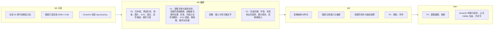

怎么读：从左到右是四个里程碑，每个子图里是该里程碑新增的插入或编辑能力，前一阶段的能力在后续阶段保留；M2 内部按 P0 → P1 → P2 分行，表格因 q-table-depth 单列一行（插入与单元格文字在 M2，结构与样式在 M3）。

---

## 2. 插入命令通用流程

### 2.1 六步

所有插入（工具插入、菜单插入、拖入、粘贴、空占位符填入、插件插入）都走同一条链，差别只在第 ② 步的意图来源与第 ④ 步调用哪条命令：

1. **选工具**：`activeTool` 是 ui 本地状态（`slide-ui` 的交互状态机，50/10 §7），**不入历史、不广播**；形状库、线条、文本框、表格网格、图片选择器都只是设置 `activeTool` 与参数（`preset`、`rows × cols`、文件句柄）。
2. **画布意图**（PointerIntent）：单击，或按下后拖出超过 4 px 屏幕阈值；拖出时 Shift 锁比例（线条约束到 0°/45°/90°）、Alt 以中心为基点；吸附与参考线照常生效（50/10 §7.2）。键盘在工具按钮上按 Enter、菜单项与命令面板直接执行时没有指针意图，落点取视口中心；表格、图表、图片例外，页上有空内容占位符时先填入它（§3.1，rulings §4.22）。
3. **算 box 与参数**：屏幕坐标经视口逆变换换成 EMU（模型唯一单位，30/04 §8）；线条类算起止点 `from`/`to`，由命令换成 `xfrm` + `flipH`/`flipV`。
4. **执行命令**：`commands.execute(unitId, 'slide.insertX', params)`。管线依次做 schema 解析 → `doc.write` 权限 → **规模守卫**（新增元素后超单页 1,000、全文 20,000 含墓碑、200 页时返回 `document.quota_exceeded{dimension, limit, actual}`，**不开事务**，30/05 §8）→ 一个事务内按需 `media.add`、再 `shape.insert`（`order` 取同容器最上层之上、`parentId = null`）。
5. **选中并进子编辑态**：命令成功后 UI 执行 Operation `slide.setSelection` 选中新元素，并按类型进入子编辑态（文本框 → 文本编辑；表格 → 首个单元格；图表 → 展开检查器「数据」分区、焦点在首个数值格，Operation `slide.chart.openDataEditor`（不带 `expanded`，不打开加宽到 400 的数据面板，[24](24-elements-tables-and-charts.md) §3.3）；动作按钮 → 弹「操作设置」）；Operation 不在插入事务里，不入历史。
6. **播报与反馈**：aria-live 播报「已插入〈类型〉」（§4.15）；画布列底部居中的轻提示「已插入 · 〈名称〉」带撤销（设计 03-15 §3.3）；媒体上传失败、超限等走 50/04 §4 的错误码矩阵与轻提示。

**一次插入 = 一个撤销步**。三种合并例外写在 §2.5。

**图 2-1 插入命令六步**

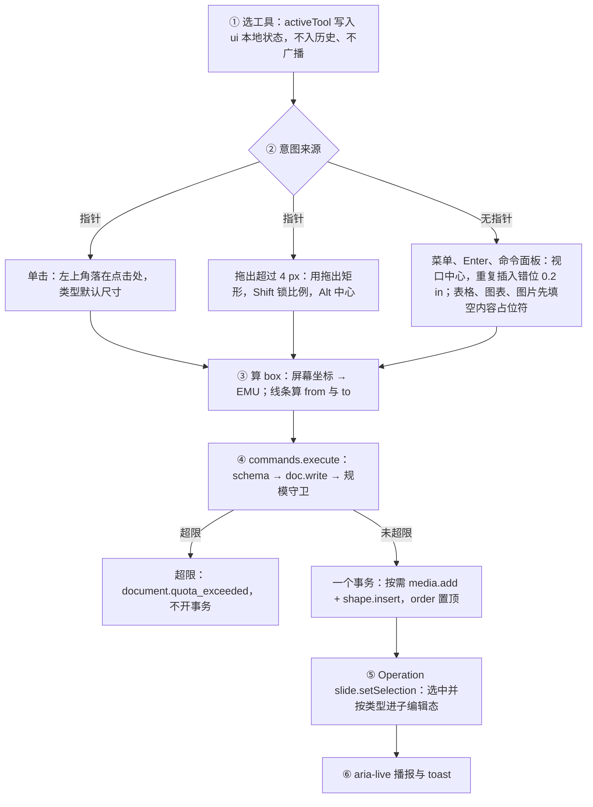

怎么读：自上而下是一次插入的六步；② 的三个来源最后都汇到同一个 box 计算，④ 的规模守卫在事务之前拒绝，所以超限时不产生任何撤销记录；⑤ 的选中是事务之外的 Operation。

### 2.2 插入工具态状态机

画布上的插入工具态是 50/10 §7 选择模型之外的一个独立状态，它只决定指针事件怎么解释，不改模型。R-d-62 要求把本状态机写入 50/10 §7，本节是跨元素的共用口径，族文档只写各自的差异（线条的两点拖出、任意多边形的逐点放置、表格网格的行列选择）。

**图 2-2 插入工具态**

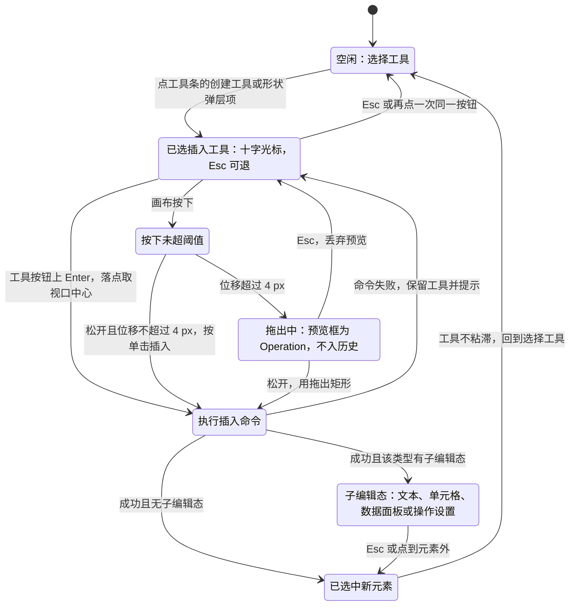

怎么读：七个状态从上到下对应一次插入的推进；只有「执行插入命令」一格会写模型，拖出中的预览框与十字光标都是视图态；命令失败时停在已选工具态，让用户可以换个位置再试；插入完成后工具不粘滞（与 PowerPoint 一致），连续插入同一形状靠「最近使用」或再点一次按钮。

### 2.3 命令执行时序

**图 2-3 一次插入的命令时序**

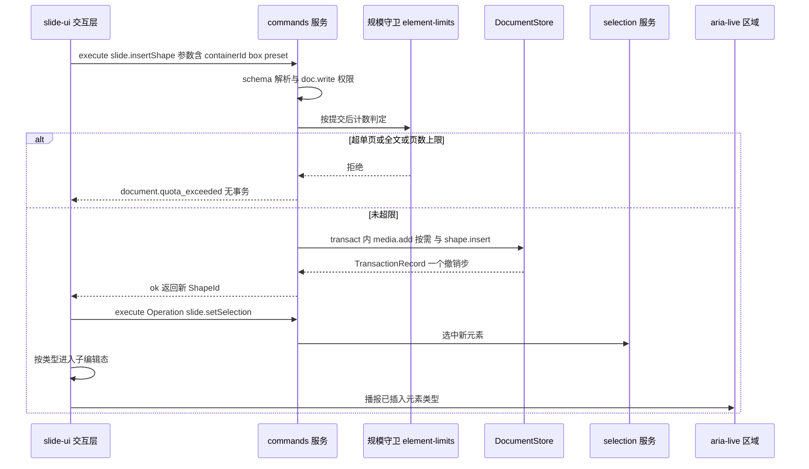

怎么读：纵向是时间；守卫在事务前拒绝，因此失败路径不留撤销记录；插入事务提交后，UI 再发一个独立的 Operation 选中新元素，所以撤销只撤插入，不会撤出一个「空选区」步骤。

### 2.4 媒体类插入的字节通道

图片、SVG、图标、音视频的字节只进 BlobStore（`BlobRef` 内容寻址），**不进 Y.Doc**（30/04 §2.5）。插入不等上传：本地先算 sha256 并立即执行插入命令，上传在后台完成；他端在对象存储 commit 之前拿不到字节，显示加载占位并退避重试（50/05 §8.3）。

**图 2-4 媒体插入与后台上传**

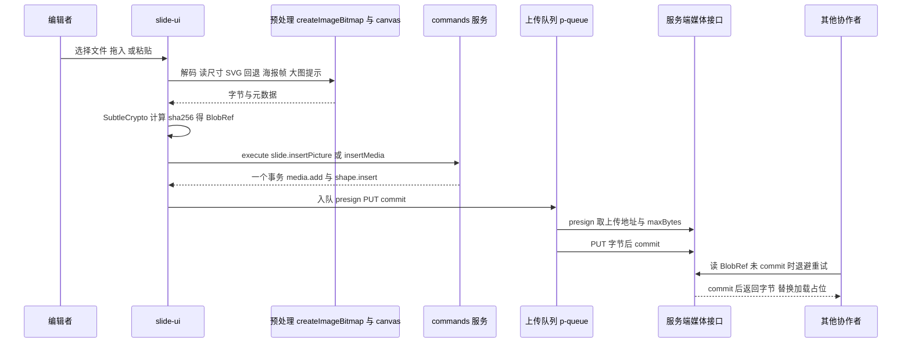

怎么读：插入命令在上传之前就已提交，编辑者立刻看到新元素；上传失败不回滚插入，只把元素标为「上传失败」并允许重试或替换（设计 03-04「加载中」「错误态」）；单文件上限来自 presign 返回的 `maxBytes`，本地粘贴还受 25 MB 上限（PRD ED-17）。

### 2.5 撤销与合并的三个例外

| 场景 | 规则 | 依据 |
|---|---|---|
| 单击插入的文本框，一个字没输就退出编辑 | 自动删除，且与插入**合并为同一撤销步**（结果是撤销栈没有变化） | R-d-65；50/20 文本框节 |
| 动作按钮插入后在「操作设置」里点确定 | `slide.insertShape{ …, action }` 先写默认动作；对话框确认且有改动时执行 `slide.setAction`，两者经 `history.beginGroup` 合为一个撤销步 | R-d-77；50/22 动作按钮节 |
| 空内容占位符填入 | `slide.fillPlaceholder` 一个事务：删空占位 `Sp` + 按需 `media.add` + 插入带同一 `PlaceholderRef` 的 `Pic`/`GraphicFrame`；撤销一步回到空占位 | R-d-69；§4.5 |

撤销的协同语义不因插入而特殊：只撤本机，他人已后写的键跳过并提示（30/05 §6）。

---

## 3. 默认落点与尺寸

### 3.1 落点规则

| 插入方式 | 落点 | 说明 |
|---|---|---|
| 单击插入 | 默认尺寸框的**左上角**落在点击处 | 与 PowerPoint 一致；超出页面允许（设计 03-04 边界），只保证插入瞬间在视口内可见 |
| 拖出插入 | 用拖出矩形（Shift 锁比例，Alt 以按下点为中心） | 拖出矩形小于类型最小尺寸时按单击处理 |
| 菜单、工具按钮上 Enter、命令面板、插件命令 | 默认尺寸框**居中于当前视口**；视口中心不在页面内时居中于页面 | 键盘可达（WCAG 2.5.7，§4.15） |
| 从工具条或命令面板插入表格、图表、图片（工具条项、网格、对话框、命令面板；原写「插入页签」） | 页上有空内容占位符（`obj` 或同类 `tbl` / `chart` / `pic`）时填入阅读序第一个，已选中的空占位符优先；没有才按上一行 | 工具条与命令面板插入表格、图表、图片，一律走 `slide.fillPlaceholder`、保留 `p:ph`，与 PowerPoint 一致（rulings §4.22 Q1）；图标、音视频不在此列，沿用原规则：居中于视口（上一行），选中了空内容占位符时填入它（50/10 §7.4 原口径，rulings §4.22 Q1 细化 (b)） |
| 同一视口内重复插入 | 在上一次落点基础上向右下**错位 0.2 in**（182 880 EMU） | 与 `slide.duplicateShapes` 的原位偏移同值（PRD ED-08） |
| 拖入文件、粘贴 | 拖放点或视口中心；多个文件依次错位 0.2 in；多张图片拖到空内容占位符上时，指针下的占位符填第一张，其余在放下点普通插入、依次错位，不自动填同页其它占位符 | 粘贴不经 DOM、上限 25 MB（PRD ED-17，50/04 §9）；拖入规则见 [21](./21-elements-structure.md) §3 ③ |
| 空内容占位符填入 | 占位符框 | 图片按占位符框裁剪到填满（算 `srcRect`；`obj` 占位符是否同样裁剪填满推迟，见 [21](./21-elements-structure.md) §8 S-4）；表格宽取占位符框宽、高度随行数（[24](./24-elements-tables-and-charts.md) §2.3）；图表取占位符框（宽高都取，同 PowerPoint，[24](./24-elements-tables-and-charts.md) §3.3） |

所有尺寸内部都是 EMU；检查器按用户偏好显示 cm / in / pt / px（PRD ED-05）；设计稿与样张的数值一律按 pt 书写，产品按设置的度量单位显示（中文缺省 cm、英文缺省 in，设计 03-23；rulings §4.25 DS-27）；字号与段前、段后、固定行距始终用 pt，不随度量单位换算（TB-33）。本文写作 in 的数值（偏移 0.2 in、形状 1 in、表格行高 0.41 in）是 PRD 引用的 OOXML / PowerPoint 默认值，保留原单位（TB-37），1 in = 72 pt。代码里禁止裸写 `914400` 这类字面量，统一用 `shared` 的单位常量（lint `no-magic-emu`，30/04 §8）。

### 3.2 默认尺寸与默认样式

| 元素 | 默认尺寸 | 默认样式来源（依次取第一个存在的） | 备注 |
|---|---|---|---|
| 文本框（单击） | 单行自动宽（`wrap=none`），高随文字（`spAutoFit`） | `Theme.objectDefaults.txDef` → 无填充无线条；文字走 30/04 §6.1 继承链的 other / `defaultTextStyle` 段（约 18 pt、`+mn-lt`） | 只把当前界面或 IME 语言显式写进 `endParaRPr@lang` |
| 文本框（拖出） | 拖出宽度、`wrap=square`，高随文字 | 同上 | 拖左右手柄会把 `wrap=none` 改成 `square` |
| 预设形状 | 1 in × 1 in（72 × 72 pt，设计 03-15 §2.1）；个别类别另有默认值的，以形状库数据表（slide-ui `shape-gallery` 数据文件，见 50/22）为准 | `objectDefaults.spDef` → PowerPoint 内建 `p:style`（`fillRef idx=1 accent1`、`lnRef idx=2 accent1 shade`、`effectRef idx=0`、`fontRef minor lt1`） | 只写引用，不把解析值烤成显式 `spPr`（R-d-63） |
| 线条、箭头、连接符 | 单击：1 in 水平线；拖出：两点 | `objectDefaults.lnDef` → PowerPoint 内建连接符样式（`lnRef idx=1 accent1`，语料核对） | 线条与箭头落 `p:cxnSp`（R-d-64） |
| 任意多边形（P2） | 按绘制点列 | 开放路径 `lnDef`，闭合 `spDef` | — |
| 图片 | 像素 ÷ DPI（缺省 96）换算，最长边不超过页面 60%，等比 | 无样式 | 大于 4096 px 提示压缩到 2048 px（P1） |
| SVG 图片 | 取 `viewBox` 或宽高属性，规则同图片 | 无样式 | PNG 回退按 2 倍显示尺寸栅格化，最长边 ≤ 2048 px（P1） |
| 图标（M3 P2） | 1 in × 1 in（72 × 72 pt，03-15 §7） | 颜色取主题 `tx1` | `nonVisual.description` 默认写图标名 |
| 视频（P2） | 原始宽高等比，最长边不超过页面 60% | 海报帧 | 主接受 mp4（H.264/AAC） |
| 音频（P2） | 0.5 in 图标 | 内置喇叭图标 | 放映时点图标播放 |
| 表格 | 有空内容占位符时取占位符框宽（§3.1）；否则宽取正文占位符宽（没有则页宽 80%）、水平居中；行高 0.41 in（`a:tr@h=370840`，与 PRD ED-10 同，PowerPoint 新表格的值） | 表格样式 `{5C22544A-7EE6-4342-B048-85BDC9FD1C3A}`（中度样式 2 - 强调 1）+ `firstRow`、`bandRow` | 网格悬停范围 8 行 × 10 列、读数「R 行 × C 列」；「插入表格…」对话框界面只写「行数、列数各 1–75」（rulings §4.25 TB-8）；最终上限待性能评估（工程备注，PRD ED-10；评估见 50/24 §2.14 第 1 条，提前到 M2 表格插入开工前，rulings §4.22） |
| 图表（M3） | 有空内容占位符时取其框（§3.1）；否则正文占位符框（没有则 60% × 60% 居中） | 主题强调色序列；示例数据 4 类别 × 3 系列 | 插入后自动展开检查器「数据」分区，焦点在首个数值格（[24](24-elements-tables-and-charts.md) §3.3） |
| 动作按钮 | 同预设形状 | 同预设形状 | 每种按钮有默认动作（§4.7、50/22） |
| 第三方元素 | 由插件的 `ShapeKindDef.createDefault(box)` 决定 | 插件决定 | 内核不给默认 |

新元素**只写 `p:style` 引用**，颜色优先 `schemeClr`：换主题后新元素自动跟随（§4.6）。`Theme.objectDefaults` 在 M2 只读建模（30/04 §3.7，ADR-0018），不提供编辑它的命令；「设为默认形状」是 PRD ED-06 的 P2 项，本期不做。

**图 3-1 默认样式取值链**

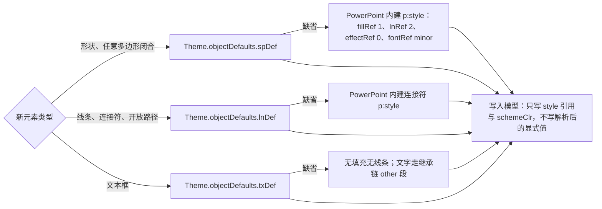

怎么读：按新元素类型选一条取值链，主题里有 `objectDefaults` 就用主题的，没有才用 PowerPoint 内建值；不论哪条链，写进模型的都是引用而不是解析后的颜色与线宽，所以换主题后新旧元素一起跟随。

---

## 4. 通用设计 18 条

所有元素共用下面 18 条，族文档里只写差异。其中「插入命令通用流程」「默认落点与尺寸」「新增命令与 Mutation 汇总」三条篇幅较长，分别单列为 §2、§3、§5，本节 §4.16–§4.18 补上三分法落位、复用总表与第三方元素三条，合计 18 条。

| # | 条目 | 位置 | # | 条目 | 位置 |
|---|---|---|---|---|---|
| 1 | 元素基类 | §4.1 | 10 | 渲染与降级 | §4.10 |
| 2 | 变换矩阵 | §4.2 | 11 | 检查器与上下文界面 | §4.11 |
| 3 | z 序与分数索引 | §4.3 | 12 | 协同通用 | §4.12 |
| 4 | 锁定与隐藏 | §4.4 | 13 | 规模与安全 | §4.13 |
| 5 | 占位符继承链 | §4.5 | 14 | 导出与 id | §4.14 |
| 6 | 主题色与默认样式 | §4.6 | 15 | 可访问性 | §4.15 |
| 7 | 替代文本与装饰性 | §4.7 | 16 | 命令三分法落位（含插入流程 §2、落点 §3） | §4.16 |
| 8 | 不透明保留钩子 | §4.8 | 17 | 复用与自研总表 | §4.17 |
| 9 | 媒体通道 | §4.9 | 18 | 第三方扩展元素（含命令汇总 §5） | §4.18 |

### 4.1 元素基类

每个元素都是 30/04 `shapes` 表里的一行（背景除外），公共字段在 `ShapeBase`，按 `kind` 判别。本轮补了 `nonVisual.decorative` 与 `ShapeKindDef.capabilities` 的五个新位（ADR-0018）：

**图 4-1 元素基类与能力位**

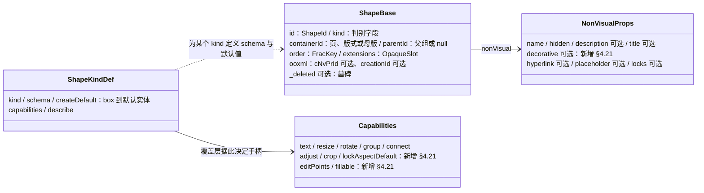

怎么读：左边是每行元素的公共字段，中间是非可视属性，右边是每个 `kind` 在 `slide.shapeKind` 贡献点上登记的定义；覆盖层（选择框、手柄、裁剪遮罩）只看 `capabilities` 决定画哪些手柄，不按 `kind` 写分支，第三方元素因此不用改交互层。

`capabilities` 各位的含义（可以是常量，也可以是按实体求值的函数，例如预设形状的 `adjust` 取决于该几何有没有 `gd`）：

| 位 | 为真时覆盖层与检查器做什么 | 内建取值示例 |
|---|---|---|
| `text` | 双击或 Enter 进入文本编辑 | `sp` 真；`pic`、`cxnSp` 假 |
| `resize` / `rotate` | 显示 8 个缩放手柄 / 旋转手柄 | `graphicFrame` 不可旋转（`rotate` 假） |
| `group` | 可参与组合 | 内建全部为真；占位符参与组合时转为普通形状并提示（PRD ED-08） |
| `connect` | 拖连接符时显示连接点 | `sp`、`pic` 真；`cxnSp` 假 |
| `adjust`（新增） | 显示调整手柄（8 × 8 强调色菱形、1px 白边，设计 03-15 §4；原黄色作废） | 预设几何含 `gd` 时真 |
| `crop`（新增） | 可进裁剪模式 | 位图 `pic` 真；EMF/WMF 假（PRD ED-07 边界）；SVG 以 50/23 为准 |
| `lockAspectDefault`（新增） | 缩放默认锁比例，Shift 反转 | `pic`、图标、音视频真 |
| `editPoints`（新增） | 编辑顶点（保留位） | 内建一律假：顶点编辑是非目标（§7） |
| `fillable`（新增） | 检查器显示「填充」分区 | `sp` 真；线条、连接符与只读类假 |

### 4.2 变换矩阵

- 模型：`Transform{ offset, extent（Emu）, rotation（Angle60k）, flipH, flipV }`；组合另有 `chOff/chExt`（30/04 §4.3）。
- 局部矩阵 = `T(off + ext/2) · R(rot) · S(flip) · T(−ext/2)`；世界矩阵 = 父组矩阵链 × 局部矩阵（组的子坐标经 `chOff/chExt` 映射）。
- 手柄在**屏幕空间**计算（保证触控 ≥ 44 px、吸附阈值 4 px 不随缩放变化），再反变换回 EMU 写进命令参数。
- `graphicFrame`（表格、图表、SmartArt、OLE）不可旋转；线条用 `flipH/flipV` 表达方向；形状翻转时文字不镜像（`flipV` 时文字转 180°，与 PowerPoint 一致）。
- 渲染与交互用的 2×3 仿射工具在 `engine-layout` 自写（`transformation-matrix` 只作参考，不引入）；取消组合时的变换折算在 `model-slide` 的 `shape.ungroup` 里按同一公式做（40/03 §2.6），两处由共用测试向量对齐。
- **维持自研的理由**：矩阵运算不足百行，现成库（`transformation-matrix`、`gl-matrix`）要么只做 2D 仿射却不懂 OOXML 的 `chOff/chExt` 与翻转语义，要么面向 WebGL、体积与 API 都不合适。

### 4.3 z 序与分数索引

- 同一 `(containerId, parentId)` 下按 `(order, id)` 排序；新元素默认置顶：`order = between(同级最后一个, undefined)`（`@cordexjs/shared/order`，由命令层生成后放进 Mutation 载荷，`lower()` 不生成随机键）。
- 上移、下移、置顶、置底、进出组都只改 `order`（与 `parentId`）一个键，并发 LWW，无重复无丢失；Mutation 载荷禁止数组下标（lint `cordex/no-index-in-mutation`）。
- 键格式按 rulings §4.21 q-frackey 改为内置 rocicorp fractional-indexing 算法源码（CC0，注明出处）：整数头 + 随机后缀，后缀避开以 `0` 结尾；决策改写在 [ADR-0032](../30-architecture/adr/0032-ordered-collections-fractional-index.md)。
- 表格的行与列也用同一套键（§4.12、30/04 §3.8），图表的类别与系列在 M3 同理。

### 4.4 锁定与隐藏

- `nonVisual.locks` 承载 `spLocks`、`picLocks`、`cxnSpLocks`、`graphicFrameLocks` 的各锁位（如 `noMove`、`noResize`、`noRot`、`noGrp`、`noTextEdit`、`noChangeAspect`）。
- **锁由交互层执行**：被锁的手柄画成锁形并给 tooltip，拖动不响应；**命令层不拒绝**（与 PowerPoint 一致：锁是编辑便利，不是权限），所以对齐、分布等批量命令仍可移动被锁元素，UI 在执行前提示。
- `hidden = 1`：不渲染、不可点选，但**计入规模上限**（§4.13）；选择窗格（P2）里可见并可切换显示；锁定与解锁的 UI 为 P2（PRD ED-26）。

### 4.5 占位符继承链

占位符是结构类的核心，也影响所有可放进占位符的元素（文字、图片、表格、图表、媒体）。字段解析按 30/04 §6.1 的链自上而下找第一个给出值的层；框位与大小用 `resolvePlaceholderBox`（形状 → 版式占位符 → 母版占位符 → 默认框，30/04 §12.2）：

**图 4-2 文本属性与框位的继承**

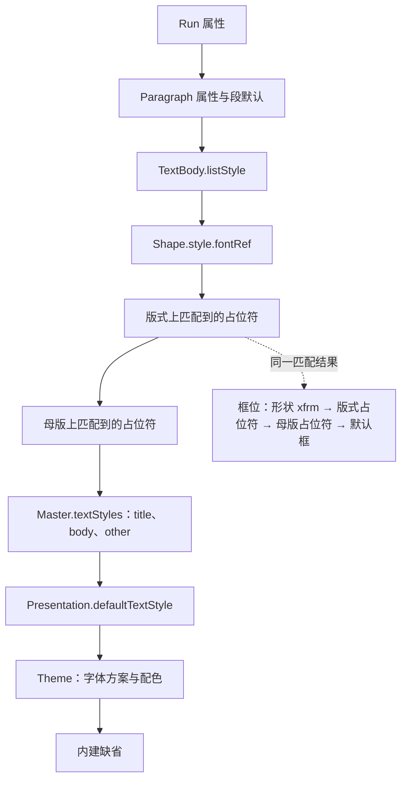

怎么读：左列从上往下是字段查找顺序，上一层没给值才落到下一层；右侧虚线表示框位用的是同一次占位符匹配的结果。非占位符元素（文本框、形状）跳过两层占位符，只走 `style.fontRef` 与 other / `defaultTextStyle` 段。

共用规则：

- **只写显式覆盖**：拖动占位符只写 `transform` 覆盖；检查器逐字段标「继承自版式 / 已覆盖 · 重置」，重置调用 `slide.resetPlaceholderFields`（30/05 §13.2）。
- **匹配规则按 PRD ML-02**：同类型同 index → 同类型任意 index → 兼容类型（`ctrTitle ↔ title`、`subTitle ↔ body`、`obj ↔ body`、`pic/chart/tbl/dgm/media → obj`）→ 无匹配则脱离占位符；族划分与 PRD ML-03 一致（文本族、内容族、页脚族，30/04 §12.2）。
- **内容占位符填入**：`slide.fillPlaceholder` 用新元素替换空占位符，新元素保留原 `PlaceholderRef`（同 `type` 与 `index`、同 `order`），换版式时随占位符走；删除带内容族引用的图片、表格、图表时，同一事务补回空占位符（与 PowerPoint 一致，ADR-0018）。
- **占位符入组**：转为普通形状（`materialize` 后去掉 `PlaceholderRef`）并 toast，一个事务（PRD ED-08）。

### 4.6 主题色与默认样式

- 颜色优先写 `schemeClr`；颜色选择器的 10 列 × 6 行明暗变体用 `lumMod`/`lumOff` 修饰符表达（PRD ED-06），标准色与自定义色才写 `srgbClr`。
- 新元素只写 `p:style` 引用（§3.2），快速样式库改写的是 `ShapeStyle` 的四个引用（`shape.setStyle`），不把解析后的颜色烤成显式 `spPr`（PRD 02 第 3 节「只写显式覆盖」，R-d-63）。
- `Theme.objectDefaults`（`spDef`/`lnDef`/`txDef`）M2 只读建模：导入解析、供新元素取默认、导出随主题部件原样重生成；本期没有写它的命令。
- 换主题（`slide.applyTheme`）后，所有只写引用的元素自动跟随；显式覆盖的保持不变。
- **维持自研的理由**：OOXML 颜色变换（`lumMod`、`shade`、`tint`、`satMod`、`alpha` 等十余种修饰符按顺序叠加）没有成熟 JS 实现；UI 侧的颜色解析与对比度计算复用 `colord`、`culori`（R-d-14，50/17）。

### 4.7 替代文本与装饰性

- 字段：`nonVisual.description`（替代文本，`cNvPr@descr`，建议不超过 250 字）、`nonVisual.title`（`cNvPr@title`）、`nonVisual.decorative`（**新增（§4.21）**，对应 `cNvPr` 扩展列表里的 `adec:decorative@val`，命名空间 `http://schemas.microsoft.com/office/drawing/2017/decorative`）。
- 命令：`slide.setAltText{ shapeId, description?, title?, decorative? }` → Mutation `slide.shape.setNonVisual`（§5）。标为装饰性时 `description` 保留但不进可访问树（与 PowerPoint 一致）。
- 检查：图片、图表、媒体、图标缺替代文本且未标装饰性时，检查器与可访问性面板提示 `missingAlt`（50/16 §9.3）；图标插入时 `description` 默认写图标名。
- 编辑入口：各对象检查器的「替代文本」节（slide-ui `AltTextSection`：描述框 n/250、「标记为装饰性」、缺失警示，设计 03-18 §5.4），右键「编辑替代文本…」把检查器切到该对象并聚焦描述框；形状检查器的这一节按 rulings §4.25 TB-32 补在「操作」之后（[22](22-elements-shapes-and-lines.md) §2 ⑦）。
- 动作按钮的默认动作：首页、上一页、下一页、最后一页、最近观看、结束放映各对应一个 `ppaction://hlinkshowjump?jump=…`（R-d-77 补 `lastslideviewed`、`endshow`）；模型里是 `Hyperlink.target` 的 `show` 分支（30/04 §3.7），详见 50/22。

### 4.8 不透明保留钩子

- 每个已建模实体都有 `extensions`；未知子元素、未知属性按锚点插回（30/04 §5.1）。编辑只改建模字段，`extLst` 与未知内容原样写回。
- `mc:AlternateContent` 里的对象（公式、3D、缩放定位、chartex 等）只建模 `transform`：删除 M1 P0，整体移动缩放 M2 P1，写回时同步各分支的 `xfrm`（ADR-0008 决策 9 白名单内）。
- 只读解析不等于建模：图表部件、`dsp:drawing`、OLE 预览、备注文本可被渲染器只读解析，但不形成第二份可编辑模型（ADR-0008 决策 10）。
- 本轮待 ADR-0008 修订定夺的两处白名单扩展：只读侧加「缩放定位 Fallback 的 `hlinkClick`（放映跳转）」「OMML 线性文本（可访问名称）」；写入侧加「M3 套用非默认内置表格样式时写 `tableStyles.xml`」。音视频插入**不写** `p:timing`（q-media-insert），不需要扩写入白名单。

### 4.9 媒体通道

- 字节只进 BlobStore（`BlobRef{ hash: sha256, size, contentType }`），不进 Y.Doc；模型里只有 `MediaRef`（30/04 §2.5）。
- 插入先本地算 sha256（SubtleCrypto）、立即执行插入命令，后台 presign → PUT → commit（图 2-4）；他端在 commit 前显示加载占位并退避重试；上传并发由 `p-queue` 控制（R-d-21）。
- 客户端 `MediaCache` 按字节 LRU，`blob:` URL 的创建与 `revoke` 一一对应（50/05 §8.2）。
- 预处理（解码、读尺寸、GIF 首帧、SVG 与图标 PNG 回退、视频海报帧、大图压缩）用 `createImageBitmap` + canvas（R-d-23，ADR-0021 补「媒体与图标预处理」用途）；EMF/WMF 只读栅格化用 `emf-converter`（R-d-24）。
- 文档内 SVG 只在图像上下文渲染（`` 或 SVG `<image>`），禁止 `innerHTML`/`DOMParser` 注入（50/05 §8.5）。
- 单文件上限来自 presign 返回的 `maxBytes`；URL 插图片默认不经服务端代抓，按部署 `externalResources` 直连下载后内嵌（ED-07 允许集成方禁用）。

### 4.10 渲染与降级

- 每个 `kind` 一个**无状态**的 `render.element` 查表项，状态只在 `render()` 返回的句柄里（§6）；渲染热路径没有拦截链。
- 三类占位——**意外失败**（渲染器抛错）、**预期降级**（chartex、未知 graphicData、外链被拦截）、**查表未命中**（第三方 kind 未装载）——都画成可选中、可移动、可删除的占位框，并带降级原因（50/05 §9）。
- 覆盖层（选择框、手柄、裁剪遮罩、连接点、内容占位符图标条、上传进度占位、视频临时播放器）**不进 Scene**，独立重绘，不触发内容渲染。
- 惰性渲染器（图表、EMF/WMF）与占位渲染器登记同一个 key，装载后以 `conflict: 'replace'` 覆盖，页面无需重开（rulings §4.18 FE-08）。

### 4.11 检查器与上下文界面

- 检查器分区按 `selectionKind × editTargetKind` 决定（50/10 §5）；本轮 `selectionKind` 补 `table`、`chart`、`media`、`placeholder-empty` 四种（R-d-72）。2026-10-04 起检查器只管当前选中对象的属性，分区以 `ui.inspectorSection` 贡献（槽位 `inspector.<selectionKind>`，50/09 §6.1、设计 06 §2.12，rulings §4.25 DS-1、DS-5）；各类型的分区已于第 1 批样张拍板（DS-21），下表按样张写分区与次序，分区 id 以 40/10 与 `inspector-spec.ts` 为准。
- **上下文工具条全部取消**：文本编辑态的文字条按 rulings §4.25 DS-13，表格与图表的条按 DS-22，图片条按已拍板的第 1 批样张取消（rulings §4.25 DS-21，设计 03-18 §1.4）；原条目并入检查器对应分区、右键与命令面板，`ui.toolbar` 的 `toolbar.<selectionKind>` 槽位删除（TB-29），插件针对所选对象的命令改走 `ui.inspectorSection` 与 `ui.contextMenu` 的对象菜单槽位。粗体、斜体等保留快捷键（50/10 §5、§7.3）。每个控件都有对应命令 id，控件规格测试 `toolbar-spec.test`（原名 `ribbon-spec.test`，40/10 已按 DS-5 改名）与 `inspector-spec.test` 断言「控件的命令 id 已注册」，未注册即永久禁用而不是静默无效。
- **画布浮层**：空内容占位符图标条、画布浮签、尺寸角标与图片裁剪浮条「取消 / 完成」画在屏幕坐标的画布浮层上，按屏幕尺寸绘制（字号 12px），不随画布缩放变小；选中框与手柄仍由选择覆盖层按页面坐标画（50/10 §7.3、§7.5；rulings §4.22 SF-01 按 DS-13、DS-22 修订）。
- **多选**：同类多选时面板标题「N 个对象」（文本框为「N 个文本框」），异类多选只显示各类型分区的**交集**（位置与大小 · 不透明度）；同一字段值不一致时显示「多个值」，改动对全部选中元素生效，一个事务（设计 03-02 §4.5、03-16 §4.2）。
- **只读**：评审、只读浏览与降权下各分区只读展示当前值、不画禁用控件，顶部一行说明权限，对齐行这类命令不出现（DS-15）。

现有取值以 50/10 §5 为准（`none`、`shapes`/`text`、`picture`、`table-cell`、`group`、`connector`、`degraded`、`mixed`），本轮新增四种：

| selectionKind | 主要分区（自上而下，第 1 批样张） | 典型元素 |
|---|---|---|
| `none`（现有） | 版式 · 主题 · 背景 · 放映（设计 03-02 §4.1） | 无选中 |
| `shapes`（现有） | 对齐行（标题上方：六向对齐 + 横向 / 纵向分布）· 位置与大小（X、Y ┊ W、H + 锁定比例 ┊ 旋转 + 翻转）· 快速样式（「填充」节上方一行主题样式缩略图，点开后 42 格样式库在本节缩略行下方原位展开，rulings §4.25 DS-31、DS-34；DS-34 修订 DS-31 的「样式库弹层」）· 填充 · 描边 · 阴影 · 不透明度（同时写填充与描边颜色的 alpha，TB-47）· 操作 · 替代文本（TB-32，承接右键「编辑替代文本…」）（03-02 §4.2，[22](22-elements-shapes-and-lines.md) §2 ⑦）；更改形状只走右键「更改形状 ▸」与命令面板、检查器不设入口（TB-18）；调整值的数值等价样张未画，随实现 | 预设形状、动作按钮、任意多边形 |
| `text`（现有） | 字体 · 段落 · 颜色 · 列表 · 文本框（03-16 §4.1）；编辑文字与选中文本框（非编辑态）都只显示这五节，面板标题「文本」，多选为「N 个文本框」（50/10 §5） | 文本框、文字占位符、编辑中的形状文字 |
| `connector`（现有） | 连接（起点 / 终点连到哪个形状的哪个连接点，起止点做成下拉，rulings §4.25 TB-21）· 线条 · 类型 · 位置与大小（03-17 §8） | 线条、连接符 |
| `picture`（现有） | 图片（预览 · 替换… · 裁剪 · 重置 · 压缩…）· 不透明度 · 位置与大小 · 替代文本；图标在最上方多「图形填充」节（03-18 §5、§8）；裁剪模式下只留「裁剪」节 | 图片、SVG、图标、EMF/WMF（不可裁剪） |
| `table-cell`（现有） | 表格样式（收起）· 单元格（M3）· 文本（所选单元格）· 行高与列宽（M3）（03-30 §6.1） | 表格单元格 |
| `group`（现有） | 对齐行 · 位置与大小 · 组合（包含 N 个对象 + 取消组合）· 不透明度（03-17 §6.1） | 组合 |
| `degraded`（现有） | 位置与大小、降级原因、查看保真详情（v3 呈现 2026-10-15 随第 2 批定稿：分区最上是对象说明——中性信息图标 + 标题 + 一句原因 + 带外链图标的次按钮「保真详情」，rulings §4.25 DS-52，[09](09-ui-system-and-theming.md) §5a.6、03-13） | SmartArt、OLE、公式、3D、chartex 等只读元素 |
| `table`（新增） | 位置与大小 · 表格样式与 6 个标志（M3）· 文本（全部单元格）· 替代文本（03-30 §6.1） | 选中整个表格 |
| `chart`（新增） | 类型 · 图表元素 · 数据（M3）· 位置与大小 · 替代文本 · 坐标轴与格式（P2）；M2 的五类图表为「类型（M3 只读）」· 位置与大小 · 替代文本，非五类为说明卡 · 位置与大小 · 替代文本（03-31，TB-13） | 图表 |
| `media`（新增） | 视频（海报、文件名与格式时长、换海报… M2 P1、裁剪 P2，不设播放按钮）· 位置与大小（无翻转）· 替代文本（03-18 §9） | 视频、音频 |
| `placeholder-empty`（新增） | 占位符（类型、索引、来自版式，只读三行）· 位置与大小（改过的字段可逐项「重置为版式值」）（03-16 §6.7）；只放占位符属性，原「插入到占位符」按钮组按 rulings §4.25 DS-14 取消——往占位符插入内容走画布上的占位符图标条（可键盘与读屏操作）与底部工具条（50/10 §5、§7.4，[21](21-elements-structure.md) §3） | 空内容占位符 |

### 4.12 协同通用

- 新元素是 `shapes` **顶层表**的新键（30/04 §3.1；30/06 §1.3.2 的 `slides/<id>/shapes` 嵌套写法按 R-d-05 改为顶层表，由协同线回写），插入与插入之间 LWW 不冲突。
- 叶子编码按 30/06 §1.5：标量叶子 LWW；小型复合值（颜色、超链接、端点引用）整值 JSON 串 LWW；用户可分别编辑的复合值（`xfrm`、`fill`、`ln`、`bodyPr`）嵌套 `Y.Map`；正文 `Y.XmlFragment` 按字符合并。
- 删除写墓碑（24 h 后硬删，30/04 §3.1a）；新引用不能指向墓碑（连接符端点、内容占位符引用、组的 `parentId`）。
- 撤销只撤本机；目标键已被他人后写则跳过并提示（30/05 §6）。
- 拖动、缩放、裁剪中途，被操作对象被远端删除：撤掉预览、不发命令、toast 提示（图 4-3）；被远端移动：松手时按本机结果提交，同键 LWW。

**图 4-3 拖动中对象被远端删除**

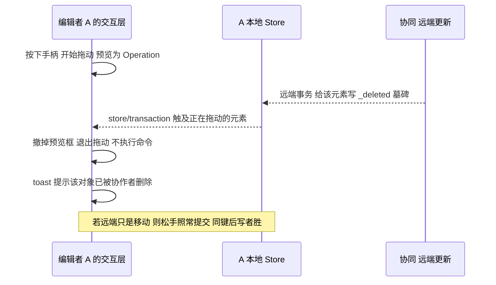

怎么读：纵向是时间；A 的拖动预览不写模型，所以远端删除到达后只需丢弃预览；A 不会对墓碑元素发出变换命令，也就不会把它「拖回来」。

### 4.13 规模与安全

- **规模**：一切会新增元素的路径——工具插入、粘贴、空占位符填入、相册「每图一页」、页眉页脚「全部应用」、插件插入——都过同一个命令守卫（单页 1,000、全文 20,000 含墓碑、200 页；软警告 15,000 与 150 页），超限返回 `document.quota_exceeded`，不开事务（30/05 §8，50/04 §10）。
- **外部内容**：外部粘贴不经 DOM、不发网络请求，上限 25 MB（PRD ED-17）；URL 插图片默认不经服务端代抓。
- **链接**：超链接只写 `http`/`https`/`mailto`/`tel` 四种，拒绝 `javascript:`、`data:`；应用内只激活 `http(s)` 与页内跳转（PRD ED-19，ADR-0008 决策 5）。
- **SVG**：客户端只在图像上下文渲染；服务端媒体模块的 SVG 消毒维持自研白名单，解析复用 `@cordexjs/xml`（rulings §4.21 X:q-xml-package，60-backend/04）。

### 4.14 导出与 id

- `cNvPr@id` 由 `OoxmlIdMap.allocateId` 取部件内最大值 + 1（ADR-0014，30/04 §9）；新元素的 `a16:creationId` 由**命令层**生成 GUID 写进 Mutation 载荷（编码器不生成随机值，保证导出确定性）。
- 元素名按「类型 + 序号」本地化生成（如「矩形 3」「图片 2」），由命令读取同容器已有名称计算。
- 复制粘贴重生 id 与 `creationId`，并清理指向旧 id 的动画引用（30/04 §5.1.1 第 4 条）。
- 新部件（媒体、图表、内嵌 xlsx 等）登记 `[Content_Types].xml` 与 `.rels`；关系与内容类型集合都没变时这两类部件写回原字节，变了才由 PartTable 重生成（rulings §4.21 X:q-content-types，30/04 §5.3）。
- 零编辑导出字节相同（30/04 §5.4）。

### 4.15 可访问性

- 画布可访问树按 role / name / 阅读顺序输出（50/16 §9，50/05 §11）；阅读顺序先占位符（按版式顺序）再其它元素（按 z 序）。
- 每个拖拽都有键盘或数值等价（WCAG 2.5.7，50/16 §6.3）：插入走「工具按钮 Enter → 视口中心」，缩放旋转走检查器数值与方向键微移，裁剪走数值框，连接符端点走检查器「连接」节的起点 / 终点下拉（形状 · 连接点，rulings §4.25 TB-21）。
- 插入弹层（工具条的形状弹层与形状库、表格网格，以及图标面板、符号面板）与对话框（插入链接、页眉页脚、操作设置）全键盘可达：常用形状网格、形状库、表格网格与占位符图标条都只占一个 Tab 停靠点、方向键漫游（roving tabindex，rulings §4.25 TB-5，设计 03-15 §2.4、03-16 §6.4、07 §1.2）；「更多」菜单 ↑ ↓ 移动、Esc 还焦点给「更多」，往文本里插东西的符号面板与日期格式选择器关闭后焦点回到插入符（03-04 §4.4）。
- 插入成功后 aria-live 播报「已插入〈类型〉」；失败播报错误摘要。触控手柄 ≥ 44 px（PRD ED-27）。

| 元素 | 可访问树中的角色 | 名称来源 | 缺失时 |
|---|---|---|---|
| 文本框、带文字的形状、文字占位符 | 文本 | 文字摘要 | 空框用占位提示或「空文本框」 |
| 图片、SVG、图标、图表、音视频 | 图像类 | `description`，其次 `title` | 提示 `missingAlt`；标为装饰性则不进树 |
| 表格 | 表格（带行列数） | `description` 或首行文字 | 「N 行 M 列表格」 |
| 组合 | 组 | 元素名 | 子元素逐个进树 |
| 只读与不透明类 | 图像类 + 「只读」说明 | 回退图的 `description`；公式取 OMML 线性文本（待 ADR-0008 修订） | 「无法编辑的对象」 |

### 4.16 命令三分法落位

一次插入涉及三类操作，按 30/05 §1 各归其位：

| 环节 | 类别 | 例子 | 入历史 | 广播 |
|---|---|---|---|---|
| 选工具、形状库最近使用 | ui 本地状态（不是 Operation） | `activeTool`、`recentShapes`（本机偏好） | 否 | 否 |
| 拖出预览、裁剪遮罩拖动 | Operation 或纯覆盖层状态 | 预览框、吸附参考线 | 否 | 否 |
| 插入与后续编辑 | Command（一个事务 = 一个撤销步） | `slide.insertShape`、`slide.insertPicture`、`slide.fillPlaceholder` | 是 | 经 CRDT |
| 写模型 | Mutation（唯一写路径，逆操作由 Store 推导） | `slide.shape.insert`、`slide.media.add`、`slide.shape.setNonVisual` | 随命令 | 经 CRDT |
| 插入后选中、进子编辑态 | Operation | `slide.setSelection` | 否 | presence |

### 4.17 复用与自研总表

「尽可能复用成熟组件」按元素侧逐项落实如下；版本与许可以 [50/17](17-reuse-and-dependency-catalog.md) 为唯一准，本表只列用途与理由。凡「维持自研」都写明为什么没有合适的成熟库。

| 关注点 | 采用 | 许可 | 用在哪些元素 |
|---|---|---|---|
| 图表几何与刻度 | `d3-scale`、`d3-shape`、`d3-array` + 自研 OOXML 布局（q-chart-route） | ISC | 图表 |
| 图表数据网格（M3） | `@tanstack/react-table` + shadcn Table（R-d-34） | MIT | 图表 |
| 内嵌工作簿（M3） | 自研最小 SpreadsheetML 写出器 + `fflate`，数字格式 `numfmt`（R-d-35） | MIT | 图表 |
| 颜色选择器面板 | `react-colorful`（pnpm patch 改静态 CSS，R-d-13） | MIT | 全部可填充元素 |
| 图标库（M3 P2） | `lucide-static`（与界面图标同风格） | ISC | 图标 |
| EMF/WMF 栅格化 | `emf-converter` 4.x（R-d-24） | Apache-2.0 | EMF/WMF、OLE 预览 |
| 自由曲线（P2） | `simplify-js`（点列简化）+ `fit-curve`（贝塞尔拟合） | BSD-2-Clause / MIT | 任意多边形、自由曲线 |
| 二维码示例插件 | `uqr`（零依赖，直接输出 SVG） | MIT | 第三方扩展元素 |
| 公式渲染（M4+） | MathJax 4 输出 SVG、惰性加载（字体数据许可待核，q-equation） | Apache-2.0 | 公式 |
| 对话框、面板、网格 | shadcn/ui（Dialog、Popover、Tabs、RadioGroup…，ADR-0017） | MIT | 超链接、页眉页脚、操作设置、表格网格 |

| 维持自研 | 为什么没有合适的成熟库 |
|---|---|
| 选择框、缩放 / 旋转 / 调整手柄 | 手柄几何要跟 OOXML 变换语义（`chOff/chExt`、翻转不镜像文字、`graphicFrame` 不可旋转）一致，现成的 moveable、react-rnd 基于 CSS transform 与 DOM 盒模型，接不上 EMU 模型与自有命中测试 |
| 吸附与智能参考线 | 纯派生、不入 Store、p95 ≤ 4 ms（PRD ED-09）；现成库绑定各自的场景图 |
| 裁剪覆盖层 | 要同时处理 `srcRect` 负值（图片小于框）、翻转与旋转；图片裁剪库（cropperjs 等）只做轴对齐位图裁剪并输出新位图，违背「不改源字节」（PRD ED-07） |
| 连接符路由 | PowerPoint 肘形不避障，规则是按两端连接点法向重算 `adj`；通用路由库 libavoid 为 LGPL 不可用，且语义不同 |
| 表格渲染与交互 | 表格是 SVG 内的 OOXML 表格（`tblStyle` 继承、合并格、边框冲突规则），HTML 表格组件无法在 SVG 画布里用，也不懂表格样式部件 |
| 预设几何 187 种 | 由 ECMA-376 `presetShapeDefinitions.xml` 编译成表（两端共用）；pptx-viewer（Apache-2.0）只在仓库外作回归对照（R-d-32） |
| OOXML 颜色变换 | 十余种修饰符按序叠加的语义没有 JS 实现（§4.6） |
| 2×3 仿射矩阵 | 不足百行，现成库不懂 OOXML 组坐标（§4.2） |

### 4.18 第三方扩展元素

- 新元素 = 一个 `slide.shapeKind`（模型：`schema`、`createDefault`、`capabilities`、`describe`）+ 一个 `render.element`（渲染）+ 可选 `ui.*`（工具条「更多」里的插入项 `ui.toolbar`、检查器分区 `ui.inspectorSection`）；内核与 `model-slide` 零改动（30/04 §3.3）。
- `kind` 形如 `ext:<vendor>.<name>`；数据放在 `data` 字段，按插件 schema 校验；改数据走新增 Mutation `slide.shape.patchKindData`（§5）。
- 导出不依赖渲染：插件在数据变化时生成回退位图并在同一事务 `media.add`，导出写成普通 `p:pic` + `extLst` 数据；没有回退时退化为 `UnknownShape` 占位（M2 P0 可插拔验收，PRD PS-02、PS-04）。
- 插件的插入按钮在底部工具条「更多」里（排在内置项之后、以分隔线隔开、带归属标识，主行不开放；设计 06 §2.6，rulings §4.25 DS-5；原 Ribbon 插件组随 DS-1 废弃）；插件命令经 `tx.mutate` 调内核 Mutation，声明的能力位可用第三方形式 `<vendor>:<域>.<action>`（章程 D15，30/05 §2）。

---

## 5. 新增命令与 Mutation 汇总

本轮（rulings §4.21，R-d-71）新增 9 个 Mutation、33 个命令与 1 个 Operation，并扩展 5 组既有命令的参数；其中 `slide.setSlideProperties`、`slide.table.clearCells`、`slide.chart.openDataEditor` 与 `slide.slide.setProperties` 由族文档 50/21、50/24 提出、在此统一登记。契约与 `lower()` 要点在 [30/05](../30-architecture/05-command-and-history.md) §14，文件落点与计数在 [40/03](../40-modules/03-slide-domain-model.md) §2.6，决策在 ADR-0018。逆操作一律由 Store 推导，没有手写 `inverse`。

### 5.1 新增 Mutation（9 个）

| type | 载荷要点 | 服务的元素 | 里程碑 |
|---|---|---|---|
| `slide.shape.setNonVisual` | `{ shapeId; patch }`：`name`、`hidden`、`description`、`title`、`decorative`、`hyperlink`、`locks` 逐字段 | 全部元素（替代文本、装饰性、形状超链接、动作设置、重命名） | M2 |
| `slide.pic.setBlipFill` | `{ shapeId; patch }`：`mediaId`、`external`（与 `mediaId` 二选一，外链换内嵌时清掉）、`svgMediaId`、`sourceRect`、`mode`、`alpha`、`effects`（PIC-05 `setPictureAdjust` 写入）逐字段（字段以 30/04 §3.7 `BlipFill` 为准） | 图片、SVG、图标、音视频海报 | M2 |
| `slide.cxnSp.setConnections` | `{ shapeId; start?; end? }`：端点引用 `{ shapeId, index }` 或 `null`（断开） | 连接符 | M2 |
| `slide.shape.patchKindData` | `{ shapeId; patch }`：按该 `kind` 的 schema 校验后逐键写 `data` | 第三方扩展元素 | M2 |
| `slide.slide.setProperties` | `{ slideId; patch }`：`showMasterShapes`（页级「隐藏背景图形」，`p:sld@showMasterSp`） | 背景（结构类） | M2 |
| `slide.table.setTableProperties` | `{ shapeId; patch }`：`styleId` 与六个标志（`firstRow`、`lastRow`、`firstCol`、`lastCol`、`bandRow`、`bandCol`） | 表格 | M3 |
| `slide.table.setSizes` | `{ shapeId; columns?; rows? }`：按 `colId`/`rowId` 写列宽、行高 | 表格 | M3 |
| `slide.chart.setData` | `{ shapeId; patch }`：类别、系列、数值按键增删改（30/04 §3.9） | 图表 | M3 |
| `slide.chart.setOptions` | `{ shapeId; patch }`：类型与子类型、标题、图例、数据标签、数字格式 | 图表 | M3 |

既有 7 个 `table.*` Mutation（插删行列、单元格属性、合并拆分）保留 type，载荷随表格归一化改为按 `rowId`/`colId` 寻址、删除写墓碑（30/04 §3.8，30/05 §14）。

### 5.2 新增命令（33 个）与参数扩展

| 族 | 命令 id | 参数要点 | 用到的 Mutation | 里程碑 |
|---|---|---|---|---|
| 文本 | `slide.insertField` | `{ target; paragraph; offset; field: { type } }` | `text.applyDelta`（embed，字段 id 由命令生成） | M2 P2 |
| 文本 | `slide.setHyperlink` | `{ target: {shapeIds} \| {shapeId; range}; link: Hyperlink \| null }` | `run.setProperties` / `shape.setNonVisual` | M2 P1 |
| 结构 | `slide.fillPlaceholder` | `{ shapeId; content: picture \| table \| chart \| media }` | `shape.remove` + 按需 `media.add` + `shape.insert` | 图片 M2 P1；表格 M2；图表 M3；媒体 P2 |
| 结构 | `slide.setSlideProperties` | `{ slideIds; showMasterShapes }`（隐藏背景图形） | `slide.setProperties` | ED-20 / M2 P1 |
| 结构 | `slide.setHeaderFooter` | `{ slideIds \| 'all'; date?: {mode:'auto'; type:'datetime1'…'datetime13'} \| {mode:'fixed'; text} \| null; slideNumber; footer?; hideOnTitle }`（页脚族占位符用确定性 id，ADR-0014 决策 9） | `shape.insert`/`remove` + `text.applyDelta` | M2 P2 |
| 形状 | `slide.setAdjustValues` | `{ shapeId; adj }` | `shape.setProperties`（geometry） | M2 P1 |
| 形状 | `slide.changeShape` | `{ shapeIds; preset }` | `shape.setProperties` | M2 P1 |
| 形状 | `slide.flipShapes` | `{ shapeIds; axis: 'horizontal' \| 'vertical'; reroute? }`（翻转会移动连接点） | `shape.setTransform` | M2 P0 |
| 形状 | `slide.setLineEnds` | `{ shapeId; start?; end? }`（箭头类型与尺寸） | `shape.setProperties`（line） | M2 P0 |
| 形状 | `slide.connectEnds` | `{ shapeId; start?; end?; reroute? }` | `cxnSp.setConnections` + `shape.setTransform` | M2 P1 |
| 形状 | `slide.changeConnectorType` | `{ shapeIds; preset }`（直线、肘形、曲线） | `shape.setProperties` | M2 P1 |
| 形状 | `slide.insertFreeform` | `{ containerId; box; geometry: Geometry.custom; closed }`（简化与拟合在 slide-ui `application/freeform.ts`，命令只收拟合好的几何，50/22 §5；2026-09-26 整合更正） | `shape.insert` | P2 |
| 形状 | `slide.setAction` | `{ shapeId; click; hover? }` | `shape.setNonVisual` | M2 P1 |
| 媒体 | `slide.setPictureTransparency` | `{ shapeIds; alpha }` | `pic.setBlipFill` | M2 P0 |
| 媒体 | `slide.resetPicture` | `{ shapeId; pixelSize? }`（恢复原始像素尺寸，50/23 §11） | `pic.setBlipFill` + `shape.setTransform` | M2 P0 |
| 媒体 | `slide.compressPicture` | `{ items: { shapeId; blob }[]; maxEdge }`（重编码在交互层完成，命令只收字节引用） | `media.add` + `pic.setBlipFill` | M2 P1 |
| 媒体 | `slide.setPictureFill` | `{ shapeIds; blob; mode }` | `media.add` + `shape.setProperties` | M2 P2 |
| 媒体 | `slide.setAltText` | `{ shapeId; description?; title?; decorative? }` | `shape.setNonVisual` | M2 P1 |
| 媒体 | `slide.insertMedia` | `{ containerId; box; kind: 'video' \| 'audio'; blob; poster? }`（不写 `p:timing`） | `media.add` + `shape.insert` | P2 |
| 媒体 | `slide.replacePoster` | `{ shapeId; blob }` | `media.add` + `pic.setBlipFill` | M2 P1 |
| 媒体 | `slide.insertIcons` | `{ containerId; items: { blob; fallbackBlob; name }[] }` | `media.add` + `shape.insert` | M3 P2 |
| 媒体 | `slide.recolorSvg` | `{ items: { shapeId; blob; fallbackBlob }[]; color }` | `media.add` + `pic.setBlipFill` | M3 P2 |
| 数据 | `slide.table.clearCells` | `{ shapeId; cells }`：多格选区按 Delete 清空文字 | `text.applyDelta`（逐格） | ED-10 / M2 |
| 数据 | `slide.table.setStyle` | `{ shapeId; styleId?; flags? }` | `table.setTableProperties` | M3 |
| 数据 | `slide.table.resizeColumn` / `resizeRow` | `{ shapeId; colId; width }` / `{ shapeId; rowId; height }` | `table.setSizes` | M3 |
| 数据 | `slide.table.setBorders` | `{ shapeId; cells; borders: { preset; line } }`（形状以 40/03 §2.6 为准） | `table.setCellProperties` | M3 |
| 数据 | `slide.insertChart` | `{ containerId; box; chartType; variant?; data? }` | `shape.insert` | M3 P1 |
| 数据 | `slide.chart.setData` | `{ shapeId; patch }` | `chart.setData` | M3 P1 |
| 数据 | `slide.chart.setType` / `setTitle` / `setLegend` / `setDataLabels` | `{ shapeId; … }` | `chart.setOptions` | M3 P1 |

2026-10-08 另按 rulings §4.25 登记两条既有 Mutation 的薄命令（不计入上表 33 个，已登记在 40/03 §2.6 与 30/05 §14.4）：`slide.setShapeOpacity{ shapeIds; alpha }` → `shape.setProperties`（形状「不透明度」节，同时写填充与描边颜色的 alpha，一步撤销，TB-47，[22](22-elements-shapes-and-lines.md) §2.5）；`slide.renameMaster{ masterId; name }` → `master.setProperties`（M3，TB-46，[11](11-masters-layouts-and-themes.md) §5）。

参数扩展（不新增 id）：`slide.insertShape` 增 `preset`、`textBox{ wrap }`、`from`/`to`（页坐标点或 `ConnectionRef`）、`action`（动作按钮的默认动作）；`slide.insertPicture` 增 `fallbackBlob`（SVG 的 PNG 回退）；`slide.replacePicture` 增 `fallbackBlob`、`pixelSize`，`slide.crop` 增 `fit`（填充 / 适合）与 `pixelSize`，二者改用 `pic.setBlipFill`（50/23 提出）；`slide.insertTable` 增 `styleId?`；`slide.setSlideBackground` 允许直接传 `blob`（同事务 `media.add`）；`slide.moveShapes`/`resizeShapes`/`rotateShapes` 增 `reroute?`（受影响连接符的几何，由交互层用 engine-layout 算好后传入，同事务写回，30/05 §14）。

远期（M4+，本轮不登记进 40/03）：`slide.convertSmartArtToShapes`（q-smartart）、`slide.insertEquation`/`setEquation`（q-equation）、`slide.applyWordArtStyle`、`slide.setTextWarp`、`slide.downloadOleObject`（零 Mutation）、`slide.replaceOleObject`（候选 Mutation `slide.ole.setPayload`）、`slide.insertPhotoAlbum`（相册）。

### 5.3 视图态与本地状态

| 名称 | 类别 | 说明 |
|---|---|---|
| `slide.setSelection` | Operation（既有） | 插入后选中；presence 广播 |
| `slide.chart.openDataEditor` | Operation（新增，M3） | `{ shapeId; expanded? }` 打开图表数据面板；插入图表后自动执行；不入历史（50/24） |
| `activeTool`、`recentShapes`、`recentSymbols`、`recentIcons` | ui 本地状态 | 不入历史、不广播；最近使用存本机偏好 |
| 视频编辑态临时播放 | 覆盖层状态 | 点击海报上的播放按钮在覆盖层里临时播放，不进 Scene、不改模型（R-d-68，50/05 §8） |

---

## 6. 元素渲染器登记表

本表承接自 [30/07](../30-architecture/07-rendering.md)（原「4.2 元素渲染器」一节，rulings §4.21 R-d-04 迁入本文），按本轮裁决改写：图表按 q-chart-route，表格按归一化模型，连接符按派生几何，新增媒体、SVG、第三方元素与 `UnknownShape` 的 `renderHint` 分支。渲染器都是 `render.element` 贡献（target `dom`）的**无状态查表项**：状态只在 `render()` 返回的 `ElementHandle` 里（DOM 句柄与上次节点 revision），渲染器对象本身不持有实例；错误隔离与降级见 50/05 §9。

| kind | 内容 | 关键点 | 所在包与加载方式 |
|---|---|---|---|
| `sp` | 几何 + 填充 / 线条 + 文本 | `prstGeom` → engine-layout 预设几何路径（含 `adj`）；`custGeom` 解析；文本经 engine-layout 断行后由 `text-lines` 绘制；空文本框只在编辑态画虚线框（覆盖层，不导出） | slide-render，常驻 |
| `pic`（位图） | 图片 | `srcRect` 裁切（含负值留白）、`stretch`/`tile`、几何裁切（裁剪为形状 P2）、`alpha` → 不透明度；外链图片（`r:link`，仅 http(s)）默认自动加载，受部署 `externalResources`（`auto` \| `confirm` \| `never`）收紧，`never` 或失败显示占位并记降级原因 `external-resource-blocked` | slide-render，常驻 |
| `pic`（SVG） | 矢量图 | 有 `svgMediaId` 时以图像上下文渲染 SVG 字节（`<image>` 指向 blob URL），失败退回 `mediaId` 的 PNG；禁止内联注入 | slide-render，常驻 |
| `pic`（EMF/WMF） | 老式矢量图 | M1 显示占位 + 诊断；M2（P1）起经 `emf-converter` 在惰性 Worker chunk 里栅格化为位图（chunk 不计入查看器 350 KB 基线；记录数、像素、耗时受 PRD OF-24 上限约束；server-headless 用同一份代码），矢量渲染 M4+；不可裁剪 | 惰性 chunk，`conflict: 'replace'` 覆盖占位 |
| `pic`（音视频） | 海报帧或音频图标 | 画 `blipFill` 海报与播放角标；编辑态点角标在**覆盖层**临时播放（R-d-68，不进 Scene）；放映态按 50/10 §9 播放 | slide-render，常驻 |
| `grpSp` | 组合 | 只产生一个 `<g transform>`（`chOff/chExt` → 子坐标映射）；子元素由合成结果扁平化后各自渲染进该 `<g>` | slide-render，常驻 |
| `cxnSp` | 线条与连接符 | 几何同 `sp`；已连接的端点由 `startConnection`/`endConnection` 解析到目标形状连接点（engine-layout `connectorPoints`），**显示以派生几何为准**，存储的 `xfrm` 只作未连接时的值（R-d-78）；目标移动经依赖索引标脏；目标是墓碑时画成自由端点 | slide-render，常驻 |
| `graphicFrame:table` | 表格 | 按 `order` 排列归一化的行列（30/04 §3.8），缺格按空格画（I-TBL1 的读时容错）；合并格按锚格跨度画；表格样式（`tableStyles.xml` M2 起只读解析）按标志继承；单元格文本走 engine-layout；全部 SVG | slide-render，常驻 |
| `graphicFrame:chart` | 图表 | M1–M2（章程 D16）：部件不透明保留，经 `ooxml-core/chartml` 只读解析部件与缓存（`numCache`/`strCache`、轴、图例、标题）绘制 SVG，几何用 `d3-scale`/`d3-shape`/`d3-array` + 自研 OOXML 布局（`manualLayout`、Excel 自动刻度、堆积、饼图标签避让），查看 SSIM ≥ 0.80（PRD OF-09）；M3 起五类 bar / line / pie / area / scatter 由 `slide-render-chart` 按 `Chart.data` 渲染与编辑（ADR-0036）；`cx:chart`（chartex）显示占位 + 诊断 `chartex-unsupported`，不渲染其 Fallback | M1 只读渲染在 slide-render；M3 `@cordexjs/slide-render-chart` 惰性 chunk 同 key 替换 |
| `graphicFrame:diagram` | SmartArt | `ooxml-core` M1 只读解析 `dsp:drawing`（含 `dsp:txXfrm`），复用 `sp` 画笔渲染；drawing 部件缺失时才占位 + 诊断 | slide-render，常驻 |
| `graphicFrame:ole` | OLE | 显示 `Ole.preview`（导入时从 `mc:Fallback` 的 `p:pic` 提取）走 `pic` 路径；预览是 EMF/WMF 时同 EMF 行；无预览才占位 | slide-render，常驻 |
| `unknown` | 公式、3D、缩放定位、墨迹、裸 `p:contentPart`、ActiveX 等 | 按 `UnknownShape.renderHint`：`fallback-pic` 画回退图，`fallback-shapes` 画回退形状，`placeholder` 由 engine-render 画占位；只能整体移动、缩放、删除 | engine-render 占位 + slide-render |
| `ext:<vendor>.<name>` | 第三方元素 | 插件贡献的 `render.element`；插件未装载时按「查表未命中」占位，有回退位图则画回退图 | 插件自己的 chunk |
| （背景） | 页、版式、母版背景 | `Scene.background` 节点，单独的 `<rect>` + paint，属于整页脏 | slide-render，常驻 |

**图 6-1 元素渲染的查表与降级**

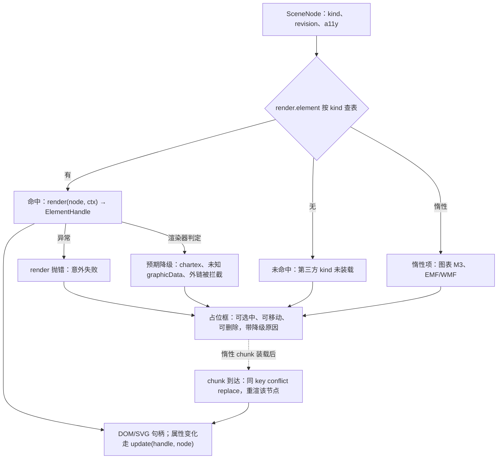

怎么读：每个场景节点按 `kind` 查一次表；三类占位（意外失败、预期降级、查表未命中）最后都落到同一种可操作的占位框，惰性渲染器先以占位顶上，chunk 装载后以同 key 替换并只重渲该节点。

---

## 7. 非目标清单

下列能力**本期不提供**，界面与文档都要写明，避免用户找入口（R-d-75，rulings §4.21）：

| 不提供 | 用户看到什么 | 依据 |
|---|---|---|
| 插入 SmartArt | 创建工具条（含「更多」）与内容占位符图标条都不放 SmartArt；导入的 SmartArt 可看、可整体移动缩放；M4+ 先做「转换为形状」 | q-smartart |
| 插入 OLE 对象 | 无入口；导入的 OLE 显示预览，M4+ 才评估下载与替换 | R-d-75 |
| 插入 3D 模型 | 无入口；不加载 3D 引擎，导入的只显示海报图 | R-d-75 |
| 墨迹输入 | 工具条不设画笔类工具（取代 ribbon 版的「无绘图页签」）；导入的墨迹可看；M4+ 随触控编辑评估 | R-d-75 |
| 插入缩放定位 | 无入口；导入的显示回退图 | R-d-75 |
| 屏幕录制 | 无入口（`MediaRecorder` 只产 webm，PowerPoint 兼容差） | q-extra-inserts |
| 自定义几何的顶点编辑 | 右键没有「编辑顶点」；`capabilities.editPoints` 内建一律为假 | PRD ED-05 边界 |
| 插入 EMF/WMF | 文件选择器不接受；粘贴含 EMF 时取剪贴板里的 PNG 项 | PRD ED-07 边界 |
| 插入外链图片或外链音视频 | 「来自 URL」下载后内嵌，不写外部关系 | OF-07 |
| 插入 chartex 与五类以外的图表 | 工具条「图表」的类型菜单只列五类；导入的其它类型只读 | U-06、D16 |
| 音视频自动播放与播放设置 | 插入时不写 `p:timing`；导出后在 PowerPoint 靠媒体控件点播 | q-media-insert |
| 用 Wingdings 等符号字体插入符号 | 符号面板只插 Unicode，不写 `a:sym` | 50/20 符号节 |
| M1–M3 的公式与艺术字插入 | 「更多 › 公式」与主菜单「插入 › 公式」留在原位不可用、标 M4+，工具提示「暂不支持插入公式（M4+）。文稿里已有的公式照常查看、放映、移动和缩放。」（设计 03-04 §7.3）；艺术字不显示；M4+ 立项 | q-equation |

---

## 8. 待决与回写

### 8.1 待决（推荐默认值）

| # | 问题 | 推荐默认值 | 影响 |
|---|---|---|---|
| 1 | 预设形状插入后是否自动进入文本编辑 | 不进；输入可见字符时再进（设计 P1） | 50/22、50/10 §7 |
| 2 | 形状库首批约 72 项的名单与分类 | 已定（2026-10-07 第 1 批拍板）：72 项十类，名单与顺序以设计 03-15 §2.2 为准（样张清单 `src/v3/editor/shapes/catalog.tsx`），写进 slide-ui `domain/shape-gallery.ts`（50/22 §2.1） | 50/22、设计 03-15 |
| 3 | 含 `foreignObject` 的 SVG 无法栅格化出 PNG 回退 | 拒绝插入并提示改用 PNG（不写无回退的 `svgBlip`） | 50/23 |
| 4 | 是否按 EXIF 方向规范化图片 | 不改源字节（PRD ED-07 边界）；显示按浏览器默认方向处理，PowerPoint 表现以语料核对 | 50/23 |
| 5 | 视频文件大小上限 | 跟随 presign `maxBytes`；产品默认值待 PRD 线定 | 50/23、60-backend 媒体模块 |
| 6 | 插入到用户文档里的图标是否需要附 ISC 版权声明 | 待法务确认；未确认前图标功能保持 M3 P2 | 50/23、50/17 |
| 7 | 74 种内置表格样式数据来源与许可 | 自备数据，不复制 LibreOffice（MPL）数据；推迟（触发条件：M3 表格样式开工前，须过 ADR-0049 T-05 分级，唯一登记点 50/24 §2.14 第 2 条，见 rulings §4.22） | 50/24 |
| 8 | 连接符目标被他人删除后的显示 | 保留引用、画成自由端点；目标硬删后导出去掉失效引用并诊断 | 50/22 |
| 9 | `datetime1..13` 与 zh-CN / ja-JP 日期格式的映射 | 推迟（触发条件：M2 P2 开工 `slide.insertField` / `slide.setHeaderFooter` 前，70 线交付三语 PowerPoint 另存语料，见 rulings §4.22）；在此之前用设计样张的 13 种格式表，默认 `datetime1` | 50/20、50/21 |
| 10 | 背景「应用到全部」是否清除各页已有覆盖 | 按 PRD ED-20 写母版级；各页覆盖保留并提示 | 50/21 |
| 11 | 第三方元素是否开放 `toXml?` 直接写原生 OOXML | 不开放；只走回退位图 + `extLst` 数据 | 50/22、30/04 §3.3 |
| 12 | 任意多边形绘制放 M2 P2 还是与墨迹一起推到 M4+ | 维持 M2 P2 | 50/22 |

### 8.2 需要其它文档配合（由各自属主回写）

- 50/10 §7：写入插入工具态状态机（图 2-2，R-d-62）；40/10 §2.6：插入页签按设计 04 七组对齐，超链接改为 M2 P1（R-d-61、R-d-67）。其中「七组对齐」2026-10-04 起随 rulings §4.25 DS-1 作废，40/10 改按 DS-5 回写为底部创建工具条与检查器分区。
- 30/07：原渲染器表改为一行桩链接指向本文 §6（R-d-04）。
- 30/06：`shapes` 表位置改为顶层；表格归一化与图表数据的 Yjs 映射（30/04 §3.8、§3.9）。
- 设计 03-04：删除「M1/M2 插入的图表以当前静态样式呈现」，图表插入定 M3（R-d-74；PRD 已由 ED-15a 登记）。
- ADR-0008：§4.8 所列只读与写入白名单扩展的修订。

---

## 9. 机械验证与里程碑

| 规则 | 机制 |
|---|---|
| 创建工具条与检查器分区的每个控件都绑定已注册命令 | `toolbar-spec.test`（原名 `ribbon-spec.test`）、`inspector-spec.test`（40/10） |
| 插入超限不开事务、不留撤销记录 | `command-harness`：单页 999 / 1,000 / 1,001 与全文 19,999 / 20,000 / 20,001（含墓碑）边界用例（40/03 §10） |
| 一次插入一个撤销步；空文本框退出即删且撤销栈不变；`fillPlaceholder` 一步撤销回空占位 | 命令层集成测试（40/03 §9） |
| 新元素只写 `p:style` 引用 | 导出后对新元素 `spPr` 断言无解析值；换主题后渲染快照随主题变化 |
| 表格不变量 I-TBL1、I-TBL2 | property：随机并发插删行列后 `repair` 一次即净、再次无变化（30/04 §11） |
| `decorative`、`svgBlip`、`alphaModFix` 往返 | codec 往返 c14n 等价（30/04 §5.4） |
| 惰性渲染器替换占位 | RecordingTarget：chunk 装载后只重渲目标节点 |
| 插入后播报 | a11y 测试断言 live region 文案（50/16 §11） |

里程碑按 §1.2 总表与图 1-2 执行：M2 出口验收覆盖全部 M2 P0 插入项与第三方元素可插拔；M3 出口覆盖表格结构样式与图表五类；P2 项不阻塞出口。
