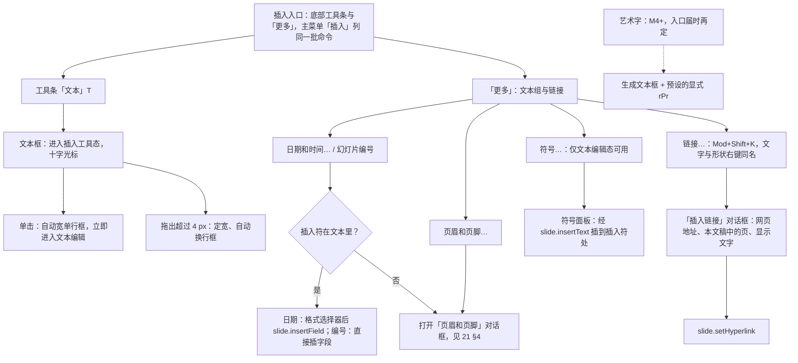
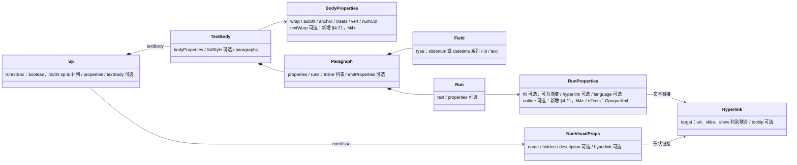
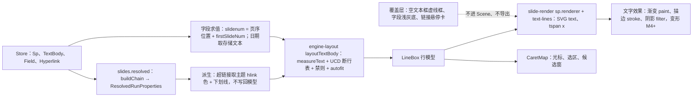
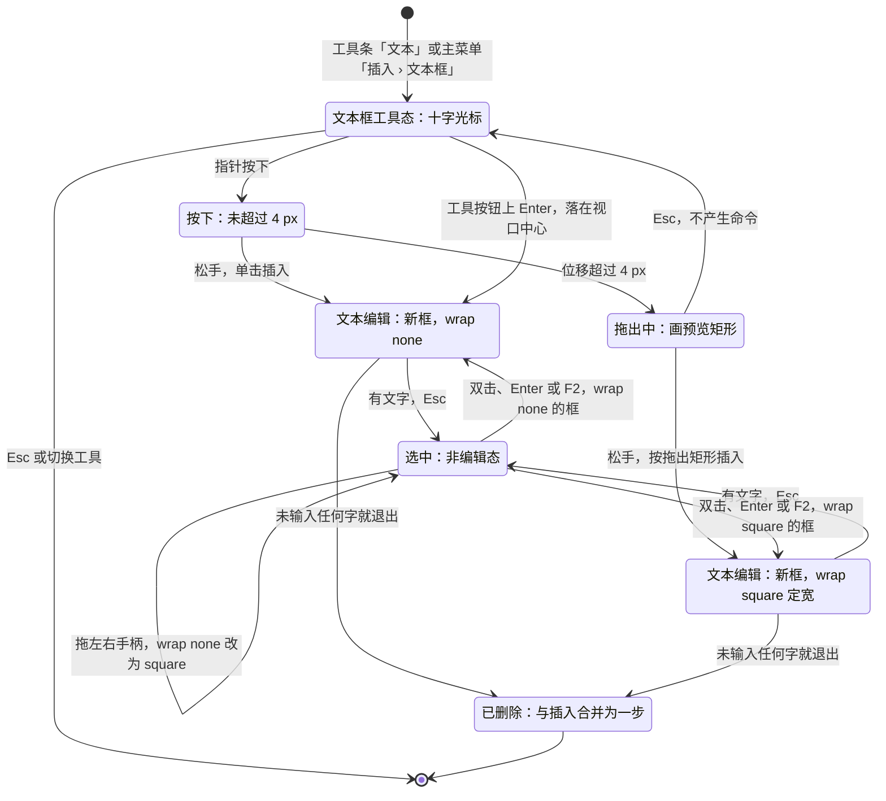
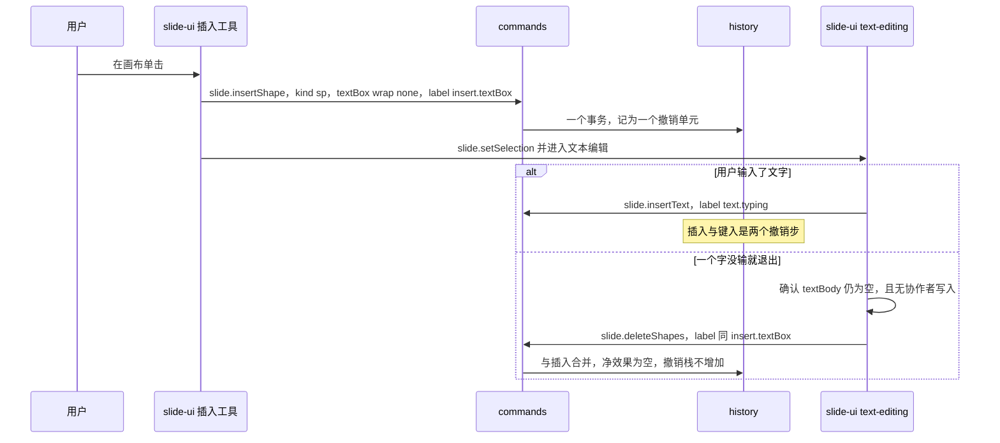
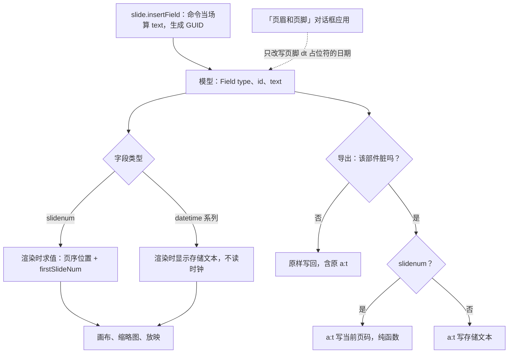
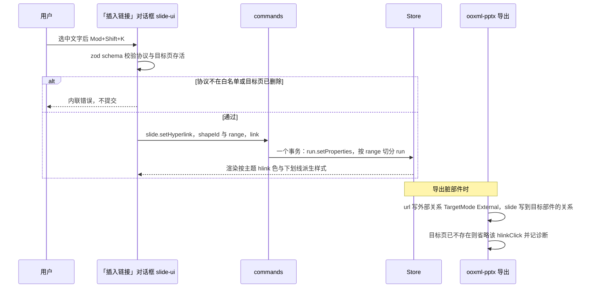
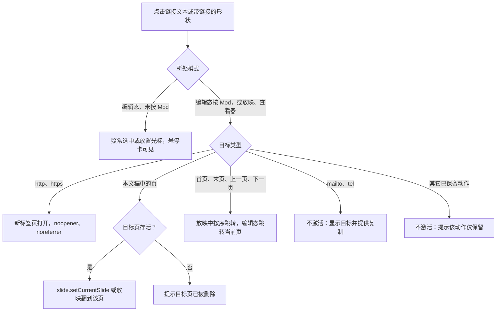
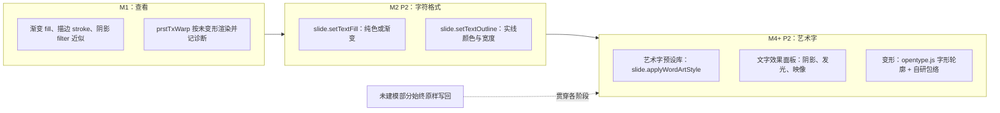
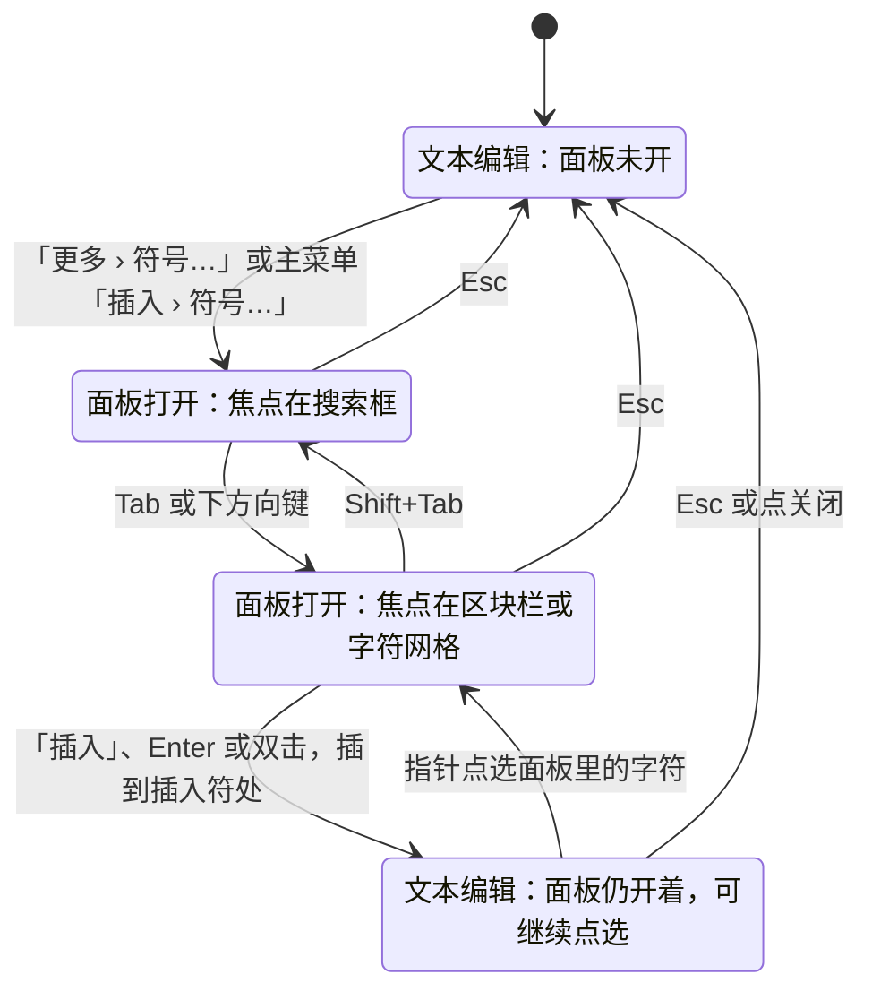

# 20 元素族：文本类
> 状态：v0.1 | 负责：前端设计线 | 更新：2026-09-26（§4.21：新建，文本框、文本字段、超链接、艺术字与文字效果、符号与特殊字符五个元素的逐项设计）；2026-09-26（§4.21 整合：超链接 show 分支补 lastViewed 与 end（对齐 30/04 §3.7）；符号表与断行表生成脚本名登记 gen-symbol-table.ts、gen-linebreak-table.ts）；2026-09-26（§4.21 复核：自动调整模式改指 setAutofitMode，删去「待登记」）；2026-09-30（§4.21 剩余缺口样张回写：§3 日期字段的插入入口补设计出处 03-16「日期和时间格式选择器」（G-81），⑭ 注明样张格式映射同样待语料核对；§9 插入页签「文本」组一行核对后改为已回写；只改出处与状态，不改设计口径）；2026-09-30（§4.21 剩余缺口样张回写 · 整合：§8 登记 T-8 选择器默认格式、T-9 对话框应用时刷新日期的作用范围两项待属主裁定，来源设计 03-16「待决 / 取舍」第 4、6 条）；2026-09-30（§4.22 设计待决收口：T-8 默认格式定为 `datetime1`、T-9 定为只改说明文字且对话框只刷新页脚 `dt` 占位符，图 3-1 虚线注明范围；§3 选择器与对话框共用 13 种格式表；T-4 格式映射改为推迟）；2026-10-04（design-language-v3 第 0 批：图 1-1 根节点改为「插入入口」并补 v3 入口换算说明（rulings §4.25 DS-1））；2026-10-05（design-language-v3 第 0 批修正：检查器写法改为 v3（rulings §4.25 DS-1、DS-5）——§2.1 文本框 ⑦ 按设计 03-02 §4.2–§4.3 改为选中框走形状同一组节、编辑态走「字体 · 段落 · 颜色 · 列表」，删去手风琴式「编辑态自动展开」，自动调整、内边距、锚点、换行、分栏、替代文本注「节划分随第 1 批」；§3.1、§4.1、§5.1 ⑦ 的「文本分区」改为文本编辑态并注「所在的节随第 1 批」；§1.1 删去失效的「插入页签分组以设计 04 与 playground 为准」，改为说明 R-d-61 分组已作废、入口按 50/19 §1.2 换算（含「开始 › 字体」→ 检查器文本编辑态）；§9 检查器「文本」分区一行改为已回写 50/10 §5，插入页签一行补作废说明）；2026-10-05（design-language-v3 第 0 批修正：快捷键值按 rulings §4.25 DS-11 同步——§1.1 总览表、图 1-1、§4.1 ③ / ⑥ / ⑪ 与 §4.2 图 4-1 的超链接由 `Mod+K` 改为 `Mod+Shift+K`（`Mod+K` 归命令面板））；2026-10-05（design-language-v3 第 0 批修正：§6.1 符号面板 ⑥ 交互的参照物由已取消的文字迷你工具条（rulings §4.25 DS-13）改为检查器文本分区的控件）；2026-10-07（design-language-v3 第 1 批：按已拍板样张与设计 03-04、03-15、03-16 定稿入口与检查器——§1.1 总览表入口列与说明（「更多」文本组与链接组、主菜单「插入」），图 1-1 改画为 v3 入口；§2.1 ③⑥⑦（工具条「文本」、无调整手柄、选中文本框与编辑文字都是 `text` 五节，原「选中文本框为 `shapes`」作废；DS-29 快捷键）与图 2-1 起点；§3.1 ③⑦（日期格式选择器 03-16 §7、轻提示与焦点）；§4.1 ③⑤⑥⑦⑫ 与图 4-1（「链接…」与「插入链接」对话框 TB-6，移除在悬停小卡，检查器不设链接行）；§5.1 ③⑥⑦（渐变与轮廓落点随实现，调整手柄改强调色菱形）；§6.1 ③⑥⑪⑫、§6.2 与图 6-1（符号面板按 03-15 §8：宽 468、Unicode 区块、最近使用 ≤ 12、插入后焦点回文本）；§8 T-1 结案；§9、§10 同步）；2026-10-08（design-language-v3 第 1 批收口：§2.1 ⑦ 段前、段后与固定行距始终用 pt（rulings §4.25 TB-33）；§3.1 ③ 日期和时间格式选择器关闭后焦点回到文本插入符，§6.1 ⑥ 符号面板同此（TB-52）；§9 措辞）；2026-10-22（design-language-v3 第 3 批复核修正：§4.1 ⑪ 与 §9 一行的 `A11yDescriptor.links` 按 50/05 §11 改为已回写） | 依赖：上游：[50/01 前端架构](01-overview-and-runtime-map.md) §5b、§4a（渲染）；[50/19 可追加元素总览与通用设计](./19-insertable-elements-overview.md)、[06 文本编辑与 IME](./06-text-editing-and-ime.md) §6 / §7 / §9、[10 编辑器外壳与画布交互](./10-editor-shell-and-interaction.md) §4 / §5 / §7、[05 渲染](./05-rendering-and-thumbnails.md) §7 / §11、[16 i18n 与 a11y](./16-i18n-and-accessibility.md) §8 / §9、[30/04 文档模型](../30-architecture/04-document-model.md) §3.2 / §4.2 / §4.3 / §6.1、[30/05 命令与历史](../30-architecture/05-command-and-history.md) §1、[30/06 协同](../30-architecture/06-collaboration.md) §1.4 / §1.5 / §8、[40/03 幻灯片领域模型](../40-modules/03-slide-domain-model.md) §2.2 / §2.6、[ADR-0018 元素模型与插入命令](../30-architecture/adr/0018-editor-element-model-and-insert-commands.md)、[ADR-0008 不透明保留](../30-architecture/adr/0008-opaque-preservation.md) 决策 5、[ADR-0027](../30-architecture/adr/0027-text-measurement-strategy.md)、[ADR-0028](../30-architecture/adr/0028-text-editing-host.md)、PRD [02-editing](../10-prd/03-features/02-editing.md) ED-02 / ED-03 / ED-05 / ED-19 / ED-24、PRD [01-open-and-fidelity](../10-prd/03-features/01-open-and-fidelity.md) §2.2 / §2.4 / §2.7、设计 03-screens [04](../20-design/03-screens/04-insert-menu.md)、[15](../20-design/03-screens/15-insert-menu-and-shape-library.md)、[16](../20-design/03-screens/16-text-editing-and-formatting.md)、rulings §4.21

本文回答文本类元素的三个问题：**要追加什么**、**追加它有什么用**、**每个元素怎么设计**。文本类共五个元素：文本框、文本字段（页码 / 日期时间）、超链接、艺术字与文字效果、符号与特殊字符。每个元素一节，节内固定 14 栏（§1.2 定义栏目含义）。

六个元素族共用的部分——插入命令通用流程（工具态 → 意图 → 算框 → 命令 → 选中并进子编辑态）、默认落点与尺寸、元素基类与变换矩阵、z 序、锁定与隐藏、替代文本、不透明保留钩子、渲染降级、导出 id——统一写在 [50/19](./19-insertable-elements-overview.md)，本文只写文本类的差异。文本框**里面**的键入、IME、光标与撤销合并归 [06](./06-text-editing-and-ime.md)；本文写元素本身：它是什么、从哪插入、模型怎么存、怎么画、怎么选中和改、怎么导出。

## 0. 定位与边界

| 本文拥有 | 本文引用（事实源） |
|---|---|
| 文本类五个元素的作用、OOXML 来源、插入入口与默认值、模型字段、渲染、交互、检查器分区、命令、协同、保真、a11y、复用结论、里程碑与待决（§2–§6） | 插入通用流程、默认落点与尺寸表、通用设计条目、新增命令与 Mutation 汇总：[50/19](./19-insertable-elements-overview.md)；新增命令与 Mutation 的定稿：[ADR-0018](../30-architecture/adr/0018-editor-element-model-and-insert-commands.md) |
| 文本类族总览、模型类图与渲染管线（§1） | 文本编辑态的输入、IME、光标、单元格与字段的编辑行为：[06](./06-text-editing-and-ime.md) §2–§9 |
| 超链接的写入白名单在 UI 与命令层的落点（§4） | 白名单本体：ADR-0008 决策 5、PRD ED-19 |
| 符号表的分类与数据来源（§6.2） | 断行与字符数据的 UCD 管线：ADR-0027 决策 4 |
| 本族的里程碑汇总、待决与待回写（§7–§9） | 页眉页脚占位符与「页眉和页脚」对话框：[21](./21-elements-structure.md) §4 |

## 1. 族总览

### 1.1 总览表

可编辑度记号沿用 PRD 01 §1：E 可编辑 / E~ 部分可编辑 / V 查看 / V~ 近似查看 / P 仅保留。

| 元素 | 追加它有什么用 | OOXML | 可编辑度（M1 → 目标） | 插入入口 | 里程碑 | 命令（新增项标 §4.21） |
|---|---|---|---|---|---|---|
| 文本框（§2） | 在占位符之外自由放文字：图注、标签、注释 | `p:sp` + `p:cNvSpPr@txBox=1` + `p:txBody` | V → E | 工具条「文本」（T）；主菜单「插入 › 文本框」 | M2 P0；竖排文本框 P2 | `slide.insertShape` 参数扩展（§4.21） |
| 文本字段（§3） | 自动变化的页码、日期，不必手工逐页改 | `a:fld@type=slidenum\|datetime*` + `a:t` 缓存 | V → E~ | 文本编辑态：「更多」文本组「日期和时间…」「幻灯片编号」；主菜单「插入」同名项 | M1 查看；M2 P2 | `slide.insertField`（§4.21） |
| 超链接（§4） | 跳网页、发邮件、打电话、跳到本文稿某页；放映时导航 | `a:rPr/a:hlinkClick`、`p:cNvPr/a:hlinkClick` + 关系 | V → E | 「更多 › 链接…」、主菜单「插入 › 链接…」、文字与形状右键「链接…」（`Mod+Shift+K`，2026-10-05 由 `Mod+K` 改，rulings §4.25 DS-11；命令名统一为「链接…」，TB-6） | M1 查看与放映激活；M2 P1 | `slide.setHyperlink`（§4.21） |
| 艺术字与文字效果（§5） | 强调标题：渐变字、描边字、阴影、弯曲变形 | `a:rPr` 的 `gradFill` / `ln` / `effectLst`；`a:bodyPr/a:prstTxWarp` | V~ → E（M4+） | 渐变与轮廓（M2 P2）：检查器「文本」，样张未画、落点随实现；艺术字插入（M4+）：入口届时再定 | M1 查看；M2 P2 渐变与描边；M4+ P2 艺术字与变形 | 远期建议，本轮不登记：`slide.setTextFill`、`slide.setTextOutline`（P2 排期时）、`slide.applyWordArtStyle`、`slide.setTextWarp`（M4+） |
| 符号与特殊字符（§6） | 输入键盘上没有的符号：✓ ° ± → ① ©、希腊字母、CJK 标点 | 普通 `a:r/a:t` 中的 Unicode | E | 文本编辑态：「更多 › 符号…」与主菜单「插入 › 符号…」 | M3 P2 | 复用 `slide.insertText` |

表中入口按 2026-10-07 拍板的第 1 批样张写（设计 03-04 §2、§4，03-16 §5、§7，03-15 §8；rulings §4.25 DS-21）。原「插入 › 组 › 按钮」「开始 › 字体」的 ribbon 写法与「插入」页签七组（文本 / 形状 / 图像 / 表格 / 图表 / 链接与批注 / 插件，R-d-61）已随 Ribbon 废弃（DS-1），正文遗留的同类写法按 [50/19](./19-insertable-elements-overview.md) §1.2 换算表读。原「本族在『文本』组放五项、超链接在『链接与批注』组、『符号…』放进『文本』组」的分组口径随之作废，由 v3「更多」的文本组（页眉和页脚… · 日期和时间… · 幻灯片编号 · 符号… · 公式 M4+）与「链接…」承接；§8 T-1 已结案。

### 1.2 十四栏的读法

| 栏 | 回答的问题 |
|---|---|
| ① 作用 | 用户为什么需要它、典型场景、与相近元素的区别 |
| ② OOXML | 对应的具体节点与属性 |
| ③ 插入入口与默认 | v3 入口（底部工具条、「更多」、主菜单「插入」与右键）、点击插入还是拖出绘制、默认尺寸、默认样式来自主题哪一项 |
| ④ 模型 | 30/04 与 40/03 中的实体、值对象与字段；本轮新增的标「新增（§4.21）」 |
| ⑤ 渲染 | DOM / SVG 怎么画，哪些只画在覆盖层 |
| ⑥ 交互 | 选中框、各类手柄、双击子编辑态、键盘 |
| ⑦ 检查器 | 属性面板出现哪些分区（`selectionKind` 见 [10](./10-editor-shell-and-interaction.md) §5） |
| ⑧ 命令 | 按 30/05 §1 三分法列 Command、Mutation 与 Operation |
| ⑨ 协同 | Yjs 结构与并发处理 |
| ⑩ 导入导出与保真 | 可编辑度与往返规则 |
| ⑪ 无障碍 | 可访问树中的角色与名称、键盘入口、播报 |
| ⑫ 复用 | 用哪个成熟库；「维持自研」的写明为什么没有合适的库 |
| ⑬ 里程碑 | 按本轮裁决与 PRD |
| ⑭ 待决 | 尚未拍板、需语料核对或需别的文档回写的点 |

### 1.3 本族共同约束

- **只写显式覆盖**：文本类命令只写用户改过的 `rPr` / `pPr` / `bodyPr` 字段，缺省即继承（PRD OF-04、30/04 §6.1）；例外只有艺术字预设（§5 ⑭，与 PowerPoint 一致写显式 `rPr`）。
- **语言标记**：新建文本只把当前 UI / 输入法语言写进 `a:endParaRPr@lang` 与新 run 的 `lang`，不写其它语言属性。
- **行内嵌入**：字段、软换行、不透明嵌入在光标模型里各占一格、不可拆（[06](./06-text-editing-and-ime.md) §6）。
- **协同**：文本全部落在 `txBody.text: Y.XmlFragment`，run 属性（含超链接）是文本区间上的格式属性，复合值（颜色、链接）按 JSON 串整值 LWW（30/06 §1.4、§1.5）。

### 1.4 族图

**图 1-1 文本类元素的插入入口与分流**

怎么读：从上往下是用户点击路径；菱形是唯一的分流点——插入符在文本里时「日期和时间…」打开格式选择器、「幻灯片编号」直接插字段，不在文本里时两者与「页眉和页脚…」共用同一个对话框；符号只在文本编辑态可用，因为它插入的是字符而不是元素。主菜单「插入」按同样的顺序列出这些命令（设计 03-02 §2.3）；虚线的艺术字是 M4+ 的远期项，入口届时再定。
依据：设计 03-04 §2、§4、§7.4，03-16 §5、§7，03-15 §8；PRD ED-05、ED-19、ED-31、ED-33；本文 §2–§6。

**图 1-2 文本类在模型中的落点**

怎么读：文本类不新增形状种类——文本框是带 `isTextBox` 的 `Sp`，字段是 `Inline` 联合的 `Field` 分支，超链接是挂在 run 或形状非可视属性上的值对象，艺术字只是 run 与 bodyPr 上的属性；标「新增」的两个字段只在 M4+ 建模，此前原样保留在 `extensions` / `OpaqueXml`。
依据：30/04 §3.2 对象图、§4.2、§4.3；ADR-0018。

**图 1-3 文本类的渲染管线**

怎么读：左侧是模型，中间是纯函数派生（样式解析、字段求值、排版），右侧是绘制与编辑几何；虚线表示覆盖层只画在编辑态、不进入 Scene 与导出，因此缩略图、放映与导出图像都看不到它们。
依据：30/07 §5；ADR-0021、ADR-0027；[05](./05-rendering-and-thumbnails.md) §5.2；[06](./06-text-editing-and-ime.md) §9.3。

## 2. 文本框

### 2.1 十四栏

| 栏 | 设计 |
|---|---|
| ① 作用 | 在占位符之外自由放文字：图注、数据来源、标签、角标、空白版式上的自由排版。**与形状的区别**：没有主题填充和线条、文字左上对齐而不居中、默认按文字自动增高。**与占位符的区别**：不参与换版式重匹配、不继承版式框位与 title / body 样式、不进占位符阅读序（按 z 序读），也不会因「重置页」而改变。 |
| ② OOXML | `p:sp`；`p:nvSpPr/p:cNvSpPr@txBox="1"`；`p:spPr`（`a:xfrm` + `a:prstGeom prst="rect"` + `a:noFill`）；`p:txBody`（`a:bodyPr wrap="none"\|"square"` + `a:spAutoFit`；空 `a:lstStyle`；`a:p` + `a:endParaRPr@lang`）；主题无 `txDef` 时不写 `p:style`。 |
| ③ 插入入口与默认 | 底部工具条「文本」（T）或主菜单「插入 › 文本框」→ 插入工具态（十字光标，画布顶部提示条「插入 · 文本框 · 单击插入自动增长文本框，或拖出固定宽度 │ Esc 取消」，设计 03-15 §3.1；状态机见 [10](./10-editor-shell-and-interaction.md) §7 与 50/19）；竖排文本框不单列入口，检查器「文本框」节的「文字方向」为 P2，留在原位不可用（03-16 §4.1）。**单击**：在点击处建自动宽（`wrap="none"`）单行框并立即进入文本编辑；**拖出**（位移超过 4 px）：拖出矩形定宽、`wrap="square"` 自动换行，高度随文字（`spAutoFit`）；**键盘**：焦点在工具按钮上按 Enter，框落在视口中心，重复插入错位 0.2 in（50/19 默认落点）。**默认样式**：主题有 `Theme.objectDefaults.txDef` 时按它写 `spPr` / `bodyPr` / `lstStyle` / `p:style`（与 PowerPoint 新建文本框一致），否则 `noFill`、不写 `p:style`；文字样式不写显式值，走继承链的 `other` 段与 `Presentation.defaultTextStyle`（通常 18 pt、`+mn-lt`，30/04 §6.1）；内边距取 OOXML 缺省（左右 0.1 in、上下 0.05 in）不写出。 |
| ④ 模型 | `Sp{ kind:'sp', isTextBox: true, properties{ transform, geometry: preset 'rect', fill: none }, textBody{ bodyProperties{ wrap, autofit:'shape' }, listStyle: 空, paragraphs:[ 一个空段，endProperties{ language } ] } }`。`Sp.isTextBox` 已在 30/04 §4.2 映射，40/03 `sp.ts` 补列（新增（§4.21））；`Theme.objectDefaults`（`spDef` / `lnDef` / `txDef`）由 `extensions` 提升为**只读**建模字段（新增（§4.21），d-63），只供新建元素取默认值，不提供编辑。 |
| ⑤ 渲染 | `sp.renderer`：`rect` 路径、无填充；文字经 engine-layout `layoutTextBody` 排版后由 `text-lines` 画成 `<text>` / `<tspan x>`（图 1-3）；`spAutoFit` 的新高度由 slide-render 在该帧算出，发 `slide/autofit-changed`，由正在编辑的本机执行 `slide.applyAutofit` 回写（[06](./06-text-editing-and-ime.md) §7）；**空文本框**只在编辑态由覆盖层画虚线框（不进 Scene、不导出），非编辑态下导入的空文本框不画任何东西（与 PowerPoint 一致），但仍可被框选与 Tab 选中。 |
| ⑥ 交互 | 选中框 8 个缩放手柄 + 旋转手柄，无调整手柄（`rect` 无 `avLst`）。`wrap="none"` 时拖左右手柄：同一命令内把 `bodyPr.wrap` 改为 `square` 并写新宽度（与 PowerPoint 一致）；`spAutoFit` 下拖上下手柄改的高度会在下一次文字变化时被 autofit 回算覆盖，要固定高度须先在检查器把自动调整改为「不自动调整」。双击、Enter 或 F2 进入文本编辑，Esc 退出（[06](./06-text-editing-and-ime.md) §2）。**单击创建后一个字没输就退出**：该框自动删除，且与插入合并为同一个撤销步，历史里不留痕迹（d-65，图 2-2）。非编辑态方向键微移、`Tab` 按 z 序循环（[10](./10-editor-shell-and-interaction.md) §7）。文本编辑中删除线 `Mod+Shift+X`、上标 `Mod+Shift+=`、下标 `Mod+=`，三者只在文本编辑时生效，画布上 `Mod+=` 仍为放大（rulings §4.25 DS-29，[06](./06-text-editing-and-ime.md) §3）。 |
| ⑦ 检查器 | 按已拍板样张（设计 03-16 §4，[10](./10-editor-shell-and-interaction.md) §5）：编辑文字与选中文本框（非编辑态）都是 `selectionKind: text`，面板标题「文本」（多选为「N 个文本框」），五节：字体（西文 · 中文 · 字号 + 增大 / 减小 · B / I / U / S · 上标 / 下标与大小写，节标题右侧「清除格式」）· 段落（五种对齐 · 行距 + 减少 / 增加缩进 · 段前 / 段后；段前、段后与固定行距同字号一样始终用 pt、不随度量单位换算，缩进按设置的度量单位显示，rulings §4.25 TB-33、DS-27）· 颜色（文字颜色 · 高亮）· 列表（项目符号 · 编号，列表段落时标题右侧「第 N 级」）· 文本框（垂直对齐 · 自动换行 · 自动调整三选一 · 文字方向 P2）；编辑态作用于选区（无选区时作用于当前词），选中文本框时作用于整个文本框（03-16 §4、§4.2）。原「选中文本框为 `shapes`、与预设形状同一组节」与第 0 批的四节写法作废；文本框的位置与大小走画布拖动与键盘（方向键微移、`Shift+Alt+方向键`，50/18 SEL-13、SEL-16）。内边距（PRD ED-03）样张未画，落点随实现（建议「文本框」节）；分栏 P2。 |
| ⑧ 命令 | **Command**：`slide.insertShape{ containerId, kind:'sp', box, preset:'rect', textBox:{ wrap:'none'\|'square' } }`（参数扩展，新增（§4.21），ADR-0018）→ Mutation `shape.insert`（`order` 置顶、`parentId: null`，一个事务，过规模守卫）；随后键入走 `slide.insertText` / `deleteText` → `text.applyDelta`；格式命令族 → `run.setProperties` / `paragraph.setProperties`；`slide.applyAutofit` → `textBody.setBodyProperties` + `shape.setTransform`；检查器的锚点、内边距、自动换行、分栏走薄命令 `slide.setBodyProperties{ shapeIds, patch }`，自动调整三模式（不自动调整 / 溢出时缩小文字 / 调整形状以适合文字）走 `slide.setAutofitMode{ shapeIds, mode }`（均为新增（§4.21），复用既有 Mutation `textBody.setBodyProperties`，已登记 40/03 §2.6 与 30/05 §14）；替代文本走 `slide.setAltText`（50/19）；空框自动删除走 `slide.deleteShapes` → `shape.remove`（写墓碑），与插入同 label 合并为一步。**Operation**：`activeTool`（ui 本地状态，不入历史、不广播）、`slide.setSelection`（选中并进入文本编辑）。 |
| ⑨ 协同 | 新框是顶层 `shapes` 表的新键（30/04 §3.1），与他人互不冲突；正文 `txBody.text` 是 `Y.XmlFragment`，字符级合并（30/06 §1.4）；`bodyPr` 为嵌套 `Y.Map`，锚点、换行、autofit 各键独立 LWW（30/06 §1.5）；autofit 回写只由正在编辑的本机发出，不会多端争写；空框自动删除只由创建者本机执行，且执行前检查 `textBody` 仍为空——若协作者已在框里键入则不删；远端删除正在编辑的框 → 本机被动退出编辑，已提交的键入落在墓碑上不丢（[06](./06-text-editing-and-ime.md) §10）。 |
| ⑩ 导入导出与保真 | E。导出写 `txBox="1"` 与 `a:spAutoFit`；`rPr` / `pPr` 只写用户改过的字段（OF-04）；未建模的 `bodyPr` 子元素（`a:scene3d`、`a:prstTxWarp`、`a:flatTx`）随 `extensions` 原样写回；名称按「文本框 N」本地化生成，`cNvPr@id` 与 `a16:creationId` 规则见 50/19；零编辑导出字节不变。 |
| ⑪ 无障碍 | 可访问树 `role: text`，名称取替代文本，无则取文字摘要（≤ 120 字，[05](./05-rendering-and-thumbnails.md) §11）；插入后 live region 播报「已插入文本框，正在编辑」；有键盘插入路径（工具按钮 Enter → 视口中心），满足拖拽的键盘等价（[16](./16-i18n-and-accessibility.md) §6.3）；空框的虚线只在编辑态出现，不影响读屏。 |
| ⑫ 复用 | 无第三方库。文本框本身只是一个 `rect` 形状；文本宿主与排版引擎已定为自研（ADR-0028 修订 2026-09-26 写明了 ProseMirror 等成熟编辑器为什么不作主路径；ADR-0027 写明了排版为什么不交给浏览器 CSS）。 |
| ⑬ 里程碑 | M1 查看；M2 P0 插入与编辑（ED-05「文本框工具」、ED-02）；自动调整三模式 M2 P1（ED-24）；竖排文本框插入与编辑 P2（ED-02 边界，E~）；分栏 P2。 |
| ⑭ 待决 | 不建模 `txDef` 时默认样式与 PowerPoint 新建框会不一致，已按 d-63 定为 M2 只读建模；默认字号取 `defaultTextStyle` 的 `other` 段（建议采纳，待语料核对不同主题下 PowerPoint 的实际取值）。 |

### 2.2 交互状态机

**图 2-1 文本框从工具态到选中的生命周期**

怎么读：上半部分是插入工具态内部的分流（单击 vs 拖出，4 px 阈值），下半部分是新框的去留——只要退出时一个字没有，就走「已删除」且历史里不留步骤；选中态拖左右手柄会把自动宽框改成定宽框（图中选中态的自环），这是插入之后唯一改变 `wrap` 的交互。
依据：PRD ED-05「文本框工具」；d-62、d-65；[06](./06-text-editing-and-ime.md) §2；[10](./10-editor-shell-and-interaction.md) §7。

**图 2-2 单击插入到空框自动删除（撤销步合并）**

怎么读：纵向是时间；关键在于自动删除沿用插入的 label，history 按「同 label、同 origin」把两步合并成净空的一步，所以用户按 `Mod+Z` 不会撤出一个空框；若协作者已往框里写入，删除这一支不执行。
依据：d-65；30/05 §6（按 origin 撤销）；[06](./06-text-editing-and-ime.md) §4 键入合并。

## 3. 文本字段（页码 / 日期时间）

### 3.1 十四栏

| 栏 | 设计 |
|---|---|
| ① 作用 | 在任意文本框、占位符或页脚里放**会自动变化**的内容：页码（重排、增删页后自动更新）、日期（按格式显示）。典型场景：页脚「第 7 页」、封面日期、目录页标注页码。与「页眉和页脚」的关系：对话框批量往页脚族占位符里放字段（[21](./21-elements-structure.md) §4），本节是在光标处插一个字段。 |
| ② OOXML | `a:p` 内 `a:fld@id`（GUID）`@type`（`slidenum`；`datetime`、`datetime1`…`datetime13`；模板里常见 `datetimeFigureOut`）+ 可选 `a:rPr` / `a:pPr` + `a:t`（缓存的显示值）。 |
| ③ 插入入口与默认 | **文本编辑态**：「更多」文本组「幻灯片编号」→ 在插入符处直接插 `slidenum` 字段（轻提示「已插入幻灯片编号字段」带撤销）；「日期和时间…」→ 日期和时间格式选择器（非模态弹层，宽 332，锚在「更多」上方、底边距工具条 8；语言下拉默认取插入符处 run 的 `lang`，13 种 `datetimeN` 格式、选中项左侧对勾，「自动更新」复选默认勾选，底栏「将插入 〈预览〉」+「取消」「插入」；界面见设计 [03-16](../20-design/03-screens/16-text-editing-and-formatting.md) §7，G-81）：勾选「自动更新」插 `datetimeN` 字段（说明「插入为日期字段：这里显示插入当天的日期，在 PowerPoint 中打开时自动更新」），不勾选插入普通文本（说明「插入为固定文本，之后不会变化」）；插入后轻提示「已插入自动更新的日期「…」」或「已插入日期「…」」带「撤销」，焦点回到插入符，文本编辑态不退出（03-16 §7.2，03-04 §4.4）；选择器经「取消」或 `Esc` 关闭时焦点同样回到文本插入符、不回「更多」（rulings §4.25 TB-52；样张现交回「更多」，未画，随实现）；与 PowerPoint 的「日期和时间」对话框同构。主菜单「插入」有同名项，按同一分流处理。**不在文本编辑态**：两项右侧注「页眉和页脚」，都打开「页眉和页脚」对话框（[21](./21-elements-structure.md) §4，03-04 §4.2）。默认格式：日期取当前语言的第一种格式 `datetime1`（设计样张已按此定稿，§8 T-8）；格式列表与「页眉和页脚」对话框共用同一张 13 种 `datetimeN` 表；字段的字体字号不写显式值，随所在段落继承。 |
| ④ 模型 | `Inline.Field{ type, id, text }`（30/04 §3.2 已建模），`text` 是缓存的显示值；Y 侧 `insertEmbed({ fld: { type, id, text } })`（30/06 §1.4）。求值所需的 `Presentation.firstSlideNum`（`p:presentation@firstSlideNum`，缺省 1）只读建模（新增（§4.21））。 |
| ⑤ 渲染 | `slidenum` 在排版时求值：页码 = 该页在 `slidesInOrder` 中的位置 + `firstSlideNum`，隐藏页照常计数；日期字段显示存储文本，渲染不读系统时钟（缩略图、视觉基线与两端渲染因此确定，PRD OF §2.2；[06](./06-text-editing-and-ime.md) §9.3）；正文里的日期字段在 Cordex 内不刷新，PowerPoint 打开时自行更新（§8 T-9）；母版视图里的页码占位符显示存储文本（通常是 `‹#›`）。编辑态字段加浅灰底（覆盖层，不进 Scene、不导出）。页序变化只重排含 `slidenum` 字段的形状（[06](./06-text-editing-and-ime.md) 图 9-2）。 |
| ⑥ 交互 | 字段是不可拆的一格：光标整格跳过，Backspace / Delete 整个删除，拖选整格覆盖（[06](./06-text-editing-and-ime.md) §6）；双击字段选中整个字段；改日期格式的下拉 P2。 |
| ⑦ 检查器 | 无独立分区；字段随检查器「文本」的「字体」「段落」两节设字符与段落格式；选中已插入的日期字段时，「文本」里出现「日期格式」下拉（P2，样张未画，随实现；设计 03-16 §7.2）。 |
| ⑧ 命令 | **Command**：`slide.insertField{ target: TextTarget, paragraph, offset, field:{ type } }`（新增（§4.21），ADR-0018；日期格式就编码在 `type` 的 `datetime1`…`datetime13` 里，不另设参数）→ Mutation `text.applyDelta`（在 `offset` 处插入一个 `fld` embed）。`id` 由命令经注入的随机源生成 v4 GUID（写出为 OOXML 的 `{…}` 大写形式），`text` 由命令当场算好：`slidenum` 取当前页码，日期用注入的时钟与 run 的 `lang` 经 `Intl.DateTimeFormat` 格式化；`lower()` 只搬运这些值，保持纯且确定。一个事务、一个撤销步，不与键入合并。「不勾选自动更新」的日期走 `slide.insertText`。 |
| ⑨ 协同 | embed 与字符同在一个 `Y.XmlText`，位置合并同普通字符；并发插入同一位置按 Yjs 确定性顺序排列；页码不存计算值（显示值是派生），各端按各自看到的页序求值，合并后一致；复制粘贴字段时重新生成 `id`（与形状粘贴重生 id 同规则，50/19）。 |
| ⑩ 导入导出与保真 | E~（M2 P2，PRD OF §2.2 / §2.7）。`id` 原样保留；缓存 `a:t`：脏部件导出时 `slidenum` 写当前计算值（纯函数，导出确定），日期写存储文本；干净部件 verbatim。PowerPoint 打开时会自行刷新字段显示，缓存只影响不刷新字段的阅读器。 |
| ⑪ 无障碍 | 可访问树与编辑态镜像都读字段的显示值（「7」而不是字段代码）；插入后播报「已插入幻灯片编号」/「已插入日期」。 |
| ⑫ 复用 | 日期格式化用原生 `Intl.DateTimeFormat`；GUID 用原生 `crypto.randomUUID` 形态（经注入随机源）；无第三方库。`datetime1`…`datetime13` 到各语言格式的映射表自建（它是 PowerPoint 的约定，没有现成库）。 |
| ⑬ 里程碑 | M1 查看（V P0）；M2 P2 插入与编辑（E~）。 |
| ⑭ 待决 | `datetime1`…`datetime13` 与 zh-CN / ja-JP 等语言的格式映射推迟（触发条件：M2 P2 开工 `slide.insertField` / `slide.setHeaderFooter` 前，70 线交付三语 PowerPoint 另存语料，见 rulings §4.22；设计样张的中英日格式为自建，届时一并核对，§8 T-4）；编辑态页码不写回缓存、只在导出脏部件时写（已按此设计，待 70 线往返用例确认 PowerPoint 无修复提示）。 |

### 3.2 字段从插入到导出

**图 3-1 字段的三处取值：插入时、渲染时、导出时**

怎么读：一个字段的显示值只在三处产生——插入时由命令算一次、渲染时（仅页码）求值、导出脏部件时（仅页码）重写；日期字段只有插入与对话框应用两个时机会刷新，其余时刻都显示存储文本，这是为了渲染与导出的确定性。虚线只作用于页脚族 `dt` 占位符里的日期（`slide.setHeaderFooter`，[21](./21-elements-structure.md) §4 ⑧）；正文里用选择器插入的日期字段在 Cordex 内不刷新，PowerPoint 打开时自行更新（§8 T-9）。
依据：PRD OF §2.2、§2.7；ADR-0026；[06](./06-text-editing-and-ime.md) §9.3。

## 4. 超链接（文本 / 形状）

### 4.1 十四栏

| 栏 | 设计 |
|---|---|
| ① 作用 | 让一段文字或整个形状可以点：跳到网页、发邮件、打电话、跳到本文稿某一页（目录页、返回首页按钮）；放映与查看器里点击导航。它不是独立元素，而是挂在文本 run 或形状上的属性。与动作按钮的区别：动作按钮是带预设几何与默认动作的形状（[22](./22-elements-shapes-and-lines.md)），两者共用同一个 `Hyperlink` 值对象。 |
| ② OOXML | 文本：`a:rPr/a:hlinkClick@r:id`，外部链接的关系 `TargetMode="External"`；形状：`p:nvSpPr/p:cNvPr/a:hlinkClick`；页内跳转：`@action="ppaction://hlinksldjump"` + `r:id` 指向目标幻灯片部件的关系；首页 / 末页 / 下一页 / 上一页：`ppaction://hlinkshowjump?jump=firstslide\|lastslide\|nextslide\|previousslide\|lastslideviewed\|endshow`；`@tooltip` 为屏幕提示；`a:hlinkHover`、`a:hlinkMouseOver` 与其它 `ppaction` 落 `extensions`（30/04 §4.3）。 |
| ③ 插入入口与默认 | 「更多 › 链接…」、主菜单「插入 › 链接…」、文字与形状右键「链接…」（命令名统一为「链接…」、对话框标题「插入链接」，rulings §4.25 TB-6）与 `Mod+Shift+K`（2026-10-05 由 `Mod+K` 改，`Mod+K` 归命令面板，DS-11）；选中形状或有文本选区时可用。文本编辑态**无选区**时，对话框的「显示文字」必填，确认后在光标处插入该文字并设链接（一个事务）。对话框（设计 03-16 §5.1，宽 480）：分段「网页地址 / 本文稿中的页」——网页地址为「地址」输入（占位 `https://`，下方说明「mailto 与 tel 链接会随文件保留，在 Cordex 里不打开」），本文稿中的页为三列真实缩略图单选（页码 + 页名）；「显示文字」预填所选文字；底栏「取消」「插入」，从悬停小卡进入时标题「编辑链接」、主按钮「保存」；对话框不设「移除链接」，移除在悬停小卡（⑥）。地址不在白名单时地址框危险色边、内联报错「只支持 http、https、mailto 和 tel 链接」（`role="alert"`），「插入」`aria-disabled`、仍可聚焦。链接样式不写显式值：渲染时取主题 `hlink` 色 + 单下划线。 |
| ④ 模型 | 值对象 `Hyperlink{ target, tooltip?, extensions }`，`target` 为判别联合 `{ kind:'url', href } \| { kind:'slide', slideId } \| { kind:'show', jump:'first'\|'last'\|'next'\|'previous'\|'lastViewed'\|'end' }`（判别联合形状为新增（§4.21），定稿于 ADR-0018 决策 5 与 30/04 §3.7；`lastViewed`、`end` 对应 `lastslideviewed`、`endshow`，R-d-77）；挂在 `NonVisualProps.hyperlink`（形状）或 `RunProperties.hyperlink`（文本）。页内跳转存 `SlideId`（稳定 id），导出时再换成到目标部件的关系；`href` 只接受 `http`、`https`、`mailto`、`tel` 四种协议。 |
| ⑤ 渲染 | 文本链接在样式解析时派生颜色（主题 `hlink`）与下划线，不写回模型（与 PowerPoint 一致；「已访问」色 `folHlink` 不跟踪）；run 上有显式颜色时以显式为准。目标页已被删除（墓碑或已硬删）→ 编辑态以 `danger` 色虚线下划线标失效（覆盖层），悬停小卡换成危险色警示图标 +「目标页已被删除，请重新设置」+ 编辑 + 移除；「编辑链接」打开不预选任何页的对话框，保存后轻提示「已把「…」链接到第 N 页」（设计 03-16 §5.2）。形状链接无视觉变化。 |
| ⑥ 交互 | **编辑态**：悬停链接文本或带链接的形状 → 下方 8 浮出小卡（高 32）：目标（页内为幻灯片图标 +「第 N 页 · 标题」，网页为地球图标 + 地址）与灰字「⌘ 点击前往」┊「编辑链接」（提示 ⇧⌘K，打开「编辑链接」对话框，关闭后焦点回这个按钮）·「移除链接」（去掉链接样式，轻提示「已移除「…」的链接」带「撤销」）；`Esc` 或移开指针收起（设计 03-16 §5.2；锚定用 Radix Popper 的 `virtualRef`，d-19）；`Mod`+点击只打开 `http(s)`（新标签页，`noopener,noreferrer`）与页内跳转（`slide.setCurrentSlide`）；`mailto:` / `tel:` 在应用内不激活，小卡改为显示目标与「复制」。普通单击照常选中形状或放置光标。**放映与查看器**：单击即激活，白名单同上。光标位于链接内时 `Mod+Shift+K` 直接打开编辑对话框。 |
| ⑦ 检查器 | 无。按已拍板样张，检查器不设「链接」行：设置走「链接…」入口与对话框，查看、编辑与移除走悬停小卡（设计 03-16 §5，[10](./10-editor-shell-and-interaction.md) §5 `text` 行）；原「`text` 与 `shapes` 各加一行『链接』」作废。 |
| ⑧ 命令 | **Command**：`slide.setHyperlink{ target: { shapeIds } \| { shapeId; range }, link: Hyperlink \| null }`（新增（§4.21），ADR-0018；`range` 的端点与 `slide.insertText` 同用 `TextTarget` 寻址，因而也能指向表格单元格里的文字）；文本分支 → `run.setProperties`（按 `range` 切分 run 边界，与其余字符格式命令同一路径），形状分支 → 新增 Mutation `slide.shape.setNonVisual`（§4.21）；`link: null` 为移除。命令 schema 拒绝 `javascript:`、`data:` 等非白名单协议，失败时不开事务，对话框内联报错；目标页必须存活，不得新指向墓碑页。无选区插入 = 同一事务内 `text.applyDelta`（插入显示文字）+ 设置链接。**Operation**：页内跳转激活 = `slide.setCurrentSlide`；对话框开合为 ui 本地状态。 |
| ⑨ 协同 | 链接是 run 格式属性或 `nv` 上的 JSON 串，整值 LWW（30/06 §1.5）：两人同时给同一段文字设不同链接，后写者胜，按软冲突提示与「恢复我的值」处理（[07](./07-collaboration-client.md) §12）。目标页被他人删除：引用保留，读时显示失效；对方撤销删除即恢复有效（与版式引用的「墓碑期读时容错」同类，30/04 §3.1a）。 |
| ⑩ 导入导出与保真 | E（M2 P1）。关系全部保留、仅 `http(s)` 可激活（ADR-0008 决策 5）；脏部件导出时 `rels` 重生成（`r:id` 不保留）；`mailto` / `tel` 作为外部关系写出并随导出保留；`hlinkHover` 与未建模的 `ppaction`（如运行程序、宏）原样写回、不可编辑，对话框显示「其它动作（已保留）」只读行；导出时目标页已不存在 → 省略该页内跳转的 `a:hlinkClick` 并记诊断，避免 PowerPoint 打开时报修复（模型中的引用不删）。 |
| ⑪ 无障碍 | 可访问树中链接文本以链接子项输出并附目标描述（「链接：example.com」「链接：第 5 页」），读屏激活等同 `Mod`+点击、受同一白名单约束（`A11yDescriptor.links`，[05](./05-rendering-and-thumbnails.md) §11）；`Mod+Shift+K` 为键盘入口；悬停卡在光标进入链接时以非模态提示出现，不抢焦点。 |
| ⑫ 复用 | URL 解析用原生 `URL`；对话框用 shadcn `Dialog`（v3 kit `Dialog` md）+ 分段控件，页选择器为真实缩略图单选网格（ADR-0017 已登记的组件）；表单用 react-hook-form + `standardSchemaResolver`，直接复用 protocol 的 zod schema（d-18）；悬停卡复用 Radix Popper（d-19）。无需专门的链接库。 |
| ⑬ 里程碑 | M1 查看、放映与查看器中激活（OF §2.4 V、OF-14）；M2 P1 设置 / 编辑 / 移除（ED-19；d-67 改正 40/10、50/10 的「P2 禁用」）。 |
| ⑭ 待决 | 无。已定口径：「已访问」色不跟踪；屏幕提示（`tooltip`）导入保留、编辑 UI 为 P2。 |

### 4.2 写入与激活

**图 4-1 设置文本超链接：从 `Mod+Shift+K` 到导出关系**

怎么读：纵向是时间；校验在对话框（表单 schema）与命令（命令 schema）两处用同一个 zod schema，任何一处失败都不会产生事务；关系在导出时才生成，模型里只存 URL 或 `SlideId`。
依据：PRD ED-19；ADR-0008 决策 5；d-18。

**图 4-2 点击一个链接时的激活判定**

怎么读：先按模式分流，只有编辑态的普通单击不激活；进入激活分支后按目标类型处理，应用内真正会打开的只有 `http(s)` 与页内跳转两类，其余都只展示信息。
依据：PRD ED-19、ED-21；ADR-0008 决策 5；设计 03-16 G-34。

## 5. 艺术字与文字效果

### 5.1 十四栏

| 栏 | 设计 |
|---|---|
| ① 作用 | 强调标题与封面文字：渐变填充的字、描边（空心）字、阴影 / 发光 / 映像字、沿拱形或波形弯曲的字。PowerPoint 的「艺术字」本质是「文本框 + 一组预设的文字格式（+ 可选的变形）」，不是独立元素。 |
| ② OOXML | `p:sp`（通常 `txBox="1"`）+ `a:rPr` 下的 `a:gradFill`（文字渐变）、`a:ln`（文字描边）、`a:effectLst`（`outerShdw` / `glow` / `reflection`）；变形在 `a:bodyPr/a:prstTxWarp@prst`（ECMA-376 定义 40 余种，如 `textArchUp`、`textWave1`）+ `a:avLst`；PowerPoint 插入艺术字时以显式 `rPr` 写入预设值。 |
| ③ 插入入口与默认 | **M2 P2**（ED-03 边界）：在检查器「文本」里给选中文字设渐变填充与文字轮廓，第 1 批样张未画，落点随实现（建议「颜色」节：文字颜色弹层加「渐变」、另加「文字轮廓」行；原开始 › 字体组的「字体颜色 ▾」「文本轮廓 ▾」作废）。**M4+ P2**：艺术字预设库（约 20 个按主题色生成的预设），在视口中心插入一个文本框，文字为 i18n 占位文案「请在此放置您的文字」并全选，另有文字效果（阴影、发光、映像、转换）；v3 入口 M4+ 立项时再定。预设颜色全部取主题色（`schemeClr`），换主题后跟随。 |
| ④ 模型 | 渐变字：`RunProperties.fill` 已可为渐变（30/04 §3.2），无需新增。描边：`a:ln` 现为未建模 → M4+ 新增 `RunProperties.outline: Line`（新增（§4.21））；M2 P2 的「文本轮廓」只支持实线颜色与宽度，先以同一字段落地。文字效果：`RunProperties.effects` 维持 `OpaqueXml`，M4+ 视需要建模为 `EffectList`。变形：`prstTxWarp` 现落 `extensions` → M4+ 新增 `BodyProperties.textWarp{ preset, adjust }`（新增（§4.21））。 |
| ⑤ 渲染 | **M1–M3**：渐变字 → SVG `<linearGradient>` / `<radialGradient>` 作为 `<text>` 的 fill；描边 → `stroke` + `paint-order: stroke`；阴影 / 发光 → SVG filter（每页同类 filter 复用一个定义）；`prstTxWarp` 按未变形渲染（V~，OF §2.7）并发 `render/fidelity` 诊断。**M4+**：变形需要字形轮廓——用 opentype.js 取字形路径，按 `presetTextWarpDefinitions` 的包络把每行映射到弯曲路径，画成 `<path>`；行模型与光标仍基于未变形的排版结果。 |
| ⑥ 交互 | 同文本框（§2）；M4+ 变形带调整手柄（对应 `avLst`，与形状同一画法：强调色菱形，[22](./22-elements-shapes-and-lines.md) §1.5）；编辑态显示方式见 ⑭。 |
| ⑦ 检查器 | M2 P2：「文字填充（纯色 / 渐变）」与「文字轮廓」两项第 1 批样张未画，落点随实现（建议检查器「文本」的「颜色」节，与 ③ 同）。M4+：独立「文本效果」分区——填充、轮廓、阴影、发光、映像、转换。 |
| ⑧ 命令 | **M2 P2**：渐变字与描边字复用 `run.setProperties`，建议命令 `slide.setTextFill{ shapeId, range, fill: Fill \| null }`、`slide.setTextOutline{ shapeId, range, line: Line \| null }`，P2 排期时再登记进 40/03（本轮不计入 50/19 的新增命令）。**M4+**（与 50/19 远期清单同口径，本轮不登记）：`slide.applyWordArtStyle{ shapeIds, preset }`（批量 `run.setProperties`，写显式 `rPr`）、`slide.setTextWarp{ shapeIds, warp \| null }`（`textBody.setBodyProperties`）；插入艺术字 = `slide.insertShape`（文本框参数）+ `slide.insertText` + `slide.applyWordArtStyle` 同一事务。 |
| ⑨ 协同 | `fill` / `outline` 为 run 格式属性上的 JSON 串，整值 LWW；`textWarp` 在 `bodyPr` 嵌套 `Y.Map` 上独立 LWW；run 被他人并发切分时，未建模的 `effects` 随属性复制到新 run，不丢。 |
| ⑩ 导入导出与保真 | M1 V~（渐变、描边、阴影近似，变形不画）；M2 起渐变与描边 E（P2）；未建模的 `effectLst`、`prstTxWarp` 原样写回；编辑文字不丢效果（run 分裂时 `OpaqueXml` 属性随之复制）。 |
| ⑪ 无障碍 | 文字照常进可访问树，效果与变形不影响朗读；带渐变或描边的文字无法可靠计算对比度，不做对比度提示。 |
| ⑫ 复用 | 字形轮廓用 opentype.js 2.0.0（MIT，服务端 `node-font` 度量同一库，d-57），M4+ 惰性加载；变形包络**维持自研**：没有 JS 库实现 PowerPoint 的 `prstTxWarp` 族，其公式来自 ECMA-376 的 `presetTextWarpDefinitions.xml`，与 187 种预设几何同走 tooling 编译表路线（40/06 预设几何）。 |
| ⑬ 里程碑 | M1 查看（V~）；M2 P2 渐变字与描边字（ED-03 边界）；M4+ P2 艺术字预设库、文字效果面板、变形渲染与手柄（OF §2.7 M4+ V）。 |
| ⑭ 待决 | 艺术字预设写显式 `rPr`：这是用户选择的样式而不是继承值，不违反「不写死继承值」，建议采纳；变形文字在编辑态显示为未变形文字（易实现、光标准确）还是变形后的所见即所得（与 PowerPoint 一致、需变形后的 CaretMap），M4+ 立项时定。 |

**图 5-1 文字效果的分阶段路线**

怎么读：从左到右是里程碑；每一阶段只把一部分效果变成可编辑，其余继续靠不透明保留原样写回，所以任何阶段打开再导出都不会丢效果。
依据：PRD ED-03 边界、OF §2.7；d-57；本节 ⑤、⑬。

## 6. 符号与特殊字符

### 6.1 十四栏

| 栏 | 设计 |
|---|---|
| ① 作用 | 输入键盘上没有、输入法里不好找的字符：✓ ✗ ° ± × ÷ → ⇒ ① ② © ® ™ € ¥ α β Ω ℃ ㎡、CJK 标点「」『』【】。典型场景：清单打勾、公式化的简单表达、带圈序号、单位。它插入的是字符，不是元素。Emoji 不在范围内（走操作系统的 emoji 输入）。 |
| ② OOXML | 普通 `a:r/a:t` 中的 Unicode 字符；PowerPoint 另有「符号字体」写法（`a:rPr/a:sym` + Wingdings / Symbol 等私有码位），本编辑器**不写** `a:sym`，只插标准 Unicode。 |
| ③ 插入入口与默认 | 「更多 › 符号…」与主菜单「插入 › 符号…」（仅文本编辑态可用；不在文本里时留在原位不可用，右侧写「先在文本框中放置光标」，设计 03-04 §7.3）→ 非模态符号面板（宽 468，锚在「更多」上方、水平居中，设计 03-15 §8）：顶部搜索框（名称或码位，如「箭头、2192」）、左侧区块栏（「最近使用」+ Unicode 区块，§6.2）与 8 列字符网格、底部预览栏（放大字符、中文名、码位与英文 Unicode 名）与「插入 ↵」；「最近使用」≤ 12 个，每人记忆在本机、不写入文档（原写 ≤ 24 个作废）。插到插入符处，有选区时替换选区。字体沿用插入符处 run 的字体，不写显式字体；只收默认以文本呈现的码位，保证按正文字体渲染。 |
| ④ 模型 | 普通 `Run` 文本，无新增字段。 |
| ⑤ 渲染 | 按普通文本渲染；当前字体缺字形时走字体回退表（[05](./05-rendering-and-thumbnails.md) §7.2），与键入的字符同一路径。面板里的字符预览用光标处的字体渲染，缺字形时预览同样回退。 |
| ⑥ 交互 | 打开后焦点落在搜索框，文本编辑态保持、插入符留在原位（设计 03-15 §8，50/10 §7.4「浮层与文本编辑」）；字符网格方向键移动；点「插入」、按 Enter 或双击格子三种方式等价，插入后「插入」按钮 1.5 秒内显示「✓ 已插入」，焦点回到文本、插入符在新字符之后，**面板保持打开**，可连续插入（与 PowerPoint 的「符号」对话框一致）；`Esc` 关闭面板，焦点与插入符回到文本（从「更多」打开的符号面板关闭后焦点回到文本插入符，不回「更多」，rulings §4.25 TB-52；样张未画，随实现）。焦点在面板里时文本编辑态不结束（[06](./06-text-editing-and-ime.md) §2 的「点击别处退出」不适用于本面板；原写「与迷你工具条同类浮层」，文字迷你工具条已按 rulings §4.25 DS-13 取消），插入命令以保存的选区为目标。搜索框的输入走原生输入控件，不经文本宿主。 |
| ⑦ 检查器 | 无。 |
| ⑧ 命令 | **Command**：复用 `slide.insertText{ target, paragraph, offset, text, replace? }`，无新命令；每次插入独立一个撤销步（label 不与键入合并）。**Operation**：面板开合、分类切换、最近使用列表都是 ui 本地状态，不入历史、不广播。 |
| ⑨ 协同 | 同普通文本：`Y.XmlText` 字符级合并。 |
| ⑩ 导入导出与保真 | E；就是普通字符，零特殊处理。导入文件中的符号字体字符（`a:sym`）照常保留，显示时按回退表映射到 Unicode（OF §2.7，P1）。 |
| ⑪ 无障碍 | 字符网格 `role="listbox"`、格 `role="option"`，读屏名「中文名 + 码位」（缺中文名时用 Unicode 名称）；区块栏是可滚动的列表，当前区块 500 字重；插入后经 `role="status"` 播报「已插入「⟨字符⟩」」（设计 03-15 §8，[16](./16-i18n-and-accessibility.md) §8）。 |
| ⑫ 复用 | 字符名称数据来自 Unicode 官方 UCD 的 `UnicodeData.txt`（Unicode License v3，宽松类），由 tooling 按 §6.2 的码位清单抽取生成（`tooling/scripts/gen-symbol-table.ts`；断行表为同一条 UCD 管线的 `gen-linebreak-table.ts`，均登记于 40/01 §5.7，ADR-0027 决策 4；UCD 数据许可 Unicode-3.0 归 ADR-0049 A 档）；面板外壳用 shadcn `Popover`（v3 kit），搜索用 cmdk 的过滤；区块栏与字符网格的焦点漫游自写（约几十行）。**为什么不用现成字符选择器**：npm 上成熟的选择器基本是 emoji 选择器，分类与数据都围绕 emoji，覆盖不到数学、带圈序号、CJK 标点、单位这些办公场景；码位清单本身是产品决策，数据则直接复用 UCD。 |
| ⑬ 里程碑 | M3 P2（rulings §4.21 q-extra-inserts；PRD 02 补条目）。 |
| ⑭ 待决 | 不支持插入 Wingdings 等符号字体字符（只插 Unicode），建议定为非目标；「最近使用」只存本机、不随账号漫游（建议采纳）。 |

### 6.2 符号表的区块与码位来源

按已拍板样张，面板左侧区块栏按 Unicode 区块分栏（设计 03-15 §8）：最近使用 · 拉丁-1 补充 · 希腊字母 · 常用标点 · 上标和下标 · 货币符号 · 字母式符号 · 数字形式 · 箭头 · 数学运算符 · 带圈字母数字 · 几何图形 · 杂项符号 · 装饰符号 · CJK 符号和标点 · 全角 ASCII；只收默认以文本呈现的码位（避开 `Emoji_Presentation=Yes`）。原「常用 / 数学 / 箭头 / 货币…」十类自定义分类作废。每个区块只取常用子集，码位清单与中文名由设计线出稿、i18n 语言包承载区块名。

| 区块 | 码位范围 | 例 |
|---|---|---|
| 拉丁-1 补充 | U+00A0–00FF | © ® ° ± × ÷ ½ |
| 希腊字母 | U+0370–03FF | α β γ Δ Σ Ω |
| 常用标点 | U+2000–206F | — … • ‰ |
| 上标和下标 | U+2070–209F | ⁰ ² ³ ₂ |
| 货币符号 | U+20A0–20CF | € ₩ ₹ |
| 字母式符号 | U+2100–214F | ℃ ℉ № ™ |
| 数字形式 | U+2150–218F | ⅓ ⅔ Ⅳ |
| 箭头 | U+2190–21FF | ← → ↔ ⇒ ⇔ |
| 数学运算符 | U+2200–22FF | ∀ ∑ √ ∞ ≈ ≠ ≤ ≥ |
| 带圈字母数字 | U+2460–24FF | ① ⑳ ⑴ ⒜ |
| 几何图形 | U+25A0–25FF | ■ □ ▲ ● |
| 杂项符号 | U+2600–26FF | ☐ ☑ ★ ♠ ♥ |
| 装饰符号 | U+2700–27BF | ✓ ✗ ➢ ❶ |
| CJK 符号和标点 | U+3000–303F | 。、「」『』【】〈〉《》 |
| 全角 ASCII | U+FF01–FF5E（半角及全角形式区块） | ！＃％＆ |

**图 6-1 符号面板的键盘与焦点**

怎么读：面板打开期间文本编辑态一直保持（没有「退出编辑」的边）；插入后焦点回到文本、插入符在新字符之后，面板保持打开，便于连续插入；任何一处按 Esc 都关闭面板并回到文本编辑（设计 03-15 §8）。
依据：q-extra-inserts（rulings §4.21）；设计 03-15 §8、07 键盘规则；[16](./16-i18n-and-accessibility.md) §6、§8。

## 7. 里程碑汇总

| 里程碑 | 本族交付 |
|---|---|
| M1 | 全部五类查看：文本框与字段渲染（页码实时求值、日期显示存储文本）、超链接在放映与查看器中激活、艺术字效果近似渲染（变形不画） |
| M2 | P0：文本框插入（单击 / 拖出 / 键盘）与编辑、空框自动删除；P1：自动调整三模式、超链接设置 / 编辑 / 移除；P2：竖排文本框、字段插入（幻灯片编号、日期和时间）、渐变字与描边字、分栏 |
| M3 | P2：符号面板 |
| M4+ | P2：艺术字预设库、文字效果面板、`prstTxWarp` 变形渲染与手柄 |

## 8. 待决

| # | 待决项 | 建议 | 需谁确认 |
|---|---|---|---|
| T-1 | ~~「符号…」放「文本」组还是像 PowerPoint 单列「符号」组~~ | 已结案（2026-10-07，第 1 批拍板）：v3 没有页签分组，「符号…」在「更多」文本组，公式在同组（M4+ 不可用）（设计 03-04 §4） | 已定 |
| T-2 | 不建模 `txDef` 时新建文本框默认样式与 PowerPoint 不一致 | 按 d-63：M2 只读建模 `Theme.objectDefaults` | 已定，随 ADR-0018 落地 |
| T-3 | 文本框默认字号来源 | 取 `defaultTextStyle` 的 `other` 段，待语料核对 | 70 线语料 |
| T-4 | `datetime1`…`datetime13` 与各语言格式的映射 | 推迟（触发条件：M2 P2 开工 `slide.insertField` / `slide.setHeaderFooter` 前，70 线交付 zh-CN、en-US、ja-JP 三语 PowerPoint 另存语料，见 rulings §4.22）；届时回写本文 §3、[21](./21-elements-structure.md) §4 ⑭ 与样张格式表，en-US 的 `datetime4`、`datetime6` 若与 PowerPoint 原样一致就照搬 | 70 线语料，本文属主核对 |
| T-5 | 变形文字的编辑态显示 | M4+ 立项时定 | 前端设计线 |
| T-6 | 艺术字预设写显式 `rPr` | 采纳（用户所选样式，不是继承值） | 已定 |
| T-7 | 符号字体（`a:sym`）字符的插入 | 定为非目标，只插 Unicode | PRD 02 回写 |
| T-8 | 「日期和时间」格式选择器的默认格式 | 已定（2026-09-30，rulings §4.22）：取当前语言的第一种 `datetime1`，与 §3 ③ 一致；设计 03-16 样张与「页眉和页脚」对话框已改为同一张 13 种格式表、默认第一种 | 已定 |
| T-9 | 「页眉和页脚」对话框应用时刷新日期的作用范围 | 已定（2026-09-30，rulings §4.22）：只改说明文字，不扩展命令。`slide.setHeaderFooter` 只改写页脚族 `dt` 占位符（[21](./21-elements-structure.md) §4 ⑧），图 3-1 虚线已注明；正文里的日期字段在 Cordex 内不刷新，PowerPoint 打开时自行更新；选择器勾选说明改为「插入为日期字段：这里显示插入当天的日期，在 PowerPoint 中打开时自动更新」（设计 03-16） | 已定 |

## 9. 待回写

| 待回写项 | 去向 | 状态 |
|---|---|---|
| `Sp.isTextBox` 补列；`Theme.objectDefaults` 只读建模；`Presentation.firstSlideNum` 只读建模；`RunProperties.outline`、`BodyProperties.textWarp`（M4+） | 40/03 §2.2 与 `sp.ts` 行、30/04 §3.2 / §4.2、ADR-0018 | 待回写（§4.21） |
| 本轮登记：`slide.insertShape` 的 `preset` / `textBox` 参数、`slide.insertField`、`slide.setHyperlink`、Mutation `slide.shape.setNonVisual`（均已列入 50/19 与 ADR-0018）；本文另提的 `slide.setBodyProperties`（文本框属性，TXT-08）与 `slide.setAutofitMode`（自动调整模式，TXT-09）已登记；`slide.setTextFill`、`slide.setTextOutline`（P2）与 `slide.applyWordArtStyle`、`slide.setTextWarp`（M4+）为远期建议，届时登记 | 40/03 §2.6、30/05 新增命令登记、ADR-0018 | 已回写（2026-09-26 整合；P2 / M4+ 远期建议除外） |
| 「插入」页签「文本」组新增：页眉和页脚…、日期和时间、幻灯片编号、符号…（M3）、艺术字 ▾（M4+）；「链接与批注」组超链接改 M2 P1（去掉「P2 禁用」） | 40/10 §2.6、[10](./10-editor-shell-and-interaction.md) §4、设计 04 与 playground `InsertTab` | 已回写：40/10 §2.6 与 [10](./10-editor-shell-and-interaction.md) §4（2026-09-26 整合）、设计 04 与 playground `InsertTab`（2026-09-30 样张确认）；艺术字 ▾ 属 M4+，届时再加。2026-10-04 起插入页签随 Ribbon 作废（rulings §4.25 DS-1），这些项的 v3 入口已于 2026-10-07 定稿：「更多」文本组与「链接…」、主菜单「插入」（设计 03-04 §4、03-02 §2.3；§1.1） |
| 检查器「文本」分区加「链接」行、自动调整三选一、渐变与轮廓（P2） | [10](./10-editor-shell-and-interaction.md) §5 | 已回写：[10](./10-editor-shell-and-interaction.md) §5 `text` 行（2026-10-07 按已拍板的第 1 批样张写定）：不设「链接」行（链接在悬停小卡，§4.1 ⑦），自动调整三选一在「文本框」节，渐变与轮廓（P2）样张未画、落点随实现 |
| 可访问树 `A11yDescriptor` 扩 `links` 字段（链接子项与目标描述） | [05](./05-rendering-and-thumbnails.md) §11、[16](./16-i18n-and-accessibility.md) §9 | 已回写：05 §11 的 `links` 字段与读屏激活的白名单约束（2026-09-26 整合）；16 §9 引用 05 §11、不复写 |
| 符号表码位清单、中文别名、UCD 名称抽取脚本 | 设计线出稿；脚本 `gen-symbol-table.ts` 已登记于 40/01 §5.7（2026-09-26 整合） | 码位清单待出稿 |
| PRD 补「符号与特殊字符」条目（M3 P2）与 `a:sym` 插入非目标 | PRD 02-editing | 待回写（§4.21） |
| 能力总表行：INS-02、INS-13、INS-14、INS-15、TXT-08、TXT-09、TXT-13、TXT-14 指向本文 | [50/18](./18-editor-capabilities.md) | 已回写（50/18 各行的元素设计出处已指向本文与 [21](./21-elements-structure.md)） |

## 10. 机械验证

本节只写断言；层级、夹具与 CI 步骤归 70 线。

| 断言 | 落点 | 70 线套件 |
|---|---|---|
| 单击插入文本框后不输入即退出：Store 无该形状、撤销栈长度不变；协作者已写入时不删除 | slide-ui `insert-tool.test.ts`、collab-sim 场景 | test/unit、test/collab-sim |
| 新建文本框导出含 `txBox="1"`、`a:spAutoFit`，不含显式字号与字体；主题有 `txDef` 时按其写出 | 往返用例 | test/fidelity-roundtrip |
| 拖左右手柄把 `wrap="none"` 改为 `square` 与宽度写入同一个事务 | slide-ui `canvas-interaction.test.ts` | test/unit |
| `slide.insertField`：`lower()` 纯且确定（同一 Mutation 两次降级结果相同）；GUID 与日期文本只由命令生成 | model-slide 命令测试 | test/unit |
| `slide.setHyperlink` 拒绝 `javascript:` / `data:`、拒绝指向墓碑页，均不产生事务 | model-slide 命令测试 | test/unit |
| 应用内激活只打开 `http(s)` 与页内跳转；`mailto` / `tel` 只显示与复制 | e2e 链接用例 | e2e |
| 目标页已删的页内链接：导出省略该 `a:hlinkClick` 并有诊断，PowerPoint 打开无修复提示 | 往返用例 + oracle 语料 | test/fidelity-roundtrip |
| 未建模的 `effectLst`、`prstTxWarp` 在编辑同一文本框的文字后仍 c14n 等价写回 | 往返用例 | test/fidelity-roundtrip |
| 符号面板：插入后面板仍开、焦点回到文本且插入符在新字符之后、文本编辑态保持；Esc 关闭面板、焦点回到文本宿主 | 组件与键盘 e2e | e2e/a11y |
