# 21 元素族：结构类
> 状态：v0.1 | 负责：前端设计线 | 更新：2026-09-26（§4.21：新建，文字占位符、内容族占位符与快速插入图标条、页眉页脚与「页眉和页脚」对话框、幻灯片 / 版式 / 母版背景、组合五个元素的逐项设计）；2026-09-26（§4.21 复核：依赖行补 50/01 上游链接）；2026-09-30（§4.21 剩余缺口样张回写：§3 内容族占位符的插入入口补设计出处 03-16「空内容占位符图标条」（G-80），⑭ 登记样张图标条随画布缩放与 ⑤ 的差异；§9「页眉和页脚」对话框设计稿一行改为已回写；只改出处与状态，不改设计口径）；2026-09-30（§4.21 剩余缺口样张回写 · 复核修正：§4.2 对话框的设计出处改指 03-15「页眉和页脚对话框」（G-81））；2026-09-30（§4.22 设计待决收口：§3 图标条按屏幕尺寸绘制并可折叠、单一 Tab 停靠点，表格图标弹网格弹层、图表用六项菜单，多图拖入只填指针下的占位符，检查器三组改名「插入到占位符」；⑭ 的样张差异删除，`obj` 放图片的裁剪口径改为推迟；§4 日期格式与对话框共用 13 种格式表，映射改为推迟；§9 `placeholder-empty` 一行已回写）；2026-09-30（§4.22 整合：§3 ③ 图表图标弹 `ChartTypeMenu` 并写明首行与按下态，⑥ 补折叠「插入 ▾」胶囊与菜单规格）；2026-09-30（§4.22 复核修正：§3 ⑪ 图标条与按钮读屏名按设计 03-16 更正为「插入内容到占位符」「插入表格到占位符」等） | 依赖：上游：[50/01 前端架构](01-overview-and-runtime-map.md) §5b、§4a（渲染）；[50/19 可追加元素总览与通用设计](./19-insertable-elements-overview.md)、[20 文本类元素](./20-elements-text.md) §1.2 / §3、[06 文本编辑与 IME](./06-text-editing-and-ime.md) §2 / §9、[10 编辑器外壳与画布交互](./10-editor-shell-and-interaction.md) §5 / §7、[11 母版、版式与主题](./11-masters-layouts-and-themes.md) §6 / §7、[05 渲染](./05-rendering-and-thumbnails.md) §11、[30/04 文档模型](../30-architecture/04-document-model.md) §3.1a / §3.2 / §4.2 / §6.1 / §12.2 / §12.3、[30/05 命令与历史](../30-architecture/05-command-and-history.md) §1 / §13、[30/06 协同](../30-architecture/06-collaboration.md) §1.5 / §8、[40/03 幻灯片领域模型](../40-modules/03-slide-domain-model.md) §2.1 / §2.6、[ADR-0018 元素模型与插入命令](../30-architecture/adr/0018-editor-element-model-and-insert-commands.md)、[ADR-0014 稳定 id](../30-architecture/adr/0014-stable-ids.md)、PRD [02-editing](../10-prd/03-features/02-editing.md) ED-08 / ED-11 / ED-20、PRD [07-masters](../10-prd/03-features/07-masters-layouts-and-themes.md) ML-01…ML-03、PRD [01-open-and-fidelity](../10-prd/03-features/01-open-and-fidelity.md) §2.2 / §2.3 / §2.6、设计 03-screens [05](../20-design/03-screens/05-context-menu.md)、[14](../20-design/03-screens/14-slide-management-and-layouts.md)、[15](../20-design/03-screens/15-insert-menu-and-shape-library.md)、[16](../20-design/03-screens/16-text-editing-and-formatting.md)、[17](../20-design/03-screens/17-selection-alignment-and-snapping.md)、[26](../20-design/03-screens/26-master-view-and-editing.md)、[27](../20-design/03-screens/27-layout-picker-and-reset.md)、rulings §4.21

本文回答结构类元素的三个问题：**要追加什么**、**追加它有什么用**、**每个元素怎么设计**。结构类是撑起「一页幻灯片」骨架的五个元素：文字占位符、内容族占位符（含快速插入图标条）、页眉页脚、幻灯片 / 版式 / 母版背景、组合。它们的共同点是**大多不从「插入」页签单独插入**——占位符随新建页与换版式生成，背景挂在页上，组合由已有元素编成；因此本族的重点在继承、重匹配与折算规则。

栏目含义与 [20](./20-elements-text.md) §1.2 相同，每个元素固定 14 栏。插入命令通用流程、默认落点、元素基类、变换矩阵、z 序、占位符继承链的公共部分写在 [50/19](./19-insertable-elements-overview.md)；母版视图里的占位符编辑、版式画廊与删除版式写在 [11](./11-masters-layouts-and-themes.md)，本文只写页上的元素设计并在母版侧给出引用。

## 0. 定位与边界

| 本文拥有 | 本文引用（事实源） |
|---|---|
| 结构类五个元素的 14 栏设计（§2–§6） | 占位符继承链、匹配规则的公共口径：[50/19](./19-insertable-elements-overview.md)；纯函数 `placeholderFamily` / `matchPlaceholder` / `planLayoutChange` / `planReset` / `resolvePlaceholderBox` / `effectiveBackground`：30/04 §12.2 |
| 内容族占位符的快速插入图标条与 `slide.fillPlaceholder` 的交互（§3） | `slide.fillPlaceholder` 的事务语义与删除恢复规则：[ADR-0018](../30-architecture/adr/0018-editor-element-model-and-insert-commands.md) |
| 「页眉和页脚」对话框与 `slide.setHeaderFooter` 的展开规则、页脚族占位符的确定性 id（§4） | 字段的求值与导出缓存：[20](./20-elements-text.md) §3、[06](./06-text-editing-and-ime.md) §9.3 |
| 背景的检查器入口与「应用到全部」（§5） | 母版与版式背景的编辑入口（M3）：[11](./11-masters-layouts-and-themes.md) §6 |
| 组合的选择与组合编辑态、取消组合的变换折算公式（§6） | 取消组合折算与空组不变量 I-GRP1 的决策：[ADR-0018](../30-architecture/adr/0018-editor-element-model-and-insert-commands.md)；画布 Esc 逐级链：[10](./10-editor-shell-and-interaction.md) §7 |

## 1. 族总览

### 1.1 总览表

| 元素 | 追加它有什么用 | OOXML | 可编辑度（M1 → 目标） | 入口 | 里程碑 | 命令（新增项标 §4.21） |
|---|---|---|---|---|---|---|
| 文字占位符（§2）：标题、居中标题、正文、副标题、内容 | 全篇标题位置与字号统一，换版式自动归位；大纲、导航与读屏顺序的来源 | `p:sp` + `p:nvPr/p:ph@type@idx` | V → E | 随新建页与换版式生成；母版视图「插入占位符 ▾」（M3） | M1 查看；M2 P0 页上编辑、换版式、重置；M3 版式与母版上增删改 | 既有：`slide.addSlide`、`slide.applyLayout`、`slide.resetSlide`、`slide.resetPlaceholderFields`、`slide.addPlaceholder` 等 |
| 内容族占位符与快速插入图标条（§3） | 点空占位符里的图标，把图片、表格、图表、视频放到版式指定位置，换版式时跟着走 | 空态 `p:sp` + `p:ph@type=pic\|chart\|tbl\|dgm\|media\|clipArt\|obj`；填入后 `p:pic` / `p:graphicFrame` 带同一 `p:ph` | V → E | 空占位符中央的图标条；把图片拖到空占位符上 | 图片 M2 P1；表格 M2；图表 M3；视频 P2 | `slide.fillPlaceholder`（§4.21） |
| 页眉页脚（§4） | 统一给全部或部分页加日期、页脚文字、页码，标题页可不显示 | 页上 `p:ph@type=dt\|ftr\|sldNum`；母版 `p:hf` | V → E~ | 插入 › 文本 › 页眉和页脚…（对话框） | M1 查看；M2 P2；母版视图复选 M3 | `slide.setHeaderFooter`（§4.21） |
| 幻灯片 / 版式 / 母版背景（§5） | 页面底色、渐变、背景图；「应用到全部」统一风格；隐藏母版装饰 | `p:cSld/p:bg/p:bgPr` 或 `p:bgRef`；`@showMasterSp` | V → E | 无选中时检查器「幻灯片」分区 › 背景；设计 › 设置背景格式… | M2 P1 页背景；M3 版式与母版背景 | 既有 `slide.setSlideBackground`（参数扩展）；`slide.setSlideProperties`（§4.21 新增建议） |
| 组合（§6） | 多个元素当整体移动、缩放、对齐、复制 | `p:grpSp` + `a:chOff` / `a:chExt` | V → E | 开始 › 绘图 › 排列 ▾ › 组合（`Mod+G`）；右键 | M2 P0；进入组合编辑 P1 | 既有 `slide.group` / `slide.ungroup`（折算与空组规则 §4.21） |

### 1.2 本族共同约束

- **只写显式覆盖**：占位符上的一切字段缺省即继承（30/04 §12.1 I-ML1）；拖动、改样式只写被改的字段；「重置」就是删除覆盖（`shape.clearOverrides`），不写任何默认值。
- **占位符三族**以 PRD ML-03 为准：文本族 `title` / `ctrTitle` / `body` / `subTitle` / `obj`；内容族 `pic` / `chart` / `tbl` / `dgm` / `media` 与 `obj`；页脚族 `dt` / `ftr` / `sldNum`（`hdr` 只在备注与讲义母版）。`obj` 同时属于文本族与内容族——空的内容占位符既能直接打字，也能点图标插入内容。30/04 §12.2 的 `placeholderFamily` 把 `tbl` / `chart` / `dgm` 归入 body 族的写法按 d-73 改为以 PRD 为准（由 30/04 属主回写）。
- **普通页上不画母版与版式的占位符**：它们只作继承源与提示文字来源（40/07 `occluded` 口径）；页上的占位符由页层画。
- **协同**：结构类的引用（`PlaceholderRef`、`parentId`、`layoutId`）都是单键 LWW；删除一律写墓碑（30/04 §3.1a），包含关系（`parentId`）指向墓碑的一并不可见。

### 1.3 族图

**图 1-1 结构类元素在模型中的落点**

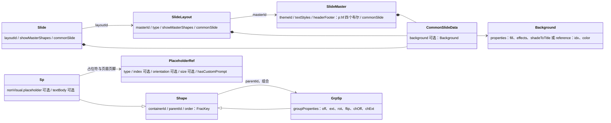

怎么读：结构类没有新的形状种类——占位符与页眉页脚都是带 `PlaceholderRef` 的 `Sp`（填入内容后换成带同一 ref 的 `Pic` / `GraphicFrame`），组合是 `GrpSp` 加子形状的 `parentId`，背景不在 shapes 表里，而是挂在页、版式、母版的 `commonSlide.background` 上；页眉页脚的全局开关在母版的 `headerFooter`。
依据：30/04 §3.2、§4.2、§12.1；40/03 §2.2。

**图 1-2 一页上的结构从哪里来**

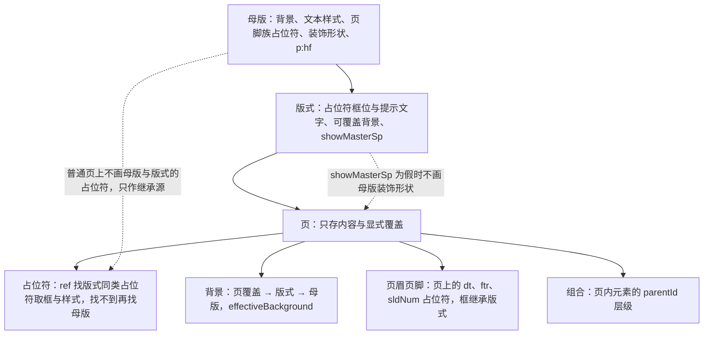

怎么读：从上往下是继承方向，页只保存它自己的内容和覆盖值，其余一律向上取；两条虚线是两个「不画」规则——隐藏背景图形时不画母版装饰，普通页上永远不画上层的占位符。
依据：30/04 §6.1、§12.2；40/07 的占位符 `occluded` 规则；PRD ML-02、ED-20。

## 2. 文字占位符（标题 / 居中标题 / 正文 / 副标题 / 内容）

### 2.1 十四栏

| 栏 | 设计 |
|---|---|
| ① 作用 | 版式预留的文字槽。**统一**：全篇标题的位置、字号、颜色由版式与母版决定，改一处全篇跟随；**归位**：换版式时文字按类型自动搬到新版式的对应位置；**结构**：大纲、缩略图名称、页面的读屏标签（「第 N 页，共 M 页：〈标题〉」）、阅读顺序都以占位符为准。与文本框的区别见 [20](./20-elements-text.md) §2 ①。 |
| ② OOXML | `p:sp` + `p:nvSpPr/p:nvPr/p:ph@type`（`title`、`ctrTitle`、`body`、`subTitle`、`obj`；缺省即 `obj`）`@idx`、`@orient`、`@sz`、`@hasCustomPrompt`；页上通常省略 `p:spPr/a:xfrm`（框继承），`p:txBody` 只存正文与显式覆盖；版式与母版上的同类占位符带提示文字与 `a:lstStyle`。 |
| ③ 插入入口与默认 | **页上不单独插入**：`slide.addSlide{ layoutId }` 按版式为每个占位符生成一个空实例（只带 `PlaceholderRef`，不带 `spPr` 与文字）；换版式用 `slide.applyLayout`（开始 › 版式 ▾、缩略图右键「版式 ▸」，[11](./11-masters-layouts-and-themes.md) §7）；「重置页」用 `slide.resetSlide`。页上删掉的占位符，「重置」不补回（与 PowerPoint 一致）。**母版视图**：母版页签「插入占位符 ▾」（M3，`slide.addPlaceholder`，[11](./11-masters-layouts-and-themes.md) §6）。默认框位、字号、项目符号全部从版式 → 母版继承，页上不写任何值。 |
| ④ 模型 | `Sp` + `nonVisual.placeholder: PlaceholderRef{ type, index?, orientation?, size?, hasCustomPrompt }`；可覆盖字段是 `InheritableField` 全集（`transform`、`geometry`、`fill`、`line`、`effects`、`style`、`bodyProperties`、`listStyle`，30/04 §12.2），只写显式值；提示文字不在页的模型里：取版式 / 母版占位符自带的 `textBody`（`hasCustomPrompt`），否则按 `type` 用 i18n 默认文案（30/04 §12.1）。 |
| ⑤ 渲染 | 普通页上不画母版与版式的占位符（它们只作继承源，40/07 `occluded`）；页上的占位符框取 `resolvePlaceholderBox`（形状 → 版式占位符 → 母版占位符 → 默认框），文字样式按 30/04 §6.1 的链解析；**空占位符**画提示文字（灰色覆盖层：不进 Scene、不导出、不进缩略图与放映、不计字数）与虚线框。 |
| ⑥ 交互 | **单击空占位符**直接进入文本编辑，提示文字隐藏（[06](./06-text-editing-and-ime.md) §2）；点在虚线框边上则选中占位符本身（可删除、可拖动）。有内容后同普通形状：首击选中、双击编辑。拖动或缩放继承来的框 → 写显式 `transform`，检查器该字段显示「已覆盖 · 重置」；「重置」只清该字段。`Tab` 按阅读序在占位符之间移动。 |
| ⑦ 检查器 | 位置与大小（逐字段标「继承自版式 / 已覆盖 · 重置」）；文本；填充与线条；「占位符」信息行（类型、索引、「来自版式〈名称〉」）。母版视图另加占位符类型、文本样式（大纲级别）、继承说明分区（[11](./11-masters-layouts-and-themes.md) §6）。 |
| ⑧ 命令 | **Command**（均既有）：`slide.addSlide{ layoutId?, after? }` → `slide.slide.insert`；`slide.applyLayout{ slideIds, layoutId }` → `slide.setLayout`（携带 `planLayoutChange` 的 remap，一页一事务）；`slide.resetSlide{ slideIds }` 与 `slide.resetPlaceholderFields{ shapeId, fields }` → `shape.clearOverrides`；拖动与缩放 → `slide.moveShapes` / `resizeShapes`（`shape.setTransform`）；文字 → `slide.insertText` 命令族；M3 母版侧 `slide.addPlaceholder` / `removePlaceholder` / `updatePlaceholder` → `shape.insert` / `.remove` / `setPlaceholder`。**Operation**：`slide.setSelection`、进入文本编辑。 |
| ⑨ 协同 | `PlaceholderRef` 与各覆盖字段逐键 LWW；A 重置、B 同时移动同一占位符 → 同键 LWW，双方各自可撤销自己的部分（30/05 §13.4 场景 2）；A 换版式、B 编辑占位符文字 → `layoutId` 与文字是不同键，都存活（30/06 §8 第 9 行）；A 在母版视图删掉版式上的占位符、B 同时编辑页上对应占位符的文字 → 该形状脱离为普通形状（`materialize`），文字保留（PRD ML-03）。 |
| ⑩ 导入导出与保真 | E。导出保留 `p:ph`，不写死继承值（OF-04）；导入时没有 `type` 属性的占位符原样写回，不补写 `type="obj"`；脱离占位符后不再写 `p:ph`；换版式后的 `rewriteRef`（ref 改写）如实写出。 |
| ⑪ 无障碍 | 阅读序：标题 → 副标题 → 正文 → 其它，同类按 `idx`（`A11yDescriptor.order.placeholder`，[05](./05-rendering-and-thumbnails.md) §11）；页 `section` 的 `aria-label` 取标题文字；空占位符不进可访问树（提示文字不是内容），编辑态仍可 `Tab` 到达。 |
| ⑫ 复用 | 无第三方。继承、匹配、重置、脱离都是 `model-slide` 纯函数（30/04 §12.2）。**为什么维持自研**：这是 PowerPoint 专有的继承与重匹配语义；开源 pptx 渲染库（如 pptx-viewer，Apache-2.0）只实现只读继承链，可作差分对照，但不含换版式重匹配、重置与脱离，也不以 CRDT 可合并的方式表达覆盖。 |
| ⑬ 里程碑 | M1 查看；M2 P0 页上编辑、换版式、重置（ML-01、ML-02）；M3 P0 版式与母版上的占位符增删改（ML-03）。 |
| ⑭ 待决 | 内容族同类占位符的上限数值未定（40/03 未决问题，ML-03「以模型约束为准」）；`placeholderFamily` 按 d-73 改为 PRD 三族（30/04 §12.2 待其属主回写）。 |

**图 2-1 页上文字占位符的生命周期**

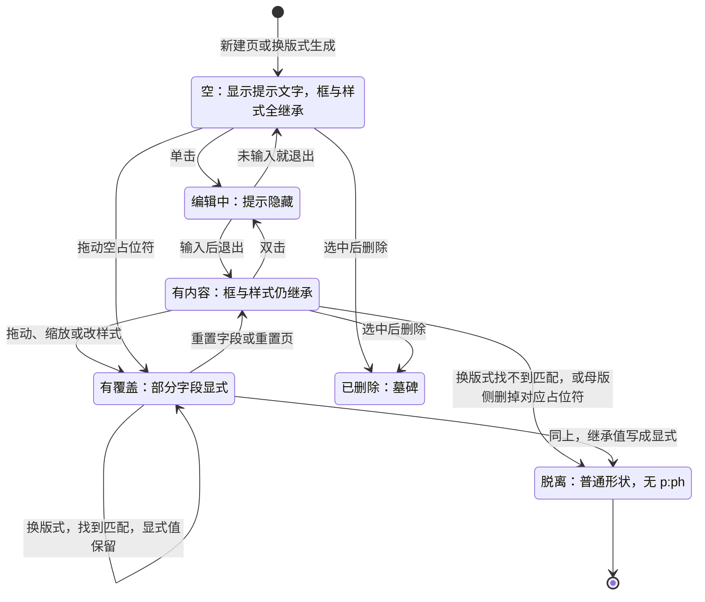

怎么读：前四个状态都带 `PlaceholderRef`，区别只是「有没有内容」「有没有显式覆盖」；「脱离」是唯一去掉 ref 的出口（`planLayoutChange` 的 `materialize`），此后它就是普通形状；「重置」只能把覆盖清回继承，不能把已删除的占位符补回来。
依据：30/04 §12.2；PRD ML-02、ML-03；[06](./06-text-editing-and-ime.md) §2。

## 3. 内容族占位符与快速插入图标条

### 3.1 十四栏

| 栏 | 设计 |
|---|---|
| ① 作用 | 版式预留的内容槽：在「标题和内容」「两栏内容」「图片与标题」这类版式的空占位符里点一个图标，就能把图片、表格、图表、视频直接放到版式规定的位置与大小；换版式时内容跟着占位符走，删掉内容后空槽还在。这是 PowerPoint 用户最常用的放图放表方式之一。 |
| ② OOXML | **空态**：`p:sp` + `p:ph@type=pic\|chart\|tbl\|dgm\|media\|clipArt\|obj`（`obj` 的空态可打字也可放内容）。**填入后**：`p:pic`（图片、视频）或 `p:graphicFrame`（表格、图表）自带**同一个** `p:ph`（`type`、`idx` 保留），框位通常不写（继承占位符框）。 |
| ③ 插入入口与默认 | 空内容占位符中央显示**快速插入图标条**，按占位符类型过滤：`obj` 显示全部可用项，`pic` 只显示图片，`tbl` 只显示表格，`chart` 只显示图表（M3 起可用，之前禁用并给原因），`media` 只显示视频（P2）；未到里程碑的图标留在原位、`aria-disabled` 并挂里程碑标记；`dgm`（SmartArt）与 `clipArt` 不显示图标，只显示提示文字（SmartArt 插入是非目标）。点图标 → 对应选择器（图片：文件选择；表格：图标旁弹出与插入页签同一网格弹层，悬停范围 8 行 × 10 列，含「插入表格…」对话框，rulings §4.22；图表：弹出与插入页签同一个 `ChartTypeMenu`（六项菜单与子类型 flyout），首行说明「[M3] 五类 · 填入占位符后打开数据面板」，设计 03-31；视频：文件选择）→ 填入；选择器或菜单开着时对应图标显示按下态（`aria-expanded="true"`）；图标条折叠时选择器与菜单锚在「插入 ▾」按钮上。把图片文件拖到空占位符上时占位符高亮，松手即填入；多张图片一起拖入时，指针下的占位符填第一张（`slide.fillPlaceholder`），其余在放下点普通插入、依次错位 0.2 in（[50/19](./19-insertable-elements-overview.md) §3.1），不自动填同页其它占位符。从插入页签插入图片、表格、图表时，页上有空内容占位符就填入阅读序第一个（已选中的空占位符优先，[50/19](./19-insertable-elements-overview.md) §3.1，rulings §4.22）。界面见设计 [03-16](../20-design/03-screens/16-text-editing-and-formatting.md)「空内容占位符图标条」（G-80，2026-09-30 样张回写，playground `#/editor/text` 的「空内容占位符 · 图标条」「图标条 · 键盘焦点与禁用原因」「图标条 · 窄占位符折叠」「占位符 · 表格网格」「图片拖入空占位符」）。**默认**：图片按占位符框裁剪到填满（算 `srcRect`，居中裁剪，ADR-0018；`obj` 占位符是否同样裁剪见 ⑭）；表格宽取占位符框宽、行高 0.41 in、高度按内容；图表取占位符框。 |
| ④ 模型 | 空态：`Sp` + `PlaceholderRef`。填入后：`Pic` / `GraphicFrame` 的 `nonVisual.placeholder` 保留原 ref（同 `type`、同 `index`）并沿用空 `Sp` 的 `order`；图片的 `BlipFill.sourceRect` 由命令算出，裁剪填满时不写 `transform`（继承占位符框，换版式随之移动）。媒体字节只进 BlobStore，模型里是 `MediaId`（50/19 媒体通道）。 |
| ⑤ 渲染 | 空态：提示文字 + 图标条 + 虚线框，全部画在覆盖层（不进 Scene、不导出、不进缩略图与放映）；图标条画在屏幕坐标的画布浮层上（与迷你工具条同层，[10](./10-editor-shell-and-interaction.md) §7.3），按屏幕尺寸绘制，不随缩放变小（多图标时按钮 76 px、单图标 84 px）；整条加四周各 8 px 留白在占位符的屏幕框里放不下时，折叠为单个「插入 ▾」按钮，菜单里是同一组条目、里程碑标记与禁用原因。填入后由各自的渲染器画（图片、表格、图表惰性渲染器，50/19 渲染器登记表）。 |
| ⑥ 交互 | 图标条是一个工具条（WAI-ARIA Toolbar 模式）：整条只占一个 `Tab` 停靠点，`←` / `→` 在图标间移动并循环，`Home` / `End` 到首尾，`Enter` 触发；禁用图标可聚焦并以 tooltip 说明原因；`Esc` 回到占位符（设计 03-16「键盘聚焦顺序」）。折叠形态是单个「插入 ▾」胶囊按钮（高 44），菜单宽 208、首行「插入到占位符」，条目、里程碑标记与禁用原因同展开态；禁用项保留 `aria-disabled`、仍可聚焦，原因 tooltip 在右侧展开；菜单内用方向键移动（设计 03-16「图标条规格」）；触控命中区 ≥ 44 px；图片占位符里的图片双击进入裁剪（[23](./23-elements-media.md)）；填入表格后选中表格并进入首格编辑；**删除填入的内容**后空占位符恢复（同一事务补建空 `Sp`），提示文字与图标条重新出现；空内容占位符本身也可以被选中并删除（不补回）。 |
| ⑦ 检查器 | 空态 `selectionKind: placeholder-empty`（d-72）三组：「占位符」（类型、索引、来自版式，只读）、「位置与大小」（逐字段显示「继承自版式」或「已覆盖 · 重置」，重置只清该字段）、「插入到占位符」按钮组（与图标条同一组动作，过滤、禁用与原因同源）；只读与评审模式不出「插入到占位符」组（[10](./10-editor-shell-and-interaction.md) §5，设计 03-16）。填入后按内容类型显示图片 / 表格 / 图表分区，另加一行「重置为占位符框」（清 `transform` 覆盖）。 |
| ⑧ 命令 | **Command**：`slide.fillPlaceholder{ shapeId, content: { kind:'picture', blob } \| { kind:'table', rows, cols } \| { kind:'chart', chartType } \| { kind:'media', blob } }`（新增（§4.21），ADR-0018）→ 一个事务：`shape.remove`（空 `Sp` 写墓碑）+ 按需 `media.add` + `shape.insert`（同 ref、同 `order`）；一步撤销回到空占位符。删除带内容族 ref 的 `Pic` / `GraphicFrame` 时，`slide.deleteShapes` 在同一事务里补建一个空 `Sp`（新 id、同 ref 与 `order`，新增规则（§4.21））。「重置为占位符框」→ `slide.resetPlaceholderFields{ shapeId, fields:['transform'] }`。**Operation**：选择器开合（ui 本地）、`slide.setSelection`（选中新元素，表格进首格编辑）。图片先在本地算 sha256 即执行命令，上传在后台进行，他端上传完成前显示加载占位（50/19 媒体通道）。 |
| ⑨ 协同 | **先后到达**：执行时发现空 `Sp` 已是墓碑（他人已填入并已同步）→ 命令改为普通插入（不带 ref，放在占位符框的位置）并 toast「该占位符已被〈姓名〉填入，已作为普通元素插入」。**真并发**（双方都在对方同步前执行）→ 合并后同页出现两个同 `(type, idx)` 的内容族形状：读时容错，两个都画；建议新增软不变量 **I-PH1**「同一页同一 `(type, idx)` 的存活内容族占位符至多一个」，修复按 `(order, id)` 保留最小者的 ref，其余把 `resolvePlaceholderBox` 的框写成显式 `transform` 并去掉 ref（与 `materialize` 同），发 `collab/repair{ rule:'duplicate-placeholder-fill' }`，由服务端软门禁写一次（ADR-0034）。A 删除填入的表格（补回空 `Sp`）与 B 同时编辑该表格 → B 的编辑落在墓碑上，按 30/06 §8 第 2 行提示与恢复。 |
| ⑩ 导入导出与保真 | E。带 `p:ph` 的 `p:pic` / `p:graphicFrame` 往返；换版式按 PRD ML-02 的兼容规则匹配（`pic` / `chart` / `tbl` / `dgm` / `media` 可匹配到 `obj`，50/19 占位符继承链一节）。 |
| ⑪ 无障碍 | 图标条 `role=toolbar`（读屏名「插入内容到占位符」），按钮读屏名为「插入表格到占位符」「插入图片到占位符」「插入图表到占位符」「插入视频到占位符」，tooltip 为「插入表格」等（设计 03-16，文案权威），禁用项在名称后加「（M3 提供）」一类说明；空占位符不作为内容进可访问树，但编辑态可 `Tab` 到其图标条；填入后按内容元素的 `role`（`image` / `table` / `chart` / `media`），图片缺替代文本时提示 `missingAlt`。 |
| ⑫ 复用 | 无第三方。图标用界面图标库 lucide-react（ADR-0017 已登记）；选择器全部复用各元素族现成的组件（文件选择、表格网格弹层、图表类型菜单）。 |
| ⑬ 里程碑 | M1 查看；M2 P1 图片（d-69）；表格随 q-table-depth 在 M2（插入与单元格文字）；图表 M3（随图表插入）；视频 P2（q-media-insert）；母版侧插入内容族占位符 M3（ML-03）。 |
| ⑭ 待决 | I-PH1 与并发填入互斥规则需 collab-sim 场景验证；`obj` 占位符里放图片是「裁剪填满」还是像 PowerPoint 那样「等比放入、不裁剪」推迟（触发条件：M2 P1 图片填入开工前，维护机实测 `p:pic` 的 `xfrm` 与 `srcRect`，见 rulings §4.22 与 §8 S-4）；删除内容后恢复空占位符已按 ADR-0018 采纳。 |

### 3.2 填入、删除恢复与并发

**图 3-1 点图标条填入图片（一次事务、一个撤销步）**

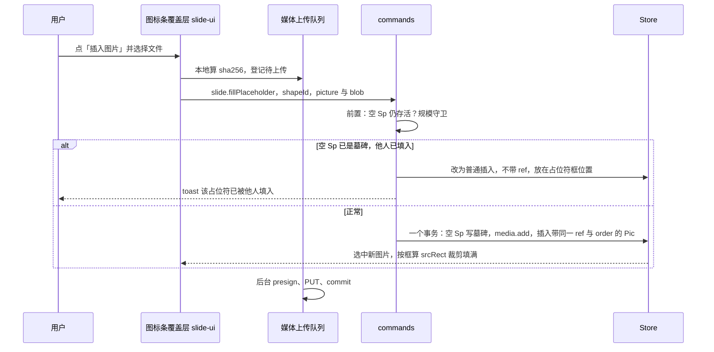

怎么读：纵向是时间；命令在事务前做两道前置（占位符是否仍空、是否超出规模上限），正常分支里「删空占位符、登记媒体、插入新图片」三件事在同一个事务里，所以撤销一步就回到空占位符；上传是后台的事，不阻塞插入。
依据：ADR-0018（内容占位符的填入与删除恢复）；50/19 媒体通道；d-69。

**图 3-2 内容族占位符的状态**

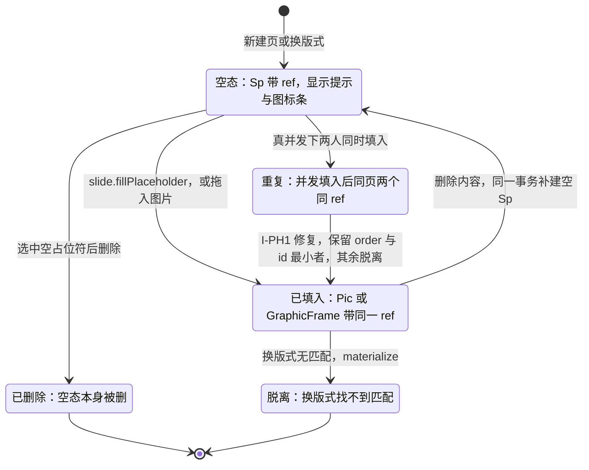

怎么读：正常路径是「空态 ⇄ 已填入」的来回——填入替换空 `Sp`，删除内容再补回空 `Sp`；「重复」只在真并发时短暂出现，由服务端软门禁修复一次；「已删除」只发生在直接删空占位符时，它不会被补回。
依据：ADR-0018；本节 ⑨；30/06 §8。

## 4. 页眉页脚与「页眉和页脚」对话框

### 4.1 十四栏

| 栏 | 设计 |
|---|---|
| ① 作用 | 一次给全部或部分页加上日期、页脚文字（公司名、保密标识）与页码，标题页可不显示；企业模板几乎都预置了页脚族占位符，用户只需勾选。与文本字段的关系：对话框往页脚族占位符里放字段（页码、自动日期）或纯文本，字段本身的规则见 [20](./20-elements-text.md) §3。 |
| ② OOXML | 页上：`p:sp` + `p:ph@type=dt\|ftr\|sldNum`（`hdr` 只出现在备注与讲义母版）+ `p:txBody`（`a:fld type="datetimeN"` / `"slidenum"`，或纯文本）；母版：`p:hf@dt@ftr@sldNum@hdr`（四个布尔，缺省均为真）；版式与母版上的同类占位符定义位置与样式。 |
| ③ 插入入口与默认 | 插入 › 文本 › 页眉和页脚…；「日期和时间」「幻灯片编号」两个按钮在非文本编辑态也打开此对话框（文本编辑态改为直接插字段，[20](./20-elements-text.md) §3）；母版视图「母版版式」组的「页脚」复选（M3，[11](./11-masters-layouts-and-themes.md) §6）。对话框控件见 §4.2；打开时按当前页已有的页脚族占位符回填勾选状态。默认：日期取「自动更新」、当前语言的第一种格式 `datetime1`（与文本编辑态的日期和时间选择器同一张 13 种格式表，[20](./20-elements-text.md) §3 ③）；框位与样式全部继承版式的同类占位符，页上不写 `xfrm`。 |
| ④ 模型 | 页上 `Sp` + `PlaceholderRef{ type:'dt'\|'ftr'\|'sldNum', index }`（`index` 取版式上同类占位符的 `idx`）；日期是 `Inline.Field{ type:'datetime1'…'datetime13' }`（自动）或普通 `Run`（固定）；页码是 `Field{ type:'slidenum' }`；母版上的开关是 `SlideMaster.headerFooter`（`p:hf`，30/04 §4.2 已建模，此前未被任何命令使用）。 |
| ⑤ 渲染 | 框继承版式占位符；页码实时求值、日期显示存储文本（[06](./06-text-editing-and-ime.md) §9.3）；「标题幻灯片中不显示」的判定依据是页所用版式的 `type == 'title'`。 |
| ⑥ 交互 | 对话框全键盘（§4.2）；[应用] 作用于当前页或缩略图中的多选页，[全部应用] 作用于全部页；应用后 toast「已更新 N 页 [撤销]」；若有 K 页的版式缺少对应占位符，toast 追加「K 页的版式没有页脚占位符，未添加」。页上的页脚族占位符可以像普通占位符一样直接编辑（下次「全部应用」会覆盖其文字）。 |
| ⑦ 检查器 | 无独立分区；选中页脚族占位符时同文字占位符（§2 ⑦）。 |
| ⑧ 命令 | **Command**：`slide.setHeaderFooter{ slideIds \| 'all', date?: { mode:'auto', type:'datetime1'…'datetime13' } \| { mode:'fixed', text } \| null, slideNumber: boolean, footer?: string \| null, hideOnTitle: boolean }`（新增（§4.21），ADR-0018）。一个事务逐页展开（图 4-1）：勾选且页上没有 → `shape.insert`（确定性 id，⑨）；勾选且已有 → `text.applyDelta` 整段替换；未勾选或该页是标题页且勾了「不显示」→ `shape.remove`；`'all'` 另写母版 `headerFooter`（`master.setProperties`）。受规模守卫（最多新增 3 × 页数个形状）；`'all'` 是全文命令，渐进打开期间先等 `whenLoaded`（40/03 §2.6 CO-12 守卫）。日期文本由命令用注入的时钟与语言生成。**Operation**：对话框开合（ui 本地）。 |
| ⑨ 协同 | **页脚族占位符用确定性 id**：新建时 id = `deriveNodeId('hf', slideId, type)`（由三元组经 SHA-256 截取生成的 v8 UUID，仍是合法 `NodeId` 品牌）；页上已有同类存活占位符（例如导入的，id 为 UUIDv7）则复用它、不新建；该确定性 id 的实体是墓碑时，改为清除墓碑复活。于是两人并发「全部应用」落到同一个键上，`Y.Map` 键值按 LWW 只留一个实体（另一个整体丢弃），不会出现两个页脚（图 4-2）。**已知限制**：两人同时把**已存在**的同一页脚改成不同文字，按 Yjs 文本合并可能拼接成两段；本端观察到 60 s 内有自己写过的页脚被远端改写时，按软冲突提示（[07](./07-collaboration-client.md) §12）。页码字段不存计算值，各端按页序求值后一致。 |
| ⑩ 导入导出与保真 | E~（M2 P2，PRD OF §2.2）。字段缓存 `a:t`：脏部件写当前计算值（页码）或存储文本（日期），干净部件原样；`p:hf` 往返；确定性 `NodeId` 只是模型 id，与 OOXML 的 `cNvPr@id` 无关（导出照常按部件分配）。 |
| ⑪ 无障碍 | 页码与日期按显示值作为普通文本进可访问树；对话框用 shadcn `Dialog`，复选框与单选组都有标签、分组有 `fieldset` 语义，焦点初始在第一个复选框；应用后 live region 播报 toast 文案。 |
| ⑫ 复用 | 对话框用 shadcn `Dialog` / `Checkbox` / `RadioGroup` / `Select`，表单用 react-hook-form + `standardSchemaResolver`（复用命令参数的 zod schema，d-18）；日期格式用原生 `Intl.DateTimeFormat`，格式列表取 [20](./20-elements-text.md) §3 的 `datetimeN` 格式表。无第三方业务库；`deriveNodeId` 用浏览器与 Node 都有的 Web Crypto 摘要实现，不引 UUID 库（ADR-0014 的 L0 零依赖口径）。 |
| ⑬ 里程碑 | M1 查看；M2 P2 对话框与 `slide.setHeaderFooter`（d-70）；母版视图的页脚复选 M3。 |
| ⑭ 待决 | 确定性 id 与 ADR-0014「`newNodeId()` 为 UUIDv7」的口径关系：建议 ADR-0014 增补「派生 id」一类（合法 `NodeId`、全局唯一、由稳定输入确定），需其属主确认；版式缺少页脚族占位符时是否在页上补建（建议不补建，与 PowerPoint 一致，待语料核对）；`datetime1`…`datetime13` 的语言映射推迟（触发条件：M2 P2 开工 `slide.insertField` / `slide.setHeaderFooter` 前，70 线交付三语 PowerPoint 另存语料，见 rulings §4.22；同 [20](./20-elements-text.md) §8 T-4）。 |

### 4.2 对话框

界面见设计 [03-15](../20-design/03-screens/15-insert-menu-and-shape-library.md)「页眉和页脚对话框」（G-81，2026-09-30 样张确认回写）；控件与行为如下，外观以该设计稿为准。

| 控件 | 形态 | 行为 |
|---|---|---|
| 日期和时间 | 复选框；其下单选「自动更新」（格式列表 + 语言下拉，语言名「中文（中国）/ 英语（美国）/ 日语」）/「固定」（文本框） | 未勾选时下属控件禁用；格式列表列出所选语言的 13 种 `datetimeN`（与文本编辑态选择器同表），默认第一种 `datetime1`，按所选语言实时预览；存储的是格式代码而不是列表序号 |
| 幻灯片编号 | 复选框 | — |
| 页脚 | 复选框 + 文本框 | 文本框 ≤ 200 字，未勾选时禁用 |
| 标题幻灯片中不显示 | 复选框 | 对版式 `type == 'title'` 的页，三项都按未勾选处理 |
| 预览 | 当前页版式的缩略示意，高亮三处占位符位置 | 版式缺某类占位符时该处显示「此版式无此位置」 |
| [应用] / [全部应用] / [取消] | 按钮 | [应用] 的范围是当前页或缩略图多选；[全部应用] 为 `slideIds:'all'` |

### 4.3 命令展开与并发

**图 4-1 `slide.setHeaderFooter` 在一个事务里的逐页展开**

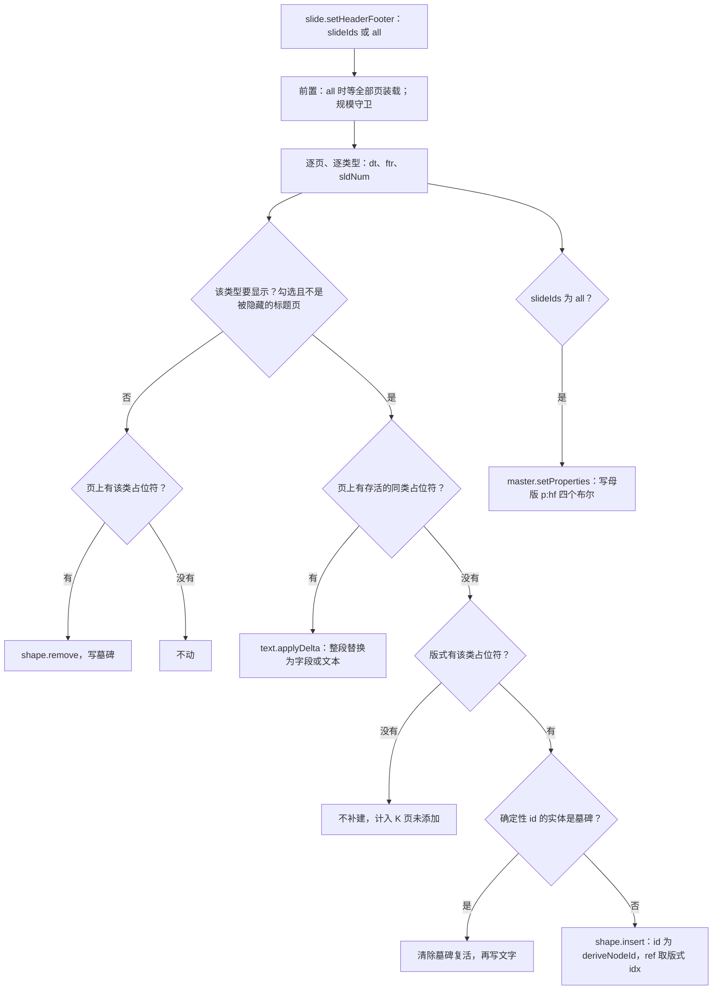

怎么读：每一页的每一类页脚占位符都走同一棵判定树，结论只有五种（删除、不动、改文字、复活、新建）；新建时用确定性 id，所以两次「全部应用」无论谁先谁后都落到同一个实体上；整个展开在一个事务里完成，一步撤销。
依据：d-70；ADR-0018；40/03 §2.6 规模守卫与渐进打开守卫。

**图 4-2 两人并发「全部应用」：确定性 id 让结果收敛到一个页脚**

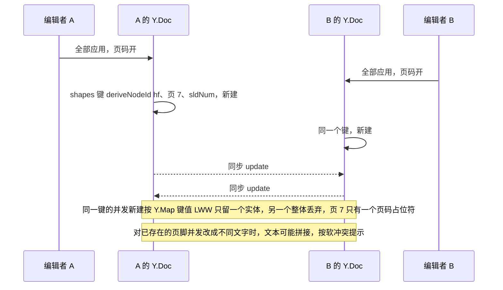

怎么读：纵向是时间；关键在于两端各自生成的 id 相同，因为 id 只取决于「页 + 类型」；如果用随机 id，这里会出现两个重叠的页码占位符。第二个注释是本设计承认的已知限制。
依据：本节 ⑨；30/06 §1.5、§8；ADR-0014（派生 id 待增补）。

## 5. 幻灯片 / 版式 / 母版背景

### 5.1 十四栏

| 栏 | 设计 |
|---|---|
| ① 作用 | 设置页面底色、渐变或背景图，让单页突出（封面、章节页）或让全篇统一（「应用到全部」）；「隐藏背景图形」去掉母版上的装饰形状（角标、色带），给满版图片腾地方。 |
| ② OOXML | `p:cSld/p:bg/p:bgPr`（`a:solidFill` / `a:gradFill` / `a:blipFill` / `a:pattFill` + `a:effectLst` + `@shadeToTitle`）或 `p:bg/p:bgRef@idx`（引用主题 `bgFillStyleLst`，idx 1001 起）+ 颜色；页与版式上的 `@showMasterSp="0"` 即「隐藏背景图形」。 |
| ③ 插入入口与默认 | 无选中时检查器「幻灯片」分区 › 背景；设计 › 设置背景格式…（定位到检查器该分区）；画布空白处右键「设置背景格式…」；母版视图「背景」组（M3，按范围写母版或版式，[11](./11-masters-layouts-and-themes.md) §6）。默认：新页不写 `p:bg`，背景沿页 → 版式 → 母版继承（`effectiveBackground`，30/04 §12.2）。 |
| ④ 模型 | `CommonSlideData.background?: Background`，`Background = { kind:'properties'; fill; effects?; shadeToTitle } \| { kind:'reference'; idx; color }`（40/03 §2.2）；图片背景是 `fill` 的 blip 分支（`mediaId`、拉伸或平铺、透明度）；`Slide.showMasterShapes` / `SlideLayout.showMasterShapes`。 |
| ⑤ 渲染 | 背景独立于三层、恒最先绘制（40/07 层序不变量）：纯色与渐变画成一个 `<rect>` 的 paint，图片拉伸用 `<image preserveAspectRatio="none">`、平铺用 `<pattern>`，透明度作用于图片；背景改动使整页脏；母版与版式层模板按 `(layoutId, showMasterSp, themeVersion)` 缓存，与背景无关。 |
| ⑥ 交互 | 不在画布上交互（点背景 = 取消选择）。**应用到全部**：写当前页所属母版的背景（PRD ED-20「写入母版级而非逐页复制」），toast「已应用到母版，影响 N 页 [撤销]」；若有 K 页带单独背景，toast 追加「其中 K 页有单独背景，未改变 [也清除它们]」（50/19 待决第 10 条的默认值：保留页覆盖并提示）；版式级背景覆盖在 M2 不动，toast 同样计入。**重置为版式背景**：删除页级覆盖。图片背景选好文件后立即生效，上传在后台。 |
| ⑦ 检查器 | 「幻灯片」分区 › 背景：纯色 / 渐变（渐变编辑器）/ 图片（拉伸或平铺 + 透明度滑杆）/ 图案（P2）；隐藏背景图形；[重置为版式背景]；[应用到全部]。多选页时对全部所选页生效，值不一致显示「多个值」。 |
| ⑧ 命令 | **Command**：`slide.setSlideBackground{ slideId, background \| null, blob? }`（既有；参数扩展允许直接传 `blob`，同事务 `media.add`，50/19；`null` = 重置为版式背景）→ Mutation `slide.slide.setBackground`；「应用到全部」→ `slide.setMasterBackground{ masterId, background }` → `master.setBackground`（既有命令，本入口在 **M2** 就要可用，与母版视图编辑 M3 无关）；「也清除它们」是随后的一次独立操作：对 K 页各执行 `slide.setSlideBackground{ null }`，按 30/05 §8 的批量规则合成一个事务、一个撤销步；「隐藏背景图形」（页级）→ 新增建议 `slide.setSlideProperties{ slideIds, showMasterShapes }`（新增（§4.21），需配套 Mutation，待 ADR-0018 与 40/03 登记；版式级已有 `slide.setLayoutProperties{ showMasterSp }`，M3）；M3 版式背景 `slide.setLayoutBackground`。 |
| ⑨ 协同 | `background` 是嵌套 `Y.Map`，`fill` 等复合值整值 LWW（30/06 §1.5）：两人同时改同一页背景，后写者胜并按软冲突提示；A「应用到全部」（写母版）与 B 改某页背景并发 → 都存活，继承链上页覆盖优先，B 的页保持 B 的背景；图片背景的字节走 BlobStore，他端上传完成前显示加载占位。 |
| ⑩ 导入导出与保真 | E（M2 P1）。`bgRef` 引用原样保留；只重写被改的页的 `p:bg`；图片背景写 `a:blipFill` 与媒体关系；`showMasterSp` 往返。 |
| ⑪ 无障碍 | 背景不进可访问树（装饰性）；检查器控件全键盘，颜色选择器与渐变编辑器有数值输入等价（[16](./16-i18n-and-accessibility.md) §6.3）；「应用到全部」的 toast 经 live region 播报。 |
| ⑫ 复用 | 颜色面板用 react-colorful（经 pnpm patch 改静态 CSS，d-13）；渐变编辑器自写（Radix Slider + react-colorful，d-15，没有既满足 OOXML 多 stop 线性 / 路径渐变又满足 CSP 的成熟组件）；图片预处理用 `createImageBitmap` + canvas（d-23）。背景本身无专用库。 |
| ⑬ 里程碑 | M1 查看；M2 P1 页背景（纯色、渐变、图片、隐藏背景图形、重置、应用到全部，ED-20）；M3 版式与母版背景（ML-03）；图案填充编辑 P2。 |
| ⑭ 待决 | 「应用到全部」是否清除各页已有覆盖：默认保留并在 toast 里给「也清除它们」，PowerPoint 的实际行为待语料核对后再定是否改为默认清除；页级 `showMasterShapes` 的命令与 Mutation 形态待 ADR-0018 登记。 |

**图 5-1 背景从哪来、「应用到全部」写到哪**

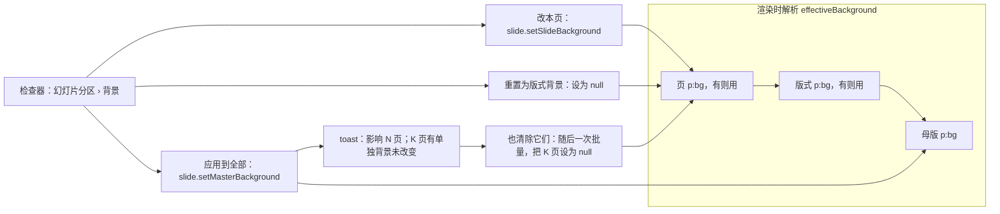

怎么读：左侧子图是解析顺序——页有覆盖就用页的，否则逐级向上；右侧是三个入口各自写哪一层。「应用到全部」只写母版，因此带单独背景的页不会变，这正是 toast 要提示并给出「也清除它们」的原因。
依据：PRD ED-20；30/04 §12.2 `effectiveBackground`；50/19 待决第 10 条。

## 6. 组合

### 6.1 十四栏

| 栏 | 设计 |
|---|---|
| ① 作用 | 把多个元素当作一个整体移动、缩放、旋转、对齐、复制、调层级；做好的小图示（图标 + 说明文字、流程节点 + 连线）作为一个单元复用。 |
| ② OOXML | `p:grpSp` + `p:nvGrpSpPr` + `p:grpSpPr/a:xfrm`（`a:off`、`a:ext`、`@rot`、`@flipH`、`@flipV`，以及子坐标系 `a:chOff`、`a:chExt`）+ 子元素（可嵌套组）；`a:grpSpLocks` 锁位。 |
| ③ 插入入口与默认 | 选中 ≥ 2 个同一层级的元素 → 开始 › 绘图 › 排列 ▾ › 组合（40/10 §2.6 现有入口）、`Mod+G`、右键「组合」；取消组合 `Mod+Shift+G`、右键「取消组合」。**默认**：组框 = 子元素旋转后包围盒之并；`chOff` / `chExt` = `off` / `ext`（恒等映射），`rot = 0`；组占据最上层子元素原来的 z 位置，子元素之间的相对顺序不变；名称按「组合 N」本地化生成。不支持跨页组合。 |
| ④ 模型 | `GrpSp{ groupProperties: GroupTransform{ offset, extent, childOffset, childExtent, rotation, flipH, flipV } }`；子形状用 `parentId` 指向组，组上没有 `childIds` 数组（30/04 §3.2）；子形状的 `transform` 位于组的子坐标系。**空组视为删除**（不变量 I-GRP1，ADR-0018）。 |
| ⑤ 渲染 | `grp-sp.renderer` 产出一个 `<g transform="matrix(…)">`，矩阵 = `T(off + ext/2)·R(rot)·S(flip)·T(−ext/2)·S(ext/chExt)·T(−chOff)`；子元素由各自的渲染器画进这个 `<g>`，嵌套组即嵌套 `<g>`；翻转时文字不镜像（`flipV` 时文字转 180°，50/19 变换矩阵）；子元素的 `grpFill` 取组的填充。 |
| ⑥ 交互 | **首击选中整组**；双击进入**组合编辑态**并选中所点子元素（组外框变浅色并提示「组合编辑中」）；子元素上再双击文字进入文本编辑；`Esc` 逐级退出：文本编辑 → 子元素 → 整组 → 取消选择（UX-06，[10](./10-editor-shell-and-interaction.md) §7）。键盘等价：选中组后按 `Enter` 进入组合编辑并选中 z 序最低的子元素（组没有文字，`Enter` 不冲突；新增约定（§4.21）），组合编辑态下 `Tab` 在子元素间循环。缩放组只改组的 `off` / `ext`，子元素随映射按比例变化；旋转组只改组的 `rot`。组合编辑态下拖动子元素：松手时同一命令内按子元素的新范围重算组框（`chOff` / `chExt` 取子元素之并，`off` / `ext` 按当前映射比例换算），与 PowerPoint 一致（待语料核对）。`grpSpLocks` 的锁位由交互层执行（手柄显示锁形）。 |
| ⑦ 检查器 | `selectionKind: group`：位置与大小 + [取消组合] + 子元素数量；组填充（给 `grpFill` 子元素用）P2；组合编辑态下选中子元素时按子元素类型显示分区。 |
| ⑧ 命令 | **Command**：`slide.group{ shapeIds }` → Mutation `shape.group`（新建 `GrpSp`，恒等映射；子元素只改 `parentId` 与 `order`，`transform` 不变）；所选元素里有占位符时同一事务 `materialize` 并去掉 ref，toast「占位符已转为普通形状」（PRD ED-08）。`slide.ungroup{ groupId }` → `shape.ungroup`（子元素 `transform` 折算回父坐标系，§6.3；子元素 `parentId` 改为组的父级，`order` 取组所在位置前后之间的连续键；组写墓碑）。删除组内最后一个存活子元素 → 同一事务给组写墓碑（I-GRP1）。组合编辑态移动子元素 → `slide.moveShapes`（子坐标系）+ 同事务更新组框。**Operation**：进入 / 退出组合编辑是选区状态（`slide.setSelection` 的组路径），不入历史。 |
| ⑨ 协同 | 进出组只改 `parentId` 与 `order` 单键。A 组合 x、B 同时移动 x：组新建时是恒等映射，x 的页坐标与子坐标相同，B 的位移落在子坐标里仍然正确。A 取消组合、B 同时移动整组：B 的写入落在墓碑组上而子元素已按 A 折算 → B 看到「组合已被〈A〉取消」的软冲突提示（30/06 §8 第 2 行同类）。A 删组内最后一个子元素、B 同时删另一个 → 合并后成空组，由 I-GRP1 的 `repair` 以 `system('repair')` 写一次墓碑（ADR-0018）。父子环（A 把 X 放入 G、B 把 G 放入 X）按 30/06 §8 第 5 行修复。 |
| ⑩ 导入导出与保真 | E。嵌套组与 `chOff` / `chExt` 往返；导入的非恒等映射（`ext ≠ chExt`）原样保留、不归一化；组属性的 `extLst` 写回；取消组合产生斜切近似时记诊断（§6.3）。 |
| ⑪ 无障碍 | 可访问树 `role: group`，名称取替代文本，无则「组合 5（3 个对象）」；子元素嵌套在组的列表项内（`li` 内嵌 `ol`）；进入组合编辑有键盘路径并播报「正在编辑组合，按 Esc 退出」。 |
| ⑫ 复用 | 2×3 仿射矩阵在 engine-layout 自写（transformation-matrix 3.1.0，MIT，只作参考、不引入，50/19）。**为什么维持自研**：矩阵运算本身十几行，引库收益小；真正的复杂度在 OOXML 专有的 `chOff` / `chExt` 映射、「翻转时文字不镜像」与取消组合的分解近似，这些没有现成库；折算（`model-slide`）与渲染（engine-layout）用共用测试向量对齐（ADR-0018）。 |
| ⑬ 里程碑 | M2 P0 组合 / 取消组合（ED-08）；进入组合编辑 P1（PRD OF §2.6「双击进入子元素编辑（P1）」）；组填充编辑 P2。 |
| ⑭ 待决 | 有旋转又非等比缩放的组取消组合时的斜切近似（ADR-0018：保留包围盒与旋转、丢弃斜切并诊断，需语料核对）；组合编辑态下子元素移出组框时是否按本文重算组框（PowerPoint 行为待核对）；删到只剩一个子元素时是否自动解散（暂不解散，PowerPoint 行为待核对）；`Enter` 进入组合编辑的键盘约定待 [10](./10-editor-shell-and-interaction.md) §7 确认。 |

### 6.2 选择与组合编辑

**图 6-1 组合的选择层级**

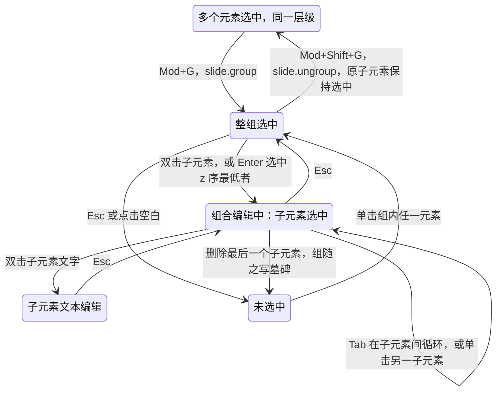

怎么读：从上往下是选择层级由粗到细，每按一次 `Esc` 上升一级；组合编辑态里的选择与操作只作用于子元素；最后一条边是 I-GRP1——删到组里一个都不剩时，组本身也在同一事务里消失。
依据：PRD ED-01、ED-08；rulings §4.18 UX-06；[10](./10-editor-shell-and-interaction.md) §7；ADR-0018。

### 6.3 取消组合的变换折算

设组 G 的 `off_g`、`ext_g`、`rot_g = θ`、`flipH_g = fh`、`flipV_g = fv`、子坐标系 `chOff`、`chExt`，缩放 `sx = ext_g.cx / chExt.cx`、`sy = ext_g.cy / chExt.cy`；子元素 c 的 `off_c`、`ext_c`、`rot_c`、`flipH_c`、`flipV_c` 在子坐标系中。

1. **中心点映射**：子中心 `C = off_c + ext_c / 2`；缩放平移 `P = off_g + (C − chOff) ⊙ (sx, sy)`；再绕组中心 `G = off_g + ext_g / 2` 翻转并旋转：`P′ = G + R(θ) · F(fh, fv) · (P − G)`。
2. **尺寸**：`rot_c` 接近 0° / 180° 时 `ext′ = (ext_c.cx · sx, ext_c.cy · sy)`；接近 90° / 270° 时两轴对调 `ext′ = (ext_c.cx · sy, ext_c.cy · sx)`（保持视觉包围盒）。其余角度且 `sx ≠ sy` 时真实结果含斜切，OOXML 表达不了：按「保留包围盒与旋转、丢弃斜切」近似并记诊断（ADR-0018，待语料核对）。
3. **旋转**：`rot′ = θ + (fh ⊕ fv ? −rot_c : rot_c)`，归一到 [0°, 360°)。依据是 `F · R(α) = R(±α) · F`（单轴翻转取负号，双轴或无翻转取正号）。
4. **翻转**：`flipH′ = flipH_c ⊕ fh`，`flipV′ = flipV_c ⊕ fv`。
5. **位置**：`off′ = P′ − ext′ / 2`，四舍五入到整数 EMU（确定性）。
6. **嵌套组**：子组只折算它自己的 `off` / `ext` / `rot` / `flip`，`chOff` / `chExt` 不变——子组的内部缩放随 `ext` 变化自然保持。连接符与线条同样折算，方向由 `flip` 表达。

当 `sx = sy` 或 `rot_c` 为 90° 的整数倍时，折算前后每个子元素的世界矩阵相等（§10 的 property 断言）。

**图 6-2 取消组合的计算与写入**

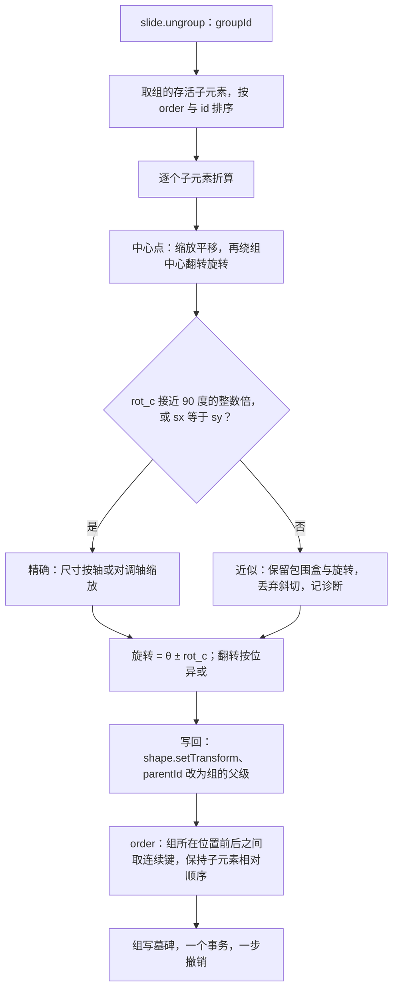

怎么读：自上而下是一次取消组合的计算顺序；唯一的分支是「能否精确表达」，两条路在旋转与翻转处汇合；最后三步都在同一个事务里，所以撤销一步即恢复原组（组以原 id 复活，子元素回到组内）。
依据：ADR-0018（取消组合折算与空组）；50/19 变换矩阵；PRD ED-08「取消组合后属性不变」。

### 6.4 并发

**图 6-3 组合与移动并发：恒等映射保证位移仍正确**

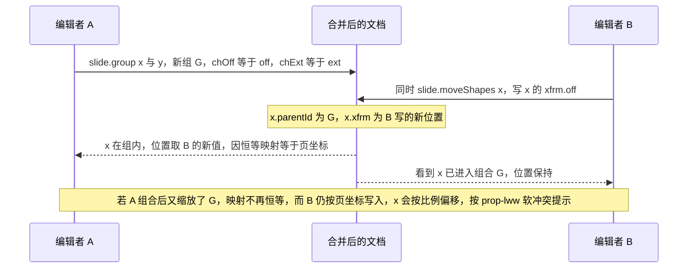

怎么读：纵向是时间；组合只写 `parentId` 与新组实体，移动只写 `xfrm`，两者是不同键、都存活；因为新组是恒等映射，B 在页坐标里写的位置放进子坐标系后不变。第二个注释标出这条保证的前提。
依据：30/06 §8；ADR-0032（`parentId` 与 `order` 单键）；本节 ⑨。

## 7. 里程碑汇总

| 里程碑 | 本族交付 |
|---|---|
| M1 | 全部五类查看：占位符继承渲染、页脚字段求值、背景三级解析、嵌套组合渲染 |
| M2 | P0：页上占位符编辑、换版式与重置（ML-01、ML-02）、组合与取消组合（含折算与 I-GRP1）；P1：图片填入内容占位符、页背景（含应用到全部、隐藏背景图形）、进入组合编辑；表格填入内容占位符随 q-table-depth；P2：「页眉和页脚」对话框与 `slide.setHeaderFooter`、视频填入 |
| M3 | P0：版式与母版上的占位符增删改、版式与母版背景、母版视图页脚复选（ML-03）；图表填入内容占位符 |
| M4+ | 无本族新增项（组填充编辑等 P2 视排期） |

## 8. 待决

| # | 待决项 | 建议 | 需谁确认 |
|---|---|---|---|
| S-1 | 内容族同类占位符的上限数值 | 以模型约束为准，40/03 未决问题收口时定 | 40/03 属主 |
| S-2 | `placeholderFamily` 与 PRD ML-03 三族不一致 | 按 d-73 以 PRD 为准改写 30/04 §12.2 | 30/04 属主 |
| S-3 | 并发填入同一内容占位符 | 命令前置 + 软不变量 I-PH1（服务端修复一次） | ADR-0018、ADR-0034 属主；70 线 collab-sim |
| S-4 | `obj` 占位符放图片：裁剪填满还是等比放入 | 推迟（触发条件：M2 P1 图片填入（`slide.fillPlaceholder` 图片）开工前，维护机实测 `p:pic` 的 `xfrm` 与 `srcRect`，见 rulings §4.22）；设计样张不变（`pic` 占位符两种结论都裁剪）；结论为等比放入时写显式 `transform`，并改 ADR-0018 决策 10、本文 §3 ③④⑭ 与 [50/19](./19-insertable-elements-overview.md) §3.1 | 70 线实测，本文属主定稿 |
| S-5 | 页脚族占位符的确定性 id 与 ADR-0014 口径 | ADR-0014 增补「派生 id」一类 | ADR-0014 属主 |
| S-6 | 版式缺页脚族占位符时是否补建 | 不补建，与 PowerPoint 一致，待语料核对 | 70 线语料 |
| S-7 | 「应用到全部」是否默认清除页覆盖 | 默认保留，toast 给「也清除它们」 | 语料核对后由前端设计线定 |
| S-8 | 页级「隐藏背景图形」的命令形态 | 新增 `slide.setSlideProperties{ slideIds, showMasterShapes }` 及配套 Mutation | ADR-0018、40/03 属主 |
| S-9 | 取消组合的斜切近似、组框随子元素重算、剩一个子元素是否解散 | 按本文 §6.1 ⑭ 的暂定口径，语料核对 | 70 线语料 |
| S-10 | 选中组合后 `Enter` 进入组合编辑 | 采纳为键盘等价 | [10](./10-editor-shell-and-interaction.md) §7 属主 |

## 9. 待回写

| 待回写项 | 去向 | 状态 |
|---|---|---|
| `slide.fillPlaceholder` 的「空 `Sp` 已是墓碑则改为普通插入」前置与软不变量 I-PH1 | ADR-0018、40/03 §2.1 不变量表、ADR-0034 修复规则 | 待回写（§4.21） |
| `slide.setHeaderFooter` 的展开规则（图 4-1）、`date` 参数形态、确定性 id `deriveNodeId('hf', slideId, type)` | ADR-0018、40/03 §2.6、ADR-0014 | 待回写（§4.21） |
| `slide.setSlideProperties{ slideIds, showMasterShapes }` 与配套 Mutation；「应用到全部」在 M2 需可用的 `slide.setMasterBackground` 入口 | 40/03 §2.6、ADR-0018 | 待回写（§4.21） |
| 检查器 `selectionKind: placeholder-empty`（d-72）与内容占位符「重置为占位符框」行 | [10](./10-editor-shell-and-interaction.md) §5 | 已回写（2026-09-30，§4.22：三组为占位符 / 位置与大小 / 插入到占位符，与设计 03-16 同名） |
| 选中组合后 `Enter` 进入组合编辑；组合编辑态 `Tab` 循环子元素 | [10](./10-editor-shell-and-interaction.md) §7、[16](./16-i18n-and-accessibility.md) §6 | 待回写（§4.21） |
| 「页眉和页脚」对话框设计稿（新 G 项）；插入页签「文本」组加「页眉和页脚…」 | PRD 07-design-coverage、设计 04 与 playground | 已回写（2026-09-30：G-81，对话框见设计 03-15，入口见设计 03-04；文本编辑态的日期和时间格式选择器见设计 03-16） |
| 能力总表行：INS-14、INS-17、ARR-02、ML-09 指向本文 | [50/18](./18-editor-capabilities.md) | 待回写（§4.21） |

## 10. 机械验证

本节只写断言；层级、夹具与 CI 步骤归 70 线。

| 断言 | 落点 | 70 线套件 |
|---|---|---|
| 新建页的占位符实例只带 `PlaceholderRef`，无 `spPr` 与文字；导出不写死继承值 | model-slide 命令测试、往返用例 | test/unit、test/fidelity-roundtrip |
| `slide.fillPlaceholder` 一个事务、一步撤销回空占位；删除填入内容同事务补回空 `Sp`（新 id、同 ref 与 `order`） | model-slide 命令测试（`command-harness`） | test/unit |
| 并发填入：空 `Sp` 已是墓碑时改为普通插入；真并发后 I-PH1 修复一次即净、再修复无变化 | collab-sim 场景、invariants property | test/collab-sim、test/unit |
| `slide.setHeaderFooter` 两端并发「全部应用」后每页每类页脚族占位符至多一个；标题页隐藏生效；版式缺占位符的页不补建且计入 K | collab-sim 场景、命令测试 | test/collab-sim、test/unit |
| 「应用到全部」只写母版背景；带单独背景的页不变；「也清除它们」一步撤销 | 命令测试、e2e | test/unit、e2e |
| 取消组合：`sx = sy` 或 `rot_c` 为 90° 整数倍时，折算前后每个子元素的世界矩阵相等（与 engine-layout 共用测试向量）；其余情形有诊断 | model-slide property、engine-layout 矩阵测试 | test/unit |
| I-GRP1：删除组内最后一个子元素时组同事务写墓碑；并发删到空组时 `repair` 只写一次 | 命令测试、collab-sim | test/unit、test/collab-sim |
| 组合与并发移动（图 6-3）：合并后 x 的页面位置等于 B 写入的位置 | collab-sim 场景 | test/collab-sim |
| 空占位符的提示文字、图标条不出现在缩略图、放映与导出图像中 | 视觉用例 | e2e（70/04） |
