# 22 元素族：形状与线条
> 状态：v0.1 | 负责：前端设计线 | 更新：2026-09-26（§4.21：新建，逐项设计预设形状、线条与箭头、连接符、任意多边形与曲线、动作按钮、第三方扩展元素）；2026-09-26（§4.21 整合：§2.1 形状库名单按 playground shapes.tsx 草案对齐（矩形 5、基本形状 14、箭头 8）；动作按钮与 Hyperlink.show 的 jump 改为模型取值并注 OOXML 映射；缩略图脚本名补 .ts）；2026-09-26（§4.21 复核：依赖行补 50/01 上游链接）；2026-09-30（§4.22 复核修正：§2.1 删去过时的「设计 03-15 待用户确认样张后回写」）；2026-10-04（design-language-v3 第 0 批：第三方扩展元素的入口改为工具条「更多」条目（`ui.toolbar{slot:'create.more'}`），二维码示例的贡献序列同步；形状名单的旧版 playground 路径加注（rulings §4.25 DS-1、DS-5））；2026-10-05（design-language-v3 第 0 批修正：检查器写法改为 v3（rulings §4.25 DS-1、DS-5）——§2 预设形状 ⑦ 按设计 03-02 §4.2 改为对齐行 · 位置（含旋转与翻转切换条）· 尺寸 · 填充 · 描边 · 阴影 · 不透明度，文本、形状、替代文本注「节划分随第 1 批」，⑪ 数值等价改指「位置」「尺寸」两节；§2.3、§2.4 调整值与更改形状的位置注「随第 1 批」，翻转入口改为检查器「位置」节切换条、右键「旋转与翻转 ▸」与主菜单「排列」（与 50/18 SEL-11 一致）；§3、§4 连接符 ⑦ 注「节划分随第 1 批」；§5 ⑦ ⑪、§6 ⑦ 同步（「操作」一行由默认展开改为常显，v3 分区不折叠）；§7 插件分区由 `ui.panel{slot:'inspector'}` 改为 `ui.inspectorSection`，图 22-12 同步；§3 ⑪ 端点的数值等价不再引用已作废的「位置与大小」分区名，改注功能口径、所在的节随第 1 批）；2026-10-07（design-language-v3 第 1 批：按已拍板样张与设计 03-02 §4.2、03-05 §3、03-15、03-17 定稿——§0.1 第 ③ 栏；§1.1 预设形状入口；图 22-1 起点；§1.5 手柄表（缩放、旋转、调整手柄改强调色菱形、端点与连接点的强调色画法，原「黄色」「实心绿」作废；锁定手柄）；§2 ③⑥⑦⑪⑭（工具条「形状」弹层与形状库、72 × 72 pt、检查器按 03-02 §4.2 一节「位置与大小」、更改形状与替代文本走右键 TB-18）；§2.1（最近使用 ≤ 10、不设搜索、P2 三项、整库一个 Tab 停靠点 TB-5、名单来源 `src/v3/editor/shapes/catalog.tsx`）与图 22-4；§2.3 与图 22-5（强调色菱形）；§2.4（更改形状 TB-18、翻转入口）；§3 ③⑦⑪、§3.2（线条检查器按 03-17 §8）；§4 ③⑥⑦⑪ 与图 22-7（连接节起止点下拉 TB-21）；§5 ⑥⑪；§6 ⑦、§6.2 与图 22-11（操作设置对话框宽 480、主按钮「应用」、9 项目标）；§7 ⑦；§10.1 第 4 条结案）；2026-10-08（design-language-v3 第 1 批收口：§2 ⑦⑧⑪⑬ 形状检查器补快速样式（「填充」节上方一行缩略图 + 42 格样式库弹层，rulings §4.25 DS-31）与「替代文本」节（TB-32），「不透明度」同时写填充与描边 alpha、登记 `slide.setShapeOpacity`（TB-47），图片填充与内阴影 P2 不可用（TB-43）；新增 §2.5 快速样式与不透明度；§2.4 与 ⑦ 更改形状只走右键与命令面板、检查器不设入口（TB-18、DS-1）；§5 ⑦、§6 ⑦ 跟随；§7 ③⑦ 插件暂行收纳（TB-31）；§10.2 补回写行）；2026-10-08（design-language-v3 第 1 批评审修改：§2.5 快速样式按 rulings §4.25 DS-34 改为 42 格样式库在「快速样式」节里、缩略行下方原位展开，下方各节下移、不遮挡画布，节标题右侧「收起样式库」，收起按钮、再点缩略行或 Esc 收起并回缩略行、应用后保持展开（修订 DS-31 的「样式库弹层」），缩略图去白衬底、外圈 `--v3-swatch-line`（TB-56）；§2 ⑦ 同步、样张状态改指已补的两个场景；§10.2 补回写行）；2026-10-15（design-language-v3 第 2 批：§7 插件元素 ③ 与 ⑦ 栏的插件收纳按 rulings §4.25 DS-49 定稿（取代 TB-31 的暂行规则），归属标识统一 12px（DS-56），缺插件时的占位与 `degraded` 分区按 DS-52） | 依赖：上游：[50/01 前端架构](01-overview-and-runtime-map.md) §5b、§4a（渲染）；[50/19](19-insertable-elements-overview.md)（通用设计与插入命令通用流程）；[50/10](10-editor-shell-and-interaction.md) §4、§5、§7.4、§7.5；[40/03](../40-modules/03-slide-domain-model.md) §2.2、§2.3、§2.6；[30/04](../30-architecture/04-document-model.md) §3.2、§3.3、§4.2、§4.3；[30/05](../30-architecture/05-command-and-history.md) §1；[30/06](../30-architecture/06-collaboration.md) §1.5；[40/06](../40-modules/06-layout-and-render-engine.md) §2.2、§2.3；[40/07](../40-modules/07-slide-rendering.md) §2.3、§5.1；[40/10](../40-modules/10-ui-shell-and-slide-ui.md) §2.6；[PRD 02](../10-prd/03-features/02-editing.md) ED-05、ED-06、ED-19、ED-28、ED-29；[PRD 01](../10-prd/03-features/01-open-and-fidelity.md) §2.4、OF-06；[PRD 04](../10-prd/03-features/04-plugin-sdk.md) PS-02、PS-04；设计 03-screens [04](../20-design/03-screens/04-insert-menu.md)、[15](../20-design/03-screens/15-insert-menu-and-shape-library.md)、[17](../20-design/03-screens/17-selection-alignment-and-snapping.md)；[ADR-0018](../30-architecture/adr/0018-editor-element-model-and-insert-commands.md)；[rulings](../00-charter/rulings-2026-09-14.md) §4.21（R-d-29、R-d-32、R-d-63、R-d-64、R-d-66、R-d-71、R-d-75、R-d-77、R-d-78）

本文是可追加元素中「形状与线条」一族的前端设计事实源，回答用户的三个问题：要追加哪些东西、每样东西有什么用、每样东西怎么设计。本族六类元素：预设形状、线条与箭头、连接符、任意多边形 / 曲线 / 自由曲线、动作按钮、第三方扩展元素（以二维码为例）。

全部元素共用的规则不在本文重复，只链接：元素基类、变换矩阵、z 序与分数索引、锁定与隐藏、主题色与默认样式来源、替代文本、不透明保留钩子、插入命令通用流程、默认落点与尺寸、规模守卫、导出 id 分配，见 [50/19](19-insertable-elements-overview.md)；插入工具态状态机与各类手柄的外壳行为见 [50/10](10-editor-shell-and-interaction.md) §7.4、§7.5。

不在本文（只链接）：

| 主题 | 事实源 |
|---|---|
| 文本框、文本字段、超链接（文字与形状）、符号 | [50/20](20-elements-text.md) |
| 占位符与内容图标条、页眉页脚、背景、组合 | [50/21](21-elements-structure.md) |
| 图片、SVG、图标、音视频 | [50/23](23-elements-media.md) |
| 表格与图表 | [50/24](24-elements-tables-and-charts.md) |
| SmartArt、公式、OLE、3D、墨迹、缩放定位 | [50/25](25-elements-readonly-and-opaque.md) |
| 编辑器每项能力的实现落点总表 | [50/18](18-editor-capabilities.md) |
| 预设几何编译、仿射矩阵、连接点与连接符路由的纯函数 | [40/06](../40-modules/06-layout-and-render-engine.md) §2.3 |

包名一律省略 `@cordexjs/` 前缀。

## 0. 读法与口径

### 0.1 每个元素的 14 栏

每个元素一节，节首是一张 14 栏定义表，栏目固定如下；表后的小节补充清单、状态机与时序。

| 栏 | 写什么 |
|---|---|
| ① 作用 | 用户为什么需要它、典型场景，与相近元素的区别 |
| ② OOXML 来源 | 对应的 PresentationML / DrawingML 节点 |
| ③ 插入入口与默认 | v3 入口（底部工具条「形状」弹层与形状库、「更多」、主菜单「插入」与右键）、单击插入还是拖出绘制、默认尺寸、默认样式取主题的哪一项 |
| ④ 模型 | 40/03 与 30/04 的实体、值对象与字段；本轮新增的字段标「新增（§4.21）」 |
| ⑤ 渲染 | DOM/SVG 怎么画 |
| ⑥ 交互 | 选中框、各类手柄、双击进入的子编辑态、键盘 |
| ⑦ 检查器 | 属性面板分区 |
| ⑧ 命令 | 按 30/05 §1 三分法：Command（带事务）、Mutation（唯一写路径）、Operation（视图态）；本轮新增的标「新增（§4.21）」，登记落点为 [ADR-0018](../30-architecture/adr/0018-editor-element-model-and-insert-commands.md) 与 40/03 §2.6 |
| ⑨ 协同 | Yjs 结构（30/06 §1.5 编码规则）与并发处理 |
| ⑩ 导入导出与保真 | 可编辑度：E 可编辑、E~ 部分可编辑、V 查看、V~ 近似查看、P 仅保留 |
| ⑪ 无障碍 | 可访问树名称、键盘路径、拖拽的数值等价（WCAG 2.5.7） |
| ⑫ 复用 | 用哪个成熟库；「维持自研」的写明为什么没有合适的库 |
| ⑬ 里程碑 | 按 PRD 与 rulings §4.21 |
| ⑭ 待决 | 未定项与推荐默认值（汇总见 §10） |

### 0.2 通用口径摘要

- **一次手势一个命令**：拖出插入、拖手柄、拖端点，拖动中只画覆盖层预览，不写 Store；松手时执行恰好一个命令、一个事务、一个撤销步（PRD ED-05；50/10 §7.2）。
- **只写引用，不烤值**：新元素的填充、线条、效果只写 `p:style` 引用；默认样式依次取 `Theme.objectDefaults`（`spDef` / `lnDef`，M2 只读建模，R-d-63）与 PowerPoint 内建值；快速样式改写 `ShapeStyle`，不把主题值写成显式 `spPr`。
- **单位**：模型与命令一律 EMU（1 in = 914400 EMU）；手柄在屏幕空间计算，经 2×3 仿射矩阵的逆变换回到 EMU（40/06 §2.3 `affine`）。
- **能力位**：本族全部写命令的能力位为 `doc.write`；视图态（工具选择、选区、悬停连接点）不入历史、不广播内容。

## 1. 族总览

### 1.1 总览表

| 元素 | 有什么用 | OOXML | 模型实体 | 插入入口 | 可编辑度 M1 / M2 / M3 | 里程碑 |
|---|---|---|---|---|---|---|
| 预设形状 | 流程框、强调色块、标注、箭头，可带文字 | `p:sp` + `a:prstGeom` | `Sp`（`Geometry.preset`） | 底部工具条「形状」（S）：常用 4 × 3 +「全部形状 72 ›」形状库；主菜单「插入 › 形状库…」 | V / E / E | M2 P0；调整手柄与更改形状 P1 |
| 线条与箭头 | 分隔、指示方向、标注引线 | `p:cxnSp` + `line` 或 `straightConnector1` | `CxnSp`（无连接） | 形状库「线条」 | V / E / E | M2 P0 |
| 连接符 | 流程图、结构图里连接两个形状，形状移动时连线跟随 | `p:cxnSp` + `a:stCxn` / `a:endCxn` | `CxnSp`（带 `startConnection` / `endConnection`） | 形状库「线条」 | V / E~ / E | M2 P1（直线跟随）；M3 P1（肘形与曲线重算） |
| 任意多边形 / 曲线 / 自由曲线 | 不规则轮廓、手绘圈注；导入文件中常见 | `p:sp` + `a:custGeom` | `Sp`（`Geometry.custom`） | 形状库「线条」末三项 | V / E~ / E~ | 变换 M2；绘制 P2；顶点编辑非目标 |
| 动作按钮 | 放映中的导航按钮（首页、上一页、下一页、结束、返回） | `p:sp` + `actionButton*` + `a:hlinkClick@action` | `Sp` + `NonVisualProps.hyperlink` | 形状库「动作按钮」 | V / E / E | 插入 M2 P0；操作设置 M2 P1 |
| 第三方扩展元素 | 验证可插拔：二维码、流程节点、签名框等由插件新增，内核零改动 | 无原生节点；导出为 `p:pic` 回退图 + `p:extLst` 插件数据 | `kind: 'ext:<vendor>.<name>'` | 插件贡献的工具条「更多」条目或命令面板 | — / E / E | M2 P0（可插拔验收） |

可编辑度与 PRD 01 §2.4 支持矩阵一致；本文不得超出该矩阵。

### 1.2 插入流程

**图 22-1 本族的插入流程：从形状库到选中**

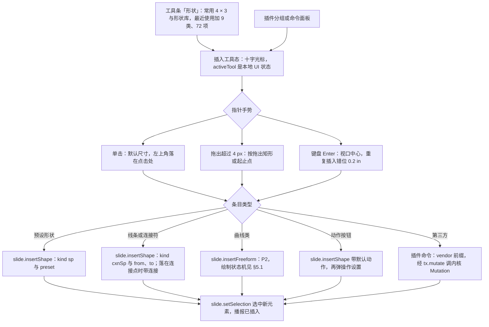

怎么读：上半部分是外壳的插入工具态（状态机本体在 50/10 §7.4），三种手势都先算出 EMU 下的框或起止点；下半部分按条目类型分到不同命令，每条路径恰好一个撤销步（动作按钮的插入与操作设置合为一步，§6.2）；Esc 在工具态任何时刻取消且不产生命令，图中省略。
依据：R elementDesign.crossCutting「插入命令通用流程」；设计 03-15 §1–§3；PRD ED-05。

### 1.3 模型

**图 22-2 本族的模型类图**

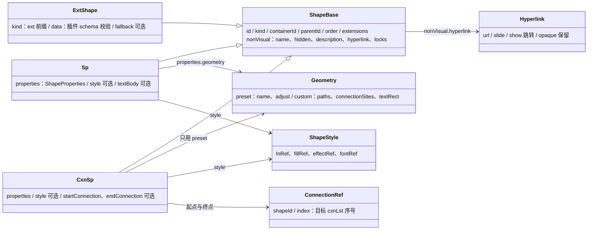

怎么读：空心三角是 Shape 判别联合的分支，公共字段在 `ShapeBase`；预设形状与曲线类都是 `Sp`，区别只在 `Geometry` 取 `preset` 还是 `custom`；线条与连接符是同一个实体 `CxnSp`，有无 `ConnectionRef` 决定它是否「连着」；动作按钮是带 `show` 跳转超链接的 `Sp`；第三方元素只借用基类字段，数据由插件自己的 schema 校验。
依据：30/04 §3.2、§3.3；40/03 §2.1、§2.2；R elementDesign.crossCutting「元素基类」。

### 1.4 渲染管线

**图 22-3 本族的渲染管线**

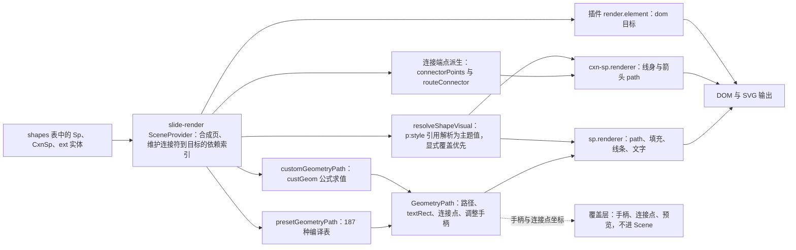

怎么读：左侧是模型，中间是纯函数（几何与视觉解析，两端共用），右侧是查表得到的无状态元素渲染器；连接符的端点在「有连接」时一律从目标形状的连接点派生，不信任存储的 `xfrm`；手柄、连接点标记与拖动预览画在覆盖层，不进入 Scene、不参与导出与缩略图。
依据：40/06 §2.3；40/07 §2.3、§5.1；50/05 §5.2。

### 1.5 族内共用：手柄、几何与默认样式

**手柄种类**（外壳行为与命中优先级在 50/10 §7.5，这里只列本族各元素显示哪些）：

| 手柄 | 外观 | 预设形状 | 线条 | 连接符 | 曲线类 | 动作按钮 | 第三方 |
|---|---|---|---|---|---|---|---|
| 8 个缩放手柄 | 四角 + 四边中点，8 × 8 方块、圆角 1，白底、1px 强调色边（设计 03-15 §4） | 有 | 无 | 无 | 有 | 有 | 按 `capabilities.resize` |
| 旋转手柄 | 上沿正中上方 16 的直径 10 圆点，白底 1px 强调色边，以 12 长的强调色细线相连 | 有 | 无（线用方向表达角度） | 无 | 有 | 有 | 按 `capabilities.rotate` |
| 调整手柄 | 8 × 8 强调色菱形、1px 白边，每个 `gd` 一个（原黄色作废，rulings §4.25 DS-21、DS-24） | 有 `avLst` 时（P1） | 无 | 肘形中段一个（M3） | 无（`ahLst` 不透明） | 无 | 按 `capabilities.adjust` |
| 端点手柄 | 两端直径 10 圆点，白底 1px 强调色边；已连接为强调色实心 + 2px 白边（设计 03-17 §2，原「实心绿」作废） | 无 | 有 | 有 | 无 | 无 | 无 |
| 连接点标记 | 目标形状上的 8px 圆点：白底 1px 强调色边；吸附目标为强调色实心 + 2px 强调色外圈（隔 2px 白） | 拖端点靠近时显示 | 同左 | 同左 | 有 `cxnLst` 时显示 | 同预设形状 | 按 `capabilities.connect` |

- **几何**：手柄位置在屏幕空间计算：先用局部矩阵 `T(off + ext/2) · R(rot) · S(flip) · T(-ext/2)` 与父组矩阵链得到世界矩阵，再乘视口矩阵；拖动时把指针位置经逆矩阵变回局部 EMU 再求新值。2×3 仿射矩阵工具在 engine-layout 自写（40/06 §2.3，R-d-29）。
- **翻转与文字**：`flipH` / `flipV` 翻转几何，文字不镜像；`flipV` 时文字整体转 180°（与 PowerPoint 一致）；线条与连接符用翻转表达方向，宽或高可以为 0。
- **命中与尺寸**：手柄命中区 ≥ 24 CSS px（缩到很小的形状也不缩小命中区，设计 03-15）；触控 ≥ 44 px（M4+ 触控编辑）；线身命中描边容差 ≥ 6 px。
- **锁定**：`spLocks` / `cxnSpLocks` 由交互层执行：`noResize` 隐藏缩放手柄、`noRot` 隐藏旋转手柄、`noAdjustHandles` 隐藏调整手柄、`noChangeShapeType` 禁用「更改形状」、`noMove` 时四角手柄换成 16px 锁形方块、没有边中点手柄，提示签「该〈对象〉已锁定移动」并禁止拖动（设计 03-17 §6.2）；命令层不拒绝（与 PowerPoint 一致，50/19）。
- **数值等价**：每种手柄都有检查器里的数值等价路径（WCAG 2.5.7，PRD ED-29），逐项见各元素 ⑪ 栏；键盘等价的总表在 50/16 §6.3。
- **默认样式来源**：`Theme.objectDefaults` 在 M2 只读建模（R-d-63）：有 `spDef` / `lnDef` 时新元素复制其 `p:style` 与 `bodyPr`，否则用 §2.2 的内建值；两种情况都只写引用，换主题后新元素的颜色自动跟随。

## 2. 预设形状（autoshape）

| 栏 | 设计 |
|---|---|
| ① 作用 | 最常用的追加元素：流程步骤框、强调色块、标注气泡、箭头指示、公式符号。可以直接承载文字。与文本框的区别：带主题填充和线条（`p:style`），文字默认水平垂直居中（`anchor="ctr"`、`algn="ctr"`），不随文字自动增高；与占位符的区别：不参与换版式重匹配，也不继承版式框位 |
| ② OOXML 来源 | `p:sp` = `p:nvSpPr`（`p:cNvPr@id@name`、`p:cNvSpPr`、`p:nvPr`）+ `p:spPr`（`a:xfrm`、`a:prstGeom@prst`（ST_ShapeType 187 种）与 `a:avLst/a:gd@name@fmla`）+ `p:style`（`a:lnRef`、`a:fillRef`、`a:effectRef`、`a:fontRef`）+ `p:txBody`（`a:bodyPr anchor="ctr"`、`a:lstStyle`、`a:p` 带 `algn="ctr"`） |
| ③ 插入入口与默认 | 底部工具条「形状」（S）打开形状弹层：常用 4 × 3 共 12 项，底行「全部形状 72 ›」在同一弹层原位换成形状库（§2.1，最近使用加 9 类、首批 72 项，R-d-66；设计 03-15 §1、§2）；主菜单「插入 › 形状库…」同此。指针点格子进入插入工具态（50/10 §7.4，画布顶部提示条「插入 · 〈名称〉 单击插入 72 × 72 pt，或拖出大小」）：单击插入 72 × 72 pt（1 in，914400 EMU），左上角落在点击处；拖出按拖出矩形，`Shift` 锁 1:1（正方形、正圆）、`Alt` 以按下点为中心；键盘在格子上按 `Enter`（Space 同）不经工具态插到视口中心，重复插入依次错位 14.4 pt（0.2 in）；插入后轻提示「已插入 · 〈名称〉」带撤销（03-15 §3.3）。默认样式：`objectDefaults.spDef`，没有时写 §2.2 的内建 `p:style`；插入后只选中、不进文本编辑（设计 03-15：自动进入为 P1、默认不进） |
| ④ 模型 | `Sp{kind:'sp', properties: ShapeProperties{transform, geometry}, style: ShapeStyle, textBody?}`；`geometry` 为 `Geometry.preset`：`name`（187 种字面量）+ `adjust`（`avLst` 键值，缺省即取几何定义的默认值，不写入）（30/04 §4.3、40/03 §2.2）。新增（§4.21）：`ShapeKindDef.createDefault(box, opts)` 接收 `preset`；`ShapeKindDef.capabilities` 增 `adjust`、`lockAspectDefault`（ADR-0018）；形状库条目 `ShapeGalleryItem{id, category, kind:'sp'\|'cxnSp'\|'freeform', preset?, lineEnds?, milestone}` 放 slide-ui `domain/shape-gallery.ts`（40/10 §4.4） |
| ⑤ 渲染 | slide-render `sp.renderer`（`render.element('dom:sp')`）：`shapeGeometryPath` 委派 engine-layout `presetGeometryPath(name, adj, box)` 得到 `GeometryPath`；多个 path 按各自 `fill` 模式（`norm`、`lighten`、`lightenLess`、`darken`、`darkenLess`、`none`）分层着色；`resolvePaint` 把 `p:style` 引用经 `resolveShapeVisual` 解析为主题值，显式 `spPr` 覆盖优先（40/07 §2.3、40/03 §2.3）；文字区取几何 `textRect`，经 `layoutTextBody` 排版后由 `text-lines` 输出；外阴影用 SVG filter |
| ⑥ 交互 | 选中显示 8 个缩放手柄、旋转手柄与调整手柄（§2.3）；`Shift` 缩放锁比例、旋转 15° 步进；拖动中框下方显示尺寸角标「W × H」，旋转时显示角度角标（覆盖层，设计 03-15 §3.1、§4）；选中后直接键入可打字字符即进入文本编辑并插入该字符，双击或 `Enter` 进入文本编辑（50/06 §2）；「更改形状」与翻转见 §2.4；锁定按 §1.5 |
| ⑦ 检查器 | `selectionKind: shapes`（文本编辑时 `text`，节见 [50/20](20-elements-text.md) §2.1 ⑦），按已拍板样张自上而下：对齐行（标题上方：六向对齐 + 横向 / 纵向分布，单选时分布不可用，rulings §4.25 TB-20）· 面板标题（形状名，如「圆角矩形」）· 位置与大小（X、Y ┊ W、H + 锁定比例 ┊ 旋转 +「水平翻转 / 垂直翻转」切换条）· 快速样式（「填充」节上方一行主题样式缩略图，点开后 42 格样式库在本节缩略行下方原位展开，M2 P1，§2.5，rulings §4.25 DS-31、DS-34）· 填充（无 / 纯色 / 渐变 / 图片 + 颜色行；新形状写「主题样式 · 强调 1」；「图片」按 PRD ED-06 为 P2，留在原位、标 P2、不可用，TB-43）· 描边（无 / 实线 / 虚线）· 阴影（无 / 外阴影 / 内阴影；内阴影 P2，同 TB-43）· 不透明度（滑块 + 数值，同时写填充与描边颜色的 alpha，§2.5，TB-47）· 操作（「单击时 · 无动作 ›」，§6）· 替代文本（与图片同一组件：描述框、标记为装饰性、缺失警示，承接右键「编辑替代文本…」，PRD ED-26，TB-32）（设计 03-02 §4.2、03-15 §4、03-18 §5.4，50/10 §5）。更改形状只走右键「更改形状 ▸」（P1，TB-18）与命令面板，检查器不设入口（检查器只放属性，DS-1；PRD ED-05）；调整值的数值输入（调整手柄的键盘等价）样张未画，随实现、与手柄同批（§2.3）；快速样式的样张状态已补（`main-states.quick-styles`、`main-states.quick-styles-gallery`，样式库按 DS-34 在节内原位展开），替代文本节样张未画、随实现（TB-32） |
| ⑧ 命令 | Command：`slide.insertShape{containerId, kind:'sp', box, preset}`（`preset` 为参数扩展，新增（§4.21））→ Mutation `shape.insert`；`slide.moveShapes` / `resizeShapes` / `rotateShapes` → `shape.setTransform`；`slide.setFill` / `setLine` / `setEffect` → `shape.setProperties`；快速样式 `slide.setShapeStyle{shapeIds, style}`（新增（§4.21））改写 `ShapeStyle` → `shape.setStyle`（同事务清掉遮住样式的显式 `fill` / `ln`）；「不透明度」节 `slide.setShapeOpacity{shapeIds, alpha}`（rulings §4.25 TB-47 登记）→ `shape.setProperties`，§2.5；替代文本 `slide.setAltText` → `shape.setNonVisual`（50/19 §4.7）；新增（§4.21）：`slide.setAdjustValues{shapeId, adjust}`、`slide.changeShape{shapeIds, preset}` → `shape.setProperties`，`slide.flipShapes{shapeIds, axis:'h'\|'v'}` → `shape.setTransform`。Operation：插入后 `slide.setSelection`。逆操作全部由 Store 推导（30/05 §5） |
| ⑨ 协同 | shapes 表新键，并发插入互不冲突；`geom.adj` 为 `Y.Map` 逐键 LWW（两人拖同一形状的不同调整手柄都保留）；`xfrm` 叶子独立键；`style` 引用为 JSON 串整值 LWW；正文 `Y.XmlFragment` 按字符合并（30/06 §1.5）；拖动中形状被远端删除则撤掉预览、不发命令（50/07 §12） |
| ⑩ 导入导出与保真 | E（M2）。未改的 `avLst` 省略不写；`p:style` 原样保留，编辑只追加显式 `spPr` 覆盖；`a:sp3d` / `a:scene3d` 不透明写回；导出 `cNvPr@id` 由 `OoxmlIdMap.allocateId` 取部件内最大值 + 1，名称按「类型 + 序号」本地化生成（50/19） |
| ⑪ 无障碍 | 可访问树名称依次取替代文本、文字摘要、「矩形 3」（50/16 §9.1）；替代文本在检查器「替代文本」节编辑（TB-32），缺失警示的判定以 `missingAlt` 为准（50/05 §11）；形状弹层与形状库各只占一个 Tab 停靠点、方向键漫游（rulings §4.25 TB-5），`Enter` 插到视口中心、`Esc` 关闭；插入后 live region 播报「已插入矩形」；缩放、旋转与翻转的数值等价都在「位置与大小」节，调整手柄的数值等价是调整值字段（样张未画，随实现；与手柄同批上线、不晚于手柄，WCAG 2.5.7） |
| ⑫ 复用 | 维持自研：187 种几何由 `tooling/scripts/compile-preset-geometry` 从 ECMA-376 `presetShapeDefinitions.xml` 编译成 iso 表（R-d-32），两端共用；没有可直接复用的库——pptx-viewer-core 整包 26 MB、依赖含 MPL 与 GPL 选项，只在仓库外作差分对照，@aiden0z/pptx-renderer 只有 29 个编译定义。flyout 用 shadcn Popover + 自写网格；缩略图在构建期用同一 `presetGeometryPath` 生成 path 数据（§2.1） |
| ⑬ 里程碑 | M1 查看（187/187）；M2 P0 插入、变换、翻转、填充（含透明度）、线条；调整手柄与数值等价 P1；更改形状 P1；快速样式 P1（PRD ED-06）；替代文本 P1（ED-26）；图片填充、内阴影 P2 |
| ⑭ 待决 | 首批 72 项名单已于第 1 批拍板（§2.1）；内建 `lnRef` 的 `shade` 取值以 PowerPoint 365 新建形状语料为准（§2.2）；插入后自动进入文本编辑维持 P1 默认关 |

### 2.1 形状库：首批 72 项、10 类

分类与次序沿用 PRD ED-05 与设计 03-15 的枚举（最近使用在最前，其余不自行调整）；名单以设计 03-15 §2.2 与已拍板样张的清单 `src/v3/editor/shapes/catalog.tsx` 为准（2026-10-07 第 1 批拍板；旧版 `src/components/editor/ribbon/insert/shapes.tsx` 随 DS-1、DS-7 作废；2026-09-26 整合时按设计线样张对齐：矩形 5、基本形状 14、箭头 8，原「矩形 4、基本形状 13、箭头 10」随之调整）；每项 tooltip 显示中文名，括号内为写入的 `prst`。线条类条目写 `p:cxnSp`（R-d-64），其余写 `p:sp`。

| 类别 | 项数 | 条目（中文名 · `prst`） |
|---|---|---|
| 最近使用 | 0–10（动态） | 本机最近插入的条目，最多 10 项，置顶、其下一条分隔线；没有最近使用时整段与分隔线都不出现（设计 03-15 §2.1，原「最多 8 项」作废）；存个人偏好 `cordex.prefs`（50/02 §10.1 键空间），不进文档、不同步 |
| 线条 | 10 | 直线 · `line`；箭头 · `straightConnector1` + 尾箭头；双箭头 · `straightConnector1` + 首尾箭头；肘形连接符 · `bentConnector3`；肘形箭头连接符 · `bentConnector3` + 尾箭头；曲线连接符 · `curvedConnector3`；曲线箭头连接符 · `curvedConnector3` + 尾箭头；曲线（P2）；任意多边形（P2）；自由曲线（P2） |
| 矩形 | 5 | 矩形 · `rect`；圆角矩形 · `roundRect`；剪去单角的矩形 · `snip1Rect`；剪去同侧角的矩形 · `snip2SameRect`；同侧圆角矩形 · `round2SameRect` |
| 基本形状 | 14 | 椭圆 · `ellipse`；等腰三角形 · `triangle`；直角三角形 · `rtTriangle`；平行四边形 · `parallelogram`；梯形 · `trapezoid`；菱形 · `diamond`；正五边形 · `pentagon`；六边形 · `hexagon`；八边形 · `octagon`；圆柱形 · `can`；立方体 · `cube`；同心圆 · `donut`；心形 · `heart`；闪电形 · `lightningBolt` |
| 箭头 | 8 | 右箭头 · `rightArrow`；左箭头 · `leftArrow`；上箭头 · `upArrow`；下箭头 · `downArrow`；左右箭头 · `leftRightArrow`；直角箭头 · `bentArrow`；五边形箭头 · `homePlate`；燕尾形 · `chevron` |
| 公式形状 | 6 | 加号 · `mathPlus`；减号 · `mathMinus`；乘号 · `mathMultiply`；除号 · `mathDivide`；等号 · `mathEqual`；不等号 · `mathNotEqual` |
| 流程图 | 8 | 过程 · `flowChartProcess`；可选过程 · `flowChartAlternateProcess`；决策 · `flowChartDecision`；数据 · `flowChartInputOutput`；预定义过程 · `flowChartPredefinedProcess`；文档 · `flowChartDocument`；终止 · `flowChartTerminator`；接点 · `flowChartConnector` |
| 星与旗帜 | 5 | 四角星 · `star4`；五角星 · `star5`；六角星 · `star6`；爆炸形 1 · `irregularSeal1`；波形 · `wave` |
| 标注 | 4 | 矩形标注 · `wedgeRectCallout`；圆角矩形标注 · `wedgeRoundRectCallout`；椭圆形标注 · `wedgeEllipseCallout`；线形标注 · `borderCallout1` |
| 动作按钮 | 12 | 见 §6.1 |

- 合计 72 项（最近使用不计）：线条 10 + 矩形 5 + 基本形状 14 + 箭头 8 + 公式 6 + 流程图 8 + 星与旗帜 5 + 标注 4 + 动作按钮 12；满足 PRD ED-05「≥ 60 种、按类别分组」。其余 115 种预设几何照常可查看、可导入导出，只是不在首批图库里；扩充图库只改数据文件，不改代码。
- **数据文件**：`ShapeGalleryItem[]` 在 slide-ui `domain/shape-gallery.ts`；flyout 缩略图的 path 数据由 `tooling/scripts/gen-shape-gallery-thumbs.ts` 在构建期调用 engine-layout `presetGeometryPath` 生成 `domain/shape-gallery-thumbs.ts`（生成物，CI `--check` 无差异），运行时不求值几何、不加载 SVG 文件；缩略图用 React `<svg><path d>` 渲染，不走 `innerHTML`（50/14 的 Trusted Types 约束）。
- **可用性**：线条行末三项（曲线、任意多边形、自由曲线）P2 不可用：`--v3-text-3` 线稿、`aria-disabled`、仍可聚焦，行尾挂一个 P2 标记，工具提示「曲线 · 绘制曲线排在后续版本（P2）」（另两项同式，设计 03-15 §2.1、§2.3）；`when` 与 `enablement` 按 50/10 §4「禁用而不隐藏」。
- **搜索**：不设。PRD 07 G-78 定为「可选搜索框，样张决定」，已拍板样张不设；按名称直达走命令面板（⌘K）（设计 03-15 §2.1；原「弹层顶部搜索框」作废）。
- **键盘**：整库只占一个 Tab 停靠点（roving tabindex），方向键漫游：← → 连续移动、行尾接下一行，↑ ↓ 按行保持列位；Enter / Space 不经工具态插到视口中心；Esc 关闭弹层、焦点回到「形状」（rulings §4.25 TB-5，设计 03-15 §2.4；常用 4 × 3 网格同一模式）。

**图 22-4 形状库条目的数据来源**

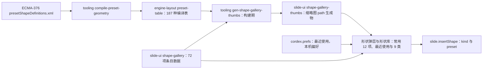

怎么读：几何只有一个来源（ECMA 规范编译出的表），画布渲染和图库缩略图都由它生成，所以图库里看到的就是插入后画出来的；条目名单是 slide-ui 的一份纯数据，扩充图库不动代码；最近使用是本机偏好，不进入文档。
依据：R-d-32、R-d-66；40/06 §2.3 `presetGeometryPath`。

### 2.2 默认样式与默认尺寸

| 元素 | 默认尺寸 | `objectDefaults` 缺席时写入的 `p:style`（只写引用） | 文字 |
|---|---|---|---|
| 预设形状、动作按钮、闭合的曲线类 | 单击 1 in × 1 in；拖出按矩形 | `fillRef idx=1` + `accent1`；`lnRef idx=2` + `accent1` 带 `shade` 修饰；`effectRef idx=0` + `accent1`；`fontRef idx=minor` + `lt1` | `anchor="ctr"`、`algn="ctr"`；字号走 30/04 §6.1 继承链 |
| 线条、箭头、连接符、开放的曲线类 | 单击 1 in 水平线；拖出按起止点 | `lnRef idx=1` + `accent1`；`fillRef idx=0` + `accent1`；`effectRef idx=0` + `accent1`；`fontRef idx=minor` + `tx1` | 无 `p:txBody` |

- `objectDefaults.spDef` / `lnDef` 存在时复制其中的 `p:style`、`spPr` 与 `bodyPr`（照抄原文件作者的「设为默认形状」效果）；「设为默认形状」的写入是 P2（PRD ED-06），M2 只读。
- `shade` 的取值以 PowerPoint 365 新建形状的语料为准（tooling 从语料抽取后写入 slide-ui 常量并附出处），不在文档与代码里凭记忆手写（§10 待决 1）。
- 箭头默认：「箭头」条目只写 `a:tailEnd type="triangle"`，「双箭头」同时写 `a:headEnd`；宽与长取 `med`，与 PowerPoint 默认一致。

### 2.3 调整手柄

- **显示**：选中带 `avLst` 的预设形状时，每个调整值一个 8 × 8 强调色菱形手柄（1px 白边；圆角矩形的在上沿、距左等于圆角半径，设计 03-15 §4；原黄色作废），位置取 `GeometryPath.adjHandles`（engine-layout 按几何定义的 `ahXY` / `ahPolar` 求出，40/06 §2.2）；多选时不显示。
- **拖动**：`ahXY` 手柄沿 x、y 两个方向各自改一个调整值，`ahPolar` 按半径与角度改；新值按 `minX..maxX` 等界限钳制；拖动中每帧只重算覆盖层上的预览路径，不写 Store。
- **松手**：一次 `slide.setAdjustValues{shapeId, adjust}`，只写被改动的键；把值拖回几何默认值时删除该键（保持「未改 `avLst` 省略」）。
- **键盘与数值等价**：检查器的调整值字段（样张未画，随实现，[10](./10-editor-shell-and-interaction.md) §5 `shapes` 行）按几何定义列出调整值（显示为百分比或角度），可输入、可 `↑` / `↓` 微调；与手柄上线同批（P1），不晚于手柄。
- **不做**：`custGeom` 的 `ahLst` 在 M1 为不透明保留，曲线类不显示调整手柄。

**图 22-5 调整手柄拖动状态机**

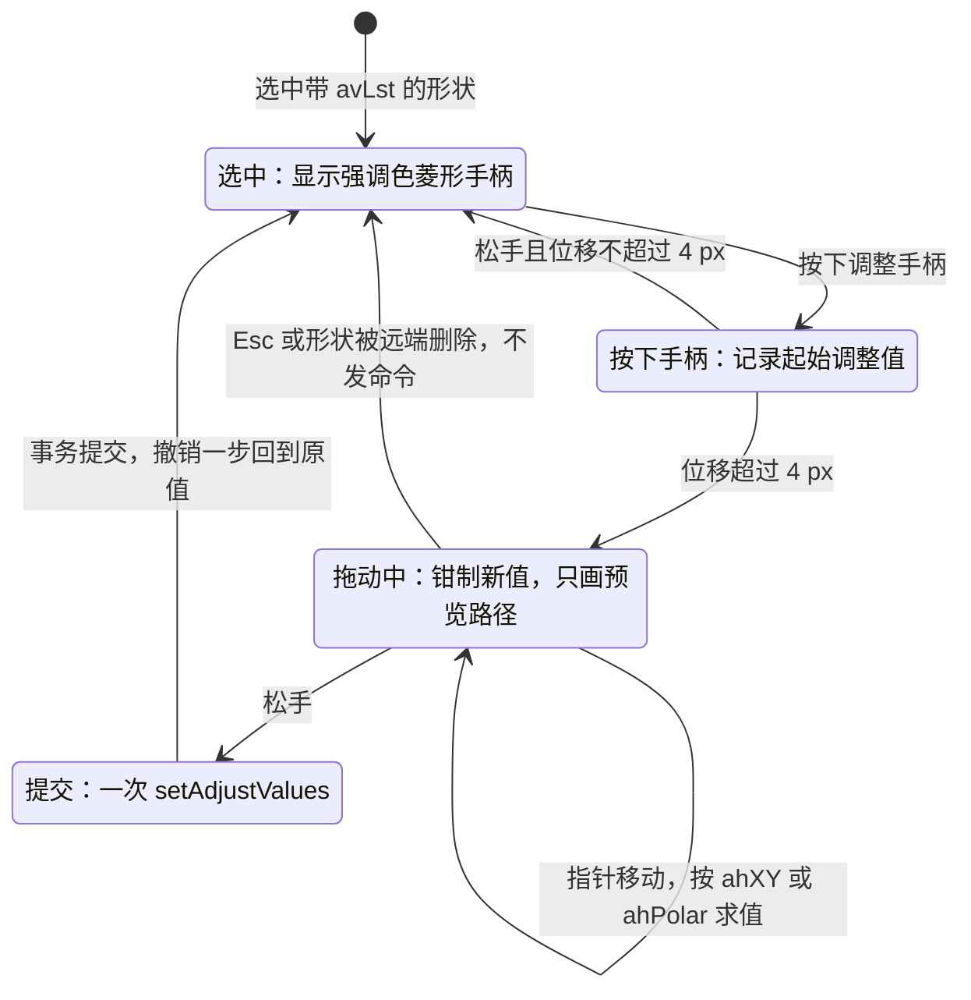

怎么读：只有「提交」一个状态会写 Store；Esc 与远端删除都回到选中态且零命令；未越过 4 px 阈值的按下视为点击，不改任何值。
依据：PRD ED-05「调整手柄（avLst 每个 gd 一个，P1）」；设计 03-15 §4 手柄表；50/10 §7.5。

### 2.4 更改形状与翻转

- **更改形状**（P1）：形状右键「更改形状 ▸」（在「旋转 ▸」之后，未开放前留在原位不可用、右侧写「后续版本提供」；rulings §4.25 TB-18，设计 03-05 §3）打开图库（只列 `sp` 条目，不列线条与动作按钮）；命令面板可直达同一命令；检查器不设入口（检查器只放属性，DS-1；PRD ED-05 只列右键）；执行 `slide.changeShape{shapeIds, preset}`：只替换 `geometry.name` 并清空 `adjust`（新几何用自己的默认值），保留变换、文字、`p:style` 与显式覆盖；多选时一个事务；`noChangeShapeType` 锁定的形状跳过并在轻提示里计数。
- **翻转**（M2 P0）：入口为检查器「位置与大小」节的「水平翻转 / 垂直翻转」切换条（设计 03-02 §4.2）与画布右键「旋转 ▸」的「水平翻转 · 垂直翻转」（03-05 §3）；主菜单「排列」只管层级与组合、不放翻转（与 50/18 SEL-11 同一口径，原开始 › 排列 ▾ 随 Ribbon 作废）；执行 `slide.flipShapes{shapeIds, axis}`，对每个对象在自身中心翻转，多选时不绕选区中心整体镜像（本文取值，与 PowerPoint 的行为差异列入 §10 待决 2 由语料核对）；翻转写 `xfrm@flipH` / `@flipV`，旋转角不变。
- **文字方向**：翻转后文字不镜像；`flipV` 使文字整体转 180° 显示，与 PowerPoint 相同（§1.5）。

### 2.5 快速样式与不透明度

- **快速样式**（M2 P1，PRD ED-06「形状样式快速库（主题 `fmtScheme` 组合 42 种）」；入口按 rulings §4.25 DS-31，样式库的位置按 DS-34）：形状检查器「填充」节上方一行主题样式缩略图，整行是一个按钮，点按或 `Enter` / `Space` / `↓` 打开；42 格样式库（7 列主题色槽 × 6 行 `fmtScheme` 样式强度，缩略图按当前主题实时渲染，与 [18](18-editor-capabilities.md) FMT-07 同一口径）在「快速样式」节里、缩略行下方原位展开，下方各节下移、不遮挡画布，节标题右侧出现「收起样式库」按钮；收起按钮、再点缩略行或 `Esc` 收起，焦点回到缩略行。2026-10-08 DS-34 修订 DS-31 的「样式库弹层」：贴检查器左缘展开的弹层会盖住靠右的选中对象，与「样式库保持展开、便于连续比较」冲突。缩略图去掉白衬底、形状铺满格子，外圈用 `--v3-swatch-line`（TB-56；「中等 / 强烈效果」的投影在缩略行里看不出来，在样式库的大格里仍可辨）。点一格（或在格上按 `Enter` / `Space`）即 `slide.setShapeStyle{shapeIds, style: ShapeStyleRef}` → `shape.setStyle`，同一事务清掉会遮住样式的显式 `fill` / `ln` 覆盖，只写引用、换主题后跟随（§0.2，R-d-63）；多选一个事务、一个撤销步；应用后样式库保持展开、焦点留在该格，便于连续比较。样式库的键盘同形状库：整组只占一个 Tab 停靠点、方向键漫游（TB-5，设计 07 §1.2b，[16](16-i18n-and-accessibility.md) §6.2）。评审、只读浏览与降权下按 DS-15 只读展示，不出缩略图行与样式库。实现落点 slide-ui `ui/inspector/ShapeStyleSection.tsx`（40/10 §5.4）；样张 `main-states.quick-styles`、`main-states.quick-styles-gallery`。
- **不透明度**（rulings §4.25 TB-47）：OOXML 形状没有整体不透明度，检查器「不透明度」节（滑块 + 数值 0–100 %，与图片、视频同一画法）同时改写填充与描边颜色的 `alpha`：`slide.setShapeOpacity{shapeIds, alpha}` → `shape.setProperties`，一步撤销；拖动滑块只改预览、松手一次命令（同 [23](23-elements-media.md) §2.4 图片的不透明度）；主题色仍写 `schemeClr`，只追加或改写 `alpha` 修饰（[18](18-editor-capabilities.md) 图 18-11）。命令登记在 40/03 §2.6 与 30/05 §14.4（§10.2）。

## 3. 线条与箭头

| 栏 | 设计 |
|---|---|
| ① 作用 | 分隔内容、指示方向与流程、给图表或图片拉标注引线；带箭头表示「从哪到哪」。与连接符的区别只在是否连着形状：同一个实体，端点落到连接点上就成为连接符（§4） |
| ② OOXML 来源 | `p:cxnSp` = `p:nvCxnSpPr`（`p:cNvPr`、`p:cNvCxnSpPr`）+ `p:spPr`（`a:xfrm`、`a:prstGeom prst="line"` 或 `"straightConnector1"`、`a:ln` 的 `a:headEnd` / `a:tailEnd@type@w@len`）+ `p:style`；方向靠 `flipH` / `flipV` 表达，宽或高可为 0（R-d-64）。导入文件里的 `p:sp` + `prstGeom line` 保持为 `sp`，不改写 |
| ③ 插入入口与默认 | 工具条「形状」常用 4 × 3 里的「直线」「箭头线」，或形状库「线条」行的直线、箭头、双箭头（§2.1，设计 03-15 §1）；以拖出为主：按下点为起点、松手点为终点，`Shift` 把角度约束到 0° / 45° / 90° 的倍数；单击插入 72 pt（1 in）水平线（起点在点击处）；`Enter` 插到视口中心。默认样式 `objectDefaults.lnDef`，否则 §2.2 的线条 `p:style` |
| ④ 模型 | `CxnSp{kind:'cxnSp', properties{transform, geometry: Geometry.preset{name:'line'\|'straightConnector1'}, line?}, style, startConnection?, endConnection?}`（30/04 §3.2），与连接符同一实体；箭头在 `Line.headEnd` / `tailEnd{type, w, len}`（30/04 §4.3 `a:ln`）；端点不单独存储，由 `xfrm` 与翻转推出（§3.1） |
| ⑤ 渲染 | slide-render `cxn-sp.renderer`（`render.element('dom:cxnSp')`）：由 `xfrm` 与翻转算出两个端点，画一条 `<path>`；箭头按 `type` × `w` × `len` 生成独立的闭合 path（不用 SVG `marker`，便于命中测试且与 SVG 导出一致），箭头尖端对齐端点、线身在箭头根部截断，避免粗线穿出箭头；线型（`prstDash`）、端点帽（`cap`）照 `a:ln` 输出 |
| ⑥ 交互 | 选中只显示两个端点手柄，不显示 8 个缩放手柄与旋转手柄；拖端点改长度与方向，`Shift` 吸附 45°，靠近形状时显示其连接点并可吸附（吸附即变为连接符，§4）；拖线身整体移动；线身命中容差 ≥ 6 px；方向键移动整条线 |
| ⑦ 检查器 | `selectionKind: connector`，面板标题为线条名（如「箭头」），按已拍板样张自上而下：连接（起点 / 终点下拉，未连接时为「未连接」，rulings §4.25 TB-21，§4 ⑦）· 线条（实线 / 虚线、颜色、粗细 pt、终点箭头 无 / 三角箭头 / 圆点）· 类型（直线 / 肘形 / 曲线）· 位置与大小（X、Y、W、H；未连接的线条，x / y / 宽 / 高与翻转即端点的数值等价）（设计 03-17 §8，50/10 §5）。功能口径另有：宽度 0.25–100 pt、8 种虚线、首尾箭头类型与大小（§3.2）、端点帽与连接 P2、复合线 P2、起止点坐标字段 P2，样张未画，随实现放「线条」与「位置与大小」节；线条与连接符没有替代文本（03-05 §3「连接符」） |
| ⑧ 命令 | Command：`slide.insertShape{containerId, kind:'cxnSp', preset, from, to}`（`from` / `to` 为参数扩展，新增（§4.21），取页坐标点或 `ConnectionRef`，由命令换算成 `xfrm` + 翻转，§3.1；落在连接点的一端直接写进新实体的 `startConnection` / `endConnection`，仍是这一条命令）→ `shape.insert`；端点拖动 `slide.setLineEnds{shapeId, start?, end?}`（新增（§4.21））→ `shape.setTransform`，被拖的一端若原先连着形状，同一事务内 `cxnSp.setConnections` 置空（断开）；箭头与线型走既有 `slide.setLine` → `shape.setProperties`；整体移动走 `slide.moveShapes` |
| ⑨ 协同 | `setLineEnds` 在一个事务里写齐 `off`、`ext`、`flipH`、`flipV` 四组叶子，避免只改一半导致线段错位；箭头属于 `ln` 的 `Y.Map` 字段，与颜色、宽度可并发独立编辑（30/06 §1.5） |
| ⑩ 导入导出与保真 | E（M2）。箭头类型与尺寸往返；未改的 `a:ln` 子元素原样；导入的 `sp` + `line` 保持 `sp`，可移动缩放但端点手柄按普通形状处理（只有 8 个缩放手柄） |
| ⑪ 无障碍 | 可访问树名称「直线 2」「箭头 1」或替代文本；方向键移动整条线；端点的等价路径是「位置与大小」四值加水平 / 垂直翻转（线条的 x / y / 宽 / 高与两个端点一一对应，与 ⑦ 一致），不需要拖动 |
| ⑫ 复用 | 维持自研：箭头几何是 6 种类型 × 9 种尺寸的比例表加几十行路径生成，没有表达 OOXML `headEnd` / `tailEnd` 语义的库；端点手柄与吸附属于选择手柄体系（R-d-29，交互参考 Excalidraw，MIT，只借鉴不引入） |
| ⑬ 里程碑 | M1 查看；M2 P0 插入、端点编辑、箭头、线型 |
| ⑭ 待决 | 端点编辑用独立命令 `setLineEnds` 而不复用 `resizeShapes`（证据推荐，本文采纳：`resizeShapes` 以框为语义，表达不了「终点越过起点」时的翻转） |

### 3.1 起止点与 `xfrm` 的换算

线条不存端点，只存外接框与翻转。插入命令与 `setLineEnds` 都用同一个纯函数把起止点换算为 `xfrm`：

- `off = (min(x1, x2), min(y1, y2))`，`ext = (|x2 − x1|, |y2 − y1|)`；
- `flipH = x2 < x1`，`flipV = y2 < y1`；`rot` 保持 0（线条的角度由框与翻转表达，不写 `rot`）；
- 反向换算（渲染、手柄位置）：未翻转时起点是框的左上角、终点是右下角，`flipH` 交换左右、`flipV` 交换上下；组内的线先乘父组矩阵链（§1.5）。

**图 22-6 端点拖动到 `xfrm` 的换算**

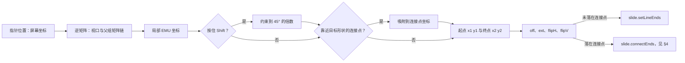

怎么读：从左到右是一次端点拖动在松手时的计算；Shift 约束先于连接点吸附，吸附成功时终点坐标取连接点而不是指针位置；是否落在连接点决定松手时发哪条命令，两条命令都在同一事务里写齐 `xfrm` 四组叶子。
依据：R elementDesign「线条」insertEntry、commands；PRD ED-05「Shift 约束」。

### 3.2 箭头类型与尺寸

| 属性 | 取值（OOXML） | 界面 |
|---|---|---|
| `type` | `none`、`triangle`、`stealth`、`diamond`、`oval`、`arrow` | 第 1 批样张「线条」节只画了「终点箭头」（无箭头 / 三角箭头 / 圆点，设计 03-17 §8）；首端箭头与其余类型随实现放在同一节（[18](./18-editor-capabilities.md) FMT-05） |
| `w` × `len` | `sm` / `med` / `lg` 各三档，组合为 9 种 | 3 × 3 网格选择器，与 PowerPoint 相同（样张未画，随实现） |

- 箭头大小按线宽成比例放大（线越粗箭头越大），比例表是 slide-render `cxn-sp.renderer.ts` 内的常量（40/07 §5.1），与 PowerPoint 的对照由视觉 oracle 覆盖（70/04 形状库 72 项与箭头尺寸快照）。
- 连接符与线条共用这一套设置；普通形状没有箭头。

## 4. 连接符

| 栏 | 设计 |
|---|---|
| ① 作用 | 在流程图、组织结构图、系统框图里把两个形状连起来；移动形状时连线自动跟随，不必逐条重画。肘形连接符走横平竖直的折线，曲线连接符走平滑 S 形 |
| ② OOXML 来源 | `p:cxnSp` + `p:nvCxnSpPr/p:cNvCxnSpPr/a:stCxn@id@idx` 与 `a:endCxn@id@idx`（`id` 指目标的 `cNvPr@id`，`idx` 是目标几何 `cxnLst` 的序号）+ `a:prstGeom` 取 `straightConnector1`、`bentConnector2..5`、`curvedConnector2..5`，肘形与曲线带 `avLst`（中段位置） |
| ③ 插入入口与默认 | 形状库「线条」：肘形连接符、肘形箭头连接符、曲线连接符、曲线箭头连接符；工具条「形状」弹层里的「直线」「箭头线」从一个形状拖到另一个形状，落到连接点上同样成为连接符（设计 03-17 §8）。拖出时指针悬停的形状描 1px 强调色框并显示 4 个连接点（上、右、下、左），端点靠近连接点时它变为吸附目标并吸附，下方提示签「连接到「〈形状名〉」」；起点或终点落在连接点上即连接；默认样式同线条（§2.2） |
| ④ 模型 | `CxnSp.startConnection` / `endConnection: ConnectionRef{shapeId, index}`（30/04 §3.2）；导出时由 `OoxmlIdMap` 把 `shapeId` 映射为目标的 `cNvPr@id`；目标变成墓碑时引用保留、渲染为自由端点（§4.5）。新增（§4.21）：Mutation `cxnSp.setConnections{shapeId, start?, end?}`（`null` 表示断开）；`ShapeKindDef.capabilities.connect` 决定一个 kind 能否被连接 |
| ⑤ 渲染 | 有连接的端点一律从目标派生：engine-layout `connectorPoints` 给出目标几何在局部坐标里的连接点与法向，乘目标的世界矩阵得到页坐标（§4.1）；M2 直线连接符直接连两点；M3 由 `routeConnector` 按 PowerPoint 规则选 `bentConnector2..5` / `curvedConnector2..5` 并算 `adj`（§4.4，单条 ≤ 1 ms，单页 ≤ 50 条）。slide-render `SceneProvider` 维护「连接符 → 目标」依赖索引，目标的变换进入 DirtySet 时连带把连接符标脏 |
| ⑥ 交互 | 端点手柄：已连接为强调色实心 + 2px 白边、未连接为白底空心（设计 03-17 §2）；选中已连接的连接符时沿线 1px 强调色、没有缩放手柄；拖端点靠近形状时显示该形状的全部连接点并高亮最近一个，松手在连接点上即连接、在空白处即断开（无需确认，设计 03-17 §8）；M3 起肘形中段显示一个调整手柄（强调色菱形）改 `adj`；多选且类型混杂时禁用端点操作；状态机见图 22-7 |
| ⑦ 检查器 | `selectionKind: connector`，面板标题为连接符名（如「箭头连接符」），按已拍板样张：连接（起点、终点各一个下拉，值写「〈形状名〉 · 〈哪一侧〉连接点」，另有「未连接」一项——选一项即连接、选「未连接」即断开、端点留在原位，是拖动端点的键盘等价，与拖动走同一组命令，rulings §4.25 TB-21；说明「把端点拖离形状即可断开」）· 线条 · 类型（直线 / 肘形 / 曲线）· 位置与大小（X、Y、W、H，说明「由两端的连接点决定，拖动端点即可改变」，没有旋转、翻转与锁定比例）（设计 03-17 §8，50/10 §5）。原「每端一个『断开』按钮与『连接到…』选择器（目标形状 ▾ + 连接点 ▾）」由起止点下拉取代；样张只画了只读的起点 / 终点，下拉随实现 |
| ⑧ 命令 | 新增（§4.21）：`slide.connectEnds{shapeId, start?, end?}`（每端 `ConnectionRef \| null`）→ `cxnSp.setConnections` + `shape.setTransform`（同一事务写齐派生后的 `xfrm`）；`slide.changeConnectorType{shapeIds, preset}` → `shape.setProperties`（M2 可切换，M3 起切换后立即重算）；跟随：`slide.moveShapes` / `resizeShapes` / `rotateShapes` 携带参数 `reroute?: ConnectorPatch[]`（30/05 §14.5）——slide-ui 交互层松手时经 `layout` 服务（engine-layout `connectorPoints` / `routeConnector`）求出受影响连接符的新 `xfrm`（M3 起含 `preset` 与 `adj`），与目标形状的变换在**同一事务**写回，即「命令内联写回」（R-d-78），不另起事务、不靠渲染回写；model-slide 与编码器都不 import engine-layout；未传 `reroute`（插件或 API 直接调命令）时只移形状，显示与导出仍按派生几何 |
| ⑨ 协同 | 端点引用 `cxn.stCxn` / `cxn.endCxn` 为 JSON 串整值 LWW（30/06 §1.3.2、§1.5）；A 移动目标与 B 拖连接符端点并发时，存储的 `xfrm` 可能来自不同的人，但画面以派生结果为准；导出调用方先对全部已连接的连接符求派生几何，再作为 `connectorGeometry` 显式输入交给编码器（R-d-78，30/05 §14.5），所以收敛后画面与导出一致，且同一 Snapshot 在浏览器与 Node 导出同一字节；目标被他人删除见 §4.5 |
| ⑩ 导入导出与保真 | M2 E~：`stCxn` / `endCxn` 往返，直线跟随；M3 E：肘形与曲线按规则重算。目标被硬删后导出去掉失效引用并发诊断 `connector-target-missing`（新增（§4.21），登记去向见 §10）；导入时引用了不存在的 `cNvPr@id` 的连接符保留为自由端点并发同一诊断 |
| ⑪ 无障碍 | 名称如「肘形连接符：矩形 1 → 菱形 3」；端点可用方向键移动（选中某一端点时），连接的等价路径是检查器「连接」节的起点 / 终点下拉（TB-21）；`Enter` 吸附到最近连接点为 P2 |
| ⑫ 复用 | 维持自研：OOXML 连接符是「预设几何 + 调整值」，PowerPoint 的肘形路由不避障，要的是复现它的选型与 `adj` 规则，不是通用图布局；libavoid 为 LGPL（禁用），elkjs 为 EPL 且面向整图布局，都不适用；交互参考 Excalidraw（MIT）的箭头绑定，只借鉴不引入 |
| ⑬ 里程碑 | M2 P1：插入、连接与断开、直线跟随（PRD ED-28 M2 E~）；M3 P1：肘形与曲线在端点移动后重算路径与调整值（ED-28 M3 E） |
| ⑭ 待决 | 目标被他人删除后的显示（推荐：墓碑期保持引用、画为自由端点并在端点手柄显示断开标记，§4.5）；可被连接的元素范围（推荐：`sp`、`pic` 与组合内的这两类，`graphicFrame` 与组合本身不提供连接点，待语料核对） |

### 4.1 连接点

- **来源**：预设几何的连接点来自 `presetShapeDefinitions.xml` 的 `cxnLst`（每个 `a:cxn` 有位置公式与方向角 `ang`）；`custGeom` 来自自己的 `cxnLst`；图片按其外接矩形取上、左、下、右四个中点。engine-layout `connectorPoints(geometry, adj, box)` 返回局部坐标系下的 `ConnectionPoint{index, point, angle}[]`（40/06 §2.2），`index` 就是 OOXML 的 `idx`。
- **何时显示**：插入工具为线条或连接符且指针悬停在形状上时，或拖动已有线条 / 连接符的端点靠近形状时；显示在覆盖层（render-dom 选择覆盖层的子部件，不进 Scene）。
- **吸附**：指针与连接点的屏幕距离 ≤ 8 CSS px 时高亮并吸附（本文取值，比智能参考线的 4 px 大，因为连接点是离散目标）；按住 `Alt` 临时关闭吸附（与参考线一致，PRD ED-09）。
- **不可连接**：被 `noSelect` 锁定、隐藏（`hidden`）的形状，以及 `capabilities.connect` 为假的 kind 不显示连接点。

### 4.2 端点状态机

**图 22-7 连接符端点状态机**

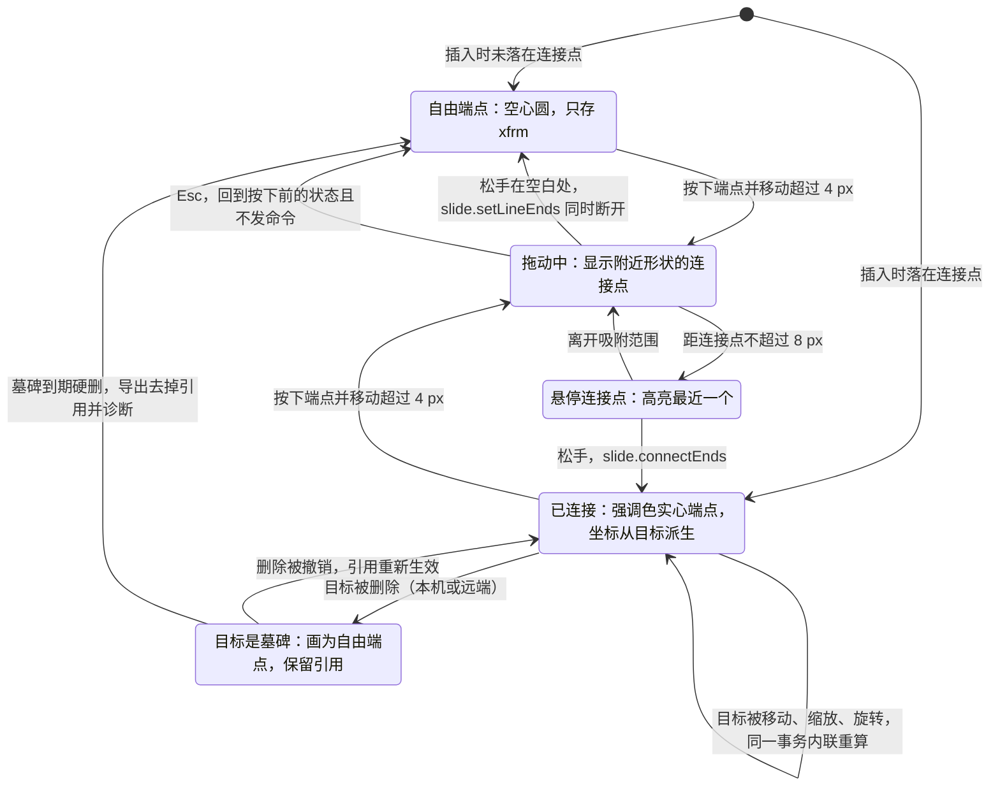

怎么读：一个端点只有「自由」「已连接」「孤儿」三种稳定态，拖动与悬停是手势中的瞬态；任何一次松手都只发一条命令；「已连接」上的自环表示跟随发生在移动目标的那条命令里，而不是连接符自己的命令；Esc 从拖动回到按下前的稳定态（图中以回到「自由」为例）。
依据：设计 03-17 §8 图 8-1；PRD ED-28；R-d-78。

### 4.3 跟随：命令内联写回

**图 22-8 移动目标形状时连接符的跟随时序**

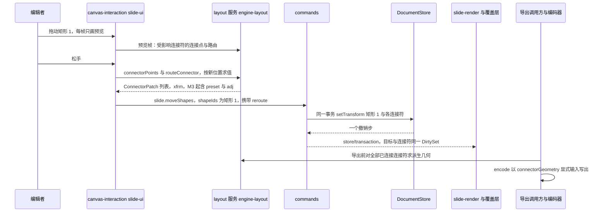

怎么读：上半段是编辑时的内联写回，交互层算几何、命令只写值，目标与连接符在一个事务里，撤销一次同时回退；受影响的连接符按端点引用反查，不扫描全页；下半段是导出时的派生重算，由导出调用方算好再交给编码器，编码器不读 `layout` 服务。未携带 `reroute` 的调用只移动目标，连接符的显示仍按派生几何跟随。
依据：R-d-78；30/05 §14.5；R elementDesign「连接符」commands。

### 4.4 M3：肘形与曲线的重算规则

- **输入**：两端的页坐标与法向（连接点的 `ang` 经世界矩阵旋转后取最近的上、右、下、左四向之一），自由端点的法向取指向另一端的方向。
- **选型**：两端法向互相垂直 → `bentConnector2`（L 形）；法向相对且对齐可直连 → `bentConnector3`（Z 形，中段位置 `adj1` 默认 50000）；法向同向或需要绕到形状外侧 → `bentConnector4` / `bentConnector5`（多一两段绕行）；曲线连接符按同一选型映射到 `curvedConnector2..5`。
- **输出**：`xfrm`（框、翻转、必要时 `rot` 为 90° 的倍数）、`preset` 与 `adj`；用户拖过中段调整手柄的，重算时按比例保留该 `adj`，只在选型改变时回到默认值。
- **标定**：以上是规则框架；每种法向组合下的具体选型、翻转与 `adj` 公式以 PowerPoint 365 的导出结果为 oracle 反推，建 `fixtures/pptx/features/connector-*` 语料逐条比对（风险：规则要靠语料反推，R 矩阵「连接符路由」）。

**图 22-9 肘形连接符的选型**

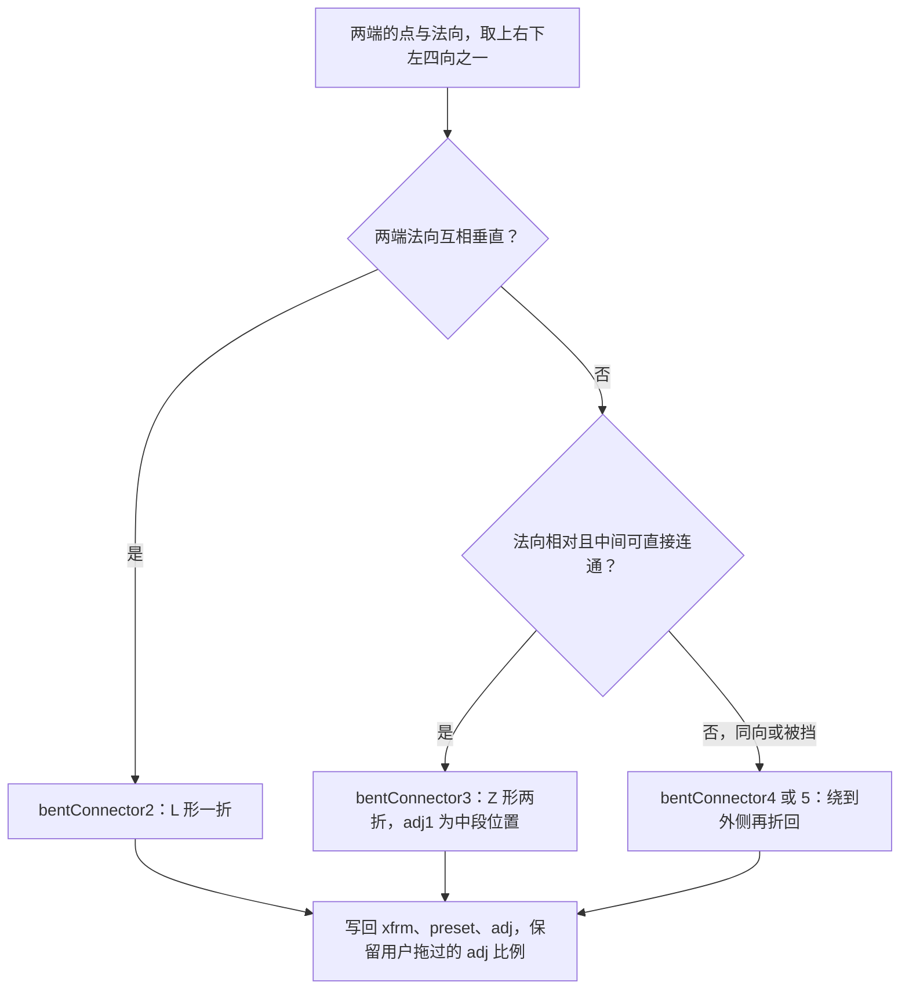

怎么读：自上而下两次判断即可选出肘形的段数；曲线连接符沿用同一判断，只把 `bent` 换成 `curved`；各分支内的翻转与 `adj` 公式由语料标定，不在此图展开。
依据：PRD ED-28 M3；R elementDesign「连接符」render。

### 4.5 目标被删除

- **墓碑期**（24 h，rulings §4.15 Q3）：连接符保留 `ConnectionRef`，画面按存储的 `xfrm` 画成自由端点，端点手柄显示为带斜线的空心圆，检查器写「起点的目标已被删除」；删除被撤销（本机或原删除者）后自动恢复连接与跟随。
- **硬删后**：导出去掉失效引用并发诊断（§4 表 ⑩）；下一次编辑该连接符时一并清掉引用。
- **不能指向墓碑**：`slide.connectEnds` 的目标若已是墓碑，命令返回校验错误，不产生事务（50/19「不能新指向墓碑」）。

## 5. 任意多边形、曲线与自由曲线

| 栏 | 设计 |
|---|---|
| ① 作用 | 画不规则轮廓（地图区块、异形色块）、手绘圈注与连线；导入文件中很常见（图标转形状、SmartArt 转形状、从其他软件粘贴的矢量图），所以「看得见、能摆放」在 M1–M2 就必须成立 |
| ② OOXML 来源 | `p:sp` + `a:custGeom`：`a:avLst`、`a:gdLst`、`a:ahLst`、`a:cxnLst`、`a:rect`、`a:pathLst/a:path@w@h@fill@stroke`，路径命令 `moveTo` / `lnTo` / `cubicBezTo` / `quadBezTo` / `arcTo` / `close` |
| ③ 插入入口与默认 | 形状库「线条」最后三项（P2）：曲线（逐次单击放置点、自动平滑，双击结束）；任意多边形（单击放直线段顶点、按住拖动画自由段，回到起点附近单击即闭合，双击结束为开放路径）；自由曲线（按住拖动，松手结束）。开放路径默认样式取 `lnDef`、闭合路径取 `spDef`（§2.2）；插入后选中 |
| ④ 模型 | `Sp.properties.geometry = Geometry.custom{paths, guides?, adjustHandles?: OpaqueXml, connectionSites?, textRect?}`（30/04 §4.3：`ahLst` 在 M1 保留为 `OpaqueXml`）；路径坐标写在 `path@w@h` 局部空间，与 `xfrm.ext` 按比例映射 |
| ⑤ 渲染 | engine-layout `customGeometryPath(spec, box)` 经 `formula-eval` 求值得到 `GeometryPath`，`sp.renderer` 输出 `<path>`；`fill="none"` 的开放路径只描边；多 path 各自按 `fill` / `stroke` 属性绘制 |
| ⑥ 交互 | 选中后与预设形状相同：8 个缩放手柄、旋转手柄、翻转，没有调整手柄；右键没有「编辑顶点」（非目标不出现入口，R-d-75，与 [50/19](19-insertable-elements-overview.md) §7 一致）；绘制过程见图 22-10 |
| ⑦ 检查器 | 同预设形状（v3 节见 §2 ⑦），但没有调整值字段（`ahLst` 不透明保留） |
| ⑧ 命令 | 新增（§4.21，P2）：`slide.insertFreeform{containerId, box, geometry: Geometry.custom, closed}` → `shape.insert`。点列简化与贝塞尔拟合在 slide-ui `application/freeform.ts` 完成（容差按屏幕像素定义、随缩放换算为 EMU），命令只接收拟合好的几何，保证命令参数即结果、可确定性回放，model-slide 不引入第三方库（本文裁定，§10 回写 ADR-0018）；变换与样式复用既有命令。编辑顶点的 `slide.setCustomGeometry` 不设立（非目标） |
| ⑨ 协同 | `geom.custom` 为整值字符串 LWW（30/06 §1.3.2）：两人同时改同一形状的几何只保留一方；变换与样式各自独立（`xfrm`、`fill`、`ln` 为嵌套 `Y.Map`） |
| ⑩ 导入导出与保真 | M1 V；M2 E~（只变换、填充、线条、文字，几何不变）；`gdLst` 公式与 `ahLst` 原样写回；新绘制的路径写成只含 `moveTo` / `lnTo` / `cubicBezTo` / `close` 的 `custGeom` |
| ⑪ 无障碍 | 名称「任意多边形 4」或替代文本；绘制工具没有键盘等价，登记为 WCAG 2.5.7 例外，替代路径是「从预设形状开始」再用检查器「位置与大小」节调整（设计 07 §1.2a 例外表需同步，§10 回写） |
| ⑫ 复用 | simplify-js 1.2.4（BSD-2-Clause，Ramer–Douglas–Peucker 简化）+ fit-curve 0.2.0（MIT，Schneider 贝塞尔拟合），合计约 5 KB，两库已停更但算法稳定，可按许可附出处内置（vendoring）；perfect-freehand 产出的是墨迹外轮廓多边形而非中心线路径，不适用。引入按 R-d-10 四处同步（章程 §5.3、许可白名单、catalog 精确锁、50/13 体积预算），只进惰性绘制 chunk |
| ⑬ 里程碑 | M1 查看；M2 变换（E~）；绘制工具 P2（PRD ED-05 边界，目标 M2，容量不足顺延 M3）；顶点编辑为非目标，界面写明 |
| ⑭ 待决 | 绘制工具进 M2 P2 还是与墨迹一起推到 M4+（推荐：保持 M2 P2 目标，允许顺延 M3，不与墨迹绑定，墨迹属 50/25） |

### 5.1 绘制状态机（P2）

**图 22-10 曲线类绘制工具状态机**

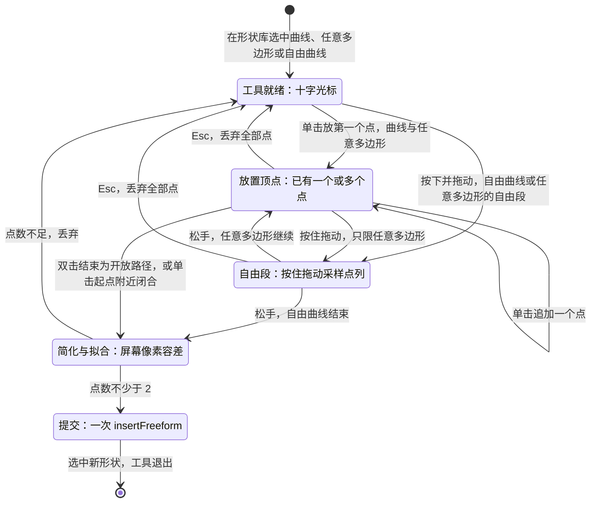

怎么读：绘制过程中的点只存在于覆盖层的预览里，直到「提交」才发出唯一一条命令；Esc 在任何未提交的阶段都丢弃全部点、不留撤销步；曲线工具在「放置顶点」阶段对已放的点实时做平滑预览，其余与任意多边形相同。
依据：R elementDesign「任意多边形 / 曲线 / 自由曲线」insertEntry；Google Slides 与 PowerPoint 的同名工具行为。

## 6. 动作按钮

| 栏 | 设计 |
|---|---|
| ① 作用 | 放映用的导航按钮：首页、上一页、下一页、末页、返回（最近观看）、结束放映、跳到指定页或网址；用于自助演示、展台循环与带目录的课件。它就是一个带预置图标几何的形状加一个单击动作 |
| ② OOXML 来源 | `p:sp` + `a:prstGeom` 取 `actionButtonBlank` / `Home` / `Help` / `Information` / `BackPrevious` / `ForwardNext` / `Beginning` / `End` / `Return` / `Document` / `Sound` / `Movie`；`p:cNvPr/a:hlinkClick@action`：`ppaction://hlinkshowjump?jump=firstslide \| lastslide \| nextslide \| previousslide \| lastslideviewed \| endshow`，指定页为 `ppaction://hlinksldjump` + `r:id` 指向幻灯片部件，网址为外部关系；`@highlightClick="1"`；悬停动作为 `a:hlinkHover`（P2） |
| ③ 插入入口与默认 | 形状库「动作按钮」12 项（§6.1）；插入手势同预设形状（单击 1 in × 1 in 或拖出）；插入后立即弹出「操作设置」对话框，预选该按钮的默认动作（§6.2）；默认样式同预设形状（§2.2） |
| ④ 模型 | `Sp`（`Geometry.preset` 取 `actionButton*`）+ `NonVisualProps.hyperlink`（30/04 §4.3 `Hyperlink`）。新增（§4.21）：`Hyperlink` 补放映跳转分支 `{kind:'show', jump:'first'\|'last'\|'next'\|'previous'\|'lastViewed'\|'end'}`（取值与 30/04 §3.7、ADR-0018 决策 5 一致；导入导出映射到 OOXML 的 `firstslide`、`lastslide`、`nextslide`、`previousslide`、`lastslideviewed`、`endshow`；R-d-77 补后两项；2026-09-26 整合由 OOXML 字面量改为模型取值），与 URL、页内跳转两个分支并列；运行程序、宏、播放声音、对象动作为不透明分支，原样保留、不可编辑；分支定义以 [50/20](20-elements-text.md) 的超链接一节与 ADR-0018 为准 |
| ⑤ 渲染 | 同预设形状（`sp.renderer`，图标部分就是几何里的多 path）；编辑态不画链接下划线，只在悬停时显示动作提示（覆盖层 tooltip） |
| ⑥ 交互 | 同预设形状；编辑态 `Mod`+单击预览跳转（页内跳转切到目标页，`show` 分支在编辑态只提示「放映时生效」，URL 只打开 http(s)，PRD ED-19）；放映中单击执行动作（`present.ts`：`nextslide` 等翻页，`lastslideviewed` 取放映内的浏览栈，`endshow` 退出放映） |
| ⑦ 检查器 | 形状分区（§2 ⑦）里「替代文本」之前的「操作」节：一行「单击时 · 〈当前动作〉 ›」（如「单击时 · 下一张幻灯片 ›」），点开「操作设置」对话框；任何形状都有这一节，任意 `sp` 都可设置动作（与 PowerPoint 一致；设计 03-02 §4.2、03-15 §5；原「动作按钮默认展开这一行」作废） |
| ⑧ 命令 | 插入：`history.beginGroup('插入动作按钮')` → `slide.insertShape{containerId, kind:'sp', box, preset:'actionButton…', action}`（`action` 为参数扩展，新增（§4.21），写默认动作）→ 对话框确认且有改动时 `slide.setAction{shapeId, click, hover?}`（新增（§4.21））→ `endGroup()`，合为一个撤销步（50/04 §5「确需多命令的手势用 beginGroup」）；对话框取消保留默认动作。之后单独修改动作是一条 `slide.setAction`。Mutation：`shape.insert`、`shape.setNonVisual`（新增（§4.21），见 ADR-0018） |
| ⑨ 协同 | `nv.hlinkClick` 为 JSON 串整值 LWW（30/06 §1.3.2 `nv`）；两人同时改动作只保留一方；目标页被删除时 `hlinksldjump` 的关系保留，放映中点击无效并在编辑态检查器标「目标页已删除」 |
| ⑩ 导入导出与保真 | E（M2 P1）。支持的六种跳转、页内跳转与 URL 往返；不支持的 `ppaction`（`ole`、`macro`、`program`、声音）与 `hlinkHover` 原样保留；导出按 ADR-0008 决策 5 只写 http / https / mailto / tel 的外部关系 |
| ⑪ 无障碍 | 编辑态名称「动作按钮：下一页」；放映中按钮在可访问树里为 `role="button"`、名称为动作描述，可 `Tab` 聚焦、`Enter` 执行；「操作设置」对话框全键盘，初始焦点在当前选中的单选项 |
| ⑫ 复用 | 无第三方：几何来自预设表，对话框用 shadcn Dialog + RadioGroup + react-hook-form（R-d-18），页选择复用超链接对话框的缩略图列表 |
| ⑬ 里程碑 | 插入 M2 P0（随形状库）；操作设置与放映执行 M2 P1；悬停动作 P2 |
| ⑭ 待决 | 已由 R-d-77 定：补 `lastslideviewed`、`endshow`，插入即弹「操作设置」 |

### 6.1 十二种按钮与默认动作

| 按钮 | `prst` | 默认动作 |
|---|---|---|
| 后退或前一项 | `actionButtonBackPrevious` | 上一页 `previous`（OOXML `previousslide`） |
| 前进或下一项 | `actionButtonForwardNext` | 下一页 `next`（`nextslide`） |
| 转到开头 | `actionButtonBeginning` | 第一页 `first`（`firstslide`） |
| 转到结尾 | `actionButtonEnd` | 最后一页 `last`（`lastslide`） |
| 转到主页 | `actionButtonHome` | 第一页 `first`（`firstslide`） |
| 返回 | `actionButtonReturn` | 最近观看的幻灯片 `lastViewed`（`lastslideviewed`） |
| 获取信息 | `actionButtonInformation` | 无动作 |
| 帮助 | `actionButtonHelp` | 无动作 |
| 文档 | `actionButtonDocument` | 无动作 |
| 声音 | `actionButtonSound` | 无动作 |
| 视频 | `actionButtonMovie` | 无动作 |
| 空白 | `actionButtonBlank` | 无动作 |

- 「无动作」不写 `a:hlinkClick`；导入文件中已有的 `ppaction://noaction` 原样保留。
- PowerPoint 对文档、声音两种按钮的默认值涉及运行程序与播放声音，本产品不提供这两类动作，所以默认改为「无动作」；与 PowerPoint 默认值的逐项对照以 PowerPoint 365 实测为准（§10 待决 3）。

### 6.2 「操作设置」对话框

- **结构**（设计 03-15 §5，宽 480）：标题「操作设置」；说明行（左侧形状缩略图块 + 「动作按钮「〈名称〉」· 放映时生效，编辑时 ⌘ + 单击可预览」，普通形状写「形状「〈名称〉」…」）；分段页签「单击鼠标」「鼠标悬停」（后者带 P2、不可用但可聚焦）；「单击时」下 9 项单选、两列：无动作（独占一行）· 下一张 · 上一张 · 第一张 · 最后一张 · 最近观看 · 结束放映 · 指定幻灯片… · 网址（URL）…；选「指定幻灯片…」时下方出页选择下拉（「序号. 标题」），选「网址（URL）…」时为地址输入，按协议白名单内联校验（http / https / mailto / tel，拒绝 `javascript:` 与 `data:`，与「插入链接」对话框一致，PRD ED-19）；「单击时突出显示」复选（`highlightClick`，默认勾选）；常驻说明行「运行程序、运行宏、播放声音不在此设置；导入文件里已有的会原样保留。」；底栏「取消」「应用」（主按钮）。应用后轻提示「已设置单击动作 · 〈目标〉」带撤销（样张未画）。原「单选组：无动作 / 超链接到 ▾」写法作废。
- **不可编辑的原有动作**：导入文件里本对话框不认识的动作只读展示为「其他动作（保留原设置）」、不可改，「应用」不清除它；改选其它目标并应用时才替换它（设计 03-15 §5，样张未画）。
- **入口**：插入动作按钮后自动弹出（关闭后焦点回「形状」）；检查器「操作」节（关闭后焦点回那一行）；形状右键「操作设置…」（关闭后焦点交回画布；rulings §4.25 TB-18）。

**图 22-11 插入动作按钮并设置操作的时序**

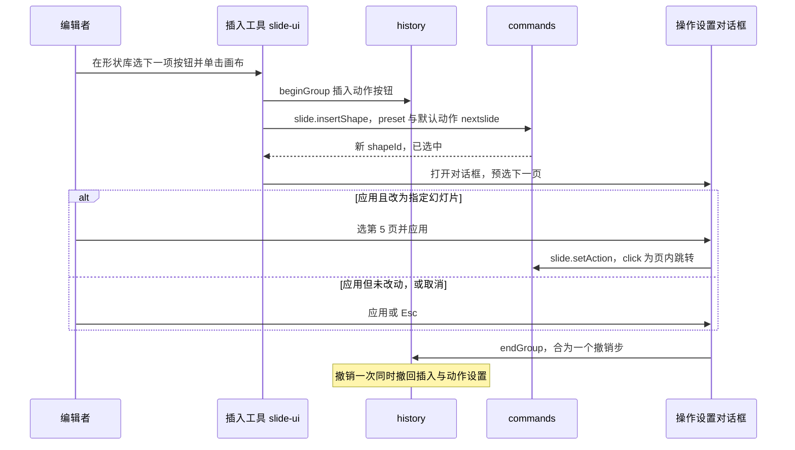

怎么读：插入与动作设置被 `beginGroup` / `endGroup` 包成一个撤销单元；对话框是模态的，组内只会出现这两条命令；取消对话框不回滚插入，按钮保留默认动作。
依据：R elementDesign「动作按钮」commands（一个撤销步）；R-d-77；50/04 §5。

## 7. 第三方扩展元素（以二维码为例）

| 栏 | 设计 |
|---|---|
| ① 作用 | 证明编辑器可插拔：集成方或插件作者新增一种元素类型（二维码、流程节点、地图、签名框、业务卡片），插入、渲染、选中、撤销、协同、导出全链路可用，而内核与 model-slide 零改动（PRD 04 PS-02、PS-04，PRD 05 `pluggable:m2`）。二维码是官方示例 `examples/plugin-qr-shape` |
| ② OOXML 来源 | 无原生节点。导出为 `p:pic`（插件生成的回退位图）+ `p:extLst/p:ext@uri="<插件 URI>"` 保存插件数据；PowerPoint 打开看到的是图片，Cordex 再次导入时按 `ext@uri` 还原为扩展元素（插件在场时） |
| ③ 插入入口与默认 | 插件经 `ui.toolbar{slot:'create.more'}` 进底部工具条「更多」（排在内置项之后、以分隔线隔开、带 12px 归属标识，主行不开放；50/10 §4、设计 06 §2.6，rulings §4.25 DS-5、DS-56；插件不超过 3 个且每个不超过 3 条时每个插件一组平铺，否则为「插件 · N」小标题、每个插件一行、条目进子菜单，DS-49），或经 `ui.command` 出现在命令面板；插入手势走同一插入工具态（单击默认尺寸、拖出按矩形）；默认尺寸由 `ShapeKindDef.createDefault(box)` 决定，二维码示例为 1.5 in × 1.5 in、锁定 1:1 |
| ④ 模型 | `kind: 'ext:<vendor>.<name>'`（例 `ext:acme.qr`）；`ShapeKindDef{kind, schema, createDefault, capabilities, describe}`（30/04 §3.3）；实体字段 `{data, fallback?: {mediaId}}`，`data` 由插件 schema 校验（二维码示例：`{text, ecc:'L'\|'M'\|'Q'\|'H', fg, bg}`）。新增（§4.21）：Mutation `shape.patchKindData{shapeId, patch}`（按该 kind 的 schema 校验后合并），`capabilities` 扩展键 `adjust`、`crop`、`lockAspectDefault`、`editPoints`、`fillable` 均可由插件声明（ADR-0018） |
| ⑤ 渲染 | 插件贡献 `render.element('dom:ext:acme.qr')`，无状态、只读场景数据；二维码示例用 uqr 直接生成 SVG path 数据，经 render-dom 图元句柄建树（不用 `innerHTML`）；插件不在场时由内核的 unknown 占位渲染器画「未安装的扩展元素」占位（50/05 §9），仍可选中、移动、删除 |
| ⑥ 交互 | 手柄由 `capabilities` 决定（`resize`、`rotate`、`adjust` 等）；双击交给插件的 `ui.dialog` 或 `ui.panel`（二维码示例：双击打开「编辑二维码」对话框）；其它与普通形状一致 |
| ⑦ 检查器 | 内置的通用分区（「位置与大小」等，按插件声明的 `capabilities` 取与普通形状同名的节；第 1 批样张未画插件元素，随实现）+ 插件经 `ui.inspectorSection` 贡献的分区（槽位 `inspector.<selectionKind>`；排在内置分区之后、`order ≥ 100` 且带 `owner`，节标题右侧带归属图标，只用检查器控件，渲染抛错只替换该分区；50/10 §5、50/09 §6.1、设计 06 §2.12，rulings §4.25 DS-5；同一选中对象的插件分区超过 2 个时全部默认折叠为一行、展开状态按分区记在本机，DS-49；插件不可用时元素以占位显示、选中按 `degraded` 分区与右键，[25](./25-elements-readonly-and-opaque.md) §2.5，DS-52）。`ui.panel{slot:'inspector'}` 只承载检查器页签级的整页面板，不用于格式分区 |
| ⑧ 命令 | 插件命令按章程第三方前缀规则命名（例 `acme:qr.insert`、`acme:qr.setText`），经 `tx.mutate` 调内核 Mutation：插入 = `shape.insert` + `media.add`（回退位图）；改数据 = `shape.patchKindData` + `media.add` + 更新 `fallback.mediaId`，同一事务；Operation 与内置相同（`slide.setSelection`） |
| ⑨ 协同 | `data` 默认为 JSON 串整值 LWW；插件在 schema 上标注「逐键可编辑」的字段可映射为 `Y.Map` 逐键 LWW；回退位图是内容寻址的 `BlobRef`，不进 Y.Doc（50/19 媒体通道） |
| ⑩ 导入导出与保真 | E（插件在场）。回退位图随数据变化由插件在命令里生成并 `media.add` 写进模型，导出不依赖渲染（服务端 headless 导出同样可用）；插件缺席时退化为 `UnknownShape` 占位，导出原样写回已存的 `p:pic` + `extLst`；是否向第三方开放直接写原生 OOXML 的 `toXml?` 钩子见 ⑭ |
| ⑪ 无障碍 | `describe(shape)` 提供可访问树名称（二维码示例：「二维码：https://…」）；插件必须提供替代文本默认值，缺失时按 `missingAlt` 提示（50/16 §9.3）；插件的对话框与面板须过 `axeCheck` 夹具（40/10 §2.5） |
| ⑫ 复用 | 示例二维码生成用 uqr 0.1.3（MIT，零依赖，直接输出 SVG），只进示例插件，不进核心包；SVG 转回退 PNG 用 `createImageBitmap` + canvas（ADR-0021 媒体预处理用途，R-d-23） |
| ⑬ 里程碑 | M2 P0（可插拔验收：`plugin-qr-shape` 合入时对 kernel、model-core、engine-render、render-dom、ui-core、ui-react 的 diff 为 0 行，PRD 05） |
| ⑭ 待决 | `toXml?` 钩子是否开放给第三方直接写原生 OOXML（推荐：M2 不开放，统一走「回退图片 + `extLst`」，避免第三方写出 PowerPoint 需要修复的包；M4+ 视需求再议） |

**图 22-12 第三方扩展元素的注册、插入与导出**

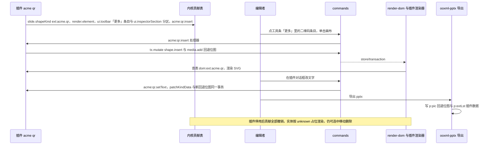

怎么读：插件只通过四个公开贡献点接入（模型定义、渲染器、界面、命令），写入全部经内核 Mutation；导出不依赖渲染器，因为回退位图在改数据的同一事务里就已写进模型；插件停用后内容不丢，只是以占位呈现。
依据：30/04 §3.3；PRD 04 PS-02、PS-04；PRD 05 `pluggable:m2`；70/06 §5 第 16 行。

## 8. 机械验证

本节只写断言与所在套件，执行方式归 [70/06](../70-testing/06-frontend-component-and-e2e.md)、[70/04](../70-testing/04-visual-oracle.md) 与 [70/05](../70-testing/05-collab-simulation-and-property-tests.md)。

| # | 断言 | 套件 / 用例 |
|---|---|---|
| V1 | 形状库 72 项：每项 `prst` 属于 ST_ShapeType，类别次序与 PRD ED-05 一致，线条类 `kind` 为 `cxnSp`；缩略图生成物与 `presetGeometryPath` 输出一致（`--check` 无差异） | slide-ui `__tests__/shape-gallery.test.ts`；tooling `gen-shape-gallery-thumbs --check` |
| V2 | 插入工具态：单击得 1 in × 1 in 且左上角在点击处；拖出按矩形，`Shift` 锁 1:1、`Alt` 中心；位移 ≤ 4 px 视为单击；`Esc` 零命令；每次插入恰一个撤销步并选中新元素 | slide-ui `__tests__/insert-tool.test.ts`；e2e `editing/insert-tools.spec.ts`（70/06 §5 第 26 行） |
| V3 | 新元素只写 `p:style` 引用：插入后导出的 `p:sp` 无显式 `a:solidFill` / `a:ln` 颜色；有 `objectDefaults.spDef` 的主题取其样式 | model-slide 命令用例 + ooxml-pptx 往返用例（40/03 §9、40/04 §9） |
| V4 | 调整手柄：拖动 N 帧只发一次 `slide.setAdjustValues`，只写被改的键，拖回默认值删除该键；数值等价与手柄同批可用 | slide-ui `__tests__/handles.test.ts`；e2e `editing/element-handles.spec.ts` |
| V5 | 线条起止点与 `xfrm` + 翻转的换算互逆（任意起止点 → `xfrm` → 起止点 恒等），`Shift` 约束到 45° 倍数 | engine-layout 或 slide-ui 纯函数的性质测试（fast-check） |
| V6 | 连接符跟随：移动目标的命令在同一事务内写回连接符 `xfrm`，撤销一步同时撤回二者；并发「A 移动目标、B 拖连接符」收敛后画面派生值与导出重算值一致 | model-slide 命令用例；70/05 协同模拟 |
| V7 | M3 肘形与曲线重算与 PowerPoint 365 语料 `connector-*` 一致；单条 ≤ 1 ms、单页 50 条 ≤ 50 ms | engine-layout `__tests__/connector-routing.test.ts`；70/04 语料比对 |
| V8 | 动作按钮：12 种默认动作；六种跳转、页内跳转与 URL 往返；插入 + 操作设置为一个撤销步；放映中 `lastslideviewed` 与 `endshow` 生效 | slide-ui `__tests__/present.test.ts` 追加段；e2e `editing/ed-19-hyperlink-action.spec.ts` |
| V9 | 曲线类（P2）：写出的 `custGeom` 只含 `moveTo` / `lnTo` / `cubicBezTo` / `close`；闭合路径取 `spDef`、开放路径取 `lnDef` | slide-ui `__tests__/freeform.test.ts` |
| V10 | 第三方扩展元素：`pluggable:m2`（插件 PR 对内核六包 diff 为 0 行）；插件停用后实体以 unknown 占位且可选中移动删除；导出为 `p:pic` + `p:extLst` | 70/06 §5 第 16 行；70/02 可插拔套件 |
| V11 | 每种手柄都有数值或键盘等价（WCAG 2.5.7），曲线绘制工具作为登记的例外 | 70/06 §7.3「拖拽的键盘等价」行 |
| V12 | 形状库 72 项与 9 种箭头尺寸的渲染快照与 PowerPoint 对照 | 70/04 视觉 oracle |
| V13 | 本文全部 Mermaid 图 0 invalid | `node docs/_tools/mermaid-check.cjs docs/50-frontend/22-elements-shapes-and-lines.md` |

## 9. 里程碑汇总

| 里程碑 | 本族交付 |
|---|---|
| M1 | 查看：187 种预设几何、`custGeom`、线条与箭头、连接符（按存储的 `xfrm`）、动作按钮外观；第三方元素不涉及 |
| M2 | P0：形状库 72 项与插入工具态、预设形状插入 / 变换 / 翻转 / 填充 / 线条、线条与箭头的端点编辑、动作按钮插入、第三方扩展元素（可插拔验收）；P1：调整手柄与数值等价、更改形状、连接符插入 / 连接 / 断开 / 直线跟随、操作设置与放映执行；P2：曲线类绘制工具（可顺延 M3）、悬停动作 |
| M3 | P1：肘形与曲线连接符重算路径与调整值（ED-28 M3 E） |
| M4+ | 自定义几何顶点编辑为非目标（R-d-75），不排期；触控编辑下的手柄 44 px（ED-27） |

## 10. 待决与回写

### 10.1 待决

| # | 问题 | 推荐默认值 |
|---|---|---|
| 1 | 内建 `lnRef idx=2` 的 `shade` 修饰取值 | 由 tooling 从 PowerPoint 365 新建形状语料抽取，写入 slide-ui 常量并附出处 |
| 2 | 多选翻转：各自在中心翻转，还是绕选区中心整体镜像 | 本文取「各自在中心翻转」；语料核对后若 PowerPoint 为整体镜像，改为整体镜像并同步 `flipShapes` 语义 |
| 3 | 动作按钮默认动作与 PowerPoint 365 的逐项对照 | 以 §6.1 为准，差异项（文档、声音）维持「无动作」 |
| 4 | ~~首批 72 项名单~~ | 已定（2026-10-07 第 1 批拍板）：以设计 03-15 §2.2 与 §2.1 为准，扩充只改数据文件 |
| 5 | 可被连接的元素范围 | `sp`、`pic` 与组合内的这两类；`graphicFrame` 与组合本身不提供连接点，语料核对 |
| 6 | 曲线类绘制工具的里程碑 | M2 P2，允许顺延 M3，不与墨迹绑定 |
| 7 | 第三方 `toXml?` 钩子 | M2 不开放，统一「回退图片 + `extLst`」 |

### 10.2 回写（需其它文档配合）

| 内容 | 去向 |
|---|---|
| 本族命令与 Mutation（`insertShape` 的 `preset` / `from` / `to` / `action`，`setAdjustValues`、`changeShape`、`flipShapes`、`setLineEnds`、`connectEnds`、`changeConnectorType`、`setAction`，`cxnSp.setConnections`、`shape.setNonVisual`、`shape.patchKindData`）已由 ADR-0018、40/03 §2.6、30/05 登记，本文与之一致；**仍需改的一处**：`slide.insertFreeform` 的参数改为 `{containerId, box, geometry: Geometry.custom, closed}`，点列简化与贝塞尔拟合在 slide-ui `application/freeform.ts` 完成（§5 ⑧ 的理由），原「`path:{points, closed, curve}`、命令内简化」作废；`Hyperlink` 的 `show` 分支与 `ShapeKindDef.createDefault` 接收 `preset` 请一并核对 | ADR-0018、40/03 §2.6、30/05、50/19 |
| 连接符跟随按 30/05 §14.5 的 `reroute` 参数：本文采用；请补两点——`slide.flipShapes` 同样携带 `reroute`（翻转也会移动连接点），`ConnectorPatch` 字段与 40/06 `ConnectorRoute` 对齐（`offset`、`extent`、`flipH`、`flipV`、`rotation`、`preset`、`adj`） | 30/05 §14.5、40/03 §2.6；engine-layout 侧已写入 40/06 §2.3 |
| slide-render `SceneProvider` 维护连接符到目标的依赖索引；`cxn-sp.renderer` 的箭头 path 与派生端点 | 40/07 |
| 导出调用方对已连接的连接符求派生几何、以 `connectorGeometry` 显式输入交给编码器（30/05 §14.5 已定，编码器侧落实）；诊断 `connector-target-missing` 登记 | 40/04、30/10 |
| 曲线绘制工具登记为 WCAG 2.5.7 例外 | 设计 07 §1.2a、50/16 §6.3 |
| `tooling/scripts/gen-shape-gallery-thumbs.ts` 登记；simplify-js、fit-curve 的四处同步（R-d-10） | 40/01、章程 §5.3、50/13、50/17 |
| 形状库 72 项与箭头尺寸快照 | 70/04 |
| 形状「不透明度」节的薄命令 `slide.setShapeOpacity{shapeIds, alpha}`（同时写填充与描边颜色的 alpha，一步撤销，rulings §4.25 TB-47，§2.5）；快速样式入口为「填充」节上方一行缩略图 + 42 格样式库（DS-31）、形状检查器补「替代文本」节（TB-32）的分区登记 | 已回写（2026-10-08）：命令登记在 40/03 §2.6、30/05 §14.4 第三批；分区与文件在 40/10 §2.6、§5.4（`ShapeStyleSection.tsx`、`FillLineSection.tsx`、`AltTextSection.tsx`） |
| 快速样式的样式库由弹层改为「快速样式」节里、缩略行下方原位展开，节标题右侧「收起样式库」，收起后焦点回缩略行；缩略图去白衬底（rulings §4.25 DS-34 修订 DS-31、TB-56，§2.5） | 40/10 §2.6「检查器 · 形状」与 §4.4 / §5.4 `ShapeStyleSection.tsx` 已同步（去掉 `ToolPopover` 与 popover 依赖，2026-10-08 核对）；设计 03-02 §4.2、03-03、03-15 §4、04 §4.1a、07 §1.2b，PRD 02 ED-06，70/06 §2.2、§7.2、§7.3 由各线同批回写 |
