# 23 元素族：媒体类
> 状态：v0.1 | 负责：前端设计线 | 更新：2026-09-26（§4.21：新建，媒体类元素逐项设计：图片、SVG、图标、EMF/WMF、图片填充、视频、音频、外链媒体、屏幕截图与相册）；2026-09-26（§4.21 整合：§2 图 2-1 与 ③ / ⑭ 的「来自 URL」按 14 §5 图 6 对齐；§2.3 补裁剪文件落点与 crop-* 手柄；§1 补上传失败徽标与「移除」）；2026-09-26（§4.21 复核：音视频入口写法统一；resetPicture 参数改 pixelSize；§6 补图 6-1）；2026-09-30（§4.21 剩余缺口样张回写 · 复核修正：「图标…」入口改为形状组，与设计 03-04、50/10 §4 一致；只改入口位置的写法）；2026-09-30（§4.22 复核修正：§1.3 第 2 条与 §2 ③ 补 Q1——从插入页签或命令面板插入图片时先填空内容占位符，已选中的优先，没有才放视口中心；图标、音视频不变）；2026-10-04（design-language-v3 第 0 批：裁剪模式期间冻结的区域由 Ribbon 改为底部工具条（rulings §4.25 DS-1））；2026-10-04（design-language-v3 第 0 批：复验第 2 轮修正——各元素「插入入口」由旧插入页签改为 v3 入口（rulings §4.25 DS-1，50/10 §4）：图片 → 工具条「图片」，视频、音频 → 工具条「更多」，图标、屏幕截图与相册 → 入口随第 1 批定稿；§1 总表、§1 说明段、§2 ③ / ⑪ 与时序图参与方、§4 / §6 / §7 / §8 / §10 的 ③ 栏与 §11 对应表同步；§6 背景图片入口去掉已废弃的「设计页签」）；2026-10-05（design-language-v3 第 0 批修正：检查器写法改为 v3（rulings §4.25 DS-1、DS-5）——§2.1 图片 ⑦ 注「节划分随第 1 批（03-18）」，「边框与效果（复用形状的线条与阴影分区）」改为「描边与阴影（复用形状的『描边』『阴影』节）」；§6 ⑦ 改为形状「填充」节的「图片」分段与无选中时「背景」节的「图片」方式（DS-20），③、§1.1 总览与图 6-1 的背景入口改为「背景」节，删去「设计页签或幻灯片级分区」；§2.1 ⑦ 图片的上下文工具条注明 v3 去留随第 1 批（03-18），与 DS-13 取消的文字迷你工具条区分）；2026-10-07（design-language-v3 第 1 批：按已拍板样张与设计 03-04 §4–§5、03-05 §3、03-15 §7、03-18 定稿——§1.1 入口列与说明（「图片 ▾」含屏幕截图与相册、「更多」插图组的图标与音视频）；§2.1 ③⑥⑦⑬（「从 URL 插入图片」只收 https TB-7、下载与上传不另发轻提示；检查器按 03-18 §5 四节，删 `slide.toolbar.imageSelected`，样张未画项由本线定落点）；图 2-1；§2.3 裁剪模式与图 2-2、图 2-3（「完成」「取消」TB-4、`--v3-scrim` 遮罩、四个百分比）；§2.4 界面名称「不透明度」（`alpha = 不透明度 × 1000`）；§3 ⑥；§4 ③⑥⑦⑪ 与图 4-1（插入图标对话框、「图形填充」节）；§5 ⑥⑦；§6 ③⑦；§7 ③⑤⑥⑦⑨、§7.2 与图 7-1（检查器「视频」节不设播放按钮，右键「播放」）；§8 ③⑦；§10 ③；§11–§14 同步）；2026-10-08（design-language-v3 第 1 批收口：§6 ③⑦ 形状的图片填充在 P2 前留在原位不可用（rulings §4.25 TB-43），⑭「应用到全部」写母版级背景已定（TB-45）；§1、§13 措辞）；2026-10-23（design-language-v3 第 3 批评审修改：§4 图标 ⑫ 注明备选 @tabler/icons 3.48.0 只是插入图标库的未采纳备选，界面上的文件类型图标另取 Tabler 3.49.0 原件（17 §3、§6，rulings §4.25 DS-143、TB-182）） | 依赖：上游：[50/01 前端架构](01-overview-and-runtime-map.md) §5b、§4a（渲染）；[50/19 可追加元素目录·总览与通用设计](./19-insertable-elements-overview.md)、[05 渲染](./05-rendering-and-thumbnails.md) §8–§9、[04 命令与剪贴板](./04-document-commands-and-undo.md) §9、[10 编辑器外壳](./10-editor-shell-and-interaction.md) §4 / §5 / §7、[14 客户端安全](./14-client-security.md) §6 / §7 / §9、[16 可访问性](./16-i18n-and-accessibility.md) §9、[30/04 文档模型](../30-architecture/04-document-model.md) §3.2 / §4.2、[30/05 命令三分法](../30-architecture/05-command-and-history.md) §1、[30/06 协同](../30-architecture/06-collaboration.md) §1.5、[40/03 幻灯片领域模型](../40-modules/03-slide-domain-model.md) §2.6、[60/04 媒体模块](../60-backend/04-modules-documents-storage-media.md) §7、[ADR-0008](../30-architecture/adr/0008-opaque-preservation.md)、[ADR-0018](../30-architecture/adr/0018-editor-element-model-and-insert-commands.md)、[ADR-0021](../30-architecture/adr/0021-rendering-medium.md)、PRD [ED-07 / ED-26](../10-prd/03-features/02-editing.md)、[OF §2.5 / OF-07](../10-prd/03-features/01-open-and-fidelity.md)、设计 [03-18](../20-design/03-screens/18-image-editing.md)、[03-13](../20-design/03-screens/13-import-progress-and-degraded-states.md)、rulings §4.21（q-media-insert、q-extra-inserts）

本文是「可追加元素目录」的媒体类分册：回答用户提出的三个问题——**要追加什么、有什么作用、每个元素怎么设计**。目录总表、插入命令的通用流程、默认落点表与 18 条通用设计写在 [50/19](./19-insertable-elements-overview.md)，本文只写媒体类九种元素各自的设计，不复写通用部分；渲染运行时（MediaCache、上传队列、EMF 栅格化、外链三档、预处理、播放覆盖层）的机制写在 [05](./05-rendering-and-thumbnails.md) §8，本文只写元素层面怎么用它们。

## 0. 定位与边界

| 本文拥有 | 本文引用（事实源） |
|---|---|
| 媒体类九种元素的逐项设计：作用、OOXML、插入入口与默认、模型字段、渲染、交互、检查器、命令、协同、保真、无障碍、复用、里程碑、待决（§2–§10） | 目录总表、插入通用流程、默认落点与尺寸、通用设计 18 条、非目标清单：[50/19](./19-insertable-elements-overview.md) |
| 图片裁剪模式的状态机与几何换算（§2.3） | 插入工具态状态机、选择手柄、检查器分区矩阵：[10](./10-editor-shell-and-interaction.md) §5、§7 |
| 替换、重置、不透明度、压缩的命令语义（§2.4） | MediaCache、上传队列、预处理、EMF 栅格化、外链三档、播放覆盖层：[05](./05-rendering-and-thumbnails.md) §8 |
| 视频与音频的编辑态临时播放交互（§7.2） | 模型实体与 Mutation 登记：[30/04](../30-architecture/04-document-model.md) §3.2、[40/03](../40-modules/03-slide-domain-model.md) §2.6、[ADR-0018](../30-architecture/adr/0018-editor-element-model-and-insert-commands.md) |
| 媒体族命令与 Mutation 汇总（§11）、里程碑（§12） | 媒体上传与读取接口、SVG 消毒、类型白名单：[60/04](../60-backend/04-modules-documents-storage-media.md) §7 |
| 本族待决与回写（§13）、机械验证（§14） | 外链资源、输入限制、上传安全：[14](./14-client-security.md) §6、§7、§9；复用库版本与许可：[50/17](./17-reuse-and-dependency-catalog.md) |

非目标（与 50/19 非目标清单一致，rulings §4.21 q-extra-inserts）：屏幕录制不做；不提供外链媒体的插入（URL 插图片一律下载后内嵌）；不提供 EMF / WMF 的插入；SVG 与图标「转换为形状」M4+ 再评估。

## 1. 族总览

### 1.1 元素清单

可编辑度记号沿用 PRD [OF 矩阵](../10-prd/03-features/01-open-and-fidelity.md)：E 可编辑、E~ 部分可编辑、V 查看、V~ 近似查看、P 仅保留。能力 id 取自 [50/18](./18-editor-capabilities.md)。

| # | 元素 | 作用（一句话） | OOXML 主节点 | 插入入口 | M1 | M2 | M3 | M4+ | 能力 id |
|---|---|---|---|---|---|---|---|---|---|
| §2 | 图片（位图） | 照片、截图、Logo、示意图，演示里占比最高的非文字元素 | `p:pic` + `p:blipFill` | 工具条「图片 ▾」（此设备… / 来自 URL…）；主菜单「插入 › 图片 ▸」；拖入；粘贴；空图片占位符 | V | E（插入、替换、不透明度、替代文本 P0；裁剪、压缩 P1） | TIFF V | 裁剪为形状 P2 | INS-06、PIC-01…PIC-06、PIC-09、PIC-10、ARR-05 |
| §3 | SVG 图片 | 无损缩放的矢量插图与 Logo | `p:pic` + `a:blip`（PNG 回退）+ `asvg:svgBlip` | 同图片（选 .svg） | V | E（插入 P0；PNG 回退 P1） | — | 转换为形状评估 | INS-06 |
| §4 | 图标 | 风格统一的线性图标，装饰要点 | 同 SVG | 「更多 › 图标…」与主菜单「插入 › 图标…」（原插入 › 形状 › 图标… 作废） | — | — | E（P2） | — | INS-12 |
| §5 | EMF / WMF | 老版 Office / Visio 粘贴图与 OLE 预览能看能摆 | `p:pic` → `ppt/media/*.emf\|wmf` | 不提供插入 | V~ | V（栅格化 P1） | — | V（矢量 P2） | PIC-07 |
| §6 | 图片填充 | 圆形头像、异形图框、背景图、文字纹理 | `a:blipFill`（`p:spPr` / `p:bgPr` / `a:rPr`） | 检查器「填充」节 › 图片；无选中时「背景」节 › 图片 | V | E~（背景 P1；形状 P2） | — | 文字 P2 | FMT-04、ML-09 |
| §7 | 视频 | 产品演示、讲解；编辑时见海报，放映时播放 | `p:pic` + `a:videoFile` + `p14:media` | 「更多 › 视频」与主菜单「插入 › 视频」（P2 不可用；原插入 › 图像 › 视频作废） | V | E~（移动缩放、换海报、编辑态临时播放 P1；插入 P2） | — | — | INS-11、MED-01…MED-03 |
| §8 | 音频 | 旁白与背景音乐 | `p:pic` + `a:audioFile` + `p14:media` | 「更多 › 音频」与主菜单「插入 › 音频」（P2 不可用） | V | E~（同视频） | — | — | INS-11、MED-02 |
| §9 | 外链图片 / 外链音视频 | 文件引用的网络资源既能看到又安全可控 | `a:blip@r:link`、`a:videoFile@r:link`（`TargetMode="External"`） | 不提供插入 | V | V（可替换为本地图片） | — | — | PIC-08、MED-04 |
| §10 | 屏幕截图 / 相册 | 快速抓屏；一批照片一页一张 | 同图片 | 工具条「图片 ▾」与主菜单「插入 › 图片 ▸」里的「屏幕截图」「相册」（M4+ 不可用） | — | — | — | E（P2） | — |

里程碑与优先级以 PRD 为准，本族与 PRD 的对应见 §12。入口以 [10](./10-editor-shell-and-interaction.md) §4 与设计 03-04 为准（2026-10-04 起插入页签随 ribbon 废弃，rulings §4.25 DS-1；2026-10-07 第 1 批已拍板）：图片在底部工具条「图片 ▾」（此设备… · 来自 URL… ┊ 屏幕截图、相册 M4+），图标、视频、音频在「更多」的插图组，主菜单「插入」按同一顺序列出（设计 03-02 §2.3、03-04 §4–§5）；原插入页签「图像」「形状」组的排布（设计 04 与 playground 的七组划分，R-d-61）作废。未开放的条目留在原位不可用，右侧写短原因、工具提示写完整原因并标注里程碑（P2 与 M4+ 条目同样，03-04 §7.3）。

### 1.2 十四栏的写法

§2–§10 每个元素一节，节内用一张十四行的定义表，行名固定：

| 栏 | 写什么 |
|---|---|
| ① 作用 | 用户为什么需要、典型场景、与相邻元素的区别 |
| ② OOXML 来源 | 读写的具体节点与属性 |
| ③ 插入入口与默认 | 入口位置（底部工具条的工具或「更多」项；原写插入页签位置）、点击或拖拽、默认尺寸与样式的来源（主题哪一项或内置值） |
| ④ 模型 | [30/04](../30-architecture/04-document-model.md) §3.2 与 [40/03](../40-modules/03-slide-domain-model.md) §2.2 的实体、值对象与字段；本轮新增的字段标「新增（§4.21）」，最终形状以 [ADR-0018](../30-architecture/adr/0018-editor-element-model-and-insert-commands.md) 为准 |
| ⑤ 渲染 | DOM/SVG 怎么画、用哪个 MediaCache 变体、覆盖层画什么 |
| ⑥ 交互 | 选中框、手柄、双击子编辑态、键盘 |
| ⑦ 检查器 | 属性面板分区（`selectionKind` 取值见 [10](./10-editor-shell-and-interaction.md) §5） |
| ⑧ 命令 | 按 [30/05](../30-architecture/05-command-and-history.md) §1 三分法：Command（意图，一个事务一个撤销步）、Mutation（唯一写路径）、Operation（视图态，不入历史）；本地交互态（工具态、裁剪草稿、临时播放）三者都不是，单独注明 |
| ⑨ 协同 | Yjs 结构（[30/06](../30-architecture/06-collaboration.md) §1.5 编码规则）与并发处理 |
| ⑩ 导入导出与保真 | 可编辑度、写回规则、零编辑字节相同的保证 |
| ⑪ 无障碍 | 可访问树 role / name、缺替代文本提示、键盘等价、播报 |
| ⑫ 复用 | 采用的成熟库（版本与许可以 [50/17](./17-reuse-and-dependency-catalog.md) 为准），或「维持自研」及没有合适库的理由 |
| ⑬ 里程碑 | 按 PRD 与 rulings §4.21 |
| ⑭ 待决 | 未定项与建议，汇总在 §13 |

### 1.3 族内共用：插入、模型、渲染、协同

媒体类九种元素共用同一条字节通道与同一个渲染器（`pic.renderer`，40/07 §5.1）；差异只在「字节怎么来」「画哪个变体」「能改哪些字段」。下面四条是本族共用的约定，各元素节只写与之不同的部分。

1. **字节通道**（[50/19](./19-insertable-elements-overview.md) 通用设计「媒体通道」的本族展开）：字节只进 `BlobStore`，模型与 Y.Doc 只存 `BlobRef{hash, size, contentType}`（30/04 §2.5）。插入先在本机按魔数判型与限额（[14](./14-client-security.md) §7）、做预处理（[05](./05-rendering-and-thumbnails.md) §8.3）、用 SubtleCrypto 算 sha256，**立即**执行插入命令（一个事务：`media.add` + `shape.insert`），上传在后台进行，不阻塞插入与撤销。命令只收处理好的字节与数值：凡要解码、缩放、栅格化、取帧的工作都由 slide-ui 在命令之前完成，需要原图尺寸的命令（替换、填充 / 适合、重置大小）由 slide-ui 把预处理得到的 `pixelSize{w, h, dpi}` 作参数传入，命令本身同步、确定性、不解码字节。协同文档里他端在 `commit` 前取不到字节，按 05 §8.2 退避重试并显示加载占位。本机上传最终失败时形状上显示「上传失败 · 重试」徽标（05 §8.3），不回滚插入；徽标里的「移除」即 `slide.deleteShapes`，一次撤销步（与 [70/06](../70-testing/06-frontend-component-and-e2e.md) §5 第 26 行 e2e 一致）。
2. **默认尺寸**：按像素与 DPI 换算为 EMU（`px × 914400 / dpi`，DPI 读文件头，读不到按 96），最长边超过页面对应边 60% 时等比缩到 60%；菜单、键盘、命令面板插入放视口中心（图片例外：页上有空内容占位符（`obj` 或 `pic`）时填入阅读序第一个，已选中的空占位符优先，走 `slide.fillPlaceholder`、保留 `p:ph`，没有才放视口中心；图标、音视频不在此列，rulings §4.22 Q1，[50/19](./19-insertable-elements-overview.md) §3.1），拖入放在落点中心，重复插入错位 0.2 in（R-d-62，50/19 默认落点表）。图标 1 in × 1 in、音频图标 0.5 in。
3. **替代文本**：图片、SVG、图标、视频、音频都带 `description`（≤ 250 字）、`title` 与 `decorative`；缺替代文本且未标记装饰性时，可访问树 `missingAlt` 为真（05 §11），画布角标与检查器同时提示（设计 03-18、[16](./16-i18n-and-accessibility.md) §9.3）。统一命令 `slide.setAltText`（§11）。
4. **协同**：新元素是 `shapes` 表的新键，与他人不冲突；`BlobRef` 内容寻址、不可变，天然无冲突；替换、压缩、换海报都产生**新 MediaId**，旧 `MediaRef` 不删（30/04 §5.2 不做孤儿校验，服务端 30 天无引用回收，60/04 §7.4）。撤销只撤本机，被他人后写的键跳过并提示（30/05 §6）。

**图 1-1 媒体类插入的通用流程**

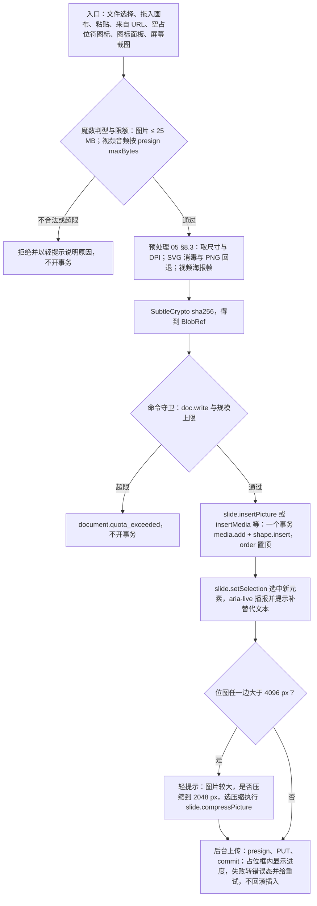

怎么读：自上而下是一次插入的全过程；判型、预处理与哈希都在命令之前完成，命令本身同步、确定性；压缩提示在插入之后单独一步（可以拒绝，拒绝不影响已插入的图片）；上传在命令之后，失败只影响他端可见性，不回滚本机插入。
依据：50/19 插入命令通用流程；05 §8.3；PRD ED-07；设计 03-18「插入路径」「大图压缩提示」。

**图 1-2 媒体类的模型**

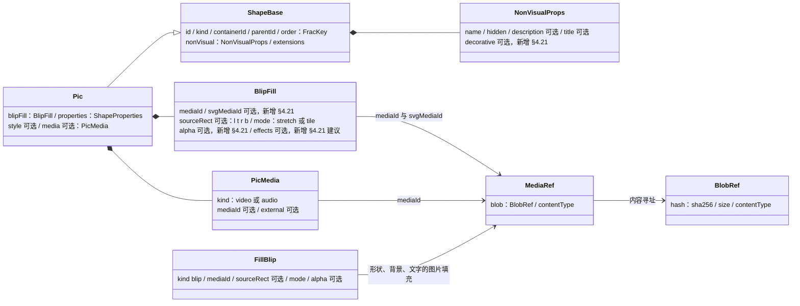

怎么读：实心菱形是内嵌组成，实线箭头是按 id 引用；所有字节都止于 `BlobRef`，模型里没有二进制；图片、SVG、图标、EMF、视频、音频全部是 `Pic`，差异只在 `BlipFill` 是否带 `svgMediaId`、`Pic.media` 是否存在；图片填充不是独立元素，是宿主（形状、背景、文字）`Fill` 联合的 `blip` 分支。标「新增 §4.21」的字段在 30/04 与 40/03 尚未列出，登记见 §13 回写表。
依据：30/04 §3.2 Pic、§4.2 `p:nvPr/a:videoFile` 行；40/03 §2.1 `MediaRef` 行；R elementDesign 媒体类 model 栏。

**图 1-3 媒体类的渲染管线**

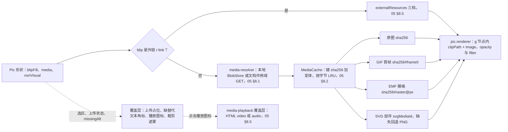

怎么读：左侧按 blip 的来源分两路，内嵌字节经 MediaCache 取合适的变体，外链经 `externalResources` 判定；所有变体都以 `<image href="blob:…">` 画进同一个元素节点；覆盖层与播放层不进 Scene、不触发 `ElementRenderer.update`。
依据：05 §8、§5.2；40/07 §5.1 `pic.renderer.ts`；ADR-0021 修订 5（文档内 SVG 只以图像上下文渲染）。

## 2. 图片（位图）

### 2.1 十四栏

| 栏 | 设计 |
|---|---|
| ① 作用 | 照片、截图、Logo、示意图，演示里占比最高的非文字元素。与「图片填充」（§6）的区别：图片是独立元素，有自己的框、裁剪与替代文本；图片填充是宿主形状的一种填充，轮廓来自形状几何 |
| ② OOXML 来源 | `p:pic`：`p:nvPicPr`（`p:cNvPr@id/name/descr/title`；装饰性为 `p:cNvPr/a:extLst` 下的 `adec:decorative`；`p:cNvPicPr/a:picLocks@noChangeAspect="1"`）+ `p:blipFill`（`a:blip@r:embed`，其下 `a:alphaModFix@amt` 与 `a:lum`、`a:grayscl`、`a:duotone`、`a:biLevel` 等效果；`a:srcRect@l/t/r/b`；`a:stretch/a:fillRect` 或 `a:tile`）+ `p:spPr`（`a:xfrm` + `a:prstGeom prst="rect"`，非矩形预设即形状遮罩）；可选 `p:style` |
| ③ 插入入口与默认 | 工具条「图片 ▾」（原插入 › 图像 › 图片 ▾ 作废；设计 03-04 §5、03-18 §3）：此设备…（可多选）· 来自 URL… ┊ 屏幕截图、相册（M4+ 不可用，§10）┊ 说明行「也可以把图片拖到画布上，或直接粘贴。」；主菜单「插入 › 图片 ▸」与命令面板「插入图片」同此。「从 URL 插入图片」对话框（宽 480，说明「图片会下载并内嵌到文稿里，不保留外部链接。」；集成方可禁用）只接受 `https:`（rulings §4.25 TB-7），浏览器按图像上下文加载后经 canvas 转码内嵌，不写外链、服务端不代抓（取数路径见 [14](./14-client-security.md) §5 图 6）；地址不是 https 时地址框危险色边、内联报错、「插入」不可用并给原因；插入后对话框关闭、焦点回到工具条「图片」；下载期间只出中性轻提示「正在下载图片，完成后内嵌到文稿」，完成后与本地文件走同一路径、按落点出上传占位框，上传中不再另发轻提示；拖入画布；粘贴（[04](./04-document-commands-and-undo.md) §9）；空图片或内容占位符的图标条（R-d-69，填入后保留 `p:ph`，按占位符框居中「填充」裁剪）。从工具条或命令面板插入图片时，页上有空内容占位符（`obj` 或 `pic`）也先填入阅读序第一个（已选中的空占位符优先），走 `slide.fillPlaceholder`、保留 `p:ph`；没有才放视口中心（rulings §4.22 Q1，[50/19](./19-insertable-elements-overview.md) §3.1，设计 03-04「插入落点」、03-18「插入路径」）。接受 png / jpg / gif / svg / webp / bmp，单张 ≤ 25 MB，以魔数判型、不信扩展名（[14](./14-client-security.md) §7）。默认尺寸见 §1.3 第 2 条；**不写 `p:style`**、无边框无效果（与 PowerPoint 新插入的图片一致，不从主题取样式）。多选时依次错位插入，一个事务、一个撤销步 |
| ④ 模型 | `Pic{kind:'pic', blipFill, properties{transform, geometry: preset rect}, nonVisual}`；`BlipFill{mediaId; sourceRect?: {l, t, r, b}; mode: 'stretch' \| 'tile'; alpha?; effects?}`。`sourceRect` 四值与 OOXML 同单位：千分之一百分点整数（100000 = 100%），可为负（负值表示在原图外留白，「适合」会产生负值）。`alpha` 为 `alphaModFix@amt`（0…100000），新增（§4.21）；`effects` 只读建模 `lum{bright, contrast}`、`grayscale`、`duotone`、`biLevel` 供 M1 精确渲染，编辑 P2，新增（§4.21，建议，§13）；`NonVisualProps.decorative?: boolean` 新增（§4.21）；`picLocks.noChangeAspect` 落 `nonVisual.locks`；字节在 `MediaRef{blob: BlobRef, contentType}` |
| ⑤ 渲染 | `pic.renderer`：元素节点内一个 `<image href="blob:…" preserveAspectRatio="none">`，位置与大小由 `sourceRect` 反算出「原图在框内的矩形」，超出框的部分由 `clipPath` 裁掉（框是非矩形预设时，clipPath 取几何路径，即形状遮罩）；`alpha` → `opacity`；灰度与亮度对比度 → SVG `filter`（`feColorMatrix`、`feComponentTransfer`）；`tile` → `<pattern>`。GIF：编辑态、缩略图与 `/render` 画首帧变体 `sha256#frame0`，放映态画原图由浏览器播放动画（PRD OF §2.5）。TIFF：M1–M2 按魔数直接画占位（`media-decode-failed`），M3 起客户端解码。上传临时占位与缺替代文本角标画在覆盖层 |
| ⑥ 交互 | 单击选中：8 个缩放手柄 + 旋转手柄；角手柄默认锁比例（`noChangeAspect`），按住 Shift 临时解锁；边手柄单向拉伸（会变形，与 PowerPoint 一致）；可旋转、翻转、组合。双击、检查器「图片」节「裁剪」或右键「裁剪」进入裁剪模式（§2.3；原迷你工具条「裁剪」作废，设计 03-18 §1.4），期间底部创建工具条临时收起、检查器只留「裁剪」节。方向键微移与数值等价按 [10](./10-editor-shell-and-interaction.md) §7；图片没有文本子编辑态，`Enter` 不进入任何子编辑态。触控手柄命中区 ≥ 44 px |
| ⑦ 检查器 | `selectionKind: picture`（[10](./10-editor-shell-and-interaction.md) §5），面板标题「图片」，按已拍板样张四节（设计 03-18 §5）：**图片**（无节标题：预览缩略 60 × 40 + 文件名 +「格式 · 像素尺寸 · 大小」；2 × 2 按钮「替换…」「裁剪」「重置」「压缩…」——压缩 P1，动画 GIF、SVG、EMF / WMF 不可用并写「该格式不支持压缩」）· **不透明度**（滑杆 + 数值框 0–100 %，缺省 100，与形状同一写法，§2.4）· **位置与大小**（所有对象共用的几何节：X、Y ┊ W、H + 锁定比例（图片缺省锁定，即 `noChangeAspect`）┊ 旋转 + 翻转；裁剪完成后显示裁剪框的尺寸）· **替代文本**（描述 ≤ 250 字计数、「标记为装饰性」、缺失时节末警告并在画布图片右上角出角标）。v3 不设图片上下文工具条（设计 03-18 §1.4，与表格、图表的 rulings §4.25 DS-22 同一取舍）：原 `slide.toolbar.imageSelected`（裁剪 / 替换 / 替代文本）作废，三项分别在检查器「裁剪」「替换…」「替代文本」与右键「裁剪」「替换图片…」「编辑替代文本…」。样张未画、由本线定落点的项：「替换…」打开与工具条「图片 ▾」相同的来源菜单（此设备… / 来自 URL…）；「重置」即重置图片（清裁剪与调整，§2.4），「重置图片和大小」（再按原图像素恢复框大小，`pixelSize`）放在「重置」旁的次级入口；填充 / 适合（P1）放进裁剪模式的「裁剪」节；亮度对比度编辑 P2；描边与阴影不在 v3 图片检查器（渲染与往返照常，不设编辑入口）；替代文本的「标题」字段不在样张里，导入的 `title` 原样往返、不提供编辑。评审、只读浏览与降权时四节只读展示当前值（03-18 §5.5，DS-15） |
| ⑧ 命令 | Command：`slide.insertPicture{containerId, box, blob}`（既有，40/03 §2.6）；`slide.replacePicture{shapeId, blob, pixelSize}`；`slide.crop{shapeId, rect?, fit?: 'fill' \| 'fit', pixelSize?}`（既有命令，`fit` 与 `pixelSize` 为参数扩展，新增 §4.21）；`slide.resetPicture{shapeId, pixelSize?}`、`slide.setPictureTransparency{shapeIds, alpha}`、`slide.compressPicture{items: [{shapeId, blob}], maxEdge}`、`slide.setAltText{shapeId, description?, title?, decorative?}`、`slide.fillPlaceholder{shapeId, content}`（`content` 为图片字节与 `pixelSize`，形状以 ADR-0018 为准）（均新增 §4.21，定义归 ADR-0018）；变换走通用 `slide.moveShapes / resizeShapes / rotateShapes`。Mutation：`media.add`、`shape.insert`、`shape.setTransform`（既有）；`slide.pic.setBlipFill`、`slide.shape.setNonVisual`（新增 §4.21；`replacePicture` 与 `crop` 原登记的 `shape.setProperties` 改为 `slide.pic.setBlipFill`，因为 `srcRect` 与 `mediaId` 在 `blipFill` 里、不在 `ShapeProperties` 里）。Operation：`slide.setSelection`。本地交互态（非三者）：裁剪模式与裁剪草稿、上传临时占位 `tmp:<uuid>` |
| ⑨ 协同 | `shapes/<id>` 新键。`pic` 子 Map 按 30/06 §1.5 编码：`blip`（`mediaId` 与 `svgMediaId` 放同一个 JSON 字串、整值 LWW，两人同时替换不会拼出甲的位图加乙的 SVG）、`srcRect`（JSON 字串、整值 LWW：裁剪提交总是四边与框一起改，逐边合并会拼出双方都没做过的裁剪；证据草案为逐边 LWW，本文改为整值，§13）、`alpha`（标量叶子）、`effects`（JSON 字串）；`xfrm` 叶子按既有规则。他端在 `commit` 前显示加载占位。替换与他人裁剪并发：新图 + 他人的裁剪，各自可撤销自己的部分。拖动或裁剪途中目标被远端删除：撤掉预览、不发命令、退出裁剪模式并以轻提示说明 |
| ⑩ 导入导出与保真 | M1 V、M2 E。编辑不改源字节，只有显式压缩产生新 MediaId（PRD ED-07 边界）；`srcRect`、`alphaModFix`、效果与未建模的 `a:blip` 子元素往返（未建模的进 `extensions` 原样写回，ADR-0008 决策 2）。新媒体部件命名 `ppt/media/imageN.<ext>`，新扩展名登记 `[Content_Types].xml` 的 `Default`；关系或内容类型集合变了才重生成 `.rels` 与 `[Content_Types].xml`，没变就原字节写回（ADR-0008 决策 5，2026-09-26 口径）。替代文本写 `descr` / `title`，装饰性写 `adec:decorative`；`cNvPr@id` 由 `OoxmlIdMap.allocateId` 分配（50/19）。门禁：`srcRect` 裁剪 IoU ≥ 0.98（PRD OF-07） |
| ⑪ 无障碍 | 可访问树 `role=image`，`name` 取 `description`，没有时为「图片 N」；`missingAlt` 提示；`decorative` 不入可访问树、不提示；插入后 aria-live「已插入图片，建议补充替代文本」；键盘插入路径：底部工具条 → 图片 → 系统文件对话框；裁剪、缩放都有数值等价（WCAG 2.5.7，[16](./16-i18n-and-accessibility.md) §6.3） |
| ⑫ 复用 | 解码、缩放与重编码用浏览器原生 `createImageBitmap`（`resizeQuality: 'high'`）+ canvas `toBlob`（ADR-0021 第 ④ 角色，R-d-23）；sha256 用 SubtleCrypto；上传并发用 p-queue（R-d-21）。**维持自研**：裁剪覆盖层与几何换算——react-easy-crop、cropperjs 2、react-image-crop 都只在独立 `` 坐标系内做轴对齐裁剪、多数输出新位图（违背「不改源字节」，PRD ED-07），不认旋转、翻转后的页面坐标、EMU 与负 `srcRect`，不懂协同，cropperjs 还要放行运行时样式注入（CSP），因此复用选择手柄的几何自写（R-d-29）。pica 10.0.3 默认起 `blob:` Worker（违反 CSP），只在关闭 Worker 后作备选；sharp 已否（原生依赖）；TIFF 解码候选 utif2 4.1.0 最后发布于 2023-05，M3 前重评 |
| ⑬ 里程碑 | M1 查看（含 `srcRect`、透明度、灰度与亮度对比度精确渲染、GIF 首帧）；M2 P0 插入、替换、重置、不透明度、替代文本（替代文本对话框 ED-26 P1）；M2 P1 裁剪、填充 / 适合、大图压缩、空图片占位符填入；M2 P2 裁剪为形状、亮度对比度编辑；M3 P2 TIFF 客户端解码 |
| ⑭ 待决 | 是否按 EXIF 方向规范化（会改字节）；WebP 在旧版 PowerPoint 中不显示，是否插入时转码为 PNG；DPI 头解析自写还是复用 image-size 2.0（服务端已定，R-d-46）；是否另行提供服务端代抓（当前不代抓；浏览器侧取数路径已定，见 [14](./14-client-security.md) §5 图 6：对方不给 CORS 许可时提示先保存到本地、不回退外链，`externalResources=never` 时入口置灰，SVG 与 GIF 转码后丢失矢量与动画）；`effects` 只读建模还是留在 `extensions` 由渲染器只读解析 |

### 2.2 插入时序（浏览器侧）

上传三步（presign、PUT、commit）与失败重试的时序在 [05](./05-rendering-and-thumbnails.md) §8.3 图 8-1，这里只画从用户选图到新元素被选中这一段。

**图 2-1 从选图到选中新图片**

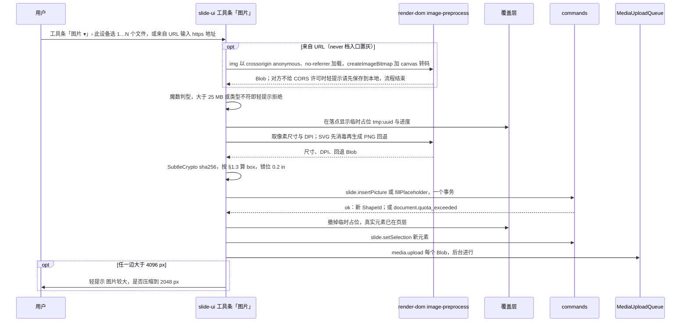

怎么读：纵向是时间；「来自 URL」只多出开头一段转码，拿到 Blob 后与本地文件走同一条路径（取数路径与拒绝条件以 [14](./14-client-security.md) §5 图 6 为准，转码会丢失 SVG 的矢量与 GIF 的动画）；命令之前全是本机计算（判型、预处理、哈希），命令同步完成后元素即可编辑、可撤销；上传与压缩提示都在命令之后，互不阻塞；命令被规模守卫拒绝时撤掉临时占位并提示，不留半个元素。
依据：05 §8.3；14 §5 图 6；40/03 §2.6 `slide.insertPicture`；设计 03-18 §3、§4、§7，03-04 §7.5。

### 2.3 裁剪模式

裁剪模式是 slide-ui 的**本地交互态**：进出不入历史、不广播（与插入工具态同类，R-d-62），拖动中的裁剪结果是覆盖层上的草稿，只在「完成」时执行一次 `slide.crop`、算一个撤销步；「取消」回到进入裁剪前的状态、零命令（rulings §4.25 TB-4，取代 50/10 §7 原「退出裁剪不另发命令、不回滚已提交的裁剪」）。画面（设计 03-18 §6）：原图范围画白色 70% 虚线框，原图在裁剪框外的部分盖 `--v3-scrim` 遮罩；裁剪框 1px 强调色 + 三分线 + 8 个裁剪手柄（四角 L 形、四边短条，强调色 3px 外描 2px 白边）；框下浮条「取消 Esc ┊ 完成 ↵」是唯一的两个出口；底部创建工具条临时收起（位置保留），检查器顶部说明「正在裁剪 · 其余属性暂不可改」、面板标题「裁剪图片」、只留「裁剪」节。覆盖层由 render-dom `crop-overlay`、交互控制器由 slide-ui `crop.ts` 承担（R frontendReuse 图片裁剪模式行；文件登记见 40/06、40/10：render-dom `infrastructure/overlay/crop-overlay.ts` 是选择覆盖层的子部件，不单独贡献 `render.overlay`；slide-ui `application/crop.ts`）。8 个裁剪手柄的命中结果为 `HitResult.handle` 的 `'crop-n'`…`'crop-nw'`（40/06 §2.2）。

**图 2-2 裁剪模式状态机**

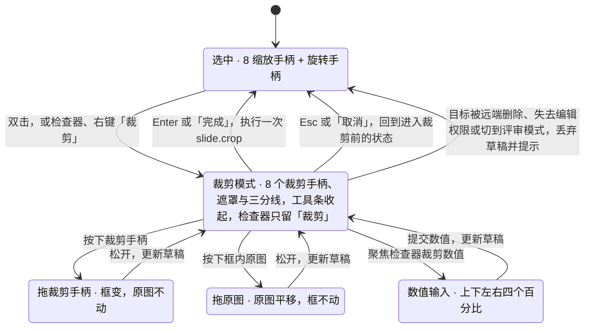

怎么读：只有「完成」一条边会产生命令，其余出口都丢弃草稿、回到进入裁剪前的状态（rulings §4.25 TB-4）；三种调整方式（拖手柄、拖原图、输数值）改的是同一份草稿，结果等价；按设计 03-18 §6，裁剪期间点画布上的其它对象不切换选区，避免误丢草稿。
依据：设计 03-18 §6 与图 6-1；PRD ED-07、ED-29；R-d-29；rulings §4.25 TB-4。

**裁剪规则**

| 项 | 规则 |
|---|---|
| 进入条件 | 单选一张可裁剪的图片：EMF / WMF（§5）、未加载的外链图片（§9）、视频与音频（P2 前）禁用裁剪按钮并 tooltip 说明原因 |
| 原图与框 | 进入时按当前 `sourceRect` 反算出原图的完整矩形，框外部分盖 `--v3-scrim` 遮罩（原写「50% 遮罩」作废）；草稿只改两者的相对关系 |
| 拖裁剪手柄 | 原图不动、框变：对边在世界坐标中保持不动；角手柄默认不锁比例，按住 Shift 锁定当前框的宽高比；可以拖出原图范围（得到负 `sourceRect`，框内留透明） |
| 拖原图 | 框不动、原图平移；原图可以被拖到露出框的部分（同样得到负值），松开时不自动吸回 |
| 数值等价 | 检查器「裁剪」节显示上 / 下 / 左 / 右四个百分比（相对原图，与 `sourceRect` 同一语义；原写「显示单位按偏好，cm / in」作废），输入即更新草稿；节末说明「拖动手柄调整范围，拖动图片在框内平移；只记录裁剪范围，不改原图」；键盘用户不需要拖动（WCAG 2.5.7，设计 03-18 §6） |
| 填充 / 适合（P1，样张未画，放进「裁剪」节） | `slide.crop{shapeId, fit:'fill', pixelSize}`：框不变，原图等比覆盖框并居中（cover）；`fit:'fit'`：原图等比完整放进框内并居中（contain，产生负值留白） |
| 完成写回 | 「完成」或 Enter：一次 `slide.crop{shapeId, rect}`，轻提示「已裁剪图片」带「撤销」：同一事务写 `slide.pic.setBlipFill{sourceRect}`，框变过时再写 `shape.setTransform`；旋转中心随框变化而移动，`off` 按「未拖动的边在世界坐标不动」补偿，确认后画面不跳动 |
| 取消 | 「取消」或 Esc：丢弃草稿，回到进入裁剪前的状态，零命令（rulings §4.25 TB-4） |
| 并发 | 草稿期间他人改了该图片的 `srcRect` 或 `xfrm`：草稿以进入时的快照为基准，「完成」时整值写回（后写者胜），并以轻提示说明「该图片刚被他人修改，已用你的裁剪覆盖，可撤销」 |

**图 2-3 裁剪手势到 srcRect 的换算**

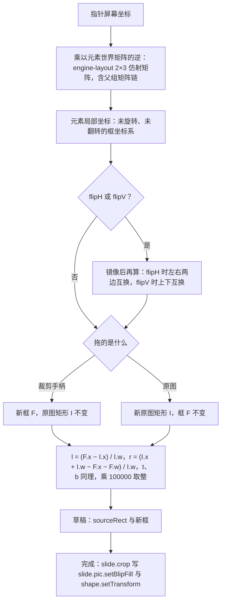

怎么读：所有手势先反变换到元素自己的未旋转坐标系，在那里只做矩形运算；翻转只影响「哪条边对应哪个 `srcRect` 分量」；两种拖动最后都落到同一个换算公式，草稿与「完成」写回的是同一组值。
依据：R crossCutting「变换矩阵」（手柄在屏幕空间计算再反变换回 EMU）；ECMA-376 `a:srcRect` 语义；R-d-29。

### 2.4 替换、重置、不透明度、压缩与替代文本的语义

| 命令 | 改什么 | 不改什么 | 撤销与协同 |
|---|---|---|---|
| `slide.replacePicture{shapeId, blob, pixelSize}` | `media.add` 新 MediaId；`slide.pic.setBlipFill{mediaId, svgMediaId?, sourceRect}`：原图没有裁剪时，新图按框的宽高比居中「填充」裁剪（不变形）；原图有裁剪时保留四边比例，若新图可见区与框的宽高比不同，再沿多出的一维对称收紧直到不变形（设计 03-18「按原裁剪比例重新裁剪」） | 框（`xfrm`）、替代文本、透明度、边框与效果 | 一步撤销；旧 `MediaRef` 保留，撤销即指回旧图 |
| `slide.resetPicture{shapeId, pixelSize?}` | 清 `sourceRect`、`alpha`、`effects`；带 `pixelSize`（slide-ui 取原图像素尺寸）时另按原图像素与 DPI 重算框的大小，保持框中心不动 | 替代文本、边框、旋转 | 一步撤销 |
| `slide.setPictureTransparency{shapeIds, alpha}` | 界面名称为「不透明度」（设计 03-18 §5.2，与形状、视频同一写法）：不透明度 o%（0–100，缺省 100）写 `alpha = o × 1000`；o = 100 时删除 `alphaModFix`；命令名沿用 | 其余全部 | 多选一个事务；`alpha` 是标量叶子，并发时后写者胜 |
| `slide.compressPicture{items: [{shapeId, blob}], maxEdge}` | slide-ui 先解码并把长边缩到 `maxEdge`（默认 2048 px）、按原格式重编码（有透明通道的保持 PNG），命令对每项 `media.add` 新 MediaId 并 `slide.pic.setBlipFill{mediaId}` | `sourceRect`（百分比与分辨率无关）、框、替代文本；动画 GIF、SVG、EMF 不参与（按钮禁用并说明原因） | 只在用户显式确认后执行（PRD ED-07 边界）；一步撤销；旧 `MediaRef` 保留 |
| `slide.setAltText{shapeId, description?, title?, decorative?}` | `slide.shape.setNonVisual`：描述 ≤ 250 字；`decorative: true` 时描述输入框禁用但保留原文，取消勾选即恢复（设计 03-18） | 其余全部 | 一步撤销；三个字段各自标量叶子 |

## 3. SVG 图片

| 栏 | 设计 |
|---|---|
| ① 作用 | 放大不失真的矢量插图、Logo、图表导出图；PowerPoint 365 原生支持。与位图相比放大清晰、体积小；与图标（§4）相比来源任意、颜色不受主题约束 |
| ② OOXML 来源 | `p:pic` + `a:blip@r:embed`（PNG 回退部件）+ `a:blip/a:extLst/a:ext@uri="{96DAC541-7B7A-43D3-8B79-37D633B846F1}"/asvg:svgBlip@r:embed`（SVG 部件），其余同图片 |
| ③ 插入入口与默认 | 同图片（选 .svg、拖入、粘贴 `image/svg+xml`）；SVG 单个 ≤ 2 MiB（与服务端提交校验一致，[60/04](../60-backend/04-modules-documents-storage-media.md) §7.2 第 6 步，超出在本机即拒绝）；插入时依次：消毒 → 读 `viewBox` / `width` / `height` 定尺寸（无单位按 96 DPI）→ 生成 PNG 回退（2 倍显示尺寸，最长边 ≤ 2048 px）→ 一个事务两次 `media.add` + `shape.insert` |
| ④ 模型 | `BlipFill.svgMediaId?: MediaId`，新增（§4.21，现 30/04 落 `extensions`，改为显式建模）；`mediaId` 指 PNG 回退；共两个 `MediaRef`。导入时没有回退的 `svgBlip`（第三方工具可能不写）保持原样，不自动补生成 |
| ⑤ 渲染 | 只以图像上下文 `<image href="blob:…svg">` 渲染，禁 `innerHTML` / `DOMParser`（ADR-0021 修订 5），脚本与外链在图像上下文中天然失效；SVG 部件缺失或解码失败时画 PNG 回退，两者都失败时 `media-decode-failed` 占位；缩略图、`/render` 同路径；`toImage` 导出时 blob 内联为 data URI（05 §10.3） |
| ⑥ 交互 | 同图片（裁剪、不透明度、旋转都适用，`srcRect` 同时作用于 SVG 与回退）；「压缩…」不可用（设计 03-18 §8）；不提供「转换为形状」（M4+ 评估） |
| ⑦ 检查器 | 同图片；单色的图标式 SVG 可设「图形填充」颜色（P2，复用 §4 的重新着色） |
| ⑧ 命令 | Command：`slide.insertPicture{containerId, box, blob, fallbackBlob?}`（参数扩展，新增 §4.21）；替换走 `slide.replacePicture`（新 SVG 同样生成回退）；重新着色 P2 走 `slide.recolorSvg`（§4）。Mutation：`media.add` × 2、`shape.insert`、`slide.pic.setBlipFill`。Operation：`slide.setSelection` |
| ⑨ 协同 | 两个 `BlobRef`；`mediaId` 与 `svgMediaId` 同在 `blip` 整值键（§2.1 第 ⑨ 栏），不会被并发拆开；其余同图片 |
| ⑩ 导入导出与保真 | M1 V、M2 E。导出写 `svgBlip` 扩展，SVG 与 PNG 两个部件都登记内容类型（`svg` 的 `Default` 为 `image/svg+xml`）；导入的无回退 `svgBlip` 原样写回；消毒只作用于新插入的字节，导入文档里的 SVG 部件字节不改（渲染只走图像上下文，已足够安全） |
| ⑪ 无障碍 | 同图片 |
| ⑫ 复用 | 回退栅格化用浏览器原生：`` 解码 + canvas `drawImage` + `toBlob`（ADR-0021 第 ④ 角色，R-d-23）。@resvg/resvg-wasm（MPL-2.0，按 [ADR-0049](../30-architecture/adr/0049-dependency-admission-and-license-tiers.md) 属可用的未修改依赖）要 `wasm-unsafe-eval` 与额外体积，只在原生结果不一致时再评估。消毒器**维持自研**白名单（严格 XML、拒 DOCTYPE，基于 `@cordexjs/xml`，R-d-45）：DOMPurify 依赖 DOM（服务端要带 jsdom，浏览器 Worker 里也没有 DOM），且白名单口径必须与服务端逐条一致 |
| ⑬ 里程碑 | M1 V；M2 P0 插入；M2 P1 PNG 回退 |
| ⑭ 待决 | ① 消毒器落点：客户端要在哈希前跑与服务端**同一份**消毒器，本地 sha256 才等于服务端的规范 sha256（05 §8.3），需把它放进 iso 包（§13）；落地前含不安全构造的 SVG 按「拒绝插入并提示」处理。② PRD 把 SVG 插入定 P0、回退定 P1，建议两者同批交付：没有回退的 `svgBlip` 在 PowerPoint 2016 及更早版本里显示为空白 |

**图 3-1 SVG 插入：消毒、回退与哈希的顺序**

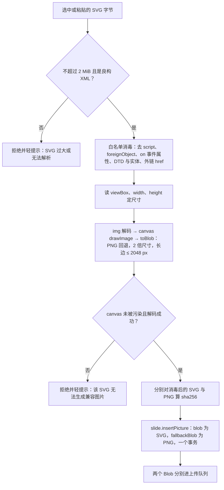

怎么读：消毒必须在栅格化与哈希之前——消毒去掉了 `foreignObject`，canvas 就不会被污染；哈希的是消毒后的字节，服务端提交校验第 6 步重算出的规范 sha256 与本地一致；任何一步失败都不开事务。
依据：R elementDesign SVG 图片行；60/04 §7.2 提交校验；R-d-23、R-d-45；ADR-0021。

## 4. 图标

| 栏 | 设计 |
|---|---|
| ① 作用 | 快速插入风格统一的线性图标，装饰要点、流程步骤、KPI 卡片；对标 PowerPoint 365「图标」。与 SVG 图片相比：来自内置图库、默认取主题文字色、可一键重新着色；「符号」（Unicode 字符）属文本类，见 [50/20](./20-elements-text.md) |
| ② OOXML 来源 | 与 SVG 图片相同：`p:pic` + `asvg:svgBlip`（SVG 部件）+ `a:blip@r:embed`（PNG 回退）；没有图标专属节点，PowerPoint 同样按 SVG 图片存 |
| ③ 插入入口与默认 | 「更多 › 图标…」与主菜单「插入 › 图标…」（原插入 › 形状 › 图标… 作废；设计 03-04 §4、03-15 §7）：打开「插入图标」对话框（宽 640；说明「线性图标，插入后是可改色的 SVG 图片；可多选。」）——搜索框（中英文关键词）、左侧分类（八类共 93 个）、虚拟化网格（@tanstack/react-virtual，R-d-16）、可多选；底栏左「已选 N 个 · 插入为 72 × 72 pt，颜色取主题文字色」，右「取消」「插入 N 个」，未选时「插入」不可用、工具提示「先选择至少一个图标」；内容占位符图标条中的「图标」入口 P2。默认 72 × 72 pt（1 in × 1 in），颜色取主题 `tx1` 经当前母版配色映射解析出的 RGB（SVG 无法引用主题色，只能写入具体颜色）；多个图标按视口中心依次错位 14.4 pt（0.2 in）并全部选中；插入后对话框关闭，画布轻提示「已插入 N 个图标」带「撤销」，焦点回到「更多」 |
| ④ 模型 | 同 SVG 图片（`BlipFill.mediaId` + `svgMediaId`）；`nonVisual.description` 默认写图标的本地化名称（可改）、`nonVisual.name` 为「图标 N」；不记录图标库 id（重新着色直接改 SVG 字节，见 ⑥） |
| ⑤ 渲染 | 同 SVG 图片 |
| ⑥ 交互 | 同图片。重新着色：把 SVG 中所有非 `none` 的 `stroke` / `fill` 颜色替换为新颜色，生成新的 SVG 字节与新 PNG 回退，得到两个新 MediaId；只对「单色」SVG 开放（所有着色值相同），多色 SVG 的「图形填充」不可用并给原因「多色图形不支持一键改色」（设计 03-18 §8，样张未画） |
| ⑦ 检查器 | 面板标题「图标」；最上方「图形填充」节（「主题颜色」一行 10 色、「最近使用」、自定义色值字段 色块 · 十六进制 · 不透明度；选中色块 2px 强调色外圈；选主题色时写入解析后的 RGB，控件上标注来源色槽）· 图片（「压缩」不可用）· 不透明度 · 位置与大小 · 替代文本（预填图标名）（设计 03-18 §1.2、§8）；原「图标迷你工具条『颜色』」作废（03-18 §1.4） |
| ⑧ 命令 | Command：`slide.insertIcons{containerId, items: [{blob, fallbackBlob, name}]}`（新增 §4.21，N 个图标一个事务）；`slide.recolorSvg{items: [{shapeId, blob, fallbackBlob}], color}`（新增 §4.21）。两者都只收**预处理后的字节**：取图标源、写入颜色、栅格化回退、哈希都由 slide-ui 在命令前完成（§1.3 第 1 条）；R 草案 `insertIcons{icons:[{id, color}]}` 需要在命令内做异步栅格化，本文改为字节形态，定义以 ADR-0018 为准。Mutation：`media.add` × 2N、`shape.insert` × N、`slide.pic.setBlipFill`。本地交互态：图标面板开合、搜索词、多选集合 |
| ⑨ 协同 | 同 SVG 图片；两人同时给同一图标改色：`blip` 整值 LWW，后写者的颜色生效 |
| ⑩ 导入导出与保真 | E；导出与 SVG 图片完全相同，PowerPoint 打开后仍可用其「图形填充」改色 |
| ⑪ 无障碍 | 用图标名预填替代文本；图标网格整组一个 Tab 停靠点、方向键导航（与形状库同一模式，设计 03-15 §7）、`Space` 勾选、`Enter` 插入，搜索结果数经 aria-live 播报；插入后播报「已插入 N 个图标」 |
| ⑫ 复用 | 图标源用 **lucide-static 1.48.0**（ISC）：与界面图标（lucide-react）同一风格，按分类拆成惰性 chunk（体积预算归 [50/13](./13-performance-and-bundling.md)），面板打开时才加载；备选 @tabler/icons 3.48.0（MIT，作插入图标库未采纳，[17](./17-reuse-and-dependency-catalog.md) §6；界面上的文件类型图标另取 Tabler 3.49.0 原件复制、不作依赖，与插入图标库无关，17 §3，rulings §4.25 DS-143、TB-182）。中文检索词映射表自建（上游只有英文标签）。PNG 回退走 ADR-0021 第 ④ 角色（R-d-23） |
| ⑬ 里程碑 | M3 P2（rulings §4.21 q-extra-inserts） |
| ⑭ 待决 | ISC / MIT 的版权声明条款是否覆盖「插入用户文档的图形」，需法务确认；图标面板是否提供最近使用 |

**图 4-1 图标面板插入**

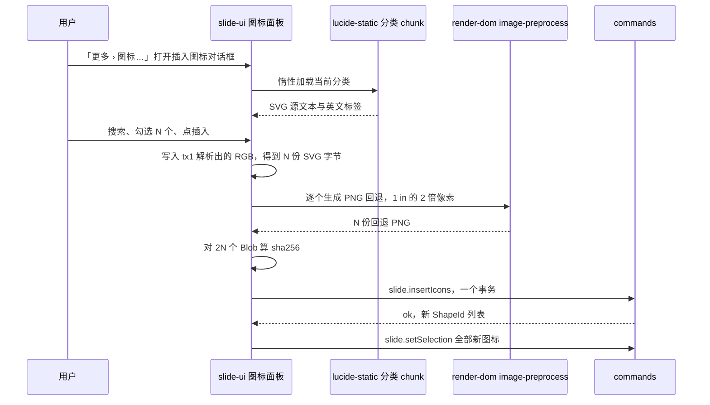

怎么读：取源、着色、栅格化与哈希全在面板内完成，命令只登记字节与建形状；整批一个事务，撤销一步回到插入前；上传随后由队列在后台进行（图 1-1）。
依据：R elementDesign 图标行；R frontendReuse 图标行；rulings §4.21 q-extra-inserts。

## 5. EMF / WMF

| 栏 | 设计 |
|---|---|
| ① 作用 | 老版 Office、Visio 的粘贴图、剪贴画与 OLE 对象预览（Windows 图元文件）要能看、能摆放、原样写回 |
| ② OOXML 来源 | `p:pic` + `a:blip@r:embed` → `ppt/media/*.emf` 或 `*.wmf`；OLE 预览同理（`mc:Fallback` 中的 `p:pic`，提取为 `Ole.preview`） |
| ③ 插入入口与默认 | **不提供插入**：文件选择器不接受 emf / wmf，拖入即拒并提示「不支持插入 EMF/WMF，请先转换为 PNG 或 SVG」；粘贴含 EMF 的剪贴板内容时取同一项里的 PNG 表示，没有 PNG 表示则拒绝（[04](./04-document-commands-and-undo.md) §9） |
| ④ 模型 | `Pic` + `MediaRef`（原字节不变），无新增字段；栅格结果不入模型，只是 MediaCache 变体 `sha256#raster@<px>` |
| ⑤ 渲染 | M1：有包内位图预览则显示，否则占位 `emf-no-preview`；M2：首次遇到时惰性加载 Worker chunk（emf-converter 4.x，显式 `gdiAntialias: true`），按元素显示尺寸 × `pixelRatioCap` 取像素档栅格化，先显示骨架（设计 03-13），完成后同节点替换；超出记录数、像素或耗时上限回到占位 `emf-raster-limit`（[05](./05-rendering-and-thumbnails.md) §8.4）；M4+：转换器的 SVG 输出经 `<image href="blob:">` 矢量渲染 |
| ⑥ 交互 | 可移动、缩放、旋转、翻转、删除；裁剪、不透明度、压缩不可用并注明原因（「该格式暂不支持裁剪」「该格式不支持压缩」；PRD ED-07 边界，P2 才支持）；「替换」可换成位图或 SVG，之后按图片处理 |
| ⑦ 检查器 | 图片检查器四节（§2.1 ⑦）：「替换…」可用；「裁剪」「压缩…」与「不透明度」不可用并注明原因；位置与大小；替代文本 |
| ⑧ 命令 | Command：通用变换命令、`slide.replacePicture`、`slide.setAltText`。Mutation：`shape.setTransform`、`slide.pic.setBlipFill`、`slide.shape.setNonVisual`。Operation：`slide.setSelection` |
| ⑨ 协同 | 同图片；栅格化是各端本地派生，不同步、不入 Store |
| ⑩ 导入导出与保真 | M1 V~、M2 V、M4+ V（矢量）；原字节写回，零编辑字节相同 |
| ⑪ 无障碍 | 同图片；占位上有文字说明「此图片格式（EMF）暂无法预览」 |
| ⑫ 复用 | **emf-converter**（Apache-2.0）：4.0.0 于 2026-09-25 发布，改评 4.0.x——4.0 起默认 PNG 不再抗锯齿，调用处显式传 `gdiAntialias: true`；过 minimumReleaseAge 后精确锁（R-d-24）；唯一引入点 `slide-render` 的 `emf-rasterizer.worker.ts`（40/07 §5.1）。备选 rtf.js 的 EMFJS / WMFJS 已停更 |
| ⑬ 里程碑 | M1 V~；M2 P1 栅格化；M4+ P2 矢量 |
| ⑭ 待决 | 栅格上限初值（记录数、像素、耗时）由 M2 spike 定并回填 PRD OF-24；M4+ 矢量输出是否过 SVG 消毒器（建议过，防止转换器输出意外构造） |

**图 5-1 EMF 元素的显示状态**

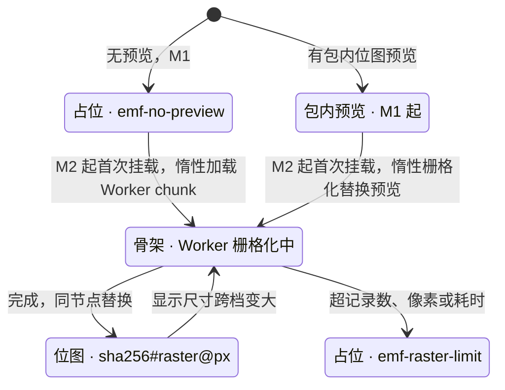

怎么读：M1 只有左侧两态；M2 起任何状态都可以进入栅格化，结果按像素档缓存，缩放跨档时才重做；超限只回到占位，不影响其他元素，原字节始终不变。
依据：05 §8.4；PRD OF-07、OF-24；设计 03-13「只保留对象」表 EMF 行。

## 6. 图片填充（形状 / 背景 / 文字）

| 栏 | 设计 |
|---|---|
| ① 作用 | 把图片放进任意形状轮廓（圆形头像、异形图框），作幻灯片背景，或给大号标题字做纹理。它不是独立元素而是宿主的一种填充：形状保留自己的几何、调整手柄与文字 |
| ② OOXML 来源 | `a:blipFill`（`a:blip@r:embed` + 可选 `a:srcRect` + `a:stretch/a:fillRect` 或 `a:tile@tx/ty/sx/sy/flip/algn`），位于 `p:spPr`（形状）、`p:bg/p:bgPr`（背景）或 `a:rPr`（文字） |
| ③ 插入入口与默认 | 形状：检查器「填充」节分段里的「图片」（P2：开放前留在原位、标 P2、不可用，rulings §4.25 TB-43、§4.20 FE-06，[18](./18-editor-capabilities.md) FMT-04），开放后选「图片」再选来源「此设备… / 剪贴板」，默认「拉伸」；背景：无选中时检查器「背景」节选「图片」方式，颜色字段换成「选择图片…」按钮（ED-20 P1；设计 03-02 §4.1、03-28 §3.6；原「设计页签 › 幻灯片背景」随 ribbon 废弃），默认「拉伸」，可「应用到全部」（写母版 `p:bg`，PRD ED-20）；文字 M4+ |
| ④ 模型 | `Fill` 联合的 `blip` 分支：`{kind:'blip', mediaId, sourceRect?, mode: 'stretch' \| 'tile', tile?: {tx, ty, sx, sy, flip, align}, alpha?}`（30/04 §4.3 `a:blipFill` → `Fill` 已建模；`alpha` 与图片同口径，新增 §4.21）；背景为 `Background{kind:'properties', fill}`（40/03 §2.2） |
| ⑤ 渲染 | 拉伸：以宿主几何路径作 `clipPath`，内放按 `sourceRect` 定位的 `<image>`；平铺：SVG `<pattern>` 按 `tile` 的偏移、缩放与对齐生成，图片单元为 `<image>`；背景同理铺满页；文字填充（M4+）为 `<text fill="url(#pattern)">` |
| ⑥ 交互 | 同宿主元素（形状仍可编辑文字、拖调整点）；没有独立裁剪模式，填充内的偏移与缩放 P2 用检查器数值 |
| ⑦ 检查器 | 形状：「填充」节选「图片」分段（v3 样张为「无 / 纯色 / 渐变 / 图片」，设计 03-02 §4.2；「图片」P2，开放前不可用，TB-43）后出现：选择图片、拉伸 / 平铺、平铺偏移与缩放（P2）、透明度；背景：无选中时「背景」节选「图片」方式（设计 03-02 §4.1、03-28 §3.6，rulings §4.25 DS-20）后颜色字段换成「选择图片…」按钮。两处选「图片」之后的其余控件（拉伸 / 平铺、透明度、平铺偏移与缩放，背景另有隐藏背景图形、应用到全部、重置背景）第 1 批样张未画，落点随实现（[21](./21-elements-structure.md) §5 ⑦） |
| ⑧ 命令 | Command：`slide.setPictureFill{shapeIds, blob, mode}`（新增 §4.21）→ `media.add` + `shape.setProperties{fill}`；背景用既有 `slide.setSlideBackground{slideId, background}`，增加 `blob?` 参数（新增 §4.21）→ `media.add` + `slide.slide.setBackground`；「应用到全部」走既有 `slide.setMasterBackground`；文字 M4+ 走 `run.setProperties{fill}`。本地交互态：无 |
| ⑨ 协同 | `fill` 为嵌套 Y.Map（30/06 §1.5），`blip` 分支内的 `mediaId` 与 `sourceRect` 随分支整体写入；两人同时改同一形状的填充类型，后写者胜 |
| ⑩ 导入导出与保真 | M1 V；M2 E~（背景 P1、形状 P2）；`tile` 参数与未知子元素往返；新媒体部件与关系按 §2 同规则写出 |
| ⑪ 无障碍 | 宿主 role 不变；背景图片视为装饰，不入可访问树；形状的图片填充不另设替代文本，宿主的 `description` 负责描述 |
| ⑫ 复用 | 无第三方：SVG 原生 `clipPath` 与 `pattern` 足够；字节通道复用 §1.3 |
| ⑬ 里程碑 | 背景 M2 P1（ED-20）；形状 M2 P2（ED-06）；文字 M4+ |
| ⑭ 待决 | 「应用到全部」写母版级背景、不逐页复制已定（rulings §4.25 TB-45）；各页已有覆盖默认保留并在轻提示里给「也清除它们」，是否改为默认清除按 [21](./21-elements-structure.md) §5 ⑭ 待语料核对 |

**图 6-1 图片填充：三个入口到同一事务与两种渲染**

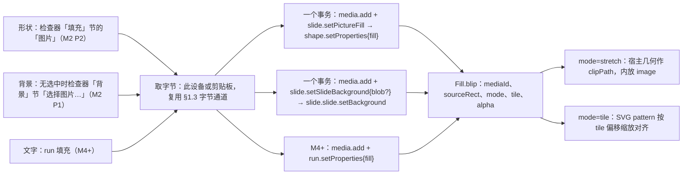

怎么读：左侧三个入口共用同一条取字节链，字节先经 `media.add` 得到 `MediaId`，再与写填充的 Mutation 放在同一个事务里，撤销一次同时回退；三处最终都落到 `Fill` 联合的 `blip` 分支，渲染按 `mode` 二选一：拉伸用宿主几何裁剪，平铺用 SVG `pattern`。「应用到全部」走 `slide.setMasterBackground`，图中未画。
依据：本节 ④⑤⑧；30/04 §4.3；40/03 §2.2；PRD ED-06、ED-20。

## 7. 视频

### 7.1 十四栏

| 栏 | 设计 |
|---|---|
| ① 作用 | 产品演示、操作讲解；编辑时显示海报帧，放映时点击播放；编辑时也能点一下就地预览，不必进入放映 |
| ② OOXML 来源 | `p:pic`：`p:cNvPr/a:hlinkClick@action="ppaction://media"`；`p:nvPr/a:videoFile@r:link`（指向媒体部件；外链时 `TargetMode="External"`）+ `p:nvPr/p:extLst/p:ext/p14:media@r:embed`（同一媒体部件）；`p:blipFill` 为海报帧；剪辑 `p14:trim`、淡入淡出 `p14:fade` 在 `p14:media` 下；开始方式、循环、全屏等播放选项在 `p:timing`（不透明） |
| ③ 插入入口与默认 | 「更多」插图组「视频」与主菜单「插入 › 视频」（P2，未开放前留在原位不可用、标 P2、右侧写「后续版本提供」；原插入 › 图像 › 视频… 作废；设计 03-04 §4.2、§7.3）；空媒体占位符图标（P2）。主推 mp4（H.264 + AAC），webm / mov 可插入但提示「PowerPoint 可能无法播放」；默认按视频原始宽高（96 DPI）换算，最长边 ≤ 页面 60%，视口居中；海报取第 0 帧（`<video>` 解码到首帧 → canvas → PNG，ADR-0021 第 ④ 角色），取帧失败用内置占位海报 |
| ④ 模型 | `Pic` + `Pic.media: PicMedia{kind:'video', mediaId?, external?}`（30/04 已有 `Pic.media`，40/03 `pic.ts` 补列，新增 §4.21；`a:videoFile` 与 `p14:media` 两条关系指向同一部件时共用一个 MediaId，ADR-0018）；海报是 `blipFill.mediaId`；播放选项、剪辑与淡入淡出留在 `extensions` 与 `p:timing`，不建模 |
| ⑤ 渲染 | 编辑态、缩略图、`/render`：画海报，编辑态覆盖层在中央画 56 px 圆形播放按钮（面板 85% 底 + 1px 边 + 浮层阴影，读屏名「临时播放视频」，设计 03-18 §9）；探测不支持的编码（`MediaCapabilities.decodingInfo` / `canPlayType`）时海报加角标「此格式无法在浏览器中播放」，仍可选中移动删除（设计 03-13 G-06）；放映态在页容器内叠放 HTML `<video>`，位置随元素变换，点击播放（05 §8.5）；外链按 `externalResources`，`preload="none"` |
| ⑥ 交互 | 选中、移动、缩放、旋转（右键「旋转 ▸」只有向右 / 向左 90°）、删除，没有翻转；替换海报（M2 P1）；编辑态点播放按钮、选中后按 `Enter` 或右键「播放 ↵」→ 临时播放（§7.2，R-d-68）；右键菜单为 剪贴板 ┊ 播放 · 替换海报… · 裁剪（P2）┊ 排列 · 旋转 · 组合 ┊ 编辑替代文本… · 添加评论 ┊ 删除（设计 03-05 §3）；播放中 `Space` 由原生控件处理播放与暂停，`Esc` 停止并把焦点还给画布；裁剪 P2 |
| ⑦ 检查器 | `selectionKind: media`（新增，R-d-72，[10](./10-editor-shell-and-interaction.md) §5），面板标题「视频」，按已拍板样张三节（设计 03-18 §1.2、§9）：**视频**（海报缩略 + 文件名 +「MP4 · 1:30 · 1920 × 1080」；「换海报…」M2 P1，来源为此设备，「取当前帧」P2、样张未画；「裁剪」P2，留在原位不可用、标 P2，提示「裁剪视频排在后续版本（P2）」；说明行「按 ↵ 或点画面上的播放图标临时播放；不写入文档、不广播，导出不受影响」——**检查器不设播放按钮**）· **位置与大小**（没有翻转）· **替代文本**。原「播放预览」按钮与「播放选项只读展示」作废：播放选项（开始方式、循环等）来自原文件、不建模，检查器不展示 |
| ⑧ 命令 | Command：`slide.insertMedia{containerId, box, kind:'video', blob, poster}`（P2，新增 §4.21）；`slide.replacePoster{shapeId, blob}`（M2 P1，新增 §4.21）；通用变换；`slide.setAltText`。Mutation：`media.add` × 2、`shape.insert`、`slide.pic.setBlipFill`、`shape.setTransform`。Operation：`slide.setSelection`。本地交互态：临时播放（`media-playback` 覆盖层） |
| ⑨ 协同 | 视频 ≥ 10 MB 分片上传（05 §8.3）；上传队列先传海报再传视频，他端尽早看到海报；播放状态完全本地，不进 Store、不进 awareness；他人删除正在播放的视频 → 停止并卸载播放层，以轻提示说明 |
| ⑩ 导入导出与保真 | M1 V；M2 E~。**插入时不写 `p:timing`**（rulings §4.21 q-media-insert）：只写 `a:videoFile` + `p14:media` 两条关系（同指一个媒体部件）、海报与 `hlinkClick`，导出后在 PowerPoint 放映需点击媒体控件播放，不会随单击自动播放；导入的 `p:timing` 与 `p14:trim` / `p14:fade` 原样写回；新扩展名登记内容类型 |
| ⑪ 无障碍 | 可访问树 `role=media`，`name` 取 `description`，没有时为「视频 N」；缺替代文本提示；播放层用原生 `<video controls>`，键盘可达；插入后播报 |
| ⑫ 复用 | 播放用浏览器原生 `<video>`；海报帧用 `<video>` 定位 + canvas `drawImage`（ADR-0021 第 ④ 角色）；编码探测用 MediaCapabilities 与 `canPlayType`。mediabunny（MPL-2.0，按 ADR-0049 属可用的未修改依赖）能做容器探测与取帧，但原生能力已够，不引入；ffmpeg.wasm 体积与 CSP 代价过大，否决 |
| ⑬ 里程碑 | M1 查看与放映；M2 P1 移动缩放、替换海报、编辑态临时播放；M2 P2 插入与裁剪 |
| ⑭ 待决 | 视频大小上限：图片的 25 MB 口径不适用，以 presign 返回的 `maxBytes` 为准（服务端默认 100 MiB，[60/04](../60-backend/04-modules-documents-storage-media.md) §7.2 第 3 步），建议插入前先 presign 预检；webm 是否直接拒绝；放映中的自动播放、循环、全屏（`p:timing` M1–M3 只解析可见性终态，故全部按点击播放处理） |

### 7.2 编辑态临时播放与放映

设计 03-13 G-06 要求编辑与评审模式下「点击播放、Esc 或点击外部停止」，旧版 05 §8.5 写「编辑态只画海报」，两者冲突；R-d-68 收口为**临时覆盖层播放**：播放层是 render-dom 的 `media-playback` 覆盖层（05 §5.2、§8.5），不进 Scene、不写 Store、不广播，不影响缩略图与 `/render`。

| 项 | 规则 |
|---|---|
| 触发 | 点击海报中央的 56 px 播放按钮（覆盖层手柄命中，`kind: 'handle'`、手柄名 `media-play`，不新增命中类型），或选中视频 / 音频后按 `Enter`、右键「播放 ↵」；未选中时先选中再播放；检查器「视频」节不设第二个播放按钮（设计 03-18 §9） |
| 适用视图 | 编辑、评审、查看器普通视图；缩略图、`/render`、导出永不播放 |
| 形态 | 在元素的变换位置挂一个 HTML `<video controls>`（音频为 `<audio controls>`，贴在图标下方），随缩放与滚动跟随；同一 Unit 同时只播放一个，开始新的即停止旧的 |
| 停止 | `Esc`、取消选中、切换当前页、开始拖动或缩放该元素、进入裁剪或放映、元素被删除（含远端删除）、Unit 关闭；停止即卸载播放层并归还 MediaCache 引用 |
| 字节 | 内嵌媒体经 MediaCache 取 `blob:` URL（引用计数 +1，停止时 −1）；外链按 `externalResources`，`confirm` 档先确认域名 |
| 放映 | 页容器内叠放 `<video>` / `<audio>`，点击播放；翻页即停止并释放；`p:timing` 的自动播放、循环、跨页 M1–M3 不解析 |

**图 7-1 编辑态点击播放**

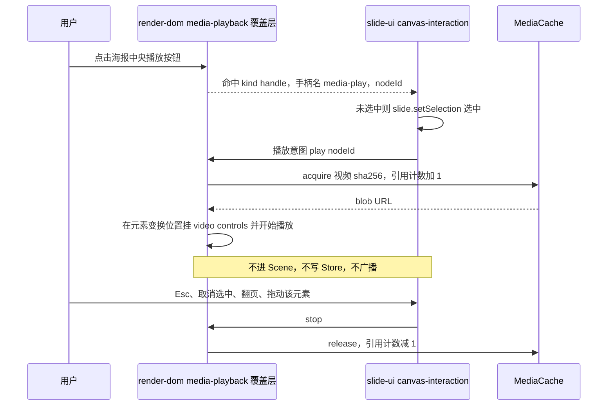

怎么读：纵向是时间；命中与选择语义仍由 slide-ui 决定，播放层只负责挂载与卸载原生控件；整个过程没有任何命令与事务，撤销栈、协作者与缩略图都感知不到。
依据：R-d-68；设计 03-13 G-06；05 §8.5 播放状态机。

## 8. 音频

| 栏 | 设计 |
|---|---|
| ① 作用 | 旁白、背景音乐、音效；编辑态是一个喇叭图标 |
| ② OOXML 来源 | `p:pic` + `p:nvPr/a:audioFile@r:link` + `p14:media@r:embed` + 喇叭图标 `p:blipFill`；`p:cNvPr/a:hlinkClick@action="ppaction://media"`；跨页播放、隐藏图标、循环在 `p:timing`（不透明） |
| ③ 插入入口与默认 | 「更多」插图组「音频」与主菜单「插入 › 音频」（P2，未开放前不可用；原插入 › 图像 › 音频… 作废）；默认 0.5 in 的喇叭图标，视口居中；接受 mp3 / m4a / wav（与服务端类型白名单 `audio/mpeg`、`audio/mp4`、`audio/wav` 一致，60/04 §7.2 第 5 步） |
| ④ 模型 | `Pic` + `PicMedia{kind:'audio', mediaId}`（新增 §4.21，同视频）；图标是 `blipFill`（内置喇叭 PNG）；文件名写进 `nonVisual.name`，不写进 `description`（避免把文件名当替代文本） |
| ⑤ 渲染 | 编辑态画图标，覆盖层叠小播放图标；放映态叠 `<audio>`，点击图标播放；「隐藏图标」在 `p:timing` 中、M1–M3 不解析，放映时仍显示图标 |
| ⑥ 交互 | 同视频，无裁剪；「替换图标」复用换海报；选中后 `Enter` 试听（§7.2） |
| ⑦ 检查器 | `selectionKind: media`，面板标题「音频」：与视频同一组节——音频节（喇叭图标位置、文件名与格式时长、「换图标…」复用换海报，说明行写试听方式，检查器不设播放按钮）· 位置与大小 · 替代文本；音频的检查器样张未画，随实现按视频（设计 03-18 §9） |
| ⑧ 命令 | Command：`slide.insertMedia{containerId, box, kind:'audio', blob, poster?}`（P2，新增 §4.21，`poster` 缺省用内置喇叭）；`slide.replacePoster`（同视频）。Mutation 与 Operation 同视频 |
| ⑨ 协同 | 同视频 |
| ⑩ 导入导出与保真 | 同视频，插入时不写 `p:timing` |
| ⑪ 无障碍 | `role=media`，`name` 取 `description`，没有时取 `nonVisual.name`（文件名）；缺替代文本提示；原生 `<audio controls>` 键盘可达 |
| ⑫ 复用 | 播放用原生 `<audio>`；喇叭图标由 tooling 在构建期把 Lucide `volume-2`（ISC）栅格化为 PNG 资产随 slide-ui 发布，运行时不再走 canvas |
| ⑬ 里程碑 | 同视频：M1 查看与放映；M2 P1 移动缩放、换图标、编辑态试听；M2 P2 插入 |
| ⑭ 待决 | 跨页播放与隐藏图标在放映中的表现（需只读解析 `p:timing`，ADR-0008 决策 10 已允许只读）；内置喇叭图标的许可声明口径同 §4 |

## 9. 外链图片与外链音视频

| 栏 | 设计 |
|---|---|
| ① 作用 | 文件里引用网络上的图片或音视频（常见于网页复制、第三方工具生成的 pptx），既要能看到，又要让部署方控制是否向外部发请求 |
| ② OOXML 来源 | `a:blip@r:link`（外链图片）、`a:videoFile@r:link` / `a:audioFile@r:link`，关系 `TargetMode="External"`；非 http(s) 目标（`file:`、相对路径）原样保留、不激活 |
| ③ 插入入口与默认 | **不提供外链插入**；「来自 URL…」插图片一律转码后内嵌（§2；取数路径见 [14](./14-client-security.md) §5 图 6） |
| ④ 模型 | 关系原样保留（ADR-0008 决策 5，40/04 `Relationship`）；可否加载由 `isActivatableExternal`（仅 http / https）判定。`BlipFill` 上外链引用的字段形状 30/04 尚未写明（§13） |
| ⑤ 渲染 | `externalResources`：`auto`（默认）直接加载、`referrerpolicy="no-referrer"`；`confirm` 先占位、确认域名后加载；`never` 一律占位（[05](./05-rendering-and-thumbnails.md) §8.5、[14](./14-client-security.md) §6）；`/render` 与服务端恒为 `never`；在线视频的网页链接只显示海报与「在新标签页打开」；加载失败占位 `external-resource-blocked` |
| ⑥ 交互 | 移动、缩放、旋转、删除；「替换」可换成本地图片（替换后变为内嵌）；未加载时裁剪禁用，tooltip「外部图片未加载」；`confirm` 档占位上有「加载」按钮，页级「全部加载」在横幅 |
| ⑦ 检查器 | 图片或媒体分区 + 来源域名 + 加载状态（已加载 / 未加载 / 失败）+「加载」（`confirm` 档） |
| ⑧ 命令 | Command：通用变换、`slide.replacePicture`（外链换内嵌：`media.add` + `slide.pic.setBlipFill`）、`slide.setAltText`。本地交互态：`confirm` 档的「已允许的域名」只在当前页面会话内有效，不写持久存储 |
| ⑨ 协同 | 无特别处理；每个查看者各自决定是否加载，不同步 |
| ⑩ 导入导出与保真 | M1 V；外部关系原样写回；替换为内嵌后，原外部关系按「全部保留」口径继续写回（不再被引用也不删） |
| ⑪ 无障碍 | 占位上有文字说明「外部图片（未加载）· 域名」；role 与 name 同图片或媒体 |
| ⑫ 复用 | 无第三方；加载策略在 slide-render `external-resource.policy`（40/07 §5.1），CSP 联动见 50/14 §6 |
| ⑬ 里程碑 | M1 |
| ⑭ 待决 | 外链引用在 `BlipFill` 上的字段形状（§13） |

## 10. 屏幕截图与相册

| 栏 | 设计 |
|---|---|
| ① 作用 | 屏幕截图：一步把某个窗口或屏幕抓成图片插入并裁剪；相册：把一批照片一页一张快速做成演示。屏幕录制不做（MediaRecorder 只产出 webm，PowerPoint 兼容差） |
| ② OOXML 来源 | 与图片相同（`p:pic`）；相册另产生新的 `p:sld` |
| ③ 插入入口与默认 | 工具条「图片 ▾」与主菜单「插入 › 图片 ▸」里的「屏幕截图」「相册」（M4+，留在原位不可用、标 M4+、右侧写「后续版本提供」，工具提示见设计 03-04 §7.3；原插入 › 图像 › 屏幕截图 / 相册… 作废）。屏幕截图：浏览器 `getDisplayMedia` 由用户选窗口或屏幕 → 抓一帧（`<video>` + canvas `drawImage`，ADR-0021 第 ④ 角色）→ 立即停止共享 → 按图片插入，默认尺寸同 §1.3；相册：多选图片 → 对话框（版式：每页一张；可选「用文件名作标题」）→ 在当前页之后批量新建 |
| ④ 模型 | 同图片；相册新页用所选版式，图片填入其图片或内容占位符（保留 `p:ph`），没有合适占位符时按 §1.3 放在页中央 |
| ⑤ 渲染 | 同图片 |
| ⑥ 交互 | 截图插入后直接进入裁剪模式（§2.3）；相册完成后跳到第一张新页并选中其图片 |
| ⑦ 检查器 | 同图片；相册对话框用 react-hook-form + shadcn Field（R-d-18） |
| ⑧ 命令 | 截图：复用 `slide.insertPicture`。相册：新增 `slide.insertPhotoAlbum{after?, layoutId?, items: [{blob, name}], titleFromName?}`（新增 §4.21，M4+ 再登记进 ADR-0018）：一个事务 `slide.slide.insert` × N + `media.add` × N + `shape.insert` 或占位符填入 × N，受 200 页与元素上限守卫，超限整体拒绝。本地交互态：截图的共享会话 |
| ⑨ 协同 | 同图片；相册的 N 页在一个事务内，单帧不超过协同 update 上限时一步撤销，超出时按 [04](./04-document-commands-and-undo.md) §9 分批为多个事务（撤销随之变为多步，并在 Toast 里说明） |
| ⑩ 导入导出与保真 | 同图片 |
| ⑪ 无障碍 | 截图后提示补替代文本；相册对话框全键盘可用；新页播报「已插入 N 页相册」 |
| ⑫ 复用 | Screen Capture API（`getDisplayMedia`）与原生 `<video>`；不引第三方 |
| ⑬ 里程碑 | M4+ P2（rulings §4.21 q-extra-inserts）；录屏不做 |
| ⑭ 待决 | 写进 PRD 的条目与编号（PRD 02 补齐）；嵌入形态下截图需要宿主给 iframe 授予 `display-capture` 权限（已写进 [14](./14-client-security.md) §11.2 的 iframe 属性要求） |

**图 10-1 相册：一次插入 N 页**

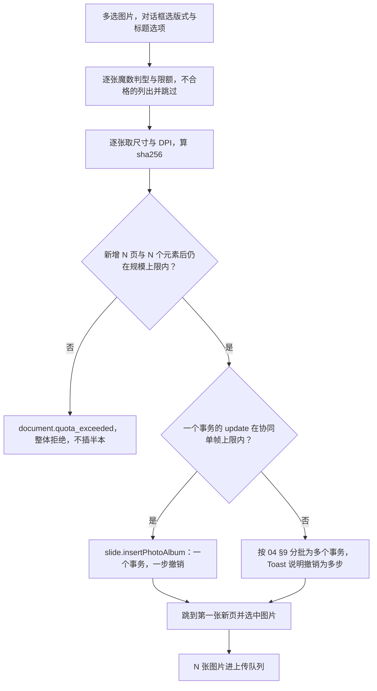

怎么读：先把不合格的文件挑出去，再整体过一次规模守卫，要么全插、要么全不插；只有协同单帧放不下时才拆成多个事务，并明确告诉用户撤销的粒度变了。
依据：R elementDesign 屏幕截图 / 相册行；40/03 §2.1 规模上限；04 §9 协同分批。

## 11. 命令与 Mutation 汇总（本族）

「既有」指已登记在 [40/03](../40-modules/03-slide-domain-model.md) §2.6 的；「新增（§4.21）」的最终定义、参数 schema 与文件落点以 [ADR-0018](../30-architecture/adr/0018-editor-element-model-and-insert-commands.md) 与 40/03 回写为准，本表只给语义。全部 Command 的能力位为 `doc.write`，逆操作由 Store 推导（30/05 §5）。

| 类别 | id | 参数要点 | 事务内 Mutation | 用于 | 里程碑 |
|---|---|---|---|---|---|
| Command · 既有 | `slide.insertPicture` | `{containerId, box, blob, fallbackBlob?}`（`fallbackBlob` 为参数扩展，新增 §4.21） | `media.add` × 1–2、`shape.insert` | §2、§3、§10 截图 | M2 P0 |
| Command · 既有 | `slide.replacePicture` | `{shapeId, blob, fallbackBlob?, pixelSize}`（`fallbackBlob`、`pixelSize` 新增 §4.21） | `media.add`、`slide.pic.setBlipFill` | §2、§3、§5、§9 | M2 P0 |
| Command · 既有 | `slide.crop` | `{shapeId, rect?, fit?: 'fill' \| 'fit', pixelSize?}`（`fit`、`pixelSize` 新增 §4.21） | `slide.pic.setBlipFill`、`shape.setTransform` | §2.3 | M2 P1 |
| Command · 既有 | `slide.setSlideBackground` | `{slideId, background, blob?}`（`blob` 新增 §4.21） | `media.add?`、`slide.slide.setBackground` | §6 | M2 P1 |
| Command · 新增（§4.21） | `slide.resetPicture` | `{shapeId, pixelSize?}` | `slide.pic.setBlipFill`、`shape.setTransform?` | §2.4 | M2 P0 |
| Command · 新增（§4.21） | `slide.setPictureTransparency` | `{shapeIds, alpha}` | `slide.pic.setBlipFill` × N | §2.4 | M2 P0 |
| Command · 新增（§4.21） | `slide.compressPicture` | `{items: [{shapeId, blob}], maxEdge}`（R 草案为 `{shapeIds, maxEdge}`，需在命令内异步重编码，改为字节形态） | `media.add` × N、`slide.pic.setBlipFill` × N | §2.4 | M2 P1 |
| Command · 新增（§4.21） | `slide.setAltText` | `{shapeId, description?, title?, decorative?}` | `slide.shape.setNonVisual` | 本族全部 | M2 P1 |
| Command · 新增（§4.21） | `slide.fillPlaceholder` | `{shapeId, content}`（本族为图片；表格、图表、媒体随各族，50/19） | `shape.remove`（空占位写墓碑）、`media.add`、`shape.insert`（保留同一 `PlaceholderRef` 与 `order`） | §2 | M2 P1 |
| Command · 新增（§4.21） | `slide.setPictureFill` | `{shapeIds, blob, mode}` | `media.add`、`shape.setProperties` × N | §6 | M2 P2 |
| Command · 新增（§4.21） | `slide.insertIcons` | `{containerId, items: [{blob, fallbackBlob, name}]}` | `media.add` × 2N、`shape.insert` × N | §4 | M3 P2 |
| Command · 新增（§4.21） | `slide.recolorSvg` | `{items: [{shapeId, blob, fallbackBlob}], color}` | `media.add` × 2N、`slide.pic.setBlipFill` × N | §3、§4 | M3 P2 |
| Command · 新增（§4.21） | `slide.insertMedia` | `{containerId, box, kind: 'video' \| 'audio', blob, poster?}` | `media.add` × 2、`shape.insert` | §7、§8 | M2 P2 |
| Command · 新增（§4.21） | `slide.replacePoster` | `{shapeId, blob}` | `media.add`、`slide.pic.setBlipFill` | §7、§8 | M2 P1 |
| Command · 新增（§4.21） | `slide.insertPhotoAlbum` | `{after?, layoutId?, items, titleFromName?}` | `slide.slide.insert` × N、`media.add` × N、`shape.insert` × N | §10 | M4+ P2 |
| Mutation · 既有 | `media.add`、`shape.insert`、`shape.setTransform`、`shape.setProperties`、`slide.slide.insert`、`slide.slide.setBackground` | — | — | 本族全部 | — |
| Mutation · 新增（§4.21） | `slide.pic.setBlipFill` | `{shapeId, patch: Partial<BlipFill>}`，`mediaId` 与 `svgMediaId` 必须成对出现 | `set(['shapes', id, 'blipFill', …])` | 替换、裁剪、不透明度、压缩、换海报、重新着色 | M2 |
| Mutation · 新增（§4.21） | `slide.shape.setNonVisual` | `{shapeId, patch: Partial<NonVisualProps>}` | `set(['shapes', id, 'nonVisual', …])` | 替代文本、装饰性 | M2 |
| Operation · 既有 | `slide.setSelection` | — | 不入历史 | 插入后选中 | M2 |
| 本地交互态 | 插入工具态、裁剪模式与草稿、上传临时占位、图标面板、临时播放、截图共享会话 | — | 三者都不是：不入历史、不广播、不进 Store | — | — |

## 12. 里程碑

与 PRD [OF §2.5](../10-prd/03-features/01-open-and-fidelity.md)、[ED-06 / ED-07 / ED-20 / ED-26](../10-prd/03-features/02-editing.md) 与 rulings §4.21 对齐；M1–M4 的里程碑边界只在 30/01 保留一份，本表只列本族交付。

| 里程碑 | 本族交付 |
|---|---|
| M1 | 图片、SVG、视频、音频、外链媒体的查看（`srcRect`、透明度、灰度与亮度对比度精确渲染，GIF 编辑态首帧、放映动画）；EMF 包内预览或占位；外链三档；放映中点击播放视频音频 |
| M2 P0 | 图片插入（文件、拖入、粘贴、URL）、替换、重置、不透明度；SVG 插入；上传占位、失败重试 |
| M2 P1 | 图片裁剪模式、填充 / 适合、大图压缩；SVG 的 PNG 回退；空图片占位符填入；替代文本对话框与装饰性；EMF / WMF 惰性栅格化；幻灯片背景图片；视频音频移动缩放、替换海报、编辑态临时播放 |
| M2 P2 | 视频与音频插入（不写 `p:timing`）；形状图片填充；裁剪为形状；亮度对比度编辑；视频裁剪 |
| M3 P2 | 图标（lucide-static）与重新着色；TIFF 客户端解码 |
| M4+ P2 | 屏幕截图、相册；EMF 矢量渲染；文字图片填充；SVG 与图标「转换为形状」评估。屏幕录制不做 |

## 13. 待决与回写

**待决**（各元素 ⑭ 栏汇总，按影响排序）：

| # | 问题 | 建议 | 决定方 |
|---|---|---|---|
| Q-1 | SVG 消毒器落点：服务端提交校验会消毒并可能改写 sha256（60/04 §7.2 第 6 步），而 05 §8.3 要求本地 sha256 与服务端返回值一致 | 把白名单消毒器放进 iso 包（依赖 `@cordexjs/xml`），浏览器与服务端共用同一份；落地前含不安全构造的 SVG 在本机拒绝插入 | 30/02、40/04、60/04 负责人 |
| Q-2 | `srcRect` 的协同编码：证据草案为逐边 LWW | 整值 LWW（JSON 字串），`mediaId` 与 `svgMediaId` 同键（§2.1 第 ⑨ 栏） | 30/06 负责人 |
| Q-3 | 图片效果（`lum`、`grayscl`、`duotone`、`biLevel`）只读建模还是留在 `extensions` 由渲染器只读解析 | 随 `BlipFill.effects` 只读建模（M1 渲染需要，编辑 P2）；若留在 `extensions`，须进 ADR-0008 决策 10 的只读清单 | ADR-0018 |
| Q-4 | 外链引用在 `BlipFill` 上的字段形状 | 在 ADR-0018 明示（例如 `BlipFill` 的来源为「内嵌 MediaId」或「外部关系」二选一） | ADR-0018 |
| Q-5 | SVG 插入 P0 与 PNG 回退 P1 的交付顺序 | 同批交付，不单独上线无回退的写出 | PRD 02 |
| Q-6 | 视频大小上限、webm 是否拒绝 | 以 presign `maxBytes` 为准，插入前先预检；webm 允许但提示 | PRD 02、60/04 |
| Q-7 | EXIF 方向是否规范化、WebP 是否转码为 PNG | 默认都不改字节；WebP 插入时提示「旧版 PowerPoint 可能无法显示」 | PRD 02 |
| Q-8 | 图标与内置喇叭图标的许可声明是否覆盖插入用户文档的图形 | 法务确认前在「关于」页列出图标库许可；图标功能在 M3 才交付，不阻塞 M2 | 法务、ADR-0049 |
| Q-9 | 音频跨页播放、隐藏图标与视频自动播放在放映中的表现 | M1–M3 全部按点击播放；M4 起评估只读解析 `p:timing` 的播放选项 | PRD 02 ED-21 |

**回写**（本文引入、需要事实源文件登记的项；写作阶段只列出，不改他人文件）：

| 项 | 去向 |
|---|---|
| 字段 `BlipFill.alpha`、`BlipFill.svgMediaId`、`BlipFill.effects`（建议）、`NonVisualProps.decorative`；`Pic.media` 在 40/03 `pic.ts` 补列 | [30/04](../30-architecture/04-document-model.md) §3.2、§4.2；[40/03](../40-modules/03-slide-domain-model.md) §2.2；[ADR-0018](../30-architecture/adr/0018-editor-element-model-and-insert-commands.md) |
| §11 的新增命令与参数扩展、Mutation `slide.pic.setBlipFill` 与 `slide.shape.setNonVisual`；`replacePicture` / `crop` 的 Mutation 由 `shape.setProperties` 改为 `slide.pic.setBlipFill` | 40/03 §2.6；30/05；ADR-0018 |
| `selectionKind: media`、工具条「图片 ▾」（含屏幕截图、相册）与「更多」插图组（图标、视频、音频）的入口（2026-10-07 第 1 批已拍板）；图片、图标与视频的检查器分区按设计 03-18 §5、§8、§9 | [10](./10-editor-shell-and-interaction.md) §4、§5；40/10 §2.6 |
| render-dom `image-preprocess`、`crop-overlay`、`media-playback` 覆盖层；slide-ui `crop.ts` 与图标面板 | 40/06、40/10 的目录树与文件职责表 |
| 图标库 chunk 与体积预算；lucide-static、emf-converter 4.x 的版本与许可登记 | [50/13](./13-performance-and-bundling.md) §6；[50/17](./17-reuse-and-dependency-catalog.md) |
| 截图所需的 iframe `display-capture` 权限；URL 插入的取数路径（已回写：14 §11.2 与 §5 图 6，2026-09-26 整合） | [14](./14-client-security.md) |
| 新元素条目（图标、屏幕截图、相册）与编辑态临时播放 | PRD 02；[50/18](./18-editor-capabilities.md) 能力表 |

## 14. 机械验证

只写断言，测试层级、夹具与 CI 步骤归 70 线（[70/06](../70-testing/06-frontend-component-and-e2e.md)、[70/03](../70-testing/03-fidelity-roundtrip-and-corpus.md)、[70/04](../70-testing/04-visual-oracle.md)）。

| 断言 | 落点建议 |
|---|---|
| 插入图片、SVG、图标、视频、音频各是一个事务、一步撤销；规模超限整体拒绝、无事务 | 命令单测、e2e |
| 命令参数只含字节与数值：`slide.*` 媒体命令的 handler 不调用解码、canvas 与网络 | 扫描器规则（canvas 与解码 API 只出现在 `image-preprocess`、`to-image`、`canvas-measurer`） |
| 裁剪：拖手柄、拖原图、输数值三条路径得到相同 `srcRect`；旋转与翻转后「完成」不跳动；「取消」、Esc 与远端删除不产生命令并回到进入前的状态（TB-4） | slide-ui `crop` 单测 + e2e |
| 替换保留框、替代文本与裁剪比例，且新图不变形 | 命令单测 |
| SVG：消毒后哈希与服务端规范 sha256 一致；导出含 `svgBlip` 与 PNG 回退两个部件 | 契约测试（前后端共用消毒器落地后）、往返测试 |
| 视频音频插入后导出的 `p:timing` 字节不变（没有就不新增） | 往返测试（ADR-0008 决策 9） |
| 编辑态临时播放不触发 `ElementRenderer.update`、不写 Store、不进 awareness；停止后 MediaCache 引用计数复原 | render-dom 单测、e2e 资源断言 |
| EMF 栅格化调用显式 `gdiAntialias: true`；超限回到占位 `emf-raster-limit` | slide-render `degrade.test.ts` |
| GIF 在编辑态、缩略图与 `/render` 为首帧，放映态为动画 | slide-render 单测、视觉基线 |
| 缺替代文本的图片、图标、视频、音频 `missingAlt` 为真；装饰性不入可访问树 | e2e a11y |
| 新媒体往返：新建 → 导出 → PowerPoint 打开无修复 → 再导入，字段一致 | 往返语料（70/03） |
