# 24 元素族：表格与图表
> 状态：v0.1 | 负责：前端设计线 | 更新：2026-09-26（§4.21：新建，表格插入网格与归一化模型、单元格选区状态机、图表 d3 + 自研布局只读渲染与五类编辑、其它图表与 chartex 只读）；2026-09-26（§4.21 整合：§2 单元格导航按 06 §9.2（M2 末格 Tab 不加行并播报、不提供格内制表符）；§4 chartex 写明 UnknownShape{renderHint:'placeholder', source:'chartex'} 并沿用 25 §2.2 / §2.5；§2.14 样式来源列 ADR-0049 T-05）；2026-09-26（§4.21 复核：过时的「待回写」改为已回写，§6 只留两项未完成；setBorders 与 chart.setType 参数对齐 40/03） | 依赖：上游：[50/01 前端架构](01-overview-and-runtime-map.md) §5b、§4a（渲染）；rulings §4.21 q-table-depth / q-chart-route / q-frackey、R-d-29 / R-d-34 / R-d-35 / R-d-61 / R-d-63 / R-d-69 / R-d-72 / R-d-74；PRD [03/02 编辑](../10-prd/03-features/02-editing.md) ED-10 / ED-15 / ED-15a、PRD [03/01 打开与保真](../10-prd/03-features/01-open-and-fidelity.md) OF-08 / OF-09 / §2.6、PRD [07 设计覆盖](../10-prd/07-design-coverage-and-gaps.md) G-32 / G-62 / G-63；设计 [03-screens/04 插入菜单](../20-design/03-screens/04-insert-menu.md)、[03-screens/03 属性面板](../20-design/03-screens/03-properties-panel.md)、[03-screens/05 右键菜单](../20-design/03-screens/05-context-menu.md)、[03-screens/13 降级态](../20-design/03-screens/13-import-progress-and-degraded-states.md)；[30/04](../30-architecture/04-document-model.md) §3.2 / §3.6 / §3.8 / §3.9 / §4.1、[30/05](../30-architecture/05-command-and-history.md) §1 / §14、[30/06](../30-architecture/06-collaboration.md) §1.3.3 / §1.5；[40/03](../40-modules/03-slide-domain-model.md) §2.6、[40/07](../40-modules/07-slide-rendering.md) §2.2 / §2.7；[05](./05-rendering-and-thumbnails.md) §9 / §11、[06](./06-text-editing-and-ime.md) §9、[10](./10-editor-shell-and-interaction.md) §5 / §7、[13](./13-performance-and-bundling.md) §6；[ADR-0008](../30-architecture/adr/0008-opaque-preservation.md)、[ADR-0018](../30-architecture/adr/0018-editor-element-model-and-insert-commands.md)、[ADR-0032](../30-architecture/adr/0032-ordered-collections-fractional-index.md)、[ADR-0036](../30-architecture/adr/0036-chart-rendering-and-editing.md)；[19 元素总览](./19-insertable-elements-overview.md)

本文是「表格与图表」元素族（数据类）的设计事实源：每个元素追加什么、有什么作用、怎么插入、模型长什么样、怎么画、怎么交互、检查器与命令、协同与导出、无障碍、复用与里程碑。元素共用的设计（元素基类、插入命令通用流程、默认落点与尺寸、渲染降级、检查器通用规则、协同通用规则、导出 id）在 [19 元素总览](./19-insertable-elements-overview.md)，本文不复写；模型字段的事实源是 [30/04](../30-architecture/04-document-model.md) 与 [40/03](../40-modules/03-slide-domain-model.md)，渲染包与文件落点是 [40/07](../40-modules/07-slide-rendering.md)，图表路线的决策与否决理由在 [ADR-0036](../30-architecture/adr/0036-chart-rendering-and-editing.md)，表格归一化与插入命令族在 [ADR-0018](../30-architecture/adr/0018-editor-element-model-and-insert-commands.md)，视觉门禁在 [70/04](../70-testing/04-visual-oracle.md)。本文与它们冲突时以它们为准，并回写本文。

## 0. 定位与边界

| 本文拥有 | 本文引用（事实源） |
|---|---|
| 表格、图表五类、其它图表与 chartex 三个元素的 14 栏设计（§2–§4） | 元素基类、插入通用流程、默认落点表、渲染降级三类占位：[19 元素总览](./19-insertable-elements-overview.md) |
| 表格网格选择器、单元格选区状态机、行列与合并的交互（§2.3、§2.6） | 画布选择模型、Esc 逐级、拖拽收口：[10](./10-editor-shell-and-interaction.md) §7 |
| 表格归一化模型在前端的读写口径与并发处理（§2.4、§2.9） | 字段定义与不变量：30/04 §3.8、40/03 §2.6；Yjs 映射：30/06 §1.3.3；决策：[ADR-0018](../30-architecture/adr/0018-editor-element-model-and-insert-commands.md) |
| 图表插入、示例数据、数据网格、类型切换与导出生成的前端口径（§3.3–§3.10） | 渲染路线、`Chart.data` 决策与否决理由：[ADR-0036](../30-architecture/adr/0036-chart-rendering-and-editing.md)；渲染器文件：40/07 §2.7 |
| 单元格文本编辑的表格差异（§2.6） | 文本宿主、IME、光标：[06](./06-text-editing-and-ime.md) §9 |
| 检查器分区内容（§2.7、§3.7） | 分区选择机制与 `selectionKind`：[10](./10-editor-shell-and-interaction.md) §5 |
| 本族的机械验证断言（§5） | 视觉 oracle 与图表语料：70/04 §8.1；图表 chunk 预算：[13](./13-performance-and-bundling.md) §6 |

## 1. 族总览

### 1.1 元素清单

| 元素 | 作用（为什么要追加它） | OOXML | 插入入口 | M1 | M2 | M3 | 节 |
|---|---|---|---|---|---|---|---|
| 表格 | 结构化对比、参数表、日程与清单；改格文字、合并标题格、套统一样式 | `p:graphicFrame` + `a:tbl`，样式在 `ppt/tableStyles.xml` | 插入 › 表格 ▾：8 × 8 悬停网格 +「插入表格…」（上限 10 × 8）；表格 / 内容占位符图标 | V（OF-08 gated） | E~：插入 + 单元格文字（P1） | E：结构与样式（P1） | §2 |
| 图表（五类） | 用数据讲结论：趋势、构成、对比、相关；改数据、换类型、调标题图例，导出后 PowerPoint「编辑数据」仍可用 | `p:graphicFrame` + `c:chart` → `chartN.xml` + 内嵌 `.xlsx` | 插入 › 图表 ▾（M3，`slide.hasChartEditor`）；图表 / 内容占位符图标（M3） | V（OF-09 gated，d3 + 自研布局） | V + 整体移动缩放删除 | E：bar / line / pie / area / scatter（P1） | §3 |
| 其它图表与 chartex | 含这些图表的文件能打开、能看、内容不丢 | `c:bubbleChart` 等；`mc:AlternateContent` → `cx:chart` | 不提供插入 | V / V~ / P | 整体移动缩放删除 | 同 M2 | §4 |

可编辑度记号沿用 PRD 03/01：E 可编辑、E~ 部分可编辑、V 查看、V~ 近似查看、P 仅保留。里程碑以 PRD 与 rulings §4.21 为准：表格 M2 可插入并编辑单元格文字、结构与样式 M3（q-table-depth）；图表插入与编辑都在 M3，设计 04「M1/M2 可插入静态图表」已删除（R-d-74）。

**十四栏的位置**：§2、§3 每节固定 14 个小节，编号 x.1–x.14 依次为 ① 作用、② OOXML 来源、③ 插入入口与默认、④ 模型、⑤ 渲染、⑥ 交互、⑦ 检查器、⑧ 命令、⑨ 协同、⑩ 导入导出与保真、⑪ 无障碍、⑫ 复用、⑬ 里程碑、⑭ 待决；§4 只读元素用一张 14 行的定义表。

**图 1-1 表格与图表：从插入到导出的链路**

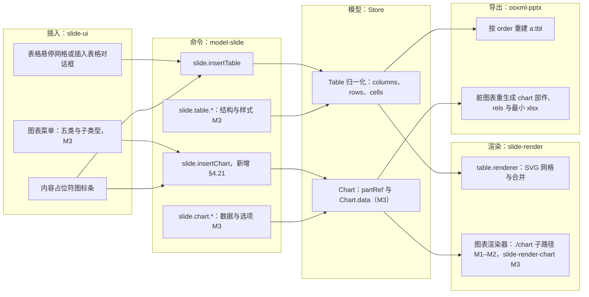

怎么读：从左到右是一次追加的生命周期——插入入口只产生命令，命令在一个事务里写模型，渲染与导出都只读模型；表格与图表共用内容占位符图标条这一入口，其余各走一条链。图表的插入入口与编辑命令只在 M3 装载 `slide-render-chart` 后可用，M1–M2 只有渲染与导出（原字节写回）两段。
依据：rulings §4.21 q-table-depth、q-chart-route；R-d-61、R-d-69、R-d-74。

**图 1-2 族模型类图**

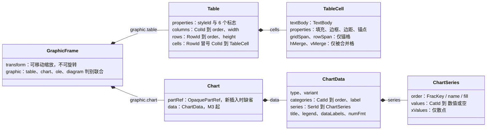

怎么读：实心菱形是内嵌组成；表格的行、列、格与图表的类别、系列都不是数组，而是以 id 为键的记录，顺序由 `order: FracKey` 表达（ADR-0032）；两个元素都挂在同一个 `graphicFrame` 形状下，变换只有移动与缩放。图表的 `partRef` 是导入时的原部件（M1–M2 唯一的数据来源），`data` 是 M3 起的可编辑模型，二者同时存在时以 `data` 为准。
依据：rulings §4.21 q-table-depth；ADR-0036；30/04 §3.8、§3.9。

## 2. 表格

### 2.1 作用

把数据按行列对齐：竞品对比、参数与价格档位、项目排期、会议议程与清单。用户要做的事依次是：插入一个 m × n 的表格 → 在格里打字、在格间跳转 → 合并标题格、增删行列、拖宽列 → 套一个统一的样式（标题行、镶边行）。表格是文本框与形状之后最高频的追加元素（PRD ED-10，P1）；M1 就要能正确显示导入的表格（OF-08，P0）。

### 2.2 OOXML 来源

- 容器：`p:graphicFrame`（`p:nvGraphicFramePr/p:cNvGraphicFramePr/a:graphicFrameLocks@noGrp`；`p:xfrm` 只有偏移与尺寸，不可旋转）→ `a:graphic/a:graphicData@uri="http://schemas.openxmlformats.org/drawingml/2006/table"` → `a:tbl`。
- 表级：`a:tblPr` 的 `@firstRow` / `@lastRow` / `@firstCol` / `@lastCol` / `@bandRow` / `@bandCol` 六个标志，子元素 `a:tableStyleId`（样式 GUID）或内联 `a:tblStyle`（少见，只保留），以及表级填充与效果。
- 网格：`a:tblGrid/a:gridCol@w`（列宽，EMU）；`a:tr@h`（行最小高，EMU）。
- 单元格：`a:tc` 的 `@gridSpan` / `@rowSpan`（锚格）、`@hMerge` / `@vMerge`（被合并格）；内含 `a:txBody` 与 `a:tcPr`（`@marL` / `@marR` / `@marT` / `@marB` 边距、`@anchor` 垂直锚点、`@vert` 文字方向、`a:lnL` / `a:lnR` / `a:lnT` / `a:lnB` / `a:lnTlToBr` / `a:lnBlToTr` 六向边框、填充）。
- 样式定义：`ppt/tableStyles.xml` 的 `a:tblStyleLst@def` 与 `a:tblStyle`（`wholeTbl`、`band1H` / `band2H` / `band1V` / `band2V`、`firstCol` / `lastCol` / `firstRow` / `lastRow`、`seCell` / `swCell` / `neCell` / `nwCell`，各含 `a:tcTxStyle` 与 `a:tcStyle`）。
- 扩展：`gridCol`、`tr` 的 `a:extLst`（如 Office 2016 起的 `a16:colId` / `a16:rowId`）与其它未知子元素进 `extensions`，原样写回（ADR-0008 决策 2）。

### 2.3 插入入口与默认

- **入口**：插入页签「表格」组 › 表格 ▾（分组以设计 04 与 playground 为准，R-d-61）：8 × 8 悬停网格（设计 04 与 playground）+「插入表格…」对话框输入行数与列数，上限 10 × 8（PRD ED-10）；空表格占位符或内容占位符图标条中的表格图标（`slide.fillPlaceholder`，[21 结构类](./21-elements-structure.md)）；命令面板「插入表格」。
- **方式**：点击插入，不做拖出绘制；网格内方向键移动高亮、Enter 确认、Esc 关闭；触屏改为先点开数字输入（设计 04 边界情况）。
- **默认尺寸与位置**：宽取当前页版式正文占位符宽（版式没有正文占位符时取页宽 80%），列等宽；行高 370840 EMU（约 0.41 in，PowerPoint 新建表格的行高）；水平居中，垂直落在视口中心，重复插入错位 0.2 in（通用落点规则见 [19](./19-insertable-elements-overview.md)）。填入占位符时框取占位符框并保留 `p:ph`。
- **默认样式**：`a:tableStyleId = {5C22544A-7EE6-4342-B048-85BDC9FD1C3A}`（中度样式 2 - 强调 1）+ `firstRow`、`bandRow` 两个标志；颜色由样式引用主题 accent1 与 lt1 / dk1 派生，换主题自动跟随；单元格不写显式填充与边框（只写引用，与 R-d-63 同一原则）。
- **插入后**：选中表格并把插入符放进首格（直接进入单元格文本编辑），`aria-live` 播报「已插入 3 行 4 列表格」；一次插入一个撤销步。
- **启用条件**：插入页签恒显；M2 起可用（q-table-depth）；只读、评审、降权时按 [10](./10-editor-shell-and-interaction.md) §4 禁用并给原因。

**图 2-1 插入表格时序**

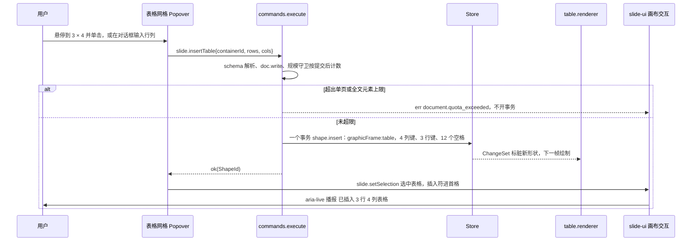

怎么读：网格与对话框只负责收集行列数，真正的写入是一次 `slide.insertTable`；列键、行键与全部空格在同一个事务里写入，所以撤销一步即移除整张表；选中与进首格编辑是随后的 Operation，不进历史。
依据：40/03 §2.6 `slide.insertTable`；50/19 插入命令通用流程；ED-10。

### 2.4 模型

表格是 `GraphicFrame{graphic:{kind:'table'}}`。原稿是 `columnWidths: Emu[]` 与 `rows: TableRow[]` 两个数组，并发插行与插列会产生缺格；按 q-table-depth 改为三张按 id 的记录表。字段的事实源是 30/04 §3.8（决策在 ADR-0018），下面照录并标出相对原稿的改动：

```ts
type CellKey = `${RowId}:${ColId}`                   // 新增（§4.21）；RowId、ColId 为 NodeId 品牌细分
interface Table {
  properties: TableProperties                         // a:tblPr：styleId?、firstRow、lastRow、firstCol、lastCol、bandRow、bandCol、fill?、extensions
  columns: Record<ColId, TableColumn>                 // 新增（§4.21）：取代 columnWidths: Emu[]
  rows: Record<RowId, TableRow>                       // 新增（§4.21）：取代 rows: TableRow[]
  cells: Record<CellKey, TableCell>                   // 新增（§4.21）
  extensions: OpaqueSlot
}
interface TableColumn { order: FracKey; width: Emu; _deleted?: Tombstone; extensions: OpaqueSlot }
interface TableRow { order: FracKey; height: Emu; _deleted?: Tombstone; extensions: OpaqueSlot }   // height 即 a:tr@h（最小高）
interface TableCell {
  textBody: TextBody; properties?: TableCellProperties   // a:tcPr：边距、anchor、vert、填充、六向边框；缺省即取表格样式
  gridSpan?: number; rowSpan?: number                    // 只在合并区左上角的锚格
  hMerge?: boolean; vMerge?: boolean                     // 被合并格的标记
  extensions: OpaqueSlot
}
```

- **id 与顺序**：`a16:colId` / `a16:rowId` 作为数据留在 `extensions`，不当作模型 id。`order` 由命令层经 `@cordexjs/shared/order` 的 `between` 生成（键格式按 rulings §4.21 改为 rocicorp 整数头 + 随机后缀，ADR-0032），导入用确定性键；读视图按 `(order, id)` 排序。
- **删除**：删行删列写 `_deleted` 墓碑（30/04 §3.1a 同口径），格不单独删除；读视图过滤墓碑行列及其上的格；撤销以原 id 复活，格内容一并回来；硬删由墓碑清扫一并处理。
- **不变量**（30/04 §3.8；纯函数 `check` / `repair`，服务端软门禁以 `system('repair')` 执行，客户端读时容错、不写修复）：**I-TBL1** 每个存活行在每个存活列上都有格——缺格读时按空格画，修复补一个空格（键与内容确定，两端各自修复也收敛）；**I-TBL2** 跨度合法——锚格跨度不越过存活行列的末尾、被覆盖格的标记与某个锚格一致、合并区互不重叠；修复时越界跨度收缩、孤立标记清除、重叠按锚格 `(行 order, 列 order)` 先者保留。
- **合并区内插入行列**：本机在合并区内部插入行或列时，命令同事务把锚格跨度加一、给新格写被合并标记（与 PowerPoint 一致，合并区随之变大）；并发插入落在他人合并区内部时只能靠 I-TBL2 兜底，扩张还是收缩的口径见 §2.14 第 7 条。
- **选区锚点**：`{kind:'tableCell'; shapeId; rowId; colId}`（30/04 §3.6 已改为 id 寻址），另建议新增矩形选区 `{kind:'tableCells'; shapeId; anchor: CellKey; focus: CellKey}`（新增（§4.21），已回写（2026-09-26 整合，见 30/04 §3.6））；文本目标 `TextTarget.cell = {rowId, colId}`（40/03 §2.6、[06](./06-text-editing-and-ime.md) §9）。数字下标只出现在 UI 播报里，不进模型与 Mutation（lint `cordex/no-index-in-mutation`）。
- **派生**：实际行高 = max(`TableRow.height`, 该行内容高)，是 `Derived<Emu>`，不入 Snapshot；表格框高 = 各行实际高之和。
- **落地时点**：裁决要求「M3 前」；推荐 M1 导入即采用归一化形态（尚无代码，零迁移成本；若 M1–M2 先用数组，M3 需要一次 schemaVersion 迁移，ADR-0009）。

### 2.5 渲染

`table.renderer.ts`（slide-render，`render.element('dom:graphicFrame:table')`，40/07 §2.7）是无状态查表渲染器，输出一个 `<g>`：每格一组「填充 `<rect>` + 文本行」，边框统一画在格组之上（`<line>`，按线宽与虚线样式），合并格按锚格区域画一次。

**图 2-2 表格渲染管线**

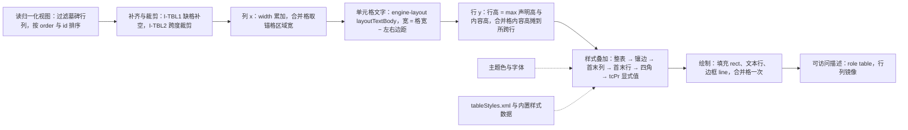

怎么读：实线是一次渲染的先后顺序——先把模型读成确定的行列网格（不变量在读时兜底），再按列宽排版文字、按内容求行高，最后叠加样式并绘制；虚线是样式叠加的两个输入。任何一步都不写模型：行高撑高、缺格补空都只是读视图。
依据：40/07 §2.7；30/04 §3.8（I-TBL1、I-TBL2）；PRD OF-08。

- **样式叠加**：按 ECMA-376 表格样式部件的叠加顺序求每格生效的填充、边框、字体与颜色：`wholeTbl` → `band1H` / `band2H`（`bandRow` 开）→ `band1V` / `band2V`（`bandCol` 开）→ `lastCol` / `firstCol` → `lastRow` / `firstRow` → 四角格 → 该格 `tcPr` 显式值；标志关闭的部件不参与。叠加顺序与相邻格共用边的取舍以 OF-08 的 8 案例原生矩阵校准后写进 `table.renderer` 单测（70/04 `table` 类别）。
- **样式数据**：优先取文档 `tableStyles.xml` 中的定义（PowerPoint 保存时会写入用到的样式）；文档里没有而样式 id 属内置 74 种之一时，取内置样式数据（M2 至少带默认样式 `{5C22544A…}`，M3 带全部 74 种，来源见 §2.14）；都没有时按 `wholeTbl` 空样式画（黑色细边框），并在保真详情里记一条。
- **文字**：每格一个 `TextBody`，排版宽 = 格宽 − 左右边距，竖排按 `@vert`；`@anchor` 决定格内垂直位置；autofit 不适用于单元格（行高随内容增长代替）。
- **命中**：格区域是命中目标（`hitTest` 返回 `{shapeId, cell}`），用于双击进格与拖选；M3 的行列分隔线与悬停「+」是覆盖层（render-dom），不进 Scene。

### 2.6 交互

- **选中整表**：单击表格任意位置选中整表（外框），可拖动移动；graphicFrame 不可旋转、不可翻转。M2 只显示选中框与移动；M3 起出现 8 个缩放手柄，整体缩放按比例改列宽行高（PRD ED-10 M3「整体缩放时按比例」）。
- **单元格文本编辑**（M2）：双击单元格或选中整表后按 Enter 进入首格；共用隐藏 textarea 宿主，目标为 `{shapeId, cell:{rowId, colId}}`（[06](./06-text-editing-and-ime.md) §9）；格内格式同 ED-03。
- **单元格选区**（M2）：拖选跨格、或文本编辑中 Shift+方向键越过格边界，形成矩形选区（填充高亮 + 表格外框选中，G-32）；M2 在选区上可批量设字符格式、按 Delete 清空文字；M3 起可合并、设填充与边框。
- **行列操作**（M3）：悬停行首或列顶边缘显示「+」插入标记；点击行首 / 列顶选中整行 / 整列；拖行列分隔线调高宽（`DragIntent` 预览，松手一次命令）；右键菜单：在上方 / 下方插入行、在左侧 / 右侧插入列、删除行 / 列 / 表格、合并单元格、拆分单元格（设计 05；M2 这些项灰显并提示「表格结构编辑将在后续版本提供」）。
- **迷你工具条**：`toolbar.table-cell`（M3：插入行列、合并、拆分、填充、边框）；M2 文本编辑时沿用 `textEditing` 条。
- **协同呈现**：远端协作者的单元格选区以其颜色描边显示（awareness `selection.kind = 'tableCells'`，30/06；M3，[07](./07-collaboration-client.md)）。

**图 2-3 表格选中与单元格选区状态机**

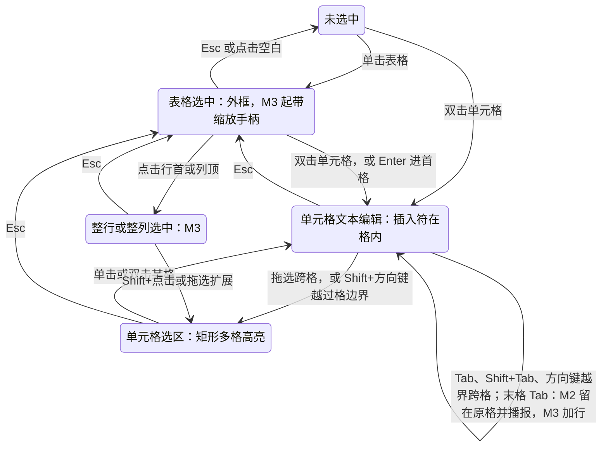

怎么读：Esc 每次只退一级（与 10 §7.1 的画布 Esc 逐级同一口径），从单元格编辑或选区退到整表选中，再退到未选中；跨格导航停留在文本编辑态内，只改文本目标；整行整列选中与末格 Tab 加行是 M3 才出现的状态与迁移；M2 的末格 Tab 不产生事务，光标留在末格并以 live region 播报「已是最后一个单元格」（[06](./06-text-editing-and-ime.md) §9.2）。
依据：PRD ED-10、G-32、G-62；50/10 §7.1；设计 05。

**键盘对照**（M2 起生效，标 M3 的除外）：

| 按键 | 表格选中 | 单元格文本编辑 | 单元格选区 |
|---|---|---|---|
| Enter | 进首格编辑 | 格内分段 | 进选区锚格编辑 |
| Tab / Shift+Tab | 按 z 序切到下一个对象（10 §7.1） | 下一 / 上一格（按行主序跳过被合并覆盖的格）；末格 Tab 在 M2 不新增行、光标留在末格并播报「已是最后一个单元格」，M3 新增一行（06 §9.2） | 同文本编辑 |
| 方向键 | 微移表格（10 §7.3） | 格内移动；在首末行或首末字符处越界到相邻格 | 移动选区焦点 |
| Shift+方向键 | 微移（大步） | 扩展文字选区；越过格边界转为单元格选区 | 扩展选区 |
| Delete / Backspace | 删除表格 | 删除字符 | 清空所选格文字（`slide.table.clearCells`） |
| Mod+A | 全选页面对象 | 全选格内文字 | 选中全部格 |
| Esc | 取消选择 | 回到表格选中 | 回到表格选中 |

单元格内插入制表符不提供：PowerPoint 用 Ctrl+Tab，而浏览器占用该和弦切换标签页（06 §9.2）。跨格导航只改文本目标 `{shapeId, cell:{rowId, colId}}`，他人插删行列后本地光标仍在原格。

### 2.7 检查器

`selectionKind` 新增 `table`（整表）并沿用 `table-cell`（单元格或选区），属 R-d-72 的补齐（新增（§4.21），矩阵登记在 [10](./10-editor-shell-and-interaction.md) §5）。M3 之前不可用的字段留在原位、灰显并注明「M3 提供」。

| 分区 | `table` | `table-cell` | 里程碑 |
|---|---|---|---|
| 位置与大小（无旋转、无翻转） | 是 | — | M2（尺寸输入 M3，改尺寸即按比例缩放） |
| 表格：样式库（74 个内置样式缩略图）、6 个标志复选（标题行 / 汇总行 / 镶边行 / 第一列 / 最后一列 / 镶边列） | 是 | 只读显示所在表 | M3 |
| 文本：字体、字号、颜色、对齐、段落 | 作用于全部格 | 作用于所选格 | M2 |
| 单元格：填充；边框选择器（单条 / 全部 / 内部 / 外部 / 无，加线型、粗细、颜色）；内边距；垂直锚点；文字方向 | — | 是 | M3 |
| 行高与列宽数值 | — | 是（选区所在行列） | M3 |
| 替代文本（标题、描述） | 是 | — | M2（`slide.setAltText`，[19](./19-insertable-elements-overview.md)） |

**样式库**（M3）：按「文档中的样式 → 浅色 → 中等 → 深色」分组列出，文档 `tableStyles.xml` 里的自定义样式排在最前；缩略图由 `table.renderer` 以当前主题画一张 5 × 5 示意表（离屏 SVG，slide-ui 按「样式 id + 6 个标志」记忆当前主题下的结果，条数以样式数为上限，主题版本变化时整体丢弃重画），所以缩略图与画布效果一致；点击即 `slide.table.setStyle`，一次撤销步；6 个标志复选改的是同一张表的 `properties`，缩略图随之刷新。悬停实时预览为 P2（届时走视图态，不写模型）。

### 2.8 命令

按 30/05 §1 三分法：Command 在一个事务内产出 Mutation，逆操作一律由 Store 推导；Operation 只改视图态。命令 id 与 Mutation 载荷的事实源是 40/03 §2.6 与 30/05 §14（ADR-0018）；下表是前端怎么用它们，参数中的下标全部改为 id（新增（§4.21））。

**Command**

| 命令 id | 参数（前端调用口径） | 产出的 Mutation | 里程碑 | 状态 |
|---|---|---|---|---|
| `slide.insertTable` | `{containerId, box, rows, cols, styleId?}`；`box` 由 slide-ui 按 §2.3 算好传入 | `shape.insert`（graphicFrame:table，含全部列、行、格） | M2 | 已有；`styleId?` 新增（§4.21） |
| `slide.insertText` / `deleteText` / 字符与段落格式族 | `target: {shapeId, cell: {rowId, colId}}` | `text.applyDelta`、`run.setProperties`、`paragraph.setProperties` | M2 | 已有；`cell` 改 id 寻址 |
| `slide.table.clearCells` | `{shapeId, cells: CellKey[]}`：多格选区按 Delete | `text.applyDelta`（逐格清空） | M2 | 新增（§4.21），已回写（2026-09-26 整合，已登记 40/03 §2.6、30/05 §14） |
| `slide.table.insertRow` / `insertColumn` | `{shapeId, ref: RowId 或 ColId, side, count?}`；命令算 `order = between(邻居)`、生成新 id，新格继承相邻格的 `properties`；插在合并区内部时同事务扩大锚格跨度 | `slide.table.insertRow` / `insertColumn`（+ `merge`） | M3 | 已有；参数改 id |
| `slide.table.removeRow` / `removeColumn` | `{shapeId, rowIds}` / `{shapeId, colIds}`；与之相交的合并区先拆分或收缩（同事务）；删光全部行或列即删表 | `slide.table.removeRow` / `removeColumn`（或 `shape.remove`） | M3 | 已有；参数改 id |
| `slide.table.mergeCells` | `{shapeId, from: CellKey, to: CellKey}`；被合并格文字按 PowerPoint 规则并入锚格 | `text.applyDelta` + `slide.table.merge` | M3 | 已有 |
| `slide.table.splitCell` | `{shapeId, cell: CellKey}`：拆回合并前的格 | `slide.table.split` | M3 | 已有 |
| `slide.table.setCellProperties` | `{shapeId, cells, patch}`：填充、边距、锚点、文字方向 | `slide.table.setCellProperties` | M3 | 已有 |
| `slide.table.setBorders` | `{shapeId, cells, borders: {preset, line}}`（形状以 40/03 §2.6 为准）；`preset` 取单条 / 全部 / 内部 / 外部 / 无，命令展开为各格六向边框 | `slide.table.setCellProperties` | M3 | 新增（§4.21） |
| `slide.table.setStyle` | `{shapeId, styleId?, flags?}` | `slide.table.setTableProperties` | M3 | 新增（§4.21） |
| `slide.table.resizeColumn` / `resizeRow` | `{shapeId, colId, width}` / `{shapeId, rowId, height}`；拖内部分隔线的语义见 §2.14 第 4 条 | `slide.table.setSizes`（改表宽时加 `shape.setTransform`） | M3 | 新增（§4.21） |
| `slide.resizeShapes`（作用于表格） | 通用参数 | `shape.setTransform` + `slide.table.setSizes`（列宽行高按比例） | M3 | 已有；表格分支新增 |

**Mutation**（`model-slide/mutations/table.ts`，载荷无下标，照录 30/05 §14.2–§14.3）

| Mutation | 载荷 | 降级为 StoreOp |
|---|---|---|
| `slide.table.insertRow` / `insertColumn` | `{shapeId, rowId, order, height, cells: Record<ColId, TableCell>}` / 列对称 | `set` 新行（列）记录与它在当前存活列（行）上的格 |
| `slide.table.removeRow` / `removeColumn` | `{shapeId, rowIds}` / `{shapeId, colIds}` | `set …/_deleted`（墓碑），格不删 |
| `slide.table.setCellProperties` | `{shapeId, cells: CellKey[], patch}` | 逐格逐字段 `set` |
| `slide.table.merge` / `split` | `{shapeId, anchor: CellKey, gridSpan, rowSpan}` / `{shapeId, anchor}` | 锚格写跨度、被覆盖格写标记 / 清除 |
| `slide.table.setTableProperties` | `{shapeId, patch: Partial<TableProperties>}` | 逐字段 `set`（新增（§4.21）） |
| `slide.table.setSizes` | `{shapeId, columns?: {colId, width}[], rows?: {rowId, height}[]}` | 按 id 逐项 `set`（新增（§4.21）） |

**Operation**：`slide.setSelection`（锚点 `tableCell` / `tableCells`，`broadcast: true`，M3 起经 awareness 广播）；网格选择器与对话框的开合是 slide-ui 本地状态，不经命令。

### 2.9 协同

Yjs 编码的事实源是 30/06 §1.3.3：`graphic.table` 下 `columns`、`rows`、`cells` 各是一个以 id 为键的 `Y.Map`；`order`、列宽、行高与表级、格级属性是标量叶子（LWW），边框与填充这类复合值是 JSON 串整值 LWW（30/06 §1.5）；格的正文与形状正文一样是 `Y.XmlFragment`，字符级合并；删行删列写墓碑键。前端据此得到下表的并发结果：

| 并发场景 | 结果 |
|---|---|
| A、B 同时改同一格文字 | `Y.XmlFragment` 字符级合并（同形状文本） |
| A、B 在同一间隙各插一行 | 两行都在，按 `(order, id)` 全序排列，各端一致（ADR-0032） |
| A 插行、B 插列 | 新行 × 新列的交叉格两端都没写 → 违反 I-TBL1：读时补空格，服务端修复事务物化（图 2-4） |
| A 删行、B 改该行某格文字 | 行是墓碑、格仍在：B 的修改保留但不可见；A 撤销删行后连同 B 的修改一起回来 |
| A 合并 r1c1–r2c2、B 同时在合并区内部插列 | B 的命令看不到 A 的合并，合并后由 I-TBL2 按 30/04 §3.8 修复（越界收缩、孤立标记清除）；扩张还是收缩的口径见 §2.14 第 7 条 |
| A、B 同时合并两个重叠区域 | I-TBL2：按锚格（行序、列序、id）先者保留，后者拆开；修复事务不进任何人的撤销栈 |
| A、B 同时拖同一列宽 | 叶子 LWW |
| A 删整张表、B 在表内打字 | 形状墓碑过滤（形状通用规则，[19](./19-insertable-elements-overview.md)） |

**图 2-4 并发插行与插列的缺格兜底**

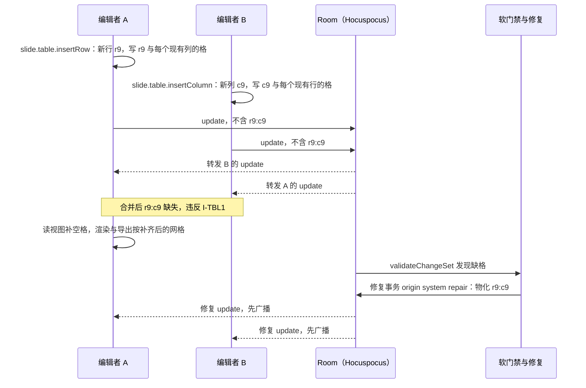

怎么读：两个编辑都合法，只是各自不知道对方新加的行或列，所以交叉格没人写；客户端读时补空格保证画面与导出立即正确，服务端软门禁随后写一个修复事务把空格物化，修复按 ADR-0039 的口径先广播再落库；修复事务 origin 为 `system('repair')`，不进任何人的撤销栈。
依据：30/04 §3.8（I-TBL1）；ADR-0034；[ADR-0039](../30-architecture/adr/0039-collab-server-hocuspocus.md)；rulings §4.21 q-table-depth。

### 2.10 导入导出与保真

- **可编辑度**：M1 V（OF-08：8 案例原生矩阵 + 语料表格子集，表格区域裁剪 SSIM ≥ 0.90，70/04 `table` 类别 gated）；M2 E~（单元格文字）；M3 E（结构与样式；ED-10：结构编辑后导出，PowerPoint 打开无修复且样式一致，表格语料 SSIM ≥ 0.90）。
- **导入**：`a:tbl` → 归一化记录。列、行按出现顺序取确定性 FracKey 与新 id；格键 `RowId:ColId`；`gridSpan` / `rowSpan` / `hMerge` / `vMerge` 原样；`tcPr` 与 `tr` 的未知子元素进 `extensions`。`tableStyles.xml` 仍按不透明部件原样写回，但 M1 起就要只读解析供渲染（OF-08 在 M1 gated；已回写（2026-09-26 整合，30/04 §4.1 已改为 M1 起只读解析））。
- **导出**：零编辑时部件原字节写回；表格形状被触碰时按图 2-5 重建 `a:tbl`，同部件内未触碰的兄弟元素按保真树原样写回（ADR-0008 决策 2）。
- **新样式写入**：套用的内置样式若不在文档 `tableStyles.xml` 里，导出时把该样式定义追加进 `tableStyles.xml`。这是对不透明部件的修改，已列入 ADR-0008 决策 9 白名单（2026-09-26 整合回写）并配往返测试。

**图 2-5 导出时重建 a:tbl**

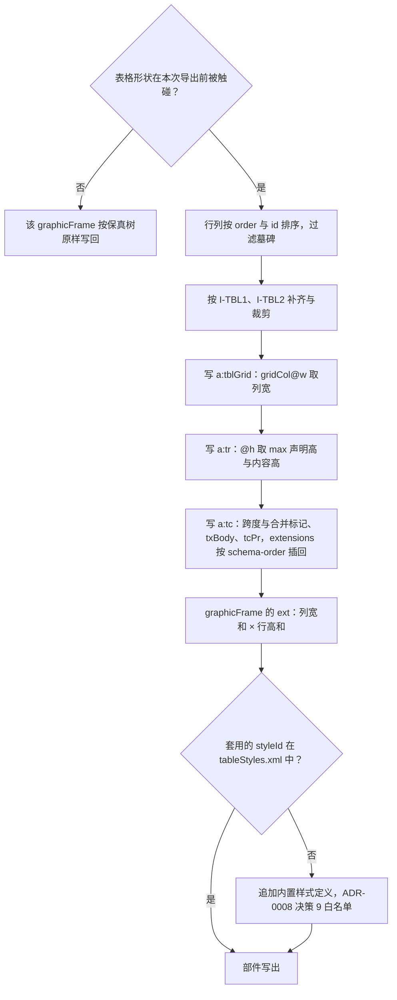

怎么读：只有被触碰的表格才重建，重建完全按模型的排序结果写出，所以并发插入的行列在文件里也是确定的顺序；行高写实际高、框高写行高之和，保证 PowerPoint 打开时不必重排；最后一个判断只在套用了文档里还没有的内置样式时才改 `tableStyles.xml`。
依据：30/04 §5.3；ADR-0008 决策 2、决策 9；rulings §4.21 q-table-depth。

### 2.11 无障碍

- 画布可访问树：`SceneNode.a11y.role = 'table'`，name 依次取替代文字 → 首行文字摘要 → 「表格 3」（[05](./05-rendering-and-thumbnails.md) §11）；建议可访问镜像在该项内再输出一个视觉隐藏的 `<table>`（`firstRow` 开时首行用 `th scope="col"`），让读屏按行列朗读（新增（§4.21），已回写（2026-09-26 整合，见 [05](./05-rendering-and-thumbnails.md) §11））。
- 单元格间键盘移动（Tab、方向键）时播报「第 2 行第 3 列：<文字摘要>」，合并格加「合并 2 列」；单元格选区播报范围「B2 到 C4，共 6 格」。
- 网格选择器 `role="grid"`，方向键移动、播报「3 × 4 表格」；「插入表格…」对话框全键盘可用。
- 每个拖动都有数值等价（WCAG 2.5.7）：行高列宽在检查器输入；插入与删除行列有右键菜单与命令面板入口。
- 选区高亮不只靠颜色：选区外加 2 px 描边，高对比度模式可辨。

### 2.12 复用

- **维持自研**：`table.renderer`（SVG 网格、合并与样式叠加）、单元格选区状态机 `slide-ui/table-selection.ts`、行列拖动与悬停插入（R-d-29）。**为什么没有合适的成熟库**：TanStack Table、AG Grid、Handsontable 都是 HTML 数据网格，输出 DOM 表格而不是画布上的 SVG，也不认识 `a:tbl` 的合并标记与 `tableStyles` 的部件叠加；ProseMirror / TipTap 的表格依赖 `contenteditable`，与 ADR-0028 的单一隐藏 textarea 宿主冲突；Excalidraw、tldraw 没有表格元素。
- **复用**：网格选择器用 shadcn Popover（ui-react 复制件，ADR-0017）+ 自写网格；「插入表格…」对话框用 shadcn Dialog + react-hook-form（R-d-18）；顺序键用 `@cordexjs/shared/order`（内置 rocicorp 算法，ADR-0032）；图表数据网格（§3）复用同一个 `table-selection` 状态机。
- **样式数据**：74 种内置样式数据自备；LibreOffice 的样式数据是 MPL-2.0，只参考、不复制（rulings §4.21 推迟项）。

### 2.13 里程碑

| 里程碑 | 范围 |
|---|---|
| M1（P0） | 导入即归一化（推荐，§2.4）；`table.renderer` 渲染合并、条件边框、显式清除边框、对角线边框（OF-08 gated）；`tableStyles.xml` 只读解析 |
| M2（P1） | 插入（网格、对话框、占位符图标）；单元格文字与跨格导航；多格选区的字符格式与清空；默认样式 `{5C22544A…}` 的内置数据 |
| M3（P1） | 行列插删、合并拆分、行高列宽拖动与整体缩放、填充与边框选择器、边距与锚点、样式库 74 种与 6 个标志、末格 Tab 加行、远端单元格选区呈现 |
| P2 | 对角线边框编辑、单元格内图片（ED-10 边界） |

### 2.14 待决

1. **超过 10 × 8 的表格**：PRD ED-10 把插入上限定为 10 × 8（网格 8 × 8，对话框补足 9–10 列）；更大的表格只能插入后逐行逐列增加（M3）。是否放宽对话框上限，随 M3 性能包络一并评估。
2. **74 种内置样式的数据来源与许可**：rulings §4.21 推迟项，列为 [ADR-0049](../30-architecture/adr/0049-dependency-admission-and-license-tiers.md) T-05 待核，M3 表格样式开工前定，来源须过 ADR-0049 分级；负责：本文（前端设计线）。
3. **`tableStyles.xml` 建模还是只读派生**：推荐不建模——只读解析供渲染，导出时按 ADR-0008 决策 9 新增白名单项追加内置样式定义。
4. **列宽拖动语义**：内部分隔线「相邻两列此消彼长、表宽不变」还是「只改左列、表宽随之变」，以维护机 PowerPoint 对照定稿。
5. **行列增删后的规模**：M3 行列插入不设单独上限，只受单页元素与性能包络约束（单元格不计入形状数）；是否需要单表格格数上限，M3 性能基准后定。
6. **归一化模型落地时点**：推荐 M1 导入即归一化（§2.4）；若 M1 先用数组，M3 前须补 schemaVersion 迁移。
7. **并发插入落在合并区内部时的修复口径**：30/04 §3.8 的 I-TBL2 以「跨度按当前顺序计数」修复，会让合并区在位置上收缩到新行列、把原被覆盖的末行（列）拆出来；本文建议修复改为「从锚格起按当前顺序扩张到原被覆盖格为止」，与本机插入时的行为（§2.4）一致。待 30/04 §3.8 与 ADR-0018 定稿。

## 3. 图表（可编辑五类：bar / line / pie / area / scatter）

### 3.1 作用

用数据讲结论：柱形与条形做对比，折线与面积看趋势，饼图看构成，散点看相关。用户要能改数值、类别名与系列名，增删类别与系列，在五类之间换类型，调标题、图例与数据标签；导出后在 PowerPoint 里「编辑数据」仍能打开内嵌工作簿（ED-15、PD-06）。M1 起必须把导入的图表按部件数据正确画出来（OF-09，P0）。

### 3.2 OOXML 来源

- 容器：`p:graphicFrame` → `a:graphicData@uri="http://schemas.openxmlformats.org/drawingml/2006/chart"` → `c:chart@r:id`，经页关系（类型 `…/relationships/chart`）指向 `ppt/charts/chartN.xml`。
- 图表部件 `c:chartSpace`：`c:chart` 下的 `c:title`、`c:autoTitleDeleted`、`c:plotArea`（`c:layout/c:manualLayout`、图表组、`c:catAx` / `c:valAx` / `c:dateAx`）、`c:legend`、`c:plotVisOnly`、`c:dispBlanksAs`；部件级 `c:spPr`、`c:txPr`、`c:externalData@r:id`（`c:autoUpdate`）。
- 系列 `c:ser`：`c:idx`、`c:order`、名称 `c:tx/c:strRef`（`c:f` 公式 + `c:strCache`）、`c:spPr`、`c:dPt`（单点覆盖）、`c:dLbls`、类别 `c:cat`（`c:strRef` 或 `c:numRef`）、数值 `c:val/c:numRef`（`c:f` + `c:numCache`：`c:formatCode`、`c:ptCount`、`c:pt@idx/c:v`）。
- 关联部件：`chartN.xml.rels` → `ppt/embeddings/*.xlsx`（类型 `…/relationships/package`）；Office 2013 起可选的图表样式与颜色部件（`chartStyle`、`colors`）。

| 类型 | 图表组元素 | variant 字段 | 系列数据 |
|---|---|---|---|
| bar | `c:barChart` | `c:barDir`（`col` 柱形 / `bar` 条形）、`c:grouping`（clustered / stacked / percentStacked）、`c:gapWidth`、`c:overlap` | `c:cat` + `c:val` |
| line | `c:lineChart` | `c:grouping`（standard / stacked / percentStacked）、`c:marker`、系列 `c:smooth` | `c:cat` + `c:val` |
| pie | `c:pieChart` | `c:varyColors`、`c:firstSliceAng`、点 `c:explosion` | `c:cat` + `c:val`（只画第一个系列） |
| area | `c:areaChart` | `c:grouping`（standard / stacked / percentStacked） | `c:cat` + `c:val` |
| scatter | `c:scatterChart` | `c:scatterStyle`（marker / lineMarker / smoothMarker 等） | `c:xVal` + `c:yVal` |

### 3.3 插入入口与默认

- **入口**（PRD ED-15a，M3 P1）：插入页签「图表」组 › 图表 ▾（R-d-61）：柱形图（簇状 / 堆积 / 百分比堆积）、条形图（同三种）、折线图（折线 / 带数据标记 / 堆积）、饼图、面积图（面积 / 堆积 / 百分比堆积）、散点图（仅标记 / 带平滑线和标记）；空图表占位符与内容占位符图标条中的图表图标（`slide.fillPlaceholder`，M3，[21 结构类](./21-elements-structure.md)）；命令面板「插入图表」。
- **启用条件**：`enablement: slide.hasChartEditor`——M3 装载 `slide-render-chart` 后为真；未装载时控件留在原位禁用，tooltip「图表编辑组件未装载」（[10](./10-editor-shell-and-interaction.md) §4）。设计 04「M1/M2 插入的图表以静态样式呈现」一句删除，图表插入定 M3（R-d-74）。
- **方式**：点击菜单项即插入，不做拖出绘制。
- **默认框**：当前页版式正文占位符框（没有时取页面 60% × 60% 居中）；填入占位符时取占位符框并保留 `p:ph`。
- **默认样式**：系列颜色写主题引用 `schemeClr accent1…accent6`（超过 6 个系列按 lumMod 派生），不烤 RGB；字体取主题次要字体；标题显示「图表标题」（i18n）、图例在底部、无数据标签。
- **示例数据**（i18n 文案键 `chart.sample.category`「类别 {n}」、`chart.sample.series`「系列 {n}」；数值取 PowerPoint 默认示例，维护机核对一次）：

| 类型 | 类别 / 点 | 系列与数值 |
|---|---|---|
| 柱形、条形、折线、面积 | 类别 1–4 | 系列 1：4.3、2.5、3.5、4.5；系列 2：2.4、4.4、1.8、2.8；系列 3：2、2、3、5 |
| 饼 | 类别 1–4 | 系列 1：8.2、3.2、1.4、1.2 |
| 散点 | 点 1–3 | X：0.7、1.8、2.6；Y（系列 1）：2.7、3.2、0.8 |

- **插入后**：选中图表并打开数据面板（`slide.chart.openDataEditor`），焦点落在首个数值格，`aria-live` 播报「已插入簇状柱形图」；插入是一个撤销步，打开面板不入历史。

**图 3-1 插入图表时序**

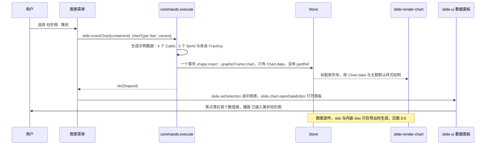

怎么读：插入只写模型，不生成任何 OOXML 部件——新图表在导出前只有 `Chart.data`；渲染器同一帧按主题默认样式画出示例数据；打开数据面板是随后的 Operation，所以撤销插入一步就能回到插入前。
依据：rulings §4.21 q-chart-route；R-d-74；PRD ED-15；ADR-0036。

### 3.4 模型

- **M1–M2**：`Chart{partRef}`，部件不透明保留（D16）；渲染器只读解析出 `ChartReadModel`（`ooxml-core` `chartml.parseChartSpace` 的输出，字段见 ADR-0036），不进模型、不进 Snapshot。
- **M3 起**：新增 `Chart.data`（新增（§4.21）；字段的事实源是 30/04 §3.9，决策在 ADR-0018 与 ADR-0036，下面照录，行尾「建议补」是本文为五类子类型与插入菜单提出的字段，已回写（2026-09-26 整合，见 30/04 §3.9））：

```ts
interface Chart { partRef?: OpaquePartRef; data?: ChartData }   // 至少一个存在；新插入的图表只有 data
interface ChartData {
  type: 'bar' | 'line' | 'pie' | 'area' | 'scatter'
  variant: { barDir?: 'col' | 'bar'; grouping?: 'clustered' | 'stacked' | 'percentStacked' | 'standard'; overlap?: number; gapWidth?: number
             marker?: boolean; smooth?: boolean; scatterStyle?: 'marker' | 'lineMarker' | 'smoothMarker' }   // 后三项建议补
  categories: Record<CatId, { order: FracKey; label: string; _deleted?: Tombstone }>
  series: Record<SerId, { order: FracKey; name: string; values: Record<CatId, number | null>; xValues?: Record<CatId, number | null>; fill?: Fill; _deleted?: Tombstone }>
  title?: { text: string } | null; legend?: { position: 'r' | 'l' | 't' | 'b' | 'tr' } | null   // null = 不显示；缺省 = 沿用部件
  dataLabels?: { showValue?: boolean; showPercent?: boolean; showCategory?: boolean } | null
  numFmt?: string; extensions: OpaqueSlot
}
```

- **可编辑判定**（`isEditableChart(readModel)`，slide-render-chart）：`c:plotArea` 恰有一个图表组 ∧ 类型属五类（`c:bar3DChart` 等 3D 变体、`c:doughnutChart` 不算，见 §3.14）∧ 没有次坐标轴 ∧ 每个系列的缓存完整（`c:ptCount` 与点一致）。不满足的只保留 `partRef`，按 §4 只读。
- **物化**：M3 起导入时，对可编辑图表从缓存生成 `Chart.data`（`CatId` / `SerId` 由部件内 `c:pt@idx` 与 `c:ser/c:idx` 确定性派生，FracKey 用确定性键，保证同一文件两端导入结果相同）；M3 之前产生的快照由服务端单写者在 schemaVersion 迁移中物化（ADR-0009）。不在编辑时惰性物化，避免两个协作者同时「首次编辑」各自建出一份。
- **与 partRef 的关系**：有 `data` 时数据、类型、标题、图例、数据标签以 `data` 为准；`partRef` 继续提供未建模的外观（系列 `c:spPr`、坐标轴格式、`c:txPr`、趋势线等）。这不构成第二份可编辑模型（ADR-0008 决策 10）：`partRef` 始终只读，写回只经导出重生成（§3.10）。
- **删除**：删类别、删系列写 `_deleted` 墓碑（ADR-0032 决策 7），数值键不删；撤销即清墓碑。

### 3.5 渲染

渲染路线由 rulings §4.21 q-chart-route 裁定：d3-scale / d3-shape / d3-array（ISC）只提供数值映射、形状路径与数组运算，**版式按 OOXML 语义自研**（ADR-0036）。

- **包与加载**：M1–M2 在 `slide-render` 惰性子路径 `./chart`（`src/chart.ts` + `infrastructure/chart/**`），M3 拆为 `slide-render-chart`，都以 `render.element('dom:graphicFrame:chart')` 同 key 覆盖主包占位（贡献点 `conflict:'replace'`）；主包的 `chart-placeholder.renderer` 发 `render/element-degraded{reason:'chart-unavailable'}` 触发加载；chunk ≤ 400 KB gzip，无图表文档不加载（[13](./13-performance-and-bundling.md) §6）；`/render` 关闭惰性、随首帧加载。
- **解析**：`chartml.parseChartSpace` 建在 `@cordexjs/xml` 的 `parseDocument` 上（[ADR-0019](../30-architecture/adr/0019-xml-lexer-and-fidelity-tree.md)），主线程按时间片让出（每片 ≤ 50 ms）；解析结果只存于该元素的 `ElementHandle`，随元素卸载释放，不新增 LRU（[05](./05-rendering-and-thumbnails.md) §13.1 的四处 LRU 不变）。

**图 3-2 图表渲染管线（d3 + 自研布局）**

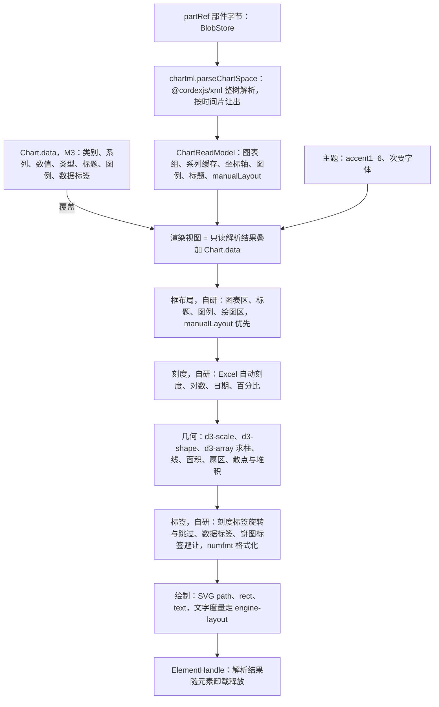

怎么读：自上而下是一次渲染。M1–M2 只有左侧的只读解析一路；M3 起可编辑图表的 `Chart.data` 覆盖到同一个渲染视图上，新插入的图表没有 `partRef`，外观全部取主题默认。d3 只出现在「几何」一步，框布局、刻度与标签避让都是按 PowerPoint 行为自研的纯函数。
依据：rulings §4.21 q-chart-route；ADR-0036；40/07 §2.7；PRD OF-09。

- **框布局**：有 `c:manualLayout` 时按其 `x / y / w / h`（`edge` 或 `factor` 模式、`inner` 或 `outer` 目标）求绘图区；否则从图表区扣去标题、图例与坐标轴标签的实测尺寸。
- **刻度**：值轴未给 `c:min` / `c:max` / `c:majorUnit` 时按 Excel 自动刻度规则求（零基判定、顶部留白、主刻度取 1 / 2 / 5 × 10ⁿ 候选），规则的期望值取维护机 COM 导出的 `MinimumScale` / `MaximumScale` / `MajorUnit`（70/04 §8.1），不以文字描述为准；对数轴、日期轴（d3-time）、百分比堆积（0–100%）各有分支。
- **几何**：簇状柱宽 = 类别带宽 ÷（k − (k − 1) × overlap% + gapWidth%），k 为系列数；堆积用 d3-shape `stack`（负值分上下两侧累加，百分比堆积按类别归一）；饼图从 12 点方向顺时针、起始角取 `c:firstSliceAng`，扇区用 d3-shape `pie` 与 `arc`；平滑线的插值参数以语料校准。
- **标签**：刻度标签按空间旋转或跳过（`c:tickLblSkip` 优先）；数据标签按 `c:dLblPos` 放置；饼图 `bestFit` 放不下时移到外侧加引导线，并按左右两半做纵向避让；数值格式由 numfmt 3.2 按 `formatCode` 与文档语言格式化。
- **绘制**：系列、网格线、坐标轴、图例、标题都画成 SVG，填充与线条经 `shared/paint` 解析主题色；文字用 `engine-layout` 的 `TextMeasurer` 度量，与正文同一套字体回退（ADR-0027）。
- **性能**：数据改动到重绘 ≤ 100 ms（ED-15），典型图表（≤ 1,000 点）只在主线程重算刻度与几何。
- **降级**：部件解析失败 → 占位 + `chart-unavailable`；`cx:chart` 直接占位 + `chartex-unsupported`（§4）；渲染抛错由 render-dom 兜底 `render/element-failed`（[05](./05-rendering-and-thumbnails.md) §9）。

### 3.6 交互

- **整体**：单击选中（外框 8 个缩放手柄，不旋转、不翻转，graphicFrame 规则）；拖动移动、缩放、删除、复制粘贴是通用变换，M2 起对所有图表可用（包括只读类型）。
- **打开数据面板**（M3）：双击图表或迷你工具条「编辑数据」→ 检查器「图表」分区内嵌紧凑网格；点「展开」进入右侧抽屉的大网格（G-63）。
- **数据网格**：行 = 类别，列 = 系列（散点为 X 列 + 各系列 Y 列）；首列类别名、首行系列名可编辑；末行、末列的「+」新增类别或系列；行列右键删除、上移 / 下移（只改 `order`）；从 Excel 或表格复制的 TSV 块整块粘贴为一次命令；留空 = `null`（按 `c:dispBlanksAs` 画缺口）；无法解析的数值 `aria-invalid`、不提交。
- **键盘**：方向键移动焦点格；Enter 或 F2 开始编辑，Enter 提交并下移，Tab 提交并右移，Esc 放弃；Mod+C / Mod+V 复制粘贴选区；选区状态机复用表格的 `table-selection`（R-d-34）。
- **只读类型**：非五类、缓存不全或组合图表双击时提示「此类型仅支持查看」，检查器只显示位置与大小、替代文本与保真详情入口。
- **图表内子元素**（单独选中系列、数据点、标题、图例并设格式）为 P2，M3 不做；标题文字在检查器改。

**图 3-3 图表选中与数据编辑状态机**

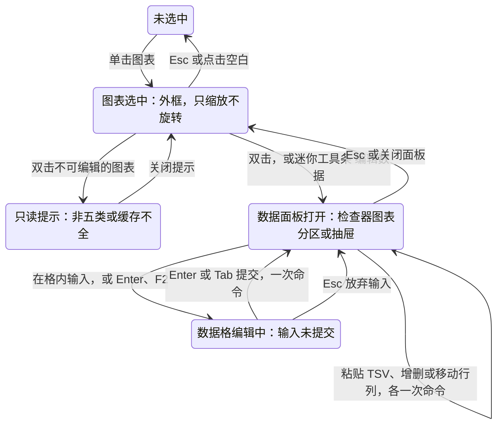

怎么读：只有从「数据格编辑中」回到「数据面板打开」的提交迁移和面板上的粘贴、增删行列会产生命令，每次一个撤销步；其余迁移都是视图态。只读图表在双击时停在提示态，不进入面板。
依据：PRD ED-15、G-63；R-d-34。

**图 3-4 数据格提交到重绘**

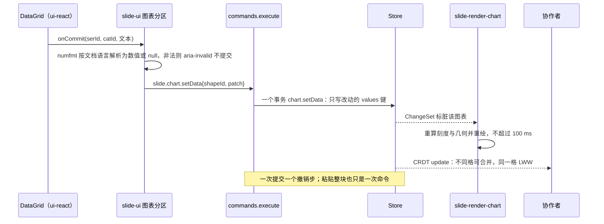

怎么读：网格组件只报告「哪一格输入了什么文本」，解析与校验在 slide-ui 完成，写模型只有一条命令；图表渲染器与协作者都只看到一次最小的键级写入，所以并发编辑不同格互不覆盖。
依据：PRD ED-15（≤ 100 ms 重绘）；R-d-34、R-d-35；30/06 §1.5。

### 3.7 检查器

`selectionKind` 新增 `chart`（新增（§4.21），R-d-72，矩阵登记在 [10](./10-editor-shell-and-interaction.md) §5）。迷你工具条 `toolbar.chart-selected`：编辑数据、更改类型（M3）。

| 分区 | 内容 | 里程碑 |
|---|---|---|
| 图表 | 类型切换（五类 + 子类型缩略图）；标题（显示开关 + 文本）；图例（显示开关 + 位置：下 / 上 / 左 / 右 / 右上）；数据标签（值；饼图可加百分比与类别名）；「编辑数据…」 | M3（P1） |
| 数据（紧凑网格） | 前 8 行 × 4 列 +「展开」进抽屉 | M3（P1） |
| 位置与大小 | x、y、宽、高（无旋转） | M2 |
| 替代文本 | 标题、描述；缺失时 `missingAlt` 提示 | M2（`slide.setAltText`，[19](./19-insertable-elements-overview.md)） |
| 坐标轴与格式 | 轴范围、数字格式、趋势线、误差线 | P2（灰显注明） |

只读类型：只显示位置与大小、替代文本、「此类型仅支持查看」与保真详情入口（设计 03-screens/13 的降级口径）。

### 3.8 命令

按 30/05 §1 三分法。图表命令全部是新增（§4.21），登记在 40/03 §2.6 与 30/05 §14，实现文件 `model-slide/commands/chart-commands.ts` 与 `mutations/chart.ts`（新增）；都要求 `doc.write`，一次命令一个事务、一个撤销步。

**Command**（参数与 Mutation 照录 30/05 §14.2、§14.4，前端补充的调用约束写在参数列）

| 命令 id | 参数 | 产出的 Mutation | 里程碑 |
|---|---|---|---|
| `slide.insertChart` | `{containerId, box, chartType, variant?, data?}`；`box` 由 slide-ui 按 §3.3 算好传入，`data` 缺省用示例数据；`enablement: slide.hasChartEditor` | `shape.insert`（graphicFrame:chart，只含 `Chart.data`） | M3 P1 |
| `slide.chart.setData` | `{shapeId, patch: {categories?: Record<CatId, CategoryPatch 或 null>, series?: Record<SerId, SeriesPatch 或 null>, values?: {serId, catId, value}[]}}`；`null` 表示删除（写墓碑），新 id 与 FracKey 由命令生成 | `slide.chart.setData` | M3 P1 |
| `slide.chart.setType` | `{shapeId, chartType, variant?}`（参数名以 40/03 §2.6 为准，`chartType` 写入 `ChartData.type`）；只在五类之间切换 | `slide.chart.setOptions` | M3 P1 |
| `slide.chart.setTitle` / `setLegend` / `setDataLabels` | `{shapeId, title 或 null}` / `{shapeId, legend 或 null}` / `{shapeId, dataLabels 或 null}` | `slide.chart.setOptions` | M3 P1 |
| 通用：`slide.moveShapes` / `resizeShapes` / `deleteShapes`、`slide.setAltText` | 通用参数 | `shape.setTransform`、`shape.remove`、`slide.shape.setNonVisual` | M2 |

**Mutation**：`slide.chart.setData`（按 `CatId` / `SerId` 逐键写，`null` 写墓碑 `_deleted`，数值按 `(serId, catId)` 单键 LWW）、`slide.chart.setOptions`（`patch` 取 `type`、`variant`、`title`、`legend`、`dataLabels`、`numFmt`，`type` 只允许五类），均为新增（§4.21），逆操作由 Store 推导。

**Operation**：`slide.chart.openDataEditor{shapeId, expanded?}`（新增（§4.21），视图态、不入历史，供 Ribbon、迷你工具条与右键菜单绑定命令 id；已回写（2026-09-26 整合，已登记 40/03 §2.6、30/05 §14））；`slide.setSelection`。

**类型切换规则**（`slide.chart.setType` 只改 `type` 与 `variant`，导出时按下表处理部件）：

| 切换 | 保留 | 去掉（导出时丢弃并在保真详情记一条） |
|---|---|---|
| 柱 / 条 / 折线 / 面积之间 | 全部系列、类别、坐标轴、标题、图例 | 源类型专有子元素（`c:invertIfNegative`、`c:marker`、`c:smooth` 等不适用者） |
| 任意 → 饼 | 第一个系列用于绘制，其余系列留在 `Chart.data` | 坐标轴、趋势线、误差线 |
| 饼 → 其它 | 全部系列 | `c:explosion`、`c:firstSliceAng`；坐标轴按默认新建 |
| 任意 ↔ 散点 | 系列名与 Y 值；类别标签能解析为数值时转为 X 值，否则 X 取 1…n | 类别轴改为数值轴 |

切换前若会丢东西，检查器先提示「切换为饼图将移除坐标轴与趋势线」，确认后执行（可撤销）。

### 3.9 协同

Yjs 编码的事实源是 30/06 §1.3.3：`graphic.chart` 下 `partRef` 为部件引用，`data` 为 `Y.Map`——`type` 单键 LWW，`variant` 整值 LWW，`categories` 与 `series` 以 id 为键，每个系列的 `values`（与散点的 `xValues`）又是以 `CatId` 为键的 `Y.Map`，所以每个数据格是一个独立叶子；标题、图例、数据标签、数字格式是标量或 JSON 串叶子。前端据此得到下表的并发结果：

| 并发场景 | 结果 |
|---|---|
| A、B 改不同格 | 各写各的 `values` 键，都保留 |
| A、B 改同一格 | 叶子 LWW |
| A、B 同时新增类别或系列 | 都保留，按 `(order, id)` 排序 |
| A 删类别、B 改该类别的值 | 类别是墓碑、值仍在；A 撤销后 B 的值一起回来 |
| A 切换为饼、B 新增系列 | 类型 LWW 为饼；新系列留在数据里，饼只画第一个系列，切回柱形后出现 |
| A 改标题、B 改图例位置 | 不同键，都保留 |

### 3.10 导入导出与保真

- **可编辑度**：M1–M2 V（OF-09：矩阵 §2.6 的类型全部可渲染，数值与类别 100% 来自缓存，单图表页 SSIM ≥ 0.80、数据墨迹 IoU ≥ 0.85）；M3 五类 E，其余 V（§4）。
- **零编辑**：图表部件、`chartN.xml.rels`、内嵌 `.xlsx` 原字节写回；`[Content_Types].xml` 与 `.rels` 在关系与内容类型集合都没变时写回原字节（X:q-content-types）。
- **导入的图表被编辑**：在该部件的保真树上改写建模子树（`c:ser` 的 `c:tx` / `c:cat` / `c:val` 及其缓存与 `c:f`、图表组元素与 variant、`c:title`、`c:legend`、`c:dLbls`），未建模子树原样保留（ADR-0008 决策 2）；数据变了才重生成内嵌工作簿。
- **新插入的图表**：按模板生成 `chartN.xml`（系列颜色为 `schemeClr`、`c:externalData@r:id` + `c:autoUpdate val="0"`）、`chartN.xml.rels` 与内嵌 `.xlsx`，页关系新增一条，`[Content_Types].xml` 登记图表部件与 xlsx 扩展名；部件编号取包内最大值 + 1。
- **内嵌工作簿**：自研最小 SpreadsheetML 写出器（`ooxml-pptx` `export/chart-workbook.ts`，经 `ooxml-core` OPC、`@cordexjs/xml` 序列化与 fflate；R-d-35）：`Sheet1` 的 A 列为类别、第 1 行为系列名、数据区为数值，`styles.xml` 写数字格式；`c:f` 改写为 `Sheet1!$B$1`、`Sheet1!$A$2:$A$5` 这类规范区域。原工作簿里数据区之外的内容（其它工作表、公式）在数据被编辑后不保留（PD-06 默认策略），数据面板首次提交前提示一次。
- **验收**：导出后 PowerPoint 显示新数据，且「编辑数据」可打开内嵌工作簿（ED-15）；维护机上按 70/04 §8.1 的图表编辑往返用例核对。

**图 3-5 导出：图表部件、关系与内嵌工作簿**

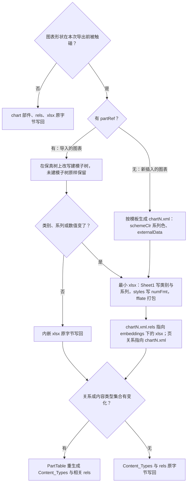

怎么读：先按「是否被触碰」分出原字节写回的快路径；被触碰的导入图表只改建模子树，数据没变就连工作簿也不动；新插入的图表三件套全部生成。最后统一看关系与内容类型集合是否变化，只有变了才重生成，这与 X:q-content-types 的零编辑口径一致。
依据：rulings §4.21 q-chart-route、X:q-content-types；R-d-35；PRD PD-06、ED-15；ADR-0008 决策 2。

### 3.11 无障碍

- 画布可访问树：`SceneNode.a11y.role = 'chart'`，name = 替代文字；没有替代文字时取「<类型>：<标题>」（如「簇状柱形图：季度销售额」），并置 `missingAlt` 提示作者补写（[05](./05-rendering-and-thumbnails.md) §11）。
- 可访问镜像附一份视觉隐藏的数据表摘要：类别 × 系列，超过 20 行或 10 列截断并注明「共 N 行」（新增（§4.21），已回写（2026-09-26 整合，见 [05](./05-rendering-and-thumbnails.md) §11））。
- 数据网格全键盘（§3.6），`role="grid"`、`aria-rowindex` / `aria-colindex`，编辑中的格 `aria-invalid` 与错误说明相连；提交后 `aria-live` 播报「系列 2 · 类别 3 = 4.5」。
- 类型切换的缩略图按钮都有文字名称（「簇状柱形图」）；只读提示可被读屏读到。

### 3.12 复用

- **绘制底层（复用）**：d3-scale 4.0.2、d3-shape 3.2.0、d3-array 3.2.4（均 ISC；传递依赖 d3-path、d3-format、d3-interpolate、d3-color、d3-time、d3-time-format、internmap 均 ISC，2026-09-26 `npm view` 核对），按许可分级属宽松类（[ADR-0049](../30-architecture/adr/0049-dependency-admission-and-license-tiers.md)）。
- **版式（维持自研）**：框布局、Excel 自动刻度、堆积与百分比、饼图标签避让、刻度标签旋转与跳过、图例排布。**为什么没有合适的成熟库**：ECharts 6.1.0（Apache-2.0）五类约 400–500 KB，逼近图表 chunk 预算，且其 grid / legend / axis 布局模型与 OOXML 的 `manualLayout`、Excel 自动刻度对不上，只能近似，运行时样式注入还要过 CSP 与 Trusted Types；Vega-Lite 体积大、带表达式解释器；Chart.js 只画 canvas（违背 ADR-0021）；visx 绑定 React（渲染器不是 React）；Observable Plot 同样不按 OOXML 排版。否决理由的完整版见 ADR-0036。
- **数值格式（复用）**：numfmt 3.2.6（MIT），刻度、数据标签与数据网格的显示与输入解析共用。
- **数据网格（复用）**：@tanstack/react-table 9.2.4（MIT，peer react ≥ 18）+ shadcn Table，封装为 ui-react 的通用 `DataGrid`（单点引入），slide-ui 图表分区使用；react-datasheet-grid 在 React 19 严格 peer 下装不上，已否（R-d-34）。
- **内嵌工作簿（维持自研最小写出器）**：约 5 KB，复用 `ooxml-core` 的 OPC 与 fflate（R-d-35）。**为什么不用成熟库**：SheetJS 的 npm 版停在 0.18.5 且有已知漏洞，exceljs 停更且依赖 Node，write-excel-file 可用但与我们已有的 OPC 与 XML 序列化重复；hyperformula 为 GPL，不可用。

### 3.13 里程碑

| 里程碑 | 范围 |
|---|---|
| M1（P0） | `./chart` 惰性子路径：只读解析 + d3 与自研布局渲染矩阵 §2.6 全部类型（OF-09 gated：SSIM ≥ 0.80、数据墨迹 IoU ≥ 0.85）；chartex 占位；渲染器缺席时占位 |
| M2 | 整体移动、缩放、删除（通用变换）；导出原字节写回 |
| M3（P1） | 拆出 `slide-render-chart`；插入（五类与子类型、示例数据、占位符图标）；数据网格；类型切换；标题、图例、数据标签；导出生成 chart / rels / xlsx；导入物化 `Chart.data` |
| P2 | 轴范围、数字格式、趋势线与误差线编辑；图表内子元素选择与格式 |

### 3.14 待决

1. **是否生成 `chartStyle` / `colors` 部件**：新插入的图表不生成时，PowerPoint 按默认样式显示且可编辑；推荐 M3 先不生成，维护机对照外观差异后再定。
2. **环形图（`c:doughnutChart`）是否作为饼图变体可编辑**：推荐 M3 只读，语料里占比高再并入 pie 的 `variant.holeSize`。
3. **原工作簿含公式或多工作表时的提示文案与是否允许「只改缓存、保留原工作簿」**：推荐按 PD-06 默认重生成并提示一次，保留原工作簿的方案留 P2。
4. **示例数据数值**：取 PowerPoint 默认示例，维护机核对一次（§3.3）。

## 4. 其它图表类型与 chartex（只读）

气泡、雷达、股价、组合、3D、曲面、环形与不满足可编辑判定的图表，以及 Office 2016 起的 chartex（瀑布、直方、箱形、漏斗、旭日、树状、地图）。它们属于「只读与不透明类」，总览也列在 [25 只读与不透明类](./25-elements-readonly-and-opaque.md)；因为与五类共用解析器与渲染器，设计写在本文。

| 栏 | 设计 |
|---|---|
| ① 作用 | 含这些图表的文件能打开、能看、内容不丢；可整体移动、缩放、删除 |
| ② OOXML 来源 | `c:bubbleChart`、`c:radarChart`、`c:stockChart`、`c:surfaceChart`、`c:bar3DChart` 等 3D 变体、`c:doughnutChart`、多图表组（组合）与次坐标轴；chartex 为 `mc:AlternateContent`（`Requires` 含 `cx`）→ `cx:chart` → `chartEx*.xml` |
| ③ 插入入口与默认 | 不提供插入；图表 ▾ 菜单不列出这些类型 |
| ④ 模型 | `c:` 类型：`Chart.partRef`（不透明），不物化 `Chart.data`；chartex：`UnknownShape{transform, renderHint:'placeholder', source:'chartex'}`，只建模 `transform`（ADR-0008 决策 9 (b)；`renderHint` 取值与 40/03 §5、40/04 §5.2 一致） |
| ⑤ 渲染 | `c:` 类型走同一条解析与布局管线，M1–M2 由 `./chart` 子路径的只读渲染器、M3 由 `slide-render-chart` 的 `approx.renderer` 近似绘制（3D 退为 2D；曲面、地图有缓存图片用缓存图片，否则占位）；chartex 由 `dom:unknown` 的 `fallback.renderer` 按 `UnknownShape.source = 'chartex'` 画占位并发 `render/element-degraded{reason:'chartex-unsupported'}`，**不渲染** `mc:Fallback`（其内容是「此图表在你的版本中不可用」文本，rulings §4.15 Q7） |
| ⑥ 交互 | 单击选中、移动、缩放、删除（M2）；双击提示「此类型仅支持查看」（提示方式沿用 [25](./25-elements-readonly-and-opaque.md) §2.2）；不进数据面板 |
| ⑦ 检查器 | 位置与大小、替代文本、降级原因与「查看保真详情」（设计 03-screens/13）；`degraded` 分区沿用 25 §2.5 |
| ⑧ 命令 | 只有通用变换与删除：`slide.moveShapes` / `resizeShapes` / `deleteShapes`；AlternateContent 的移动缩放由导出写回各分支 `xfrm` |
| ⑨ 协同 | 只有 `transform` 与删除墓碑，按形状通用规则合并 |
| ⑩ 导入导出与保真 | `c:` 其余类型 V（组合与次坐标轴 V P1，3D / 曲面 / 地图 V~）；chartex P；部件原样写回，变换只改 `xfrm` |
| ⑪ 无障碍 | `role = 'chart'`，name 注明「不支持显示的图表类型：瀑布图」这类说明；降级占位可聚焦 |
| ⑫ 复用 | 与五类共用 d3 与自研布局，不另引库 |
| ⑬ 里程碑 | M1：`c:` 类型近似渲染、chartex 占位（OF-09、PRD 03/01 §2.6）；M2：整体变换（M2 P1）；chartex 近似渲染 M4+ 评估（P2） |
| ⑭ 待决 | 环形图是否并入可编辑的饼图变体（§3.14 第 2 条） |

**图 4-1 图表元素的分流**

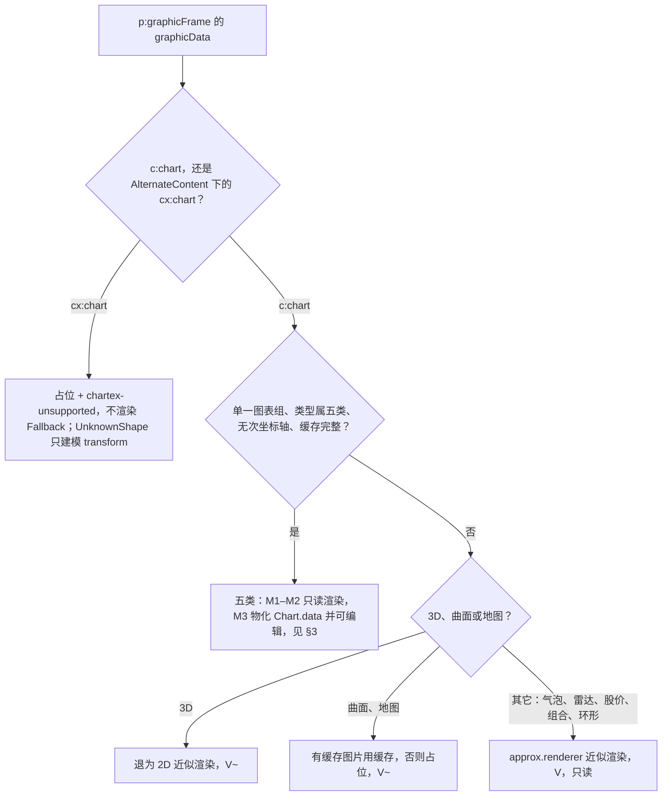

怎么读：一个图表形状先按命名空间分成 chartex 与 `c:` 两支；`c:` 支再按可编辑判定（§3.4）分出五类与其余类型，其余类型只读且都能整体移动缩放删除。chartex 在 M1–M3 只保留与占位。
依据：PRD OF-09、03/01 §2.6；rulings §4.15 Q7；ADR-0036。

## 5. 机械验证

只写断言；套件与 CI 步骤名以 [70/12](../70-testing/12-ci-gates-mapping.md) 为准。

| 断言 | 执行处 |
|---|---|
| 表格、图表类别按 70/04 三层判定通过（OF-08 SSIM ≥ 0.90；OF-09 SSIM ≥ 0.80 且数据墨迹 IoU ≥ 0.85），图表语料矩阵见 70/04 §8.1 | `e2e/oracle-gated` |
| 值轴自动刻度与维护机 COM 导出的最小值、最大值、主刻度一致（先报告，70/04 §8.1） | `e2e/oracle-gated`（结构通道） |
| I-TBL1、I-TBL2：随机插删行列与合并的 fuzz 下两端网格一致，修复后无缺格、无越界、无重叠 | `test/collab-sim` + `test/unit`（model-slide 不变量） |
| 表格与图表 Mutation 载荷无下标字段 | lint `cordex/no-index-in-mutation`、类型测试 |
| 导入 → 零编辑导出：表格与图表部件、rels、内嵌 xlsx 字节相同 | `test/contract`（70/03 往返） |
| 编辑表格结构、编辑图表数据后导出：部件通过 XSD 校验、`c:f` 与缓存点数一致、内嵌 xlsx 能被自有读取器读回同一份数据 | `test/unit`（`chart-data-roundtrip.test.ts`）+ `test/contract` |
| 数据格提交到图表重绘 ≤ 100 ms（典型图表） | `perf/perf-client` |
| 无图表文档不加载图表 chunk；图表 chunk ≤ 400 KB gzip | `test/unit`（preset `lazy.test.ts`）、`scanners/scan-bundle-budget` |
| d3-* 只出现在图表惰性目录，numfmt 只出现在图表惰性目录与 slide-ui 图表数据分区，@tanstack/react-table 只出现在 ui-react（ADR-0036 决策 4、6） | depcruise `cordex-third-party-single-entry` |
| 图表渲染器缺席时占位 + `chart-unavailable`，其余元素照常渲染 | `test/unit`（slide-render `degrade.test.ts`） |
| 插入页签表格 / 图表控件、迷你工具条与右键菜单项都绑定已注册命令 id | `test/unit`（slide-ui `ribbon-spec.test.ts`） |
| 网格选择器、单元格导航、数据网格的键盘路径与播报 | `e2e/a11y` |

## 6. 待回写

由对应文档的负责组执行，本文不直接改。2026-09-26 整合后核对：除前两行外均已完成。

| 目标 | 内容 | 状态 |
|---|---|---|
| 30/04 §3.8 | I-TBL2 对「并发插入落在合并区内部」的修复口径（§2.14 第 7 条） | 未完成，待 §2.14 第 7 条定稿 |
| 40/04 | `chartml.parseChartSpace` 输出字段扩为 ADR-0036 的 `ChartReadModel`；`export/chart-part.ts` 与 `chart-workbook.ts` | 未完成 |
| 30/04 §3.6、§3.9、§4.1 | 新增矩形选区锚点 `tableCells`；`ChartData.variant` 补 `marker`、`smooth`、`scatterStyle`；`tableStyles.xml` 只读解析改为 M1 起 | 已完成 |
| 40/03 §2.6、30/05 §14 | 登记命令 `slide.table.clearCells` 与 Operation `slide.chart.openDataEditor` | 已完成 |
| 30/06 §1.3.3 | 键名与 30/04 §3.8、30/05 §14 的路径对齐（表级与格级 `properties`、`hMerge` / `vMerge`、`_deleted` 墓碑） | 已完成 |
| [10](./10-editor-shell-and-interaction.md) §5 | `selectionKind` 增 `table`、`chart`；迷你工具条 `toolbar.table-cell`、`toolbar.chart-selected` | 已完成 |
| [05](./05-rendering-and-thumbnails.md) §11 | 表格与图表的可访问镜像内嵌视觉隐藏 `<table>` | 已完成 |
| ADR-0008 决策 9 | 白名单新增「导出时向 `tableStyles.xml` 追加所用内置样式的定义」 | 已完成 |
| 设计 03-screens/04 | 删除「M1/M2 插入的图表以当前静态样式呈现」一句 | 已完成 |
