# 25 元素族：只读与不透明类

> 状态：v0.1 | 负责：前端设计线 | 更新：2026-09-26（§4.21：新建。SmartArt、公式、OLE、3D 模型、墨迹、缩放定位与 ActiveX / VML / 未知 graphicData / 裸 p:contentPart 的统一口径「看得见、能摆放、原样写回」与各自后续路线）；2026-09-26（§4.21 整合：§2.4 与 §12 待决 5：renderHint 取值已在 40/04 统一）；2026-09-26（§4.21 Remap：原 30/07 迁出节的引用改指 50/01 §4a、50/19、50-frontend/04、50-frontend/13 等新位置）；2026-09-26（§4.21 复核：依赖行补 50/01 上游链接） | 依赖：上游：[50/01 前端架构](01-overview-and-runtime-map.md) §5b、§4a（渲染）；[50/19 可追加元素目录·总览](./19-insertable-elements-overview.md)；[30/04 文档模型](../30-architecture/04-document-model.md) §3.3、§4.2、§4.3、§5；[30/05 命令与历史](../30-architecture/05-command-and-history.md) §1；[30/06 协同](../30-architecture/06-collaboration.md) §1.4、§1.5；[30/07 渲染](../30-architecture/07-rendering.md) §4.2；[40/03 幻灯片领域模型](../40-modules/03-slide-domain-model.md) §2.6、§5；[40/04 OOXML 编解码](../40-modules/04-ooxml-format-and-pptx-codec.md) §2.3、§5.2；[50/05 渲染](./05-rendering-and-thumbnails.md) §8.4、§9、§11；[50/10 编辑器外壳与画布交互](./10-editor-shell-and-interaction.md) §5、§7；[ADR-0008](../30-architecture/adr/0008-opaque-preservation.md) 决策 9、10；[ADR-0018](../30-architecture/adr/0018-editor-element-model-and-insert-commands.md)；[ADR-0019](../30-architecture/adr/0019-xml-lexer-and-fidelity-tree.md)；PRD [OF §2.5–§2.7、OF-10、OF-12、OF-13](../10-prd/03-features/01-open-and-fidelity.md)、[ED §5 非目标](../10-prd/03-features/02-editing.md)；设计 03-10、03-13；rulings §4.15 Q7、§4.21（q-smartart、q-equation、d-75、d-76）

本文是「只读与不透明类」元素族的唯一设计文档：一个 pptx 里 Cordex 不能编辑内部、但必须看得见、能选中摆放、导出时一个字节都不丢的那些对象。每个元素一节，节内固定 14 栏（作用、OOXML 来源、插入入口与默认、模型、渲染、交互、检查器、命令、协同、导入导出与保真、无障碍、复用、里程碑、待决）。元素族的通用设计（基类、变换矩阵、z 序、锁定、主题默认、插入通用流程、元素渲染器表）以 [50/19](./19-insertable-elements-overview.md) 为准，本文只写本族与通用口径不同的部分。

## 0. 定位与边界

| 本文拥有 | 本文引用（事实源） |
|---|---|
| 本族 7 个元素的 14 栏设计（§3–§9） | 通用元素设计与渲染器表：[50/19](./19-insertable-elements-overview.md) |
| 统一口径：看得见、能摆放、原样写回（§2） | 模型实体与 OOXML 映射：30/04 §4.2、§4.3；40/03 §5 |
| 本族的交互状态机、检查器分区与双击提示（§2.2） | 画布选择与拖拽管线：50/10 §7；检查器坞：50/10 §5 |
| 本族的后续路线（SmartArt 转换为形状、公式 OMML 往返、OLE 下载与替换，§10） | 降级占位与 `reason` 取值：50/05 §9；EMF 栅格化：50/05 §8.4 |
| 本族新增命令与待登记的模型字段（§11） | 命令三分法：30/05 §1；不透明修改白名单：[ADR-0008](../30-architecture/adr/0008-opaque-preservation.md) 决策 9、10 |
| — | 其它图表类型与 chartex（`cx:`）：[50/24](./24-elements-tables-and-charts.md)（本族同口径，文件归图表线） |

本族共同的产品立场（PRD 01 §0 第 3 条、PRD 02 §0 第 3 条）：**降级要可见、可诊断；能选中就能操作；内部不可编辑时明说**。这些对象在 Cordex 里都不提供插入（PRD 02 §5 非目标，d-75），用户只会在导入的文件里遇到它们。

## 1. 族总览

| 元素 | 作用（一句话） | OOXML 入口 | 模型 | 渲染来源 | 可编辑度（M1 / M2 / M4+） | 插入 | 后续路线 |
|---|---|---|---|---|---|---|---|
| SmartArt（§3） | 流程、层次、循环图示 | `p:graphicFrame` + `dgm:relIds` + `dsp:drawing` | `GraphicFrame{graphic: Diagram}` | 只读解析 `dsp:drawing` | V / E~ 仅变换（P1） / E~ 转换为形状（P2） | 不提供 | M4+ 先做「转换为形状」，节点文字编辑之后再评估 |
| 公式 OMML（§4） | 理工类数学公式 | `mc:AlternateContent Requires="a14"` → `a14:m` | `UnknownShape` | Fallback 位图 | V~ / E~ 仅变换（P1） / E~ 立项（P2） | M1–M3 不提供 | M4+ 自研 OMML↔MathML + MathJax 4 SVG |
| OLE 对象（§5） | 嵌入 Excel、Word、Visio 等 | `p:graphicFrame` + `p:oleObj` + `embeddings/*` | `GraphicFrame{graphic: Ole}` | `Ole.preview`（Fallback `p:pic`） | V~ / E~ 仅变换（P1） / E~ 下载与替换（P2） | 不提供 | M4+ 下载原文件、替换负载 |
| 3D 模型（§6） | 产品 3D 展示 | `mc:AlternateContent Requires="am3d"` → `am3d:model3d` | `UnknownShape` | Fallback 海报 `p:pic` | V~ / E~ 仅变换（P1） / — | 不提供 | 无（非目标，不加载 3D 引擎） |
| 墨迹（§7） | 手写批注与圈画 | `p14:contentPart`（AlternateContent 内）与裸 `p:contentPart` | `UnknownShape` | Fallback `p:pic`；裸 contentPart 占位 | V~ / E~ 仅变换（P1） / 评估 | M1–M3 不提供笔墨输入 | M4+ 随触控编辑（ED-27）评估绘图页签 |
| 缩放定位（§8） | 目录式非线性导航 | `mc:AlternateContent Requires="pslz"`、`psez` 等 | `UnknownShape` | Fallback 缩略图 `p:pic` | V~ / E~ 仅变换（P1） / — | 不提供 | 放映点击跳转随 ADR-0008 白名单修订 |
| ActiveX / VML / 未知 graphicData（§9） | 不认识的内容零丢失 | `p:controls`、VML 部件、未知 uri 的 `a:graphicData` | `OpaqueXml` / `UnknownGraphic` / `UnknownShape` | 有 Fallback 图片 V~，否则占位 | P（有回退时 V~） / 仅变换 / — | 无 | 无 |
| 其它图表与 chartex | 气泡、雷达、瀑布等只看 | `c:chart`、`cx:chart` | `Chart.partRef` / `UnknownShape` | 近似或占位 | 见 [50/24](./24-elements-tables-and-charts.md) | 不提供 | 见 50/24 |

可编辑度记号同 PRD 01 §1：`E` 编辑、`E~` 部分编辑、`V` 查看、`V~` 近似查看、`P` 仅保留。本族在 M2 达到的 `E~` 只含「整体移动、缩放、删除、层级、组合、替代文本（仅 graphicFrame 系）」，内部一律不可编辑。

**图 1-1 导入时本族对象的归宿**

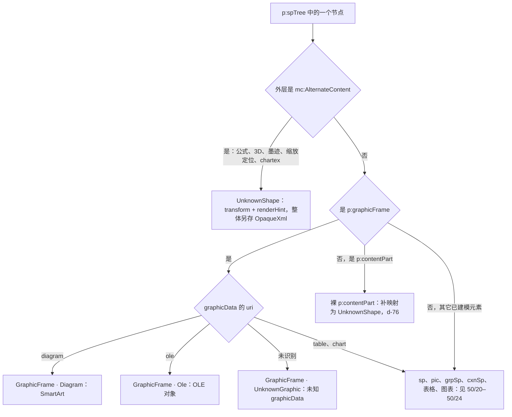

怎么读：从上往下按导入分派；左下三类（AlternateContent、未知 graphicData、裸 contentPart）内部完全不透明，只建模变换；SmartArt 与 OLE 是 graphicFrame 的已知分支，建模部件引用与预览，但内部同样不可编辑。页级的 `p:controls`（ActiveX）与 `p:custDataLst` 不是形状，不进 shapes 表（§9）。
依据：30/04 §4.2、§4.3；40/04 §2.3 `resolveAlternateContent`；40/03 §5 `shape/unknown.ts`、`shape/ole.ts`、`shape/diagram.ts`；rulings §4.21 d-76。

## 2. 统一口径：看得见、能摆放、原样写回

本族 7 个元素共用下面 7 小节的设计；§3–§9 各节的 14 栏只写与此不同或需要具体化的部分，写「同 §2.x」的栏即完全沿用。

### 2.1 看得见：渲染来源与降级

| 元素 | 渲染器（`render.element` 的 kind） | 画什么 | 画不出来时的 `reason` | 占位与双击提示文案（设计 03-13） |
|---|---|---|---|---|
| SmartArt | `graphicFrame:diagram` | `ooxml-core` 只读解析 `dsp:drawing` 得到的形状树，复用 `sp` 画笔 | `smartart-no-dsp` | 「SmartArt 无法显示（文件缺少预览数据）」 |
| OLE | `graphicFrame:ole` | `Ole.preview` 走 `pic` 路径；EMF / WMF 预览见 50/05 §8.4 | `ole-preview-missing`（EMF 另有 `emf-no-preview`、`emf-raster-limit`） | 「嵌入对象（类型名）无法预览」 |
| 公式、3D、墨迹、缩放定位 | `unknown`（`renderHint: 'fallback-pic'`） | `resolveAlternateContent` 选出的 Fallback 分支（`p:pic` 或带位图填充的 `p:sp`） | 无 Fallback 时 `unsupported-shape-kind` | 占位框 + 对象类型名（§2.5 的 `source` 映射） |
| 裸 `p:contentPart` | `unknown`（`renderHint: 'placeholder'`） | 不画内容，只画占位 | `unsupported-shape-kind` | 「墨迹无法显示，已原样保留」 |
| 未知 graphicData | `graphicFrame` 查表未命中 → `fallback.renderer` | 占位 | `unsupported-shape-kind` | 「此对象暂不支持显示，已原样保留」 |

- 三类占位（意外失败、预期降级、查表未命中）的视觉与事件口径见 50/05 §9；本族全部属于「预期降级」或「查表未命中」，不走 `errors.report`，只发 `render/element-degraded{reason}` 并进入保真诊断面板（PRD OF-13）。
- Fallback 分支里的位图与普通图片走同一 `MediaCache` 与 blob URL 生命周期（50/05 §8.2），不另开通道；Fallback 为 EMF 时同样惰性栅格化。
- 渲染器全部无状态、只读；只读解析的产物（`DiagramDrawingReadModel` 等）不进模型、不进 Snapshot，按部件 `BlobRef.hash` 在 slide-render 内 LRU 缓存（50/19 §6）。

**图 2-1 本族元素的渲染管线**

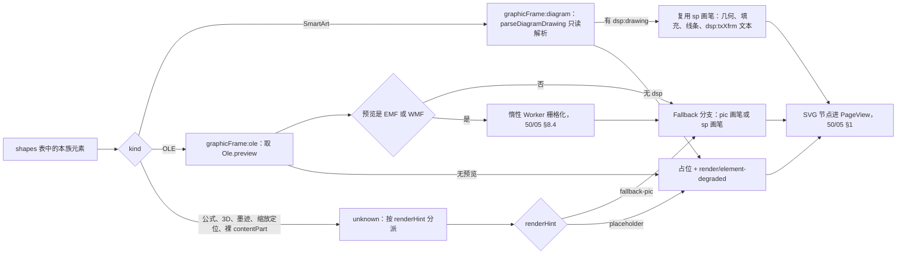

怎么读：左侧按 kind 分派到三类渲染器，中间是各自的数据来源，右侧汇合为 SVG 节点；只有 SmartArt 自己画形状，其余一律画现成的回退位图或占位，因此本族没有任何「按 OOXML 语义自研布局」的渲染代码。
依据：50/19 §6；50/05 §8.4、§9；40/04 §2.3。

### 2.2 能摆放：交互与状态机

本族在 `slide.shapeKind` 贡献中声明的能力位（`ShapeKindDef.capabilities`，扩展字段的定义见 [50/19](./19-insertable-elements-overview.md)；覆盖层按它决定显示哪些手柄）：

| 能力位 | 取值 | 说明 |
|---|---|---|
| `text` | `false` | 不进文本编辑态；Enter 与双击都只弹提示 |
| `resize` | `true` | 8 个缩放手柄；拖动中只画预览，松手一次 `slide.resizeShapes` |
| `rotate` | `false` | 不显示旋转手柄：graphicFrame 系（SmartArt、OLE、缩放定位、未知 graphicData）与 PowerPoint 一样不可旋转；AlternateContent 系在 M2 同样不开放旋转，避免把 `rot` 写进只在白名单内同步 `off/ext` 的分支 |
| `group` | `true` | 可与其它元素组合、取消组合；组合只改 `parentId`，取消组合时按组变换把子坐标折算回页面坐标写入 `transform`（40/03 `shape.ungroup`），导出照常同步分支 `xfrm` |
| `connect` | `false` | 不显示连接点，连接符不能吸附到本族对象 |
| `adjust` / `crop` / `editPoints` / `fillable` | `false` | 无调整手柄、无裁剪、无顶点编辑、填充与线条分区不出现 |
| `lockAspectDefault` | OLE、3D、墨迹、公式、缩放定位为 `true`；SmartArt、未知对象为 `false` | 源文件 `graphicFrameLocks` / `picLocks@noChangeAspect` 优先；`Shift` 临时反转 |

- **命中**：选框覆盖整个对象外框，内部不做逐形状命中（SmartArt 的子形状也不可单独选中）；`fill="none"` 穿透规则不适用。
- **键盘**：方向键 / `Shift`+方向键微移（50/10 §7.3）；`Delete` 删除；`Tab` 按 z 序循环；`Enter` 等同双击；`Mod+D` 与 `Mod`+拖动复制见 §2.3 末条。
- **双击与 Enter**：不进入任何子编辑态，弹一次 toast（本节下表），toast 带「查看保真详情」动作，打开保真诊断面板并定位该对象；同一对象 10 s 内重复双击不重复弹出。
- **锁定**：源文件带 `noMove` / `noResize` 时，手柄显示锁形（50/10 §7.1），与普通形状同。
- **评审与只读**：只能选中与查看检查器，拖动与删除不可用（50/10 §3.2）。

| 元素 | 双击 / Enter 的 toast 文案（最终文案以设计 03-13 与 50/16 为准） |
|---|---|
| SmartArt | 「SmartArt 暂不支持编辑内部结构，可在 PowerPoint 中修改」 |
| 公式 | 「公式暂不支持编辑；这个文本框里的其他文字也无法在此编辑」 |
| OLE | 「嵌入对象暂不支持在此编辑」 |
| 3D 模型 | 「3D 模型在此只显示静态图，可在 PowerPoint 中调整视角」 |
| 墨迹 | 「墨迹暂不支持编辑」 |
| 缩放定位 | 「缩放定位只显示静态缩略图，目标页改动后不会自动更新」 |
| 未知对象 | 「此对象暂不支持编辑，已原样保留」 |

**图 2-2 本族对象的交互状态机**

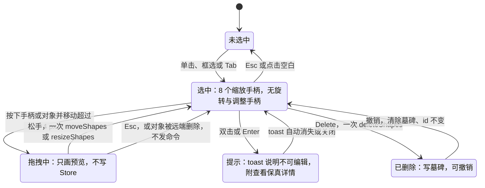

怎么读：与普通形状（50/10 图 10-4）相比，本族没有「组合编辑中」和「文本编辑」两态，双击改为进入一个只读的「提示」态；拖拽、删除、撤销的事务边界与普通形状完全相同，一次动作一个撤销步。
依据：50/10 §7.1、§7.2；PRD ED-01、ED-05；PRD OF 备注 A（rulings §4.15 Q7）。

### 2.3 原样写回：导出与白名单

- **零编辑**：本族对象所在部件未被触碰时整部件 verbatim；被引用的嵌入部件（`embeddings/*`、`ppt/diagrams/*`、`ppt/ink/*`、`.glb`、Fallback 位图）永远 verbatim（PRD OF-18 与 PRD 01 §4.1 部件级 diff）。
- **移动与缩放**：只改模型里的 `transform`（`UnknownShape.transform` 或 `GraphicFrame.transform`），使页部件变脏；导出重生成页部件时，graphicFrame 系按建模字段重写 `p:xfrm`，AlternateContent 系由 40/04 `export/alternate-content.ts` 把新的 `off/ext` 写进每个 `mc:Choice` 与 `mc:Fallback` 分支的 `xfrm`，其余字节不动——这是 ADR-0008 决策 9 白名单 (b)。
- **删除**：写墓碑；导出时整体移除该节点（AlternateContent 系连同全部分支），同时按白名单 (a) 清理 `p:timing` 中的 `spid` 引用、按 (c) 移除不再被任何关系引用的嵌入部件及其内容类型条目。
- **层级与组合**：只改 `order` / `parentId`，节点字节原样搬到新位置；组内的 AlternateContent 对象，其分支 `xfrm` 写的是组的子坐标（`chOff/chExt` 空间）。
- **替代文本**：graphicFrame 系（SmartArt、OLE、未知 graphicData）的 `cNvPr` 是建模字段，可经 `slide.setAltText` 编辑；AlternateContent 系的 `cNvPr` 在分支内部，修改它超出白名单，M2 只读展示（§2.5）。
- **复制**（`Mod+D`、`Mod`+拖动、复制粘贴，PRD ED-08、ED-17）：模型里副本是新 `ShapeId`，不透明内容原样；导出时副本的 `cNvPr@id` 要按 `OoxmlIdMap` 重新分配（AlternateContent 系要改写分支内部的 id），跨页粘贴还要把分支内的 `r:id` / `r:embed` / `r:link` 重映射到目标页的关系、SmartArt 的 `dgm` 四部件与 `dsp` 部件按部件复制以保证一个 SmartArt 独占自己的数据部件。这两项都超出现行白名单，建议登记为 ADR-0008 决策 9 (d)「副本的 id 与关系重映射」；登记前 M2 的默认口径是：同页复制可用（只改 id），跨页与跨文档粘贴本族对象时拒绝并提示「此对象暂不支持复制到其他页」（§12 待决 1）。

**图 2-3 移动一个 AlternateContent 对象后导出**

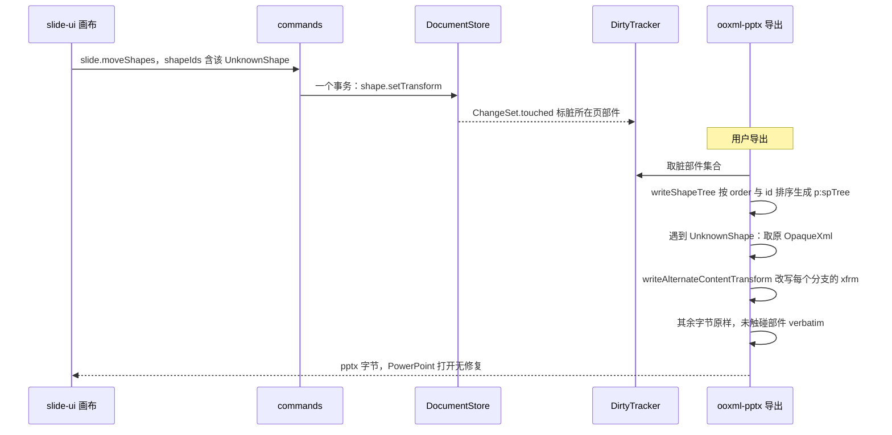

怎么读：纵向是时间；模型只多了一个 `transform`，对不透明 XML 的唯一改动发生在导出最后一步，且只改分支 `xfrm`。graphicFrame 系走同一路径，只是 `p:xfrm` 由建模字段直接生成，不需要改写分支。
依据：40/04 §5.2 `export/shape-tree.ts`、`export/alternate-content.ts`；ADR-0008 决策 9；30/04 §5.3。

### 2.4 模型

本族不新增实体类型，全部落在 30/04 的 `Shape` 判别联合里；下图是本族用到的部分。标「新增（§4.21）」的字段是本文提出、待 30/04 与 40/03 登记的建议。

**图 2-4 本族的模型类图**

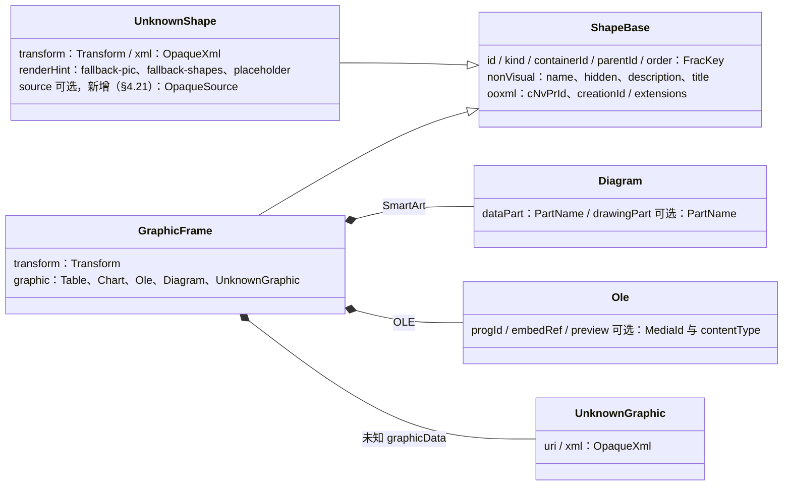

怎么读：空心三角是 Shape 联合的分支，实心菱形是 `graphic` 判别联合的内容；`UnknownShape` 的 `xml` 保存整个 `mc:AlternateContent`（或裸 `p:contentPart`），`transform` 取被选分支的 `xfrm`，是模型里唯一可写的字段。
依据：30/04 §3.2 对象图、§4.2、§4.3；40/03 §5 `shape/unknown.ts`、`shape/ole.ts`、`shape/diagram.ts`。

- `renderHint` 取值以 40/03 §5 为准（`'fallback-pic' | 'fallback-shapes' | 'placeholder'`）；40/04 §5.2 `import/shape-tree.ts` 行已统一为同一组取值，chartex 用 `'placeholder'` + `source:'chartex'`（2026-09-26 整合，原两值作废；§12 待决 5 已回写）。
- **新增（§4.21）`UnknownShape.source: OpaqueSource`**：导入时由 40/04 `shape-tree.ts` 按 `mc:Choice@Requires` 与节点名填入的只读标签，取值 `'math' | 'model3d' | 'ink' | 'zoom' | 'chartex' | 'contentPart' | 'other'`；只用于检查器的对象类型名、双击提示文案与可访问名称，不参与导出、协同中从不修改。不建这个字段时，渲染与检查器只能在运行时重新解析 `OpaqueXml`，违背「只读解析白名单」的收口方向。

### 2.5 检查器：`degraded` 分区

本族全部落在 50/10 §5 的 `selectionKind = 'degraded'`，不另开 selectionKind（d-72 新增的 table、chart、media、placeholder-empty 与本族无关）。分区自上而下：

| 分区 | 内容 | 可编辑 |
|---|---|---|
| 位置与大小 | x / y / w / h（显示单位按偏好，内部 EMU）、锁定比例开关；无旋转字段 | 是（`slide.moveShapes` / `resizeShapes`） |
| 对象说明 | 对象类型名（SmartArt 图形、嵌入的 Excel 工作表、公式、3D 模型、墨迹、缩放定位、未知对象）+ 一句降级说明 + 「查看保真详情」 | 否 |
| 替代文本 | 说明（≤ 250 字）、标题、装饰性（50/19 通用字段） | graphicFrame 系可编辑；AlternateContent 系只读并注明「此类对象的替代文本需在 PowerPoint 中修改」 |
| 后续动作（M4+） | SmartArt「转换为形状」；OLE「下载原文件」「替换…」 | 随各元素里程碑出现，之前不显示占位 |

- 类型名映射：OLE 按 `progId` 查 i18n 表（如 `Excel.Sheet.12` → 「Excel 工作表」，未收录的显示 `progId` 原文）；AlternateContent 系按 `UnknownShape.source` 查表；文案命名空间归 50/16。
- 多选中含本族对象时按 `mixed` 取交集（位置与大小、排列），与普通形状一致（50/10 §5）。
- 迷你工具条 `toolbar.degraded` 只放「查看保真详情」一项；右键菜单按 `selectionKind` 过滤后保留剪切 / 复制 / 删除 / 排列 / 组合 / 替代文本，不出现格式类命令。

### 2.6 协同

- 本族对象是 shapes 表里的普通键（位置按 30/04 顶层表收口，d-05）；可被协同修改的只有 `xfrm`（嵌套 `Y.Map`，叶子 LWW）、`order` / `parentId`（单键 LWW）、`nv`（graphicFrame 系的替代文本，小型复合值整值 LWW）与 `_deleted` 墓碑，编码规则见 30/06 §1.5。
- 不透明内容（`OpaqueXml`、部件引用、`Ole.preview`）以字符串或 `BlobRef` 叶子存在，协同中从不改写，因此不存在内部冲突。
- 两人同时拖动同一对象：后写者胜，前者看到对象「跳走」并得到软冲突提示（PRD CO-08）；删除 vs 移动：墓碑语义，撤销删除即恢复原 id（rulings §4.15 Q3）；拖动中对象被远端删除：撤掉预览、不发命令（50/10 §7.2）。
- 段落内的公式嵌入（§4）是 `Y.XmlText` 中的一个 `opaque` embed（30/06 §1.4），作为一个字符位置参与合并，可被整体删除，不可部分编辑。

### 2.7 无障碍

- 画布可访问树按 50/05 §11 的 `A11yDescriptor` 输出：SmartArt 为 `group`（50/19 的可访问性表把本族概括为图像类，SmartArt 取 `group` 是为了让读屏能读到其节点文字），其余为 `image`；缩放定位在放映中希望是 `link`，现行 `role` 取值集合没有 `link`，已提请 50/05 §11 补充（§12 待决 6）。
- `name` 的取值顺序：替代文本 → 本族各自的派生名（SmartArt 拼接节点文字、公式取 OMML 线性文本、OLE 取「嵌入的 + 类型名」）→「类型名 + 序号」；各节 ⑪ 栏写具体派生规则。
- 双击提示通过 `aria-live="polite"` 播报；占位框内的说明文字同时是可访问名称的一部分，读屏与视觉看到的是同一句话。
- 每个拖拽都有键盘或数值等价（方向键微移、检查器输入框），满足 WCAG 2.5.7（50/16 §6.3）；触控手柄 ≥ 44 px（PRD ED-27）。

## 3. SmartArt

| 栏 | 设计 |
|---|---|
| ① 作用 | 商务汇报里常见的流程、层次、循环、关系图示。导入后要看得见（PowerPoint 预计算的形状与文字）、能整体摆放、导出后在 PowerPoint 里仍是可编辑的 SmartArt（PRD OF-10）。M4+ 的「转换为形状」让用户不回 PowerPoint 也能改其中的文字与样式，代价是失去 SmartArt 语义。 |
| ② OOXML 来源 | `p:graphicFrame` → `a:graphic/a:graphicData@uri="http://schemas.openxmlformats.org/drawingml/2006/diagram"` → `dgm:relIds@r:dm@r:lo@r:qs@r:cs`，分别指向 `ppt/diagrams/data*.xml`、`layout*.xml`、`quickStyle*.xml`、`colors*.xml`；PowerPoint 另写 `drawing*.xml`（`dsp:drawing`，Microsoft 2008 diagram 扩展），由数据部件 `extLst` 中的 `dsp:dataModelExt@relId` 经页部件关系引用，内含预计算好的 `dsp:spTree` 与每个形状的 `dsp:txXfrm` |
| ③ 插入入口与默认 | 不提供插入（PRD 02 §5 非目标，d-75）：插入页签、形状库、空内容占位符图标条都不放 SmartArt；版式里的 `dgm` 占位符只作为空占位符显示提示文字，不提供点图标插入。M4+ 的「转换为形状」入口：右键菜单与检查器「后续动作」分区（§2.5） |
| ④ 模型 | `GraphicFrame{transform, graphic: Diagram}`，kind `graphicFrame:diagram`；`Diagram{dataPart, drawingPart?}`（40/03 §5 `shape/diagram.ts`；四个 `dgm` 部件与 `dsp` 部件在部件表中为不透明部件，30/04 §4.1）。只读视图 `DiagramDrawingReadModel`（40/04 §2.2）不进模型。本元素无新增字段；M4+ 转换只产出既有的 `GrpSp` 与 `Sp` |
| ⑤ 渲染 | 同 §2.1：`graphicFrame:diagram` 渲染器调 `parseDiagramDrawing`（组变换已折算），逐个形状复用 `sp` 画笔画进一个 `<g transform>`，文字按 `dsp:txXfrm` 定位、走 engine-layout 断行；用户缩放后 `dsp:drawing` 不重算，渲染按「原 drawing 范围 → 新外框」非等比拉伸近似（PowerPoint 打开时会按版式重排，两者可能不同，检查器说明中写明）；无 `dsp` 部件时占位 `smartart-no-dsp` |
| ⑥ 交互 | 同 §2.2；自由缩放（`lockAspectDefault:false`）；子形状不可单选；双击提示见 §2.2 表 |
| ⑦ 检查器 | 同 §2.5：类型名「SmartArt 图形」；替代文本可编辑；M4+ 出现「转换为形状」 |
| ⑧ 命令 | Command：`slide.moveShapes` / `resizeShapes` → `shape.setTransform`；`slide.deleteShapes` → `shape.remove`（墓碑）；`slide.bringForward` 等 → `shape.setOrder`；`slide.group` / `ungroup`；`slide.setAltText`（新增，50/19 登记）→ `slide.shape.setNonVisual`（新增 Mutation）。M4+ 新增（§4.21）`slide.convertSmartArtToShapes{shapeId}`：一个事务内读 `DiagramDrawingReadModel` → `shape.insert` 一个 `GrpSp`（`order` 取原外框的 `order`、`parentId` 取原父）与其下 N 个 `Sp`（几何、填充、线条、文字按显式值写入）→ `shape.remove` 原外框；一个撤销步，撤销即复原 SmartArt。Operation：`slide.setSelection`（转换后选中新组合） |
| ⑨ 协同 | 同 §2.6。转换是「插入 N+1 个新键 + 墓碑 1 个旧键」的一个事务：他人同时移动原外框时，其写入落在墓碑上，按 CO-08「删除 vs 编辑」提示并可恢复原 SmartArt |
| ⑩ 导入导出与保真 | M1 `V`（有 `dsp` 的 SSIM ≥ 0.85，PRD OF §4.2）；M2 `E~` 仅变换（P1）；M4+ 转换后为普通组合与形状 `E`。导出：`dgm` 四部件与 `dsp` 部件 verbatim，`p:xfrm` 按模型重写；删除后按白名单 (c) 清理孤儿 `ppt/diagrams/*`；转换后原部件随外框删除一并清理，组合与形状按普通元素生成 |
| ⑪ 无障碍 | `role=group`；`name` = 替代文本，否则按 `dsp:spTree` 顺序拼接节点文字（≤ 120 字符），再否则「SmartArt 图形 + 序号」 |
| ⑫ 复用 | 维持自研（只读解析复用 ooxml-core 的 DrawingML 编解码与 `sp` 画笔）。没有可用的成熟 JS SmartArt 布局引擎：`layout*.xml` 的算法与约束语义只有 Office 自己完整实现；PPTist 为 AGPL，禁引代码；pptx-viewer-core（Apache-2.0）实现了 13 个布局族，可作 M4+「无 `dsp` 回退渲染」的对照参考，只在仓库外运行比对，不作依赖 |
| ⑬ 里程碑 | M1 渲染（P0，OF-10）；M2 P1 整体移动、缩放、删除（备注 A）；M4+ P2「转换为形状」（rulings §4.21 q-smartart）；节点文字编辑之后再评估 |
| ⑭ 待决 | 1）无 `dsp` 的 SmartArt 在 M4+ 是否做布局族回退渲染；2）转换后原替代文本是否写到新组合的 `descr`（建议写）；3）「一次性物化」须在 ADR-0008 决策 10 注明不构成第二份可编辑模型（§12 待决 3） |

**图 3-1 SmartArt 转换为形状（M4+）**

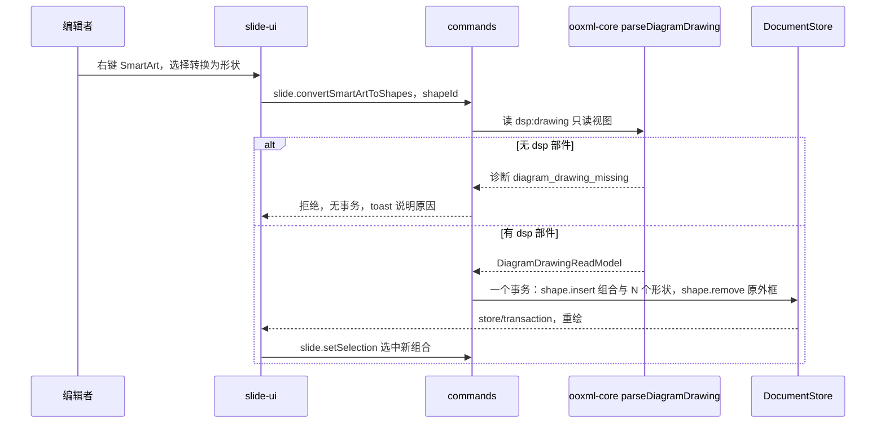

怎么读：纵向是时间；转换只读一次只读视图，所有写入都在一个事务里，因此一次撤销就能回到原 SmartArt；无 `dsp` 部件时命令直接拒绝，不产生半转换状态。
依据：rulings §4.21 q-smartart；30/05 §1；40/04 §2.3 `parseDiagramDrawing`。

## 4. 公式（OMML）

| 栏 | 设计 |
|---|---|
| ① 作用 | 理工、教学类演示里的数学公式（分式、根式、上下标、矩阵、积分）。M1–M3 保证看得见、能摆放、原样写回；M4+ 立项后可插入与编辑，并以原生 OMML 导出，使 PowerPoint 里仍能继续编辑 |
| ② OOXML 来源 | PowerPoint 的实际写法是形状级 `mc:AlternateContent`（`mc:Choice Requires="a14"`）：Choice 为 `p:sp`，其 `p:txBody/a:p` 内含 `a14:m/m:oMathPara/m:oMath`（OMML 命名空间 `http://schemas.openxmlformats.org/officeDocument/2006/math`）；Fallback 为同一形状的 `p:sp`，整段文字连公式被栅格化为 `spPr` 的 `a:blipFill`。非标准生产者偶有把 `a14:m` 或 `mc:AlternateContent` 写在段落内的情况 |
| ③ 插入入口与默认 | M1–M3 不提供。M2 起插入页签「文本」组里的「公式」按钮灰显、tooltip「暂不支持插入公式」（插入页签只有七组，证据草案里的「符号」组并入「文本」组，见 [50/19](./19-insertable-elements-overview.md)；按钮样式待 playground 样张确认）。M4+ 立项后启用：文本 › 公式 ▾（常用结构库 + 「新建公式」），点击在视口中心插入，默认字号取正文占位符级别样式，数学字体取 MathJax 字体 |
| ④ 模型 | M1–M3：`UnknownShape{transform, renderHint:'fallback-pic', xml, source:'math'}`；段落内出现的 `a14:m` 作为 Inline 不透明嵌入（30/06 §1.4 `insertEmbed({ opaque })`）。M4+ 立项草案（待 ADR）：把 Choice 分支的 `p:sp` 建模为 `Sp`，段落中的 `a14:m` 成为新的 Inline 变体 `Math{omml}`（OMML 子树以 [@cordexjs/xml](../30-architecture/adr/0019-xml-lexer-and-fidelity-tree.md) 保真树序列化后整值存储），Fallback 分支改为导出时重生成 |
| ⑤ 渲染 | M1–M3 同 §2.1：画 Fallback 分支（位图填充的 `sp`）；无 Fallback 时取 OMML 的线性文本（如 `a/b`、`x^2`）以纯文本渲染，这需要把「OMML 线性文本只读解析」加进 ADR-0008 决策 10 白名单（§12 待决 3），加入前无 Fallback 即占位 `unsupported-shape-kind`。M4+：OMML → MathML（自研，基于 `@cordexjs/xml` 保真树）→ MathJax 4 输出 SVG（惰性 chunk，按需加载），SVG 以图像上下文渲染（与 50/05 §8.5 文档内 SVG 同一口径），不内联进 DOM、不用 `foreignObject`（ADR-0021） |
| ⑥ 交互 | M1–M3 同 §2.2，锁比例；双击提示明确告诉用户「这个文本框里的其他文字也无法在此编辑」。M4+：双击进入公式子编辑态（浮层：LaTeX / 线性格式输入框 + 结构按钮 + 实时预览；`Mod+Enter` 确认、`Esc` 取消，一次确认一个撤销步） |
| ⑦ 检查器 | M1–M3 同 §2.5：类型名「公式」，说明「含公式的文本框整体为只读」；替代文本只读。M4+：增「公式」分区（字号、对齐、显示为独立行或行内） |
| ⑧ 命令 | M1–M3：通用移动、缩放、删除、层级、组合（写 `UnknownShape.transform`，导出同步分支 `xfrm`）。M4+ 新增（§4.21）：`slide.insertEquation{containerId, box?, source: {latex} \| {mathml}}`、`slide.setEquation{shapeId, source}`，Mutation 落点随模型草案定（候选：新增 `slide.math.set`，或复用 50/19 的 `slide.shape.patchKindData`） |
| ⑨ 协同 | M1–M3 同 §2.6；段落内的 opaque embed 作为一个字符位置参与合并。M4+：公式源整值 LWW，两人同时改同一公式后写者胜并给软冲突提示 |
| ⑩ 导入导出与保真 | M1 `V~`；M2 `E~` 仅变换（P1）；M4+ `E~`（P2，立项）。原样写回；缩放后 Fallback 位图随新 `xfrm` 拉伸，PowerPoint 打开时按 Choice 分支重排。M4+ 编辑后导出：Choice 写新 OMML，Fallback 由 MathJax SVG 在浏览器栅格化为 PNG 重生成（canvas 只作栅格化，ADR-0021），这是对不透明内容的新写入，须扩 ADR-0008 决策 9 白名单 |
| ⑪ 无障碍 | `role=image`；`name` = 替代文本 → OMML 线性文本（白名单扩充后）→「公式 + 序号」。M4+ 可评估 MathJax 依赖的 speech-rule-engine 生成朗读文本（2026-09-26 `npm view @mathjax/src` 显示依赖 `speech-rule-engine@5.0.0-rc.4`，为预发布版，采用前需再评） |
| ⑫ 复用 | 渲染复用 MathJax 4（`@mathjax/src` 4.1.3，Apache-2.0，2026-09-26 `npm view` 核对）。OMML↔MathML 两个方向维持自研：omml2mathml 依赖浏览器 DOM 与 XPath（iso 包不可用）；MathML→OMML 的现成实现只有 LGPL 库（按 [ADR-0049](../30-architecture/adr/0049-dependency-admission-and-license-tiers.md) 禁用）；temml、KaTeX 输出 HTML 或依赖 `foreignObject`（ADR-0021 已否）；自研基于 `@cordexjs/xml` 的保真树，不再引第二个 XML 解析器 |
| ⑬ 里程碑 | M1 查看（`V~`）；M2 P1 整体变换；M4+ 立项（P2）：插入与编辑（rulings §4.21 q-equation） |
| ⑭ 待决 | 1）MathJax 字体数据许可：`@mathjax/mathjax-newcm-font` 4.1.3 的 package.json 标 Apache-2.0，但字形源自 New Computer Modern，上游字体许可待核，按 ADR-0049 字体资产的许可口径复核；2）OMML 线性文本只读解析、Fallback 重生成两项白名单扩充；3）M4+ 模型落点（Inline `Math` 变体还是独立 shapeKind）；4）M4+ 含公式文本框里的其他文字是否随之可编辑（取决于 3） |

**图 4-1 公式的两阶段路线**

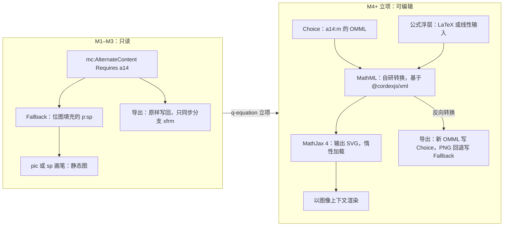

怎么读：左框是现在的全部能力——只画回退图、原样写回；右框是 M4+ 的往返：读 OMML 转 MathML 交给 MathJax 画，编辑时从输入得到 MathML，再反向转成 OMML 写回，并重生成 Fallback 位图。两个方向的转换都自研，MathJax 只负责出图。
依据：rulings §4.21 q-equation；ADR-0021；PRD OF §2.7 公式行。

## 5. OLE 对象（嵌入与链接）

| 栏 | 设计 |
|---|---|
| ① 作用 | 演示里嵌入的 Excel 表、Word 文档、Visio 图、PDF 等（或链接到外部文件的对象）。浏览器无法运行 OLE 服务器，Cordex 只显示预览图、允许摆放、导出原样写回；M4+ 允许下载嵌入的原文件或换成新文件 |
| ② OOXML 来源 | `p:graphicFrame` → `a:graphicData@uri="http://schemas.openxmlformats.org/presentationml/2006/ole"`，其内通常是 `mc:AlternateContent`：`mc:Choice Requires="v"` 为 `p:oleObj@progId@r:id@spid`（+ `p:embed` 或 `p:link`），`mc:Fallback` 为 `p:oleObj` + `p:embed` + `p:pic`（预览图，多为 EMF）。嵌入负载在 `ppt/embeddings/*`（`.xlsx`、`.docx`、`.bin` 等）；链接对象的 `r:id` 指向外部关系；`@spid` 关联旧式 VML 绘图部件中的形状 |
| ③ 插入入口与默认 | 不提供插入（PRD 02 §5 非目标，d-75）；插入页签没有「对象」按钮；从 PowerPoint 粘贴时按 PRD ED-17 落为图片，不会产生 OLE |
| ④ 模型 | `GraphicFrame{transform, graphic: Ole}`，kind `graphicFrame:ole`；`Ole{progId, embedRef, preview?: {media: MediaId; contentType}}`（40/03 §5 `shape/ole.ts`；`preview` 由 40/04 `import/ole.ts` 从 `mc:Fallback` 的 `p:pic` 提取为 `BlobRef`）。嵌入与链接的区分由 `embedRef` 所指关系的 `TargetMode` 决定，不另建字段。M4+ 替换负载需新增 Mutation（建议 `slide.ole.setPayload{shapeId, embedRef, preview?}`，新增（§4.21）） |
| ⑤ 渲染 | 同 §2.1：`graphicFrame:ole` 走 `pic` 路径画 `Ole.preview`；预览为 EMF / WMF 时 M1 占位 `emf-no-preview`，M2 起惰性栅格化（50/05 §8.4）；无预览时占位 `ole-preview-missing`，占位上显示类型图标与类型名；链接对象只画预览，链接目标永不加载（PRD OF §2.6） |
| ⑥ 交互 | 同 §2.2，锁比例；双击提示「嵌入对象暂不支持在此编辑」。M4+ 双击改为弹出小菜单：「下载原文件」「替换…」「在 PowerPoint 中编辑的说明」；链接对象的菜单只有说明项 |
| ⑦ 检查器 | 同 §2.5：类型名按 `progId` 映射；另显示「嵌入 / 链接」；替代文本可编辑；M4+ 出现「下载原文件」「替换…」 |
| ⑧ 命令 | M2：通用移动、缩放、删除、层级、组合、`slide.setAltText`。M4+ 新增（§4.21）：`slide.downloadOleObject{shapeId}`——Command、`permission: ['doc.export']`、`undoable: false`、零 Mutation（与 `core.export` 同类，只把负载字节交给浏览器下载）；`slide.replaceOleObject{shapeId, blob, preview?}`——Command，一个事务内 `media.add`（负载与可选预览）+ `slide.ole.setPayload` |
| ⑨ 协同 | 同 §2.6；M4+ 替换负载为整值 LWW，负载字节走媒体通道，Y.Doc 里只有 `BlobRef`（PRD CO-12） |
| ⑩ 导入导出与保真 | M1 `V~`；M2 `E~` 仅变换（P1）；M4+ `E~`（P2，下载与替换）。`embeddings/*` 与 VML 部件 verbatim；`p:xfrm` 按模型重写；移动缩放后是否同步 VML 锚点待语料验证（ADR-0008 决策 9 (b) 附注），验证前不改 VML；删除后按白名单 (c) 清理孤儿 `embeddings/*` |
| ⑪ 无障碍 | `role=image`；`name` = 替代文本 →「嵌入的 + 类型名」（如「嵌入的 Excel 工作表」）→「嵌入对象 + 序号」 |
| ⑫ 复用 | 维持自研：没有任何浏览器端库能激活 OLE 负载（这是 Windows COM 服务器的能力）；预览复用 `pic` 渲染与 emf-converter 栅格化（50/05 §8.4），不引新依赖 |
| ⑬ 里程碑 | M1 查看（P0，PRD M1 验收 10「OLE 必须显示 `mc:Fallback` 预览图」）；M2 P1 整体变换；M4+ P2 下载与替换 |
| ⑭ 待决 | 1）VML 锚点同步（语料验证）；2）M4+ 替换负载时预览图的来源（建议：用户可选上传预览图，否则用类型图标占位并在导出时写入该占位图）；3）下载的安全口径：以附件方式下载、文件名扩展名按 `progId` 白名单限定，细则归 [50/14](./14-client-security.md) |

**图 5-1 OLE 预览从哪里来**

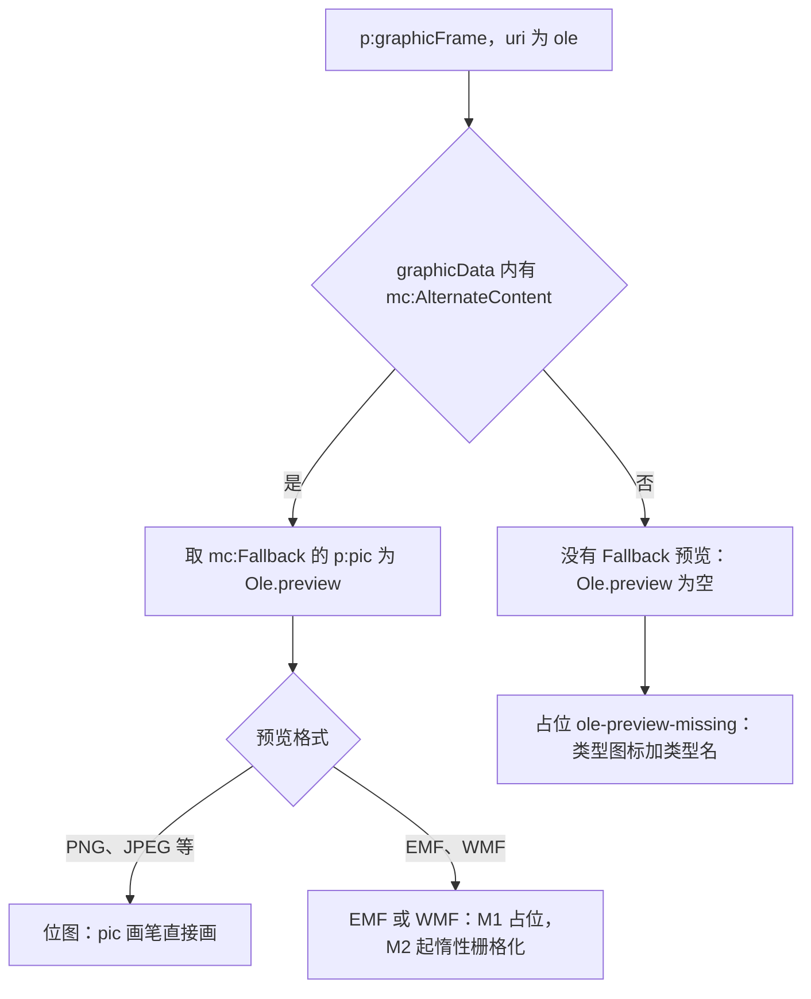

怎么读：上半部分是导入时 40/04 `import/ole.ts` 决定预览的来源（只认 `mc:Fallback` 的 `p:pic`，旧文件只在 VML 部件里带预览的情况按无预览处理），下半部分是渲染时按格式分流；无论哪条路，负载本身都不被读取或执行。
依据：40/04 §5.2 `import/ole.ts`；50/05 §8.4、§9；PRD OF §2.6 OLE 行。

## 6. 3D 模型

| 栏 | 设计 |
|---|---|
| ① 作用 | 产品展示类演示中嵌入的 3D 模型（`.glb`）。Cordex 不加载 3D 引擎，只显示文件自带的静态海报图，能摆放、原样写回 |
| ② OOXML 来源 | 形状级 `mc:AlternateContent`（`mc:Choice Requires="am3d"`）：Choice 为 `p:graphicFrame` → `a:graphicData`（Microsoft 2017 model3d 扩展）→ `am3d:model3d@r:embed`（指向 `.glb` 部件），含相机与姿态参数；Fallback 为 `p:pic`（海报图） |
| ③ 插入入口与默认 | 不提供插入（PRD 02 §5 非目标）；插入页签没有「3D 模型」按钮 |
| ④ 模型 | `UnknownShape{transform, renderHint:'fallback-pic', xml, source:'model3d'}`；无新增实体 |
| ⑤ 渲染 | 同 §2.1：画 Fallback 海报；无 Fallback 时占位 `unsupported-shape-kind`（「3D 模型」） |
| ⑥ 交互 | 同 §2.2，锁比例；没有 3D 旋转、平移视角与动画控件；双击提示见 §2.2 表 |
| ⑦ 检查器 | 同 §2.5：类型名「3D 模型（静态海报）」；替代文本只读 |
| ⑧ 命令 | 通用移动、缩放、删除、层级、组合（`UnknownShape.transform`） |
| ⑨ 协同 | 同 §2.6 |
| ⑩ 导入导出与保真 | M1 `V~`；M2 `E~` 仅变换（P1）。`.glb` 部件 verbatim；分支 `xfrm` 同步；缩放后 PowerPoint 按新外框重新投影模型，与海报拉伸可能不同 |
| ⑪ 无障碍 | `role=image`；`name` = 替代文本 →「3D 模型 + 序号」 |
| ⑫ 复用 | 不引 three.js、model-viewer 等 3D 引擎：体积与「查看为主、内部不可编辑」的定位不匹配，且渲染结果无法与 PowerPoint 的相机与光照对齐；维持「只显示海报」 |
| ⑬ 里程碑 | M1 查看；M2 P1 整体变换；之后无计划（非目标） |
| ⑭ 待决 | 无 |

## 7. 墨迹（含裸 `p:contentPart`）

| 栏 | 设计 |
|---|---|
| ① 作用 | 触屏或手写笔在 PowerPoint 里留下的手写批注、圈画、签名。要能看见、能摆放、原样写回 |
| ② OOXML 来源 | 两种写法：a）形状级 `mc:AlternateContent`（`mc:Choice Requires="p14"`）→ `p14:contentPart@r:id` → `ppt/ink/ink*.xml`（InkML），Fallback 为 `p:pic`；b）不包 AlternateContent 的裸 `p:contentPart`（`p:nvContentPartPr` + `p:xfrm`，`r:id` 同样指向 InkML 部件） |
| ③ 插入入口与默认 | M1–M3 不提供笔墨输入（PRD 02 §5 非目标）；M4+ 随触控编辑（PRD ED-27）评估「绘图」页签 |
| ④ 模型 | a）`UnknownShape{renderHint:'fallback-pic', source:'ink'}`；b）补映射为 `UnknownShape{transform: 取 p:xfrm, renderHint:'placeholder', source:'contentPart'}`（d-76，30/04 §4.2 与 40/04 `shape-tree.ts` 待补这一行，§12 待决 4） |
| ⑤ 渲染 | a）画 Fallback 位图；b）无回退，占位 `unsupported-shape-kind`（「墨迹」）。M1–M3 不解析 InkML |
| ⑥ 交互 | 同 §2.2，锁比例 |
| ⑦ 检查器 | 同 §2.5：类型名「墨迹」；替代文本只读 |
| ⑧ 命令 | 通用移动、缩放、删除、层级、组合 |
| ⑨ 协同 | 同 §2.6 |
| ⑩ 导入导出与保真 | M1 `V~`（写法 b 为 `P` + 占位）；M2 `E~` 仅变换（P1）。InkML 部件 verbatim；写法 a 同步分支 `xfrm`；写法 b 移动缩放要改写裸 `p:contentPart` 的 `p:xfrm`，不在现行白名单 (b)「AlternateContent 分支 `xfrm` 同步」的字面范围内，建议 ADR-0008 修订时把 (b) 扩到裸 `p:contentPart`，扩充前写法 b 只允许删除 |
| ⑪ 无障碍 | `role=image`；`name` = 替代文本（写法 a 只读展示）→「墨迹 + 序号」 |
| ⑫ 复用 | M1–M3 无第三方。M4+ 若做笔墨输入，笔迹轮廓复用 perfect-freehand（1.2.3，MIT，2026-09-26 `npm view` 核对） |
| ⑬ 里程碑 | M1 查看；M2 P1 整体变换（写法 b 待白名单扩充）；M4+ 评估笔墨输入 |
| ⑭ 待决 | M4+ 笔墨输入的存储格式：写 InkML + Fallback 位图（与 PowerPoint 一致、要新写不透明内容）还是转为 `custGeom` 形状（可编辑、但 PowerPoint 里不再是墨迹） |

**图 7-1 墨迹的两种写法与各自的能力**

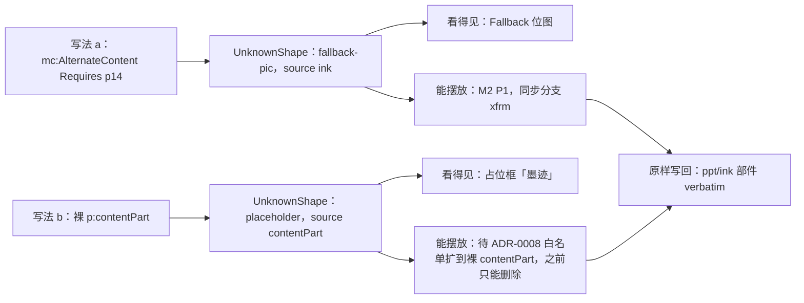

怎么读：上下两行分别是两种写法从导入到交互的路径，差别只在「有没有回退图」和「移动缩放是否已在白名单内」；两者导出时 InkML 部件都原样写回。
依据：rulings §4.21 d-76；ADR-0008 决策 9 (b)；PRD OF §2.5 墨迹行。

## 8. 缩放定位（幻灯片缩放、节缩放、摘要缩放）

| 栏 | 设计 |
|---|---|
| ① 作用 | 目录式的非线性导航：放映时点一张缩略图跳到对应页或节，讲完再回到目录页。导入后要看得见（缩略图）、能摆放、原样写回 |
| ② OOXML 来源 | 形状级 `mc:AlternateContent`（`mc:Choice Requires` 为 `pslz`、`psez` 等缩放扩展前缀）：Choice 为 `p:graphicFrame`，内含 `pslz:sldZm` 或 `psez:sectionZm`；Fallback 为 `p:pic`（静态缩略图）+ `a:hlinkClick@action="ppaction://hlinksldjump"`（指向目标页的关系） |
| ③ 插入入口与默认 | 不提供插入（PRD 02 §5 非目标） |
| ④ 模型 | `UnknownShape{transform, renderHint:'fallback-pic', xml, source:'zoom'}`。放映跳转需要的目标页不建模字段，建议作为只读派生值：导入时由 40/04 读 Fallback 的 `hlinkClick` 目标，解析为 `SlideId` 挂在只读视图上（不进 Snapshot）；这要把「Fallback `hlinkClick` 只读解析」加进 ADR-0008 决策 10 白名单（§12 待决 3） |
| ⑤ 渲染 | 画 Fallback 缩略图（静态：目标页改了不更新）；无 Fallback 占位 |
| ⑥ 交互 | 编辑态同 §2.2，锁比例，双击提示见 §2.2 表。放映态（建议，随白名单扩充 M2 P1）：点击按 PRD ED-19「本文稿中的页」超链接规则跳到目标页；不实现 PowerPoint 的缩放动画与「返回缩放页」；目标页已删除或隐藏时点击无动作 |
| ⑦ 检查器 | 同 §2.5：类型名「缩放定位」，说明「缩略图不会自动更新」；替代文本只读 |
| ⑧ 命令 | 编辑态：通用移动、缩放、删除、层级、组合。放映跳转是 Operation `slide.setCurrentSlide`（40/03 §2.6 既有），不入历史 |
| ⑨ 协同 | 同 §2.6；放映中的跳转不产生任何写入 |
| ⑩ 导入导出与保真 | M1 `V~`；M2 `E~` 仅变换（P1）。原样写回；目标页被删除时 Fallback 的 `hlinkClick` 关系原样保留（Relationship 全保留，ADR-0008 决策 5），PowerPoint 打开时自行处理失效目标 |
| ⑪ 无障碍 | 编辑态 `role=image`；放映态建议 `role=link`（待 50/05 §11 补取值，§12 待决 6）；`name` = 替代文本 →「缩放定位：第 N 页」（目标页已解析时）→「缩放定位 + 序号」 |
| ⑫ 复用 | 无（没有可复用的实现，跳转复用放映既有的页内超链接路径） |
| ⑬ 里程碑 | M1 查看；M2 P1 整体变换；放映跳转随 ADR-0008 修订（建议 M2 P1，与 PRD ED-21「超链接与动作可点击」同批） |
| ⑭ 待决 | 放映点击是否跳转（本节建议跳转、不做返回）；节缩放的目标是「节的第一页」还是按节范围放映（建议只跳到节首页） |

**图 8-1 放映中点击缩放定位（建议）**

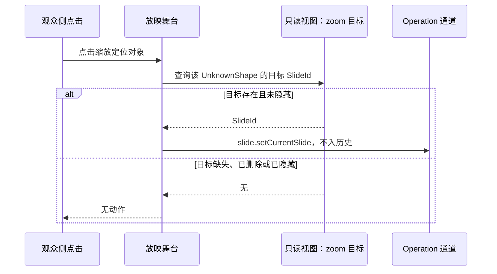

怎么读：纵向是时间；跳转只走 Operation，不写文档；目标从 Fallback 的 `hlinkClick` 只读得来，所以要等 ADR-0008 决策 10 把它列入白名单后才能实现。
依据：PRD ED-19、ED-21；40/03 §2.6 Operation 行；ADR-0008 决策 10。

## 9. ActiveX、VML、未知 graphicData 与其它不透明内容

这一节把「不认识但必须零丢失」的其余内容放在一起。它们按是否是形状分两类：页级的不透明数据（不进 shapes 表、不可选中）与形状级的未知对象（进 shapes 表、可选中摆放）。

| 子类 | OOXML | 模型 | 看得见 | 能摆放 | 原样写回 |
|---|---|---|---|---|---|
| ActiveX 控件 | 页级 `p:controls`（`p:control@spid@r:id` → `ppt/activeX/*`，新文件另包 AlternateContent 与 `p:pic` 回退） | 页级 `OpaqueXml`（30/04 §4.2） | 不渲染（`P`） | 否（不是形状） | 整段 verbatim |
| VML 旧式绘图 | `ppt/drawings/vmlDrawing*.vml`，由 OLE、ActiveX 的 `spid` 引用 | 不透明部件 `OpaquePartRef` | 不单独渲染；其图像体现在引用它的 OLE 预览上 | 否 | 部件 verbatim |
| 页级自定义数据 | `p:custDataLst` | 页级 `OpaqueXml` | 否 | 否 | verbatim |
| 未知 graphicData | `p:graphicFrame` 内未识别 `uri` 的 `a:graphicData`（不在 AlternateContent 内） | `GraphicFrame{graphic: UnknownGraphic}`（30/04 §4.3） | 占位 `unsupported-shape-kind` | 是：`p:xfrm` 是建模字段，不需白名单；里程碑按 PRD OF 备注 A（删除 M1 P0、移动缩放 M2 P1） | graphicData verbatim |
| 未知 AlternateContent | Choice 全不受支持的 `mc:AlternateContent` | `UnknownShape{source:'other'}` | 有 Fallback 画 Fallback（`V~`），否则占位 | 是（M2 P1，同步分支 `xfrm`） | verbatim + 分支 `xfrm` |
| 第三方 kind 无渲染器 | 插件新增的 `ext:<vendor>.<name>` 在插件缺席时 | 原 kind 保留 | 查表未命中占位（50/05 §9） | 是 | 由该 kind 的 `toXml?` 或退化为 `OpaqueXml`（30/04 §3.3） |

形状级子类（后三行）的 14 栏：

| 栏 | 设计 |
|---|---|
| ① 作用 | 不认识的内容也零丢失：文件来自更新的 Office 或第三方加载项时，用户仍能看到「这里有东西」、能挪开或删掉它，导出后 PowerPoint 里照旧 |
| ② OOXML 来源 | 见上表 |
| ③ 插入入口与默认 | 无 |
| ④ 模型 | 见上表；无新增字段（`UnknownShape.source` 取 `'other'`） |
| ⑤ 渲染 | 同 §2.1：有 Fallback 图片画图片，否则占位；占位上写「此对象暂不支持显示，已原样保留」 |
| ⑥ 交互 | 同 §2.2；未知对象自由缩放 |
| ⑦ 检查器 | 同 §2.5：类型名「未知对象」，说明附 `uri` 或 `Requires` 前缀（供诊断复制）；未知 graphicData 的替代文本可编辑，未知 AlternateContent 只读 |
| ⑧ 命令 | 通用移动、缩放、删除、层级、组合 |
| ⑨ 协同 | 同 §2.6 |
| ⑩ 导入导出与保真 | `P`，有回退时 `V~`；原样写回；页级子类在所在页被删除时随页部件一起移除 |
| ⑪ 无障碍 | `role=image`；`name` = 替代文本 → 占位文字 |
| ⑫ 复用 | 无（本质是「不解析」） |
| ⑬ 里程碑 | M1 保留与占位（删除 P0）；M2 P1 整体移动缩放（PRD OF 备注 A） |
| ⑭ 待决 | 无 |

## 10. 后续路线

| 元素 | M1 | M2 | M3 | M4+ | 依据 |
|---|---|---|---|---|---|
| SmartArt | 渲染 `dsp:drawing`（P0） | 整体变换（P1） | — | 「转换为形状」（P2）；节点文字编辑再评估 | q-smartart |
| 公式 | Fallback 查看 | 整体变换（P1）；「文本」组公式按钮灰显 | — | 立项：OMML↔MathML + MathJax 4 SVG，插入与编辑（P2） | q-equation |
| OLE | 预览（P0） | 整体变换（P1）；EMF 预览栅格化 | — | 下载原文件、替换负载（P2） | PRD OF §2.6 |
| 3D 模型 | 海报查看 | 整体变换（P1） | — | 无（非目标） | d-75 |
| 墨迹 | Fallback 查看；裸 contentPart 占位 | 整体变换（P1，裸 contentPart 待白名单） | — | 随 ED-27 评估笔墨输入 | d-76 |
| 缩放定位 | 缩略图查看 | 整体变换（P1）；放映跳转（建议 P1，待白名单） | — | — | ADR-0008 决策 10 |
| 未知对象 | 保留与占位 | 整体变换（P1） | — | — | PRD OF 备注 A |

**图 10-1 本族能力随里程碑的演进**

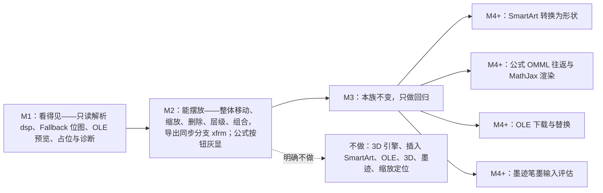

怎么读：主干从左到右是「看得见」「能摆放」两个统一口径依次兑现，M3 本族没有新能力；M4+ 分成四条互相独立的路线，各自立项、各自排期；虚线指向的是 PRD 02 §5 的非目标，任何里程碑都不做。
依据：本文 §3–§9；rulings §4.21 q-smartart、q-equation、d-75、d-76。

## 11. 命令与 Mutation 汇总（本族）

按 30/05 §1 三分法。「既有」指 40/03 §2.6 已登记；「新增（50/19）」指通用新增、由 50/19 与 ADR-0018 统一登记，本族只是使用方；「新增（§4.21）」是本文提出的 M4+ 远期草案——与 50/19 的「远期（M4+）」清单一致，本轮不登记进 40/03，各自立项时随 ADR 登记。

| 类别 | id | 参数 | 事务与撤销 | 涉及 Mutation | 里程碑 | 来源 |
|---|---|---|---|---|---|---|
| Command | `slide.moveShapes` / `resizeShapes` | `{shapeIds; …}` | 一个事务、一步撤销 | `shape.setTransform` | M2 P1 | 既有 |
| Command | `slide.deleteShapes` | `{shapeIds}` | 一个事务；墓碑 | `shape.remove` | M1 P0（模型）/ M2（UI） | 既有 |
| Command | `slide.bringForward` / `sendBackward`、`slide.group` / `ungroup` | 同 40/03 | 一个事务 | `shape.setOrder`、`shape.group` / `.ungroup` | M2 P0 | 既有 |
| Command | `slide.duplicateShapes`、`slide.pasteShapes` | 同 40/03 | 一个事务 | `shape.insert`×N | M2（跨页受 §2.3 限制） | 既有 |
| Command | `slide.setAltText` | `{shapeId; description?; title?; decorative?}` | 一个事务 | `slide.shape.setNonVisual`（新增） | M2 P1（仅 graphicFrame 系） | 新增（50/19） |
| Command | `slide.convertSmartArtToShapes` | `{shapeId}` | 一个事务、一步撤销；无 `dsp` 时拒绝、无事务 | `shape.insert`×(N+1)、`shape.remove` | M4+ P2 | 新增（§4.21） |
| Command | `slide.insertEquation` / `slide.setEquation` | `{containerId; box?; source}` / `{shapeId; source}` | 一个事务 | 待 ADR（候选 `slide.math.set` 或 `slide.shape.patchKindData`） | M4+ P2 立项 | 新增（§4.21） |
| Command | `slide.downloadOleObject` | `{shapeId}` | `undoable: false`，零 Mutation；`permission: ['doc.export']` | 无 | M4+ P2 | 新增（§4.21） |
| Command | `slide.replaceOleObject` | `{shapeId; blob; preview?}` | 一个事务 | `media.add`、`slide.ole.setPayload`（新增） | M4+ P2 | 新增（§4.21） |
| Operation | `slide.setSelection`、`slide.setCurrentSlide` | 同 40/03 | 不入历史 | 无 | M2 | 既有 |

逆操作全部由 Store 推导（ADR-0007），本表无一手写逆操作；新增实体的命令（转换为形状、插入公式）经命令层规模守卫，超限返回 `document.quota_exceeded`、不产生事务（40/03 §2.6 图 2-4）。

## 12. 待决与回写

| # | 事项 | 本文默认口径 | 需要谁回写 |
|---|---|---|---|
| 1 | 复制副本的 id 与关系重映射（§2.3） | 建议 ADR-0008 决策 9 增 (d)「副本的 id 与关系重映射」，SmartArt 按部件复制；登记前同页复制可用，跨页与跨文档粘贴本族对象时拒绝并提示 | ADR-0008；40/04 `export/shape-tree.ts` 与 `OoxmlIdMap` |
| 2 | 裸 `p:contentPart` 的移动缩放（§7） | 建议把决策 9 (b) 扩到裸 `p:contentPart` 的 `p:xfrm`；扩充前只能删除 | ADR-0008 |
| 3 | 只读解析白名单扩充（§3、§4、§8） | 决策 10 增：OMML 线性文本（公式的可访问名称与无回退时的纯文本）、缩放定位 Fallback 的 `hlinkClick`（放映跳转）；并注明 SmartArt「转换为形状」是一次性物化、原对象同时删除，不构成第二份可编辑模型 | ADR-0008 |
| 4 | 模型字段（§2.4、§7） | 30/04 §4.2 补「裸 `p:contentPart` → `UnknownShape`」一行（d-76）；`UnknownShape` 增 `source: OpaqueSource`（新增（§4.21）） | 30/04、40/03 §5、40/04 `import/shape-tree.ts` |
| 5 | `renderHint` 取值不一致（§2.4） | 以 40/03 §5 的 `'fallback-pic' \| 'fallback-shapes' \| 'placeholder'` 为准，chartex 用 `'placeholder'` + `source:'chartex'` 表达 | 40/04 §5.2（已回写，2026-09-26 整合） |
| 6 | 可访问角色 `link`（§2.7、§8） | `A11yDescriptor.role` 增 `link`，只在放映态用于可点击的缩放定位与带动作的对象 | 50/05 §11 |
| 7 | 远期命令（§11） | `slide.convertSmartArtToShapes`、`slide.insertEquation`、`slide.setEquation`、`slide.downloadOleObject`、`slide.replaceOleObject` 与 Mutation `slide.ole.setPayload` 本轮不登记（与 50/19 远期清单一致）；`slide.setEquation` 与 `slide.ole.setPayload` 两项是本文在该清单外补充的，请 50/19 的远期清单补列 | 50/19；各自立项时 40/03 §2.6 与 ADR |
| 8 | 检查器 `degraded` 分区（§2.5） | 增「对象说明」「替代文本」「后续动作（M4+）」三块，迷你工具条 `toolbar.degraded` 只放「查看保真详情」 | 50/10 §5 |
| 9 | MathJax 字体数据许可（§4） | M4+ 立项前核对 New Computer Modern 上游许可，按字体资产口径登记 | [50/17](./17-reuse-and-dependency-catalog.md)；ADR-0049 |
| 10 | 双击提示与类型名文案（§2.2、§2.5） | 命名空间与最终文案归 50/16，本文表格为草稿 | 50/16；设计 03-13 |

## 13. 机械验证

| 验证 | 断言 | 所属检查 |
|---|---|---|
| 零编辑往返 | 含本族全部 7 类对象的语料（T1 保留专项，每类 ≥ 3 个文件）部件级 diff 零差异 | `fidelity:roundtrip`（PRD M1 验收 1、10） |
| 移动缩放后导出 | 规范化 diff 只落在 graphicFrame 的 `p:xfrm` 或各分支的 `xfrm`；其余字节不变；PowerPoint 打开无修复 | `fidelity:edit-roundtrip`（PRD M2 验收 2） |
| 删除后导出 | 节点整体移除；`p:timing` 引用清理；孤儿 `embeddings/*`、`ppt/diagrams/*`、`ppt/ink/*` 被移除且内容类型同步 | `fidelity:edit-roundtrip` |
| SmartArt 渲染 | 有 `dsp` 的语料 SSIM ≥ 0.85；无 `dsp` 显示占位并发 `smartart-no-dsp` | `fidelity:visual`、`fidelity:objects` |
| 交互 | 双击与 Enter 只弹提示、不进子编辑态；无旋转手柄；拖动一次一个撤销步 | `e2e`（PRD M2 验收 1，用例元数据含 ED-01、ED-05） |
| 非目标 | 插入页签、形状库、空占位符图标条中不存在 SmartArt、OLE、3D、墨迹、缩放定位、录屏入口（`ribbon-spec.test.ts` 断言） | `test` |
| 可访问性 | 可访问树中本族对象的 `role` 与 `name` 符合 §2.7 与各节 ⑪ 栏 | `e2e` a11y 子集（50/16 §11.2） |
