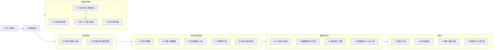

# 50 前端架构与设计：定位、边界与导航

> 状态：v0.1 | 负责：前端设计线 | 更新：2026-09-25；2026-09-25（§4.19）；2026-09-25（§4.19 N1）：§8.1 补 N1 行，§8.3 删去已裁决的「覆盖导入与版本恢复是否锁定」开放行；2026-09-26（§4.20）：§8.2 TT 行按 FE-18 修订，§8.3 两行结案，新增 §8.4；2026-09-26（§4.21：定位改为「前端架构与设计」，01 升格为前端架构，新增 17 复用清单、18 能力总表、19–25 元素目录，§5 与 §8.1–§8.4 标为历史，新增 §8.5）；2026-09-26（§4.21 整合：§4 文件索引把 20–25 拆成逐篇行，登记 20、21、22 的入口与一句话定位）；2026-09-26（§4.21 Remap：原 30/08 引用按 60-backend/README §6.1 改指新位置，30/08 已删除）；2026-09-30（§4.22：口径链改为 §4.11–§4.22）；2026-10-03（§4.24 设计线对齐审计：口径链补到 §4.11–§4.24；§8 新增 §8.6 §4.22、§8.7 §4.23、§8.8 §4.24 三个落点小节，§9 补三行变更）；2026-10-04（design-language-v3 第 0 批：口径链补到 §4.25；§1、§3 的 09、10、16 行按 v3 改写（平面层次、单页 / 网格视图、底部工具条、检查器分区、焦点环例外）；§4 文件索引 09、10、16 行同步；§7 术语「槽位」「壳意图」按 v3 改写，新增「单页 / 网格视图」「创建工具条」「检查器分区」；§8 新增 §8.9 §4.25 落点；§9 补变更行）；2026-10-04（design-language-v3 第 0 批：术语残留清理：ribbon / 状态栏 / `ui.ribbon` / `ui.statusBar` 的历史陈述改用 check-terms 认可的标记措辞（废弃、作废、取代、原名））；2026-10-04（design-language-v3 第 0 批：复验修正——原「状态胶囊」改称文件名旁的同步状态行（rulings §4.25 DS-6），带作废标记的历史陈述统一措辞；§8.9 「待他线登记」行按现状改为已收口，只留第 1 批事项；术语表的单页 / 网格视图与创建工具条引用章程 §4.6，注明「评论」随评论包出现、「更多」由 slide-ui 贡献；§8.3 把误并成一行的两条表格行拆开（U-07 与「40/18 §10 原列分歧」））；2026-10-04（design-language-v3 第 0 批：复验第 2 轮修正——「他线登记」行的剩余范围改为与 50/10 §12.3 一致：50/23–25 第 ③ 栏已改写，50/18「入口」列、50/19 总表与 50/20–22 第 ③ 栏当时留待批次定稿后改写（2026-10-07 定稿））；2026-10-05（design-language-v3 第 0 批修正：§8.9 引言补 DS-9…DS-20，表中新增 DS-9、DS-10 与 DS-12、DS-11 与 DS-16、外壳类细化四行的前端落点（外壳类逐项见 10 §12.3）；§8.6 §4.22 落点表「D-15、D-19…D-25 等」一行注明「插入到占位符」组已按 DS-14 取消）；2026-10-07（design-language-v3 第 1 批：§3 的 02、09、10、16 行与 §4 文件索引的 10、16 行按第 1 批改写（`view` 查询参数、`--layer-panel`、顶层单项槽位 `mainMenu` 与横幅置顶位槽位 `banner`、紧凑与仅查看形态、评审条 / 浏览条、面板拖宽与按文档记忆）；§7 术语「壳意图」「槽位」「单页 / 网格视图」「创建工具条」「检查器分区」同步，新增「评审条 / 浏览条」「紧凑形态 / 仅查看形态」；§8.6 SF-14 一行注明材质与迷你工具条已作废；§8 引言与 §8.9 引言补 DS-21…DS-30 与 TB-1…TB-30，DS-8、DS-9、DS-11、外壳类细化与他线登记行更新，新增第 1 批落点行；§9 补变更行）；2026-10-08（design-language-v3 第 1 批收口：§3 的 02 行补 `/styleguide` 只在测试部署注册（rulings §4.25 TB-50）；§7 术语「创建工具条」补「选择」由垂直束贡献（TB-38）、「紧凑形态 / 仅查看形态」补平板仍只读评审（TB-49）；§8 引言与 §8.9 引言补 DS-31…DS-33 与 TB-31…TB-52，§8.9 新增其前端落点行，DS-11、TB-3 行同步链接命名（TB-6）与 `/styleguide` 提供方式（TB-50），两条「他线登记」行的待回写项改为已回写；§9 补变更行）；2026-10-08（design-language-v3 第 1 批评审修改：§3 的 09 行补控件语义 token；§8.9 引言补 DS-34…DS-37 与 TB-55…TB-58，DS-9、DS-31 两行加修订注记（DS-35 修订控件边界、DS-34 修订样式库弹层），新增 DS-34、DS-35、DS-36 / DS-37、TB-55…TB-58 四行前端落点；§9 补变更行）；2026-10-15（design-language-v3 第 2 批：§8.9 引言补 DS-38…DS-63，DS-28、TB-31 两行加修订注记，新增 DS-38…DS-63 前端落点与第 2 批他线待登记行；§9 补变更行）；2026-10-15（design-language-v3 第 2 批：§8.9 引言补 DS-64…DS-68 与 TB-59…TB-75，新增其前端落点行，第 2 批他线待登记行核对已登记项并新增 DS-64…DS-68 他线行；§9 补变更行；同日再补：§8.9 引言补 DS-69、DS-70 与 TB-76…TB-86，新增 DS-69 / TB-86、DS-70、TB-76、TB-77 / TB-78、TB-79 / TB-84、TB-80、TB-81…TB-83、TB-85 八行落点，TB-65 一行注明被 DS-69 修订，第 2 批与 DS-64…DS-68 两条他线行按现状核对为已登记（后者留 TB-85 的几项仍待），新增 DS-69、DS-70 与 TB-76…TB-86 他线待登记行；§9 补变更行）；2026-10-15（design-language-v3 第 2 批：§8.9 引言补 TB-87…TB-95，新增 TB-87 / TB-88 / TB-92、TB-89、TB-90、TB-91、TB-93 / TB-94、TB-95 六行落点；DS-64…DS-68 他线行留下的 TB-85 几项与 DS-69、DS-70、TB-76…TB-86 他线行的待登记项按现状核对为已登记，新增 TB-87…TB-95 他线待登记行；§9 补变更行）；同日再补：§8.9 增 TB-96…TB-100 三行与他线登记一行，TB-87…TB-95 的他线登记核对为已登记；2026-10-22（design-language-v3 第 3 批：§7「壳意图」一行的导出键改 `Mod+Shift+E`；§8.9 引言补第 3 批（DS-71…DS-136、TB-101…TB-129），TB-55…TB-58、DS-38、DS-42、「TB-67、TB-74、TB-75」、TB-80 五行补结案说明，新增第 3 批十三行落点与他线登记一行；§9 补变更行）；2026-10-22（design-language-v3 第 3 批回写补充：§8.9 引言补 DS-137、DS-138、TB-130…TB-151，新增五行落点，「他线登记（第 3 批）」一行改为原先报请总编排定的三项已定（TB-145、TB-146、TB-148）；§9 加一行变更记录）；2026-10-22（design-language-v3 第 3 批回写收口：§7「壳意图」一行补五个无参 Operation（TB-162）；§8.9 引言补 TB-152…TB-162，新增两行落点，「他线登记（第 3 批）」一行补模板源已定（TB-160）与同批核对为已登记的几项；§9 加一行变更记录；2026-10-22 复核修正：§8.9 引言补 DS-139 与 TB-163…TB-169、去掉回写轮次字样，DS-137…DS-139 一行补 DS-139，TB-136…TB-140 一行注明 TB-163 改定子句次序，新增 TB-163…TB-169 一行，「他线登记（第 3 批）」一行补其他线落点；§9 最后一行补复核修正；§8.9 的 DS-8、TB-42、TB-44、「DS-62、DS-63」、TB-81…TB-83 五行补结案或细化说明（DS-75、DS-116、TB-126、TB-136、TB-163），「他线登记（2026-10-04 复验已收口）」一行去掉轮次字样；§8.9 引言补 TB-170…TB-174，新增 TB-170…TB-174 一行，DS-99…DS-105 一行补查看者的导出原因，「他线登记（第 3 批）」一行补 TB-170…TB-174 的他线落点；§9 最后一行同步；§8.9 引言与 TB-170 一行扩到 TB-175 并补 TB-171…TB-173 的补句，「他线登记（第 3 批）」一行补其他线落点，§9 最后一行同步；§8.9 引言与 TB-170 一行扩到 TB-178（TB-172、TB-174、TB-175 的补句，TB-176…TB-178），「他线登记（第 3 批）」一行改正 40/11 组件级用例的落点并补 TB-176…TB-178 的他线落点，§9 最后一行同步）；2026-10-23（design-language-v3 第 3 批评审修改：§8.9 引言补 DS-140…DS-143、TB-179…TB-183，新增 DS-140…DS-143、TB-179…TB-183 与「他线登记（第 3 批评审修改）」三行，DS-94…DS-98、TB-121…TB-129、TB-130…TB-135、TB-163…TB-169 四行给被取代的 DS-97、DS-98 与被修订的 TB-129、TB-133、TB-167 加去向注记；§9 新增一行）；2026-11-04（design-language-v3 母版视图改版：§4 文件索引 11 一行；§7 术语「创建工具条」补母版视图的主行；§8.9 引言补 DS-144…DS-177、TB-186…TB-210，新增 DS-144…DS-177、TB-186…TB-210 与「他线登记（母版视图改版）」三行；§9 新增一行；需求编号、优先级与里程碑不变；rulings §4.25 DS-144…DS-177、TB-186…TB-210） | 依赖：[docs/README.md](../README.md)、[charter v0.2](../00-charter/charter.md) §5、§7–§9、[rulings](../00-charter/rulings-2026-09-14.md) §4.11–§4.25、[30-architecture/README.md](../30-architecture/README.md)、[30/01 总架构](../30-architecture/01-overview.md)、[40-modules/README.md](../40-modules/README.md)、[40/18 图集](../40-modules/18-atlas-system-and-frontend.md)；rulings §4.25 DS-71…DS-136、TB-101…TB-129；第 3 批 playground `src/v3/scenarios/`；rulings §4.25 DS-137、DS-138、TB-130…TB-151（第 3 批回写补充）；rulings §4.25 TB-152…TB-162（第 3 批回写收口）；rulings §4.25 DS-139、TB-163…TB-169、TB-170…TB-178；rulings §4.25 DS-140…DS-143、TB-179…TB-183（第 3 批评审修改）；rulings §4.25 DS-144…DS-177、TB-186…TB-210（母版视图改版）

本目录是 Cordex 的**前端架构与设计**，也是**浏览器内一切运行时设计的唯一事实源**。架构分三份（rulings §4.21 q-arch-reorg 方案 B）：[30/01](../30-architecture/01-overview.md) 是全仓唯一的总架构，[01](01-overview-and-runtime-map.md) 是前端架构，[60/01](../60-backend/01-service-overview-and-roles.md) 是后端架构，阅读路径固定为 **30/01 → 50/01 → 60/01**。本目录内：**01 = 前端架构**；**02–16 = 专题设计**；**17 = 前端复用组件清单**；**18 = 编辑器能力实现总表**；**19–25 = 可追加元素目录**（19 总览与通用设计，20–25 按元素族分篇）。它回答「浏览器里的代码怎样工作」：页面与会话怎样流转、preset 怎样装配、命令与撤销在界面上怎样表现、画布怎样渲染与输入、协同客户端怎样连接与恢复、界面体系怎样组织、查看器与 `/render` 页怎样只读工作、复用了哪些成熟组件、编辑器每项能力怎样实现、能追加哪些元素以及每个元素怎样设计，以及性能、安全、事件、国际化与可访问性怎样落地。三线（50 前端 / 60 后端 / 70 测试）的总边界表见 [docs/README.md](../README.md)（由总编排维护），本文不复制全表。

## 1. 定位

**本线负责的范围**：前端架构（执行上下文、技术栈与复用组件、层带分布、铁律、渲染架构、端到端主干、能力地图、元素族一览）、应用壳（apps/web 的路由、会话、页面状态、浏览器存储）、preset 装配与前端插件模型、客户端文档模型的浏览器用法与命令 / 撤销的界面表达、渲染与缩略图、文本编辑与 IME、协同客户端、评论与版本历史的客户端部分、UI 组件体系与主题、编辑器外壳与画布交互、母版 / 版式 / 主题、查看器与嵌入形态、`/render` 页的前端部分、前端性能预算与分包、客户端安全、客户端事件 / 错误 / 遥测、国际化与可访问性，以及前端复用组件清单、编辑器能力实现总表与可追加元素的逐项设计（rulings §4.21 用户诉求 1、3）。

**本线不负责的范围**：

| 内容 | 归属 | 本线怎样使用 |
|---|---|---|
| 总架构（C4、跨端统一原则、跨端技术栈总表、M1–M4 里程碑边界表） | [30/01](../30-architecture/01-overview.md) | 01 只写前端架构，里程碑只做前端交付落点 |
| iso 契约本体（DocumentStore、StoreOp、中性撤销、SceneProvider、TextMeasurer、RenderTarget、OfflineStore 的签名） | [30-architecture](../30-architecture/README.md) 04 / 05 / 07（渲染跨端契约）/ 06 §18.6 与 [40/02](../40-modules/02-kernel-protocol-and-document-core.md) | 只写浏览器侧的用法与行为约束 |
| WS 帧、CONTROL、ack、关闭码的定义（ADR-0039 起为 Hocuspocus 帧 + Stateless 载荷） | [30/06 §6](../30-architecture/06-collaboration.md)、[ADR-0039](../30-architecture/adr/0039-collab-server-hocuspocus.md) | 07 只写客户端对它们的处理 |
| 依赖准入与许可分级；模型补全与插入命令族；XML 词法与保真树；图表路线 | [ADR-0049](../30-architecture/adr/0049-dependency-admission-and-license-tiers.md)、[ADR-0018](../30-architecture/adr/0018-editor-element-model-and-insert-commands.md)、[ADR-0019](../30-architecture/adr/0019-xml-lexer-and-fidelity-tree.md)、[ADR-0036](../30-architecture/adr/0036-chart-rendering-and-editing.md) | 17–25 引用决策、写浏览器侧设计 |
| renderer sidecar 进程、RPC、池与编排；Nest 模块；数据表、Valkey 键、对象键 | [60-backend](../60-backend/README.md)（06、03–07、08–14） | 只画服务端「接触面」 |
| 测试层级、套件目录、CI 步骤、阈值判定 | [70-testing](../70-testing/README.md) | 每份文档末「机械验证」只写断言并注明 70 的套件或步骤名 |
| 包与文件级落点（目录树、逐文件职责、测试文件清单） | [40-modules](../40-modules/README.md) | 本线写设计，40 写「放在哪个文件」 |
| 交互外观与视觉（线框、token 取值、层次观感；2026-10-04 起现行设计语言为 v3 中性平面，rulings §4.25 DS-2） | [20-design](../20-design/README.md) 与 playground（v3 样张 `src/v3/`） | 本线写行为语义与状态机 |

## 2. 口径链与分界

权威顺序（前者覆盖后者）：**rulings**（§4.11–§4.25，后节覆盖前节）> **charter** > **已接受 ADR** > **30-architecture 正文**（总架构、跨端原则、协议语义、iso 契约）> **50 / 60 / 70**（各管一侧，互不覆盖）> **40-modules**（包 / 文件级）> **PRD / 设计既定口径**。

两条分界线：

- 交互外观与视觉以 20-design + playground 为准；**行为语义与状态机以本线为准**。二者冲突时，外观问题改本线，行为问题改设计稿（经总编排）。
- 验收阈值与检查名的定义以 PRD 为准；**测试如何执行以 70 为准**；本线只写「要断言什么」。

**图 R-1 前端设计线与其它目录的事实源与引用方向**

怎么读：带「定口径」的边表示上游为本线定下不可推翻的约束；50 与 60 之间是无向边，表示两线互相引用对方的定义（例如本线引用 60 的请求头名与 REST 路由，60 引用本线的 CSP 模板正文与 `/render` ready 判据），但谁也不改写对方；40 只承接本线设计的文件落点；70 对两线的设计做测试。
依据：rulings §4.19（三条设计线各为该侧唯一事实源，30 保留跨端原则与 ADR，40 保留包 / 文件级规划）、§4.21（30 只留总架构，50/01、60/01 就地升格为前端架构与后端架构）；docs/README.md 三线总边界表。

## 3. 本线拥有 / 本线引用

**本线拥有**（本线文件是唯一事实源，其它文档引用时只写摘要 + 链接）：

| 主题 | 事实源 |
|---|---|
| **前端架构**：五类执行上下文、技术栈与复用组件摘要、层带分布、前端铁律、运行时对象关系、渲染架构（render-dom、slide-render、ElementRenderer 注册与降级，承接原 30/07 §3–§4）、四条端到端主干、编辑器能力地图、可追加元素族一览、可观察状态、对外接触面、前端里程碑交付落点 | [01](01-overview-and-runtime-map.md) |
| 路由表（含深链 `/documents/:id?page=&comment=&view=`、只在测试部署注册的 `/styleguide`）、布局与守卫、RuntimeConfig 形状（含部署环境 `env`）、浏览器会话状态机、重新登录弹窗与 BroadcastChannel、401 / 网络错误分流、分享链接落地、浏览器存储键空间与登出清理矩阵、版本漂移处理 | [02](02-app-shell-routing-and-session.md) |
| preset 派生链、装配运行时语义、条目缺席的用户可见结果、惰性边界、root ctx 与 UnitScope 服务分布、前端贡献点、第三方 UI 插件前端合同（插件按钮挂底部工具条「更多」与检查器分区，异常走插件横幅）、评论插件装配位置（`comments` 包，rulings §4.19 D-COMMENTS-PKG） | [03](03-preset-assembly-and-plugins.md) |
| 浏览器中的 Unit 生命周期与渐进打开的 UI 行为、命令结果到界面的分流、撤销跳过提示条与「恢复我的值」「恢复元素」、墓碑可见性、保存与脏状态、剪贴板管线、规模守卫 UI | [04](04-document-commands-and-undo.md) |
| 帧管线、视口与虚拟化、命中链、覆盖层、字体供给与回退、媒体缓存、元素降级、缩略图 Provider、画布可访问树数据源、放映渲染 | [05](05-rendering-and-thumbnails.md) |
| 文本编辑态、事件分流、IME、光标与选区、R-M2-1 spike 判据 | [06](06-text-editing-and-ime.md) |
| 客户端 Session FSM（从 30/06 §5.1 迁入，唯一源）、SyncState 与 UI 六态、重连与离线判据、出站合并与拆块、两级 ack 下的在途 FIFO、「未保存到服务器」派生规则、离线队列与多标签页互斥、降权与被拒回滚、关闭码的客户端行为、awareness 节流与在场 UI、软冲突信号分流、前端计时器总表 | [07](07-collaboration-client.md) |
| 评论客户端（数据、命令、面板、画布钉、锚点状态机）、版本历史页与恢复流程的前端视角 | [08](08-comments-and-version-history.md) |
| UI 四包分工、token 产物（v3 样张名 → 契约名，含层级刻度 `--layer-panel` 与 2026-10-08 新增的控件语义 token）、主题解析与三选择器契约、平面层次与浮层规则（原材质层 2026-10-04 作废）、shadcn 复制件与第 1 批 kit 的管理、`ui.*` 贡献（九个，含 `ui.inspectorSection`）与槽位（含主菜单顶层单项 `mainMenu`、横幅置顶位 `banner`；对象上下文槽位 2026-10-07 删除）、上下文键全集（含 `editorView`）、视图模型、输入管线、样式注入 | [09](09-ui-system-and-theming.md) |
| EditorHost 区域结构（v3：左栏、画布与备注、底部工具条与评审条 / 浏览条、检查器、网格视图与浮动胶囊、主菜单与文档菜单、横幅通道）、单页 / 网格视图状态与焦点转移（含地址栏 `view`）、布局状态（面板拖宽与按文档记忆）与断点三形态（紧凑形态的胶囊与抽屉、仅查看形态的顶部条、翻页条与底部面板）、模式 × 角色 × 断点矩阵、底部工具条 / 检查器分区 / 左栏缩略图 / 画布交互（对象不设上下文工具条）、缩放导航、放映舞台、命令面板、快捷键面板与偏好设置、默认快捷键表、反馈分层 | [10](10-editor-shell-and-interaction.md) |
| 母版视图（入口可用性、MasterViewState、四种退出）、版式画廊与删除流程、主题编辑 | [11](11-masters-layouts-and-themes.md) |
| 三种只读形态辨析、preset-slide-viewer 与 viewer-shell、嵌入形态 A–F、postMessage 桥（M3 P2）、`/render` 页前端职责与 **ready 判据（FE-09 唯一源）**、注入协议字段 | [12](12-viewer-embedding-and-render-page.md) |
| 前端预算的 target 与分解、chunk 地图与惰性边界、分包规则、Worker 清单、DX-1000 回退顺序 | [13](13-performance-and-bundling.md) |
| **CSP 模板正文（逐指令，60/17 引用）**、nonce 消费链、Trusted Types 策略与 sink 清单、externalResources 联动、文档内容进入 DOM 的规则、客户端会话与上传安全、本地数据清理 | [14](14-client-security.md) |
| 事件三类与前端发布者 / 订阅者、宿主事件桥语义、错误码 → 用户文案与建议动作（i18n `errors.*`）、错误边界拓扑、客户端错误上报与 OTel Web 管线、遥测同意与默认值 | [15](15-events-errors-and-telemetry.md) |
| i18n 架构与命名空间、无 host 页面 i18n、a11y 目标与分阶段、键盘与焦点模型（F6 单页、网格、紧凑与仅查看四套顺序、焦点环与网格焦点例外、视图切换与抽屉开合的焦点转移、浮层焦点规则的实现落点）、live region、画布可访问树、视觉适配退化 | [16](16-i18n-and-accessibility.md) |
| 前端复用组件全表（能力 → 库 → 版本 → 许可 → 包装位置 → 替代与否决理由 → CSP / TT 影响 → 体积）、维持自研清单与理由、已否决清单 | [17](17-reuse-and-dependency-catalog.md) |
| 编辑器能力实现总表（按域逐项：出处、落点、命令 id、复用或自研、里程碑、覆盖度与补齐方案） | [18](18-editor-capabilities.md) |
| 可追加元素：族总表、插入命令通用流程与工具态、默认落点与尺寸、通用设计、新增命令与 Mutation 汇总、元素渲染器表（承接原 30/07 §4.2）、非目标 | [19](19-insertable-elements-overview.md) |
| 各元素族的逐元素设计：文本类、结构类、形状与线条、媒体类、表格与图表、只读与不透明类 | [20](20-elements-text.md)、[21](21-elements-structure.md)、[22](22-elements-shapes-and-lines.md)、[23](23-elements-media.md)、[24](24-elements-tables-and-charts.md)、[25](25-elements-readonly-and-opaque.md) |

**本线引用**（定义在别处，本线只引用文件与小节，不复制字段表）：

| 主题 | 定义处 | 本线使用处 |
|---|---|---|
| iso 契约本体：DocumentStore / StoreOp / 中性撤销 / SceneProvider / TextMeasurer / RenderTarget / OfflineStore 签名；插件模型与贡献点总表 | [30/03](../30-architecture/03-kernel-and-plugin-model.md) §3.6、[30/04](../30-architecture/04-document-model.md)、[30/05](../30-architecture/05-command-and-history.md)、[30/07](../30-architecture/07-rendering.md)、[30/06](../30-architecture/06-collaboration.md) §18.6、[40/02](../40-modules/02-kernel-protocol-and-document-core.md) §2.5 | 03、04、05、07 |
| WS 帧类型、CONTROL 表、ack 语义、关闭码表 | [30/06](../30-architecture/06-collaboration.md) §6（按 INC-02~07、INC-09 补齐后，2026-09-26 按 [ADR-0039](../30-architecture/adr/0039-collab-server-hocuspocus.md) 改为 Hocuspocus 帧 + Stateless 载荷） | 01、07 |
| 总架构、跨端统一原则、跨端技术栈总表、M1–M4 里程碑边界表 | [30/01](../30-architecture/01-overview.md) | 01 |
| 错误码格式、域清单与 HTTP / WS 映射；事件命名规则与公开事件定稿；日志与脱敏规则 | [30/10](../30-architecture/10-observability-and-errors.md) §1、§2–§3、§11.1 | 04、15 |
| REST 路由总表、DTO 文件、守卫与能力位、错误码、限流档（固定小节 §3.1 auth … §3.14 telemetry） | [60/15](../60-backend/15-rest-api-catalog.md) | 02、05、07、08 |
| 会话 cookie、OIDC RP、CSRF 校验、请求头 `X-Cordex-Request` 与 `X-Cordex-Share-Token`、collab ticket、WS Origin 白名单、链接角色重算 | [60/02](../60-backend/02-auth-chain.md) | 02、07、14 |
| WS 服务端处理、门禁 L1–L4、ack 发出规则、限额数值、扇出 | [60/16](../60-backend/16-ws-protocol-server-view.md) | 07 |
| Room 生命周期、溢写回放、墓碑 TTL 与 tombstone-sweeper、元素彻底删除 | [60/05](../60-backend/05-modules-collab-and-snapshots.md) | 04、07、08 |
| 文档永久删除编排 | [60/04](../60-backend/04-modules-documents-storage-media.md) | 02、04 |
| 评论镜像、Webhook、审计 action 登记表 | [60/07](../60-backend/07-modules-comments-webhooks-audit.md) | 08 |
| renderer sidecar 进程、RPC、池与背压、注入编排 | [60/06](../60-backend/06-modules-jobs-import-export-thumbnails.md) | 12 |
| nonce 每响应生成、CSP 响应头下发、index.html 模板化、静态资源缓存头；配置 schema 全字段表 | [60/17](../60-backend/17-deployment-and-config.md) | 02、14 |
| 遥测端点、限流与请求体上限、服务端指标统一名表 | [60/18](../60-backend/18-observability-and-ops-endpoints.md) | 15 |
| 测试层级、夹具、契约套件、CI 步骤与阈值判定 | [70-testing](../70-testing/README.md)（01–13） | 每份文档「机械验证」 |
| 验收阈值、检查名、预算 gate 数值（NF-01）、产品事件清单（PRD 06） | [10-prd](../10-prd/README.md) | 13、15 与各文件验收引用 |
| 线框、token 取值（v3：playground `src/v3/v3.css`、`ui.tsx`）、编辑器结构与层次、界面状态清单 | [20-design](../20-design/README.md)（04 §2、09 §3、03-screens/02）与 playground | 09、10、11、16 |

`@cordexjs/protocol` 的文件清单与路径只在 [40/02](../40-modules/02-kernel-protocol-and-document-core.md) 的 M-02 目录树登记（`collab/*`、`ws/frames.ts`、`ws/handshake.ts`、`rest/*`、`render/page.ts`、`embed/messages.ts`、`errors/*`）；本线拥有其中两处的字段语义：`render/page.ts`（`/render` 注入协议）与 `embed/messages.ts`（postMessage 桥），均在 [12](12-viewer-embedding-and-render-page.md)。

## 4. 文件索引与阅读顺序

| 文件 | 一句话职责 | 主要上游 | 主要里程碑 |
|---|---|---|---|
| [01 前端架构](01-overview-and-runtime-map.md) | 前端架构（rulings §4.21 就地升格，文件名不变）：五类浏览器执行上下文、技术栈与复用组件摘要（§1a）、层带分布与运行时分层、前端铁律、运行时对象关系、渲染架构（§4a）、四条端到端主干（协同客户端用 `@hocuspocus/provider`）、编辑器能力地图（§5a）、可追加元素族一览（§5b）、可观察状态清单、对外接触面、前端交付落点与机械验证总表 | charter §5/§7、30/01、30/02、30/07、40/18 | M1–M5 汇总 |
| [02 应用壳、路由与会话](02-app-shell-routing-and-session.md) | apps/web 职责与禁区、路由表唯一源、RuntimeConfig、会话状态机与 OIDC 回环、重新登录、EditorPageState 与 HostRegistry、REST 客户端策略、用例清单、浏览器存储与清理、分享链接落地、版本漂移 | 40/11、ADR-0029、60/02、60/15 | M1 骨架、M2 登录、列表、快照打开与服务端导入、M3 分享与版本 |
| [03 预设装配与前端插件模型](03-preset-assembly-and-plugins.md) | 三档 preset 派生链、装配运行时、条目缺席语义、惰性边界、组合根时序、服务分布、前端贡献点、壳意图、第三方 UI 合同、评论插件装配、doc/sheet 参数化点 | 30/03、ADR-0005/0006/0010/0015、40/11、40/16 | M1–M4 |
| [04 客户端文档模型、命令与撤销](04-document-commands-and-undo.md) | Unit 生命周期与渐进打开、命令入口与结果分流、历史策略、协同撤销的界面表达（不简化）、墓碑与彻底删除入口、保存与脏状态、剪贴板、规模守卫 UI | 30/04、30/05、ADR-0007/0013/0020、40/02 | M1 打开、M2 命令与撤销、M3 协同撤销 |
| [05 渲染、布局与缩略图](05-rendering-and-thumbnails.md) | DOM/SVG 单实现、帧管线、脏区、视口、命中链与覆盖层、文本度量、字体供给、媒体、降级、缩略图 Provider、画布可访问树数据源、放映渲染、LRU | 30/07、ADR-0021/0026/0027、40/06、40/07 | M1–M3 |
| [06 文本编辑与 IME](06-text-editing-and-ime.md) | 隐藏 textarea 宿主、编辑态与 Esc 逐级、事件分流、意图链、IME、光标与选区、重排预算、可访问性镜像、协同文本 | 30/07 §6、ADR-0028、40/06、40/10 | M2（R-M2-1 spike） |
| [07 协同客户端](07-collaboration-client.md) | 连接建立、三层状态对照、重连与离线、出站同步、两级 ack 与在途 FIFO、离线队列、权限与令牌、关闭码行为、awareness 与在场 UI、软冲突分流、计时器总表 | 30/06、ADR-0023/0024/0033、40/05、60/16 | M2 连接、持久化与「未保存到服务器」；M3 多人体验层（跨刷新持久化 M4） |
| [08 评论与版本历史（客户端）](08-comments-and-version-history.md) | 评论插件包归属（`comments` 包）、评论数据与命令、评论 UI、锚点状态机、导入导出、实时刷新与 @我、版本历史页与恢复流程 | ADR-0031、30/06 §18.5、60/07、60/05 | M3 |
| [09 UI 组件体系与主题](09-ui-system-and-theming.md) | 四包分工、token 与 CSS 产物（v3 样张名 → 契约名）、主题解析、平面层次与浮层、shadcn 复制件、`ui.*` 契约与上下文键、视图模型、输入管线、UiRenderer、样式注入 | 40/10、ADR-0017、20-design/04、09、playground `src/v3/` | M1–M2 |
| [10 编辑器外壳与画布交互](10-editor-shell-and-interaction.md) | 外壳结构（v3）、单页 / 网格视图、布局状态与断点三形态（紧凑、仅查看）、模式 × 角色 × 断点矩阵与评审条、底部工具条、检查器、左栏缩略图、画布交互、缩放导航、放映舞台、命令面板与设置、快捷键表、反馈分层 | 40/10、20-design/01、09 §3、03-screens/02 | M2 |
| [11 母版、版式与主题](11-masters-layouts-and-themes.md) | 视图模式三层词汇、母版视图入口与退出、MasterViewState、母版缩略图、上下文条（母版视图的模式横幅）与占位符标注、版式画廊与删除、主题编辑、协同下的母版编辑 | PRD 03-features/07、20-design/03-screens/26–28 | M2 只读与应用、M3 编辑与主题 |
| [12 查看器、嵌入形态与 /render 页](12-viewer-embedding-and-render-page.md) | 三种只读形态、preset-slide-viewer、viewer-shell、嵌入形态 A–F、postMessage 桥、宿主事件桥通道、`/render` 页与 ready 判据 | 40/11、ADR-0015/0026、30/07 §10、60/06 | M1 查看器、M2 形态 A/B、M3 `/render` 与形态 E |
| [13 性能预算与分包](13-performance-and-bundling.md) | 预算两口径、首屏关键路径、交互 / 协同 / 内存 / 体积预算、chunk 地图、分包规则、Worker 清单、DX-1000 回退、预算总表 | PRD 04 NF-01、30/07 §9、30/06 §14、70/09 | M1–M3 |
| [14 客户端安全](14-client-security.md) | 信任模型、CSP 模板、nonce 链、Trusted Types、文档内容安全、外链资源、输入限制、会话与请求、上传、本地数据、嵌入与跨源、供应链 | PRD EM-14/NF-04、40/11 §10、60/02、60/17 | M2 基线、M3 Trusted Types 强制 |
| [15 客户端事件、错误与遥测](15-events-errors-and-telemetry.md) | 事件三类、发布者 / 订阅者总表、宿主事件桥、错误模型与文案、错误边界、错误上报、OTel Web、产品事件、同意与默认、诊断 | 30/10、PRD 06、60/18 | M1–M3 |
| [16 国际化与可访问性](16-i18n-and-accessibility.md) | i18n 架构、语言包、无 host 页面 i18n、伪本地化与 RTL、a11y 目标、键盘与焦点（含焦点环与网格焦点例外、紧凑与仅查看形态）、语义与 live region、画布可访问树、视觉适配、屏幕阅读器矩阵 | 20-design/07、20-design/04 §2.11a、PRD NF-05–NF-07 | M2 键盘与朗读、M3 forced-colors、M4 RTL |
| [17 前端复用组件清单](17-reuse-and-dependency-catalog.md) | 前端复用组件全表：能力、库、版本、许可、包装位置、替代与否决理由、CSP / TT 影响、体积；维持自研清单与理由；已否决清单 | ADR-0017、ADR-0049、证据 R `frontendReuse` | M1–M5 |
| [18 编辑器能力实现总表](18-editor-capabilities.md) | 编辑器能力按域逐项：出处、实现落点、命令 id、复用或自研、里程碑、覆盖度与补齐方案；文末口径冲突清单 | PRD 02、PRD 07、证据 R `capabilities` | M1–M4 |
| [19 可追加元素目录·总览与通用设计](19-insertable-elements-overview.md) | 6 族 35 类元素总表、插入命令通用流程与工具态、默认落点与尺寸、通用设计、新增命令与 Mutation 汇总、元素渲染器表、非目标 | ADR-0018、30/04、30/05、证据 R `elementDesign` | M2–M4+ |
| [20](20-elements-text.md)–[25](25-elements-readonly-and-opaque.md) 元素族分篇 | 每个元素固定 14 栏：作用、OOXML、插入入口与默认、模型、渲染、交互、检查器、命令、协同、导入导出、可访问性、复用、里程碑、待决；分篇见下六行 | 19、ADR-0018、ADR-0036、ADR-0008 | M2–M4+ |
| [20 元素族：文本类](20-elements-text.md) | 文本框、文本字段（页码 / 日期时间）、超链接、艺术字与文字效果、符号与特殊字符五个元素的逐项设计；框内键入与 IME 归 06 | 19、06、ADR-0018 | M2–M4+ |
| [21 元素族：结构类](21-elements-structure.md) | 撑起页面骨架的文字占位符、内容族占位符（含快速插入图标条）、页眉页脚、背景、组合；重点是继承、重匹配与折算规则 | 19、11、ADR-0018 | M1–M3 |
| [22 元素族：形状与线条](22-elements-shapes-and-lines.md) | 预设形状、线条与箭头、连接符、任意多边形与曲线、动作按钮、第三方扩展元素的逐项设计；形状库数据与手柄行为 | 19、10 §7.4–§7.5、ADR-0018 | M2–M4+ |
| [23 元素族：媒体类](23-elements-media.md) | 图片、SVG、图标、EMF / WMF、图片填充、视频、音频、外链媒体、屏幕截图与相册九种元素的逐项设计 | 19、05 §8、14 | M1–M4+ |
| [24 元素族：表格与图表](24-elements-tables-and-charts.md) | 表格（归一化模型、单元格选区）、图表五类（d3 + 自研布局）、其它图表与 chartex（只读）的逐项设计 | 19、ADR-0036、30/04 | M1–M3 |
| [25 元素族：只读与不透明类](25-elements-readonly-and-opaque.md) | SmartArt、OLE、公式、3D、墨迹、缩放定位等看得见、能摆放、原样写回的对象 | 19、ADR-0008 | M1–M4+ |

**图 R-2 50 目录阅读路线**

怎么读：实线是建议阅读顺序——先读 30/01 总架构，再读本线 01 前端架构，然后读壳与装配（02、03 可并行），再按「文档、渲染、协同」「界面与形态」「横切」三组推进；虚线表示「清单与目录」一组可随时从 01 的 §1a、§5a、§5b 跳入，19 读完再按元素族读 20–25。组内文件可按需跳读。按角色的捷径：做应用壳读 01 → 02 → 03 → 14；做编辑器读 01 → 03 → 04 → 05 → 06 → 09 → 10 → 18；做插入元素读 01 §5b → 19 → 20–25 → 10；做协同读 01 → 04 → 07 → 08；做嵌入读 01 → 03 → 12 → 14 → 15；选依赖读 01 §1a → 17。后端架构接着读 [60/01](../60-backend/01-service-overview-and-roles.md)。

## 5. 回写清单（历史存档）

> 2026-09-26（rulings §4.21）：本节是 2026-09-25 建线时的回写计划，已由总编排执行，保留为历史存档，不再增补。§4.21 轮的迁移另按「接收方从原文拷贝改写、删除方只删原文并留一行桩链接」执行：原 30/07 §3–§4（render-dom、slide-render 页合成、元素渲染器注册与降级）→ [01](01-overview-and-runtime-map.md) §4a；原 30/07 §4.2 元素渲染器表 → [19](19-insertable-elements-overview.md)；原 30/06 §4.1 客户端装配 → [07](07-collaboration-client.md) §1；M1–M4 里程碑边界表只留 [30/01](../30-architecture/01-overview.md) 一份，01 §8 改为前端交付落点。其余引用重映射由 Remap 阶段统一执行。

下表只列计划 referencePlan 中与本线有关的条目，格式为「原处 → 本线文件」；本线写作组不改动原处文档，改写由总编排在全部写作组完成后统一执行。

| 原处 | 处理方式 | 本线文件 |
|---|---|---|
| 30/01 §4.1–§4.4、§5 | 保留跨端总图，各小节末加链接（前端视角）；§4.1 打开时序图的「GET /documents/:id 返回原始 pptx 的预签名 URL」按 INC-37（M1 查看器数据源为本地字节）、rulings §4.19 D-M2-CONTENT（M2 起服务端文档经 `snapshots/latest` + 票据 + WS 打开）与 60/15 §3.8（`snapshots/latest` 直接返回字节）改写 | 01 |
| 30/02 §3.1 apps/web | 保留包级定位；路由、会话、RuntimeConfig、组合根行为改为摘要 + 链接 | 02、03 |
| 30/02 §4.17–§4.21b（design / ui-core / ui-react / slide-ui / preset-*） | 保留层号、依赖与一句话职责；运行时行为改为链接 | 09、03、12 |
| 30/05 §6–§9 中撤销跳过、提示条、剪贴板的界面表达句 | 加链接；契约本体不动 | 04 |
| 30/12 §3.2、§4.3 前端参数化点 | 加链接（doc/sheet 参数化） | 03 |
| 30/06 §5.1 客户端 Session 状态机 | 状态图迁入本线（唯一源），原处保留一句定位 + 链接 | 07 |
| 30/06 §6.4 客户端在途 FIFO 与 step2 拆块 | 摘要 + 链接（服务端发 ack 规则 → 60/16，溢写回放 → 60/05） | 07 |
| 30/06 §7.1 客户端节流与在场 UI | awareness schema 保留；客户端部分改为链接 | 07 |
| 30/06 §8 软冲突的客户端信号分流 | 语义保留；分流改为链接 | 07 |
| 30/06 §9.1、§9.3 出站合并与拆分 | 摘要 + 链接（服务端限额 → 60/16） | 07 |
| 30/06 §10 客户端降权处理 | D12 原则一段保留；客户端处理改为链接 | 07 |
| 30/06 §12 离线队列与重连 | 摘要 + 链接 | 07 |
| 30/06 §14 预算汇总（客户端部分） | 摘要 + 链接（服务端 → 60/01 §预算总览） | 13 |
| 30/06 §18.3、§18.4 | 链接；§18.5 承接表落点列改为 50/60 文件；§18.6 OfflineStore 签名保留 | 02、07 |
| 30/07 §6 文本编辑宿主 | 保留 ADR-0028 决策一段，其余迁入 | 06 |
| 30/07 §7 命中测试与覆盖层 | 迁入 | 05 |
| 30/07 §8 缩略图与放映 | 缩略图 Provider → 05；放映舞台 → 10 | 05、10 |
| 30/07 §9 性能预算与测量 | 数值 → 13；测量与门禁 → 70/09 | 13 |
| 30/07 §10 服务端 headless 渲染路径 | 摘要 + 链接（`/render` 页与 ready 判据 → 12；sidecar 与编排 → 60/06） | 12 |
| 30/07 §14.2 打开管线、§14.4 图表、§14.6 | 契约保留；浏览器行为 → 04 §2；图表 → 05；§14.6 → 13（§14.7 PDF → 60/06） | 04、05、13 |
| 30/10 §2.4 Sink Provider | 客户端侧迁入（服务端 → 60/18）；§2.1–§2.3 命名与脱敏规则保留 | 15 |
| 30/10 §3.2、§3.3 span 与 metric 清单 | 客户端条目迁入（服务端 → 60/18），命名规则保留 | 15 |
| 30/10 §3.4 产品事件、§4 诊断、§5 客户端错误上报 | 迁入（以 PRD 06 为权威；端点 → 60/18）；§11.1 保留 | 15 |
| 40/05 §1–§2、§6、§7 | 摘要 + 链接（§3 插件定义、§4、§5、§9–§11 保留） | 07 |
| 40/06 §2.5 TextInputHost 段、§2.6 图 2-3、§13 Q-1~Q-3 | 迁入；§2.4 `render/frame` 载荷按 INC-08 改名补字段 | 06、05 |
| 40/07 §2.1–§2.6 | 迁入 | 05 |
| 40/10 §2.1–§2.6、§5.3–§5.4 行为说明 | 视图模型、输入管线、上下文键 → 09；外壳交互与布局状态 → 10；MasterViewState → 11；撤销与剪贴板绑定 → 04 | 09、10、11、04 |
| 40/11 §2.1–§2.6、§3a 路由表、§7 `/render` 契约、§3.4 预算分解 | 迁入（§3.1–§3.3 装配清单与 §3.5 接入点表保留为包级事实源） | 02、03、12、15、13 |
| 40/18 §4–§8 | 每节首加「事实源：50/xx，冲突以其为准」；§10 分歧收入本文 §8 | 01、03、04、09–12 |
| 40/00 §5 前后端切分 | 加链接；ResourceHook 命名空间按 INC-39 改 `comments.*` | 01 |
| 20-design/01 §4 深链 | 改为 `/documents/:id?page=&comment=`（INC-35） | 02 |
| PRD 05 M3 `pluggable:m3` 白名单 | 按 rulings §4.19 D-COMMENTS-PKG 改为 `+comments`（见 §8.1、03 §11） | 03、08 |

## 6. 写作规范摘要

- **状态行**：首行标题，第二行 `> 状态：v0.1 | 负责：前端设计线 | 更新：YYYY-MM-DD | 依赖：<上游文档>`；中文正文，英文标识符。
- **图**：只用 flowchart / sequenceDiagram / stateDiagram-v2 / classDiagram / erDiagram；flowchart、classDiagram、erDiagram、stateDiagram 的节点（状态）文字加双引号，sequenceDiagram 与 stateDiagram 的消息、转移标签、参与方别名不加引号；标签里「`<` 后接字母」写成 `#60;`；单图 ≤40 个非空行、≤25 个节点；每图上一行加粗图名，下一行「怎么读：」，内容有出处时再写「依据：」；写完在仓库根目录运行 `node docs/_tools/mermaid-check.cjs <文件...>`，要求 `0 invalid`。完整规则见 [_tools/README.md「绘图规范」](../_tools/README.md)。
- **链接**：引用其它文档一律用相对链接并写到小节号（如 `60/15 §3.7`）；不复制别处的字段表。
- **机械验证**：每份文档末设「机械验证」小节，只写断言（what），并注明 70 的套件或 CI 步骤名（步骤工作名以 70/12 定稿为准：`test/unit`、`test/contract`、`test/collab-sim`、`e2e/smoke`、`e2e/a11y`、`e2e/oracle-gated`、`perf/perf-client`、`scanners/scan-bundle-budget` 等）；不新增扫描器（上限 14）与 CI job（13 个封闭集合）。
- **决策标注**：已由 authority 定的项写「依据：决策 id + authority」；需用户确认的项按推荐写，段首标「待确认（总编排）：<决策 id>」。
- **边界**：服务端只画「接触面」（路径、子域、请求头、帧名），不画 Nest 内部；不出现表结构。

## 7. 前端术语补充

只收本线新引入或收窄语义的词；章程 §4 与 [30-architecture/README.md §6](../30-architecture/README.md) 已有的词不重复。经总编排裁决后回写章程 §4。

| 术语 | 标识 | 定义 | 事实源 |
|---|---|---|---|
| 查看者变体 | `mode='view'` | viewer 角色进入 `/documents/:id` 协同编辑器的只读变体：去掉创建类按钮，只保留跳转、阅读评论与放映，实时可见修改与在场，计入 50 个查看者名额；`/documents/:id/view` 只留给 M1 查看器与嵌入（rulings §4.18 UX-19） | 10 §3、12 §1 |
| 壳意图 | `shell.intent` | 编辑器内需要离开 SDK 边界的动作（主菜单、文档菜单与账户菜单中的八类，2026-10-07 新增 `help-center`；导出键 `Mod+Shift+E`，2026-10-22 由 `Mod+E` 改，rulings §4.25 DS-78；2026-10-04 前在应用栏「⋯」），以 Operation `shell.intent{target}` 经 `commands.execute` 到达宿主回调 `options.shell.onIntent`；要进命令面板的五个意图另有无参 Operation `shell.openExport`、`shell.openVersionHistory`、`shell.openFidelityReport`、`shell.openPluginManager`、`shell.openHelpCenter`（只转调 `shell.intent`，各配一条 `ui.command`，`Mod+Shift+E` 绑 `shell.openExport`，2026-10-22，rulings §4.25 TB-162）；主菜单「返回首页」与「视图」子菜单的单页 / 网格、备注由外壳直接渲染，「分享」走 `EditorHost` 的 `onShare` / `shareUnavailable`（TB-161），都不是壳意图 | 03 §8 |
| 宿主登记表 | `HostRegistry` | apps/web 按 documentId 缓存 host：兄弟路由（如版本历史抽屉）保活、放映复用同一 host、卸载后闲置到期 `dispose` | 02 §2.2、§6 |
| 会话 UI 六态 | — | 协同状态在界面上的六个取值：connecting / syncing / synced / reconnecting / offline / readonly-degraded；由内部 11 态与对外 `SyncState` 投影得到 | 07 §3 |
| 渐进打开 | `unit/opened`、`unit/loaded` | 本地打开 pptx 时 Worker 先完成包络计数，首批装载后发 `unit/opened`（可渲染、可编辑），后续批次以 `system('import')` 追加（不入撤销、不标脏），到齐发 `unit/loaded`；协同模式不走此路径（rulings §4.18 CO-12） | 04 §2 |
| 两级 ack | `tier:'spill'`、`tier:'db'` | 服务端对 update 的两级确认：溢写成功回 spill，落库回带 seq 的 db；只有 db 清除客户端 pending（rulings §4.15 S-3a） | 07 §6（帧定义 30/06 §6） |
| 在途 FIFO | — | 客户端按发送顺序记录的在途条目队列（每项对应一个发出的 update 帧或一次 step2，记其覆盖的最大 localSeq；帧与 localSeq 的对应由 provider 的 `outgoingMessage` 事件与计量垫片按内容映射；step2 不再切块、单设 16 MiB 上限，rulings §4.21 H:q-hp-step2-cap 改写 §4.18 CO-10）；收到 Stateless db ack 弹队首并 `ackUpTo`，spill ack 不弹 | 07 §6 |
| 撤销跳过记录 | `UndoSkip` | history 保留的最近 20 条跳过记录 `{skipId, entityId, path, myValue, wholeStep, reason}`，reason ∈ remote-overwrite / hard-deleted；epoch 变更时清空；是「恢复我的值」「恢复元素」命令的输入 | 04 §6 |
| 墓碑与「恢复元素」 | `core.history.restoreElement` | 删除为软删除墓碑（TTL 默认 24 h）、id 稳定；「恢复元素」以同 id 复活仍处墓碑态且未硬删除的元素，否则禁用并提示「该内容已被彻底删除」（rulings §4.18 CO-07 术语） | 04 §6–§7 |
| 上下文键 | `ContextKeyValues` | ui-core 中由事件或 Operation 驱动的反应式键值，是 `when` 子句的唯一输入（含 `breakpoint`、`textEditing`、`focusRegion`、`unitLoaded` 与束前缀键） | 09 §6 |
| 槽位 | `SlotName` | `ui.*` 贡献项落位的开放字符串键（如 `create.more`、`inspector.shapes`、`rail`、`mainMenu`（主菜单顶层单项，只收内置，2026-10-07 新增）、`mainMenu.file`、`docMenu`、`userMenu`、`banner`（横幅通道置顶位，只收内置，2026-10-07 新增）），不枚举；2026-10-04 前的 `ribbon`、`statusBar.left`、`appBar.more` 已作废，对象上下文槽位 `toolbar.<selectionKind>` 2026-10-07 作废（rulings §4.25 TB-29，对象命令走检查器分区与画布右键） | 09 §6 |
| 单页 / 网格视图 | `editorView` | 编辑器的两种视图：单页（左栏 + 画布与备注 + 检查器）与网格（两侧面板收为左上「文档」、右上「协作与分享」两个浮动胶囊，画布排开全部幻灯片）；视图状态只有一份，经 `ui.setEditorView` 改写，左栏顶部、网格胶囊与主菜单「视图」三个入口读写它，并由 apps/web 同步到地址栏查询参数 `view`、缺省单页不写（rulings §4.25 DS-3、DS-4、TB-30；术语以章程 §4.6 为准） | 10 §2.3、09 §6.3、02 §2 |
| 创建工具条 | `ui.toolbar{slot:'create' \| 'create.more'}` | 编辑器底部居中的浮动工具条，只管创建：主行固定为内置八项（选择、文本、形状、图片、表格、图表、评论、更多；母版视图里为 选择 · 占位符 ▾ ┊ 文本 · 形状 · 图片 · 表格 · 图表 · 更多、不显示「评论」，相邻两组之间画竖分隔，rulings §4.25 DS-152、TB-210；「评论」随评论包出现，「选择」与「更多」同样是 slide-ui 贡献的内置条目、「更多」为 `kind:'menu'`，rulings §4.25 TB-38），插件的创建类按钮只进「更多」（DS-1、DS-5；术语以章程 §4.6 为准）；评审与只读浏览下由评审条 / 浏览条取代（DS-23） | 10 §4、09 §6.1 |
| 检查器分区 | `ui.inspectorSection` | 检查器「设计」页签里按选中对象类型挂载的节，槽位 `inspector.<selectionKind>`；格式类入口一律以分区贡献，取代原 ribbon 格式分组与 `ui.panel{slot:'inspector'}` 分区（DS-5）；2026-10-07 起也承接原对象上下文工具条的命令（TB-29） | 09 §6.1、10 §5 |
| 评审条 / 浏览条 | `ui.toolbar{slot:'reviewBar'}` | 评审模式与只读浏览下整条取代创建工具条的底部条（同一位置、同一外观，rulings §4.25 DS-23）：评审条为 浏览 · 评论 · 高亮 ┊ 上一处 / 下一处评论 ┊「评审模式」，有编辑权限时另有「返回编辑」；浏览条为 上一处 / 下一处评论 ┊「只读浏览中」。「浏览」、模式标识与「返回编辑」由外壳内置，`reviewBar` 槽位只收评论、高亮与上一处 / 下一处（TB-1）；没有评审条目时只放一句只读提示 `ReadonlyToolbarNotice` | 10 §3.2、09 §6.1 |
| 紧凑形态 / 仅查看形态 | `breakpoint`、`drawer`、`sheet` | 编辑器在窄窗口下的两种形态（rulings §4.25 DS-17、DS-21）：紧凑（640–1024）编辑能力不减，左栏与检查器收为左上、右上两个胶囊，按需展开为整高抽屉（`EditorLayoutState.drawer`，同一时刻一个）；仅查看（< 640 或触控）只承诺查看与评论，顶部条 · 当前页与只读备注 · 底部翻页条，评论、幻灯片列表与「更多」为底部面板（`EditorLayoutState.sheet`），评论在手机（< 640）上 M3 起可发表与回复（DS-28），平板仍只读评审（TB-49） | 10 §2.2、16 §6.1 |
| 字体档案 | `fontProfile` | 浏览器与 renderer 共用的字体清单 JSON（家族、版本、unicode-range 子集、回退表）；字体文件同源自托管于 `/fonts/` | 05 §7 |
| 分享片段令牌 | `#share={token}` | 分享 URL 的片段部分携带的令牌；片段不进入请求、Referer 与访问日志，前端读取后存 sessionStorage 并从地址栏去掉，只经请求头 `X-Cordex-Share-Token` 发送 | 02 §11、14 §8 |

## 8. 裁决落点与开放项汇总

> 2026-09-26（rulings §4.21）：§8.1–§8.4 是 §4.19、§4.20 两轮的裁决落点记录，已全部落实，保留为历史存档；§4.21 落点见 §8.5。2026-10-03 起 §4.22、§4.23、§4.24 的落点依次见 §8.6、§8.7、§8.8；2026-10-04 起 §4.25 设计语言 v3 的落点见 §8.9（2026-10-07 补第 1 批的 DS-21…DS-30 与 TB-1…TB-30，2026-10-08 补 DS-31…DS-33 与 TB-31…TB-52；同节 DP-1…DP-8 与 TP-1…TP-5 是研发流程裁决，落点归 [80-process](../80-process/README.md)，不在本线）。

### 8.1 rulings §4.19 用户裁决（前端落点）

以下五项已由 rulings §4.19 裁定（2026-09-25，用户交互确认），补完阶段分诊出的 N1 亦由用户裁决（§4.19 表末行），本线正文按裁决定稿，不再保留「待确认」标注。

| 决策 id | 裁决要点（前端相关） | 本线落点 |
|---|---|---|
| D-M2-CONTENT | 协同后端提前到 M2：协同网关、Room、update 持久化与快照、服务端导入从 M3 提前到 M2；M2 起服务端文档的内容**以协同快照为唯一事实源**，没有 pptx 内容版本端点。前端据此：服务端文档一律 `GET snapshots/latest` + collab-ticket + WS 打开（`source:'state'`、`store-yjs`，不走 Worker 字节路径，CO-12）；新建空白 / 内置模板 = 取模板字节走服务端两步导入生成 import 快照再进编辑器；导入 .pptx = 服务端两步导入 + `GET /jobs/:id`；`source` 的 `bytes` / `empty` 只留给本地文件、M1 查看器与集成方；离开保护与登出清理只看协同在途与离线队列；M2 列表封面 = 导入处理器写的 embedded `__cover`，空白文档用占位。M3 保留多人协同体验层：在场、评论、权限细化（分享与链接）、离线重连体验、服务端缩略图等；逐项边界以 [PRD 05](../10-prd/05-milestones-and-scope.md) §0.3 为准 | 01 §1、§5、§7、§8；02 §6、§8、§9、§10、§13；03 §1、§13；04 §1、§8、§12；05 §8、§10、§14；07 §16；13 §2、§6、§13 |
| INC-09 | 服务端显式信号 + 分级受众：判据 `room.persist==='degraded'` ∨ `spillOnlyInFlight > 0` ∨ `oldestInFlightMs ≥ unsavedWarnAfterMs`（collab-yjs 配置，默认 15000）；有本地未获 db 确认项的发起方显示横幅「未保存到服务器 N 项」，其余协作者在文件名旁的同步状态行显示弱提示「服务器保存延迟」 | 07 §6.1、10 §11 |
| C-06 | 自动快照 30 天内全量，之后每天保留最后一个 auto 至 `retention.autoSnapshotDailyDays`（默认 365，0 = 永久）；命名版本永久、每文档上限 200；import / migration / restore / epoch 按 auto 口径 | 08 §9 |
| D-COMMENTS-PKG | 新增 iso 包 `@cordexjs/comments`（横向能力、文档类型盲：threads / replies、ResourceHook `comments.threads`、`comments.*` 命令、`comment/*` 事件、锚点 resolver 由文档类型提供），M3 装入 preset-slide-collab；slide 锚点解析、检查器评论页签、画布评论钉由 slide-ui 贡献；`pluggable:m3` 白名单为 `{−store-memory, +store-yjs, −collab-core#local-presence, +collab-yjs, +collab-transport-ws, +comments}`；章程 §5.2 登记层号与依赖上限 | 01 §2、03 §1、§3、§11；05 §5.2；08 §2；13 §6；15 §2、§8 |
| D-TEST-INFRA | 性能 M1 用 GitHub larger runner（4 核），自托管专用 runner 在 M2 前落地，RM-B 以 CDP CPU 4× 节流近似；视觉 oracle 基线用一台 Windows + PowerPoint 365 维护机（不进 CI），macOS 基线 M2 加入 | 13 §1（runner 口径以 [70/09](../70-testing/09-performance-and-capacity.md) §9 为准）、11 §11 |
| N1-IMPORT-OVERWRITE-RESTORE-LOCK | 恢复不锁、覆盖导入换纪元：版本恢复不加锁、在线不断连，协作者恢复期间照常编辑、不进入只读；覆盖既有文档的导入期间收到 `CONTROL.room{locked:{reason:'import'}}` 转只读（同步状态行「文档正忙」），导入提交后以 4428 断开、重开 Unit 重新 bootstrap，未获 db 确认的更改以 `epoch-changed` 移入 rejected 并可导出，横幅「文档已替换为导入的文件」；锁原因只有 `import` / `migration` | 07 §8.1、§8.2、§9；08 §10 第 7–8 步、§13；10 §11；11 §10 |

### 8.2 已定（前端相关，依据 authority 直接写入）

| 决策 id | 结论摘要 | authority | 落点 |
|---|---|---|---|
| INC-35 | 深链 `/documents/:id?page=<slideId>&comment=<threadId>`，放映同名 `page`；`/d/` 废止；02 路由表为唯一源 | rulings §4.18 UX-19 | 02 §2、10 §3 |
| INC-18 | 登录 = `GET /api/v1/auth/oidc/login?next=&mode=redirect 或 popup` → 302；弹窗重登直接打开同一 URL；无 JSON 变体 | 浏览器顶层导航语义 + 不过度设计 | 02 §4–§5 |
| SESSION | httpOnly 会话 cookie 15 min + refresh cookie（Path=/api/v1/auth，7 天轮换）；浏览器不持有任何令牌；吊销 ≤5 s 生效 | 安全宁可提前 + PRD SV-06/SV-12 | 02 §4、14 §8（服务端 60/02 §4） |
| INC-24 | 非安全方法附 `X-Cordex-Request: 1`；跨源请求与跨源 WS 升级被拒 | PRD SV-12 | 02 §7、14 §8 |
| INC-25、INC-20 | 分享 URL 片段令牌 → sessionStorage → 只经 `X-Cordex-Share-Token` 头；无效令牌不叠加角色，403 带 `reason: share_link.expired 或 revoked` 供提示「链接已失效」 | ADR-0029 + UX-19 + BE-02 | 02 §11、14 §8 |
| INC-27 | `auth.refresh` 携新换的 collab ticket，只重新绑定、不延长（M1–M3 会话寿命由票据 `sid` 指向的登录会话承担；M4 集成方 JWT 才以新 `exp` 续期）；触发点为浏览器会话每次被动续期成功之后；登录会话被吊销时 4401 关闭 | 规格空白；60/02 §9.5、60/16 §3 | 02 §4、07 §8 |
| INC-37 | M1 查看器数据源为本地字节。**M2 / M3 分界已被 rulings §4.19 D-M2-CONTENT 覆盖**：原「WS 网关、快照 REST、服务端导入归 M3」改为 M2 交付；M3 为多人协同体验层与服务端缩略图 | charter §7 + U-04；rulings §4.19 | 01 §8、02 §8 |
| RUNTIME-CONFIG | RuntimeConfig 只放静态部署项并由 web 容器渲染进 index.html；可变开关只从 `GET /auth/config` 读 | 40/11 与 40/08 单一化 | 02 §3 |
| APP-DATA | 不引入数据请求库；用例层 + 轻量内存缓存（列表 stale-while-revalidate、乐观更新失败回滚），缩略图走 HTTP ETag | 不过度设计 | 02 §9 |
| VERSION-DRIFT-SW | index.html no-store、hash 资源 immutable；chunk 加载失败或 4426 / 4427 → 横幅「发现新版本」，协同中先 flush 再刷新；M1–M4 不引入 Service Worker | ADR-0033 + PRD CO-06 | 02 §12 |
| MEDIA-CLIENT、INC-21 | 不建浏览器 BlobStore Provider：preset 选项 `media.upload` 回调（apps/web 默认 presign → 直传 → commit，≥10 MB 分片，失败重试 3 次）；拉取 `GET /documents/:id/media/:sha256` 经 `http.ts`（带分享令牌头）取 `{url}`（1 h 预签名，不再 302），再以 `credentials:'omit'`、无自定义头请求该 URL 得 Blob | 60-backend/04 §7 + C-30 + D12 fail-closed；INC-25 | 03 §5、05 §8 |
| SG-10 | 缩略图 `GET /documents/:id/thumbnails/:slideId?size=640 或 1280`，封面 `__cover` | ADR-0026 | 05 §10 |
| FONTS | 浏览器与 renderer 共用 fontProfile，同源 `/fonts/` 按需加载，CSP `font-src 'self' blob:`，不访问第三方字体源 | ADR-0027 + PRD OF-25 | 05 §7、14 §2 |
| A11Y-TREE | render-dom 提供 a11y-mirror 宿主（不随虚拟化裁剪）；slide-render 提供替代文本与阅读顺序；slide-ui 只做阅读顺序切换与缺失 alt 提示 | 30/07 §6.1 + 设计 07 §3 | 05 §11、16 §9 |
| VIEW-EVENTS | `view/page-changed`、`view/zoom-changed` 由 engine-render 的 Viewport 发布 | 30/07 §2.3 | 05 §4、10 §8、12 §3 |
| INC-08 | `render/frame(unitId, stats{pages, elementsUpdated, ms, overrun, pendingDirty})` 为进程内事件；`perf/frame` 为遥测事件；二者并存 | rulings §4.11 C-25 + §4.18 FE-09 | 05 §2、12 §11、15 §1 |
| INC-07 | 单帧上限唯一名 `maxUpdateBytes`（默认 1 MiB），`auth.ok.limits = {maxUpdateBytes, msgRateHz, msgBurst}`；客户端本地值只作收到 `auth.ok` 前的兜底 | rulings §4.18 CO-10 | 07 §5 |
| INC-06 | 关闭码补 1011、4427、4428（epoch 变更：丢弃本地 Y 状态、重新 bootstrap、pending 移入 rejected 并提供导出） | 30/06 §6.5 | 07 §9 |
| INC-02、INC-03/04/05 | CONTROL 成员以 30/06 §6 为准，判别键统一 `type`；`event{name:'comments.changed' 或 'version.restored'}`；`auth.ok.reason:'capacity' 或 'over_ceiling'`；`room.locked?` 为锁定 / 解锁信号；`auth` 可选 `epoch` 与 `maxSchemaVersion`（纪元随 `snapshots/latest` 响应头 `X-Cordex-Epoch` 下发） | 30/06 §6.3 | 07 §2、§8、§11；08 §8、§10 |
| RESTORE-CMD | `core.history.restoreMine{skipId}`（新 local 事务，需 doc.write）与 `core.history.restoreElement{skipId}`；均为普通可撤销命令 | rulings §4.15 Q3 + §4.18 CO-07 | 04 §6 |
| INC-39 | 评论 ResourceHook 命名空间取 `comments.*` | rulings §4.18 FE-01 | 08 §2 |
| SG-03、SG-05 | 评论 REST 只读、唯一写入口为服务端镜像观察器；@提及用户搜索 query ≥2 字符、≤20 条、只回 id / 显示名 / 头像 | ADR-0031 + 安全宁可提前 | 08 §4、§8 |
| SG-08、INC-22 | 作业状态统一 `GET /jobs/:id`，导出下载取 `GET /exports/:jobId`（现签 1 h）；永久删除文档入口 `POST /documents/:id/purge`（M3） | 不过度设计 + PRD SV-11 | 02 §8 |
| OFFLINE-TABS | `navigator.locks` 独占 `cordex-offline:{userId}:{documentId}`，其余标签页用内存队列并提示 | ADR-0033 | 07 §7 |
| CSP-NONCE、TT-CSP-REPORT | web 容器每响应生成 nonce 并写入 index.html 与 CSP 头；Trusted Types 策略 `cordex-default`（Worker 脚本 URL，不提供 createHTML）与 `default`（只对登记的两段 Radix 固定样式精确放行 createHTML，rulings §4.20 FE-18 修订），`trusted-types cordex-default default`，M2 report-only → M3 强制，违规报 `/api/v1/telemetry/csp` | rulings §4.15 Q2 + §4.18 BE-11/BE-30 + §4.20 FE-18 | 14 §2–§4 |
| TELEMETRY-DEFAULT | SDK 默认 no-op；apps/web 错误上报默认开、产品遥测默认关；设置增两个开关 | 30/10 §5 + PRD NF-11 | 15 §9、10 §10 |
| ERR-COPY | 错误码文案命名空间 `errors.<code>.{title, action}`；`user:true` 的码必须有 zh-CN 与 en-US 键（`scan-contributions` 规则 (f) 的子规则） | PRD EM-12 + GV-15 | 15 §4、16 §1 |
| NOHOST-I18N | `@cordexjs/i18n` 导出纯函数 `createI18n()` 供无 host 页面使用，进入编辑器时交给 host | 40/11 Q-9 | 16 §3 |
| T-BUNDLE | 体积预算唯一阻断点 `scan-bundle-budget`（读 `config/bundle-budget.json`，tolerancePct 5，只收紧）；包内体积测试降为信息性 | PRD NF-01 + 09-06 §14 | 13 §6 |

### 8.3 仍开放的上游项

| 项 | 归属 | 本线处理 |
|---|---|---|
| UnitScope 默认 Provider 登记 API（40/11 Q-2） | 已结案（rulings §4.20 FE-01） | 03 §6.2 定稿：`units.registerUnitProvider` / `units.listUnitProviders` |
| U-07 版本恢复可撤销（version-restore-undo） | [ADR-0038](../30-architecture/adr/0038-version-restore-undo.md)（提议；M-02 主笔，M-05、M-09 会签；M2 出口评审前定稿，未定稿则 M3 版本恢复不开工，rulings §4.20 TX-01+BE-10） | 08 §10 写前端落点（入口与二次确认、跳过键数提示）；「谁能撤销」「可撤销时效」待 ADR 定稿时交互拍板 |
| 40/18 §10 原列分歧 | 已由 rulings §4.18 全部裁定 | 无新增；图集与本线冲突时以本线为准 |

### 8.4 rulings §4.20 遗留小项（前端落点）

以下各项已由 rulings §4.20 裁定（2026-09-26，用户逐条确认，全部按推荐），本线正文已按裁决定稿。

| 决策 id | 裁决要点（前端相关） | 本线落点 |
|---|---|---|
| BE-01+TX-03 | WS 升级的 IP 额度「先扣后退」：票据验签通过即退还，同一出口数十人被 1012 驱逐后 ≤ 5 s 重连完；每用户单实例并发上限 `limits.ws.maxConnectionsPerUser`（默认 32），超出回 `auth.denied{collab.rate_limited}` 并以 4429 关闭 | 07 §4、§9 |
| BE-02 | upload 档 60/min、突发 20，public 档 300/min、突发 100；上传队列撞限流按 `Retry-After` 等待，删去「串行避免撞档」的理由 | 05 §8.3；02 §9.5 |
| BE-09+TX-15 | 写入帧 `error` 与 db ack 的相对顺序：「冻结 FIFO、宁多勿少」为最终口径 | 07 §6、§17 |
| TX-01+BE-10 | U-07 立项为 ADR-0038（提议），M2 出口评审前定稿；基线为持有 Room 的实例内单事务、不加锁、走命令管线、按 struct 范围判「他人后写」、删掉的元素以原 id 复活 | 08 §10、§12、§13 |
| TX-08 | 确定性 lint TD-110 覆盖 `Date.now`、`Math.random`；`collab-*` 另禁 `setTimeout` / `setInterval`，作为 TD-110 子项 | 07 §13、§15 V15 |
| FE-01 | UnitScope 默认 Provider 登记 API 定名 `units.registerUnitProvider` / `units.listUnitProviders`，删 `Config.defaultStoreProvider` | 03 §2、§6.2、§13 |
| FE-02 | 放映始终实时应用远端更新，PRD ED-21 删「（可关闭）」，不新增渲染暂停接口 | 10 §9.3、§12.3 |
| FE-03、FE-04 | 默认版式统一为 30/04 I-ML2 链，单一纯函数 `defaultLayoutOf`；版式墓碑期读时容错、硬删时同事务修复 | 11 §1、§10 |
| FE-05 | 删除被引用的版式与母版：保留确认对话框（删去「操作不可撤销」），执行后入撤销栈并给带「撤销」的 Toast（Q11 修订） | 11 §8、§10、§11 |
| FE-06 | `ContributionBase.enablement` 与标准键族 `can.<capability>` 登记齐；上下文键全集以 09 §6.3 为唯一清单 | 09 §6、§12、§13；10 §4、§12.3；01 §6 |
| FE-07 | 应用主题直接执行 + 可撤销 Toast | 11 §9 |
| FE-09 | `comments` 客户端包的文件级规划落在 40/20（占位，M3 开工前补正文） | 08 §13 |
| FE-10 | 会话内 `permission/changed` 不改 `EditorHost.mode` | 02 §6；10 §3.1 |
| FE-11、FE-12、FE-13 | 40/10 正文与本线对齐（五值 `masterEntryState`、`enablement`、`remember`、`explainWhen`、`reviewBar`、放映常驻容器、`ThemeService` 新接口、章节号） | 09 §13；10 §12.3；11 §11.4；01 §6 |
| FE-14 | 「母版与版式不支持评论」统一文案；悬空版式规则名一律 `dangling-layout` | 08 §5；11 §11.4 |
| FE-15 | 设计与 playground 回写批（placeholder 键、隐私与诊断组、窗格滚动只在内存、评审态「属性」页签） | 10 §10、§12.3；11 §5、§11.4 |
| FE-16 | `comment/*` 正文默认脱敏、`comments.events.includeBody` 与 `origin` 字段登记；嵌入样式隔离用例进 70/06 | 15 §2；08 §13；09 §12、§13；05 §14.2 |
| FE-17 | 各文待回写表中已完成项的状态更新 | 02 §13.3、03 §13.3、05 §14.2、06 §12、07 §17、12 §12.3 |
| FE-18+TX-06 | Trusted Types 增 `default` 策略（只精确放行两段 Radix 固定样式）；sonner 静态样式 + pnpm patch；react-resizable-panels 无需处理；TT-CSP-REPORT 修订 | 14 §2.1、§2.2、§3、§4、§12、§13；09 §5 |
| FE-23 | `slide.deleteMaster{masterId, reassignTo?: MasterId}`：目标母版默认按 `order` 的首个剩余母版，逐页取同 `type` 版式 | 11 §1、§8、§11 |
| FE-24 | `resetPlaceholderFields`、`deleteLayout` 批量形式、`applyLayout` 计数、`lstStyle`、`ViewDescriptor.themePreview` 登记 | 11 §9、§11；05 §3、§14.2、§15 |

### 8.5 rulings §4.21 用户裁决（前端落点）

以下各项由 rulings §4.21 裁定（2026-09-26，用户交互确认 23 题），本线按裁决写入；逐题口径以 rulings §4.21 为准。

| 决策 id | 裁决要点（前端相关） | 本线落点 |
|---|---|---|
| q-arch-reorg | 方案 B：30 只留总架构，50/01、60/01 就地升格为前端架构、后端架构，现有节号不动、新节插入；30/07 缩为渲染跨端契约，§3–§4 迁 01 §4a、§4.2 迁 19；里程碑边界表只留 30/01 | README、01（§1a、§4a、§5a、§5b、§8） |
| q-license-tiers | 许可分级：宽松类放行，OFL 限字体、CC0 限数据与内置源码、MPL-2.0 限未修改依赖；ADR-0049 | 01 §1a、17、14 |
| q-table-depth | 表格 M2 可插入并改单元格文字，结构与样式 M3；M3 前改为 Record + FracKey 归一化模型（ADR-0018） | 01 §5b、§8；18；24 |
| q-chart-route | 图表底层用 d3-scale / d3-shape / d3-array，按 OOXML 语义自研布局；M1 只读，M3 插入与五类编辑（ADR-0036） | 01 §1a、§4a、§5b；05；13；24 |
| q-xml-lexer、X:q-xml-package | XML 词法与保真树自研，抽为独立 L0 包 `xml`（零运行时依赖）；ADR-0019 | 01 §1a、§2；04 |
| q-frackey | 内置 rocicorp 分数索引算法源码（CC0，注明出处），改写 ADR-0032 决策 2 的键格式 | 01 §1a；17 |
| q-media-insert、q-extra-inserts、q-smartart、q-equation | 音视频插入 P2 且不写 `p:timing`；图标与符号 M3 P2，截图与相册 M4+ P2，录屏不做；SmartArt M4+ 先「转换为形状」；公式 M4+ 自研 OMML↔MathML + MathJax 4 | 01 §5b、§8；19；23；25 |
| q-ws-gateway、H:q-hp-provider | 协同改用 Hocuspocus 4（ADR-0039）；客户端用官方 `@hocuspocus/provider`，加自有调度器与 FIFO 胶水 | 01 §2、§3 F5、§5.2、§5.3、§7；07 |
| H:q-hp-persist-ack、H:q-hp-step2-cap | 逐帧落库 + 两级 ack 经 Stateless `ack{tier, seq}` 下发；step2 单设 16 MiB，超限 4413 后导出重载 | 01 §5.3；07 |
| q-nest-major、q-db-access、q-webhook-sig | 后端专属（Nest 12、drizzle、Standard Webhooks），本线无落点 | —（见 [60-backend/README](../60-backend/README.md) §8.5） |

### 8.6 rulings §4.22 设计待决收口（前端落点）

rulings §4.22（2026-09-30，用户交互确认 3 题，其余按推荐落地）收口文本、表格、图表样张回写后的待决项；逐项口径以 rulings §4.22 为准，本线已按其写入。

| 决策 id | 裁决要点（前端相关） | 本线落点 |
|---|---|---|
| Q1-insert-placement | 插入页签与命令面板插表格、图表、图片时，页上有空内容占位符就填入（已选中的优先），保留 `p:ph`，走 `slide.fillPlaceholder`；没有才居中于视口；图标、音视频沿用原规则 | 10 §7.4、§12.1 V21；19 §2.1、§3.1；23 §1.3；24 §2.3、§3.3；18 INS 各行 |
| Q2-placeholder-table-icon | 空内容占位符的表格图标弹与插入页签同一个网格弹层（含「插入表格…」） | 21 §3；16 §6.2 |
| Q3-table-row-limit、DF-10 | 网格悬停范围 8 行 × 10 列；对话框上限待性能评估（暂按 75 × 75），评估提前到 M2 表格插入开工前 | 10 §4；19 §3.2；24 §2.3、§2.14 |
| SF-14（材质三档） | 新增浮层档 `glass-float`，弹层、菜单、迷你工具条与画布浮签改用浮层档（材质层 2026-10-04 随 rulings §4.25 DS-2 作废，浮层改为平面底色加阴影，见 09 §4；迷你工具条随 DS-13、DS-22 与 TB-29 取消，见 10 §7.3） | 09 §2、§4；10 §7.3 |
| D-15、D-19…D-25 等 | 图表类别 / 系列粒度的软冲突、日期字段默认格式与「自动更新」只改说明、`placeholder-empty` 三组改名「插入到占位符」（该组 2026-10-05 按 rulings §4.25 DS-14 取消，见 §8.9 与 10 §5）等 | 07 §12；20 §3、§8；21 §3、§4；10 §5 |
| DF-01…DF-09 | 推迟项（表格样式数据与缩略图、列分隔线拖动语义、拆分单元格、图表外观校准、日期格式映射、`obj` 放图片的裁剪口径等），各写触发条件 | 24 §2.14；20 §8；21 §3 |

### 8.7 rulings §4.23 插件管理（前端落点）

rulings §4.23（2026-10-01，用户交互确认三题与 O-1…O-4，另有补充裁决 PC-1…PC-4）把插件管理分为部署管理员三态与个人启停界面级插件；本线已按其写入。

| 决策 id | 裁决要点（前端相关） | 本线落点 |
|---|---|---|
| 裁决 1、O-4 | 两级管理：平台管理员在「管理 › 插件」设三态（M3 能看能改，配置 M4）；普通用户只在允许范围内个人启停 | 02 §2、§2.1（`/admin/plugins`、`RequirePlatformAdmin`）、§8；03 §10、§10.1；10 §1（账户菜单「管理」） |
| 裁决 2 | 插件只认部署预置，任何里程碑都不提供上传、URL 安装或市场；M4 挂载目录插件经同源 `/plugins/{sha256}/` 动态加载 | 03 §9 第 6–7 条、§13.2；14 §2 |
| 裁决 3、O-1、O-2 | 内容级按部署统一、界面级可个人启停（即时热切换）；管理员变更新会话生效，在线会话收「插件设置已更新」横幅；个人选择存服务端 | 03 §5、§5.1；02 §12；07 §2、§9；10 §11 规则 10 |
| O-3 | 内容插件足迹 `core.pluginFootprint`（ADR-0050）：同事务写入、只增不减、打开时比对、缺插件按占位降级并提示 | 04 §1.1；10 §11 规则 10 |
| 新增编号与事件 | PLG-01…PLG-07；产品事件 `plugin/policy-changed`、`plugin/user-toggled`、`plugin/missing-in-document`，诊断事件 `plugin/scope-violation`；PM-16 键盘与播报 | 18 §26a；01 §5a；15 §2；16 §8、§8.1 |
| PC-1…PC-4 | 插件只计 cordis 插件：前端 cordis 插件数与纯库另列，数字引用 `docs/_tools/plugin-counts.json` | 01 §1b |

### 8.8 rulings §4.24 设计线对齐审计（前端落点）

rulings §4.24（2026-10-03，AL-1…AL-7 用户裁决、TA-1…TA-10 总编排裁定）核对三条设计线与 PRD、设计、§4.19–§4.23 的一致性；前端行的落点如下，后端与测试的落点见各自 README。

| 决策 id | 裁决要点（前端相关） | 本线落点 |
|---|---|---|
| AL-2 | 个人插件面板为对话框路由：`/documents/:id/plugins` 渲染为居中 Dialog、继承父路由，支持 `?state=conflict` 深链；不再写「抽屉页 / Bare」 | 02 §2；03 §8、§10；10 §10.2 |
| AL-4 | 导出里程碑按 PRD OF-19：M2 pptx + 客户端 PNG / SVG；M3 服务端批量 PNG / JPEG，M3 后半段 PDF | 02 §2、§8、§13.2 |
| AL-6 | 评论不进内容插件足迹（ADR-0050 决策 1 明确排除），带评论的文档在单人 preset 与查看器中静默保留、不弹缺插件横幅 | 04 §1.1；03 §11；08 §2；ADR-0050 |
| TA-1 | 画布评论钉由 slide-ui `CommentPins` 绘制（以 40/10、40/20 为准） | 08 §2、§5；05 §5.2 |
| TA-2 | 管理员确认卡关闭后焦点回到触发它的三态胶囊 | 16 §8.1；03 §10.1 |
| TA-3 | ADR-0038 状态以 ADR 文件为准（草稿） | 08 全文引用 |
| TA-5 | 服务端一律用 cordis 插件 id；preset 条目 id 只是装配别名，登记「条目 id → 插件 id」对应表 | 03 §11.1、§5.1 |
| TA-6 | 被内容级插件必需注入的界面级插件视同强制、不得排除，`computeExclude` 按依赖闭包上推 | 03 §5.1、§10.1、§13.1 |
| TA-8 | react-table 只在 ui-react `DataGrid`，不计入图表惰性 chunk | 13 §6 |
| 审计缺口 | 50/10 插件横幅（排序、与版本漂移合并、状态栏入口（已随 DS-6 废弃）、缩略图警示计数）、快捷键冲突跳面板冲突态、账户菜单「管理」入口；50/03 §10.1 管理员页草稿与保存条、依赖 / 互斥计算、空 / 加载 / 失败态与 PM-06 / PM-09 / PS-13 数据来源，§9 降级表达按设计 06 §3；OF-02 `format.unsupported_binary`、OF-23 打开 URL 落点；50/01 能力计数按 50/18 更正 | 10 §1、§10.2、§11、§12；03 §9、§10、§10.1；04 §1、§2；14 §7；15 §4；01 §5a |
| 待他线登记 | `AdminPluginDetail` 字段名与清单级依赖图（60/15）；`policy-draft.ts` 与 `PluginManagerPage.tsx` 注释（40/11 §4.4）；`comment-pins` 覆盖层归属（40/06）；OF-23 下载阶段名与取字节助手（40/04、40/02）；locale-packs 单元名（40/16） | 03 §10.1、§11.1、§13.3；04 §2；05 §5.2 |

### 8.9 rulings §4.25 设计语言 v3（前端落点）

rulings §4.25 DS-1…DS-8（2026-10-04，DS-2…DS-4 为样张拍板时的裁决）把编辑器改为 Figma 式结构、视觉改为中性平面，DS-9…DS-20（2026-10-05）是第 0 批回写与第 1 批样张中提出的细化，DS-21…DS-30（2026-10-07）与 DS-31…DS-33（2026-10-08）是第 1 批（编辑器族 + 窄屏）样张拍板与回写中的用户裁决，DS-34…DS-37（2026-10-08）是第 1 批评审意见（用户对照 Figma 指出检查器控件的边框与底色突兀）后的样张修改，TB-1…TB-30（2026-10-07）、TB-31…TB-52（2026-10-08，同时更正 TB-1 的括注）与 TB-55…TB-58（2026-10-08，评审修改）是总编排在第 1 批回写中裁定的技术口径，均由变更 `design-language-v3` 落地。本线第 0 批（设计系统、编辑器整体结构、两个贡献点的去向与通用段落）与第 1 批（编辑器外壳各区、插入、文本、表格、图表、母版、窄屏两形态等界面细节，2026-10-07 回写）落点如下；DS-38…DS-62（2026-10-15）是第 2 批（协作族：评论、版本历史、分享、插件、保真报告、离线与冲突）样张拍板的 25 题，DS-63 是样张里备选状态的去留，均由变更 `design-language-v3` 落地，本线 2026-10-15 按已拍板样张回写；DS-64…DS-68 是第 2 批回写中提出、同日用户裁决的五题，TB-59…TB-75 是总编排同日裁定的技术口径，本线同日落实；DS-69、DS-70 是回写中又裁的两题、TB-76…TB-86 是同日再定的技术口径（DS-69 修订 TB-65 的「非所有者复制文档地址」，TB-79 同日补一句），本线同日落实；TB-87…TB-95 是收口时再定的技术口径，本线同日落实（TB-93、TB-94 属后端，本线无落点）；DS-71…DS-78（2026-10-16，开工前）与 DS-79…DS-136（2026-10-22 拍板）是第 3 批（应用壳族：文档列表、开始页、模板库、管理页、导入导出、放映、查看器、嵌入、设置、快捷键、命令面板、登录与错误页，以及文档横幅、窄屏复核、在线人数与 TB-58 留下的四项）的裁决，TB-101…TB-129 是总编排同期裁定的技术口径，均由变更 `design-language-v3` 落地；本线 2026-10-22 按已拍板样张回写，原文中「随第 3 批」的标注已逐处改为定稿写法；DS-137…DS-139 是第 3 批回写中又裁的三题（DS-139 取代第 1 批拍板时「降权时创建副本照常」的样张修正），TB-130…TB-151 是总编排同期裁定的技术口径，本线同日落实；TB-152…TB-169 是其后总编排再定的技术口径（多为回写中各组提问的裁定），TB-170…TB-178 是独立复核后总编排再定的技术口径（TB-171…TB-175 其后各补一句或括注；TB-178 主要落在后端与模块，本线只在 15 §4.3 注明一句），本线同日落实。DS-140…DS-143 是第 3 批文档评审时用户提出的修改（导入改为 Figma 式的「导入」对话框、落区的安静虚线、全站对话框按 Figma 统一、导出格式加文件类型图标），2026-10-23 拍板（DS-142 未采用推荐），TB-179…TB-183 是总编排同期裁定的技术口径，本线同日落实；被取代的 DS-97、DS-98 与被修订的 TB-129、TB-133、TB-167 在各自的行里加了去向注记。DS-144 是其后用户对母版视图「切换不过去」所选的「按标杆重新设计母版视图」（2026-10-23，未采用推荐），DS-145…DS-172 是改版样张拍板的 42 题（2026-11-02 至 11-03，均按推荐；子题与同一件事的题并入同一条），DS-173…DS-177 是回写中又裁的五题（2026-11-04，均按推荐），TB-186…TB-210 是总编排同期裁定的技术口径，均由变更 `design-language-v3` 落地，本线 2026-11-04 回写。

| 决策 id | 裁决要点（前端相关） | 本线落点 |
|---|---|---|
| DS-1 | 废弃 ribbon：底部浮动工具条只管创建，右侧检查器只管当前选中对象的属性（随选中切换），其余命令进主菜单、右键、命令面板与快捷键 | 10 §1、§1.3、§1.4、§3.2、§4、§5、§7、§10；09 §1、§6.1、§7；03 §8；16 §6.1、§6.2 |
| DS-2 | 中性灰阶平面、品牌蓝只做强调（亮 `#3A5CE6` / 暗 `#5B7CFF`）；面板贴边、1px 分隔、圆角 4–8；去掉渐变背景、光晕与毛玻璃，只有浮层带阴影；缩略图与模板真实渲染 | 09 §2（事实基线改为 `src/v3/`、样张名 → 契约名）、§3.3、§4（材质层作废）、§5、§11、§12；16 §7、§10 |
| DS-3 | 单页 / 网格切换：左栏顶部（单页）与网格左上胶囊（网格）各一个常驻入口，主菜单「视图」为次入口（含备注开关）；工具条只放创建工具 | 10 §1.2、§1.3、§2.3；16 §7 |
| DS-4 | 网格视图下左栏与检查器收为左上「文档」、右上「协作与分享」两个浮动胶囊，三个入口读写同一视图状态 | 10 §2.3（`editorView`、`ui.setEditorView`、焦点转移）；09 §6.3；16 §6.1、§6.2、§7 |
| DS-5 | 删除 `ui.ribbon`（贡献点作废）：创建类走 `ui.toolbar`（插件按钮进工具条「更多」），格式类走新增 `ui.inspectorSection`（按选中对象类型挂检查器分区），其余走 `ui.command` | 09 §6.1（`create` / `create.more`、`inspector.<selectionKind>`、`mainMenu.*` / `docMenu`、`grid` 槽位定稿）、§7、§9；10 §4、§5；03 §7、§9 |
| DS-6 | 删除 `ui.statusBar`（贡献点作废）：状态只走 `ui.notification` 与横幅（同步状态在文件名旁、在线人数并入头像组、插件异常按需横幅）；连同 DS-5 贡献点 27 → 26 | 09 §6.1；10 §1.4、§11（反馈分层作废状态胶囊一层、插件横幅三类）；03 §3、§9、§10；16 §8 |
| DS-7 | playground 旧版（ribbon 版，已被 DS-1 取代）在 v3 全量迁移后删除 | 09 §2、§11 |
| DS-8 | 其余界面分三批迁移，每批过设计质量门、拍板后回写该批文档 | 10 各节「随第 N 批」标注（第 1 批各处 2026-10-07、第 2 批 2026-10-15、第 3 批 2026-10-22 定稿并去掉标注）；10 §12.3 列出设计线内部批次口径不一致的三处（2026-10-04 复验已关闭） |
| DS-9 | 对比度达 WCAG AA：调整 token（`text-3` 只给占位与不可用项，带文字的强调色实底 `accent-solid`，身份色加深，字段加 1px 控件边界；其中「字段加 1px 控件边界」2026-10-08 被 DS-35 修订，见下方 DS-35 行） | 09 §2（token 表已按 DS-9 改写，2026-10-07 第 1 批补层级、阴影、动效与控件尺寸行；取值唯一来源 `src/v3/v3.css`）；16 §10 对比度行与 §11.2 V10 只引用设计 04 §2.6 |
| DS-10、DS-12 | 首页不设「设置」项；以已拍板的 v3 首页改写 PRD AS-01…AS-06（最近 8 条、模板 5 套、指南收进「帮助」菜单、无问候语） | 02 §2 路由表、§2.1 `ShellLayout`、§8 用例表、§9.1 开始页状态 |
| DS-11、DS-16 | 命令面板 `Mod+K`、链接 `Mod+Shift+K`（命令「链接…」、对话框「插入链接」，TB-6）、工具单键 V / T / S / C；替换 `Ctrl+H` / macOS `⇧⌘H`；开始页 `Mod+K` 聚焦搜索 | 10 §10.1、§10.4；16 §6；02 §2.1（开始页作用域，不走 `ui.shortcut`）；09 §8 白名单已回写（2026-10-07，10 §12.3） |
| DS-13…DS-15、DS-17…DS-20 | 外壳类细化：不设文字迷你工具条、检查器不设「插入到占位符」按钮组、评审 / 只读 / 降权下检查器只读展示、窄屏形态补进第 1 批（2026-10-07 随 DS-21 拍板）、自己的头像打开账户菜单与主菜单「插件…」「返回首页」、删「组件」「移动到…」、无选中「背景」合并 | 10 §1.2–§1.4、§2.2、§3、§4、§5、§7.3、§12.3「外壳类细化裁决」行（逐项落点与待回写）；18 TXT-10、UI-01、UI-03、UI-05、INS-17、ML-09、PLG-01；19 §4.11；21 §3、§5；24 §2.6、§2.7；11 §3；07 §11；03 §8 |
| 他线登记（2026-10-04 复验已收口） | 已登记：30/03 §3.6 贡献点表与 C-05 注；40/10 §2.1、§2.3、§2.6、§3、§3a、§4、§5、§9（v3 组件、`ui.setEditorView`、`editorView`、测试文件改名，`InspectorDock` 改名 `Inspector`、新增 `Banner`）；40/11 `shell-glue` 贡献槽位与新增 e2e；40/16 §2–§4 与 `plugin-counts.json`；PRD 02 ED-29 焦点顺序；70/06 网格视图与改名用例；50/13 §10 平面层次口径。当时仍待：50/18「入口」列、50/19 总表「插入入口」列与 50/20–22 第 ③ 栏仍按 50/19 §1.2 换算表读，逐行改写留到批次定稿之后（2026-10-07 定稿，转入下方「他线登记（第 1 批）」行；2026-10-08 核对已改写）；50/23–25 第 ③ 栏已于 2026-10-04 改写（能推出的写工具条对应工具或「更多」，推不出的当时标为待定，2026-10-07 定稿后已改写） | 09 §13；10 §12.3；03 §13.3；16 §11.3 末段 |
| DS-21 | 第 1 批（编辑器族 + 窄屏）样张拍板：以评审画廊与 playground「第 1 批 · 编辑器族」17 个场景、220 个状态为准；母版视图从主菜单「视图 › 母版视图」、`Mod+Alt+M` 与命令面板进入，不设常驻按钮，画布顶部横幅的「关闭母版视图」是唯一的常驻退出入口 | 10 开头说明、§1.3、§1.4、§2.2、§4、§11（第 1 批各处的批次标注已去掉）；09 §5（第 1 批 kit 是 ui-react 对应组件的种子）、§6.1；16 §6.1；03 §13.3 |
| DS-22 | 表格、图表都不设迷你工具条：单元格的字符格式在检查器「文本」，填充、边框、边距与对齐在「单元格」，插删行列、合并拆分走右键与命令面板；图表「编辑数据」并入「数据」分区的「展开」，「更改类型」改为「类型」字段的下拉 | 10 §1.1、§1.4、§5、§7.3、§7.5；09 §6.1 |
| DS-23 | 评审条替换底部创建工具条（浏览 · 评论 · 高亮 ┊ 上一处 / 下一处评论 ┊「评审模式」，有编辑权限时另有「返回编辑」）；检查器默认「评论」，「设计」只读；进入评审在主菜单「视图 › 模式」 | 10 §1.1、§1.4、§3.1–§3.3、图 10-3；09 §6.1、§6.3、§7；02 §6、§8；16 §6.2 |
| DS-24、DS-25 | 选中框与智能参考线统一用强调色（页面对齐实线、对象对齐虚线、等间距用数值角标）；隐藏幻灯片的常驻入口是无选中时检查器「放映」节的「放映时跳过此页」，缩略图右键为第二入口，隐藏页缩略图变淡并带斜线眼睛图标 | 10 §5、§6、§7.1、§7.5；16 §6.3、§7、§8 |
| DS-26 | 图表数据面板临时替换检查器栏：「数据」分区内是前 8 × 4 的紧凑网格，「展开」后检查器栏由 280 加宽到 400、整栏换成完整数据网格；紧凑形态改为画布底部 Sheet | 10 §1.1、§2.1、§2.2、§5、§7.4；16 §6.2 |
| DS-27 | 文档与样张的数值按 pt 书写，产品按设置的度量单位显示；网格间距 6 / 12 / 18 pt、缺省 12 pt（§4.22 SR-4 结案） | 10 §5、§7.3、§10.3 |
| DS-28 | 仅查看形态（< 640）的评论面板 M3 起可发表与回复，解决仍在更大窗口中进行；手机评论的撰写区 2026-10-15 随 DS-46 定稿 | 10 §2.2、§12.2；16 §5、§11.3；08 §5.5 |
| DS-29 | 删除线 `Mod+Shift+X`、上标 `Mod+Shift+=`、下标 `Mod+=`，只在文本编辑时生效（画布上 `Mod+=` 仍为放大）；粘贴为纯文本 `Mod+Shift+V` 为 P2，随「粘贴选项」上线 | 10 §5、§8、§10.4 第 26、27 行（原第 26–34 行顺延为 28–36，slide-ui 和弦 67 → 70）；09 §8；16 §6.4；04 §9 |
| DS-30 | 母版视图「占位符」菜单：内容 / 文本 / 图片 / 表格 / 图表 / 媒体（P2）┊ 标题 / 页脚 / 日期 / 页码，不提供 SmartArt 占位符 | 10 §4 |
| DS-31 | 形状「快速样式」放检查器「填充」节上方（一行主题样式缩略图，点开为 42 格样式库弹层，PRD ED-06 M2 P1；样式库的位置 2026-10-08 被 DS-34 修订为节内原位展开）；「幻灯片大小…」放主菜单「文件」，P2 前留在原位不可用并标 P2 | 10 §1.3、§5；09 §6.1；18 FMT-07、SLD-07；22 §2 |
| DS-32 | PRD 与已拍板样张的细节出入以样张为准：版式「重置」为确认对话框 + 可撤销轻提示；母版横幅里的影响页数二选一、同一计数；检查器不设折叠（可拖宽 240–480）；页眉和页脚「应用」作用于左栏所选页；删除版式 / 母版的对话框文案按样张；主题色板变体 3 个 | 10 §2.1、§5、§11 规则 3；11 §9；18 §12 |
| DS-33 | 编辑器主题画廊的内置主题与开始页模板统一为 简约 / 商务 / 暗色 / 学术 / 活力 5 套（模板 = 主题 + 母版 + 版式包） | 10 §5；02 §8；11 §9；18 §12 |
| DS-34 | 快速样式的 42 格样式库在「快速样式」节里、缩略行下方原位展开，下方各节下移、不遮挡画布，节标题右侧「收起样式库」；收起按钮、再点缩略行或 Esc 收起、焦点回缩略行，应用后样式库保持展开（修订 DS-31 的「样式库弹层」） | 22 §2 ⑦、§2.5、§10.2；18 FMT-07、§31；10 §5、§12.3；19 §4.11；16 §6.2、§7、§8、§11.2 V7 |
| DS-35 | 检查器控件的安静样式定为缺省：数字与文本输入只铺淡底、悬停出细边；下拉与选择透明底加细边；分段槽不描边、选中块面板色加细边并贴边，选中项字重 500、图标描边 2；按钮按下与页签选中只铺淡底；不可用项再降一档；分隔线暗色 `#444`；控件边界不再要求 3:1（修订 DS-9 的「输入框加 1px 独立边界」），复选框、单选圈、插入表格网格、头像外圈与焦点环仍 ≥ 3:1，文字对比度不变 | 09 §2（「分隔与焦点」「控件边界」「控件语义」「控件派生」行与「控件画法」条）、§4、§5、§9、§12 V3、§13；16 §5、§6.2、§10、§11.2 V10；10 §5、§12.3；24 §2.3、§6 |
| DS-36、DS-37 | 开关按下（B / I / U / S、上下标、查找的 Aa 与 ab）用强调色淡底（暗 40%、亮 22%）、不描边，强调色的使用范围补「按下的开关」；次按钮全局改为透明底加一道与分隔线同档的细边，主按钮仍是强调色实底 | 09 §2（「强调色」「控件语义」行与「控件画法」条）；16 §10；10 §11 横幅按钮、11 §4 母版横幅「关闭母版视图」（DS-37，原 outline 写法修订） |
| TB-1 | 评审条与浏览条的「浏览」、模式标识、「返回编辑」与「只读浏览中」由外壳内置；`ui.toolbar{slot:'reviewBar'}` 只承载评论、高亮与上一处 / 下一处（2026-10-08 更正括注：创建工具条的「选择」仍是 slide-ui 贡献的内置条目，见 TB-38） | 10 §1.1、§3.2；09 §6.1、§7；03 §11 |
| TB-2 | 新增 `--layer-panel` = 30（紧凑形态的抽屉、画布浮动面板、仅查看形态的底部面板与图表数据 Sheet）；轻提示在 chrome 之下（`--layer-toast` 由 300 调到 15） | 09 §2、§4；10 §2.2、§11；16 §7 |
| TB-3 | a11y 与 csp-strict 门禁的对象始终是产品 `/styleguide`，内容按 v3 kit，样张为 playground 的 `_kit` 场景（提供方式见下方 TB-50） | 09 §11、§12 V14；02 §2 |
| TB-4…TB-8 | 裁剪「取消」回到进入裁剪前的状态、「完成」为一步撤销；形状库整库一个 Tab 停靠点；链接命令统一为「链接…」、对话框「插入链接」；「来自 URL」只接受 https；表格读数「R 行 × C 列」、对话框只写「行数、列数各 1–75」、主按钮「插入」、宽 360 | 10 §4、§7.5；16 §6.2、§6.3 |
| TB-11…TB-13 | 图表更改类型的确认合为「类型」下拉底部一种；插入后的文案为「已展开数据」；M2 下非五类图表显示「此类型仅支持查看」、五类图表显示只读的「类型 M3」节 | 10 §5、§7.4 |
| TB-14…TB-16 | 母版横幅常驻在上（slide-ui 经横幅置顶位 `ui.panel{slot:'banner'}` 贡献）、其余横幅在它下方另占一条（母版视图中最多两条，被降权时第二条即降权横幅）；母版视图中主菜单「帮助」多一项「关于母版继承」（壳意图 `help-center`，`moreMenu.helpCenter`）；在母版视图中进入仅查看形态即退出母版视图 | 10 §1.1、§1.3、§1.4、§2.2、§11 规则 1；03 §8；09 §6.1 |
| TB-17…TB-23 | 评审时缩略图右键「更换版式…」留在原位不可用；形状右键补「链接…」「操作设置…」「编辑替代文本…」与「更改形状 ▸」；文本右键「粘贴为纯文本」P2；单选对齐行为六向对齐 + 横向 / 纵向分布；连接符起点、终点做成下拉；同一原因的一组不可用项共用菜单顶部说明行；左栏节标题右键由 slide-ui 直接渲染、不开放贡献 | 10 §3.2、§5、§6、§7.3、§7.5；16 §6.2、§6.3；09 §6.1；04 §9 |
| TB-24、TB-25 | 面板尺寸按文档记在本机（`EditorLayoutOptions.rememberKey`，本机键 `cordex.layout.{rememberKey}`，登出与换人时删除）；检查器拖宽 240–480 | 10 §1.1、§2.1；02 §10.1；09 §5a.1 |
| TB-26、TB-28 | 撤销被跳过时保留「恢复我的值」/「恢复元素」（M3）；评审、只读浏览与降权下查找面板不显示替换行与展开按钮，替换键只打开查找 | 04 §6.3；10 §10.4 第 14 行 |
| TB-29 | 删除 `ui.toolbar` 的对象上下文槽位 `toolbar.<selectionKind>`；插件针对所选对象的命令改走 `ui.inspectorSection` 与 `ui.contextMenu` 的对象菜单槽位，贡献点总数不变（26） | 09 §6.1、§7、§13；10 §1.1、§1.4、§5、§7.3；03 §3、§7、§9 |
| TB-30 | apps/web 把 `editorView` 同步到查询参数 `view`（缺省单页不写，切换用 replace，刷新后保持），嵌入由宿主决定是否同步 | 02 §2、§10.1、§13；10 §2.3；09 §6.3 |
| TB-31 | 插件条目很多时「更多」与检查器分区的收纳随第 2 批（插件）出样张；在此之前「更多」每个插件一组、排在内置项之后，检查器内容区纵向滚动（2026-10-15 被 DS-49 取代，见下方 DS-49 行） | 09 §6.1；10 §4；03 §9；18 §5.2；22 §7 |
| TB-32、TB-43、TB-47 | 形状检查器在「操作」之后补「替代文本」节（与图片同一组件，承接右键「编辑替代文本…」）；内阴影与图片填充为 P2，留在原位、标 P2、不可用；形状「不透明度」同时写填充与描边颜色的 alpha（`slide.setShapeOpacity`，一步撤销） | 10 §5；16 §9.3；18 §7；22 §2；23 §6（TB-43） |
| TB-33、TB-37 | 段前、段后与固定行距同字号恒为 pt；DS-27 只管界面显示值，引用 OOXML / PowerPoint 默认值的数字保留原单位 | 10 §5、§10.3；18 §6.3；19 §3.1；20 §2.1 |
| TB-38 | 创建工具条的「选择」仍由 slide-ui 作为内置条目贡献（按 DocumentType 参数化），只有评审条 / 浏览条的固定项由外壳渲染 | 09 §6.1；10 §1.1、§3.2、§4 |
| TB-39、TB-40 | 帮助中心与「关于母版继承」走壳意图 `help-center`（开关 `moreMenu.helpCenter`），与其余应用级菜单项同一管线；开发者面板在主菜单「帮助」最后一组，只在开发构建或 `features.developerMenu` 打开时出现 | 03 §8；09 §6.1；10 §1.3；02 §3；11 §4（TB-39）；15 §10（TB-40） |
| TB-41 | 面板尺寸的本机键 `cordex.layout.{rememberKey}`（apps/web 传 documentId），登出与换人时清除 | 02 §10.1；10 §2.1；14 §10；01 §6 |
| TB-42 | 「阅读顺序」M2 只经命令面板进入，检查器里是否另设入口随第 2 或第 3 批定；2026-10-22 结案（DS-116）：常驻入口是偏好设置「无障碍」组，命令面板是第二入口（选它打开偏好设置、焦点落在「阅读顺序」），检查器不设入口 | 16 §9.3；10 §10.1、§10.3 |
| TB-44 | 不是完整形态（`breakpoint != 'desktop'` 或 `platform == 'mobile'`）即不能进入母版视图，提示「在更大窗口中编辑」（与仅查看形态同一口径）；2026-10-22 细化：窗口窄（含手机，不论是否触控）仍写「在更大窗口中编辑」、嵌入里改写为「当前区域太窄，暂不可用」（DS-112），平板（触控、≥ 640）写「在电脑上编辑」、嵌入里也是（TB-136、TB-159）；形态子句按先窗口窄、再触控、再桌面判断（TB-163，见下方 TB-163…TB-169 行） | 09 §6.1、§6.2；10 §2.2、§4、§10.1、§10.4 第 21 行；11 §3；18 §14.2 |
| TB-49 | 平板在仅查看形态仍只读评审，手机（< 640）M3 起可发表与回复（DS-28） | 10 §2.2、§12.2；16 §5、§8；08 §5 |
| TB-50 | apps/web 只在测试部署（`CORDEX_WEB_ENV=test`）注册 `/styleguide`（ui-react 的组件全状态页），`RuntimeConfig` 增 `env`；csp-strict 在同一份生产包与生产 CSP 下覆盖它 | 02 §2、§3、§13；09 §11、§12 V14；14 §3、§13 |
| TB-51、TB-52 | 评审时缩略图右键的说明行用「评审模式下不可用」；文本编辑中从「更多」打开的日期和时间、符号弹层关闭后焦点回到文本插入符 | 10 §6、§7.4；16 §7；18 §24.2（TB-51）；20 §3.1、§6.1（TB-52） |
| TB-34…TB-36、TB-45、TB-46、TB-48 | 母版检查器占位符勾选项改称「文本」；表格插入网格未选格的描边用 `--v3-border-control`；视图与检查器页签切换不另设遥测事件；背景「应用到全部」写母版级背景；登记 `slide.renameMaster`；既有测试文件迁入 40-modules 的时机 | 11 §6（TB-34）、§5 与 §11.1（TB-46）；24 §2.3（TB-35）；15 §8（TB-36）；18 §12、§31（TB-45、TB-46）、23 §6（TB-45）；TB-48 归 40-modules，本线无落点 |
| TB-55…TB-58 | 分段选中块按 Figma 贴边（槽内边距与项间距 0，外框仍 28；开关组保留 2px 间距）；快速样式缩略去白衬底、形状铺满格子、外圈用 `--v3-swatch-line`；可以为空的字段本次不加框内标识；左栏视图切换、备注区底色、拖动把手、锁定比例未锁时的图标与暗色珊瑚强调色下当前工具图标的对比度不在本次范围，列入后续批次复核（2026-10-22 第 3 批逐项结案，DS-74、DS-133…DS-136，见下文第 3 批各行） | 09 §2「控件画法」（TB-55、TB-57、TB-58）；22 §2.5、10 §5、18 FMT-07（TB-56） |
| 他线登记（第 1 批，2026-10-07） | 同批他线已登记：40/10（删 `ToolbarHost.tsx`、`MiniToolbar.tsx` 与 `SlideUiConfig.miniToolbar`，`slots.ts` 作废 `'toolbar.<kind>'`，增 `notesRange`，slide-ui 和弦 67 → 70，`ChartDataDrawer.tsx` 改为 400，`LAYER` 增 `panel`，紧凑与仅查看形态的组件与文件）；40/16 和弦计数；30/03 §3.6；PRD 02 ED-09、ED-12、ED-16、ED-22；50/18 FND-01（TB-27）与 50/18–25 的入口列；70/06 的 `view` 参数与三种形态的焦点用例。原列仍待的各项已回写（2026-10-08 核对）：40/10 `EditorLayoutState.drawer` / `sheet`、`EditorLayoutOptions.rememberKey` / `view`、`EditorHostProps.onViewChange`、`slots.ts` 增 `'mainMenu'` 与 `'banner'`（G-24 两处「槽位待 50/09 §6.1 登记」改为已登记）；40/11 `shell-glue` 与 `config/shell.ts`（「插件…」改投 `mainMenu`、开发者面板改投 `mainMenu.help`、新增 `help-center` 与 `moreMenu.helpCenter`），`EditorPage` 传 `rememberKey` 与 `view`、接 `onViewChange`；[11](11-masters-layouts-and-themes.md) §3、§4 的母版视图窄屏行与范围文案（TB-14…TB-16）；设计 01 §4 深链补 `view` | 10 §12.3；09 §13；03 §13.3；02 §13.3；16 §11.3 末段 |
| 他线登记（第 1 批收口，2026-10-08） | 同批他线已登记（2026-10-08 核对）：40/11 §2.2 `RuntimeConfig.env`、§4.4 / §5.4 `app/routes.tsx` 按 `env` 注册 `/styleguide`，40/10 §4.3 / §5.3 `ui/styleguide/StyleguidePage.tsx`（子路径 `./styleguide`，TB-50）；40/10 的快速样式 `ShapeStyleSection.tsx`、「幻灯片大小…」的 `mainMenu.file` 条目与 `slide.setShapeOpacity` 绑定（DS-31、TB-47，Q-15…Q-17 结案）；11 §3 母版视图入口按 TB-44；18 FMT-07、SLD-07。40/03 §2.6 命令表登记 `slide.setShapeOpacity`（TB-47）与 `slide.renameMaster`（TB-46）。仍待：[60/17](../60-backend/17-deployment-and-config.md) §5 把 `CORDEX_WEB_ENV` 原值渲染进 RuntimeConfig `env` | 02 §13.3；10 §12.3；09 §13 |
| DS-38 | 整栏面板放什么、多宽：列表与报告类沿用检查器 280（版本历史、保真报告），编辑与整页类 400（图表数据面板、插件整页面板；设置型插件缺省留在检查器插件分区，「展开」才进 400）；个人插件面板为 640 居中对话框；原版本历史 560 作废；紧凑形态落位 2026-10-22 定稿（版本历史、保真报告进检查器抽屉，插件整页面板改底部 Sheet，DS-130） | 10 §1.1、§2.1、§5「整栏面板」；08 §9；09 §5a.6、§6.1；03 §10；02 §2；18 UI-04、PLG-01 |
| DS-39 | 版本预览时画布与左栏换成所选版本、工具条收起；预览横幅常驻在上、带唯一的「恢复此版本 / 返回当前版本」，其余横幅在它下方另占一条（TB-14 的叠放例外扩到版本预览），缩略图迷你条作废 | 08 §9；10 §1.1、§11 规则 1；07 §3.3 |
| DS-40 | 确认分三档：能找回的用锚在按钮下的非模态确认卡（恢复版本），就地确认用行内确认（移除成员、收紧链接），不可撤销的销毁用模态确认框且焦点在安全项（彻底删除元素、删除整条讨论串、应用内离开或刷新）；整条讨论串只有所有者能删 | 10 §11 规则 3；08 §5.2、§10；04 §7.1、§8.3；07 §4 |
| DS-41 | 状态色与浅底按方案 B 不改；浅底横幅上不可用或进行中的按钮文字用次级文字色；不阻断的插件横幅与「已恢复」改中性底加状态色图标；契约名 `--destructive-solid`、`--destructive-solid-hover`、`--scrim` | 09 §2、§13；10 §11；07 §3.3；03 §9；04 §1.1 |
| DS-42 | 身份色补足到 12 色（新增 olive、iris、lake、rose、denim、plum、moss），按用户哈希取色、撞色顺延，第 13 位起复用并叠序号角标（画法 2026-10-22 定稿，DS-132） | 09 §2、§12 V3 |
| DS-43…DS-46 | 评论：分段筛选缺省「当前页」、钉与列表不编号、选中铺强调色淡底、提及与作者名 500、导入批注中性钉、编辑模式照常显示钉；评论工具落点旁浮动撰写框、发表后工具保持按下、文本范围例外、键盘新建与右键「添加评论 C」；面板不常驻撰写框；手机底部面板可发表与回复、平板只读评审 | 08 §5；10 §4、§5、§7.3、§7.4；16 §5、§6.2、§7、§8；18 CMT-01 |
| DS-47、DS-48 | 分享：链接区只留「链接权限 + 复制链接」、有效期只在链接授予角色时出现、改回「仅邀请」即撤销旧链接；非所有者打开只读的「谁能访问…」，所有者端「访问申请 N」一节，「分享」按钮带强调色待处理圆点，阻断页「申请访问」打开留言弹层 | 02 §2、§6、§8；10 §1.2；09 §5a.6；16 §8 |
| DS-49 | 插件收纳：「更多」与主菜单「插入」在插件 ≤ 3 个且每个 ≤ 3 条时平铺，否则「插件 · N」+ 每个插件一行子菜单；检查器插件分区超过 2 个时全部默认折叠、展开状态按分区记在本机（取代 TB-31） | 10 §4、§5；09 §6.1、§7；03 §9；18 INS-18；22 §7；02 §10.1 |
| DS-50 | 会话中访问被撤销：整个工作区换成与「打开失败 · 没有访问权限」同一布局的阻断页，内存文档与待同步更改一并清空，不提供导出 | 07 §3.2、§3.3、§8.1、§9；02 §6；15 §4.3 |
| DS-51 | 保真报告：常驻入口只有主菜单「文件 › 保真报告」，打开后有差异时出一次轻提示、看过即已读；页级提示条每页第一次进入时出现、约 5 秒淡出；缩略图警示角标按最严重一条着色；「定位」不改选中；查看器 ⓘ 只给影响「看」的计数 | 18 UI-04；12 §3；10 §6；02 §10.1；16 §8 |
| DS-52 | 无法显示的对象与缺插件元素共用 `degraded` 选中类型与分区（对象说明在最上、中性图标）、右键按「能摆放」口径、缺插件占位不能改大小，画布占位统一为两行字 | 25 §2.1、§2.5；10 §5、§7.3、§7.5、§11 规则 10；05 §9；04 §1.1；22 §7 |
| DS-53 | 列表加载统一为「转圈 + 一句文字」、面板整块出错统一为整块状态；评论不设面板级加载失败；版本历史空态显示导入快照；保真报告生成中用确定进度条 | 08 §5.6、§9；03 §10；09 §5a.6；18 UI-04 |
| DS-54、DS-55 | 插件横幅同一时刻只放一条，按「缺少插件 > 启动失败 > 设置已更新」取第一条没关过的，启动失败横幅关掉后只在有新失败时再出现一次；一个失败时标题「插件「X」未能启动」，多个时「N 个插件启动失败」 | 10 §11 规则 10；03 §9；04 §1.1；09 §9 |
| DS-56 | 个人插件面板的反馈写在对话框底栏、开关用安静样式；插件整页面板在评审 / 只读下只读就地展示、不加禁用蒙版、画布选中不画手柄；归属标识统一 12px；快捷键冲突的说明行吸顶 | 03 §10；10 §5；09 §5a.6、§6.1；22 §7 |
| DS-57 | 版本历史：命名在面板顶部原位展开（≤ 30 字）、同一天相邻自动版本收组且「恢复前」单列、按月折叠、命名版本加粗、「最近删除」只给所有者且「彻底删除」为中性次按钮、命名达上限走轻提示、不做「以此版本创建副本」 | 08 §9、§10；04 §7.1；15 §4.3 |
| DS-58…DS-61 | 处理前不可关闭的横幅加到六类、导出对话框列出未保存的更改并可选 .pptx / .json、名额已满中性且不自动提升、被提权与无未同步更改的降权只给轻提示、降权横幅后半句改为「文档已重新载入服务端版本，撤销历史已清空」；离线文案不改、长时间离线追加检查提示、应用内离开与刷新先同步再确认；窄屏横幅换行、仅查看形态顶部条在同步异常时换成同步状态、同一文本框同时编辑的提示签、同时更换版式只写在字段处、查看人数已满的阻断页；同步状态行各态的文案与着色 | 07 §3.3、§4、§6.1、§8、§9、§11–§13；10 §1.2、§2.2、§3.1、§5、§11；02 §5、§6、§12；04 §8.3；15 §4.3；16 §8 |
| DS-62、DS-63 | 第 2 批内部改齐（整块状态、分享离线说明改中性、节标题计数 12px、对话框说明句末加句号、分享加载失败文案、文档已被删除时「分享」不可用、缩略图评论角标读屏名带计数）；第 1 批评论页签换成第 2 批评论面板；横幅高度 40 / 41 推迟到第 3 批（文档维持「至少 40 高」；第 3 批开工前定为统一 40、含 1px 底边，rulings §4.25 DS-75，10 §11）；样张里的备选状态保留并标「未采纳」，实现以推荐为准 | 08 §5；10 §1.2、§6、§11；02 §8；16 §8；各文「未采纳」小段 |
| DS-64 | 评审、只读浏览与降权下「无法显示的对象」与缺插件元素照常出右键菜单：编辑类命令留在原位不可用、顶部一行写原因，「复制」、有评论权限时的「添加评论」与详情入口照常可用（§4.22 D-10），原「评审、只读浏览没有这份菜单」作废 | 25 §2.5、§12；10 §7.3 |
| DS-65 | 写了内容的浮动撰写框遇到换页：随旧页收起、草稿按页留在内存，回到那一页时临时钉与撰写框原样恢复（不抢焦点），关闭文档即丢弃 | 08 §5.4、§12 V14；16 §7；10 §4 |
| DS-66 | 分享链接到期等同收紧：所有者对话框的链接权限回到「仅邀请的用户可访问」，说明行补「原链接已于〈日期〉到期」，再放宽时生成新链接 | 02 §8、§13.1；15 §4.3 |
| DS-67、DS-68 | 访问申请 M3 新增 Webhook 事件 `access_request.created`（不含留言正文），通知由集成方发给所有者；申请被拒不告知申请人，再打开时阻断页与第一次相同，不新增查询申请状态的接口 | 02 §6、§8 |
| TB-59、TB-60 | `ui.inspectorSection` 新增可选字段 `expandPanel`（字段定义在 09 §6.1），「展开」由宿主画，检查器页签只由内置包贡献、不以 `order` 区分；整栏面板宽度：列表与报告类沿用检查器宽度（缺省 280）、分隔条照常可拖，编辑与整页类 max(400, 检查器当前宽度)、开着时分隔条不可拖、关闭后回到原宽 | 09 §5a.6、§6.1、§7；10 §1.1、§2.1、§5、§12；08 §9；02 §2；03 §9；18 UI-04、CHT-03；24 §3.6 |
| TB-61、TB-62 | 评论钉的右键菜单由 slide-ui `CommentPins` 直接渲染、不走 `ui.contextMenu`、不开放插件贡献，查看者在钉上右键不拦截浏览器菜单；↵ 只在评论工具开着或焦点在「评论」上时落钉，没开评论工具时选中对象按 ↵ 仍是进入文字编辑 | 08 §5.3、§5.4、§5.5、§12；09 §6.1；10 §4、§10.4 |
| TB-63、TB-64 | 版本历史面板打开期间失去 `history.read` 即关闭、回到当前版本、焦点交回文件名；命名版本「说明」≤ 200 字，前端到上限不再接收输入、接近上限才显示计数 | 08 §9、§12；16 §7 |
| TB-65、TB-68…TB-73 | 非所有者读成员列表只得姓名、角色与当前有效链接的角色，「复制链接」复制文档地址（2026-10-15 被 DS-69 修订：链接授予角色时读者视图另带令牌，「复制链接」复制分享链接，见 DS-69 行）；「分享」圆点取文档详情的 `pendingAccessRequests`，经 `EditorHost` 属性 `pendingAccessRequests` 传给 `ShareButton`，打开对话框时以列表回写、不做实时推送；换账号重新登录只留「导出为本地副本」；两个本机键按 02 §10.1；令牌信封存储可重取、`POST` 遇 409 改用 `PATCH`；访问申请并入权限仓储、回收站里的文档照常收申请 | 02 §5、§8、§10.1、§13；10 §1.2、§2.3；15 §4.3 |
| TB-66 | 未画横幅的档位：「发现新版本」、换纪元后的两种横幅、「文档已达元素上限，只读打开」、「文档正忙」归「权限 / 文档状态」档，「发现新版本」与「插件设置已更新」按 PRD 07 G-87 合并，「部分更改未保存」走轻提示，「文档正忙」中性锁形；界面状态的里程碑以 PRD 为准，50/07 §16 指协议层 | 07 §3.3、§8.1、§9、§16；10 §11 |
| TB-67、TB-74、TB-75 | 管理员插件清单、开始页骨架与阅读顺序入口等推迟到第 3 批（本线当时无落点；2026-10-22 已落：管理页见 03 §10、开始页加载行见 02 §9.1、阅读顺序入口见 16 §9.3）；用户可见的建文档路径都先写 `import` 快照，API 直接建的空文档在首次压缩前只有「当前版本」一行与同一说明；03-03 两处旧写法与样张对齐（本线无落点） | 08 §9、§13 |
| DS-69、TB-86 | 链接授予角色时非所有者在只读的「谁能访问…」里点「复制链接」复制分享链接（同 Figma），说明行与所有者同一句含义、不写有效期；令牌取自 `GET /documents/:id/permissions` 读者视图的 `link`（`ShareLinkSummary{ role, token }`，令牌只在链接授予角色时出现），`GET …/share-links` 仍只给 `doc.manage`，前端只发一次请求；仅邀请时复制文档地址；TB-65「非所有者复制文档地址」随之修订 | 02 §8、§13.1、§13.3；14 §8 |
| DS-70 | 版本历史最早一条按来源写：导入「导入自『文件名.pptx』」、新建空白「新建演示文稿」、从模板新建「从模板『〈模板名〉』新建」、创建副本「创建自『〈原文档名〉』的副本」；来源与显示名由服务端写在这条 `import` 快照里，经 `SnapshotMeta.origin` / `originName` 返回（字段归后端 60/15 §3.8），新建空白与从模板新建在 `POST /imports/uploads` 带 `origin` / `templateName` | 08 §9、§12 V15、§13；02 §8 |
| TB-76 | 管理员深链 `/admin/plugins?plugin=<pluginId>`：打开该插件的详情抽屉、选中并滚到这一行，被拒的同样打开，部署里没有时把 id 填进搜索框；个人插件面板给管理员的「去管理 › 插件」用它 | 02 §2、§13.1；03 §10、§10.1；16 §8.1；18 PLG-04 |
| TB-77、TB-78 | 插件启动与贡献失败同一个码 `kernel.plugin_failed`（30/10 登记），`details.phase` 取 `activate` / `contribution`，失败详情另写「阶段」，不另设 `plugin` 域的两个码；个人插件面板两组都把启动失败 → 版本不兼容 → 等待依赖排在组内最前，行换位时焦点交给这一行的开关 | 03 §10、§13.3；15 §5；16 §8.1、§11.2 V16；18 PLG-01 |
| TB-79、TB-84 | 恢复的评论撰写框不抢焦点（焦点留在换页处），评论工具是否按下不因恢复而改变，撰写框随旧页收起时焦点若在框里先交给画布、不经过 `body`（设计 07 §2 浮层焦点规则的例外）；进入网格视图、切到评审模式与换页同样处理，只有关闭文档才丢弃草稿 | 08 §5.4、§12 V14；16 §7、§11.2 V16；10 §2.3、§3.3、§4；18 CMT-01 |
| TB-80 | 「发现新版本」、换纪元后的两种横幅、「文档已达元素上限，只读打开」三条的底色、图标与能否关闭并入第 3 批横幅样张（与横幅高度一起，DS-62），在那之前只定出现条件、文案与档位；2026-10-22 结案（DS-75、DS-126…DS-128） | 07 §3.3、§8.1、§9、§17 |
| TB-81…TB-83 | 第 1 批第 4 页示例评论维持 3 条未解决、规格写规则不写示例数；样张底座切到「评论」页签时即第 2 批面板；其余第 1 批编辑态翻到第 4 页的评论钉随第 3 批（样张与设计线落点，本线无落点；08 §5.1 本来就只写规则）；2026-10-22 结案（TB-126）：底座只在编辑起步的状态里缺省画钉，评审 / 只读浏览起步的状态由场景自己画 | — |
| TB-85 | 「导出本地副本」对话框放在 SDK：ui-react `ui.dialog` 模板 `export-local-copy`（`ui/shell/ExportLocalCopyDialog.tsx`），横幅与参考应用的离开 / 刷新确认框都经 `ui.openDialog` 打开，合并字节在 collab-yjs、受影响页码在 slide-ui，嵌入形态同样有这条兜底；ui-react 的 `ui.dialog` 模板由 3 个变 4 个 | 07 §8.2、§17；09 §6.1、§13 |
| TB-87、TB-88、TB-92 | 切到评审模式或从评审返回编辑后仍停在同一页的单页画布时，写了内容的撰写框当场原样恢复（草稿按页存、不按模式存）；有恢复的撰写框时再发起新评论（「评论」上 ↵、有选中对象时按 C、右键「添加评论」、开着工具点画布别处）不另开撰写框，焦点进它、光标在末尾、临时钉脉冲一次；回到那一页时锚点对象已删退为页级锚点（框顶「评论 · 整页」）、文本范围解析不到退为元素锚点、整页已删则草稿随页丢弃不提示；另写明在临时钉上按 Tab 或 ↵ 进撰写框（撰写框挂在浮层平面，Tab 不会自然走到） | 08 §5.4、§12 V14；16 §7、§11.2 V16；10 §3.3、§4 |
| TB-89 | 仅查看形态翻页条「评论」的数字取本页未解决的条数（与评论面板标题、缩略图角标同一口径），没有未解决的不带数字、读屏「评论（本页没有未解决的评论）」；幻灯片列表每页读作「第 N 页：〈标题〉，M 条未解决评论」 | 10 §2.2；16 §8、§11.2 V16 |
| TB-90 | 版本历史 `import` 行的类别名：导入来的「导入版本」，新建空白、从模板新建、创建副本「初始版本」，用于月份行摘要（「7 月 · 初始版本」）与版本行读屏名；源文档未命名的副本写「创建自『未命名演示文稿』的副本」 | 08 §9、§12 V15；16 §8 |
| TB-91 | 分享令牌解密失败（服务端只省略 `token`）时，链接授予角色的「复制链接」留在原位、不可用，工具提示「暂时无法取得分享链接，请稍后重试」，说明行照常；所有者与非所有者同一处理，不退而复制文档地址 | 02 §8、§13.1、§13.3 |
| TB-93、TB-94 | `ShareLinkTokenCipher` 归 PermissionsModule（`permissions/infrastructure/share-link-token.cipher.ts`），只在 api 装配并导出给 ShareLinksModule；读者投影取 `id`（只作令牌信封的 AAD、不出参）、`role`、`token_enc`（后端落点，本线只在 02 §13.3 引用文件位置） | — |
| TB-95 | `POST /imports/uploads` 的 `fileName` 去首尾空白后 1–255 字，入口校验 | 02 §8 |
| TB-96 | 「复制诊断信息」复制四行：`plugin: <id>@<版本>`、`code`（`kernel.plugin_failed`）、`phase`、`traceId`，详情里显示阶段 | 03 §10 |
| TB-97、TB-99 | 有恢复的撰写框时再次发起评论，评论工具照各入口原有规则按下（编辑文字时的例外照旧）；整页被删、草稿已丢弃后撤销删页，草稿不回来 | 08 §5.4 |
| TB-98、TB-100 | 月份行摘要：当月有 `import` 行就写它的类别名，同月两类时取最新的那条（覆盖导入为「导入版本」） | 08 §9 |
| 他线登记（第 2 批，2026-10-15） | 已登记（2026-10-15 核对）：40/10 ui-react 整栏面板外框 `InspectorTakeover` 与第 2 批共享件、`Inspector.tsx` 的 `ui.panel{slot:'inspector'}` 呈现、`PersonalPluginPanel.tsx` 为 640 对话框、`MissingPluginsBanner.tsx` 中性底与 DS-55 标题，slide-ui `CommentsTab.tsx`、`CommentPins.tsx` 与评论工具浮动撰写框件 `CommentComposer.tsx`；40/11 `VersionHistoryPage.tsx`、`FidelityReportPage.tsx` 为检查器整栏面板，`ShareDialog.tsx`、`RequestAccessPopover.tsx` 与 share 路由守卫；70/06 的评论、版本历史、分享、插件用例。此前已登记：60/15 §3.4 访问申请四条路由与 `GET /documents/:id/permissions` 放宽、§3.5 `PATCH …/share-links/:linkId` 与 409 `server.share_links.conflict`、所有者可重取令牌、§3.3 `DocumentDetail.pendingAccessRequests`、§3.8 `SnapshotMeta.preRestore` / `restoredFrom` | 见各文 §13 / §12.3 的第 2 批行 |
| 他线登记（第 2 批 DS-64…DS-68、TB-59…TB-75，2026-10-15） | 已登记（2026-10-15 核对）：40/10 §6 `EditorHostProps.pendingAccessRequests?: number`、`InspectorSectionItem.expandPanel` 与宿主画的「展开」、`Inspector.tsx` / `InspectorTakeover` 的两档宽度与分隔条、`CommentPins.tsx` 的钉菜单自绘与 `CommentComposer.tsx` 按页留草稿；40/11 `EditorPage.tsx` 传入并更新 `pendingAccessRequests`、`share-document.usecase.ts` 的 409 → `PATCH` 与到期判定、`VersionHistoryPage.tsx` / `FidelityReportPage.tsx` 沿用检查器宽度；30/03 §3.6 注引用 09 §6.1 的 `expandPanel`；60/07 Webhook 事件 `access_request.created`，60/15 §3.4 与 §3.5 `ShareLink.state`；70/06、70/07 对应用例。原列「仍待」的 rulings §4.25 TB-85 几项已登记（2026-10-15 再次核对）：40/10 ui-react `ui/shell/ExportLocalCopyDialog.tsx` 与 `ui.dialog` 模板 `export-local-copy`（ui-react 模板 4 个，40/16 §2、§4 同步）、slide-ui `domain/affected-pages.ts`（`affectedPages()`）；40/05 `collab-yjs` `infrastructure/offline/rejected-export.ts` 与 `CollabService.rejectedChanges(unitId)` | 02 §13.3；07 §17；08 §13；09 §13；10 §12.3 |
| 他线登记（第 2 批 DS-69、DS-70、TB-76…TB-86，2026-10-15） | 已登记（2026-10-15 核对，后端与架构线同批）：60/15 §3.4 读者视图 `ShareLinkSummary{ role, token }`、§3.5 表下「复制链接」出处按 DS-69 改写、§3.8 `SnapshotMeta.origin` / `originName`、§3.9 `POST /imports/uploads` 的 `origin` / `templateName`，60/06 导入作业写入来源（DS-69、DS-70、TB-86）；30/10 `kernel` 域 `plugin_failed` 与 `details.phase`（TB-77）。此前列为他线待登记的已登记（2026-10-15 再次核对）：40/02 `rest/documents.ts` 的 `ShareLinkSummary{ role, token }`；40/11 `share-document.usecase.ts` 按 `link.token` 拼分享链接、`create-document.usecase.ts` 受理时带 `origin` 与 `templateName`、`pages/admin/AdminPluginsPage.tsx` 读 `?plugin=`（TB-76）；40/10 `CommentComposer.tsx` 与 `comment-tool.test.ts` 写进网格、切评审同样留草稿与恢复不抢焦点（TB-79、TB-84）；70/06、70/07 对应用例另由测试线核对 | 02 §13.3；03 §13.3；07 §17；08 §13；09 §13；10 §12.3 |
| 他线登记（第 2 批 TB-87…TB-95，2026-10-15） | 已登记（后端线）：60/15 §3.5 表下令牌解密失败只省略、§3.9 `fileName` 1–255 字与 `templateName` 1–100 字（TB-91、TB-95）。已登记（2026-10-15 核对）：40/10 `CommentComposer.tsx` 注释与 `comment-tool.test.ts` 补 TB-87、TB-88、TB-92，`NarrowShell.tsx` 翻页条「评论」的计数取本页未解决数（TB-89）；40/11 `ShareDialog.tsx` 与 `share-document.usecase.ts` 注释补令牌缺省时「复制链接」不可用（TB-91）；70/06 对应用例 | 02 §13.3；08 §13；10 §12.3 |
| 他线登记（第 2 批 TB-96…TB-100，2026-10-15） | 已登记（2026-10-15 核对）：40/10 `CommentComposer.tsx` 与 `comment-tool.test.ts` 注释补 TB-97、TB-99，40/11 §9 `comment-tool.spec.ts` 注释同；70/06 第 28 行（TB-96）与「评论工具」行、第 49 行（TB-97、TB-99）断言；TB-98、TB-100 无他线登记项 | 03 §10；08 §5.4、§9、§13 |
| DS-71…DS-78（2026-10-16，第 3 批开工前） | 第 3 批范围：登录、回调与错误页并入并新建设计 03-33；模板库出最小样张；嵌入画全套；TB-58 留下的四项逐项对照；横幅统一高 40；只留单档尺寸、删去密度；标杆对照同第 2 批；`Mod+E` 归居中对齐、「导出…」改 `Mod+Shift+E` | 02 §2、§4.4、§5、§11；09 §2、§3、§6.3、§8、§13；10 §10.4、§11、§12.3；03 §3、§5、§7、§8；01 §5.4、§6；12 §9；16 §0；18 §23 |
| DS-79…DS-88（文档列表与开始页） | 左栏五项即筛选、`/documents` 不带 filter 落「最近」；搜索下拉与结果页不写数量；开始页最近与文档列表同一个卡片、同一份「⋯」菜单；评审者与查看者没有「创建副本」、编辑器里他们的文件名不是菜单触发器；卡片第二行「编辑者 · 相对时间」与共享头像；网格 / 列表、不排序；回收站为第五项；加载一律加载行、不画骨架；窄屏与触控形态；空态没有按钮 | 02 §2、§2.1、§8、§9.1、§9.2、§10.1、§13；10 §1.2、§1.3；03 §8；16 §6.2、§8 |
| DS-89…DS-93（账户菜单、壳横幅、模板库） | 帮助只列已配置项；主题三项单选；M2 不显示「个人资料…」；应用壳页面的横幅在顶栏之下；模板库只做从模板新建 | 02 §2、§2.1、§3、§9；10 §1.3、§3.2；03 §8；09 §6.1 |
| DS-94…DS-98（管理页与导入） | 管理员插件详情为右侧模态抽屉 480；草稿行加圆点与「· 未保存」；被拒横幅不带「只看被拒插件」；导入为全屏过渡页；「导入 .pptx」先进导入页（这两条 2026-10-23 起由 DS-140 取代，见下方 DS-140…DS-143 行） | 03 §10、§10.1；02 §2、§8、§9.3；18 PLG-04 |
| DS-99…DS-105（打开与导出） | 协同快照打开时外壳照常、画布中央转圈加「取消」；导出完成即下载并关闭、轻提示收尾；服务端导出只能取消；PNG 四种范围 M2 都在浏览器、M3 起「全部页」走服务端；pptx 只导整份、「全部页」不含隐藏页、对话框不放 JPEG；不加打印入口；降权后「文件 › 导出…」不可用；没有导出权限时原因按权限写，评审者与降权「需要编辑权限」、查看者「只有查看权限」（2026-10-22 复核时按设计 03-02 §2.3 补正） | 02 §6、§8；01 §5.4；04 §8.3；13 §3、§13；18 §20、§31；10 §1.3、§3.1、§3.2；09 §6.2、§8；03 §8、§13.1 |
| DS-106…DS-112（放映、查看器、嵌入） | 他人头像即「跟随」按钮、先跟随再放映；去掉进入时的键盘提示浮层与「显示 / 隐藏光标」；窗口内舞台的「更多 › 全屏」与放映中吞 `F5`；退出停在最后显示的页；查看器缺插件说明进 ⓘ 卡；查看器窄屏向仅查看形态靠齐；嵌入不渲染出口、「更大窗口」改说区域太窄、退出登录仍按 FE-06 留在原位不可用 | 10 §1.2、§3.3、§9；07 §11；12 §3、§4、§6、§9；08 §5.5；04 §1.1；11 §3；16 §6.2、§8；18 §19 |
| DS-113…DS-117（设置、快捷键、命令面板） | 偏好设置为居中对话框 480；通知组只留「协作者加入时提示」；快捷键面板为画布浮动面板；阅读顺序的常驻入口在偏好设置「无障碍」组、命令面板是第二入口；命令面板不加遮罩 | 10 §10；09 §5a.6、§5a.7、§6.1；02 §9.4；16 §6.2、§9.3；15 §9 |
| DS-118…DS-125（登录、会话与错误页） | 登录页版式；`selfSignup` 关时「没有账号？」常显；登录失败回登录页内联显示；发起登录时 IdP 不可达同样 302 带 `error`；文档 404 单独一页；画布底上主按钮的不可用与进行中用 kit 不可用态；账号停用后换账号带 `prompt=login`；新窗口登录失败页补半句 | 02 §4.4、§5、§6、§11；15 §4.3、§5；09 §2；12 §9；16 §6.2、§8 |
| DS-126…DS-129（文档横幅） | 「发现新版本」警告浅底、不可关闭；换纪元不自动消失、有未提交更改时同「更改过大」；元素上限只读打开同「名额已满」；「导出本地副本」说明的第二句按原因换 | 07 §3.3、§4、§8、§9、§15、§17；02 §12；09 §6.1；10 §11 |
| DS-130…DS-136（窄屏复核、在线人数、TB-58 四项） | 紧凑形态里整栏面板进检查器抽屉或底部 Sheet、非模态抽屉从横幅下沿开始；平板评论面板按方向落位；同色序号角标与在线列表「N 个窗口」；左栏视图切换改分段；备注区凹陷底；拖动把手不变；锁定比例未锁时为 `Unlink2` | 10 §1、§2.2、§5、§12；08 §5.5、§9；11 §3；07 §10、§11；09 §2、§12；16 §8、§10 |
| TB-101…TB-110 | 普通成员访问管理页回开始页；末页之后进结束页；「放映」提示「从当前页放映 ⇧F5」；放映跳页复用页导航提示条；快捷键面板分组；命令面板两态；文档卡片网格的键盘模型与链接语义；壳页面上的分享深链；模板库顶栏与网格 | 02 §2、§2.1、§8、§9；10 §1.2、§3.3、§9、§10；09 §5a.7；16 §6.2；18 §19 |
| TB-111…TB-120 | 放映的指针与页码；放映中的权限与版本变化；「停止跟随」；查看器的保真摘要与打开失败；嵌入的打开失败与登录提示；快捷键面板的条目；常用命令与搜索框；偏好设置的存储、锁定与手机形态；管理页的几处口径；两张当下确认卡 | 10 §3.3、§9、§10；07 §11；12 §3、§9；02 §9.4、§10.1；03 §5、§10、§10.1；15 §9；16 §8、§8.1 |
| TB-121…TB-129 | 管理页显示 cordis 插件 id；登录、会话与错误页的几处行为；头像一律身份色首字（@ 提及候选同此，08 §5）；同一账号多会话统称「窗口」与角标尺寸；平板的状态行；评审 / 只读浏览起步的评论钉由场景画（样张落点，本线无落点）；开始页排序是本机视图偏好；画布底上的次按钮一律 outline；导入过渡页的「取消」等同后退（TB-129 于 2026-10-23 按 DS-140 修订为取消即关闭导入对话框，见下方 TB-179…TB-183 行） | 03 §10；02 §4.4、§5、§9、§10；14 §6、§10；07 §10；10 §2.2；09 §2 |
| DS-137…DS-139（2026-10-22，第 3 批回写中裁） | M2 里开始页与文档列表卡片菜单的「分享…」和编辑器「分享」按钮留在原位、不可用、写「后续版本提供」（同 FE-06，M3 起开放）；备注为空一律「这一页没有演讲者备注」（桌面只读态、查看器与仅查看形态同一句）；编辑中被降权后文档菜单的「创建副本」与「重命名」「版本历史」「文件 › 导出…」同一规则，留在原位、不可用、写「需要编辑权限」（DS-139，取代第 1 批「降权时创建副本照常」，第 1 批 `main-states.degraded-menu` 随之改） | 02 §2、§8、§9.1、§9.2、§13；10 §1.2、§1.3、§2.2、§3.1、§12；12 §4；16 §8；03 §8、§13.1 |
| TB-130…TB-135 | 搜索下拉按组合框的键盘（`↓` / `↑`、`↵`、`Esc` 先收起再清空、点外面收起），手机同用下拉；网格 / 列表是开始页与文档列表共用的一份本机偏好；命令面板「帮助中心」与母版视图「关于母版继承」只在配置了链接时出现、带外链图标（条目字段 `external`）；导入页进过渡页后「取消」回到打开导入页之前那一页（TB-133 于 2026-10-23 按 DS-140 修订，见下方 TB-179…TB-183 行）；不允许全屏时「更多」里没有「全屏」；缩略图虚拟化的挂载数以 10 §6 为准 | 02 §2.1、§9、§10.1、§13；16 §6.2、§8；09 §6.1；03 §8；10 §1.3、§6、§9、§10.1；11 §4；12 §3；14 §10；18 §19 |
| TB-136…TB-140 | 触控设备的不可用原因一律「在电脑上编辑」（嵌入写「当前区域太窄，暂不可用」；形态子句的次序与「触控设备」的范围 2026-10-22 按 TB-163 改定，见下方 TB-163…TB-169 行）；「个人资料…」M3 起打开个人资料对话框；降权时文档菜单「重命名」「创建副本」「版本历史」不可用；导出本地副本没点名的原因用中性句（`reason` 的取值登记在 09 §6.1）；内置 Casdoor 不支持 `prompt=login` 时错误行的补句 | 09 §6.1、§6.2；10 §1.3、§2.2、§3.1、§10.1、§10.4；11 §3；18 §14；07 §8.2；03 §8；02 §4.4 |
| TB-141…TB-147 | `GET /auth/config` 增 `trashDays`；个人资料只改显示名、不收头像地址；selfSignup 为真而没有注册地址时拒绝启动；我的文档与与我共享按内容更新时间倒序；`cordex:init.intents` 可声明 `navigate-back`、`sign-out`；`over_ceiling` 带 `elementCount`、`maxElements`；RuntimeConfig 增 `limits.importMaxBytes` | 02 §3、§4.4、§6、§8、§9、§10.2、§13；10 §1.3；12 §9、§12.3；03 §8；07 §2、§8.1、§17 |
| TB-148…TB-151 | 浏览器一次导出图片的页数上限初值（1280 px 200 页、1920 px 100 页、3840 px 25 页）；「适应窗口」「100%」为无参的 `slide.zoomToFit`、`slide.zoomTo100`；嵌入标记经 `UiCoreConfig.host.embedded` 传进 ui-core；页级占位在渲染层的纸面内画 | 13 §3、§13；18 §20、§23；10 §8、§9.3、§10.1、§10.4；09 §6.2；11 §3；12 §9；05 §9 |
| TB-152…TB-157 | SVG 多页导出不设分档上限、只受页数天花板（分档只对 PNG）；平板上开始页与文档列表顶部一行写「在电脑上新建或导入演示文稿」；手机上快捷键面板为贴底底部面板、平板为浮动面板，触控形态的菜单项不写「⌘/」；「恢复」失败在阻断页内联、在回收站卡片为轻提示 +「重试」；M2 阻断页「申请访问」留在原位不可用；运行时单页渲染出错的页在 `/render` 的 `ready` 诊断里报 `render.page_failed`、renderer 记失败不回传字节，保真占位照常回传 | 13 §3、§13；18 §20、§31；01 §5.4；02 §2、§2.1、§6、§8、§9、§11、§13；10 §1.3、§10.2、§12；16 §6.2、§8；15 §4.3、§5；12 §11.3、§11.5、§12；05 §9、§14.2 |
| TB-158…TB-162 | web 容器直接读 `CORDEX_SCALE_MAX_FILE_BYTES`（`CORDEX_WEB_` 前缀的唯一例外）；嵌入又是触控设备时以「在电脑上编辑」为准，嵌入只改写「窗口窄」那一句；M3 模板源随 PD-23 定，之前按 RuntimeConfig `templates.sources` 设计；`EditorHostProps.shareUnavailable?: 'later'`；壳意图经 shell-glue 的五个无参 Operation 各配一条 `ui.command` 进命令面板、`Mod+Shift+E` 改绑 `shell.openExport` | 02 §2、§3、§8、§13.3；09 §6.1、§6.2；10 §1.2、§2.2、§2.3、§10.1、§10.4、§12；11 §3、§11.2；12 §6、§9；03 §3、§7、§8、§13；01 §5.4；08 §9；18 §23 |
| TB-163…TB-169 | 「触控设备」只指平板（触控、≥ 640），手机不论是否触控都按窗口窄写，形态子句按先窗口窄、再触控、再桌面判断（`breakpoint != 'narrow' && platform != 'mobile' && breakpoint == 'desktop'`）；触控形态的菜单项一律不写键位提示（「⌘/」「⌘,」都不写，面板里的键位照常）；平板上开始页、文档列表的左栏与卡片列数按窗口宽度；浏览器图片导出遇运行时单页渲染出错即失败（判定登记在 18 EXP-03）；手机与触控设备上直接打开 `/import` 照常显示（TB-167 于 2026-10-23 由 TB-181 修订：手机为底部面板、平板为对话框）；M3 模板源跨源时 CSP `connect-src` 的占位 `{templateOrigins}`；测试部署的两个渲染故障注入点（登记在 15 §10） | 09 §6.1、§6.2；10 §1.3、§2.2、§10.1、§10.2、§10.4、§12；11 §3、§11.2；12 §9；16 §6.2、§8；18 §14、§20；02 §2、§2.1、§3、§9、§13；14 §2.1、§2.2；15 §2、§5、§10、§11；05 §9、§10.3；01 §5.4 |
| TB-170…TB-178 | 平板上列表头的网格 / 列表切换与开始页「最近」的排序保留、搜索框随左栏且不写 ⌘K，只有手机不放；卡片第二行缺最近编辑者时只写相对时间、两项都缺按 `createdAt`，不拿所有者顶替，列表的「编辑者」一列、搜索下拉与搜索结果页每一行同此，开始页「最近编辑」排序缺内容时间时取 `createdAt`（TB-171 补句）；仅查看形态（手机与平板）的横幅都在最顶上、按钮只在一行放不下时换行，触控形态的按钮照常 44 高、横幅随之撑高，一行放得下时上下内边距 5、共 55，应用壳页面同此（DS-75 的 40 指非触控形态，TB-172 补句）；页面渲染出错导致的导出失败，服务端与浏览器同一句原因「有一页暂时无法生成，请重试；文档本身不受影响」（`render.page_failed`，文案登记在 15 §4.3；这个码因此标为面向用户、带 zh-CN / en-US 键，TB-173 补句）；`/render` 不设故障注入点，服务端页级失败用 renderer 桩、真实合成一侧用组件级用例（单测 `application/render-page.usecase.test.ts`，TB-174 括注）；服务端作业因单页超时失败（`headless.render_timeout`，面向用户、键随 `@cordexjs/i18n` 的协议码文案）时原因写「生成文件时超时，请重试；文档本身不受影响」，与 TB-173 并列登记在 15 §4.3（TB-175）；导出作业的其余失败（renderer 忙、注入超时、浏览器崩溃与网络、存储）不另标面向用户、显示通用文案 `errors.generic`（TB-176）；诊断包 `diagnostics.dump()` 归 SDK、随 PRD EM-12 为 M1，由 kernel 诊断 API 组成、经宿主方法 `CordexHost.dumpDiagnostics()` 提供、形态 A 可用，apps/web 的 `application/host/diagnostics.ts` 转调它并补共同的开头与无 host 的情形，偏好设置「关于 › 复制」经宿主取同一份（TB-177）；`render.page_failed` 另在 protocol 码表登记为线上引用码，运行时声明与文案仍在 engine-render（TB-178） | 02 §2、§2.1、§3、§9.1、§9.2、§13；10 §1.1、§2.2、§10.3、§11、§12；07 §3.3；15 §4.2、§4.3、§10、§11；16 §1；18 §20.2、§20.3、§31；12 §11.1、§12.3 |
| DS-140…DS-143（2026-10-23，第 3 批文档评审修改） | 导入全程在叠在原页上的「导入」对话框里（选文件、拖入、上传、服务端解析与失败都在框里，成功后关闭并进编辑器，手机为底部面板；取代 DS-97、DS-98）；导入对话框的落区静止时用安静虚线、拖入悬停强调色虚线加淡底；全站对话框按 Figma 统一为标题栏 40、圆角 12、× 用正文色（用户选了备选，第 1–3 批全部对话框随之改）；导出格式行加 Tabler 文件类型图标 | 02 §2、§2.1、§3、§8、§9.1、§9.3、§13；09 §2、§5a.1、§5a.6、§5a.7、§13；16 §6.2、§7、§8；15 §4.3、§10；17 §3、§6、§16、§18；01 §1a、§5.1、§7；07 §8.2；18 §26 |
| TB-179…TB-183 | 导入对话框宽 560、固定高 406（rulings 原写 414 是标题栏 48 时的值），`/import` 叠在来路之上、后退即关闭，直接打开时背后是文档列表「最近」并先补一条历史，成功后以 `replace` 进编辑器；上传与解析中「取消」、×、`Esc` 都是中止并关闭、留在原页，失败后底栏只有「关闭」、「重试」在正文里，「复制诊断信息」的反馈写在底栏（修订 TB-129、TB-133）；主区拖入落区松开即打开对话框的上传态、两处拖入高亮统一为强调色虚线加淡底，只有选文件阶段接收拖入，上传与解析中 × 读作「取消导入」、点遮罩不关；手机为底部面板、平板为对话框，触控下按钮写「选择文件…」（修订 TB-167）；同一套 Tabler 图标还用于导入上传行与「导出本地副本」的 .pptx 一行（.json 用 lucide `FileBraces`），插件格式用通用 `file` 字形，来源与许可登记在 17、复制进 ui-react 不加运行时依赖；授权不明的彩色备选不保留 | 02 §2、§9.1、§9.3、§13；09 §5a.1、§5a.6、§5a.7；16 §6.2、§7；15 §10；17 §3、§16、§18；07 §8.2；01 §1a |
| 他线登记（第 3 批，2026-10-22） | 他线同批回写（各线并行，以各文档为准），逐项见 02 §13.3、03 §13.3、05 §14.2、07 §17、08 §13、09 §13、10 §12.3、11 §11.4、12 §12.3、18 §31 各文第 3 批、「第 3 批回写补充」与「第 3 批回写收口」的行，以及 14、15、16 文末的说明；原先报请总编排定的四项已定：`over_ceiling` 的两个数（TB-146）、`cordex:init.intents`（TB-145）、浏览器图片页数上限的初值（TB-148）、M3 模板源的到达方式（TB-160，随 PD-23 定稿）。2026-10-22 收口时核对为已登记：30/06 §6.3 与 40/05 §2.2 的 `over_ceiling` 两个数与 `SessionStats.overCeiling`、40/07 §1.1 的页级回退、40/10 §2.5 `UiCoreConfig.host.embedded` 与 `UiReactConfig.preferences`、40/11 §2.2 `limits.importMaxBytes`、30/10 §1.1a `render.bad_payload` / `render.version_mismatch`。TB-163…TB-169 的他线落点（以各文档为准）：40/10 `explainWhen` 与母版视图项子句的次序（模块线）；40/11 平板形态与诊断接口的故障注入（模块线）；60/17 §3.2 模板源 CSP（后端线）；70/06、70/11 的故障注入用例与平板视口（测试线）。TB-170…TB-174 的他线落点（以各文档为准）：设计 03-01、03-29 的平板与卡片第二行，03-02 §5a.2、03-12 §11 的横幅位置，03-22 §6 引用 15 §4.3 的原因句（设计线）；60/15 §3.3 `lastEditor` 省略时的界面写法、60/06 §11 引用同一原因句、60/17 §3.6 与 60/06 §10.3 不加测试字段（后端线）；40/11 §9 合成时抛错的一半移到单测 `application/render-page.usecase.test.ts`、`render/render-page.spec.ts` 只留整页无法解析的一半（模块线；诊断接口已登记为 `application/host/diagnostics.ts` 与单测，2026-10-22 核对）；70/06 §3.5、§6.3 R8 与 70/07 §11.3 改用桩与组件级用例（测试线）。TB-171…TB-173 补句与 TB-175 的他线落点（以各文档为准）：设计 03-01 §4.2、§5，03-29 §2.2 的列表两列、搜索下拉与排序，03-12 §11、03-02 §5a.2、04 §4.1a 的触控横幅，03-22 §6 两句原因并列（设计线）；60/06 §5.2、§11.3 的作业 `error_code`（后端线）；40/06 `errors.ts` 的 `render.page_failed` 标 `user:true` 与 engine-render 语言包、30/10 §1.1a 两个码的 `user:true`、40/02 `@cordexjs/i18n` 自带 `errors.headless.render_timeout.*`、40/11 `SearchDropdown.tsx` 与 `domain/document-card.ts` 注释、`src/env.d.ts` 的 `Window.__cordex.diagnostics`（模块线）；70/06、70/07、70/13 对应断言（测试线）。TB-172 补句与 TB-176…TB-178 的他线落点（以各文档为准）：设计 03-12 §1.2、§2.1 触控横幅的 55 与应用壳页面同此，03-22 §6 其余失败的通用文案（设计线）；已登记（2026-10-22 核对）——kernel `diagnostics/bundle.ts` 与宿主方法 `CordexHost.dumpDiagnostics()`（40/02 §4.2 / §5.2，30/03 §1.2）、40/11 `application/host/diagnostics.ts` 改为转调、40/10 `SettingsDialog.tsx`「关于 › 复制」有 host 时经宿主取、没有 host 时经可选属性 `getDiagnostics`，40/02 §5.3 与 30/10 §1.1a 的 `render.page_failed` 线上引用码（模块线）；70/06 导出失败的通用文案与 SDK 级诊断包用例（测试线） | — |
| 他线登记（第 3 批评审修改，2026-10-23） | 他线同批回写（各线并行，以各文档为准），逐项见 02 §13.3、07 §17、09 §13 的「第 3 批评审修改」行与 16 文末说明：40/11 `/import` 改为叠层的对话框路由、`ImportPage.tsx` 渲染导入对话框（文件名沿用）、`BareLayout.tsx` 去掉导入页、`DropImportOverlay.tsx` 松开打开上传态；40/10 `kit/importDialog.tsx`、`kit/BottomSheet.tsx`、`kit/FileTypeIcon.tsx` 的去向，ui-react `infrastructure/file-type-icons.tsx` 与对话框导入专用一档；ADR-0049 `vendored` 一项（模块线）；设计 03-13「导入对话框」、03-01 与 03-29 的拖入落区、03-22 与 03-12 §7.2 的文件类型图标、04 的对话框件与 §2.14 例外（设计线）；rulings TB-179 固定高 414 改 406（总编排）；70/06 导入与导出用例（测试线） | — |
| DS-144…DS-177（2026-10-23 至 11-04，母版视图改版） | 按标杆重做母版视图：上下文条、编辑范围单选作废（窗格选中即编辑对象）、普通视图检查器的「编辑版式」「转到版式」（「转到版式」只在选中对象本身是占位符形状时出现）、占位符标注（全虚线 + 类型名、继承点线）、缩略图一种细线与整行取舍、窗格名称不限行数、熟手效率四项（就地改名、`Mod+M` / `Mod+D`、「在普通视图查看」、级别跟随）、检查器标题只写类型与同序节、「占位符 ▾」第 2 位 + P、多选网格、加载与失败改用统一画法、主题颜色与字体盖检查器栏、M2 一组画面；进入时收起浮动层与整栏面板、停止跟随，不能进入时 ⌥⌘M 给轻提示，版本历史开着与文档打开中不能进入，进入后焦点在窗格选中行；母版视图里普通视图的入口留在原位不可用、头像外观不变 | 11 §1–§11；10 §1.1–§1.3、§2.2、§4、§5、§7.1、§7.3、§10.1、§10.2、§10.4、§11、§12；09 §2、§5a.6、§6.1–§6.3、§8；16 §1、§6.3、§6.4、§7、§8；07 §3.3、§11；03 §7、§8；05 §5.2；08 §9；13 §3、§6、§12；18 §0、§12.2、§14.2、§24.2；21 §2.1、§5.1；01 §6 |
| TB-186…TB-210（2026-11-04，母版视图改版） | 母版视图图标 `PanelsTopLeft`；画布几何；标注层归 slide-render、覆盖 id `master-annotations`；类型名与锁签的落位（规则以设计 03-26 §4.2 为准）；缩略图提示字与框线；窗格名称折行；主题弹层盖栏；Enter 进入提示文本编辑；Esc 七级；`Mod+M` / `Mod+D` / `P` 的作用域；菜单执行后与撤销后的焦点；多选卡片回单选的焦点；上下文条播报；不可用原因句的先后；插入占位符的键盘等价；母版视图里普通视图入口的不可用细则；浮动层进出；按继承链匹配占位符；`canvas.top` 改说明；两条无参 Operation；叫法「上下文条」；入口判定 `history`、`opening` 与标准键 `inspectorTakeover`；`ToolbarItem.group` | 11 §2–§6、§11；10 §1.1、§10.1、§10.4；09 §6.1–§6.3、§8；16 §1、§6.3、§7、§8；05 §5.2 |
| 他线登记（母版视图改版，2026-11-04） | 他线同批回写（各线并行，以各文档为准），逐项见 03 §13.3、05 §14.2、07 §17、08 §13、09 §13、10 §12.3、11 §11.4、13 §13、18 §31 的「母版视图改版」行与 16 文末说明 | — |

## 9. 状态与变更记录

| 日期 | 版本 | 变更 |
|---|---|---|
| 2026-09-25 | v0.1 | 新建前端设计线：本 README 与 01–16 由前端设计线分组写作；内容收拢自 30-architecture 06 / 07 / 10 的浏览器侧章节、40-modules 05 / 06 / 07 / 10 / 11 的 §2 与行为说明、20-design 交互规格与 rulings §4.11–§4.18；前端相关遗留项按 §8 结论写入；§5 回写清单待总编排执行 |
| 2026-09-25 | v0.1 | 按 rulings §4.19 定稿：删去全部「待确认（总编排）」中已裁定的五项（§8.1）；D-M2-CONTENT 删 pptx 内容版本方案，M2 服务端文档改为协同快照打开、服务端导入新建与导入，各文里程碑表同步（M2 = 协同网关、Room、update 持久化与快照、服务端导入；M3 = 多人协同体验层）；INC-27 改为「重新绑定、不延长」；媒体读取改为取 `{url}` 后直取预签名 URL |
| 2026-09-26 | v0.1 | 按 rulings §4.20 落实遗留小项（§8.4）：删被引用版式与母版改为确认后可撤销、删除母版改指目标母版同 `type` 版式、默认版式统一为 I-ML2 链（11）；`enablement` 与 `can.<capability>` 登记口径、09 §6.3 为上下文键唯一清单（09、10、01）；Trusted Types 增 `default` 策略与 sonner 补丁、TT-CSP-REPORT 修订（14）；UnitScope 登记 API 定名（03）；放映始终实时（10）；U-07 改指 ADR-0038（08）；WS 升级先扣后退与握手期 4429（07）；各文待回写表状态更新 |
| 2026-09-26 | v0.1（§4.21） | 按 rulings §4.21 升格：定位改为「前端架构与设计」；01 标题改为「前端架构」并插 §1a 技术栈与复用、§4a 渲染架构（承接原 30/07 §3–§4）、§5a 能力地图、§5b 元素族一览，协同客户端改为 `@hocuspocus/provider`，§8 里程碑边界改引 30/01；新增 17 复用组件清单、18 能力实现总表、19–25 可追加元素目录；§5 回写清单与 §8.1–§8.4 标为历史，新增 §8.5 |
| 2026-09-30 | v0.1（§4.22） | 按 rulings §4.22 设计待决收口：插入表格、图表、图片先填空内容占位符（Q1）、占位符表格图标弹网格弹层（Q2）、表格网格悬停范围与对话框上限待评估（Q3）、材质三档；07、09、10、16、18–25 同步（§8.6） |
| 2026-10-01 | v0.1（§4.23） | 按 rulings §4.23 插件管理：管理员插件页与个人插件面板、按部署策略与个人选择装配、内容插件足迹、插件集指纹与「插件设置已更新」横幅、PLG 能力域、插件计数只计 cordis 插件；01–04、07、15、16、18 同步（§8.7） |
| 2026-10-03 | v0.1（§4.24） | 按 rulings §4.24 设计线对齐审计：个人插件面板改对话框路由、导出里程碑按 OF-19、评论不进足迹、评论钉归 slide-ui、`computeExclude` 依赖闭包与条目 id 对应表、管理员页前端状态、插件横幅与账户菜单「管理」、OF-02 / OF-23 落点、能力计数更正；01–05、08、10、13–16 与 ADR-0050 同步（§8.8） |
| 2026-10-04 | v0.1（§4.25） | design-language-v3 第 0 批：09 token 与主题体系对齐 v3（事实基线改为 `src/v3/`、样张名 → 契约名、材质层作废、贡献点由十个减为九个、新增 `ui.inspectorSection` 与 `editorView`）；10 编辑器外壳改为 v3 结构（左栏、画布与备注、底部工具条、检查器分区、单页 / 网格视图与焦点转移、主菜单与文档菜单、横幅通道；删除 Ribbon、应用栏与状态栏）；03 插件按钮改挂工具条「更多」与检查器分区、壳意图改到主菜单与文档菜单、状态栏插件入口改为插件横幅；16 F6 循环（单页与网格两套）、焦点环与网格焦点例外、视图切换焦点转移按 v3 改写（§8.9） |
| 2026-10-07 | v0.1（§4.25 第 1 批） | design-language-v3 第 1 批（rulings §4.25 DS-21…DS-30、TB-1…TB-30）：10 外壳各区定稿——紧凑形态（左上 / 右上胶囊 + 整高抽屉）与仅查看形态（顶部条、翻页条、底部面板，M3 起评论可发表）、三条分隔条可拖与按文档记忆、评审条 / 浏览条与模式切换、主菜单（顶层单项「插件…」、「帮助」条目）与随角色的文档菜单、母版横幅、工具条与检查器各选中态、对象不设上下文工具条、裁剪「取消」、缩放比例输入、快捷键补 DS-29 两行、视图写进地址栏；09 层级 `--layer-panel`、删对象上下文槽位 `toolbar.<selectionKind>`、增顶层单项槽位 `mainMenu` 与横幅置顶位槽位 `banner`、第 1 批 kit 与 `/styleguide` 门禁对象；03 新增壳意图 `help-center`、第三方对象命令改走检查器分区与画布右键；02 路由表 `view` 参数与布局记忆键；04 软警告与撤销跳过提示的位置；16 紧凑与仅查看形态的 F6 顺序、抽屉与底部面板的焦点、评审条与浏览条的键盘模型（§8.9） |
| 2026-10-08 | v0.1（§4.25 第 1 批收口） | design-language-v3 第 1 批收口（rulings §4.25 DS-31…DS-33、TB-31…TB-52）：02 路由表登记只在测试部署注册的 `/styleguide`、`RuntimeConfig.env`、TB-30 / TB-24 回写结案；03 `help-center` 同一管线、开发者面板只在开发构建出现、插件暂行收纳；04 撤销步骤名改由主菜单与命令面板呈现、只读时的控件形态；09 `create` 的「选择」由垂直束贡献、`mainMenu.file` 的幻灯片大小、母版视图项 `enablement` 与原因文案、`/styleguide` 提供方式、`reviewBar` 五项；10 幻灯片大小与快速样式入口、形状替代文本与不透明度、段落间距单位、母版视图在非完整形态下的入口、手机与平板的评论差异、链接命名、重置版式的确认对话框；16 形状格子上按 `Enter` 的焦点去向、查找和替换面板的键盘与语义、阅读顺序入口、回调式保存与手机评论的播报（§8.9） |
| 2026-10-08 | v0.1（§4.25 第 1 批评审修改） | design-language-v3 第 1 批评审修改（rulings §4.25 DS-34…DS-37、TB-55…TB-58）：09 安静控件定为缺省——`--v3-border` 暗色 `#444444`，`--border-control` 收窄为复选框、单选圈、插入表格网格、头像外圈、把手与滚动条，新增控件语义 token 行与控件画法，强调色补按下的开关，次按钮细边，对比度断言不再配对控件边界；16 对比度改为「识别控件与状态所需的图形 ≥ 3:1」、新增「颜色不是唯一线索」，补快速样式样式库的键盘、焦点与语义；22、18、10、19 快速样式库改为节内原位展开、缩略去白衬底；10、11 横幅按钮改为透明底加细边的次按钮；24 插入表格网格不随安静样式变化（§8.9） |
| 2026-10-15 | v0.1（§4.25 第 2 批） | design-language-v3 第 2 批（rulings §4.25 DS-38…DS-63）：08 评论与版本历史按已拍板样张改写（分段筛选、评论工具与浮动撰写框、发表后工具保持按下、手机发表、检查器整栏面板 280、预览换左栏、收组与「恢复前」、非模态恢复确认卡）；07 访问撤销阻断页、六类不可关闭横幅、导出对话框、名额已满中性、长时间离线、离开与刷新拦截、同步状态行各态；09 身份色 12 色、状态色契约名、第 2 批共享件契约与 `ui.panel{slot:'inspector'}` 的呈现；10 整栏面板、横幅叠放扩到版本预览、插件收纳与横幅先后、`degraded` 分区与右键、三档确认；02 share 守卫放宽、阻断页与申请访问、两个本机键、刷新拦截；03、04、05、12、15、16、18、22、25 同步（§8.9） |
| 2026-10-15 | v0.1（§4.25 第 2 批） | design-language-v3 第 2 批（rulings §4.25 DS-64…DS-68、TB-59…TB-75）：09 `ui.inspectorSection.expandPanel` 字段定义、检查器页签只由内置包贡献、评论钉菜单不走贡献、`ui.dialog` 增 `export-local-copy`；10 整栏面板两档宽度与分隔条、`EditorHost` 属性 `pendingAccessRequests`、↵ 落钉的前提、降级对象在只读下照常出菜单、未画横幅的档位；08 换页保留撰写框草稿、钉菜单来源、打开期间降权即关闭、说明 ≤ 200 字、API 建空文档的空态；02 分享用例的令牌、409 改用 PATCH、链接到期、非所有者视图与待处理数来源，申请访问的 Webhook 与被拒不告知；07 横幅档位、里程碑口径与导出本地副本的代码落点；25 DS-64；15 新错误码的去向；03、16、18、24 同步（§8.9） |
| 2026-10-15 | v0.1（§4.25 第 2 批） | design-language-v3 第 2 批（rulings §4.25 DS-69、DS-70、TB-76…TB-86）：02 非所有者在链接授予角色时复制分享链接、令牌取自 `GET …/permissions` 读者视图的 `link.token`（修订 TB-65），14 对话框里的令牌只在内存、管理员深链 `/admin/plugins?plugin=`、新建与模板的受理带来源；08 换页、进网格与切评审都按页留撰写框草稿、恢复不抢焦点不改工具、版本历史最早一条按来源写、命名说明计数与降为编辑者时的收起；03 两组需要处理的行排在最前、失败详情 `kernel.plugin_failed` 与阶段、深链进页的处理；07 三条未画横幅的画法并入第 3 批、导出本地副本放在 SDK；09 `ui.dialog` 的 ui-react 模板 4 个；10、16 整栏面板开着时分隔条的键盘不可调与草稿的焦点规则；15 插件失败的错误码；18、24 同步；各文他线登记按现状核对（§8.9） |
| 2026-10-15 | v0.1（§4.25 第 2 批） | design-language-v3 第 2 批（收口，rulings §4.25 TB-80、TB-85、TB-87…TB-92、TB-95）：08 撰写框留稿拆成小节——切换模式后仍在同一页即当场恢复、在临时钉上按 Tab 或 ↵ 进撰写框、有恢复的撰写框时再发起新评论不另开、回页时锚点不在了的退化；版本历史 `import` 行只在该 kind 带 `origin` / `originName`、类别名「导入版本」/「初始版本」与月份行摘要、未命名副本的写法、覆盖导入同为 `upload`；16 焦点表补两行，读屏名同步（仅查看形态评论计数取未解决数、左栏缩略图带未解决与已解决两个计数、版本行类别名）；10 翻页条计数、模式切换留稿与「评论」行；02 令牌暂时取不到时「复制链接」不可用、上传 `fileName` 1–255 字；07 三条未画横幅的能否关闭与自动消失改称暂行写法，导出本地副本与长离线页码改用已登记的名称；03、09 与各文他线登记按现状核对（§8.9） |
| 2026-10-22 | v0.1（§4.25 第 3 批） | design-language-v3 第 3 批（rulings §4.25 DS-71…DS-136、TB-101…TB-129）：02 路由表与壳页面（五项导航即筛选、搜索下拉、卡片与同一份菜单、回收站、导入页、模板库收窄、偏好设置对话框、登录与回调、错误页、分享深链）、登录失败与新窗口失败页、协同快照打开画面与 404 / 回收站阻断页、退出登录先同步、版本漂移横幅、四个新存储键；03 `preferences` 锁定选项、`user` 不再传头像、帮助中心按配置、宿主不处理的意图不贡献、管理页口径；07 三条文档横幅定稿、导出本地副本按原因换第二句、跟随与序号角标、「窗口」称呼；08 平板评论面板按方向、紧凑形态版本历史落位；09 删去密度、舞台与备注区 token、TB-58 四项结案、第 3 批共享件、`ui.dialog` 的 `settings` 与 `reason`；10 放映舞台、命令面板、快捷键面板、偏好设置、账户菜单与文档菜单随角色、跟随按钮、横幅；12 查看器壳与嵌入（`cordex:init.intents`）；13 浏览器多页 PNG 与页数上限；14 头像不加载、新存储键与登出确认；15 失败页口径与诊断开关按账户记；16 应用壳族的键盘与语义；18 导出与放映、EXP-05 结案；01、04、11、19 同步（§8.9） |
| 2026-10-22 | v0.1（§4.25 第 3 批回写补充） | design-language-v3 第 3 批回写补充（rulings §4.25 DS-137、DS-138、TB-130…TB-151）：02 M2 分享不可用、搜索下拉的组合框键盘、`limits.importMaxBytes` 与 `trashDays`、`cordex.listView` 改为一份 `layout` 加开始页排序、卡片第二行与排序的数据来源、我的文档与与我共享的次序、导入「取消」回到打开导入页之前那一页、嵌入的退出登录按 `intents`；03 帮助中心条目带 `external`、降权三项同导出一条规则；07 `over_ceiling` 的两个数、导出本地副本的中性句；08 @ 候选头像与组件名；09 `external?`、`export-local-copy` 的 `reason` 取值登记、`explainWhen` 的触控与嵌入写法；10 M2「分享」、备注空态、触控设备的原因、`slide.zoomToFit` / `slide.zoomTo100`、左栏与网格的「复制幻灯片 ⌘D」、全屏条件、页级占位；11 母版视图入口的原因与「关于母版继承」按配置；12 `embedded` 与 `intents`；13 图片页数上限初值；05、14、15、16、18 同步（§8.9） |
| 2026-10-22 | v0.1（§4.25 第 3 批回写收口） | design-language-v3 第 3 批回写收口（rulings §4.25 TB-152…TB-162，另按他线提来的修改补齐 TB-118、TB-135、TB-146、TB-151）：02 平板提示句、快捷键面板的手机与平板形态、`templates.sources` 与 `CORDEX_SCALE_MAX_FILE_BYTES` 例外、「恢复」失败与 M2「申请访问」、`shareUnavailable`；03 `preferences` 的键与类型来源、五个 `shell.open*` Operation 与 `Mod+Shift+E` 改绑；05 页级回退落点与 OF-15 括注；07 `SessionStats.overCeiling`；09、10、11、12 嵌入加触控的先后；10 `shareUnavailable` 与命令面板的壳意图；12 `ready` 诊断的 `render.page_failed`；13、18、01 SVG 不设分档上限；15 页级错误边界；16 对应的语义与播报；08 命令面板「版本历史」（§8.9）；2026-10-22 复核修正（rulings §4.25 DS-139、TB-163…TB-169）：09、10、11、12、16、18 的「触控设备」只指平板、手机按窗口窄写，形态子句先窗口窄、再触控、再桌面（TB-163）；02、10、16 触控形态的菜单项一律不写键位提示（TB-164）；02 平板上开始页与文档列表按窗口宽度（TB-165）、手机与触控上直接打开 `/import` 照常显示（TB-167）、模板源 CSP 与测试部署的故障注入（TB-168、TB-169）；18、05、01、02、15 浏览器图片导出遇运行时页级回退即失败（TB-166）；14 `{templateOrigins}`（TB-168）；15 §10 两个渲染故障注入点（TB-169）；10、03、02 降权时「创建副本」改引 DS-139；10 §10.2 手机底部面板的几何与焦点按设计 03-24 §1.5 补齐；各文去掉回写轮次字样；另按复核补齐：本文 §8.9 五行补结案说明；02 `templates` 一行的部署键改指 60/17 §3.3、§3.6，评审者与查看者的卡片菜单补按视图出现的「从最近移除」；10 §6 协同快照打开时左栏不画版式骨架（DS-99）；12 §4 与 13 §6「备注抽屉」改称「备注面板」；15 §10 `throwOnNextRender()` 由应用级边界接住；18 INS-06 的 URL 取数改引 14 §5 图 6；05、09、15、17、20、25 里已回写的项去掉「待登记 / 待回写」；同日再补（rulings §4.25 TB-170…TB-174、DS-105、DS-118）：02 平板保留网格 / 列表与排序、搜索框随左栏不写 ⌘K（TB-170），卡片第二行缺项的写法（TB-171），未配置 IdP 显示名时的说明句，导入页的到达焦点，§3 `diagnostics` 注明 `/render` 不设注入点；10 仅查看形态的横幅在最顶上对手机与平板都成立（TB-172），放映触控「更多」不写键位提示；01、02、03、09、10 查看者的导出原因写「只有查看权限」，09 §6.2 写明 `explainWhen` 的这一条；15 §4.3 登记 `render.page_failed` 的导出失败原因句（TB-173），§10 写明 `/render` 不设故障注入点（TB-174）、诊断接口落在 `application/host/diagnostics.ts`，待回写第 9 条结案；18 EXP-03、EXP-04 引用同一原因句；12 §11.1 写明 `/render` 不设注入点（§8.9）；同日另补（rulings §4.25 TB-171…TB-173 补句、TB-175）：02 列表的「编辑者」一列、搜索下拉与结果页、「最近编辑」排序按卡片第二行同一取法，平板切换与排序的命中区 44；02、07、10 横幅「高 40」指非触控形态、触控形态按钮 44 高；15 `render.page_failed` 标为面向用户并带语言包键，新增 `headless.render_timeout` 与「其余失败码」两行，§10 写明诊断接口的导出名与 e2e 用的 `window.__cordex.diagnostics`；16 命名空间表同步；18 EXP-04 补单页超时的原因句；12 §12.3「回写 30/07 §10 与 ADR-0026 决策 6」一行核对为已回写；同日补齐（rulings §4.25 TB-172、TB-174、TB-175 的补句与 TB-176…TB-178）：10 触控横幅一行放得下时 55、应用壳页面同此，§10.3「关于 › 复制」经宿主取诊断包；15 `headless.render_timeout` 的 `user:true` 与键的来源，其余失败码为通用文案 `errors.generic`，`render.page_failed` 另登记为 protocol 线上引用码（TB-178），§10 诊断包归 SDK、`diagnostics.dump()` 改为 M1；18 EXP-04 其余失败为通用文案；15 §10 与 12 §12.3 的组件级用例改指 `application/render-page.usecase.test.ts`（§8.9） |
| 2026-10-23 | v0.1（§4.25 第 3 批评审修改） | design-language-v3 第 3 批评审修改（rulings §4.25 DS-140…DS-143、TB-179…TB-183）：02 `/import` 改为叠在来路之上的「导入」对话框（宽 560、固定高 406、手机底部面板），`BareLayout` 与图 1 去掉 `/import`，导入用例与图 6、拖入落区的强调色与松开后打开上传态，§9.3 重写为导入对话框（地址与历史、拖放、阶段、取消即关闭、失败只有「关闭」、触控形态与焦点）；09 控件边界的导入落区例外、对话框圆角 12 与标题栏 40 后的高度、Tabler 文件类型图标的运行侧登记、导入对话框 / 拖入落区 / 文件类型图标三个共享件，阻断页不再承载导入；16 导入对话框的语义、播报与焦点；15 导入失败码的去向与「复制诊断信息」的底栏反馈；17 文件类型图标为内置源码、不作依赖，Tabler 的旧否决只针对插入图标库，未采纳与授权不明的备选；07「导出本地副本」格式两行的图标；01 表 1a-1 与两处「导入页」；18 图 18-31；DS-97、DS-98 由 DS-140 取代，TB-129、TB-133、TB-167 加修订注记（§8.9） |
| 2026-11-04 | v0.1（§4.25 母版视图改版） | design-language-v3 母版视图改版（rulings §4.25 DS-144…DS-177、TB-186…TB-210）：11 按标杆重做的母版视图——上下文条、窗格选中即编辑对象（`MasterViewState` 合回 `target`）、「编辑版式」「转到版式」两个上下文入口、进出时收起浮动层与整栏面板、入口判定增 `history` / `opening`、⌥⌘M 轻提示、Esc 七级、窗格就地改名与 `Mod+M` / `Mod+D`、占位符标注与 M2 锁签、「占位符 ▾」、检查器标题与节序、多选网格、加载与失败的统一画法、主题颜色与字体盖检查器栏、导出前提示未使用的母版；10 外壳各处（`canvas.top`、上下文条、母版视图里不可用的入口、命令面板「母版」一类、快捷键 P / ⌘M / ⌘D 与和弦 71）；09 `group`、`inspectorTakeover`、前缀键 `slide.editScope` 作废；16 母版视图文案键表、焦点落点与播报、窗格语义；07、03、05、08、13、18、21、01 同步（§8.9） |

本线文件状态统一为 v0.1；某份文件进入评审或定稿时在其状态行与本表同步记录。与章程冲突的意见不擅改章程，写入本节下方「对章程的异议 / 建议」（当前无）。

## 10. 机械验证

本 README 自身的检查（全部为 docs 工具或脚本，不新增扫描器）：

| 断言 | 执行方式 |
|---|---|
| 本目录每份文档首行为标题、第二行为 `> 状态：v0.1 \| 负责：前端设计线 \| 更新：… \| 依赖：…` 格式 | 文档站生成器 `gen-docs-site.py` 解析状态行；缺失即元信息条为空（人工复核） |
| 本目录全部 Mermaid 图 0 invalid（PARSE、QUOTE、LT、SIZE 四类） | `node docs/_tools/mermaid-check.cjs docs/50-frontend/*.md` |
| 文中写成「扫描器 + 反引号名」的名字都已登记 | `python3 docs/_tools/check-scanner-names.py` |
| §4 文件索引与本目录实际文件一一对应；相对链接的目标文件存在、锚点精确匹配；带目录前缀的章节引用（如 `40/10 §2.6`）指向存在的节 | `python3 docs/_tools/check-links.py docs/50-frontend/*.md` 退出码 0（rulings §4.20 TX-04；gen-docs-site 的相近改指不算通过）；70/13 的 requirement-matrix 不覆盖文档链接 |
| 各文件「机械验证」小节引用的 CI 步骤名 ∈ 70/12 定稿集合 | 人工核对 [70/12](../70-testing/12-ci-gates-mapping.md) §2 |
