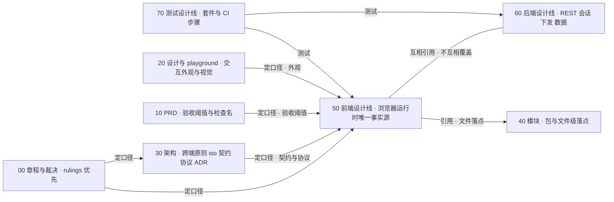

# 50 前端设计线：定位、边界与导航

> 状态：v0.1 | 负责：前端设计线 | 更新：2026-09-25；2026-09-25（§4.19）；2026-09-25（§4.19 N1）：§8.1 补 N1 行，§8.3 删去已裁决的「覆盖导入与版本恢复是否锁定」开放行；2026-09-26（§4.20）：§8.2 TT 行按 FE-18 修订，§8.3 两行结案，新增 §8.4 | 依赖：[docs/README.md](../README.md)、[charter v0.2](../00-charter/charter.md) §5、§7–§9、[rulings](../00-charter/rulings-2026-09-14.md) §4.11–§4.20、[30-architecture/README.md](../30-architecture/README.md)、[40-modules/README.md](../40-modules/README.md)、[40/18 图集](../40-modules/18-atlas-system-and-frontend.md)

本目录是 Cordex **浏览器内一切运行时设计的唯一事实源**。它回答「浏览器里的代码怎样工作」：页面与会话怎样流转、preset 怎样装配、命令与撤销在界面上怎样表现、画布怎样渲染与输入、协同客户端怎样连接与恢复、界面体系怎样组织、查看器与 `/render` 页怎样只读工作，以及性能、安全、事件、国际化与可访问性怎样落地。三线（50 前端 / 60 后端 / 70 测试）的总边界表见 [docs/README.md](../README.md)（由总编排维护），本文不复制全表。

## 1. 定位

**本线负责的范围**：应用壳（apps/web 的路由、会话、页面状态、浏览器存储）、preset 装配与前端插件模型、客户端文档模型的浏览器用法与命令 / 撤销的界面表达、渲染与缩略图、文本编辑与 IME、协同客户端、评论与版本历史的客户端部分、UI 组件体系与主题、编辑器外壳与画布交互、母版 / 版式 / 主题、查看器与嵌入形态、`/render` 页的前端部分、前端性能预算与分包、客户端安全、客户端事件 / 错误 / 遥测、国际化与可访问性。

**本线不负责的范围**：

| 内容 | 归属 | 本线怎样使用 |
|---|---|---|
| iso 契约本体（DocumentStore、StoreOp、中性撤销、SceneProvider、TextMeasurer、RenderTarget、OfflineStore 的签名） | [30-architecture](../30-architecture/README.md) 04 / 05 / 07 / 06 §18.6 与 [40/02](../40-modules/02-kernel-protocol-and-document-core.md) | 只写浏览器侧的用法与行为约束 |
| WS 帧、CONTROL、ack、关闭码的定义 | [30/06 §6](../30-architecture/06-collaboration.md) | 07 只写客户端对它们的处理 |
| renderer sidecar 进程、RPC、池与编排；Nest 模块；数据表、Valkey 键、对象键 | [60-backend](../60-backend/README.md)（06、03–07、08–14） | 只画服务端「接触面」 |
| 测试层级、套件目录、CI 步骤、阈值判定 | [70-testing](../70-testing/README.md) | 每份文档末「机械验证」只写断言并注明 70 的套件或步骤名 |
| 包与文件级落点（目录树、逐文件职责、测试文件清单） | [40-modules](../40-modules/README.md) | 本线写设计，40 写「放在哪个文件」 |
| 交互外观与视觉（线框、token 取值、材质观感） | [20-design](../20-design/README.md) 与 playground | 本线写行为语义与状态机 |

## 2. 口径链与分界

权威顺序（前者覆盖后者）：**rulings**（§4.11–§4.19，后节覆盖前节）> **charter** > **已接受 ADR** > **30-architecture 正文**（跨端原则、协议语义、iso 契约）> **50 / 60 / 70**（各管一侧，互不覆盖）> **40-modules**（包 / 文件级）> **PRD / 设计既定口径**。

两条分界线：

- 交互外观与视觉以 20-design + playground 为准；**行为语义与状态机以本线为准**。二者冲突时，外观问题改本线，行为问题改设计稿（经总编排）。
- 验收阈值与检查名的定义以 PRD 为准；**测试如何执行以 70 为准**；本线只写「要断言什么」。

**图 R-1 前端设计线与其它目录的事实源与引用方向**

怎么读：带「定口径」的边表示上游为本线定下不可推翻的约束；50 与 60 之间是无向边，表示两线互相引用对方的定义（例如本线引用 60 的请求头名与 REST 路由，60 引用本线的 CSP 模板正文与 `/render` ready 判据），但谁也不改写对方；40 只承接本线设计的文件落点；70 对两线的设计做测试。
依据：rulings §4.19（三条设计线各为该侧唯一事实源，30 保留跨端原则与 ADR，40 保留包 / 文件级规划）；docs/README.md 三线总边界表。

## 3. 本线拥有 / 本线引用

**本线拥有**（本线文件是唯一事实源，其它文档引用时只写摘要 + 链接）：

| 主题 | 事实源 |
|---|---|
| 路由表（含深链 `/documents/:id?page=&comment=`）、布局与守卫、RuntimeConfig 形状、浏览器会话状态机、重新登录弹窗与 BroadcastChannel、401 / 网络错误分流、分享链接落地、浏览器存储键空间与登出清理矩阵、版本漂移处理 | [02](02-app-shell-routing-and-session.md) |
| preset 派生链、装配运行时语义、条目缺席的用户可见结果、惰性边界、root ctx 与 UnitScope 服务分布、前端贡献点、第三方 UI 插件前端合同、评论插件装配位置（`comments` 包，rulings §4.19 D-COMMENTS-PKG） | [03](03-preset-assembly-and-plugins.md) |
| 浏览器中的 Unit 生命周期与渐进打开的 UI 行为、命令结果到界面的分流、撤销跳过提示条与「恢复我的值」「恢复元素」、墓碑可见性、保存与脏状态、剪贴板管线、规模守卫 UI | [04](04-document-commands-and-undo.md) |
| 帧管线、视口与虚拟化、命中链、覆盖层、字体供给与回退、媒体缓存、元素降级、缩略图 Provider、画布可访问树数据源、放映渲染 | [05](05-rendering-and-thumbnails.md) |
| 文本编辑态、事件分流、IME、光标与选区、R-M2-1 spike 判据 | [06](06-text-editing-and-ime.md) |
| 客户端 Session FSM（从 30/06 §5.1 迁入，唯一源）、SyncState 与 UI 六态、重连与离线判据、出站合并与拆块、两级 ack 下的在途 FIFO、「未保存到服务器」派生规则、离线队列与多标签页互斥、降权与被拒回滚、关闭码的客户端行为、awareness 节流与在场 UI、软冲突信号分流、前端计时器总表 | [07](07-collaboration-client.md) |
| 评论客户端（数据、命令、面板、画布钉、锚点状态机）、版本历史页与恢复流程的前端视角 | [08](08-comments-and-version-history.md) |
| UI 四包分工、token 产物、主题解析与三选择器契约、材质层、shadcn 复制件管理、`ui.*` 贡献与上下文键全集、视图模型、输入管线、样式注入 | [09](09-ui-system-and-theming.md) |
| EditorHost 区域结构、布局状态与断点、模式 × 角色 × 断点矩阵、Ribbon / 检查器 / 缩略图栏 / 画布交互、缩放导航、放映舞台、命令面板与设置抽屉、反馈分层 | [10](10-editor-shell-and-interaction.md) |
| 母版视图（入口可用性、MasterViewState、四种退出）、版式画廊与删除流程、主题编辑 | [11](11-masters-layouts-and-themes.md) |
| 三种只读形态辨析、preset-slide-viewer 与 viewer-shell、嵌入形态 A–F、postMessage 桥（M3 P2）、`/render` 页前端职责与 **ready 判据（FE-09 唯一源）**、注入协议字段 | [12](12-viewer-embedding-and-render-page.md) |
| 前端预算的 target 与分解、chunk 地图与惰性边界、分包规则、Worker 清单、DX-1000 回退顺序 | [13](13-performance-and-bundling.md) |
| **CSP 模板正文（逐指令，60/17 引用）**、nonce 消费链、Trusted Types 策略与 sink 清单、externalResources 联动、文档内容进入 DOM 的规则、客户端会话与上传安全、本地数据清理 | [14](14-client-security.md) |
| 事件三类与前端发布者 / 订阅者、宿主事件桥语义、错误码 → 用户文案与建议动作（i18n `errors.*`）、错误边界拓扑、客户端错误上报与 OTel Web 管线、遥测同意与默认值 | [15](15-events-errors-and-telemetry.md) |
| i18n 架构与命名空间、无 host 页面 i18n、a11y 目标与分阶段、键盘与焦点模型、live region、画布可访问树、视觉适配退化 | [16](16-i18n-and-accessibility.md) |

**本线引用**（定义在别处，本线只引用文件与小节，不复制字段表）：

| 主题 | 定义处 | 本线使用处 |
|---|---|---|
| iso 契约本体：DocumentStore / StoreOp / 中性撤销 / SceneProvider / TextMeasurer / RenderTarget / OfflineStore 签名；插件模型与贡献点总表 | [30/03](../30-architecture/03-kernel-and-plugin-model.md) §3.6、[30/04](../30-architecture/04-document-model.md)、[30/05](../30-architecture/05-command-and-history.md)、[30/07](../30-architecture/07-rendering.md)、[30/06](../30-architecture/06-collaboration.md) §18.6、[40/02](../40-modules/02-kernel-protocol-and-document-core.md) §2.5 | 03、04、05、07 |
| WS 帧类型、CONTROL 表、ack 语义、关闭码表 | [30/06](../30-architecture/06-collaboration.md) §6（按 INC-02~07、INC-09 补齐后） | 07 |
| 错误码格式、域清单与 HTTP / WS 映射；事件命名规则与公开事件定稿；日志与脱敏规则 | [30/10](../30-architecture/10-observability-and-errors.md) §1、§2–§3、§11.1 | 04、15 |
| REST 路由总表、DTO 文件、守卫与能力位、错误码、限流档（固定小节 §3.1 auth … §3.14 telemetry） | [60/15](../60-backend/15-rest-api-catalog.md) | 02、05、07、08 |
| 会话 cookie、OIDC RP、CSRF 校验、请求头 `X-Cordex-Request` 与 `X-Cordex-Share-Token`、collab ticket、WS Origin 白名单、链接角色重算 | [60/02](../60-backend/02-auth-chain.md) | 02、07、14 |
| WS 服务端处理、门禁 L1–L4、ack 发出规则、限额数值、扇出 | [60/16](../60-backend/16-ws-protocol-server-view.md) | 07 |
| Room 生命周期、溢写回放、墓碑 TTL 与 tombstone-sweeper、元素彻底删除 | [60/05](../60-backend/05-modules-collab-and-snapshots.md) | 04、07、08 |
| 文档永久删除编排 | [60/04](../60-backend/04-modules-documents-storage-media.md) | 02、04 |
| 评论镜像、Webhook、审计 action 登记表 | [60/07](../60-backend/07-modules-comments-webhooks-audit.md) | 08 |
| renderer sidecar 进程、RPC、池与背压、注入编排 | [60/06](../60-backend/06-modules-jobs-import-export-thumbnails.md) | 12 |
| nonce 每响应生成、CSP 响应头下发、index.html 模板化、静态资源缓存头；配置 schema 全字段表 | [60/17](../60-backend/17-deployment-and-config.md) | 02、14 |
| 遥测端点、限流与请求体上限、服务端指标统一名表 | [60/18](../60-backend/18-observability-and-ops-endpoints.md) | 15 |
| 测试层级、夹具、契约套件、CI 步骤与阈值判定 | [70-testing](../70-testing/README.md)（01–13） | 每份文档「机械验证」 |
| 验收阈值、检查名、预算 gate 数值（NF-01）、产品事件清单（PRD 06） | [10-prd](../10-prd/README.md) | 13、15 与各文件验收引用 |
| 线框、token 取值、材质观感、界面状态清单 | [20-design](../20-design/README.md) 与 playground | 09、10、11、16 |

`@cordexjs/protocol` 的文件清单与路径只在 [40/02](../40-modules/02-kernel-protocol-and-document-core.md) 的 M-02 目录树登记（`collab/*`、`ws/frames.ts`、`ws/handshake.ts`、`rest/*`、`render/page.ts`、`embed/messages.ts`、`errors/*`）；本线拥有其中两处的字段语义：`render/page.ts`（`/render` 注入协议）与 `embed/messages.ts`（postMessage 桥），均在 [12](12-viewer-embedding-and-render-page.md)。

## 4. 文件索引与阅读顺序

| 文件 | 一句话职责 | 主要上游 | 主要里程碑 |
|---|---|---|---|
| [01 前端总览与运行时全景](01-overview-and-runtime-map.md) | 五类浏览器执行上下文、层带分布、前端铁律、运行时对象关系、四条端到端主干、可观察状态清单、对外接触面、里程碑汇总与机械验证总表 | charter §5/§7、30/01、30/02、40/18 | M1–M5 汇总 |
| [02 应用壳、路由与会话](02-app-shell-routing-and-session.md) | apps/web 职责与禁区、路由表唯一源、RuntimeConfig、会话状态机与 OIDC 回环、重新登录、EditorPageState 与 HostRegistry、REST 客户端策略、用例清单、浏览器存储与清理、分享链接落地、版本漂移 | 40/11、ADR-0029、60/02、60/15 | M1 骨架、M2 登录、列表、快照打开与服务端导入、M3 分享与版本 |
| [03 预设装配与前端插件模型](03-preset-assembly-and-plugins.md) | 三档 preset 派生链、装配运行时、条目缺席语义、惰性边界、组合根时序、服务分布、前端贡献点、壳意图、第三方 UI 合同、评论插件装配、doc/sheet 参数化点 | 30/03、ADR-0005/0006/0010/0015、40/11、40/16 | M1–M4 |
| [04 客户端文档模型、命令与撤销](04-document-commands-and-undo.md) | Unit 生命周期与渐进打开、命令入口与结果分流、历史策略、协同撤销的界面表达（不简化）、墓碑与彻底删除入口、保存与脏状态、剪贴板、规模守卫 UI | 30/04、30/05、ADR-0007/0013/0020、40/02 | M1 打开、M2 命令与撤销、M3 协同撤销 |
| [05 渲染、布局与缩略图](05-rendering-and-thumbnails.md) | DOM/SVG 单实现、帧管线、脏区、视口、命中链与覆盖层、文本度量、字体供给、媒体、降级、缩略图 Provider、画布可访问树数据源、放映渲染、LRU | 30/07、ADR-0021/0026/0027、40/06、40/07 | M1–M3 |
| [06 文本编辑与 IME](06-text-editing-and-ime.md) | 隐藏 textarea 宿主、编辑态与 Esc 逐级、事件分流、意图链、IME、光标与选区、重排预算、可访问性镜像、协同文本 | 30/07 §6、ADR-0028、40/06、40/10 | M2（R-M2-1 spike） |
| [07 协同客户端](07-collaboration-client.md) | 连接建立、三层状态对照、重连与离线、出站同步、两级 ack 与在途 FIFO、离线队列、权限与令牌、关闭码行为、awareness 与在场 UI、软冲突分流、计时器总表 | 30/06、ADR-0023/0024/0033、40/05、60/16 | M2 连接、持久化与「未保存到服务器」；M3 多人体验层（跨刷新持久化 M4） |
| [08 评论与版本历史（客户端）](08-comments-and-version-history.md) | 评论插件包归属（`comments` 包）、评论数据与命令、评论 UI、锚点状态机、导入导出、实时刷新与 @我、版本历史页与恢复流程 | ADR-0031、30/06 §18.5、60/07、60/05 | M3 |
| [09 UI 组件体系与主题](09-ui-system-and-theming.md) | 四包分工、token 与 CSS 产物、主题解析、材质层、shadcn 复制件、`ui.*` 契约与上下文键、视图模型、输入管线、UiRenderer、样式注入 | 40/10、ADR-0017、20-design/04、09 | M1–M2 |
| [10 编辑器外壳与画布交互](10-editor-shell-and-interaction.md) | 外壳结构、布局状态与断点、模式 × 角色 × 断点矩阵、Ribbon、检查器、缩略图栏、画布交互、缩放导航、放映舞台、命令面板与设置、反馈分层 | 40/10、20-design/01、03-screens | M2 |
| [11 母版、版式与主题](11-masters-layouts-and-themes.md) | 视图模式三层词汇、母版视图入口与退出、MasterViewState、母版缩略图、继承描边、版式画廊与删除、主题编辑、协同下的母版编辑 | PRD 03-features/07、20-design/03-screens/26–28 | M2 只读与应用、M3 编辑与主题 |
| [12 查看器、嵌入形态与 /render 页](12-viewer-embedding-and-render-page.md) | 三种只读形态、preset-slide-viewer、viewer-shell、嵌入形态 A–F、postMessage 桥、宿主事件桥通道、`/render` 页与 ready 判据 | 40/11、ADR-0015/0026、30/07 §10、60/06 | M1 查看器、M2 形态 A/B、M3 `/render` 与形态 E |
| [13 性能预算与分包](13-performance-and-bundling.md) | 预算两口径、首屏关键路径、交互 / 协同 / 内存 / 体积预算、chunk 地图、分包规则、Worker 清单、DX-1000 回退、预算总表 | PRD 04 NF-01、30/07 §9、30/06 §14、70/09 | M1–M3 |
| [14 客户端安全](14-client-security.md) | 信任模型、CSP 模板、nonce 链、Trusted Types、文档内容安全、外链资源、输入限制、会话与请求、上传、本地数据、嵌入与跨源、供应链 | PRD EM-14/NF-04、40/11 §10、60/02、60/17 | M2 基线、M3 Trusted Types 强制 |
| [15 客户端事件、错误与遥测](15-events-errors-and-telemetry.md) | 事件三类、发布者 / 订阅者总表、宿主事件桥、错误模型与文案、错误边界、错误上报、OTel Web、产品事件、同意与默认、诊断 | 30/10、PRD 06、60/18 | M1–M3 |
| [16 国际化与可访问性](16-i18n-and-accessibility.md) | i18n 架构、语言包、无 host 页面 i18n、伪本地化与 RTL、a11y 目标、键盘与焦点、语义与 live region、画布可访问树、视觉适配、屏幕阅读器矩阵 | 20-design/07、PRD NF-05–NF-07 | M2 键盘与朗读、M3 forced-colors、M4 RTL |

**图 R-2 50 目录阅读路线**

```mermaid
flowchart LR
  n01["01 总览与运行时全景"]
  subgraph shellGrp["壳与装配"]
    n02["02 应用壳 路由 会话"]
    n03["03 预设装配与插件模型"]
  end
  subgraph docGrp["文档 渲染 协同"]
    n04["04 命令与撤销"]
    n05["05 渲染与缩略图"]
    n06["06 文本编辑与 IME"]
    n07["07 协同客户端"]
    n08["08 评论与版本历史"]
  end
  subgraph uiGrp["界面与形态"]
    n09["09 UI 体系与主题"]
    n10["10 编辑器外壳与交互"]
    n11["11 母版 版式 主题"]
    n12["12 查看器 嵌入 /render 页"]
  end
  subgraph crossGrp["横切"]
    n13["13 性能与分包"]
    n14["14 客户端安全"]
    n15["15 事件 错误 遥测"]
    n16["16 国际化与可访问性"]
  end
  n01 --> shellGrp
  shellGrp --> docGrp
  docGrp --> uiGrp
  uiGrp --> crossGrp
```

怎么读：箭头是建议阅读顺序，先读 01 建立全景，再读壳与装配（02、03 可并行），然后按「文档、渲染、协同」「界面与形态」「横切」三组推进；组内文件可按需跳读。按角色的捷径：做应用壳读 01 → 02 → 03 → 14；做编辑器读 01 → 03 → 04 → 05 → 06 → 09 → 10；做协同读 01 → 04 → 07 → 08；做嵌入读 01 → 03 → 12 → 14 → 15。

## 5. 回写清单（由总编排执行）

下表只列计划 referencePlan 中与本线有关的条目，格式为「原处 → 本线文件」；本线写作组不改动原处文档，改写由总编排在全部写作组完成后统一执行。

| 原处 | 处理方式 | 本线文件 |
|---|---|---|
| 30/01 §4.1–§4.4、§5 | 保留跨端总图，各小节末加链接（前端视角）；§4.1 打开时序图的「GET /documents/:id 返回原始 pptx 的预签名 URL」按 INC-37（M1 查看器数据源为本地字节）、rulings §4.19 D-M2-CONTENT（M2 起服务端文档经 `snapshots/latest` + 票据 + WS 打开）与 60/15 §3.8（`snapshots/latest` 直接返回字节）改写 | 01 |
| 30/02 §3.1 apps/web | 保留包级定位；路由、会话、RuntimeConfig、组合根行为改为摘要 + 链接 | 02、03 |
| 30/02 §4.17–§4.21b（design / ui-core / ui-react / slide-ui / preset-*） | 保留层号、依赖与一句话职责；运行时行为改为链接 | 09、03、12 |
| 30/05 §6–§9 中撤销跳过、提示条、剪贴板的界面表达句 | 加链接；契约本体不动 | 04 |
| 30/12 §3.2、§4.3 前端参数化点 | 加链接（doc/sheet 参数化） | 03 |
| 30/06 §5.1 客户端 Session 状态机 | 状态图迁入本线（唯一源），原处保留一句定位 + 链接 | 07 |
| 30/06 §6.4 客户端在途 FIFO 与 step2 拆块 | 摘要 + 链接（服务端发 ack 规则 → 60/16，溢写回放 → 60/05） | 07 |
| 30/06 §7.1 客户端节流与在场 UI | awareness schema 保留；客户端部分改为链接 | 07 |
| 30/06 §8 软冲突的客户端信号分流 | 语义保留；分流改为链接 | 07 |
| 30/06 §9.1、§9.3 出站合并与拆分 | 摘要 + 链接（服务端限额 → 60/16） | 07 |
| 30/06 §10 客户端降权处理 | D12 原则一段保留；客户端处理改为链接 | 07 |
| 30/06 §12 离线队列与重连 | 摘要 + 链接 | 07 |
| 30/06 §14 预算汇总（客户端部分） | 摘要 + 链接（服务端 → 60/01 §预算总览） | 13 |
| 30/06 §18.3、§18.4 | 链接；§18.5 承接表落点列改为 50/60 文件；§18.6 OfflineStore 签名保留 | 02、07 |
| 30/07 §6 文本编辑宿主 | 保留 ADR-0028 决策一段，其余迁入 | 06 |
| 30/07 §7 命中测试与覆盖层 | 迁入 | 05 |
| 30/07 §8 缩略图与放映 | 缩略图 Provider → 05；放映舞台 → 10 | 05、10 |
| 30/07 §9 性能预算与测量 | 数值 → 13；测量与门禁 → 70/09 | 13 |
| 30/07 §10 服务端 headless 渲染路径 | 摘要 + 链接（`/render` 页与 ready 判据 → 12；sidecar 与编排 → 60/06） | 12 |
| 30/07 §14.2 打开管线、§14.4 图表、§14.6 | 契约保留；浏览器行为 → 04 §2；图表 → 05；§14.6 → 13（§14.7 PDF → 60/06） | 04、05、13 |
| 30/10 §2.4 Sink Provider | 客户端侧迁入（服务端 → 60/18）；§2.1–§2.3 命名与脱敏规则保留 | 15 |
| 30/10 §3.2、§3.3 span 与 metric 清单 | 客户端条目迁入（服务端 → 60/18），命名规则保留 | 15 |
| 30/10 §3.4 产品事件、§4 诊断、§5 客户端错误上报 | 迁入（以 PRD 06 为权威；端点 → 60/18）；§11.1 保留 | 15 |
| 40/05 §1–§2、§6、§7 | 摘要 + 链接（§3 插件定义、§4、§5、§9–§11 保留） | 07 |
| 40/06 §2.5 TextInputHost 段、§2.6 图 2-3、§13 Q-1~Q-3 | 迁入；§2.4 `render/frame` 载荷按 INC-08 改名补字段 | 06、05 |
| 40/07 §2.1–§2.6 | 迁入 | 05 |
| 40/10 §2.1–§2.6、§5.3–§5.4 行为说明 | 视图模型、输入管线、上下文键 → 09；外壳交互与布局状态 → 10；MasterViewState → 11；撤销与剪贴板绑定 → 04 | 09、10、11、04 |
| 40/11 §2.1–§2.6、§3a 路由表、§7 `/render` 契约、§3.4 预算分解 | 迁入（§3.1–§3.3 装配清单与 §3.5 接入点表保留为包级事实源） | 02、03、12、15、13 |
| 40/18 §4–§8 | 每节首加「事实源：50/xx，冲突以其为准」；§10 分歧收入本文 §8 | 01、03、04、09–12 |
| 40/00 §5 前后端切分 | 加链接；ResourceHook 命名空间按 INC-39 改 `comments.*` | 01 |
| 20-design/01 §4 深链 | 改为 `/documents/:id?page=&comment=`（INC-35） | 02 |
| PRD 05 M3 `pluggable:m3` 白名单 | 按 rulings §4.19 D-COMMENTS-PKG 改为 `+comments`（见 §8.1、03 §11） | 03、08 |

## 6. 写作规范摘要

- **状态行**：首行标题，第二行 `> 状态：v0.1 | 负责：前端设计线 | 更新：YYYY-MM-DD | 依赖：<上游文档>`；中文正文，英文标识符。
- **图**：只用 flowchart / sequenceDiagram / stateDiagram-v2 / classDiagram / erDiagram；flowchart、classDiagram、erDiagram、stateDiagram 的节点（状态）文字加双引号，sequenceDiagram 与 stateDiagram 的消息、转移标签、参与方别名不加引号；标签里「`<` 后接字母」写成 `#60;`；单图 ≤40 个非空行、≤25 个节点；每图上一行加粗图名，下一行「怎么读：」，内容有出处时再写「依据：」；写完在仓库根目录运行 `node docs/_tools/mermaid-check.cjs <文件...>`，要求 `0 invalid`。完整规则见 [_tools/README.md「绘图规范」](../_tools/README.md)。
- **链接**：引用其它文档一律用相对链接并写到小节号（如 `60/15 §3.7`）；不复制别处的字段表。
- **机械验证**：每份文档末设「机械验证」小节，只写断言（what），并注明 70 的套件或 CI 步骤名（步骤工作名以 70/12 定稿为准：`test/unit`、`test/contract`、`test/collab-sim`、`e2e/smoke`、`e2e/a11y`、`e2e/oracle-gated`、`perf/perf-client`、`scanners/scan-bundle-budget` 等）；不新增扫描器（上限 14）与 CI job（13 个封闭集合）。
- **决策标注**：已由 authority 定的项写「依据：决策 id + authority」；需用户确认的项按推荐写，段首标「待确认（总编排）：<决策 id>」。
- **边界**：服务端只画「接触面」（路径、子域、请求头、帧名），不画 Nest 内部；不出现表结构。

## 7. 前端术语补充

只收本线新引入或收窄语义的词；章程 §4 与 [30-architecture/README.md §6](../30-architecture/README.md) 已有的词不重复。经总编排裁决后回写章程 §4。

| 术语 | 标识 | 定义 | 事实源 |
|---|---|---|---|
| 查看者变体 | `mode='view'` | viewer 角色进入 `/documents/:id` 协同编辑器的只读变体：去掉创建类按钮，只保留跳转、阅读评论与放映，实时可见修改与在场，计入 50 个查看者名额；`/documents/:id/view` 只留给 M1 查看器与嵌入（rulings §4.18 UX-19） | 10 §3、12 §1 |
| 壳意图 | `shell.intent` | 编辑器内需要离开 SDK 边界的动作（应用栏「⋯」七项、`Mod+E`），以 Operation `shell.intent{target}` 经 `commands.execute` 到达宿主回调 `options.shell.onIntent` | 03 §8 |
| 宿主登记表 | `HostRegistry` | apps/web 按 documentId 缓存 host：兄弟路由（如版本历史抽屉）保活、放映复用同一 host、卸载后闲置到期 `dispose` | 02 §2.2、§6 |
| 会话 UI 六态 | — | 协同状态在界面上的六个取值：connecting / syncing / synced / reconnecting / offline / readonly-degraded；由内部 11 态与对外 `SyncState` 投影得到 | 07 §3 |
| 渐进打开 | `unit/opened`、`unit/loaded` | 本地打开 pptx 时 Worker 先完成包络计数，首批装载后发 `unit/opened`（可渲染、可编辑），后续批次以 `system('import')` 追加（不入撤销、不标脏），到齐发 `unit/loaded`；协同模式不走此路径（rulings §4.18 CO-12） | 04 §2 |
| 两级 ack | `tier:'spill'`、`tier:'db'` | 服务端对 update 的两级确认：溢写成功回 spill，落库回带 seq 的 db；只有 db 清除客户端 pending（rulings §4.15 S-3a） | 07 §6（帧定义 30/06 §6） |
| 在途 FIFO | — | 客户端按发送顺序记录的在途条目队列（每项对应一个发出的 update 帧、一个 step2 拆出的块或一次 step2，记其覆盖的最大 localSeq；rulings §4.18 CO-10）；收到 db ack 弹队首并 `ackUpTo`，spill ack 不弹 | 07 §6 |
| 撤销跳过记录 | `UndoSkip` | history 保留的最近 20 条跳过记录 `{skipId, entityId, path, myValue, wholeStep, reason}`，reason ∈ remote-overwrite / hard-deleted；epoch 变更时清空；是「恢复我的值」「恢复元素」命令的输入 | 04 §6 |
| 墓碑与「恢复元素」 | `core.history.restoreElement` | 删除为软删除墓碑（TTL 默认 24 h）、id 稳定；「恢复元素」以同 id 复活仍处墓碑态且未硬删除的元素，否则禁用并提示「该内容已被彻底删除」（rulings §4.18 CO-07 术语） | 04 §6–§7 |
| 上下文键 | `ContextKeyValues` | ui-core 中由事件或 Operation 驱动的反应式键值，是 `when` 子句的唯一输入（含 `breakpoint`、`textEditing`、`focusRegion`、`unitLoaded` 与束前缀键） | 09 §6 |
| 槽位 | `SlotName` | `ui.*` 贡献项落位的开放字符串键（如 `ribbon`、`inspector`、`statusBar.left`、`appBar.more`），不枚举 | 09 §6 |
| 字体档案 | `fontProfile` | 浏览器与 renderer 共用的字体清单 JSON（家族、版本、unicode-range 子集、回退表）；字体文件同源自托管于 `/fonts/` | 05 §7 |
| 分享片段令牌 | `#share={token}` | 分享 URL 的片段部分携带的令牌；片段不进入请求、Referer 与访问日志，前端读取后存 sessionStorage 并从地址栏去掉，只经请求头 `X-Cordex-Share-Token` 发送 | 02 §11、14 §8 |

## 8. 裁决落点与开放项汇总

### 8.1 rulings §4.19 用户裁决（前端落点）

以下五项已由 rulings §4.19 裁定（2026-09-25，用户交互确认），补完阶段分诊出的 N1 亦由用户裁决（§4.19 表末行），本线正文按裁决定稿，不再保留「待确认」标注。

| 决策 id | 裁决要点（前端相关） | 本线落点 |
|---|---|---|
| D-M2-CONTENT | 协同后端提前到 M2：协同网关、Room、update 持久化与快照、服务端导入从 M3 提前到 M2；M2 起服务端文档的内容**以协同快照为唯一事实源**，没有 pptx 内容版本端点。前端据此：服务端文档一律 `GET snapshots/latest` + collab-ticket + WS 打开（`source:'state'`、`store-yjs`，不走 Worker 字节路径，CO-12）；新建空白 / 内置模板 = 取模板字节走服务端两步导入生成 import 快照再进编辑器；导入 .pptx = 服务端两步导入 + `GET /jobs/:id`；`source` 的 `bytes` / `empty` 只留给本地文件、M1 查看器与集成方；离开保护与登出清理只看协同在途与离线队列；M2 列表封面 = 导入处理器写的 embedded `__cover`，空白文档用占位。M3 保留多人协同体验层：在场、评论、权限细化（分享与链接）、离线重连体验、服务端缩略图等；逐项边界以 [PRD 05](../10-prd/05-milestones-and-scope.md) §0.3 为准 | 01 §1、§5、§7、§8；02 §6、§8、§9、§10、§13；03 §1、§13；04 §1、§8、§12；05 §8、§10、§14；07 §16；13 §2、§6、§13 |
| INC-09 | 服务端显式信号 + 分级受众：判据 `room.persist==='degraded'` ∨ `spillOnlyInFlight > 0` ∨ `oldestInFlightMs ≥ unsavedWarnAfterMs`（collab-yjs 配置，默认 15000）；有本地未获 db 确认项的发起方显示横幅「未保存到服务器 N 项」，其余协作者在状态胶囊显示弱提示「服务器保存延迟」 | 07 §6.1、10 §11 |
| C-06 | 自动快照 30 天内全量，之后每天保留最后一个 auto 至 `retention.autoSnapshotDailyDays`（默认 365，0 = 永久）；命名版本永久、每文档上限 200；import / migration / restore / epoch 按 auto 口径 | 08 §9 |
| D-COMMENTS-PKG | 新增 iso 包 `@cordexjs/comments`（横向能力、文档类型盲：threads / replies、ResourceHook `comments.threads`、`comments.*` 命令、`comment/*` 事件、锚点 resolver 由文档类型提供），M3 装入 preset-slide-collab；slide 锚点解析、检查器评论页签、画布评论钉由 slide-ui 贡献；`pluggable:m3` 白名单为 `{−store-memory, +store-yjs, −collab-core#local-presence, +collab-yjs, +collab-transport-ws, +comments}`；章程 §5.2 登记层号与依赖上限 | 01 §2、03 §1、§3、§11；05 §5.2；08 §2；13 §6；15 §2、§8 |
| D-TEST-INFRA | 性能 M1 用 GitHub larger runner（4 核），自托管专用 runner 在 M2 前落地，RM-B 以 CDP CPU 4× 节流近似；视觉 oracle 基线用一台 Windows + PowerPoint 365 维护机（不进 CI），macOS 基线 M2 加入 | 13 §1（runner 口径以 [70/09](../70-testing/09-performance-and-capacity.md) §9 为准）、11 §11 |
| N1-IMPORT-OVERWRITE-RESTORE-LOCK | 恢复不锁、覆盖导入换纪元：版本恢复不加锁、在线不断连，协作者恢复期间照常编辑、不进入只读；覆盖既有文档的导入期间收到 `CONTROL.room{locked:{reason:'import'}}` 转只读（状态胶囊「文档正忙」），导入提交后以 4428 断开、重开 Unit 重新 bootstrap，未获 db 确认的更改以 `epoch-changed` 移入 rejected 并可导出，横幅「文档已替换为导入的文件」；锁原因只有 `import` / `migration` | 07 §8.1、§8.2、§9；08 §10 第 7–8 步、§13；10 §11；11 §10 |

### 8.2 已定（前端相关，依据 authority 直接写入）

| 决策 id | 结论摘要 | authority | 落点 |
|---|---|---|---|
| INC-35 | 深链 `/documents/:id?page=<slideId>&comment=<threadId>`，放映同名 `page`；`/d/` 废止；02 路由表为唯一源 | rulings §4.18 UX-19 | 02 §2、10 §3 |
| INC-18 | 登录 = `GET /api/v1/auth/oidc/login?next=&mode=redirect 或 popup` → 302；弹窗重登直接打开同一 URL；无 JSON 变体 | 浏览器顶层导航语义 + 不过度设计 | 02 §4–§5 |
| SESSION | httpOnly 会话 cookie 15 min + refresh cookie（Path=/api/v1/auth，7 天轮换）；浏览器不持有任何令牌；吊销 ≤5 s 生效 | 安全宁可提前 + PRD SV-06/SV-12 | 02 §4、14 §8（服务端 60/02 §4） |
| INC-24 | 非安全方法附 `X-Cordex-Request: 1`；跨源请求与跨源 WS 升级被拒 | PRD SV-12 | 02 §7、14 §8 |
| INC-25、INC-20 | 分享 URL 片段令牌 → sessionStorage → 只经 `X-Cordex-Share-Token` 头；无效令牌不叠加角色，403 带 `reason: share_link.expired 或 revoked` 供提示「链接已失效」 | ADR-0029 + UX-19 + BE-02 | 02 §11、14 §8 |
| INC-27 | `auth.refresh` 携新换的 collab ticket，只重新绑定、不延长（M1–M3 会话寿命由票据 `sid` 指向的登录会话承担；M4 集成方 JWT 才以新 `exp` 续期）；触发点为浏览器会话每次被动续期成功之后；登录会话被吊销时 4401 关闭 | 规格空白；60/02 §9.5、60/16 §3 | 02 §4、07 §8 |
| INC-37 | M1 查看器数据源为本地字节。**M2 / M3 分界已被 rulings §4.19 D-M2-CONTENT 覆盖**：原「WS 网关、快照 REST、服务端导入归 M3」改为 M2 交付；M3 为多人协同体验层与服务端缩略图 | charter §7 + U-04；rulings §4.19 | 01 §8、02 §8 |
| RUNTIME-CONFIG | RuntimeConfig 只放静态部署项并由 web 容器渲染进 index.html；可变开关只从 `GET /auth/config` 读 | 40/11 与 40/08 单一化 | 02 §3 |
| APP-DATA | 不引入数据请求库；用例层 + 轻量内存缓存（列表 stale-while-revalidate、乐观更新失败回滚），缩略图走 HTTP ETag | 不过度设计 | 02 §9 |
| VERSION-DRIFT-SW | index.html no-store、hash 资源 immutable；chunk 加载失败或 4426 / 4427 → 横幅「发现新版本」，协同中先 flush 再刷新；M1–M4 不引入 Service Worker | ADR-0033 + PRD CO-06 | 02 §12 |
| MEDIA-CLIENT、INC-21 | 不建浏览器 BlobStore Provider：preset 选项 `media.upload` 回调（apps/web 默认 presign → 直传 → commit，≥10 MB 分片，失败重试 3 次）；拉取 `GET /documents/:id/media/:sha256` 经 `http.ts`（带分享令牌头）取 `{url}`（1 h 预签名，不再 302），再以 `credentials:'omit'`、无自定义头请求该 URL 得 Blob | 30/08 + C-30 + D12 fail-closed；INC-25 | 03 §5、05 §8 |
| SG-10 | 缩略图 `GET /documents/:id/thumbnails/:slideId?size=640 或 1280`，封面 `__cover` | ADR-0026 | 05 §10 |
| FONTS | 浏览器与 renderer 共用 fontProfile，同源 `/fonts/` 按需加载，CSP `font-src 'self' blob:`，不访问第三方字体源 | ADR-0027 + PRD OF-25 | 05 §7、14 §2 |
| A11Y-TREE | render-dom 提供 a11y-mirror 宿主（不随虚拟化裁剪）；slide-render 提供替代文本与阅读顺序；slide-ui 只做阅读顺序切换与缺失 alt 提示 | 30/07 §6.1 + 设计 07 §3 | 05 §11、16 §9 |
| VIEW-EVENTS | `view/page-changed`、`view/zoom-changed` 由 engine-render 的 Viewport 发布 | 30/07 §2.3 | 05 §4、10 §8、12 §3 |
| INC-08 | `render/frame(unitId, stats{pages, elementsUpdated, ms, overrun, pendingDirty})` 为进程内事件；`perf/frame` 为遥测事件；二者并存 | rulings §4.11 C-25 + §4.18 FE-09 | 05 §2、12 §11、15 §1 |
| INC-07 | 单帧上限唯一名 `maxUpdateBytes`（默认 1 MiB），`auth.ok.limits = {maxUpdateBytes, msgRateHz, msgBurst}`；客户端本地值只作收到 `auth.ok` 前的兜底 | rulings §4.18 CO-10 | 07 §5 |
| INC-06 | 关闭码补 1011、4427、4428（epoch 变更：丢弃本地 Y 状态、重新 bootstrap、pending 移入 rejected 并提供导出） | 30/06 §6.5 | 07 §9 |
| INC-02、INC-03/04/05 | CONTROL 成员以 30/06 §6 为准，判别键统一 `type`；`event{name:'comments.changed' 或 'version.restored'}`；`auth.ok.reason:'capacity' 或 'over_ceiling'`；`room.locked?` 为锁定 / 解锁信号；`auth` 可选 `epoch` 与 `maxSchemaVersion`（纪元随 `snapshots/latest` 响应头 `X-Cordex-Epoch` 下发） | 30/06 §6.3 | 07 §2、§8、§11；08 §8、§10 |
| RESTORE-CMD | `core.history.restoreMine{skipId}`（新 local 事务，需 doc.write）与 `core.history.restoreElement{skipId}`；均为普通可撤销命令 | rulings §4.15 Q3 + §4.18 CO-07 | 04 §6 |
| INC-39 | 评论 ResourceHook 命名空间取 `comments.*` | rulings §4.18 FE-01 | 08 §2 |
| SG-03、SG-05 | 评论 REST 只读、唯一写入口为服务端镜像观察器；@提及用户搜索 query ≥2 字符、≤20 条、只回 id / 显示名 / 头像 | ADR-0031 + 安全宁可提前 | 08 §4、§8 |
| SG-08、INC-22 | 作业状态统一 `GET /jobs/:id`，导出下载取 `GET /exports/:jobId`（现签 1 h）；永久删除文档入口 `POST /documents/:id/purge`（M3） | 不过度设计 + PRD SV-11 | 02 §8 |
| OFFLINE-TABS | `navigator.locks` 独占 `cordex-offline:{userId}:{documentId}`，其余标签页用内存队列并提示 | ADR-0033 | 07 §7 |
| CSP-NONCE、TT-CSP-REPORT | web 容器每响应生成 nonce 并写入 index.html 与 CSP 头；Trusted Types 策略 `cordex-default`（Worker 脚本 URL，不提供 createHTML）与 `default`（只对登记的两段 Radix 固定样式精确放行 createHTML，rulings §4.20 FE-18 修订），`trusted-types cordex-default default`，M2 report-only → M3 强制，违规报 `/api/v1/telemetry/csp` | rulings §4.15 Q2 + §4.18 BE-11/BE-30 + §4.20 FE-18 | 14 §2–§4 |
| TELEMETRY-DEFAULT | SDK 默认 no-op；apps/web 错误上报默认开、产品遥测默认关；设置增两个开关 | 30/10 §5 + PRD NF-11 | 15 §9、10 §10 |
| ERR-COPY | 错误码文案命名空间 `errors.<code>.{title, action}`；`user:true` 的码必须有 zh-CN 与 en-US 键（`scan-contributions` 规则 (f) 的子规则） | PRD EM-12 + GV-15 | 15 §4、16 §1 |
| NOHOST-I18N | `@cordexjs/i18n` 导出纯函数 `createI18n()` 供无 host 页面使用，进入编辑器时交给 host | 40/11 Q-9 | 16 §3 |
| T-BUNDLE | 体积预算唯一阻断点 `scan-bundle-budget`（读 `config/bundle-budget.json`，tolerancePct 5，只收紧）；包内体积测试降为信息性 | PRD NF-01 + 09-06 §14 | 13 §6 |

### 8.3 仍开放的上游项

| 项 | 归属 | 本线处理 |
|---|---|---|
| UnitScope 默认 Provider 登记 API（40/11 Q-2） | 已结案（rulings §4.20 FE-01） | 03 §6.2 定稿：`units.registerUnitProvider` / `units.listUnitProviders` |
| U-07 版本恢复可撤销（version-restore-undo） | [ADR-0038](../30-architecture/adr/0038-version-restore-undo.md)（提议；M-02 主笔，M-05、M-09 会签；M2 出口评审前定稿，未定稿则 M3 版本恢复不开工，rulings §4.20 TX-01+BE-10） | 08 §10 写前端落点（入口与二次确认、跳过键数提示）；「谁能撤销」「可撤销时效」待 ADR 定稿时交互拍板 || 40/18 §10 原列分歧 | 已由 rulings §4.18 全部裁定 | 无新增；图集与本线冲突时以本线为准 |

### 8.4 rulings §4.20 遗留小项（前端落点）

以下各项已由 rulings §4.20 裁定（2026-09-26，用户逐条确认，全部按推荐），本线正文已按裁决定稿。

| 决策 id | 裁决要点（前端相关） | 本线落点 |
|---|---|---|
| BE-01+TX-03 | WS 升级的 IP 额度「先扣后退」：票据验签通过即退还，同一出口数十人被 1012 驱逐后 ≤ 5 s 重连完；每用户单实例并发上限 `limits.ws.maxConnectionsPerUser`（默认 32），超出回 `auth.denied{collab.rate_limited}` 并以 4429 关闭 | 07 §4、§9 |
| BE-02 | upload 档 60/min、突发 20，public 档 300/min、突发 100；上传队列撞限流按 `Retry-After` 等待，删去「串行避免撞档」的理由 | 05 §8.3；02 §9.5 |
| BE-09+TX-15 | 写入帧 `error` 与 db ack 的相对顺序：「冻结 FIFO、宁多勿少」为最终口径 | 07 §6、§17 |
| TX-01+BE-10 | U-07 立项为 ADR-0038（提议），M2 出口评审前定稿；基线为持有 Room 的实例内单事务、不加锁、走命令管线、按 struct 范围判「他人后写」、删掉的元素以原 id 复活 | 08 §10、§12、§13 |
| TX-08 | 确定性 lint TD-110 覆盖 `Date.now`、`Math.random`；`collab-*` 另禁 `setTimeout` / `setInterval`，作为 TD-110 子项 | 07 §13、§15 V15 |
| FE-01 | UnitScope 默认 Provider 登记 API 定名 `units.registerUnitProvider` / `units.listUnitProviders`，删 `Config.defaultStoreProvider` | 03 §2、§6.2、§13 |
| FE-02 | 放映始终实时应用远端更新，PRD ED-21 删「（可关闭）」，不新增渲染暂停接口 | 10 §9.3、§12.3 |
| FE-03、FE-04 | 默认版式统一为 30/04 I-ML2 链，单一纯函数 `defaultLayoutOf`；版式墓碑期读时容错、硬删时同事务修复 | 11 §1、§10 |
| FE-05 | 删除被引用的版式与母版：保留确认对话框（删去「操作不可撤销」），执行后入撤销栈并给带「撤销」的 Toast（Q11 修订） | 11 §8、§10、§11 |
| FE-06 | `ContributionBase.enablement` 与标准键族 `can.<capability>` 登记齐；上下文键全集以 09 §6.3 为唯一清单 | 09 §6、§12、§13；10 §4、§12.3；01 §6 |
| FE-07 | 应用主题直接执行 + 可撤销 Toast | 11 §9 |
| FE-09 | `comments` 客户端包的文件级规划落在 40/20（占位，M3 开工前补正文） | 08 §13 |
| FE-10 | 会话内 `permission/changed` 不改 `EditorHost.mode` | 02 §6；10 §3.1 |
| FE-11、FE-12、FE-13 | 40/10 正文与本线对齐（五值 `masterEntryState`、`enablement`、`remember`、`explainWhen`、`reviewBar`、放映常驻容器、`ThemeService` 新接口、章节号） | 09 §13；10 §12.3；11 §11.4；01 §6 |
| FE-14 | 「母版与版式不支持评论」统一文案；悬空版式规则名一律 `dangling-layout` | 08 §5；11 §11.4 |
| FE-15 | 设计与 playground 回写批（placeholder 键、隐私与诊断组、窗格滚动只在内存、评审态「属性」页签） | 10 §10、§12.3；11 §5、§11.4 |
| FE-16 | `comment/*` 正文默认脱敏、`comments.events.includeBody` 与 `origin` 字段登记；嵌入样式隔离用例进 70/06 | 15 §2；08 §13；09 §12、§13；05 §14.2 |
| FE-17 | 各文待回写表中已完成项的状态更新 | 02 §13.3、03 §13.3、05 §14.2、06 §12、07 §17、12 §12.3 |
| FE-18+TX-06 | Trusted Types 增 `default` 策略（只精确放行两段 Radix 固定样式）；sonner 静态样式 + pnpm patch；react-resizable-panels 无需处理；TT-CSP-REPORT 修订 | 14 §2.1、§2.2、§3、§4、§12、§13；09 §5 |
| FE-23 | `slide.deleteMaster{masterId, reassignTo?: MasterId}`：目标母版默认按 `order` 的首个剩余母版，逐页取同 `type` 版式 | 11 §1、§8、§11 |
| FE-24 | `resetPlaceholderFields`、`deleteLayout` 批量形式、`applyLayout` 计数、`lstStyle`、`ViewDescriptor.themePreview` 登记 | 11 §9、§11；05 §3、§14.2、§15 |

## 9. 状态与变更记录

| 日期 | 版本 | 变更 |
|---|---|---|
| 2026-09-25 | v0.1 | 新建前端设计线：本 README 与 01–16 由前端设计线分组写作；内容收拢自 30-architecture 06 / 07 / 10 的浏览器侧章节、40-modules 05 / 06 / 07 / 10 / 11 的 §2 与行为说明、20-design 交互规格与 rulings §4.11–§4.18；前端相关遗留项按 §8 结论写入；§5 回写清单待总编排执行 |
| 2026-09-25 | v0.1 | 按 rulings §4.19 定稿：删去全部「待确认（总编排）」中已裁定的五项（§8.1）；D-M2-CONTENT 删 pptx 内容版本方案，M2 服务端文档改为协同快照打开、服务端导入新建与导入，各文里程碑表同步（M2 = 协同网关、Room、update 持久化与快照、服务端导入；M3 = 多人协同体验层）；INC-27 改为「重新绑定、不延长」；媒体读取改为取 `{url}` 后直取预签名 URL |
| 2026-09-26 | v0.1 | 按 rulings §4.20 落实遗留小项（§8.4）：删被引用版式与母版改为确认后可撤销、删除母版改指目标母版同 `type` 版式、默认版式统一为 I-ML2 链（11）；`enablement` 与 `can.<capability>` 登记口径、09 §6.3 为上下文键唯一清单（09、10、01）；Trusted Types 增 `default` 策略与 sonner 补丁、TT-CSP-REPORT 修订（14）；UnitScope 登记 API 定名（03）；放映始终实时（10）；U-07 改指 ADR-0038（08）；WS 升级先扣后退与握手期 4429（07）；各文待回写表状态更新 |

本线文件状态统一为 v0.1；某份文件进入评审或定稿时在其状态行与本表同步记录。与章程冲突的意见不擅改章程，写入本节下方「对章程的异议 / 建议」（当前无）。

## 10. 机械验证

本 README 自身的检查（全部为 docs 工具或脚本，不新增扫描器）：

| 断言 | 执行方式 |
|---|---|
| 本目录每份文档首行为标题、第二行为 `> 状态：v0.1 \| 负责：前端设计线 \| 更新：… \| 依赖：…` 格式 | 文档站生成器 `gen-docs-site.py` 解析状态行；缺失即元信息条为空（人工复核） |
| 本目录全部 Mermaid 图 0 invalid（PARSE、QUOTE、LT、SIZE 四类） | `node docs/_tools/mermaid-check.cjs docs/50-frontend/*.md` |
| 文中写成「扫描器 + 反引号名」的名字都已登记 | `python3 docs/_tools/check-scanner-names.py` |
| §4 文件索引与本目录实际文件一一对应；相对链接的目标文件存在、锚点精确匹配；带目录前缀的章节引用（如 `40/10 §2.6`）指向存在的节 | `python3 docs/_tools/check-links.py docs/50-frontend/*.md` 退出码 0（rulings §4.20 TX-04；gen-docs-site 的相近改指不算通过）；70/13 的 requirement-matrix 不覆盖文档链接 |
| 各文件「机械验证」小节引用的 CI 步骤名 ∈ 70/12 定稿集合 | 人工核对 [70/12](../70-testing/12-ci-gates-mapping.md) §2 |
