# 01 后端架构
> 状态：v0.1 | 负责：后端设计线 | 更新：2026-09-25；2026-09-25（§4.19）；2026-09-25（审稿）；2026-09-26（§4.20）；2026-09-26（§4.21：升格为后端架构，插 §0 架构一页（承接原 30/08 §0）与 §1a 技术栈与复用；collab 改为 Hocuspocus 4 嵌入 upgrade，部件为 Hocuspocus 实例、适配层、PermissionSync、ControlPlane；反代「无粘性」改为按 documentId 一致性哈希（M3）；技术基线 Nest 12、Fastify 5、Drizzle）；2026-09-26（§4.21 整合：§5 collab 行补 SessionSweeper、collabServer 七个扩展与 M3 HardenedRedis；§11 extension-redis 收窄到 hp-redis.extension.ts，补 openid-client / jose、file-type / image-size 两行；§9 与 §10 容器入口统一为 ./dist/observability/otel.js；§12 S5 改入组提交口径）；2026-09-26（§4.21 复核：Nest 包删 config / schedule；SVG 消毒理由对齐 60/19 §15.4；§0.2 标 P9–P13、fail-closed 多点；§1 改名部署部件视图；ioredis import 行号统一）；2026-10-01（§4.23 插件管理：§3 新增第 25 个 Nest 模块 PluginsModule（归 M-08），§5 装配矩阵加一行）；2026-10-01（包与插件规划显化：新增 §1b 包与插件规划——后端数字卡、15 个服务端 cordis 单元、`preset-server` 的 11 个条目、25 个 Nest 模块分组、按 `CORDEX_ROLE` 的装配差异，数字引用 `docs/_tools/plugin-counts.json`）；2026-10-01（插件口径仅计 cordis 插件：rulings §4.23 补充裁决 PC-1…PC-4，§1b 服务端插件 15 个，Nest 模块 25 个另列、不计入插件；图 1b-1 节点改写）；2026-10-03（§4.24：AL-3 renderer 行注明内容级插件集经 RPC 下发、不装 PluginsModule；AL-7 队列八条、ImportExportModule 增 `/automation/*` 与 `automation` 处理器、S15 改 M3） | 依赖：charter §5.2、§7、D8；rulings §4.13、§4.15 Q8/Q10、§4.18 BE-01/BE-03/BE-11/BE-13/BE-14/BE-15/BE-19/FE-01/CO-16、§4.19、§4.21；[30/01 总架构](../30-architecture/01-overview.md)；[ADR-0039](../30-architecture/adr/0039-collab-server-hocuspocus.md)、ADR-0022、ADR-0026、ADR-0030、ADR-0035、ADR-0037；[19 后端复用组件清单](19-reuse-and-dependency-catalog.md)；40-modules/08、09、12

> 读者：实现 `apps/server`、`@cordexjs/server-collab`、`@cordexjs/server-storage`、`@cordexjs/server-headless` 的工程师；运维；评审后端架构的人。
> 定位：Cordex 的**后端架构**。rulings §4.21（q-arch-reorg 方案 B）把架构分成三份：[30/01](../30-architecture/01-overview.md) 是全仓唯一的总架构，[50/01](../50-frontend/01-overview-and-runtime-map.md) 是前端架构，本文是后端架构，阅读路径固定为 **30/01 → 50/01 → 本文**。节号沿用升格前的编号，新节以 §0（架构一页，承接原 30/08（已撤销）第 0 节的两图与要点）与 §1a（技术栈与复用组件摘要）插入，既有「60/01 §x」引用不失配。本文是以下内容的**唯一事实源**：后端架构一页与协同接入的 Hocuspocus 挂点（§0）、Nest 模块清单、`CORDEX_ROLE` 语义、「模块 × 角色 × 部件」装配矩阵（迁自 40-modules/12 §7.1；rulings §4.18 BE-13 的内容不变，落点迁到本文的依据是 rulings §4.19「三线各为该侧唯一事实源、重复段落改为引用」）、启动断言、反代路径到角色的分流、Nest 模块 imports 总图、cordis 宿主生命周期映射、进程启动与优雅关闭、服务端预算总览、服务端交付落点（§3）。
> 不在本文：跨端统一原则全表与 M1–M4 里程碑边界表在 [30/01](../30-architecture/01-overview.md)（本文 §0.1、§0.2 只写后端落点）；逐项依赖、版本、许可与替代理由在 [19](19-reuse-and-dependency-catalog.md)；Hocuspocus 钩子与扩展的决策本体在 [ADR-0039](../30-architecture/adr/0039-collab-server-hocuspocus.md)；文件级目录树在 [40-modules/08](../40-modules/08-server-identity-documents-and-storage.md)、[09](../40-modules/09-server-collab-gateway-and-headless-host.md)、[12](../40-modules/12-server-jobs-comments-and-ops.md) 的 §4（进程入口 `main.ts`、根模块 `app.module.ts` 与 `observability/`、`redis/`、`db/` 基础设施在 12 §4.13）；路由逐条见 [15](15-rest-api-catalog.md)，WS 见 [16](16-ws-protocol-server-view.md)，部署与配置键见 [17](17-deployment-and-config.md)。

---

## 0. 架构一页

本节承接原 30/08（已撤销）第 0 节（rulings §4.21 R-d-03：30/08 撤销，§0 的两张图与要点迁到本节，五条跨端原则并入 30/01 的统一原则表），并按本轮裁决改写：协同服务端改用 Hocuspocus 4（ADR-0039）、Nest 12、Fastify 5、Drizzle。后端是**一个 Nest 传输壳 + 进程内嵌的 cordis 宿主 + 三个 `server-*` 包 + 三类存储**：同一镜像 `cordex-server` 按 `CORDEX_ROLE` 装配成 api、collab、worker（`all` 为三者同进程），renderer 是独立 sidecar；单组织部署，数据模型、API、对象键与日志中都没有租户（rulings §4.15 T-0）。M1–M5 只交付集成方或自有的 docker-compose，不自营 SaaS，Helm 为 M4 P1（[17](17-deployment-and-config.md)）。

**图 0-1 后端架构一页：进程内的组成**

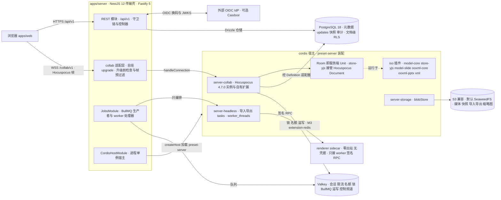

怎么读：左侧大框是同一个 apps/server 进程（按 `CORDEX_ROLE` 可拆成多个进程，见图 0-2），中框是进程内嵌的 cordis 宿主；实线是调用或数据流，虚线「运行于」表示 Room 的 Unit 与客户端加载同一份 iso 插件代码。浏览器的 WS 不经 Nest 适配器，而是由 collab 适配层在 Fastify 底层 server 的 `upgrade` 事件上接管后交给 Hocuspocus（§0.4）；renderer 是只接受 worker 入站的独立容器。浏览器到 IdP 与对象存储都经反向代理子域，部署形态见 §1 图 1-1。
依据：原 30/08（已撤销）第 0 节，rulings §4.21 迁入并改写；ADR-0039 决策 1、4；ADR-0026 决策 1；ADR-0037 决策 1。

**图 0-2 进程角色：`CORDEX_ROLE` 到模块与包**

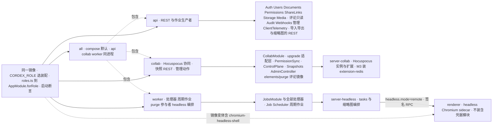

怎么读：左侧一个镜像按环境变量分出五个角色，实线指向该角色装配的模块或包；`all` 以虚线「包含」另外三个 Nest 角色。只有 collab 与 all 激活 `collabServer` 并在 `upgrade` 上挂接 Hocuspocus；worker 只为参与者与保留期作业装 Pg 存储。逐模块、逐部件的装配以 §5 矩阵为准，`roles.ts` 是它的代码形态。
依据：原 30/08（已撤销）第 0 节，rulings §4.21 迁入并改写；ADR-0037 决策 1；ADR-0039 决策 1；本文 §4–§5。

### 0.1 里程碑边界

M1–M4 的里程碑边界表只在 [30/01](../30-architecture/01-overview.md) §7 保留一份（rulings §4.21 R-d-07，原 30/08（已撤销）第 0.1 节的服务端边界表不再复述）；逐项边界以 [PRD 05](../10-prd/05-milestones-and-scope.md) §0.3 为准，服务端交付落点（模块、路由、队列、迁移）见本文 §3。本轮协同改用 Hocuspocus 后的拆分：**M2**（单实例 `all`）交付 Hocuspocus 嵌入、自有扩展、写入器与溢写，客户端同期换用官方 provider；**M3** 装 extension-redis、跨实例 PermissionSync 与按文档哈希分流（H-d-32）。

### 0.2 跨端原则的后端落点

五条跨端原则（30/01 统一原则表的 P9–P13）的定义在 30/01，本节只写它们在后端落到哪里，每条前标对应的 P 号：

1. **P9 Nest 薄壳**（D8）：业务逻辑在 `server-*` 包与各模块的 domain / application 层，Nest 只做传输、装配与编排；`apps/server/src/modules/**` 不得 import `yjs`、`@cordexjs/model-*`、`@cordexjs/ooxml-*`（depcruise `server-app-thin`；白名单新增 `@cordexjs/xml`，只供媒体模块做 SVG 消毒，rulings §4.21 X:q-xml-package）。协同接入同样是薄壳：Nest 只在底层 server 的 `upgrade` 上做升级前检查并把 socket 交给 Hocuspocus。
2. **P10 cordis 宿主内嵌**：每个进程一个宿主（`CordisHostModule`）；一个 Room = 宿主里的一个服务端 Unit，由 store-yjs 接管 Hocuspocus 的 Document（与客户端同一份 store-yjs 与文档类型代码，H-d-26）；worker 的导入导出在 `worker_threads` 中每任务新建宿主（§9，[06](06-modules-jobs-import-export-thumbnails.md) §8）。
3. **P11 fail-closed 多点**：REST 的 `DocumentRoleGuard` 与协同接入（`onAuthenticate` 验票、`beforeSync` 每帧角色检查与连接污染规则）都是「无显式允许即拒绝」；客户端命令管线是第三点（只作 UX）；文档级 RLS 是纵深防御，不替代前两点（ADR-0029、ADR-0022 修订）。
4. **P12 驱动放行**：`@nestjs/*` 只在 `apps/server`；`pg`、`drizzle-orm`、`ioredis`、`@aws-sdk/*` 只在适配器目录与 `server-storage`；`@hocuspocus/server` 只在 `server-collab`；extension-redis 与 ioredis 只在 `apps/server` 组装后注入，`server-collab` 仍不依赖 `pg`、`ioredis`、`@aws-sdk`（§11，H-d-25）。
5. **P13 文档类型盲**：`server-*` 不 import 任何垂直束，导入导出经 `formats` / `documentTypes` 按 `documentType` 取 codec，插件清单由组合根 `cordis-host/preset-server.ts` 提供（rulings §4.18 FE-01）；评论镜像按 `comments.` 前缀识别（决策 INC-39）；M5 新增 doc 类型时 `server-*` diff = 0。

### 0.3 后端分层

**图 0-3 后端分层：传输壳、应用层、server-* 包、适配器与存储**

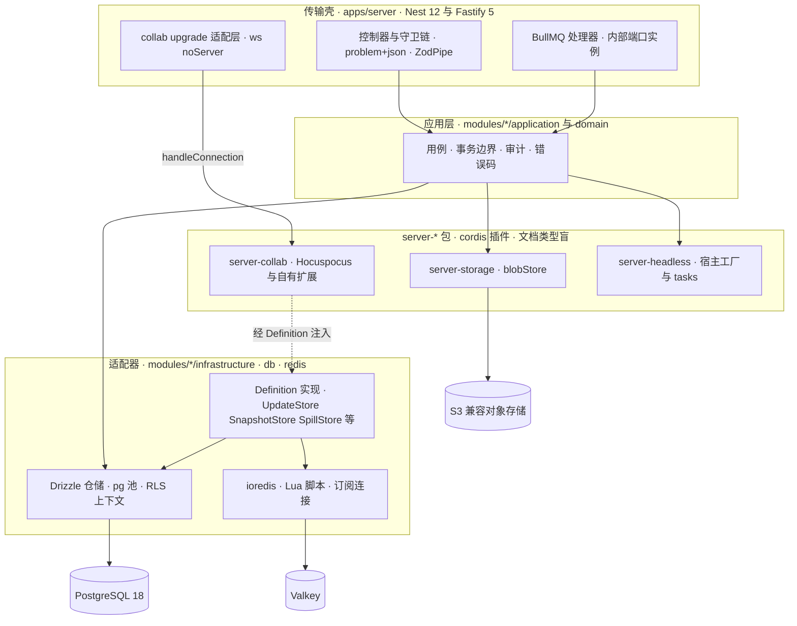

怎么读：自上而下是一次请求穿过的层；实线是调用，虚线表示 `server-collab` 只持有 Definition 端口、实现由 Nest 目录里的适配器注入。驱动（pg、ioredis、`@aws-sdk`）只出现在最下两层，`server-*` 包与应用层不直接触碰驱动（§11）；Hocuspocus 属于 `server-collab` 包内部，Nest 层只见到 `handleConnection` 这一个入口。
依据：本节 0.2 第 1、4 条；§11；[05](05-modules-collab-and-snapshots.md) §2；ADR-0039 决策 4。

### 0.4 协同接入：Hocuspocus 挂点

rulings §4.21（q-ws-gateway，用户知情选择的非推荐项）把协同 WS 接入与 Room 框架改为 **Hocuspocus 4.7.0**（`@hocuspocus/server`，MIT，精确钉版本；[ADR-0039](../30-architecture/adr/0039-collab-server-hocuspocus.md)，部分取代 ADR-0023）。Hocuspocus 承担 WS 会话、y-protocols 同步与 awareness 中继、房间文档表与并发加载去重、每连接串行队列、认证前排队、Auth 与续票通道，以及 M3 的跨实例状态同步；自有逻辑全部挂在它的钩子上。帧处理细节以 [16](16-ws-protocol-server-view.md) 为准，Room 机制以 [05](05-modules-collab-and-snapshots.md) 为准。

**图 0-4 协同接入：upgrade 自挂与 Hocuspocus 钩子挂点**

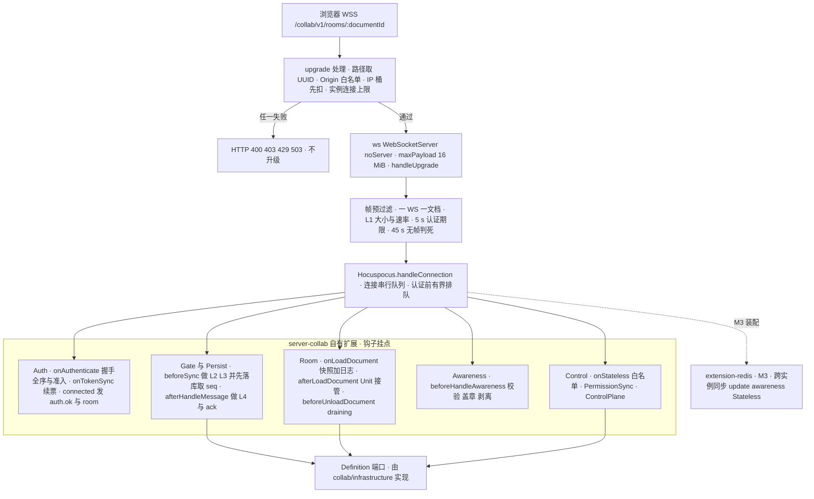

怎么读：自上而下是一条连接从升级到进入房间的路径。升级前检查与帧预过滤由 `apps/server` 的适配层完成（原始 socket 在自己手里，才能在进 Hocuspocus 之前做 L1 门禁、认证期限与自定义关闭码）；框内五个扩展是 `server-collab` 挂在 Hocuspocus 钩子上的自有逻辑，IO 一律经 Definition 端口；虚线是 M3 才装配的 extension-redis。不用 Hocuspocus 的 `Server` 类（它会注册 SIGTERM 并 `process.exit`）与 Nest `WsAdapter`。
依据：ADR-0039 决策 1–9；H-d-01～H-d-22；证据 H `map.architectureSketch`。

**表 0-1 钩子挂点与自有逻辑**

| 挂点 | 自有逻辑 | 取代或保留 |
|---|---|---|
| `upgrade` 处理（apps/server 的 `CollabUpgradeHandler`） | 路径取 UUID → Origin 白名单 → IP 桶先扣（验票通过即退）→ 实例连接上限，任一失败回 HTTP 400 / 403 / 429 / 503；通过后 `handleUpgrade` 并调 `handleConnection` | 取代 `WsAdapter(ws)` 与 `@nestjs/platform-ws` |
| 帧预过滤（适配层） | 帧地址必须等于 URL 文档（一 WS 一文档）；L1 大小与令牌桶；5 s 认证期限；每 5 s 巡检、45 s 无帧即关；满员房间只合并 awareness 帧（包装 `Connection.send`，按连接 100 ms） | 自写（Hocuspocus 没有消息速率与单帧门禁，`timeout` 只兜底） |
| `onAuthenticate`、`connected`、`onTokenSync` | 验票、jti、permVersion、握手全序、每用户单实例 32 上限、Lua 名额、实测权重准入；`auth.ok` 与 `room` 经 Stateless 发出；续票时适配层暂停后续帧、结果直接写 `connection.readOnly` | 取代首帧 `CONTROL.auth`、`auth.refresh` 专用帧与「认证前 SYNC 即 4401」 |
| `beforeSync` | L2 角色与锁定、L3 `Y.decodeUpdate`（线上只有 Yjs V1）；await 写入器组提交（落库取 seq，PG 故障时按档位溢写）后才放行应用与广播；连接污染规则（丢过写入帧的连接之后不落库、不回 ack，直到重连） | 保留 ADR-0025 逐帧落库语义（H:q-hp-persist-ack） |
| `afterHandleMessage` | L4 软门禁修复（修复事务先广播，H:q-hp-server-tx）；Stateless `ack{tier, seq}` | 取代 `CONTROL.ack` 专用帧 |
| `onLoadDocument`、`afterLoadDocument`、`beforeUnloadDocument` | 快照 + 日志加载、迁移、认领溢写、墓碑清扫，末尾 `document.flush()`；Unit 接管 Document；60 s draining 宽限与内存档钉住；文档名为 `docId:epoch` | 取代 RoomManager 的文档表与并发加载去重 |
| `beforeHandleAwareness` | zod、2 KiB、clientID 与 user.id 盖章、只读连接剥离；只就地删改、从不抛错 | 取代 awareness-relay |
| `onStateless` 与自有 Valkey 订阅 | CONTROL 白名单；**PermissionSync**：经 `AuthorizationSource.onPermissionChanged` 订阅 `perm:doc` → 逐会话重算角色 → 改 `readOnly` 并发 Stateless `permission`，降为 none 时 `ws.close(4403)`，Valkey 恢复后全量重算；**ControlPlane**：经 `FanoutBus.subscribeControl` 订阅 `room:{docId}:ctl` 的 close、epoch 与锁定 | 自写（Hocuspocus 没有跨实例控制面） |
| `onStoreDocument` | 只作压缩检查节拍，永不抛错；不用它持久化 | — |
| extension-redis（M3） | 跨实例同步 update、awareness 与 BroadcastStateless；继承加固（保留离线队列但限 `maxRetriesPerRequest`、覆写 `beforeBroadcastStateless` 与 `onStoreDocument` 加 catch）；独立前缀登记 [14](14-valkey-object-storage-and-retention.md) | 取代 FanoutBus 的帧扇出（FanoutBus 只剩控制频道；R-d-38 按 §4.21 修正） |

横切约定：一个 WS 只承载一个文档，业务关闭一律调原始 `ws.close(码)`，`close-codes.ts` 仍是唯一源并新增 4205、4408 扩为超时通用码（H-d-02、H-d-20）；所有钩子自包 try/catch，未预期异常记 traceId 后 `ws.close(1011)`，另装进程级 `unhandledRejection` 兜底（H-d-19）；step2 单设 16 MiB 上限（等于 `maxPayload`），update 仍 ≤1 MiB，超限 4413（H:q-hp-step2-cap）。不用的部件：`Server` 类、`WsAdapter`、`onStoreDocument` 持久化、extension-database / s3 / sqlite / throttle / webhook / logger 与 transformer（H-d-12）。

### 0.5 数据流

后端的写入只有两条主路：协同 update 走 Hocuspocus 的「写一次」路径（图 0-5），其余业务写入走 REST 用例与作业（图 0-6）。

**图 0-5 一次协同 update 的写一次路径**

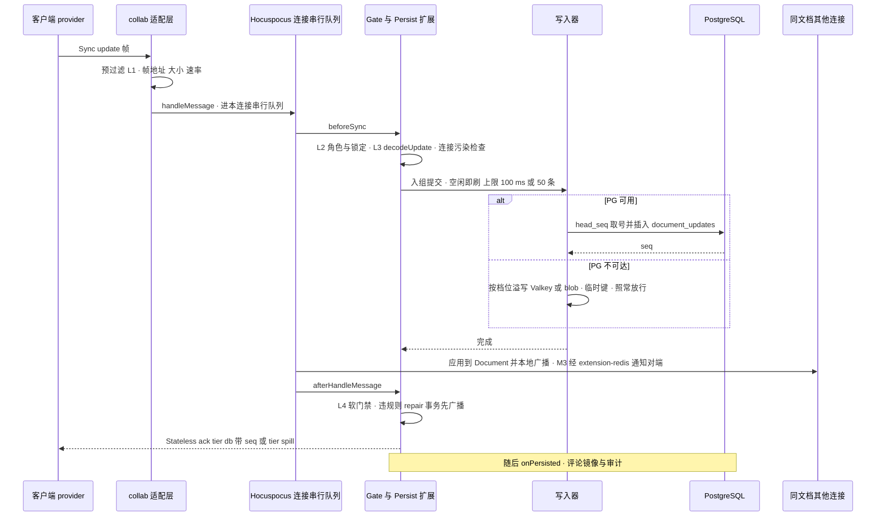

怎么读：纵向是时间，实线是调用或发送，虚线是返回。门禁与落库都在 `beforeSync` 里、应用与广播之前完成，所以 PG 可用时「先落库再广播」，客户端收到 `tier:db` 才清 pending；PG 不可达时按档位溢写并照常广播（rulings §4.18 CO-08），只回 `tier:spill`。跨实例扇入的 update（origin 为 redis）不经 `beforeSync`、不重复落库。服务端自发的低频事务（版本恢复、彻底删除、墓碑清扫）先在复制文档上落库再应用到 Room（H:q-hp-server-tx）。
依据：ADR-0039 决策 4–6；ADR-0025；证据 H `map.architectureSketch` 第 3 条；[05](05-modules-collab-and-snapshots.md) §5–§6；[16](16-ws-protocol-server-view.md) §4–§5。

**图 0-6 REST 与作业的数据流**

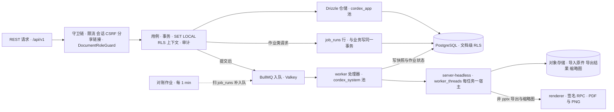

怎么读：上半条是一次 REST 写入——守卫链 fail-closed 后进入用例，用例在一个事务里设 RLS 上下文、写业务表与审计；需要异步处理的请求在同一事务写 `job_runs`，提交后入队，对账作业兜底孤儿行（outbox）。worker 用系统池执行处理器，导入导出在 `worker_threads` 里每任务新建宿主，非 pptx 导出与缩略图交给零出站的 renderer。
依据：[02](02-auth-chain.md) §6；[06](06-modules-jobs-import-export-thumbnails.md) §1–§3、§8–§10；[08](08-db-conventions-roles-rls-migrations.md)；ADR-0026。

## 1. 部署部件视图

与 §0 的分工：§0「架构一页」讲进程内组成（分层、钩子挂点、数据流），本节讲部署部件（镜像、sidecar、存储与入口）；2026-09-26 复核由「一页总览」改名，节号不动。

后端由一个应用镜像 `cordex-server`（按 `CORDEX_ROLE` 装配）、一个独立的 renderer sidecar 和三类存储组成；浏览器唯一入口是 web 容器（静态前端 + 反向代理）。单组织部署，数据模型、API、对象键中都没有租户（rulings §4.15 T-0）。

| 部件 | 形态 | 技术基线 | 运行时设计 |
|---|---|---|---|
| web 容器 | 静态前端 + 反向代理（nginx-unprivileged） | TLS 终止；按路径与子域分流；每响应生成 CSP nonce | [17](17-deployment-and-config.md) |
| `apps/server` | 同一镜像，`CORDEX_ROLE` 选装配 | NestJS 12（`@nestjs/*` 统一 12.x，纯 ESM 构建，OTel 以 `node --import` 预加载注册）+ Fastify 5 适配器；DB 访问 drizzle-orm 0.45.x + 手写 `schema/*.ts`；协同 WS 在 Fastify 底层 server 的 `upgrade` 上自挂（不用 `WsAdapter`）；Node 26（`node:26-slim` + 字体包，不含 Chromium） | 本文 |
| `@cordexjs/server-collab` | cordis 插件（`provide=['collabServer']`）+ 库 | Hocuspocus 4.7.0（`@hocuspocus/server` 精确钉，内持 `Hocuspocus` 类与自有扩展）、Yjs 13.6.x（锁精确版本）、y-protocols；不依赖 Nest、pg、ioredis | [05](05-modules-collab-and-snapshots.md)、本文 §0.4 |
| `@cordexjs/server-storage` | Provider（`blobStore`） | `@aws-sdk/client-s3` + `lib-storage`，全仓唯一 S3 SDK 引入点 | [04](04-modules-documents-storage-media.md) |
| `@cordexjs/server-headless` | 宿主工厂 + tasks | `createHeadlessHost({ adapters, plugins })`，`worker_threads` 每任务一宿主，文档类型盲 | [06](06-modules-jobs-import-export-thumbnails.md) |
| renderer sidecar | `CORDEX_ROLE=renderer`，独立容器 | headless Chromium；零出站、非 root、沙箱 + seccomp、无凭据；只接受 worker 签名 RPC | [06](06-modules-jobs-import-export-thumbnails.md) |
| PostgreSQL 18 | 唯一关系库（支持下限 16） | 文档级 RLS；三个 DB 角色 `cordex_migrator` / `cordex_app` / `cordex_system` | [08](08-db-conventions-roles-rls-migrations.md)–[13](13-ddl-comments-webhooks-audit.md) |
| Valkey | Redis ≥ 7.2 协议 | `noeviction`、AOF `everysec`；权限通知与控制频道、租约锁、BullMQ、名额、会话、限流、一级溢写；M3 起另承载 extension-redis 的跨实例同步频道 | [14](14-valkey-object-storage-and-retention.md) |
| SeaweedFS（或客户自有 S3） | 两个桶：`data`（不开版本化）、`snapshots`（开版本化） | 预签名按 `storage.s3.publicEndpoint` 生成，服务端读写走内网 endpoint | [14](14-valkey-object-storage-and-retention.md) |
| 外部 IdP | 任意 OIDC；compose `idp` profile 可选内置 Casdoor | 服务端只做 OIDC RP，不持有密码 | [02](02-auth-chain.md) |
| 观测 | OTel Collector + Jaeger + Prometheus | Grafana / Loki 为需显式开启的 AGPL profile | [18](18-observability-and-ops-endpoints.md) |

**图 1-1 后端一页总览**

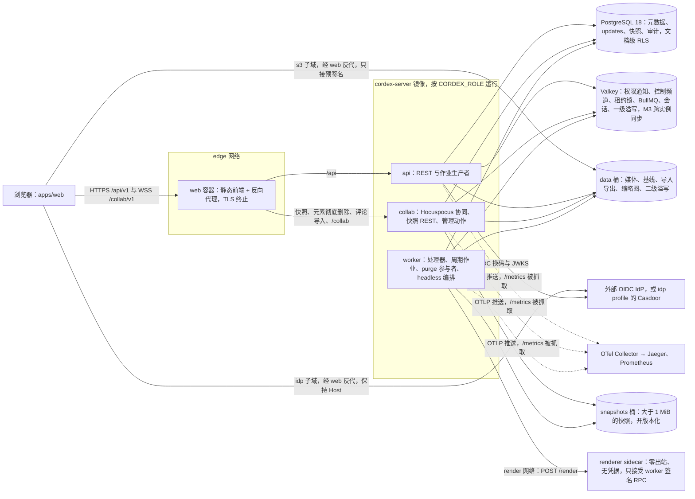

怎么读：浏览器的所有流量都进 web 容器，按路径分到 api 或 collab，按子域转到 IdP 与对象存储（两者不开宿主端口，保持 Host 头）；中间框是同一镜像的三种 Nest 角色（`all` 即三者同进程），实线是运行期读写，虚线是遥测。renderer 只挂 render 网络、只接受 worker 入站，不连任何存储。本图是部署部件视图，进程内的组成见 §0 图 0-1。
依据：本文 §0；[30/01](../30-architecture/01-overview.md) 的 C4 容器图；[17](17-deployment-and-config.md) §2–§3；ADR-0037 决策 1–3；rulings §4.18 BE-01、BE-03、BE-11；决策 C-08/OBJ（两个桶）、SG-01（签名 RPC）。

## 1a. 技术栈与复用组件摘要

rulings §4.21 轮的用户诉求之一是「后端凡有可复用的成熟组件，应尽可能用成熟组件」。本节按层列出服务端采用的成熟组件与许可（表 1a-1），以及维持自研的能力和「为什么没有合适的成熟库」（表 1a-2）。逐项版本、包装位置、替代与否决理由、传递依赖许可以 [19 后端复用组件清单](19-reuse-and-dependency-catalog.md) 为唯一全表，本节只是摘要。准入与许可分级同前端（[ADR-0049](../30-architecture/adr/0049-dependency-admission-and-license-tiers.md)）：宽松类视同放行，OFL 限字体、CC0 限数据与内置源码、MPL-2.0 限未修改依赖，LGPL / GPL / AGPL / SSPL / BUSL / Unlicense 一律禁止；镜像另按主组件许可白名单，AGPL 组件（Grafana、Loki）只放显式 profile。

**图 1a-1 后端技术栈分层：每层复用的成熟组件**

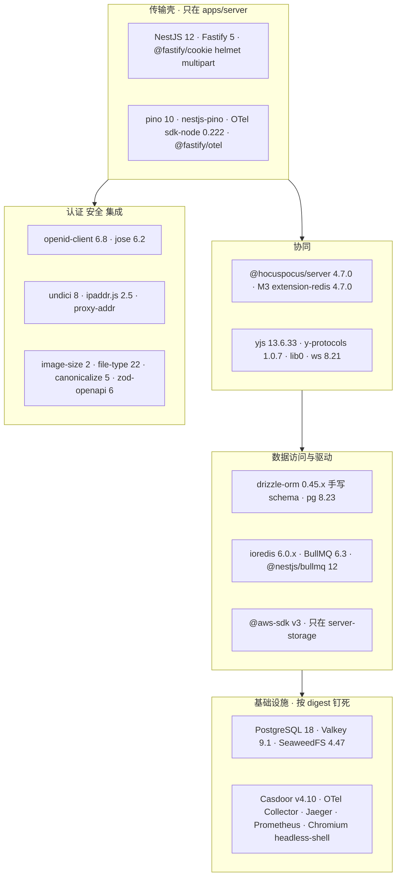

怎么读：五个子图自上而下是从传输壳到基础设施的依赖方向，箭头只表示「上层用下层」，不表示调用；节点是该层复用的成熟组件组。协同层的 Hocuspocus 取代了原先自研的 WS 传输、房间文档表、awareness 中继与跨实例扇出（§0.4）。测试工具（testcontainers、vitest、oidc-provider）不进运行时，图中未画。
依据：表 1a-1；[19](19-reuse-and-dependency-catalog.md)；rulings §4.21（q-nest-major、q-db-access、q-ws-gateway、q-webhook-sig）。

**表 1a-1 按层采用的成熟组件**（版本经 `npm view` 核实于 2026-09-26；精确锁与小版本以 19 为准）

| 层 | 采用 | 许可 | 落点（单点引入） | 说明 |
|---|---|---|---|---|
| 传输壳 | `@nestjs/*` 12.x（core / common / platform-fastify / testing 12.1.0，bullmq 12.0.0，terminus 12.1.x；不装 `@nestjs/config`、`@nestjs/schedule`，见 [60/19 §2.1](19-reuse-and-dependency-catalog.md)，R-d-42、R-d-56）、fastify 5.12 | MIT | `apps/server` | rulings §4.21 q-nest-major（用户选择，非推荐项）：M1 直接上 Nest 12；纯 ESM 构建；ADR-0022 修订定 Fastify 5 |
| 传输壳 | @fastify/cookie 11.1、@fastify/helmet 13.1、@fastify/multipart 10.1、@fastify/busboy 3.2、proxy-addr 2.0 | MIT | `apps/server`（main.ts、导入控制器）；busboy 在 server-headless 的 renderer RPC | 会话 cookie（不签名）、最小安全头、导入上传、流式 multipart、可信反代取 IP |
| 可观测 | pino 10.3、nestjs-pino 5.2、@opentelemetry/sdk-node 0.222、@fastify/otel 0.21、@opentelemetry/exporter-prometheus 0.222 | MIT / Apache-2.0 | `apps/server` observability | OTel 改为 `node --import` 预加载注册；`@opentelemetry/instrumentation-nestjs-core` 0.68 不支持 Nest 12，Nest 层 span 暂由 @fastify/otel 加手工 span 补齐，上游支持后再启用 |
| 协同 | @hocuspocus/server 4.7.0（精确钉，含 GHSA-xwhh-v746-pj9m 与 GHSA-8v8m-xjrm-95h6 修复） | MIT | `server-collab` | WS 会话、y-protocols 同步与 awareness 中继、房间文档表、每连接串行队列、认证前排队、Auth 与续票通道（ADR-0039） |
| 协同 | @hocuspocus/extension-redis 4.7.0（M3；传递依赖 @sesamecare-oss/redlock 1.4.0 的 package.json 标 UNLICENSED、LICENSE.md 为 MIT，按附证据的例外登记） | MIT | `apps/server` collab 组装后注入 | 跨实例同步；反代按 documentId 一致性哈希后常态只有一个实例持有文档（H:q-hp-fanout） |
| 协同 | yjs 13.6.33（根 overrides 锁单份）、y-protocols 1.0.7、lib0 0.2.x、ws 8.21 | MIT | `server-collab`；ws 只在 `apps/server` collab 适配层 | ws 以 `noServer` 模式接 `upgrade` |
| 数据访问 | drizzle-orm 0.45.x + 手写 `db/schema/*.ts`；pg 8.23 + pg-query-stream 4.17 | Apache-2.0 / MIT | `apps/server/src/db/**`、`modules/*/infrastructure/**` | rulings §4.21 q-db-access：drizzle 只作类型镜像与仓储查询，迁移仍以手写 SQL 为事实源；漂移检查改为直查 `pg_catalog`（含 `relkind 'p'` 分区父表），不用 drizzle-kit pull；Drizzle 1.0 的破坏性变更须在 M2 前评估 |
| 存储驱动 | ioredis 6.0.x；@aws-sdk/client-s3、lib-storage、s3-request-presigner 3.x | MIT / Apache-2.0 | ioredis 在 `apps/server` 的 redis、限流与适配器目录；S3 SDK 只在 `server-storage` providers | extension-redis 可注入外部客户端（见表后注） |
| 作业 | bullmq 6.3、bullmq-otel 2.0、croner 10、commander 15 | MIT | `apps/server` 各模块 infrastructure、`ops/cli.ts` | 队列、Job Scheduler 周期作业、运维 CLI |
| 认证与安全 | openid-client 6.8、jose 6.2、undici 8、ipaddr.js 2.5 | MIT | AuthModule；Webhook 出站与 SSRF 守卫 | OIDC RP、JWT / JWKS、出站 HTTP、网段判定 |
| 媒体与格式 | image-size 2.0、file-type 22；fflate（经 ooxml-core）；opentype.js 2.0；`@cordexjs/xml`（自研 L0 包） | MIT | media 模块、server-headless | 图片尺寸只读文件头、MIME 嗅探、zip、node-font 度量；SVG 消毒基于 xml 包 |
| API 与审计 | zod 4、zod-openapi 6（构建期）、canonicalize 5.1、quick-lru 7.3 | MIT / Apache-2.0 | protocol 构建脚本、AuditModule、各模块 infrastructure | OpenAPI 3.1 生成（不用 nestjs-zod，它不支持 Nest 12）；JCS；进程内 TTL 缓存 |
| 渲染 | playwright-core 1.63 + chromium-headless-shell | Apache-2.0 / BSD 系 | `server-headless` thumbnails、renderer 镜像 | 缩略图与 PDF 复用 `/render` 页 |
| 测试（不进运行时） | testcontainers 12.1、vitest 5、@nestjs/testing 12.1、oidc-provider 9.12、toxiproxy 容器 | MIT | `apps/server/test` | 集成、契约、故障注入；压测驱动自研（k6 为 AGPL） |
| 基础设施 | PostgreSQL 18、Valkey 9.1.2、SeaweedFS 4.47、Casdoor v4.10.x、nginx-unprivileged、OTel Collector + Jaeger + Prometheus | PostgreSQL / BSD-3 / Apache-2.0 / BSD-2 | compose 与 Helm，按 digest 钉死 | Grafana / Loki（AGPL）只在显式 profile |

表后注（ioredis 版本，按 Hocuspocus 源码 v4.7.0 核实）：extension-redis 的 `Configuration` 接受 `redis` 实例或 `createClient` 工厂注入（`packages/extension-redis/src/Redis.ts` 41–67、204–219 行），redlock 也用注入的 pub 客户端建锁，因此**运行期连接统一由 `apps/server` 的 ioredis 6.0.x 实例提供**；但该扩展在 `package.json` 把 `ioredis ~5.6.1` 声明为硬依赖、并在模块顶层 import（`Redis.ts` 31–37 行：31–36 为 type-only 导入，37 为运行时 `import RedisClient from "ioredis"`，按 4.7.0 源码核实），redlock 1.4.0 另以 peer `ioredis >=5` 引用，所以 5.6.x 包仍会被安装、只是不被实例化。这是一个「装而不实例化」的双版本例外，已在 [19](19-reuse-and-dependency-catalog.md) §3.2 与单版本规则中登记（不用 overrides 强改，~5.6.1 到 6 跨主版本）；扩展用到的客户端 API（`duplicate`、订阅与发布、`messageBuffer` 事件等）在 ioredis 6.0.0 中仍保留（19 §3.2 按 npm 包实查），M3 接入时再由协同契约套件回归。

**表 1a-2 维持自研的能力与理由**（凡维持自研都写明为什么没有合适的成熟库）

| 能力 | 落点 | 为什么没有合适的成熟库 |
|---|---|---|
| Hocuspocus 上的自有扩展：握手全序与准入、门禁挂点、逐帧落库写入器与两级 ack、三档溢写、Room 状态映射、awareness 校验盖章、PermissionSync、ControlPlane、停机 `drainAll` | `server-collab`、`apps/server` collab 适配层 | Hocuspocus 原生只有「已应用到内存」的 `SyncStatus`（无 seq、不代表已落库）和整文档 debounce 存储：`onStoreDocument` 失败不重试，之后一次无修改的断开就会卸载文档、丢失未落库修改（实验 exp2）；没有跨实例控制面；钩子抛错只关文档连接且客户端收到的码恒为 1000。S-3a、CO-09、NF-03 的语义只能挂在钩子上自写（ADR-0039） |
| update 日志、压缩与墓碑清扫 | `server-collab` + `PgUpdateStore` / `PgSnapshotStore` | extension-database、s3、sqlite 都是整文档快照覆盖写，失去逐帧归属、seq 与 `onPersisted` |
| 租约锁 LeaseLock（`SET NX PX` + INCR fencing）与房间名额 `admit.lua` | collab infrastructure | 需要 fencing token 与跨实例按用户去重；redlock 只给锁、不给 fencing，extension-redis 自带的锁超时 1 s、拿不到即跳过存储 |
| 迁移执行器（sha256 台账、advisory lock、无 down）与 schema 漂移检查 | `apps/server/src/db/migrator.ts`、`cordex-ops db:*` | 分区、RLS、函数、GRANT 只能手写 SQL，手写 SQL 是事实源；drizzle-kit pull 会丢分区父表（`relkind 'p'`，上游 issue #6093，证据 R `backendReuse`），所以漂移检查直查 `pg_catalog` |
| RLS 会话上下文与系统事务入口 | `db/client.ts`、`rls-context.ts` | 事务级 GUC（`set_config(…, true)`）要兼容事务池；ORM 不提供这一层 |
| 登录会话、刷新轮换与 ≤5 s 吊销；CSRF 与 Origin 校验；协同票据 | AuthModule、`TicketVerifier` | 已复用 openid-client、jose、@fastify/cookie 三件；只自写把它们串起来的会话状态机、Valkey 吊销与票据单次使用（jti），这些是本项目的安全口径（ADR-0029），没有现成组合 |
| 限流（Valkey Lua 令牌桶，WS 升级先扣后退） | `common/rate-limit` | rate-limiter-flexible 只有固定窗口，满足不了 rulings §4.20 BE-01 / BE-02 的令牌桶与 HTTP、WS 共用桶 |
| Webhook 签名（Standard Webhooks：`webhook-id`、`webhook-timestamp`、`webhook-signature: v1,<base64>`） | `webhook-signer.ts`（node:crypto，约 15 行） | 官方 standardwebhooks 包依赖 fast-sha256（Unlicense，禁用）；格式本身简单，按规范自写即可（rulings §4.21 q-webhook-sig） |
| 审计哈希链与每日封存 | AuditModule | JCS 已复用 canonicalize；「SHA-256(prev ‖ JCS(entry))」的链、封存与校验没有现成库 |
| SVG 消毒（严格 XML、拒 DOCTYPE、白名单） | media 模块 `svg-sanitizer.ts`（基于 `@cordexjs/xml`） | DOMPurify 在 Node 要带 jsdom（约 7 MB），需在持凭据的 api 进程里用完整 DOM 引擎处理不可信输入；按 HTML 序列化会破坏独立 SVG（U+00A0 写成 `&nbsp;`）；DOCTYPE 与实体须严格拒绝（以 [60/19 §15.4](19-reuse-and-dependency-catalog.md) 为准） |
| SSRF 出站守卫 | `egress-guard.ts` | 防 DNS 重绑定需要「解析 → 判段 → 固定 IP 连接」的编排；判段已复用 ipaddr.js |
| worker → renderer 的 Ed25519 签名 RPC | protocol `render/sidecar.ts`、server-headless | 不暴露 Playwright run-server、不用共享密钥；只需请求签名与验签 |
| 配置加载（`CORDEX_*`、`*_FILE`、角色 × 机密矩阵、`--dry-run`） | `apps/server/src/config/*` | zod 解析已复用；未登记键拒绝启动、按角色核对机密等规则是本项目的部署口径 |
| UUIDv7 | `@cordexjs/shared` | L0 零依赖，时钟与随机可注入（ADR-0014） |

依据：rulings §4.21；R-d-36 至 R-d-60（其中 R-d-47 的 nestjs-core instrumentation 改为暂不可用，R-d-60 的 require(esm) 口径随 ESM 构建失效，R-d-38 中 FanoutBus 的帧扇出改为 M3 由 extension-redis 承担，FanoutBus 只剩控制频道）；H-d-22～H-d-25；[19](19-reuse-and-dependency-catalog.md)。

---

## 1b. 包与插件规划（后端）

2026-10-01 新增。全局数字见 [30/01 §2a](../30-architecture/01-overview.md#2a-包与插件规划)，前端部分见 [50/01 §1b](../50-frontend/01-overview-and-runtime-map.md#1b-包与插件规划前端)；本节只看服务端。数字取自 [`docs/_tools/plugin-counts.json`](../_tools/plugin-counts.json)，逐行明细以 [40/16 §2](../40-modules/16-plugin-catalog.md#2-插件与运行时单元总账主表) 为准（本节行号即 40/16 §2 行号）。

**后端数字卡**：服务端只有 3 个 node 包（`server-collab`、`server-storage`、`server-headless`）加应用 `apps/server`；服务端插件共 15 个（只计 cordis 插件，rulings §4.23 补充裁决）。另有 Nest 模块 25 个（含配置、观测、数据库、Redis 等基础模块），走 Nest 的 DI，不计入插件。服务端插件全部装在 `CordisHostModule` 持有的唯一宿主里，由装配脚本 `preset-server` 装配：11 个条目，按单元展开为 21 个（其中 7 个是与浏览器同一份源码的 iso 插件：`model-core`、`store-memory`、`store-yjs`、`model-slide`、`ooxml-pptx`、`engine-layout`、`engine-render`）。

### 1b.1 服务端的 cordis 插件（15 个）

| 行 | 单元 | 所在 | 形态 | 实现的 Definition 或提供的服务 | 激活角色 | 首装 |
|---|---|---|---|---|---|---|
| 39 | `server-storage` | `@cordexjs/server-storage` | provider | `BlobStore`（`blobStore`） | api / collab / worker | M2 |
| 40 | `server-collab` | `@cordexjs/server-collab` | plugin | 提供 `collabServer`（Hocuspocus 实例与自有扩展） | collab | M2 |
| 41 | `server-headless` | `@cordexjs/server-headless` | host + provider | headless 宿主工厂、`node-font` 度量 | worker | M2 |
| 42–49 | `RedisFanoutBus`、`RedisLeaseLock`、`PgUpdateStore`、`PgSnapshotStore`、`AuthzSource`、`RedisMembershipRegistry`、`RedisSpillStore`、`BlobSpillStore` | `apps/server` `modules/collab/infrastructure` | provider ×8 | `FanoutBus`、`LeaseLock`、`UpdateStore`、`SnapshotStore`、`AuthorizationSource`、`MembershipRegistry`、`SpillStore` 一二级（[05](05-modules-collab-and-snapshots.md) §2.2） | 作为 `server-collab` 的注入件随它激活 | M2 |
| 50–52 | `PinoLoggerAdapter`、`OtelTelemetryAdapter`、`ErrorsReporterAdapter` | `apps/server` `cordis-host/adapters` | provider ×3 | kernel 的 logger、`telemetry.sink`、`errors.sink` | api / collab / worker | M2 |
| 53 | `CordisHostService` + `preset-server.ts` | `apps/server` `cordis-host` | host | 进程单例根 Context（§9） | api / collab / worker（renderer 不装） | M2 |

不计入的服务端装配件：M3 的 `HardenedRedis`（extension-redis 加固子类）、`WsConnectionAdapter`、`server-collab` 的可选注入 `pluginSetSource`——它们不经 `ctx.plugin()` 挂载，也不是登记的 Definition（40/16 §0 重算说明）。

### 1b.2 `preset-server` 装配的插件

| 条目 | 状态 | 激活角色 | 40/16 §2 行 |
|---|---|---|---|
| kernel 基础服务的 3 个 Node 适配器（合 1 条） | ● | api / collab / worker | 50–52 |
| `model-core` | ● | api / collab / worker | 5 |
| `store-yjs` | ● | api / collab / worker | 7 |
| `store-memory` | ◐ 只供 headless 校验与迁移 | worker | 6 |
| `model-slide`（只读） | ● | api / collab / worker | 8 |
| `model-slide/editing` | 未注明（40/16 §8 G-1） | — | 9 |
| `ooxml-core` + `ooxml-pptx` | ● | api / collab / worker | 11、12 |
| `engine-layout` | ● | api / collab / worker | 18 |
| `engine-render`（只用 iso 契约层） | ◐ | api / collab / worker | 19 |
| `server-storage` | ● | api / collab / worker | 39 |
| `server-collab`（含 8 个 IO 适配器注入） | ● | collab | 40（42–49） |
| `server-headless` | ● | worker | 41 |

合计 9 常驻 + 2 部分装载 = **11** 个条目；插件清单只有一份，角色差异只在 `collabServer` 与 headless 宿主工厂两处开关（§9）。

### 1b.3 Nest 模块（25 个，不计入插件）

基础 5（`ConfigModule`、`ObservabilityModule`、`DbModule`、`RedisModule`、`CordisHostModule`）；身份与访问 5（`AuthModule`、`UsersModule`、`PermissionsModule`、`ShareLinksModule`、`PluginsModule`）；文档与存储 3（`DocumentsModule`、`StorageModule`、`MediaModule`）；协同与快照 2（`CollabModule`、`SnapshotsModule`）；作业 3（`JobsModule`、`ImportExportModule`、`ThumbnailsModule`）；评论与集成 3（`CommentsModule`、`WebhooksModule`、`AuditModule`）；运维 4（`HealthModule`、`MetricsModule`、`InternalModule`、`ClientTelemetryModule`）。逐模块的 BC、文件级与首次交付见 §3；首次交付 M2 的 21 个、M3 的 4 个（`ShareLinksModule`、`CommentsModule`、`WebhooksModule`、`MetricsModule`）。Nest 模块不是插件，不计入任何插件数：它们走 Nest 的 DI，按角色整模块装配（§5），只经 `CordisHostService` 读取宿主服务。

### 1b.4 按 `CORDEX_ROLE` 的装配差异

| 角色 | `preset-server` 激活的条目 | cordis 侧差异 | Nest 侧差异（§4、§5） |
|---|---|---|---|
| `all` | 11（9 + 2） | 全部激活 | 三个角色装配之并 |
| `api` | 8（7 + 1） | 不激活 `collabServer`，不取 headless 宿主工厂，从不打开 Unit | 不装 `SnapshotsModule`、`AdminController`，不注册处理器与周期作业 |
| `collab` | 9（8 + 1） | 唯一激活 `collabServer` 与 8 个 IO 适配器的角色 | 装 `CollabModule`、`SnapshotsModule`，另装 Permissions、ShareLinks 供链接角色重算 |
| `worker` | 10（8 + 2） | 唯一取用 headless 宿主工厂（含 `store-memory` 校验与迁移） | 全部 BullMQ 处理器与周期作业；HTTP 只有探针 |
| `renderer` | 0 | 不装 `CordisHostModule`；`/render` 页的内容级插件集由 worker 经 RPC `contentPlugins` 下发（rulings §4.24 AL-3，[06 §10.3](06-modules-jobs-import-export-thumbnails.md)） | 不装 DB、Valkey、S3、Metrics、Audit、PluginsModule；只有渲染 RPC 与健康探针 |

**图 1b-1 服务端：一个宿主、十一个条目、二十五个 Nest 模块**

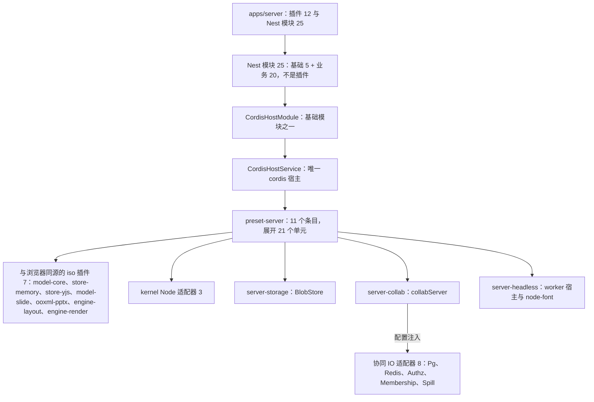

怎么读：从上往下是「谁持有谁」：`apps/server` 里 25 个 Nest 模块中只有 `CordisHostModule` 持有 cordis 宿主，宿主由 `preset-server` 装配 11 个条目；8 个协同 IO 适配器不单列条目，而是作为 `server-collab` 的配置注入。节点上的数合起来：iso 7 + 适配器 3 + storage 1 + collab 1 + IO 8 + headless 1 = 21 个单元；其中 14 个加上宿主 `CordisHostService` 本身，就是 1b.1 表的 15 个服务端插件，另外 7 个是与浏览器共用的 iso 插件。`apps/server` 节点的「插件 12」是其中住在应用目录里的 8 个 IO 适配器、3 个 kernel 适配器与宿主，另 3 个服务端插件在 LS 包里。
依据：40/16 §2 行 39–78、§5.1；§3、§9。

**图 1b-2 各角色激活的 preset-server 条目**

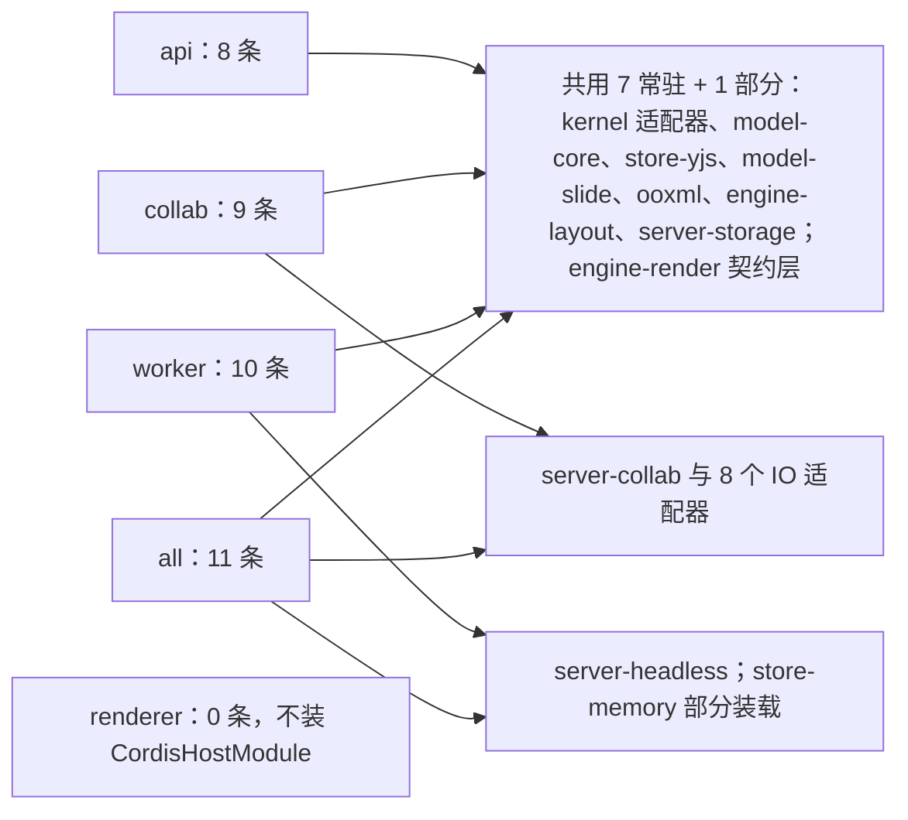

怎么读：左侧五个角色连向它激活的条目组；`common` 是所有装 `CordisHostModule` 的角色都激活的部分，差异只在 `server-collab`（collab、all）与 `server-headless`（worker、all）两组，`renderer` 不连任何组。
依据：40/16 §5.1「激活角色」列；§4、§9。

---

## 2. 入口四类

| 类别 | 入口 | 所在角色 | 鉴权 | 事实源 |
|---|---|---|---|---|
| REST | `https://<host>/api/v1/*`（Nest 全局前缀）；无前缀的 `/healthz`、`/readyz` | api；`/api/v1/documents/:id/snapshots*`、`…/elements/purge` 与 `…/comments/import` 在 collab | 会话 cookie + 全局守卫链（限流 → 会话 → CSRF → 分享链接 → 控制器级角色守卫），`@Public` 白名单例外 | [15](15-rest-api-catalog.md)、[02](02-auth-chain.md) |
| WS | `wss://<host>/collab/v1/rooms/:documentId`（Fastify 底层 server 的 `upgrade` 事件，一 WS 一文档，线上为 Hocuspocus 帧） | collab | 升级前 Origin 白名单与 IP 桶；collab ticket（60 s、单次、绑定文档与 permVersion）放在 Auth 帧的 token JSON 里，由 `onAuthenticate` 验证 | [16](16-ws-protocol-server-view.md)、本文 §0.4 |
| 作业 | BullMQ 八条队列（[06](06-modules-jobs-import-export-thumbnails.md) §1，无 `compaction`；2026-10-03 按 rulings §4.24 AL-7 增 `automation`）+ Job Scheduler 周期作业（挂 `maintenance`） | 生产者主要在 api / collab（worker 的处理器与周期作业也会入队，如首页缩略图、`trash-expiry` 发起永久删除，见 [06](06-modules-jobs-import-export-thumbnails.md) §1）；处理器与周期作业只在 worker | 作业负载携带发起人或 `system(<作业名>)` 上下文；系统作业走 `cordex_system` 连接池 | [06](06-modules-jobs-import-export-thumbnails.md) |
| 内部 | 内部端口 9464（只绑 backend 网络）：`/metrics`、`/internal/diagnostics/*`、`/internal/admin/*`；renderer RPC `POST /render`（只在 render 网络）；Valkey 频道 `room:{docId}:ctl`（ControlPlane 订阅）、`perm:doc:{docId}`（PermissionSync 订阅），M3 起另有 extension-redis 的同步频道（原 `collab:doc:{docId}` 帧扇出频道作废，键名登记以 [14](14-valkey-object-storage-and-retention.md) §3.1 为准） | `/metrics` 与诊断在 api / collab / worker；`/internal/admin/documents/*` 只在 collab；`/internal/admin/audit/verify` 只在 worker；`/render` 在 renderer | `/metrics` 只靠网络隔离；`/internal/*` 另验运维令牌（`CORDEX_OPS_TOKEN_FILE`，常量时间比较）；`/render` 验 Ed25519 签名；Valkey 频道只在 backend 网络 | [18](18-observability-and-ops-endpoints.md)、[06](06-modules-jobs-import-export-thumbnails.md)、[14](14-valkey-object-storage-and-retention.md) |

- `/internal/*` 不加 `/api/v1` 前缀、反代不转发，且与 `/metrics` 同在内部端口，不经 `SessionGuard`（依据：决策 INC-26 + rulings §4.18 BE-03/BE-11）。
- WS 连接、作业与内部 RPC 都不映射为 cordis Fiber；HTTP 请求与作业只 `ctx.extend` 日志元数据（§9）。WS 连接在 Hocuspocus 里是 `Connection` 普通对象，适配层另记会话计时与计数。

---

## 3. Nest 模块清单

共 25 个 Nest 模块：基础模块 5 个（全部 `global`）+ 业务模块 20 个（其中 `AuditModule` 也是 `global`；2026-10-01 按 rulings §4.23 新增第 25 个 `PluginsModule`）。BC 编号见 [40-modules/00-module-map](../40-modules/00-module-map.md) §3；「文件级」列是目录树与逐文件职责所在，「运行时设计」列是本线的事实源。

| # | 模块 | 分组 | BC | 文件级（40-modules） | 运行时设计 | 首次交付 |
|---|---|---|---|---|---|---|
| 1 | `ConfigModule` | 基础 | — | 12 §4.10 | [17](17-deployment-and-config.md) §5 | M2 |
| 2 | `ObservabilityModule` | 基础 | — | 12 §4.13（`observability/`）；kernel 的 Node 适配器在 09 §4.3（`cordis-host/adapters/`） | [18](18-observability-and-ops-endpoints.md) | M2 |
| 3 | `DbModule` | 基础 | — | 12 §4.13（`db/`：连接池、系统事务入口、迁移执行器、`schema/*.ts`、`migrations/*.sql`） | [08](08-db-conventions-roles-rls-migrations.md) | M2 |
| 4 | `RedisModule`（Valkey 客户端） | 基础 | — | 12 §4.13（`redis/`） | [14](14-valkey-object-storage-and-retention.md) | M2 |
| 5 | `CordisHostModule` | 基础 | BC-27（宿主装配，归 M-09） | 09 §4.3 | 本文 §9、[05](05-modules-collab-and-snapshots.md) | M2 |
| 6 | `AuthModule` | 身份与访问 | BC-18 | 08 §4.1 | [02](02-auth-chain.md)、[03](03-modules-identity-and-access.md) | M2 |
| 7 | `UsersModule` | 身份与访问 | BC-18 | 08 §4.3 | [03](03-modules-identity-and-access.md) | M2 |
| 8 | `PermissionsModule` | 身份与访问 | BC-19 | 08 §4.5 | [03](03-modules-identity-and-access.md) | M2（守卫）/ M3（REST） |
| 9 | `ShareLinksModule` | 身份与访问 | BC-19 | 08 §4.6 | [03](03-modules-identity-and-access.md) | M3 |
| 10 | `DocumentsModule` | 文档与存储 | BC-19 | 08 §4.4 | [04](04-modules-documents-storage-media.md) | M2 |
| 11 | `StorageModule` | 文档与存储 | BC-20 | 08 §4.7 | [04](04-modules-documents-storage-media.md) | M2 |
| 12 | `MediaModule` | 文档与存储 | BC-20 | 08 §4.8 | [04](04-modules-documents-storage-media.md) | M2 |
| 13 | `CollabModule` | 协同与快照 | BC-21 | 09 §4.1 | [05](05-modules-collab-and-snapshots.md)、[16](16-ws-protocol-server-view.md)、本文 §0.4 | M2（upgrade 适配层与 Hocuspocus 嵌入、自有扩展、持久化与溢写、压缩与 auto 快照）/ M3（extension-redis 与跨实例 PermissionSync、元素彻底删除） |
| 14 | `SnapshotsModule` | 协同与快照 | BC-22 | 09 §4.2 | [05](05-modules-collab-and-snapshots.md) | M2（`snapshots/latest`）/ M3（命名版本、版本列表与恢复） |
| 15 | `JobsModule` | 作业 | BC-23 | 12 §4.1 | [06](06-modules-jobs-import-export-thumbnails.md) | M2 |
| 16 | `ImportExportModule` | 作业 | BC-23 | 12 §4.2 | [06](06-modules-jobs-import-export-thumbnails.md) | M2（导入、创建副本）/ M3（服务端导出；SV-13 Headless 自动化四种作业，rulings §4.24 AL-7） |
| 17 | `ThumbnailsModule` | 作业 | BC-24 | 12 §4.3 | [06](06-modules-jobs-import-export-thumbnails.md) | M2（导入处理器写入的包内 `__cover` 封面与读取路由）/ M3 前半段（renderer） |
| 18 | `CommentsModule` | 评论与集成 | BC-25 | 12 §4.4 | [07](07-modules-comments-webhooks-audit.md) | M3 |
| 19 | `WebhooksModule` | 评论与集成 | BC-30 | 12 §4.11 | [07](07-modules-comments-webhooks-audit.md) | M3 |
| 20 | `AuditModule`（global） | 评论与集成 | BC-26 | 12 §4.5 | [07](07-modules-comments-webhooks-audit.md) | M2（写入）/ M3（查询、哈希链） |
| 21 | `HealthModule`（`forRole(role)`） | 运维 | BC-26 | 12 §4.6 | [18](18-observability-and-ops-endpoints.md) | M2 |
| 22 | `MetricsModule` | 运维 | BC-26 | 12 §4.7 | [18](18-observability-and-ops-endpoints.md) | M3 |
| 23 | `InternalModule` | 运维 | BC-26 | 12 §4.8 | [18](18-observability-and-ops-endpoints.md)、[05](05-modules-collab-and-snapshots.md) | M2（管理动作 compact / migrate / epoch 随压缩、schema 迁移与换纪元，PRD 05 §0.3；诊断端点同期） |
| 24 | `ClientTelemetryModule` | 运维 | BC-26 | 12 §4.12 | [18](18-observability-and-ops-endpoints.md) | M2 |
| 25 | `PluginsModule`（2026-10-01） | 身份与访问 | BC-18（归 M-08） | 08（PluginsModule 节）；表与迁移见 12 §4.13 | [03](03-modules-identity-and-access.md) §12、[17](17-deployment-and-config.md) §5.16 | M2（声明文件读取与内置清单、`GET /users/me/plugins` 只读）/ M3（管理员三态、个人启停、指纹握手、审计）/ M4（挂载目录、签名与审核、插件配置） |

根模块 `AppModule`（`forRole(role)`）与进程入口 `main.ts` 不计入上表 25 个模块，文件级见 40-modules/12 §4.13。「文件级」列原把 `DbModule` 指向原架构 08 篇（已于 rulings §4.21 撤销）第 2 节的目录树、把 `RedisModule` 指向 12 §4.9（`common/`，其中没有该模块），该树删除后（rulings §4.19）统一改指 12 §4.13（2026-09-25 审稿）。

机密（Webhook KEK、审计盐、运维令牌）不单独成模块：由 `ConfigModule` 导出的 secrets provider（`config/secrets.ts`，文件与环境变量名见 [17](17-deployment-and-config.md) §6）提供，[07](07-modules-comments-webhooks-audit.md) §10.2 的 `WebhooksModule` 与 `AuditModule` 经 global 的 `ConfigModule` 注入。

**服务端交付落点**（M1–M4 的边界表只在 [30/01](../30-architecture/01-overview.md) 保留一份，rulings §4.21 R-d-07；逐项边界以 PRD 05 §0.3 为准。本表不再定义边界，只把服务端交付挂到里程碑上，冲突时以 30/01 与 PRD 05 为准；「协同后端提前到 M2」的依据是 rulings §4.19 D-M2-CONTENT；维护约定：修订 30/01 §7 时同一 PR 核对本表，本表只作服务端交付的索引，不另立边界）：

| 里程碑 | 服务端交付 | 不在本里程碑 |
|---|---|---|
| M2 | OIDC 登录与会话；文档列表、元数据、回收站、最近 / 固定；协同接入（单实例 `all`：upgrade 适配层 + Hocuspocus 4.7.0 嵌入与自有扩展、握手与票据、门禁 L1–L4、逐帧落库与两级 ack、PG 降级期溢写与 `room.persist`，H-d-32）；Room 与 update 持久化、压缩与 auto 快照、`GET snapshots/latest`；服务端导入（`/imports/*`、`import` 队列，新建空白与模板同样经导入写 `import` 快照）与创建副本；`GET /jobs/:id` 与对账；媒体上传、读取与引用维护；包内 `__cover` 封面；全部基线迁移（11 的 0040–0049 在内；评论与 Webhook 三张表随 M2 建表、M3 起写入） | pptx「内容版本」端点（不设过渡，文档内容自 M2 起只以协同快照 + update 为事实源） |
| M3 | 多实例协同：extension-redis（加固后）、跨实例 PermissionSync、反代按 documentId 一致性哈希分流（H:q-hp-fanout）；多人协同体验层：在场、评论（镜像、REST、`comments.changed`）、权限细化（按人授权 REST、分享链接与 WS 链接角色重算）、命名版本、版本列表与恢复、元素彻底删除、永久删除文档与用户擦除、服务端缩略图与 PDF（renderer）、服务端导出、Webhook、审计查询与哈希链；离线重连的服务端配合随门禁与 ack 规则已在 M2 就位 | — |

各模块、路由、队列、周期作业与迁移的逐项里程碑分别以上表模块清单、[15](15-rest-api-catalog.md) §3、[06](06-modules-jobs-import-export-thumbnails.md) §1 与 §4、[08](08-db-conventions-roles-rls-migrations.md) §9 为准；40-modules/09 所称「M2 切片」即 M2 交付。

---

## 4. `CORDEX_ROLE` 五值

同一镜像由环境变量 `CORDEX_ROLE` 选择装配（`apps/server/src/config/roles.ts` → `AppModule.forRole(role)`；cordis 侧由 `cordis-host/preset-server.ts` 按同一角色激活服务）。取值是封闭集合，非法值拒绝启动（§6 A2）。

| 值 | 语义 | 装配摘要 | 监听 | 典型部署 |
|---|---|---|---|---|
| `all` | `api ∪ collab ∪ worker` 同进程 | 三个角色装配之并；行为与拆分部署一致 | 主端口 + 内部端口 9464 | 单机 compose 默认 |
| `api` | REST 与作业生产者 | 除快照、元素彻底删除、评论导入（P1）与 `AdminController` 外的全部 REST；不注册任何处理器与周期作业 | 主端口 + 9464 | 拆分部署，无状态水平扩展 |
| `collab` | Hocuspocus 协同（upgrade 自挂）+ 快照 REST + 管理动作 + 评论镜像观察器 | 唯一激活 `collabServer` 并在 `upgrade` 上挂接的角色；另装 Permissions、ShareLinks 供链接角色重算 | 主端口（WS 升级与须在 Room 内执行的 REST）+ 9464 | M3 可多副本：反代按 documentId 一致性哈希偏好亲和（非会话粘性，不是正确性前提），跨实例由 extension-redis 兜底（ADR-0035 决策 7 由可选改为默认，H:q-hp-fanout） |
| `worker` | 全部 BullMQ 处理器、周期作业、purge 参与者、headless 编排 | 不激活 `collabServer`；HTTP 只有探针 | 主端口（仅探针）+ 9464 | 按队列深度伸缩 |
| `renderer` | 渲染 RPC 入口 + 精简健康探针 | 不装 `CordisHostModule`、DB、Valkey、S3、Metrics、Audit；OTLP 导出关闭，日志只写 stdout | render 网络上的 RPC 端口；`/healthz` 仅容器内 | 独立 sidecar，只接受 worker 入站 |

- `all` 取并集时，`CollabModule.forRole('all')` 等于 collab 的完整装配（包含 worker 需要的 purge 参与者），不会重复注册同一 provider。
- renderer 建议始终独立容器；`headless.mode='local'`（EM-10 b，自带 Nest 的集成方）时 worker 进程内启动 Chromium，不存在 renderer 角色（配置键以 ADR-0037 决策 3 为准）。

---

## 5. 「模块 × 角色 × 部件」装配矩阵

本节是全服务端 Nest 模块按 `CORDEX_ROLE` 装配的**唯一矩阵**；`config/roles.ts` 是它的代码形态，启动时 `assertRoleAssembly` 逐项核对（装了不该装的、缺了该装的都失败退出，§6）。内容迁自 40-modules/12 §7.1（rulings §4.18 BE-13，内容不变、落点变更），本次补两处结构：新增「全局守卫」行、新增「purge 参与者」列；另把已定决策与本线模块卡的落点写进对应格（`CsrfGuard`、票据控制器归 `AuthModule`、`/telemetry/csp`、`/internal/admin/audit/verify` 归 `AuditModule`、worker 上 `CollabModule` 的保留期作业处理体，见表后注），其余格与原矩阵相同。

部件缩写：rest（HTTP 控制器）、guard（全局守卫）、producer（入队 / 生产者）、processor（BullMQ 处理器）、observer（事件 / 广播观察者）、cron（BullMQ Job Scheduler 周期作业）、participant（`@PurgeParticipant` 登记的永久删除参与者）。

| 模块（归属） | 部件 | api | collab | worker | renderer | purge 参与者 |
|---|---|---|---|---|---|---|
| 全局守卫（`AppModule` 注册的 `APP_GUARD` 链，顺序见 [02](02-auth-chain.md)） | guard：`RateLimitGuard` → `SessionGuard` → `CsrfGuard` → `ShareLinkGuard` | 四个 | 四个 | `SessionGuard`（兜底默认拒绝；worker 无业务路由） | — | — |
| `ConfigModule` / `DbModule` / `RedisModule`（global 基础设施） | — | ✓ | ✓ | ✓ | — | — |
| `CordisHostModule`（M-09，global） | — | ✓ | ✓ | ✓ | — | — |
| `AuthModule`（M-08） | rest（`/auth/*`，以及 `/documents/:id/collab-ticket`，控制器归属见 [03](03-modules-identity-and-access.md)）；guard（`SessionGuard`、`CsrfGuard`） | rest + guard | guard + providers（`SessionValidator`、`TicketVerificationKeys`） | guard | — | — |
| `UsersModule`（M-08） | rest | ✓ | 仅 providers（`PermissionsModule` 依赖） | 仅 providers（`PermissionsModule` 参与者的依赖） | — | — |
| `DocumentsModule`（M-08） | rest、producer（`schedule-purge`；创建副本入 `import` 队列，[04](04-modules-documents-storage-media.md) §3.3）；processor（`document-purge`）与参与者 | rest + producer | providers（`DocumentStateGuard`、`DocumentReader`，供快照与元素彻底删除路由） | processor + 参与者 | — | `user-marks` |
| `PermissionsModule`（M-08） | rest；providers（`RoleResolverService`、`ResolveShareLinkUseCase`）；参与者 | rest | providers（`AuthzSource`，BE-02） | 参与者 | — | `permissions` |
| `ShareLinksModule`（M-08） | rest；guard（`ShareLinkGuard`，第二个会话后守卫）；参与者 | rest + guard | guard | 参与者 | — | `share-links` |
| `StorageModule`（M-08） | providers（`BlobStoreAccessor`、`GetPresignedPutUseCase`） | providers | providers（`ctx.blobStore`） | providers | — | — |
| `MediaModule`（M-08） | rest（media）；providers；参与者 | rest + providers | providers（`SyncDocumentMediaRefsUseCase`，快照写入所在处） | providers（`IngestMediaUseCase`、`PruneDetachedMediaLinksUseCase`）+ 参与者 | — | `media` |
| `CollabModule`（M-09） | 协同接入：适配层（`CollabUpgradeHandler` 与帧预过滤）+ `SessionSweeper`（每 5 s 批量会话复核，[02](02-auth-chain.md) §9.5）+ `collabServer`（内含 Hocuspocus 实例与七个自有扩展）+ PermissionSync（订阅 `perm:doc`）+ ControlPlane（订阅 `room:{docId}:ctl`），M3 另装 `HardenedRedis`（extension-redis 的加固子类，§0.4、[05](05-modules-collab-and-snapshots.md) §1）；rest（`/documents/:id/elements/purge`，CO-07）；参与者 | — | ✓（适配层、`SessionSweeper`、`collabServer`、PermissionSync、ControlPlane 全部，M3 加 `HardenedRedis`；rest） | 参与者 + `updates-prune` / `snapshots-retention` 处理体与 `SnapshotWriter`（只装 `PgUpdateStore` / `PgSnapshotStore`，不激活 `collabServer`、不建 Hocuspocus 实例、不挂 `upgrade`，BE-15；明细见 [05](05-modules-collab-and-snapshots.md) §1） | — | `collab` |
| `SnapshotsModule`（M-09） | rest（`/documents/:id/snapshots*`） | —（启动断言，BE-03） | ✓ | — | — | — |
| `JobsModule` | rest（`/jobs/:id`）；producer；cron（`reconciliation` 每 1 min） | rest + producer | producer | cron | — | — |
| `ImportExportModule` | rest（`/imports/uploads`、`/imports`、`/documents/:id/export`、`/automation/*`）；producer；processor（`import` / `export` / `automation`） | rest + producer | — | processor | — | — |
| `ThumbnailsModule` | rest；producer（`render-export`、失效入队）；processor（`thumbnails` / `render-export`）；参与者 | rest + producer | producer（压缩后失效入队） | processor + 参与者 | — | `thumbnails` |
| `CommentsModule` | rest（只读；`/documents/:id/comments/import` 除外，P1）；observer（`CommentMirrorObserver`）；参与者 | rest（只读） | observer（BE-03）+ rest（`/documents/:id/comments/import`，Room 内事务，P1） | 参与者 | — | `comments` |
| `WebhooksModule` | rest（订阅管理）；producer（`DeliverWebhookEventUseCase`）；processor（`webhook-delivery`） | rest + producer | producer（评论镜像触发） | processor | — | — |
| `AuditModule`（global） | rest；observer（订阅器 + 拦截器）；cron（`audit-seal` 每日）；内部端点（`AuditVerifyController`，`/internal/admin/audit/verify`，[07](07-modules-comments-webhooks-audit.md) §10.2） | rest + observer | observer | observer + cron + audit/verify | — | — |
| `PluginsModule`（M-08，2026-10-01） | rest（`/admin/plugins*`、`/users/me/plugins*`）；providers（`PluginCatalog` 启动校验、`PluginSetFingerprinter`、`GetEffectivePluginSetUseCase`）；collab 另有 `plugins:ctl` 订阅与 60 s 策略轮询 | rest + providers | providers + 订阅（握手指纹判定与 Stateless `plugins`，[16](16-ws-protocol-server-view.md) §12） | providers（headless 内容级集合；随 RPC 下发 renderer，renderer 不读库，AL-3） | — | — |
| `HealthModule` | rest（`/healthz`、`/readyz`） | ✓ | ✓ | ✓ | `forRole('renderer')`：只 `/healthz` + Chromium 池就绪，无凭据（BE-14） | — |
| `MetricsModule` | rest（`/metrics`，内部端口 9464） | ✓ | ✓ | ✓ | —（渲染指标由 worker 侧 `remote-renderer.client` 记录，BE-14） | — |
| `InternalModule` | 内部端口实例（[18](18-observability-and-ops-endpoints.md) §7）；rest：`DiagnosticsController`；`AdminController`（compact / migrate / epoch） | Diagnostics | Diagnostics + Admin（BE-03） | Diagnostics | — | — |
| `ClientTelemetryModule` | rest（`/telemetry/errors`、`/telemetry/otlp`、`/telemetry/csp`） | ✓（BE-30） | — | — | — | — |
| M-09 renderer 入口（server-headless sidecar） | 渲染 RPC | — | — | 调用方（`headless.mode='remote'`；`'local'` 时 worker 进程内含 Chromium 池） | ✓（非 root、沙箱开启、无凭据、零出站） | — |

表后注：

- **参与者集合**：「purge 参与者」列的非空值恰为 `{permissions, share-links, media, collab, thumbnails, comments, user-marks}` 七个，与启动断言 A6 一致；编排与各参与者清哪些表见 [04](04-modules-documents-storage-media.md) 永久删除一节（rulings §4.18 BE-15）。
- **周期作业**：除表中 `reconciliation` 与 `audit-seal` 外，保留期清理作业（`trash-expiry`、`snapshots-retention`、`updates-prune`、`media-gc` 等，决策 RETENTION）同样只在 worker 以 cron 部件注册、挂 `maintenance` 队列，逐项归属与频率见 [06](06-modules-jobs-import-export-thumbnails.md) §4；墓碑 TTL 清扫是唯一例外，由 collab 内 `tombstone-sweeper` 以租约锁单写者执行（rulings §4.18 BE-19）。
- **`ObservabilityModule`**：随 `AppModule` 在 api / collab / worker 装配；renderer 只有 pino 写 stdout，OTLP 导出关闭（ADR-0037 决策 1）。
- **本次落格的几项**：`/telemetry/csp` 归 `ClientTelemetryModule`、只在 api（依据：决策 TT-CSP-REPORT + rulings §4.18 BE-30）；`/internal/admin/audit/verify` 由 `AuditModule` 的 `AuditVerifyController` 承载（[07](07-modules-comments-webhooks-audit.md) §10.2）、挂在内部端口、只在 worker 装配（同一时刻只允许一个校验，见 07 §8.5；依据：决策 INC-26、MECH-INC 中 SG-09）；worker 上的 `CollabModule` 除参与者外还提供 M-09 表的保留期作业处理体与导入写快照用的 `SnapshotWriter`（周期作业只在 worker，BE-19；[05](05-modules-collab-and-snapshots.md) §1），仍不激活 `collabServer`。
- **`CsrfGuard`**：新增的全局守卫（依据：决策 INC-24 + PRD SV-12），实现与豁免规则见 [02](02-auth-chain.md)；它只加进 `AuthModule` 行的 guard 部件，装配角色与 `SessionGuard` 相同。票据签发控制器 `CollabTicketController` 放在 `AuthModule`（[03](03-modules-identity-and-access.md) §2），40-modules/08 中 `DocumentsModule` 委托签发的写法以本线为准。
- **providers 格与 imports 的对应**：collab 上的 `CollabModule`、`SnapshotsModule` 以 import `DocumentsModule` 的方式取得 `DocumentStateGuard` 与 `DocumentReader`（BE-03 的快照路由须经 [04](04-modules-documents-storage-media.md) §2 表 2-2 的状态守卫），以 import `MediaModule` 取得 `SyncDocumentMediaRefsUseCase`，以 import `AuthModule` 取得 `SessionValidator` 与 `TicketVerificationKeys`；worker 上 `PermissionsModule` 的参与者依赖 `UsersModule` 的 providers。

**结构规则：业务模块与 Http 模块分开**。Nest 会注册被 import 模块的全部控制器，若 collab 为取守卫而 import 整个 `DocumentsModule`，api 的文档控制器就会出现在 collab 进程里。因此每个有 rest 部件的业务模块拆成两个 Nest 模块：

| 模块 | 内容 | 谁 import 它 |
|---|---|---|
| `XxxModule` | 只含 providers 与 exports，**不含 controllers** | 其他业务模块（取用例、守卫、仓储）与本模块的 Http 模块 |
| `XxxHttpModule` | 只含 controllers，import `XxxModule` | 只有各角色根模块（`AppModule.forRole(role)`） |

各角色根模块只 import 矩阵中 rest 格非空的那些 Http 模块（如 api 装 `DocumentsHttpModule`、`MediaHttpModule`，collab 装 `SnapshotsHttpModule`、`CollabHttpModule`（elements/purge）与 `CommentsImportHttpModule`（P1））；启动断言 A9 按「实际注册的 Http 模块集合 = 矩阵 rest 格集合」核对，再逐格核对 providers 与 observer（[70/08](../70-testing/08-deployment-and-environment-e2e.md) role-assembly）。依据：rulings §4.18 BE-13（矩阵 + 启动断言逐项核对）、BE-03。

**图 5-1 api 与 collab 角色装配的模块部件**

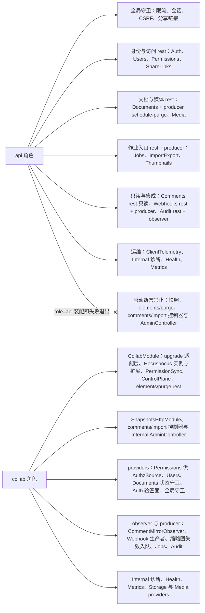

怎么读：左侧两个角色，实线指向该角色装配的模块部件分组；带叉的边表示该角色**不得**装配的部件，装了即启动失败。all 模式同时拥有两侧全部分组。
依据：本节矩阵；rulings §4.18 BE-03、BE-13、BE-30。

**图 5-2 worker 与 renderer 角色装配的模块部件**

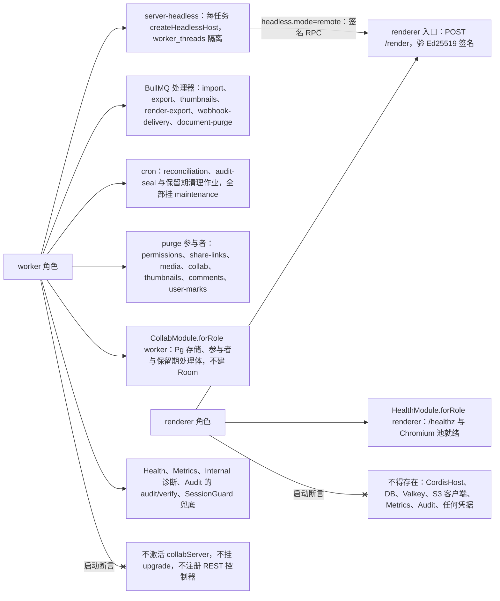

怎么读：画法同图 5-1；worker 到 renderer 的实线是唯一跨角色调用（render 网络内的签名 RPC）。worker 里的 `CollabModule` 只为 purge 参与者、M-09 表的保留期作业与导入写快照装 Pg 存储，不激活房间服务；renderer 的禁止项由 A4 两条断言共同保证。
依据：本节矩阵；ADR-0037 决策 1、3；rulings §4.18 BE-14、BE-15、BE-19；决策 SG-01。

---

## 6. 启动断言

两套按角色的开关——Nest 侧 `config/roles.ts`（`assertRoleAssembly`）与 cordis 侧 `cordis-host/preset-server.ts`（`assertRoleConsistency`）——在启动期逐项核对，任一不满足即退出，「先失败、不部分激活」（D8；rulings §4.13 同时确认段、§4.18 BE-13）。退出码约定：**78**（EX_CONFIG）= 部署配置错误，运维改配置即可；**70**（EX_SOFTWARE）= 装配与矩阵不一致，属代码缺陷，必须修代码；运行期依赖不可达（PG、Valkey、S3）**不**退出，由 `/readyz` 返回 503 并重试连接。

| # | 断言 | 检查时机与方式 | 失败 |
|---|---|---|---|
| A1 | 配置经 zod 解析通过（`config.schema.ts`，字段表见 [17](17-deployment-and-config.md) §5） | `main.ts` 第 2 步，Nest 创建前 | 退出 78 |
| A2 | `CORDEX_ROLE ∈ {all, api, collab, worker, renderer}` | 同 A1 | 退出 78 |
| A3 | production 下鉴权已配置：启用 `idp` profile 或配置了外部 `auth.oidc.issuer`，未配置即拒绝启动（[17](17-deployment-and-config.md) §5–§6；`config/config.schema.ts`，文件级 40-modules/12 §4.10）；服务端没有免鉴权开关，前端 `RuntimeConfig.auth.mode:'none'` 只在 dev 构建生效（[50-frontend/02](../50-frontend/02-app-shell-routing-and-session.md) §3） | 同 A1 | 退出 78 |
| A4a | `role=renderer`：已配置验签公钥；环境中不得出现任何凭据类变量（DB 各角色口令、Valkey 口令、S3 密钥、OIDC client secret、JWT 私钥、`CORDEX_SECRETS_KEK_FILE`、`CORDEX_OPS_TOKEN_FILE`、renderer 签名**私钥**）；进程 uid ≠ 0；Chromium 以 `chromiumSandbox=true` 启动 | 同 A1；Chromium 池初始化时复核沙箱 | 退出 78 |
| A4b | `role=renderer`：进程内不存在 DB / Valkey / S3 客户端实例，未装 `CordisHostModule`、`MetricsModule`、`AuditModule` | `onApplicationBootstrap`，遍历 Nest 容器与已加载驱动模块 | 退出 70 |
| A5 | `role=api`：未装配 `SnapshotsHttpModule`、`AdminController`、`ElementPurgeController`、`CommentsImportController`（BE-03、CO-07；后者 P1 起存在） | `assertRoleAssembly` 对照 §5 矩阵 | 退出 70 |
| A6 | `role ∈ {worker, all}`：`DiscoveryService` 收集到的 `@PurgeParticipant` 名称集合**恰为** `{permissions, share-links, media, collab, thumbnails, comments, user-marks}`（BE-15） | `onApplicationBootstrap` | 退出 70 |
| A7 | cron 部件（Job Scheduler 注册）只出现在 `worker` / `all`；api、collab 进程内注册即失败（BE-19） | `assertRoleAssembly` | 退出 70 |
| A8 | `role ∈ {collab, all}` 时 `getService('collabServer')` 成功且适配层已在底层 server 的 `upgrade` 上挂接；`role=worker` 时 headless 宿主工厂可取得且 `collabServer` **未**激活；api、worker 进程不得挂 `upgrade` 监听 | `assertRoleConsistency`（`ServiceMap` 编译期 key + 运行期检查）与 `assertRoleAssembly` | 退出 70 |
| A9 | 装配结果与 §5 矩阵逐格一致：先核对实际注册的 Http 模块集合等于矩阵 rest 格集合（§5 结构规则），再核对 providers、guard、observer、processor 各格（装了不该装的、缺了该装的都算失败） | `assertRoleAssembly` | 退出 70 |
| A10 | 内部端口（默认 9464）不等于对外端口；production 下内部监听地址必须显式配置且不是通配地址（`0.0.0.0` / `::`）；renderer 不启动内部端口（与 [18](18-observability-and-ops-endpoints.md) §8 同口径，配置键名以 [17](17-deployment-and-config.md) 为准） | 内部监听建立前 | 退出 78 |
| A11 | DB 连接池的登录角色正确：api 只有 `cordex_app` 池；collab / worker 另有 `cordex_system` 池；任何池 `current_user` 都不得是 `cordex_migrator`，且 `rolbypassrls = false` | 每个池首次连接时查询 `pg_roles`（决策 DB-ROLES） | 退出 78 |
| A12 | 宿主就绪：`await fiber.await()` 后根 Fiber 为 `ACTIVE`，关键插件无 `PENDING` | `onApplicationBootstrap` | 退出 70 |

- `headless.mode='remote'` 时 worker / all 必须配置 `headless.endpoint` 与 RPC 签名私钥（A1 的 zod 条件校验，退出 78）；production 下 `headless.mode='local'` 只告警、不退出（[06](06-modules-jobs-import-export-thumbnails.md) §12.5）。
- A10 只能证明「没有监听在 edge 可达的地址上」；「从 edge 网络确实连不上 9464」由环境 e2e 证明（[70/08](../70-testing/08-deployment-and-environment-e2e.md)）。
- 规模配置 `scale.*` 超出默认包络**不是**失败：启动告警，并在 `/readyz` 附 `scaleEnvelopeExceeded`（rulings §4.15 Q5，见 [18](18-observability-and-ops-endpoints.md)）。

---

## 7. 反代分流：路径与子域到角色

浏览器只和 web 容器通信；web 容器的完整配置片段、TLS 与安全头见 [17](17-deployment-and-config.md) §3，本节只定「哪条路径进哪个角色」。`all` 模式三个 Nest 角色同进程，下表三行 upstream 指向同一进程，行为不变；拆分部署只多一条转给 collab 的规则，正则 `^/api/v1/documents/[^/]+/(snapshots|elements/purge|comments/import)`（rulings §4.18 BE-03、BE-11、CO-07 先例：凡须在 Room 内执行事务的 REST 都走这一条）。

| 匹配（按优先级自上而下） | 转发到 | 说明 |
|---|---|---|
| `<host>/api/v1/documents/:id/snapshots` 及其子路径 | collab | 快照 REST 只在 collab 装配（BE-03） |
| `<host>/api/v1/documents/:id/elements/purge` | collab | 元素彻底删除由 `CollabModule` 承载（CO-07） |
| `<host>/api/v1/documents/:id/comments/import` | collab | 导入为可编辑线程须在持有 Room 的实例内执行 CRDT 事务（[07](07-modules-comments-webhooks-audit.md) §1.5，P1） |
| `<host>/api/*` | api | 其余全部 REST（全局前缀 `/api/v1`） |
| `<host>/collab/*` | collab | WS 升级 `/collab/v1/rooms/:documentId`；读超时 ≥ 3600 s；M2 单实例直转；M3 多副本时按路径中的 documentId 做一致性哈希选 upstream——按文档哈希偏好亲和、非会话粘性，不是正确性前提（原 rulings §4.15 Q10「无粘性」按 §4.21 H:q-hp-fanout 改写） |
| `<host>/internal/*` | 不转发（404） | 内部端点只在内部端口，反代永不暴露 |
| `<host>/healthz`、`<host>/readyz` | 不转发（404） | 探针由编排器直连容器，不经反代 |
| `<host>/其余` | 静态前端 | `index.html`（no-store，注入 nonce）与带 hash 的 `/assets/*`（immutable）；SPA path 路由 |
| `idp.<域名>` | Casdoor（`idp` profile） | 保持 Host 头；Casdoor 只在 backend 网络，不开宿主端口；管理后台按来源 IP 限制 |
| `s3.<域名>` | SeaweedFS S3 网关 | 保持 Host 头（SigV4 签名包含 Host）；只接预签名请求 |

**按文档哈希分流（M3）**：同一文档的连接常态落在同一个 collab 实例，Hocuspocus 只在该实例持有文档，extension-redis 只在扩缩容、实例故障与迁移窗口兜底跨实例同步；这样避免同一文档分散在多个实例时每次变更都要做 O(文档) 的状态向量往返。扩缩容时部分房间迁移，客户端按 1012 重连到新实例。一致性哈希的配置片段以 [17](17-deployment-and-config.md) §3 为准（ADR-0035 决策 7 修订）。

「探针不经反代」是本文新定的收紧：`/healthz`、`/readyz` 只供 compose healthcheck 与 K8s 探针直连容器，不需要在公网可达（依据：安全宁可提前；与 rulings §4.18 BE-11 的前缀排除不冲突）。

**图 7-1 反代路径与子域到角色的分流**

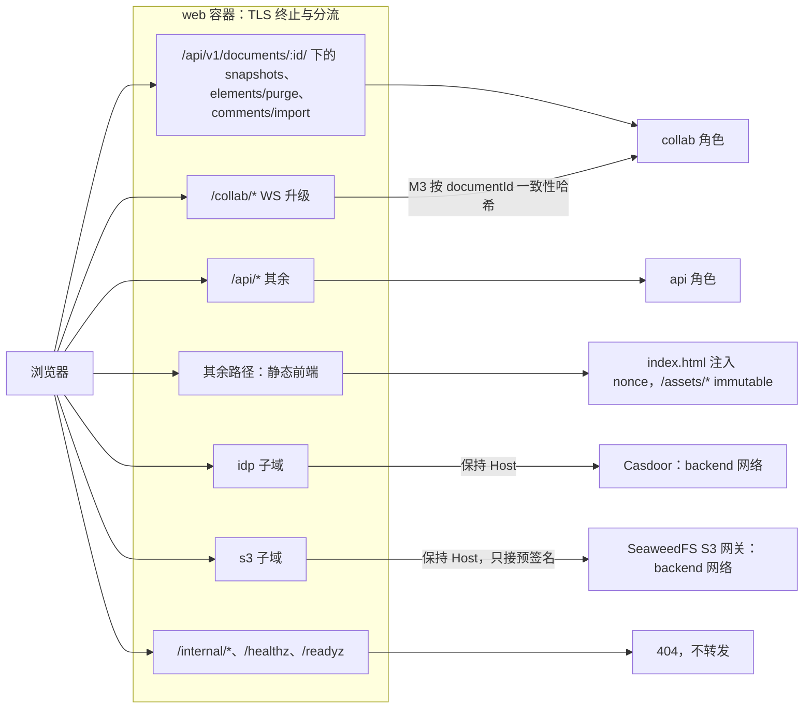

怎么读：左侧浏览器请求先按子域、再按路径前缀命中 web 容器里的某条规则（快照、元素彻底删除与评论导入这条 collab 规则优先于 `/api/*`），箭头指向转发目标；WS 升级这条在 M3 多副本时按路径里的 documentId 做一致性哈希；内部端点与探针在反代层直接 404。
依据：本节表；[17](17-deployment-and-config.md) §3.1；ADR-0035 决策 7（2026-09-26 修订）；ADR-0037 决策 3；rulings §4.18 BE-01、BE-03、BE-11，§4.21 H:q-hp-fanout。

---

## 8. Nest 模块 imports 总图与无环约束

下面两张图只画业务模块之间 `@Module({ imports })` 登记的依赖（依赖方 → 被依赖方）；全局基础模块（Config、Db、Redis、Observability）的边省略。**全图无环**，由 `depcruise` job 的 `no-circular` 规则覆盖 `apps/server/src/modules/**` 机械守护。

**图 8-1 Nest 模块 imports 总图之一：身份、文档与协同**

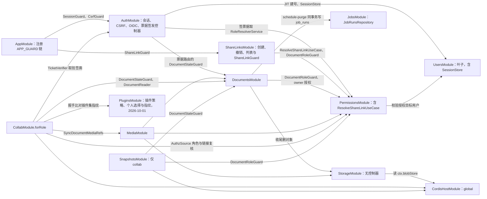

怎么读：箭头从依赖方指向被依赖方，全部是登记在 imports 列的依赖；被 import 的都是只含 providers 的 `XxxModule`，控制器在各自的 `XxxHttpModule`，只由角色根模块 import（§5 结构规则），所以 collab 为取守卫 import `DocumentsModule` 不会带进文档控制器。分享令牌解析归 `PermissionsModule`，`ShareLinksModule` 只单向依赖它；`SessionGuard` 由 `AppModule` 全局注册，业务模块不为鉴权 import `AuthModule`，因此 `AuthModule` 才能反向 import `PermissionsModule`、`DocumentsModule` 而不成环。协同票据的签发控制器在 `AuthModule`（[03](03-modules-identity-and-access.md)），`DocumentsModule` 不 import `AuthModule`（[04](04-modules-documents-storage-media.md) §8）；`UsersModule` 是叶子，会话存储 `SessionStore` 放在它里面，停用与擦除时吊销会话不必反向依赖 `AuthModule`。
依据：40-modules/08 §3、09 §3.3、12 §3、§7.3；本线 03、04 的 imports 表；rulings §4.18 BE-02、BE-05、BE-06、BE-07、BE-15。

**图 8-2 Nest 模块 imports 总图之二：作业、评论与运维**

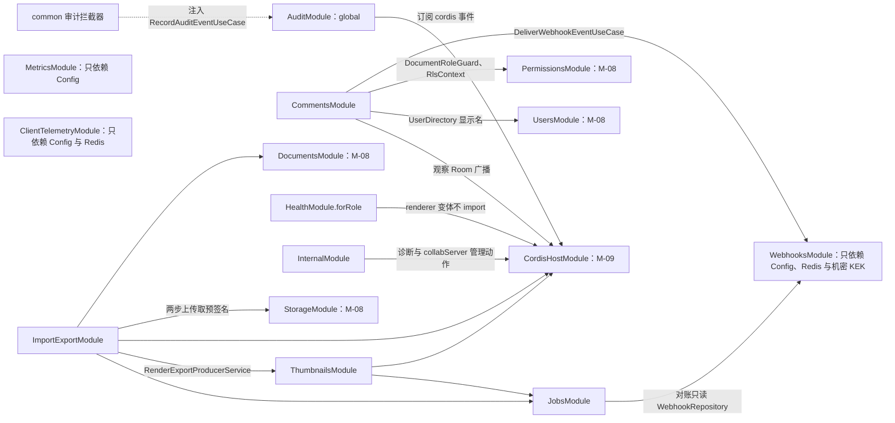

怎么读：画法同图 8-1；M-12 的模块都是终端模块，只消费 M-08、M-09 的导出面，没有模块反向 import 它们（`documents → jobs` 例外，见图 8-1，但 `JobsModule` 不 import `DocumentsModule`）。评论模块按 [07](07-modules-comments-webhooks-audit.md) §10.2 取显示名，按 [03](03-modules-identity-and-access.md) §6 取文档作用域守卫。虚线是 `common/` 的拦截器注入 global 的审计用例，M-08、M-09 只在控制器上标注 `@Audited()`。
依据：40-modules/12 §3、§7.3；本线 03 §6、07 §10.2；rulings §4.18 BE-04、BE-07、BE-30。

**imports 规则**（违反即 `depcruise` 失败或评审退回）：

| # | 规则 | 理由 |
|---|---|---|
| I1 | 业务模块不为鉴权 import `AuthModule`；只有需要票据验签面的 `CollabModule` 可以 import 它（票据签发控制器本身在 `AuthModule`） | `SessionGuard` 全局注册（BE-06），消除 Auth ↔ Permissions 环 |
| I2 | `UsersModule` 是叶子，不 import 任何业务模块；会话存储 `SessionStore` 放在其中，停用、擦除对文档的连带动作由其他模块编排或经进程内领域事件完成（机制见 [03](03-modules-identity-and-access.md)） | `AuthModule → UsersModule`、`PermissionsModule → UsersModule` 已存在，反向 import 必然成环 |
| I3 | `DocumentsModule` 不为永久删除编排 import 参与者模块（它对 `PermissionsModule` 的 import 只为 `DocumentRoleGuard` 与建文档时的 owner 授权）；参与者只 import `@PurgeParticipant` 装饰器（TS import，非 Nest imports），由 `DiscoveryService` 收集 | 「谁的表谁写」，编排方不依赖下游（BE-15） |
| I4 | `ShareLinksModule → PermissionsModule` 单向；`PermissionsModule` 不 import `ShareLinksModule` | 令牌解析归权限模块（BE-02） |
| I5 | 需要宿主能力的模块一律经 `CordisHostModule` 的 `CordisHostService`（`getService` / `diagnostics`），不自行装配 cordis 插件 | 宿主是进程单例（§9） |
| I6 | 驱动（pg、ioredis、BullMQ、`@aws-sdk/*`）只出现在各模块 `infrastructure/`、`db/`、`common/rate-limit/` 与 `server-storage` 的 providers（§11） | D8：Nest 是传输壳 |

---

## 9. cordis 宿主生命周期映射

`apps/server` 进程内只有**一个** cordis 宿主（进程单例根 `Context`），由 `CordisHostModule` 持有；feature 模块不得另建根 ctx（primer §14）。宿主装配唯一入口是组合根 `apps/server/src/cordis-host/preset-server.ts`（`cordex.compositionRoot:true`），它是服务端**唯一** import 垂直束（`model-slide`、`ooxml-pptx`）的文件；`server-headless` 只接收它给出的插件清单，保持文档类型盲（rulings §4.18 FE-01）。

| Nest 生命周期 / 作用域 | cordis 动作 | 约束 |
|---|---|---|
| 进程启动（`main.ts` 之前） | 容器入口 `node --import ./dist/observability/otel.js dist/main.js` 预加载注册 OTel SDK（[17](17-deployment-and-config.md) §4） | Nest 12 是纯 ESM，靠首行 import 无法保证先于其他模块求值，改为预加载（rulings §4.21 q-nest-major；30-architecture/10） |
| `CordisHostModule.onModuleInit` | `createHost({ logger: PinoAdapter, telemetry: OtelAdapter, errors: ReporterAdapter })` → 根 ctx | 进程单例；renderer 角色不装本模块 |
| `onApplicationBootstrap` | `ctx.plugin(presetServer, config)`；`await fiber.await()`；检查关键插件无 `PENDING`；执行 `assertRoleConsistency` | 失败即抛出、进程退出（§6 A8、A12） |
| `/readyz` | 根 Fiber `ACTIVE`，且 `units`、`store` Provider 工厂、`formats` 可解析；collab 另需 `collabServer` 未进入 draining | 否则 503（判据全表见 [18](18-observability-and-ops-endpoints.md)） |
| 每个 Room（仅 collab；Hocuspocus 文档名 `docId:epoch`） | `onLoadDocument` 内 `collabServer` 以 `ctx.units.open({ docType: documents.doc_type, store: 'yjs', source })` 得 UnitScope 并装载快照与日志；`afterLoadDocument` 让该 Unit 的 store-yjs 接管 Hocuspocus 的 Document（H-d-15、H-d-26） | 一个 Room 一个 Unit；服务端无 render / selection；不写死 `'slide'`；`gc:true` 与 ADR-0025 决策 7 一致 |
| 每个 HTTP 请求 / 作业 | `ctx.extend({ requestId, traceId, principalId })` 只作日志与遥测元数据 | **不** isolate、不建 Fiber；业务经 `withRequestMeta` 取子 ctx |
| 每个 WS 连接 | 无 cordis 对象；Hocuspocus 的 `Connection` 与适配层的会话记录都是普通对象 | 连接数量大，不映射为 Fiber |
| worker 的每个 headless 任务 | `createHeadlessHost({ adapters, plugins })` 在 `worker_threads` 内新建独立宿主，任务结束 `dispose` | 与进程宿主隔离；超时与内存限额见 [06](06-modules-jobs-import-export-thumbnails.md) |
| `beforeApplicationShutdown(signal)` | collab：`collabServer.drainAll('shutdown')`；worker：暂停队列消费；最后 `host.dispose()` | 全程 ≤ 30 s（§10） |
| dev / test | `assertNoLiveEffects(rootFiber)` | 关闭后无残留 effect |

**`preset-server` 按角色激活**：插件清单只有一份（kernel 基础服务的 Node 适配器、`model-core`、`store-yjs`、`model-slide`、`ooxml-core`、`ooxml-pptx`、可选 `engine-layout` 与 `node-font` 度量、`server-storage`、`server-collab`），角色差异只在两处开关：`server-collab` 的 `collabServer` 只在 collab / all 激活；headless 宿主工厂只在 worker / all 取用。api 装入同一清单但从不打开 Unit。

**`CordisHostService` 读取面**（Nest 模块消费宿主的唯一方式，签名草案，以 40-modules/09 §2.5 为准）：

```ts
interface ServiceMap {            // 编译期 key → 类型；未登记的服务名编译失败
  collabServer: CollabServer
  blobStore: ServerBlobStore
}
declare class CordisHostService {
  getService<K extends keyof ServiceMap>(name: K): ServiceMap[K] | undefined
  diagnostics(): HostDiagnostics  // dumpFiberTree / effects / PENDING / contributions
  withRequestMeta<T>(meta: RequestMeta, fn: (ctx: Context) => T): T
}
```

**图 9-1 Nest 生命周期与 cordis 宿主（启动、就绪、关闭）**

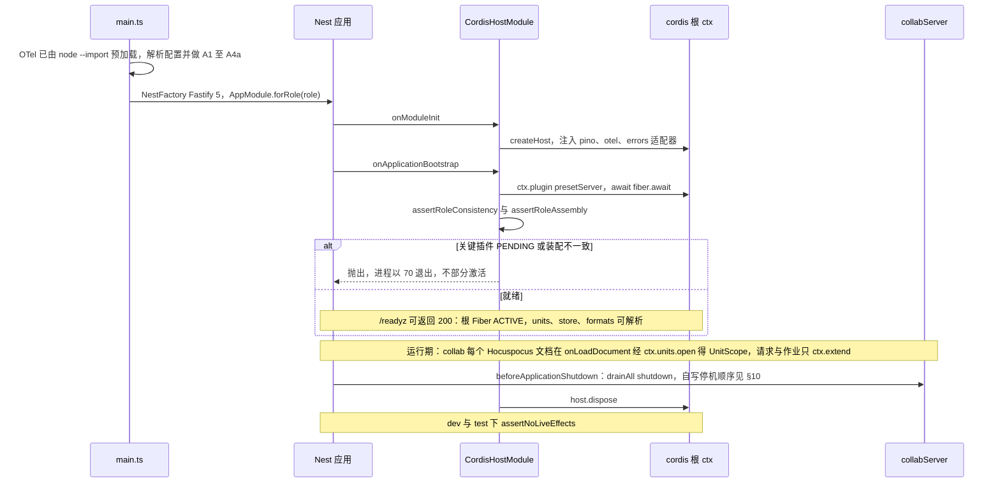

怎么读：时间自上而下，覆盖启动、就绪、运行、关闭四段；`alt` 是启动时宿主是否就绪的两种结局。`collabServer` 只存在于 collab / all 进程，worker 与 api 的时序没有这一列的交互。
依据：本文 §0.2 第 2 条（原 30/08 第 4 节的跨端约束）；40-modules/09 §2.5「ServiceMap」段；ADR-0039 决策 4；rulings §4.13 同时确认段、§4.18 FE-01。

---

## 10. 进程生命周期

**启动顺序**（`apps/server/src/main.ts`）：

1. OTel SDK 由容器入口 `node --import ./dist/observability/otel.js dist/main.js`（[17](17-deployment-and-config.md) §4、[18](18-observability-and-ops-endpoints.md) §1.1）预加载注册，先于 `main.ts` 与一切有副作用的模块求值（Nest 12 为纯 ESM，`apps/server` 构建随之改为 ESM，原「首行 import」与 require(esm) 口径作废；rulings §4.21 q-nest-major）。`@opentelemetry/instrumentation-nestjs-core` 0.68 不支持 Nest 12，Nest 层 span 暂由 @fastify/otel 加手工 span 补齐（[18](18-observability-and-ops-endpoints.md) §3）。
2. 读取并解析配置（zod，失败退出 78）；执行 A1–A4a。
3. `NestFactory.create(AppModule.forRole(role), new FastifyAdapter({ trustProxy, bodyLimit }))`（Fastify 5，ADR-0022 修订）；`trustProxy = http.trustProxy`（可信反代跳数，compose 固定为 1，[17](17-deployment-and-config.md) §5.1）。限流与审计 IP 哈希的来源 IP 一律取 `common/` 的 `clientIp(req)`：按该跳数自右向左取（proxy-addr，与 Fastify `request.ip` 同算法），HTTP 请求与 WS 升级共用，不读 `X-Forwarded-For` 首跳（[15](15-rest-api-catalog.md) §8，rulings §4.20 BE-04；文件级登记在 40-modules/12 §4.9）。
4. `setGlobalPrefix('api/v1', { exclude: ['healthz', 'readyz'] })`（rulings §4.18 BE-11）。
5. collab / all：`CollabModule` 的 `CollabUpgradeHandler` 在 `app.getHttpServer()`（Fastify 底层 server）的 `upgrade` 事件上自挂接入——路径 `/collab/v1/rooms/:documentId`，升级前依次检查 UUID → Origin 白名单 → IP 桶（先扣后退）→ 实例连接上限，失败回 HTTP 400 / 403 / 429 / 503；通过后以 `ws` 的 `WebSocketServer({ noServer: true, maxPayload })` 执行 `handleUpgrade`，构造 Web `Request` 后调 `collabServer` 内 Hocuspocus 实例的 `handleConnection`，并由适配层转发 message 与 close。**不注册 `WsAdapter(ws)`，也不依赖 `@nestjs/platform-ws`**；不用 Hocuspocus 的 `Server` 类（它自建 http.Server、注册 SIGTERM 并 `process.exit`）（H-d-01，ADR-0039 决策 1；主端口与 HTTP 共用，实验 exp1 已在 Fastify 5 + ws 8.21 上验证）。api、worker 不挂 `upgrade`。
6. 全局件：`CordexExceptionFilter`（CordexError → problem+json）、`ZodPipe`、`RequestContextInterceptor`（requestId / traceparent / principal → ALS，事务内 `SET LOCAL` RLS 上下文）、`AuditInterceptor`；`APP_GUARD` 链由 `AppModule` 按角色注册。
7. `enableShutdownHooks()`；主端口 `listen`；`onApplicationBootstrap` 完成（A5–A9、A11、A12）后 `/readyz` 才可能返回 200。
8. 内部监听：`InternalModule` 在 `onApplicationBootstrap` 中启动独立 Fastify 实例监听内部端口（先过 A10）；它不是 Nest 的第二个适配器、不经全局守卫链，承载 `/metrics` 与 `/internal/*` 的路由处理器（含 `AuditModule` 的 audit/verify），`/internal/*` 验运维令牌（[18](18-observability-and-ops-endpoints.md) §7–§8）。

**SIGTERM 优雅关闭**：预算 30 s，零 update 丢失（已 ack(db) 的永不丢；只获 spill ack 的由溢写保证）。编排侧 `terminationGracePeriod` 取 40 s（K8s）或 compose `stop_grace_period: 40s`。

| 阶段 | 动作 | 上限 |
|---|---|---|
| 0 | `/readyz` 立即返回 503，停止接受新 HTTP 请求，适配层停止处理 `upgrade` | 即时 |
| 1（collab / all） | 自写 `drainAll('shutdown')`，顺序固定（H-d-21）：向全部会话发 Stateless `room{draining}` → 写入器 flush 未落库 update 并补发 `ack{seq, tier:'db'}`，PG 不可达时内存档强制写入一级溢写并回 `tier:'spill'`，不在 persisting 久等（rulings §4.18 CO-16）→ 对每个 socket 调原始 `ws.close(1012)` → 等 Hocuspocus 卸载全部文档 → 调 `hooks('onDestroy')` 让 extension-redis 断开。Hocuspocus 类没有 `destroy()`，`closeConnections()` 只发不带码的 CLOSE，不能代替 1012 | 20 s |
| 1（worker / all，与上并行） | `worker.pause()` 并等待运行中作业；超时的作业释放锁，由其他 worker 按 BullMQ stalled 机制重取（处理器必须幂等） | 20 s |
| 2 | `host.dispose()`，关闭 DB 池与 Valkey 连接 | 5 s |
| 3 | 退出码 0；30 s 未完成则强制退出（退出码 1）并记录 `cordex.shutdown.timeout` 日志 | — |

**图 10-1 SIGTERM 优雅关闭（30 s 预算）**

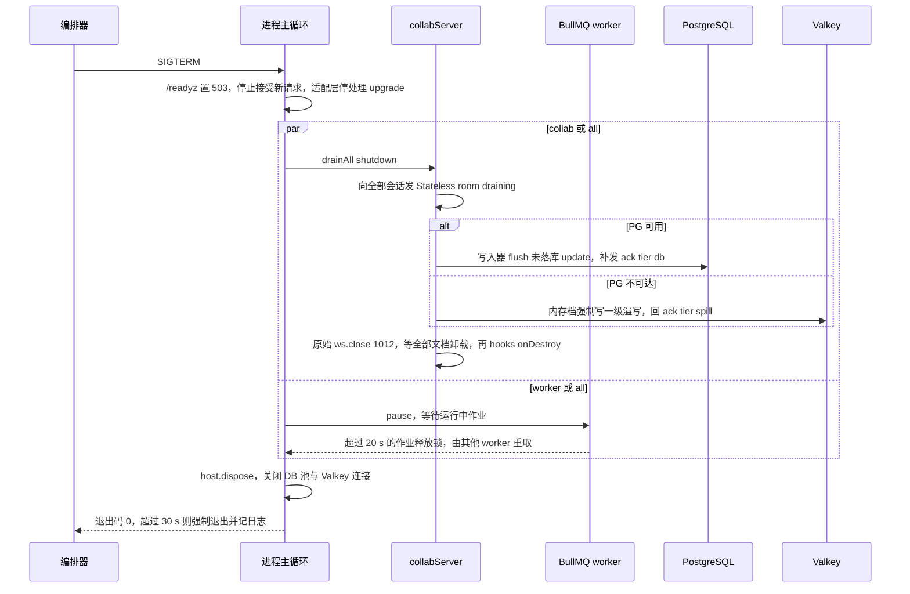

怎么读：时间自上而下；`par` 的两支按角色并行执行（all 两支都走），`alt` 是 flush 时 PG 可用与否的两种结局。先 flush 并补 ack、再带码关闭，保证已提交的 update 在断开前都拿到 db 或 spill 确认；客户端收到 1012 后立即重连（M3 按文档哈希落到其他实例），未获 db 确认的在途项由客户端 pending 重发（[50-frontend/07](../50-frontend/07-collaboration-client.md)）。
依据：40-modules/12 §4.13 `main.ts`（文件级）；本文 §0.4；ADR-0039 决策 9；ADR-0035 决策 9；H-d-21；[17](17-deployment-and-config.md) §8；rulings §4.15 S-3a、§4.18 CO-16。

---

## 11. 驱动放行边界

「Nest 只是传输壳、业务在 `server-*` 包」（D8）落到依赖上，就是下面这张放行表；规则本体由类型治理线登记在 [30-architecture/09-type-discipline/03](../30-architecture/09-type-discipline/03-boundaries.md)，由 `depcruise` job 与 lint `no-restricted-imports` 执行，本表只给后端侧的取值。

| 依赖 | 允许出现的位置 | 禁止 |
|---|---|---|
| `@nestjs/*`、`fastify` | `apps/server/**` | 任何 `packages/**` |
| `pg`、`drizzle-orm` | `apps/server/src/db/**`、`apps/server/src/modules/*/infrastructure/**` | `server-collab`、`server-headless`、`server-storage`；各模块 `domain/`、`application/` |
| `ioredis`、`bullmq` | `apps/server/src/modules/*/infrastructure/**`、`apps/server/src/common/rate-limit/**`、`apps/server/src/redis/**`（`RedisModule`） | 同上 |
| `@aws-sdk/client-s3`、`@aws-sdk/lib-storage`、`@aws-sdk/s3-request-presigner` | `packages/server-storage/src/providers/**` | 其余一切位置（含 `apps/server`：Nest 侧只经 `BlobStoreAccessor` 用 `ctx.blobStore`） |
| `playwright-core` | `packages/server-headless/src/thumbnails/**`（local 模式与 renderer 入口） | api / collab 进程的装配路径 |
| 垂直束 `@cordexjs/model-slide`、`@cordexjs/ooxml-pptx` | `apps/server/src/cordis-host/preset-server.ts` 一个文件 | `packages/server-*` 与 `apps/server` 其余文件（FE-01） |
| `@hocuspocus/server` | `packages/server-collab/**` | `apps/server` 与其余包（Nest 侧只经 `collabServer` 取得 `handleConnection` 入口；H-d-25） |
| `@hocuspocus/extension-redis`（M3）及其注入用的 ioredis 客户端 | 只在 `apps/server/src/modules/collab/infrastructure/hp-redis.extension.ts`（`HardenedRedis` 组装后注入 server-collab；与章程 §5.3 单点表一致） | `packages/server-*`（server-collab 仍不依赖 pg / ioredis / aws-sdk） |
| `openid-client`、`jose` | `apps/server/src/modules/auth/infrastructure/**`（[40/08](../40-modules/08-server-identity-documents-and-storage.md) §10「第三方单点」） | 其余一切位置 |
| `file-type`、`image-size` | `apps/server/src/modules/media/infrastructure/asset-inspector.ts` 一个文件（同上） | 其余一切位置 |
| `ws` | `apps/server/src/modules/collab/**` 的 upgrade 适配层 | 其余一切位置；`@nestjs/platform-ws` 与 `@nestjs/websockets` 不再是依赖 |
| `@cordexjs/xml`（L0 iso 包，零运行时依赖） | 除 iso 包按秩使用外，`apps/server` 只允许 `modules/media/**`（SVG 消毒），登记为 `server-app-thin` 白名单（rulings §4.21 X:q-xml-package） | `apps/server/src/modules/**` 的其余模块 |

`server-*` 包需要的 IO 能力一律经 Definition 注入：`UpdateStore`、`SnapshotStore`、`SpillStore`、`FanoutBus`、`LeaseLock`、`AuthorizationSource`、`MembershipRegistry`、`ServerConnection`，其 Node 实现是「Nest 模块内的 cordis 插件」，放在 `apps/server/src/modules/collab/infrastructure/`（契约清单与适配器以 [05](05-modules-collab-and-snapshots.md) §2 为准）。2026-09-26 起 `FanoutBus` 只承载控制频道 `room:{docId}:ctl`（ControlPlane 经 `FanoutBus.subscribeControl` 订阅），PermissionSync 经 `AuthorizationSource.onPermissionChanged` 订阅 `perm:doc`；帧的跨实例扇出（原 `collab:doc:{docId}` 频道与 `RedisFanoutBus` 的帧发布）作废，M2 单实例不需要，M3 由 extension-redis 承担（rulings §4.21 修正 R-d-38）。

---

## 12. 服务端预算总览

本表是服务端 **target** 的唯一来源；**gate** 取 PRD（04 NF-01 §1.7、NF-03、NF-10 与 06 SV-10），本表只引用、不改写。测量方法、统计量、runner 与门禁判定在 [70/09](../70-testing/09-performance-and-capacity.md)；M1 起 `test/perf/budgets.json` 是本表的机器副本，「budgets.json 键」列给出建议键名，结构以 70/09 为准，两者由 70/09 规定的一致性检查对齐。阈值只收紧（ratchet）。

| # | 指标 | target | gate（PRD） | 测量 | budgets.json 键 |
|---|---|---|---|---|---|
| S1 | REST 读请求 p95 | ≤ 150 ms | — | OTel http span | `server.rest.readP95Ms` |
| S2 | Room bootstrap p95（8 MB 状态） | ≤ 500 ms | — | span `server.room.load` | `server.collab.roomBootstrapP95Ms` |
| S3 | 单 update 处理 p95（校验 + 落库 + 扇出） | ≤ 20 ms | — | span `server.collab.update` | `server.collab.updateHandleP95Ms` |
| S4 | 软门禁 p95（每 update） | ≤ 5 ms | — | bench（ADR-0034 决策 5） | `server.collab.softGateP95Ms` |
| S5 | 持久化延迟 p95（收到 → 提交，入组提交空闲即刷、上限 100 ms / 50 条） | ≤ 150 ms | 持久化滞后 p99 ≤ 1 s（NF-01 §1.7、SV-10） | 指标 `cordex_collab_persist_latency_seconds`（旧名只作 [18](18-observability-and-ops-endpoints.md) §4 的别名） | `server.collab.persistP95Ms` / `server.collab.persistLagP99Ms` |
| S6 | 房间内广播 p95 | ≤ 100 ms | 同左（NF-01 §1.7） | e2e 双端时间戳 | `server.collab.broadcastP95Ms` |
| S7 | 跨实例传播（M3，经 extension-redis；按文档哈希分流后只在扩缩容与迁移窗口出现） | ≤ 50 ms（exp4 在 Valkey 8.1 上实测 2.6–7.1 ms） | 同左 | 两实例集成测试 | `server.collab.crossInstanceMs` |
| S8 | 权限变更传播 p95 | ≤ 1 s（ADR-0029 决策 4；M3 起由 PermissionSync 扩展执行） | ≤ 2 s（NF-01 §1.6「权限变更生效」、CO 降权条） | 审计时间戳 vs 客户端事件 | `server.auth.permPropagationP95Ms` |
| S9 | PG 恢复 → 溢写回放完成 p95（D50 级窗口） | ≤ 10 s | —（NF-03 只定语义） | span `server.collab.replay-spilled` | `server.collab.replayP95Ms` |
| S10 | 导入 D50 / D200 / 50 MB pptx p95 | ≤ 5 s / ≤ 20 s / ≤ 30 s | 前两项同左（NF-01 §1.7）；50 MB 项无 gate（原 30/08 预算表的内部目标，rulings §4.19 迁入本表） | 作业时长 | `server.jobs.importD50P95Ms` / `server.jobs.importD200P95Ms` / `server.jobs.import50MbP95Ms` |
| S11 | 导出 pptx D50 / D200 p95 | ≤ 3 s / ≤ 12 s | 同左 | 作业时长 | `server.jobs.exportPptxD50P95Ms` / `…D200P95Ms` |
| S12 | 导出 PDF D50 p95（M3 后半段） | ≤ 10 s | 同左 | 作业时长 | `server.jobs.exportPdfD50P95Ms` |
| S22 | 导出 PNG 全量 D200（M3） | ≤ 90 s | 同左（PRD SV-02） | 作业时长（`job.render-export` span） | `server.jobs.exportPngD200Ms` |
| S13 | 首页缩略图（导入完成后） / D200 全量 / 单页 p95 | ≤ 10 s / ≤ 90 s / ≤ 400 ms | 前两项同左 | span `thumbnail.render` | `server.thumbnails.firstPageMs` / `…d200AllMs` / `…perPageP95Ms` |
| S14 | 快照压缩（10,000 update） | ≤ 2 s | 同左 | bench | `server.collab.compact10kMs` |
| S15 | 模板填充 + 导出 100 × D50（4 worker，M3；2026-10-03 由 M4 改，rulings §4.24 AL-7） | ≤ 60 s | 同左 | 作业时长 | `server.jobs.fillTemplate100Ms` |
| S16 | 优雅关闭 | ≤ 30 s，零 update 丢失 | 同左 | kill -TERM 后重启对比状态 | `server.process.shutdownMs` |
| S17 | collab 单实例容量（RM-S：2 vCPU / 4 GB） | ≥ 2,000 WS，CPU < 70% | 同左 | 自写 Node WS 负载驱动 | `server.collab.wsPerInstance` |
| S18 | 房间准入 | 按文档实测权重（D50 ≈ 17.8 MB、D200 ≈ 85 MB，乘副本数）；实例预算 = 容器内存上限 × `room.memoryAdmissionPct`（75） | 分档房间数 M1 实测回填 | 指标 `cordex_collab_room_weight_bytes` | `server.collab.roomWeightD200Bytes` |
| S19 | 全系统容量（M3） | 并发编辑者 5,000；活跃文档 2,000；文档总量 100 万；导入导出每实例 4 并发 | 同左（NF-10） | perf/perf-server 场景 | `server.capacity.*` |
| S20 | 可用性与成功率（SLO） | 协同服务 99.9% / 月；导入、导出成功率 ≥ 99.5% | 同左（SV-10） | Prometheus 记录规则 | —（SLO，不进 budgets.json） |
| S21 | 溢写阈值（配置，不是性能预算） | `spill.tier1MaxBytesPerDoc` 16 MiB、`spill.tier1MaxBytesPerInstance` 256 MiB、`spill.tier2ChunkBytes` 4 MiB | M2 自托管 runner 上压测校准，只收紧 | 指标 `cordex_collab_spill_rooms`（旧名 `cordex_collab_spill_tier_current` 只作 18 §4 的别名） | —（配置键见 [17](17-deployment-and-config.md)） |

S22 为本轮新增行，编号接在 S21 之后、位置按内容归入导出一组，既有编号不变。依据：原 30/08（已撤销）第 12 节与第 16.5 节的预算，rulings §4.19 迁入本表；30-architecture/06 §14 服务端条目；PRD 04 NF-01 §1.7、NF-10；PRD 06 SV-02、SV-10；决策 SPILL、METRICS；rulings §4.15 Q5、§4.18 BE-29、§4.19 D-TEST-INFRA（协同与服务端压测的自托管专用 runner 在 M2 前落地）。指标名以 [18](18-observability-and-ops-endpoints.md) 的统一名表为准。

---

## 13. 机械验证

只写断言（what）与落点；测试层级、夹具、判定在 70。

| # | 断言 | 落点（CI job / 步骤） | 场景归属 |
|---|---|---|---|
| V1 | 五个角色各启动一次：装配结果与 §5 矩阵逐格一致；A1–A12 各有一条负向用例（装了禁装部件、缺参与者、renderer 带凭据变量、池角色为 `cordex_migrator` 等）以指定退出码失败 | `test/server-integration`（role-assembly） | [70/08](../70-testing/08-deployment-and-environment-e2e.md) |
| V2 | [15](15-rest-api-catalog.md) 路由表的「角色」列与各角色进程实际注册的 Nest 路由表快照一致；api 进程不存在快照、元素彻底删除与评论导入路由 | `test/server-integration`（route-table-snapshot） | [70/07](../70-testing/07-backend-integration-and-api-e2e.md) |
| V3 | `apps/server/src/modules/**` 无循环 import；§11 放行表之外出现驱动 import 即失败 | `depcruise`（no-circular 与驱动放行规则） | 类型治理线 |
| V4 | 反代：`/internal/*`、`/healthz`、`/readyz` 经 web 容器返回 404；快照、元素彻底删除与评论导入命中 collab；从 edge 网络连不上 9464 | `e2e/full-compose` | [70/08](../70-testing/08-deployment-and-environment-e2e.md) |
| V5 | SIGTERM 后 30 s 内退出，且在线编辑的已 ack(db) update 零丢失、只获 spill ack 的 update 重启后回放 | `test/server-integration` | [70/07](../70-testing/07-backend-integration-and-api-e2e.md) |
| V6 | §12 表与 `test/perf/budgets.json` 键值一致；服务端 gate 超限即失败 | `perf/perf-server`、`perf/perf-collab` | [70/09](../70-testing/09-performance-and-capacity.md) |
| V7 | 本文 Mermaid 图通过绘图规范校验 | `docs/_tools/mermaid-check.cjs` | 总编排 |
| V8 | collab 进程与 HTTP 共用主端口，只在 Fastify 底层 server 的 `upgrade` 上挂一个 `ws`（noServer）；依赖树中没有 `@nestjs/platform-ws`；升级前检查失败按 400 / 403 / 429 / 503 拒绝；`runCollabServerConformance` 直接跑 Hocuspocus 实例，钩子异常与 Valkey 宕机都不杀进程；丢帧后的连接不再回 ack（连接污染回归） | `test/contract`（`runCollabServerConformance`）；`test/server-integration`（嵌入 Fastify 同端口） | [70/02](../70-testing/02-contract-suites-and-pluggability.md)、[70/07](../70-testing/07-backend-integration-and-api-e2e.md) |
| V9 | `@hocuspocus/*` 只出现在 §11 放行表所列位置；`yjs` 全仓只有一份（根 overrides 锁 13.6.33） | `depcruise`（第三方单点引入）；`scanners/lockfile-guard` | 类型治理线 |
| V10 | 依赖许可落在 ADR-0049 分级内；@sesamecare-oss/redlock 1.4.0 的 UNLICENSED 按附证据的例外放行；ioredis 5.6.x 作为 extension-redis 的「装而不实例化」例外登记 | `scanners/license-allowlist` | [19](19-reuse-and-dependency-catalog.md) |
| V11 | M3 两实例下同一文档的连接经反代按 documentId 哈希落到同一实例；实例下线 1012 后客户端重连、差量补齐、零 update 丢失 | `e2e/full-compose`；`test/server-integration` | [70/08](../70-testing/08-deployment-and-environment-e2e.md) |
