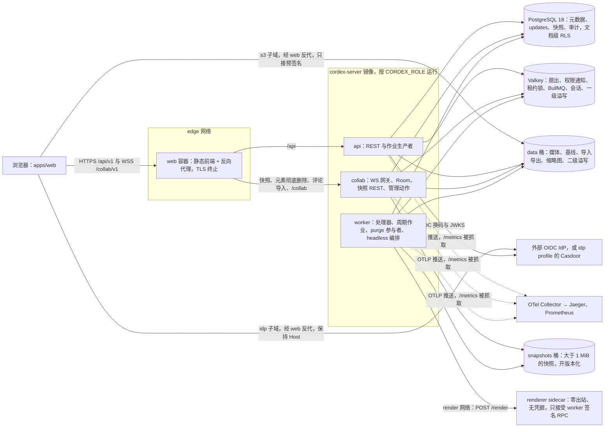
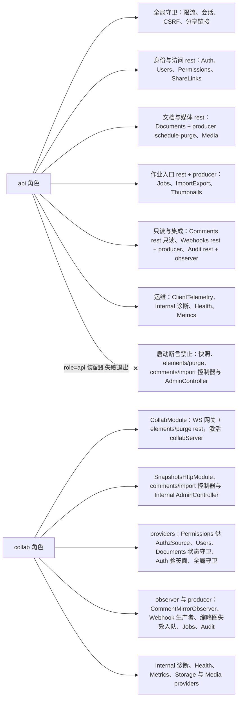
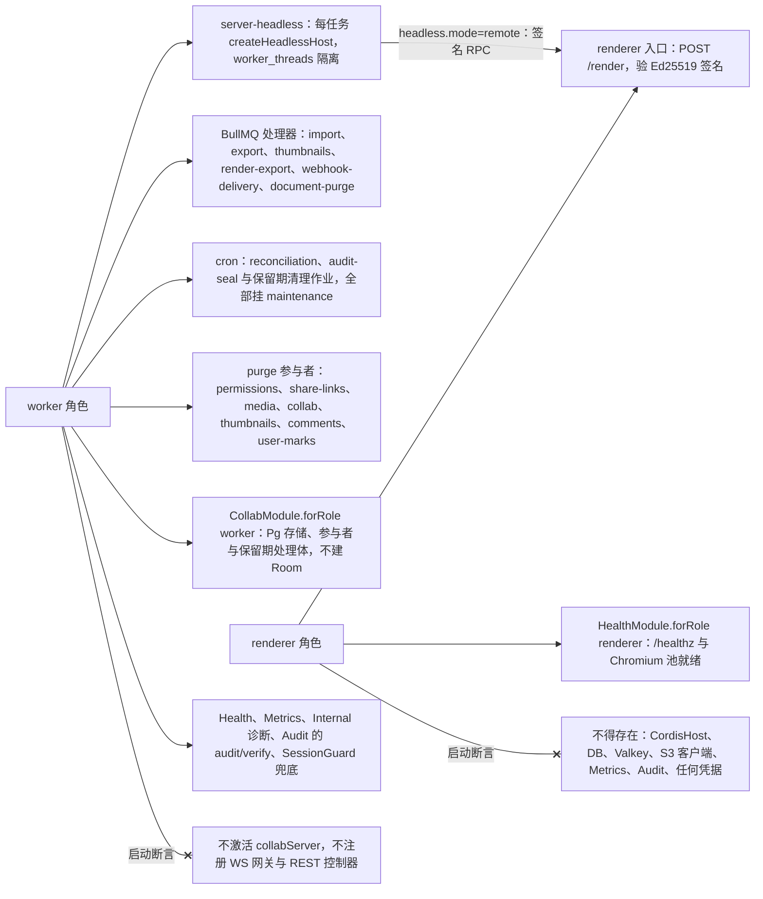
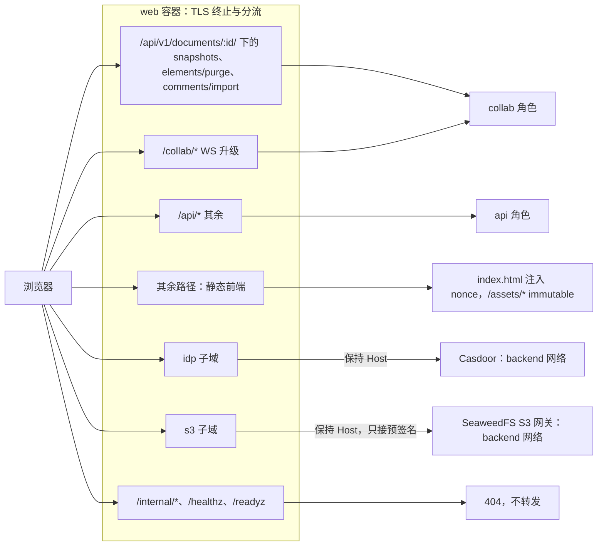
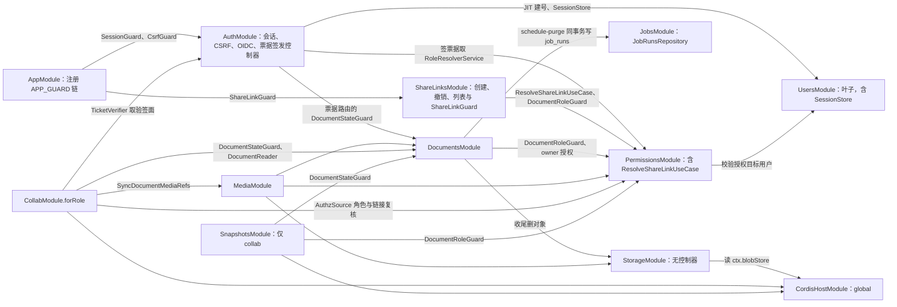
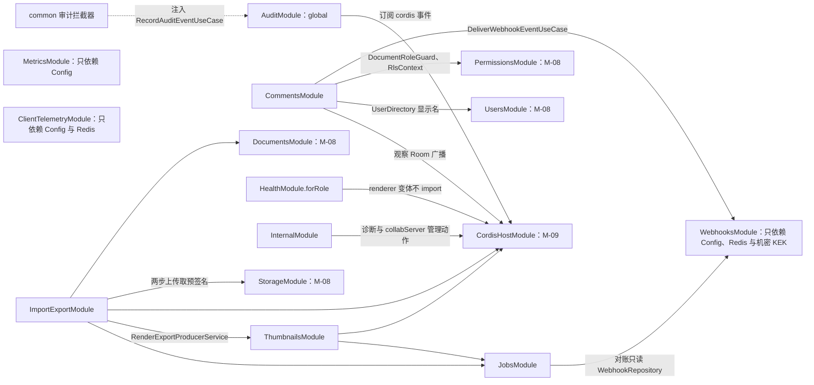
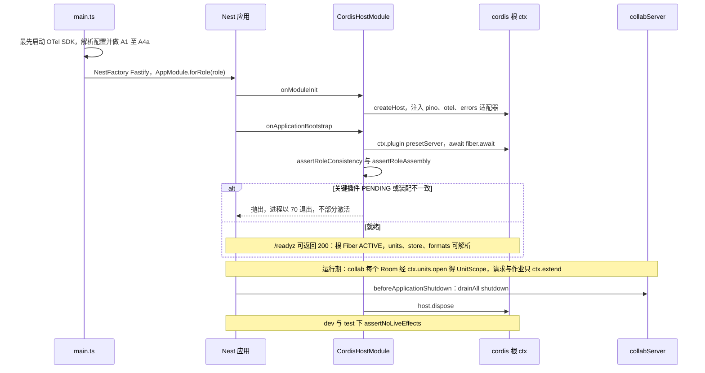
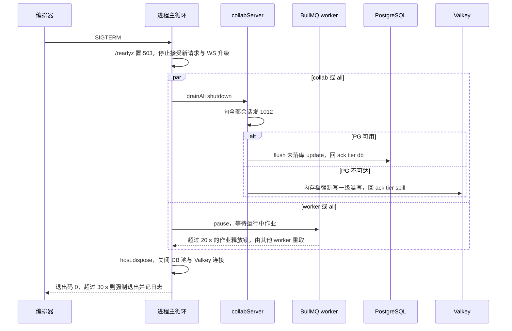

# 01 服务总览、进程角色与 cordis 宿主
> 状态：v0.1 | 负责：后端设计线 | 更新：2026-09-25；2026-09-25（§4.19）；2026-09-25（审稿）；2026-09-26（§4.20） | 依赖：charter §5.2、§7；rulings §4.13、§4.15 Q8/Q10、§4.18 BE-01/BE-03/BE-11/BE-13/BE-14/BE-15/BE-19/FE-01/CO-16、§4.19；ADR-0026、ADR-0035、ADR-0037；30-architecture/08 §0；40-modules/08、09、12

> 读者：实现 `apps/server`、`@cordexjs/server-collab`、`@cordexjs/server-storage`、`@cordexjs/server-headless` 的工程师；运维。
> 定位：后端运行时的总入口。本文是以下内容的**唯一事实源**：Nest 模块清单、`CORDEX_ROLE` 语义、「模块 × 角色 × 部件」装配矩阵（迁自 40-modules/12 §7.1；rulings §4.18 BE-13 的内容不变，落点迁到本文的依据是 rulings §4.19「三线各为该侧唯一事实源、重复段落改为引用」）、启动断言、反代路径到角色的分流、Nest 模块 imports 总图、cordis 宿主生命周期映射、进程启动与优雅关闭、服务端预算总览、服务端里程碑口径（§3）。
> 不在本文：跨端原则（Nest 薄壳、cordis 宿主内嵌、fail-closed 双点、驱动放行、文档类型盲）留在 [30-architecture/08 §0](../30-architecture/08-backend-nestjs.md)；文件级目录树在 [40-modules/08](../40-modules/08-server-identity-documents-and-storage.md)、[09](../40-modules/09-server-collab-gateway-and-headless-host.md)、[12](../40-modules/12-server-jobs-comments-and-ops.md) 的 §4（进程入口 `main.ts`、根模块 `app.module.ts` 与 `observability/`、`redis/`、`db/` 基础设施在 12 §4.13）；路由逐条见 [15](15-rest-api-catalog.md)，WS 见 [16](16-ws-protocol-server-view.md)，部署与配置键见 [17](17-deployment-and-config.md)。

---

## 1. 一页总览

后端由一个应用镜像 `cordex-server`（按 `CORDEX_ROLE` 装配）、一个独立的 renderer sidecar 和三类存储组成；浏览器唯一入口是 web 容器（静态前端 + 反向代理）。单组织部署，数据模型、API、对象键中都没有租户（rulings §4.15 T-0）。

| 部件 | 形态 | 技术基线 | 运行时设计 |
|---|---|---|---|
| web 容器 | 静态前端 + 反向代理（nginx-unprivileged） | TLS 终止；按路径与子域分流；每响应生成 CSP nonce | [17](17-deployment-and-config.md) |
| `apps/server` | 同一镜像，`CORDEX_ROLE` 选装配 | NestJS 11 + Fastify 适配器；Node 26（`node:26-slim` + 字体包，不含 Chromium） | 本文 |
| `@cordexjs/server-collab` | cordis 插件（`provide=['collabServer']`）+ 库 | Yjs 13.6.x（锁精确版本）、y-protocols；不依赖 Nest、pg、ioredis | [05](05-modules-collab-and-snapshots.md) |
| `@cordexjs/server-storage` | Provider（`blobStore`） | `@aws-sdk/client-s3` + `lib-storage`，全仓唯一 S3 SDK 引入点 | [04](04-modules-documents-storage-media.md) |
| `@cordexjs/server-headless` | 宿主工厂 + tasks | `createHeadlessHost({ adapters, plugins })`，`worker_threads` 每任务一宿主，文档类型盲 | [06](06-modules-jobs-import-export-thumbnails.md) |
| renderer sidecar | `CORDEX_ROLE=renderer`，独立容器 | headless Chromium；零出站、非 root、沙箱 + seccomp、无凭据；只接受 worker 签名 RPC | [06](06-modules-jobs-import-export-thumbnails.md) |
| PostgreSQL 18 | 唯一关系库（支持下限 16） | 文档级 RLS；三个 DB 角色 `cordex_migrator` / `cordex_app` / `cordex_system` | [08](08-db-conventions-roles-rls-migrations.md)–[13](13-ddl-comments-webhooks-audit.md) |
| Valkey | Redis ≥ 7.2 协议 | `noeviction`、AOF `everysec`；扇出、权限通知、租约锁、BullMQ、名额、会话、一级溢写 | [14](14-valkey-object-storage-and-retention.md) |
| SeaweedFS（或客户自有 S3） | 两个桶：`data`（不开版本化）、`snapshots`（开版本化） | 预签名按 `storage.s3.publicEndpoint` 生成，服务端读写走内网 endpoint | [14](14-valkey-object-storage-and-retention.md) |
| 外部 IdP | 任意 OIDC；compose `idp` profile 可选内置 Casdoor | 服务端只做 OIDC RP，不持有密码 | [02](02-auth-chain.md) |
| 观测 | OTel Collector + Jaeger + Prometheus | Grafana / Loki 为需显式开启的 AGPL profile | [18](18-observability-and-ops-endpoints.md) |

**图 1-1 后端一页总览**



怎么读：浏览器的所有流量都进 web 容器，按路径分到 api 或 collab，按子域转到 IdP 与对象存储（两者不开宿主端口，保持 Host 头）；中间框是同一镜像的三种 Nest 角色（`all` 即三者同进程），实线是运行期读写，虚线是遥测。renderer 只挂 render 网络、只接受 worker 入站，不连任何存储。
依据：30-architecture/08 §0、§10.1；ADR-0037 决策 1–3；rulings §4.18 BE-01、BE-03、BE-11；决策 C-08/OBJ（两个桶）、SG-01（签名 RPC）。

---

## 2. 入口四类

| 类别 | 入口 | 所在角色 | 鉴权 | 事实源 |
|---|---|---|---|---|
| REST | `https://<host>/api/v1/*`（Nest 全局前缀）；无前缀的 `/healthz`、`/readyz` | api；`/api/v1/documents/:id/snapshots*`、`…/elements/purge` 与 `…/comments/import` 在 collab | 会话 cookie + 全局守卫链（限流 → 会话 → CSRF → 分享链接 → 控制器级角色守卫），`@Public` 白名单例外 | [15](15-rest-api-catalog.md)、[02](02-auth-chain.md) |
| WS | `wss://<host>/collab/v1/rooms/:documentId` | collab | Origin 白名单 + 首帧 collab ticket（60 s、单次、绑定文档与 permVersion） | [16](16-ws-protocol-server-view.md) |
| 作业 | BullMQ 七条队列（[06](06-modules-jobs-import-export-thumbnails.md) §1，无 `compaction`）+ Job Scheduler 周期作业（挂 `maintenance`） | 生产者主要在 api / collab（worker 的处理器与周期作业也会入队，如首页缩略图、`trash-expiry` 发起永久删除，见 [06](06-modules-jobs-import-export-thumbnails.md) §1）；处理器与周期作业只在 worker | 作业负载携带发起人或 `system(<作业名>)` 上下文；系统作业走 `cordex_system` 连接池 | [06](06-modules-jobs-import-export-thumbnails.md) |
| 内部 | 内部端口 9464（只绑 backend 网络）：`/metrics`、`/internal/diagnostics/*`、`/internal/admin/*`；renderer RPC `POST /render`（只在 render 网络）；Valkey 频道 `room:{docId}:ctl`、`perm:doc:{docId}`、`collab:doc:{docId}` | `/metrics` 与诊断在 api / collab / worker；`/internal/admin/documents/*` 只在 collab；`/internal/admin/audit/verify` 只在 worker；`/render` 在 renderer | `/metrics` 只靠网络隔离；`/internal/*` 另验运维令牌（`CORDEX_OPS_TOKEN_FILE`，常量时间比较）；`/render` 验 Ed25519 签名；Valkey 频道只在 backend 网络 | [18](18-observability-and-ops-endpoints.md)、[06](06-modules-jobs-import-export-thumbnails.md)、[14](14-valkey-object-storage-and-retention.md) |

- `/internal/*` 不加 `/api/v1` 前缀、反代不转发，且与 `/metrics` 同在内部端口，不经 `SessionGuard`（依据：决策 INC-26 + rulings §4.18 BE-03/BE-11）。
- WS 连接、作业与内部 RPC 都不映射为 cordis Fiber；HTTP 请求与作业只 `ctx.extend` 日志元数据（§9）。

---

## 3. Nest 模块清单

共 24 个 Nest 模块：基础模块 5 个（全部 `global`）+ 业务模块 19 个（其中 `AuditModule` 也是 `global`）。BC 编号见 [40-modules/00-module-map](../40-modules/00-module-map.md) §3；「文件级」列是目录树与逐文件职责所在，「运行时设计」列是本线的事实源。

| # | 模块 | 分组 | BC | 文件级（40-modules） | 运行时设计 | 首次交付 |
|---|---|---|---|---|---|---|
| 1 | `ConfigModule` | 基础 | — | 12 §4.10 | [17](17-deployment-and-config.md) §5 | M2 |
| 2 | `ObservabilityModule` | 基础 | — | 12 §4.13（`observability/`）；kernel 的 Node 适配器在 09 §4.3（`cordis-host/adapters/`） | [18](18-observability-and-ops-endpoints.md) | M2 |
| 3 | `DbModule` | 基础 | — | 12 §4.13（`db/`：连接池、系统事务入口、迁移执行器、`schema/*.ts`、`migrations/*.sql`） | [08](08-db-conventions-roles-rls-migrations.md) | M2 |
| 4 | `RedisModule`（Valkey 客户端） | 基础 | — | 12 §4.13（`redis/`） | [14](14-valkey-object-storage-and-retention.md) | M2 |
| 5 | `CordisHostModule` | 基础 | BC-27（宿主装配，归 M-09） | 09 §4.3 | 本文 §9、[05](05-modules-collab-and-snapshots.md) | M2 |
| 6 | `AuthModule` | 身份与访问 | BC-18 | 08 §4.1 | [02](02-auth-chain.md)、[03](03-modules-identity-and-access.md) | M2 |
| 7 | `UsersModule` | 身份与访问 | BC-18 | 08 §4.3 | [03](03-modules-identity-and-access.md) | M2 |
| 8 | `PermissionsModule` | 身份与访问 | BC-19 | 08 §4.5 | [03](03-modules-identity-and-access.md) | M2（守卫）/ M3（REST） |
| 9 | `ShareLinksModule` | 身份与访问 | BC-19 | 08 §4.6 | [03](03-modules-identity-and-access.md) | M3 |
| 10 | `DocumentsModule` | 文档与存储 | BC-19 | 08 §4.4 | [04](04-modules-documents-storage-media.md) | M2 |
| 11 | `StorageModule` | 文档与存储 | BC-20 | 08 §4.7 | [04](04-modules-documents-storage-media.md) | M2 |
| 12 | `MediaModule` | 文档与存储 | BC-20 | 08 §4.8 | [04](04-modules-documents-storage-media.md) | M2 |
| 13 | `CollabModule` | 协同与快照 | BC-21 | 09 §4.1 | [05](05-modules-collab-and-snapshots.md)、[16](16-ws-protocol-server-view.md) | M2（网关、Room、持久化与溢写、压缩与 auto 快照）/ M3（元素彻底删除） |
| 14 | `SnapshotsModule` | 协同与快照 | BC-22 | 09 §4.2 | [05](05-modules-collab-and-snapshots.md) | M2（`snapshots/latest`）/ M3（命名版本、版本列表与恢复） |
| 15 | `JobsModule` | 作业 | BC-23 | 12 §4.1 | [06](06-modules-jobs-import-export-thumbnails.md) | M2 |
| 16 | `ImportExportModule` | 作业 | BC-23 | 12 §4.2 | [06](06-modules-jobs-import-export-thumbnails.md) | M2（导入、创建副本）/ M3（服务端导出） |
| 17 | `ThumbnailsModule` | 作业 | BC-24 | 12 §4.3 | [06](06-modules-jobs-import-export-thumbnails.md) | M2（导入处理器写入的包内 `__cover` 封面与读取路由）/ M3 前半段（renderer） |
| 18 | `CommentsModule` | 评论与集成 | BC-25 | 12 §4.4 | [07](07-modules-comments-webhooks-audit.md) | M3 |
| 19 | `WebhooksModule` | 评论与集成 | BC-30 | 12 §4.11 | [07](07-modules-comments-webhooks-audit.md) | M3 |
| 20 | `AuditModule`（global） | 评论与集成 | BC-26 | 12 §4.5 | [07](07-modules-comments-webhooks-audit.md) | M2（写入）/ M3（查询、哈希链） |
| 21 | `HealthModule`（`forRole(role)`） | 运维 | BC-26 | 12 §4.6 | [18](18-observability-and-ops-endpoints.md) | M2 |
| 22 | `MetricsModule` | 运维 | BC-26 | 12 §4.7 | [18](18-observability-and-ops-endpoints.md) | M3 |
| 23 | `InternalModule` | 运维 | BC-26 | 12 §4.8 | [18](18-observability-and-ops-endpoints.md)、[05](05-modules-collab-and-snapshots.md) | M2（管理动作 compact / migrate / epoch 随压缩、schema 迁移与换纪元，PRD 05 §0.3；诊断端点同期） |
| 24 | `ClientTelemetryModule` | 运维 | BC-26 | 12 §4.12 | [18](18-observability-and-ops-endpoints.md) | M2 |

根模块 `AppModule`（`forRole(role)`）与进程入口 `main.ts` 不计入上表 24 个模块，文件级见 40-modules/12 §4.13。「文件级」列原把 `DbModule` 指向 30-architecture/08 §2 的目录树、把 `RedisModule` 指向 12 §4.9（`common/`，其中没有该模块），该树删除后（rulings §4.19）统一改指 12 §4.13（2026-09-25 审稿）。

机密（Webhook KEK、审计盐、运维令牌）不单独成模块：由 `ConfigModule` 导出的 secrets provider（`config/secrets.ts`，文件与环境变量名见 [17](17-deployment-and-config.md) §6）提供，[07](07-modules-comments-webhooks-audit.md) §10.2 的 `WebhooksModule` 与 `AuditModule` 经 global 的 `ConfigModule` 注入。

**服务端里程碑口径**（依据：rulings §4.19 D-M2-CONTENT「协同后端提前到 M2」，覆盖决策 INC-37 的旧口径；章程 §7 与 PRD 05 的权威改写由章程线完成，本表为后端侧的落点）：

| 里程碑 | 服务端交付 | 不在本里程碑 |
|---|---|---|
| M2 | OIDC 登录与会话；文档列表、元数据、回收站、最近 / 固定；协同网关（握手、票据、门禁 L1–L4、两级 ack、PG 降级期溢写与 `room.persist`）；Room 与 update 持久化、压缩与 auto 快照、`GET snapshots/latest`；服务端导入（`/imports/*`、`import` 队列，新建空白与模板同样经导入写 `import` 快照）与创建副本；`GET /jobs/:id` 与对账；媒体上传、读取与引用维护；包内 `__cover` 封面；全部基线迁移（11 的 0040–0049 在内；评论与 Webhook 三张表随 M2 建表、M3 起写入） | pptx「内容版本」端点（不设过渡，文档内容自 M2 起只以协同快照 + update 为事实源） |
| M3 | 多人协同体验层：在场、评论（镜像、REST、`comments.changed`）、权限细化（按人授权 REST、分享链接与 WS 链接角色重算）、命名版本、版本列表与恢复、元素彻底删除、永久删除文档与用户擦除、服务端缩略图与 PDF（renderer）、服务端导出、Webhook、审计查询与哈希链；离线重连的服务端配合随门禁与 ack 规则已在 M2 就位 | — |

各模块、路由、队列、周期作业与迁移的逐项里程碑分别以上表模块清单、[15](15-rest-api-catalog.md) §3、[06](06-modules-jobs-import-export-thumbnails.md) §1 与 §4、[08](08-db-conventions-roles-rls-migrations.md) §9 为准；40-modules/09 所称「M2 切片」即 M2 交付。

---

## 4. `CORDEX_ROLE` 五值

同一镜像由环境变量 `CORDEX_ROLE` 选择装配（`apps/server/src/config/roles.ts` → `AppModule.forRole(role)`；cordis 侧由 `cordis-host/preset-server.ts` 按同一角色激活服务）。取值是封闭集合，非法值拒绝启动（§6 A2）。

| 值 | 语义 | 装配摘要 | 监听 | 典型部署 |
|---|---|---|---|---|
| `all` | `api ∪ collab ∪ worker` 同进程 | 三个角色装配之并；行为与拆分部署一致 | 主端口 + 内部端口 9464 | 单机 compose 默认 |
| `api` | REST 与作业生产者 | 除快照、元素彻底删除、评论导入（P1）与 `AdminController` 外的全部 REST；不注册任何处理器与周期作业 | 主端口 + 9464 | 拆分部署，无状态水平扩展 |
| `collab` | WS 网关 + Room + 快照 REST + 管理动作 + 评论镜像观察器 | 唯一激活 `collabServer` 的角色；另装 Permissions、ShareLinks 供链接角色重算 | 主端口（WS 与须在 Room 内执行的 REST）+ 9464 | 可多副本、无房间亲和（ADR-0035） |
| `worker` | 全部 BullMQ 处理器、周期作业、purge 参与者、headless 编排 | 不激活 `collabServer`；HTTP 只有探针 | 主端口（仅探针）+ 9464 | 按队列深度伸缩 |
| `renderer` | 渲染 RPC 入口 + 精简健康探针 | 不装 `CordisHostModule`、DB、Valkey、S3、Metrics、Audit；OTLP 导出关闭，日志只写 stdout | render 网络上的 RPC 端口；`/healthz` 仅容器内 | 独立 sidecar，只接受 worker 入站 |

- `all` 取并集时，`CollabModule.forRole('all')` 等于 collab 的完整装配（包含 worker 需要的 purge 参与者），不会重复注册同一 provider。
- renderer 建议始终独立容器；`headless.mode='local'`（EM-10 b，自带 Nest 的集成方）时 worker 进程内启动 Chromium，不存在 renderer 角色（配置键以 ADR-0037 决策 3 为准）。

---

## 5. 「模块 × 角色 × 部件」装配矩阵

本节是全服务端 Nest 模块按 `CORDEX_ROLE` 装配的**唯一矩阵**；`config/roles.ts` 是它的代码形态，启动时 `assertRoleAssembly` 逐项核对（装了不该装的、缺了该装的都失败退出，§6）。内容迁自 40-modules/12 §7.1（rulings §4.18 BE-13，内容不变、落点变更），本次补两处结构：新增「全局守卫」行、新增「purge 参与者」列；另把已定决策与本线模块卡的落点写进对应格（`CsrfGuard`、票据控制器归 `AuthModule`、`/telemetry/csp`、`/internal/admin/audit/verify` 归 `AuditModule`、worker 上 `CollabModule` 的保留期作业处理体，见表后注），其余格与原矩阵相同。

部件缩写：rest（HTTP 控制器）、guard（全局守卫）、producer（入队 / 生产者）、processor（BullMQ 处理器）、observer（事件 / 广播观察者）、cron（BullMQ Job Scheduler 周期作业）、participant（`@PurgeParticipant` 登记的永久删除参与者）。

| 模块（归属） | 部件 | api | collab | worker | renderer | purge 参与者 |
|---|---|---|---|---|---|---|
| 全局守卫（`AppModule` 注册的 `APP_GUARD` 链，顺序见 [02](02-auth-chain.md)） | guard：`RateLimitGuard` → `SessionGuard` → `CsrfGuard` → `ShareLinkGuard` | 四个 | 四个 | `SessionGuard`（兜底默认拒绝；worker 无业务路由） | — | — |
| `ConfigModule` / `DbModule` / `RedisModule`（global 基础设施） | — | ✓ | ✓ | ✓ | — | — |
| `CordisHostModule`（M-09，global） | — | ✓ | ✓ | ✓ | — | — |
| `AuthModule`（M-08） | rest（`/auth/*`，以及 `/documents/:id/collab-ticket`，控制器归属见 [03](03-modules-identity-and-access.md)）；guard（`SessionGuard`、`CsrfGuard`） | rest + guard | guard + providers（`SessionValidator`、`TicketVerificationKeys`） | guard | — | — |
| `UsersModule`（M-08） | rest | ✓ | 仅 providers（`PermissionsModule` 依赖） | 仅 providers（`PermissionsModule` 参与者的依赖） | — | — |
| `DocumentsModule`（M-08） | rest、producer（`schedule-purge`；创建副本入 `import` 队列，[04](04-modules-documents-storage-media.md) §3.3）；processor（`document-purge`）与参与者 | rest + producer | providers（`DocumentStateGuard`、`DocumentReader`，供快照与元素彻底删除路由） | processor + 参与者 | — | `user-marks` |
| `PermissionsModule`（M-08） | rest；providers（`RoleResolverService`、`ResolveShareLinkUseCase`）；参与者 | rest | providers（`AuthzSource`，BE-02） | 参与者 | — | `permissions` |
| `ShareLinksModule`（M-08） | rest；guard（`ShareLinkGuard`，第二个会话后守卫）；参与者 | rest + guard | guard | 参与者 | — | `share-links` |
| `StorageModule`（M-08） | providers（`BlobStoreAccessor`、`GetPresignedPutUseCase`） | providers | providers（`ctx.blobStore`） | providers | — | — |
| `MediaModule`（M-08） | rest（media）；providers；参与者 | rest + providers | providers（`SyncDocumentMediaRefsUseCase`，快照写入所在处） | providers（`IngestMediaUseCase`、`PruneDetachedMediaLinksUseCase`）+ 参与者 | — | `media` |
| `CollabModule`（M-09） | WS gateway、rest（`/documents/:id/elements/purge`，CO-07）；参与者 | — | ✓ | 参与者 + `updates-prune` / `snapshots-retention` 处理体与 `SnapshotWriter`（只装 `PgUpdateStore` / `PgSnapshotStore`，不激活 `collabServer`，BE-15；明细见 [05](05-modules-collab-and-snapshots.md) §1） | — | `collab` |
| `SnapshotsModule`（M-09） | rest（`/documents/:id/snapshots*`） | —（启动断言，BE-03） | ✓ | — | — | — |
| `JobsModule` | rest（`/jobs/:id`）；producer；cron（`reconciliation` 每 1 min） | rest + producer | producer | cron | — | — |
| `ImportExportModule` | rest（`/imports/uploads`、`/imports`、`/documents/:id/export`）；producer；processor（`import` / `export`） | rest + producer | — | processor | — | — |
| `ThumbnailsModule` | rest；producer（`render-export`、失效入队）；processor（`thumbnails` / `render-export`）；参与者 | rest + producer | producer（压缩后失效入队） | processor + 参与者 | — | `thumbnails` |
| `CommentsModule` | rest（只读；`/documents/:id/comments/import` 除外，P1）；observer（`CommentMirrorObserver`）；参与者 | rest（只读） | observer（BE-03）+ rest（`/documents/:id/comments/import`，Room 内事务，P1） | 参与者 | — | `comments` |
| `WebhooksModule` | rest（订阅管理）；producer（`DeliverWebhookEventUseCase`）；processor（`webhook-delivery`） | rest + producer | producer（评论镜像触发） | processor | — | — |
| `AuditModule`（global） | rest；observer（订阅器 + 拦截器）；cron（`audit-seal` 每日）；内部端点（`AuditVerifyController`，`/internal/admin/audit/verify`，[07](07-modules-comments-webhooks-audit.md) §10.2） | rest + observer | observer | observer + cron + audit/verify | — | — |
| `HealthModule` | rest（`/healthz`、`/readyz`） | ✓ | ✓ | ✓ | `forRole('renderer')`：只 `/healthz` + Chromium 池就绪，无凭据（BE-14） | — |
| `MetricsModule` | rest（`/metrics`，内部端口 9464） | ✓ | ✓ | ✓ | —（渲染指标由 worker 侧 `remote-renderer.client` 记录，BE-14） | — |
| `InternalModule` | 内部端口实例（[18](18-observability-and-ops-endpoints.md) §7）；rest：`DiagnosticsController`；`AdminController`（compact / migrate / epoch） | Diagnostics | Diagnostics + Admin（BE-03） | Diagnostics | — | — |
| `ClientTelemetryModule` | rest（`/telemetry/errors`、`/telemetry/otlp`、`/telemetry/csp`） | ✓（BE-30） | — | — | — | — |
| M-09 renderer 入口（server-headless sidecar） | 渲染 RPC | — | — | 调用方（`headless.mode='remote'`；`'local'` 时 worker 进程内含 Chromium 池） | ✓（非 root、沙箱开启、无凭据、零出站） | — |

表后注：

- **参与者集合**：「purge 参与者」列的非空值恰为 `{permissions, share-links, media, collab, thumbnails, comments, user-marks}` 七个，与启动断言 A6 一致；编排与各参与者清哪些表见 [04](04-modules-documents-storage-media.md) 永久删除一节（rulings §4.18 BE-15）。
- **周期作业**：除表中 `reconciliation` 与 `audit-seal` 外，保留期清理作业（`trash-expiry`、`snapshots-retention`、`updates-prune`、`media-gc` 等，决策 RETENTION）同样只在 worker 以 cron 部件注册、挂 `maintenance` 队列，逐项归属与频率见 [06](06-modules-jobs-import-export-thumbnails.md) §4；墓碑 TTL 清扫是唯一例外，由 collab 内 `tombstone-sweeper` 以租约锁单写者执行（rulings §4.18 BE-19）。
- **`ObservabilityModule`**：随 `AppModule` 在 api / collab / worker 装配；renderer 只有 pino 写 stdout，OTLP 导出关闭（ADR-0037 决策 1）。
- **本次落格的几项**：`/telemetry/csp` 归 `ClientTelemetryModule`、只在 api（依据：决策 TT-CSP-REPORT + rulings §4.18 BE-30）；`/internal/admin/audit/verify` 由 `AuditModule` 的 `AuditVerifyController` 承载（[07](07-modules-comments-webhooks-audit.md) §10.2）、挂在内部端口、只在 worker 装配（同一时刻只允许一个校验，见 07 §8.5；依据：决策 INC-26、MECH-INC 中 SG-09）；worker 上的 `CollabModule` 除参与者外还提供 M-09 表的保留期作业处理体与导入写快照用的 `SnapshotWriter`（周期作业只在 worker，BE-19；[05](05-modules-collab-and-snapshots.md) §1），仍不激活 `collabServer`。
- **`CsrfGuard`**：新增的全局守卫（依据：决策 INC-24 + PRD SV-12），实现与豁免规则见 [02](02-auth-chain.md)；它只加进 `AuthModule` 行的 guard 部件，装配角色与 `SessionGuard` 相同。票据签发控制器 `CollabTicketController` 放在 `AuthModule`（[03](03-modules-identity-and-access.md) §2），40-modules/08 中 `DocumentsModule` 委托签发的写法以本线为准。
- **providers 格与 imports 的对应**：collab 上的 `CollabModule`、`SnapshotsModule` 以 import `DocumentsModule` 的方式取得 `DocumentStateGuard` 与 `DocumentReader`（BE-03 的快照路由须经 [04](04-modules-documents-storage-media.md) §2 表 2-2 的状态守卫），以 import `MediaModule` 取得 `SyncDocumentMediaRefsUseCase`，以 import `AuthModule` 取得 `SessionValidator` 与 `TicketVerificationKeys`；worker 上 `PermissionsModule` 的参与者依赖 `UsersModule` 的 providers。

**结构规则：业务模块与 Http 模块分开**。Nest 会注册被 import 模块的全部控制器，若 collab 为取守卫而 import 整个 `DocumentsModule`，api 的文档控制器就会出现在 collab 进程里。因此每个有 rest 部件的业务模块拆成两个 Nest 模块：

| 模块 | 内容 | 谁 import 它 |
|---|---|---|
| `XxxModule` | 只含 providers 与 exports，**不含 controllers** | 其他业务模块（取用例、守卫、仓储）与本模块的 Http 模块 |
| `XxxHttpModule` | 只含 controllers，import `XxxModule` | 只有各角色根模块（`AppModule.forRole(role)`） |

各角色根模块只 import 矩阵中 rest 格非空的那些 Http 模块（如 api 装 `DocumentsHttpModule`、`MediaHttpModule`，collab 装 `SnapshotsHttpModule`、`CollabHttpModule`（elements/purge）与 `CommentsImportHttpModule`（P1））；启动断言 A9 按「实际注册的 Http 模块集合 = 矩阵 rest 格集合」核对，再逐格核对 providers 与 observer（[70/08](../70-testing/08-deployment-and-environment-e2e.md) role-assembly）。依据：rulings §4.18 BE-13（矩阵 + 启动断言逐项核对）、BE-03。

**图 5-1 api 与 collab 角色装配的模块部件**



怎么读：左侧两个角色，实线指向该角色装配的模块部件分组；带叉的边表示该角色**不得**装配的部件，装了即启动失败。all 模式同时拥有两侧全部分组。
依据：本节矩阵；rulings §4.18 BE-03、BE-13、BE-30。

**图 5-2 worker 与 renderer 角色装配的模块部件**



怎么读：画法同图 5-1；worker 到 renderer 的实线是唯一跨角色调用（render 网络内的签名 RPC）。worker 里的 `CollabModule` 只为 purge 参与者、M-09 表的保留期作业与导入写快照装 Pg 存储，不激活房间服务；renderer 的禁止项由 A4 两条断言共同保证。
依据：本节矩阵；ADR-0037 决策 1、3；rulings §4.18 BE-14、BE-15、BE-19；决策 SG-01。

---

## 6. 启动断言

两套按角色的开关——Nest 侧 `config/roles.ts`（`assertRoleAssembly`）与 cordis 侧 `cordis-host/preset-server.ts`（`assertRoleConsistency`）——在启动期逐项核对，任一不满足即退出，「先失败、不部分激活」（D8；rulings §4.13 同时确认段、§4.18 BE-13）。退出码约定：**78**（EX_CONFIG）= 部署配置错误，运维改配置即可；**70**（EX_SOFTWARE）= 装配与矩阵不一致，属代码缺陷，必须修代码；运行期依赖不可达（PG、Valkey、S3）**不**退出，由 `/readyz` 返回 503 并重试连接。

| # | 断言 | 检查时机与方式 | 失败 |
|---|---|---|---|
| A1 | 配置经 zod 解析通过（`config.schema.ts`，字段表见 [17](17-deployment-and-config.md) §5） | `main.ts` 第 2 步，Nest 创建前 | 退出 78 |
| A2 | `CORDEX_ROLE ∈ {all, api, collab, worker, renderer}` | 同 A1 | 退出 78 |
| A3 | production 下鉴权已配置：启用 `idp` profile 或配置了外部 `auth.oidc.issuer`，未配置即拒绝启动（[17](17-deployment-and-config.md) §5–§6；`config/config.schema.ts`，文件级 40-modules/12 §4.10）；服务端没有免鉴权开关，前端 `RuntimeConfig.auth.mode:'none'` 只在 dev 构建生效（[50-frontend/02](../50-frontend/02-app-shell-routing-and-session.md) §3） | 同 A1 | 退出 78 |
| A4a | `role=renderer`：已配置验签公钥；环境中不得出现任何凭据类变量（DB 各角色口令、Valkey 口令、S3 密钥、OIDC client secret、JWT 私钥、`CORDEX_SECRETS_KEK_FILE`、`CORDEX_OPS_TOKEN_FILE`、renderer 签名**私钥**）；进程 uid ≠ 0；Chromium 以 `chromiumSandbox=true` 启动 | 同 A1；Chromium 池初始化时复核沙箱 | 退出 78 |
| A4b | `role=renderer`：进程内不存在 DB / Valkey / S3 客户端实例，未装 `CordisHostModule`、`MetricsModule`、`AuditModule` | `onApplicationBootstrap`，遍历 Nest 容器与已加载驱动模块 | 退出 70 |
| A5 | `role=api`：未装配 `SnapshotsHttpModule`、`AdminController`、`ElementPurgeController`、`CommentsImportController`（BE-03、CO-07；后者 P1 起存在） | `assertRoleAssembly` 对照 §5 矩阵 | 退出 70 |
| A6 | `role ∈ {worker, all}`：`DiscoveryService` 收集到的 `@PurgeParticipant` 名称集合**恰为** `{permissions, share-links, media, collab, thumbnails, comments, user-marks}`（BE-15） | `onApplicationBootstrap` | 退出 70 |
| A7 | cron 部件（Job Scheduler 注册）只出现在 `worker` / `all`；api、collab 进程内注册即失败（BE-19） | `assertRoleAssembly` | 退出 70 |
| A8 | `role ∈ {collab, all}` 时 `getService('collabServer')` 成功；`role=worker` 时 headless 宿主工厂可取得且 `collabServer` **未**激活 | `assertRoleConsistency`（`ServiceMap` 编译期 key + 运行期检查） | 退出 70 |
| A9 | 装配结果与 §5 矩阵逐格一致：先核对实际注册的 Http 模块集合等于矩阵 rest 格集合（§5 结构规则），再核对 providers、guard、observer、processor 各格（装了不该装的、缺了该装的都算失败） | `assertRoleAssembly` | 退出 70 |
| A10 | 内部端口（默认 9464）不等于对外端口；production 下内部监听地址必须显式配置且不是通配地址（`0.0.0.0` / `::`）；renderer 不启动内部端口（与 [18](18-observability-and-ops-endpoints.md) §8 同口径，配置键名以 [17](17-deployment-and-config.md) 为准） | 内部监听建立前 | 退出 78 |
| A11 | DB 连接池的登录角色正确：api 只有 `cordex_app` 池；collab / worker 另有 `cordex_system` 池；任何池 `current_user` 都不得是 `cordex_migrator`，且 `rolbypassrls = false` | 每个池首次连接时查询 `pg_roles`（决策 DB-ROLES） | 退出 78 |
| A12 | 宿主就绪：`await fiber.await()` 后根 Fiber 为 `ACTIVE`，关键插件无 `PENDING` | `onApplicationBootstrap` | 退出 70 |

- `headless.mode='remote'` 时 worker / all 必须配置 `headless.endpoint` 与 RPC 签名私钥（A1 的 zod 条件校验，退出 78）；production 下 `headless.mode='local'` 只告警、不退出（[06](06-modules-jobs-import-export-thumbnails.md) §12.5）。
- A10 只能证明「没有监听在 edge 可达的地址上」；「从 edge 网络确实连不上 9464」由环境 e2e 证明（[70/08](../70-testing/08-deployment-and-environment-e2e.md)）。
- 规模配置 `scale.*` 超出默认包络**不是**失败：启动告警，并在 `/readyz` 附 `scaleEnvelopeExceeded`（rulings §4.15 Q5，见 [18](18-observability-and-ops-endpoints.md)）。

---

## 7. 反代分流：路径与子域到角色

浏览器只和 web 容器通信；web 容器的完整配置片段、TLS 与安全头见 [17](17-deployment-and-config.md) §3，本节只定「哪条路径进哪个角色」。`all` 模式三个 Nest 角色同进程，下表三行 upstream 指向同一进程，行为不变；拆分部署只多一条转给 collab 的规则，正则 `^/api/v1/documents/[^/]+/(snapshots|elements/purge|comments/import)`（rulings §4.18 BE-03、BE-11、CO-07 先例：凡须在 Room 内执行事务的 REST 都走这一条）。

| 匹配（按优先级自上而下） | 转发到 | 说明 |
|---|---|---|
| `<host>/api/v1/documents/:id/snapshots` 及其子路径 | collab | 快照 REST 只在 collab 装配（BE-03） |
| `<host>/api/v1/documents/:id/elements/purge` | collab | 元素彻底删除由 `CollabModule` 承载（CO-07） |
| `<host>/api/v1/documents/:id/comments/import` | collab | 导入为可编辑线程须在持有 Room 的实例内执行 CRDT 事务（[07](07-modules-comments-webhooks-audit.md) §1.5，P1） |
| `<host>/api/*` | api | 其余全部 REST（全局前缀 `/api/v1`） |
| `<host>/collab/*` | collab | WS 升级 `/collab/v1/rooms/:documentId`；读超时 ≥ 3600 s，无粘性 |
| `<host>/internal/*` | 不转发（404） | 内部端点只在内部端口，反代永不暴露 |
| `<host>/healthz`、`<host>/readyz` | 不转发（404） | 探针由编排器直连容器，不经反代 |
| `<host>/其余` | 静态前端 | `index.html`（no-store，注入 nonce）与带 hash 的 `/assets/*`（immutable）；SPA path 路由 |
| `idp.<域名>` | Casdoor（`idp` profile） | 保持 Host 头；Casdoor 只在 backend 网络，不开宿主端口；管理后台按来源 IP 限制 |
| `s3.<域名>` | SeaweedFS S3 网关 | 保持 Host 头（SigV4 签名包含 Host）；只接预签名请求 |

「探针不经反代」是本文新定的收紧：`/healthz`、`/readyz` 只供 compose healthcheck 与 K8s 探针直连容器，不需要在公网可达（依据：安全宁可提前；与 rulings §4.18 BE-11 的前缀排除不冲突）。

**图 7-1 反代路径与子域到角色的分流**



怎么读：左侧浏览器请求先按子域、再按路径前缀命中 web 容器里的某条规则（快照、元素彻底删除与评论导入这条 collab 规则优先于 `/api/*`），箭头指向转发目标；内部端点与探针在反代层直接 404。
依据：本节表；30-architecture/08 §10.1；ADR-0037 决策 3；rulings §4.18 BE-01、BE-03、BE-11。

---

## 8. Nest 模块 imports 总图与无环约束

下面两张图只画业务模块之间 `@Module({ imports })` 登记的依赖（依赖方 → 被依赖方）；全局基础模块（Config、Db、Redis、Observability）的边省略。**全图无环**，由 `depcruise` job 的 `no-circular` 规则覆盖 `apps/server/src/modules/**` 机械守护。

**图 8-1 Nest 模块 imports 总图之一：身份、文档与协同**



怎么读：箭头从依赖方指向被依赖方，全部是登记在 imports 列的依赖；被 import 的都是只含 providers 的 `XxxModule`，控制器在各自的 `XxxHttpModule`，只由角色根模块 import（§5 结构规则），所以 collab 为取守卫 import `DocumentsModule` 不会带进文档控制器。分享令牌解析归 `PermissionsModule`，`ShareLinksModule` 只单向依赖它；`SessionGuard` 由 `AppModule` 全局注册，业务模块不为鉴权 import `AuthModule`，因此 `AuthModule` 才能反向 import `PermissionsModule`、`DocumentsModule` 而不成环。协同票据的签发控制器在 `AuthModule`（[03](03-modules-identity-and-access.md)），`DocumentsModule` 不 import `AuthModule`（[04](04-modules-documents-storage-media.md) §8）；`UsersModule` 是叶子，会话存储 `SessionStore` 放在它里面，停用与擦除时吊销会话不必反向依赖 `AuthModule`。
依据：40-modules/08 §3、09 §3.3、12 §3、§7.3；本线 03、04 的 imports 表；rulings §4.18 BE-02、BE-05、BE-06、BE-07、BE-15。

**图 8-2 Nest 模块 imports 总图之二：作业、评论与运维**



怎么读：画法同图 8-1；M-12 的模块都是终端模块，只消费 M-08、M-09 的导出面，没有模块反向 import 它们（`documents → jobs` 例外，见图 8-1，但 `JobsModule` 不 import `DocumentsModule`）。评论模块按 [07](07-modules-comments-webhooks-audit.md) §10.2 取显示名，按 [03](03-modules-identity-and-access.md) §6 取文档作用域守卫。虚线是 `common/` 的拦截器注入 global 的审计用例，M-08、M-09 只在控制器上标注 `@Audited()`。
依据：40-modules/12 §3、§7.3；本线 03 §6、07 §10.2；rulings §4.18 BE-04、BE-07、BE-30。

**imports 规则**（违反即 `depcruise` 失败或评审退回）：

| # | 规则 | 理由 |
|---|---|---|
| I1 | 业务模块不为鉴权 import `AuthModule`；只有需要票据验签面的 `CollabModule` 可以 import 它（票据签发控制器本身在 `AuthModule`） | `SessionGuard` 全局注册（BE-06），消除 Auth ↔ Permissions 环 |
| I2 | `UsersModule` 是叶子，不 import 任何业务模块；会话存储 `SessionStore` 放在其中，停用、擦除对文档的连带动作由其他模块编排或经进程内领域事件完成（机制见 [03](03-modules-identity-and-access.md)） | `AuthModule → UsersModule`、`PermissionsModule → UsersModule` 已存在，反向 import 必然成环 |
| I3 | `DocumentsModule` 不为永久删除编排 import 参与者模块（它对 `PermissionsModule` 的 import 只为 `DocumentRoleGuard` 与建文档时的 owner 授权）；参与者只 import `@PurgeParticipant` 装饰器（TS import，非 Nest imports），由 `DiscoveryService` 收集 | 「谁的表谁写」，编排方不依赖下游（BE-15） |
| I4 | `ShareLinksModule → PermissionsModule` 单向；`PermissionsModule` 不 import `ShareLinksModule` | 令牌解析归权限模块（BE-02） |
| I5 | 需要宿主能力的模块一律经 `CordisHostModule` 的 `CordisHostService`（`getService` / `diagnostics`），不自行装配 cordis 插件 | 宿主是进程单例（§9） |
| I6 | 驱动（pg、ioredis、BullMQ、`@aws-sdk/*`）只出现在各模块 `infrastructure/`、`db/`、`common/rate-limit/` 与 `server-storage` 的 providers（§11） | D8：Nest 是传输壳 |

---

## 9. cordis 宿主生命周期映射

`apps/server` 进程内只有**一个** cordis 宿主（进程单例根 `Context`），由 `CordisHostModule` 持有；feature 模块不得另建根 ctx（primer §14）。宿主装配唯一入口是组合根 `apps/server/src/cordis-host/preset-server.ts`（`cordex.compositionRoot:true`），它是服务端**唯一** import 垂直束（`model-slide`、`ooxml-pptx`）的文件；`server-headless` 只接收它给出的插件清单，保持文档类型盲（rulings §4.18 FE-01）。

| Nest 生命周期 / 作用域 | cordis 动作 | 约束 |
|---|---|---|
| `main.ts` 最先 | 启动 OTel SDK | 在任何有副作用的 import 之前（30-architecture/10） |
| `CordisHostModule.onModuleInit` | `createHost({ logger: PinoAdapter, telemetry: OtelAdapter, errors: ReporterAdapter })` → 根 ctx | 进程单例；renderer 角色不装本模块 |
| `onApplicationBootstrap` | `ctx.plugin(presetServer, config)`；`await fiber.await()`；检查关键插件无 `PENDING`；执行 `assertRoleConsistency` | 失败即抛出、进程退出（§6 A8、A12） |
| `/readyz` | 根 Fiber `ACTIVE`，且 `units`、`store` Provider 工厂、`formats` 可解析；collab 另需 RoomManager 未 draining | 否则 503（判据全表见 [18](18-observability-and-ops-endpoints.md)） |
| 每个 Room（仅 collab） | `collabServer` 内部 `ctx.units.open({ docType: documents.doc_type, store: 'yjs', source })` → UnitScope | 一个 Room 一个 Unit；服务端无 render / selection；不写死 `'slide'` |
| 每个 HTTP 请求 / 作业 | `ctx.extend({ requestId, traceId, principalId })` 只作日志与遥测元数据 | **不** isolate、不建 Fiber；业务经 `withRequestMeta` 取子 ctx |
| 每个 WS 连接 | 无 cordis 对象；`RoomSession` 是普通对象 | 连接数量大，不映射为 Fiber |
| worker 的每个 headless 任务 | `createHeadlessHost({ adapters, plugins })` 在 `worker_threads` 内新建独立宿主，任务结束 `dispose` | 与进程宿主隔离；超时与内存限额见 [06](06-modules-jobs-import-export-thumbnails.md) |
| `beforeApplicationShutdown(signal)` | collab：`collabServer.drainAll('shutdown')`；worker：暂停队列消费；最后 `host.dispose()` | 全程 ≤ 30 s（§10） |
| dev / test | `assertNoLiveEffects(rootFiber)` | 关闭后无残留 effect |

**`preset-server` 按角色激活**：插件清单只有一份（kernel 基础服务的 Node 适配器、`model-core`、`store-yjs`、`model-slide`、`ooxml-core`、`ooxml-pptx`、可选 `engine-layout` 与 `node-font` 度量、`server-storage`、`server-collab`），角色差异只在两处开关：`server-collab` 的 `collabServer` 只在 collab / all 激活；headless 宿主工厂只在 worker / all 取用。api 装入同一清单但从不打开 Unit。

**`CordisHostService` 读取面**（Nest 模块消费宿主的唯一方式，签名草案，以 40-modules/09 §2.5 为准）：

```ts
interface ServiceMap {            // 编译期 key → 类型；未登记的服务名编译失败
  collabServer: CollabServer
  blobStore: ServerBlobStore
}
declare class CordisHostService {
  getService<K extends keyof ServiceMap>(name: K): ServiceMap[K] | undefined
  diagnostics(): HostDiagnostics  // dumpFiberTree / effects / PENDING / contributions
  withRequestMeta<T>(meta: RequestMeta, fn: (ctx: Context) => T): T
}
```

**图 9-1 Nest 生命周期与 cordis 宿主（启动、就绪、关闭）**



怎么读：时间自上而下，覆盖启动、就绪、运行、关闭四段；`alt` 是启动时宿主是否就绪的两种结局。`collabServer` 只存在于 collab / all 进程，worker 与 api 的时序没有这一列的交互。
依据：30-architecture/08 §4（跨端约束）；40-modules/09 §2.5「ServiceMap」段；rulings §4.13 同时确认段、§4.18 FE-01。

---

## 10. 进程生命周期

**启动顺序**（`apps/server/src/main.ts`）：

1. 启动 OTel SDK（`import './observability/otel'`，在一切有副作用的 import 之前）。
2. 读取并解析配置（zod，失败退出 78）；执行 A1–A4a。
3. `NestFactory.create(AppModule.forRole(role), new FastifyAdapter({ trustProxy, bodyLimit }))`；`trustProxy = http.trustProxy`（可信反代跳数，compose 固定为 1，[17](17-deployment-and-config.md) §5.1）。限流与审计 IP 哈希的来源 IP 一律取 `common/` 的 `clientIp(req)`：按该跳数自右向左取（proxy-addr，与 Fastify `request.ip` 同算法），HTTP 请求与 WS 升级共用，不读 `X-Forwarded-For` 首跳（[15](15-rest-api-catalog.md) §8，rulings §4.20 BE-04；文件级登记在 40-modules/12 §4.9）。
4. `setGlobalPrefix('api/v1', { exclude: ['healthz', 'readyz'] })`（rulings §4.18 BE-11）。
5. collab / all 注册 `WsAdapter(ws)`，网关路径 `/collab/v1/rooms/:documentId`。
6. 全局件：`CordexExceptionFilter`（CordexError → problem+json）、`ZodPipe`、`RequestContextInterceptor`（requestId / traceparent / principal → ALS，事务内 `SET LOCAL` RLS 上下文）、`AuditInterceptor`；`APP_GUARD` 链由 `AppModule` 按角色注册。
7. `enableShutdownHooks()`；主端口 `listen`；`onApplicationBootstrap` 完成（A5–A9、A11、A12）后 `/readyz` 才可能返回 200。
8. 内部监听：`InternalModule` 在 `onApplicationBootstrap` 中启动独立 Fastify 实例监听内部端口（先过 A10）；它不是 Nest 的第二个适配器、不经全局守卫链，承载 `/metrics` 与 `/internal/*` 的路由处理器（含 `AuditModule` 的 audit/verify），`/internal/*` 验运维令牌（[18](18-observability-and-ops-endpoints.md) §7–§8）。

**SIGTERM 优雅关闭**：预算 30 s，零 update 丢失（已 ack(db) 的永不丢；只获 spill ack 的由溢写保证）。编排侧 `terminationGracePeriod` 取 40 s（K8s）或 compose `stop_grace_period: 40s`。

| 阶段 | 动作 | 上限 |
|---|---|---|
| 0 | `/readyz` 立即返回 503，停止接受新 HTTP 请求与 WS 升级 | 即时 |
| 1（collab / all） | `drainAll('shutdown')`：向全部会话发 1012 → flush 未落库 update 并回 `ack{seq, tier:'db'}`；PG 不可达时内存档强制写入一级溢写再进入 closed，不在 persisting 久等（rulings §4.18 CO-16） | 20 s |
| 1（worker / all，与上并行） | `worker.pause()` 并等待运行中作业；超时的作业释放锁，由其他 worker 按 BullMQ stalled 机制重取（处理器必须幂等） | 20 s |
| 2 | `host.dispose()`，关闭 DB 池与 Valkey 连接 | 5 s |
| 3 | 退出码 0；30 s 未完成则强制退出（退出码 1）并记录 `cordex.shutdown.timeout` 日志 | — |

**图 10-1 SIGTERM 优雅关闭（30 s 预算）**



怎么读：时间自上而下；`par` 的两支按角色并行执行（all 两支都走），`alt` 是 flush 时 PG 可用与否的两种结局。客户端收到 1012 后立即重连到其他实例，未获 db 确认的在途项由客户端 pending 重发（[50-frontend/07](../50-frontend/07-collaboration-client.md)）。
依据：40-modules/12 §4.13 `main.ts`（文件级）；30-architecture/08 §4（跨端约束）、§10.2；rulings §4.15 S-3a、§4.18 CO-16。

---

## 11. 驱动放行边界

「Nest 只是传输壳、业务在 `server-*` 包」（D8）落到依赖上，就是下面这张放行表；规则本体由类型治理线登记在 [30-architecture/09-type-discipline/03](../30-architecture/09-type-discipline/03-boundaries.md)，由 `depcruise` job 与 lint `no-restricted-imports` 执行，本表只给后端侧的取值。

| 依赖 | 允许出现的位置 | 禁止 |
|---|---|---|
| `@nestjs/*`、`fastify` | `apps/server/**` | 任何 `packages/**` |
| `pg`、`drizzle-orm` | `apps/server/src/db/**`、`apps/server/src/modules/*/infrastructure/**` | `server-collab`、`server-headless`、`server-storage`；各模块 `domain/`、`application/` |
| `ioredis`、`bullmq` | `apps/server/src/modules/*/infrastructure/**`、`apps/server/src/common/rate-limit/**`、`apps/server/src/redis/**`（`RedisModule`） | 同上 |
| `@aws-sdk/client-s3`、`@aws-sdk/lib-storage`、`@aws-sdk/s3-request-presigner` | `packages/server-storage/src/providers/**` | 其余一切位置（含 `apps/server`：Nest 侧只经 `BlobStoreAccessor` 用 `ctx.blobStore`） |
| `playwright-core` | `packages/server-headless/src/thumbnails/**`（local 模式与 renderer 入口） | api / collab 进程的装配路径 |
| 垂直束 `@cordexjs/model-slide`、`@cordexjs/ooxml-pptx` | `apps/server/src/cordis-host/preset-server.ts` 一个文件 | `packages/server-*` 与 `apps/server` 其余文件（FE-01） |

`server-*` 包需要的 IO 能力一律经 Definition 注入：`UpdateStore`、`SnapshotStore`、`SpillStore`、`FanoutBus`、`LeaseLock`、`AuthorizationSource` 的 Node 实现是「Nest 模块内的 cordis 插件」，放在 `apps/server/src/modules/collab/infrastructure/`（契约与适配器见 [05](05-modules-collab-and-snapshots.md)）。

---

## 12. 服务端预算总览

本表是服务端 **target** 的唯一来源；**gate** 取 PRD（04 NF-01 §1.7、NF-03、NF-10 与 06 SV-10），本表只引用、不改写。测量方法、统计量、runner 与门禁判定在 [70/09](../70-testing/09-performance-and-capacity.md)；M1 起 `test/perf/budgets.json` 是本表的机器副本，「budgets.json 键」列给出建议键名，结构以 70/09 为准，两者由 70/09 规定的一致性检查对齐。阈值只收紧（ratchet）。

| # | 指标 | target | gate（PRD） | 测量 | budgets.json 键 |
|---|---|---|---|---|---|
| S1 | REST 读请求 p95 | ≤ 150 ms | — | OTel http span | `server.rest.readP95Ms` |
| S2 | Room bootstrap p95（8 MB 状态） | ≤ 500 ms | — | span `server.room.load` | `server.collab.roomBootstrapP95Ms` |
| S3 | 单 update 处理 p95（校验 + 落库 + 扇出） | ≤ 20 ms | — | span `server.collab.update` | `server.collab.updateHandleP95Ms` |
| S4 | 软门禁 p95（每 update） | ≤ 5 ms | — | bench（ADR-0034 决策 5） | `server.collab.softGateP95Ms` |
| S5 | 持久化延迟 p95（收到 → 提交，flush 100 ms） | ≤ 150 ms | 持久化滞后 p99 ≤ 1 s（NF-01 §1.7、SV-10） | 指标 `cordex_collab_persist_latency_seconds`（旧名只作 [18](18-observability-and-ops-endpoints.md) §4 的别名） | `server.collab.persistP95Ms` / `server.collab.persistLagP99Ms` |
| S6 | 房间内广播 p95 | ≤ 100 ms | 同左（NF-01 §1.7） | e2e 双端时间戳 | `server.collab.broadcastP95Ms` |
| S7 | 跨实例传播 | ≤ 50 ms | 同左 | 两实例集成测试 | `server.collab.crossInstanceMs` |
| S8 | 权限变更传播 p95 | ≤ 1 s（ADR-0029 决策 4、30-architecture/08 §12） | ≤ 2 s（NF-01 §1.6「权限变更生效」、CO 降权条） | 审计时间戳 vs 客户端事件 | `server.auth.permPropagationP95Ms` |
| S9 | PG 恢复 → 溢写回放完成 p95（D50 级窗口） | ≤ 10 s | —（NF-03 只定语义） | span `server.collab.replay-spilled` | `server.collab.replayP95Ms` |
| S10 | 导入 D50 / D200 / 50 MB pptx p95 | ≤ 5 s / ≤ 20 s / ≤ 30 s | 前两项同左（NF-01 §1.7）；50 MB 项无 gate（30-architecture/08 §12） | 作业时长 | `server.jobs.importD50P95Ms` / `server.jobs.importD200P95Ms` / `server.jobs.import50MbP95Ms` |
| S11 | 导出 pptx D50 / D200 p95 | ≤ 3 s / ≤ 12 s | 同左 | 作业时长 | `server.jobs.exportPptxD50P95Ms` / `…D200P95Ms` |
| S12 | 导出 PDF D50 p95（M3 后半段） | ≤ 10 s | 同左 | 作业时长 | `server.jobs.exportPdfD50P95Ms` |
| S22 | 导出 PNG 全量 D200（M3） | ≤ 90 s | 同左（PRD SV-02） | 作业时长（`job.render-export` span） | `server.jobs.exportPngD200Ms` |
| S13 | 首页缩略图（导入完成后） / D200 全量 / 单页 p95 | ≤ 10 s / ≤ 90 s / ≤ 400 ms | 前两项同左 | span `thumbnail.render` | `server.thumbnails.firstPageMs` / `…d200AllMs` / `…perPageP95Ms` |
| S14 | 快照压缩（10,000 update） | ≤ 2 s | 同左 | bench | `server.collab.compact10kMs` |
| S15 | 模板填充 + 导出 100 × D50（4 worker，M4） | ≤ 60 s | 同左 | 作业时长 | `server.jobs.fillTemplate100Ms` |
| S16 | 优雅关闭 | ≤ 30 s，零 update 丢失 | 同左 | kill -TERM 后重启对比状态 | `server.process.shutdownMs` |
| S17 | collab 单实例容量（RM-S：2 vCPU / 4 GB） | ≥ 2,000 WS，CPU < 70% | 同左 | 自写 Node WS 负载驱动 | `server.collab.wsPerInstance` |
| S18 | 房间准入 | 按文档实测权重（D50 ≈ 17.8 MB、D200 ≈ 85 MB，乘副本数）；实例预算 = 容器内存上限 × `room.memoryAdmissionPct`（75） | 分档房间数 M1 实测回填 | 指标 `cordex_collab_room_weight_bytes` | `server.collab.roomWeightD200Bytes` |
| S19 | 全系统容量（M3） | 并发编辑者 5,000；活跃文档 2,000；文档总量 100 万；导入导出每实例 4 并发 | 同左（NF-10） | perf/perf-server 场景 | `server.capacity.*` |
| S20 | 可用性与成功率（SLO） | 协同服务 99.9% / 月；导入、导出成功率 ≥ 99.5% | 同左（SV-10） | Prometheus 记录规则 | —（SLO，不进 budgets.json） |
| S21 | 溢写阈值（配置，不是性能预算） | `spill.tier1MaxBytesPerDoc` 16 MiB、`spill.tier1MaxBytesPerInstance` 256 MiB、`spill.tier2ChunkBytes` 4 MiB | M2 自托管 runner 上压测校准，只收紧 | 指标 `cordex_collab_spill_rooms`（旧名 `cordex_collab_spill_tier_current` 只作 18 §4 的别名） | —（配置键见 [17](17-deployment-and-config.md)） |

S22 为本轮新增行，编号接在 S21 之后、位置按内容归入导出一组，既有编号不变。依据：30-architecture/08 §12、§16.5；30-architecture/06 §14 服务端条目；PRD 04 NF-01 §1.7、NF-10；PRD 06 SV-02、SV-10；决策 SPILL、METRICS；rulings §4.15 Q5、§4.18 BE-29、§4.19 D-TEST-INFRA（协同与服务端压测的自托管专用 runner 在 M2 前落地）。指标名以 [18](18-observability-and-ops-endpoints.md) 的统一名表为准。

---

## 13. 机械验证

只写断言（what）与落点；测试层级、夹具、判定在 70。

| # | 断言 | 落点（CI job / 步骤） | 场景归属 |
|---|---|---|---|
| V1 | 五个角色各启动一次：装配结果与 §5 矩阵逐格一致；A1–A12 各有一条负向用例（装了禁装部件、缺参与者、renderer 带凭据变量、池角色为 `cordex_migrator` 等）以指定退出码失败 | `test/server-integration`（role-assembly） | [70/08](../70-testing/08-deployment-and-environment-e2e.md) |
| V2 | [15](15-rest-api-catalog.md) 路由表的「角色」列与各角色进程实际注册的 Nest 路由表快照一致；api 进程不存在快照、元素彻底删除与评论导入路由 | `test/server-integration`（route-table-snapshot） | [70/07](../70-testing/07-backend-integration-and-api-e2e.md) |
| V3 | `apps/server/src/modules/**` 无循环 import；§11 放行表之外出现驱动 import 即失败 | `depcruise`（no-circular 与驱动放行规则） | 类型治理线 |
| V4 | 反代：`/internal/*`、`/healthz`、`/readyz` 经 web 容器返回 404；快照、元素彻底删除与评论导入命中 collab；从 edge 网络连不上 9464 | `e2e/full-compose` | [70/08](../70-testing/08-deployment-and-environment-e2e.md) |
| V5 | SIGTERM 后 30 s 内退出，且在线编辑的已 ack(db) update 零丢失、只获 spill ack 的 update 重启后回放 | `test/server-integration` | [70/07](../70-testing/07-backend-integration-and-api-e2e.md) |
| V6 | §12 表与 `test/perf/budgets.json` 键值一致；服务端 gate 超限即失败 | `perf/perf-server`、`perf/perf-collab` | [70/09](../70-testing/09-performance-and-capacity.md) |
| V7 | 本文 Mermaid 图通过绘图规范校验 | `docs/_tools/mermaid-check.cjs` | 总编排 |
