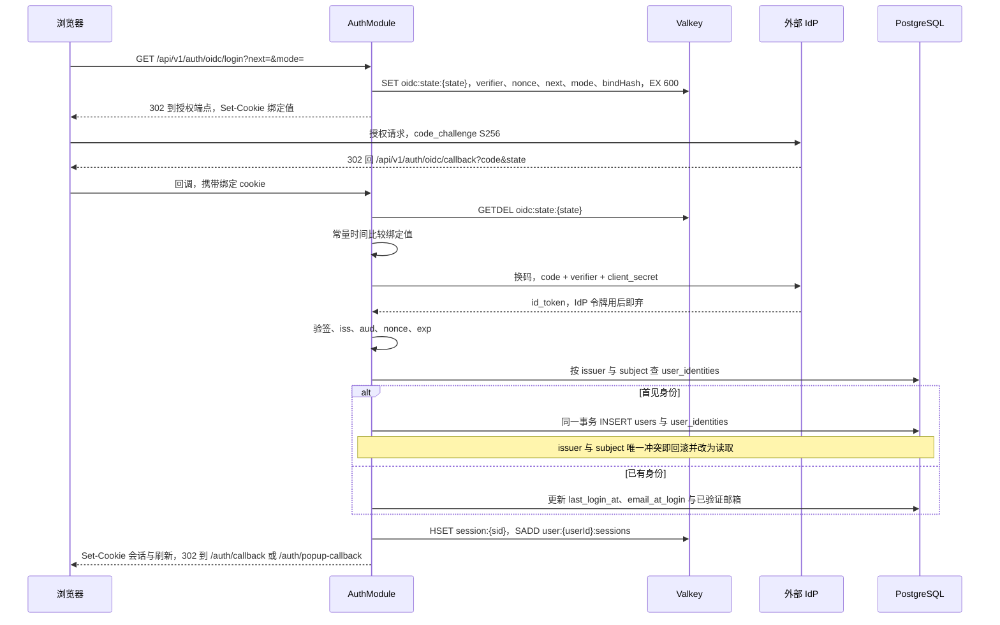
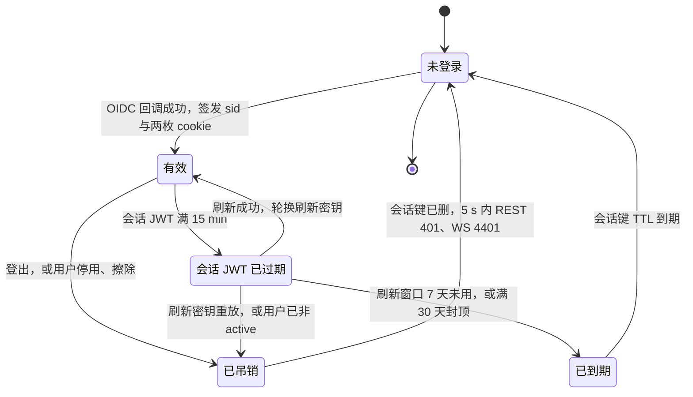
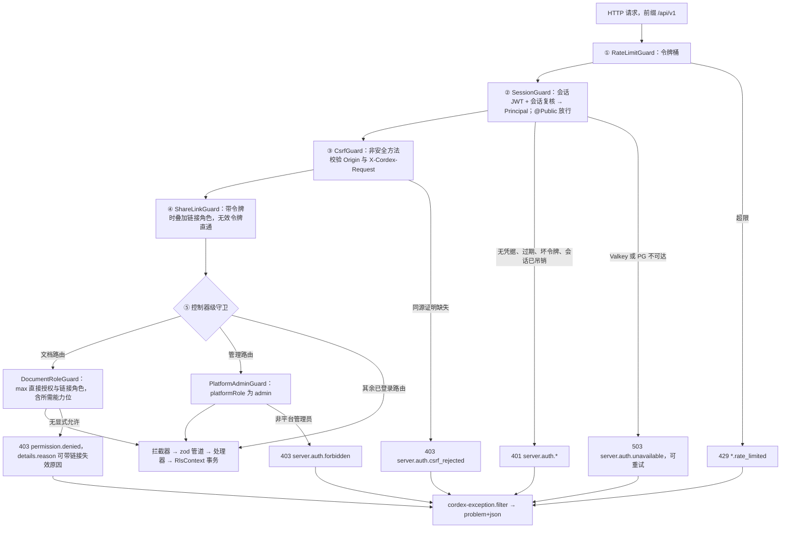
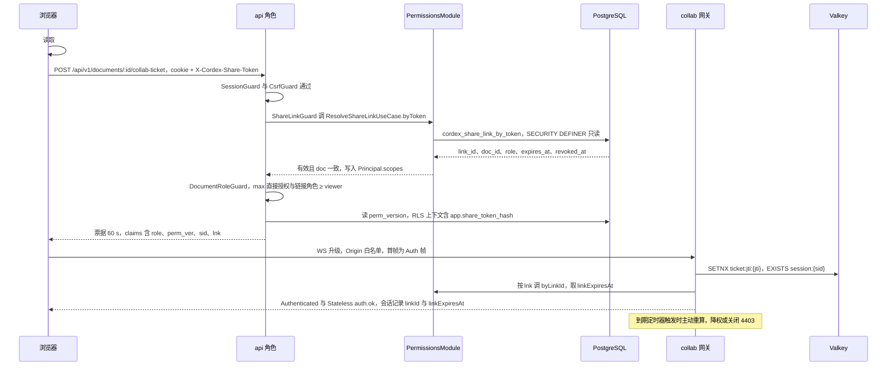
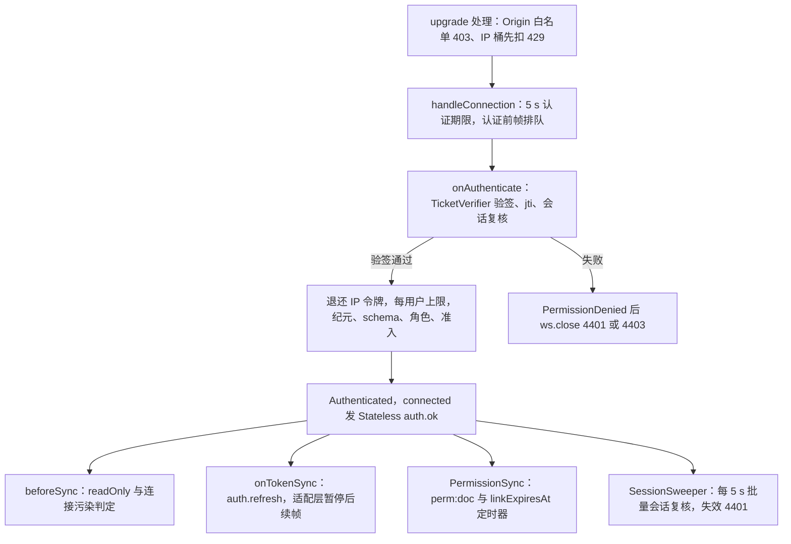
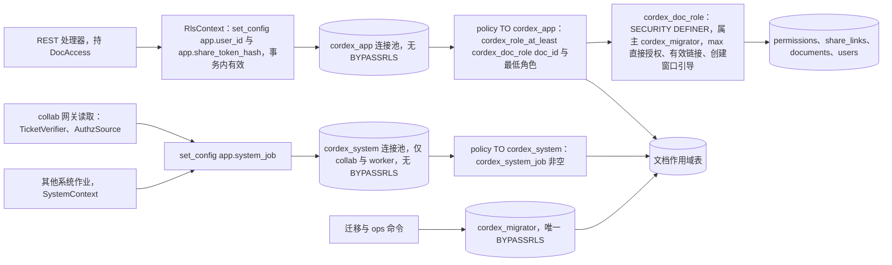
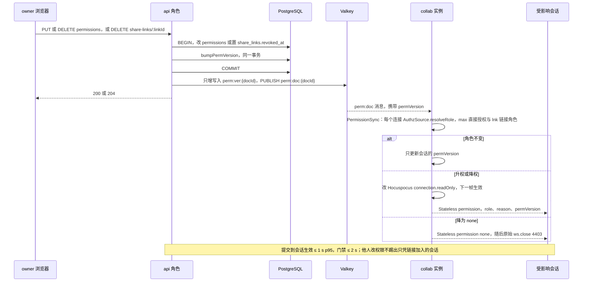

# 02 鉴权链路：OIDC、会话、CSRF、票据、分享链接与 RLS 上下文
> 状态：v0.1 | 负责：后端设计线 | 更新：2026-09-25；2026-09-25（§4.19）；2026-09-25（§4.19 N1）；2026-09-26（§4.20）；2026-09-26（§4.21：协同改用 Hocuspocus（ADR-0039）——§9.1 升级检查放 upgrade 处理；§9.2 Auth 帧 token JSON 与有界排队；§9.3 `TicketVerifier` 在 `onAuthenticate`；§9.4 `readOnly` 与连接污染规则；§9.5 `auth.refresh` = `onTokenSync` 加适配层暂停；§9.6 链接到期定时器挂连接 context；§11 权限传播落在 `PermissionSync`；§13.1 改帧名）；2026-09-26（§4.21 整合：分享链接时序图与集成方 JWT 段的 CONTROL.auth 改为 Auth 帧、续期改为 sendToken / onTokenSync）；2026-09-26（§4.21 Remap：原 30/08 引用按 60-backend/README §6.1 改指新位置，30/08 已删除） | 依赖：[charter](../00-charter/charter.md) §4.2、§7；[rulings](../00-charter/rulings-2026-09-14.md) §4.13 S-1、§4.15 T-0/Q6、§4.17 D1/D3、§4.18 BE-01/BE-02/BE-05/BE-06/BE-07/BE-09/BE-11/UX-02/UX-03、§4.19 D-M2-CONTENT/D-COMMENTS-PKG；[ADR-0029](../30-architecture/adr/0029-gateway-authorization.md)、[ADR-0022](../30-architecture/adr/0022-server-storage.md) 修订 2026-09-24、[ADR-0023](../30-architecture/adr/0023-transport-and-protocol.md)、[ADR-0039](../30-architecture/adr/0039-collab-server-hocuspocus.md)；PRD [SV-06/SV-11/SV-12](../10-prd/03-features/06-server-and-ops.md)、[CO-05/CO-15](../10-prd/03-features/03-collaboration.md)、[EM-03](../10-prd/03-features/05-embedding-and-integration.md)；[30/06](../30-architecture/06-collaboration.md) §6、§10；[30/10](../30-architecture/10-observability-and-errors.md) §1、§2.3；[40/08](../40-modules/08-server-identity-documents-and-storage.md)、[40/09](../40-modules/09-server-collab-gateway-and-headless-host.md)

> 读者：实现 `apps/server` 的 auth、users、permissions、share-links、collab 模块的工程师；安全评审。
> 定位：服务端鉴权**端到端唯一事实源**：主体模型、OIDC RP、首次登录建号、登录会话与吊销、CSRF 与 Origin、REST 守卫链、分享令牌、协同票据、WS 鉴权、RLS 会话上下文、权限变更传播。请求头名 `X-Cordex-Request`（CSRF）与 `X-Cordex-Share-Token`（分享令牌）、cookie 名与属性在本文定义，前端引用。
> 不在本文：模块卡（用例、仓储、imports / exports、错误码全表）见 [03](03-modules-identity-and-access.md)；表结构、SECURITY DEFINER 函数与 policy 本体见 [09](09-ddl-identity-and-access.md)，RLS 框架与 DB 角色见 [08](08-db-conventions-roles-rls-migrations.md)；路由逐条（守卫列、DTO、成功码、限流档）见 [15](15-rest-api-catalog.md) §3.1–§3.7；WS 帧定义见 [30/06 §6](../30-architecture/06-collaboration.md)，服务端帧处理与门禁 L1–L4 见 [16](16-ws-protocol-server-view.md)；Valkey 键模板见 [14](14-valkey-object-storage-and-retention.md)；配置键全表见 [17](17-deployment-and-config.md)；浏览器侧会话状态机、重新登录弹窗、令牌携带见 [50-frontend/02](../50-frontend/02-app-shell-routing-and-session.md)；测试执行见 [70-testing/07](../70-testing/07-backend-integration-and-api-e2e.md) 与 [70-testing/10](../70-testing/10-security-testing.md)。

---

## 0. 一页总览

鉴权链路按凭据分六段，每段只有一个签发方与一个校验点：

| 段 | 凭据 | 签发方 | 校验点 | 寿命 | 失效方式 | 本文 |
|---|---|---|---|---|---|---|
| ① IdP 登录 | 授权码 + PKCE + state + 浏览器绑定值 | 外部 IdP / AuthModule | AuthModule 回调 | 10 min | 单次消费 | §2、§3 |
| ② 登录会话 | 会话 JWT cookie + 刷新 cookie + Valkey `session:{sid}` | AuthModule | 全局 `SessionGuard`；collab 会话复核 | JWT 15 min；刷新窗口 7 天滑动、30 天封顶 | 删 `session:{sid}` 或用户非 `active`，≤ 5 s 生效 | §4 |
| ③ 同源证明 | `Origin` + `X-Cordex-Request: 1` | 浏览器 | `CsrfGuard`；WS 升级 | 每请求 | — | §5 |
| ④ 分享令牌 | URL 片段 → `X-Cordex-Share-Token` 头 | ShareLinksModule | `ShareLinkGuard`（解析归 PermissionsModule） | 链接 `expires_at` | 撤销并 `permVersion++` | §7 |
| ⑤ 协同票据 | ES256 JWT，`aud=cordex-collab` | AuthModule | collab `TicketVerifier` | 60 s，`jti` 单次 | 自然过期 | §8、§9 |
| ⑥ 数据库上下文 | `set_config('app.*', …, true)` | `RlsContext` / `SystemContext` | PostgreSQL RLS + `cordex_doc_role` | 单事务 | 事务结束 | §10 |

三条不变量贯穿全文：

1. **fail-closed**：任何一段缺失、过期、解析失败都拒绝；基础设施故障（Valkey、PG 不可达）返回 503 可重试，不冒充 401（§12）。
2. **不匿名**：分享链接只叠加在已登录用户上，不产出匿名主体；未登录带令牌访问一律 401（rulings §4.13 S-1，ADR-0029 2026-09-21 修订）。
3. **两道防线**：应用层（守卫链 + `DocAccess` + 扫描器 `scan-doc-access-via-permission`）与数据库层（文档级 RLS，治理检查 `check-rls-coverage`）互为兜底，任何一道都不替代另一道（rulings §4.17 D3，ADR-0022 修订 3）。

本文按推荐写入的决策（均为 needsUser=false，依据写在所用小节）：

| 决策 id | 结论摘要 | authority | 小节 |
|---|---|---|---|
| INC-18 | 登录端点 `GET /auth/oidc/login?next=&mode=` 直接 302，无 JSON 变体 | 浏览器顶层导航语义 + 不过度设计；覆盖 40/08、40/11 的 POST 写法 | §2 |
| OIDC-LINK | `(issuer, subject)` 首见即新建用户，同邮箱也不自动关联；跨 IdP 合并留 M4 | 安全宁可提前 | §3 |
| SESSION | 会话 JWT 15 min + 刷新令牌 7 天轮换只存哈希；Valkey 会话键；吊销 ≤ 5 s；JWKS 轮换 | 用户偏好 + PRD SV-06/SV-12 + UX-02 | §4 |
| INC-24 | 非安全方法校验 Origin 与 `X-Cordex-Request: 1`；WS 升级 Origin 白名单 | PRD SV-12 | §5 |
| INC-25 | 分享 URL 用片段 `#share=`，API 只收 `X-Cordex-Share-Token` 头 | ADR-0029 + rulings §4.18 UX-19、BE-02 | §7 |
| INC-20 | 无效令牌直通不叠加；403 的 problem details 在 `details.reason` 带链接失效原因 | ADR-0029（已接受） | §6、§7 |
| MECH-INC（INC-28） | 票据线上 claim 用 `perm_ver`，TS 字段 `permVersion` | ADR-0029 | §8 |
| INC-27 | WS 会话寿命 = 票据 `sid` 指向的登录会话；`auth.refresh` 携新票据 | 规格空白；与 UX-02 一致 | §9 |
| RLS-GUC | GUC `app.user_id` / `app.share_token_hash` / `app.system_job`；`cordex_doc_role` 取 max | rulings §4.18 BE-02 + §4.17 D3 + ADR-0022 修订 | §10 |
| DB-ROLES | `cordex_migrator` / `cordex_app` / `cordex_system`；api 只有 app 池 | ADR-0022 修订 | §10 |
| KEYS | 只用 [14](14-valkey-object-storage-and-retention.md) 登记的键模板，不自造键名 | 40/09 `redis-keys.ts` 为代码唯一落点 | 全文 |
| INC-10/SG-04 | 错误码域 `server.auth.*`、`server.users.*`、`server.share_links.*`、`permission.*` | 30/10 §1.1 | §12、[03 §9](03-modules-identity-and-access.md) |

---

## 1. 主体模型

服务端对 `protocol` 中 `Principal` 的加宽形态（类型落点 `auth/domain/principal.ts`，见 [03 §2](03-modules-identity-and-access.md)）：

```ts
type Principal = {
  kind: 'user'                          // M4 增 'integrator'；永不出现 'shareLink'（S-1）
  id: UserId                            // users.id
  sid: SessionId                        // 登录会话 id；M4 集成方 JWT 主体没有 sid
  platformRole: 'member' | 'admin'      // 取自 users 表，随会话复核至多 5 s 刷新一次（§4.2）
  scopes: readonly ShareLinkScope[]     // 只在本请求内有效，由 ShareLinkGuard 写入（§7）
}
type ShareLinkScope = { docId: DocumentId; role: 'viewer' | 'commenter' | 'editor'; linkId: string; expiresAt?: number }
```

- **角色格**：`owner > editor > commenter > viewer > none`。文档上的**有效角色** = max(直接授权, 本文档有效链接角色)（rulings §4.18 BE-02）。直接授权来自 `permissions` 中未过期的行；链接角色在 REST 侧来自 `Principal.scopes`，在 WS 侧来自票据 `lnk` 按链接 id 复核的结果。
- **能力位**：`protocol permissions/actions.ts` 为唯一定义；运行时初值 `ROLE_CAPABILITIES` 由 PermissionsModule 持有（[03 §4](03-modules-identity-and-access.md)），矩阵与 [15 §2](15-rest-api-catalog.md) 一致：viewer = `doc.read`；commenter 另加 `doc.comment`；editor 另加 `doc.write`、`doc.export`、`history.read`；owner 另加 `doc.manage`、`history.restore`（依据：rulings §4.12 U-09；40/08 §2.2）。
- **`DocAccess`**：品牌类型 `{docId, userId, role}`，只能由 `RoleResolverService.authorize(principal, docId, capability)` 在判定通过后构造；以 `docId` 为键的仓储公共方法首参必须是 `DocAccess` 或 `SystemContext`（扫描器 `scan-doc-access-via-permission`，40/08 §10）。
- **`SystemContext`**：品牌类型 `{job: SystemJobName}`，只能由作业入口（BullMQ 处理器、Job Scheduler、server-collab 单写者、`cordex-ops` 子命令入口）构造；配套 DB 登录角色 `cordex_system` 与 GUC `app.system_job`（§10）。系统上下文**不代表任何用户**，不能出现在 REST 处理器里。
- **平台管理员**：`platformRole='admin'` 只授予部署级管理动作（用户状态与角色、Webhook、审计查询），**不隐含任何文档角色**——读写文档仍须文档权限（40/08 §1.2）。

---

## 2. OIDC RP：授权码 + PKCE，服务端换码

依据：决策 INC-18（authority：浏览器顶层导航语义 + 不过度设计）；rulings §4.18 BE-01、BE-09、BE-11；ADR-0029 2026-09-24 修订第 2 条。

- **客户端类型**：服务端是机密客户端（持有 `client_secret`），由 AuthModule 完成授权码换取；浏览器只做顶层跳转，**不持有** PKCE verifier、IdP 令牌与 id_token（BE-09）。服务端换码验证后即丢弃 IdP 的 access / refresh token，**不落库、不入 Valkey**。
- **issuer**：`auth.oidc.issuer` 取浏览器可达的对外 URL（内置 Casdoor 为 `https://idp.<域名>`，由 web 容器反代并保持 Host 头）；服务端的发现文档与 JWKS 请求经反代在 backend 网络的别名访问同一 URL，仍满足「唯一常规出站」（BE-01）。M1–M3 只配置一个 issuer，「受信 IdP 列表」即它本身；国内 IM 登录经 Casdoor 代理，服务端不写私有 OAuth 适配器。
- **redirect_uri**：`https://<host>/api/v1/auth/oidc/callback`（BE-11），IdP 应用配置同步。

**发起**：`GET /api/v1/auth/oidc/login?next=<站内相对路径>&mode=redirect|popup`（`@Public`，[15 §3.1](15-rest-api-catalog.md)）

1. 校验 `next`：必须以单个 `/` 开头，不以 `//` 或 `/\` 开头，不含控制字符，≤ 2 KiB；不合规一律置为 `/`（防开放重定向）。`mode` 缺省 `redirect`。
2. 生成 `state`、`nonce`、`code_verifier` 与浏览器绑定值 `bind`（各 32 字节 CSPRNG，base64url）。
3. 写 `oidc:state:{state}` = `{codeVerifier, nonce, next, mode, bindHash: sha256(bind), createdAt}`，TTL 600 s（键模板见 14）。
4. 下发绑定 cookie `__Secure-cordex_oidc = bind`（属性见 §4.1 表），302 到授权端点：`response_type=code`、`client_id`、`redirect_uri`、`scope`（缺省 `openid profile email`）、`state`、`nonce`、`code_challenge = BASE64URL(SHA256(verifier))`、`code_challenge_method=S256`。

发现文档（进程内缓存）取不到时不写 state、不下发 cookie，直接 503 `server.auth.idp_unavailable`（[15 §3.1](15-rest-api-catalog.md)）。

**回调**：`GET /api/v1/auth/oidc/callback?code=&state=`（`@Public`）

1. `GETDEL oidc:state:{state}`（单次消费）；不存在或已过期 → 失败。
2. `sha256(cookie 中的 bind)` 与 `bindHash` 常量时间比较，不等 → 失败；无论成败都清除绑定 cookie。这一步防**登录 CSRF**：攻击者无法把自己账号的授权码塞进受害者浏览器完成登录。
3. IdP 回带 `error` 参数 → 失败。
4. 以 `code + code_verifier` 换 token（`client_secret_basic`）；验证 id_token：签名（IdP JWKS，只收非对称算法）、`iss` 等于配置、`aud` 含 `client_id`、多 `aud` 时校验 `azp`、`exp` / `iat`（容差 60 s）、`nonce` 一致。
5. 取 claims `sub`、`email`、`email_verified`、`name` / `preferred_username`、`picture` → §3 首次登录建号或读取已有用户。
6. 用户 `status='suspended'` → 不建会话，失败码 `server.auth.account_disabled`。
7. 建立会话（§4.1），审计 `auth.login_succeeded`；302：`mode=redirect` → 前端 `/auth/callback?next=<next>`；`mode=popup` → `/auth/popup-callback`（前端页经 BroadcastChannel 通知原页后自行关闭，见 50/02）。

失败出口一律 302 回同一前端回调页并带 `?error=<码>`：`server.auth.invalid_token`（state、绑定值、换码、id_token、issuer 任一不通过）、`server.auth.account_disabled`、`server.auth.idp_unavailable`（发现文档或令牌端点不可达）。细分原因只写日志与审计 `auth.login_failed{reason}`，不回显 IdP 原始错误描述。登录与回调走 public 限流档（[15 §8](15-rest-api-catalog.md)）。

**图 2-1 OIDC 登录与首次登录 JIT 建号**



怎么读：纵线是参与方，自上而下是时间顺序；`alt` 两支分别是首次登录与再次登录。浏览器全程只做跳转，verifier、id_token 与 IdP 令牌都只在服务端出现；绑定 cookie 把「发起登录的浏览器」与「完成回调的浏览器」绑在一起。
依据：本文 §2、§3、§4.1；决策 INC-18、OIDC-LINK、SESSION；rulings §4.18 BE-09；ADR-0029 2026-09-24 修订第 2、4 条。

---

## 3. 首次登录 JIT 建号

依据：决策 OIDC-LINK（authority：安全宁可提前——IdP 邮箱不可作为身份凭据）；rulings §4.15 Q6、§4.17 D1；PRD SV-06。

- **查找键**只有 `(issuer, subject)`。未命中即 JIT：同一事务 `INSERT users` + `INSERT user_identities`；并发首登撞 `uq_user_identities_issuer_subject` 时回滚整事务并改为读取已存在的行（[09 §3](09-ddl-identity-and-access.md)）。
- **不按邮箱关联**：新 issuer 的身份遇到同邮箱的既有用户也新建用户；跨 IdP 合并留 M4 由平台管理员操作。M1–M3 只有一个 issuer，Casdoor 场景通常只出现一个 issuer。
- **字段来源**：`display_name` 取 `name` → `preferred_username` → 邮箱 @ 前部分 → `user`，裁剪到 128 字符，**只在建号时写入**（此后用户经 `PATCH /users/me/profile` 自改）；`avatar_url` 每次登录按 `picture` 刷新，只收 `https://` 且 ≤ 2048 字符，否则置空；`user_identities.email_at_login` 原样记录 IdP 声明的邮箱（管理与审计用）。
- **可检索邮箱**：`users.email` 只写 `email_verified=true` 的邮箱（小写规范化，非唯一）；部署可把 `auth.oidc.requireEmailVerified` 置 `false`，用于不下发 `email_verified` 的企业 IdP。理由：按人分享以邮箱精确匹配找人（SG-05），IdP 开放自助注册时未验证的邮箱可被冒用来截获分享。每次登录用最新的已验证邮箱覆盖 `users.email`。
- **注册开关**：`auth.selfSignup`（默认 `false`）只决定登录页是否显示 IdP 注册入口（`GET /auth/config` 下发）；受信 issuer 的任何身份首次登录都会建号，账号是否存在由 IdP 管理员控制。服务端**无邀请表、无邀请兑现端点**（rulings §4.17 D1）。
- **已擦除的用户**：擦除时身份行已删（[03 §3](03-modules-identity-and-access.md)），同一 IdP 账号再次登录会被当作首见身份，得到一个新的空账号；要阻止须在 IdP 停用该账号。
- **首个平台管理员**：配置 `auth.bootstrapAdmins`（已验证邮箱列表，默认空）只在部署内**不存在任何 active admin** 时生效——登录时邮箱命中即把该用户升为 `admin`，审计 `user.role_changed{via:'bootstrap'}`；一旦存在 admin，该配置不再有任何效果。
- **审计**：新建时 `user.provisioned{userId, issuer}`。

---

## 4. 登录会话

依据：决策 SESSION（authority：用户偏好「安全宁可提前」+ PRD SV-06/SV-12；与 rulings §4.18 UX-02 一致）。键模板 `session:{sid}`、`user:{userId}:sessions` 见 [14](14-valkey-object-storage-and-retention.md)，本节定义其值形状。

### 4.1 签发与 cookie

OIDC 回调成功后：`sid` = 16 字节 CSPRNG（base64url）；刷新密钥 = 32 字节 CSPRNG；写 `session:{sid}`（hash）并 `SADD user:{userId}:sessions {sid}`。

| `session:{sid}` 字段 | 含义 |
|---|---|
| `userId` | 会话主体 |
| `refreshHash` / `prevRefreshHash` | 当前与上一枚刷新密钥的 sha256（hex）；明文只在 cookie 中 |
| `rotatedAt` | 最近一次轮换时刻，用于并发刷新宽限（§4.3） |
| `createdAt` / `absExpiresAt` | 签发时刻与绝对封顶（`createdAt + auth.session.absoluteTtlSec`） |
| `idTokenHint`（可选） | 登录时 IdP 下发的 id_token 原文，只用于 RP-initiated logout 的 `id_token_hint`（§4.4）；IdP 发现文档没有 `end_session_endpoint` 时不保存。它不是访问凭据：服务端从不用它调用 IdP，也不保存 IdP 的 access / refresh token |

键 TTL = min(`auth.session.refreshTtlSec`, `absExpiresAt − now`)，每次轮换重置；`user:{userId}:sessions` 的 TTL 为 `auth.session.absoluteTtlSec`，每次 `SADD` 重置。

| 逻辑名 | 线上名 | 值 | 属性 | Max-Age |
|---|---|---|---|---|
| `cordex_session` | `__Host-cordex_session` | ES256 JWT：`iss`=publicUrl、`aud`=`cordex-session`、`sub`、`sid`、`iat`、`exp`（`auth.session.accessTtlSec`，默认 900 s）；JWS 头带 `kid` | HttpOnly；Secure；SameSite=Lax；Path=/ | 与刷新窗口相同（≤ 7 天）：cookie 活得比 JWT 长，`Session*` 路由才能读到「签名有效但已过期」的 JWT 取 `sid` |
| `cordex_refresh` | `__Secure-cordex_refresh` | 刷新密钥（32 字节 base64url） | HttpOnly；Secure；SameSite=Strict；Path=/api/v1/auth | `auth.session.refreshTtlSec`（默认 604800 s，即 7 天），每次轮换重置 |
| `cordex_oidc` | `__Secure-cordex_oidc` | 登录往返绑定值（§2） | HttpOnly；Secure；SameSite=Lax；Path=/api/v1/auth/oidc | 600 s，回调即清除 |

线上名的 `__Host-` / `__Secure-` 前缀由浏览器强制：`__Host-` cookie 不能被任何子域设置或覆盖。部署有 `idp.<域名>` 与 `s3.<域名>` 两个同站子域（BE-01），前缀防的是子域注入会话 cookie（会话固定）。`cordex_refresh` 只发往 `/api/v1/auth/*` 且用 Strict，第三方页面发起的请求一律不带它。

### 4.2 每请求校验（`SessionGuard`）

| 步 | 检查 | 失败 |
|---|---|---|
| 1 | `__Host-cordex_session` 存在 | 401 `server.auth.unauthenticated` |
| 2 | JWT 只接受 `alg=ES256`；`kid` 在密钥环内；`aud=cordex-session`；`iss` 相符；结构完整 | 401 `server.auth.invalid_token` |
| 3 | `exp` 未过（时钟容差 ≤ 5 s）；`Session*` 路由（刷新、登出）跳过此步 | 401 `server.auth.expired` |
| 4 | 会话复核：`session:{sid}` 存在且 `userId = sub`，且 `users.status='active'`；同时读出 `platform_role` 构造 `Principal`。结果按 `sid` 进程内缓存 `auth.session.revocationCacheMs`（默认 5000 ms） | 401 `server.auth.expired` |
| 5 | 复核所需的 Valkey 或 PG 不可达，且缓存已过期 | 503 `server.auth.unavailable`（`retryable:true`） |

- 非 HTTP 上下文（WS）直接放行，WS 靠首帧票据（§9）；`@Public()` 路由跳过全部步骤（BE-06）。
- 步骤 4 同时是「停用即失效」的实现：用户被停用或擦除后，最迟一个缓存周期（≤ 5 s）内所有 REST 请求 401；平台角色变更同样 ≤ 5 s 生效，因此会话 JWT 里**不放角色**。
- `users.last_seen_at` 在缓存未命中且距上次写入 ≥ 5 min 时，经 UsersModule 导出的用例节流更新（谁的表谁写）。

### 4.3 刷新：`POST /api/v1/auth/token/refresh`

守卫写作 `Session*`（[15 §2](15-rest-api-catalog.md)）：会话 JWT 可以已过期，但签名、`aud`、`sid` 必须有效；仍经 `CsrfGuard`。

1. 读 `__Secure-cordex_refresh`，缺失 → 401 `server.auth.unauthenticated`。
2. 读 `session:{sid}`：不存在、`userId ≠ sub`、已过 `absExpiresAt`，或用户非 `active` → 删除该 `sid`，401 `server.auth.expired`（前端直接进入「登录已过期」，UX-02）。
3. `sha256(密钥) = refreshHash` → **轮换**：生成新密钥，`prevRefreshHash ← refreshHash`、`refreshHash ← 新哈希`、`rotatedAt ← now`，重置键 TTL，下发两枚新 cookie，204。
4. `sha256(密钥) = prevRefreshHash` 且 `now − rotatedAt ≤ 10 s` → 同一浏览器多标签页并发刷新：只重签会话 JWT，不再轮换（另一标签页的响应已把新刷新 cookie 写进共享 cookie 罐），204。
5. 其余情况视为刷新密钥被盗用重放：删除该 `sid`，审计 `auth.session_revoked{scope:'sid', reason:'refresh_reused'}`，401 `server.auth.expired`。

前端用 Web Locks 串行化同一浏览器内的刷新（50/02），第 4 步只是兜底。

### 4.4 登出：`POST /api/v1/auth/logout`

`Session*`：删除 `session:{sid}` 并从 `user:{userId}:sessions` 移除，下发 `Max-Age=0` 清除两枚 cookie，审计 `auth.logout`，返回 200 `{ endSessionUrl? }`（RP-initiated logout，PRD AS-06、rulings §4.15 Q6）：

- IdP 发现文档含 `end_session_endpoint` 时，服务端拼好 `endSessionUrl` = 该端点 + `client_id` + `post_logout_redirect_uri`（= `publicUrl` + `auth.oidc.postLogoutRedirectPath`，默认 `/login`，须在 IdP 侧登记为允许的回跳地址）+ `state`；会话中保留了 `idTokenHint` 时另带 `id_token_hint`。前端清完本地离线数据后顶层跳转到它，结束 IdP 的单点登录会话（50/02）。
- 发现文档没有该端点时省略 `endSessionUrl`，只结束本系统会话；前端直接回 `/login`。
- 服务端不在响应前调用 IdP，登出不会因 IdP 不可达而失败。

### 4.5 吊销与生效时限

| 触发 | 动作 | REST 生效 | WS 生效 |
|---|---|---|---|
| 用户登出 | 删该 `sid` | ≤ 5 s（其他实例缓存过期） | 会话复核 ≤ 5 s 后 4401（§9.5） |
| 刷新密钥重放（§4.3 第 5 步） | 删该 `sid` | 同上 | 同上 |
| 平台管理员停用用户、用户擦除 | UsersModule 在提交后删该用户全部 `sid`（`user:{userId}:sessions` 逐个 `DEL`），审计 `auth.session_revoked{scope:'all'}`；即使删除失败，`users.status` 已非 `active`，复核照样拒绝 | ≤ 5 s | ≤ 5 s，4401 |
| 平台角色变更 | 不删会话；复核读取新 `platform_role` | ≤ 5 s | 不影响文档角色 |
| 刷新窗口到期或满 30 天 | 键 TTL 到期 | 下次刷新 401 | 复核发现键缺失后 4401 |

会话存储类 `SessionStore`（唯一读写 `session:*` 与 `user:*:sessions` 的代码）放在 UsersModule 并导出给 AuthModule，使停用与擦除用例能在本模块内吊销会话而不反向 import AuthModule（模块关系见 [03 §6](03-modules-identity-and-access.md)）。

**图 4-1 服务端登录会话生命周期**



怎么读：圆角框是服务端眼中一个 `sid` 的状态，箭头上的文字是触发条件。「有效」与「会话 JWT 已过期」之间来回切换是常态（每 15 min 一次刷新）；只有吊销与到期两条路回到「未登录」，吊销对 REST 与 WS 的生效上限都是一个复核周期。
依据：本文 §4.1–§4.5；决策 SESSION；rulings §4.18 UX-02。

### 4.6 签名密钥与 JWKS

- 两份文件（键名以 [17](17-deployment-and-config.md) §5.5 为准）：签名私钥 JWKS `auth.jwt.signingKeysFile`（**只有 api 持有**，其中恰好一把为当前签发密钥）与同一组密钥的公钥 JWKS `auth.jwt.verifyKeysFile`（api 与 collab 持有）。会话 JWT 与协同票据共用这组密钥，靠 `aud`（`cordex-session` / `cordex-collab`）与寿命上限区分，任一方校验器都拒收另一种 `aud`。collab 只验不签：被攻破的 collab 实例伪造不了会话与票据。
- 轮换不停机：① 新公钥加入 `verifyKeysFile` 并滚动发布到 api、collab；② api 的 `signingKeysFile` 加入新私钥并切为当前签发密钥；③ 旧密钥保留 ≥ 最长令牌寿命（会话 JWT 15 min）+ 时钟容差后从两份文件移除。刷新密钥是不透明随机串，不受签名密钥轮换影响。
- `GET /api/v1/auth/.well-known/jwks.json`（`@Public`）发布 `verifyKeysFile` 中全部未移除公钥；collab 进程内经 AuthModule 导出的验签面 `TicketVerificationKeys` 直接读本地公钥文件，不经网络拉取（BE-07）。

---

## 5. CSRF 与 Origin

依据：决策 INC-24（authority：PRD SV-12 P0 验收 + 用户偏好「安全宁可提前」）。

| 检查 | 适用 | 通过条件 | 拒绝 |
|---|---|---|---|
| 来源 | 非安全方法（POST / PUT / PATCH / DELETE）且非 `@Public` 的路由，含 `Session*` 路由 | `Origin` ∈ `security.allowedOrigins`；请求没有 `Origin` 时 `Sec-Fetch-Site` 必须为 `same-origin`；两者都缺 → 拒绝 | 403 `server.auth.csrf_rejected` |
| 自定义头 | 同上 | `X-Cordex-Request: 1` | 403 `server.auth.csrf_rejected` |
| WS 升级来源 | `/collab/v1/rooms/:documentId` 的升级请求 | `Origin` ∈ `security.allowedOrigins` | HTTP 403（不建立 WS），码 `server.auth.origin_rejected`，计数指标见 [18](18-observability-and-ops-endpoints.md) |

- **为什么两道都要**：`SameSite=Lax` 挡得住跨站请求携带会话 cookie，挡不住**同站**来源——`idp.<域名>`、`s3.<域名>` 与应用同站，其中任一被攻破都能向 `/api/v1` 发同站请求；`Origin` 白名单按完整源比对，能区分子域。自定义头迫使跨源请求先发预检，而 API 不开放 CORS（不返回 `Access-Control-Allow-Origin`），预检必然失败。
- `security.allowedOrigins` 缺省为 `publicUrl` 的源；生产环境必须显式配置，不接受通配（配置键见 17）。
- `@Public` 的非安全方法只有 `POST /api/v1/telemetry/csp`（Reporting API 不能附自定义头，也不保证带 cookie；该端点不使用会话，靠限流与 16 KiB 上限防滥用，见 [15 §4](15-rest-api-catalog.md)）。
- M4 的 Bearer 请求（集成方 JWT、API Key）不带 cookie，豁免本节两项检查。
- 安全方法（GET / HEAD）不得有副作用；唯一例外是 `GET /auth/oidc/login` 写入 10 min 的 `oidc:state`，它不改变任何用户数据。

---

## 6. REST 守卫链

依据：rulings §4.18 BE-05、BE-06、BE-08；ADR-0029 2026-09-21 修订「守卫顺序」；决策 INC-20、INC-24。守卫顺序固定，`AppModule` 按下表顺序以 `APP_GUARD` 注册前四个，控制器级守卫最后执行；每条路由用哪种控制器级守卫与能力位见 [15](15-rest-api-catalog.md) 路由总表。

| 顺序 | 守卫 | 注册 | 归属模块 | 通过条件 | 拒绝出口 |
|---|---|---|---|---|---|
| ① | `RateLimitGuard` | `APP_GUARD` #1 | common（机制，M-12） | 令牌桶有余量；主体取会话 JWT 的 `sub`（只验签、不复核会话），无会话按客户端 IP（`clientIp()`，按 `http.trustProxy` 跳数自右向左取，rulings §4.20 BE-04）；档位见 15 §8 | 429 `*.rate_limited` + `Retry-After` |
| ② | `SessionGuard` | `APP_GUARD` #2 | AuthModule | §4.2；`@Public` 放行；`Session*` 允许 JWT 过期 | 401 `server.auth.unauthenticated` / `expired` / `invalid_token`；503 `server.auth.unavailable` |
| ③ | `CsrfGuard` | `APP_GUARD` #3 | AuthModule | §5 | 403 `server.auth.csrf_rejected` |
| ④ | `ShareLinkGuard` | `APP_GUARD` #4 | ShareLinksModule | 带 `X-Cordex-Share-Token` 时解析并叠加链接角色；**从不拒绝**，无效令牌只记录原因（§7.4） | — |
| ⑤ | `DocumentRoleGuard` | 控制器级，`@DocCapability(cap)` | PermissionsModule | 有效角色（§1）的能力位含 `cap` | 403 `permission.denied`（可带 `details.reason`）；文档不存在或 `purging` → 404 `server.documents.not_found` |
| ⑤′ | `PlatformAdminGuard` | 控制器级 | AuthModule（无 DI 依赖，只读 `Principal`） | `Principal.platformRole='admin'` | 403 `server.auth.forbidden` |

通过全部守卫后依次是请求上下文拦截器、zod 管道、处理器；处理器内每个数据库事务由 `RlsContext` 开启（§10）；文档状态守卫（`DocumentStateGuard`，按 active / trashed / locked 放行）挂在 `DocumentRoleGuard` 之后，归 [04](04-modules-documents-storage-media.md)。

**图 6-1 REST 守卫链与拒绝出口**



怎么读：自上而下是一次请求穿过守卫的固定顺序，左侧主干是放行路径，右侧各出口是拒绝路径，全部汇入异常过滤器转为 problem+json（映射表 `protocol errors/http-map.ts`）。④ 没有拒绝出口：链接角色必须先进入 `Principal`，否则只凭链接、没有直接授权的用户会在叠加之前就被 403（BE-05）。
依据：本文 §4.2、§5、§7.4；rulings §4.18 BE-05、BE-06；30/10 §1.4；15 §2。

---

## 7. 分享链接

依据：决策 INC-25（authority：ADR-0029 否决 API 上的 URL 令牌 + rulings §4.18 UX-19、BE-02）、INC-20（authority：ADR-0029 已接受）；rulings §4.13 S-1、§4.18 BE-02/BE-05。

### 7.1 令牌与 URL

- 令牌 = 32 字节 CSPRNG，base64url（43 字符）；库里只存 `sha256(令牌)`（`share_links.token_hash bytea`，32 字节，唯一）。明文只在创建响应中出现一次（[15 §3.5](15-rest-api-catalog.md)）。
- 分享 URL = `https://<host>/documents/{docId}#share={令牌}`。片段不进入 HTTP 请求、`Referer` 与任何访问日志；前端读取后存 `sessionStorage`（键 `cordex.share.{docId}`）并 `history.replaceState` 去掉片段，未登录时令牌在 OIDC 往返中留在 `sessionStorage`（50/02）。
- 全站 `Referrer-Policy: strict-origin-when-cross-origin`（web 容器下发，17）。

### 7.2 传输与脱敏

- API **只**接受请求头 `X-Cordex-Share-Token: <令牌>`；服务端不读取任何 query 参数中的令牌（传了也不生效）。
- 需要携带该头的请求：文档作用域的 REST（`/api/v1/documents/:id/**`，含 collab 角色上的快照路由）与 `POST /documents/:id/collab-ticket`。文档列表等非文档作用域路由忽略该头。
- 服务端日志（pino redact）、trace 属性与错误上报对 `x-cordex-share-token`、`cookie`、`set-cookie`、`authorization` 一律脱敏（落实 30/10 §2.3「token/ticket/cookie/authorization → [redacted]」，具体配置归 [18](18-observability-and-ops-endpoints.md)）。

### 7.3 解析：`ResolveShareLinkUseCase`（PermissionsModule）

同一个用例服务三处调用方——`ShareLinkGuard`、`RoleResolverService`、collab `AuthzSource`——保证令牌在各处解析一致（BE-02）：

| 路径 | 入参 | 读取方式 | 结果 |
|---|---|---|---|
| `byToken` | 令牌明文 → `sha256` | `ShareLinkReader.byTokenHash` → SECURITY DEFINER 函数 `cordex_share_link_by_token` | `ShareLinkGrant{linkId, docId, role, expiresAt?}` 或失效原因 |
| `byLinkId` | 票据 `lnk` | `ShareLinkReader.statusOf` → `cordex_share_link_status` | 同上 |

- 两个函数照常返回已撤销、已过期的行，有效性由用例判定：`revoked_at` 非空 → `share_link.revoked`；`expires_at ≤ now`（经 Clock）→ `share_link.expired`；查无此行 → `share_link.not_found`（不对外暴露）。
- `ShareLinkReader` 不直接 `SELECT share_links`、不写表；函数定义与加固见 [09 §7](09-ddl-identity-and-access.md)。

### 7.4 `ShareLinkGuard` 与 `DocumentRoleGuard` 的配合

1. 无 `X-Cordex-Share-Token` 头，或路由不在文档作用域 → 直通。
2. 有头 → `byToken`；有效且 `grant.docId` 等于路由的 `:id` → 把 `{docId, role, linkId, expiresAt}` 追加进 `Principal.scopes`，并在请求上下文记下令牌哈希供 `RlsContext` 设置 `app.share_token_hash`（§10）。
3. 无效、过期、撤销，或令牌属于别的文档 → **直通、不叠加**，只在请求上下文记下 `shareLinkInvalidReason`（INC-20）。
4. `DocumentRoleGuard` 取 max(直接授权, 本文档 scope 角色)；不足时 403 `permission.denied`，若第 3 步记有原因则 `details.reason ∈ {share_link.expired, share_link.revoked}`，前端据此提示「链接已失效」（该码须标 `user:true` 才回传 details，30/10 §1.4）。本请求刚解析出的 scope 不再按 `linkId` 二次复核。
5. 链接只叠加在已登录 `Principal` 上：未登录请求在 ② `SessionGuard` 已 401，前端带着 `sessionStorage` 中的令牌去登录再回来（S-1）。

### 7.5 外部访问审计

`ShareLinkGuard` 每次成功叠加链接角色都写一条 `share_link.accessed`（文档 id 与访问者记在审计行的 `doc_id`、`actor_id` 列；details 为 `linkId`、`role`、`directRole`，以 [07 §9.2](07-modules-comments-webhooks-audit.md) 为准，`directRole` 让审计方区分「非协作者凭链接进入」与「协作者凭链接提权」），不采样、不按天去重。写入走审计缓冲通路，按 07 的合并规则以 `(actor_id, action, doc_id, target_id)` 为键 1 s 窗口合并为一行并带 `count`，次数完整保留。依据：rulings §4.13 S-1（每次外部访问写审计）；ADR-0029 2026-09-21 修订「外部访问审计」（每次成功叠加即一次真实外部访问，仅审计、不采样）；原 30/08 篇 §9.1 迁入。

**图 7-1 凭分享链接换票据并加入房间**



怎么读：纵线是参与方，自上而下是时间顺序。令牌只在第二条消息里以请求头出现一次，WS 上从不出现令牌，只有票据里的链接 id `lnk`；collab 按 `lnk` 复核链接此刻是否仍有效并记下到期时刻，此后链接撤销或到期都能让该会话降权（§9.6）。
依据：本文 §7.3、§7.4、§8、§9；rulings §4.18 BE-02、BE-05；ADR-0029 决策 6 与 2026-09-21 修订「WS 侧」。

---

## 8. 协同票据（collab ticket）

依据：ADR-0029 决策 1、6；决策 MECH-INC（INC-28：线上 `perm_ver`，TS 字段 `permVersion`）、INC-01（类型登记在 `protocol collab/ticket.ts`，40/02）；rulings §4.18 BE-02、BE-07。

| 线上 claim | TS 字段（`CollabTicketClaims`） | 含义 |
|---|---|---|
| `iss` | — | `publicUrl` |
| `aud` | — | 固定 `cordex-collab`；会话 JWT 的 `aud` 是 `cordex-session`，两者互不接受 |
| `sub` | `sub` | 用户 id |
| `doc` | `doc` | 文档 id，须与 WS URL 的 `:documentId` 一致 |
| `role` | `role` | 签发时的有效角色（§1），`owner` / `editor` / `commenter` / `viewer` |
| `perm_ver` | `permVersion` | 签发时 `document_perm_versions.perm_version` |
| `sid` | `sid` | 登录会话 id；M1–M3 票据只由 OIDC 会话换取，必有 |
| `lnk` | `lnk?` | 分享链接 id：换票请求携带本文档**有效**分享令牌时写入（不论链接角色是否高于直接授权），供 WS 侧重算 |
| `jti` | `jti` | 16 字节随机，单次使用 |
| `iat` / `exp` | `iat` / `exp` | `exp = iat + auth.ticket.ttlSec`（默认 60 s） |

- JWS 头：`alg=ES256`、`kid`（与会话 JWT 同一密钥环，§4.6）。
- **签发**：`POST /api/v1/documents/:id/collab-ticket`（[15 §3.7](15-rest-api-catalog.md)），守卫 `+Link → DocRole(doc.read)`；只凭链接、无直接授权的用户同样 200（BE-05）。用例 `IssueCollabTicketUseCase`（AuthModule）另要求文档 `status ∈ {active, locked}`（`trashed` / `purging` / 不存在 → 404 `server.documents.not_found`），在 `RlsContext` 事务里读 `perm_version`；签发后调 DocumentsModule 导出的 `TouchRecentUseCase` 记录本人「最近」（其自身单事务、60 s 节流，[04](04-modules-documents-storage-media.md) §3）；独立限流档（ADR-0023；15 §8）；审计 `auth.collab_ticket_issued`（缓冲通路，details 见 07）。
- **只在帧里传**：票据只出现在 Hocuspocus Auth 帧的 token（JSON 的 `ticket` 字段；握手与 `auth.refresh` 都用它，2026-09-26 起取代 `CONTROL.auth.ticket` 与 `CONTROL.auth.refresh.ticket`，ADR-0039），从不出现在 URL、query、`Sec-WebSocket-Protocol`（ADR-0029 备选方案表）。
- **验签面**：AuthModule 导出 `TicketVerificationKeys`（只含验签能力，不含签发私钥的使用入口），collab 的 `TicketVerifier` 经 import AuthModule 取得（BE-07）；校验流程在 §9.3。

---

## 9. WS 鉴权

本节只写鉴权相关的判定；帧格式以 [30/06 §6](../30-architecture/06-collaboration.md) 为准，其余帧处理、门禁 L1–L4、关闭码触发全表见 [16](16-ws-protocol-server-view.md)。2026-09-26 起协同服务端是嵌入的 Hocuspocus 4（rulings §4.21，ADR-0039）：升级前的检查在 apps/server 的 upgrade 处理，鉴权判定在 server-collab 的 `onAuthenticate` 钩子，续票在 `onTokenSync`，业务关闭一律由原始 `ws.close(码)` 发出。

**图 9-1 WS 鉴权链路的挂点**



怎么读：自上而下是一条 WS 从升级到认证完成的挂点顺序，认证完成后并列的四个框是会话期内持续生效的检查。每个框写明它挂在哪里：只有最上面一个在 HTTP 层，其余都在 Hocuspocus 的钩子或自有扩展里。

依据：本文 §9.1–§9.6、§11；ADR-0029 修订 2026-09-26；ADR-0039 表 39-1；[16](16-ws-protocol-server-view.md) §1、§3、§8。

### 9.1 升级

路径 `/collab/v1/rooms/:documentId`（不加 `/api` 前缀，BE-11）。升级请求先过 `Origin` 白名单（§5，失败 HTTP 403 `server.auth.origin_rejected`），再过按 IP 的连接限流（16）。升级请求上的 cookie **不参与**鉴权（ADR-0029：跨站嵌入下 cookie 不可用、无法携带文档级权限快照）；Hocuspocus 钩子虽然能拿到 `requestHeaders`（含 cookie）与 URL 参数，一律不读。**挂点**（2026-09-26）：这两项检查在 apps/server 自挂的 `upgrade` 处理里执行（`collab-upgrade.handler.ts`，40/09 §4.1），嵌入模式下 Hocuspocus 的 `onUpgrade` 不触发；Origin 白名单不能挪到钩子里，因为那时 WS 已经建立。

### 9.2 首帧

票据放在 Hocuspocus Auth 帧的 token 里（JSON：`ticket`、`protocolVersion`、`clientId`、`capabilities`、`appVersion`、`epoch?`、`maxSchemaVersion`、`traceparent?`，≤ 8 KiB，超出 4400）；客户端 provider 的 `token` 是 async 函数，每次 WS 打开或 `sendToken()` 时现换票。升级后 5 s 内未完成认证（适配层计到 `Authenticated` 为止）→ 关闭 4408。认证前到达的 Sync / Awareness 帧**不拒绝**，由 Hocuspocus 有界排队、不应用，认证通过并加载完成后回放；适配层对认证前入站帧另设严格上限（16 帧、64 KiB，超出 4205）。（2026-09-26 修订，ADR-0029 决策 2；原：「5 s 内必须收到 `CONTROL.auth{ticket, …}`……`auth` 成功前收到 SYNC 或 AWARENESS 帧 → 关闭 4401」——官方 provider 发完 Auth 立即发 step1 与 awareness，取票期间的编辑还会先于 Auth 上线，按原文会误杀，作废。）

### 9.3 验票（`TicketVerifier`，collab）

**挂点**（2026-09-26，ADR-0039）：`TicketVerifier` 仍在 apps/server（它要用 AuthModule 导出的验签面、Valkey 与 `documents` 读取），经 server-collab 的 `AuthorizationSource.verifyTicket` 注入，由 `AuthExtension.onAuthenticate` 调用；判定一律放 `onAuthenticate`，不放先于它触发的 `onConnect`。下表任一步失败都抛出 `{reason:{code}}`，Hocuspocus 回 `PermissionDenied(reason)`，随后由钩子调原始 `ws.close(码)`（钩子抛错本身只产生客户端看到 1000 的文档级关闭）。第 1–4 步全部通过即「验签通过」：经 `ServerConnection.onTicketVerified` 退还 IP 升级令牌（[16](16-ws-protocol-server-view.md) §1）。

| 步 | 检查 | 失败 |
|---|---|---|
| 1 | JWT：`alg=ES256`、`kid` 在环内、`aud=cordex-collab`、`iss`、`exp` 未过（容差 ≤ 5 s）、`exp − iat ≤ auth.ticket.ttlSec` | `PermissionDenied{collab.unauthenticated}` → 4401 |
| 2 | `doc` = URL 的 `:documentId`（= Hocuspocus 文档名 `{docId}:{epoch}` 的 `docId` 部分） | `PermissionDenied{collab.forbidden}` → 4403（票据本身有效，只是不属于这条连接，与 [16](16-ws-protocol-server-view.md) §10 一致） |
| 3 | `SET ticket:jti:{jti} NX EX 60`（键模板见 14）；已存在即重放 | 同上 |
| 4 | 会话复核：`session:{sid}` 存在且 `userId = sub`，用户 `active`（与 §4.2 第 4 步同一 `SessionValidator`） | 同上 |
| 5 | `perm_ver` 与 `perm:ver:{docId}` 比较；键缺失时回源 PG 读取并以「只增」方式回填；不一致时以库为准，经 `AuthzSource` 重算角色 | 重算为 `none` → `PermissionDenied{collab.forbidden}` → 4403 |
| 6 | 读 `documents.status`：不存在或 `trashed` → `collab.doc_not_found`；`purging` → `collab.doc_purging`（BE-15） | 4404 |
| 7 | 票据带 `lnk` → `byLinkId` 复核：有效则记录 `linkId`、`linkExpiresAt`；无效则丢弃链接部分并按直接授权重算 | 重算为 `none` → 4403 |
| 8 | 准入与名额（05、16），可写性写入 `connectionConfig.readOnly`；通过后 Hocuspocus 回 `Authenticated`，`connected` 钩子以 Stateless 发 `auth.ok` | 16 |

`locked` 文档允许加入，写入帧在 L2 被拒（ADR-0029 决策 5；锁定窗口只有覆盖导入与迁移，版本恢复不加锁，rulings §4.19 N1）。步骤 5、7 的重算与 §9.6 走同一条路径。

### 9.4 每帧角色检查

`Sync update` / `step2` 要求会话角色 ≥ commenter 且文档未 `locked`（2026-09-26 起映射为 Hocuspocus 的 `connection.readOnly`，在 `beforeSync` 判定，下一帧即按新值生效）；commenter 的写入范围由服务端软门禁 L4 的路径级规则限定在 `resources['comments.threads']`，越界路径被修复还原（[16](16-ws-protocol-server-view.md) §4；依据：rulings §4.19 D-COMMENTS-PKG、PRD PD-04、ADR-0029 决策 3 修订、ADR-0034 补充 v0.2）；`AWARENESS` 要求 viewer 及以上；`CONTROL` 只接受白名单类型。违规回 Stateless `error{collab.forbidden}`，只有越权写入计数，降权瞬间仍在途的帧不计，同一会话累计 3 次关闭 4403（计数起点见 16 §4）。检查只读会话内缓存的角色，不查库。**连接污染规则**（2026-09-26，ADR-0029 决策 3 修订、ADR-0039 决策 6）：一条连接一旦有写入帧被拒，之后的写入帧一律不落库、不回 ack，直到重连；其间不允许把 `readOnly` 恢复为 `false`；权限升级或解锁时若该连接丢过帧，先发 `permission` 再以 1012（reason `contaminated`）关闭（原因：被拒帧之后同一客户端的更新可能因缺前驱不可见，照常落库并 ack 会造成「已 ack 但不可见」，16 §4）。只读会话仍能发 awareness，由 `beforeHandleAwareness` 剥离光标与选区字段（16 §7）。

### 9.5 会话寿命与续期

依据：决策 INC-27（authority：规格空白；与 rulings §4.18 UX-02 一致）。

- **寿命绑定 `sid`**：WS 会话不设独立期限，其有效性等于票据 `sid` 指向的登录会话。每个 collab 实例每 `auth.session.revocationCacheMs`（默认 5000 ms）对本实例全部连接做一次批量会话复核（`session:{sid}` 管道化 `EXISTS` + 一条按 `userId` 批量查 `users.status` 的 SQL）；失效的连接以 4401 关闭。执行者是 apps/server 的 `SessionSweeper`（2026-09-26）：取 `collabServer.listSessions()`（`connected` 钩子登记的连接），复核后对失效者调 `collabServer.closeSession(sessionId, 4401)`（原始 `ws.close`）。登出、停用、擦除、刷新密钥重放因此在 ≤ 5 s 内同时作用于 REST 与 WS，不需要按房间点名踢人。
- **`CONTROL.auth.refresh{ticket}`**（C→S）：客户端换得的新票据。2026-09-26 起即客户端 `provider.sendToken()` 发出的已认证后 Auth 帧，服务端在 `onTokenSync` 钩子处理（ADR-0039 决策 3）：执行 §9.3 第 1–5、7 步，并要求新票据的 `sub`、`doc`、`sid` 与本连接完全一致，然后用新票据更新会话的 `role`（直接写 `connection.readOnly`）、`permVersion`、`linkId`、`linkExpiresAt`（`onTokenSync` 的返回值不会更新 `connection.context`，会话态放在 context 里的可变对象上直接改）；任何一项不符 → 钩子以原始 `ws.close(4401)` 关闭。`onTokenSync` 不被 Hocuspocus await，适配层转发该 Auth 帧后**暂停后续帧**、等钩子完成再放行（经 `ServerConnection.pauseInbound`），否则紧跟其后的 update 会按旧角色处理（证据 K17-A）。一条连接上**不能切换身份**：UX-02 中重新登录回来的若是另一个用户，只能新建连接，原连接的待同步队列不得重放（界面与队列处理见 50/02、50/07）。
- M4 集成方签名 JWT（≤ 1 h）复用同一帧续期其自身 `exp`（§14）；M1–M3 的一方票据只用于握手与重新绑定，续期语义由 `sid` 的寿命承担。

### 9.6 权限重算与链接到期

收到 `perm:doc:{docId}`（§11）或会话的 `linkExpiresAt` 定时器到期（经 Clock 调度；定时器挂在该连接的 Hocuspocus context 上，`connected` 时建立、`onDisconnect` 时清理，2026-09-26）时，由 server-collab 的 `PermissionSync` 扩展对受影响会话调用 `AuthzSource.resolveRole`：

- 有效角色 = max(直接授权（绕过 5 s 缓存直接读库）, `lnk` 对应链接此刻的角色（`byLinkId`，撤销或过期即不计）)；
- 角色不变 → 只更新 `permVersion`；升权或降权 → 改 `connection.readOnly` 并发 Stateless `permission{role, reason, permVersion}`（升权时若该连接已污染，随后以 1012 `contaminated` 关闭）；降为 `none` → Stateless `permission{role:'none', reason:'revoked'}` 后原始 `ws.close(4403)`（30/06 §10）；
- 他人修改其他成员的权限不会把只凭链接加入的会话误降为 `none`（BE-02）。

collab 网关侧（`TicketVerifier`、`AuthzSource`、`perm_version` 回源、读 `documents.status`）的数据库读取以 `cordex_system` + `app.system_job='collab.gateway'` 进行（[08 §6.1、§6.5](08-db-conventions-roles-rls-migrations.md)）：WS 上没有分享令牌，链接角色一律经 SECURITY DEFINER 函数按 `lnk` 复核，授权判定由应用层 `AuthzSource` 负责（§10.3）。

---

## 10. RLS 会话上下文

依据：决策 RLS-GUC（authority：rulings §4.18 BE-02 + §4.17 D3 + ADR-0022 修订 2026-09-24 + 安全宁可提前）、DB-ROLES（authority：ADR-0022 修订）、C-21。RLS 框架、角色与 GRANT 总表归 [08](08-db-conventions-roles-rls-migrations.md)；本域 policy 本体与 `cordex_doc_role` 定义归 [09](09-ddl-identity-and-access.md)。

### 10.1 三个 GUC

| GUC | 值 | 设置者 | 何时设置 | 用途 |
|---|---|---|---|---|
| `app.user_id` | 用户 id（uuid 文本） | `RlsContext` | 每个用户上下文事务的第一条语句 | `cordex_current_user()` 读取；所有文档作用域 policy 的主体 |
| `app.share_token_hash` | `sha256(令牌)` 的 64 位 hex；无则空串 | `RlsContext` | 仅当本请求 `ShareLinkGuard` 为本文档解析出有效令牌（§7.4 第 2 步） | `cordex_doc_role` 在库内**自行复核**令牌：未撤销、未过期、`doc_id` 匹配才计入链接角色 |
| `app.system_job` | 作业名 `{scope}.{name}`（如 `worker.document-purge`、`collab.gateway`，取值表见 08 §6.5） | `SystemContext` 的事务 | 只在 `cordex_system` 连接上设置 | 系统作业 policy 放行条件与诊断标记；不做授权细分 |

- 设置方式：事务开头一条参数化语句 `SELECT set_config('app.user_id', $1, true), set_config('app.share_token_hash', $2, true)`（`SET LOCAL` 不能参数化，`set_config(…, true)` 等价且防注入），事务结束自动失效，连接归还连接池时不残留。
- 自定义 GUC 在同一连接上被 `SET LOCAL` 过一次之后，后续事务读到的是**空串而不是 NULL**；因此 policy 一律经 08 的 0002 辅助函数读取：`cordex_current_user()`、`cordex_share_token_hash()`、`cordex_system_job()` 都把空串视为 NULL，policy 文本里不直接出现 `current_setting('app.…')`（08 §6.2）。
- 链接角色在数据库层与应用层同一口径：读、写都按有效角色放行，而不是「链接只读」（RLS-GUC）。

### 10.2 DB 角色与连接池（按 `CORDEX_ROLE`）

| 进程角色 | `cordex_app` 池 | `cordex_system` 池 | 说明 |
|---|---|---|---|
| api | ✓ | — | 只有用户上下文事务 |
| collab | ✓ | ✓ | app：快照、元素彻底删除等 REST；system：网关读取（`collab.gateway`：验票、`AuthzSource`、状态与 `perm_version` 回源）、update 持久化、压缩、溢写回放、墓碑清扫、评论镜像 |
| worker | ✓ | ✓ | system：全部处理器、周期作业、purge 参与者 |
| renderer | — | — | 进程内无 DB 客户端（BE-14） |
| all | ✓ | ✓ | 上三者并集 |

`cordex_migrator` 是表与 SECURITY DEFINER 函数的属主、唯一持有 `BYPASSRLS` 的角色，只由迁移作业与 ops 命令持有（DB-ROLES）。连接参数（`application_name`、`statement_timeout` 等）见 08 §5。

### 10.3 谁用哪种上下文

| 调用方 | 连接 | 上下文 | 数据库层效果 |
|---|---|---|---|
| REST 处理器（持 `DocAccess`） | `cordex_app` | `app.user_id` [+ `app.share_token_hash`] | policy 调 `cordex_doc_role(doc_id)` 判定 |
| collab `AuthzSource` / `TicketVerifier` | `cordex_system` | `app.system_job='collab.gateway'` | 系统 policy 放行；授权由 `AuthzSource` 在应用层判定，链接经 SECURITY DEFINER 函数复核 |
| JIT 建号、会话复核读 `users` | `cordex_app` | 无文档上下文 | `users`、`user_identities` 是 RLS 例外表（09 §8） |
| 其他系统作业（`SystemContext`） | `cordex_system` | `app.system_job` | 系统 policy 放行，不调 `cordex_doc_role` |
| 迁移、ops 命令 | `cordex_migrator` | — | 绕过 RLS |

没有设置上下文的事务里 `cordex_current_user()` 为 NULL，`cordex_doc_role` 返回 NULL，全部文档作用域表不可见、不可写（fail-closed）。

**图 10-1 RLS 上下文：谁设置什么、落到哪条 policy**



怎么读：左列是调用方，中列是它们设置的会话变量与使用的数据库身份，右列是 policy 与被保护的表。用户路径的 policy 都经 `cordex_doc_role` 判定——函数以属主身份读授权来源表，因此 `permissions` 自身的 policy 调用它也不会递归；collab 网关与其他系统作业不借 `BYPASSRLS`，而是由单列的系统 policy 放行，授权判定留在应用层；只有迁移绕过 RLS。
依据：本文 §10.1–§10.3；决策 RLS-GUC、DB-ROLES；ADR-0022 修订 3；09 §7、§8。

---

## 11. 权限变更传播

依据：ADR-0029 决策 4 与图 2；30/06 §10；决策 C-28（`bumpPermVersion(tx)` 为唯一写入点）、KEYS；rulings §4.18 BE-02。

- **写入点唯一**：`document_perm_versions` 只由 PermissionsModule 的 `PermissionRepository.bumpPermVersion(tx, docId)` 写（C-28）。授予、改角色、撤销授权、撤销分享链接四种变更都在**同一事务**内调用它；ShareLinksModule 撤销链接时调用 PermissionsModule 导出的事务内用例 `PermVersionBumper.bump(tx, docId)`，不直接写该表（[03 §4、§5](03-modules-identity-and-access.md)）。
- **提交后发布**：事务提交后的回调里，`PermChangePublisher` 先以「只增」脚本把新值写入 `perm:ver:{docId}`（旧值 ≥ 新值则不写，避免乱序提交把缓存改小），再 `PUBLISH perm:doc:{docId} {docId, permVersion}`。发布失败重试 3 次（总时长 ≤ 2 s），仍失败只记日志与指标：握手总会与库比对（§9.3 第 5 步），collab 实例在 Valkey 连接恢复后对本实例全部会话做一次全量重算，补上丢失的消息。
- **collab 侧**：每个已加载房间订阅 `perm:doc:{docId}`（订阅连接在 apps/server 的 `AuthzSource`，经 `AuthorizationSource.onPermissionChanged` 交给 server-collab 的 `PermissionSync` 扩展，2026-09-26），收到后按 §9.6 重算；Hocuspocus 没有跨实例控制面与权限通知消息，M3 的 extension-redis 也不承载这条链路。传播预算：提交到在线会话生效 ≤ 1 s（p95），PRD 门禁 ≤ 2 s（CO-05）；测量见 [70-testing/09](../70-testing/09-performance-and-capacity.md)。
- **REST 侧缓存**：`RoleResolverService` 只缓存直接授权 5 s（按 `userId, docId`），写入方实例在提交后立即失效本地缓存；其他 api 实例 ≤ 5 s 收敛，期间数据库层 RLS 已按新授权判定。
- **与 epoch 分离**：

| 计数器 | 写方 | 递增触发 | 效果 |
|---|---|---|---|
| `permVersion`（`document_perm_versions`） | PermissionsModule | 授权与分享链接变更 | 受影响会话**静默重算**角色，不断连 |
| `documents.epoch` | M-09 代码：`collabServer.forceEpoch()`；覆盖导入时由 M-12 导入处理器经 M-09 的 `SnapshotStore.put` 推进 | 运维换纪元动作；覆盖既有文档的导入（rulings §4.19 N1）。快照恢复与 schema 迁移不换纪元（恢复不断连，迁移落后的客户端走 4426） | **强制全体重连**，关闭码 4428（决策 INC-06；见 05 §9.2、06 §6.5、16） |

两者不联动：一次纯权限调整不应附带踢出全部在线用户（40/08 §7 边界表）。票据因此不携带 `epoch`。

**图 11-1 权限变更与链接撤销即时生效**



怎么读：自上而下是一次权限写入扩散到在线会话的顺序；`alt` 三支是重算后的三种结果。广播在提交之后才发出，所以 collab 读到的一定是已提交的授权；链接撤销与授权变更走完全相同的路径。2026-09-26 起 collab 侧由 `PermissionSync` 扩展执行，权限帧走 Stateless（ADR-0039）。
依据：本文 §9.6、§11；ADR-0029 决策 4 与图 2；30/06 §10；rulings §4.18 BE-02。

---

## 12. 服务端对重新登录的配合

依据：rulings §4.18 UX-02、UX-03；PRD CO-05；ADR-0029 补充 v0.2「令牌刷新」。界面、横幅、弹窗与队列处理归 [50-frontend/02](../50-frontend/02-app-shell-routing-and-session.md)，本节只写服务端给出的判定依据。

- **身份探测**：`GET /api/v1/auth/me`（`Session`）返回 `id`、`displayName`、`avatarUrl`、`platformRole`、`email?`；前端在弹窗登录回来、原页重获焦点时调用，比对前后用户 id。
- **弹窗登录**：与首次登录是同一个 `GET /auth/oidc/login?mode=popup`，服务端照常下发 cookie，回调落到 `/auth/popup-callback`（§2）；不存在第二套登录端点。
- **401 与其他失败分流**：服务端保证 401 只表示「凭据确定无效」，基础设施故障一律 5xx 或 503 可重试。

| 服务端返回 | 含义 | 前端据此（界面见 50/02） |
|---|---|---|
| 401 `server.auth.expired` | 会话 JWT 过期，或会话已吊销、到期 | 先调一次刷新；刷新仍 401 → 「登录已过期」，不经过重连中与离线 |
| 401 `server.auth.unauthenticated` | 没有会话 cookie | 未登录态 → 登录页；已登录态下出现 → 按「登录已过期」处理 |
| 401 `server.auth.invalid_token` | 令牌被篡改或损坏 | 同 `expired` |
| 403 `server.auth.csrf_rejected` | 缺 `X-Cordex-Request` 或来源不符 | 上报客户端错误，不进入登录流程 |
| 503 `server.auth.unavailable`、其他 5xx、网络错误 | 基础设施故障 | 重试或重连；WS 侧共用 30 s 离线计时（UX-03） |
| WS 关闭 4401 | 票据无效、重放，或会话已失效 | 换新票据重连；换票返回 401 → 「登录已过期」 |

- **换人不重放**：服务端不在两个用户之间转移任何状态；一条 WS 连接不能切换 `sub`（§9.5）；重新登录回来的用户与原会话不同，前端不重放待同步队列、按只读处理并提供导出（UX-02）。

---

## 13. 端到端链路表

### 13.1 一次「登录 → 协同 → 降权」的完整链路

| # | 阶段 | 带入的凭据 | 校验方 | 触及的存储 | 失败出口 | 时限 |
|---|---|---|---|---|---|---|
| 1 | 发起登录 | — | AuthModule | Valkey `oidc:state:{state}` | 302 回前端错误页 | state 10 min |
| 2 | 回调与建号 | code、state、绑定 cookie | AuthModule、IdP JWKS | PG `users`、`user_identities`；Valkey `session:{sid}` | `server.auth.invalid_token` / `account_disabled` / `idp_unavailable` | — |
| 3 | 普通 REST | 会话 cookie（+ `X-Cordex-Request`） | 守卫链 ①–⑤ | Valkey 会话键（5 s 缓存）、PG `users` | 401 / 403 / 429 / 503 | 每请求 |
| 4 | 刷新 | 会话 cookie（可已过期）+ 刷新 cookie | AuthModule | Valkey `session:{sid}` | 401 `server.auth.expired` | JWT 每 15 min |
| 5 | 换票 | 会话 cookie（+ 分享令牌头） | 守卫链 + `IssueCollabTicketUseCase` | PG `document_perm_versions`、SECURITY DEFINER 函数 | 403 `permission.denied`（可带 `details.reason`）/ 404 | 票据 60 s |
| 6 | WS 握手 | 票据（Auth 帧 token，2026-09-26） | upgrade 处理（Origin、IP 桶）→ `onAuthenticate` 里的 `TicketVerifier` | Valkey `ticket:jti:*`、`perm:ver:*`、会话键；PG `documents.status` | HTTP 403 / 429；4401 / 4403 / 4404 / 4408 / 4205 | 认证 5 s |
| 7 | 每帧 | 会话内缓存角色（`connection.readOnly`） | 门禁 L2，`beforeSync`（16） | 无 | Stateless `error{collab.forbidden}` 并进入污染态，3 次 4403 | 每帧 |
| 8 | 权限重算 | `perm:doc:{docId}` 消息 | `PermissionSync` → `AuthzSource` | PG `permissions`（`cordex_system`，`collab.gateway`，§9.6）、SECURITY DEFINER 函数 | Stateless `permission` / 4403 | ≤ 1 s p95 |
| 9 | 链接到期 | 会话 `linkExpiresAt` 定时器 | `AuthzSource` | 同上 | 同上 | 到期即时 |
| 10 | 会话失效 | 批量会话复核 | `SessionValidator`（WS 侧由 `SessionSweeper` 调用） | Valkey 会话键、PG `users` | REST 401、WS 4401 | ≤ 5 s |
| 11 | 数据访问 | `app.user_id` [+ `app.share_token_hash`] | PostgreSQL RLS | 文档作用域表 | 行不可见 / 写入被拒 | 每事务 |

### 13.2 本文使用的配置键

配置键全表与环境变量名以 [17](17-deployment-and-config.md) 为唯一源；标「新增」的键由 17 登记。

| 键 | 默认 | 说明 |
|---|---|---|
| `auth.oidc.issuer`、`auth.oidc.clientId`、`auth.oidc.clientSecretFile`、`auth.oidc.redirectUri` | 生产必填（`redirectUri` 缺省由 `publicUrl` 推出） | issuer 为对外 URL（§2）；client secret 只有 api 持有 |
| `auth.oidc.scopes` | `openid profile email` | — |
| `auth.oidc.requireEmailVerified`（新增） | `true` | §3 |
| `auth.selfSignup` | `false` | 只影响登录页注册入口（§3） |
| `auth.oidc.postLogoutRedirectPath`（新增） | `/login` | RP-initiated logout 的回跳路径，拼在 `publicUrl` 之后（§4.4） |
| `auth.bootstrapAdmins`（新增） | `[]` | 仅在无 active admin 时生效（§3） |
| `auth.jwt.signingKeysFile` / `auth.jwt.verifyKeysFile` | 生产必填 | 私钥只在 api，公钥在 api 与 collab（§4.6） |
| `auth.session.accessTtlSec` | 900 | 会话 JWT 寿命（§4.1） |
| `auth.session.refreshTtlSec` / `auth.session.absoluteTtlSec`（后者新增） | 604800 / 2592000 | 刷新滑动窗口 7 天 / 绝对封顶 30 天（§4.1） |
| `auth.ticket.ttlSec` | 60 | §8 |
| `auth.session.revocationCacheMs` | 5000 | SessionGuard 缓存与 WS 会话复核周期（§4.2、§9.5） |
| `security.allowedOrigins` | `[publicUrl 的源]` | CSRF 与 WS Origin 白名单（§5） |

本文用到的 Valkey 键模板（值形状由本文定义、名字只在 14 登记）：`oidc:state:{state}`、`session:{sid}`、`user:{userId}:sessions`、`ticket:jti:{jti}`、`perm:ver:{docId}`、频道 `perm:doc:{docId}`、`rl:{bucket}:{subject}`。

---

## 14. M4 预留

依据：rulings §4.15 Q6；ADR-0029 决策 7 与补充 v0.2；PRD EM-03、SV-06。M1–M3 服务端拒绝下列凭据：REST 401、WS 4401。

- **集成方签名 JWT**（EM-03）：≤ 1 h，集成方 JWKS 验签，claims `sub`、`doc`、`caps[]`、`exp`；REST 以 `Authorization: Bearer` 携带，WS 直接放入 Auth 帧 token JSON 的 `ticket`，并以已认证后的 Auth 帧（`provider.sendToken()`，服务端 `onTokenSync`）续期其 `exp`。首次出现的主体 JIT 建影子用户（`user_identities.issuer` = 集成方 issuer），`Principal.kind='integrator'`，无 `sid`。
- **API Key**：`Authorization: Bearer <前缀>_<密钥>`，库里只存哈希；按能力位授权；不能直接用于 WS，须先经 REST 换票（ADR-0029 决策 7）。表列草案见 [09 §11](09-ddl-identity-and-access.md)。
- Bearer 请求不带 cookie，豁免 CSRF 检查（§5）；`SessionGuard` 增加 Bearer 分支，守卫顺序不变。
- 跨 IdP 账号合并（OIDC-LINK）：平台管理员把一个用户的 `user_identities` 挂到另一用户名下，写审计。
- 跨站 iframe 嵌入的凭据：以集成方 JWT 承担；M1–M3 会话 cookie 为 `SameSite=Lax`，不支持第三方站点 iframe 内的会话登录（嵌入形态见 [50-frontend/12](../50-frontend/12-viewer-embedding-and-render-page.md)）。

---

## 15. 机械验证

只写断言；测试层级、夹具、CI 步骤归 70（步骤名见 [70-testing/12](../70-testing/12-ci-gates-mapping.md)）。

| # | 断言 | 执行 |
|---|---|---|
| AC-01 | 路由鉴权覆盖：遍历主端口路由表，除 [15 §4](15-rest-api-catalog.md) 的 7 条 `@Public` 外，无会话 cookie 的请求一律 401；`Session*` 两条在无 cookie 时同样 401 | `test/server-integration`（route-auth-coverage，[70/07](../70-testing/07-backend-integration-and-api-e2e.md)） |
| AC-02 | 非安全方法：`Origin` 不在白名单 → 403 `server.auth.csrf_rejected`；缺 `X-Cordex-Request` → 403；无 `Origin` 且 `Sec-Fetch-Site ≠ same-origin` → 403；`@Public` 豁免清单只有 `/telemetry/csp` | `test/server-integration`（[70/10](../70-testing/10-security-testing.md)） |
| AC-03 | 跨源 WS 升级被拒（HTTP 403，不建立连接），计数指标 +1 | [70/10](../70-testing/10-security-testing.md) |
| AC-04 | OIDC：oidc-provider mock 与 Casdoor（selfSignup 开 / 关）登录成功并 JIT 建号；服务端与 Valkey 中查不到 IdP access / refresh token；绑定 cookie 不符 → 失败；`next=//evil.example` 被改写为 `/` | `e2e/smoke` 的 login-oidc-mock、login-casdoor（[70/08](../70-testing/08-deployment-and-environment-e2e.md)） |
| AC-05 | 同一 `(issuer, subject)` 并发首登只产生一个用户；同邮箱、不同 issuer 产生两个用户；未验证邮箱不写入 `users.email` | `test/server-integration` |
| AC-06 | 会话（FixedClock）：登出后 ≤ 5 s REST 401、WS 4401；停用用户 ≤ 5 s 失去 REST 与 WS；刷新密钥重放吊销该 `sid`；10 s 宽限内的并发刷新不吊销；满 30 天封顶后刷新 401；登出返回 200，mock IdP 带 `end_session_endpoint` 时 `endSessionUrl` 含 `client_id`、`post_logout_redirect_uri`、`id_token_hint`，去掉该端点后响应省略 `endSessionUrl` | `test/server-integration`（[70/07](../70-testing/07-backend-integration-and-api-e2e.md)） |
| AC-07 | 只有链接、没有直接授权的用户：`GET /documents/:id` 与 `collab-ticket` 返回 200，票据含 `lnk`；未登录带令牌 401；令牌放在 query 不生效；令牌属于别的文档不生效；间隔超过 1 s 的两次访问各写一条 `share_link.accessed`，1 s 内的多次访问合并为一行且 `count` 等于访问次数 | `test/server-integration` |
| AC-08 | 过期或撤销的令牌：直通不叠加；无直接授权时 403 且 `details.reason` 为 `share_link.expired` / `share_link.revoked` | `test/server-integration` |
| AC-09 | 撤销链接后凭该链接的 WS 会话 ≤ 1 s 降权；链接到期后主动降权（FixedClock）；他人修改权限不踢出只凭链接加入的会话 | `test/server-integration` |
| AC-10 | 票据：重放 → 4401；过期 → 4401；`aud=cordex-session` 的 JWT 冒充票据 → 4401；`doc` 与 URL 不符 → 4403 `collab.forbidden`；旧 `perm_ver` 以库为准；`auth.refresh` 换 `sub` 或 `sid` → 4401 | `test/server-integration`（ticket-verifier 契约，[70/07](../70-testing/07-backend-integration-and-api-e2e.md)） |
| AC-11 | 绕过应用层直连 PG：`cordex_app` 只设 `app.user_id` 时读不到无授权文档的任何行；伪造或过期的 `app.share_token_hash` 不产生链接角色；未设 `app.system_job` 的 `cordex_system` 连接看不到任何文档作用域行 | `e2e/smoke` 的 security-rls（[70/10](../70-testing/10-security-testing.md)） |
| AC-12 | 服务端日志、trace 与错误上报中不出现 `X-Cordex-Share-Token`、cookie、票据原文 | [70/10](../70-testing/10-security-testing.md) |
| AC-13 | M1–M3 对 Bearer JWT 与 API Key 返回 401 / 4401；production 下缺鉴权配置启动失败 | `test/server-integration` |
| AC-14 | 权限变更传播 p95 ≤ 1 s（门禁 ≤ 2 s） | `perf/perf-collab`（[70/09](../70-testing/09-performance-and-capacity.md)） |
| AC-15 | Hocuspocus 挂点（2026-09-26）：`onAuthenticate` 拒绝时客户端收到原始关闭码（4401、4403、4404、4428）而不是 1000；认证前排队的帧在鉴权失败时一帧都不被应用；`auth.refresh` 之后紧跟的 update 按新角色处理（适配层暂停）；升级请求带有效会话 cookie 但无票据时不能完成认证（cookie 不参与）；`SessionSweeper` 在会话吊销后 ≤ 5 s 以 4401 关闭 | `test/server-integration`（[70/07](../70-testing/07-backend-integration-and-api-e2e.md)） |

