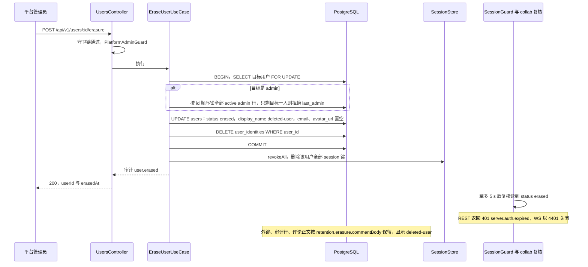
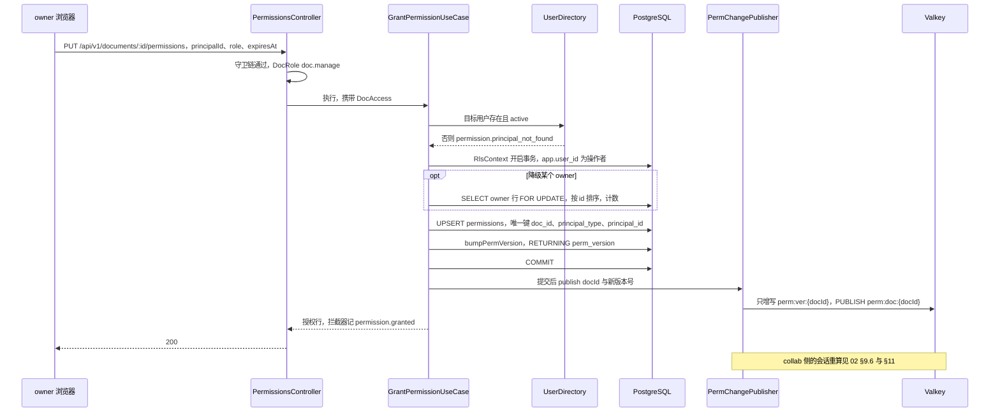
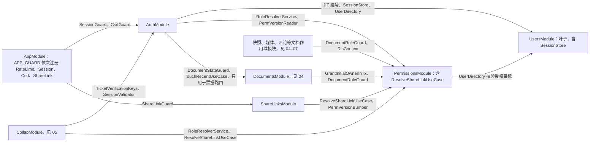
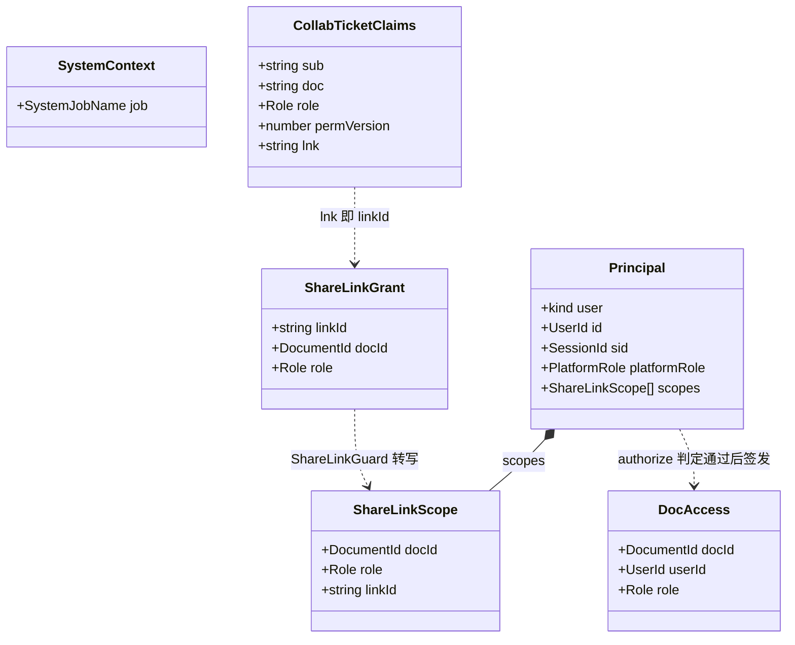

# 03 模块设计：身份与访问（Auth、Users、Permissions、ShareLinks）
> 状态：v0.1 | 负责：后端设计线 | 更新：2026-09-25；2026-09-25（§4.19） | 依赖：[02](02-auth-chain.md)；[40/08](../40-modules/08-server-identity-documents-and-storage.md) §1–§3、§6、§7、§10；[30/08](../30-architecture/08-backend-nestjs.md) §1、§2、§9.1；[ADR-0029](../30-architecture/adr/0029-gateway-authorization.md)；[30/10](../30-architecture/10-observability-and-errors.md) §1.1、§1.4、§11.2；PRD [SV-06、SV-11](../10-prd/03-features/06-server-and-ops.md)、[CO §1、CO-05、CO-15](../10-prd/03-features/03-collaboration.md)；[rulings](../00-charter/rulings-2026-09-14.md) §4.12 U-09、§4.15 T-0/Q6、§4.17 D1、§4.18 BE-02/BE-05/BE-06/BE-07/BE-08/BE-15

> 读者：实现 `apps/server/src/modules/{auth,users,permissions,share-links}` 的工程师；评审模块边界的人。
> 定位：四个身份与访问 Nest 模块运行时设计的唯一事实源，并**首次定义 03–07 共用的「模块设计卡」模板**（§1）。鉴权机制本身（OIDC、会话、CSRF、票据、分享令牌、RLS 上下文）以 [02](02-auth-chain.md) 为准，本文只写用例、事务边界、依赖与所属数据。
> 不在本文：路由逐条（方法、DTO、成功码、限流档）见 [15](15-rest-api-catalog.md) §3.1–§3.5、§3.7；DDL 见 [09](09-ddl-identity-and-access.md)；键模板见 [14](14-valkey-object-storage-and-retention.md)；审计 action 全量登记见 [07](07-modules-comments-webhooks-audit.md)；「模块 × 角色 × 部件」矩阵见 [01 §5](01-service-overview-and-roles.md)；目录树与文件职责见 [40/08](../40-modules/08-server-identity-documents-and-storage.md) §4、§5。

---

## 1. 模块设计卡模板（03–07 共用）

每个 Nest 模块一张卡，按下表 11 个栏目依次书写；栏目为空时写「无」并给一句理由，不省略栏目。表中「不写」一列是为了让同一事实只有一个落点。

| # | 栏目 | 写什么 | 不写（落点） |
|---|---|---|---|
| 1 | 职责 / 非职责 | 一句话定位；做什么、不做什么，不做的事写明归谁 | 实现细节 |
| 2 | 用例 | 表：用例名、入口（路由 / 事件 / 作业 / 被调用方）、前置检查（能力位、状态、不变量）、事务边界、副作用与审计 | 守卫链机制（[02](02-auth-chain.md)）、路由的 HTTP 细节（15） |
| 3 | 路由 | 只写 [15](15-rest-api-catalog.md) 的小节号与条数 | 方法表、DTO、错误码逐条 |
| 4 | 仓储与所属表 | 仓储类与方法签名草案；本模块是写方的表（DDL 链接 09–13）；列级写方；用到的 Valkey 键模板与值形状 | DDL 本体（09–13）、键名登记（14） |
| 5 | imports / exports | Nest `imports`（只列业务模块，global 模块不列）与 `exports` 及其消费方 | 目录树（40） |
| 6 | 事件与审计 | 跨进程频道、进程内事件、审计 action 名与触发点 | action 的定义与字段（[07](07-modules-comments-webhooks-audit.md) 唯一登记） |
| 7 | 错误码 | 码名 + 触发条件（HTTP / WS 映射引 30/10 §1.4） | 用户文案（[50-frontend/15](../50-frontend/15-events-errors-and-telemetry.md)） |
| 8 | 角色装配 | 在哪些 `CORDEX_ROLE`、以哪些部件出现 | 矩阵本体（[01 §5](01-service-overview-and-roles.md)） |
| 9 | purge 参与者 | 是否登记 `@PurgeParticipant`、清哪些表与对象 | 编排与顺序（[04 §4](04-modules-documents-storage-media.md)） |
| 10 | Clock 注入点 | 哪些判断取当前时间；一律经 `shared/clock.ts` 的 Clock 端口，测试注入 FakeClock | — |
| 11 | 机械验证 | 断言 + 70 的套件或 CI 步骤名 | 测试实现（70） |

书写约定：用例名用类名（`XxxUseCase` / `XxxQuery`）；「事务边界」写「单事务：…」「只读」「无 DB（Valkey）」「调用方事务内」之一；以 `docId` 为键的仓储方法首参必须是 `DocAccess` 或 `SystemContext`（扫描器 `scan-doc-access-via-permission`），卡片里不再重复说明。

---

## 2. AuthModule

### 2.1 卡片

| 栏目 | 内容 |
|---|---|
| 职责 | OIDC RP（登录、回调）；登录会话的签发、刷新、登出与复核；全局 `SessionGuard`、`CsrfGuard`；`PlatformAdminGuard`；`@Public()`、`@AllowExpiredSession()`（15 写作 `Session*`）、`@CurrentPrincipal()` 装饰器；协同票据签发（含 `CollabTicketController`）；JWT 密钥环、JWKS 端点与票据验签面 |
| 非职责 | 不持有密码与注册表单（在 IdP）；不判定文档角色（PermissionsModule）；不做 WS 验票流程（collab `TicketVerifier`，05）；不写用户表与会话键（UsersModule 的用例与 `SessionStore`）；不存审计（07） |
| 路由 | [15 §3.1](15-rest-api-catalog.md) 全部 7 条；§3.7 的 `POST /documents/:id/collab-ticket` |
| 仓储与所属表 | 无自有表。Valkey：`OidcStateStore` 读写 `oidc:state:{state}`（值见 02 §2）；会话键经 UsersModule 导出的 `SessionStore` 读写（值见 02 §4.1）。只读 `users`（经 `UserDirectory`）与 `document_perm_versions`（经 PermissionsModule 的仓储读面） |
| imports | `UsersModule`（`ProvisionOnFirstLoginUseCase`、`UserDirectory`、`SessionStore`、`TouchLastSeenUseCase`）；`PermissionsModule`（`RoleResolverService`、`DocumentRoleGuard`、`RlsContext`、`PermVersionReader`）；`DocumentsModule`（`DocumentStateGuard`、`TouchRecentUseCase`，只用于票据路由） |
| exports | `SessionGuard`、`CsrfGuard`（`AppModule` 注册为 `APP_GUARD` #2、#3）；`PlatformAdminGuard`（无 DI 依赖，各模块直接 `@UseGuards`，无需 import 本模块）；装饰器；`SessionValidator`、`TicketVerificationKeys`（供 collab） |
| 事件与审计 | `auth.login_succeeded`、`auth.login_failed`、`auth.logout`、`auth.session_revoked`（刷新密钥重放，`scope:'sid'`）、`auth.csrf_rejected`、`auth.collab_ticket_issued`；`auth.origin_rejected` 由 collab 网关在 WS 升级处写（05、16）；无跨进程频道 |
| 错误码 | `server.auth.unauthenticated`、`expired`、`invalid_token`、`csrf_rejected`、`origin_rejected`、`forbidden`、`account_disabled`、`idp_unavailable`、`unavailable`（§9） |
| 角色装配 | api：REST + 全局守卫；collab：全局守卫（collab 也有快照、元素彻底删除等 REST）+ `SessionValidator`、`TicketVerificationKeys`；worker：全局守卫兜底（只有 `@Public` 探针） |
| purge 参与者 | 无（不持有文档作用域数据） |
| Clock 注入点 | JWT `iat` / `exp`；刷新 10 s 宽限与 30 天封顶；`oidc:state` 与票据 `exp`；`SessionValidator` 5 s 缓存 |
| 机械验证 | 02 §15 AC-01–AC-06、AC-10、AC-13 |

### 2.2 用例

| 用例 | 入口 | 前置检查 | 事务边界 | 副作用与审计 |
|---|---|---|---|---|
| `LoginWithOidcUseCase` | `GET /auth/oidc/login` | `next` 站内相对路径校验（02 §2） | 无 DB；Valkey `SET oidc:state:{state} EX 600` | 下发绑定 cookie，302 |
| `HandleOidcCallbackUseCase` | `GET /auth/oidc/callback` | state 单次消费、绑定值、id_token 全套校验（02 §2） | 调 `ProvisionOnFirstLoginUseCase`（其自身单事务）；之后 `SessionStore.create`（Valkey） | `auth.login_succeeded` / `auth.login_failed{reason}` |
| `RefreshSessionUseCase` | `POST /auth/token/refresh`（`Session*`） | 02 §4.3 | 无 DB；对 `session:{sid}` 的比对与轮换在一个 Lua 脚本内原子完成，并发刷新不会双双轮换 | 重放时删 `sid` 并记 `auth.session_revoked{scope:'sid', reason:'refresh_reused'}` |
| `LogoutUseCase` | `POST /auth/logout`（`Session*`） | — | 无 DB；`SessionStore.revoke(sid)` | `auth.logout` |
| `GetMeQuery` | `GET /auth/me` | `Session` | 只读 `users` | — |
| `GetAuthConfigQuery` | `GET /auth/config` | `@Public` | 无 | 返回 `selfSignup`、`signupUrl?`、`idpDisplayName?` |
| `SessionValidator.check(sid, sub)` / `.checkMany(…)` | `SessionGuard`；collab 每 5 s 批量复核 | — | Valkey `EXISTS` + 只读 `users`；按 `sid` 缓存 5 s | 缓存未命中时调 `TouchLastSeenUseCase`（≥ 5 min 节流） |
| `IssueCollabTicketUseCase` | `POST /documents/:id/collab-ticket`（`CollabTicketController`） | `+Link → DocRole(doc.read)`；`DocumentStateGuard` 放行 `active` / `locked` | 只读事务（`RlsContext`，含 `app.share_token_hash`）读 `perm_version`；之后调 `TouchRecentUseCase`（其自身单事务） | 签 60 s 票据；凭有效链接时写 `lnk`（02 §8）；记录本人「最近」（04 §3，60 s 节流）；`auth.collab_ticket_issued` |

`CollabTicketController` 放在本模块而不是 DocumentsModule：票据的 claims、密钥与签发策略都属鉴权，DocumentsModule 因此不必 import 本模块（[04](04-modules-documents-storage-media.md) §1）；本模块只借用 DocumentsModule 导出的 `DocumentStateGuard` 做状态放行、`TouchRecentUseCase` 记录「最近」（签发票据即 M3 的「打开」动作，15 §3.7）。

---

## 3. UsersModule

### 3.1 卡片

| 栏目 | 内容 |
|---|---|
| 职责 | 身份目录：首次登录 JIT 建号、按人搜索、本人资料、平台管理员改状态与平台角色、用户数据擦除；会话存储 `SessionStore`（会话键的唯一读写代码）；只读目录面 `UserDirectory` |
| 非职责 | 不做 OIDC 与令牌（AuthModule）；不判定文档权限；无邀请表、无邀请兑现（rulings §4.17 D1）；无租户与组（T-0、U-11 推迟）；擦除**不删除**用户拥有的文档（§3.3） |
| 路由 | [15 §3.2](15-rest-api-catalog.md) 全部 4 条 |
| 仓储与所属表 | `UserRepository`（`findByIdentity(issuer, subject)`、`createWithIdentity(tx, …)`、`findById`、`findActiveByIds`、`searchActive(q)`、`updateProfile`、`setStatusAndRole(tx, …)`、`lockActiveAdmins(tx)`、`scrubForErasure(tx, id)`、`deleteIdentities(tx, userId)`、`touchLastSeen`）；表 `users`、`user_identities`（[09 §2、§3](09-ddl-identity-and-access.md)）。Valkey：`SessionStore` 读写 `session:{sid}`、`user:{userId}:sessions` |
| imports | 无业务模块（叶子；[01](01-service-overview-and-roles.md) 规则 I2） |
| exports | `ProvisionOnFirstLoginUseCase`、`UserDirectory`、`SessionStore`、`TouchLastSeenUseCase`（均供 AuthModule）；`UserDirectory` 另供 PermissionsModule、CommentsModule（提及显示名） |
| 事件与审计 | `user.provisioned`、`user.profile_updated`、`user.suspended` / `user.reactivated`、`user.role_changed`（含 bootstrap 升级）、`user.erased`；停用与擦除另记 `auth.session_revoked{scope:'all'}`；无跨进程频道 |
| 错误码 | `server.users.not_found`、`server.users.last_admin`、`server.users.validation_failed`（§9） |
| 角色装配 | api：REST；collab、worker：作为 PermissionsModule 与 AuthModule 的依赖只装 providers |
| purge 参与者 | 无（不持有文档作用域数据） |
| Clock 注入点 | `last_seen_at` 节流；擦除时刻；bootstrap 判定时刻 |
| 机械验证 | §11 M-04–M-07；02 §15 AC-05 |

### 3.2 用例

| 用例 | 入口 | 前置检查 | 事务边界 | 副作用与审计 |
|---|---|---|---|---|
| `ProvisionOnFirstLoginUseCase` | AuthModule 回调 | issuer 等于配置；字段来源与邮箱规则见 02 §3 | 单事务：命中 `(issuer, subject)` → 更新 `last_login_at`、`email_at_login`、已验证邮箱、`avatar_url`；未命中 → `INSERT users` + `INSERT user_identities`，唯一冲突回滚后改为读取；`auth.bootstrapAdmins` 命中且无 active admin → 同事务 `lockActiveAdmins` 后升为 admin | `user.provisioned`；bootstrap 时 `user.role_changed{via:'bootstrap'}`；返回 `{user, created}` |
| `SearchUsersQuery` | `GET /users?query=` | `query` 去首尾空白后 ≥ 2 个字符、≤ 100；按用户令牌桶限流（search 档） | 只读 | 含 `@` → 按 `lower(email)` **精确**匹配；否则 `lower(display_name)` 前缀匹配（`LIKE` 转义 `%`、`_`、`\`）；只返回 `status='active'`；≤ 20 条；字段只有 `id`、`displayName`、`avatarUrl`，从不回显邮箱（决策 SG-05） |
| `UpdateOwnProfileUseCase` | `PATCH /users/me/profile` | `displayName` 1–128 字符；`avatarUrl` 为 `https://` 且 ≤ 2048 或 `null`（浏览器能否显示受 CSP `img-src` 约束，50/14；服务端从不抓取该 URL） | 单事务 | `user.profile_updated` |
| `AdminUpdateUserUseCase` | `PATCH /users/:id` | `PlatformAdminGuard`；目标存在且非 `erased`（否则 `server.users.not_found`）；停用或降级 admin 时做最后 admin 保护 | 单事务：`SELECT … FOR UPDATE` 目标行；涉及 admin 时 `lockActiveAdmins`（按 id 顺序锁全部 active admin 行）计数，仅剩目标一人 → `server.users.last_admin` | 提交后停用 → `SessionStore.revokeAll(userId)` 并记 `auth.session_revoked{scope:'all', reason:'suspended'}`；`user.suspended` / `user.reactivated` / `user.role_changed` |
| `EraseUserUseCase` | `POST /users/:id/erasure` | 同上；目标为 admin 时最后 admin 保护 | 单事务：`scrubForErasure`（§3.3）+ `deleteIdentities` | 提交后 `SessionStore.revokeAll(userId)` 并记 `auth.session_revoked{scope:'all', reason:'erased'}`；`user.erased` |
| `UserDirectory` | 只读面 | — | 只读 | `findActiveById`（授权目标校验）、`getDisplayInfo(ids)`（擦除用户显示 `deleted-user`） |
| `TouchLastSeenUseCase` | `SessionValidator` 缓存未命中 | 距上次写入 ≥ 5 min | 单语句 `UPDATE` | — |
| `SessionStore` | AuthModule（签发、刷新、登出、复核）、本模块（吊销） | — | 无 DB（Valkey） | `create`、`get`、`rotate`（Lua 原子）、`revoke(sid)`、`revokeAll(userId)` |

最后 admin 与最后 owner 的并发写法见 [09 §10](09-ddl-identity-and-access.md)：都先按固定顺序（admin 按 `users.id`、owner 按 `principal_id`）`FOR UPDATE` 锁住全部候选行再计数，两个并发降级必然串行，后提交者看到的计数已扣掉前者。

`SessionStore` 放在本模块而不是 AuthModule：停用与擦除必须能在本模块的用例里吊销会话，而 AuthModule 已 import 本模块，反向 import 会成环。会话的**语义**（字段、TTL、轮换规则）仍以 02 §4 为准。

### 3.3 用户数据擦除

依据：决策 C-24（authority：PRD SV-11 评论正文按部署策略 + SV-07 审计只追加）、INC-22（`POST /users/:id/erasure`，PlatformAdminGuard，M3 P1）；FK-POLICY（`users` 不硬删）。

1. **原地脱敏，不删行**：`status='erased'`、`display_name='deleted-user'`、`email`、`avatar_url`、`last_seen_at` 置空、`platform_role='member'`；表上 CHECK 约束 `ck_users_erased_scrubbed` 保证 `erased` 行不残留个人数据（[09 §2](09-ddl-identity-and-access.md)）。
2. **删除全部 `user_identities` 行**：同一 IdP 账号再次登录会得到新的空账号（02 §3）；要阻止须在 IdP 停用。
3. **吊销全部会话**：提交后 `SessionStore.revokeAll`；即使 Valkey 删除失败，`status` 已非 `active`，REST 与 WS 仍在 ≤ 5 s 内失效（02 §4.5）。
4. **不动的东西**：指向该用户的外键（`permissions.principal_id`、`documents.owner_id`、`comments.author_id`、`document_updates.user_id` 等）与审计行保持原样，界面显示 `deleted-user`；该用户的直接授权行保留但永远不会再被使用（没有身份即无法登录）。
5. **评论正文**：`retention.erasure.commentBody` 默认 `keep`（作者显示 `deleted-user`）；`redact` 在 M4 实现，由 M-09 以 `system('maintenance')` 改写当前状态，历史按保留期存在（C-24）。
6. **文档不连带删除**：PRD SV-11 对用户擦除的要求是「用 `deleted-user` 替换主体标识」（其「复用同一编排」一句的实质是把清除换成替换；本设计所有指向用户的外键都指向 `users` 行，原地脱敏这一行即完成全部替换，不需要逐模块编排），决策 C-24 也只列脱敏、删身份、吊销会话。该用户作为 owner 的文档保留，其他协作者照常使用；若他是唯一 owner，文档在 M1–M3 无人持有 `doc.manage`，由 M4 管理面板（SV-14）提供「指定新 owner / 永久删除」。实现上也避免了 UsersModule → DocumentsModule → PermissionsModule → UsersModule 的环。
7. **结果**：同步完成，返回 `{userId, erasedAt}`；审计 `user.erased`（操作者记在审计行的 `actor_id`，details 键见 [07 §9.1](07-modules-comments-webhooks-audit.md)）。

**图 3-1 用户擦除**



怎么读：纵线是参与方，自上而下是时间顺序；`alt` 只在目标是平台管理员时出现。数据库改动在一个事务内完成，会话键在提交之后删除；两道失效机制（删会话键、复核读到 `erased`）任一生效都能让该用户的 REST 与 WS 在 5 s 内失效。
依据：本节；决策 C-24、INC-22、SESSION；02 §4.5。

---

## 4. PermissionsModule

### 4.1 卡片

| 栏目 | 内容 |
|---|---|
| 职责 | 按人授予、改角色、撤销、列出（fail-closed：无行即无权）；`RoleResolverService`（有效角色与 `DocAccess` 签发）；`ResolveShareLinkUseCase` + `ShareLinkReader`（分享令牌只读解析，BE-02）；`permVersion` 的唯一写入点与提交后广播；`RlsContext`；`DocumentRoleGuard` 与 `@DocCapability`；`ROLE_CAPABILITIES` 运行时初值；新建文档的首条 owner 行 |
| 非职责 | 不写 `share_links`（ShareLinksModule）；不做组授权（U-11 推迟，M3 只按人）；不做 WS 会话重算的执行（collab `AuthzSource` 调本模块的读面）；不写 `documents`（04） |
| 路由 | [15 §3.4](15-rest-api-catalog.md) 全部 3 条 |
| 仓储与所属表 | `PermissionRepository`（`findDirect(userId, docId)`、`listByDoc(access)`、`upsertGrant(tx, …)`、`deleteGrant(tx, …)`、`lockOwners(tx, docId)`、`bumpPermVersion(tx, docId)`、`readPermVersion(access)`、`purgeByDoc(ctx, docId)`）；`ShareLinkReader`（`byTokenHash`、`statusOf`，只调 SECURITY DEFINER 函数）；表 `permissions`、`document_perm_versions`（[09 §4、§5](09-ddl-identity-and-access.md)）。Valkey：`perm:ver:{docId}`（只增）、频道 `perm:doc:{docId}` |
| imports | `UsersModule`（`UserDirectory`：授权目标须存在且 active） |
| exports | `RoleResolverService`、`ResolveShareLinkUseCase`、`DocumentRoleGuard` 与 `@DocCapability`、`RlsContext`、`GrantInitialOwnerInTx`、`PermVersionBumper`、`PermChangePublisher`、`PermVersionReader` |
| 事件与审计 | `permission.granted`、`permission.revoked`、`permission.denied`（`DocumentRoleGuard` 403；details 键见 07 §9.2）；跨进程频道 `perm:doc:{docId}`，载荷 `{docId, permVersion}`；`permission/changed` 只是客户端 cordis 事件名，服务端不用（决策 INC-31/INC-29） |
| 错误码 | `permission.denied`、`permission.last_owner`、`permission.principal_not_found`、`permission.principal_unsupported`（§9） |
| 角色装配 | api：REST + `DocumentRoleGuard`；collab：`RoleResolverService`、`ResolveShareLinkUseCase`、`DocumentRoleGuard`（快照等 REST）、`RlsContext`；worker：参与者 `permissions` |
| purge 参与者 | `permissions`：清 `permissions`、`document_perm_versions`，提交后 `DEL perm:ver:{docId}`（§10） |
| Clock 注入点 | 授权 `expires_at` 判定；链接 `expires_at` 判定（`ResolveShareLinkUseCase`）；直接授权 5 s 缓存 |
| 机械验证 | §11 M-01–M-03、M-08；02 §15 AC-07–AC-09、AC-11、AC-14 |

### 4.2 用例

| 用例 | 入口 | 前置检查 | 事务边界 | 副作用与审计 |
|---|---|---|---|---|
| `GrantPermissionUseCase` | `PUT /documents/:id/permissions` | `DocRole(doc.manage)`；`principalType='user'`（否则 `permission.principal_unsupported`）；目标经 `UserDirectory` 存在且 `active`（否则 `permission.principal_not_found`，前端提示联系管理员，D1）；`owner` 不得带 `expiresAt`（校验失败）；目标是 `documents.owner_id` 指向的用户且新角色不是 `owner` → `permission.last_owner{reason:'document_owner'}`；把某个 owner 降级时 `lockOwners` 计数，只剩一人 → `permission.last_owner{reason:'last_owner'}` | 单事务：[`lockOwners`] → `upsertGrant` → `bumpPermVersion` | 提交后 `PermChangePublisher`；本地缓存失效；`permission.granted` |
| `RevokePermissionUseCase` | `DELETE /documents/:id/permissions/:principalId` | `DocRole(doc.manage)`；目标是 `owner_id` 用户 → `last_owner{document_owner}`；目标是最后一个 owner → `last_owner{last_owner}`；授权不存在 → 幂等 204，不递增、不广播 | 单事务：`lockOwners` → `deleteGrant` → `bumpPermVersion` | 同上；`permission.revoked` |
| `ListPermissionsQuery` | `GET /documents/:id/permissions` | `DocRole(doc.manage)` | 只读 | 附 `UserDirectory.getDisplayInfo` 摘要 |
| `GrantInitialOwnerInTx(tx, docId, userId)` | `CreateDocumentUseCase`（04）；导入建档（06，`SystemContext`） | 调用方已插入 `documents` 行且 `owner_id = userId` | 调用方事务内：`INSERT permissions(role='owner', granted_by=userId)` + `INSERT document_perm_versions(perm_version=0)` | 不广播（文档刚建，无在线会话）；不单独审计（`document.created` 覆盖） |
| `RoleResolverService.resolveRole(principal, docId)` | `DocumentRoleGuard`、`IssueCollabTicketUseCase`、collab `AuthzSource` | — | 只读；直接授权按 `(userId, docId)` 进程内缓存 5 s，`AuthzSource` 调用时绕过缓存 | max(直接授权, `principal.scopes` 中本文档链接角色)（02 §1） |
| `RoleResolverService.authorize(principal, docId, cap)` | 各模块用例 | 有效角色含 `cap` | 只读 | 返回品牌类型 `DocAccess`，否则抛 `permission.denied` |
| `ResolveShareLinkUseCase.byToken` / `.byLinkId` | `ShareLinkGuard`、`RoleResolverService`、collab `AuthzSource` | — | 只读，经 SECURITY DEFINER 函数 | 有效性判定见 02 §7.3 |
| `PermVersionBumper.bump(tx, docId)` | Grant / Revoke；ShareLinksModule 撤销链接 | 调用方事务内 | `bumpPermVersion` → 返回新版本号 | 调用方提交后调 `PermChangePublisher.publish(docId, v)` |
| `PermChangePublisher.publish(docId, v)` | 提交后 | — | 无 DB：Valkey 只增写 `perm:ver:{docId}` + `PUBLISH perm:doc:{docId}`，失败重试 3 次（02 §11） | — |
| `PermVersionReader.read(access)` | `IssueCollabTicketUseCase` | — | 只读 | 行缺失视为 0 |
| `RlsContext.run(ctx, fn)` | 全部用户上下文事务 | — | 开启事务并 `set_config` 三个 GUC 中适用的两个（02 §10） | — |
| `PurgeDocumentPermissionsUseCase` | document-purge 处理器（`@PurgeParticipant('permissions')`） | `SystemContext`，`app.system_job='worker.document-purge'` | 单事务：`DELETE permissions`、`DELETE document_perm_versions` `WHERE doc_id` | 提交后 `DEL perm:ver:{docId}`；不写审计（04 §4.3 规则 5） |

**`ROLE_CAPABILITIES` 运行时初值**（`permissions/domain/role.ts`；类型以 `protocol permissions/roles.ts`、`actions.ts` 为准；依据 rulings §4.12 U-09、40/08 §2.2；与 [15 §2](15-rest-api-catalog.md) 同一矩阵）：

```ts
export const ROLE_CAPABILITIES = {
  viewer:    ['doc.read'],
  commenter: ['doc.read', 'doc.comment'],
  editor:    ['doc.read', 'doc.comment', 'doc.write', 'doc.export', 'history.read'],
  owner:     ['doc.read', 'doc.comment', 'doc.write', 'doc.export', 'history.read', 'doc.manage', 'history.restore'],
} as const satisfies Record<RoleName, readonly Capability[]>
```

数据库层的 policy 按角色名判定（`cordex_doc_role(doc_id) = 'owner'` 等价于要求 `doc.manage`），因此这张表与 [09 §8](09-ddl-identity-and-access.md) 的 policy 矩阵必须同步修改；两者的一致性由 `runPermissionPolicyConformance`（决策 T-KITS，[70/02](../70-testing/02-contract-suites-and-pluggability.md)）与 RLS 矩阵测试共同锁定。

**图 4-1 授予权限：写库、permVersion 同事务、提交后广播**



怎么读：纵线是参与方，自上而下是时间顺序；`opt` 只在把某个 owner 降级时出现。授权行与 `permVersion` 在同一事务内提交，广播在提交后才发出；数据库层的 policy 以操作者身份再判一次「是否为该文档 owner」（09 §8）。
依据：本节；02 §11；决策 C-28；ADR-0029 决策 4；rulings §4.17 D1。

---

## 5. ShareLinksModule

### 5.1 卡片

| 栏目 | 内容 |
|---|---|
| 职责 | 分享链接的创建、撤销、列表（`share_links` 唯一写方）；`ShareLinkGuard`（`APP_GUARD` #4，叠加链接角色）；令牌生成与哈希；外部访问审计 |
| 非职责 | 不解析令牌（PermissionsModule 的 `ResolveShareLinkUseCase`，BE-02）；不写 `document_perm_versions`（经 `PermVersionBumper`）；链接不产出匿名主体、不豁免登录（S-1） |
| 路由 | [15 §3.5](15-rest-api-catalog.md) 全部 3 条 |
| 仓储与所属表 | `ShareLinkRepository`（`create(tx, access, …)`、`revoke(tx, access, linkId)`、`listByDoc(access)`、`purgeByDoc(ctx, docId)`）；表 `share_links`（[09 §6](09-ddl-identity-and-access.md)）。Valkey：无自有键 |
| imports | `PermissionsModule`（`ResolveShareLinkUseCase`、`DocumentRoleGuard`、`PermVersionBumper`、`PermChangePublisher`、`RlsContext`） |
| exports | `ShareLinkGuard`（`AppModule` 注册；Documents、Media、Snapshots 等因此不必 import 本模块） |
| 事件与审计 | `share_link.created`、`share_link.revoked`、`share_link.accessed`（每次成功叠加都写，缓冲通路 1 s 合并计数，02 §7.5）；details 键见 07 §9.2；撤销经 `perm:doc:{docId}` 广播（由 PermissionsModule 发出） |
| 错误码 | `server.share_links.not_found`；请求体不合法走 `server.share_links.validation_failed`（§9） |
| 角色装配 | api：REST + `ShareLinkGuard`；collab：`ShareLinkGuard`（只凭链接的用户也要读快照等 collab 上的 REST）；worker：参与者 `share-links` |
| purge 参与者 | `share-links`：清 `share_links`（§10） |
| Clock 注入点 | 创建时 `expiresAt` 须晚于当前时刻 |
| 机械验证 | §11 M-09、M-10；02 §15 AC-07–AC-09 |

### 5.2 用例

| 用例 | 入口 | 前置检查 | 事务边界 | 副作用与审计 |
|---|---|---|---|---|
| `CreateShareLinkUseCase` | `POST /documents/:id/share-links` | `DocRole(doc.manage)`；`role ∈ {viewer, commenter, editor}`；`expiresAt` 缺省为永不过期，给出时须晚于当前时刻 | 单事务：生成 32 字节令牌，`INSERT share_links(token_hash = sha256(令牌), created_by = 当前用户)` | 响应返回 `{linkId, token, role, expiresAt}`，`token` 明文只此一次；`share_link.created` |
| `RevokeShareLinkUseCase` | `DELETE /documents/:id/share-links/:linkId` | `DocRole(doc.manage)`；链接属于该文档（否则 `server.share_links.not_found`）；已撤销 → 幂等 204，不递增 | 单事务：`UPDATE share_links SET revoked_at = now()` → `PermVersionBumper.bump` | 提交后 `PermChangePublisher.publish`，凭该链接的 WS 会话 ≤ 1 s 降权；`share_link.revoked` |
| `ListShareLinksQuery` | `GET /documents/:id/share-links` | `DocRole(doc.manage)` | 只读 | 含 `revokedAt`、`expiresAt`、`createdBy` 摘要；从不含令牌或哈希 |
| `ShareLinkGuard` | 全局守卫 #4 | 02 §7.4 | 只读（经 PermissionsModule） | 每次成功叠加写 `share_link.accessed`（1 s 合并计数，不丢次数）；无效令牌只记原因、从不拒绝 |
| `PurgeDocumentShareLinksUseCase` | document-purge 处理器（`@PurgeParticipant('share-links')`） | `SystemContext`，`app.system_job='worker.document-purge'` | 单事务：`DELETE share_links WHERE doc_id` | 不写审计 |

链接不支持修改角色或到期时间：「收紧」链接 = 撤销旧链接并新建一条（旧令牌立即失效，新令牌重新分发）。撤销与到期的行保留到文档永久删除，列表里可见、校验时实时判定失效，不依赖定时清理（40/08 §2.1）。

---

## 6. 四模块的 imports / exports 与无环说明

| 模块 | imports（业务模块） | 主要 exports → 消费方 |
|---|---|---|
| AuthModule | Users、Permissions、Documents（只取 `DocumentStateGuard`、`TouchRecentUseCase`） | `SessionGuard`、`CsrfGuard` → AppModule；`PlatformAdminGuard` → Users、Webhooks、Audit 控制器；`SessionValidator`、`TicketVerificationKeys` → CollabModule |
| UsersModule | 无 | `ProvisionOnFirstLoginUseCase`、`SessionStore`、`TouchLastSeenUseCase` → Auth；`UserDirectory` → Auth、Permissions、Comments |
| PermissionsModule | Users | `DocumentRoleGuard`、`RlsContext` → 全部文档作用域模块；`RoleResolverService`、`ResolveShareLinkUseCase` → Auth、Collab、ShareLinks；`GrantInitialOwnerInTx` → Documents；`PermVersionBumper`、`PermChangePublisher` → ShareLinks；`PermVersionReader` → Auth |
| ShareLinksModule | Permissions | `ShareLinkGuard` → AppModule |

无环理由（depcruise `no-circular` 覆盖 `apps/server/src/modules/**`）：

- `SessionGuard`、`CsrfGuard`、`ShareLinkGuard` 由 `AppModule` 注册为全局守卫，业务模块不为鉴权 import AuthModule（BE-06），AuthModule 因此能 import Permissions 与 Documents 而不回指。
- 令牌解析归 PermissionsModule，ShareLinks → Permissions 单向，Permissions 不 import ShareLinks（BE-02）。
- UsersModule 是叶子：会话吊销用本模块的 `SessionStore` 完成，擦除不连带文档（§3.3），停用与擦除都不需要回调其他模块（[01](01-service-overview-and-roles.md) 规则 I2）。
- DocumentsModule 不 import AuthModule：票据控制器在 AuthModule（§2.2），DocumentsModule 只被 AuthModule 引用其 `DocumentStateGuard` 与 `TouchRecentUseCase`。

**图 6-1 身份与访问四模块的 imports 与主要导出**



怎么读：实线是 Nest `imports` 方向（引入方 → 被引入方），线上文字是引入的主要导出；global 模块（Config、Db、Valkey）不画。所有箭头都朝向 Users 或 Permissions 收敛，没有指回 Auth 或 ShareLinks 的业务边，全图无环。
依据：§2.1、§3.1、§4.1、§5.1 的 imports 栏；rulings §4.18 BE-02、BE-06、BE-07；[01](01-service-overview-and-roles.md) 规则 I1–I4。

**图 6-2 鉴权相关的核心类型**



怎么读：方框是类型，`*--` 是组合，`..>` 是「由…得到」。`ResolveShareLinkUseCase` 返回 `ShareLinkGrant`，REST 侧由 `ShareLinkGuard` 转写成 `Principal.scopes` 中的一项，只在单个请求内存在；WS 侧对应的是票据的 `lnk` 与会话记录的 `linkExpiresAt`。`DocAccess` 由 `RoleResolverService.authorize` 在判定通过后构造，`SystemContext` 只能由作业入口构造，两者是仓储方法仅有的两种准入凭证（02 §1）。图中省略了可选字段（`expiresAt`）与 `sid`、`jti`、`exp` 等 claims，完整字段见 02 §1、§8。
依据：02 §1、§7、§8；40/08 §1.2、§2.2、§6；ADR-0029 决策 1。

---

## 7. 所属表、写方与键

| 表 | 所属模块 | 写方（用例） | 读方 | DDL |
|---|---|---|---|---|
| `users` | Users | `ProvisionOnFirstLogin`、`UpdateOwnProfile`、`AdminUpdateUser`、`EraseUser`、`TouchLastSeen` | Auth（`GetMe`、`SessionValidator`）、`UserDirectory` 的消费方 | [09 §2](09-ddl-identity-and-access.md) |
| `user_identities` | Users | `ProvisionOnFirstLogin`、`EraseUser`（删除） | `ProvisionOnFirstLogin` | [09 §3](09-ddl-identity-and-access.md) |
| `permissions` | Permissions | `GrantPermission`、`RevokePermission`、`GrantInitialOwnerInTx`、参与者 `permissions` | `RoleResolverService`、`ListPermissions`、`cordex_doc_role`；DocumentsModule 列表查询以 SQL join 只读（04） | [09 §4](09-ddl-identity-and-access.md) |
| `document_perm_versions` | Permissions | 只有 `bumpPermVersion`（经 Grant / Revoke / `PermVersionBumper`）与 `GrantInitialOwnerInTx`（插入 0）、参与者 `permissions`（C-28） | `PermVersionReader`、collab `TicketVerifier`（回源） | [09 §5](09-ddl-identity-and-access.md) |
| `share_links` | ShareLinks | `CreateShareLink`、`RevokeShareLink`、参与者 `share-links` | `ResolveShareLinkUseCase`（只经 SECURITY DEFINER 函数）、`ListShareLinks`、`cordex_doc_role` | [09 §6](09-ddl-identity-and-access.md) |

| Valkey 键模板（名字登记在 14） | 类型 / TTL | 写方 | 读方 | 值形状定义 |
|---|---|---|---|---|
| `oidc:state:{state}` | string（JSON）/ 600 s，`GETDEL` 消费 | Auth `OidcStateStore` | 同左 | 02 §2 |
| `session:{sid}` | hash / 刷新窗口，≤ 30 天 | Users `SessionStore` | 同左 | 02 §4.1 |
| `user:{userId}:sessions` | set / 30 天 | Users `SessionStore` | 同左 | 02 §4.1 |
| `ticket:jti:{jti}` | string / 60 s | collab `TicketVerifier` | 同左 | 02 §9.3 |
| `perm:ver:{docId}` | string（整数）/ 无 TTL，缺失回源 PG | Permissions `PermChangePublisher`；collab 回源回填（只增） | collab `TicketVerifier` | 02 §11 |
| `perm:doc:{docId}` | 频道 | Permissions `PermChangePublisher` | collab `AuthzSource` | `{docId, permVersion}` |
| `rl:{bucket}:{subject}` | 令牌桶 hash / 至桶满 | common `RateLimitGuard`（本组路由用 public、default、search、ticket 档） | 同左 | 15 §8 |

---

## 8. 审计 action 与跨进程事件

action 命名 `<resource>.<snake_action>`，全量登记与 details 字段以 [07](07-modules-comments-webhooks-audit.md) 为唯一源（决策 INC-31/INC-29）；本表只列四个模块的触发点，名字与 [15](15-rest-api-catalog.md) 路由表一致。写入经 `@Audited()` 拦截器（成功后）或用例显式调用 07 导出的记录用例。

| action | 模块 | 触发点 | 说明 |
|---|---|---|---|
| `auth.login_succeeded` / `auth.login_failed` | Auth | OIDC 回调成功 / 任一校验失败 | 失败带 `reason`（state、binding、exchange、id_token、issuer、account_disabled、idp_unavailable） |
| `auth.logout` | Auth | 登出 | — |
| `auth.session_revoked` | Auth、Users | 刷新密钥重放（Auth，`scope:'sid'`）；停用、擦除（Users，`scope:'all'`） | 安全类，SV-07 |
| `auth.csrf_rejected` | Auth | `CsrfGuard` 拒绝 | 缓冲通路，合并计数 |
| `auth.origin_rejected` | collab 网关 | WS 升级 `Origin` 不在白名单 | 同上（05、16） |
| `auth.collab_ticket_issued` | Auth | 签发票据 | 缓冲通路；是否凭链接记在 details |
| `user.provisioned` | Users | JIT 建号 | `{issuer}`，不记 subject 明文以外的 IdP 声明 |
| `user.profile_updated` | Users | 本人改资料 | 只记字段名 |
| `user.suspended` / `user.reactivated` | Users | 平台管理员改状态 | — |
| `user.role_changed` | Users | 平台管理员改平台角色；bootstrap 升级（02 §3） | 带前后值 |
| `user.erased` | Users | 擦除完成 | 操作者记在 `actor_id` |
| `permission.granted` / `permission.revoked` | Permissions | 授予或改角色 / 撤销 | 带 `previousRole` |
| `permission.denied` | Permissions | `DocumentRoleGuard` 403 | 缓冲通路，合并计数 |
| `share_link.created` / `share_link.revoked` | ShareLinks | 创建 / 撤销 | 不记令牌 |
| `share_link.accessed` | ShareLinks | `ShareLinkGuard` 每次叠加成功 | 缓冲通路 1 s 合并计数，不采样；带 `directRole`（02 §7.5） |

跨进程事件只有一个：Valkey 频道 `perm:doc:{docId}`，载荷 `{docId, permVersion}`，发布者 PermissionsModule（提交后），订阅者 collab `AuthzSource`（02 §11）。四个模块都不是 cordis 插件，不发 cordis 事件；客户端事件 `permission/changed` 由客户端在收到 `CONTROL.permission` 后自行发出（50/07）。

---

## 9. 错误码

格式与 HTTP / WS 映射表以 [30/10 §1.1、§1.4](../30-architecture/10-observability-and-errors.md) 为准；域按决策 INC-10/SG-04 统一。下表全部码已登记进 30/10 §1.1 与 `protocol errors/codes.ts`、`http-map.ts`（rulings §4.19 回填），「登记」列只保留出处说明。

| 码 | HTTP | WS | 触发条件 | 模块 | 登记 |
|---|---|---|---|---|---|
| `server.auth.unauthenticated` | 401 | 4401（握手用 `collab.unauthenticated`） | 无会话 cookie；`Session*` 路由缺刷新 cookie | Auth | 已有 |
| `server.auth.expired` | 401 | 4401 | 会话 JWT 过期；会话已吊销、到期；用户非 active；刷新失败或重放 | Auth | 已有（30/10 §11.2） |
| `server.auth.invalid_token` | 401 | 4401 | JWT 算法、`kid`、`aud`、`iss`、结构不符；OIDC 回调任一校验失败（以 `?error=` 回前端） | Auth | 已有 |
| `server.auth.csrf_rejected` | 403 | — | §5 两项检查任一不过 | Auth | 已登记（INC-10） |
| `server.auth.origin_rejected` | 403（WS 升级） | — | 升级请求 `Origin` 不在白名单 | Auth | 已登记（INC-10） |
| `server.auth.forbidden` | 403 | — | `PlatformAdminGuard` 拒绝 | Auth | 已有（30/10 §11.2） |
| `server.auth.account_disabled` | —（回调以 `?error=` 回前端） | — | 登录用户 `status='suspended'` | Auth | 已登记 |
| `server.auth.idp_unavailable` | 503（登录发起时，15 §3.1）；回调中以 `?error=` 回前端 | — | IdP 发现文档或令牌端点不可达 | Auth | 已登记 |
| `server.auth.unavailable` | 503，`retryable` | — | 会话复核所需的 Valkey 或 PG 不可达（02 §4.2） | Auth | 已登记 |
| `server.users.not_found` | 404 | — | 目标用户不存在或已擦除 | Users | 已登记 |
| `server.users.last_admin` | 409 | — | 停用、降级或擦除最后一名 active admin | Users | 已登记（原 `user.last_admin`） |
| `server.users.validation_failed` | 400 | — | 搜索词过短或过长、资料字段不合规 | Users | 通配 `*.validation_failed` |
| `permission.denied` | 403 | 4403（WS 用 `collab.forbidden`） | 有效角色缺所需能力位；`details.reason?` ∈ `share_link.expired`、`share_link.revoked`（须 `user:true`） | Permissions | 已有 |
| `permission.last_owner` | 409 | — | 撤销或降级最后一个 owner（`details.reason='last_owner'`）；撤销或降级 `documents.owner_id` 指向的用户（`'document_owner'`，04 §1 不变量） | Permissions | 已登记（40/08 已用） |
| `permission.principal_not_found` | 404 | — | 授权目标用户不存在或非 active（无邀请表，D1） | Permissions | 已登记（SG-04） |
| `permission.principal_unsupported` | 400 | — | `principalType ≠ 'user'`（组授权推迟） | Permissions | 已登记（40/08 已用） |
| `server.share_links.not_found` | 404 | — | 链接不存在或不属于该文档 | ShareLinks | 已登记（原 `share_link.not_found`） |
| `server.share_links.validation_failed` | 400 | — | `role='owner'`、`expiresAt` 早于当前时刻 | ShareLinks | 通配 |

WS 握手的 `collab.unauthenticated`、`collab.forbidden`、`collab.doc_not_found`、`collab.doc_purging` 由 collab 发出（[16](16-ws-protocol-server-view.md)），触发条件见 02 §9.3。用户可见文案与建议动作在 i18n `errors.<code>.{title, action}`（决策 ERR-COPY，[50-frontend/15](../50-frontend/15-events-errors-and-telemetry.md)）。

---

## 10. purge 参与者

编排、顺序与参与者通用规则以 [04 §4](04-modules-documents-storage-media.md) 为唯一源；本节只写本组两个参与者自己的一步。两者都在 worker 装配，以 `cordex_system` + `app.system_job='worker.document-purge'` 执行，幂等，不写审计。

| 参与者 | 模块 | 一步的内容 | 幂等依据 | 报告 |
|---|---|---|---|---|
| `share-links` | ShareLinks | 单事务 `DELETE FROM share_links WHERE doc_id = $1` | 行已空时为一次索引查找（`ix_share_links_doc_id`） | `rowsDeleted` |
| `permissions` | Permissions | 单事务 `DELETE FROM permissions WHERE doc_id = $1`、`DELETE FROM document_perm_versions WHERE doc_id = $1`；提交后 `DEL perm:ver:{docId}` | 同上（`uq_permissions_doc_principal` 前缀、主键） | `rowsDeleted` |

- 两张表对 `documents` 的外键都是 `ON DELETE RESTRICT`（决策 FK-POLICY）：任何一个参与者漏清，`finalize-purge` 删 `documents` 行时即失败并整作业重试，而不是静默级联。
- 参与者执行时文档已是 `purging`，网关拒绝加入、REST 一律 404，不会有新的授权或链接写入；删掉授权行之后 `cordex_doc_role` 对该文档恒为 NULL。
- `users` 与 `user_identities` 不是文档作用域数据，不参与永久删除。

---

## 11. 机械验证

只写断言；执行方式与 CI 步骤见 [70-testing/07](../70-testing/07-backend-integration-and-api-e2e.md)、[70-testing/12](../70-testing/12-ci-gates-mapping.md)。与鉴权链路相关的断言见 02 §15，不重复列出。

| # | 断言 | 执行 |
|---|---|---|
| M-01 | 最后 owner：两个并发请求分别撤销同一文档仅有的两个 owner，恰好一个成功、另一个 409 `permission.last_owner`；撤销或降级 `owner_id` 指向的用户一律 409（`reason='document_owner'`） | `test/server-integration` |
| M-02 | 授予、改角色、撤销、撤销链接四种变更都使 `perm_version` 恰好 +1，且与业务写入同事务（注入提交失败后两者都未变化）；对不存在的授权 `DELETE` 不递增 | `test/server-integration` |
| M-03 | `ShareLinkGuard` 与 `RoleResolverService` 对同一令牌解析出相同角色；`byToken` 与 `byLinkId` 两条路径结果一致；`ShareLinkReader` 不含对 `share_links` 的直接 `SELECT` | `test/unit` + `test/server-integration` |
| M-04 | 最后 admin：并发降级两名仅有的 admin，恰好一个 409 `server.users.last_admin`；擦除最后一名 admin 同样被拒 | `test/server-integration` |
| M-05 | 擦除后：`user_identities` 无该用户行；`users` 行满足 `ck_users_erased_scrubbed`；该用户 ≤ 5 s 内 REST 401、WS 4401（FakeClock）；外键与审计行仍在；同一 IdP 账号再登录得到新用户 id | `test/server-integration` |
| M-06 | 停用后 ≤ 5 s 失去 REST 与 WS；重新启用后可以重新登录；PATCH 无法把状态设为 `erased` | `test/server-integration` |
| M-07 | 用户搜索：1 个字符 → 400；结果 ≤ 20；响应不含 `email` 字段；邮箱只精确匹配（部分邮箱查不到）；不返回非 active 用户；超出令牌桶 → 429 | `test/server-integration` |
| M-08 | `GrantInitialOwnerInTx` 与 `documents` 插入在同一事务：注入失败后两表都无行；新建文档后 `perm_version = 0` | `test/server-integration` |
| M-09 | 创建链接的响应含令牌明文，库里只有 32 字节哈希；列表响应不含令牌与哈希；`role='owner'` 被拒 | `test/server-integration` |
| M-10 | 参与者：`@PurgeParticipant` 收集到的集合含 `permissions`、`share-links`；两者重复执行结果相同；执行后该文档两张表与 `perm:ver:{docId}` 均为空 | `test/server-integration`（04 §4 同一套件） |
| M-11 | 模块依赖：depcruise `no-circular` 覆盖四个模块；UsersModule 不 import 任何业务模块；PermissionsModule 不 import ShareLinksModule；DocumentsModule 不 import AuthModule | `scanners/check-*`（既有依赖检查） |
| M-12 | `ROLE_CAPABILITIES` 与 09 §8 policy 矩阵一致：`runPermissionPolicyConformance`（默认拒绝、异常即拒绝、能力位全集含 `history.read` / `history.restore`，决策 T-KITS）+ RLS 矩阵用例 | `test/contract`（[70/02](../70-testing/02-contract-suites-and-pluggability.md)）+ `e2e/smoke` 的 security-rls |

