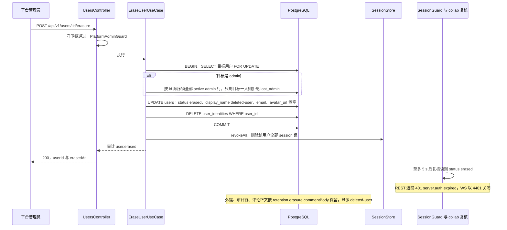
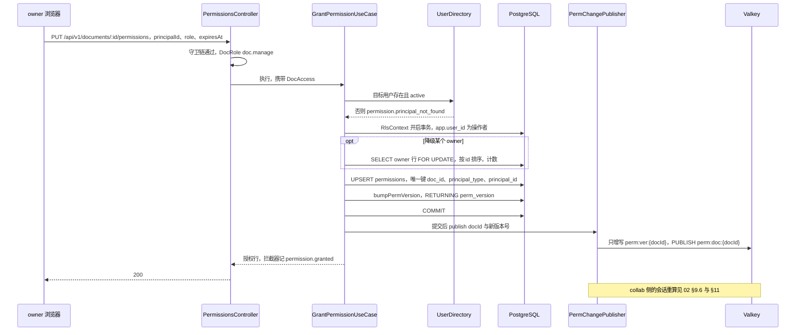
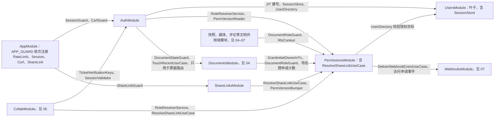
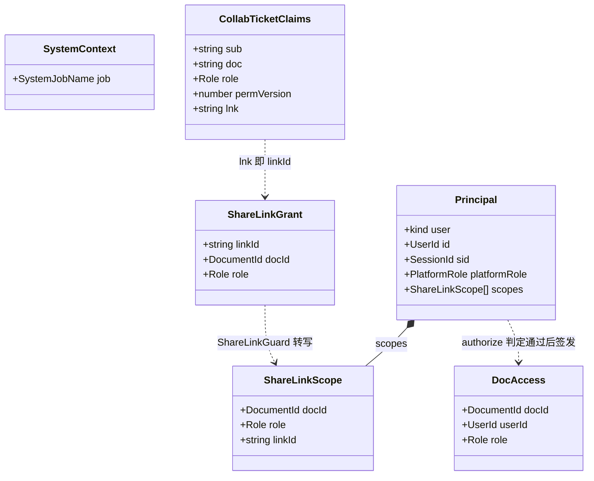
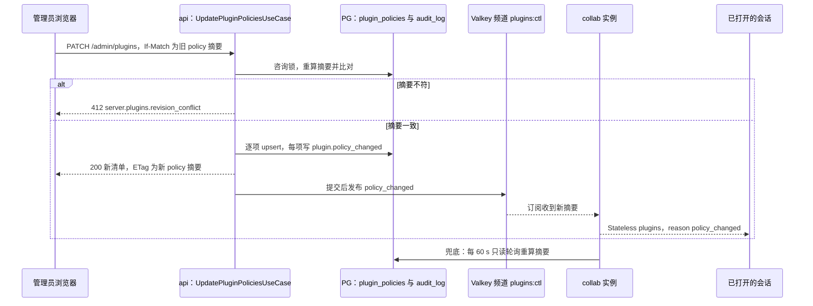

# 03 模块设计：身份与访问（Auth、Users、Permissions、ShareLinks）
> 状态：v0.1 | 负责：后端设计线 | 更新：2026-09-25；2026-09-25（§4.19）；2026-09-26（§4.20）；2026-09-26（§4.21 Remap：原 30/08 引用按 60-backend/README §6.1 改指新位置，30/08 已删除）；2026-10-01（§4.23 插件管理：新增 §12 PluginsModule（卡片、用例、声明文件校验与指纹、错误码、机械验证），§6–§8 同步）；2026-10-03（§4.24：AL-1 链接只授予 viewer / commenter（§5.2、M-09）；AL-3 PluginsModule 角色装配删去 renderer 读库；TA-4 近 24 h 失败会话数改读 Valkey 小时桶 HyperLogLog；TA-5 插件 id 一律为 cordis 插件 id；TA-7 `server.plugins.*` 已登记 30/10，§12.4 补 `validation_failed`）；2026-10-15（design-language-v3 第 2 批：DS-48 §4 PermissionsModule 增访问申请四个用例与 `PendingAccessRequestCounter`、表 `access_requests`，`ListPermissionsQuery` 放宽到 `doc.read` 并按能力位裁剪字段；DS-47 §5 ShareLinksModule 增 `UpdateShareLinkUseCase`（改角色与有效期，令牌不变）、每份文档至多一条未撤销的链接、令牌以 KEK 加密存储供所有者再次复制、撤销即清空密文，原「链接不支持修改角色或到期时间」作废；§6–§11 同步；同日再补：TB-65 §4.2 `ListPermissionsQuery` 分 owner 与读者两套独立查询投影（读者只得姓名、角色与当前有效链接的角色，`ShareLinkReader.currentLinkRole`），§5 `ListShareLinksQuery` 收回只给 owner、删 `liveSummary`；DS-66 §5.2 列表每行带读取时算出的 `state`；DS-67 §4 `RequestAccessUseCase` 受理时同一事务经 WebhooksModule 写 `access_request.created` 投递行，PermissionsModule 增 import `WebhooksModule`（§6 与图 6-1 同步，仍无环）；DS-68 §4.2 拒绝不告知申请人、不设申请状态查询；TB-73 回收站照常受理；§7、§11（M-03、M-09 改写，增 M-16）同步；同日再补：DS-69、TB-86 §4 `ListPermissionsQuery` 读者视图的 `link` 改为 `{ role, token }`（链接授予角色时，非所有者「复制链接」复制分享链接），`ShareLinkReader.currentLinkRole` 改为 `currentLink`（取仍有效那一行的 `id`、`role`、`token_enc`），`ShareLinkTokenCipher` 由 ShareLinksModule 移到 PermissionsModule（只在 api 装配、导出给 ShareLinksModule，依赖方向仍是 ShareLinks → Permissions），§5、§6、§7、§11（M-03、M-09、M-16）同步；同日再补：§4.1 模块卡片的 `ShareLinkTokenCipher` 补落点与导出对象（rulings §4.25 TB-93），§4.2 `ListPermissionsQuery` 与 §7 表写方总表的 `currentLink` 补列 `id`（只作 AAD、不出参，TB-94），§6 依赖说明补引 TB-93；行为不变）；2026-10-22（design-language-v3 第 3 批：§2.2 `LoginWithOidcUseCase` 前置检查补 `prompt`（只认 `login`，rulings §4.25 DS-124），IdP 不可达改为 302 回前端回调页（DS-121），`GetAuthConfigQuery` 写明三项的配置来源（含新登记的 `auth.signupUrl`，DS-119）；§3.2 `UpdateOwnProfileUseCase` 注明头像只存不显示（TB-123）；§9 `server.auth.idp_unavailable` 的 HTTP 列改为发起与回调都以 302 回前端；§12.2 `GetPluginCatalogUseCase` 增 `lastErrorPhase`，`UpdatePluginPoliciesUseCase` 注明 `reset` 不经界面（TB-119））；2026-10-22（design-language-v3 第 3 批回写补充：§2.2 `GetAuthConfigQuery` 增 `trashDays`（取 `retention.trashDays`，rulings §4.25 TB-141），注明 selfSignup 为真时 `signupUrl` 必有（TB-143）；§3.2 `UpdateOwnProfileUseCase` 只收 `displayName`（去首尾空白后 1–128 字，M3 个人资料对话框，TB-137），删去 `avatarUrl` 入参（TB-142）；§12.3 写明 `declared` 只存在于启动校验过程中、清单接口不会返回它（TB-119，设计 03-32 §5.1）；2026-10-22 复核修正：本条开头的回写轮次字样改为「回写补充」；§12.2 `GetPluginCatalogUseCase` 一格里管理页的阶段写法改为引用设计 03-32 §4.1、§9（`activate` 写「启动」、`contribution` 写「贡献」），原「阶段 · 启动 / 贡献」与设计的「（阶段：启动）」不符）；2026-11-05（prd-v3-current：§3.3 第 6 条引用的 PRD SV-11 改为现行措辞：擦除不走永久删除的编排、同步完成，文档不连带删除（rulings §4.26 PV-17），原括注解释的「复用同一编排」一句已不在 PRD；做法不变） | 依赖：[02](02-auth-chain.md)；[40/08](../40-modules/08-server-identity-documents-and-storage.md) §1–§3、§6、§7、§10；[01](01-service-overview-and-roles.md) §3、[02](02-auth-chain.md)（原 30/08 §1、§9.1）；[ADR-0029](../30-architecture/adr/0029-gateway-authorization.md)；[30/10](../30-architecture/10-observability-and-errors.md) §1.1、§1.4、§11.2；PRD [SV-06、SV-11](../10-prd/03-features/06-server-and-ops.md)、[CO §1、CO-05、CO-15](../10-prd/03-features/03-collaboration.md)；[rulings](../00-charter/rulings-2026-09-14.md) §4.12 U-09、§4.15 T-0/Q6、§4.17 D1、§4.18 BE-02/BE-05/BE-06/BE-07/BE-08/BE-15；rulings §4.25 DS-47、DS-48、DS-69、TB-86、TB-93、TB-94、DS-119、DS-121、DS-124、TB-119、TB-123、TB-137、TB-141…TB-143

> 读者：实现 `apps/server/src/modules/{auth,users,permissions,share-links}` 的工程师；评审模块边界的人。
> 定位：四个身份与访问 Nest 模块（另有 §12 PluginsModule，2026-10-01）运行时设计的唯一事实源，并**首次定义 03–07 共用的「模块设计卡」模板**（§1）。鉴权机制本身（OIDC、会话、CSRF、票据、分享令牌、RLS 上下文）以 [02](02-auth-chain.md) 为准，本文只写用例、事务边界、依赖与所属数据。
> 不在本文：路由逐条（方法、DTO、成功码、限流档）见 [15](15-rest-api-catalog.md) §3.1–§3.5、§3.7；DDL 见 [09](09-ddl-identity-and-access.md)；键模板见 [14](14-valkey-object-storage-and-retention.md)；审计 action 全量登记见 [07](07-modules-comments-webhooks-audit.md)；「模块 × 角色 × 部件」矩阵见 [01 §5](01-service-overview-and-roles.md)；目录树与文件职责见 [40/08](../40-modules/08-server-identity-documents-and-storage.md) §4、§5。

---

## 1. 模块设计卡模板（03–07 共用）

每个 Nest 模块一张卡，按下表 11 个栏目依次书写；栏目为空时写「无」并给一句理由，不省略栏目。表中「不写」一列是为了让同一事实只有一个落点。

| # | 栏目 | 写什么 | 不写（落点） |
|---|---|---|---|
| 1 | 职责 / 非职责 | 一句话定位；做什么、不做什么，不做的事写明归谁 | 实现细节 |
| 2 | 用例 | 表：用例名、入口（路由 / 事件 / 作业 / 被调用方）、前置检查（能力位、状态、不变量）、事务边界、副作用与审计 | 守卫链机制（[02](02-auth-chain.md)）、路由的 HTTP 细节（15） |
| 3 | 路由 | 只写 [15](15-rest-api-catalog.md) 的小节号与条数 | 方法表、DTO、错误码逐条 |
| 4 | 仓储与所属表 | 仓储类与方法签名草案；本模块是写方的表（DDL 链接 09–13）；列级写方；用到的 Valkey 键模板与值形状 | DDL 本体（09–13）、键名登记（14） |
| 5 | imports / exports | Nest `imports`（只列业务模块，global 模块不列）与 `exports` 及其消费方 | 目录树（40） |
| 6 | 事件与审计 | 跨进程频道、进程内事件、审计 action 名与触发点 | action 的定义与字段（[07](07-modules-comments-webhooks-audit.md) 唯一登记） |
| 7 | 错误码 | 码名 + 触发条件（HTTP / WS 映射引 30/10 §1.4） | 用户文案（[50-frontend/15](../50-frontend/15-events-errors-and-telemetry.md)） |
| 8 | 角色装配 | 在哪些 `CORDEX_ROLE`、以哪些部件出现 | 矩阵本体（[01 §5](01-service-overview-and-roles.md)） |
| 9 | purge 参与者 | 是否登记 `@PurgeParticipant`、清哪些表与对象 | 编排与顺序（[04 §4](04-modules-documents-storage-media.md)） |
| 10 | Clock 注入点 | 哪些判断取当前时间；一律经 `shared/clock.ts` 的 Clock 端口，测试注入 FixedClock | — |
| 11 | 机械验证 | 断言 + 70 的套件或 CI 步骤名 | 测试实现（70） |

书写约定：用例名用类名（`XxxUseCase` / `XxxQuery`）；「事务边界」写「单事务：…」「只读」「无 DB（Valkey）」「调用方事务内」之一；以 `docId` 为键的仓储方法首参必须是 `DocAccess` 或 `SystemContext`（扫描器 `scan-doc-access-via-permission`），卡片里不再重复说明。

---

## 2. AuthModule

### 2.1 卡片

| 栏目 | 内容 |
|---|---|
| 职责 | OIDC RP（登录、回调）；登录会话的签发、刷新、登出与复核；全局 `SessionGuard`、`CsrfGuard`；`PlatformAdminGuard`；`@Public()`、`@AllowExpiredSession()`（15 写作 `Session*`）、`@CurrentPrincipal()` 装饰器；协同票据签发（含 `CollabTicketController`）；JWT 密钥环、JWKS 端点与票据验签面 |
| 非职责 | 不持有密码与注册表单（在 IdP）；不判定文档角色（PermissionsModule）；不做 WS 验票流程（collab `TicketVerifier`，05）；不写用户表与会话键（UsersModule 的用例与 `SessionStore`）；不存审计（07） |
| 路由 | [15 §3.1](15-rest-api-catalog.md) 全部 7 条；§3.7 的 `POST /documents/:id/collab-ticket` |
| 仓储与所属表 | 无自有表。Valkey：`OidcStateStore` 读写 `oidc:state:{state}`（值见 02 §2）；会话键经 UsersModule 导出的 `SessionStore` 读写（值见 02 §4.1）。只读 `users`（经 `UserDirectory`）与 `document_perm_versions`（经 PermissionsModule 的仓储读面） |
| imports | `UsersModule`（`ProvisionOnFirstLoginUseCase`、`UserDirectory`、`SessionStore`、`TouchLastSeenUseCase`）；`PermissionsModule`（`RoleResolverService`、`DocumentRoleGuard`、`RlsContext`、`PermVersionReader`）；`DocumentsModule`（`DocumentStateGuard`、`TouchRecentUseCase`，只用于票据路由） |
| exports | `SessionGuard`、`CsrfGuard`（`AppModule` 注册为 `APP_GUARD` #2、#3）；`PlatformAdminGuard`（无 DI 依赖，各模块直接 `@UseGuards`，无需 import 本模块）；装饰器；`SessionValidator`、`TicketVerificationKeys`（供 collab） |
| 事件与审计 | `auth.login_succeeded`、`auth.login_failed`、`auth.logout`、`auth.session_revoked`（刷新密钥重放，`scope:'sid'`）、`auth.csrf_rejected`、`auth.collab_ticket_issued`；`auth.origin_rejected` 由 collab 网关在 WS 升级处写（05、16）；无跨进程频道 |
| 错误码 | `server.auth.unauthenticated`、`expired`、`invalid_token`、`csrf_rejected`、`origin_rejected`、`forbidden`、`account_disabled`、`idp_unavailable`、`unavailable`（§9） |
| 角色装配 | api：REST + 全局守卫；collab：全局守卫（collab 也有快照、元素彻底删除等 REST）+ `SessionValidator`、`TicketVerificationKeys`；worker：全局守卫兜底（只有 `@Public` 探针） |
| purge 参与者 | 无（不持有文档作用域数据） |
| Clock 注入点 | JWT `iat` / `exp`；刷新 10 s 宽限与 30 天封顶；`oidc:state` 与票据 `exp`；`SessionValidator` 5 s 缓存 |
| 机械验证 | 02 §15 AC-01–AC-06、AC-10、AC-13 |

### 2.2 用例

| 用例 | 入口 | 前置检查 | 事务边界 | 副作用与审计 |
|---|---|---|---|---|
| `LoginWithOidcUseCase` | `GET /auth/oidc/login` | `next` 站内相对路径校验；`prompt` 只认 `login`、原样带进授权请求，其他取值丢弃（02 §2，2026-10-22，rulings §4.25 DS-124） | 无 DB；Valkey `SET oidc:state:{state} EX 600` | 下发绑定 cookie，302 到 IdP；取不到发现文档时不写 state、不下发 cookie，302 回前端回调页带 `?error=server.auth.idp_unavailable`（DS-121） |
| `HandleOidcCallbackUseCase` | `GET /auth/oidc/callback` | state 单次消费、绑定值、id_token 全套校验（02 §2） | 调 `ProvisionOnFirstLoginUseCase`（其自身单事务）；之后 `SessionStore.create`（Valkey） | `auth.login_succeeded` / `auth.login_failed{reason}` |
| `RefreshSessionUseCase` | `POST /auth/token/refresh`（`Session*`） | 02 §4.3 | 无 DB；对 `session:{sid}` 的比对与轮换在一个 Lua 脚本内原子完成，并发刷新不会双双轮换 | 重放时删 `sid` 并记 `auth.session_revoked{scope:'sid', reason:'refresh_reused'}` |
| `LogoutUseCase` | `POST /auth/logout`（`Session*`） | — | 无 DB；`SessionStore.revoke(sid)` | `auth.logout` |
| `GetMeQuery` | `GET /auth/me` | `Session` | 只读 `users` | — |
| `GetAuthConfigQuery` | `GET /auth/config` | `@Public` | 无 | 返回 `selfSignup`、`signupUrl?`、`idpDisplayName?`、`trashDays`，分别取 `auth.selfSignup`、`auth.signupUrl`（2026-10-22 登记，rulings §4.25 DS-119；`selfSignup` 为真而它为空时启动即被拒，所以此时必有，TB-143）、`auth.oidc.displayName`（[17](17-deployment-and-config.md) §5.5）与 `retention.trashDays`（17 §5.11；回收站文案的天数只从这里读，2026-10-22，TB-141）；全是启动时解析好的配置，不读库 |
| `SessionValidator.check(sid, sub)` / `.checkMany(…)` | `SessionGuard`；collab 每 5 s 批量复核 | — | Valkey `EXISTS` + 只读 `users`；按 `sid` 缓存 5 s | 缓存未命中时调 `TouchLastSeenUseCase`（≥ 5 min 节流） |
| `IssueCollabTicketUseCase` | `POST /documents/:id/collab-ticket`（`CollabTicketController`） | `+Link → DocRole(doc.read)`；`DocumentStateGuard` 放行 `active` / `locked` | 只读事务（`RlsContext`，含 `app.share_token_hash`）读 `perm_version`；之后调 `TouchRecentUseCase`（其自身单事务） | 签 60 s 票据；凭有效链接时写 `lnk`（02 §8）；记录本人「最近」（04 §3，60 s 节流）；`auth.collab_ticket_issued` |

`CollabTicketController` 放在本模块而不是 DocumentsModule：票据的 claims、密钥与签发策略都属鉴权，DocumentsModule 因此不必 import 本模块（[04](04-modules-documents-storage-media.md) §1）；本模块只借用 DocumentsModule 导出的 `DocumentStateGuard` 做状态放行、`TouchRecentUseCase` 记录「最近」（签发票据即 M3 的「打开」动作，15 §3.7）。

---

## 3. UsersModule

### 3.1 卡片

| 栏目 | 内容 |
|---|---|
| 职责 | 身份目录：首次登录 JIT 建号、按人搜索、本人资料、平台管理员改状态与平台角色、用户数据擦除；会话存储 `SessionStore`（会话键的唯一读写代码）；只读目录面 `UserDirectory` |
| 非职责 | 不做 OIDC 与令牌（AuthModule）；不判定文档权限；无邀请表、无邀请兑现（rulings §4.17 D1）；无租户与组（T-0、U-11 推迟）；擦除**不删除**用户拥有的文档（§3.3） |
| 路由 | [15 §3.2](15-rest-api-catalog.md) 全部 4 条 |
| 仓储与所属表 | `UserRepository`（`findByIdentity(issuer, subject)`、`createWithIdentity(tx, …)`、`findById`、`findActiveByIds`、`searchActive(q)`、`updateProfile`、`setStatusAndRole(tx, …)`、`lockActiveAdmins(tx)`、`scrubForErasure(tx, id)`、`deleteIdentities(tx, userId)`、`touchLastSeen`、`countSoleOwnedDocs(tx, userId)`（只调 SECURITY DEFINER 函数 `cordex_sole_owner_doc_count`，只取一个数字，[09 §7](09-ddl-identity-and-access.md)）；表 `users`、`user_identities`（[09 §2、§3](09-ddl-identity-and-access.md)）。Valkey：`SessionStore` 读写 `session:{sid}`、`user:{userId}:sessions` |
| imports | 无业务模块（叶子；[01](01-service-overview-and-roles.md) 规则 I2） |
| exports | `ProvisionOnFirstLoginUseCase`、`UserDirectory`、`SessionStore`、`TouchLastSeenUseCase`（均供 AuthModule）；`UserDirectory` 另供 PermissionsModule、CommentsModule（提及显示名） |
| 事件与审计 | `user.provisioned`、`user.profile_updated`、`user.suspended` / `user.reactivated`、`user.role_changed`（含 bootstrap 升级）、`user.erased`（停用与擦除的 details 带 `soleOwnerDocCount`，rulings §4.20 BE-05）；停用与擦除另记 `auth.session_revoked{scope:'all'}`；无跨进程频道 |
| 错误码 | `server.users.not_found`、`server.users.last_admin`、`server.users.validation_failed`（§9） |
| 角色装配 | api：REST；collab、worker：作为 PermissionsModule 与 AuthModule 的依赖只装 providers |
| purge 参与者 | 无（不持有文档作用域数据） |
| Clock 注入点 | `last_seen_at` 节流；擦除时刻；bootstrap 判定时刻 |
| 机械验证 | §11 M-04–M-07；02 §15 AC-05 |

### 3.2 用例

| 用例 | 入口 | 前置检查 | 事务边界 | 副作用与审计 |
|---|---|---|---|---|
| `ProvisionOnFirstLoginUseCase` | AuthModule 回调 | issuer 等于配置；字段来源与邮箱规则见 02 §3 | 单事务：命中 `(issuer, subject)` → 更新 `last_login_at`、`email_at_login`、已验证邮箱、`avatar_url`；未命中 → `INSERT users` + `INSERT user_identities`，唯一冲突回滚后改为读取；`auth.bootstrapAdmins` 命中且无 active admin → 同事务 `lockActiveAdmins` 后升为 admin | `user.provisioned`；bootstrap 时 `user.role_changed{via:'bootstrap'}`；返回 `{user, created}` |
| `SearchUsersQuery` | `GET /users?query=` | `query` 去首尾空白后 ≥ 2 个字符、≤ 100；按用户令牌桶限流（search 档） | 只读 | 含 `@` → 按 `lower(email)` **精确**匹配；否则 `lower(display_name)` 前缀匹配（`LIKE` 转义 `%`、`_`、`\`）；只返回 `status='active'`；≤ 20 条；字段只有 `id`、`displayName`、`avatarUrl`，从不回显邮箱（决策 SG-05） |
| `UpdateOwnProfileUseCase` | `PATCH /users/me/profile` | 只收 `displayName`：去首尾空白后 1–128 字（按码位，与 `ck_users_display_name` 同口径，[15 §1](15-rest-api-catalog.md)），即 M3 个人资料对话框唯一可改的一项（2026-10-22，rulings §4.25 TB-137）；`avatarUrl` 入参同日删去（TB-142：头像一律身份色首字、只存不显示，TB-123），`avatar_url` 只由 `ProvisionOnFirstLoginUseCase` 按 IdP `picture` 刷新；带未登记字段按 `server.users.validation_failed` 拒绝 | 单事务：只 `UPDATE users SET display_name, updated_at` | `user.profile_updated`（`fields` 只会是 `displayName`） |
| `AdminUpdateUserUseCase` | `PATCH /users/:id` | `PlatformAdminGuard`；目标存在且非 `erased`（否则 `server.users.not_found`）；停用或降级 admin 时做最后 admin 保护 | 单事务：`SELECT … FOR UPDATE` 目标行；涉及 admin 时 `lockActiveAdmins`（按 id 顺序锁全部 active admin 行）计数，仅剩目标一人 → `server.users.last_admin`；停用分支在同一事务末尾 `countSoleOwnedDocs` | 提交后停用 → `SessionStore.revokeAll(userId)` 并记 `auth.session_revoked{scope:'all', reason:'suspended'}`；`user.suspended`（details `soleOwnerDocCount`）/ `user.reactivated` / `user.role_changed`；停用时响应附 `soleOwnerDocCount`（15 §3.2） |
| `EraseUserUseCase` | `POST /users/:id/erasure` | 同上；目标为 admin 时最后 admin 保护 | 单事务：`scrubForErasure`（§3.3）+ `deleteIdentities` + `countSoleOwnedDocs` | 提交后 `SessionStore.revokeAll(userId)` 并记 `auth.session_revoked{scope:'all', reason:'erased'}`；`user.erased`（details `soleOwnerDocCount`）；响应附 `soleOwnerDocCount` |
| `UserDirectory` | 只读面 | — | 只读 | `findActiveById`（授权目标校验）、`getDisplayInfo(ids)`（擦除用户显示 `deleted-user`） |
| `TouchLastSeenUseCase` | `SessionValidator` 缓存未命中 | 距上次写入 ≥ 5 min | 单语句 `UPDATE` | — |
| `SessionStore` | AuthModule（签发、刷新、登出、复核）、本模块（吊销） | — | 无 DB（Valkey） | `create`、`get`、`rotate`（Lua 原子）、`revoke(sid)`、`revokeAll(userId)` |

最后 admin 与最后 owner 的并发写法见 [09 §10](09-ddl-identity-and-access.md)：都先按固定顺序（admin 按 `users.id`、owner 按 `principal_id`）`FOR UPDATE` 锁住全部候选行再计数，两个并发降级必然串行，后提交者看到的计数已扣掉前者。

`SessionStore` 放在本模块而不是 AuthModule：停用与擦除必须能在本模块的用例里吊销会话，而 AuthModule 已 import 本模块，反向 import 会成环。会话的**语义**（字段、TTL、轮换规则）仍以 02 §4 为准。

### 3.3 用户数据擦除

依据：决策 C-24（authority：PRD SV-11 评论正文 M3 保留、按部署策略删除正文为 M4 + SV-07 审计只追加）、INC-22（`POST /users/:id/erasure`，PlatformAdminGuard，M3 P1）；FK-POLICY（`users` 不硬删）。

1. **原地脱敏，不删行**：`status='erased'`、`display_name='deleted-user'`、`email`、`avatar_url`、`last_seen_at` 置空、`platform_role='member'`；表上 CHECK 约束 `ck_users_erased_scrubbed` 保证 `erased` 行不残留个人数据（[09 §2](09-ddl-identity-and-access.md)）。
2. **删除全部 `user_identities` 行**：同一 IdP 账号再次登录会得到新的空账号（02 §3）；要阻止须在 IdP 停用。
3. **吊销全部会话**：提交后 `SessionStore.revokeAll`；即使 Valkey 删除失败，`status` 已非 `active`，REST 与 WS 仍在 ≤ 5 s 内失效（02 §4.5）。
4. **不动的东西**：指向该用户的外键（`permissions.principal_id`、`documents.owner_id`、`comments.author_id`、`document_updates.user_id` 等）与审计行保持原样，界面显示 `deleted-user`；该用户的直接授权行保留但永远不会再被使用（没有身份即无法登录）。
5. **评论正文**：`retention.erasure.commentBody` 默认 `keep`（作者显示 `deleted-user`）；`redact` 在 M4 实现，由 M-09 以 `system('maintenance')` 改写当前状态，历史按保留期存在（C-24）。
6. **文档不连带删除**：PRD SV-11 对用户擦除的要求是「用 `deleted-user` 替换主体标识」，并写明擦除「不走这一编排，同步完成」（指永久删除的 `schedule-purge` 编排）、「其拥有的文档不连带删除」（rulings §4.26 PV-17）：本设计所有指向用户的外键都指向 `users` 行，原地脱敏这一行即完成全部替换，不需要逐模块编排；决策 C-24 也只列脱敏、删身份、吊销会话。该用户作为 owner 的文档保留，其他协作者照常使用。若他是唯一可用 owner，该文档无人持有 `doc.manage`，他建的有效分享链接也无人能撤（链接有效性只看撤销与过期，不看创建者状态）；停用同样造成这一空窗，且比擦除更常见。空窗的处理（rulings §4.20 BE-05+TX-22）：擦除与停用的响应、审计都附 `soleOwnerDocCount`（该用户是唯一可用 owner 的文档数，经 SECURITY DEFINER 函数 `cordex_sole_owner_doc_count` 计数，[09 §7](09-ddl-identity-and-access.md)）提醒管理员；M3 起管理员用运维命令 `cordex-ops documents:reassign-owner --doc <id> --to <userId>`（[17 §9](17-deployment-and-config.md)）以系统上下文调用 PermissionsModule 的 `ReassignOwnerUseCase`（§4.2）指定新 owner，新 owner 即可撤链接、授权或永久删除；M4 管理面板（SV-14）直接复用同一用例。计数只调函数、转移由 PermissionsModule 执行，UsersModule 仍是叶子，避免了 UsersModule → DocumentsModule → PermissionsModule → UsersModule 的环。
7. **结果**：同步完成，返回 `{userId, erasedAt, soleOwnerDocCount}`；审计 `user.erased`（操作者记在审计行的 `actor_id`，details 键见 [07 §9.1](07-modules-comments-webhooks-audit.md)）。

**图 3-1 用户擦除**



怎么读：纵线是参与方，自上而下是时间顺序；`alt` 只在目标是平台管理员时出现。数据库改动在一个事务内完成，会话键在提交之后删除；两道失效机制（删会话键、复核读到 `erased`）任一生效都能让该用户的 REST 与 WS 在 5 s 内失效。
依据：本节；决策 C-24、INC-22、SESSION；02 §4.5。

---

## 4. PermissionsModule

### 4.1 卡片

| 栏目 | 内容 |
|---|---|
| 职责 | 按人授予、改角色、撤销、列出（fail-closed：无行即无权；2026-10-15 起成员列表对文档的任何读者可读，rulings §4.25 DS-48，非所有者走只取姓名、角色与当前有效链接（角色与令牌，令牌一项 2026-10-15 按 DS-69、TB-86 增）的读者投影，TB-65）；访问申请的提交、列出、批准与拒绝（2026-10-15，DS-48），受理时产生 Webhook 事件 `access_request.created`（DS-67，投递归 WebhooksModule）；运维转移 owner（`ReassignOwnerUseCase`，系统上下文，rulings §4.20 BE-05）；`RoleResolverService`（有效角色与 `DocAccess` 签发）；`ResolveShareLinkUseCase` + `ShareLinkReader`（分享令牌只读解析，BE-02）；`permVersion` 的唯一写入点与提交后广播；`RlsContext`；`DocumentRoleGuard` 与 `@DocCapability`；`ROLE_CAPABILITIES` 运行时初值；新建文档的首条 owner 行 |
| 非职责 | 不写 `share_links`（ShareLinksModule）；不做组授权（U-11 推迟，M3 只按人）；不做 WS 会话重算的执行（collab `AuthzSource` 调本模块的读面）；不写 `documents`（04） |
| 路由 | [15 §3.4](15-rest-api-catalog.md) 全部 7 条（2026-10-15 增访问申请 4 条） |
| 仓储与所属表 | `PermissionRepository`（`findDirect(userId, docId)`、`listByDoc(access)`（owner 视图，含邮箱）、`listMemberSummaries(access)`（读者视图，结果列只有主体、角色、显示名与头像，2026-10-15，TB-65）、`upsertGrant(tx, …)`、`deleteGrant(tx, …)`、`lockOwners(tx, docId)`、`bumpPermVersion(tx, docId)`、`readPermVersion(access)`、`purgeByDoc(ctx, docId)`）；访问申请的读写并入 `PermissionRepository`（2026-10-15：`submitAccessRequest(tx, requesterId, docId, message)`、`findOwnAccessRequest(requesterId, docId)`、`listPendingAccessRequests(access, cursor)`、`countPendingAccessRequests(access)`、`lockAccessRequest(tx, access, requestId)`、`markAccessRequestApproved(tx, access, …)`、`markAccessRequestRejected(tx, access, …)`；申请人一侧的前两个方法没有 `DocAccess`——申请人对文档没有角色——由 `scan-doc-access-via-permission` 对 `PermissionRepository` 的既有豁免覆盖（[30/09-type-discipline/06](../30-architecture/09-type-discipline/06-scanners.md) §18），不另设仓储、不新增豁免；owner 一侧的方法首参仍是 `DocAccess`）；`ShareLinkReader`（`byTokenHash`、`statusOf`，只调 SECURITY DEFINER 函数；`currentLink(access)`，2026-10-15 增，TB-65：成员列表读者视图唯一一条对 `share_links` 的直接 SELECT，只取仍有效那一行的 `id`、`role` 与 `token_enc`（同日由只取 `role` 的 `currentLinkRole` 改，DS-69、TB-86；`id` 只作解密的 AAD、不出参，TB-94），经 RLS、首参 `DocAccess`，[09 §10](09-ddl-identity-and-access.md) ⑩）；`ShareLinkTokenCipher`（分享令牌的 AES-256-GCM 信封，AAD = 链接 id ‖ `doc_id`，KEK 由 `ConfigModule` 的 secrets provider 提供、与 Webhook 签名密钥同一 KEK，[09 §6](09-ddl-identity-and-access.md)、[07](07-modules-comments-webhooks-audit.md) §4.3；2026-10-15 由 ShareLinksModule 移入：读者视图要在本模块解密令牌，而 ShareLinks → Permissions 单向、本模块不能回 import；只在 api 装配，collab 与 worker 的本模块装配不含它，TB-71、TB-86；落点 `permissions/infrastructure/share-link-token.cipher.ts`，导出给 ShareLinksModule 建链加密与 owner 列表解密，TB-93）；表 `permissions`、`document_perm_versions`、`access_requests`（[09 §4、§5、§15](09-ddl-identity-and-access.md)）。Valkey：`perm:ver:{docId}`（只增）、频道 `perm:doc:{docId}` |
| imports | `UsersModule`（`UserDirectory`：授权目标须存在且 active）；`WebhooksModule`（`DeliverWebhookEventUseCase`：访问申请事件，2026-10-15，rulings §4.25 DS-67；WebhooksModule 只 import 基础模块，不回指，§6） |
| exports | `RoleResolverService`、`ResolveShareLinkUseCase`、`DocumentRoleGuard` 与 `@DocCapability`、`RlsContext`、`GrantInitialOwnerInTx`、`PermVersionBumper`、`PermChangePublisher`、`PermVersionReader`、`ReassignOwnerUseCase`（供 `cordex-ops`，M4 管理面板复用）、`PendingAccessRequestCounter`（供 DocumentsModule 的 `GetDocumentQuery` 给 owner 带待处理申请数，2026-10-15）、`ShareLinkTokenCipher`（只在 api，供 ShareLinksModule 建链加密与 owner 列表解密，2026-10-15，TB-86、TB-93） |
| 事件与审计 | `permission.granted`、`permission.revoked`、`permission.denied`（`DocumentRoleGuard` 403；details 键见 07 §9.2）；`access_request.created`、`access_request.approved`、`access_request.rejected`（2026-10-15，07 §9.2）；对外 Webhook 事件 `access_request.created`（与审计 action 同名、分属两张登记表：事件集合与载荷见 07 §4.2、§5.1，DS-67）；`admin.owner_reassigned`（运维转移 owner，07 §9.4）；跨进程频道 `perm:doc:{docId}`，载荷 `{docId, permVersion}`；`permission/changed` 只是客户端 cordis 事件名，服务端不用（决策 INC-31/INC-29） |
| 错误码 | `permission.denied`、`permission.last_owner`、`permission.principal_not_found`、`permission.principal_unsupported`；`server.access_requests.not_found`、`not_pending`、`already_granted`（2026-10-15）（§9） |
| 角色装配 | api：REST + `DocumentRoleGuard` + `ShareLinkTokenCipher`（2026-10-15，只在 api，TB-93）；collab：`RoleResolverService`、`ResolveShareLinkUseCase`、`DocumentRoleGuard`（快照等 REST）、`RlsContext`；worker：参与者 `permissions`；`cordex-ops`：`ReassignOwnerUseCase`（M3） |
| purge 参与者 | `permissions`：清 `permissions`、`document_perm_versions`、`access_requests`，提交后 `DEL perm:ver:{docId}`（§10） |
| Clock 注入点 | 授权 `expires_at` 判定；链接 `expires_at` 判定（`ResolveShareLinkUseCase`）；直接授权 5 s 缓存；访问申请的 24 小时（`requested_at` 由库内 `now()` 写，用例以 Clock 算 `nextRequestAt`） |
| 机械验证 | §11 M-01–M-03、M-08、M-14、M-16；02 §15 AC-07–AC-09、AC-11、AC-14 |

### 4.2 用例

| 用例 | 入口 | 前置检查 | 事务边界 | 副作用与审计 |
|---|---|---|---|---|
| `GrantPermissionUseCase` | `PUT /documents/:id/permissions` | `DocRole(doc.manage)`；`principalType='user'`（否则 `permission.principal_unsupported`）；目标经 `UserDirectory` 存在且 `active`（否则 `permission.principal_not_found`，前端提示联系管理员，D1）；`owner` 不得带 `expiresAt`（校验失败）；目标是 `documents.owner_id` 指向的用户且新角色不是 `owner` → `permission.last_owner{reason:'document_owner'}`；把某个 owner 降级时 `lockOwners` 计数，只剩一人 → `permission.last_owner{reason:'last_owner'}` | 单事务：[`lockOwners`] → `upsertGrant` → `bumpPermVersion` | 提交后 `PermChangePublisher`；本地缓存失效；`permission.granted` |
| `RevokePermissionUseCase` | `DELETE /documents/:id/permissions/:principalId` | `DocRole(doc.manage)`；目标是 `owner_id` 用户 → `last_owner{document_owner}`；目标是最后一个 owner → `last_owner{last_owner}`；授权不存在 → 幂等 204，不递增、不广播 | 单事务：`lockOwners` → `deleteGrant` → `bumpPermVersion` | 同上；`permission.revoked` |
| `ListPermissionsQuery` | `GET /documents/:id/permissions` | `DocRole(doc.read)`（2026-10-15 由 `doc.manage` 放宽，rulings §4.25 DS-48） | 只读；按调用者是否持 `doc.manage` 走两条互不共用的查询路径（2026-10-15，TB-65） | owner 视图：`PermissionRepository.listByDoc` 完整行（含过期授权、`expiresAt`、`grantedBy`、邮箱）→ `MemberList{ view:'owner', grants }`；读者视图：`listMemberSummaries`（只列未过期授权，结果列只有主体、角色、显示名与头像）+ `ShareLinkReader.currentLink`（只取仍有效那一行的 `id`、`role` 与 `token_enc`，`id` 只作解密的 AAD、不出参，TB-94）→ `ShareLinkTokenCipher` 解密令牌（失败只省略 `token`、记 `warn`，同 `ListShareLinksQuery`）→ `MemberList{ view:'reader', members, link: { role, token } \| null }`，不含邮箱、有效期与链接 id（令牌一项 2026-10-15，rulings §4.25 DS-69、TB-86）；读者视图的出参经 protocol 严格对象 schema 序列化，多出字段即抛错（500 不透出，记 `kernel.invariant_violation`），作为漏用投影时的兜底；非所有者的「复制链接」在链接授予角色时由客户端用 `link.token` 拼分享链接、仅邀请时复制文档地址，都不另调接口（[15 §3.4](15-rest-api-catalog.md)、[09 §10](09-ddl-identity-and-access.md) ⑩） |
| `RequestAccessUseCase`（2026-10-15，DS-48） | `POST /documents/:id/access-requests` | `Session`，不经 `DocumentRoleGuard`；调用者对该文档已有有效角色（直接授权或仍有效的链接角色，经 `RoleResolverService.resolveRole`）→ `server.access_requests.already_granted`；留言 1–200 字或不填 | 单事务：`PermissionRepository.submitAccessRequest`（[09 §10](09-ddl-identity-and-access.md) ⑨ 的 `ON CONFLICT … WHERE`：无行插入；上次已批准或满 24 小时改回 `pending`；否则不改写并读回原行）；外键失败（文档行已不存在）→ `server.documents.not_found`；回收站中的文档不另作区分、照常受理（申请人看不到文档状态，不泄露是否在回收站，TB-73）；新记下时（201）在同一事务调 `DeliverWebhookEventUseCase.enqueue(tx, 'access_request.created', …)` 为每个订阅了该事件的 active 订阅写 `pending` 投递行（[07 §5.1](07-modules-comments-webhooks-audit.md)，载荷不含留言正文，DS-67），提交后入 `webhook-delivery` 队列 | 新记下时 201 并写审计 `access_request.created`，集成方经 Webhook 通知所有者；24 小时内重复提交 200、不写审计、不产生事件；在线所有者不收实时推送，「分享」圆点在下次打开或打开分享对话框时更新（TB-68） |
| `ListAccessRequestsQuery`（2026-10-15） | `GET /documents/:id/access-requests` | `DocRole(doc.manage)` | 只读：待处理的申请，新的在前 | 附申请人摘要（含邮箱，只有 owner 能调） |
| `ApproveAccessRequestUseCase`（2026-10-15） | `POST /documents/:id/access-requests/:requestId/approve` | `DocRole(doc.manage)`；`role ∈ {editor, commenter, viewer}`；申请存在且属于该文档（否则 `server.access_requests.not_found`）；申请人经 `UserDirectory` 存在且 `active`（否则 `permission.principal_not_found`） | 单事务：`lockAccessRequest`（`FOR UPDATE`，非 `pending` → `server.access_requests.not_pending`）→ 与 `GrantPermissionUseCase` 同一段授予逻辑 `upsertGrant` → `markAccessRequestApproved`（清空留言）→ `bumpPermVersion` | 提交后 `PermChangePublisher`；审计 `access_request.approved` 与 `permission.granted`；申请人重新打开文档即可进入（不推送给申请人） |
| `RejectAccessRequestUseCase`（2026-10-15） | `POST /documents/:id/access-requests/:requestId/reject` | `DocRole(doc.manage)`；同上两项存在性检查 | 单事务：`markAccessRequestRejected`（`WHERE status = 'pending'`，0 行 → `server.access_requests.not_pending`；清空留言） | 不递增 `perm_version`；不告知申请人（rulings §4.25 DS-68：申请人再打开时阻断页与第一次相同，满 24 小时可再申请，不设申请人查询本人申请状态的接口）；审计 `access_request.rejected` |
| `PendingAccessRequestCounter.count(access)`（2026-10-15） | DocumentsModule 的 `GetDocumentQuery`（只在调用者持 `doc.manage` 时调用） | 调用方已持 owner 的 `DocAccess` | 只读：`countPendingAccessRequests`（部分索引 `ix_access_requests_doc_pending`） | 结果写进 `DocumentDetail.pendingAccessRequests`（[15 §3.3](15-rest-api-catalog.md)），「分享」按钮的圆点据此显示；只在打开文档时取一次，不做实时推送（TB-68） |
| `GrantInitialOwnerInTx(tx, docId, userId)` | `CreateDocumentUseCase`（04）；导入建档（06，`SystemContext`） | 调用方已插入 `documents` 行且 `owner_id = userId` | 调用方事务内：`INSERT permissions(role='owner', granted_by=userId)` + `INSERT document_perm_versions(perm_version=0)` | 不广播（文档刚建，无在线会话）；不单独审计（`document.created` 覆盖） |
| `RoleResolverService.resolveRole(principal, docId)` | `DocumentRoleGuard`、`IssueCollabTicketUseCase`、collab `AuthzSource` | — | 只读；直接授权按 `(userId, docId)` 进程内缓存 5 s，`AuthzSource` 调用时绕过缓存 | max(直接授权, `principal.scopes` 中本文档链接角色)（02 §1） |
| `RoleResolverService.authorize(principal, docId, cap)` | 各模块用例 | 有效角色含 `cap` | 只读 | 返回品牌类型 `DocAccess`，否则抛 `permission.denied` |
| `ResolveShareLinkUseCase.byToken` / `.byLinkId` | `ShareLinkGuard`、`RoleResolverService`、collab `AuthzSource` | — | 只读，经 SECURITY DEFINER 函数 | 有效性判定见 02 §7.3 |
| `PermVersionBumper.bump(tx, docId)` | Grant / Revoke；ShareLinksModule 撤销链接 | 调用方事务内 | `bumpPermVersion` → 返回新版本号 | 调用方提交后调 `PermChangePublisher.publish(docId, v)` |
| `PermChangePublisher.publish(docId, v)` | 提交后 | — | 无 DB：Valkey 只增写 `perm:ver:{docId}` + `PUBLISH perm:doc:{docId}`，失败重试 3 次（02 §11） | — |
| `PermVersionReader.read(access)` | `IssueCollabTicketUseCase` | — | 只读 | 行缺失视为 0 |
| `RlsContext.run(ctx, fn)` | 全部用户上下文事务 | — | 开启事务并 `set_config` 三个 GUC 中适用的两个（02 §10） | — |
| `PurgeDocumentPermissionsUseCase` | document-purge 处理器（`@PurgeParticipant('permissions')`） | `SystemContext`，`app.system_job='worker.document-purge'` | 单事务：`DELETE permissions`、`DELETE document_perm_versions`、`DELETE access_requests`（2026-10-15）`WHERE doc_id` | 提交后 `DEL perm:ver:{docId}`；不写审计（04 §4.3 规则 5） |
| `ReassignOwnerUseCase(ctx, docId, toUserId)`（M3） | `cordex-ops documents:reassign-owner --doc <id> --to <userId>`（[17 §9](17-deployment-and-config.md)）；M4 管理面板（SV-14）复用 | `SystemContext`，`app.system_job='ops.documents-reassign-owner'`；文档存在且非 `purging`；目标经 `UserDirectory` 存在且 `active`（否则 `permission.principal_not_found`）；目标已是 owner → 幂等，不写、不递增、不广播 | 单事务：删目标旧授权行（取 `previousRole`）→ 插 owner 行（`granted_by` = 目标本人）→ `bumpPermVersion`；原 owner 的授权与 `documents.owner_id` 不动（语句见 [09 §10](09-ddl-identity-and-access.md) ⑦） | 提交后 `PermChangePublisher.publish`，在线会话 ≤ 1 s 重算；审计 `admin.owner_reassigned`（`actor_type='ops'`，07 §9.4）；命令输出新 `perm_version` |

**`ROLE_CAPABILITIES` 运行时初值**（`permissions/domain/role.ts`；类型以 `protocol permissions/roles.ts`、`actions.ts` 为准；依据 rulings §4.12 U-09、40/08 §2.2；与 [15 §2](15-rest-api-catalog.md) 同一矩阵）：

```ts
export const ROLE_CAPABILITIES = {
  viewer:    ['doc.read'],
  commenter: ['doc.read', 'doc.comment'],
  editor:    ['doc.read', 'doc.comment', 'doc.write', 'doc.export', 'history.read'],
  owner:     ['doc.read', 'doc.comment', 'doc.write', 'doc.export', 'history.read', 'doc.manage', 'history.restore'],
} as const satisfies Record<RoleName, readonly Capability[]>
```

数据库层的 policy 按角色名判定（`cordex_doc_role(doc_id) = 'owner'` 等价于要求 `doc.manage`），因此这张表与 [09 §8](09-ddl-identity-and-access.md) 的 policy 矩阵必须同步修改；两者的一致性由 `runPermissionPolicyConformance`（决策 T-KITS，[70/02](../70-testing/02-contract-suites-and-pluggability.md)）与 RLS 矩阵测试共同锁定。

**图 4-1 授予权限：写库、permVersion 同事务、提交后广播**



怎么读：纵线是参与方，自上而下是时间顺序；`opt` 只在把某个 owner 降级时出现。授权行与 `permVersion` 在同一事务内提交，广播在提交后才发出；数据库层的 policy 以操作者身份再判一次「是否为该文档 owner」（09 §8）。
依据：本节；02 §11；决策 C-28；ADR-0029 决策 4；rulings §4.17 D1。

---

## 5. ShareLinksModule

### 5.1 卡片

| 栏目 | 内容 |
|---|---|
| 职责 | 分享链接的创建、改角色与有效期（2026-10-15）、撤销、列表（`share_links` 唯一写方；每份文档至多一条未撤销的链接，rulings §4.25 DS-47）；`ShareLinkGuard`（`APP_GUARD` #4，叠加链接角色）；令牌生成、哈希与 KEK 信封加密（所有者重开对话框时解密取回）；外部访问审计 |
| 非职责 | 不解析令牌（PermissionsModule 的 `ResolveShareLinkUseCase`，BE-02）；不写 `document_perm_versions`（经 `PermVersionBumper`）；链接不产出匿名主体、不豁免登录（S-1） |
| 路由 | [15 §3.5](15-rest-api-catalog.md) 全部 4 条（2026-10-15 增 `PATCH`） |
| 仓储与所属表 | `ShareLinkRepository`（`create(tx, access, …)`、`revokeExpired(tx, access)`、`update(tx, access, linkId, {role?, expiresAt?})`、`revoke(tx, access, linkId)`、`listByDoc(access)`（只给 owner，每行带读取时算出的 `state`，DS-66）、`purgeByDoc(ctx, docId)`；最初的 `liveSummary(access)` 2026-10-15 删去：非所有者的链接角色改由 PermissionsModule 的 `ShareLinkReader.currentLink` 读，TB-65）；令牌信封用 PermissionsModule 导出的 `ShareLinkTokenCipher`（2026-10-15 由本模块移出，TB-86、TB-93：成员列表读者视图也要解密，见 §4.1；仍只在 api 装配）；表 `share_links`（[09 §6](09-ddl-identity-and-access.md)）。Valkey：无自有键 |
| imports | `PermissionsModule`（`ResolveShareLinkUseCase`、`DocumentRoleGuard`、`PermVersionBumper`、`PermChangePublisher`、`RlsContext`；api 上另取 `ShareLinkTokenCipher`，2026-10-15） |
| exports | `ShareLinkGuard`（`AppModule` 注册；Documents、Media、Snapshots 等因此不必 import 本模块） |
| 事件与审计 | `share_link.created`、`share_link.updated`（2026-10-15）、`share_link.revoked`、`share_link.accessed`（每次成功叠加都写，缓冲通路 1 s 合并计数，02 §7.5）；details 键见 07 §9.2；改角色或有效期与撤销都经 `perm:doc:{docId}` 广播（由 PermissionsModule 发出） |
| 错误码 | `server.share_links.not_found`、`server.share_links.conflict`（2026-10-15）；请求体不合法走 `server.share_links.validation_failed`（§9） |
| 角色装配 | api：REST + `ShareLinkGuard`；collab：`ShareLinkGuard`（只凭链接的用户也要读快照等 collab 上的 REST）；worker：参与者 `share-links` |
| purge 参与者 | `share-links`：清 `share_links`（§10） |
| Clock 注入点 | 创建与改有效期时 `expiresAt` 须晚于当前时刻；「已过期未撤销」（新建前先撤销）与列表的 `state` 由库内 `now()` 判定（[09 §10](09-ddl-identity-and-access.md) ⑧），不经应用层 Clock，测试以写入过去时刻的 `expires_at` 构造「已到期」 |
| 机械验证 | §11 M-09、M-10、M-15；02 §15 AC-07–AC-09 |

### 5.2 用例

| 用例 | 入口 | 前置检查 | 事务边界 | 副作用与审计 |
|---|---|---|---|---|
| `CreateShareLinkUseCase` | `POST /documents/:id/share-links` | `DocRole(doc.manage)`；`role ∈ {viewer, commenter}`（链接不授予 editor，编辑权只经按人邀请授予，rulings §4.24 AL-1）；`expiresAt` 缺省为永不过期，给出时须晚于当前时刻 | 单事务：`revokeExpired`（该文档已过期未撤销的旧行置 `revoked_at` 并清空密文）→ 生成 32 字节令牌 → `INSERT share_links(token_hash = sha256(令牌), token_enc = 信封(令牌), created_by = 当前用户)`；撞部分唯一索引（已有未撤销且未过期的链接）→ `server.share_links.conflict` | 响应返回 `ShareLink`（含 `token`）；`share_link.created` |
| `UpdateShareLinkUseCase`（2026-10-15，DS-47） | `PATCH /documents/:id/share-links/:linkId` | `DocRole(doc.manage)`；`role ∈ {viewer, commenter}`、`expiresAt` 为 `null`（永久）或晚于当前时刻，至少一项；链接属于该文档且未撤销、未过期（否则 `server.share_links.not_found`） | 单事务：`update`（[09 §10](09-ddl-identity-and-access.md) ⑧，令牌与 `token_enc` 不变）→ `PermVersionBumper.bump` | 提交后 `PermChangePublisher.publish`，凭该链接的会话 ≤ 1 s 按新角色与到期重算（02 §9.6）；`share_link.updated` |
| `RevokeShareLinkUseCase` | `DELETE /documents/:id/share-links/:linkId` | `DocRole(doc.manage)`；链接属于该文档（否则 `server.share_links.not_found`）；已撤销 → 幂等 204，不递增 | 单事务：`UPDATE share_links SET revoked_at = now(), token_enc = NULL` → `PermVersionBumper.bump` | 提交后 `PermChangePublisher.publish`，凭该链接的 WS 会话 ≤ 1 s 降权或失去访问；`share_link.revoked` |
| `ListShareLinksQuery` | `GET /documents/:id/share-links` | `DocRole(doc.manage)`（2026-10-15 最初放宽到 `doc.read`，同日按 rulings §4.25 TB-65 收回） | 只读 | 全部行，含 `state`（`active` / `expired` / `revoked`，库内 `now()` 算出，DS-66：已到期未撤销的那条让所有者看到「原链接已于〈日期〉到期」）、`revokedAt`、`expiresAt`、`createdBy` 摘要；`state = 'active'` 的那一条经 `ShareLinkTokenCipher` 解密带出 `token`（解密失败只省略 `token` 并记 `warn`，不报错），其余行查询时就不取密文。从不返回哈希与密文 |
| `ShareLinkGuard` | 全局守卫 #4 | 02 §7.4 | 只读（经 PermissionsModule） | 每次成功叠加写 `share_link.accessed`（1 s 合并计数，不丢次数）；无效令牌只记原因、从不拒绝 |
| `PurgeDocumentShareLinksUseCase` | document-purge 处理器（`@PurgeParticipant('share-links')`） | `SystemContext`，`app.system_job='worker.document-purge'` | 单事务：`DELETE share_links WHERE doc_id` | 不写审计 |

每份文档至多一条未撤销的链接，对应分享对话框里唯一的链接设置（rulings §4.25 DS-47，2026-10-15）：在可查看与可评审之间切换、改有效期都在原行上进行（`UpdateShareLinkUseCase`），令牌不变；改回「仅邀请的用户可访问」即撤销，旧令牌永久失效，再次放宽时 `CreateShareLinkUseCase` 新建一行、生成新令牌。原「链接不支持修改角色或到期时间：收紧 = 撤销旧链接并新建一条」作废。链接到期等同收紧（rulings §4.25 DS-66）：到期不改写行，列表给出 `state = 'expired'`，`UpdateShareLinkUseCase` 对它 404，所有者再放宽时 `CreateShareLinkUseCase` 在同一事务先撤销它、再新建。撤销与到期的行保留到文档永久删除，列表里可见、校验时实时判定失效，不依赖定时清理（40/08 §2.1）；撤销时同一语句清空 `token_enc`。令牌密文的信封、AAD 与 KEK 见 [09 §6](09-ddl-identity-and-access.md)：KEK 只在 api 与 worker 加载：`ShareLinkTokenCipher` 归 PermissionsModule、只在 api 装配（2026-10-15 由本模块移入，TB-86、TB-93），本模块的建链与 owner 列表在 api 上经 import 取用；collab 装的 `ShareLinksModule` 只带 `ShareLinkGuard`（只做解析、不碰密文），worker 只有参与者。

---

## 6. 四模块的 imports / exports 与无环说明

| 模块 | imports（业务模块） | 主要 exports → 消费方 |
|---|---|---|
| AuthModule | Users、Permissions、Documents（只取 `DocumentStateGuard`、`TouchRecentUseCase`） | `SessionGuard`、`CsrfGuard` → AppModule；`PlatformAdminGuard` → Users、Webhooks、Audit 控制器；`SessionValidator`、`TicketVerificationKeys` → CollabModule |
| UsersModule | 无 | `ProvisionOnFirstLoginUseCase`、`SessionStore`、`TouchLastSeenUseCase` → Auth；`UserDirectory` → Auth、Permissions、Comments |
| PermissionsModule | Users、Webhooks（2026-10-15，DS-67：`DeliverWebhookEventUseCase`） | `DocumentRoleGuard`、`RlsContext` → 全部文档作用域模块；`RoleResolverService`、`ResolveShareLinkUseCase` → Auth、Collab、ShareLinks；`GrantInitialOwnerInTx`、`PendingAccessRequestCounter`（2026-10-15）→ Documents；`PermVersionBumper`、`PermChangePublisher`、`ShareLinkTokenCipher`（只在 api，2026-10-15，TB-86、TB-93）→ ShareLinks；`PermVersionReader` → Auth；`ReassignOwnerUseCase` → `cordex-ops` 入口（文件级见 40/12 §4.13） |
| ShareLinksModule | Permissions | `ShareLinkGuard` → AppModule |
| PluginsModule（§12，2026-10-01） | Audit | `PluginCatalog`、`PluginSetFingerprinter`、`GetEffectivePluginSetUseCase` → Collab、Jobs、headless 宿主、Ops；`PlatformAdminGuard` 直接 `@UseGuards` |

无环理由（depcruise `no-circular` 覆盖 `apps/server/src/modules/**`）：

- `SessionGuard`、`CsrfGuard`、`ShareLinkGuard` 由 `AppModule` 注册为全局守卫，业务模块不为鉴权 import AuthModule（BE-06），AuthModule 因此能 import Permissions 与 Documents 而不回指。
- 令牌解析归 PermissionsModule，ShareLinks → Permissions 单向，Permissions 不 import ShareLinks（BE-02）；2026-10-15 起令牌信封 `ShareLinkTokenCipher` 也归 PermissionsModule（成员列表读者视图在本模块解密令牌，DS-69、TB-86；归属与装配按 rulings §4.25 TB-93），方向不变。
- UsersModule 是叶子：会话吊销用本模块的 `SessionStore` 完成，擦除不连带文档（§3.3），停用与擦除都不需要回调其他模块（[01](01-service-overview-and-roles.md) 规则 I2）。
- Permissions → Webhooks 单向（2026-10-15，DS-67）：WebhooksModule 只 import `ConfigModule`、`RedisModule`，`PlatformAdminGuard` 以装饰器直接使用、不经 DI（[07 §10.2](07-modules-comments-webhooks-audit.md)），不会指回本组任何模块。
- DocumentsModule 不 import AuthModule：票据控制器在 AuthModule（§2.2），DocumentsModule 只被 AuthModule 引用其 `DocumentStateGuard` 与 `TouchRecentUseCase`。

**图 6-1 身份与访问四模块的 imports 与主要导出**



怎么读：实线是 Nest `imports` 方向（引入方 → 被引入方），线上文字是引入的主要导出；global 模块（Config、Db、Valkey）不画。所有箭头都朝向 Users、Permissions 或 Webhooks 收敛；Webhooks 只依赖基础模块、没有出边，图里没有指回 Auth 或 ShareLinks 的业务边，全图无环。
依据：§2.1、§3.1、§4.1、§5.1 的 imports 栏；rulings §4.18 BE-02、BE-06、BE-07；rulings §4.25 DS-67（Permissions → Webhooks）；[01](01-service-overview-and-roles.md) 规则 I1–I4。

**图 6-2 鉴权相关的核心类型**



怎么读：方框是类型，`*--` 是组合，`..>` 是「由…得到」。`ResolveShareLinkUseCase` 返回 `ShareLinkGrant`，REST 侧由 `ShareLinkGuard` 转写成 `Principal.scopes` 中的一项，只在单个请求内存在；WS 侧对应的是票据的 `lnk` 与会话记录的 `linkExpiresAt`。`DocAccess` 由 `RoleResolverService.authorize` 在判定通过后构造，`SystemContext` 只能由作业入口构造，两者是仓储方法仅有的两种准入凭证（02 §1）。图中省略了可选字段（`expiresAt`）与 `sid`、`jti`、`exp` 等 claims，完整字段见 02 §1、§8。
依据：02 §1、§7、§8；40/08 §1.2、§2.2、§6；ADR-0029 决策 1。

---

## 7. 所属表、写方与键

| 表 | 所属模块 | 写方（用例） | 读方 | DDL |
|---|---|---|---|---|
| `users` | Users | `ProvisionOnFirstLogin`、`UpdateOwnProfile`、`AdminUpdateUser`、`EraseUser`、`TouchLastSeen` | Auth（`GetMe`、`SessionValidator`）、`UserDirectory` 的消费方 | [09 §2](09-ddl-identity-and-access.md) |
| `user_identities` | Users | `ProvisionOnFirstLogin`、`EraseUser`（删除） | `ProvisionOnFirstLogin` | [09 §3](09-ddl-identity-and-access.md) |
| `permissions` | Permissions | `GrantPermission`、`RevokePermission`、`ApproveAccessRequest`（2026-10-15）、`GrantInitialOwnerInTx`、`ReassignOwner`（`cordex_system`）、参与者 `permissions` | `RoleResolverService`、`ListPermissions`（文档的任何读者；读者视图走不取邮箱的投影，TB-65）、`cordex_doc_role`；DocumentsModule 列表查询以 SQL join 只读（04） | [09 §4](09-ddl-identity-and-access.md) |
| `access_requests`（2026-10-15） | Permissions | `RequestAccess`（申请人）、`ApproveAccessRequest`、`RejectAccessRequest`（owner）、参与者 `permissions` | `ListAccessRequests`、`PendingAccessRequestCounter`（owner）；申请人读回本人的行 | [09 §15](09-ddl-identity-and-access.md) |
| `document_perm_versions` | Permissions | 只有 `bumpPermVersion`（经 Grant / Revoke / `PermVersionBumper`）与 `GrantInitialOwnerInTx`（插入 0）、参与者 `permissions`（C-28） | `PermVersionReader`、collab `TicketVerifier`（回源） | [09 §5](09-ddl-identity-and-access.md) |
| `plugin_policies`（2026-10-01） | Plugins | `UpdatePluginPolicies`、`UpdatePluginConfig`（M4） | `GetPluginCatalog`、`GetEffectivePluginSet`；collab 轮询与 headless（`cordex_system`，只读） | [09 §14.1](09-ddl-identity-and-access.md) |
| `user_plugin_prefs`（2026-10-01） | Plugins | `SetUserPluginPreference`、`ResetUserPluginPreference` | `GetEffectivePluginSet`（本人） | [09 §14.2](09-ddl-identity-and-access.md) |
| `share_links` | ShareLinks | `CreateShareLink`、`UpdateShareLink`（2026-10-15）、`RevokeShareLink`、参与者 `share-links` | `ResolveShareLinkUseCase`（只经 SECURITY DEFINER 函数）、`ListShareLinks`（只给 owner，带 `state` 与令牌）、`ShareLinkReader.currentLink`（成员列表读者视图，取 `id`、`role` 与 `token_enc`，`id` 只作 AAD、不出参，令牌在 api 解密，TB-65、TB-86、TB-94）、`cordex_doc_role` | [09 §6](09-ddl-identity-and-access.md) |

| Valkey 键模板（名字登记在 14） | 类型 / TTL | 写方 | 读方 | 值形状定义 |
|---|---|---|---|---|
| `oidc:state:{state}` | string（JSON）/ 600 s，`GETDEL` 消费 | Auth `OidcStateStore` | 同左 | 02 §2 |
| `session:{sid}` | hash / 刷新窗口，≤ 30 天 | Users `SessionStore` | 同左 | 02 §4.1 |
| `user:{userId}:sessions` | set / 30 天 | Users `SessionStore` | 同左 | 02 §4.1 |
| `ticket:jti:{jti}` | string / 60 s | collab `TicketVerifier` | 同左 | 02 §9.3 |
| `perm:ver:{docId}` | string（整数）/ 无 TTL，缺失回源 PG | Permissions `PermChangePublisher`；collab 回源回填（只增） | collab `TicketVerifier` | 02 §11 |
| `perm:doc:{docId}` | 频道 | Permissions `PermChangePublisher` | collab `AuthzSource` | `{docId, permVersion}` |
| `rl:{bucket}:{subject}` | 令牌桶 hash / 至桶满 | common `RateLimitGuard`（本组路由用 public、default、search、ticket 档） | 同左 | 15 §8 |

---

## 8. 审计 action 与跨进程事件

action 命名 `<resource>.<snake_action>`，全量登记与 details 字段以 [07](07-modules-comments-webhooks-audit.md) 为唯一源（决策 INC-31/INC-29）；本表只列四个模块的触发点，名字与 [15](15-rest-api-catalog.md) 路由表一致。写入经 `@Audited()` 拦截器（成功后）或用例显式调用 07 导出的记录用例。

| action | 模块 | 触发点 | 说明 |
|---|---|---|---|
| `auth.login_succeeded` / `auth.login_failed` | Auth | OIDC 回调成功 / 任一校验失败 | 失败带 `reason`（state、binding、exchange、id_token、issuer、account_disabled、idp_unavailable） |
| `auth.logout` | Auth | 登出 | — |
| `auth.session_revoked` | Auth、Users | 刷新密钥重放（Auth，`scope:'sid'`）；停用、擦除（Users，`scope:'all'`） | 安全类，SV-07 |
| `auth.csrf_rejected` | Auth | `CsrfGuard` 拒绝 | 缓冲通路，合并计数 |
| `auth.origin_rejected` | collab 网关 | WS 升级 `Origin` 不在白名单 | 同上（05、16） |
| `auth.collab_ticket_issued` | Auth | 签发票据 | 缓冲通路；是否凭链接记在 details |
| `user.provisioned` | Users | JIT 建号 | `{issuer}`，不记 subject 明文以外的 IdP 声明 |
| `user.profile_updated` | Users | 本人改资料 | 只记字段名 |
| `user.suspended` / `user.reactivated` | Users | 平台管理员改状态 | — |
| `user.role_changed` | Users | 平台管理员改平台角色；bootstrap 升级（02 §3） | 带前后值 |
| `user.erased` | Users | 擦除完成 | 操作者记在 `actor_id`；details 带 `soleOwnerDocCount`（停用的 `user.suspended` 同） |
| `admin.owner_reassigned` | Permissions | `cordex-ops documents:reassign-owner` 提交后 | `actor_type='ops'`；details 键见 07 §9.4 |
| `permission.granted` / `permission.revoked` | Permissions | 授予或改角色（含批准访问申请）/ 撤销 | 带 `previousRole` |
| `access_request.created` / `access_request.approved` / `access_request.rejected`（2026-10-15） | Permissions | 申请人新记下一条申请 / 所有者批准 / 所有者拒绝 | 不记留言内容；批准另写一条 `permission.granted` |
| `permission.denied` | Permissions | `DocumentRoleGuard` 403 | 缓冲通路，合并计数 |
| `share_link.created` / `share_link.updated` / `share_link.revoked` | ShareLinks | 创建 / 改角色或有效期（2026-10-15）/ 撤销 | 不记令牌 |
| `share_link.accessed` | ShareLinks | `ShareLinkGuard` 每次叠加成功 | 缓冲通路 1 s 合并计数，不采样；带 `directRole`（02 §7.5） |
| `plugin.policy_changed` / `plugin.config_changed` | Plugins（§12） | 管理员保存三态 / 配置（每项一条） | 同批共享 `batchId`；配置只记字段路径（07 §9.5） |
| `plugin.rejected` | Plugins（§12） | api 启动时每个被拒插件一条 | `actor_type='system'`；同一 `catalog` 摘要不重复写 |

跨进程事件有两个：Valkey 频道 `perm:doc:{docId}`，载荷 `{docId, permVersion}`，发布者 PermissionsModule（提交后），订阅者 collab `AuthzSource`（02 §11）；频道 `plugins:ctl`，载荷 `{type:'policy_changed', policy}`，发布者 PluginsModule（提交后），订阅者 collab 网关（§12，2026-10-01）。四个模块都不是 cordis 插件，不发 cordis 事件；客户端事件 `permission/changed` 由客户端在收到 `CONTROL.permission` 后自行发出（50/07）。

---

## 9. 错误码

格式与 HTTP / WS 映射表以 [30/10 §1.1、§1.4](../30-architecture/10-observability-and-errors.md) 为准；域按决策 INC-10/SG-04 统一。下表全部码已登记进 30/10 §1.1 与 `protocol errors/codes.ts`、`http-map.ts`（rulings §4.19 回填），「登记」列只保留出处说明。

| 码 | HTTP | WS | 触发条件 | 模块 | 登记 |
|---|---|---|---|---|---|
| `server.auth.unauthenticated` | 401 | 4401（握手用 `collab.unauthenticated`） | 无会话 cookie；`Session*` 路由缺刷新 cookie | Auth | 已有 |
| `server.auth.expired` | 401 | 4401 | 会话 JWT 过期；会话已吊销、到期；用户非 active；刷新失败或重放 | Auth | 已有（30/10 §11.2） |
| `server.auth.invalid_token` | 401 | 4401 | JWT 算法、`kid`、`aud`、`iss`、结构不符；OIDC 回调任一校验失败（以 `?error=` 回前端） | Auth | 已有 |
| `server.auth.csrf_rejected` | 403 | — | §5 两项检查任一不过 | Auth | 已登记（INC-10） |
| `server.auth.origin_rejected` | 403（WS 升级） | — | 升级请求 `Origin` 不在白名单 | Auth | 已登记（INC-10） |
| `server.auth.forbidden` | 403 | — | `PlatformAdminGuard` 拒绝 | Auth | 已有（30/10 §11.2） |
| `server.auth.account_disabled` | —（回调以 `?error=` 回前端） | — | 登录用户 `status='suspended'` | Auth | 已登记 |
| `server.auth.idp_unavailable` | —（发起与回调都以 302 带 `?error=` 回前端；发起端原 503 于 2026-10-22 作废，rulings §4.25 DS-121，15 §3.1） | — | IdP 发现文档或令牌端点不可达 | Auth | 已登记（HTTP 映射同日已在 30/10 §1.1a、§1.4 改写） |
| `server.auth.unavailable` | 503，`retryable` | — | 会话复核所需的 Valkey 或 PG 不可达（02 §4.2） | Auth | 已登记 |
| `server.users.not_found` | 404 | — | 目标用户不存在或已擦除 | Users | 已登记 |
| `server.users.last_admin` | 409 | — | 停用、降级或擦除最后一名 active admin | Users | 已登记（原 `user.last_admin`） |
| `server.users.validation_failed` | 400 | — | 搜索词过短或过长、资料字段不合规 | Users | 通配 `*.validation_failed` |
| `permission.denied` | 403 | 4403（WS 用 `collab.forbidden`） | 有效角色缺所需能力位；`details.reason?` ∈ `share_link.expired`、`share_link.revoked`（须 `user:true`） | Permissions | 已有 |
| `permission.last_owner` | 409 | — | 撤销或降级最后一个 owner（`details.reason='last_owner'`）；撤销或降级 `documents.owner_id` 指向的用户（`'document_owner'`，04 §1 不变量） | Permissions | 已登记（40/08 已用） |
| `permission.principal_not_found` | 404 | — | 授权目标用户不存在或非 active（无邀请表，D1） | Permissions | 已登记（SG-04） |
| `permission.principal_unsupported` | 400 | — | `principalType ≠ 'user'`（组授权推迟） | Permissions | 已登记（40/08 已用） |
| `server.share_links.not_found` | 404 | — | 链接不存在或不属于该文档；改角色或有效期时另含已撤销、已过期 | ShareLinks | 已登记（原 `share_link.not_found`） |
| `server.share_links.conflict` | 409 | — | 新建链接时该文档已有未撤销且未过期的链接（每份文档至多一条，rulings §4.25 DS-47） | ShareLinks | 2026-10-15 登记（30/10 §1.1a） |
| `server.share_links.validation_failed` | 400 | — | `role` 不是 `viewer` / `commenter`、`expiresAt` 早于当前时刻、`PATCH` 没有任何字段 | ShareLinks | 通配 |
| `server.access_requests.not_found` | 404 | — | 申请不存在或不属于该文档 | Permissions | 2026-10-15 新域（30/10 §1.1a） |
| `server.access_requests.not_pending` | 409 | — | 批准或拒绝时该申请已被处理 | Permissions | 同上 |
| `server.access_requests.already_granted` | 409 | — | 提交申请时调用者对该文档已有有效角色（直接授权或仍有效的链接角色） | Permissions | 同上 |
| `server.access_requests.validation_failed` | 400 | — | 留言超过 200 字或为空串、批准的角色不在 editor / commenter / viewer 内 | Permissions | 通配 |

WS 握手的 `collab.unauthenticated`、`collab.forbidden`、`collab.doc_not_found`、`collab.doc_purging` 由 collab 发出（[16](16-ws-protocol-server-view.md)），触发条件见 02 §9.3。用户可见文案与建议动作在 i18n `errors.<code>.{title, action}`（决策 ERR-COPY，[50-frontend/15](../50-frontend/15-events-errors-and-telemetry.md)）。

---

## 10. purge 参与者

编排、顺序与参与者通用规则以 [04 §4](04-modules-documents-storage-media.md) 为唯一源；本节只写本组两个参与者自己的一步。两者都在 worker 装配，以 `cordex_system` + `app.system_job='worker.document-purge'` 执行，幂等，不写审计。

| 参与者 | 模块 | 一步的内容 | 幂等依据 | 报告 |
|---|---|---|---|---|
| `share-links` | ShareLinks | 单事务 `DELETE FROM share_links WHERE doc_id = $1` | 行已空时为一次索引查找（`ix_share_links_doc_id`） | `rowsDeleted` |
| `permissions` | Permissions | 单事务 `DELETE FROM permissions WHERE doc_id = $1`、`DELETE FROM document_perm_versions WHERE doc_id = $1`、`DELETE FROM access_requests WHERE doc_id = $1`（2026-10-15）；提交后 `DEL perm:ver:{docId}` | 同上（`uq_permissions_doc_principal`、`uq_access_requests_doc_requester` 前缀、主键） | `rowsDeleted` |

- 本组表对 `documents` 的外键都是 `ON DELETE RESTRICT`（决策 FK-POLICY）：任何一个参与者漏清，`finalize-purge` 删 `documents` 行时即失败并整作业重试，而不是静默级联。
- 参与者执行时文档已是 `purging`，网关拒绝加入、REST 一律 404，不会有新的授权或链接写入；删掉授权行之后 `cordex_doc_role` 对该文档恒为 NULL。访问申请例外：申请人看不到文档状态，参与者之后仍可能插进一条，`finalize-purge` 因外键失败、整作业重试，参与者重跑即删掉（[09 §15](09-ddl-identity-and-access.md)）。
- `users` 与 `user_identities` 不是文档作用域数据，不参与永久删除。

---

## 11. 机械验证

只写断言；执行方式与 CI 步骤见 [70-testing/07](../70-testing/07-backend-integration-and-api-e2e.md)、[70-testing/12](../70-testing/12-ci-gates-mapping.md)。与鉴权链路相关的断言见 02 §15，不重复列出。

| # | 断言 | 执行 |
|---|---|---|
| M-01 | 最后 owner：两个并发请求分别撤销同一文档仅有的两个 owner，恰好一个成功、另一个 409 `permission.last_owner`；撤销或降级 `owner_id` 指向的用户一律 409（`reason='document_owner'`） | `test/server-integration` |
| M-02 | 授予（含批准访问申请）、改角色、撤销、改链接角色或有效期、撤销链接五种变更都使 `perm_version` 恰好 +1，且与业务写入同事务（注入提交失败后两者都未变化）；对不存在的授权 `DELETE`、对已撤销的链接 `DELETE`、拒绝访问申请都不递增 | `test/server-integration` |
| M-03 | `ShareLinkGuard` 与 `RoleResolverService` 对同一令牌解析出相同角色；`byToken` 与 `byLinkId` 两条路径结果一致；`ShareLinkReader` 的令牌解析方法只调 SECURITY DEFINER 函数，对 `share_links` 的直接 `SELECT` 只有 `currentLink` 一条，且其结果列只有 `id`、`role`、`token_enc`（2026-10-15，TB-65；同日按 DS-69、TB-86 由只有 `role` 改，列集合按 TB-94） | `test/unit` + `test/server-integration` |
| M-04 | 最后 admin：并发降级两名仅有的 admin，恰好一个 409 `server.users.last_admin`；擦除最后一名 admin 同样被拒 | `test/server-integration` |
| M-05 | 擦除后：`user_identities` 无该用户行；`users` 行满足 `ck_users_erased_scrubbed`；该用户 ≤ 5 s 内 REST 401、WS 4401（FixedClock）；外键与审计行仍在；同一 IdP 账号再登录得到新用户 id | `test/server-integration` |
| M-06 | 停用后 ≤ 5 s 失去 REST 与 WS；重新启用后可以重新登录；PATCH 无法把状态设为 `erased` | `test/server-integration` |
| M-07 | 用户搜索：1 个字符 → 400；结果 ≤ 20；响应不含 `email` 字段；邮箱只精确匹配（部分邮箱查不到）；不返回非 active 用户；超出令牌桶 → 429 | `test/server-integration` |
| M-08 | `GrantInitialOwnerInTx` 与 `documents` 插入在同一事务：注入失败后两表都无行；新建文档后 `perm_version = 0` | `test/server-integration` |
| M-09 | 创建链接的响应含令牌明文，库里只有 32 字节哈希与 62 字节信封、没有明文；owner 的列表只在 `state = 'active'` 的那一条带令牌（与创建时相同），已到期未撤销的那条为 `state = 'expired'`、不带令牌（DS-66）；非 owner 调 `GET share-links` 403，经 `GET permissions` 读者视图只得当前有效链接的 `role` 与 `token`（TB-65；令牌 2026-10-15，DS-69、TB-86），令牌与 owner 列表里那一条相同；任何响应都不含哈希与密文；撤销后该行 `token_enc` 为空；`role='owner'` 与 `role='editor'` 均被拒（400 `server.share_links.validation_failed`，库内 `ck_share_links_role` 兜底，rulings §4.24 AL-1；2026-10-15 改，rulings §4.25 DS-47） | `test/server-integration` |
| M-10 | 参与者：`@PurgeParticipant` 收集到的集合含 `permissions`、`share-links`；两者重复执行结果相同；执行后该文档两张表与 `perm:ver:{docId}` 均为空 | `test/server-integration`（04 §4 同一套件） |
| M-11 | 模块依赖：depcruise `no-circular` 覆盖四个模块；UsersModule 不 import 任何业务模块；PermissionsModule 不 import ShareLinksModule；DocumentsModule 不 import AuthModule | `scanners/check-*`（既有依赖检查） |
| M-12 | `ROLE_CAPABILITIES` 与 09 §8 policy 矩阵一致：`runPermissionPolicyConformance`（默认拒绝、异常即拒绝、能力位全集含 `history.read` / `history.restore`，决策 T-KITS）+ RLS 矩阵用例 | `test/contract`（[70/02](../70-testing/02-contract-suites-and-pluggability.md)）+ `e2e/smoke` 的 security-rls |
| M-13 | 唯一 owner 空窗（rulings §4.20 BE-05+TX-22）：停用或擦除唯一 owner 时响应与审计的 `soleOwnerDocCount` 等于该用户是唯一可用 owner 的文档数（另有 active owner 的不计，其余 owner 均已停用的计入）；执行 `documents:reassign-owner` 后 `perm_version` 恰好 +1、在线会话 ≤ 1 s 重算、新 owner 能撤销原 owner 建的分享链接、原 owner 授权与 `owner_id` 不变、审计 `admin.owner_reassigned`；目标非 active 或文档 `purging` 时命令失败且不写库；重复执行幂等 | `test/server-integration`（[70/07](../70-testing/07-backend-integration-and-api-e2e.md)） |
| M-14 | 访问申请（2026-10-15，rulings §4.25 DS-48）：无角色用户提交 201、24 小时内重复 200 且 `requestedAt` 与留言不变、满 24 小时（FixedClock）或上次已批准后再提交改回待处理；带有效链接令牌或已有授权者提交 409 `already_granted`；批准后授权、`perm_version` +1 与 `approved` 同时可见，注入提交失败三者都不变；并发批准与拒绝同一条只有一个成功、另一个 409 `not_pending`；非 owner 调列表 403；处理后留言为空 | `test/server-integration` |
| M-15 | 分享链接每文档至多一条未撤销（2026-10-15，DS-47）：两个并发 `POST` 只有一个 201、另一个 409 `server.share_links.conflict`；旧链接已过期时 `POST` 成功且旧行 `revoked_at` 非空；`PATCH` 前后令牌与 `token_hash` 不变、`perm_version` +1；对已撤销或已过期的链接 `PATCH` 404 | `test/server-integration` |
| M-16 | 2026-10-15（rulings §4.25 TB-65、DS-67）：非所有者的 `GET permissions` 是读者视图——`members` 每项只有主体、角色、显示名与头像，`link` 只有 `role` 与 `token`（无链接或已到期时为 `null`；`token` 同日按 DS-69、TB-86 增）；以 Nest 测试模块让读者路径返回带 `email`、`expiresAt` 或 `linkId` 的结果时，严格 schema 使请求以 500 结束、响应体不含这些值；`RequestAccessUseCase` 得 201 时同一事务写出 `access_request.created` 投递行（载荷无 `message`），注入提交失败后申请行与投递行都不在；得 200 时不写投递行；PermissionsModule 与 WebhooksModule 之间无环（depcruise `no-circular`） | `test/server-integration` + `scanners/check-*` |


---

## 12. PluginsModule（2026-10-01，rulings §4.23）

依据：rulings §4.23 三题裁决与 O-1…O-4 定稿（2026-10-01）；PRD [09-plugin-manager](../10-prd/03-features/09-plugin-manager.md) PM-01、PM-03…PM-05、PM-08、PM-10、PM-13…PM-15。本模块归身份与访问组（平台管理员能力与用户个人偏好都以 `Principal` 为主体），文件级落点见 [40/08](../40-modules/08-server-identity-documents-and-storage.md) 与 [40/12](../40-modules/12-server-jobs-comments-and-ops.md) §4.13。

### 12.1 卡片

| 栏目 | 内容 |
|---|---|
| 职责 | 读取并校验部署声明文件（`PluginCatalog`，启动时一次）；管理员三态策略与插件配置（`plugin_policies` 唯一写方）；用户个人启停（`user_plugin_prefs` 唯一写方）；合成「本人生效插件集」与插件集指纹 `{catalog, policy}`；策略变更的跨进程通知（`plugins:ctl`）；被拒插件的启动审计与 `/readyz` 细节 |
| 非职责 | 不安装、不卸载、不下载插件（只认部署预置，rulings §4.23 第 2 题）；不在服务端运行界面级插件；不判定文档角色；握手时的指纹比对与在线会话推送在 collab 网关（[05](05-modules-collab-and-snapshots.md)、[16](16-ws-protocol-server-view.md) §12），本模块只提供 `PluginSetFingerprinter`；浏览器侧产物由 web 容器静态提供（[17](17-deployment-and-config.md) §3.1） |
| 路由 | [15 §3.15](15-rest-api-catalog.md) 全部 7 条（管理员 4 条、本人 3 条） |
| 仓储与所属表 | `PluginPolicyRepository`（`listAll(tx)`、`upsertBatch(tx, changes, batchId, actor)`、`resetToDeclared(tx, pluginId)`、`setConfig(tx, pluginId, config, actor)`、`maxRevisionStamp(ctx)`）；`UserPluginPrefsRepository`（`listByUser(tx, userId)`、`upsert(tx, userId, pluginId, enabled)`、`reset(tx, userId, pluginId)`）；表 `plugin_policies`、`user_plugin_prefs`（[09 §14](09-ddl-identity-and-access.md)）。Valkey：频道 `plugins:ctl`；只读 `plugins:fail:{pluginId}:{hour}` 与 `plugins:lasterr:{pluginId}`（写方 ClientTelemetryModule，[14](14-valkey-object-storage-and-retention.md) §3.2，2026-10-03） |
| imports | `AuditModule`（`RecordAuditEventUseCase`、审计查询只读面，供详情页「最近 5 次策略变更」）；不 import Users（主体取自 `Principal`） |
| exports | `PluginCatalog`、`PluginSetFingerprinter`、`GetEffectivePluginSetUseCase` → CollabModule（握手比对）、JobsModule / headless 宿主（内容级集合）、Ops（`/readyz`、`plugins:check`） |
| 事件与审计 | `plugin.policy_changed`、`plugin.config_changed`（请求事务内显式写）、`plugin.rejected`（启动时 system 主体）；details 以 [07 §9.5](07-modules-comments-webhooks-audit.md) 为准；跨进程频道 `plugins:ctl`（提交后发布） |
| 错误码 | `server.plugins.not_found`、`policy_invalid`、`revision_conflict`、`conflict`、`not_optional`、`config_invalid`、`validation_failed`（§12.4） |
| 角色装配 | api：REST + 全部用例（受理作业时为其取内容级集合，[06 §7.1](06-modules-jobs-import-export-thumbnails.md)）；collab：`PluginCatalog`、`PluginSetFingerprinter` 与策略轮询（`cordex_system` 只读 `plugin_policies`）；worker：`PluginCatalog` 与内容级集合（headless 导入导出、缩略图、PDF 与客户端同一集合，PM-13；缩略图等不经受理用例的作业以 `cordex_system` 只读 `plugin_policies`）；renderer：**不装本模块、不读库**，内容级集合由 worker 算出后随 RPC 字段 `contentPlugins` 下发（rulings §4.24 AL-3，[06 §10.3](06-modules-jobs-import-export-thumbnails.md)）；api、collab、worker 启动时各自校验声明文件，结果确定一致 |
| purge 参与者 | 无（不持有文档作用域数据） |
| Clock 注入点 | 审计 `occurred_at`；`plugins.policyPollSeconds` 轮询；近 24 h 客户端失败计数窗口 |
| 机械验证 | §12.5 |

### 12.2 用例

| 用例 | 入口 | 前置检查 | 事务边界 | 副作用与审计 |
|---|---|---|---|---|
| `LoadPluginCatalog`（启动） | 进程启动（全部角色），`cordex-ops plugins:check` | 声明文件存在（已配置时）、可解析、通过 schema；否则退出码 78（[17 §6](17-deployment-and-config.md)）；逐项做 PM-05 部署时校验 | 无 DB | 单项不通过只拒绝该项，原因码见 §12.3；结果进程内持有，`/readyz` 附 `pluginsRejected` |
| `RecordRejectedPluginsUseCase` | api 启动后一次 | 有被拒项；同一 `catalog` 摘要下已写过的不重复写 | 单事务：查审计去重 + 插入 | 每个被拒项一条 `plugin.rejected`（主体 system） |
| `GetPluginCatalogUseCase` | `GET /admin/plugins`、`GET /admin/plugins/:pluginId` | `PlatformAdminGuard` | 只读：`plugin_policies` 全表 + 审计查询（详情） | 响应 `ETag` = 当前 `policy` 摘要；`failedSessions24h` = 对 `plugins:fail:{pluginId}:{hour}` 最近 24 个小时桶一次 `PFCOUNT`（HyperLogLog 读时合并、按会话 id 去重），`lastErrorCode` 与 `lastErrorPhase` 取 `plugins:lasterr:{pluginId}` 的 `{code, phase?}`（阶段只在码为 `kernel.plugin_failed` 时有，管理页把 `activate` 写作「启动」、`contribution` 写作「贡献」，写法见设计 [03-32](../20-design/03-screens/32-admin-plugin-management.md) §4.1、§9，2026-10-22，rulings §4.25 TB-119）；不取进程内 counter，多实例与重启后口径一致（rulings §4.24 TA-4；桶由 `/telemetry/errors` 写入，[15 §3.14](15-rest-api-catalog.md)；键见 [14 §3.2](14-valkey-object-storage-and-retention.md)） |
| `UpdatePluginPoliciesUseCase` | `PATCH /admin/plugins` | `PlatformAdminGuard`；`If-Match` 必填；每项：插件存在且通过校验、未被 `lockPolicy` 锁定、非内核必需 / 契约必需；内容级不得设 `optional`；互斥 Provider 座或 `slide.shapeKind` 不同时启用 | 单事务：`pg_advisory_xact_lock` → 重算 `policy` 摘要比对 `If-Match`（不等 412）→ 逐项 upsert / 恢复默认（`reset`，管理页界面不设，供运维脚本调用，2026-10-22，rulings §4.25 TB-119）→ 每项一条审计 | 提交后发布 `plugins:ctl {type:'policy_changed', policy}`；返回新清单与新 `ETag` |
| `UpdatePluginConfigUseCase`（M4） | `PUT /admin/plugins/:pluginId/config` | 同上；配置通过插件 Config schema（Standard Schema）；机密字段不接受（只能「使用部署文件中的值」） | 单事务：写 `config` + 审计 | `plugin.config_changed`（只记字段路径）；提交后发布 `plugins:ctl` |
| `GetEffectivePluginSetUseCase` | `GET /users/me/plugins`；collab 握手与 headless 宿主调用其内容级部分 | `Session` | 只读：`plugin_policies` + 本人 `user_plugin_prefs`（M3 起） | 返回 `fingerprint`、插件列表（`id`、`version`、`scope`、`source`、`entry?`、`state`、`enabled`、`defaultOn?`）；M2 只返回镜像内置的 preset 默认组成 |
| `SetUserPluginPreferenceUseCase` | `PUT /users/me/plugins/:pluginId` | `Session`；该插件当前为 `optional`（否则 409 `server.plugins.not_optional`） | 单事务：upsert 本人一行 | 不写审计（PM-14），不改指纹；客户端即时热切换并发 `plugin/user-toggled` |
| `ResetUserPluginPreferenceUseCase` | `DELETE /users/me/plugins/:pluginId` | `Session` | 单事务：删除本人一行 | 同上 |

### 12.3 声明文件、部署时校验与指纹

- **来源只有两种**：镜像内置（`builtin`，随镜像 digest 与 SBOM 受信）与挂载目录（`plugins.mountDir` 下的相对路径，M4）。声明文件格式 `cordex-plugins.json`（`schemaVersion: 1`）与配置键见 [17 §5.16](17-deployment-and-config.md)。
- **部署时校验**（PM-05，逐项，任一不通过即被拒）：原因码 `unsigned`（无有效 Ed25519 分离签名且无审核记录）、`digest_mismatch`、`manifest_invalid`、`host_incompatible`（`hostApi` 不覆盖当前宿主）、`isomorphism_mismatch`（`dom` 插件交给 Node 等）、`prefix_invalid`（第三方前缀，PS-02）、`scope_downgrade`（声明低于推出的作用域，或声明文件把 `content` 降为 `ui`）、`config_invalid`、`duplicate_id`、`provider_conflict`。挂载目录的相对路径先规范化，越出 `plugins.mountDir` 按 `manifest_invalid` 拒绝。签名用 `node:crypto` 的 Ed25519 验证「包 SHA-256」的分离签名，不引入新依赖（[19](19-reuse-and-dependency-catalog.md)）。
- **部署级状态**：`declared` → 被拒三类（`rejected_unsigned`、`incompatible`、`invalid`）或 `disabled` / `pending_dependency` / `enabled`；`enabled` 的插件在服务端加载失败或客户端失败会话数超阈值时显示为 `failed`（不改策略）。`declared` 只存在于启动校验的过程中：`LoadPluginCatalog` 在启动阶段（Nest 模块初始化时）就做完全部部署时校验，主端口开始监听、接受请求都在此之后（[01 §10](01-service-overview-and-roles.md) 启动顺序），所以 `GET /admin/plugins` 的 `deployState` 实际不会是 `declared`，设计 03-32 §5.1 的「已声明 · 校验中」不会出现在界面上；protocol 枚举仍保留八种，与 `plugins:check` 的输出同一套（2026-10-22，rulings §4.25 TB-119，[15 §3.15](15-rest-api-catalog.md)）。
- **插件 id**（2026-10-03，rulings §4.24 TA-5）：声明文件条目、`plugin_policies` / `user_plugin_prefs` 的 `plugin_id`、指纹与 REST 里的 `pluginId` 一律是 **cordis 插件 id**，即 [40-modules/16](../40-modules/16-plugin-catalog.md) §2 主表的单元 id；preset 条目 id 只是装配别名，「条目 id → 插件 id」对应表由 [50-frontend/03](../50-frontend/03-preset-assembly-and-plugins.md) §11 登记，本模块不接受条目 id。
- **指纹**：`catalog` = 通过校验的内容级插件 `id@version@sha256` 排序后 sha256（base64url）；`policy` = 全部插件的「声明初始状态叠加 `plugin_policies`」与配置摘要排序后 sha256。`catalog` 只随重新部署变化，`policy` 随管理员保存变化；二者由 `PluginSetFingerprinter` 在各角色独立算出，结果一致。

**图 12-1 管理员保存一批变更**



怎么读：纵线是参与方，自上而下是时间。保存是一个事务，咨询锁让两名管理员的并发保存串行，后到者因摘要已变而得到 412；频道消息是尽力而为，collab 的 60 s 轮询保证在线会话最迟 60 s 收到「插件设置已更新」。个人启停不走这条路径：它只写本人一行，不发布、不写审计。
依据：本节 §12.2；[09 §14.3](09-ddl-identity-and-access.md)；[16 §12](16-ws-protocol-server-view.md)；rulings §4.23 O-1。

### 12.4 错误码

| 码 | HTTP | 触发条件 |
|---|---|---|
| `server.plugins.not_found` | 404 | 插件 id 不在本部署声明文件或镜像内置清单中 |
| `server.plugins.policy_invalid` | 422 | 内容级设 `optional`；锁定项（`lockPolicy`、内核必需、契约必需）被改；被拒插件被启用；`optional` 缺 `defaultOn` |
| `server.plugins.revision_conflict` | 412 | `If-Match` 与当前 `policy` 摘要不符 |
| `server.plugins.validation_failed` | 400 | 入参不合 schema：缺 `If-Match`、`changes` 超 100 项、`state` 取值非法等（2026-10-03 单列，TA-7） |
| `server.plugins.conflict` | 409 | 同批变更后两个插件争用同一 Provider 座或注册同一 `slide.shapeKind`；`details.with` 列出冲突对象 |
| `server.plugins.not_optional` | 409 | 本人启停的插件当前不是 `optional` |
| `server.plugins.config_invalid` | 422 | 配置未通过插件 Config schema，或提交了机密字段；`details.fields[]` 逐字段 |

登记：以上七个码已于 2026-10-03 登记进 [30/10 §1.1a 与 §1.4](../30-architecture/10-observability-and-errors.md)（rulings §4.24 TA-7），`protocol errors/codes.ts` 与 `http-map.ts` 照表实现；握手侧的 `collab.plugins_outdated`（4426）同表登记。

### 12.5 机械验证

| # | 断言 | 执行 |
|---|---|---|
| M-PL-01 | `platformRole='member'` 调 `/admin/plugins*` 全部 403 `server.auth.forbidden`，策略与审计不变 | `test/server-integration` |
| M-PL-02 | 内容级插件设 `optional` → 422；锁定项被改 → 422；两名管理员同 `If-Match` 并发保存 → 一个 200、一个 412 | `test/server-integration`（[70/07](../70-testing/07-backend-integration-and-api-e2e.md)） |
| M-PL-03 | 每项策略变更恰好一条 `plugin.policy_changed`，同批共享 `batchId`；个人启停不产生审计行 | `test/server-integration` |
| M-PL-04 | 声明文件不可解析 → 退出码 78（含 `--dry-run`）；单项未签名 → 仅该项被拒、部署照常启动、`/readyz` 带 `pluginsRejected`、`plugin.rejected` 同一 `catalog` 下只写一次 | `e2e/full-compose`（[70/08](../70-testing/08-deployment-and-environment-e2e.md)） |
| M-PL-05 | api、collab、worker 对同一声明文件与策略算出相同的 `{catalog, policy}` | `test/unit`（表驱动）+ `test/server-integration` |
