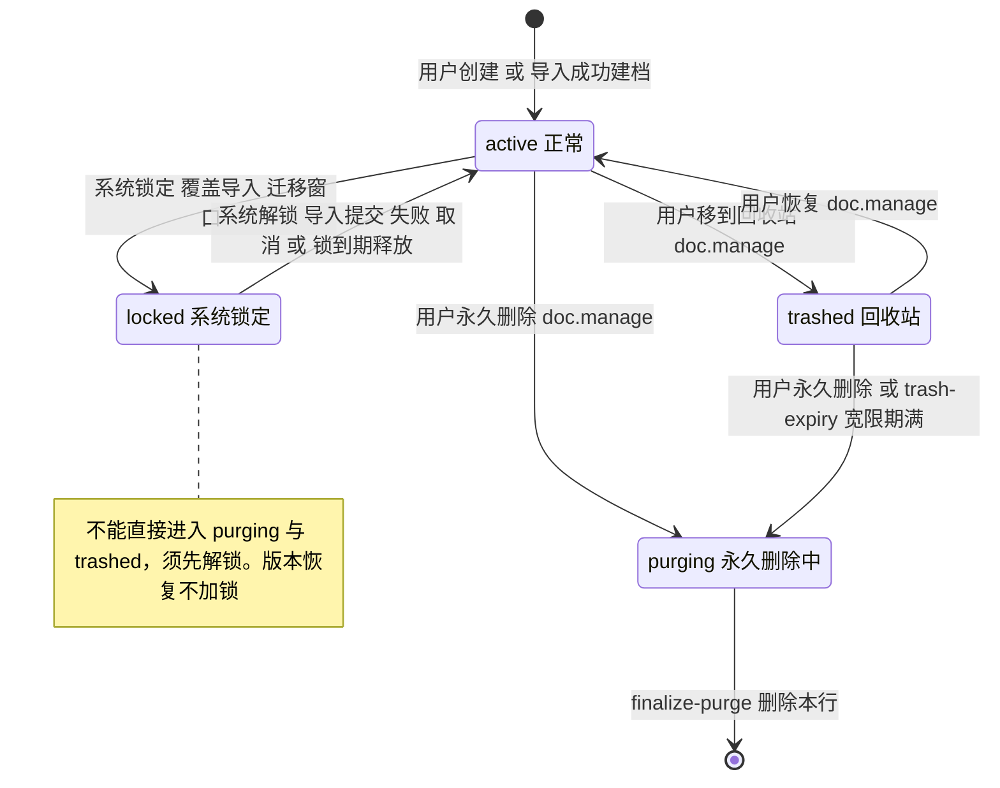
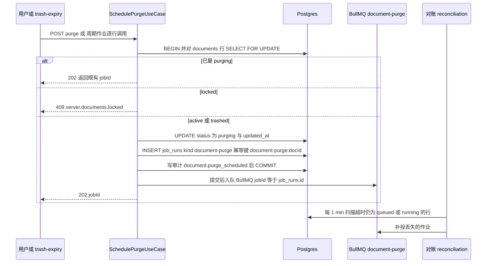
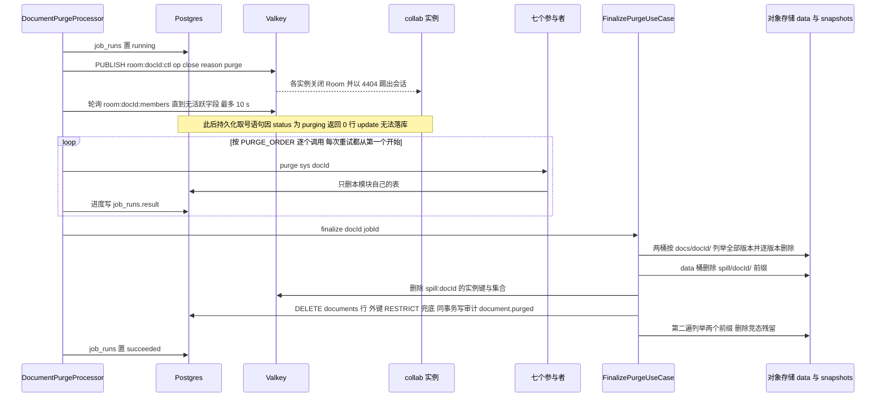
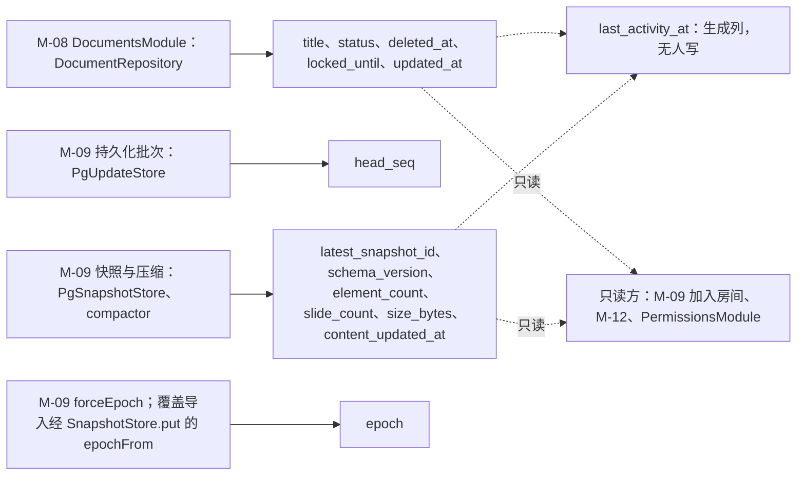
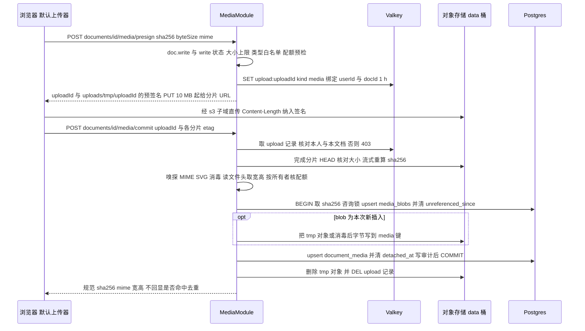
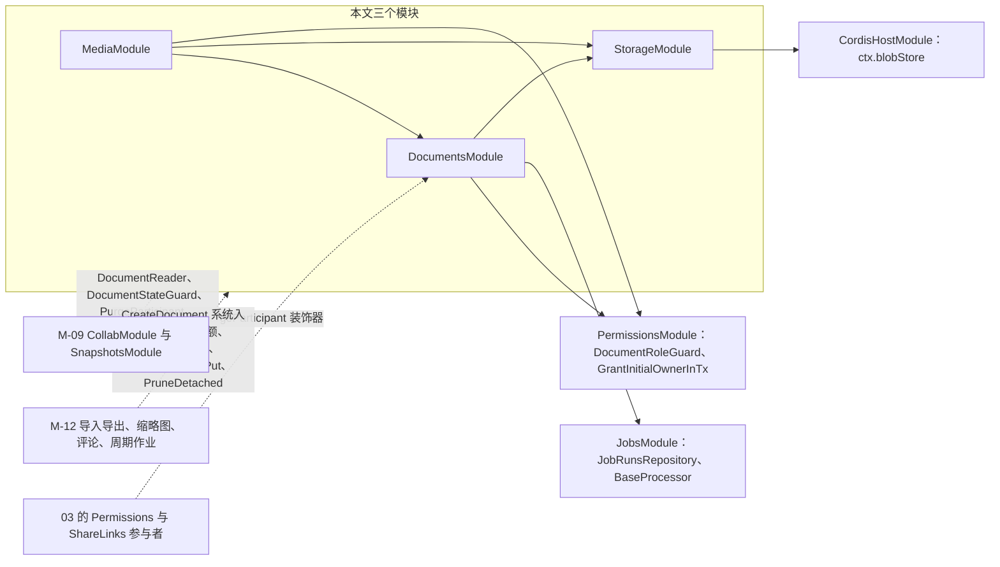

# 04 模块设计：文档、存储与媒体（含永久删除编排）
> 状态：v0.1 | 负责：后端设计线 | 更新：2026-09-25；2026-09-25（§4.19）；2026-09-25（§4.19 N1）；2026-09-25（lock_reason，§4.19 N1 补缺）；2026-09-26（§4.20） | 依赖：[rulings](../00-charter/rulings-2026-09-14.md) §4.10 Q20、§4.12 U-04、§4.13 S-2、§4.15 Q3/Q5、§4.17 D2、§4.18 BE-01/BE-10/BE-15/BE-31/CO-07、§4.19 D-M2-CONTENT/C-06/N1；[30/08](../30-architecture/08-backend-nestjs.md)；ADR-0022/0025/0029；[03 模块卡模板](03-modules-identity-and-access.md)；[08](08-db-conventions-roles-rls-migrations.md)；[10](10-ddl-documents-marks-media.md)；[14](14-valkey-object-storage-and-retention.md)；[15](15-rest-api-catalog.md)

本文是 `DocumentsModule`、`StorageModule`、`MediaModule` 三个 Nest 模块运行时设计的唯一事实源，也是「永久删除文档」编排（rulings §4.18 BE-15）的**唯一源**：[05](05-modules-collab-and-snapshots.md)、[06](06-modules-jobs-import-export-thumbnails.md)、[07](07-modules-comments-webhooks-audit.md)、[03](03-modules-identity-and-access.md) 中的 purge 参与者只写自己那一步并链接本文 §4。

- 表结构、RLS policy、迁移 SQL：[10](10-ddl-documents-marks-media.md)；数据库总约定、角色与 GRANT：[08](08-db-conventions-roles-rls-migrations.md)。
- 路由、守卫与能力位、DTO 文件、成功码：[15](15-rest-api-catalog.md) §3.3（documents）与 §3.6（media）；本文只写用例与事务边界。
- Valkey 键模板、对象键布局、保留期总表：[14](14-valkey-object-storage-and-retention.md)；配置键全字段：[17](17-deployment-and-config.md)。
- 包与文件级目录（`apps/server/src/modules/{documents,storage,media}/`、`@cordexjs/server-storage`）：[40/08](../40-modules/08-server-identity-documents-and-storage.md) §4–§5。
- 模块卡栏目按 [03](03-modules-identity-and-access.md) §1 的模板：职责 / 非职责、用例、路由、仓储与所属表、imports / exports、事件与审计、错误码、角色装配、purge 参与者、Clock 注入点、机械验证。

## 0. 一页总览

| 模块 | 一句话职责 | 所属表 / 对象 | 主要入口 | 装配角色（矩阵见 [01](01-service-overview-and-roles.md) §5） | 里程碑 |
|---|---|---|---|---|---|
| `DocumentsModule` | 文档目录条目（元数据、状态机、回收站、锁定）、最近 / 固定记账、永久删除编排与收尾、存储配额读取 | `documents`（M-08 列）、`document_user_marks` | REST 15 §3.3；BullMQ `document-purge` 处理器；周期作业 `trash-expiry` 的处理函数 | api（REST）、collab（状态守卫与只读查询）、worker（处理器、参与者 `user-marks`、`trash-expiry`） | M2（目录、回收站、最近 / 固定、系统锁定与解锁、创建副本受理）、M3（永久删除） |
| `StorageModule` | 把 `@cordexjs/server-storage` 的 `ServerBlobStore` 接进 Nest（`BlobStoreAccessor`），提供仅内部使用的预签名用例 | 两个桶 `data` / `snapshots`（不持有表） | 无控制器 | api、collab、worker（renderer 不装） | M2（S3 / SeaweedFS 与 local；M2 起内容落服务端，production 只允许 S3） |
| `MediaModule` | 文档作用域的媒体上传（预签名 → 提交校验）、读取授权、内容寻址去重、媒体引用维护与 30 天无引用回收 | `media_blobs`、`document_media`；对象 `media/…`、`uploads/tmp/…` | REST 15 §3.6；参与者 `media`；周期作业 `media-gc` 的处理函数 | api（REST）、worker（参与者、导入入库、引用裁剪、`media-gc`）、执行压缩的角色（引用同步） | M2（参与者随永久删除在 M3） |

三个模块都**文档类型盲**：`documents.doc_type` 只透传，不出现任何按类型分支（`cordex/no-doc-type-literals` 覆盖 `apps/server/src/modules/**`，见 [40/08](../40-modules/08-server-identity-documents-and-storage.md) §8）。

## 1. DocumentsModule：职责与非职责

**做**

- 目录条目 CRUD：创建（与首条 owner 授权行同一事务）、列表（我的 / 与我共享 / 回收站）、详情、改名、移到回收站、恢复。
- 状态机（§2）的全部转移与 `DocumentStateGuard`（按状态放行或拒绝后续守卫链之后的请求）。
- 最近 / 固定记账 `document_user_marks`（rulings §4.12 U-04、§4.18 BE-31）：打开时记录、固定 / 取消固定、从最近移除。
- 永久删除文档的**唯一编排方**：`SchedulePurgeUseCase`（发起）、`DocumentPurgeProcessor`（执行）、`FinalizePurgeUseCase`（收尾），以及参与者装饰器 `@PurgeParticipant` 与启动断言（§4）。
- 系统锁定 / 解锁与锁到期释放（覆盖导入与迁移窗口，ADR-0029 决策 5，2026-09-25 按 rulings §4.19 N1 收窄）：版本恢复不加锁（[05](05-modules-collab-and-snapshots.md) §10）；覆盖导入的锁以换纪元收尾，解锁与纪元加一在导入的同一事务内（[06](06-modules-jobs-import-export-thumbnails.md) §6.5）。锁定状态变化经 `perm:doc:{docId}` 通知在线会话（§2 表 2-1）。
- 存储配额读取（`storage.quota_exceeded` 的 `documents` 与 `bytes` 两个维度，§9），供本模块、MediaModule 与导入受理（[06](06-modules-jobs-import-export-thumbnails.md)）调用。
- 「创建副本」的受理（§3.3），执行在 [06](06-modules-jobs-import-export-thumbnails.md) §6.6。

**不做**

- 不持有文档**内容**：自 M2 起文档内容只以协同快照 + update 为事实源（rulings §4.19 D-M2-CONTENT，不设 pptx 内容版本），幻灯片树与 CRDT update、快照在 `document_updates` / `document_snapshots`（M-09，[05](05-modules-collab-and-snapshots.md)）；`documents` 表中 M-09 写的八列（§5）本模块只读。
- 不判定角色：角色来自 `PermissionsModule` 的 `RoleResolverService` 与 `DocumentRoleGuard`（[03](03-modules-identity-and-access.md)）；本模块只在角色通过之后再按文档状态放行。
- 不清理别的模块的表：永久删除时其余六张（组）表由各自的参与者清理（「谁的表谁写」，rulings §4.13 S-2）。
- 不签发协同票据：`POST /documents/:id/collab-ticket` 归 [15](15-rest-api-catalog.md) §3.7 与 [03](03-modules-identity-and-access.md)，本模块不 import `AuthModule`。
- 不做元素级「彻底删除元素」与墓碑 TTL 硬删除（M-09，[05](05-modules-collab-and-snapshots.md) §8），不做用户数据擦除（[03](03-modules-identity-and-access.md) §3）。

**`owner_id` 的语义**：计费所有者——存储配额归属（§9）、「我的文档」筛选、卡片上的「所有者」。不变量：`owner_id` 指向的用户在 `permissions` 中持 `owner` 角色。M1–M3 不提供转移所有者端点（M3 的运维命令 `documents:reassign-owner` 只给目标用户补 owner 授权、不改 `owner_id`，[03](03-modules-identity-and-access.md) §4.2，rulings §4.20 BE-05）；`PermissionsModule` 拒绝降级或移除 `owner_id` 指向的用户（校验与错误码归 [03](03-modules-identity-and-access.md) §4，本文只登记这条跨模块不变量）。

## 2. 文档状态机

四个状态 `active` / `trashed` / `locked` / `purging`（C-02，rulings §4.18 BE-15）。`purging` 单向不可逆，终点是 `finalize-purge` 删除 `documents` 行。

**图 2-1 文档状态与转移触发者**



怎么读：方框是 `documents.status` 的四个取值，箭头上写触发者与所需能力位；「系统」指 worker 或 collab 以 `SystemContext` 调用、非用户可达。`purging` 之后只有删行一条出路；`locked` 只与 `active` 互转。锁定窗口只有覆盖导入与迁移两种（rulings §4.19 N1）：覆盖导入成功时解锁与纪元加一同事务提交，失败或取消时解锁、纪元不变；锁到期由 `trash-expiry` 释放。

依据：rulings §4.13 S-2、§4.15 Q3、§4.18 BE-15、§4.19 N1；ADR-0029 决策 5（2026-09-25 修订）；决策 C-02。

**表 2-1 转移清单**

| 转移 | 触发者 / 入口 | 前置检查 | 同事务写入 | 事务外动作 | 审计 action（登记见 [07](07-modules-comments-webhooks-audit.md) §9） |
|---|---|---|---|---|---|
| 无 → active | 用户 `CreateDocumentUseCase`；导入成功时 M-12 以 `SystemContext` 调同一用例 | 用户 `status='active'`；`documents` 维度配额（§9） | `documents` 行 + 首条 owner 授权行与 `document_perm_versions` 行（经 Permissions 导出的事务内用例）+ `document_user_marks.last_opened_at` | 无 | `document.created` |
| active → trashed | 用户 `TrashDocumentUseCase` | `doc.manage` | `status='trashed'`、`deleted_at=now()`、`updated_at=now()` | 提交后 `PUBLISH room:{docId}:ctl {op:'close', reason:'trashed'}`（尽力而为） | `document.trashed` |
| trashed → active | 用户 `RestoreDocumentUseCase` | `doc.manage` | `status='active'`、`deleted_at=NULL` | 无 | `document.restored` |
| active → locked | 系统 `LockDocumentUseCase(sys, docId, reason, ttl)` | 当前为 `active` | `status='locked'`、`locked_until=now()+ttl`（默认 10 min，持锁方续期）、`lock_reason=reason`（`import` / `migration`） | 提交后 `PUBLISH perm:doc:{docId} {docId, lockChanged:true}`（不递增 permVersion）：各 collab 实例重读 `status`、`locked_until`、`lock_reason`，推 `CONTROL.room{locked:{reason, until}}` 并把会话封顶为只读（[16](16-ws-protocol-server-view.md) §8） | `document.locked` |
| locked → active | 系统 `UnlockDocumentUseCase`（覆盖导入成功时在导入的 `persist` 事务内调用、与纪元加一同事务；失败或取消时在处理器 `finally` 中调用，[06](06-modules-jobs-import-export-thumbnails.md) §6.5）；周期作业 `trash-expiry` 调 `ReleaseExpiredLocksUseCase` | 当前为 `locked` | `status='active'`、`locked_until=NULL` | 同上，网关推一次不带 `locked` 的 `room`，会话恢复原角色 | `document.unlocked`（到期释放为 `reason:'expired'`） |
| active / trashed → purging | 用户 `POST /documents/:id/purge`；worker `trash-expiry` | 用户需 `doc.manage`；`trash-expiry` 只选 `trashed` 且 `deleted_at < now() - retention.trashDays` | 见 §4.1 | 见 §4.1 | `document.purge_scheduled` |
| purging → 删行 | worker `FinalizePurgeUseCase` | 全部参与者成功 | `DELETE documents`（外键 RESTRICT 兜底）+ 审计 | 见 §4.4 | `document.purged` |

同目标的重复请求是幂等的：对 `trashed` 再移到回收站、对 `active` 再恢复，返回与首次相同的成功码（15 §3.3：204 / 200）且不写审计；对 `purging` 再永久删除返回既有 `jobId`。

**表 2-2 状态 × 访问类（`DocumentStateGuard`）**

| 状态 | `meta`：目录元数据读（详情、列表、pin / recent、权限与分享链接管理） | `content`：内容读（快照、媒体读、缩略图、评论、加入协同、导出、创建副本） | `write`：内容与元数据写（改名、媒体上传、协同写、命名版本、恢复） | 可发起的转移（`transition`） |
|---|---|---|---|---|
| `active` | 按角色 | 按角色 | 按角色 | 移到回收站、永久删除；系统锁定 |
| `locked` | 按角色（pin / recent 属用户记账，照常） | 按角色（协同加入为只读，网关 L2 拒写） | 409 `server.documents.locked`（含改名；应用角色的 RLS 也不允许更新 `locked` 行） | 仅系统解锁；移到回收站与永久删除 409 `server.documents.locked` |
| `trashed` | 仅持 `doc.manage` 的用户可见（回收站视图）；其他角色 404 | 404 `server.documents.not_found` | 404 | 恢复、永久删除；系统 `trash-expiry` |
| `purging` | 404 | 404；协同加入 4404 | 404 | 无（重复永久删除返回既有作业） |

`DocumentStateGuard` 由本模块导出，挂在控制器级 `DocumentRoleGuard` 之后（守卫顺序见 [02](02-auth-chain.md) §6）；路由以 `@DocState('meta' | 'content' | 'write' | 'transition')` 声明访问类，[15](15-rest-api-catalog.md) 的路由总表逐行登记（「状态」列）。`transition` 用于移到回收站、恢复与永久删除三条状态转移路由：守卫只拒绝 `purging`（404），其余状态交给用例按表 2-1 判定（`locked` 409、重复请求幂等）。拒绝一律 404 而非 403，不向无管理权的用户透露「已删除」这一事实。

交叉规则：

1. `locked` 与 `purging` 互斥且不能直接互转：锁定窗口里的导入 / 迁移若与删除交错，只会让用户的永久删除得到 409 并在解锁后重试；`trash-expiry` 只选 `trashed`，不会碰到 `locked`。
2. 锁必须带到期时间 `locked_until`：持锁方崩溃时由周期作业 `trash-expiry`（每 5 min）调用 `ReleaseExpiredLocksUseCase` 释放，文档最多多锁一个周期，不会永久只读。
3. `trashed` 同样拒绝加入协同（与 `purging` 同为 4404）：移到回收站后在线会话经控制频道被关闭，之后的加入请求被拒；恢复后可再次加入。协同侧的加入检查写在 [05](05-modules-collab-and-snapshots.md) §3 与 [16](16-ws-protocol-server-view.md)，本表为其状态口径来源。
4. `active → purging` 允许不经回收站（BE-15）；用户永久删除与回收站到期走同一个 `SchedulePurgeUseCase`，只差 `reason`。

依据：rulings §4.18 BE-15（purging 拒绝加入）、ADR-0029 决策 5（locked 拒写）；决策 INC-22；锁定通知的通道见 [16](16-ws-protocol-server-view.md) §8（`room:{docId}:ctl` 只承载 `close` 与 `epoch`，[14](14-valkey-object-storage-and-retention.md) §3）。

## 3. 用例

路由、守卫与能力位、DTO 文件与成功码只在 [15](15-rest-api-catalog.md) §3.3，本节写事务边界与前置检查。所有以 `docId` 为键的仓储方法首参为 `DocAccess`（由权限服务签发）或 `SystemContext`，由扫描器 `scan-doc-access-via-permission` 机械保证（[40/08](../40-modules/08-server-identity-documents-and-storage.md) §10）。

### 3.1 目录与记账

| 用例 | 前置检查（角色之后） | 事务边界 | 说明 |
|---|---|---|---|
| `CreateDocumentUseCase` | 已登录且 `users.status='active'`；`quota.documentsPerUser`（§9） | 单事务，顺序固定（[08](08-db-conventions-roles-rls-migrations.md) §6.3 第 6 条）：`INSERT documents … RETURNING`（此刻 owner 授权行尚不存在，靠 SELECT policy 的 `owner_id` 分支可见，[10](10-ddl-documents-marks-media.md) §8）→ `PermissionsModule` 导出的 `GrantInitialOwnerInTx(tx, docId, userId)`（写 `permissions` 与 `document_perm_versions`）→ `document_user_marks` upsert `last_opened_at` | `id` 为应用层 UUIDv7；`title` 缺省为空串，界面显示本地化的「未命名演示文稿」；`doc_type` 必填、只透传；导入建档时 M-12 以 `SystemContext` + `ownerId` 调同一用例 |
| `ListDocumentsQuery` | `meta` | 只读 | `filter`（取值以 [15](15-rest-api-catalog.md) §3.3 为准）：`owned`（`owner_id` = 我，状态 `active`/`locked`）、`shared`（我有授权行且 `owner_id` ≠ 我）、`all`（二者之并）、`trashed`（`trashed` 且我的角色为 `owner`）；`recent` / `pinned` 转交 `ListRecentQuery` / `ListPinnedQuery`；`q` 为已授权结果上的标题子串过滤；按 `last_activity_at DESC, id` 键集分页（`cursor` + `limit ≤ 100`）；RLS 兜底 |
| `GetDocumentQuery` | `meta` | 只读 | 返回元数据、我的角色与能力位集合；`purging` 与无权的 `trashed` 返回 404 |
| `RenameDocumentUseCase` | `doc.write`；`write` | 单事务：`UPDATE title, updated_at` | 标题长度以 protocol DTO 为准，库表另有 512 字符兜底 |
| `TrashDocumentUseCase` / `RestoreDocumentUseCase` | `doc.manage` | 单事务，互为逆操作 | 见表 2-1 |
| `TouchRecentUseCase` | `content` | 单事务：upsert `last_opened_at`；距上次记录不足 60 s 不写 | 在「打开」动作内调用：签发协同票据时（AuthModule 的 `IssueCollabTicketUseCase`，经本模块导出面，M2 起） |
| `PinDocumentUseCase` / `UnpinDocumentUseCase` | `doc.read`；`meta` | 单事务：upsert / 置空 `pinned_at`；两列皆空则删行 | 固定为用户级标记，不改文档权限（决策 SG-06/SG-07） |
| `RemoveFromRecentUseCase` | `doc.read`；`meta` | 同上：置空 `last_opened_at`，两列皆空则删行 | 前端给出 5 s 撤销 toast（AS-02），撤销即再次 `TouchRecent` |
| `ListRecentQuery` / `ListPinnedQuery` | `meta` | 只读：`document_user_marks` ⋈ `documents`（`active`/`locked`） | 最近取 `last_opened_at DESC` 前 50 条。已知限制：只凭分享链接访问过的文档不出现在列表中——列表请求不携带分享令牌，RLS 下不可见（[02](02-auth-chain.md) §7） |

### 3.2 锁定、永久删除与系统用例

| 用例 | 调用方 | 前置检查 | 事务边界 |
|---|---|---|---|
| `LockDocumentUseCase(sys, docId, reason, ttl)` / `UnlockDocumentUseCase` / `RenewLockUseCase` | M-12 覆盖导入（处理器开工时加锁，`persist` 事务内或失败 / 取消时解锁）、M-09 迁移窗口；版本恢复不调用（rulings §4.19 N1） | 表 2-1 | 单事务，或在调用方事务内执行（覆盖导入的解锁）；`reason ∈ {import, migration}` 只进审计与 `room.locked.reason`（原取值含 `restore`，2026-09-25 随 N1 删去）；提交后发布 `perm:doc:{docId}` 的 `lockChanged` 通知 |
| `ReleaseExpiredLocksUseCase(sys)` | 周期作业 `trash-expiry` 的第一步 | 无 | 单语句：`status='locked' AND locked_until <` Clock 当前时间的行回到 `active`，逐行写审计 `document.unlocked{reason:'expired'}` |
| `SchedulePurgeUseCase(ctx, docId, reason)` | 用户 `POST /documents/:id/purge`（`reason='permanent_delete'`）；`trash-expiry`（`'trash_expired'`）；`'erasure'` 为 M4 预留——[03](03-modules-identity-and-access.md) §3.3 已定「擦除不删除用户拥有的文档」（PRD SV-11 只要求替换主体标识），M1–M3 没有以 `erasure` 发起的调用方；取值与 [07](07-modules-comments-webhooks-audit.md) §9.2 `document.purge_scheduled.reason` 一致 | 见 §4.1 | 见 §4.1 |
| `RunTrashExpiryUseCase(sys)` | 周期作业 `trash-expiry`（maintenance 队列，每 5 min，只在 worker 注册；处理函数由本模块按 [06](06-modules-jobs-import-export-thumbnails.md) §4 的登记方式提供，JobsModule 不 import 本模块） | 无 | 先调 `ReleaseExpiredLocksUseCase`；再按 `deleted_at` 升序每批 100 行，逐行调用 `SchedulePurgeUseCase(sys, id, 'trash_expired')`；单行失败不影响其余行 |

依据：决策 INC-22（永久删除入口）、RETENTION（`trash-expiry` 与 `retention.trashDays`）、C-02（四值状态）。

**Clock 注入点**（DocumentsModule）：`deleted_at` 与 `updated_at` 盖章、`trash-expiry` 截止时间、`locked_until` 计算与到期判断、`TouchRecent` 的 60 s 节流、UUIDv7（文档 id、副本预分配的新文档 id）的时间部分——一律经服务端 Clock 端口 `apps/server/src/shared/clock.ts`，测试注入 FixedClock（决策 T-DETERMINISM）。数据库侧 `now()` 只用于 `created_at` / `updated_at` 的插入默认值（`media_blobs.unreferenced_since` 也由调用方传入 Clock 时间，[10](10-ddl-documents-marks-media.md) §6）。

### 3.3 创建副本（受理）

依据：rulings §4.10 Q20（应用栏「⋯」含「创建副本」）、§4.19 D-M2-CONTENT（内容以协同快照为唯一事实源，因此副本在服务端从快照生成，不经浏览器上传 pptx）；随 M2 协同后端交付。自 M2 起不设 pptx「内容版本」端点，新建空白与模板文档也经服务端导入写 `import` 快照（[06](06-modules-jobs-import-export-thumbnails.md) §6）。

| 用例 | 前置检查 | 步骤 |
|---|---|---|
| `DuplicateDocumentUseCase({title?})` | 源文档 `doc.export`（与导出同一能力位：副本等于把内容带出本文档的授权范围）；`content`；新文档按调用者计 `documents` 维度配额（§9，超出 429），`bytes` 维度按源文档 `size_bytes` 预检（超出 413） | ① 预分配新文档 id `newDocId`（UUIDv7）与 `jobId`；② 读源文档 `head_seq` 作为 `srcSeq`（副本内容固定为受理时已落库的状态，与导出的 `q{headSeq}` 同一口径）；③ 经 `JobRunsRepository.create` 写 `job_runs(kind='import', doc_id=newDocId, payload={source:'duplicate', srcDocId, srcSeq, title})`，幂等键见 06 §2.3；④ 提交后入 `import` 队列；返回 202 `{docId: newDocId, jobId}`，进度经 `GET /jobs/:id` |

- 执行（worker）与写入次序见 [06](06-modules-jobs-import-export-thumbnails.md) §6.6：以源文档检查点 + `seq ≤ srcSeq` 的 updates 为新文档写 `kind='import'` 快照，复制源文档最新 import 快照的基线对象与新快照引用到的 `document_media` 关联，再经 `CreateDocumentUseCase` 系统入口建文档行（owner = 调用者，审计 `document.created{source:'duplicate'}`）。
- 副本不复制权限、分享链接、评论镜像与版本历史：新文档只有调用者一个 owner，评论随 CRDT 内容一起复制（`resources['comments.threads']` 在快照里），镜像由首次加载时的全量对账写入（[07](07-modules-comments-webhooks-audit.md) §1.3）。

## 4. 永久删除文档编排（唯一源）

载体：**单作业 + 参与者登记 + 收尾**（rulings §4.18 BE-15）。一个持久化作业行 `job_runs(kind='document-purge')` 驱动全过程；参与者各清自己的表（rulings §4.13 S-2）；`documents` 不 import 任何下游模块，只经 Nest `DiscoveryService` 收集 `@PurgeParticipant` 登记的用例。永久删除不等回收站宽限期、不等元素墓碑 TTL（rulings §4.15 Q3）。

### 4.1 发起：`SchedulePurgeUseCase`

**图 4-1 永久删除的发起与投递兜底**



怎么读：从上到下是一次发起。关键在同一事务里「置 purging」与「写作业行」一起提交（Outbox），入队在提交之后，入队丢失由对账作业补投；`purging` 一旦提交，协同侧的加入与持久化立即失效（§4.2）。

依据：rulings §4.18 BE-15、BE-18（幂等键只对非失败行生效）；决策 INC-22、MECH-C（C-05：`document-purge` 为独立队列）。

- 作业行经 `JobsModule` 导出的 `JobRunsRepository.create(tx, …)` 在本事务内写入（[06](06-modules-jobs-import-export-thumbnails.md) §2.1；`create` 须接受调用方事务句柄）；`job_runs` 仍只有 JobsModule 一个仓储。
- 幂等键 `document-purge:{docId}` 与 `job_runs` 的部分唯一索引（[12](12-ddl-jobs-and-thumbnails.md) §3）一起保证同一文档只有一个未终结的删除作业；行锁已串行化并发发起，唯一索引是第二道防线。
- 应用角色的 RLS 不允许更新（因而也不能 `FOR UPDATE` 锁定）`locked` 与 `purging` 行（[10](10-ddl-documents-marks-media.md) §8）：用户发起时 `FOR UPDATE` 取不到行，就退回普通读取——状态是 `purging` 则按幂等键查出既有作业返回，是 `locked` 则 409。并发的第二个发起者在第一个提交后同样走这条路径。
- 响应 202 `{jobId}`；进度经 `GET /jobs/:id` 查询（决策 SG-08）。

### 4.2 执行：`DocumentPurgeProcessor`（worker）

**图 4-2 处理器三步：关房间、参与者、收尾**



怎么读：处理器先让所有持有该 Room 的 collab 实例关房间，再逐个调用参与者，最后收尾；虚线是异步通知。等待关房间有 10 s 上限，超时也继续——「无 update 落库」不靠等待，而靠持久化取号语句自带的状态条件（[10](10-ddl-documents-marks-media.md) §3）。

依据：rulings §4.18 BE-15、CO-16；决策 C-08/OBJ（两桶与 `spill/{docId}/`）、C-33（踢会话用 closeRoom、不递增 epoch）、C-34（收尾删行）、KEYS（`room:{docId}:ctl`、`room:{docId}:members`）。

「在线编辑中永久删除后无 update 落库」由四个环节共同保证：① `SchedulePurgeUseCase` 提交 `status='purging'`；② M-09 每次持久化的取号语句带 `AND status <> 'purging'`，返回 0 行即放弃该批并以 4404 关闭 Room；③ 在 ① 之前已落库的行由参与者 `collab` 删除；④ `finalize-purge` 删 `documents` 行时，任何残留的子表行都会触发外键 RESTRICT 而失败，作业整体重试。

### 4.3 参与者契约与清单

```ts
// apps/server/src/modules/documents/application/purge-participant.ts
export const PURGE_ORDER = [
  'collab', 'comments', 'thumbnails', 'media', 'share-links', 'permissions', 'user-marks',
] as const                                   // 执行顺序即数组顺序；启动断言：登记集合 = 本数组
export type PurgeParticipantName = (typeof PURGE_ORDER)[number]

export interface PurgeStepReport { readonly rowsDeleted: number; readonly objectsDeleted?: number }

export interface PurgeParticipantPort {
  /** 幂等；只清本模块的表与对象；返回前本模块对该文档不再有进行中的写入 */
  purge(ctx: SystemContext, docId: DocumentId): Promise<PurgeStepReport>
}

/** Nest 类装饰器：登记为 document-purge 参与者，由 DiscoveryService 按名收集 */
export declare function PurgeParticipant(name: PurgeParticipantName): ClassDecorator
```

| 参与者 | 所属模块 | 清理对象 | 该步骤的设计 | 装配角色 |
|---|---|---|---|---|
| `collab` | CollabModule（M-09） | `document_updates`、`document_snapshots`（两级溢写不归它：Valkey `spill:{docId}:*` 与对象 `spill/{docId}/` 由 §4.4 的 finalize-purge 一起清） | [05](05-modules-collab-and-snapshots.md) §12 | worker（只依赖 `PgUpdateStore` / `PgSnapshotStore`，不激活 `collabServer`，rulings §4.18 BE-15） |
| `comments` | CommentsModule | `comments` | [07](07-modules-comments-webhooks-audit.md) §1.7 | worker |
| `thumbnails` | ThumbnailsModule | `thumbnails` 行与 `docs/{docId}/thumbs/` 对象（含 embedded 封面） | [06](06-modules-jobs-import-export-thumbnails.md) §11 | worker |
| `media` | MediaModule | `document_media`（`media_blobs` 不删，走 30 天无引用回收） | 本文 §7.5 | worker |
| `share-links` | ShareLinksModule | `share_links` | [03](03-modules-identity-and-access.md) §5 | worker |
| `permissions` | PermissionsModule | `permissions`、`document_perm_versions` | [03](03-modules-identity-and-access.md) §4 | worker |
| `user-marks` | DocumentsModule | `document_user_marks` | 本文 §3.1 | worker |

参与者规则（各文件实现时逐条满足，[70/07](../70-testing/07-backend-integration-and-api-e2e.md) 按条断言）：

1. **幂等**：重复执行结果相同；目标行已空时代价约为一次索引查找。
2. **只清自己的**：只删本模块的表与对象，不假设其它参与者是否已执行。
3. **系统上下文**：以 `cordex_system` 执行，事务开头 `set_config('app.system_job', 'worker.document-purge', true)`（作业名取值见 [08](08-db-conventions-roles-rls-migrations.md) §6.5），不用 `BYPASSRLS`。
4. **先停写再删**：不取任何租约，靠三道已有的栅栏——第 ① 步关房（§4.2）、加入房间对 `purging` 一律拒绝（[05](05-modules-collab-and-snapshots.md) §3.1）、以及 [11](11-ddl-collab-updates-and-snapshots.md) §5 的取号语句在 `purging` 之后插入 0 行（数据库栅栏，漏收关房通知的实例也写不进）；写对象存储的写者（collab 压缩写快照对象、缩略图、导出、导入）在写对象或写库前复查 `documents.status`，见 `purging` 或行不存在即放弃，竞态中漏写的对象由第 4 步第二遍列举清掉。
5. **不写审计**：审计由编排方统一写；各参与者返回的 `PurgeStepReport` 计数写进 `document.purged` 的 details（字段集以 [07](07-modules-comments-webhooks-audit.md) §9.2 登记为准）。
6. **装配**：全部在 worker 装配；启动时 `DiscoveryService` 收集到的名字集合必须等于 `PURGE_ORDER`，缺一或多一都拒绝启动（断言清单见 [01](01-service-overview-and-roles.md) §6）。

顺序理由：`collab` 最先，先停掉内容写者；派生数据（评论镜像、缩略图）其次；授权相关（分享链接、权限）靠后——参与者以系统上下文执行，不依赖授权行，放后面只是让排障时「文档不可见」与「数据已清」的先后更直观。

### 4.4 收尾：`FinalizePurgeUseCase`

按下列顺序执行，每一步都可重复：

1. **两个桶的全部版本**：对 `storage.s3.buckets.snapshots`（开版本化）与 `storage.s3.buckets.data` 各执行 `listVersions('docs/{docId}/')`，逐个 `deleteVersion(key, versionId)`，删除标记（delete marker）一并删除。只删当前版本不算删除（BE-15）。覆盖快照、导入基线 `baseline/`、导入原件 `imports/`、导出 `exports/`、缩略图 `thumbs/`（键布局见 [14](14-valkey-object-storage-and-retention.md) §6）。
2. **溢写**：`data` 桶 `spill/{docId}/` 前缀全部删除；Valkey 中逐个删除 `spill:{docId}:instances` 所列实例的 `spill:{docId}:{instanceId}` 与集合本身（键名经 server-collab `redis-keys.ts` 导出的模板生成，[14](14-valkey-object-storage-and-retention.md) §7 第 2 条）。文档正在删除，未回放的溢写直接丢弃（决策 C-08/OBJ、CO-16；collab 参与者只依赖 Pg 存储，BE-15）。
3. **删行与审计同事务**：`DELETE FROM documents WHERE id = $1 AND status = 'purging'`，同一事务写审计 `document.purged`（details：`jobId`、`objectVersionsDeleted` 与各参与者计数，字段集以 07 §9.2 为准）。外键全部 `ON DELETE RESTRICT`（决策 FK-POLICY）：任何参与者漏清都会让这一步失败并抛 `server.documents.purge_incomplete`，作业进入重试，而不是静默级联。删到 0 行且行已不存在时视为上次已删成功，继续第 4 步。
4. **第二遍列举**：再对两个前缀列举一次，删除第 1 步之后因竞态写入的对象，数量计入 `cordex_purge_residual_objects_total`（名表见 [18](18-observability-and-ops-endpoints.md) §4.2）。

收尾之后仍保留的数据：`audit_log`（`doc_id` 无外键，按 `retention.auditDays` 保留）与 `job_runs`（`doc_id` 无外键，按 `retention.jobRunsDays` 清理）。只被该文档引用的媒体原件：参与者 `media` 删去最后一条关联时 `media_blobs.unreferenced_since` 被置位，`media-gc` 在 `retention.mediaUnreferencedDays`（默认 30 天）后删除行与对象（决策 C-25）——对外声明为「永久删除后，仅被该文档引用的图片原件在 30 天内从对象存储清除」，备份中的残留时长见 [14](14-valkey-object-storage-and-retention.md) §11。

### 4.5 失败、重试与对账

- 队列 `document-purge` 为独立队列（不并入 maintenance），重试次数、退避、并发与死信参数只在 [06](06-modules-jobs-import-export-thumbnails.md) §1 的队列总表；同一文档经 `jobId` 与幂等键天然串行。
- **每次重试从第 ① 步重新执行全部步骤**，不按 `job_runs.result` 跳过已完成的参与者：若某参与者清理后又有迟到写入（例如竞态中的缩略图），只有重跑它才能让第 ④ 步的外键检查通过；`result` 只用于观测，形状以 [12](12-ddl-jobs-and-thumbnails.md) §2 为准（`{stage, participants: {<名称>: 'pending' | 'done'}, finalized?}`）。
- 入队丢失由对账作业补投（孤儿判定 = 超过 2 倍处理器超时仍为 `queued` 或 `running`，[06](06-modules-jobs-import-export-thumbnails.md) §3）；Valkey 数据丢失同样由它从 `job_runs` 补投。
- 重试用尽进入死信并告警；文档停在 `purging`（对用户 404、协同拒绝加入），由运维按 [06](06-modules-jobs-import-export-thumbnails.md) §5 的死信重放命令重投。

### 4.6 与其它删除的边界

| 操作 | 粒度 | 入口与执行者 | 与本编排的关系 |
|---|---|---|---|
| 移到回收站 | 文档 | 用户，本模块 | 只改状态，`retention.trashDays` 后由 `trash-expiry` 调本编排 |
| 永久删除文档 | 文档 | 用户或 `trash-expiry`，本模块 | 本节 |
| 彻底删除元素（CO-07） | 墓碑态元素 | owner，`POST /documents/:id/elements/purge`，M-09 单写者 | 不走本编排；只清当前文档状态，历史快照与 update 按保留期存在（[05](05-modules-collab-and-snapshots.md) §8） |
| 墓碑 TTL 硬删除 | 元素 | `tombstone-sweeper`（M-09） | 不走本编排（[05](05-modules-collab-and-snapshots.md) §8） |
| 用户数据擦除（GDPR） | 用户 | 平台管理员，`POST /users/:id/erasure` | 不走本编排：原地脱敏 `users` 行、删身份、吊销会话（[03](03-modules-identity-and-access.md) §3，决策 C-24）；按 03 §3.3「擦除不删除用户拥有的文档」，其名下文档保留；`reason='erasure'` 为 M4 预留 |

## 5. `documents` 列写方所有权

不拆表（决策 C-03，沿用 rulings §4.13「列级收紧 + 仓储入参类型排除」的做法并外推到全部 M-09 列）。

| 列 | 写方 | 写入时机 |
|---|---|---|
| `id`、`doc_type`、`owner_id`、`created_at` | M-08 `CreateDocumentUseCase`（仅插入） | 建档 |
| `title`、`status`、`deleted_at`、`locked_until`、`lock_reason`、`updated_at` | M-08 DocumentsModule | 表 2-1 各转移、改名 |
| `head_seq` | M-09 持久化批次 | 每批 update 落库，同事务取号（[10](10-ddl-documents-marks-media.md) §3） |
| `epoch` | M-09 `forceEpoch`；M-09 `PgSnapshotStore.put(kind='import', epochFrom)`（由 M-12 导入处理器在 worker 的 `persist` 事务内调用，rulings §4.19 N1） | 管理端点触发（[05](05-modules-collab-and-snapshots.md) §9）；覆盖既有文档的导入提交（[06](06-modules-jobs-import-export-thumbnails.md) §6.5，与 `import` 快照、解锁同一事务） |
| `latest_snapshot_id`、`schema_version`、`element_count`、`slide_count`、`size_bytes`、`content_updated_at` | M-09 快照与压缩 | 写快照时节流更新，不在每批 update 时写 |
| `last_activity_at` | 无（生成列 `greatest(updated_at, content_updated_at)`） | 自动 |

**图 5-1 `documents` 的列级写方**



怎么读：实线从写方指向它唯一可写的列组；虚线是派生（生成列）或跨模块只读。同一张表、四个写方，列组互不重叠。`epoch` 的两条写入路径都是 M-09 的代码：运维换纪元走 `forceEpoch`，覆盖导入由 worker 上的 M-12 处理器调用 M-09 的 `SnapshotStore.put`（rulings §4.19 N1）。

依据：决策 C-03；rulings §4.13 同时确认段；ADR-0025（`head_seq` 与 `latest_snapshot_id`）。

三道机械防线（逐条对应 §10 的断言）：

1. **类型**：`DocumentRepository` 的更新入参是白名单 `DocumentMetaPatch = Partial<Pick<Document, 'title' | 'status' | 'deletedAt' | 'lockedUntil' | 'updatedAt'>>`——等价于 Omit 全部 M-09 列，且以后新增的列默认不可写；类型测试以 `@ts-expect-error` 断言传入 `headSeq` 等字段编译失败。
2. **数据库列权限**：`cordex_app` 对 `documents` 只有列级 `INSERT (id, title, doc_type, owner_id)` 与 `UPDATE (title, status, deleted_at, updated_at)`，M-09 列只有 `cordex_system` 可写（列级 GRANT 规格见 [10](10-ddl-documents-marks-media.md) §9，由 [08](08-db-conventions-roles-rls-migrations.md) 的 0095 落地）。M-08 的系统用例与 M-09 同用 `cordex_system`，二者之间靠第 1、3 道区分。
3. **集成断言**：server-integration 记录 `DocumentRepository` 发出的全部 SQL，断言其中不出现 M-09 列名（决策 C-03）。

## 6. StorageModule

**职责**：把 `@cordexjs/server-storage` 的 `ServerBlobStore`（cordis Provider，经 `preset-server` 装进进程内唯一的 cordis 宿主，[01](01-service-overview-and-roles.md) §9）接进 Nest：`BlobStoreAccessor` 从 `CordisHostService.getService('blobStore')` 取实例；提供仅内部使用的 `GetPresignedPutUseCase`。**非职责**：不持有表、不做业务校验（媒体校验在 MediaModule，导入校验在 [06](06-modules-jobs-import-export-thumbnails.md)），没有控制器——通用 `POST /storage/presign` 已删除（rulings §4.18 BE-10），客户端全程不提交任意对象键。

### 6.1 两个桶与两个端点

决策 C-08/OBJ：S3 的版本化是桶级开关，不能按前缀开启，因此分两个桶——`storage.s3.buckets.snapshots`（开版本化 + 非当前版本过期规则，只放 `docs/{docId}/snapshots/{snapshotId}.yup2.zst`）与 `storage.s3.buckets.data`（不开版本化，放其余全部对象）。键布局、保留期与清理方式只在 [14](14-valkey-object-storage-and-retention.md) §5–§6 登记，代码落点是 `server-storage/src/infrastructure/keys.ts`。

| 操作 | 使用的端点 | 理由 |
|---|---|---|
| `presignPut` / `presignGet` / 分片上传的各分片 URL | `storage.s3.publicEndpoint`（反代子域 `s3.<域名>`，反代保持 Host 头） | 浏览器可达；S3 签名覆盖 Host，改写即失效（rulings §4.18 BE-01） |
| `get` / `put` / `head` / `copy` / `delete` / `list*` / `deleteVersion` / 分片完成与中止 | `storage.s3.endpoint`（内网） | 服务端自身读写不绕公网 |

预签名 TTL：PUT 默认 600 s（`storage.s3.presign.putTtlSec`），导入原件的 PUT 等于 `uploadId` 寿命 1 h（rulings §4.18 BE-10，[06](06-modules-jobs-import-export-thumbnails.md) §6.1）；GET 3600 s（[14](14-valkey-object-storage-and-retention.md) §5）；预签名 PUT 把 `Content-Length` 与 `Content-Type` 纳入签名头，浏览器上传的字节数或类型与申报不符即被存储拒绝，服务端提交时仍会再校验一次。

### 6.2 `ServerBlobStore` 契约

```ts
// packages/server-storage/src/infrastructure/contracts/blob-store.ts
export type BucketName = 'data' | 'snapshots'
export interface ServerBlobStore extends BlobStore {          // get/put/has(BlobRef) 继承自 model-core：内容寻址，落 data 桶 media/ 键
  bucket(name: BucketName): BucketHandle
}
export interface BucketHandle {
  put(key: string, body: Uint8Array | Readable, o: { contentType: string; cacheControl?: string }): Promise<{ etag: string; versionId?: string }>
  get(key: string, o?: { range?: [number, number] }): Promise<Readable | undefined>
  head(key: string): Promise<{ size: number; contentType: string; etag: string; lastModified: Date } | undefined>
  copy(fromKey: string, toKey: string, o?: { contentType?: string; cacheControl?: string }): Promise<void>  // 服务端复制
  delete(key: string): Promise<void>
  list(prefix: string): AsyncIterable<{ key: string; size: number; lastModified: Date }>
  listVersions(prefix: string): AsyncIterable<{ key: string; versionId: string; isDeleteMarker: boolean }>
  deleteVersion(key: string, versionId: string): Promise<void>
  presignPut(key: string, o: { contentType: string; contentLength: number; ttlSec?: number }): Promise<PresignedUrl>
  presignGet(key: string, o?: { ttlSec?: number; responseContentType?: string }): Promise<PresignedUrl>
  createMultipart(key: string, o: { contentType: string; byteSize: number }): Promise<{ s3UploadId: string; partSize: number; parts: PresignedUrl[] }>
  completeMultipart(key: string, s3UploadId: string, parts: readonly { partNumber: number; etag: string }[]): Promise<void>
  abortMultipart(key: string, s3UploadId: string): Promise<void>
  listMultipartUploads(prefix: string): AsyncIterable<{ key: string; s3UploadId: string; initiated: Date }>
}
```

- Provider：`S3BlobStoreProvider`（`@aws-sdk/client-s3` + `lib-storage`，任何 S3 协议实现；compose 默认 SeaweedFS）与 `LocalBlobStoreProvider`（开发与单测，落本地目录；版本化以单版本 `versionId='null'` 模拟；预签名指向只在非 production 注册的开发路由）。二者互不 import；production 下配置 `local` 拒绝启动。
- 驱动放行：`@aws-sdk/*` 只出现在 `server-storage`（[01](01-service-overview-and-roles.md) §11）。
- 契约套件 `runBlobStoreConformance(factory)`（`server-storage/src/testing/`）两个 Provider 各跑一遍，至少覆盖：字节往返、`head` 元数据、`copy`、删除后不存在、按 `publicEndpoint` 签名的 URL 经保持 Host 的反代后可直传、TTL 到期拒绝、`Content-Length` 不符被拒、`list` 分页、`listVersions` + `deleteVersion` 后前缀无残留版本（含删除标记）、分片上传完成与中止。运行方式与所在 CI 步骤见 [70/02](../70-testing/02-contract-suites-and-pluggability.md)。

### 6.3 启动断言与内部用例

- `snapshots` 桶 `GetBucketVersioning` 必须为 `Enabled`；`data` 桶必须从未开启版本化（状态为空）——否则 `media-gc`、导出清理等普通删除会留下非当前版本，删除承诺失效。production 下不满足即拒绝启动，其它环境只告警并在 `/readyz` 标注。
- `GetPresignedPutUseCase(key, {contentType, contentLength, ttlSec?})` 只接受一类预分配键：隔离区 `uploads/tmp/{uploadId}`（媒体上传本文 §7，两步导入 [06](06-modules-jobs-import-export-thumbnails.md) §6.1；导入原件在受理时由服务端复制到 `docs/{docId}/imports/{jobId}/source.pptx`，浏览器从不直写 `docs/` 下的键）；键不匹配模板即抛 `storage.key_rejected`，防止内部调用方把任意键交给浏览器。

**Clock 注入点**：预签名 `expiresAt` 计算、Local Provider 的 TTL 判定（服务端 Clock 端口 `apps/server/src/shared/clock.ts`，决策 T-DETERMINISM）。

## 7. MediaModule

### 7.1 职责与非职责

**做**：文档作用域的媒体上传（预签名 → 直传 `uploads/tmp/` → 提交校验 → 复制到内容寻址键）、读取授权、部署级按 sha256 去重、媒体引用维护（`document_media.detached_at`、`media_blobs.unreferenced_since`）与 `media-gc` 的处理函数、导入入库的系统用例、参与者 `media`。

**不做**：不解析媒体在文档里的位置（那是文档类型插件与 CRDT 内容的事）；不解码不可信图片（尺寸只读文件头，栅格化只在 renderer 沙箱，[30/08](../30-architecture/08-backend-nestjs.md) §9.2）；不做缩略图（[06](06-modules-jobs-import-export-thumbnails.md) §11）。

端点全部挂在 `/documents/:id` 之下（决策 INC-21）：`POST …/media/presign`、`POST …/media/commit`（`doc.write` + `write`）与 `GET …/media/:sha256`（`doc.read` + `content`）；守卫与 DTO 见 [15](15-rest-api-catalog.md) §3.6。无文档作用域的旧端点 `/media/*` 全部删除。只有预签名一条上传通道，不提供直传 Nest 的 multipart 变体（只保留一条校验路径）。

### 7.2 上传与提交

**图 7-1 媒体预签名直传与提交校验**



怎么读：字节只在浏览器与对象存储之间流动，Nest 只签 URL 并在提交时复核；先落临时键再由服务端复制到内容寻址键，未提交或校验失败的对象留在 `uploads/tmp/` 由周期作业清理（决策 G-16）。`opt` 段只在该 sha256 第一次出现时执行。

依据：决策 INC-21、G-16、MEDIA-CLIENT；rulings §4.18 BE-01；[30/08](../30-architecture/08-backend-nestjs.md) §9.2、§16.4。

提交校验顺序（任一步失败即终止，tmp 对象不复制）：

| 步 | 检查 | 失败码 |
|---|---|---|
| 1 | Valkey `upload:{uploadId}` 存在且未过期、`kind='media'` | 404 `storage.upload_not_found` |
| 2 | 记录中的 `userId`、`docId` 与当前请求一致（与导入的两步上传同一口径，rulings §4.18 BE-10） | 403 `permission.denied` |
| 3 | 带分片 etag 时 `completeMultipart`；`HEAD` 大小 = 申报 `byteSize` ≤ `limits.media.maxBytes`（默认 100 MiB，[17](17-deployment-and-config.md) §5.8；不超过 PRD SV-08 的单文件 200 MB 包络） | 超上限 413 `server.media.payload_too_large`；与申报不符 422 `storage.integrity_mismatch` |
| 4 | 流式重算 sha256 = 申报值（小写十六进制，与浏览器 WebCrypto 结果一致） | 422 `storage.integrity_mismatch` |
| 5 | 前 4 KiB 嗅探 MIME，以嗅探为准、不信申报；须在白名单：`image/png`、`image/jpeg`、`image/gif`、`image/webp`、`image/bmp`、`image/tiff`、`image/svg+xml`、`image/x-emf`、`image/x-wmf`、`video/mp4`、`video/webm`、`audio/mpeg`、`audio/mp4`、`audio/wav`（常量在 protocol `rest/media.ts`，不做成部署配置） | 415 `server.media.unsupported_type` |
| 6 | SVG：≤ 2 MiB；元素与属性白名单消毒——去掉 `script`、`foreignObject`、全部 `on*` 事件属性、DTD 与实体、`style` 中的 `url()` 与 `@import`，`href` / `xlink:href` 只保留 `#片段` 与 `data:image/(png\|jpeg\|gif\|webp)`；消毒改变了字节时以消毒后字节的 sha256 作为规范 sha256 | 413 / 415 |
| 7 | 尺寸只读文件头（PNG IHDR、JPEG SOF、GIF、WebP、BMP、SVG `viewBox` / `width` / `height`），不解码像素；像素总数 ≤ 16,777,216（OF-24） | 413 `server.media.payload_too_large{dimension:'pixels'}` |
| 8 | 存储配额 `bytes`（§9，按文档 owner 汇总，决策 G-09） | 413 `storage.quota_exceeded{dimension:'bytes'}` |

提交事务（SQL 见 [10](10-ddl-documents-marks-media.md) §11）：先取 `pg_advisory_xact_lock` 以 sha256 为键——与 `media-gc` 用同一把锁，保证「行存在 ⇒ 对象存在」；`INSERT … ON CONFLICT (sha256) DO UPDATE SET unreferenced_since = NULL`；只有新插入的行才写对象（`Content-Type` = 嗅探结果、`Cache-Control: private, max-age=31536000, immutable`）；`document_media` 以 `ON CONFLICT (doc_id, media_id) DO UPDATE SET detached_at = NULL` 写入——同一文档重新插入一张早已移除的图时，必须清掉旧的 `detached_at`，否则保留期作业会删掉这条仍在用的关联。审计 `media.uploaded` 的 details 记 `deduplicated`（[07](07-modules-comments-webhooks-audit.md) §9.2），但响应不回显：去重命中不能成为「部署内是否已有某文件」的探针。

- 预检（presign 时）只看申报值，便宜地提前拒绝；提交时的检查才是权威。配额是软上限：并发提交可能使用量略超上限（至多「单文件上限 × 并发提交数」）。
- 跨文档复制粘贴图片：目标文档须用已持有的字节重新走一次上传提交；服务端从不因 CRDT 里出现了某个 sha256 就为文档补建关联（§7.4）。前端默认上传器（`media.upload` 回调）的行为见 [50/05](../50-frontend/05-rendering-and-thumbnails.md) §8.3。

### 7.3 读取

`GET /documents/:id/media/:sha256`：`DocumentRoleGuard(doc.read)`（含分享链接叠加的角色）→ `DocumentStateGuard('content')` → 在 RLS 下查 `document_media ⋈ media_blobs`（`doc_id = :id AND sha256 = :sha256`）。无行返回 404 `server.media.not_found`——「哈希不存在」与「存在但不属于本文档」同码，不泄露其它文档的媒体。命中则返回 200 JSON `{url, expiresAt}`：`url` 为 `presignGet(storage_key, 3600 s, responseContentType = mime)` 现签的 1 h 预签名 GET，响应 `Cache-Control: no-store`，与 `GET /exports/:jobId` 同一形态（[15](15-rest-api-catalog.md) §3.6）。不用 302：浏览器 `fetch` 跟随跨源 302 时会把请求上的 `X-Cordex-Share-Token` 带到存储源并触发预检，令牌因此外泄到反代与存储的访问日志（决策 INC-25「分享令牌只经请求头、日志脱敏、不外泄」；SG-08 / INC-40「下载 URL 以 JSON 返回、每次现签」先例）。前端拿到 `url` 后以不带自定义头的普通请求取字节。查看者（含只凭链接的查看者）因此能读图片，而只知道哈希的人读不到（决策 INC-21）。`detached_at` 非空的关联照常可读（历史版本与恢复仍可能引用）。

对象经反代子域 `s3.<域名>` 下发时，反代为该子域全部响应追加 `X-Content-Type-Options: nosniff` 与 `Content-Security-Policy: sandbox`（配置见 [17](17-deployment-and-config.md) §3）；SVG 在客户端只以图像上下文渲染（[30/07](../30-architecture/07-rendering.md) §1）。

### 7.4 引用维护与 30 天无引用回收

目标：彻底删除元素或永久删除文档之后，原图在「没有任何保留版本还引用它」之后 30 天被清除（rulings §4.18 CO-07；决策 C-25）。流程图与 SQL 在 [10](10-ddl-documents-marks-media.md) §6、§11。

| 环节 | 写入方与时机 | 规则 |
|---|---|---|
| 建立关联 | 只有两处：本模块的提交用例（浏览器上传了字节）与导入入库用例（服务端从 pptx 取出字节） | 压缩、恢复、CRDT 中出现的任何 sha256 都**不会**补建关联——否则编辑者可在文档里写入别的文档的哈希再经本文档读取。快照里引用了却无关联的哈希只计数（指标 `cordex_media_dangling_refs_total`，名表见 [18](18-observability-and-ops-endpoints.md)），客户端显示占位 |
| `detached_at` 置位与清空 | `SyncDocumentMediaRefsUseCase(tx, sys, docId, sha256Set, snapshotAt)`，由 M-09 在**写任何快照**（auto / named / import / migration / restore / epoch）的同一事务里调用（调用点见 [05](05-modules-collab-and-snapshots.md) §7） | 集合外、尚未置位的关联置为 `snapshotAt`；集合内、已置位的清空。引用集合由 M-09 枚举快照中的 `BlobRef` 得到，文档类型盲 |
| 提交时清空 | 本模块提交用例 | 见 §7.2 |
| 删除关联 | ① `PruneDetachedMediaLinksUseCase(sys, docId, cutoff, protectedSeq)`，由快照保留作业 `snapshots-retention` 在裁剪之后调用（[06](06-modules-jobs-import-export-thumbnails.md) §4）；② 参与者 `media` 删除该文档全部关联 | ① 该文档最新的 `import` 快照永不稀疏（它承载导出基线，rulings §4.19 C-06 + 决策 C-07），若拿它参与「最老保留快照」的比较，截止时间就永远停在导入时刻、任何图片都解除不了关联（自 M2 起每篇文档都以 import 快照开头）。因此：`cutoff` = 除该 import 快照外、其余保留快照中最老的 `created_at`（没有其余快照时取 Clock 当前时间），`protectedSeq` = 该 import 快照的 `seq_upto`（无 import 快照为空）；只删 `detached_at < cutoff` 且 `first_seen_seq > protectedSeq` 的关联——前者保证其余保留版本都不引用它，后者保证受保护的 import 快照也不可能引用它（关联建立晚于该快照）。命名快照永久保留，所以被命名版本引用的图片永久保留 |
| `unreferenced_since` | 不用触发器（08 §1）：删除关联只经 `DocumentMediaRepository.deleteLinks(tx, sys, docId, cutoff, now)`，同一语句把失去最后一条关联的 blob 置为 Clock 当前时间；新增关联前的 blob upsert 清空它（SQL 见 [10](10-ddl-documents-marks-media.md) §6、§11） | 在 `cordex_system` 的系统策略下判断「是否还有关联」，看得到全部行 |
| 回收 `media-gc` | 周期作业（maintenance，每日，worker；处理函数由本模块提供） | 选 `unreferenced_since < now() - retention.mediaUnreferencedDays` 的行，逐行在同一把 sha256 咨询锁下复查仍无关联 → 删对象 → 删行；复查发现已有关联则清空 `unreferenced_since`（自愈）。每周一次顺带清理孤儿对象：`media/` 下早于 `retention.uploadTmpHours` 且无对应行的对象（提交事务写完对象后回滚留下的） |

依据：决策 C-25、RETENTION（`media-gc`、`retention.mediaUnreferencedDays` 30、`retention.uploadTmpHours` 24）；rulings §4.18 BE-19（周期作业挂 maintenance、只在 worker 注册）。

### 7.5 系统用例与参与者

| 用例 | 调用方 | 事务边界 |
|---|---|---|
| `IngestMediaUseCase(sys, docId, source)` | M-12 导入处理器（[06](06-modules-jobs-import-export-thumbnails.md) §6） | 与提交用例同一套校验（去掉第 1–2、4 步的申报比对）与同一事务结构；`first_seen_seq = 0`；配额已在导入受理时检查 |
| `SyncDocumentMediaRefsUseCase` / `PruneDetachedMediaLinksUseCase` | M-09 / `snapshots-retention` | 见 §7.4；调用方传入事务句柄或系统上下文；后者即 `deleteLinks(…, cutoff, now, protectedSeq)`（两个参数的取值见 §7.4） |
| `PurgeDocumentMediaUseCase`（`@PurgeParticipant('media')`） | `DocumentPurgeProcessor` | 单语句 `deleteLinks(…, cutoff = 'infinity', now, protectedSeq = NULL)`：删该文档全部关联并同语句置 `unreferenced_since`；`media_blobs` 不删 |
| `RunMediaGcUseCase(sys)` | 周期作业 `media-gc` | 每批 100 行，每行一个短事务（持锁期间含一次对象删除） |

**Clock 注入点**：预签名 `expiresAt`、`snapshotAt`、保留裁剪 `cutoff` 的缺省值、`media-gc` 截止时间与孤儿对象阈值。`upload:{uploadId}` 的到期由 Valkey 键 TTL 决定，不经 Clock 端口、不受 FixedClock 控制（[70/11](../70-testing/11-test-data-fixtures-and-determinism.md) §3）。

## 8. 模块依赖、所属表、审计、错误码与装配

**图 8-1 Documents / Storage / Media 的依赖与导出**



怎么读：实线是 Nest `imports`（引入方指向被引入方），global 模块（Config、Db、Redis）不画，Valkey 频道与键经 global 的 `RedisModule` 访问；虚线是模块外对本文模块 `exports` 的消费——M-09 的 `CollabModule` 与 `SnapshotsModule` 以 import `DocumentsModule`、`MediaModule` 的方式取得这些导出面，被 import 的都是不含控制器的 `XxxModule`，控制器在 `DocumentsHttpModule`、`MediaHttpModule`，只由 api 的根模块 import（[01](01-service-overview-and-roles.md) §5 结构规则）。本文模块从不 import M-09、M-12 或 ShareLinks，下游只拿导出面；`@PurgeParticipant` 所在文件只含装饰器与类型、不 import 任何模块，参与者只 import 这一个文件，因此无环（depcruise `no-circular`）。

依据：[40/08](../40-modules/08-server-identity-documents-and-storage.md) §3、§7；rulings §4.18 BE-02、BE-07、BE-15。

**表 8-1 imports / exports**

| 模块 | imports | exports（供谁用） |
|---|---|---|
| `DocumentsModule` | `PermissionsModule`（`DocumentRoleGuard`、`GrantInitialOwnerInTx`）、`JobsModule`（`JobRunsRepository`、`BaseProcessor`）、`StorageModule`（收尾删对象）；Valkey（`room:{docId}:ctl` 与 `perm:doc:{docId}` 发布、读 `room:{docId}:members`）经 global `RedisModule`，不列 | `DocumentReader`（只读查询，M-09 / M-12）、`DocumentStateGuard` 与 `@DocState`（全部 `/documents/:id/**` 路由，collab 上的快照、元素彻底删除与评论导入路由经 import 本模块取得）、`TouchRecentUseCase`（AuthModule 的签票用例调用）、`CreateDocumentUseCase` 系统入口、`Lock` / `Unlock` / `RenewLock`（M-12、M-09）、`SchedulePurgeUseCase`（`reason='erasure'` 为 M4 预留）、`StorageQuotaService`（Media、M-12 导入受理、创建副本）、`@PurgeParticipant` 与 `PURGE_ORDER`（全部参与者） |
| `StorageModule` | 无业务模块（只用 global 的 `ConfigModule`、`CordisHostModule`） | `BlobStoreAccessor`（Documents、Media、M-09、M-12）、`GetPresignedPutUseCase`（Media、Documents、M-12 导入） |
| `MediaModule` | `DocumentsModule`、`StorageModule`、`PermissionsModule`（`upload:{uploadId}` 经 global `RedisModule`） | `IngestMediaUseCase`（M-12 导入）、`SyncDocumentMediaRefsUseCase`（M-09）、`PruneDetachedMediaLinksUseCase`（`snapshots-retention`） |

**所属表**（DDL 与逐表的读写方、RLS、保留期见 [10](10-ddl-documents-marks-media.md)）：`documents`（M-08 列）、`document_user_marks` 属 DocumentsModule（仓储 `DocumentRepository`、`UserMarksRepository`）；`media_blobs`、`document_media` 属 MediaModule（仓储 `MediaBlobRepository`、`DocumentMediaRepository`）。Valkey 键 `upload:{uploadId}`、`room:{docId}:ctl`（只发布）、`room:{docId}:members`（只读）与对象前缀的模板只在 [14](14-valkey-object-storage-and-retention.md) 登记。

**仓储方法草案**（以 `docId` 为键的方法首参为 `DocAccess` 或 `SystemContext`；`tx` 为调用方事务句柄；SQL 形状见 10 §11）：

| 仓储 | 方法 |
|---|---|
| `DocumentRepository` | `insert(tx, row)`（返回新行）、`findById(access)`、`lockForUpdate(tx, access)`、`updateMeta(tx, access, patch: DocumentMetaPatch)`、`listOwned` / `listShared` / `listTrashed(principal, cursor, limit, q?)`、`countOwned(ownerId)`、`releaseExpiredLocks(sys, now)`、`listTrashExpired(sys, cutoff, limit)`、`deletePurging(tx, sys, docId)` |
| `UserMarksRepository` | `touchRecent(tx, access, now)`、`setPinned(tx, access, now \| null)`、`clearRecent(tx, access)`（两列皆空则删行）、`listRecent` / `listPinned(principal, limit)`、`purgeByDoc(sys, docId)` |
| `MediaBlobRepository` | `upsert(tx, blob)`（返回 `{id, inserted}` 并清空 `unreferenced_since`）、`findForRead(access, sha256)`、`listGcCandidates(sys, cutoff, limit)`、`healOrDelete(tx, sys, id)` |
| `DocumentMediaRepository` | `link(tx, access \| sys, docId, mediaId, seq)`、`syncDetached(tx, sys, docId, sha256Set, snapshotAt)`、`deleteLinks(tx, sys, docId, cutoff, now)`（唯一删除方法，同语句置 `unreferenced_since`） |

**审计 action**（全量登记表见 [07](07-modules-comments-webhooks-audit.md) §9，命名 `<resource>.<snake_action>`，决策 INC-31/INC-29）：`document.created`（`source: blank | import | duplicate`）、`document.renamed`、`document.trashed`、`document.restored`、`document.locked`、`document.unlocked`、`document.purge_scheduled`、`document.purged`、`media.uploaded`。本文模块不发布跨进程领域事件；跨进程消息只有两类：`room:{docId}:ctl` 上的 `{op:'close', docId, reason:'purge'|'trashed', fromInstanceId}`（载荷为 server-collab 内部类型，决策 KEYS / SG-02），以及锁定状态变化时 `perm:doc:{docId}` 上的 `{docId, lockChanged:true}`（§2 表 2-1）。

**表 8-2 错误码**（格式与 HTTP / WS 映射的权威表在 [30/10](../30-architecture/10-observability-and-errors.md) §1，下列码已按决策 INC-10/SG-04 登记）

| 码 | HTTP | 触发条件 |
|---|---|---|
| `server.documents.not_found` | 404 | 行不存在、RLS 不可见、`purging`、无管理权者访问 `trashed` |
| `server.documents.locked` | 409 | `locked` 状态下改名、移到回收站、永久删除、媒体上传；同样按 `write` 访问类拒绝的还有版本恢复（[05](05-modules-collab-and-snapshots.md) §10）与带 `docId` 的导入受理（[06](06-modules-jobs-import-export-thumbnails.md) §6.5），rulings §4.19 N1 |
| `server.documents.purge_incomplete` | —（作业内部，不对外） | `finalize-purge` 删行时外键发现参与者残留 |
| `server.media.not_found` | 404 | 本文档没有该 sha256 的关联（含哈希不存在） |
| `server.media.unsupported_type` | 415 | 嗅探结果不在白名单或 SVG 无法安全解析 |
| `server.media.payload_too_large` | 413 | 超过单文件上限、SVG 2 MiB 或像素上限 |
| `storage.quota_exceeded` | 字节 413 / 文档数 429 | `dimension ∈ {bytes, documents}`（rulings §4.17 D2）；新建文档、导入新建与创建副本按文档数计 |
| `storage.upload_not_found` | 404 | `uploadId` 不存在或已过期 |
| `storage.integrity_mismatch` | 422 | 重算的 sha256 或大小与申报不符 |
| `storage.key_rejected` | —（内部调用方错误） | `GetPresignedPutUseCase` 收到模板外的对象键 |
| `permission.denied` | 403 | `uploadId` 属于他人或他文档 |

**表 8-3 角色装配**（唯一矩阵见 [01](01-service-overview-and-roles.md) §5，此处只列本文模块的部件）

| 模块 | api | collab | worker |
|---|---|---|---|
| `DocumentsModule` | rest（15 §3.3，`DocumentsHttpModule`）、guard | providers（`DocumentStateGuard`、`DocumentReader`，供快照、元素彻底删除与评论导入路由；`CollabModule` / `SnapshotsModule` 以 import `DocumentsModule` 取得） | processor `document-purge`、participant `user-marks`、cron 处理函数 `trash-expiry`、providers（导入与副本建档的 `CreateDocumentUseCase` 系统入口） |
| `StorageModule` | `BlobStoreAccessor` | `BlobStoreAccessor` | `BlobStoreAccessor` |
| `MediaModule` | rest（15 §3.6，`MediaHttpModule`） | providers（`SyncDocumentMediaRefsUseCase`，快照写入所在处；`CollabModule` 以 import `MediaModule` 取得） | participant `media`、`IngestMediaUseCase`、`PruneDetachedMediaLinksUseCase`、cron 处理函数 `media-gc` |

renderer 角色不装本文任何模块（renderer 进程内无 DB / Valkey / S3 客户端，[01](01-service-overview-and-roles.md) §6）。

## 9. 配额与限额读取点

每个配置键都必须有代码读取点（`scan-config-usage` 覆盖，PRD SV-08「所有配额有读取点」）；键名、类型与校验以 [17](17-deployment-and-config.md) 的配置 schema 为准。

| 配置键（默认） | 读取点 | 时机 | 超限结果 |
|---|---|---|---|
| `quota.documentsPerUser`（空 = 不限，P1） | `StorageQuotaService.assertCanCreate(ownerId)` ← `CreateDocumentUseCase`、导入受理（新建文档）、创建副本受理 | 建档前 | 429 `storage.quota_exceeded{dimension:'documents'}`；计入 `active` / `trashed` / `locked`，不计 `purging` |
| `quota.storagePerUserBytes`（空 = 不限，P1） | `StorageQuotaService.assertCanStore(docId, addBytes)` ← 媒体预签名（预检）与提交、导入受理、创建副本受理 | 写入前 | 413 `storage.quota_exceeded{dimension:'bytes'}` |
| `quota.storageTotalBytes`（空 = 不限） | 同上 | 同上 | 同上 |
| `limits.media.maxBytes`（100 MiB） | 媒体预签名与提交第 3 步 | 写入前 | 413 `server.media.payload_too_large` |
| `retention.trashDays`（30） | `RunTrashExpiryUseCase` | 每 5 min | 进入 `purging` |
| `retention.mediaUnreferencedDays`（30） | `RunMediaGcUseCase` | 每日 | 删行与对象 |
| `retention.uploadTmpHours`（24） | `media-gc` 孤儿对象阈值（`uploads/tmp/` 本身由 [06](06-modules-jobs-import-export-thumbnails.md) 的 `uploads-tmp-cleanup` 清理） | 每周 | 删对象 |
| `storage.provider`、`storage.s3.{endpoint, publicEndpoint, buckets.data, buckets.snapshots}` | `StorageModule` 启动 | 启动 | 启动断言（§6.3） |

`bytes` 维度的口径（决策 G-09）：文档 owner 名下全部非 `purging` 文档的 `size_bytes` 之和，加上这些文档经 `document_media` 关联的 `media_blobs.byte_size`（在 owner 范围内按 blob 去重）；部署总量为全部文档 `size_bytes` 与全部 `media_blobs.byte_size` 之和。请求者可能不是 owner、看不到 owner 的其它文档，因此汇总经 [10](10-ddl-documents-marks-media.md) §7 的 `SECURITY DEFINER` 函数 `cordex_storage_usage(doc_id)` 完成——函数只返回 owner id 与两个用量数字，且要求调用者对该文档持 editor 起的角色。`size_bytes` 的计量口径由 M-09 定义（[05](05-modules-collab-and-snapshots.md) §7）。

以下是代码常量而非配置（改动走评审）：锁默认 TTL 10 min、关房间等待 10 s、最近记录节流 60 s、SVG 2 MiB、像素上限 16,777,216、媒体类型白名单。

## 10. 机械验证

只写断言；测试层级、夹具、运行方式与 CI 步骤归 70（步骤名以 [70/12](../70-testing/12-ci-gates-mapping.md) 为准）。

| 编号 | 断言 | 落地 |
|---|---|---|
| DOC-01 | 两个客户端持续编辑时永久删除：作业完成后 `document_updates` / `document_snapshots` 无该文档行，客户端收到 4404，之后加入被拒 | [70/07](../70-testing/07-backend-integration-and-api-e2e.md)，`test/server-integration` |
| DOC-02 | 永久删除后两个桶 `listVersions('docs/{docId}/')` 为空（含删除标记），`data` 桶 `spill/{docId}/` 为空，Valkey 无 `spill:{docId}:*` | 70/07，`test/server-integration` |
| DOC-03 | 逐个对七个参与者注入「首次执行抛错」，重试后的最终状态与无故障时逐字节相同；人为残留一行子表行时收尾失败并报 `server.documents.purge_incomplete` | 70/07，`test/server-integration` |
| DOC-04 | 少登记或多登记一个参与者时 worker 拒绝启动 | [70/08](../70-testing/08-deployment-and-environment-e2e.md) role-assembly |
| DOC-05 | 并发 10 次 `POST …/purge` 只生成一个 `job_runs` 行，全部返回同一 `jobId` | 70/07 |
| DOC-06 | `documentStatusTransition` 纯函数覆盖表 2-1 的全部转移与全部非法转移；`locked` 下移到回收站 / 永久删除为 409 | `test/unit` |
| DOC-07 | 表 2-2 每一格一条 API 断言（`trashed` 对 editor 404、对 owner 可见；`purging` 一律 404） | 70/07 |
| DOC-08 | 同一张图：从未关联的文档路径读取为 404 `server.media.not_found`；无权用户只凭哈希读取失败 | 70/07、[70/10](../70-testing/10-security-testing.md) |
| DOC-09 | viewer 与只凭分享链接的 viewer 读取媒体得到 200 `{url, expiresAt}`（`Cache-Control: no-store`），以不带自定义头的请求访问 `url` 可取回原字节；响应不是 3xx | 70/07 |
| DOC-10 | M-08 仓储不写 M-09 列：① `DocumentMetaPatch` 传 `headSeq` 编译失败（`*.type-test.ts`）；② 记录 `DocumentRepository` 发出的 SQL 不含 M-09 列名；③ `cordex_app` 执行 `UPDATE documents SET head_seq = …` 报权限错误 | `test-typecheck`；`test/server-integration` |
| DOC-11 | 提交校验：sha256 不符 422；申报 `image/png` 实为 HTML 得 415；含 `script` / `onload` / 外链 `href` 的 SVG 消毒后不含这些构造且返回新 sha256；像素超限 413；响应不含去重命中信息 | 70/07、70/10 |
| DOC-12 | `media-gc` 选中某行后、删对象前发起同 sha256 的提交，结束后「行存在 ⇒ 对象存在」恒成立 | 70/07 |
| DOC-13 | FixedClock 下走完引用链：彻底删除元素 → 快照写入置 `detached_at` → 保留作业推进后删关联 → `unreferenced_since` 置位 → 30 天后 blob 与对象删除；被命名快照引用的图不被删除 | 70/07 |
| DOC-14 | `runBlobStoreConformance` 在 S3（SeaweedFS）与 local 两个 Provider 上通过 | [70/02](../70-testing/02-contract-suites-and-pluggability.md)，`test/contract` |
| DOC-15 | production 下 `snapshots` 桶未开版本化或 `data` 桶开过版本化时拒绝启动 | 70/08 |
| DOC-16 | FixedClock 推进 `retention.trashDays` 后文档进入 `purging`；`locked_until` 过期的锁在下一次 `trash-expiry` 后释放 | 70/07 |
| DOC-17 | `GetPresignedPutUseCase` 拒绝模板外的键 | `test/unit` |
| DOC-18 | 超 `quota.documentsPerUser` 429，超 bytes 413；editor 往他人文档上传时按文档 owner 计量 | 70/07 |
| DOC-19 | §9 全部配置键有读取点 | `scanners/scan-config-usage` |
| DOC-20 | 创建副本：无 `doc.export` 的 commenter 403；成功后新文档 owner 为调用者且只有这一条授权，新文档 import 快照解码后的状态等于源文档受理时 `seq ≤ srcSeq` 的状态，`document_media` 关联与基线对象已复制；源文档此后的编辑不进入副本 | 70/07 |
| DOC-21 | 媒体关联裁剪：只导入过一次、之后插入又删除图片 X 的文档，在其余保留快照都晚于 X 的 `detached_at` 后 X 的关联被删除；导入时带入的图片（`first_seen_seq ≤` 最新 import 快照的 `seq_upto`）在该快照存在期间不被删除 | 70/07 |
| DOC-22 | 锁定与解锁后 ≤ 1 s 在线会话收到 `room{locked}` / 不带 `locked` 的 `room`，锁定期写入被 L2 拒绝 | 70/07 |

## 11. 跨文件约定

本文依赖的约定及其落点（2026-09-25 按 rulings §4.19 回填后全部已落实，保留此表便于反查）：

| 文件 | 约定 | 状态 |
|---|---|---|
| [01](01-service-overview-and-roles.md) | §5 矩阵：`DocumentsModule` 在 collab 装 providers（`DocumentStateGuard`、`DocumentReader`），`MediaModule` 在 collab 装 `SyncDocumentMediaRefsUseCase`；业务模块与 Http 模块分开 | 已落实 |
| [03](03-modules-identity-and-access.md) | 导出 `GrantInitialOwnerInTx`、拒绝降级或移除 `documents.owner_id` 指向的用户（03 §4.2）；参与者 `permissions`、`share-links` 满足 §4.3 规则；擦除不删除用户拥有的文档（03 §3.3） | 已落实 |
| [05](05-modules-collab-and-snapshots.md)、[16](16-ws-protocol-server-view.md) | 加入房间对 `trashed` 与 `purging` 均以 4404 拒绝；参与者 `collab` 只依赖 Pg 存储、不取租约，作业名 `worker.document-purge`；写任何快照时同事务调用 `SyncDocumentMediaRefsUseCase`；`size_bytes` 口径；锁定通知经 `perm:doc:{docId}` 推 `room{locked}` | 已落实 |
| [06](06-modules-jobs-import-export-thumbnails.md) | `JobRunsRepository.create` 接受调用方事务句柄；`trash-expiry` 每 5 min；`snapshots-retention` 调 `PruneDetachedMediaLinksUseCase` 并传 `cutoff` 与 `protectedSeq`（§7.4）；队列型写者写前复查文档状态；导入与创建副本经 `CreateDocumentUseCase` 系统入口、`IngestMediaUseCase` 与配额检查 | 已落实 |
| [07](07-modules-comments-webhooks-audit.md) | §9.2：`document.purged` 带各参与者计数；`document.unlocked.reason` 含 `expired`；`document.created.source` 含 `duplicate` | 已落实 |
| [08](08-db-conventions-roles-rls-migrations.md)、[09](09-ddl-identity-and-access.md)、[10](10-ddl-documents-marks-media.md) | 第四个 `SECURITY DEFINER` 函数 `cordex_storage_usage` 与 0052 已登记；0095 按 10 §9 授列级权限；`cordex_app` 不追加 `size_bytes`、`content_updated_at` 的 UPDATE（不存在内容版本）；10 的 `deleteLinks` 带 `protectedSeq` 参数 | 已落实 |
| [14](14-valkey-object-storage-and-retention.md)、[17](17-deployment-and-config.md) | `upload:{uploadId}` 的 `kind` 只有 `import`、`media`，浏览器可 PUT 的键只有 `uploads/tmp/{uploadId}`；`room:{docId}:ctl` 写方含 api 的 `TrashDocumentUseCase`；`perm:doc:{docId}` 写方含本文的锁定用例；`s3.` 子域响应带 `Content-Security-Policy: sandbox`；文件大小键统一为 `scale.maxFileBytes` | 已落实 |
| [15](15-rest-api-catalog.md) | 路由总表「状态」列登记 `@DocState`；`POST /documents/:id/purge` 含 409 `server.documents.locked`；媒体读取为 200 JSON；新增 `POST /documents/:id/duplicate` | 已落实 |
| [18](18-observability-and-ops-endpoints.md) | §4.2 名表登记 `cordex_media_dangling_refs_total`（§7.4）与 `cordex_purge_residual_objects_total`（§4.4 第 4 步） | 已落实 |
