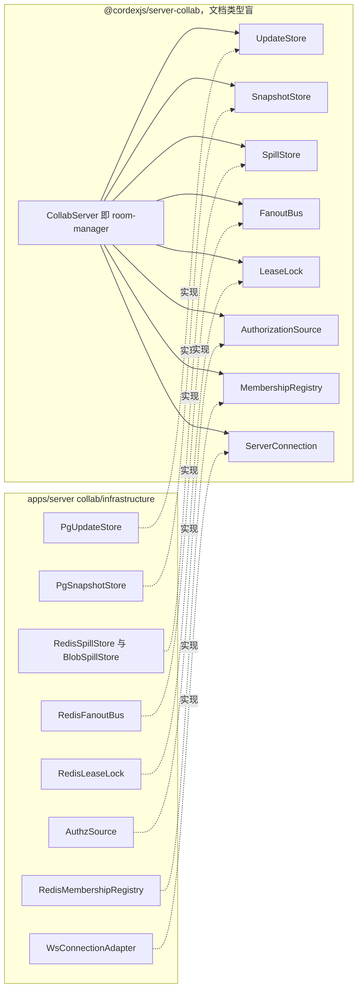
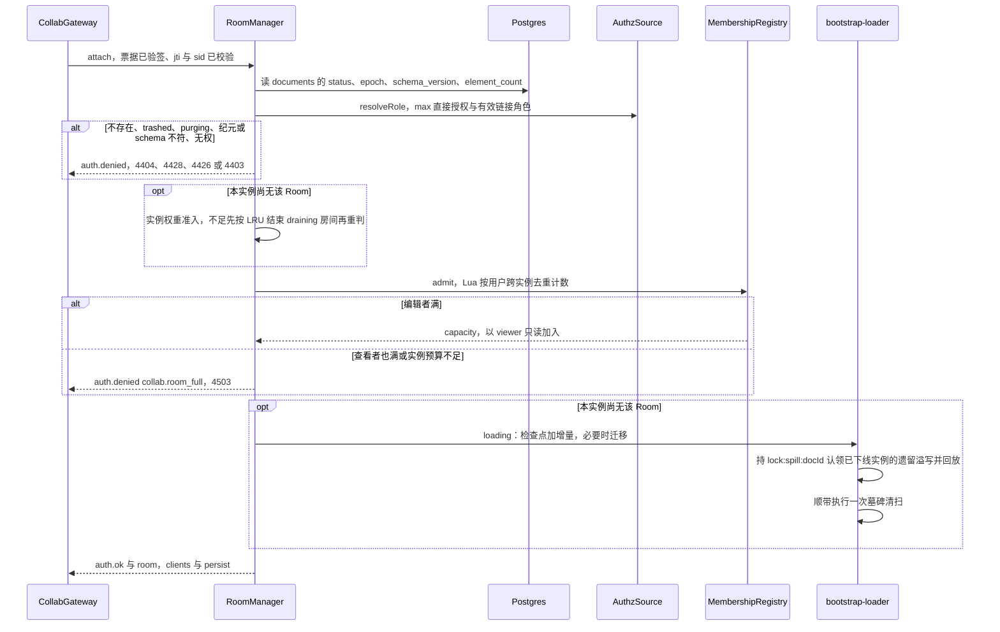
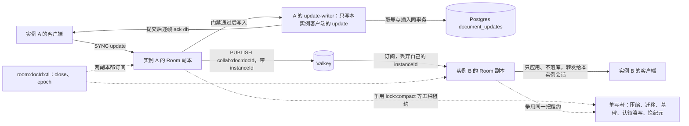
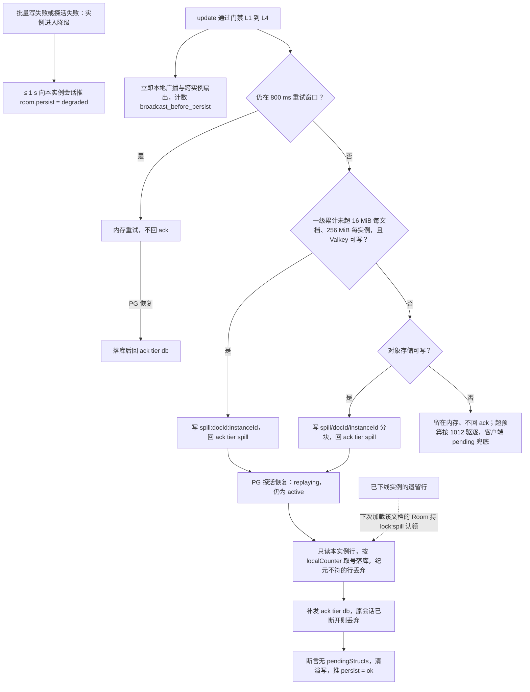
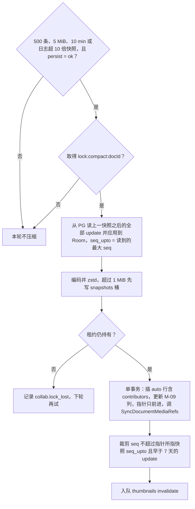
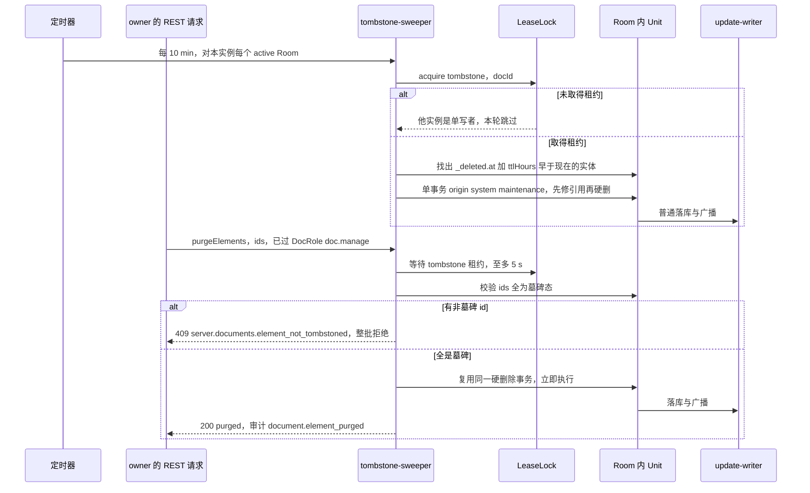
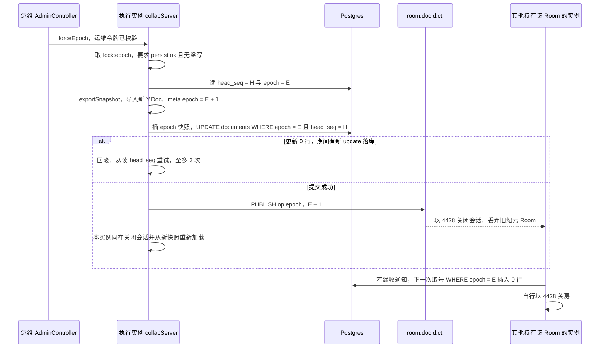
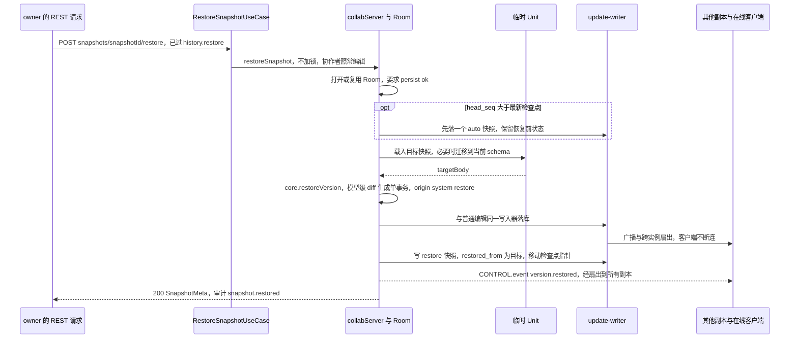

# 05 模块设计：协同与快照（含 server-collab 契约）
> 状态：v0.1 | 负责：后端设计线 | 更新：2026-09-25；2026-09-25（§4.19）；2026-09-25（§4.19 N1）；2026-09-26（§4.20） | 依赖：[30-architecture/06 协同](../30-architecture/06-collaboration.md) §5–§14；ADR-0023、0025、0029、0034、0035；[11 DDL：协同更新与版本快照](11-ddl-collab-updates-and-snapshots.md)；[14 键空间与保留](14-valkey-object-storage-and-retention.md)；[16 WS 协议（服务端视角）](16-ws-protocol-server-view.md)；40-modules/09；rulings §4.12 U-07、§4.13 S-2 / S-3、§4.15 Q3 / Q5 / S-3a、§4.18、§4.19（含 N1）

本文是服务端协同的唯一事实源：CollabModule 与 SnapshotsModule 的职责与装配、`@cordexjs/server-collab` 的契约、Room 在服务端的运行机制（准入、持久化、降级溢写、压缩、墓碑、迁移与换纪元）、快照 REST 的用例、永久删除参与者。帧与 CONTROL 的定义只在 30-architecture/06 §6 与 protocol 文件；服务端对帧的处理、门禁与关闭码见 [16](16-ws-protocol-server-view.md)；表结构见 [11](11-ddl-collab-updates-and-snapshots.md)；Valkey 键与对象键模板只引用 [14](14-valkey-object-storage-and-retention.md)；路由、守卫、错误码与审计名以 [15](15-rest-api-catalog.md) §3.7、§3.8 为准。包与文件级规划留在 40-modules/09。

**里程碑**（rulings §4.19 D-M2-CONTENT：协同后端提前到 M2，M2 起文档内容以协同快照为唯一事实源；逐项口径见 [01](01-service-overview-and-roles.md) §3）：M2 = 网关与门禁、Room 生命周期与准入、批量持久化与两级 ack、PG 降级溢写与回放（含 `room.persist`）、压缩与 `auto` 快照、墓碑 TTL 清扫、schema 迁移与换纪元、`GET snapshots/latest`、导入写 `import` 快照、永久删除参与者的 Pg 存储部分；M3 = 命名版本、版本列表与恢复（§10）、元素彻底删除（§8）、评论镜像挂点（§13）、在场的多人体验（awareness 中继本身随网关在 M2）。40-modules/09 的「M2 切片」即 M2 交付。

## 1. CollabModule

职责：把 `@cordexjs/server-collab`（文档类型盲的函数库 + cordis 插件，提供 `collabServer`）接到 Nest 与 IO 上。网关 `CollabGateway` 只做连接适配：WS 升级时的 Origin 白名单、按 IP 的升级令牌桶（先扣后退：升级前扣、票据验签通过退还）与实例连接上限、首帧 5 s 计时、票据校验（`TicketVerifier`）、每用户单实例并发上限（[16](16-ws-protocol-server-view.md) §1），校验通过后把连接交给 `collabServer.attach()`；房间、门禁、持久化全部在 server-collab 内。

**装配**（`CollabModule.forRole(role)`，矩阵唯一版本见 [01](01-service-overview-and-roles.md) §5）：

| 部件 | collab | worker | api / renderer |
|---|---|---|---|
| `CollabGateway`（`/collab/v1/rooms/:documentId`）、`TicketVerifier` | 装 | — | — |
| `ElementPurgeController`（`POST /documents/:id/elements/purge`，在 `CollabHttpModule`，M3） | 装 | — | — |
| server-collab 插件激活 `collabServer`；`tombstone-sweeper`、`compactor`、`replay-spilled` | 装 | — | — |
| 八个 IO 适配器（§2.2） | 全部 | 只有 `PgUpdateStore`、`PgSnapshotStore` | — |
| `PurgeCollabDataUseCase`（`@PurgeParticipant('collab')`，§12） | — | 装 | — |
| `PruneUpdatesUseCase`、`SnapshotsRetentionUseCase`（maintenance 周期作业的处理体，[11](11-ddl-collab-updates-and-snapshots.md) §8） | — | 装 | — |
| 导出 `SnapshotWriter`（= `PgSnapshotStore.put`）给 M-12 导入处理器 | — | 装 | — |
| `CommentMirrorObserver` 挂点注册（§13，实现归 [07](07-modules-comments-webhooks-audit.md)） | 装 | — | — |

- worker 装配不激活 `collabServer`、不建 Room，只依赖 `PgUpdateStore` / `PgSnapshotStore`（rulings §4.18 BE-13 / BE-15）：永久删除时 Valkey 的一级溢写键（`spill:{docId}:*` 与实例集合）连同 `spill/{docId}/` 对象由 finalize-purge 清除（[04](04-modules-documents-storage-media.md) §4.4、[14](14-valkey-object-storage-and-retention.md) §7），参与者不取单写者租约，停写靠关房、`purging` 拒绝加入与取号栅栏（04 §4.3 第 4 条）。
- `imports`：`CordisHostModule`、`ConfigModule`、`DbModule`（`cordex_app` 与 `cordex_system` 两个池）、`RedisModule`、M-08 `PermissionsModule`（`RoleResolverService`、`ResolveShareLinkUseCase`）、M-08 `AuthModule`（`SessionValidator`、`TicketVerificationKeys`）、M-08 `DocumentsModule`（`DocumentStateGuard`、`DocumentReader`，供元素彻底删除与快照路由，[04](04-modules-documents-storage-media.md) §2 表 2-2）、M-08 `MediaModule`（`SyncDocumentMediaRefsUseCase`、`PruneDetachedMediaLinksUseCase`，[04](04-modules-documents-storage-media.md) §7.4）。被 import 的都是只含 providers 的 `XxxModule`，不会带进对方的控制器（[01](01-service-overview-and-roles.md) §5 结构规则）；网关加入时读 `documents` 行仍在系统池内直接读（§3.1）。`SnapshotsModule` 同样以 import `DocumentsModule` 取状态守卫。

**collab 读取的配置键**（键名与默认值的唯一源是 [17](17-deployment-and-config.md)；下表为本模块用到的子集）：

| 键 | 默认 | 用途 |
|---|---|---|
| `collab.room.drainGraceMs` | 60000 | 最后一人离开后的宽限期 |
| `collab.room.maxEditors` / `maxViewers` | 20 / 50 | 名额，按用户计（§4） |
| `collab.room.memoryAdmissionPct` / `weightBytesPerElement` / `weightBudgetBytes?` | 75 / 14336 / 未设 | 实例权重准入（§4） |
| `collab.membership.heartbeatMs` / `staleMs` | 15000 / 60000 | 名额登记刷新与过期（决策 C-11） |
| `collab.persist.flushMs` / `batchMax` / `persistBeforeBroadcast` / `retryWindowMs` | 100 / 50 / true / 800 | 批量写与 PG 抖动重试窗口（§5、§6） |
| `collab.persist.probeIntervalMs` | 1000 | 降级期 PG 探活 |
| `collab.compaction.maxPendingUpdates` / `maxPendingBytes` / `maxAgeMs` / `maxLogToSnapshotRatio` | 500 / 5 MiB / 600000 / 10 | 压缩触发（§7） |
| `quota.namedSnapshotsPerDoc` | 200 | 命名版本上限（rulings §4.19 C-06） |
| `collab.softGate.mode` / `schemaMode`；`collab.repair.quarantineThreshold` / `windowMs` | repair / report-only；5 / 600000 | 软门禁（[16](16-ws-protocol-server-view.md) §4） |
| `spill.tier1MaxBytesPerDoc` / `tier1MaxBytesPerInstance` / `tier2ChunkBytes` | 16 MiB / 256 MiB / 4 MiB | 两级溢写（决策 SPILL，M2 自托管 runner 压测校准，只收紧） |
| `tombstone.ttlHours` / `tombstone.sweepIntervalMs` | 24 / 600000 | 墓碑硬删除（§8） |
| `retention.updatesDays` / `autoSnapshotDays` / `autoSnapshotDailyDays` | 7 / 30 / 365 | 保留（[11](11-ddl-collab-updates-and-snapshots.md) §8） |
| `limits.*` | 见 [16](16-ws-protocol-server-view.md) §13 | 帧、速率、awareness |

## 2. server-collab 契约

### 2.1 签名

签名以本节为准（文件落点 `packages/server-collab/src/domain/contracts/*.ts` 与 `interface/contracts/connection.ts`，见 40-modules/09 §4.4）。全部 IO 经 Definition 注入，包本身不依赖 `pg`、`ioredis`、`@aws-sdk`。

```ts
interface CollabServer {
  attach(conn: ServerConnection, claims: CollabPrincipal): Promise<Result<RoomSession, JoinDenied>>
  drainAll(reason: 'shutdown'): Promise<void>
  getRoomStats(docId: RoomId): RoomStats | undefined
  closeRoom(docId: RoomId, reason: 'purge' | 'trashed'): Promise<void>            // purge 不再持久化；trashed 先 flush
  compactNow(docId: RoomId): Promise<void>
  migrateNow(docId: RoomId): Promise<void>
  forceEpoch(docId: RoomId, actor: ActorRef): Promise<Result<{ epoch: number }, EpochError>>
  purgeElements(docId: RoomId, ids: readonly NodeId[], actor: ActorRef): Promise<Result<NodeId[], PurgeError>>
  createNamedSnapshot(docId: RoomId, input: NamedInput, actor: ActorRef): Promise<Result<SnapshotMeta, SnapshotError>>
  restoreSnapshot(docId: RoomId, id: SnapshotId, actor: ActorRef): Promise<Result<RestoreResult, SnapshotError>>
  onPersisted(listener: (batch: PersistedBatch) => void): Disposable                 // §13 挂点
}
interface UpdateStore {
  append(docId: RoomId, epoch: number, rows: readonly UpdateRow[]): Promise<Result<Seq[], 'purging' | 'epoch_changed'>>
  loadSince(docId: RoomId, afterSeq: Seq): AsyncIterable<StoredUpdate>
  contributors(docId: RoomId, afterSeq: Seq, uptoSeq: Seq): Promise<UserId[]>
  pruneBefore(docId: RoomId, uptoSeq: Seq, olderThan: Date): Promise<number>
  purgeAll(docId: RoomId): Promise<void>
}
interface SnapshotStore {
  latest(docId: RoomId): Promise<SnapshotMeta | undefined>
  put(docId: RoomId, input: SnapshotInput): Promise<Result<SnapshotMeta, 'purging' | 'epoch_changed' | 'named_limit'>>
  get(id: SnapshotId): Promise<SnapshotBody | undefined>
  list(docId: RoomId, page: { kind?: SnapshotKind; cursor?: string; limit: number }): Promise<Page<SnapshotMeta>>
  purgeAll(docId: RoomId): Promise<void>
}
interface SpillStore {                                   // SpillRow = { instanceId, localCounter, epoch, update, userId?, sessionId?, clientId }
  writeTier1(docId: RoomId, rows: readonly SpillRow[]): Promise<void>
  writeTier2(docId: RoomId, chunk: Uint8Array, range: [SpillKey, SpillKey]): Promise<void>
  readAllOrdered(docId: RoomId, instanceId: string): AsyncIterable<SpillRow>
  listInstances(docId: RoomId): Promise<string[]>
  clear(docId: RoomId, instanceId: string): Promise<void>
}
interface FanoutBus {
  publish(docId: RoomId, msg: { instanceId: string; frame: Uint8Array }): Promise<void>
  subscribe(docId: RoomId, handler: (msg: FanoutMessage) => void): Disposable
  publishControl(docId: RoomId, msg: RoomControl): Promise<void>
  subscribeControl(docId: RoomId, handler: (msg: RoomControl) => void): Disposable
}
interface LeaseLock { acquire(purpose: 'compact' | 'migrate' | 'tombstone' | 'spill' | 'epoch', docId: RoomId, ttlMs: number): Promise<Lease | null> }
interface AuthorizationSource {
  resolveRole(docId: RoomId, p: CollabPrincipal): Promise<{ role: Role | 'none'; linkExpiresAt?: number; locked: boolean }>
  onPermissionChanged(docId: RoomId, cb: (permVersion: number) => void): Disposable
}
interface MembershipRegistry {
  admit(docId: RoomId, userId: UserId, role: Role): Promise<SeatDecision>          // §4 Lua
  leave(docId: RoomId, userId: UserId): Promise<void>
  heartbeat(): Promise<void>
  count(docId: RoomId): Promise<number>
  isInstanceAlive(instanceId: string): Promise<boolean>
}
type RoomControl = { op: 'close' | 'epoch'; docId: RoomId; reason: string; epoch?: number; fromInstanceId: string }
```

- `ServerConnection` 契约不变（`id`、`remote{ip, ua}`、`send(frame)`、`close(code, reason)`、`onFrame`、`onClose`），由 `WsConnectionAdapter` 把 `ws.WebSocket` 适配过来。`Lease` 为 `{ token: bigint; renew(); release(); stillHeld(): Promise<boolean> }`，`token` 取自 `lock:fence:{purpose}:{docId}` 的单调计数。
- `UpdateStore.append` 与 `SnapshotStore.put` 把 [11](11-ddl-collab-updates-and-snapshots.md) §5 的取号栅栏暴露为返回值：`purging` 与 `epoch_changed` 是正常结果、不是异常，调用方据此关闭房间（4404 / 4428）。
- `RoomControl` 只有 `close` 与 `epoch` 两种操作，载荷与键模板登记在 [14](14-valkey-object-storage-and-retention.md) §3；不设按用户踢人的操作——停用、擦除、登出对 WS 的作用统一由每 5 s 的批量会话复核以 4401 实现（[02](02-auth-chain.md) §9.5）。`SpillStore` 不提供整文档清除：永久删除时的溢写键由 finalize-purge 清（§12）。
- `MembershipRegistry` 是 40-modules/09 七个适配器之外新增的第八个 Definition：名额的跨实例原子判定（决策 C-11）与实例心跳 `instance:{instanceId}:alive` 需要一个独立的 Valkey 适配器，不宜塞进扇出或租约。

### 2.2 IO 适配器（物理落点 `apps/server/src/modules/collab/infrastructure/`）

| 适配器 | 实现 | 依赖 | 用到的键或表 | 契约套件（运行方式见 [70/02](../70-testing/02-contract-suites-and-pluggability.md)） |
|---|---|---|---|---|
| `PgUpdateStore` | `UpdateStore` | Drizzle，`cordex_system` 池 | `document_updates`、`documents` | `runUpdateStoreConformance` |
| `PgSnapshotStore` | `SnapshotStore` | Drizzle、`BlobStore`（`snapshots` 桶） | `document_snapshots`、`documents` | `runSnapshotStoreConformance` |
| `RedisSpillStore` | `SpillStore` 一级 | ioredis | `spill:{docId}:{instanceId}`、`spill:{docId}:instances` | `runSpillStoreConformance` |
| `BlobSpillStore` | `SpillStore` 二级 | `BlobStore`（`data` 桶） | `spill/{docId}/{instanceId}/{from}-{to}.bin` | 同上 |
| `RedisFanoutBus` | `FanoutBus` | ioredis（订阅与命令连接分离） | 频道 `collab:doc:{docId}`、`room:{docId}:ctl` | `runFanoutBusConformance` |
| `RedisLeaseLock` | `LeaseLock` | ioredis（`SET NX PX` + fencing） | `lock:{purpose}:{docId}`、`lock:fence:{purpose}:{docId}` | `runLeaseLockConformance` |
| `AuthzSource` | `AuthorizationSource` | M-08 `RoleResolverService`、`ResolveShareLinkUseCase`；ioredis 订阅 | 频道 `perm:doc:{docId}`、`perm:ver:{docId}` | 由 `runCollabServerConformance` 覆盖 |
| `RedisMembershipRegistry` | `MembershipRegistry` | ioredis + Lua | `room:{docId}:members`、`instance:{instanceId}:alive` | 由 `runCollabServerConformance` 覆盖（准入原子性） |

两个溢写适配器合组实现同一个 `SpillStore`（一级方法走 Valkey、二级方法走对象存储），装配层注入组合实例。键模板一律带全局前缀 `valkey.keyPrefix`（默认 `cordex:`），模板只由 `collab/domain/redis-keys.ts` 生成。

**图 5-1 server-collab 契约与 IO 适配器**



怎么读：左框是包内契约，实线表示 `CollabServer` 依赖（注入）这些 Definition；右框是 Nest 模块目录下的 Node 适配器，虚线「实现」表示它提供左侧契约。包内不出现任何驱动，驱动只在右框（R5 `third-party-single-entry`）。

依据：40-modules/09 §2.5、§3.4、§4.4；30-architecture/08 §14 S7；决策 C-11、KEYS。

## 3. Room 生命周期

状态机以 30-architecture/06 §5.2 的七态图为唯一照抄源（`loading`、`active`、`draining`、`evicting`、`persisting`、`closed`、`failed`，rulings §4.18 CO-13），本文不另画；下表写每个状态在服务端的机制。

| 状态 | 进入条件 | 服务端机制 | 离开 |
|---|---|---|---|
| `loading` | 准入通过且本实例没有该文档的 Room（§4） | bootstrap（[11](11-ddl-collab-updates-and-snapshots.md) §6）→ 必要时迁移（§9）→ 认领已下线实例的遗留溢写（§6.4）→ 顺带执行一次墓碑清扫（§8）；span `server.room.load`，8 MB 状态 p95 ≤ 500 ms | 成功 → `active`；出错 → `failed` |
| `active` | bootstrap 完成 | 会话进出、门禁、批量持久化（§5）、压缩（§7）、awareness 中继；持久化子状态 `persist ∈ ok / degraded`、`spillTier ∈ none / valkey / blob`、`replaying`，均不离开 `active`（CO-15） | 最后一人离开 → `draining`；停机或驱逐 → `evicting` |
| `draining` | 最后一个会话离开 | 宽限 `drainGraceMs`（60 s）内保持内存与持久化；准入不足或内存压力时按 LRU 提前结束，不发 1012（CO-14） | 有人加入 → `active`；到期或提前结束 → `persisting` |
| `evicting` | SIGTERM；或回收空闲房间后仍超预算 | 向会话发 1012（客户端首轮不退避，≤ 5 s 连到其他实例） | → `persisting` |
| `persisting` | 宽限到期、驱逐或停机 | flush 批量写；需要时压缩；PG 不可达则把内存档强制写入一级溢写，不在此久等（CO-16） | → `closed` |
| `closed` / `failed` | — | 释放 Unit 与订阅、`MembershipRegistry.leave`；`failed` 时加入请求收 4503（`collab.bootstrap_failed`），客户端退避重试 | 结束 |

### 3.1 加入房间

票据校验（验签、`jti`、`sid`、`permVersion`，[16](16-ws-protocol-server-view.md) §1、§3）通过后，网关先退还 IP 升级令牌并判每用户单实例并发上限（超限 `auth.denied{collab.rate_limited}` + 4429，16 §1），再调 `attach`；`attach` 按以下顺序执行，任一步拒绝都先回 `auth.denied{code}` 再按码关闭：

1. 读 `documents` 行（系统作业名 `collab.gateway`，[08](08-db-conventions-roles-rls-migrations.md) §6.5）：不存在或 `trashed` → `collab.doc_not_found`（4404）；`purging` → `collab.doc_purging`（4404，rulings §4.18 BE-15）；`locked`（覆盖导入或迁移窗口）→ 角色封顶为 `viewer`（L2 拒写，ADR-0029 决策 5，2026-09-25 按 rulings §4.19 N1 收窄，版本恢复不加锁）；客户端声明的纪元与 `documents.epoch` 不符 → `collab.epoch_changed`（4428）；文档 `schema_version` 高于客户端支持 → `collab.schema_too_new`（4426）。
2. `AuthorizationSource.resolveRole`：取 max(直接授权, 票据 `lnk` 对应链接此刻的有效角色)，`none` → `collab.forbidden`（4403）；记录 `linkExpiresAt`（rulings §4.18 BE-02）。
3. 本实例没有该 Room 时做**实例权重准入**（§4.1），不足先按 LRU 结束 `draining` 房间再重判，仍不足 → `collab.room_full`（4503，客户端重连到其他实例）。
4. **名额准入**：`MembershipRegistry.admit`（§4.2 Lua），编辑者满 → 以 `viewer` 只读加入并带 `reason:'capacity'`；查看者也满 → `collab.room_full`（4503）。名额先于 `loading` 登记，bootstrap 失败时撤销登记。
5. 本实例没有该 Room → 进入 `loading`（§3 表）；已有 Room 直接挂会话。
6. 回 `auth.ok{sessionId, role, serverSeq = head_seq, schemaVersion, limits, serverTime, reason?}`（`reason` 取 `capacity` 或 `over_ceiling`，§4），随后发 `room{clients, persist, locked?}`；审计 `collab.join`（同用户同文档合并，登记见 [07](07-modules-comments-webhooks-audit.md)）。

**图 5-2 加入房间**



怎么读：纵线是服务端内部参与方，客户端在 `G` 左侧未画；自上而下是时间。两个 `alt` 只画拒绝或降级分支，未命中时继续往下；两个 `opt` 只在本实例还没有该文档的 Room 时执行，所以已有 Room 的加入只判名额、不做权重准入与 bootstrap（rulings §4.18 CO-17）。

依据：30-architecture/06 §5.2、§6.3、§14；ADR-0029 决策 5；rulings §4.18 BE-02、BE-15、CO-14、CO-16、CO-17。

### 3.2 内容事实源与首次加载

自 M2 起文档内容只以协同快照 + `document_updates` 为事实源，服务端不保存也不提供 pptx「内容版本」（rulings §4.19 D-M2-CONTENT）。文档内容的来路只有三条，都在加载前写好检查点：

| 来路 | 首个检查点 | 首次加载 |
|---|---|---|
| 导入 pptx、新建空白或从模板新建（空白与模板以内置模板字节走同一导入路径） | 导入处理器经 `SnapshotStore.put` 写 `kind='import'` 快照并移动指针（[06](06-modules-jobs-import-export-thumbnails.md) §6.4） | 普通 bootstrap：`GET snapshots/latest` 取检查点字节 → 票据 → WS 同步增量 |
| 创建副本 | 同上，由源文档已落库状态生成（[06](06-modules-jobs-import-export-thumbnails.md) §6.6） | 同上 |
| `POST /documents` 直接建空文档（API 与测试用） | 无，`latest_snapshot_id` 为空 | `snapshots/latest` 回 404 `server.snapshots.not_found`，客户端以空文档开始、经 WS 同步；第一次压缩写出首个 `auto` 快照 |

加载不再等待任何导入作业，`loading` 只做 bootstrap、迁移、遗留溢写认领与墓碑清扫（§3 表）。

### 3.3 控制频道

每个持有 Room 的实例订阅 `room:{docId}:ctl`（[14](14-valkey-object-storage-and-retention.md) §3），载荷 `RoomControl`（§2.1），按 `op` 与 `reason` 处理：

| `op` | 发布方 | 收到后的动作 |
|---|---|---|
| `close`，`reason:'purge'` | worker 上的 document-purge 处理器第一步（[04](04-modules-documents-storage-media.md) §4） | 以 4404（`collab.doc_purging`）关闭本实例该文档的全部会话，丢弃 Room，不再持久化 |
| `close`，`reason:'trashed'` | M-08 移入回收站后（尽力而为） | 以 4404（`collab.doc_not_found`）关闭会话，先 flush 再关闭 Room（回收站可恢复） |
| `epoch` | `forceEpoch` 执行实例（`reason:'admin'`）；worker 上的导入处理器在覆盖导入提交后（`reason:'import'`，§9.2、[06](06-modules-jobs-import-export-thumbnails.md) §6.5，rulings §4.19 N1） | 以 4428（`collab.epoch_changed`）关闭会话，丢弃旧纪元 Room，不持久化；`reason` 只进日志与 `room-closed` 事件 |

频道是尽力而为的通知，正确性不依赖它：永久删除与换纪元（含覆盖导入）都有数据库栅栏兜底（[11](11-ddl-collab-updates-and-snapshots.md) §5 的取号语句在 `purging` 或纪元变化后插入 0 行，写入方据此自行关房）。控制频道只有 `close` 与 `epoch`：会话吊销由每 5 s 一次的批量复核实现（§3.4），文档锁定与解锁经权限频道 `perm:doc:{docId}` 的 `lockChanged` 通知，由 `AuthzSource` 重读 `documents.status` 后推 `room{locked}`（[16](16-ws-protocol-server-view.md) §8）。

### 3.4 会话有效期

会话寿命绑定票据 `sid` 指向的登录会话、每 5 s 批量复核、`auth.refresh` 只重新绑定不延长，唯一源是 [02](02-auth-chain.md) §9.5（决策 INC-27、SESSION）；本模块只负责执行：复核失败时以 4401 关闭本实例上的对应会话。停用、擦除、登出对 WS 的作用都经这条复核在 ≤ 5 s 内生效，不按房间点名踢人（决策 SESSION 的实现细化，效果不变）。

## 4. 容量与准入

### 4.1 实例权重准入

- 房间权重 = `documents.element_count`（墓碑计入）× `weightBytesPerElement`（14336 B，实测约 13.8 KB 堆/元素；D200 ≈ 85 MB，天花板 20,000 元素 ≈ 276 MB），准入时直接取库列，不需预加载（CO-17）。
- 实例内存预算 = 容器内存上限（cgroup 限额，`process.constrainedMemory()`，无限额取物理内存）× `memoryAdmissionPct`（75）；`weightBudgetBytes` 若设置则作绝对覆盖（rulings §4.18 BE-29）。准入条件：已开房间权重之和 + 进行中的准入预留 + 新房间权重 ≤ 预算。同一文档在 N 个实例上各占一份（ADR-0035）。
- 不足时先按 LRU 提前结束 `draining` 房间（无在线会话、不发 1012）再重判；仍不足 → 4503。已开房间因编辑增长导致超预算时，内存压力回收同样先结束 `draining`、再按 LRU 驱逐 `active`（`evicting`，1012）；没有 `draining → evicting` 这条边（CO-14）。
- `element_count` 已超过 `scale.maxElementsPerDoc`（部署调低天花板后才会出现）的文档只读打开（`auth.ok.reason:'over_ceiling'`，与编辑者名额满的 `capacity` 分开，客户端提示不同），不接纳写入。

### 4.2 名额：跨实例原子判定

名额按用户计：同一用户多标签页、多设备只占一个名额；`owner` 不占编辑者名额、满员时也不降级；`commenter` 计入查看者名额但角色仍是 commenter（可写评论）；`editor` 在编辑者满时降为只读查看者（rulings §4.15 Q5）。跨实例的计数与登记由一个 Lua 脚本在 `room:{docId}:members` 上原子完成（决策 C-11；不用 `HEXPIRE`，因为 ADR-0022 只要求 Redis ≥ 7.2 协议）。

- 键：`room:{docId}:members` 为 hash，field = `instanceId`，value = `{"owners":[…],"editors":[…],"viewers":[…],"ts":<ms>}`（比决策 C-11 原文多一个 `owners` 列表，只用于在线人数，不参与名额；[14](14-valkey-object-storage-and-retention.md) §3、§4 已按本节登记，脚本文本与 ARGV 顺序以本节为准）。
- 本实例对自己 field 的全部写入（准入、离开、心跳）经 `RedisMembershipRegistry` 内按文档串行的队列发出，所以离开与心跳用普通 `HSET` 覆盖自己的 field 即可，只有准入需要脚本。
- 心跳：每 15 s 刷新本实例全部 field 的 `ts` 并 `PEXPIRE` 整个 hash 120 s，同时 `SET instance:{instanceId}:alive 1 PX 60000`；脚本剔除 `ts` 超过 60 s 的 field（崩溃实例的名额最多占 60 s）。
- `room{clients}` 的权威人数 = 三个列表的去重用户数，随心跳（≤ 15 s）刷新；实时的头像与光标来自 awareness，不等这个数。

```lua
-- admit.lua  KEYS[1] = <prefix>room:{docId}:members
-- ARGV: 1 instanceId, 2 nowMs, 3 staleMs, 4 userId, 5 role(owner|editor|commenter|viewer), 6 maxEditors, 7 maxViewers
local now, stale = tonumber(ARGV[2]), tonumber(ARGV[3])
local uid, role = ARGV[4], ARGV[5]
local owners, editors, viewers, nE = {}, {}, {}, 0
local mine = { owners = {}, editors = {}, viewers = {}, ts = now }
local raw = redis.call('HGETALL', KEYS[1])
for i = 1, #raw, 2 do
  local v = cjson.decode(raw[i + 1])
  if now - (v.ts or 0) > stale then
    redis.call('HDEL', KEYS[1], raw[i])
  else
    if raw[i] == ARGV[1] then mine = v end
    for _, u in ipairs(v.owners or {}) do owners[u] = true end
    for _, u in ipairs(v.editors or {}) do if not editors[u] then editors[u] = true; nE = nE + 1 end end
    for _, u in ipairs(v.viewers or {}) do viewers[u] = true end
  end
end
local nV = 0
for u in pairs(viewers) do if not editors[u] and not owners[u] then nV = nV + 1 end end
local seat
if role == 'owner' then seat = 'owners'
elseif role == 'editor' and (editors[uid] or nE < tonumber(ARGV[6])) then seat = 'editors'
elseif viewers[uid] or editors[uid] or nV < tonumber(ARGV[7]) then seat = 'viewers'
else return { 'full', nE, nV } end
local list = mine[seat] or {}
local present = false
for _, u in ipairs(list) do if u == uid then present = true end end
if not present then table.insert(list, uid) end
mine[seat] = list
mine.ts = now
redis.call('HSET', KEYS[1], ARGV[1], cjson.encode(mine))
redis.call('PEXPIRE', KEYS[1], stale * 2)
local decision = seat
if role == 'editor' and seat == 'viewers' then decision = 'capacity' end
return { decision, nE, nV }
```

Valkey 内置的 cjson 把空列表编码成 `{}`（对象）而不是 `[]`（Valkey 8 实测）；Node 侧读取该值的代码（心跳覆盖、在线人数聚合）须把 `{}` 与 `[]` 都当作空列表解码。

| 返回 `decision` | 会话结果 |
|---|---|
| `owners` | 以 owner 加入，不占名额 |
| `editors` | 以 editor 加入（同一用户已在任一实例以编辑者在线时不新占名额） |
| `viewers` | 以原角色（commenter 或 viewer）加入，占查看者名额 |
| `capacity` | editor 降为只读 viewer，`auth.ok.reason = 'capacity'`；会话期间不自动升回，重连时重新判定 |
| `full` | `auth.denied{collab.room_full}`，关闭 4503 |

依据：决策 C-11；rulings §4.15 Q5、§4.18 CO-14 / CO-17；30-architecture/06 §14、ADR-0035 修订 2026-09-24 第 4 条。

## 5. 持久化与跨实例扇出

- **批量写**：`update-writer` 把通过门禁（[16](16-ws-protocol-server-view.md) §4）的 update 按「100 ms 或 50 条先到者」攒批，一个事务取号并插入（[11](11-ddl-collab-updates-and-snapshots.md) §5），提交后逐帧回 `ack{seq, tier:'db'}`；ack 的完整规则（含 step2 空差量）见 [16](16-ws-protocol-server-view.md) §5。软门禁产生的修复事务、墓碑硬删除、恢复与迁移事务都走同一个写入器，`user_id` 为发起者或 NULL。
- **先落库后广播**：`persistBeforeBroadcast = true` 只约束 PG 可用时的顺序（持久化滞后 p99 ≤ 1 s、正常 p95 ≈ 150 ms）；PG 写失败即进入降级期，见 §6。
- **只持久化本实例客户端的 update**：跨实例扇入的 update 只应用、只转发，不落库（ADR-0035 决策 3）；因此同一内容至多一个实例写一行。
- **单写者任务**经 `LeaseLock` 选举：`compact`、`migrate`、`tombstone`、`spill`（认领遗留溢写）、`epoch` 五种用途，键 `lock:{purpose}:{docId}`，默认租期 30 s、每 10 s 续租；租约丢失只记录 `collab.lock_lost`，下一轮再试。压缩与墓碑清扫即使被两个实例各执行一次也只多一行快照或一个空事务，不破坏正确性；迁移与换纪元另有数据库唯一索引与取号栅栏兜底。

**图 5-3 跨实例扇出、本实例持久化与单写者租约**



怎么读：实线是一次编辑从 A 的客户端到库与到 B 的客户端的路径；B 对 A 的扇出对称，图中省略。虚线是协调关系：两副本争用同一把租约，只有持锁者执行单写者任务；控制频道向所有副本广播关闭与换纪元。

依据：ADR-0035 决策 2–5；30-architecture/08 §8；决策 KEYS、C-12（锁键统一）。

## 6. PG 故障降级

降级期的四条规则来自裁决：通过门禁即广播、不等持久化（rulings §4.18 CO-08）；溢写成功只回 `ack{tier:'spill'}`，落库后才回 `tier:'db'`（S-3a）；Room 全程 `active`、在线客户端不断连（CO-15）；只回放本实例的溢写行，已下线实例的遗留行由下次加载该文档的 Room 认领（CO-16）。

### 6.1 进入降级与 persist 信号

依据：rulings §4.19 INC-09（服务端显式信号 + 分级受众，已定稿）。

- 触发：任一批量写因连接错误、超时或 PG 只读而失败，或降级探活（`probeIntervalMs` 1 s，只在本实例有活跃 Room 时运行）失败。实例级标记 `pgDegraded = true`。
- 服务端显式信号：`CONTROL.room` 增可选字段 `persist: 'ok' | 'degraded'`（帧定义在 30-architecture/06 §6.3，不新增帧类型）。房间的 `persist` = `degraded` 当且仅当 `pgDegraded` ∨ `spillTier ≠ none` ∨ `replaying` ∨ 房间内有未落库的内存档；只在变化时推送：PG 写失败后 ≤ 1 s 推 `degraded`，回放完成且无溢写后推 `ok`。加入时的第一帧 `room` 带当前值。
- 受众分级在客户端（[50/07](../50-frontend/07-collaboration-client.md)）：判据 = `room.persist === 'degraded'` ∨ 在途含仅获 spill 确认的项 ∨ 最老在途 ≥ `unsavedWarnAfterMs`（collab-yjs 配置，默认 15000）；有本地未获 db 确认项的发起方显示横幅「未保存到服务器 N 项」，其余协作者在状态胶囊显示弱提示「服务器保存延迟」。服务端只负责按上条规则推 `persist`，不按会话区分受众。
- 每个实例独立判断自己的 PG 连接并推给自己的会话；因为各实例共用同一个 PG，没有本地写入的实例也会在一个探活周期内进入降级，因此只看到他人修改的协作者同样收到信号。
- 指标 `cordex_collab_broadcast_before_persist_total{tier}` 计降级广播次数，名称以 [18](18-observability-and-ops-endpoints.md) 为准。

### 6.2 档位与阈值

| 档位（`spillTier`） | 进入条件 | 写到哪里 | 对客户端 |
|---|---|---|---|
| `none` | PG 写失败，仍在 `retryWindowMs`（800 ms）重试窗口内 | 内存批次，按 100 → 800 ms 退避重试 | 不回 ack（PG 恢复则直接回 `db`） |
| `valkey` | 重试窗口用尽 | `spill:{docId}:{instanceId}`（list，行 = `SpillRow`），并把 `instanceId` 记入 `spill:{docId}:instances` | 每帧写成功后回 `ack{tier:'spill'}` |
| `blob` | 本文档一级溢写累计 > `spill.tier1MaxBytesPerDoc`（16 MiB），或本实例一级溢写累计 > `tier1MaxBytesPerInstance`（256 MiB），或 Valkey 写失败 | `data` 桶 `spill/{docId}/{instanceId}/{from}-{to}.bin`，每个 flush 周期写一块，单块 ≤ `tier2ChunkBytes`（4 MiB） | 同上 |

- 溢写行不分配 seq，临时键 `(instanceId, localCounter)`，行内带写入时的 `epoch`（S-3a；纪元在回放时用作栅栏）。三个阈值是 M2 前落地的自托管专用 runner 上压测校准前的初值，只收紧（决策 SPILL；rulings §4.19 D-TEST-INFRA）。
- 三档都失败（PG、Valkey、对象存储同时不可用）：update 留在内存、照常广播、不回任何 ack；持久性由发起方的 pending 兜底。内存超预算时走普通的内存压力回收（§4.1，`evicting` 发 1012），客户端带着未获 db 确认的 pending 重连到其他实例，NF-03「已 ack(db) 零丢失」不受影响。
- 降级期间软门禁照常在服务端 Unit 上执行，修复事务与普通 update 一起进入溢写（ADR-0034 修订 2026-09-24 第 2 条）；回放时不重跑软门禁。

### 6.3 回放

PG 探活成功 → 对每个有溢写的 Room 置 `replaying = true`（仍是 `active`）→ `readAllOrdered(docId, 本实例 instanceId)` 按 `localCounter` 升序 → 按批经同一取号语句落库（正式 seq 此时由 PG 分配；行内纪元与当前纪元不符的行丢弃并计数，其发起者已被 4428 关闭）→ 每批提交后给原会话补发 `ack{seq, tier:'db'}`，原会话已断开则丢弃（客户端重连 step2 兜底，CO-10）→ 回放期间新到的 update 排在回放队列之后落库，保持同一连接上 db ack 的顺序（CO-15）→ 断言服务端 Y.Doc 无 `pendingStructs` → `clear(docId, instanceId)` → `replaying = false` → 推 `persist:'ok'`。预算：PG 恢复到回放完成 p95 ≤ 10 s（D50 级溢写窗口），span `server.collab.replay_spilled`（名表见 [18](18-observability-and-ops-endpoints.md)）。

### 6.4 遗留行认领与关闭时的兜底

- 认领：Room bootstrap 之后读 `spill:{docId}:instances`，对 `instance:{id}:alive` 已过期的每个实例，持 `lock:spill:{docId}` 读出其行、应用到 Room（这些内容可能从未落库）并按 §6.3 落库，然后清除；存活实例的行一律不碰（CO-16）。
- 关闭兜底：`persisting` 或 SIGTERM 时 PG 不可达，把内存档强制写入一级溢写（Valkey 也不可达则写二级）再进入 `closed`，不在 30 s 停机预算里久等（ADR-0035 决策 9）。

**图 5-4 PG 故障降级期的广播、信号、溢写与回放**



怎么读：上方两个起点并行——左边是实例级的降级信号，右边是每个 update 的处理；菱形按顺序选档位。实线是主路径，虚线是遗留行的认领兜底。只有 `tier db` 的 ack 让客户端清理 pending；三档都不可写时不回 ack、只靠客户端 pending 兜底。

依据：rulings §4.13 S-3、§4.15 S-3a、§4.18 CO-08 / CO-15 / CO-16；ADR-0025 决策 1、8 与修订 2026-09-25；ADR-0035 决策 9；决策 INC-09、SPILL。

## 7. 压缩与版本保留

**触发**（任一满足，且自上次快照后有新 update；ADR-0025 决策 3 与补充 v0.2）：待压缩 update ≥ 500 条；或 ≥ 5 MiB；或距上次快照 ≥ 10 min；或该文档 update 日志 ≥ 10 × 最新快照大小（NF-10）。只在 `persist = ok` 时执行。

压缩只在持有 Room 的 collab 实例内执行（下面第 1 步的补齐依赖本实例 Room），不设 `compaction` 委托队列（[06](06-modules-jobs-import-export-thumbnails.md) §1；用户偏好「不要过度设计」）。

**步骤**（持 `lock:compact:{docId}`，作业名 `collab.compact`）：

1. **补齐**：从 PG 读 `(上一快照.seq_upto, head]` 的全部 update 并应用到本实例 Room（幂等），`seq_upto` 取本次读到的最大 seq。这一步是多副本下的正确性前提：别的实例刚落库、还没经扇出到达本实例的 update，如果不先补齐就把 `head_seq` 写成 `seq_upto`，随后的裁剪会删掉快照里没有的内容。本实例尚未落库的内存档或溢写内容会被一并编码进快照，这对 CRDT 无害（它们回放时 seq 必然大于 `seq_upto`）。
2. `encodeStateAsUpdateV2` + zstd；≤ 1 MiB 内联，否则先写 `snapshots` 桶 `docs/{docId}/snapshots/{snapshotId}.yup2.zst`。写对象前复查 `documents.status`，`purging` 即放弃本轮（永久删除进行中，[04](04-modules-documents-storage-media.md) §4.3 第 4 条；竞态中写出的对象由 finalize-purge 第二遍列举清除）。
3. 单事务：插入 `kind='auto'` 行（`contributors` 取 [11](11-ddl-collab-updates-and-snapshots.md) §8 的 e6）→ 更新 `documents` 的 M-09 列（`schema_version`、`element_count`、`slide_count`、`size_bytes`、`content_updated_at`，决策 C-03），`latest_snapshot_id` 按 11 §3 的 e8「只前进」条件移动 → 调用 MediaModule 的 `SyncDocumentMediaRefsUseCase`，按新快照的媒体引用集合（文档类型提供的 `BlobRef` 枚举，文档类型盲）维护 `document_media.detached_at`（决策 C-25；用例与 SQL 见 [04](04-modules-documents-storage-media.md) §7.4、[10](10-ddl-documents-marks-media.md)）。写行前校验租约 `stillHeld()`，失效则只记录不提交。写 `named`、`import`、`migration`、`restore`、`epoch` 快照的事务同样调用该用例（04 §7.4「写任何快照」）。
4. 提交后就地裁剪：删 `seq ≤ 检查点指针所指快照.seq_upto` 且早于 `retention.updatesDays` 的行（11 §8 的 e5）。
5. 提交后入队 `thumbnails` 作业 `invalidate {docId, snapshotId}`（jobId `thumbinv-{docId}-{snapshotId}`，[06](06-modules-jobs-import-export-thumbnails.md) §1、§11.1；collab 的 producer 部件，[01](01-service-overview-and-roles.md) §5）；这一步随服务端缩略图在 M3 前半段启用，M2 只有导入写入的包内封面、不入队。
6. 指标 `cordex_snapshot_compactions_total`、span `server.snapshot.compact`；预算：10,000 条 update 压缩 ≤ 2 s。

**保留**：规则本体在 [11](11-ddl-collab-updates-and-snapshots.md) §8（rulings §4.19 C-06：`auto` 30 天内全保留、之后每个 UTC 日留最后一个、保留至 `retention.autoSnapshotDailyDays`（默认 365，0 = 永久）；`import` / `migration` / `restore` / `epoch` 事件快照按 auto 口径；`named` 永久且每文档 ≤ 200；每文档最新一个 `import` 快照及其基线对象、`latest_snapshot_id` 所指行不删）；执行者是 worker 上 CollabModule 的 `SnapshotsRetentionUseCase` 与 `PruneUpdatesUseCase`，调度见 [06](06-modules-jobs-import-export-thumbnails.md) §4。

**图 5-5 压缩的一次执行**



怎么读：菱形是判定，方框是动作，自上而下执行一次。关键在第三步「补齐」：先把库里已有的 update 全部应用到本实例 Room，再取 `seq_upto`，多副本下裁剪才不会丢内容。

依据：ADR-0025 决策 3–5 与补充 v0.2；决策 C-03、C-25、DDL-COLS。

## 8. 墓碑 TTL 硬删除与元素彻底删除

元素删除在 CRDT 内是写 `_deleted = {at, by}` 墓碑（id 稳定，删除方撤销或「恢复元素」可复活，他人撤销不复活，rulings §4.15 Q3、§4.17 D4）。硬删除只有一条执行路径：本模块的 `tombstone-sweeper` + 租约单写者，不经 BullMQ（rulings §4.18 BE-19；原 30/08 的 `tombstone-purge` 队列作废）。

- **TTL 清扫**：每 `tombstone.sweepIntervalMs`（10 min）对本实例每个 `active` Room 尝试取 `lock:tombstone:{docId}`；取到后经文档类型提供的墓碑枚举（文档类型盲）找出 `_deleted.at + tombstone.ttlHours < now` 的实体，在一个 `origin = system('maintenance')` 事务里先修复指向它们的引用（ADR-0034 修订：引用墓碑不算违规，目标被硬删除后才修复）、再硬删除；该事务走普通的写入器落库与广播，`user_id` 为 NULL。未再打开的文档在下次 `loading` 时顺带清扫一次。
- **元素彻底删除**（rulings §4.18 CO-07）：`POST /documents/:id/elements/purge{ids}`（`DocRole(doc.manage)` 即仅 owner，`ids` ≤ 1,000，[15](15-rest-api-catalog.md) §3.7）→ `PurgeElementsUseCase` → `collabServer.purgeElements`：Room 未加载先加载 → 等待取得 `lock:tombstone:{docId}`（≤ 5 s，否则 503 可重试）→ 校验每个 id 都是墓碑态，任一不是则整批拒绝 `server.documents.element_not_tombstoned`（409，`details.ids`）→ 复用清扫的同一个硬删除事务立即执行 → 审计 `document.element_purged{docId, ids, actorId}`。只清当前状态：历史快照与 updates 按保留期存在，图片原件按引用 GC（决策 C-25）。删除方此后撤销该步按整步跳过（`wholeStep:true`），与 TTL 到期同一路径。
- 客户端直接硬删实体（绕过墓碑）由软门禁计数并审计 `collab.hard_delete_bypass`，不修复；经上述 REST 的硬删不算旁路（ADR-0034 修订 2026-09-24）。文档级「永久删除文档」不走本节，见 §12。

**图 5-6 墓碑 TTL 硬删除与 owner 发起的元素彻底删除**



怎么读：上半段是 TTL 到期的周期清扫，下半段是 owner 的立即删除；两者共用同一把租约与同一个硬删除事务，所以同一文档任何时刻只有一个硬删除执行者。硬删除产生的 update 与普通编辑一样落库、广播、扇出到其他副本。

依据：rulings §4.15 Q3、§4.18 BE-19、CO-07；ADR-0025 决策 9；ADR-0034 修订 2026-09-24。

## 9. 迁移与换纪元

### 9.1 schema 迁移

`loading` 读到 `meta.schemaVersion` 低于当前时，持 `lock:migrate:{docId}`（决策 MECH-INC 中 INC-42 的键名）在 Room 的 Unit 上执行 `migrations.run`（`origin = system('migration')`），迁移事务走普通写入器落库，随后写 `kind='migration'` 快照并更新 `documents.schema_version`（`uq_document_snapshots_migration` 保证同一 schema 版本只落一次）。未取得租约说明另一实例正在迁移：本次加载按 1 s 间隔重试读取，至多 30 s，超时进入 `failed`（4503）。在线会话中客户端支持的 schema 低于迁移后版本的，以 4426（`collab.schema_too_new`）关闭，提示刷新。

### 9.2 换纪元（epoch）

纪元递增 = 旧的 Y 结构历史整体作废、换一份新的 Y.Doc（结构数超 5M 时的治理手段，30-architecture/06 §9.4；M2 起随网关提供监控与手动触发，不自动换纪元）。它与 `permVersion` 递增（只重算权限、不断连）语义分离、互不联动（rulings §4.11 C-17）。

`POST /internal/admin/documents/:id/epoch`（内部端口 9464、运维令牌、只在 collab 装配，决策 INC-26；控制器归 InternalModule，[18](18-observability-and-ops-endpoints.md)）→ `collabServer.forceEpoch`：

1. 持 `lock:epoch:{docId}`；要求本实例 `persist = ok` 且该文档无溢写，否则 409 可重试（旧纪元的溢写行回放时会被纪元栅栏丢弃，不能带着溢写换纪元）。
2. 打开（或复用）Room，flush，读 `head_seq = H`、`epoch = E`；`exportSnapshot` 后导入全新 Y.Doc，`meta.epoch = E + 1`。
3. 单事务：插入 `kind='epoch'` 快照（`seq_upto = H`、`epoch = E + 1`）→ `UPDATE documents SET epoch = E + 1, latest_snapshot_id = … WHERE id = $1 AND epoch = E AND head_seq = H`；更新 0 行说明第 2 步之后又有 update 落库，回滚并从第 2 步重试（≤ 3 次）。
4. 提交后 `PUBLISH room:{docId}:ctl {op:'epoch', reason:'admin', epoch: E + 1}`；各实例以 4428（`collab.epoch_changed`）关闭会话、丢弃旧纪元 Room；本实例从新快照重新加载。客户端按 4428 丢弃本地 Y 状态、重新 bootstrap，pending 移入 `rejected` 并提供导出（决策 INC-06）。
5. 审计 `admin.epoch_forced`（登记见 [07](07-modules-comments-webhooks-audit.md)）。

正确性不依赖控制频道：旧纪元副本即使没收到通知，其下一次取号也会因 `epoch = E` 不再成立而插入 0 行，写入方据此自行以 4428 关房（[11](11-ddl-collab-updates-and-snapshots.md) §5）；溢写回放按行内纪元过滤。加入时客户端须声明本地纪元，不符即拒（§3.1，协议字段见 [16](16-ws-protocol-server-view.md) §12）。

**覆盖导入同样是换纪元**（rulings §4.19 N1，已裁定）：带 `docId` 的导入整体替换既有文档的内容，由 worker 上的导入处理器在文档 `locked` 期间执行，不打开 Room、不经 `collabServer`，编排唯一源是 [06](06-modules-jobs-import-export-thumbnails.md) §6.5。本模块提供两处机制：

- **写入**：`SnapshotStore.put(kind='import')` 的 `SnapshotInput` 带 `epochFrom = E` 时，在调用方事务内插入 `epoch = E + 1`、`seq_upto = H` 的 `import` 快照，并以 `UPDATE documents SET epoch = E + 1, latest_snapshot_id = … WHERE id = $1 AND epoch = E` 推进纪元与指针（`H` 与 `E` 由调用方在同一事务 `FOR UPDATE` 读得）；0 行返回 `epoch_changed`。不带 `epochFrom`（新建文档、创建副本）时只写行、移指针，纪元不变。
- **通知**：导入事务提交后，处理器经 `room:{docId}:ctl` 发布 `{op:'epoch', reason:'import', epoch: E + 1}`，持有 Room 的实例按 §3.3 以 4428 关闭会话、丢弃旧纪元 Room；漏收通知的实例由第 3 步同一条纪元栅栏兜底。

与 `forceEpoch` 的差别：新检查点是 `import` 快照（不占 `uq_document_snapshots_epoch`）；不要求 `persist = ok` 与无溢写——内容整体被替换，旧纪元溢写行在回放时按纪元丢弃，对应客户端 pending 只获 spill 确认，随 4428 移入 `rejected` 并可导出；不取 `lock:epoch` 租约，文档锁、`documents` 行锁与纪元条件已足以串行化。否则新快照与在线 Room 的旧 Y 结构会在下次 bootstrap 时混在一起，这正是覆盖导入必须换纪元的原因。原写法「覆盖导入走换纪元还是恢复事务待定，两处并存」作废。

`compact` 与 `migrate` 两个管理动作只是立刻触发 §7、§9.1，审计 `admin.compacted`、`admin.migrated`（登记见 [07](07-modules-comments-webhooks-audit.md)）。

**图 5-7 换纪元与旧纪元的栅栏**



怎么读：上半段是一次换纪元的原子提交，`alt` 是乐观并发失败时的重试；最后两行是兜底——任何没收到通知的旧纪元副本都会在下一次持久化时撞上数据库栅栏并自行关房，所以旧纪元的 update 不可能落进新纪元。

依据：30-architecture/06 §9.4；ADR-0035 决策 4；rulings §4.18 BE-03、§4.19 N1（覆盖导入复用本图的纪元栅栏与控制频道，执行方为 worker）；决策 INC-06、INC-26。

## 10. SnapshotsModule

只在 collab（及 `all`）装配，反代把 `/api/v1/documents/:id/snapshots*` 转给 collab，`role=api` 装配即启动失败（rulings §4.18 BE-03）。路由、守卫、成功码、错误码、审计名以 [15](15-rest-api-catalog.md) §3.8 为准，本节只写用例与事务边界。读用例在请求事务（`cordex_app`，RLS 兜底 `doc.read`）内执行，写用例经 `collabServer` 在系统池执行。

| 用例 | 能力位 | 机制 | 里程碑 |
|---|---|---|---|
| `ListSnapshotsQuery` | `history.read`（owner、editor，rulings §4.12 U-09） | 键集分页 `(seq_upto, id)` 降序，可按 `kind` 过滤；返回 `SnapshotMeta`，不含 `state_key`、`baseline_key` 等内部字段 | M3 |
| `GetLatestSnapshotQuery` | `doc.read`（含链接角色） | 取 `latest_snapshot_id` 所指行的字节（zstd 压缩的 Y V2 update，原样返回，响应形态见 [15](15-rest-api-catalog.md) §3.8）：内联直接返回，否则从 `snapshots` 桶流式代理（不给预签名 URL，决策 MECH-INC 中 INC-14）；`ETag = snapshotId`，响应头 `X-Cordex-Epoch` 带 `documents.epoch`，客户端据此在 `auth.epoch` 声明本地纪元（[16](16-ws-protocol-server-view.md) §2）；尚无检查点 → 404 `server.snapshots.not_found`，客户端从空文档开始、经 WS 同步（§3.2） | M2 |
| `GetSnapshotQuery` | `history.read` | 同上，按 id；快照内容不可变，可用长缓存；旧 schema 版本由客户端 `migrations` 透明迁移后预览（D6） | M3 |
| `CreateNamedSnapshotUseCase` | `doc.manage` | Room 未开则先开（计入权重准入）；要求 `persist = ok`；flush 后按 §7 第 1–2 步补齐并编码，`put(kind='named', name, description)`，`contributors` 取上一快照之后的区间；不移动 `latest_snapshot_id`；上限每文档 200（`quota.namedSnapshotsPerDoc`，rulings §4.19 C-06，[11](11-ddl-collab-updates-and-snapshots.md) §2），超出 409 `server.snapshots.named_limit_reached`（非配额码：`*.quota_exceeded` 只用于 rulings §4.17 D2 三码，决策 MECH-INC 之 INC-12）；审计 `snapshot.created` | M3 |
| `RestoreSnapshotUseCase` | `history.restore`（仅 owner） | 见下；恢复本身不加锁（rulings §4.19 N1）；文档因覆盖导入或迁移处于 `locked` 时，路由按 `write` 访问类先被 `DocumentStateGuard` 以 409 `server.documents.locked` 拒绝（[04](04-modules-documents-storage-media.md) 表 2-2） | M3 |
| `DiffSnapshotsQuery` | `history.read` | P2：两份快照各载入临时 Unit，经文档类型的模型级 diff 生成预览，不写任何表 | P2 |

**恢复**（ADR-0025 决策 6：不回滚日志，恢复是一次新事务）：在接到请求的实例打开 Room 执行，其他副本经扇出收敛，在线客户端不断连。**恢复不加锁**（rulings §4.19 N1）：它是持有 Room 的 collab 进程内的单个事务，不调用 `LockDocumentUseCase`、不推 `room{locked}`，协作者在恢复期间照常编辑，其并发写入与恢复事务按 CRDT 合并（整体语义见 §11）；原写法「恢复属 ADR-0029 决策 5 的锁定窗口」作废。

1. 打开或复用 Room；要求 `persist = ok`，否则 503 可重试（码名以 [15](15-rest-api-catalog.md) 为准）。
2. 数据安全兜底：若 `head_seq > 最新检查点.seq_upto`，先按 §7 落一个 `auto` 快照，让「恢复前」的状态出现在版本时间轴上（这不是撤销方案，见 §11）。
3. 读目标快照，载入隔离的临时 Unit，必要时先迁移到当前 schema，得到 `targetBody`。
4. `commands.execute(roomUnit, 'core.restoreVersion', { targetBody }, { principal: system })`：命令内部经文档类型的模型级 diff 生成一个事务（`origin = system('restore')`），应用到 Room 后由写入器落库（`user_id` = 执行恢复的用户）、广播、扇出。
5. 提交后写 `kind='restore'` 快照（`restored_from` = 目标、`created_by` 与 `contributors` = 执行者）并移动检查点指针；审计 `snapshot.restored`；返回新快照的 `SnapshotMeta`。
6. 经 `FanoutBus` 向所有副本的在线会话发 `CONTROL.event{name:'version.restored', payload:{snapshotId, name?, by}}`（`snapshotId` 为新 `restore` 快照，`name` 为目标快照的命名，`by` 为执行者），客户端据此在版本面板与状态胶囊提示「已恢复到『X』」（[16](16-ws-protocol-server-view.md) §3；帧定义登记在 30-architecture/06 §6.3）。

**图 5-8 快照恢复**



怎么读：纵线是参与方，自上而下是时间。恢复不重写历史、不加锁、不断开任何连接：它和普通编辑一样是一次落库并广播的事务，只是由服务端以系统身份发起；`opt` 段是恢复前的数据安全快照。

依据：ADR-0025 决策 6；40-modules/09 §4.4 `snapshot.service.ts`；rulings §4.18 BE-03、§4.19 N1。

## 11. 恢复的撤销语义（占位）

PRD CO-07 要求「恢复本身可撤销」，其多人协同语义由 M-02 × M-05 × M-09 联合 ADR [ADR-0038 version-restore-undo](../30-architecture/adr/0038-version-restore-undo.md)（提议；M-02 主笔，M-05、M-09 会签）定稿：M2 期间起草、M2 出口评审前定稿（即 rulings §4.12 U-07 的「M3 前」），未定稿则 M3 的版本恢复（CO-07）不开工（rulings §4.20 TX-01+BE-10）；「恢复前落快照变相撤销」与「进本地撤销栈」两个简单方案已被否决。ADR 的起草基线与本文一致：在持有 Room 的实例内单事务、不加锁、走命令管线（不用 `revertTo`），判断「他人后写」看当前值是否仍出自恢复事务的 struct 范围而非值相等，恢复时删掉的元素以原 id 复活；「谁能撤销」「可撤销时效」两处在 ADR 定稿时交互拍板，定稿后本节与 [15](15-rest-api-catalog.md) §3.8 回填字段。本文在 ADR 定稿前只固定以下服务端事实与接口预留，客户端表达见 [50/08](../50-frontend/08-comments-and-version-history.md)：

- 恢复是一个 `origin = system('restore')` 的服务端事务，不进入任何客户端的撤销栈；在线用户看到的是远端变更（他们自己的撤销仍按「他人后写则跳过」的中性撤销规则运行，30-architecture/05）。
- 每次恢复都留下可追溯的链：恢复前的 `auto` 快照（§10 第 2 步）、恢复事务的 update 行、`kind='restore'` 快照及其 `restored_from`。ADR 若选择「受保护的恢复事务」，可直接以这条链定位要回退的事务范围，不需要新表。
- 接口预留：`RestoreResult` 除新快照外带 `preRestoreSnapshotId?` 与恢复事务落库的 `seqRange`；REST 响应暂只暴露 `SnapshotMeta`，字段扩展随 ADR 登记到 [15](15-rest-api-catalog.md)。二次确认属于界面，服务端不设额外令牌。

## 12. document-purge 参与者 collab

永久删除编排的唯一源是 [04](04-modules-documents-storage-media.md) §4（单作业三步：关房 → 参与者 → finalize）。本模块的两处参与：

- **第一步的执行方**：worker 发布 `room:{docId}:ctl {op:'close', reason:'purge'}`，每个持有该 Room 的 collab 实例调用 `closeRoom(docId, 'purge')`：以 4404（`collab.doc_purging`）关闭会话、丢弃 Room、不再 flush；此后加入一律被拒（§3.1）。即使某实例漏收通知，它的下一次取号也会因 `status = 'purging'` 插入 0 行而自行关房。
- **第二步的参与者**：`PurgeCollabDataUseCase`（`@PurgeParticipant('collab')`，worker 装配，系统作业名 `worker.document-purge`，[08](08-db-conventions-roles-rls-migrations.md) §6.5），幂等，只依赖 `PgUpdateStore` / `PgSnapshotStore`（rulings §4.18 BE-15）：按序执行 `UpdateStore.purgeAll`（删该文档全部 update 行）→ `SnapshotStore.purgeAll`（删全部快照行，`latest_snapshot_id` 随外键置空）。不取单写者租约：停写由第一步的关房、`purging` 拒绝加入与 [11](11-ddl-collab-updates-and-snapshots.md) §5 取号语句在 `purging` 后插入 0 行这三道栅栏保证（[04](04-modules-documents-storage-media.md) §4.3 第 4 条）。Valkey 的 `spill:{docId}:*` 与实例集合、对象存储里的快照、基线与二级溢写块都由 finalize-purge 按 `docs/{docId}/`、`spill/{docId}/` 前缀与键模板清除（[04](04-modules-documents-storage-media.md) §4.4，决策 C-08/OBJ）。外键 RESTRICT 保证：参与者若漏清任何一行，finalize 删 `documents` 行即失败、整作业重试（决策 FK-POLICY）。

## 13. 挂点

- `collabServer.onPersisted(listener)`：每个批量事务提交后回调 `PersistedBatch = {docId, updates: [{seq, userId}], changeSets}`（`userId` 取该行 `document_updates.user_id`，服务端事务为 `null`；[07](07-modules-comments-webhooks-audit.md) 的 `comment.deleted`、`document.edited` 据此记审计主体），**只在执行落库的那个实例触发**（与「只持久化本实例客户端的 update」同一规则），因此订阅方对每个 update 恰好处理一次。服务端事务（修复、恢复、墓碑、迁移）由执行实例落库，同样只触发一次。
- `CommentMirrorObserver` 只在 collab 注册（rulings §4.18 BE-03），经 `onPersisted` 观察 `resources['comments.threads']` 路径（ResourceHook `comments.threads`，内含 threads、replies 两张实体表；客户端插件为 iso 包 `@cordexjs/comments`，rulings §4.19 D-COMMENTS-PKG；决策 INC-39），upsert 评论镜像、抽取提及、生产 Webhook 投递，并发出 `CONTROL.event{name:'comments.changed', payload:{threadIds}}`——该帧经 `FanoutBus` 扇出到所有副本的在线会话（[16](16-ws-protocol-server-view.md) §3）。镜像、提及与 Webhook 的全部设计在 [07](07-modules-comments-webhooks-audit.md)。
- 审计：门禁拒绝与修复经 `collab-server/update-rejected`、`collab-server/repair` 事件由 AuditModule 订阅；元素彻底删除与快照写动作用 `@Audited`（[07](07-modules-comments-webhooks-audit.md)）。

## 14. 事件、错误码与指标

**cordis 事件**（`collab-server` 域，发布者 server-collab，订阅者遥测与 AuditModule）：

| 事件 | 载荷 | 何时 |
|---|---|---|
| `collab-server/room-opened` | `{docId, epoch}` | `loading → active` |
| `collab-server/room-closed` | `{docId, reason: 'idle' \| 'shutdown' \| 'evicted' \| 'purge' \| 'trashed' \| 'epoch' \| 'failed'}` | 进入 `closed` 或 `failed`（`purge`、`trashed`、`epoch`、`failed` 四个取值为本文补充） |
| `collab-server/update-rejected` | `{docId, sessionId, code}` | 门禁 L1–L3 拒绝一个帧 |
| `collab-server/repair` | `{docId, reason, paths}` | 软门禁发出修复事务 |

**错误码**（格式与域清单归 30-architecture/10 §1，下列码已按决策 INC-10 登记；HTTP 与关闭码映射见 [16](16-ws-protocol-server-view.md) §10）：

| 码 | 触发 | 出口 |
|---|---|---|
| `collab.unauthenticated` | 票据无效、过期或重放；`sid` 已吊销；认证前发 SYNC / AWARENESS | 4401 |
| `collab.forbidden` | 角色不足以写（`error`，不关闭，累计 3 次 → 4403）；重算后角色为 `none`；票据 `doc` 与 URL 不符 | `error` / 4403 |
| `collab.doc_not_found` / `collab.doc_purging` | 文档不存在或在回收站 / 处于 `purging` | 4404 |
| `collab.schema_too_new` / `collab.protocol_mismatch` / `collab.epoch_changed` | 版本协商失败（[16](16-ws-protocol-server-view.md) §12） | 4426 / 4427 / 4428 |
| `collab.room_full` / `collab.bootstrap_failed` | 名额或实例预算不足 / Room 进入 `failed` | 4503 |
| `collab.bad_frame`、`collab.auth_timeout`、`collab.quarantined`、`collab.payload_too_large`、`collab.rate_limited` | 门禁与握手（[16](16-ws-protocol-server-view.md) §4）；`collab.rate_limited` 另用于握手期每用户单实例并发上限（16 §1，先回 `auth.denied`） | 4400、4408、4409、4413、4429 |
| `collab.lock_lost` | 单写者租约在写入前失效 | 仅日志与计数，不对外 |
| `document.quota_exceeded` | L3 发现 update 会使元素总数超天花板（ADR-0034 修订） | `error`，不关闭 |
| `server.documents.element_not_tombstoned` | 元素彻底删除的 ids 含非墓碑态 | 409 |
| `server.snapshots.not_found` / `server.snapshots.named_limit_reached` | 快照不存在或尚无检查点 / 命名版本超过每文档上限（非配额码） | 404 / 409 |
| `server.snapshots.persist_degraded` | 命名版本或恢复时 Room 处于 PG 降级期 | 503，`retryable` |

**指标与 span**：统一名表的唯一源是 [18](18-observability-and-ops-endpoints.md)（`cordex_<subsystem>_<name>_<unit>`，决策 METRICS）；本模块产出房间数与权重（`rooms_active`、`room_weight_bytes`）、在线用户与名额拒绝、持久化滞后、降级广播次数、溢写档位与二级字节、回放耗时、压缩次数、修复与拒绝计数、墓碑硬删除计数；span 为 `server.room.load`、`server.collab.update`、`server.snapshot.compact`、`server.collab.replay_spilled`。

## 15. 机械验证

本节只列断言；套件、层级、夹具与 CI 步骤见 [70/02](../70-testing/02-contract-suites-and-pluggability.md)（契约套件，`test/contract`）、[70/07](../70-testing/07-backend-integration-and-api-e2e.md)（集成，`test/server-integration`）、[70/05](../70-testing/05-collab-simulation-and-property-tests.md)（`test/collab-sim`）、[70/09](../70-testing/09-performance-and-capacity.md)（`perf/perf-collab`、`perf/perf-server`）。

| 断言 | 落点 |
|---|---|
| `runCollabServerConformance`（`createServerCluster(n)` 内存实现）：两实例按 `instanceId` 去重扇出；崩溃后客户端重发幂等；step2 空差量也恰好回一帧 `tier:'db'` 且 `seq = head`（CO-10）；PG 断开时两客户端互见编辑、≤ 1 s 收到 `room.persist = degraded`、恢复后收到 `ok` 且 seq 连续无重复（CO-08、INC-09）；准入先回收 `draining` 房间再驱逐（CO-14）；链接会话三场景：他人改权限不踢、撤销 ≤ 1 s 降权、到期主动降权（BE-02）；`purging` 拒绝加入且在线编辑中永久删除后无 update 落库（BE-15）；换纪元后旧会话收 4428、旧纪元 update 插入 0 行 | `test/contract` |
| 七套 Definition 套件（Update / Snapshot / Spill / FanoutBus / LeaseLock + CollabServer，另 BlobStore）由各 Provider 的 `__tests__` 实例化，`scan-manifest` 规则 (e) 核对 | `test/contract`、`scanners/scan-manifest --check` |
| 准入 Lua 原子性：真实 Valkey 上 25 个编辑者并发加入同一文档（分布在 2 个实例），恰好 20 个得到 `editors`、5 个 `capacity`；同一用户两标签页只占 1 名额；owner 不占名额；崩溃实例 60 s 后名额释放 | `test/server-integration` |
| 多副本压缩不丢内容：实例 B 落库后立即由实例 A 压缩，裁剪后从库重建的状态与两副本一致（§7 第 1 步） | `test/server-integration` |
| 两级溢写：一级 → 二级切换阈值、spill ack 不清 pending、回放由 PG 分配 seq、回放后无 `pendingStructs`；两实例各自只回放本实例行无重复；实例下线后由新加载的 Room 持 `lock:spill` 认领；SIGTERM 且 PG 不可达时 30 s 内写一级溢写后退出（CO-16） | `test/server-integration`（故障注入） |
| 首次加载：导入、新建空白与创建副本的文档加载时直接 bootstrap import 快照，不等待任何作业；`POST /documents` 建的空文档 `latest` 为 404、首次压缩后出现 `auto` 快照（§3.2） | `test/server-integration` |
| 墓碑：TTL 到期只被一个实例硬删；元素彻底删除非 owner 403、含非墓碑 id 整批 409、成功后审计 `document.element_purged`、删除方撤销得 `wholeStep:true` | `test/server-integration` + `test/contract`（撤销分节） |
| 快照：恢复后在线客户端不断连且状态等于目标、每个副本的会话都收到一帧 `CONTROL.event{version.restored}`；恢复不加锁——恢复进行中协作者的写入照常获 `tier:'db'`、任何会话都收不到 `room{locked}`，`documents.status` 全程 `active`（rulings §4.19 N1）；文档因覆盖导入处于 `locked` 时恢复请求 409 `server.documents.locked`；命名第 201 个返回 409 `server.snapshots.named_limit_reached`；`latest` 大快照走桶流式代理、ETag 命中 304、响应头 `X-Cordex-Epoch` 等于 `documents.epoch`；`role=api` 装配 SnapshotsModule 启动失败 | `test/server-integration`、`e2e/smoke`（role-assembly 见 [70/08](../70-testing/08-deployment-and-environment-e2e.md)） |
| 覆盖导入换纪元（§9.2，编排见 [06](06-modules-jobs-import-export-thumbnails.md) §6.5 与其 §14 #18）：`SnapshotStore.put` 带 `epochFrom = E` 时同一事务写入 `epoch = E + 1` 的 `import` 快照并推进 `documents.epoch`，`epoch` 已变则返回 `epoch_changed` 且不写行；收到 `{op:'epoch', reason:'import'}` 的实例以 4428 关闭全部会话、丢弃 Room；旧纪元溢写行回放时被丢弃 | `test/contract`（`runSnapshotStoreConformance`）、`test/server-integration` |
| 软门禁的 model-slide 协同分节（组合根内同时装 server-collab 与 model-slide 不变量） | `test/server-integration`（`soft-gate-repair.int-spec.ts`） |
| 性能：Room bootstrap p95 ≤ 500 ms @ 8 MB；update 处理 p95 ≤ 20 ms；持久化滞后 p99 ≤ 1 s；回放 p95 ≤ 10 s；压缩 10,000 条 ≤ 2 s | `perf/perf-collab`、`perf/perf-server`（阈值结构见 70/09） |
