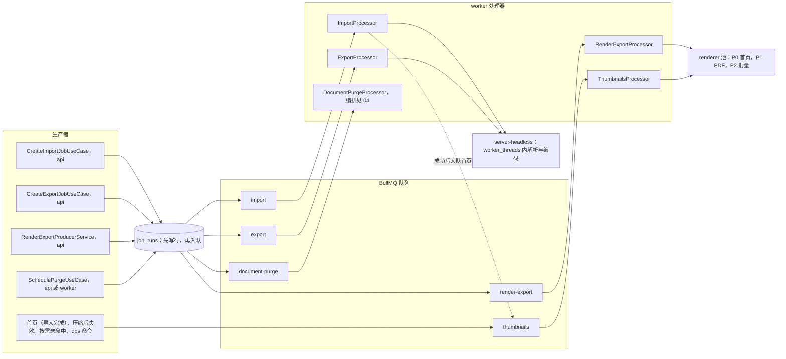
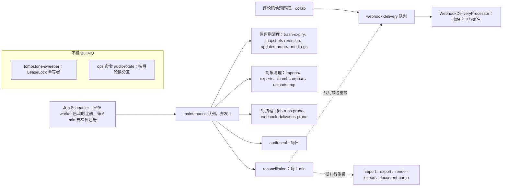
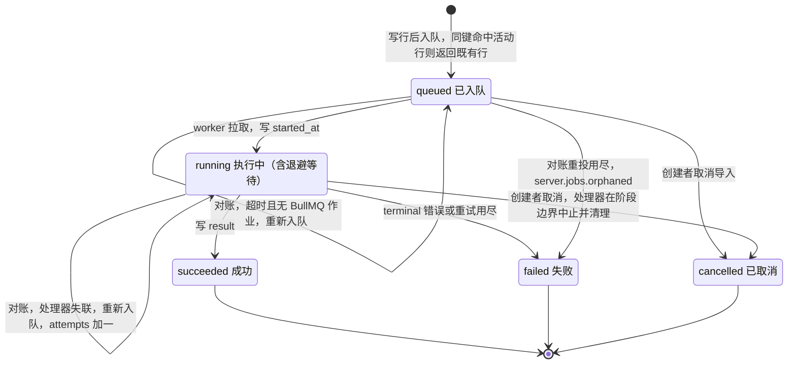
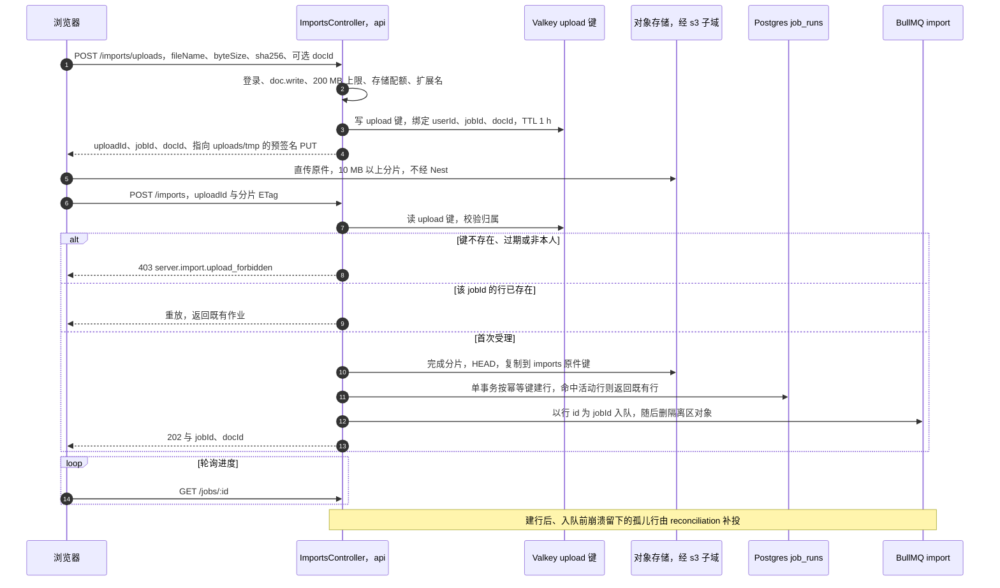
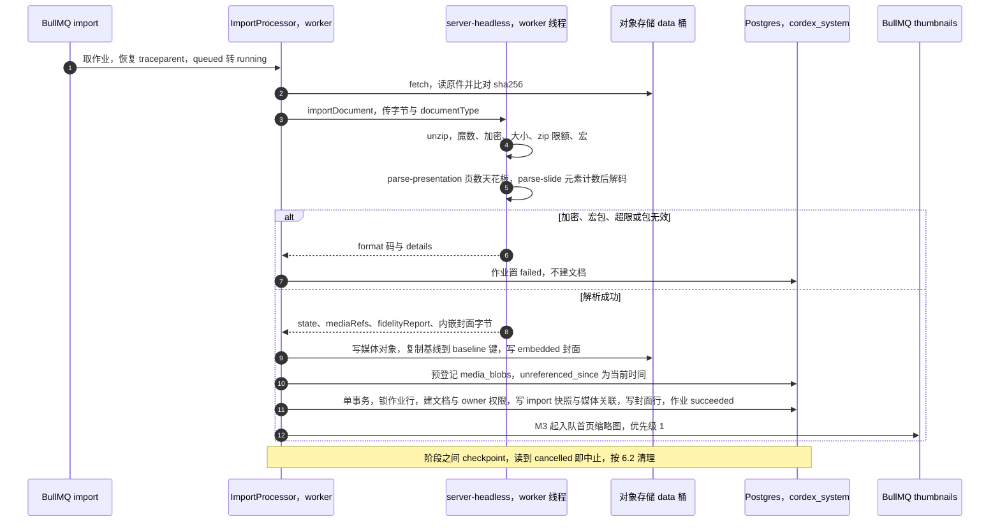
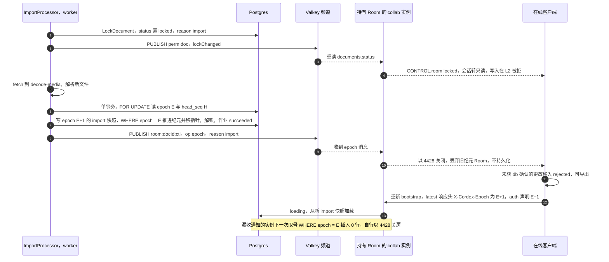
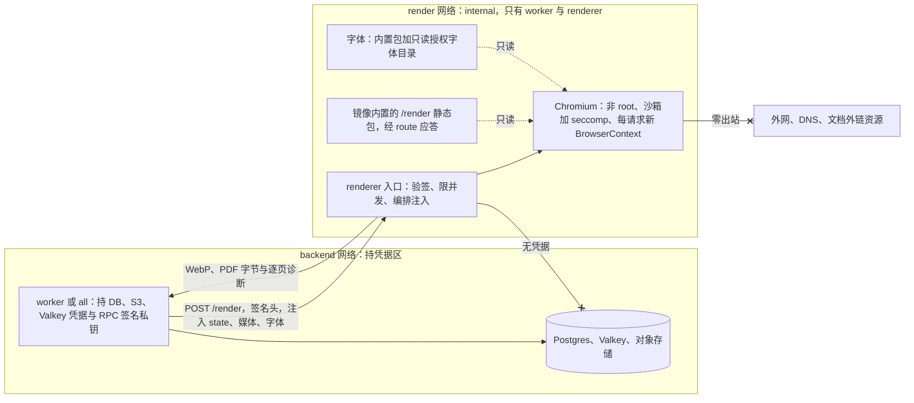
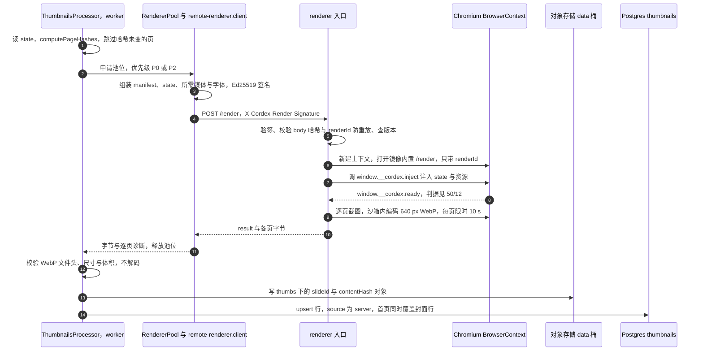

# 06 模块设计：作业、导入导出、缩略图与 renderer sidecar

> 状态：v0.1 | 负责：后端设计线 | 更新：2026-09-25；2026-09-25（§4.19）；2026-09-25（§4.19 N1）；2026-09-26（§4.20） | 依赖：[30-architecture/08](../30-architecture/08-backend-nestjs.md) §7、§9.2、§16.2、§16.3；[ADR-0026](../30-architecture/adr/0026-headless-rendering-and-thumbnails.md)；[ADR-0037](../30-architecture/adr/0037-deployment-topology-and-packaging.md)；[30-architecture/07](../30-architecture/07-rendering.md) §10、§14.7；[40-modules/12](../40-modules/12-server-jobs-comments-and-ops.md)；[40-modules/09](../40-modules/09-server-collab-gateway-and-headless-host.md) §2.5、§3.2；[40-modules/04](../40-modules/04-ooxml-format-and-pptx-codec.md) §2.6；[01](01-service-overview-and-roles.md)、[04](04-modules-documents-storage-media.md)、[05](05-modules-collab-and-snapshots.md)、[08](08-db-conventions-roles-rls-migrations.md)、[12](12-ddl-jobs-and-thumbnails.md)、[14](14-valkey-object-storage-and-retention.md)、[15](15-rest-api-catalog.md)、[17](17-deployment-and-config.md)、[18](18-observability-and-ops-endpoints.md)；[50-frontend/12](../50-frontend/12-viewer-embedding-and-render-page.md)；[rulings](../00-charter/rulings-2026-09-14.md) §4.10 Q20、§4.12 U-13、§4.15 Q5/Q8、§4.16 Q15/Q17、§4.18 BE-04/BE-10/BE-14/BE-18/BE-19/FE-01/FE-09/UX-05/UX-14、§4.19 D-M2-CONTENT/C-06/N1

## 0. 定位与边界

本文是后端设计线中「作业与渲染」一侧的唯一事实源：BullMQ **队列总表**（§1）与 Job Scheduler **周期作业清单**（§4）只在本文登记，配置键与 [14](14-valkey-object-storage-and-retention.md) 的保留总表、[17](17-deployment-and-config.md) 的配置 schema 同名；`JobsModule`、`ImportExportModule`、`ThumbnailsModule` 三个 Nest 模块的用例与事务边界，`@cordexjs/server-headless` 的运行时行为，renderer sidecar 的进程、信任区与 worker ↔ renderer 内部 RPC 的字段语义，也以本文为准。文件级目录树与逐文件职责仍在 [40-modules/12 §4–§5](../40-modules/12-server-jobs-comments-and-ops.md) 与 [40-modules/09 §4.5、§5.5](../40-modules/09-server-collab-gateway-and-headless-host.md)。

| 本文拥有 | 本文引用（事实源在别处） |
|---|---|
| 队列总表、周期作业清单、`JobRun` 状态机、幂等键格式与命中规则 | `job_runs`、`thumbnails` 的 DDL、索引与 RLS → [12](12-ddl-jobs-and-thumbnails.md) |
| 三个 Nest 模块的用例、事务边界、错误码触发条件 | REST 路径、守卫、DTO 文件、成功码 → [15](15-rest-api-catalog.md) §3.9（imports / exports / jobs）、§3.10（thumbnails） |
| `server-headless` 宿主、`worker_threads` 任务、限额 | Valkey 键模板、对象键布局、保留期默认值 → [14](14-valkey-object-storage-and-retention.md) |
| renderer sidecar 进程、信任区、RPC 契约、注入编排、池与背压、超时与重试 | `/render` 页、`RenderPageState`、`inject` / `ready` / `error` 与 **ready 判据** → [50-frontend/12](../50-frontend/12-viewer-embedding-and-render-page.md)（唯一源，本文只链接） |
| 导入写入次序（快照、基线、媒体、文档行、封面） | 永久删除三步编排 → [04 §4](04-modules-documents-storage-media.md)；快照写入与恢复语义 → [05](05-modules-collab-and-snapshots.md) |
| 本文模块抛出的错误码与触发条件 | 码格式与 HTTP 映射 → [30-architecture/10 §1](../30-architecture/10-observability-and-errors.md)；审计 action 登记 → [07 §9](07-modules-comments-webhooks-audit.md)；指标名 → [18 §4](18-observability-and-ops-endpoints.md)；角色装配矩阵 → [01 §5](01-service-overview-and-roles.md) |
| 「机械验证」断言（what） | 测试层级、落点、夹具与 CI 步骤（how）→ [70-testing/03](../70-testing/03-fidelity-roundtrip-and-corpus.md)、[07](../70-testing/07-backend-integration-and-api-e2e.md)、[10](../70-testing/10-security-testing.md) |

**里程碑口径**（依据：rulings §4.19 D-M2-CONTENT「协同后端提前到 M2」，覆盖决策 INC-37 的旧口径；总表见 [01](01-service-overview-and-roles.md) §3）：M2 交付作业骨架（队列注册、`BaseProcessor`、`job_runs` 迁移、`GET /jobs/:id`、reconciliation）、服务端导入（两步上传、`import` 队列与处理器，新建空白与模板同样经导入写 `import` 快照）、创建副本（§6.6）、导入处理器写入的包内 `__cover` 封面（§11.2），以及与之配套的保留期作业；服务端导出（pptx 与 render-export）与 renderer 缩略图在 M3（缩略图 M3 前半段、PDF M3 后半段）。40-modules/09 所称「M2 切片」即 M2 交付。

三条贯穿全文的规则：

1. **处理器只编排**：格式转换在 `server-headless`（§8），栅格化在 renderer（§9），表的写入调用表属主模块导出的用例（「谁的表谁写」，rulings §4.13 S-2）；本文处理器自己只写 `job_runs` 与 `thumbnails`。
2. **先写库再入队**：凡用户可见的作业先在 PG 写 `job_runs` 行（即 outbox），再以 `job_runs.id` 作 BullMQ jobId 入队；两步之间的崩溃由 reconciliation 兜底（§3）。
3. **不可信输入不出沙箱**：worker 持凭据但不解码不可信图片、不运行浏览器；解析在 `worker_threads` 内受限运行，栅格化只在零出站、无凭据的 renderer 内（ADR-0026 决策 6、9）。

## 1. 队列总表（唯一版本）

BullMQ 跑在 Valkey 上，队列键前缀 `bull`，外层再套全局前缀 `valkey.keyPrefix`（键模板见 [14](14-valkey-object-storage-and-retention.md)）。表中「并发」是每个 worker 实例的默认值；可配置的只有 [17 §5](17-deployment-and-config.md) 已登记的 `jobs.import.concurrency`、`jobs.export.concurrency`、`jobs.webhookDelivery.concurrency`，其余并发、全部重试次数与处理器超时都是 `queues.ts` 中 `QUEUE_DEFAULTS` 的常量；BullMQ 自定义 jobId 一律不含 `:`（`:` 是 Valkey 键分隔符）。

| 队列 | 生产者（角色） | 处理器（角色） | 并发 | 处理器超时 | 重试与退避 | 幂等 / 去重 | 优先级 | `job_runs` | 死信 | 里程碑 |
|---|---|---|---|---|---|---|---|---|---|---|
| `import` | `CreateImportJobUseCase`、`DuplicateDocumentUseCase`（api）；reconciliation 重投（worker） | `ImportProcessor`（worker；`payload.source` 区分上传导入与创建副本，§6.6） | 4 | 120 s | 3 次，指数退避 10 s 起，只重试 retryable（§5.2） | `idempotency_key`（§2.3）；jobId = `job_runs.id` | FIFO | 是 | 行置 `failed`；BullMQ failed 集合保留 7 天；告警 | M2 |
| `export` | `CreateExportJobUseCase`（api） | `ExportProcessor`（worker） | 4 | 120 s | 2 次，指数 10 s 起 | 同上 | FIFO | 是 | 同上 | M3 |
| `render-export` | `RenderExportProducerService`（api，经 `ExportsController`） | `RenderExportProcessor`（worker）→ renderer | 2，实际并行受 renderer 池约束（§10.5） | 300 s | 2 次，指数 30 s 起 | 同上 | 池优先级 P1 | 是 | 同上 | PNG / JPEG M3；PDF M3 后半段 |
| `thumbnails` | `ImportProcessor`（首页，worker）；压缩完成（collab，作业名 `invalidate`）；`GetThumbnailUseCase` 未命中（api）；ops 命令 `thumbnails:rebuild` | `ThumbnailsProcessor`（worker）→ renderer | 4，受池约束 | 60 s + 10 s × 页数（每批 ≤ 20 页） | 3 次，指数 5 s 起，只针对基础设施错误；页级失败见 §11.3 | jobId：单页 `thumb-{docId}-{slideId}-{contentHash}`，批 `thumbs-{docId}-{digest}`，失效 `thumbinv-{docId}-{snapshotId}`；处理时再按表中 `content_hash` 跳过未变页 | BullMQ 优先级：首页 1、按需 5、批量 10；池 P0 / P2 | 否 | 只告警；下次请求未命中时重新入队 | M3 前半段（M2 的包内封面由导入处理器直接写，不经本队列，§11.2） |
| `maintenance` | Job Scheduler，只在 worker 启动时注册（BE-19） | 周期作业（§4） | 固定 1 | 各作业自定 | 不重试、等下一周期（audit-seal 例外：3 次） | Job Scheduler id = 作业名 | — | 否 | 同一作业连续 3 个周期失败告警 | M2 起逐项（各周期作业的里程碑见 §4） |
| `webhook-delivery` | `DeliverWebhookEventUseCase`（collab）；reconciliation 重投（worker） | `WebhookDeliveryProcessor`（worker） | 4 | 15 s | 最多 8 次，指数 30 s 起；可重试分类见 [07 §5](07-modules-comments-webhooks-audit.md) | jobId = `webhook_deliveries.id`；逻辑去重 (subscriptionId, event, payloadHash) | FIFO | 否（状态在 `webhook_deliveries`） | `dead-lettered` + 告警 | M3 |
| `document-purge` | `SchedulePurgeUseCase`（api：永久删除、用户擦除；worker：trash-expiry），与 `documents.status` 同事务写行 | `DocumentPurgeProcessor`（worker，三步编排见 [04 §4](04-modules-documents-storage-media.md)） | 2；同文档串行 | 30 min | 10 次，指数 60 s 起、单次延迟上限 1 h，失败整作业重试 | `document-purge:{docId}` | FIFO | 是 | 用尽 → `failed` + P1 告警，人工 `jobs:replay` | M3 |

- `document-purge` 是**独立队列**，不是 `maintenance` 上的作业名（依据：决策 MECH-C 之 C-05，authority：30/08 §7 高于 40-modules/08）。
- 不设 `compaction` 队列：压缩只在持有 Room 的 collab 实例内执行，补齐步骤依赖本实例 Room（[05 §7](05-modules-collab-and-snapshots.md)）；30/08 §7 的可选委托路径作废（用户偏好「不要过度设计」）。队列因此共七条。
- SV-13 的 `fill-template` / `validate` / `migrate` / `convert` 四类作业并入 `ImportExportModule`，队列名与 REST 到 M4 一起定，本版不预留（rulings §4.12 U-13）。
- BullMQ 完成集合只保留 1 h 或 1,000 条（取先到者），失败集合保留 7 天；Valkey 按 `noeviction` 部署（[14 §1](14-valkey-object-storage-and-retention.md)），这两条上限防止队列元数据无界增长。
- 墓碑 TTL 硬删除**不在队列体系内**：由 server-collab `tombstone-sweeper` 持 `lock:tombstone:{docId}` 单写者执行（[05 §8](05-modules-collab-and-snapshots.md)），是周期作业统一走 Job Scheduler 的唯一例外；审计分区轮换走 ops 命令 `audit-rotate`（[07 §8](07-modules-comments-webhooks-audit.md)）。

依据：30/08 §7 队列表（本表为其迁入后的唯一版本）；rulings §4.18 BE-15、BE-18、BE-19、BE-28（并发 4/实例）；ADR-0026 决策 2、v0.2 补充（优先级 首页缩略图 > PDF > 批量缩略图）。

**图 1-1 文档类作业：生产者 → 队列 → 处理器**

怎么读：左到右是「谁产生作业 → 进哪条队列 → 哪个处理器 → 委托给谁」。实线进入 `job_runs` 的四类作业对用户可见、先写行再入队；缩略图作业不写 `job_runs`，靠 jobId 去重与表内哈希判新鲜。虚线是导入成功后触发的首页缩略图。

依据：本文 §1 队列总表；30/08 §7 队列拓扑图；40-modules/19 图 7-1。

**图 1-2 维护、协同与集成类作业**

怎么读：上半是周期作业，全部挂在 `maintenance` 队列、全局只跑一份；中间一行是评论 Webhook 这条事件驱动队列（压缩不经队列，在 collab 实例内执行）；虚线表示对账作业把孤儿行重新入队；右下分组是明确不走 BullMQ 的两件事。

依据：rulings §4.18 BE-19；本文 §3、§4；40-modules/19 图 7-2。

## 2. JobsModule

### 2.1 组成与职责

| 部件 | 形态 | 职责 | 所在角色 |
|---|---|---|---|
| `JobRunsRepository` | Nest provider（Drizzle） | `job_runs` 唯一仓储：`create`、`findById`、`findActiveByKey`、`findLatestTerminalByKey`、`transition`、`listOrphans`、`releaseKey`、`pruneTerminalBefore`；`create(input, tx?)` 可在调用方事务内执行，供 `SchedulePurgeUseCase` 与 `documents.status` 同事务写行（[04 §4.1](04-modules-documents-storage-media.md) 所称 `JobRunWriter.createInTx` 即此入口）；时间列一律由 Clock 端口给值 | api、collab、worker |
| `GetJobUseCase` / `JobsController` | 用例 + REST | `GET /jobs/:id`，唯一的作业状态查询（§2.4） | api |
| `queues.ts` | 常量 | `QUEUE_NAMES`、`QUEUE_DEFAULTS`（§1 表的代码形态）、`MAINTENANCE_SCHEDULES`（§4 表的代码形态） | 全部 |
| `BaseProcessor` | 抽象基类 | traceparent、DB 上下文、错误分类、取消检查、死信（§5） | worker |
| `ReconciliationJob` | 周期作业 | 对账孤儿行（§3） | worker |
| `JobSchedulerRegistrar` | 启动钩子 | 启动时与每 5 min 对 `MAINTENANCE_SCHEDULES` 逐项 `upsertJobScheduler`（幂等，Valkey 数据丢失后自愈） | worker |

`JobsModule` imports `ConfigModule`、`RedisModule`、`WebhooksModule`（对账只读 `webhook_deliveries`，BE-07），exports `JobRunsRepository`、`GetJobUseCase`、`QUEUE_NAMES`、`BaseProcessor`。时间一律经 `apps/server/src/shared/clock.ts` 的 Clock 端口取得，测试注入 FixedClock（依据：决策 T-DETERMINISM，authority：30/11 §1 确定性原则）。

### 2.2 JobRun 状态机

**图 2-1 JobRun 状态**

怎么读：状态只沿 `queued → running → succeeded | failed` 前进，两条自环都是对账作业的重投（§3），不改变状态；`cancelled` 只对导入开放（UX-14）。三个终态都不复活：同一幂等键再提交时新建一行并以 `attempt_of` 指向上一条终态行（BE-18，命中规则图见 [12 §3](12-ddl-jobs-and-thumbnails.md) 图 3-1）。

依据：rulings §4.18 BE-18、UX-14；PRD SV-01 图 2-2；40-modules/12 图 2-3（本图为迁入后的唯一版本）。

| 迁移 | 触发者 | DB 上下文 | 同时写入 |
|---|---|---|---|
| 创建 → `queued` | 生产者用例（api 的用户请求；trash-expiry 为系统） | 用户请求用 `cordex_app`（`created_by` = 当前用户）；系统用 `cordex_system`（`created_by` 为空） | `payload`、`idempotency_key`、`attempt_of`、`traceparent` |
| `queued → running` | `BaseProcessor` 取到作业 | `cordex_system` | `started_at`、`attempts = attempts + 1` |
| `running → succeeded` | 处理器成功 | `cordex_system` | `result`、`finished_at` |
| `running → failed` | terminal 错误、重试用尽 | `cordex_system` | `error_code`、`result.errorDetails`、`finished_at` |
| `queued / running → cancelled` | 创建者 `POST /imports/:jobId/cancel` | `cordex_app`，RLS 只放行本人、只允许写成 `cancelled`（[12 §5](12-ddl-jobs-and-thumbnails.md)） | `finished_at`；清理由处理器或取消用例完成（§6.2） |
| 自环 / `queued → failed` | reconciliation | `cordex_system` | 只重新入队、不改状态；超过放弃时限（§3 第 4 条）置 `failed`，`error_code = server.jobs.orphaned` |

`canTransitionJobStatus(from, to)` 纯函数与 DB 约束（[12 §2](12-ddl-jobs-and-thumbnails.md) 的 CHECK）双重把关；非法迁移抛 `server.jobs.invalid_transition`，终态行上的取消返回 409 `server.import.job_terminal`（依据：决策 INC-10/SG-04，authority：30/10 §1.1）。

### 2.3 幂等键

**JOB-IDEM（已定稿，rulings §4.18 BE-10 / BE-18 的细化，意图不变）**——导入键由 30/08 §7 的 `import:user:{userId}:{sha256}` 改为下表写法。原写法以「用户 + 文件内容」成键，成功行会永久占住这个键：用户删除并永久删除文档后，再导入同一文件只会拿回指向已删除文档的旧作业；「导入到既有文档」在文档被编辑后重导同一原件，也会静默返回旧作业。下表把目标文档与其受理时的 `head_seq` 并入键，语义（BE-18：命中活动行返回既有行、命中终态行新建并写 `attempt_of`）不变。

| kind | 幂等键 | 说明 |
|---|---|---|
| `import` | `import:{docId}:{sha256}:{baseSeq}` | `docId`：更新既有文档时为该文档，新建时为 `POST /imports/uploads` 预分配的 id（每次上传各不相同）；`baseSeq`：受理时 `documents.head_seq`，新建为 0；同一上传的重放另由预分配 `jobId` 保证（§6.1） |
| `import`（创建副本） | `import:{newDocId}:dup-{srcDocId}:{srcSeq}` | `newDocId` 每次受理预分配、各不相同，所以两次「创建副本」得到两份副本；客户端网络重放以 `Idempotency-Key` 请求头识别（[15 §1](15-rest-api-catalog.md)），同键返回同一 `{docId, jobId}` |
| `export` | `export:{docId}:{sourceRef}:pptx` | `sourceRef` = `s{snapshotId}`（指定版本）或 `q{headSeq}`（最新状态） |
| `render-export` | `render-export:{docId}:{sourceRef}:{format}:{optsDigest}` | `optsDigest` = 规范化选项（页集合、宽度、质量）的 sha256 前 16 位十六进制 |
| `document-purge` | `document-purge:{docId}` | 同一文档同一时刻只有一个活动 purge，天然串行 |

键由 `jobs/domain/idempotency-key.ts` 的构造函数唯一生成；请求头 `Idempotency-Key`（[15 §1](15-rest-api-catalog.md)）只用于客户端重放识别，服务端不把它当作键本体，避免客户端控制去重范围。

**创建算法**（单事务，`JobRunsRepository.create`）：

1. 仅导入：若 `job_runs.id = 预分配 jobId` 的行已存在，直接返回它（同一 `uploadId` 的重放）。
2. 读 `findLatestTerminalByKey(key)` 得到 `attempt_of` 候选（同键最近一条 `failed` / `cancelled` 行）。
3. `INSERT … ON CONFLICT (idempotency_key) WHERE status NOT IN ('failed','cancelled') DO NOTHING RETURNING *`（SQL 见 [12 §3](12-ddl-jobs-and-thumbnails.md)）。
4. 无返回行 → 并发或重复提交命中活动行：`findActiveByKey(key)` 返回既有行；导入场景顺带删除本次复制出的原件对象（它不会被任何作业引用），并把 `upload:{uploadId}` 的 `jobId` 改写为既有行 id（保留 TTL），使该 `uploadId` 的重放按第 1 步拿回同一行。
5. 提交后以 `job_runs.id` 为 jobId 入队；入队失败不回滚，留给 reconciliation（§3）。

**产物失效即释放键**：`exports-cleanup` 删除导出对象的同一事务把该行 `idempotency_key` 置空、`result.expired = true`（§4），此后同一状态再导出会新建作业，而不是返回一个下载地址已失效的旧行。导入键含目标 `docId`，文档永久删除后该 id 不会复用，无需释放。

### 2.4 `GET /jobs/:id`（唯一状态查询）

- 导入、导出、render-export、document-purge 共用；`GET /imports/:jobId` 删除，`GET /exports/:jobId` 只返回下载地址（§7.3）；取消保留 `POST /imports/:jobId/cancel`（依据：决策 SG-08，authority：用户偏好「不要过度设计」+ 30/08 §7）。
- 可见性由 RLS 决定：`created_by` 为当前用户，或对 `doc_id` 有任一文档角色（含有效分享链接角色）；看不见一律 404 `server.jobs.not_found`，不区分「不存在」与「无权」。
- 响应为 protocol `rest/import-export.ts` 的 `JobStatus`，字段名以 [15 §3.9](15-rest-api-catalog.md) 为准（文件登记见 40-modules/02，决策 INC-11/INC-13）；本文只规定取值来源：`kind`、`status` 取同名列，`progress` 取 `result.stage`（§6.3），`error{code, detail}` 取 `error_code` 与 `result.errorDetails`，`fidelityReport` 与 `result`（导入 `{docId}`；导出 `{ready, expiresAt, expired}`；purge 为 [04 §4.5](04-modules-documents-storage-media.md) 的观测字段）取自 `result`。`payload`（含对象键）与 `idempotency_key` 从不返回。
- `Cache-Control: no-store`；客户端轮询间隔 1 s 起、指数增长到 5 s，M2–M3 不提供推送。

## 3. Outbox 与对账

「写 `job_runs` 行」与「BullMQ 入队」是两次独立写入；进程在两者之间崩溃、Valkey 抖动或数据丢失，都会留下没有人处理的行。本设计不另建 outbox 表：**`job_runs` 行本身就是 outbox**，BullMQ jobId 恒等于行 id，重复入队被 BullMQ 按 jobId 去重，因此「多投一次」无害（依据：40-modules/15 §3.5 方案 ①，rulings §4.18 BE-19）。

`reconciliation` 每 1 min 执行（§4），规则：

1. 扫描 `job_runs` 中 `status IN ('queued','running')` 且 `now − coalesce(started_at, queued_at) > 2 × 该队列处理器超时（§1）` 的行（支撑索引见 [12 §3](12-ddl-jobs-and-thumbnails.md)）——这就是「孤儿」的定义。
2. 对每行查 BullMQ：作业存在且处于 waiting / delayed / prioritized / active → 正常排队或退避中，跳过。
3. 否则重新 `add`（jobId = 行 id，载荷由 `payload` 重建，`traceparent` 取行上保存的值）；`running` 行由处理器下次开始时 `attempts + 1`。
4. 行龄超过 24 h（放弃时限，常量）仍是孤儿 → 置 `failed`，`error_code = server.jobs.orphaned`，发告警；`document-purge` 同样适用，失败后由人工 `jobs:replay`（§5.3）。
5. `webhook_deliveries` 中 `status = 'pending'`、创建超过 2 × 15 s 且 BullMQ 无对应作业的行，以表内 `payload` 重投（依据：决策 DDL-COLS 之 C-17，authority：rulings §4.13 Outbox 对账）。
6. 每次运行输出 `cordex_jobs_orphans_requeued_total{table}`（名表以 [18 §4](18-observability-and-ops-endpoints.md) 为准），连续 3 次非零告警。

**Valkey 数据丢失的恢复路径**（依据：决策 VALKEY-DEPLOY，authority：BullMQ 要求 + ADR-0022「易失协调，丢失可恢复」）：BullMQ 全部状态丢失后，未终态的导入、导出、render-export、document-purge 由对账在「阈值 + 1 min」内从 `job_runs` 补投；Job Scheduler 由 `JobSchedulerRegistrar` 在 5 min 内补注册；缩略图作业不补投，下一次触发（请求未命中、压缩后失效）自然重建；`upload:{uploadId}` 丢失的上传须由用户重新上传（设计 13 的「重试」即完整重走）。

## 4. Job Scheduler 周期作业清单（唯一源）

全部作业挂 `maintenance` 队列（并发 1），只在 worker 启动时注册（依据：决策 RETENTION，authority：rulings §4.16 Q17 + §4.18 BE-19）。每个作业只编排：删除动作调用**表属主模块导出的用例**，本文模块只直接写 `job_runs` 与 `thumbnails`。作业以 `cordex_system` 池运行，每个事务经 `withSystem('maintenance.<作业名>')` 设置 `app.system_job`（取值约定见 [08 §6.5](08-db-conventions-roles-rls-migrations.md)）；按文档分批（每批 ≤ 100 个文档、每批一个事务），单个文档失败记日志与计数后继续下一个。配置键与默认值同 [14 §8](14-valkey-object-storage-and-retention.md) 保留总表、[17 §5](17-deployment-and-config.md) 配置 schema。

| 作业 | 频率 | 做什么 | 调用的属主用例 | 幂等性 | 配置键（默认） | 里程碑 |
|---|---|---|---|---|---|---|
| `reconciliation` | 每 1 min | 对账孤儿作业与投递（§3） | JobsModule；只读 WebhooksModule 仓储 | 重投按 jobId 去重 | —（放弃时限 24 h 为常量） | M2（投递部分 M3） |
| `audit-seal` | 每日 00:10 UTC | 封存前一日审计链，写 `audit.sealed` 锚点行（算法见 [07 §8](07-modules-comments-webhooks-audit.md)） | AuditModule | 当日已有封存行即跳过；失败重试 3 次后 P1 告警 | `retention.auditDays`（365，分区轮换另走 ops `audit-rotate`） | M3 |
| `trash-expiry` | 每 5 min | 先释放 `locked_until` 已过的锁（`ReleaseExpiredLocksUseCase`，锁 TTL 10 min，持锁方崩溃后最多多锁一个周期）；再对 `status = 'trashed'` 且 `deleted_at` 早于保留期的文档调 `SchedulePurgeUseCase(reason = 'trash_expired')` | DocumentsModule（[04 §3](04-modules-documents-storage-media.md) `RunTrashExpiryUseCase`） | 幂等键 `document-purge:{docId}` | `retention.trashDays`（30） | M2（锁到期释放）/ M3（回收站到期永久删除） |
| `snapshots-retention` | 每日 | `auto` 与 `import` / `migration` / `restore` / `epoch` 事件快照按天稀疏（每文档最新一个 `import` 快照及其基线、指针所指行除外，被删 `import` 快照的 `baseline/` 对象一并删除，[11 §8](11-ddl-collab-updates-and-snapshots.md)）；之后按 [04 §7.4](04-modules-documents-storage-media.md) 的 `cutoff` 与 `protectedSeq` 删除已无保留版本引用的媒体关联（C-25） | worker 装配的 CollabModule（`SnapshotsRetentionUseCase`，[05 §7](05-modules-collab-and-snapshots.md)；SnapshotsModule 只在 collab）、MediaModule（`PruneDetachedMediaLinksUseCase`） | 按文档可重入 | `retention.autoSnapshotDays`（30）、`retention.autoSnapshotDailyDays`（365，0 = 永久，rulings §4.19 C-06） | M2 |
| `updates-prune` | 每 1 h | 删 `seq ≤ 检查点指针所指快照 seq_upto` 且早于保留期的 `document_updates`（[11 §8](11-ddl-collab-updates-and-snapshots.md) 的 e5） | worker 装配的 CollabModule（`PruneUpdatesUseCase` → `UpdateStore.pruneBefore`） | 条件删除 | `retention.updatesDays`（7） | M2 |
| `media-gc` | 每日 | `media_blobs.unreferenced_since` 早于保留期 → 先删对象再删行 | MediaModule | 对象不存在视为已删 | `retention.mediaUnreferencedDays`（30） | M2 |
| `imports-cleanup` | 每日 | 导入作业终态且 `finished_at` 早于保留期 → 删 `docs/{docId}/imports/{jobId}/`，置 `result.sourceDeleted = true`；基线在 `baseline/` 前缀，不受影响（C-07）。`failed` 的作业另删 `result.snapshotId` 对应、但快照行不存在的基线对象；新建导入以 `failed` / `cancelled` 结束且文档行不存在时，删整个 `docs/{docId}/` 前缀（§6.4 第 2 步已写出的封面等） | ImportExportModule（本文） | 已标记即跳过 | `retention.importOriginalDays`（30） | M2 |
| `exports-cleanup` | 每 1 h | 导出类作业成功且 `finished_at` 早于保留期 → 删 `docs/{docId}/exports/{jobId}.{ext}`，置 `result.expired = true` 并释放幂等键（§2.3） | ImportExportModule（本文） | 同上 | `retention.exportHours`（24） | M3 |
| `thumbs-orphan-cleanup` | 每日 | 对上次运行以来 `thumbnails.updated_at` 有变化的文档，列 `docs/{docId}/thumbs/`，删除不被当前行 `storage_key` 引用且最后修改超过 24 h 的对象（被引用的 640 对象及其 `@1280` 变体保留；`__cover` 已被 server 行覆盖后，`embedded.jpg` 同样按孤儿删除） | ThumbnailsModule（本文） | 只删非当前对象 | —（24 h 固定宽限，以 [14 §8](14-valkey-object-storage-and-retention.md) 为准） | M3 前半段 |
| `uploads-tmp-cleanup` | 每 1 h | 删 `uploads/tmp/` 下早于保留期的对象；data 桶里超过同一时长的未完成分片上传执行 `AbortMultipartUpload` | MediaModule 与 ImportExportModule 共用 | 同上 | `retention.uploadTmpHours`（24） | M2 |
| `job-runs-prune` | 每日 | 删终态且 `finished_at` 早于保留期的 `job_runs` 行；导出行须已 `expired`、导入行须已 `sourceDeleted` | JobsModule（本文） | 条件删除 | `retention.jobRunsDays`（90） | M2 |
| `webhook-deliveries-prune` | 每日 | 删终态且早于保留期的投递行 | WebhooksModule（[07 §5](07-modules-comments-webhooks-audit.md)） | 条件删除 | `retention.webhookDeliveriesDays`（90） | M3 |

- 不在上表：墓碑 TTL 硬删除（`tombstone.ttlHours`，24）由 `tombstone-sweeper` 执行（[05 §8](05-modules-collab-and-snapshots.md)）；审计按月分区的预建与 DETACH + DROP 走 ops 命令 `audit-rotate`（[07 §8](07-modules-comments-webhooks-audit.md)）；snapshots 桶非当前版本的过期用桶级生命周期规则（[14 §5](14-valkey-object-storage-and-retention.md)），这是唯一依赖生命周期规则的清理（依据：决策 C-08/OBJ，authority：S3 版本化为桶级语义）。
- 带 TTL 的对象一律由上表作业清理，不依赖前缀型生命周期规则（依据：决策 MECH-C 之 C-09，authority：rulings §4.18 BE-19）。
- 所有「早于保留期」的比较都经 Clock 端口取 `now`；保留期配置为 0 的含义由 [17 §5](17-deployment-and-config.md) 统一定义（`autoSnapshotDailyDays = 0` 表示永久）。

## 5. BaseProcessor

### 5.1 执行骨架

`BaseProcessor<TPayload, TResult>` 是全部 BullMQ 处理器的基类（周期作业也继承它），`process(job)` 固定为以下步骤，子类只实现 `handle(job, ctx)`：

1. **trace**：从作业数据取 W3C `traceparent` 建子 span（名 `job.<kind>`，非 `job_runs` 队列取队列名；属性 jobId、queue、docId、attempts）；日志字段按 [18 §2](18-observability-and-ops-endpoints.md)。
2. **DB 上下文**：一律用 `cordex_system` 池，每个事务经 `withSystem('worker.<queue>')` 设置 `app.system_job`（取值集合见 [08 §6.5](08-db-conventions-roles-rls-migrations.md)，jobId 只进日志与 `application_name`）；发起人只作为审计主体传给 `RecordAuditEventUseCase`，不写进 GUC。
3. **开工**：行已是终态（例如排队时被取消）→ 直接结束、不做任何工作；否则 `queued → running`、`attempts + 1`、写 `started_at`。
4. **handle**：带 `AbortSignal`（超时 = §1 表的处理器超时）；阶段之间调用 `ctx.checkpoint(stage)`——按主键重读 `status` 并把 `stage` 写进 `result`，读到 `cancelled` 即抛 `JobCancelled`。
5. **收尾**：成功 → `succeeded` + `result`；异常按 §5.2 分类。
6. **中间产物先登记后使用**：凡重跑时需要复用的 id（导入快照 id、基线对象键等）先写进 `result` 再落地，重跑时读回复用，保证处理器对重跑幂等。
7. **写前复查文档状态**：导出、render-export、缩略图与导入到既有文档的处理器，在写对象存储或写库之前读 `documents.status`，见 `purging` 或行不存在即放弃、不写任何东西——有 `job_runs` 行的作业置 `failed`（`server.documents.not_found`），缩略图作业直接丢弃（[04 §4.3](04-modules-documents-storage-media.md) 参与者规则 4），避免永久删除收尾之后再冒出残留对象。

### 5.2 错误分类

| 类别 | 判定 | 处理 |
|---|---|---|
| retryable | `CordexError.retryable = true`；网络错误、S3 5xx、PG 连接错误；`headless.renderer_busy`、`headless.browser_crashed`、`headless.worker_crashed` | 抛回 BullMQ 按 §1 退避重试；行保持 `running` |
| terminal | 业务拒绝（`format.*`、`storage.quota_exceeded`、`server.import.source_missing`、`server.import.checksum_mismatch`）；`headless.task_timeout`、`headless.task_oom`（同一输入重跑结果不变） | 以 `UnrecoverableError` 直接失败；行置 `failed` 并写 `error_code` 与 `result.errorDetails` |
| cancelled | `JobCancelled` | 执行取消清理（§6.2）后正常结束，行已是 `cancelled` |
| 重试用尽 | BullMQ 最后一次尝试仍失败 | 行置 `failed`，`error_code` 取最后一次错误的码 |

确定性错误不重试，与设计 13「确定性错误只给『返回列表』、瞬时错误给『重试』」一致（UX-14）；未知异常一律按 retryable 处理，但计入 `cordex_jobs_unclassified_errors_total{queue}`（[18 §4](18-observability-and-ops-endpoints.md)）并告警，推动补分类。

### 5.3 死信、重放与停机

- BullMQ 失败集合保留 7 天，只作排障；持久记录是 `job_runs` 的 `failed` 行。
- 人工重放：ops 命令 `jobs:replay --job <id>`（或 `--queue <q> --since <时间>`）在 worker 容器内执行，按原 `payload` **新建**一行（`attempt_of` 指向原行，状态机不回退）再入队，写审计 `admin.job_replayed`（[07 §9](07-modules-comments-webhooks-audit.md)）。
- 停机：SIGTERM → `worker.pause()` → 等在途作业至多 25 s（整体停机期限 30 s，[01 §10](01-service-overview-and-roles.md)）→ 未完成作业由 BullMQ stalled 机制交还队列，处理器按 §5.1 第 6 条幂等重跑。

## 6. 导入

导入把一个 pptx 变成「文档行 + import 快照 + 基线 + 媒体关联 + 封面」，并在任何页被解析之前拒绝加密包、宏包与超天花板文件（PRD SV-01，rulings §4.15 Q5、§4.16 Q15）。自 M2 起它是文档内容的唯一入口（rulings §4.19 D-M2-CONTENT）：应用壳的「新建空白」「从模板新建」由前端以内置模板字节走同一两步上传，服务端不设 pptx 内容版本端点。

### 6.1 两步上传

**UPLOAD-QUARANTINE（已定稿，rulings §4.18 BE-10 的细化，意图不变）**——BE-10 的意图「对象键由服务端预分配、客户端从不提交任意键、提交他人 `uploadId` 返回 403」全部保留，原件最终落点 `docs/{docId}/imports/{jobId}/source.pptx` 也不变；浏览器直传的落点是隔离区 `uploads/tmp/{uploadId}`，受理时由服务端复制到最终键。理由：申请了上传却从不提交的对象若直接落在 `docs/{docId}/` 下，新建场景连文档行都没有，只能靠全桶列举才能找到；放进隔离区后由 `uploads-tmp-cleanup` 统一清理，与媒体上传（决策 INC-21 / G-16）同一做法，也堵住「只申请不提交」撑满存储的滥用面。

1. **申请**：`POST /imports/uploads {fileName, byteSize, sha256, docId?}`（路由与 DTO 见 [15 §3.9](15-rest-api-catalog.md)）。校验依次为：已登录；带 `docId`（导入到既有文档）时需 `doc.write`；`byteSize ≤ scale.maxFileBytes`（默认 200 MB，17 §5；旧名 `scale.maxUploadBytes` 已废）否则 413 `format.quota_exceeded{dimension: 'fileSize'}`；按 owner 汇总的存储配额（新建时 owner 为当前用户）：字节维度超出 413 `storage.quota_exceeded{dimension: 'bytes'}`，新建文档超出文档数 429 `storage.quota_exceeded{dimension: 'documents'}`（依据：决策 G-09，authority：PRD SV-08 + rulings §4.17 D2；与 [04 §9](04-modules-documents-storage-media.md) 同一映射）；扩展名为 `.pptm` 或 `.ppt` 时提前拒绝（`format.macro_rejected` / `format.unsupported_binary`，处理器仍会按内容复核）。
2. **预分配**：`jobId`、新建时的 `docId`（均为 UUIDv7）与 128 bit 随机 `uploadId`；写 Valkey `upload:{uploadId}`（模板与 TTL 1 h 见 [14 §3](14-valkey-object-storage-and-retention.md)），值为 `{userId, jobId, docId, targetExists, sha256, byteSize, fileName, multipartUploadId?}`。
3. **签名**：按 `storage.s3.publicEndpoint` 生成指向 `uploads/tmp/{uploadId}` 的预签名 PUT，签入 `Content-Length = byteSize`；≥ 10 MB 用 S3 分片，一次签发全部分片 URL。导入上传的签名有效期等于 `uploadId` 寿命 1 h（rulings §4.18 BE-10，照顾 200 MB 慢速链路），其余 PUT 按 `storage.s3.presign.putTtlSec`（默认 600 s，[14 §5](14-valkey-object-storage-and-retention.md)）。
4. **直传**：浏览器经反代子域 `s3.<域名>` 直传，字节不经 Nest。
5. **受理**：`POST /imports {uploadId, parts?}`。读 `upload:{uploadId}`：不存在、已过期或 `userId` 不符一律 403 `server.import.upload_forbidden`（不区分三者，防枚举）；`job_runs.id = jobId` 已存在 → 重放，直接返回该行；分片时由服务端 `CompleteMultipartUpload`（桶 CORS 暴露 `ETag`，30/08 §6）；`HEAD` 隔离区对象，缺失或大小不符 → 409 `server.import.source_missing`；`CopyObject` 到 `docs/{docId}/imports/{jobId}/source.pptx`（可重复执行）→ 按 §2.3 建行 → 提交后入队并删除隔离区对象（删除失败由 `uploads-tmp-cleanup` 兜底）；返回 202 `{jobId, docId}`（重放 200，[15 §3.9](15-rest-api-catalog.md)）；写审计 `import.created`。这个次序让任一步之后崩溃都可由客户端重放续上：建行前崩溃时隔离区对象仍在，重放重新复制；建行后崩溃时按 `jobId` 返回既有行。
6. **小文件单步**：≤ 10 MB 可直接 `POST /imports`（multipart），api 在内部走同一条路径（分配 id → 写隔离区 → 复制 → 建行），受上传限流约束（30/08 §16.4）。

`upload:{uploadId}` 在受理后**不删除**：它只能兑换出预分配的那一个作业，重放总是拿回同一行，因此不需要 `GETDEL`（40-modules/12 §2.5 的「用后即焚」由「绑定唯一 jobId」实现）；这让网络重试的 `POST /imports` 天然幂等。

**图 6-1 两步导入：申请上传、直传、受理、入队**

怎么读：时间自上而下；前五步是申请与直传，`alt` 是受理时的三种结局。客户端从头到尾只持有 `uploadId`，对象键全部由服务端决定；原件最终落在 `docs/{docId}/imports/{jobId}/source.pptx`。

依据：rulings §4.18 BE-10、BE-18；本文 §2.3、§6.1；30/08 §7 导入时序图；40-modules/19 图 6-9。

### 6.2 取消的阶段边界

- 前置：只有作业创建者（应用层判定 + RLS 只放行本人，[12 §5](12-ddl-jobs-and-thumbnails.md)）；只接受 `queued` / `running`，终态返回 409 `server.import.job_terminal`。
- 取消事务只把行置 `cancelled` 并写 `finished_at`；提交后：`queued` 行从 BullMQ 移除（已 active 则交给处理器）；删除 `docs/{docId}/imports/{jobId}/`；新建文档场景（此时没有文档行）连同 `docs/{docId}/` 下已写出的基线与封面对象一起删除。审计 `import.cancelled`。
- 处理器在 `fetch`、`unzip`、`parse-slide`、`decode-media` 之后各有一个检查点；`persist` 是一个事务，开头 `SELECT … FOR UPDATE` 锁住作业行并确认仍为 `running`，读到 `cancelled` 即回滚并删除本次写出的对象；预登记的媒体行保持 `unreferenced_since`，由 `media-gc` 按期清理。
- 取消晚于 `persist` 提交 → 行已 `succeeded` → 409；此时文档已建成，由用户按普通文档删除。
- 覆盖导入（带 `docId`）：清理之后解锁文档，纪元与检查点指针不变（§6.5 第 6 步）。

保证（机械验证 §14）：取消后不留文档行、不留原件、不留基线与封面对象（PRD SV-01，rulings §4.18 UX-14）。

### 6.3 处理器阶段与输入限额

| 阶段（`stage`） | 在哪执行 | 做什么 | 拒绝码 |
|---|---|---|---|
| `fetch` | worker 主线程 | 从 data 桶读原件，计算 sha256 与申报值比对 | `server.import.checksum_mismatch` |
| `unzip` | `worker_threads` | 魔数与容器判定 → 加密 → 文件大小 → zip 限额 → 宏；顺序以 [40-modules/04 §2.6](../40-modules/04-ooxml-format-and-pptx-codec.md) 为准 | `format.unsupported_binary`、`format.encrypted`、`format.pptx.invalid_package`、`format.quota_exceeded{fileSize}`、`format.limit_exceeded`、`format.macro_rejected` |
| `parse-presentation` | 同上 | 读 `p:sldIdLst`，页数超天花板即停，不解压任何页 | `format.quota_exceeded{slides}` |
| `parse-slide` | 同上 | 先做只计数不物化的元素扫描，超单页或总元素天花板即停；再解码为 Snapshot | `format.quota_exceeded{elementsPerSlide \| elementsTotal}`、`format.pptx.*` |
| `decode-media` | 同上 | 媒体按嗅探定 MIME、SVG 消毒、算 sha256，产出 `mediaRefs`；不可识别的媒体不入媒体库，作为不透明部件留在基线里并记入保真报告 | — |
| `persist` | worker 主线程 | §6.4 的写入次序 | — |

阶段名 `unzip` / `parse-presentation` / `parse-slide` / `decode-media` 与客户端 OF-01 的 `unit/open-progress` 同名（PRD SV-01「进度阶段与客户端 OF-01 一致」）；`stage` 完整取值为 `queued`、`fetch`、`unzip`、`parse-presentation`、`parse-slide`、`decode-media`、`persist`、`done`。设计 13 的「服务端解析」用不确定态进度，前端只用 `stage` 做文案与排障，不换算百分比。

**输入限额**（迁自 30/08 §9.2 与 §16.5；OF-24 口径：部署可收紧、放宽不超过 2×；客户端 Worker 使用同一张表，常量在 `ooxml-core` 的 `ZipLimits`，键名见 [17 §5](17-deployment-and-config.md) 的 `limits.*` 与 `scale.*`）：

| 限制 | 默认值 | 超限码 |
|---|---|---|
| 文件魔数 | `PK\x03\x04` 且存在 `[Content_Types].xml` | `format.pptx.invalid_package` |
| 上传大小 | ≤ 200 MB | `format.quota_exceeded{fileSize}` |
| zip 条目数 / 单条目解压 / 总解压 | ≤ 4,000 / ≤ 64 MiB / ≤ 512 MiB，且压缩比 ≤ 100:1 | `format.limit_exceeded{limit, actual}` |
| 媒体总量 / 嵌入字体 | ≤ 256 MiB / 单个 ≤ 20 MB、总计 ≤ 60 MB | 同上 |
| 图表点数 / 位图预览 | ≤ 10,000 点每序列 / ≤ 16,777,216 px | 同上 |
| XML | 禁 DTD 与外部实体；深度 ≤ 256；属性 ≤ 1,024 每元素；文本节点 ≤ 16 MiB | 同上 |
| 规模天花板 | 页 ≤ 200；单页元素 ≤ 1,000；总元素 ≤ 20,000（墓碑计入） | `format.quota_exceeded{slides \| elementsPerSlide \| elementsTotal}` |
| 解析时间 / 解析内存 | ≤ 60 s / 线程堆 ≤ 2,048 MiB（M2 自托管 runner 压测校准，只收紧；rulings §4.19 D-TEST-INFRA） | `headless.task_timeout` / `headless.task_oom` |
| 宏包、加密包 | 一律拒绝，不保留宏部件 | `format.macro_rejected` / `format.encrypted`（均 415） |
| 外部关系 `TargetMode="External"` | 全部原样保留，服务端永不抓取 | — |

超天花板**直接拒绝导入**、不创建文档、不做只读降级（rulings §4.15 Q5、§4.18 UX-13）；码的 HTTP 映射与 `details` 取值表以 [30-architecture/10 §1.4](../30-architecture/10-observability-and-errors.md) 为准。

### 6.4 写入次序、基线与封面

`persist` 阶段按下列次序执行，前两步只写对象存储与预登记行，第 3 步是唯一的业务事务：

1. **登记中间产物**：`result.snapshotId`（UUIDv7）先写入作业行（§5.1 第 6 条），重跑复用。
2. **写对象**：媒体按内容寻址写 `media/{sha256 前 2 位}/{sha256}`（已存在则跳过），并经 MediaModule 预登记 `media_blobs` 行（`unreferenced_since = now()`）；导入原件服务端复制为**基线** `docs/{docId}/baseline/{snapshotId}.pptx`；包内有 `docProps/thumbnail.jpeg` 且通过头校验（§11.2）时写 `docs/{docId}/thumbs/__cover/embedded.jpg`。
3. **单事务**（`cordex_system`）：锁作业行并确认 `running` → 新建文档时调 DocumentsModule 建文档行与 owner 权限行（id 为预分配 `docId`、owner 为 `created_by`、标题取文件名去扩展名；[04 §3](04-modules-documents-storage-media.md)）→ 经 M-09 导出的 `SnapshotStore.put` 写 `kind = 'import'` 快照，`baseline_key` 指向第 2 步的基线（`document_snapshots` 的唯一写方仍是 M-09，依据：决策 DDL-COLS 之 C-29）→ MediaModule 建 `document_media` 关联（清空 `unreferenced_since`）→ `thumbnails` 写 `__cover` 行（`source = 'embedded'`）→ 作业行 `succeeded`，`result = {docId, snapshotId, fidelityReport}`。
4. **事务后**：写审计 `import.completed`（新建文档另有 M-08 的 `document.created`）；M3 起入队首页缩略图（优先级 1，§11）。

**基线**随文档生命周期保留，导入原件仍按 `retention.importOriginalDays` 清理，二者分属 `baseline/` 与 `imports/` 前缀，互不影响；永久删除时 finalize-purge 按 `docs/{docId}/` 前缀一并清除（依据：决策 C-07，authority：rulings §4.16 Q17 + PRD SV-01）。

**图 6-2 导入处理器执行**

怎么读：时间自上而下；`alt` 的上支是拒绝——全部发生在解码任何页之前或解码中途，不创建文档、不做只读降级；下支是成功，业务写入集中在一个事务里，所以「半个文档」不会出现。服务端对封面只做头校验，栅格化只在 renderer 沙箱内发生。

依据：30/08 §7 导入作业时序；40-modules/04 §2.6 天花板检测点；ADR-0026 决策 4、9；rulings §4.15 Q5、§4.16 Q15；决策 C-07、DDL-COLS。

### 6.5 导入到既有文档（覆盖导入 = 换纪元）

**IMPORT-OVERWRITE（已裁定，rulings §4.19 N1「恢复不锁、覆盖导入换纪元」）**：带 `docId` 的导入整体替换该文档的内容，实现为一次换纪元——导入期间文档 `locked`，`persist` 写 `epoch + 1` 的 `import` 快照并使其成为新检查点，经 `room:{docId}:ctl` 通知持有 Room 的 collab 实例，在线会话以 4428 断开后重新 bootstrap，未获 db 确认的本地更改移入 `rejected` 并可导出（复用决策 INC-06 的 4428 流程）。它不调用版本恢复用例，也不新增 worker → collab 的触发通道：控制频道就是 worker 在永久删除时已经在用的那一条（[05 §3.3](05-modules-collab-and-snapshots.md)）。原写法「`persist` 写 import 快照后调用 [05 §10](05-modules-collab-and-snapshots.md) 的恢复用例，在线会话不断开」作废：恢复用例只在 collab 装配（rulings §4.18 BE-03），worker 无从执行；导入先加锁、恢复又拒绝 `locked` 文档，两者串联还会自锁。

1. **受理**：同 §6.1；带 `docId` 时需 `doc.write`，路由按 `write` 访问类过 `DocumentStateGuard`（[04 §2](04-modules-documents-storage-media.md) 表 2-2），文档已 `locked`（另一导入或迁移进行中）→ 409 `server.documents.locked`；幂等键含受理时的 `head_seq`（§2.3）。
2. **加锁**：处理器开工（`queued → running`）之后、`fetch` 之前，经 DocumentsModule 的 `LockDocumentUseCase(sys, docId, reason:'import', ttl)` 把文档置 `locked`（`locked_until` 默认 10 min，远大于处理器超时 120 s）；提交后 `perm:doc:{docId}` 的 `lockChanged` 使在线会话 ≤ 1 s 收到 `CONTROL.room{locked:{reason:'import', until}}` 并转只读，此后写入帧在 L2 被拒（[16 §8](16-ws-protocol-server-view.md)）。开工时文档不是 `active`：`purging`、`trashed` 或行不存在 → `failed`（`server.documents.not_found`，§5.1 第 7 条）；`locked`（受理后被迁移或另一导入抢先）→ 本次尝试按 retryable 失败、BullMQ 按 §1 退避重试。加锁与在作业行 `result` 登记 `lockedAt` 同一事务（§5.1 第 6 条「先登记后使用」）：同一作业的重跑（上一次尝试加锁后进程崩溃、未走到第 6 步）读到已登记的 `lockedAt` 且文档仍为 `locked` 时，视为本作业持锁并改调 `RenewLockUseCase` 续期，不按 `locked` 重试。
3. **解析**：`fetch` 至 `decode-media` 同 §6.3，各检查点照常检查取消。
4. **`persist` 单事务**（`cordex_system`，作业名 `worker.import`）：锁作业行并确认 `running` → `SELECT status, epoch, head_seq FROM documents WHERE id = $1 FOR UPDATE` 得 `E`、`H`，要求 `status = 'locked'`（否则回滚，按第 2 步的规则处理）→ `SnapshotStore.put(kind = 'import', epoch = E + 1, seq_upto = H, baseline_key)`，同一事务以 `WHERE id = $1 AND epoch = E` 把 `documents.epoch` 置 `E + 1` 并移动检查点指针（0 行 → `epoch_changed`，回滚后按 retryable 重试；语义见 [05 §9.2](05-modules-collab-and-snapshots.md)）→ 媒体关联与 `__cover` 行同 §6.4 第 3 步 → `UnlockDocumentUseCase` 解锁 → 作业 `succeeded`，`result = {docId, snapshotId, epoch: E + 1, fidelityReport}`。行锁使本事务与 collab 的取号语句（[11 §5](11-ddl-collab-updates-and-snapshots.md) e1）串行：提交后旧纪元的任何取号都因 `epoch = E` 不再成立而插入 0 行。
5. **事务后**：先 `PUBLISH room:{docId}:ctl {op:'epoch', reason:'import', epoch: E + 1}`（经 global `RedisModule`，与 document-purge 的 `close` 同一发布方式），再由解锁用例发布 `perm:doc:{docId}` 的 `lockChanged`；各 collab 实例以 4428（`collab.epoch_changed`）关闭该文档的会话、丢弃旧纪元 Room、不再持久化（[05 §3.3](05-modules-collab-and-snapshots.md)）。客户端丢弃本地 Y 状态，按 `X-Cordex-Epoch = E + 1` 重新 bootstrap，未获 db 确认的本地更改移入 `rejected` 并可导出（[50-frontend/07 §8.2、§9](../50-frontend/07-collaboration-client.md)）。两条通知都是尽力而为：漏收 `epoch` 的实例在下一次取号时自行以 4428 关房，先收到解锁通知的会话若写入也会撞上同一纪元栅栏，正确性不依赖两条通知的先后。写审计 `import.completed`；M3 起入队首页缩略图。
6. **失败与取消**：terminal、retryable 失败与取消都在处理器 `finally` 中调用 `UnlockDocumentUseCase`（取消另按 §6.2 清理本次写出的对象），纪元与指针不变，在线会话收到不带 `locked` 的 `room` 帧后恢复可写；worker 崩溃留下的锁由 `trash-expiry` 在 `locked_until` 之后释放（[04 §2](04-modules-documents-storage-media.md) 交叉规则 2）。

与运维换纪元（[05 §9.2](05-modules-collab-and-snapshots.md) 的 `forceEpoch`）相比：执行方是 worker 上的导入处理器，不打开 Room、不经 `collabServer`；新检查点是 `import` 快照而不是 `epoch` 快照；不要求 `persist = ok` 与无溢写——内容整体被替换，旧纪元的溢写行在回放时按纪元丢弃，对应的客户端 pending 只获 `tier:'spill'` 确认，随 4428 移入 `rejected`、可导出；不取 `lock:epoch` 租约，文档锁、行锁与纪元条件已足以串行化。

**导入前的内容**：旧纪元的快照照常留在版本时间轴（按 rulings §4.19 C-06 保留），可预览、可恢复——恢复是模型级 diff（[05 §10](05-modules-collab-and-snapshots.md)），不受纪元限制；最近一个检查点之后、加锁之前已落库的编辑不单独成版，只在 `document_updates` 中保留 `retention.updatesDays`（7 天）。

**图 6-3 覆盖导入：锁定、换纪元与在线会话重新 bootstrap**

怎么读：时间自上而下；前四步是加锁与只读通知，中间是解析与唯一的业务事务，后半段是换纪元的通知与客户端重新 bootstrap。worker 从不调用 collab，只写库与发布两条既有频道；最后一条注记是数据库栅栏兜底。

依据：rulings §4.19 N1；决策 INC-06；[05 §9.2](05-modules-collab-and-snapshots.md)；[11 §5](11-ddl-collab-updates-and-snapshots.md)；[16 §8](16-ws-protocol-server-view.md)；ADR-0029 决策 5（2026-09-25 修订）。

### 6.6 创建副本

受理在 [04 §3.3](04-modules-documents-storage-media.md)（`POST /documents/:id/duplicate`，`doc.export`，[15 §3.3](15-rest-api-catalog.md)）：预分配 `newDocId` 与 `jobId`，写 `job_runs(kind='import', doc_id=newDocId, payload={source:'duplicate', srcDocId, srcSeq, title})` 后入 `import` 队列。它复用导入的队列、处理器、取消检查点与 `persist` 事务，只把 `fetch` 到 `decode-media` 四个阶段换成「读源状态」一步——源已经是校验过的 CRDT 状态，不需要再解析 pptx。依据：rulings §4.10 Q20、§4.19 D-M2-CONTENT；用户偏好「不要过度设计」（不另建队列与 `job_runs.kind`）。

| 阶段（`stage`） | 做什么 |
|---|---|
| `fetch` | 复查源文档仍存在且不是 `purging`（否则 `failed`，`server.documents.not_found`）；经 worker 装配的 CollabModule 读源文档检查点与 `seq ≤ srcSeq` 的 updates（`SnapshotStore.get` + `UpdateStore.loadSince`，系统池），在 `worker_threads` 内合并为一份 Y V2 状态；读源文档最新 `import` 快照的 `baseline_key`（可能为空） |
| `persist` | ① 登记 `result.snapshotId`；② 服务端复制源基线对象为 `docs/{newDocId}/baseline/{snapshotId}.pptx`，源有包内封面时复制为 `docs/{newDocId}/thumbs/__cover/embedded.jpg`；③ 单事务：建文档行与 owner 权限行（`CreateDocumentUseCase` 系统入口，owner = 发起者，标题取请求值或源标题；审计 `document.created{source:'duplicate'}`）→ `SnapshotStore.put(kind='import')`（`baseline_key` 指向第 ② 步对象）→ MediaModule 为新文档复制源文档中被新快照引用的 `document_media` 关联（引用集合与写快照时 `SyncDocumentMediaRefsUseCase` 用的是同一次 `BlobRef` 枚举，文档类型盲；`first_seen_seq = 0`、`detached_at` 为空，blob 不复制；源文档没有关联的哈希只计 `cordex_media_dangling_refs_total`）→ 源有封面时写 `__cover` 行 → 作业 `succeeded`，`result = {docId: newDocId, snapshotId}` |

- 副本只含受理时已落库的内容（与导出的 `q{headSeq}` 同一口径）；源文档在线用户尚未获 db 确认的更改不进入副本。
- 取消与失败清理同 §6.2：新文档行尚不存在时删 `docs/{newDocId}/` 前缀。
- 只复制新快照引用的关联：副本的 import 快照是受保护快照（[04 §7.4](04-modules-documents-storage-media.md)），`first_seen_seq = 0` 的关联在它存在期间不会被裁剪，多复制的关联会一直占着存储；源文档历史版本里的图片不进入副本。

## 7. 导出

### 7.1 pptx 导出

- 受理：`POST /documents/:id/export {format: 'pptx', snapshotId?}`（`doc.export`，[15 §3.9](15-rest-api-catalog.md)）；来源为指定快照，或受理时的最新状态（最新快照 + `seq ≤ head_seq` 的 updates），幂等键见 §2.3。
- 执行：`ExportProcessor` 读来源 state 与来源之前最近一个 import 快照的 `baseline_key` → `server-headless` `exportDocument`（`worker_threads`）→ 写 `docs/{docId}/exports/{jobId}.pptx` → 作业 `succeeded`，`result = {bytes, sha256, expiresAt}`。
- **字节确定性**（PRD SV-02）：`encode(snapshot, baselinePackage)` 是纯函数——不读时钟与随机源、不读布局；zip 写入固定 mtime（取模型 `modifiedAt`）、条目按部件名排序、固定压缩级别、无 extra 字段；`docProps/core.xml` 时间戳取自模型；`docProps/thumbnail.jpeg` 是 `encode()` 的显式输入，缺省保留原部件（ADR-0026 决策 8）。因此同一 Snapshot 在浏览器与 Node 导出的 sha256 相等；排版落盘量（autofit 缩放、`spAutoFit` 高度）由编辑端写回模型，服务端导出不重排。
- 没有基线的文档（空白新建）以 codec 的默认包骨架编码，同样确定。

### 7.2 非 pptx：转 render-export

- `format ∈ pdf | png | jpeg` 时，`CreateExportJobUseCase` 交给 `ThumbnailsModule` 导出的 `RenderExportProducerService`：写 `job_runs(kind = 'render-export')` 后入 `render-export` 队列，与缩略图共用 renderer 池、分队列，池优先级 P1（首页缩略图 > PDF > 批量缩略图，ADR-0026 v0.2 补充）。
- **PDF**（M3 后半段）：renderer 打开 `/render?mode=print`，`page.pdf({ width: slideW, height: slideH, printBackground: true, preferCSSPageSize: true })`；全部或选定页；页面尺寸即幻灯片尺寸；字体由 Chromium 子集嵌入；动画按「静态全部可见」（PRD SV-02）。
- **PNG / JPEG**（M3）：按页，宽度 1280 / 1920 / 3840；单页直接为图片，多页由 worker 打包为 zip（store 模式、条目按页序命名，不解码图片）。
- 来源固定为受理时已落库的状态（`q{headSeq}` 或指定快照）。客户端尚有未获 db 确认的本地更改时，前端按 UX-05 提示「需先同步 N 项更改」、不提供「仍要导出」（行为归 [50-frontend](../50-frontend/README.md)）；服务端不接收客户端状态。

### 7.3 下载

- `GET /exports/:jobId`（[15 §3.9](15-rest-api-catalog.md)）只返回下载地址 `{url, expiresAt, fileName}`：作业创建者或对文档有 `doc.export`；作业未成功 → 409 `server.export.not_ready`；对象已被清理 → 410 `server.export.expired`。
- 每次请求现签一次预签名 GET（按 `storage.s3.publicEndpoint`，有效期 1 h，带 `response-content-disposition: attachment` 与文件名），对象本身保留 `retention.exportHours`（24 h）（依据：决策 SG-08、MECH-INC 之 INC-40、MECH-C 之 C-31）；每次签发写审计 `export.downloaded`。

### 7.4 M4 占位

SV-13 的 `fill-template`（模板填充）、`validate`、`migrate`、`convert` 四类作业归 `ImportExportModule`（rulings §4.12 U-13）；`server-headless` 已有的 `validateSnapshotTask`、`migrateTask` 与命令管线是它们的执行基础，队列、REST 与幂等键到 M4 一起定，本版不建占位队列与路由。

## 8. server-headless

### 8.1 宿主

- `createHeadlessHost({ adapters, plugins })` 调 kernel `createHost` 并挂载**调用方给定**的 iso 插件清单；清单由组合根 apps/server 的 `cordis-host/preset-server.ts` 提供（含 `model-slide`、`ooxml-pptx` 等垂直束），本包不 import 任何垂直束，文档类型盲（rulings §4.18 FE-01）；`@cordisjs/plugin-loader` 默认关闭（ADR-0010）。
- 导入导出经 `formats` 服务按 `documentType` 取 codec；页划分与依赖闭包（缩略图哈希用）由文档类型提供；本包内不得出现文档类型字面量分支（lint `cordex/no-doc-type-literals`）。
- `HeadlessHost.thumbnails: ThumbnailRenderer` 是 M-12 处理器取得渲染器的唯一方式（40-modules/09 §2.5、§6）。

### 8.2 worker_threads 任务运行器

- 每个任务新建一个 `worker_threads` Worker，线程内按插件清单的模块路径加载插件、新建宿主，任务结束即 `dispose` 并终止线程；输入输出的字节以 `ArrayBuffer` 转移，不复制。
- 资源限额：`resourceLimits.maxOldGenerationSizeMb = headless.worker.memoryLimitMb`（默认 2,048），墙钟超时 `headless.worker.timeoutMs`（默认 60,000）；超时 `terminate()` → `headless.task_timeout`，超内存 → `headless.task_oom`，二者 terminal；线程异常退出 → `headless.worker_crashed`（retryable）。
- 进程内同时存在的任务线程不超过 `headless.worker.maxThreads`（默认 `min(4, CPU 数)`）；启动时若 `maxThreads × memoryLimitMb` 超过容器内存上限的 70%，记告警日志并在 `/readyz` 标注（与 `scale.*` 超包络同一机制，[17 §7](17-deployment-and-config.md)）。
- 不可信文件的全部解析发生在线程内；主线程只做对象存储 IO、头校验与数据库写入。

| 任务 | 文件 | 输入 → 输出 | 调用方 |
|---|---|---|---|
| `importDocument` | `tasks/import.ts` | 字节 + `documentType` + 限额 → `{state（Yjs V2 update）, mediaRefs, fidelityReport, embeddedCover?}` | `ImportProcessor` |
| `exportDocument` | `tasks/export.ts` | state + `documentType` + 基线字节 + 格式 → 字节 | `ExportProcessor` |
| `validateSnapshotTask` | `tasks/validate.ts` | state → schema 与不变量报告 | 诊断；M4 `validate` |
| `migrateTask` | `tasks/migrate.ts` | state + from / to → state | server-collab migration-runner；M4 `migrate` |
| `diffSnapshots` | `tasks/diff-snapshots.ts` | 两份 state → `Mutation[]` | [05 §10](05-modules-collab-and-snapshots.md) 恢复 |
| `computePageHashes` | `thumbnails/content-hash.ts` | state → `[{slideId, index, contentHash}]` | `ThumbnailsProcessor`（§11.1） |

`computePageHashes` 已登记在 40-modules/09 §4.5、§5.5（`infrastructure/thumbnails/content-hash.ts`）。`node-font` 度量器以 `layout.measurer` 贡献（`key: 'node-font'`），字体取与浏览器、renderer 同一 fontProfile 的字体包（依据：决策 FONTS，authority：ADR-0027 回退表两端共用）；服务端导出不重排，度量器只供校验与迁移任务使用，缺失时相关插件保持 PENDING、不阻断导入导出。

配置键：`headless.mode`、`headless.endpoint`（ADR-0037 为事实源）、`headless.poolSize`（`remote` 为每个 renderer 进程的并发页数，`local` 为 worker 进程内 Chromium 池的大小，两种模式同一个键）、`headless.pageTimeoutMs`、`headless.renderSigningKeyFile` / `headless.renderVerifyKeyFile`、`headless.worker.*` 与 `fonts.extraDirs` 见 [17 §5](17-deployment-and-config.md)。注入等待超时是 `/render` 页的常量 60 s（rulings §4.18 FE-09），不设配置键。

## 9. renderer sidecar

### 9.1 运行形态

- `CORDEX_ROLE=renderer`：同一应用镜像的 renderer 变体，或自建最小 `chromium-headless-shell` 镜像（二选一及理由见 [17 §4](17-deployment-and-config.md)、ADR-0037 决策 3）；只装 renderer 入口与 `HealthModule.forRole('renderer')`（容器内 `/healthz` + Chromium 池就绪），不装 `MetricsModule`，OTLP 导出关闭、日志只写 stdout（rulings §4.18 BE-14）。
- **启动断言**：进程内不得存在 DB / Valkey / S3 客户端实例；检测到任何凭据类环境变量或文件（DB 连接串与各角色口令、S3 访问密钥、OIDC 客户端密钥、JWT 签名私钥、运维令牌、renderer 签名**私钥**）即拒绝启动；唯一允许挂入的密钥材料是 RPC 验签**公钥**集合（§10.2）。断言清单与退出码见 [01 §6](01-service-overview-and-roles.md)。
- 并发：每进程同时处理 2 个请求（`headless.poolSize`，默认 2，ADR-0037 主机规格「并发 2 页/进程」），第 3 个请求直接 503 `headless.renderer_busy` 并带 `Retry-After`；内存 request 2 GiB（ADR-0026 决策 7）。

### 9.2 信任区

- **零出站**：只挂 `render` 网络（`internal: true`，只有 worker 或 all 与 renderer 两类成员，无 DNS 出口）；K8s 用 NetworkPolicy 只允许 worker 入站、禁止一切出站（ADR-0037 决策 3）。外链图片与字体服务端永不加载（30/08 §9.2）。
- **进程与沙箱**：非 root；`chromiumSandbox: true` 并加载 seccomp 配置；用 `--shm-size`，不用 `--ipc=host`；不暴露 Playwright run-server。
- **任务隔离**：每个请求新建 `BrowserContext`，结束即关闭；浏览器进程每处理 50 个请求或运行满 30 min 回收（常量）；崩溃自愈重建。
- **页面加载**：`/render` 静态包内置在镜像中；Chromium 导航到固定内部源 `https://render.invalid/render?renderId=…`（`.invalid` 保留域名永不解析），全部请求经 `context.route` 从镜像文件应答，清单外的请求一律 abort 并计入诊断的 `blockedRequests`；响应头（含 `connect-src 'none'` 的 CSP）按 [50-frontend/14](../50-frontend/14-client-security.md) 的 `/render` 策略下发。
- **镜像纪律**：每周随 Chrome 稳定版重建，与 worker 同版本锁步发布（§10.6）；字体包 = 内置 Noto（含 CJK）+ Liberation + Carlito / Caladea，另可挂载部署方自有授权字体目录（只读卷，`fonts.extraDirs`，rulings §4.16 Q19）。
- **回传字节不解码**：worker 对 renderer 回传的 WebP / PNG / JPEG / PDF 只做文件头与尺寸、体积上限校验（与 embedded 封面同一原则，ADR-0026 决策 9），不合格即 `headless.response_invalid`。

### 9.3 local 与 remote

| 维度 | `remote`（compose 默认） | `local`（EM-10 b：集成方自带 Nest） |
|---|---|---|
| Chromium 在哪 | 独立 renderer 容器 | worker 进程内 `browser-pool.ts`（playwright-core 可选 peer） |
| 注入方式 | worker 发 RPC，sidecar 在页内调用 `window.__cordex.inject` | worker 经 Playwright `page.evaluate` 调用同一入口 |
| 信任区 | 与凭据隔离 | 与持凭据进程同处，production 启动时告警并在 `/readyz` 标注 |
| 配置 | `headless.mode = 'remote'`，必填 `headless.endpoint` 与签名私钥 | `headless.mode = 'local'`，池大小 `headless.poolSize` |
| 共同点 | 同一 `ThumbnailRenderer` 接口、同一 `/render` 静态包、同一 ready 判据、同一超时与回传校验 | |

**注入是唯一路径**：两种模式都由编排方调用 `window.__cordex.inject` 注入 state、资源与字体，`/render` 页零外呼；不存在任何拉取端点，`RenderStateToken`、`GET /internal/render/:token/state` 已取消，查询参数里的 `renderId` 只作日志关联（rulings §4.18 BE-04，ADR-0026 决策 1）。

**图 9-1 renderer 信任区与网络边界**

怎么读：左框持凭据、右框处理不可信内容，两框之间只有一条签名 RPC；带叉的边表示被网络与启动断言双重禁止的访问；虚线是镜像内或只读卷上的静态输入。

依据：ADR-0026 决策 1、6、9；ADR-0037 决策 1、3；rulings §4.18 BE-04、BE-14；40-modules/19 图 8-4。

## 10. 内部 RPC：worker → renderer

契约文件为 `@cordexjs/protocol` 的 `render/sidecar.ts`（路径登记见 40-modules/02 §4.3），本节是其字段语义的唯一事实源；它 import `render/page.ts` 的注入载荷类型，页面侧协议（`inject` / `ready` / `error`、`RenderPageState`）归 [50-frontend/12](../50-frontend/12-viewer-embedding-and-render-page.md)（依据：决策 SG-01，authority：rulings §4.18 BE-04 / BE-14 + ADR-0026 + 安全宁可提前）。

### 10.1 传输

- HTTP/1.1，`POST /render`，只监听 `render` 网络接口（端口为 renderer 的 `http.port`，默认 3000，17 §5）；worker 以 `headless.endpoint` 访问，连接复用 keep-alive。
- 不用 TLS：renderer 若持有 TLS 私钥即持有凭据，违背「无凭据」；机密性由隔离网络保证，完整性与来源由 §10.2 的签名保证。
- 请求体 `multipart/form-data`：`manifest`（JSON，schema `RenderRequestManifest`）+ `state`（二进制）+ 每个资源一个二进制部件（字段名为资源 id）；上限 400 MiB（常量 = 媒体 256 MiB + 嵌入字体 60 MB + state 余量），超出 413 `headless.request_too_large`。

### 10.2 鉴权：`X-Cordex-Render-Signature`

- 头格式：`X-Cordex-Render-Signature: v1; kid=<keyId>; exp=<unix 秒>; sig=<base64url>`。
- 签名算法 Ed25519；被签消息为 UTF-8 文本 `cordex-render/v1\n{renderId}\n{bodySha256 十六进制}\n{exp}`，`bodySha256` 覆盖整个原始请求体。
- worker 持私钥（仅 worker 与 all 角色挂载），renderer 只持验签公钥集合（按 `kid` 支持轮换：先给 renderer 加新公钥 → worker 切换私钥 → 移除旧公钥）；机密文件与环境变量名见 [17 §6](17-deployment-and-config.md)。公钥不是凭据，renderer 仍满足零出站、无凭据。
- renderer 校验：`kid` 已知；`0 < exp − now ≤ 30 s`（容忍 5 s 时钟偏差）；边接收边计算 body 哈希并比对；`renderId` 在 60 s 内未出现过（进程内 LRU，防重放）。任一不符 → 401 `headless.rpc_unauthorized`，响应不含细节，只记本地日志。
- 为什么不用共享密钥：共享密钥会让 renderer 持有一个可用来伪造请求的凭据，渲染区一旦被攻破即可反向冒充 worker（依据：决策 SG-01）。

### 10.3 请求字段（`manifest`）

| 字段 | 类型 | 必填 | 语义 |
|---|---|---|---|
| `protocolVersion` | `1` | 是 | 契约版本，破坏性变更递增 |
| `renderId` | string（UUIDv7） | 是 | 本次请求 id：签名对象、防重放键、日志关联；透传为 `/render?renderId=` |
| `appVersion` | string | 是 | worker 构建版本，须等于 renderer 构建版本（§10.6） |
| `documentType` | string | 是 | 透传给 `/render` 的装配（如 `slide`），renderer 不解释 |
| `mode` | `'thumbnail' \| 'image' \| 'print'` | 是 | 缩略图、按页位图导出、PDF |
| `pages` | string[] | 是 | 所请求页的 id，按输出顺序；`print` 可为空表示全部 |
| `output` | `{format: 'webp' \| 'png' \| 'jpeg' \| 'pdf', width?: number, quality?: number}` | 是 | 缩略图固定 `webp` + 640 或 1280；位图导出宽 1280 / 1920 / 3840；PDF 不带 `width` |
| `deviceScaleFactor` | `1 \| 2 \| 3` | 是 | 透传 `RenderPageQuery` |
| `fontProfile` | string | 是 | 字体包配置 id，须为 renderer 已内置 |
| `layoutAlgoVersion` | number | 是 | 须等于 renderer 内 engine-layout 版本，否则 409 `headless.version_mismatch` |
| `state` | `{encoding: 'snapshot-json', part: 'state', bytes, sha256}` | 是 | 注入的文档状态。`/render` 的 viewer 装配只接受 `snapshot-json`（[50-frontend/12](../50-frontend/12-viewer-embedding-and-render-page.md) §11.3），Y 状态到快照 JSON 的转换由 worker 在 `server-headless` 线程内完成，renderer 不解释 |
| `resources` | `[{id, kind: 'media' \| 'font', mime, part, bytes, sha256, family?, weight?, style?}]` | 是 | 只含所请求页引用的媒体与内嵌字体（`kind = 'font'` 时必带 `family`、`weight`、`style`，映射为 inject 载荷的 `fonts[]`）；缺失的资源由页面按占位处理并在诊断里列出 |
| `limits` | `{pageTimeoutMs ≤ 10000}` | 是 | 每页渲染超时，注入完成后由 renderer 计时 |

`traceparent` 走标准 HTTP 头；`resources` 的部件总量与声明的 `bytes` 不符 → 400 `headless.bad_request`。

### 10.4 响应

成功为 `200`，`multipart/form-data`：`result`（JSON）+ 每个产物一个二进制部件。

| `result` 字段 | 语义 |
|---|---|
| `renderId`、`appVersion`、`browserVersion` | 回显与版本 |
| `pages[]` | `{pageId, status: 'ok' \| 'failed', part?, width, height, bytes, sha256, ms, fontFallbacks[], missingResources[], errorCode?}`；页级失败不使整个请求失败 |
| `pdf?` | `{part, bytes, sha256, pageCount}`，仅 `print` |
| `timings` | `{injectMs, readyMs, totalMs}` |
| `blockedRequests` | 被 `route` 拦下的请求数（期望恒为 0，非 0 由 worker 记告警） |

| 状态码 | 码 | 含义 | worker 视为 |
|---|---|---|---|
| 400 | `headless.bad_request` | manifest 不合 schema 或部件与声明不符 | terminal |
| 401 | `headless.rpc_unauthorized` | 签名缺失、过期、body 被改或重放 | terminal + 告警 |
| 409 | `headless.version_mismatch` | `appVersion` 或 `layoutAlgoVersion` 不一致 | retryable（滚动发布窗口），持续 5 min 告警 |
| 413 | `headless.request_too_large` | 超过请求体上限 | terminal |
| 503 | `headless.renderer_busy` | 并发已满，带 `Retry-After` | retryable |
| 504 | `headless.inject_timeout` | 页面在注入等待期内未就绪或 ready 未在期限内到达 | retryable |
| 500 | `headless.browser_crashed` | 浏览器或上下文崩溃 | retryable |

页级 `errorCode` 取 `headless.render_timeout`（单页超 10 s）或页面上报的 `render.*` 码。

### 10.5 超时、重试、池与背压（全部在 worker 侧）

- **两段超时分开计**（rulings §4.18 FE-09）：页面等待注入的超时是 `/render` 页常量（默认 60 s，归 [50-frontend/12](../50-frontend/12-viewer-embedding-and-render-page.md)）；每页渲染超时 10 s（`headless.pageTimeoutMs`，经 manifest 的 `limits.pageTimeoutMs` 传入）由 renderer 入口在注入完成后逐页计时。worker 的 RPC 总超时 = 注入等待常量 60 s（与 `/render` 页常量同值，FE-09）+ `headless.pageTimeoutMs` × 页数 + 15 s 余量。
- **重试**：renderer 无状态、自身不重试。worker 对 retryable 状态码与网络错误在同一作业内最多再发 2 次（带抖动，尊重 `Retry-After`），仍失败则抛给 BullMQ 按 §1 退避；页级失败的页在一个新请求里再试 1 次，仍失败则按 §11.3 处理（缩略图返回占位并上报，导出作业失败）。
- **池**：`RendererPool`（`remote-renderer.client.ts` 内）是一个带优先级的信号量，容量 = `headless.poolSize`（默认 2，按单个 worker、1 个 renderer 副本计；rulings §4.20 BE-08+TX-07）。多 worker 或多 renderer 副本时，各 worker 各按这一容量下发，可能超额或闲置：超额部分由 renderer 的 503 `headless.renderer_busy` + `Retry-After` 兜底（§9.1，按下面的重试规则退避），只影响效率、不影响正确性，不做跨 worker 协调与服务发现。按副本放大并发的显式容量键在 M4 Helm 横向扩容 renderer 时再加（届时改本条与 [17 §5.12](17-deployment-and-config.md)）。等待者按 P0（导入完成的首页缩略图）> P1（render-export）> P2（按需与批量缩略图）严格排序，同级 FIFO；等待超过 120 s 抛 `headless.renderer_busy`（retryable）。队列并发（§1）只限制在途作业数，真正的渲染并行度由池决定。
- **指标**：renderer 不暴露指标；RPC 时长、单页时长、池占用与容量、失败原因由 worker 记录（`cordex_render_*`，名表见 [18 §4](18-observability-and-ops-endpoints.md)），span 名 `render.rpc` 与 `thumbnail.render`。

### 10.6 版本锁步

renderer 镜像与 worker 镜像同版本发布（ADR-0037「renderer 版本锁」）；`manifest.appVersion` 与 `layoutAlgoVersion` 任一与 renderer 内置不一致即 409。滚动发布期间短暂不一致按 retryable 处理，超过 5 min 告警；这保证缩略图的 `layout_algo_version` 列与实际绘制所用算法一致。

### 10.7 ready 判据

renderer 入口只等待页面发出的 `window.__cordex.ready(pageIds)` 或 `error(code)`，不自行判断页面是否画完；判据正文（所请求页全部挂载 ∧ 字体结算 ∧ 此后一次 `pendingDirty = 0` 的 `render/frame`，以及 viewer 装配时关闭惰性加载）只在 [50-frontend/12](../50-frontend/12-viewer-embedding-and-render-page.md)。

**图 10-1 worker 经签名 RPC 驱动 renderer 渲染一页缩略图**

怎么读：时间自上而下；前半段在 worker 内完成去重、排队与签名，中段是 renderer 内的一次性浏览器上下文，只有注入这一条输入路径；回到 worker 后只做头校验与落库。renderer 从不接触对象存储与数据库。

依据：ADR-0026 决策 1–3、6；30/07 §10 时序；rulings §4.18 BE-04、FE-09；决策 SG-01。

## 11. ThumbnailsModule

### 11.1 页内容哈希与失效

- `contentHash` = sha256（页子树 + 版式 / 母版 / 主题依赖闭包 + 媒体 BlobRef + `slideSize` + 页序号 + 内嵌字体集合 + `layoutAlgoVersion` + `fontProfile`）；外链资源一律占位、不计入（ADR-0026 决策 2、5）。领域类型不再有 `snapshotSeq`，表也不加 `font_profile` 列（依据：决策 MECH-C 之 C-13，authority：rulings §4.15 Q8）。
- **触发**：
  1. 导入完成 → 首页单页作业，BullMQ 优先级 1、池 P0（导入完成起 ≤ 10 s）。
  2. 压缩完成 → collab 入队 `invalidate {docId, snapshotId}`（jobId `thumbinv-{docId}-{snapshotId}`）；worker 以该快照调 `computePageHashes`，与表内 `content_hash` 比对，只把变化的页按 ≤ 20 页一批入队（优先级 10、池 P2）。
  3. 请求未命中或行陈旧（§11.5）→ 单页作业（优先级 5、池 P2）。
  4. ops 命令 `thumbnails:rebuild --doc <id> | --all`：字体包（`fontProfile`）升级后主动重建；审计 `admin.thumbnails_rebuilt`（[07 §9](07-modules-comments-webhooks-audit.md)）。
- 其余页按需惰性生成，不在导入时全量渲染；「D200 全量 ≤ 90 s」按一次请求全部页的批量作业测量。
- 处理器开工时再按表内哈希过滤一次，已是最新的页直接跳过——ADR-0026 的页级去重键 `doc:{id}:slide:{slideId}:hash:{contentHash}` 由「单页 jobId + 处理时过滤」共同实现。

### 11.2 embedded 过渡封面

- `inspectEmbeddedCover(bytes)`：只读 JPEG 的 SOI（`FFD8`）与 SOF 段取宽高，体积 ≤ 1 MB、像素 ≤ 16,777,216（OF-24），**不解码、不用 sharp**（ADR-0026 决策 4、9）；不合格就不设封面（界面显示占位），并在保真报告里记一条。
- 通过则按 §6.4 写 `docs/{docId}/thumbs/__cover/embedded.jpg` 与 `thumbnails` 行（`slide_id = '__cover'`、`source = 'embedded'`、`content_hash` = 字节 sha256、`layout_algo_version` 为空）。M3 起首页渲染成功后，`__cover` 行被 `source = 'server'` 覆盖，embedded 封面退场。
- **M2 的封面来源**（rulings §4.19 D-M2-CONTENT）：M2 已有服务端导入，包内封面由导入处理器在 §6.4 第 2–3 步直接写（对象与 `__cover` 行，`source = 'embedded'`），新建空白与模板文档同样经导入得到；创建副本复制源文档的封面（§6.6）。M2 不设内容提交入队的 `embedded-cover` 作业，`thumbnails` 队列与 renderer 在 M3 前半段上线。

### 11.3 服务端 640 px WebP

处理器流程（图 10-1）：读来源 state（最新快照 + 尾部 updates）→ 计算并过滤哈希 → 转为 `snapshot-json`（§10.3）→ 申请池位 → RPC（本批页 + 这些页引用的媒体与内嵌字体）→ 校验回传（RIFF / WEBP 头、宽 = 640、高 ≤ 4,096、体积 ≤ 2 MB）→ 写 `docs/{docId}/thumbs/{slideId}/{contentHash}.webp` → upsert 行（`source = 'server'`，写 `content_hash`、`layout_algo_version`、`storage_key`、宽高）→ 页序号为 0 的页同时 upsert `__cover` 行（指向同一对象键）。

**防旧图覆盖新图**：同一文档的两批渲染可能乱序完成。写入事务先取按文档的 advisory lock（`pg_advisory_xact_lock`，键由 `'thumbnails:' || doc_id` 派生），再确认本批渲染来源的快照仍等于 `documents.latest_snapshot_id`；不等则丢弃本批结果、以最新快照重新执行一次失效（§11.1 第 2 条）。这样不需要给表加序号列（C-13）也能保证最后写入的一定来自最新快照。

页级失败：同一页在新请求里重试 1 次；仍失败则保留该页旧行（若有）、记 `cordex_thumbnails_page_failures_total`（[18 §4](18-observability-and-ops-endpoints.md)）并上报，客户端按 404 显示占位（PRD SV-04「重试 1 次后返回占位图并上报」）。作业级的 3 次重试只针对池、网络与 renderer 崩溃这类基础设施错误（30/07 §10「失败重试 3 次」按此口径）。

### 11.4 1280 px 按需变体

- 不入表：对象键在 640 键后加 `@1280`（`…/{contentHash}@1280.webp`），以 640 行的 `content_hash` 判新鲜（依据：决策 SG-10，authority：ADR-0026 + 不过度设计）。
- `?size=1280` 请求：640 行存在且新鲜 → `HEAD` 变体对象，存在即返回；否则入队单页 1280 作业（优先级 5、池 P2）并返回 404 + `Retry-After: 2`。640 行本身缺失时先按 §11.1 第 3 条生成 640。
- 变体随 640 行的哈希变化自然失效，旧变体由 `thumbs-orphan-cleanup` 删除。

### 11.5 读取：`GET /documents/:id/thumbnails/:slideId?size=640|1280`

- 路由、守卫与 DTO 见 [15 §3.10](15-rest-api-catalog.md)；读取经 `cordex_app` 且受 RLS（`doc.read`，含有效分享链接角色）约束；封面用保留 id `__cover`（依据：决策 MECH-INC 之 INC-16）。
- 由 api **流式转发**对象字节（不 302 到对象存储），因为下列响应头必须由服务端控制：`Content-Type: image/webp | image/jpeg`、`X-Content-Type-Options: nosniff`、`Content-Security-Policy: sandbox; default-src 'none'`、`Cross-Origin-Resource-Policy: same-origin`、`X-Cordex-Thumbnail-Source: embedded | server`（前端据此识别 provisional 封面，ADR-0026 决策 4）。
- 缓存只有一条规则：`ETag` = `content_hash` 十六进制，`Cache-Control: private, no-cache`，每次以 `If-None-Match` 复核（以 [15 §3.10](15-rest-api-catalog.md) 为准；同一 URL 的内容会随哈希变化，不能标 immutable）。前端不自拼版本参数，不设 `?v=<hash>` 的 immutable 变体（决策 APP-DATA「缩略图走 HTTP ETag」；ADR-0026 决策 3 的 `ETag = contentHash` 照此落地）。
- 行的 `layout_algo_version` 低于当前算法版本 → 照常返回旧图并入队重渲（部署升级后的渐进刷新）。
- 未命中 → 404 `server.thumbnails.not_found` + `Retry-After: 2`，同时惰性入队；惰性入队按用户令牌桶限流（每用户 60 次 / min，桶键见 [14 §3](14-valkey-object-storage-and-retention.md) 的 `rl:{bucket}:{subject}`），且处理器会丢弃不存在的 `slideId`，防止以任意 id 灌满队列。

### 11.6 与 render-export 共池、永久删除参与者

- `RenderExportProcessor` 与 `ThumbnailsProcessor` 共用同一个 `RendererPool`，按 P0 > P1 > P2 分配（§10.5）；两者都在 worker 角色。
- `@PurgeParticipant('thumbnails')`：`PurgeDocumentThumbnailsUseCase` 删除该文档全部 `thumbnails` 行（含 `__cover` 的 embedded 与 server 行），幂等；对象由 finalize-purge 按 `docs/{docId}/` 前缀清除全部版本（编排见 [04 §4](04-modules-documents-storage-media.md)，rulings §4.18 BE-15）。

## 12. 所属表、错误码、审计、指标与角色装配

### 12.1 所属表与跨模块写入

| 表 | 所属模块与仓储 | 本文写方 | 本文经属主用例写入的他表 |
|---|---|---|---|
| `job_runs` | JobsModule · `JobRunsRepository` | 生产者用例（api / worker）、`BaseProcessor`、取消用例、reconciliation、`exports-cleanup`、`imports-cleanup`、`job-runs-prune` | — |
| `thumbnails` | ThumbnailsModule · `ThumbnailsRepository` | `ImportProcessor`（embedded 封面）、`ThumbnailsProcessor`、purge 参与者 | — |
| — | — | `ImportProcessor`（含创建副本） | `documents` 与 owner `permissions`（DocumentsModule）、`document_snapshots`（M-09 `SnapshotStore.put`）、`media_blobs` / `document_media`（MediaModule） |
| — | — | 周期作业（§4） | 各表属主用例，见 §4 表 |

DDL、索引、RLS、保留与清理的逐表说明见 [12](12-ddl-jobs-and-thumbnails.md)；`kind = 'document-purge'` 行由 M-08 `SchedulePurgeUseCase` 经本模块导出的 `JobRunsRepository` 写入（[04 §4](04-modules-documents-storage-media.md)）。

### 12.2 错误码

下列域与码已按决策 INC-10/SG-04 登记进 [30-architecture/10 §1](../30-architecture/10-observability-and-errors.md)；用户文案与建议动作归 [50-frontend/15](../50-frontend/15-events-errors-and-telemetry.md) 的 `errors.*` 命名空间。

| 码 | HTTP | 触发条件 | 分类 |
|---|---|---|---|
| `server.jobs.not_found` | 404 | 作业不存在或 RLS 不可见 | — |
| `server.jobs.invalid_transition` | 409 | 违反 §2.2 状态机 | — |
| `server.jobs.orphaned` | —（作业结果） | 孤儿超过放弃时限（§3） | terminal |
| `server.import.upload_forbidden` | 403 | `uploadId` 不存在、过期或非本人 | — |
| `server.import.source_missing` | 409 | 受理时隔离区对象缺失或大小不符 | — |
| `server.import.checksum_mismatch` | —（作业结果） | 处理器计算的 sha256 与申报不符 | terminal |
| `server.import.job_terminal` | 409 | 取消已终态的导入作业 | — |
| `server.export.not_ready` | 409 | 下载未成功的导出作业 | — |
| `server.export.expired` | 410 | 导出对象已被 `exports-cleanup` 删除 | — |
| `server.thumbnails.not_found` | 404 | 无行、变体未生成（带 `Retry-After`） | — |
| `format.unsupported_binary` / `format.encrypted` / `format.macro_rejected` | 415 | 旧二进制、加密包、宏包 | terminal |
| `format.pptx.invalid_package` / `format.limit_exceeded` / `format.quota_exceeded` | 422 / 413 / 413 | 包无效、zip 与 XML 限额、规模天花板（§6.3） | terminal |
| `storage.quota_exceeded` | 413（`bytes`）/ 429（`documents`） | 申请导入上传或受理创建副本时超出 owner 的存储字节或文档数配额（rulings §4.17 D2） | — |
| `headless.task_timeout` / `headless.task_oom` | —（作业结果） | 解析线程超时、超内存 | terminal |
| `headless.worker_crashed` | — | 解析线程异常退出 | retryable |
| `headless.bad_request` / `headless.rpc_unauthorized` / `headless.request_too_large` | 400 / 401 / 413（RPC） | §10.4 | terminal |
| `headless.version_mismatch` / `headless.renderer_busy` / `headless.inject_timeout` / `headless.browser_crashed` | 409 / 503 / 504 / 500（RPC） | §10.4 | retryable |
| `headless.render_timeout` | —（页级） | 单页超 10 s | 页级重试 1 次 |
| `headless.response_invalid` | — | 回传字节头、尺寸或体积不合格 | retryable（计数告警） |

`format.pptx.invalid_package` 的 HTTP 取值以 30/10 §1.4 为准。40-modules/09 列出的 `headless.zip_limit_exceeded` 与 `headless.decode_failed` 不再使用：zip 限额统一为 `format.limit_exceeded`（30/08 §16.5），包解码失败为 `format.pptx.*`（30 正文 > 40）。

### 12.3 审计 action

全量登记表在 [07 §9](07-modules-comments-webhooks-audit.md)（命名 `<resource>.<snake_action>`，决策 INC-31/INC-29）；本文模块写入：`import.created`、`import.cancelled`、`import.completed`、`import.failed`（M2；创建副本同样写这四个，`details` 另带 `source:'duplicate'`）、`export.created`、`export.downloaded`（M3）、`admin.job_replayed`、`admin.thumbnails_rebuilt`。新建文档的 `document.created`（`source: import | duplicate`）由 M-08 写，`document.purge_scheduled` 见 [04](04-modules-documents-storage-media.md)；覆盖导入的加解锁由 M-08 写 `document.locked` / `document.unlocked`（`reason: import`，§6.5）。

### 12.4 指标与 span

名表唯一源在 [18 §4](18-observability-and-ops-endpoints.md)（`cordex_<subsystem>_<name>_<unit>`，决策 METRICS）；本文模块产生 18 §4「作业与渲染」表中的 `cordex_jobs_queue_depth`、`cordex_jobs_total`、`cordex_jobs_duration_seconds`、`cordex_jobs_orphans_requeued_total`、`cordex_jobs_dead_lettered_total`、`cordex_render_rpc_duration_seconds`、`cordex_render_page_duration_seconds`、`cordex_render_rpc_failures_total`、`cordex_render_rpc_inflight` / `cordex_render_rpc_capacity`、`cordex_jobs_unclassified_errors_total{queue}`（§5.2）、`cordex_thumbnails_page_failures_total`（§11.3）。span 用 18 §3 的 `job.<kind>`、`format.import` / `format.export`（headless 任务内）、`render.rpc`、`thumbnail.render`。

### 12.5 角色装配（摘要）

逐模块逐部件的唯一矩阵在 [01 §5](01-service-overview-and-roles.md)，下表只摘本文三个模块与 renderer 入口：

| 模块 | api | collab | worker | renderer |
|---|---|---|---|---|
| `JobsModule` | rest（`/jobs/:id`）+ producer | producer | processor 基类 + cron（reconciliation 与 §4 全部周期作业） | — |
| `ImportExportModule` | rest（`/imports*`、`/documents/:id/export`、`/exports/:jobId`）+ producer | — | processor（`import`、`export`） | — |
| `ThumbnailsModule` | rest（缩略图）+ producer（惰性入队、render-export） | producer（压缩后 `invalidate`） | processor（`thumbnails`、`render-export`）+ 参与者 `thumbnails` | — |
| renderer 入口（`server-headless` sidecar） | — | — | 调用方（`remote`）；`local` 时进程内含 Chromium 池 | 入口 + 精简健康探针 |

`POST /documents/:id/duplicate` 的控制器属 `DocumentsModule`（受理在 [04 §3.3](04-modules-documents-storage-media.md)），经本表 `JobsModule` 的 producer 入 `import` 队列。本文相关的启动断言：`headless.mode = 'remote'` 时 worker 必须配置 `headless.endpoint` 与签名私钥；renderer 必须配置验签公钥且不得带任何凭据；cron 只在 worker 注册；production 下 `local` 模式告警（完整清单 [01 §6](01-service-overview-and-roles.md)）。

### 12.6 未决与对旧稿的修正

| 项 | 内容 | 状态 |
|---|---|---|
| JOB-IDEM | 导入幂等键改为 `import:{docId}:{sha256}:{baseSeq}`（§2.3），替代 30/08 §7 的 `import:user:{userId}:{sha256}` | 已定稿（rulings §4.18 BE-10 / BE-18 的细化） |
| UPLOAD-QUARANTINE | 导入直传落点改为 `uploads/tmp/{uploadId}`，受理时复制到原件键（§6.1）；`upload:{uploadId}` 不 `GETDEL` | 已定稿（BE-10 的细化，与 README §8 同步登记） |
| D-M2-CONTENT | 协同后端与服务端导入提前到 M2，无 pptx 内容版本；包内封面由 M2 导入处理器写入（§6.4、§11.2） | 已裁定（rulings §4.19） |
| C-06 | `retention.autoSnapshotDailyDays` 默认 365，0 = 永久；事件快照按 auto 口径，每文档最新 `import` 快照保留（§4） | 已裁定（rulings §4.19） |
| IMPORT-OVERWRITE | 覆盖既有文档的导入 = 换纪元（§6.5、05 §9.2）：导入期间 `locked`，`persist` 写 `epoch + 1` 的 `import` 快照并解锁，经既有控制频道通知、在线会话 4428 后重新 bootstrap；不调用恢复用例、不新增 worker → collab 通道；恢复不加锁（05 §10） | 已裁定（rulings §4.19 N1） |
| `compaction` 队列 | 删除（§1）：压缩只在持有 Room 的 collab 实例内执行 | 已定稿 |
| 他线登记 | 07 §9 的 `admin.job_replayed`、`admin.thumbnails_rebuilt`；18 §4 的 `cordex_jobs_unclassified_errors_total`、`cordex_thumbnails_page_failures_total`；01 §12 的导入 50 MB（S10）与 PNG 全量 D200（S22） | 已落实 |
| 40-modules 回写 | 40/09 §4.5 补 `computePageHashes`；40/09 删除 `headless.zip_limit_exceeded`、`headless.decode_failed`；40/12 删除 `GET /imports/:jobId`、`ThumbnailKey.fontProfile` / `snapshotSeq` 与 `ImportUploadStore` 的 `GETDEL` 描述，缩略图 `?seq=` 参数改为 `?size=` | 已完成（2026-09-25，40/09 §4.5 与 §12、40/12 §2.6 与 §12 已回写） |
| 配置键 | 已按 [17 §5](17-deployment-and-config.md) 改用 `headless.poolSize`（两种模式共用）、`headless.pageTimeoutMs`、`headless.worker.*`、`http.port`、`scale.maxFileBytes`（`renderer.*`、`browserPool.*`、`headless.injectTimeoutMs` 已废）；队列重试与超时、对账放弃时限、浏览器回收、RPC 体积上限、缩略图孤儿宽限（14 §8 固定 24 h）、注入等待 60 s 为常量；`RendererPool` 容量 = `headless.poolSize`（单 worker、单 renderer 副本计，多副本超额由 503 背压兜底，§10.5；副本数键推迟到 M4，rulings §4.20 BE-08+TX-07） | 已落实 |

## 13. 预算

数值与 `test/perf/budgets.json` 键名的唯一来源是 [01 §12](01-service-overview-and-roles.md)（gate 取 PRD SV / NF-10），下表只引用本文作业对应的键并给出测量点，结构与判定规则见 [70-testing/09](../70-testing/09-performance-and-capacity.md)。

| 指标（p95） | 值（以 01 §12 为准） | `budgets.json` 键 | 测量点 |
|---|---|---|---|
| 导入 D50 / D200 | ≤ 5 s / ≤ 20 s | `server.jobs.importD50P95Ms`、`server.jobs.importD200P95Ms`（01 S10） | `POST /imports` 受理 → 作业 `succeeded`（`job.import` span） |
| 导入 50 MB pptx | ≤ 30 s（30/08 §12） | `server.jobs.import50MbP95Ms`（01 S10） | 同上 |
| 导出 pptx D50 / D200 | ≤ 3 s / ≤ 12 s | `server.jobs.exportPptxD50P95Ms`、`server.jobs.exportPptxD200P95Ms`（01 S11） | `job.export` span |
| PDF D50 | ≤ 10 s | `server.jobs.exportPdfD50P95Ms`（01 S12） | `job.render-export` span |
| PNG 全量 D200 | ≤ 90 s（PRD SV-02） | `server.jobs.exportPngD200Ms`（01 S22） | 同上 |
| 首页缩略图（导入完成起） | ≤ 10 s | `server.thumbnails.firstPageMs`（01 S13） | 导入 `finished_at` → 首页行 `updated_at` |
| D200 全量缩略图 | ≤ 90 s | `server.thumbnails.d200AllMs`（01 S13） | 一次请求全部页 → 最后一行写入 |
| 单页渲染 | ≤ 400 ms | `server.thumbnails.perPageP95Ms`（01 S13） | `thumbnail.render` span（注入后计） |

参考机按 RM-S 口径，renderer 按单副本 2 并发；超出性能包络但未到天花板的文档不承诺上述数值（rulings §4.18 UX-13）。

## 14. 机械验证

只列断言；测试层级、落点与 CI 步骤由 70 线决定（步骤工作名见 [70-testing/12](../70-testing/12-ci-gates-mapping.md)）。

| # | 断言 | 执行（70 线） |
|---|---|---|
| 1 | 100 个并发同幂等键的创建只产生 1 行，其余拿回同一 `jobId` | [70/07](../70-testing/07-backend-integration-and-api-e2e.md) §11，`test/server-integration` |
| 2 | 同键命中 `failed` / `cancelled` 行时新建一行，`attempt_of` 指向上一行；命中 `succeeded` 返回既有行 | 同上 |
| 3 | 同一 `uploadId` 重放 `POST /imports` 得到同一作业；他人或过期 `uploadId` 一律 403 且响应不可区分 | 70/07 §8、[70/10](../70-testing/10-security-testing.md) §7 |
| 4 | 取消导入后不存在该 `docId` 的文档行、`imports/` 原件、`baseline/` 与封面对象 | 70/07 §11 |
| 5 | FixedClock 推进 31 天：`imports-cleanup` 已删原件，导出仍成功且字节与第 1 天相同（基线独立） | [70/03](../70-testing/03-fidelity-roundtrip-and-corpus.md) §10 |
| 6 | 同一 Snapshot 在浏览器与 Node 导出 pptx 的 sha256 相等（语料全集） | 70/03 §6，`test/fidelity-roundtrip` |
| 7 | 超页数样本被拒时从未解压 `ppt/slides/*`；加密、宏、超限、损坏各类样本得到 §6.3 的码且不建文档 | 70/03 §8 |
| 8 | `local` 与 `remote` 两种模式下 `/render` 页发出的网络请求数为 0、`blockedRequests = 0` | 70/10 §9（`e2e/smoke` 的 renderer-egress）、[70/06](../70-testing/06-frontend-component-and-e2e.md) render-page.spec |
| 9 | 无签名、过期签名、body 被改、`renderId` 重放的 RPC 均 401；版本不符 409 | 70/10 §9 |
| 10 | renderer 进程内无 DB / Valkey / S3 客户端，带凭据环境变量即拒绝启动；非 root、沙箱与 seccomp 开启、未用 `--ipc=host` | [70/08](../70-testing/08-deployment-and-environment-e2e.md) role-assembly；`scanners/check-image-policy` |
| 11 | 写行后杀进程不入队，≤ 2 × 超时 + 1 min 被补投；清空 Valkey 后全部非终态行被补投、Job Scheduler 在 5 min 内恢复 | 70/07 §11 |
| 12 | FixedClock 推进后 §4 每个周期作业的删除与标记符合表中规则；周期作业只在 worker 注册 | 70/07 §11；70/08 role-assembly |
| 13 | 只改一页并压缩后只有该页重渲；`layout_algo_version` 过期的行被返回并重渲；缩略图响应带 `nosniff` 与 CSP `sandbox` | 70/07 §11、70/10 §9 |
| 14 | embedded 封面：非 JPEG 头、超 1 MB、超像素上限均不设封面；服务端依赖树无 `sharp` 与 `@img/sharp-libvips` | 70/10 §9、§13 |
| 15 | `queues.ts` 的 `QUEUE_DEFAULTS` 与 `MAINTENANCE_SCHEDULES` 与本文 §1、§4 表一致（快照测试）；其中配置键被 `scan-config-usage` 覆盖 | `test/unit`；`scanners/scan-config-usage` |
| 16 | §13 各键满足 gate | 70/09，`perf/perf-server` |
| 17 | 创建副本：两次受理得到两份副本；同一 `Idempotency-Key` 重放返回同一 `{docId, jobId}`；副本内容等于源文档 `seq ≤ srcSeq` 的状态，只复制被新快照引用的媒体关联；源文档 `purging` 时作业 `failed` 且不留 `docs/{newDocId}/` 对象 | 70/07 §11 |
| 18 | 覆盖导入（§6.5）：开工后 ≤ 1 s 在线会话收到 `room{locked:{reason:'import'}}`、写入在 L2 被拒；成功后文档 `active`、`documents.epoch = E + 1`，指针指向 `epoch = E + 1`、`seq_upto = H` 的 `import` 快照；两个 collab 实例上的会话都以 4428 关闭，重连后 `X-Cordex-Epoch = E + 1`；屏蔽控制频道时旧纪元实例下一次取号插入 0 行并自行 4428；失败或取消后文档解锁、纪元与指针不变；worker 装配中没有调用 collab 的 HTTP / RPC 客户端 | 70/07 §9 W17、§11 J7 |
| 19 | 队列集合恰为 §1 的七条（无 `compaction`） | `test/unit`（`QUEUE_NAMES` 快照） |
