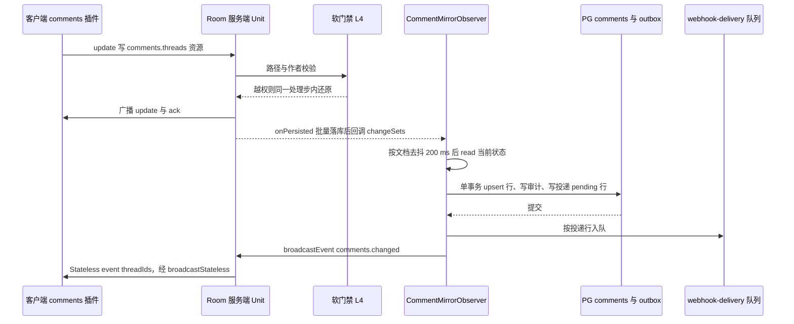
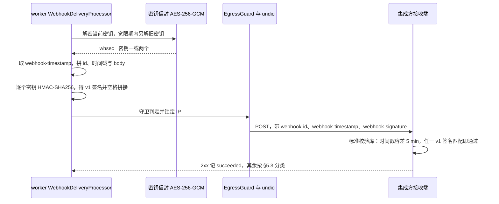
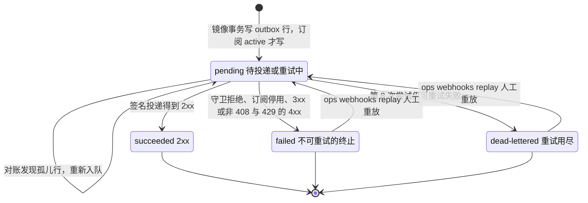
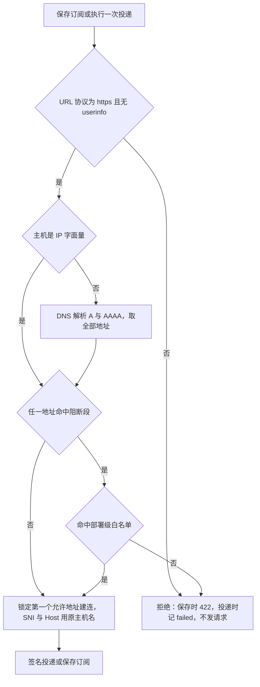
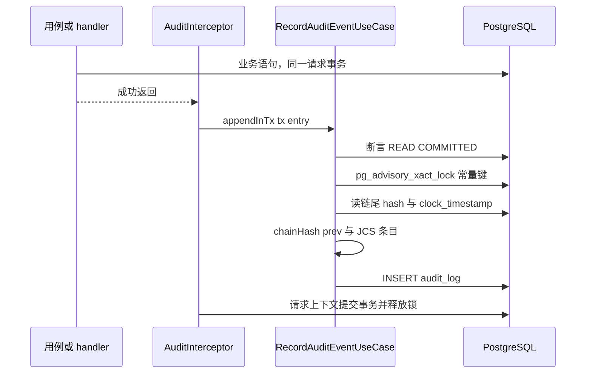
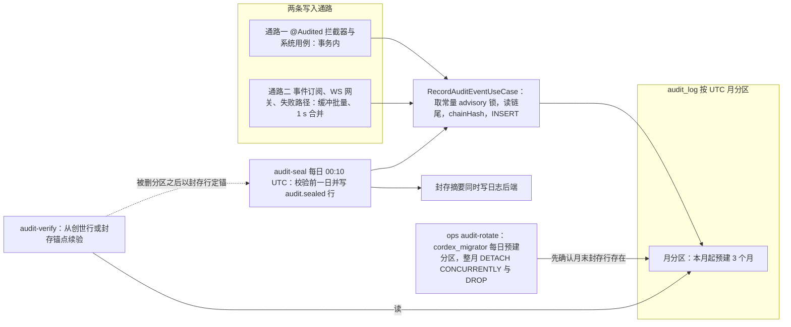

# 07 模块设计：评论镜像、Webhook 与审计
> 状态：v0.1 | 负责：后端设计线 | 更新：2026-09-25；2026-09-25（§4.19）；2026-09-25（§4.19 N1）；2026-09-26（§4.20）；2026-09-26（§4.21：Webhook 签名改为 Standard Webhooks，SSRF 判段用 ipaddr.js、出站用 undici，JCS 用 canonicalize）；2026-09-26（§4.21 整合：审计来源与模块依赖的 CollabGateway 改为 CollabUpgradeHandler 与 onAuthenticate 等钩子；comments.changed 改经 collabServer.broadcastEvent（document.broadcastStateless），不再经 FanoutBus）；2026-09-26（§4.21 Remap：原 30/08 引用按 60-backend/README §6.1 改指新位置，30/08 已删除） | 依赖：[rulings](../00-charter/rulings-2026-09-14.md) §4.12 U-14/U-15、§4.13 S-4/S-5、§4.18 BE-03/BE-13/BE-19/BE-25、§4.19 D-COMMENTS-PKG/D-M2-CONTENT、§4.21 q-webhook-sig；[ADR-0029](../30-architecture/adr/0029-gateway-authorization.md)、[ADR-0031](../30-architecture/adr/0031-comments-and-anchors-storage.md)、[ADR-0034](../30-architecture/adr/0034-server-update-validation-and-repair.md)；[01](01-service-overview-and-roles.md) §3（原 30/08 §16.6 已迁入本文 §1）；[PRD 06](../10-prd/03-features/06-server-and-ops.md) SV-07/SV-15、[PRD 03](../10-prd/03-features/03-collaboration.md) CO-04；[40/12](../40-modules/12-server-jobs-comments-and-ops.md)（文件级）


## 0. 本文定位

本文是 `CommentsModule`、`WebhooksModule`、`AuditModule` 三个 Nest 模块运行时设计的唯一事实源，同时持有两张全后端唯一登记表：**审计 action 登记表**（§9）与评论 / Webhook / 审计相关的**错误码清单**（§10.3）。其余内容只引用：

| 主题 | 事实源 |
|---|---|
| 表结构、索引、RLS policy、迁移 0070–0073 / 0094 | [13 DDL：评论、Webhook 与审计](13-ddl-comments-webhooks-audit.md) |
| 路由、守卫、DTO 文件、限流档 | [15 REST API 目录](15-rest-api-catalog.md) §3.11 comments、§3.12 webhooks、§3.13 audit |
| 模块在各 `CORDEX_ROLE` 的装配 | [01 服务总览](01-service-overview-and-roles.md) §5 装配矩阵 |
| `CONTROL.event` 帧的服务端发送规则 | [16 WS 协议（服务端视角）](16-ws-protocol-server-view.md) §3 |
| 持久化挂点 `collabServer.onPersisted`、软门禁 | [05 协同与快照](05-modules-collab-and-snapshots.md) §13、ADR-0034 |
| 队列总表、对账、周期作业 | [06 作业、导入导出](06-modules-jobs-import-export-thumbnails.md) §1、§3、§4 |
| 指标名、告警、内部端口 | [18 可观测性与运维端点](18-observability-and-ops-endpoints.md) |
| 配置键 schema | [17 部署拓扑与配置 schema](17-deployment-and-config.md) §5 |
| 客户端评论插件、面板与锚点 UI | [50/08 评论与版本历史（客户端）](../50-frontend/08-comments-and-version-history.md) |
| 测试怎么跑 | [70/07](../70-testing/07-backend-integration-and-api-e2e.md)、[70/10](../70-testing/10-security-testing.md) |

模块设计卡的栏目沿用 [03](03-modules-identity-and-access.md) §1 的模板：职责 / 非职责、用例与事务边界、路由（只链 15）、仓储与表、imports / exports、审计与错误码、角色装配、purge 参与者、机械验证。

## 1. CommentsModule：评论镜像读模型

### 1.1 职责与非职责

- **做**：把快照内 ResourceHook `comments.threads`（Y.Doc 路径 `resources['comments.threads']`，内含 `threads` 与 `replies` 两张实体表；客户端插件是 iso 包 `@cordexjs/comments`，文档类型盲，rulings §4.19 D-COMMENTS-PKG）镜像进 PG `comments` 表；提供只读 REST（线程列表、线程详情、跨文档「@我」）；在镜像提交后触发 Webhook 投递与在线通知 `CONTROL.event{comments.changed}`；作为 purge 参与者 `comments` 清理本表。依据：ADR-0031 v0.2 决策 1、4；决策 INC-39（命名空间取 `comments.*`，服务端镜像须文档类型盲，FE-01）。
- **不做**：不持有评论事实数据（事实源在 CRDT）；不提供评论写入 REST（写路径全部经协同 WS 的客户端命令，C-27 / INC-38）；不执行作者级权限（由 M-09 软门禁执行，ADR-0034 补充 v0.2）；不解析锚点语义（交给文档类型登记的解析器）；不做站内通知中心（通知出口只有客户端 EM-05 回调与服务端 Webhook，U-14）。

### 1.2 CRDT 实体到镜像行的映射

`comments` 表**一行对应一个 CRDT 实体**，线程与回复分开存，不做反规范化（DDL 与形状约束见 [13](13-ddl-comments-webhooks-audit.md) §2）：

| CRDT 实体（ADR-0031 v0.2 决策 1） | 镜像行 | 取值规则 |
|---|---|---|
| `threads[ThreadId]{anchor, resolved, resolvedBy, createdBy, createdAt}` | 线程行：`id = thread_id = ThreadId`，`parent_id IS NULL` | `anchor` 原样存 jsonb（须含判别字段 `kind`）；`anchor_key`、`anchor_state` 由文档类型登记的锚点解析器计算（§1.4）；`resolved_at / resolved_by` 由 `resolved` 与 `resolvedBy` 得出；`body`、`mentions` 为空 |
| `replies[ReplyId]{threadId, authorId, body, mentions[], createdAt, editedAt, deletedAt}` | 回复行：`id = ReplyId`，`parent_id = thread_id = threadId` | `body` 纯文本、超 5,000 字符截断并计数；`mentions` 经 §3 规范化；锚点与解决字段为空 |
| 实体从 CRDT 中消失 | 对应行置 `deleted_at` | 不物理删除；物理删除只经 purge 参与者（§1.7） |

时间字段取 CRDT 值，但 `created_at` 在写入时截到不晚于服务端当前时间，防止客户端时钟把评论钉在列表顶部。

### 1.3 CommentMirrorObserver：唯一写入口

- **装配**：只在 collab（及 all）角色注册（BE-03、BE-13）；api 与 worker 不装观察器。注册方式是订阅 server-collab 的持久化挂点 `collabServer.onPersisted`（接口本体见 [05](05-modules-collab-and-snapshots.md) §13）：每个批量事务提交后回调 `{docId, updates: [{seq, userId}], changeSets}`，观察器从 `changeSets` 中筛出 `resources['comments.threads']` 下 `threads` 与 `replies` 两张实体表的路径，得到本批变更的线程与回复 id；冲刷时再从 Room 内服务端 Unit 读这些实体的**当前**状态。
- **只处理本实例持久化的变更**：`onPersisted` 只在执行落库的那个实例触发，与「每实例只持久化自己客户端的 update」同一口径（[16](16-ws-protocol-server-view.md) §11），因此多实例部署时每个变更只被镜像一次、只产生一组 Webhook 投递。审计主体（`comment.deleted` 等的来源用户）取挂点载荷中逐条 update 的 `userId`（05 §13）；`userId` 为空的条目（修复、恢复等服务端事务）以 `actor_type = 'system'` 记、`details` 带实体的 `authorId`，不把动作错记到作者名下。
- **冲刷**：按文档去抖 200 ms（最长 500 ms）合并成一批，冲刷时从 Room 服务端 Unit 读取实体的当前状态，而不是用变更集里的中间值。软门禁的还原与原 update 在同一处理步内完成（ADR-0034），所以镜像不会写入被还原的越权值，也不会为它触发 Webhook。
- **单批事务**（数据库角色 `cordex_system`，`app.system_job = 'collab.comment-mirror'`，作业名取值见 [08](08-db-conventions-roles-rls-migrations.md) §6.5）：
  1. 先 upsert 线程行、再 upsert 回复行（`INSERT … ON CONFLICT (id) DO UPDATE … RETURNING (xmax = 0)` 区分新增与更新），不在 CRDT 中的已知实体置 `deleted_at`；
  2. 据新旧行差异派生领域事件：回复新增 → `comment.added`；回复的 `mentions` 新增了用户 → `comment.mentioned`；线程 `resolved_at` 由空变非空 → `comment.resolved`，反向 → 只审计 `comment.reopened`；
  3. 同一事务内写审计行（§9 的 `comment.*`）与 Webhook 投递 outbox 行（§5.1）；
  4. 提交后把 `webhook_deliveries` 新行入 `webhook-delivery` 队列，并经 `collabServer.broadcastEvent`（即 `document.broadcastStateless`，M3 起经 extension-redis 送达其他实例的会话；不再经 `FanoutBus`，[05](05-modules-collab-and-snapshots.md) §13）向该房间发 `CONTROL.event{name:'comments.changed', payload:{threadIds}}`（SG-03；帧格式与发送规则见 [16](16-ws-protocol-server-view.md) §3）。这一帧的含义是「PG 镜像已与 CRDT 一致」，在线客户端据此刷新依赖 REST 的视图（如同文档内的「@我」过滤）。
- **并发**：两个实例各自的客户端同时改同一文档的评论时，两边各镜像自己处理的变更，upsert 取的都是冲刷时刻的当前状态；若先提交的一方读到的是扇出尚未到达前的旧状态，镜像会短暂落后，下一次变更或下述全量对账收敛。
- **全量对账**：Room 进入 `active` 后，若 `resources['comments.threads']` 非空（含创建副本时随快照复制来的评论，[04](04-modules-documents-storage-media.md) §3.3），观察器对该文档做一次全量对账（逐实体 upsert、把镜像中多出的行置 `deleted_at`），作为镜像漂移与漏事件的兜底；对账产生的差异只写镜像与审计 `comment.mirror_repaired`，**不**补发 Webhook，避免历史事件重放给集成方。
- **延迟目标**：变更进入 Room 到镜像提交 p95 ≤ 1 s（落库 p95 ≈ 150 ms，[05](05-modules-collab-and-snapshots.md) §5，加去抖 ≤ 500 ms；ADR-0031「如何被机械验证」），PG 降级期内 `onPersisted` 不触发，镜像随回放补齐；指标 `cordex_comments_mirror_lag_seconds`（[18](18-observability-and-ops-endpoints.md) §4）。

**图 1 评论镜像时序**



怎么读：从上到下是一次评论写入；软门禁在广播前完成还原，观察器在该批 update 落库后才被回调，去抖后读取的是还原后的当前状态；镜像行、审计行与投递行在同一事务提交，入队和在线通知都发生在提交之后，所以集成方与在线客户端看到的永远是已落库的镜像。

依据：ADR-0031 v0.2 决策 1、2、4；ADR-0034 补充 v0.2；原 30/08 篇 §16.6；决策 SG-03、INC-39、DDL-COLS；rulings §4.18 BE-03。

### 1.4 锚点：anchor_key 与 anchor_state

服务端评论模块必须文档类型盲（FE-01，lint `cordex/no-doc-type-literals` 覆盖 `modules/comments/**`），因此锚点的两项派生值都交给文档类型：

- `Anchor` 是**开放判别联合**，判别字段为 `kind`（幻灯片为 `{kind:'slide', slideId, shapeId?, range?, snapshotSeq}`，客户端形状以 [50/08](../50-frontend/08-comments-and-version-history.md) 为准）。服务端只做 zod 形状校验，不解码 `RelativePosition`（ADR-0031 决策 2）。
- 文档类型在服务端宿主里登记锚点解析器 `{kind, deriveAnchorKey(anchor), resolveState(unit, anchor)}`（slide 的解析器由 slide 插件经 preset-server 装配）。`comments/domain/anchor.ts` 只按 `kind` 查表，自身不含任何文档类型字面量（BE-25：`anchor_key` 在应用层写入时计算，不是 PG 生成列）。
- `anchor_key` 的语义统一为**页键**：锚点所在页的稳定 id（幻灯片 = `slideId`；没有页的文档级锚点为空串）。REST 的 `filter=page&page=<pageKey>` 直接按它过滤，不需要知道文档类型。
- `anchor_state` 在镜像写入时按 `resolveState` 判定 `attached | detached`；目标元素处于墓碑态仍算 `attached`（墓碑 TTL 内可原 id 恢复，ADR-0031 复核修正），硬删除后才是 `detached`。客户端的解析结果始终为准，镜像值只供跨文档查询与集成方参考；压缩后批量重算留到 M4（ADR-0031 决策 3「M4 可选」）。
- 未登记的 `kind`：`anchor_key` 记 `kind` 本身、`anchor_state = 'detached'`，计入 `cordex_comments_mirror_skipped_total{reason="unknown_anchor"}`，不阻塞同批其它实体。

### 1.5 只读用例（路由见 15 §3.11）

| 用例 | 路由 | 前置检查 | 读取方式 |
|---|---|---|---|
| `ListThreadsUseCase` | `GET /documents/:id/comments?filter=all\|page\|unresolved\|mentions&page=<pageKey>` | `DocumentRoleGuard(doc.read)`；分享链接角色按 `max(直接, 链接)` 生效 | 单文档、`cordex_app` + RLS；返回线程行及其未删除回复；`mentions` 视图 = 回复 `mentions @> {当前用户}` 的线程 |
| `GetThreadUseCase` | `GET /documents/:id/comments/:threadId` | 同上；线程不存在或不属于该文档 → 404 `server.comments.not_found` | 同上 |
| `ListMyMentionsUseCase` | `GET /comments/mentions?cursor=` | 仅会话（无 `docId`） | 跨文档：`mentions @> ARRAY[当前用户] AND deleted_at IS NULL`，RLS 只放行**直接授权**可读的文档（分享令牌只随单文档请求携带，跨文档查询不带令牌），再联 `documents.status = 'active'` 排除回收站与永久删除中的文档；按 `(created_at, id)` 倒序游标，`limit ≤ 100` |
| `ImportAsEditableThreadUseCase`（P1） | `POST /documents/:id/comments/import` | `doc.comment` | 不写本表：必须在持有该文档 Room 的 collab 实例内以 `system('import-comments')` 执行 CRDT 事务，把 pptx 只读评论转成 `resources['comments.threads']` 下的实体，镜像随后由观察器写入；因此控制器 `CommentsImportController` 装在 collab（`CommentsImportHttpModule`），反代按 [01](01-service-overview-and-roles.md) §7 与快照、元素彻底删除同一条规则转发（15 §3.11 已标角色 collab）；审计 `comment.imported_as_editable` |

作者显示名经 `UsersModule` 读取；`status = 'erased'` 的用户显示为 `deleted-user`（C-24）。

### 1.6 规模上限在镜像层的处理

CO-04 / SV-08 的上限（正文 ≤ 5,000 字符、每文档 ≤ 5,000 线程、每线程 ≤ 500 回复）由客户端命令守卫与服务端门禁在写路径拒绝；镜像层只做兜底，**不因超限拒绝整批**：正文超长截断到 5,000 字符（表上另有 CHECK 作最后防线）、超出线程或回复数上限的实体跳过镜像；两者都计入 `cordex_comments_mirror_skipped_total{reason}` 并记 `warn` 日志（不含正文）。

### 1.7 永久删除与用户擦除

- **purge 参与者 `comments`**：`PurgeDocumentCommentsUseCase` 以 `@PurgeParticipant('comments')` 登记，由 worker 上的 document-purge 处理器调用（编排唯一源见 [04](04-modules-documents-storage-media.md) §4）；在 `cordex_system` + `app.system_job = 'worker.document-purge'` 下执行 `DELETE FROM comments WHERE doc_id = $1`，幂等（镜像可从 CRDT 重建，文档本身也在删除中）。自引用外键为 `RESTRICT`，RI 检查在语句末尾执行，单条语句即可同时删净线程与回复（[08](08-db-conventions-roles-rls-migrations.md) §2，PG 18 实测）。
- **用户擦除（C-24）**：不改本表的 `author_id`（`users` 行原地脱敏、不硬删）；评论正文按 `retention.erasure.commentBody`：`keep`（M3 默认）保留正文、作者显示为 `deleted-user`；`redact`（M4）由 M-09 以 `system('maintenance')` 改写 CRDT 当前状态中该用户的回复正文，镜像随观察器更新，历史快照按各自保留期存在。

## 2. 评论权限

评论的写路径不经本模块，权限在三处分别执行，本模块只负责「读」与「镜像只接受门禁之后的状态」：

| 操作 | 允许的角色 | 执行点 | 违规结果 |
|---|---|---|---|
| 创建线程、回复 | commenter 及以上 | 客户端命令守卫（能力位 `doc.comment`）；服务端硬门禁拒绝 viewer 的任何 update；软门禁限定 commenter 只能写 `resources['comments.threads']` | viewer：拒绝 update（3 次后 4403）；commenter 越界路径：还原旧值并计数（ADR-0034 补充 v0.2） |
| 编辑、删除回复 | 作者本人；owner 可删任何人的回复 | 软门禁：回复实体 `authorId ≠ 会话 userId` 且非 owner → 还原 | 还原并计数，审计 `collab.repaired` |
| 解决、重新打开线程 | commenter 及以上 | 客户端命令守卫 + 软门禁路径规则 | 同上 |
| 读评论（REST） | viewer 及以上，含分享链接角色 | `DocumentRoleGuard(doc.read)` + RLS `p_comments_app_select` | 403 / 行不可见 |
| 跨文档「@我」 | 任意已登录用户，只见直接授权可读的文档 | RLS + `documents.status = 'active'` | 行不可见 |
| 导入为可编辑线程（P1） | commenter 及以上 | `DocumentRoleGuard(doc.comment)` | 403 |

依据：ADR-0031 v0.2 决策 2；ADR-0034 补充 v0.2（路径级权限规则）；PRD CO-04「权限」条；rulings §4.18 BE-02（链接角色 = max(直接, 链接)）。

## 3. 提及

- **来源**：以回复实体的结构化字段 `mentions[]`（用户 id 数组，由客户端经用户目录解析 @ 后写入）为唯一依据，服务端**不**扫描正文文本猜提及。`comments/infrastructure/mention-parser.ts` 只做规范化：去重、至多 50 个、丢弃不是合法 UUID 或对应用户不存在 / 已擦除的 id。
- **存储**：规范化结果写回复行 `mentions uuid[] NOT NULL DEFAULT '{}'`，GIN 部分索引 `WHERE deleted_at IS NULL`（C-14、DDL-COLS；DDL 见 [13](13-ddl-comments-webhooks-audit.md) §2）。
- **查询**：单文档 `filter=mentions` 与跨文档 `GET /comments/mentions` 都走 `mentions @> ARRAY[$me]`；跨文档结果按文档权限过滤由 RLS 执行（数据库层），应用层再排除非 `active` 文档（§1.5）。被提及但对文档没有权限的用户看不到这条提及，这是有意的：提及不授予访问权。
- **通知**：回复的 `mentions` 比镜像中上一版多出用户时派生 `comment.mentioned`；Webhook 载荷中的 `mentionedUserIds` 只保留事件产生时对该文档有直接授权的用户（过滤后为空则不产生该事件），避免经集成方把评论存在性泄漏给无权用户。客户端的 `comment/mentioned` 事件由 comments 插件在本地发出（EM-05），与服务端 Webhook 并行（U-14）。

## 4. WebhooksModule：订阅管理

### 4.1 职责与边界

- **做**：订阅的注册、更新、停用、删除与查询；签名密钥的生成、加密存储与轮换；事件投递（§5）与出站守卫（§6）；投递日志查询。限界上下文 BC-30 出站集成（S-5），`generic`：投递骨架对事件来源的文档类型无知。
- **不做**：不产生事件（M3 唯一事件源是评论镜像，M4 扩到文档事件）；不接收入站 Webhook；不做通用消息总线。
- **权限**：全部管理接口只对平台管理员开放（`PlatformAdminGuard`，由 M-08 导出；单组织部署的部署级 admin，T-0）。路由见 [15](15-rest-api-catalog.md) §3.12。

### 4.2 订阅字段与规则

| 字段 | 规则 |
|---|---|
| `target_url` | 生产环境（`NODE_ENV=production`）只收 `https://`；不得含 userinfo（`user:pw@`）；≤ 2,048 字符；保存前经出站守卫尽力校验（§6），拒绝返回 422 `server.webhooks.egress_blocked` 或 `server.webhooks.invalid_url` |
| `event_filter` | 非空，⊆ `{comment.added, comment.mentioned, comment.resolved}`（INC-31/INC-29 的对外事件名，点式；PRD SV-15 的斜杠写法作废） |
| `status` | `active \| disabled`；`disabled` 时事件不入队，已排队的投递在执行时直接记 `failed`（原因 `subscription_disabled`） |
| 签名密钥 | 见 §4.3；明文只在创建与轮换的响应里出现一次 |

更新用 `PATCH /webhooks/:id`，字段级可改 `target_url`、`event_filter`、`status`，另有 `{rotateSecret: true}` 触发密钥轮换（不另开路由）。删除订阅时同一事务先删其投递记录再删订阅行（外键 `RESTRICT`，谁的表谁写；需要 `cordex_app` 对 `webhook_deliveries` 的 `DELETE`，见 [13](13-ddl-comments-webhooks-audit.md) §6.3），在途的 BullMQ 作业执行时找不到投递行即丢弃；审计 `webhook.deleted` 保留痕迹。

### 4.3 签名密钥的存储与轮换

PRD SV-15 原写「落库只存 hash」，但 HMAC 签名必须持有密钥本体，故改为加密存储（决策 C-16/INC-30，依据 PRD SV-15 + HMAC 的必要条件）：

- **生成**：32 字节 CSPRNG，对外编码为 `whsec_<base64>`（标准 base64，Standard Webhooks 各语言校验库按此解码；2026-09-26 由 base64url 改，rulings §4.21 q-webhook-sig）。
- **加密**：列 `signing_secret_enc bytea` = AES-256-GCM 信封：`格式版本 1 B ‖ KEK 编号 1 B ‖ nonce 12 B ‖ 密文 32 B ‖ tag 16 B`；AAD = `subscription_id ‖ secret_version`，把密文绑定到行与版本，防止把 A 订阅的密文拷到 B 订阅。KEK 从 `CORDEX_SECRETS_KEK_FILE`（32 字节）读取，只在 api 与 worker 进程加载；collab 只写投递行、不需要解密。
- **轮换**：`PATCH {rotateSecret:true}` 生成新密钥，旧密文移入 `previous_secret_enc` 并设 `previous_secret_expires_at = now() + 24 h`，`secret_version + 1`；宽限期内每次投递的 `webhook-signature` 同时带新旧两个签名（§5.2），集成方切换后旧密钥自然过期；投递处理器只在 `previous_secret_expires_at > now()` 时使用旧密钥，过期的旧密文由下一次 PATCH 顺带清空（处理器对订阅表只读）。
- **KEK 轮换**：信封里的 KEK 编号为此预留；重新加密全部行的 ops 命令属 M4 P1，M3 只保证单 KEK。
- **泄漏面**：密钥明文与 KEK 不进日志、trace、审计与投递记录；审计只记 `secret_version`。

## 5. 投递

### 5.1 生产与 outbox

`DeliverWebhookEventUseCase.enqueue(event)` 由评论镜像在其单批事务内调用（§1.3 第 3 步），对每个 `status = 'active'` 且 `event_filter` 含该事件的订阅：

1. `INSERT INTO webhook_deliveries (…, status='pending', attempt=0, next_attempt_at=now()) ON CONFLICT (subscription_id, event_id) DO NOTHING`；`event_id` 是由 CRDT 数据确定的去重键（`comment.added:{replyId}`、`comment.mentioned:{replyId}:{editedAt 或 createdAt 毫秒}`、`comment.resolved:{threadId}:{resolvedAt 毫秒}`），多实例或重复观察同一变更只落一行；
2. 事务提交后以投递行 id 作 BullMQ `jobId` 入 `webhook-delivery` 队列；
3. 入队失败不回滚：`reconciliation`（每 1 min，[06](06-modules-jobs-import-export-thumbnails.md) §3）扫描 `status='pending' AND next_attempt_at < now() - 2 × 处理器超时`（处理器超时 15 s，06 §1）且无对应 BullMQ 作业的行重新入队（rulings §4.13「Webhook 投递补 Outbox 对账」；Valkey 数据丢失时同样由它补投）。

载荷为版本化信封（schema 放 protocol `rest/webhooks.ts`，文件登记见 [40/02](../40-modules/02-kernel-protocol-and-document-core.md)）：

```json
{ "id": "<event_id>", "type": "comment.added", "version": 1, "createdAt": "2026-09-25T08:00:00.000Z",
  "data": { "docId": "…", "threadId": "…", "replyId": "…", "authorId": "…", "isThreadStart": true,
            "pageKey": "…", "link": "https://<host>/documents/<docId>?comment=<threadId>" } }
```

`comment.mentioned` 的 `data` 另含 `mentionedUserIds`（§3 过滤后），`comment.resolved` 为 `{docId, threadId, resolvedBy, resolvedAt, link}`。**载荷不含评论正文与文档标题**：投递记录保留 90 天且不在文档永久删除的参与者集合里，只放 id、时间与深链才能保证永久删除后不残留内容；集成方凭深链或 M4 API 取正文。深链格式按 INC-35（`/documents/:id?comment=`）。

### 5.2 请求与签名

签名采用 **Standard Webhooks** 规范（rulings §4.21 q-webhook-sig，用户裁决）：集成方可以直接用各语言现成的 Standard Webhooks 校验库验签，多个签名以空格分隔，天然支持密钥轮换。实现只用 `node:crypto`，不引 `standardwebhooks` 包（它依赖 Unlicense 的 `fast-sha256`，见 [19](./19-reuse-and-dependency-catalog.md) §15.2）。旧头 `X-Cordex-Signature`（`t=…, v1=<hex>`）与 `X-Cordex-Delivery` 废止，分别由 `webhook-signature` 与 `webhook-id` 取代。

| 头 | 值 |
|---|---|
| `Content-Type` | `application/json`（请求体 = `payload` 的规范化字节，其 SHA-256 等于 `payload_hash`） |
| `webhook-id` | 投递行 id（重试不变，集成方据此去重；原 `X-Cordex-Delivery`） |
| `webhook-timestamp` | 本次尝试的 unix 秒（每次尝试重新取值并重新签名） |
| `webhook-signature` | `v1,<base64(HMAC-SHA256(key, webhook-id + "." + webhook-timestamp + "." + body))>`，`key` 为 `whsec_` 之后部分的 base64 解码；轮换宽限期内空格分隔追加旧密钥的第二个 `v1,…`，新密钥在前 |
| `X-Cordex-Event` | 事件名，如 `comment.added`（便于集成方路由；规范之外的附加头，不参与签名） |
| `User-Agent` | `Cordex-Webhooks/<appVersion>` |

建议集成方按规范拒绝 `webhook-timestamp` 与本地时间相差 > 5 min 的请求（各语言校验库的默认容差）。连接超时 5 s、总超时 10 s；**不跟随重定向**；响应体最多读 64 KiB 后丢弃；不走进程级 HTTP 代理（连接固定到守卫锁定的 IP，§6）。

签名函数（`webhooks/infrastructure/webhook-signer.ts`，示意；`verifySignature` 只供测试与示例接收端使用）：

```ts
import { createHmac } from 'node:crypto';

/** Standard Webhooks v1：secrets 为当前密钥在前、宽限期内的旧密钥在后 */
export function signPayload(webhookId: string, timestampSec: number, body: string,
                            secrets: readonly string[]): string {
  const content = `${webhookId}.${timestampSec}.${body}`;
  return secrets
    .map((secret) => {
      const key = Buffer.from(secret.replace(/^whsec_/, ''), 'base64');
      return `v1,${createHmac('sha256', key).update(content).digest('base64')}`;
    })
    .join(' ');
}
```

**图 2 Standard Webhooks 签名与验签**



怎么读：纵线是参与方，自上而下是一次尝试。每次尝试都重新取时间戳并重新签名，`webhook-id` 在重试之间不变；轮换宽限期内同一头里有两个签名，接收端只要任一匹配就通过，所以集成方可以先换新密钥、再等旧密钥过期。

依据：rulings §4.21 q-webhook-sig；§4.3 密钥信封；§6 出站守卫；PRD SV-15。

### 5.3 结果分类、退避与状态

处理器 `WebhookDeliveryProcessor` 只在 worker 注册（BE-19、BE-13），队列 `webhook-delivery` 并发 4。每次执行：读投递行与订阅 → 投递行已不存在（订阅已连同投递记录删除）则丢弃作业；订阅已停用则记 `failed` → 出站守卫（§6）→ 解密密钥、签名、发送 → 按下表落状态：

| 结果 | 分类 | 行状态 |
|---|---|---|
| 2xx | 成功 | `succeeded`，写 `delivered_at`、`response_code` |
| 408、429、5xx、连接失败、超时、DNS 临时失败 | 可重试 | 仍为 `pending`，`attempt + 1`，`next_attempt_at` = 退避后时刻；第 8 次仍失败 → `dead-lettered` |
| 其它 4xx、3xx（不跟随重定向）、出站守卫拒绝、URL 非法、订阅停用 | 不可重试 | `failed` |

退避：第 n 次失败后等待 `min(30 s × 2^(n-1), 6 h)`，±20% 抖动；429 带 `Retry-After` 时取二者较大值（不超过 6 h）。8 次尝试之间有 7 次等待，累计约 1 h 4 min（30 s + 60 s + … + 1,920 s，不计抖动）；`Retry-After` 可能拉长等待，因此另设总窗口：距该行 `created_at` 超过 24 h 仍未成功即转 `dead-lettered`，满足 SV-15「重试退避 ≤ 24 h」。BullMQ 作业配置 `attempts: 8` 与自定义退避，不可重试错误抛 `UnrecoverableError` 让队列停止重试；行状态以处理器写入为准，BullMQ 作业只是执行载体。`last_error` 记错误类别与截断的响应摘要（≤ 1 KiB，不存响应正文全文）。状态值按 rulings §4.18 BE-19 原文写作 `dead-lettered`，与 protocol 字面量、表上 CHECK 一致。

**图 3 WebhookDelivery 投递状态**



怎么读：`pending` 同时覆盖首次待投递与重试中，自环表示状态不变、只推进 `attempt` 与 `next_attempt_at`；`succeeded`、`failed`、`dead-lettered` 都是终态，系统不会自动离开；只有运维命令 `webhooks:replay` 能把 `failed` 或 `dead-lettered` 重放回 `pending`（`attempt` 清零）。

依据：rulings §4.18 BE-19；§4.13 Outbox 对账；PRD SV-15；40/19 图 7-4（本图取代）。

### 5.4 投递日志、重放与保留

- **查询**：`GET /webhooks/:id/deliveries?status=&cursor=`（平台管理员），按 `(created_at desc, id)` 游标分页，返回状态、尝试次数、响应码、`last_error`、时间；不返回签名与密钥。
- **重放**：ops 命令 `cordex-ops webhooks:replay --delivery <id> | --subscription <id> --since <时间>`（`cordex_system` + Valkey，与 [17](17-deployment-and-config.md) §9 的 `jobs:replay` 同一身份）把 `dead-lettered` 或 `failed` 行重置为 `pending`（`attempt = 0`）并入队，写审计 `webhook.delivery_replayed`（主体类型 `ops`）。不提供重放 REST（M4 管理面板再评估）。
- **保留**：终态行（`succeeded`、`failed`、`dead-lettered`）在 `updated_at` 超过 `retention.webhookDeliveriesDays`（默认 90 天，RETENTION）后由 maintenance 周期作业 `webhook-deliveries-prune` 删除；`pending` 行不清。

## 6. 出站守卫（SSRF）

`EgressGuard`（`webhooks/infrastructure/egress-guard.ts`）在两个时点执行：订阅创建与更新时**尽力**校验（DNS 可能之后变化），每次实际投递前**权威**校验并锁定 IP。默认严格，部署级白名单只用于显式放宽（rulings §4.13 S-4）。

1. **解析 URL**（WHATWG URL）：协议只允许 `https`（非生产环境另允许 `http`）；拒绝 userinfo；主机为 IP 字面量时直接进入第 3 步。
2. **DNS 解析**：同时解析 A 与 AAAA，取全部地址；解析失败按可重试处理（投递时）或 422（保存时）。
3. **逐个地址判定**（纯函数 `isBlockedEgressAddress`，只看地址段；地址解析与 CIDR 匹配用 `ipaddr.js` 2.5，阻断段仍以下表为唯一事实源，库自带的 `range()` 分类只作参考，2026-09-26 定，R-d-53）：**任一**地址命中阻断段即整体拒绝，防止多条解析记录里夹带内网地址。阻断段：
   - IPv4：`0.0.0.0/8`、`10.0.0.0/8`、`100.64.0.0/10`、`127.0.0.0/8`、`169.254.0.0/16`（含云元数据 `169.254.169.254`）、`172.16.0.0/12`、`192.0.0.0/24`、`192.0.2.0/24`、`192.168.0.0/16`、`198.18.0.0/15`、`198.51.100.0/24`、`203.0.113.0/24`、`224.0.0.0/4`、`240.0.0.0/4`；
   - IPv6：`::/128`、`::1/128`、`fc00::/7`（含 `fd00:ec2::254`）、`fe80::/10`、`ff00::/8`、`2001:db8::/32`；`::ffff:0:0/96` 与 `64:ff9b::/96` 取内嵌 IPv4 按上表再判一次。
4. **白名单**：配置 `webhooks.egressAllowlist`（CIDR 或精确主机名，默认空 = 严格）命中时放行第 3 步的判定，但不放宽第 1 步的协议与 userinfo 规则。
5. **锁定连接**：出站统一用 `undici` 8 的 `Agent({ connect: { lookup } })`，`lookup` 钩子把连接固定到第 3 步通过的第一个地址（从 `undici` 包 import，不用 Node 内置 `fetch` 的全局 dispatcher）；TLS 的 SNI 与证书校验、`Host` 头仍用原主机名，防 DNS 重绑定。
6. **拒绝出口**：保存时 422 `server.webhooks.egress_blocked`；投递时记 `failed`（`last_error = 'egress_blocked'`）且不发出任何请求；两处都计 `cordex_webhooks_egress_blocked_total{stage}`。

**图 4 Webhook 出站守卫**



怎么读：自上而下是一次判定；菱形为判定点，任一判定走到「拒绝」都不会产生出站请求；白名单只能放行地址段判定，不能放行协议与 userinfo 检查；保存订阅与每次投递都走完整流程，投递时的判定才是关键防线。

依据：rulings §4.13 S-4；PRD SV-15 出站 SSRF 条；40/12 §2.3 `isBlockedEgressAddress`、§2.5 `EgressGuard` 注；决策 INC-10/SG-04（码名 `server.webhooks.egress_blocked`）。

## 7. AuditModule：两条写入通路

### 7.1 职责与边界

- **做**：`audit_log` 的只追加写入、哈希链、每日封存、链校验、查询与 CSV / JSON 导出；审计 action 登记表（§9）及其代码形态 `audit/domain/audit-actions.ts`（action → 类别、details 的 zod schema、是否合并）。`AuditModule` 为 global，装在 api、collab、worker（renderer 不装，BE-14）。
- **不做**：不做鉴权与权限判定（M-08）；不做指标与日志（[18](18-observability-and-ops-endpoints.md)，二者分工见 [18](18-observability-and-ops-endpoints.md) §10）；不因用户擦除改写任何审计行（SV-07 只追加，C-24）。

### 7.2 通路一：@Audited 拦截器（事务内写）

适用于 REST 用例的成功路径与各模块的系统用例，**审计行与业务变更同一事务提交或回滚**：

- 请求级事务由 `RequestContextInterceptor` 开启（它本来就要在事务里 `SET LOCAL app.user_id` 供 RLS 使用，[02](02-auth-chain.md) §10），`AuditInterceptor` 位于其内层；handler 成功返回后、事务提交前，拦截器按 `@Audited(action, opts)` 组装条目并调用 `RecordAuditEventUseCase.appendInTx(tx, entry)`，写入协议见 §8.2。
- 系统用例（document-purge、audit-seal、评论镜像、墓碑硬删除旁路的审计等）在各自事务里直接调用同一个 `appendInTx`。
- 只读请求（GET）与高频访问类事件（取文档内容、下载导出、签发协同票据）不走本通路：它们没有需要一起提交的业务变更，走通路二可避免在热路径上取全局审计锁。
- 失败路径（handler 抛错、事务回滚）不在本通路记账：安全相关的拒绝（401 / 403 / 429、CSRF、Origin）由全局异常过滤器与守卫改走通路二，因为业务事务已经回滚。
- **隔离级别约束**：`appendInTx` 先断言 `current_setting('transaction_isolation') = 'read committed'`。REPEATABLE READ 及以上的快照早于取锁，会读到过期的链尾、造成分叉；需要更高隔离级别的用例改走通路二。

### 7.3 通路二：事件订阅与缓冲批量写

适用于高频或无请求事务的来源：

| 来源 | 进入方式 |
|---|---|
| cordis 事件：`command/audited`（服务端以 `principal='system'` 执行的命令）、`permission/denied`、`plugin/failed`、`unit/migrated`、`collab-server/update-rejected`、`collab-server/repair`（含 report-only 检出） | `AuditEventSubscriber` 经共享宿主 `ctx.on` 订阅（事件载荷以 [05](05-modules-collab-and-snapshots.md) §14 为准） |
| 持久化挂点 `collabServer.onPersisted`（批量落库后，[05](05-modules-collab-and-snapshots.md) §13） | `AuditEventSubscriber` 在 collab 注册同一挂点，按文档生成 `document.edited`（不新增 cordis 事件） |
| WS 接入：加入、离开、票据拒绝、Origin 拒绝 | Origin 拒绝由 `CollabUpgradeHandler`（升级前检查）、票据拒绝由 `onAuthenticate`、加入与离开由 `connected` / `onDisconnect` 钩子直接调用 `RecordAuditEventUseCase.buffer(entry)` |
| HTTP 失败路径：401 / 403 / 429、CSRF 拒绝、登录失败 | 全局异常过滤器与守卫调用 `buffer(entry)` |

- **缓冲**：每进程一个 `AuditBuffer`，每 200 ms 或满 100 条冲刷一次，冲刷在独立事务里按 §8.2 的协议批量写入（同一把锁内逐行串链）。
- **合并**：§9 标「合并」的 action 以 `(actor_id, action, doc_id, target_id)` 为键、1 s 窗口合并成一行，`details` 追加 `count`、`firstAt`、`lastAt`；合并不是采样，次数完整保留（满足 ADR-0029「每次外部访问写审计、不采样」与 SV-07「超出时每用户每秒一条汇总」）。
- **背压与丢弃**：缓冲上限 10,000 条；写库失败按 1 s、2 s、4 s 重试 3 次；仍失败或溢出则丢弃并计 `cordex_audit_buffer_dropped_total`（critical 告警，[18](18-observability-and-ops-endpoints.md) §5），绝不阻塞协同与请求线程。优雅关闭时在关闭预算内冲刷缓冲。

### 7.4 条目字段的取值

| 字段 | 取值 |
|---|---|
| `actor_type / actor_id` | 会话用户 → `user`；运维令牌访问内部端点或 `cordex-ops` 命令 → `ops`（`actor_id` 为空）；系统作业 → `system` |
| `session_id / request_id / trace_id` | 会话 sid、请求 id、当前 trace id（WS 会话取加入时的会话父 span） |
| `ip_hash / ua_hash` | `HMAC-SHA256(审计盐, 值)`，审计盐来自配置键 `audit.hashSaltFile`（环境变量 `CORDEX_AUDIT_HASH_SALT_FILE`，[17](17-deployment-and-config.md) §5）；配置 `audit.recordClientIp = false` 时 `ip_hash` 为空（PRD「来源 IP 可配置脱敏」） |
| `client_version` | 请求头 `X-Cordex-Client-Version` 或票据中的 appVersion |
| `result` | `success`；拒绝类 `denied`；执行失败 `failed` |
| `details` | 按 action 登记的 zod schema 校验；键名黑名单（`text`、`body`、`update`、`state`、`snapshot`、`token`、`secret`、`title`）开发期抛错、生产期丢弃该键并计数；数字只允许安全整数（哈希规范化要求，§8.1） |

### 7.5 查询与导出（路由见 15 §3.13）

- `GET /audit`：平台管理员；过滤 `from`、`to`（区间 ≤ 366 天，否则 400 `server.audit.range_too_large`）、`category`、`action`、`docId`、`actorId`、`result`；`(created_at desc, id desc)` 游标，`limit ≤ 100`；分区按 `created_at` 裁剪。
- `GET /audit/export?format=csv|json`：同过滤条件，流式输出，单次 ≤ 1,000,000 行（超出 422 `server.audit.export_too_large`，请缩小区间）；列与表列一一对应，`bytea` 列输出十六进制；导出动作本身审计 `audit.exported`。

## 8. 审计哈希链、每日封存与分区轮换

依据：决策 C-20/G-13/G-14（authority：PRD SV-07 只追加 + 哈希链 + 保留期；PostgreSQL 分区表主键须含分区键，C-19）；rulings §4.12 U-15（M3 即实现）。

### 8.1 链的定义

- `hash = SHA-256(P ‖ UTF-8(JCS(entry)))`：`P` 为 `prev_hash`，创世行（全表第一行）`prev_hash` 为空、`P` 取 32 个零字节；`JCS` 为 RFC 8785 JSON 规范化，由 `canonicalize` 5.1（Apache-2.0，作者为 RFC 8785 合著者，2026-09-26 定，R-d-55）实现，链的其余部分（串行化、封存、校验）维持自研（[19](./19-reuse-and-dependency-catalog.md) §15.2）。
- `entry` 固定为 `{v:1, createdAt, category, action, result, actorType, actorId, targetType, targetId, docId, sessionId, requestId, traceId, ipHash, uaHash, clientVersion, details}`：`createdAt` 为 UTC 毫秒 ISO 串，`ipHash / uaHash` 为小写十六进制，缺省值一律写 `null`。`id` **不参与**哈希——链序由 `prev_hash` 首尾相接固定，`id` 只用于排序与游标，允许空洞。
- `chainHash` 是 `audit/domain/audit-chain.ts` 的纯函数，写入、封存与校验三处共用；`details` 只含可无损往返 jsonb 的值（字符串、布尔、安全整数、数组、对象），保证读回后规范化结果与写入时逐字节相同。

### 8.2 写入协议

在调用方事务内（READ COMMITTED）依次执行：

1. `SELECT pg_advisory_xact_lock(1128552513, 1)`——全库常量键（第一段为 ASCII `CDXA`，第二段 1 = 审计链），跨进程、跨角色串行化所有审计写入；
2. 读链尾 `SELECT hash FROM audit_log ORDER BY id DESC LIMIT 1`，并取 `date_trunc('milliseconds', clock_timestamp())` 作为本条 `created_at`（在锁内取，`id` 与 `created_at` 同向递增）；
3. 应用层计算 `hash`，`INSERT` 一行或（批量时）逐行串链的多行；
4. 随调用方事务提交释放锁。

锁只覆盖「读链尾 → 插入 → 提交」这一小段；通路一把它放在业务事务的最后一步，通路二的批量冲刷一次事务写多行，锁竞争与审计吞吐（SV-07：每文档 ≤ 50 事务 / s 无背压）由合并与批量共同保证。SQL 示例见 [13](13-ddl-comments-webhooks-audit.md) §7.1。

**图 5 事务内审计写入时序**



怎么读：纵向是一个请求事务的尾段；取锁发生在业务语句之后，因此锁持有时间只含读链尾、插入与提交；审计行与业务变更一起提交，业务回滚时审计行也不存在。

依据：本节 §8.2；§7.2；决策 C-20/G-14。

### 8.3 每日封存

- maintenance 周期作业 `audit-seal`（BullMQ Job Scheduler，每日 00:10 UTC，只在 worker 注册，BE-19）封存前一个 UTC 日 D。
- 步骤：从上一条封存行的 `lastHash` 起按 `id` 逐行校验 D 日全部行的首尾相接与哈希 → 按 §8.2 写一行 `action = 'audit.sealed'`、`category = 'system'`、`details = {date, firstId, lastId, rows, lastHash, prevSealId, verified}`；同时以 `info` 日志 `server:audit` 输出同一摘要，让封存摘要在数据库之外（日志后端）另有一份。
- 幂等：D 的封存行已存在则跳过（部分索引 `ix_audit_log_sealed`）；D 日无审计行也写一条 `rows = 0` 的封存行，保证每日都有锚点。
- 发现断链：仍写封存行（`verified = false`，附 `firstBreakId`），另写 `audit.chain_broken`（安全类）并计 `cordex_audit_chain_verify_failures_total`（critical 告警）。
- 顺带发布运维量 `cordex_audit_partitions_ahead`（已预建的未来月分区数），供告警 `CordexAuditPartitionsLow` 使用（[18](18-observability-and-ops-endpoints.md) §5）。

### 8.4 按月分区与保留期轮换

- `audit_log` 按 UTC 自然月 `RANGE (created_at)` 分区，主键 `(id, created_at)`（C-19）；**不建默认分区**（[08](08-db-conventions-roles-rls-migrations.md) §3）：落到未建月份的写入直接失败（事务内审计会连带业务事务失败，fail-closed），因此预建余量不足 2 个月即告警、不足 1 个月 `/readyz` 标记 `degraded`（[18](18-observability-and-ops-endpoints.md) §5、§6）。
- 保留期 `retention.auditDays`（默认 365，可配）按**整月**执行：ops 命令 `audit-rotate` 以 `cordex_migrator` 凭据运行（compose / Helm 的定时入口见 [17](17-deployment-and-config.md) §9），应用角色与 `cordex_system` 没有 `DELETE` 与任何 DDL 权限：
  1. `cordex_audit_ensure_partitions(3)` 预建本月起未来 3 个月分区；
  2. 找出上界早于 `now() - retention.auditDays` 的月分区；逐个确认「该月最后一天」的封存行存在且 `verified = true`（该封存行写于次月首日，落在仍保留的分区里），否则中止；
  3. `ALTER TABLE audit_log DETACH PARTITION … CONCURRENTLY`（不能在事务块内执行；中断后下次先 `… FINALIZE`；`lock_timeout = 5s`，失败重试）→ `DROP TABLE`；
  4. 写审计 `audit.partition_dropped`（主体类型 `ops`）。
- 实际保留 365～396 天（整月粒度）。文档永久删除与用户擦除都不删审计行（SV-11「审计保留」）。

### 8.5 链校验工具

- 入口：CLI `cordex-ops audit-verify [--from <日期>] [--to <日期>]`（`cordex_app` 只读身份，任一非 renderer 角色的容器内可运行，[17](17-deployment-and-config.md) §9）与内部端点 `POST /internal/admin/audit/verify {from?, to?}`（装在 worker、挂内部端口 9464、要求运维令牌，INC-26；同一时刻只允许一个校验，重复请求 409 `server.audit.verify_busy`）。
- **定锚**：取区间内（缺省为全部保留数据）`id` 最小的行 R0，依次尝试：① `R0.prev_hash` 为空 → 创世锚点；② 表中仍有 `hash = R0.prev_hash` 的前一行 → 以它为区间边界（只校验指定区间时的常见情况）；③ 有 `details.lastHash = hex(R0.prev_hash)` 的封存行 → 封存锚点（最老分区被轮换删除后正是这种情况）；④ 都没有 → 报告 `anchor_missing`，继续校验其后的首尾相接，但结论标为「未定锚」。
- **逐行校验**：按 `id` 升序每批 10,000 行，检查 `prev_hash = 上一行.hash` 与 `hash = chainHash(prev_hash, entry)`；遇到封存行另核对 `details.lastHash` 等于 `lastId` 行的 `hash`。
- **输出**：`{anchor, rows, firstId, lastId, breaks:[{id, kind:'prev_mismatch'|'hash_mismatch'|'seal_mismatch'}]}`；写审计 `audit.verified`，有断链时另写 `audit.chain_broken` 并计数。

**图 6 审计写入、哈希链、封存与轮换**



怎么读：左侧两条通路汇入同一个写入用例，它是唯一持锁读链尾并插入的地方；封存作业本身也经写入用例落一行链上记录，并把摘要复制到日志后端；轮换只在确认月末封存行存在后整月删除分区；校验从创世行或被删分区之后的封存行定锚（虚线：分区已删除后才走的定锚路径）。表上不建默认分区，缺月份的写入直接失败。

依据：决策 C-20/G-13/G-14、RETENTION；rulings §4.12 U-15、§4.18 BE-19；[08](08-db-conventions-roles-rls-migrations.md) §3；PRD SV-07。

## 9. 审计 action 登记表（全后端唯一登记处）

命名：`<resource>.<snake_action>`（资源单数 snake_case，动作 snake_case 过去式或名词，正则 `^[a-z][a-z0-9_]*\.[a-z][a-z0-9_]*$` 由表上 CHECK 强制）。依据：决策 INC-31/INC-29（authority：charter §5.5 服务端点式 + PRD SV-15）。旧写法中的斜杠与 kebab 形式（`permission/granted`、`share-link.accessed`、`document.purge-scheduled`、`auth.login-succeeded`、`auth.collab-ticket-issued` 等）一律作废，按本表改名；`permission/changed` 只作 cordis 事件名（Valkey `perm:doc:{docId}` 频道），不是审计 action。其它文件（[02](02-auth-chain.md)–[06](06-modules-jobs-import-export-thumbnails.md)、[15](15-rest-api-catalog.md)）只引用本表；它们现稿里的以下写法按本表改名：`auth.logged_out` → `auth.logout`，`auth.refresh_reused` → `auth.session_revoked`（`reason: refresh_reused`），`user.status_changed` → `user.suspended` / `user.reactivated`，`admin.compact_forced` / `admin.migrate_forced` → `admin.compacted` / `admin.migrated`，`snapshot.named` → `snapshot.created`，`import.requested` / `export.requested` → `import.created` / `export.created`。

栏目：类别（SV-07：access 访问、edit 编辑、comment 评论、permission 权限、version 版本、admin 管理、security 安全，另加 system 系统）；通路（一 = 事务内，二 = 缓冲）；合并（✓ = 1 s 窗口合并计数）；details 只列键名，均不含文档内容。

### 9.1 身份与会话

| action | 类别 | 触发点 | 通路 | 合并 | details | 里程碑 |
|---|---|---|---|---|---|---|
| `auth.login_succeeded` | access | AuthModule OIDC 回调成功 | 一 | — | `issuer, jit` | M2 |
| `auth.login_failed` | security | OIDC 回调失败（state 不符、IdP 错误、用户已停用；已擦除用户的身份行已删，再登录会新建账号，不走本条） | 二 | ✓ | `issuer, reason` | M2 |
| `auth.logout` | access | `POST /auth/logout` | 一 | — | `sid` | M2 |
| `auth.session_revoked` | security | 停用、擦除、刷新令牌重用检测、管理员吊销 | 一 | — | `scope: sid\|all, reason: suspended\|erased\|refresh_reused\|admin` | M2 |
| `auth.csrf_rejected` | security | CsrfGuard 拒绝（INC-24） | 二 | ✓ | `method, route, reason: origin\|header` | M2 |
| `auth.origin_rejected` | security | WS 升级 Origin 不在白名单（INC-24） | 二 | ✓ | `originHost` | M2 |
| `auth.collab_ticket_issued` | access | `POST /documents/:id/collab-ticket` | 二 | — | `role, viaLink, jti` | M2 |
| `request.rate_limited` | security | RateLimitGuard 返回 429 | 二 | ✓ | `bucket, route` | M2 |
| `user.provisioned` | admin | 首次登录 JIT 建号（与登录同事务） | 一 | — | `issuer` | M2 |
| `user.profile_updated` | admin | `PATCH /users/me/profile` | 一 | — | `fields` | M3 |
| `user.suspended` / `user.reactivated` | admin | `PATCH /users/:id {status}` | 一 | — | `user.suspended`：`soleOwnerDocCount`（该用户是唯一可用 owner 的文档数，rulings §4.20 BE-05）；`user.reactivated`：— | M3 |
| `user.role_changed` | admin | `PATCH /users/:id {platformRole}`；登录时按 `auth.bootstrapAdmins` 把首个管理员升为 `admin`（[02](02-auth-chain.md) §3） | 一 | — | `from, to, via: admin\|bootstrap` | M2（bootstrap）/ M3（管理端点） |
| `user.erased` | admin | `POST /users/:id/erasure`（C-24、INC-22） | 一 | — | `sessionsRevoked, identitiesDeleted, commentBody, soleOwnerDocCount` | M3 |

### 9.2 文档、权限、分享与媒体

| action | 类别 | 触发点 | 通路 | 合并 | details | 里程碑 |
|---|---|---|---|---|---|---|
| `document.created` | edit | 创建文档（含导入新建、创建副本） | 一 | — | `docType, source: blank\|import\|duplicate, sourceDocId?` | M2 |
| `document.renamed` | edit | `PATCH /documents/:id {title}` | 一 | — | —（不记标题） | M2 |
| `document.opened` | access | 取文档内容：`GET …/snapshots/latest` | 二 | ✓ | `via: snapshot` | M2 |
| `document.trashed` / `document.restored` | admin | 进回收站 / 从回收站恢复 | 一 | — | — | M2 |
| `document.locked` / `document.unlocked` | admin | 系统在覆盖导入、迁移前后加解锁（版本恢复不加锁，rulings §4.19 N1）；`trash-expiry` 释放到期的锁（[04](04-modules-documents-storage-media.md) §3.2 `ReleaseExpiredLocksUseCase`） | 一 | — | `reason: import\|migration`（`document.unlocked` 另有 `expired`；原取值含 `restore`，随 N1 删去） | M2 |
| `document.purge_scheduled` | admin | schedule-purge（永久删除、回收站到期、擦除；INC-22） | 一 | — | `reason: permanent_delete\|trash_expired\|erasure, jobId` | M3 |
| `document.purged` | admin | finalize-purge（[04](04-modules-documents-storage-media.md) §4） | 一 | — | `jobId, objectVersionsDeleted, participants: {<参与者名>: rowsDeleted}`（七个参与者的 `PurgeStepReport` 计数） | M3 |
| `document.element_purged` | admin | `POST /documents/:id/elements/purge`（CO-07，只墓碑态、限 owner） | 一 | — | `count, ids` | M3 |
| `document.edited` | edit | 持久化挂点 `collabServer.onPersisted`（批量落库后，[05](05-modules-collab-and-snapshots.md) §13；主体取载荷逐条 update 的 `userId`） | 二 | ✓ | `updates, bytes` | M2 |
| `permission.granted` | permission | `PUT /documents/:id/permissions` | 一 | — | `principalId, role, previousRole` | M3 |
| `permission.revoked` | permission | `DELETE …/permissions/:principalId` | 一 | — | `principalId, previousRole` | M3 |
| `permission.denied` | security | DocumentRoleGuard 403、事件 `permission/denied`、WS 每帧检查拒绝 | 二 | ✓ | `capability, channel: rest\|ws\|command` | M3 |
| `share_link.created` | permission | `POST …/share-links` | 一 | — | `linkId, role, expiresAt` | M3 |
| `share_link.revoked` | permission | `DELETE …/share-links/:linkId` | 一 | — | `linkId` | M3 |
| `share_link.accessed` | access | ShareLinkGuard 成功叠加链接角色（每次外部访问，ADR-0029 补充 2026-09-21「仅审计，不采样」；1 s 合并计数不丢次数） | 二 | ✓ | `linkId, role, directRole` | M3 |
| `media.uploaded` | edit | `POST …/media/commit`（INC-21；去重命中也记，标 `deduplicated`） | 一 | — | `sha256, byteSize, mime, deduplicated` | M2 |

`document.edited` 的 details 只有计数，服务端看不到客户端命令 id（Y update 不携带），PRD SV-07「编辑（命令 id、影响页与元素数）」中的命令 id 只在服务端执行的系统命令里有（`command.system_executed`）。个人记账（固定、最近打开）不审计。

### 9.3 协同、版本、作业与导入导出

| action | 类别 | 触发点 | 通路 | 合并 | details | 里程碑 |
|---|---|---|---|---|---|---|
| `collab.join` | access | 握手成功 `auth.ok` | 二 | — | `role, viaLink, readonlyReason: capacity\|over_ceiling\|locked` | M2 |
| `collab.leave` | access | 连接关闭 | 二 | — | `closeCode, durationMs` | M2 |
| `collab.ticket_rejected` | security | 票据无效、过期、重放或权限版本过旧 | 二 | ✓ | `reason: invalid\|expired\|replayed\|perm_version` | M2 |
| `collab.update_rejected` | security | 事件 `collab-server/update-rejected`（硬门禁） | 二 | ✓ | `code` | M2 |
| `collab.repaired` | security | 事件 `collab-server/repair`（软门禁还原） | 二 | ✓ | `rule, paths` | M2 |
| `collab.hard_delete_bypass` | security | 软门禁 report-only 检出客户端绕过墓碑硬删（ADR-0034 修订 2026-09-24） | 二 | ✓ | `count` | M2 |
| `command.system_executed` | edit | 事件 `command/audited`（`principal='system'`） | 二 | — | `commandId, mutations, elements` | M2 |
| `unit.migrated` | version | 事件 `unit/migrated` | 二 | — | `from, to` | M2 |
| `snapshot.created` | version | `POST /documents/:id/snapshots {name}`（只记命名版本，自动快照不审计） | 一 | — | `snapshotId` | M3 |
| `snapshot.restored` | version | `POST …/snapshots/:id/restore` | 一 | — | `snapshotId, restoreSnapshotId` | M3 |
| `import.created` / `import.cancelled` | edit | `POST /imports`、`POST /imports/:jobId/cancel`、`POST /documents/:id/duplicate`（`source:'duplicate'`） | 一 | — | `jobId, byteSize, source?` | M2 |
| `import.completed` / `import.failed` | edit | import 处理器终态 | 一 | — | `jobId, docId, errorCode` | M2 |
| `export.created` | access | `POST /documents/:id/export`（服务端导出，路由里程碑见 [15](15-rest-api-catalog.md) §3.9） | 一 | — | `jobId, format` | M3 |
| `export.downloaded` | access | `GET /exports/:jobId` | 二 | — | `jobId` | M3 |

### 9.4 评论、Webhook、运维与审计自身

| action | 类别 | 触发点 | 通路 | 合并 | details | 里程碑 |
|---|---|---|---|---|---|---|
| `comment.added` | comment | 镜像观察到新回复（主体 = 回复作者） | 一 | — | `threadId, replyId, isThreadStart` | M3 |
| `comment.edited` | comment | 镜像观察到 `editedAt` 变化（镜像去抖已合并连续编辑） | 一 | — | `replyId` | M3 |
| `comment.deleted` | comment | 回复软删除或线程消失（主体 = 挂点提供的来源会话用户） | 一 | — | `threadId, replyId` | M3 |
| `comment.resolved` / `comment.reopened` | comment | 线程解决状态变化 | 一 | — | `threadId` | M3 |
| `comment.imported_as_editable` | comment | `POST …/comments/import`（P1） | 一 | — | `count` | M3 |
| `comment.mirror_repaired` | system | Room 加载后全量对账发现漂移 | 一 | — | `upserted, markedDeleted` | M3 |
| `webhook.created` / `webhook.updated` / `webhook.deleted` | admin | 订阅管理（只记目标主机名，不记完整 URL） | 一 | — | `subscriptionId, targetHost, events, status` | M3 |
| `webhook.secret_rotated` | admin | `PATCH /webhooks/:id {rotateSecret}` | 一 | — | `subscriptionId, secretVersion` | M3 |
| `webhook.delivery_replayed` | admin | ops `webhooks:replay` | 一 | — | `deliveryIds` | M3 |
| `admin.job_replayed` | admin | ops 重放死信作业（[06](06-modules-jobs-import-export-thumbnails.md) §5.3） | 一 | — | `jobId, queue, attemptOf` | M3 |
| `admin.thumbnails_rebuilt` | admin | ops `thumbnails:rebuild`（[06](06-modules-jobs-import-export-thumbnails.md) §11） | 一 | — | `docId?, all` | M3 |
| `admin.owner_reassigned` | admin | ops `documents:reassign-owner`（[03](03-modules-identity-and-access.md) §4.2 `ReassignOwnerUseCase`、[17](17-deployment-and-config.md) §9；rulings §4.20 BE-05+TX-22）；M4 管理面板经会话复用同一用例 | 一 | — | `toUserId, previousRole, formerOwnerIds, permVersion` | M3 |
| `admin.compacted` | admin | `/internal/admin/documents/:id/compact` | 一 | — | — | M2 |
| `admin.migrated` | admin | `/internal/admin/documents/:id/migrate` | 一 | — | `fromVersion, toVersion` | M2 |
| `admin.epoch_forced` | admin | `/internal/admin/documents/:id/epoch` | 一 | — | `epoch` | M2 |
| `audit.exported` | admin | `GET /audit/export`（导出流结束时写） | 二 | — | `from, to, filters, rows` | M3 |
| `audit.sealed` | system | maintenance `audit-seal` | 一 | — | `date, firstId, lastId, rows, lastHash, prevSealId, verified` | M3 |
| `audit.verified` | system | CLI 或内部端点校验 | 一 | — | `from, to, rows, ok, breaks` | M3 |
| `audit.chain_broken` | security | 封存或校验发现断链 | 一 | — | `firstBreakId, kind` | M3 |
| `audit.partition_dropped` | system | ops `audit-rotate` | 一 | — | `partition, rangeFrom, rangeTo, anchorSealId` | M3 |
| `plugin.failed` | system | 事件 `plugin/failed`（服务端宿主） | 二 | ✓ | `plugin, code` | M2 |

`admin.*` 的主体类型为 `ops`（运维令牌访问内部端点或 `cordex-ops` 命令，INC-26）；M4 管理面板经会话发起时为 `user`。新增 action 必须先登记本表并在 `audit-actions.ts` 给出 details schema，否则 `RecordAuditEventUseCase` 在开发期拒绝写入（名称集合的机械核对见 §11）。

## 10. 所属表、模块装配、错误码与配置

### 10.1 所属表与写方

| 表 | 所属模块与仓储 | 唯一写方 | 读方 | DDL |
|---|---|---|---|---|
| `comments` | CommentsModule · `CommentsRepository`（`upsertThreads`、`upsertReplies`、`markDeleted`、`listByDoc`、`findMentioned`、`purgeByDoc`） | `CommentMirrorObserver`（collab，`cordex_system`）；参与者 `comments`（worker） | 评论 REST（api，`cordex_app` + RLS） | [13](13-ddl-comments-webhooks-audit.md) §2、§6 |
| `webhook_subscriptions` | WebhooksModule · `WebhookRepository` | 订阅管理用例（api） | 投递处理器（worker）、生产者（collab，只读 id 与过滤） | [13](13-ddl-comments-webhooks-audit.md) §4 |
| `webhook_deliveries` | WebhooksModule · `WebhookRepository` | 生产者写 `pending`（collab）；处理器写状态（worker）；`webhook-deliveries-prune` 删终态行；ops 重放 | 投递日志 REST（api）、`reconciliation`（worker，只读） | [13](13-ddl-comments-webhooks-audit.md) §5 |
| `audit_log` | AuditModule · `AuditRepository`（只有 `insert`、`insertBatch`、`query`、`exportRange`、`tail`，无更新与删除方法） | `RecordAuditEventUseCase`（各角色）；分区由 ops `audit-rotate` | 审计 REST（api）、`audit-seal` 与校验（worker） | [13](13-ddl-comments-webhooks-audit.md) §3 |

### 10.2 Nest 模块定义（imports / exports）

| 模块 | imports | providers（关键） | controllers | exports |
|---|---|---|---|---|
| `CommentsModule` | `CordisHostModule`（`onPersisted` 挂点、`collabServer.broadcastEvent`）、`UsersModule`（显示名）、`PermissionsModule`（`DocumentRoleGuard`、`RlsContext`）、`WebhooksModule` | `CommentsRepository`、`ListThreadsUseCase`、`GetThreadUseCase`、`ListMyMentionsUseCase`、`ImportAsEditableThreadUseCase`、`MirrorCommentChangeUseCase`、`CommentMirrorObserver`（只在 collab 注册）、`PurgeDocumentCommentsUseCase`（`@PurgeParticipant('comments')`） | `CommentsController`（api，`CommentsHttpModule`）；`CommentsImportController`（collab，`CommentsImportHttpModule`，P1） | 无 |
| `WebhooksModule` | `ConfigModule`（含其导出的 secrets provider：KEK）、`RedisModule`（BullMQ） | `WebhookRepository`、`ManageWebhookSubscriptionUseCase`、`DeliverWebhookEventUseCase`、`ListWebhookDeliveriesUseCase`、`EgressGuard`、`WebhookSigner`、`WebhookDeliveryProcessor`（只在 worker 注册） | `WebhooksController`（api） | `DeliverWebhookEventUseCase`（供 Comments）、`WebhookRepository`（供 Jobs 的 `reconciliation` 只读） |
| `AuditModule`（global） | `ConfigModule`、`CordisHostModule`（事件订阅） | `AuditRepository`、`RecordAuditEventUseCase`、`AuditBuffer`、`AuditEventSubscriber`、`QueryAuditLogUseCase`、`VerifyChainUseCase`、`SealJob`（只在 worker 注册）、`AuditVerifyController`（内部端口，只在 worker） | `AuditController`（api） | `RecordAuditEventUseCase`（供 `common/interceptors/audit.interceptor.ts`、`CollabUpgradeHandler` 与 `onAuthenticate` 等协同钩子、异常过滤器） |

`DocumentRoleGuard` 由 `PermissionsModule` 导出（`CommentsModule` 因此 import 它），`PlatformAdminGuard` 无 DI 依赖、以装饰器直接使用；`SessionGuard` 为全局守卫，本组模块不为鉴权 import `AuthModule`（BE-06）。机密（KEK、审计盐）由 `ConfigModule` 导出的 secrets provider（`config/secrets.ts`）提供，不另设 `SecretsModule`（[01](01-service-overview-and-roles.md) §3）；控制器与 providers 分在 `XxxHttpModule` 与 `XxxModule`（01 §5 结构规则）。

### 10.3 错误码（本组码名的唯一清单；域登记与 HTTP 映射表归 30/10 §1，已按 INC-10/SG-04 登记）

| 码 | HTTP | 触发条件 |
|---|---|---|
| `server.comments.not_found` | 404 | 线程不存在或不属于路径中的文档 |
| `server.comments.import_unsupported` | 409 | 「导入为可编辑线程」时文档没有可导入的只读评论（P1） |
| `server.webhooks.not_found` | 404 | 订阅或投递记录不存在 |
| `server.webhooks.invalid_url` | 422 | URL 不合法、含 userinfo、生产环境非 https；`details.reason` 给出原因 |
| `server.webhooks.egress_blocked` | 422 | 出站守卫拒绝目标地址（§6） |
| `server.webhooks.invalid_event_filter` | 422 | 事件过滤为空或含未知事件 |
| `server.audit.range_too_large` | 400 | 查询区间超过 366 天 |
| `server.audit.export_too_large` | 422 | 导出超过 1,000,000 行 |
| `server.audit.verify_busy` | 409 | 已有链校验在执行 |

请求体校验失败、未登录、无权、限流沿用全局码（`*.validation_failed`、`server.auth.unauthenticated`、`permission.denied`、限流码见 [15](15-rest-api-catalog.md) §8）。

### 10.4 角色装配与参与者

装配以 [01](01-service-overview-and-roles.md) §5 矩阵为唯一版本，本组的部件分布是：评论只读 REST、Webhook 管理 REST、审计 REST 在 api；`CommentMirrorObserver`、Webhook 生产者与评论导入 REST（P1）在 collab；`WebhookDeliveryProcessor`、`audit-seal`、`webhook-deliveries-prune`、审计校验内部端点与参与者 `comments` 在 worker；`AuditInterceptor` 与 `AuditEventSubscriber` 在 api / collab / worker；renderer 一个都不装。

### 10.5 引用的配置键、Valkey 键与指标

| 类别 | 名称（schema 与模板的唯一登记分别在 17、14、18） |
|---|---|
| 配置 | `retention.auditDays`（365）、`retention.webhookDeliveriesDays`（90）、`retention.erasure.commentBody`（keep）、`audit.recordClientIp`（true）、`webhooks.egressAllowlist`（[]）、`jobs.webhookDelivery.concurrency`（4）；重试上限 8 次为固定值（BE-19），请求超时（连接 5 s、总 10 s）为代码常量；机密 `secrets.kekFile`（`CORDEX_SECRETS_KEK_FILE`）、`audit.hashSaltFile`（`CORDEX_AUDIT_HASH_SALT_FILE`）、`ops.tokenFile`（`CORDEX_OPS_TOKEN_FILE`） |
| Valkey | BullMQ 前缀 `bull`（队列 `webhook-delivery`、`maintenance`）、限流 `rl:{bucket}:{subject}`；审计缓冲在进程内，不占 Valkey 键 |
| 指标 | `cordex_comments_mirror_lag_seconds`、`cordex_comments_mirror_skipped_total`、`cordex_webhooks_deliveries_total`、`cordex_webhooks_delivery_duration_seconds`、`cordex_webhooks_egress_blocked_total`、`cordex_audit_writes_total`、`cordex_audit_buffer_dropped_total`、`cordex_audit_chain_verify_failures_total`、`cordex_audit_seal_last_success_timestamp_seconds`、`cordex_audit_partitions_ahead` |

## 11. 机械验证

只写断言；层级、夹具与执行步骤归 70。

| 断言 | 执行（套件 / CI 步骤） |
|---|---|
| 客户端经 WS 写评论后 ≤ 1 s 镜像行可经 REST 读到，且在线客户端收到 `CONTROL.event{comments.changed}` | [70/07](../70-testing/07-backend-integration-and-api-e2e.md) §12，`test/server-integration` |
| commenter 越权改他人回复被软门禁还原后，镜像与 Webhook 都没有出现越权值 | 70/07 §12 |
| 多实例同一变更只产生一行投递（`uq_webhook_deliveries_event`） | 70/07 §12 |
| 跨文档「@我」只返回直接授权可读且 `active` 的文档；无授权用户经 RLS 读不到任何 `comments` 行 | 70/07 §5（`security-rls`，`e2e/smoke`） |
| Webhook 请求带 `webhook-id`、`webhook-timestamp`、`webhook-signature`，用任一语言的 Standard Webhooks 校验库以创建响应中的密钥验签通过；重试间 `webhook-id` 不变；轮换宽限期内 `webhook-signature` 含两个 `v1,` 签名、新旧密钥各自可验；库中无密钥明文 | [70/10](../70-testing/10-security-testing.md) §10 |
| 5xx 与超时重试、`attempt` 递增、8 次后 `dead-lettered`；非 408 / 429 的 4xx 直接 `failed`；3xx 不跟随 | 70/07 §12 |
| 解析到私网、回环、链路本地、元数据地址（含多记录夹带与 IPv4 映射 IPv6）一律拒绝且不发请求；白名单只放行地址段 | 70/10 §10 |
| `cordex_app` 与 `cordex_system` 对 `audit_log` 的 UPDATE / DELETE / TRUNCATE 被拒，直连分区子表被拒 | 70/07 §4（GRANT 快照）、70/10 §8；0096 自检 ②③ |
| 以 `cordex_migrator` 篡改任一审计行后 `audit-verify` 报 `hash_mismatch`；删除中间行报 `prev_mismatch` | 70/10 §8 |
| `audit-rotate` 以 `DETACH … CONCURRENTLY` 删除最老月分区期间审计写入不中断，之后 `audit-verify` 以封存行定锚并通过 | 70/07 §12 |
| REPEATABLE READ 事务调用 `appendInTx` 被拒（防链分叉）；并发 50 路写入后链无分叉 | 70/07 §12 |
| 代码中出现的 action 名 ⊆ 本表 §9，且 §9 每项至少有一个写入点 | `audit-actions.ts` 的类型登记 + `test/unit`（登记表快照测试） |
