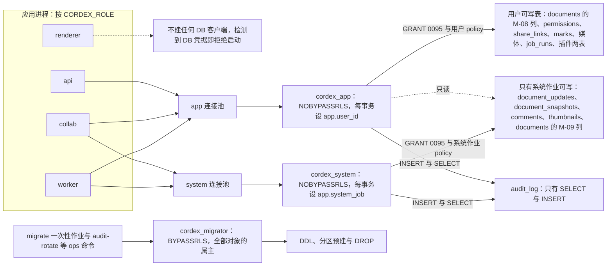
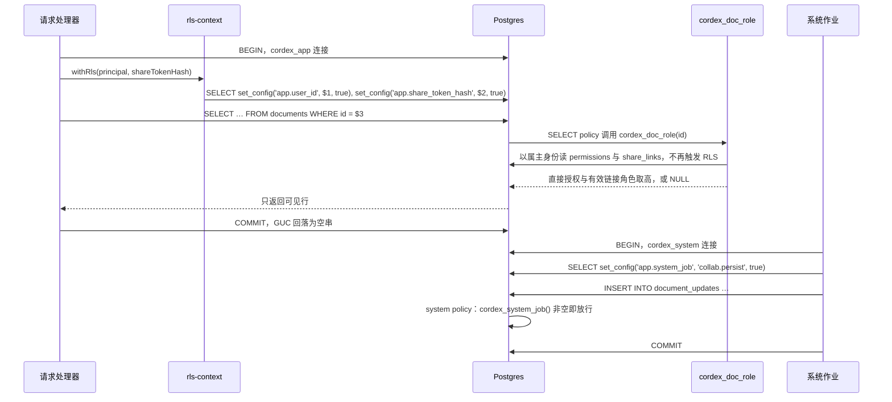
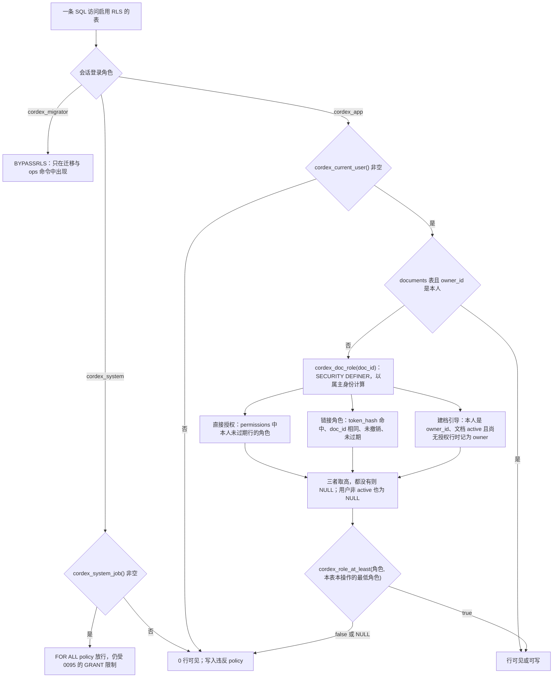
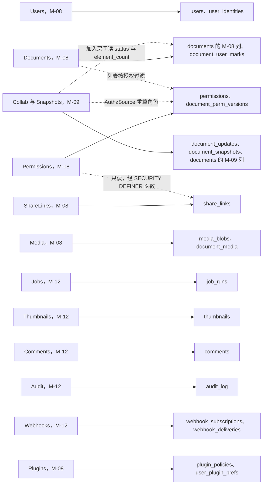
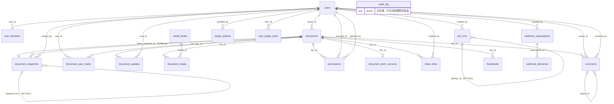
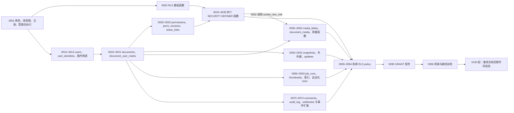
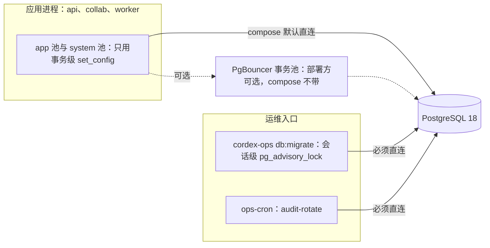

# 08 数据库总约定：命名、角色、RLS 框架与迁移顺序
> 状态：v0.1 | 负责：后端设计线 | 更新：2026-09-25；2026-09-25（§4.19）；2026-09-25（审稿）；2026-09-25（lock_reason，§4.19 N1 补缺）；2026-09-26（§4.20）；2026-09-26（§4.21：B1 结案，手写 drizzle 镜像 + 漂移检查直查 pg_catalog；compose 不带 PgBouncer、迁移直连）；2026-09-26（§4.21 Remap：原 30/08 引用按 60-backend/README §6.1 改指新位置，30/08 已删除）；2026-10-01（§4.23 插件管理：表清单 17 → 19（plugin_policies、user_plugin_prefs），GRANT 0095、RLS 例外清单与 0096、写方总表、ER 与号段同步）；2026-10-03（§4.24：AL-3 `plugin_policies` 的 system 只读方删去 renderer；AL-7 §9 号段登记 0063、0074（只改 CHECK），§6.5 增系统作业名 `worker.automation`，§7 迁移列同步） | 依赖：[rulings §4.13 / §4.15 Q6·Q10 / §4.17 D3 / §4.18 / §4.19](../00-charter/rulings-2026-09-14.md)、[ADR-0022](../30-architecture/adr/0022-server-storage.md)、[ADR-0029](../30-architecture/adr/0029-gateway-authorization.md)、[30/01](../30-architecture/01-overview.md) §2.2（原 30/08 §5）、[40/08](../40-modules/08-server-identity-documents-and-storage.md)、[40/09](../40-modules/09-server-collab-gateway-and-headless-host.md)、[40/12](../40-modules/12-server-jobs-comments-and-ops.md)

> 读者：写 `apps/server/src/db/**`、迁移脚本与仓储的工程师；DBA 与运维。
> 本文是 PostgreSQL 18 的「总约定」：命名与类型、外键与分区、数据库角色与 GRANT、连接池、文档级 RLS 的框架（GUC、辅助函数、policy 写法、例外清单、测试矩阵）、表写方所有权、迁移编号与纪律。**各表的建表语句与 policy 本体**在 [09](./09-ddl-identity-and-access.md)–[13](./13-ddl-comments-webhooks-audit.md)；Valkey 键、对象键与保留总表在 [14](./14-valkey-object-storage-and-retention.md)；配置键在 [17](./17-deployment-and-config.md)。

## 0. 本文拥有与引用

| 本文拥有（唯一源） | 本文引用 |
|---|---|
| 命名与类型约定、外键删除策略、分区约定 | 各表 DDL、索引与 policy 本体：[09](./09-ddl-identity-and-access.md)、[10](./10-ddl-documents-marks-media.md)、[11](./11-ddl-collab-updates-and-snapshots.md)、[12](./12-ddl-jobs-and-thumbnails.md)、[13](./13-ddl-comments-webhooks-audit.md) |
| 三个数据库角色、GRANT 矩阵（0095）、默认权限收紧与基线自检（0096） | 进程角色装配矩阵：[01](./01-service-overview-and-roles.md) |
| RLS 框架：GUC、`cordex_current_user()` 等基础函数（0002）、policy 写法、例外清单（即 `policy/rls-exceptions.json` 的内容）、测试矩阵 | `cordex_doc_role(doc_id)` 本体（09 的 0034）；RLS 上下文在鉴权链路中的位置：[02](./02-auth-chain.md) |
| 表 → 模块 → 仓储 → 写方 / 读方总表 | 模块用例与事务边界：[03](./03-modules-identity-and-access.md)–[07](./07-modules-comments-webhooks-audit.md) |
| 迁移编号分配、执行顺序、迁移纪律、SQL 围栏与 ddl-check 约定；迁移 SQL 的内容（仓库文件须与本线围栏逐字一致，§10.1） | 迁移文件、类型镜像、连接池与执行器的文件级落点：[40/12 §4.13](../40-modules/12-server-jobs-comments-and-ops.md)；测试如何执行：[70/07](../70-testing/07-backend-integration-and-api-e2e.md)、CI 步骤：[70/12](../70-testing/12-ci-gates-mapping.md) |

## 1. 通用约定

| 项 | 约定 | 依据 |
|---|---|---|
| 租户 | 任何表、列、GUC、对象键都没有 `tenant_id`：一次部署 = 一个组织 | rulings §4.15 T-0 |
| 表名 / 列名 | `snake_case`；表名用复数（`users`、`share_links`）；关联表按「主体_客体」（`document_media`、`document_user_marks`）；基础设施表加 `cordex_` 前缀（`cordex_schema_migrations`） | schema-inventory G-19 |
| 约束 / 索引名 | 主键 `pk_{表}`；外键 `fk_{表}_{列}`；唯一 `uq_{表}_{列…}`；检查 `ck_{表}_{含义}`；索引 `ix_{表}_{列…}`；policy `p_{表}_{app 或 system}_{select、insert、update、delete 或 all}`；分区 `{父表}_p00`…、`audit_log_yYYYYmMM` | 同上 |
| 主键 | `id uuid`，**UUIDv7 在应用层生成**，DDL 不设默认值（PG 18 虽有 `uuidv7()`，支持下限仍是 16）；关联表用复合主键 | ADR-0022 决策表 |
| 时间 | 一律 `timestamptz`；`created_at timestamptz NOT NULL DEFAULT now()`；可变行另有 `updated_at timestamptz NOT NULL DEFAULT now()`，由仓储在 UPDATE 时显式写入（不用触发器） | G-19 |
| 枚举 | `text` + `CHECK (col IN (…))`，不用 PG `ENUM` 类型（增值需 `ALTER TYPE`，与 expand / contract 冲突）；取值与 `@cordexjs/protocol` 的字面量联合一致 | 同上 |
| 半结构化 | `jsonb`；只放不参与约束与连接的字段；需要查询的字段提成列 | 同上 |
| 二进制 | `bytea`；大块二进制列（`document_updates.update`、`document_snapshots.state_inline`）`SET STORAGE EXTERNAL`，避免对已压缩内容再压缩；超过 1 MiB 的快照放对象存储 | ADR-0022、ADR-0025 |
| 哈希 | 摘要一律存原始字节 `bytea` 并加 `CHECK (octet_length(col) = 32)`（sha256），不存 hex 文本 | 同上 |
| 软删除 | 需要回收站的实体用 `deleted_at timestamptz NULL`；其余表硬删 | 本表（原 30/08 篇 §5 草案口径，该草案 2026-09-25 删除后以本文为唯一源，rulings §4.19） |
| 空值与默认值 | 能 `NOT NULL` 就 `NOT NULL`；计数列 `NOT NULL DEFAULT 0`；可空列必须在列注释里写明「何时为空」 | G-19 |
| 注释 | 每张表 `COMMENT ON TABLE` 写「用途、写方、保留」；写方不唯一的列 `COMMENT ON COLUMN` 写写方（`documents` 的 M-08 / M-09 列，C-03） | 决策 C-03 |
| 外键索引 | 被引用方会被硬删除的外键列（指向 `documents`、`document_snapshots`、`comments`、`media_blobs`、`webhook_subscriptions`、`job_runs` 的外键，含 `documents.latest_snapshot_id`、`document_snapshots.restored_from`、`comments.parent_id` 这类 SET NULL 或自引用列）必须是某个索引的前导列：删行时每行一次的 RESTRICT 检查或 SET NULL 改写要走索引，否则批量裁剪与永久删除退化为逐行全表扫描；可空列用 `WHERE col IS NOT NULL` 部分索引。指向 `users` 的外键不强制建索引（`users` 不硬删） | §2 |
| 触发器 | 业务表不用触发器；RI 之外的不变量放应用层并有测试 | 不过度设计 |

**表清单（19 张业务表 + 1 张台账）**：`users`、`user_identities`、`plugin_policies`、`user_plugin_prefs`（2026-10-01，rulings §4.23，[09 §14](./09-ddl-identity-and-access.md)）、`documents`、`document_user_marks`、`document_updates`、`document_snapshots`、`media_blobs`、`document_media`、`permissions`、`document_perm_versions`、`share_links`、`comments`、`thumbnails`、`job_runs`、`audit_log`、`webhook_subscriptions`、`webhook_deliveries`，以及迁移台账 `cordex_schema_migrations`（本文 0001）。不建：`tenants`、`groups`、`group_members`、`pending_invitations`、`collab_sessions`、`api_keys`（M4）；`documents` 不含 `folder_id`（决策 DDL-COLS）。

## 2. 外键策略

**默认 `ON DELETE RESTRICT`**：永久删除文档由各 `@PurgeParticipant` 先清自己的表，最后 `finalize-purge` 删 `documents` 行；任何参与者漏清，收尾就因 RESTRICT 失败并整作业重试，而不是被级联静默吞掉（「谁的表谁写」由外键兜底）。依据：决策 FK-POLICY（rulings §4.18 BE-15 + schema-inventory C-24 / C-34）。

| 外键 | 删除策略 | 理由 |
|---|---|---|
| 全部 `… → documents(id)`、`… → media_blobs(id)`、`… → webhook_subscriptions(id)`、`comments.parent_id → comments(id)` | `RESTRICT`（显式写出） | 默认 |
| 全部 `… → users(id)` | `RESTRICT` | `users` 不硬删（擦除是原地脱敏，决策 C-24），因此高频表指向 `users` 的外键不与擦除冲突 |
| `documents.latest_snapshot_id → document_snapshots(id)` | `SET NULL` | 参与者 collab 先删快照、`finalize-purge` 后删文档；该外键由 11 的 0041 在快照表建好后补加 |
| `job_runs.attempt_of → job_runs(id)` | `SET NULL` | 机械推论：`job-runs-prune` 按时间删旧终态行时，较新的重提行仍指向它，RESTRICT 会让旧行永远删不掉 |
| `document_snapshots.restored_from → document_snapshots(id)` | `SET NULL` | 同理：`snapshots-retention` 裁掉被恢复的源快照时，`restore` 快照只丢失来源指针（[11](./11-ddl-collab-updates-and-snapshots.md)） |
| `audit_log.actor_id / doc_id / target_id`、`job_runs.doc_id` | **不设外键** | 行在文档永久删除后仍保留（审计与作业记录） |

同一语句内的批量删除（如参与者 comments 一次删掉整棵线程）不受 RESTRICT 影响：RI 检查在语句末尾对剩余行执行，已在 PG 18 实测。

## 3. 分区

| 表 | 方式 | 分区与命名 | 维护 | 执行者 |
|---|---|---|---|---|
| `document_updates` | `PARTITION BY HASH (doc_id)`，16 个 | `document_updates_p00` … `_p15`，由 11 的 0042 一次建好 | 不增减（NF-10 的 100 万文档量级够用；改模数 = 重建表） | — |
| `audit_log` | `PARTITION BY RANGE (created_at)`，按月；主键 `(id, created_at)`（分区键必须进主键，C-19） | `audit_log_y2026m09` 形式；13 的 0071 建「当月 + 未来 3 个月」 | ops 命令 `audit-rotate`：预建未来 3 个月；整月早于 `retention.auditDays` 的分区 `DETACH … CONCURRENTLY` 后 `DROP`（决策 C-20/G-13/G-14） | `cordex_migrator`（应用角色与 `cordex_system` 没有 DDL 与 DELETE 权限） |

分区约定：
- **不建 DEFAULT 分区**：落到缺失月份的写入应当失败并告警，而不是悄悄进默认分区（之后 ATTACH 新分区还要扫描默认分区）。`/readyz` 在「已建的未来分区不足 1 个月」时标记降级，告警与指标名见 [18](./18-observability-and-ops-endpoints.md)；`audit-rotate` 的定时入口见 [17 §9](./17-deployment-and-config.md)。
- **RLS 与权限只挂父表**：`ENABLE / FORCE ROW LEVEL SECURITY` 与 policy 只写在父表；分区子表**不授予任何应用角色权限**——直连子表会绕过父表 policy，0096 自检把「子表有应用角色权限」当作失败。
- 其余表不分区；`job_runs`、`webhook_deliveries` 靠按时间裁剪控制体量（[14 §8](./14-valkey-object-storage-and-retention.md)）。

## 4. 数据库角色与 GRANT 矩阵

依据：决策 DB-ROLES（ADR-0022 修订 2026-09-24「系统作业角色、两道防线」+ schema-inventory G-08 / G-17 / G-18）。

### 4.1 三个角色

| 角色 | 属性 | 持有者 | 用途 |
|---|---|---|---|
| `cordex_migrator` | `LOGIN BYPASSRLS`，非超级用户；全部表、分区与函数的**属主** | 只有迁移作业 `cordex-ops db:migrate` 与 ops 命令（`audit-rotate` 等），不进任何应用进程 | DDL、分区轮换、SECURITY DEFINER 函数的执行身份；唯一持有 `BYPASSRLS` 的角色 |
| `cordex_app` | `LOGIN NOBYPASSRLS` | api、collab、worker 的 app 连接池 | 代表**某个用户**的事务：每个事务设 `app.user_id`（带有效分享令牌时再设 `app.share_token_hash`） |
| `cordex_system` | `LOGIN NOBYPASSRLS` | **只有** collab、worker 的 system 连接池（api 进程不得持有其口令） | 不代表单个用户的系统作业：持久化、装载、压缩、溢写回放、墓碑硬删、评论镜像、导入导出、缩略图、永久删除参与者、周期作业；每个事务设 `app.system_job` |

三者都 `NOINHERIT`、互不授予成员关系（`cordex_app` 不能 `SET ROLE cordex_system`）。角色由 0001 建立（可重复执行、每次重申属性），口令不写进迁移，由 bootstrap 从 `*_FILE` 机密设置（[17 §6](./17-deployment-and-config.md)）。

### 4.2 GRANT 矩阵（0095，覆盖全部 19 张表 + 台账）

S = SELECT，I = INSERT，U = UPDATE，D = DELETE；「I(列)」「U(列)」表示按列授予，此时不再授表级同名权限（表级会覆盖列级限制）。任何应用角色都没有 TRUNCATE、REFERENCES、TRIGGER，也没有任何表的 DDL 权限。列清单的规格出自各域 DDL 文件（[09 §8.4](./09-ddl-identity-and-access.md)、[10 §9](./10-ddl-documents-marks-media.md)、[11 §7.4](./11-ddl-collab-updates-and-snapshots.md)、[12 §5](./12-ddl-jobs-and-thumbnails.md)、[13 §6.3](./13-ddl-comments-webhooks-audit.md)），本表与 0095 是汇总；GRANT 快照（§13 DB-06）核对三者一致。

| 表 | `cordex_app` | `cordex_system` | 说明 |
|---|---|---|---|
| `users` | S I，U(`email, display_name, avatar_url, platform_role, status, last_seen_at, updated_at`) | S | JIT 建号、资料、平台管理员改状态 / 角色、擦除脱敏都在请求事务；不硬删；`id`、`created_at` 不可改 |
| `user_identities` | S I D，U(`email_at_login, last_login_at, updated_at`) | — | 擦除时删除全部身份行；系统作业不需要 |
| `plugin_policies`（2026-10-01） | S I D，U(`state, default_on, config, revision, batch_id, updated_by, updated_at`) | S | 只有平台管理员经 PluginsModule 写；「恢复部署默认」删行；collab 指纹轮询与 worker 的 headless 内容级集合（缩略图等不经受理用例的作业）只读；renderer 不连库，内容级集合由 worker 经 RPC 下发（rulings §4.24 AL-3，[06 §10.3](./06-modules-jobs-import-export-thumbnails.md)；[09 §14.1](./09-ddl-identity-and-access.md)） |
| `user_plugin_prefs`（2026-10-01） | S I D，U(`enabled, updated_at`) | — | 本人个人启停与恢复默认都在请求事务；擦除不删（不含个人数据）；系统作业不需要（[09 §14.2](./09-ddl-identity-and-access.md)） |
| `documents` | S，I(`id, title, doc_type, owner_id`)，U(`title, status, deleted_at, updated_at`) | S D，I(同左 4 列)，U(`status, locked_until, lock_reason, updated_at` 与 M-09 八列 `head_seq, epoch, latest_snapshot_id, schema_version, element_count, slide_count, size_bytes, content_updated_at`) | 列级授予把 C-03 落到数据库：`cordex_app` 插入或改写任何 M-09 列都 `permission denied`。`owner_id` 只在建档时写入：M1–M3 无转移所有者（[04 §1](./04-modules-documents-storage-media.md)），若应用角色可改，editor 能在库内把自己写成 `owner_id` 并借 SELECT policy 的 owner 分支在被撤销后仍可见。锁定与解锁（`locked_until`）、回收站到期置 `purging`、导入建档、`finalize-purge` 删行在系统侧 |
| `document_user_marks` | S I D，U(`last_opened_at, pinned_at`) | S D | 最近 / 固定只在请求事务里写；参与者 user-marks 删除 |
| `document_updates` | S | S I D | 只有系统作业写（持久化、回放、裁剪、参与者 collab）；只追加，无 U |
| `document_snapshots` | S | S I D | 只有系统作业写（压缩、命名、恢复、迁移、epoch、导入经 `SnapshotStore.put`）；行不可变，无 U |
| `media_blobs` | S，I(`id, sha256, mime, byte_size, storage_key, width, height`)，U(`unreferenced_since`) | 同左，另加 D | 请求事务里提交媒体（upsert 只清空 `unreferenced_since`）；`media-gc` 删除 |
| `document_media` | S，I(`doc_id, media_id, first_seen_seq`)，U(`detached_at`) | 同左，另加 D | 压缩写 `detached_at`；保留作业与参与者 media 删除 |
| `permissions` | S I D，U(`role, expires_at, granted_by, updated_at`) | S I D | 授予 / 改角色 / 撤销在请求事务；导入新建文档写首条 owner 行、参与者删除；主体与文档外键不可改 |
| `document_perm_versions` | S I，U(`perm_version, updated_at`) | S I D，U(`perm_version, updated_at`) | `bumpPermVersion(tx)` 是唯一写入点（upsert 需要 I 与 U） |
| `share_links` | S I，U(`revoked_at`) | S D | 撤销 = 置 `revoked_at`，行保留至永久删除；令牌哈希不可改；令牌解析只经 SECURITY DEFINER 函数 |
| `comments` | S | S I U D | 唯一写入口 CommentMirrorObserver（collab，系统作业） |
| `thumbnails` | S | S I U D | 只由导入与缩略图处理器写 |
| `job_runs` | S I，U(`status, finished_at, updated_at`) | S I U D | 入队、取消在请求事务（列级 UPDATE 让取消语句无法顺带改写 `payload`、`result`、`idempotency_key`）；处理器、对账、`job-runs-prune` 在系统作业 |
| `audit_log` | S I | S I | **只追加**；分区 DROP 只由 `cordex_migrator` 经 `audit-rotate` 执行 |
| `webhook_subscriptions` | S I U D | S U | 平台管理员管理；投递处理器只读，worker 清理到期的旧签名密钥 |
| `webhook_deliveries` | S D | S I U D | 管理员只读投递日志；删除订阅时 api 在同一事务先删其投递行（外键 RESTRICT）；生产者写入、处理器更新、`webhook-deliveries-prune` 删除 |
| `cordex_schema_migrations` | S | S | `/readyz` 核对迁移已应用；只有 `cordex_migrator` 写 |

另外：`GRANT USAGE ON ALL SEQUENCES`（serial 列若存在；identity 列插入不需要序列权限）；0002 与 09、10 的函数各自在其迁移里 `REVOKE … FROM PUBLIC` 后只授予需要的应用角色。表级权限之外，行级可见性由 §6 的 policy 决定——GRANT 决定「能不能改这些列」，policy 决定「能对哪些行做」。

`size_bytes` 与 `content_updated_at` 只由 M-09 在写快照时以 `cordex_system` 更新，`cordex_app` 不持有这两列的 UPDATE：rulings §4.19 D-M2-CONTENT 裁定 M2 起内容只以协同快照为事实源、不设 pptx 内容版本端点，api 的请求事务不写内容相关列。

### 4.3 函数与 SECURITY DEFINER 加固

- **SECURITY DEFINER 只有五个**：09 的 `cordex_share_link_by_token`、`cordex_share_link_status`（0033，决策 MECH-C 中 C-35）、`cordex_doc_role`（0034）与 `cordex_sole_owner_doc_count`（0035，rulings §4.20 BE-05：平台管理员停用或擦除用户时要统计该用户是唯一可用 owner 的文档数，管理员在 RLS 下看不到他人文档的授权行、api 又只有 `cordex_app`；函数先校验调用者是 active 平台管理员，只返回数字，只授予 `cordex_app`）；10 的 `cordex_storage_usage`（0052，决策 G-09：按 owner 汇总配额要统计调用者看不到的行，函数先以 `cordex_doc_role` 校验调用者对该文档至少 editor，只返回数字，只授予 `cordex_app`）。新增须改本条并说明理由。
- 规则：属主 `cordex_migrator`；`SET search_path = pg_catalog, pg_temp`；函数体内表名一律 `public.` 限定；`STABLE`；`REVOKE EXECUTE … FROM PUBLIC` 后只授予需要的应用角色（`cordex_app`、`cordex_system` 之一或两者）。0096 自检逐项核对前两条与「无 PUBLIC EXECUTE」。
- 非 SECURITY DEFINER 的辅助函数（0002 的四个）不设 `SET search_path`，以便在 policy 中被内联；函数体一律 `pg_catalog.` 限定。
- 0001 设置 `ALTER DEFAULT PRIVILEGES FOR ROLE cordex_migrator REVOKE EXECUTE ON FUNCTIONS FROM PUBLIC`，今后新建函数默认不对 PUBLIC 开放。

### 4.4 Casdoor 的数据库边界

Casdoor（`idp` profile）使用**同一 PG 实例内的独立 database `casdoor` 与独立登录角色 `casdoor`**：由 compose 的 postgres 初始化钩子建立（[17 §2](./17-deployment-and-config.md)），不进应用迁移，治理检查 `check-rls-coverage` 不扫描它；0001 已对 `cordex` 库 `REVOKE ALL … FROM PUBLIC`，`casdoor` 角色连不上业务库。

**图 4-1 数据库角色、连接池与 GRANT**



怎么读：左边是按 `CORDEX_ROLE` 运行的进程，中间是连接池与它们登录的数据库角色，右边是这些角色能做的事。实线是可写，虚线是只读或「不连接」。api 只有 app 池，拿不到 `cordex_system`；renderer 进程里没有任何 DB 客户端；只有运维作业持有 `BYPASSRLS` 的 `cordex_migrator`。
依据：决策 DB-ROLES；ADR-0022 修订 2026-09-24；ADR-0037 决策 1（renderer 无凭据）。

## 5. 连接池按 CORDEX_ROLE

| `CORDEX_ROLE` | app 池 | system 池 | app 池的用途 | system 池的用途 |
|---|---|---|---|---|
| `api` | 有 | **无**（配置了 system 口令即拒绝启动，退出码 78） | 全部 REST | — |
| `collab` | 有 | 有 | 快照 REST、元素彻底删除等仍在 collab 的 REST（用户上下文） | 房间装载、持久化、压缩、溢写回放、墓碑硬删、网关侧读（加入房间查 `documents.status`、`element_count`、`perm_version`）、评论镜像、Webhook 生产 |
| `worker` | 有 | 有 | 作业开始时以 `job_runs.created_by` 设 `app.user_id` 复核发起者仍有所需角色（RLS 本身给出答案，失败即终止作业） | 全部作业步骤与周期作业 |
| `all` | 有 | 有 | 上面三者之和 | 同左 |
| `renderer` | 无 | 无 | — | — |

连接参数（`db/client.ts`，文件级见 [40/12 §4.13](../40-modules/12-server-jobs-comments-and-ops.md)；配置键见 [17 §5](./17-deployment-and-config.md)）：
- `application_name = cordex-{role}-{app|system}`；系统作业事务内再 `SET LOCAL application_name = 'cordex-{role}-system/{作业名}'`，便于在 `pg_stat_activity` 里定位。
- 超时：app 池 `statement_timeout 30 s`、`lock_timeout 5 s`；system 池 `statement_timeout 120 s`、`lock_timeout 10 s`（批量裁剪分批执行，单批 ≤ 10,000 行）；两者 `idle_in_transaction_session_timeout 60 s`。0001 把同样的值设为角色默认值兜底。
- 池大小：`db.app.poolMax`、`db.system.poolMax`（默认各 20）；拆分部署时按 [17 §8](./17-deployment-and-config.md) 调整，所有副本之和 < PG `max_connections` − 10（留给迁移与运维）。
- RLS 上下文只用事务级设置（`set_config(…, true)`，等价 `SET LOCAL`），不留会话状态，因此应用连接与 PgBouncer 事务池模式兼容。compose 默认栈**不带 PgBouncer**；部署方自加时只有应用连接池可以经它，迁移与 `ops-cron` 一律直连 PG（§10.2，ADR-0022 修订 2026-09-26）。

## 6. 文档级 RLS 框架

依据：决策 RLS-GUC（rulings §4.18 BE-02「链接角色 = max(直接, 有效链接)」+ §4.17 D3 + ADR-0022 修订 2026-09-24）与决策 C-21（治理检查 `check-rls-coverage` 规则文本 + 安全宁可提前）。RLS 是纵深防御：应用层 `DocumentRoleGuard` 与扫描器 `scan-doc-access-via-permission`（D12，代码层）仍是第一道防线，两道互不替代。各表 policy 本体在 09–13，本节规定它们必须遵守的写法。

### 6.1 会话变量（GUC）与设置时机

| GUC | 取值 | 谁设 | 何时设 |
|---|---|---|---|
| `app.user_id` | 当前用户 uuid 文本 | `permissions/infrastructure/rls-context.ts`（经 request-context 拦截器） | 每个 `cordex_app` 事务开头 |
| `app.share_token_hash` | 请求头 `X-Cordex-Share-Token` 的 sha256，hex 小写 | 同上 | 仅当请求携带令牌且 ShareLinkGuard 已为目标文档解析出有效链接；否则不设 |
| `app.system_job` | 系统作业名（§6.5） | `db/client.ts` 的系统事务入口，只有 `SystemContext` 能调用 | 每个 `cordex_system` 事务开头 |

- 作废：草案的 `app.share_doc_id`（改为由数据库自己凭 `app.share_token_hash` 校验令牌，纵深防御强于信任应用给出的文档 id）与 `app.tenant_id`（T-0）。
- 写法：`SELECT set_config('app.user_id', $1, true), set_config('app.share_token_hash', $2, true)`。`SET LOCAL` 不接受绑定参数，因此一律用 `set_config(…, true)`（事务级，等价 `SET LOCAL`）。
- 所有访问都在事务里：仓储只能拿到 `withRls(principal, fn)` 或 `withSystem(jobName, fn)` 给出的事务句柄，连一条单独的 SELECT 也不例外。事务结束后这些 GUC 回落为**空串**（不是 NULL，PG 18 实测）。
- WS 侧没有分享令牌（票据只带链接 id `lnk`），因此网关侧对数据库的读取走 `cordex_system`（`collab.gateway`），链接角色的复核走 SECURITY DEFINER 函数 `cordex_share_link_status`（[02](./02-auth-chain.md)）。

**图 6-1 事务内设置上下文与 policy 求值**



怎么读：上半段是请求路径，下半段是系统作业路径，时间自上而下。请求路径上 policy 通过 SECURITY DEFINER 函数取角色，函数以属主身份读授权表，所以不会递归触发 `permissions` 自身的 policy；系统路径上 policy 只看作业名是否非空，不做逐行授权计算。
依据：决策 RLS-GUC；本文 §6.2、§6.5。

### 6.2 基础函数

| 函数 | 定义处 | 返回 | 说明 |
|---|---|---|---|
| `cordex_current_user()` | 本文 0002 | `uuid` 或 NULL | 读 `app.user_id`；空串视为 NULL |
| `cordex_share_token_hash()` | 本文 0002 | `bytea` 或 NULL | 读 `app.share_token_hash` 并解 hex；非法 hex 直接报错 |
| `cordex_system_job()` | 本文 0002 | `text` 或 NULL | 读 `app.system_job`；空串视为 NULL |
| `cordex_role_at_least(actual, required)` | 本文 0002 | `boolean` 或 NULL | 角色格 `owner > editor > commenter > viewer`；参数为 NULL 或不在格内时返回 NULL（policy 视为 false） |
| `cordex_doc_role(doc_id)` | [09](./09-ddl-identity-and-access.md) 的 0034 | `text` 或 NULL | SECURITY DEFINER、STABLE、`COST 1000`（§6.7）：当前用户须为 `active`，取 max(本人在 `permissions` 的未过期直接授权, `share_links` 中 `token_hash = cordex_share_token_hash()`、`doc_id` 相同、未撤销、未过期的链接角色, 建档窗口引导)；建档窗口引导 = 本人是该文档 `owner_id`、文档 `active` 且尚无任何授权行时记为 `owner`（§6.3 第 6 条） |

**机械修正（相对决策 RLS-GUC 原文）**：原文的系统作业放行写作 `current_setting('app.system_job', true) IS NOT NULL`。占位 GUC 在设置过它的事务结束后回落为空串，同一连接上的后续事务里该表达式恒为真——在 PG 18 实测：连接池复用的 `cordex_system` 连接若某个事务漏设作业名，这种写法会照样放行。因此规定 **policy 一律经 §6.2 的函数判定，不得直接引用 `current_setting('app.…')`**（治理检查 `check-rls-coverage` 的子规则，§13），系统作业放行写作 `cordex_system_job() IS NOT NULL`。

### 6.3 policy 写法（09–13 必须遵守）

1. 每张启用 RLS 的表在其域的 RLS 迁移（0090–0094）里同时 `ENABLE` 与 `FORCE ROW LEVEL SECURITY` 并建 policy；全部为 PERMISSIVE，不用 RESTRICTIVE。
2. `cordex_app` 按操作分别建 `FOR SELECT / INSERT / UPDATE / DELETE` policy，条件写成 `cordex_role_at_least(cordex_doc_role(doc_id), '<该表该操作的最低角色>')`；最低角色由所在 DDL 文件的 policy 小表规定。没有对应 GRANT 的操作不建 policy。
3. `cordex_system` 只建**一条** `FOR ALL` policy：`USING (cordex_system_job() IS NOT NULL) WITH CHECK (cordex_system_job() IS NOT NULL)`。
4. 禁止：`TO PUBLIC` 的 policy；policy 里直接读 `current_setting`；policy 里子查询 `permissions` 或 `share_links`（一律经 `cordex_doc_role`，避免递归与口径分叉）。
5. UPDATE 必须同时写 `USING` 与 `WITH CHECK`；带 `WHERE` 或 `RETURNING` 的 UPDATE / DELETE 还要过 SELECT policy，所以 SELECT policy 的可见范围必须覆盖写 policy 允许的行。
6. **创建文档的事务顺序固定**：同一个 `cordex_app` 事务内 `documents` → `permissions`（首条 owner 行）→ `document_perm_versions`。两处放行缺一，建档都会以 `new row violates row-level security policy` 失败（PG 18 实测）：
   - `INSERT … RETURNING` 会对新行套用 SELECT policy，而 STABLE 的 `cordex_doc_role` 在同一语句里看不到刚插入的行，因此 **`documents` 的 SELECT policy 必须含 `owner_id = cordex_current_user()` 分支**；
   - 首条 owner 行由 `cordex_doc_role` 的**建档窗口引导**放行（09 的 0034：本人是 `owner_id`、文档 `active`、尚无任何授权行时记为 `owner`），`permissions` 与 `document_perm_versions` 的 INSERT policy 因此只写普通的 owner 条件；窗口在首条授权行写入后自动关闭，他人冒充不了（R12）。
7. `document_user_marks` 的 app policy 另加 `user_id = cordex_current_user()`（只见本人行，rulings §4.18 BE-31）。

示意（虚构表，只做语法解析）：

```sql
-- example
CREATE TABLE doc_scoped_example (doc_id uuid NOT NULL, note text NOT NULL);
ALTER TABLE doc_scoped_example ENABLE ROW LEVEL SECURITY;
ALTER TABLE doc_scoped_example FORCE ROW LEVEL SECURITY;
CREATE POLICY p_doc_scoped_example_app_select ON doc_scoped_example FOR SELECT TO cordex_app
  USING (cordex_role_at_least(cordex_doc_role(doc_id), 'viewer'));
CREATE POLICY p_doc_scoped_example_app_update ON doc_scoped_example FOR UPDATE TO cordex_app
  USING (cordex_role_at_least(cordex_doc_role(doc_id), 'editor'))
  WITH CHECK (cordex_role_at_least(cordex_doc_role(doc_id), 'editor'));
CREATE POLICY p_doc_scoped_example_system_all ON doc_scoped_example FOR ALL TO cordex_system
  USING (cordex_system_job() IS NOT NULL) WITH CHECK (cordex_system_job() IS NOT NULL);
```

建档事务（列名以 09、10 为准）：

```sql
-- example
BEGIN;
SELECT set_config('app.user_id', $1, true);
INSERT INTO documents (id, title, doc_type, owner_id) VALUES ($2, $3, 'slide', $1) RETURNING id;
INSERT INTO permissions (id, doc_id, principal_type, principal_id, role, granted_by)
  VALUES ($4, $2, 'user', $1, 'owner', $1);
INSERT INTO document_perm_versions (doc_id, perm_version) VALUES ($2, 0);
COMMIT;
```

### 6.4 启用 RLS 的表与例外清单

**ENABLE + FORCE RLS（11 张）**：`documents`、`document_user_marks`、`document_media`（10 的 0091）；`permissions`、`document_perm_versions`、`share_links`（09 的 0090）；`document_updates`、`document_snapshots`（11 的 0092）；`job_runs`、`thumbnails`（12 的 0093）；`comments`（13 的 0094）。`job_runs` 的 app 读条件是 `created_by = cordex_current_user()` 或对 `doc_id` 有授权（决策 C-21，安全宁可提前）。

**例外（9 张，不开 RLS）**——本表就是 `policy/rls-exceptions.json` 的内容，0096 自检用同一份清单：

| 表 | 理由 | 替代防线 |
|---|---|---|
| `users` | 身份目录，无 `doc_id` | UsersModule 字段裁剪：按人搜索只回 `id / displayName / avatarUrl`，邮箱只做精确匹配且不回显（决策 SG-05） |
| `user_identities` | 身份目录，无 `doc_id` | 只经 UsersModule 用例访问 |
| `media_blobs` | 部署级内容寻址去重，一个对象可被多个文档引用，无 `doc_id` | 读取必须经 `document_media` 关联 + `doc.read`，否则 404（决策 INC-21） |
| `audit_log` | 只追加；行在文档删除后保留，不能按文档授权判定 | 只授 SELECT / INSERT；读取只经 PlatformAdminGuard |
| `webhook_subscriptions`、`webhook_deliveries` | 平台管理员表，无 `doc_id` | 只经 PlatformAdminGuard |
| `plugin_policies`（2026-10-01） | 部署级插件策略，无 `doc_id` | 写只经 PlatformAdminGuard 之后的 PluginsModule 用例；`cordex_system` 只读 |
| `user_plugin_prefs`（2026-10-01） | 用户级偏好，无 `doc_id` | 只经 PluginsModule 用例，每条语句以会话主体 `user_id` 为条件，REST 路径不含用户 id |
| `cordex_schema_migrations` | 迁移台账 | 应用角色只读 |

```json
{
  "source": "docs/60-backend/08-db-conventions-roles-rls-migrations.md §6.4",
  "exceptions": [
    { "table": "users", "reason": "身份目录，无 doc_id；UsersModule 字段裁剪" },
    { "table": "user_identities", "reason": "身份目录，无 doc_id" },
    { "table": "media_blobs", "reason": "部署级去重；读取经 document_media + doc.read" },
    { "table": "audit_log", "reason": "只追加；行在文档删除后保留；仅平台管理员读" },
    { "table": "webhook_subscriptions", "reason": "平台管理员表" },
    { "table": "webhook_deliveries", "reason": "平台管理员表" },
    { "table": "plugin_policies", "reason": "部署级插件策略；写只经 PlatformAdminGuard" },
    { "table": "user_plugin_prefs", "reason": "用户级偏好；只经 PluginsModule 按本人 user_id 访问" },
    { "table": "cordex_schema_migrations", "reason": "迁移台账，应用只读" }
  ]
}
```

### 6.5 系统作业放行与 `app.system_job` 取值

- 不用 `BYPASSRLS`：`cordex_system` 没设作业名时一行都看不到、一行都写不进（PG 18 实测）。policy 只判「非空」，作业名本身用于诊断与 `application_name`。
- 取值为 `{scope}.{name}` 字面量，代码中是字面量联合 `SystemJobName`（落点 `apps/server/src/db/system-jobs.ts`，40/12 §4.13，2026-09-25 审稿登记）：
  - collab：`collab.gateway`、`collab.bootstrap`、`collab.persist`、`collab.spill-replay`、`collab.compact`、`collab.tombstone-sweep`（含元素彻底删除）、`collab.snapshot`（命名、恢复、迁移、epoch）、`collab.comment-mirror`、`collab.webhook-produce`；
  - worker：`worker.import`、`worker.export`、`worker.thumbnails`、`worker.render-export`、`worker.automation`（2026-10-03，SV-13 自动化作业，[06 §7.4](./06-modules-jobs-import-export-thumbnails.md)）、`worker.webhook-delivery`、`worker.document-purge`；
  - 周期作业：`maintenance.{作业名}`，作业名取 [06 §4](./06-modules-jobs-import-export-thumbnails.md) 的周期作业清单（唯一源；[14 §8.5](./14-valkey-object-storage-and-retention.md) 为其保留视角的摘录）；
  - ops 命令（持 `cordex_system` 口令的子命令，[17 §6、§9](./17-deployment-and-config.md)）：`ops.{子命令}`，冒号改连字符，如 `ops.jobs-replay`、`ops.webhooks-replay`、`ops.thumbnails-rebuild`、`ops.documents-reassign-owner`（rulings §4.20 BE-05）。
- `SystemContext` 只能由系统用例构造（40/08），请求处理器拿不到 `withSystem`。

### 6.6 与 S-3 溢写的关系

溢写数据不在 PG 中：一级在 Valkey `spill:{docId}:{instanceId}`，二级在 data 桶 `spill/{docId}/…`（[14](./14-valkey-object-storage-and-retention.md)），不受 RLS 约束，只有 collab 的系统作业读写。回放写回 `document_updates` 时以 `cordex_system` + `collab.spill-replay` 进行，走与正常持久化相同的 policy（rulings §4.18 BE-20）。

**图 6-2 一次访问的 RLS 判定**



怎么读：自上而下按登录角色分三路。系统作业只看作业名；请求事务先要求有用户，再按「本人拥有的文档」或「直接授权、有效链接与建档引导取高后是否达到最低角色」判定；任何一步得到 NULL 都走拒绝分支（fail-closed）。`owner_id` 分支只存在于 `documents` 的 SELECT policy，建档引导只在首条授权行写入前成立，二者都服务建档事务（§6.3 第 6 条）。
依据：决策 RLS-GUC、C-21；rulings §4.18 BE-02。

### 6.7 代价、支撑索引与 M1 基准口径

- **热路径都在系统上下文**：批量持久化、装载（快照 + `loadSince`）、压缩走 `cordex_system`，policy 只是一次 GUC 判定，不做逐行授权计算。
- 用户上下文每个候选行调用一次 `cordex_doc_role`：一次 `permissions (doc_id, principal_type, principal_id)` 唯一索引探查，带令牌时再加一次 `share_links (token_hash)` 唯一索引探查（两个索引由 09 定义）。列表查询必须从 `permissions` 按主体（09 的 `(principal_type, principal_id)` 索引）驱动，再按主键取 `documents`；`cordex_doc_role` 声明 `COST 1000`，让规划器避开「全表扫描 + 逐行调用」的计划。
- **M1 基准口径**（执行与判定见 [70/09](../70-testing/09-performance-and-capacity.md) 的 `perf/perf-server`；budgets.json 键名由 [01 §12](./01-service-overview-and-roles.md) 登记）：

| 场景 | 数据规模 | 判定 |
|---|---|---|
| 文档列表首页 50 条（用户上下文） | 100 万文档；目标用户 1 万条授权 | RLS 开 / 关查询耗时差 ≤ 10%；EXPLAIN 中 `documents` 走主键索引 |
| 单文档读取带分享令牌 | 同上 | 差 ≤ 10% |
| 批量持久化 50 行（系统上下文） | 16 分区 `document_updates` | 差 ≤ 5% |
| 装载：快照 + 1 万条 updates（系统上下文） | D200 级文档 | 差 ≤ 5% |

### 6.8 RLS 测试矩阵

用例由本表 × 11 张 RLS 表生成（执行方式与夹具见 [70/07 §5](../70-testing/07-backend-integration-and-api-e2e.md)，运行于 `e2e/smoke` 的 security-rls 与 `test/server-integration`，M3 起阻断，rulings §4.18 GV-16）。「最低读 / 写角色」取自各表所在 DDL 文件的 policy 小表。

| # | 主体情形 | 期望 | 适用表 |
|---|---|---|---|
| R1 | `cordex_app`，未设 `app.user_id` | SELECT 0 行；INSERT / UPDATE / DELETE 被拒或影响 0 行 | 全部 11 张 |
| R2 | 用户对该文档无授权、无链接（含用他文档 id 访问） | 同 R1 | 全部 |
| R3 | 直接授权角色 < 最低读角色 | SELECT 0 行 | 全部 |
| R4 | 直接授权角色 ≥ 最低读角色、< 最低写角色 | 可读；写被拒 | 有 app 写 GRANT 的表 |
| R5 | 直接授权角色 ≥ 最低写角色 | 可读可写 | 同上 |
| R6 | 无直接授权，`app.share_token_hash` 对应有效链接（角色 r） | 与直接授权 r 等价；与直接授权并存时取高 | 全部 |
| R7 | 令牌已过期 / 已撤销 / 属于另一文档 / 非法 hex | 同 R2；非法 hex 报错 | 全部 |
| R8 | `cordex_system`，事务内未设 `app.system_job`（含连接上一个事务设过的情形） | 同 R1 | 全部 |
| R9 | `cordex_system`，已设 `app.system_job` | GRANT 范围内全部可见可写 | 全部 |
| R10 | 任何应用角色直连分区子表（`document_updates_p00`、`audit_log_y…`） | `permission denied` | 分区表 |
| R11 | `cordex_app` 插入或更新 `documents` 的 M-09 列、更新 `owner_id`；`cordex_app` 改写 `job_runs.payload` | `permission denied` | `documents`、`job_runs` |
| R12 | 建档事务（§6.3 第 6 条）；他人冒充 owner 写首条授权行 | 前者成功且 RETURNING 可见；后者被拒 | `documents`、`permissions` |
| R13 | `document_user_marks` 读他人行 | 0 行 | `document_user_marks` |
| R14 | `job_runs`：`created_by` 为本人但已无文档授权 | 仍可读本人作业行 | `job_runs` |

## 7. 表写方所有权总表

「谁的表谁写」：表只由所属模块的仓储写；跨模块需要写时调用所属模块导出的用例（仍由其仓储执行）。上下文一列指写入发生在哪种数据库角色下。迁自 40/09 §7.3、40/12 §7.3，以本表为准。

| 表 | 所属 Nest 模块 | 仓储 | 写方（上下文） | 主要读方 | DDL | 迁移 |
|---|---|---|---|---|---|---|
| `users` | Users（M-08） | `UserRepository` | 首登 JIT、资料、平台管理员改状态 / 角色、擦除脱敏（app） | Auth、Permissions、按人搜索；评论镜像（system） | [09](./09-ddl-identity-and-access.md) | 0010 |
| `user_identities` | Users | `UserRepository` | 首登 JIT、`linkIdentity`、擦除删除（app） | Auth 回调 | 09 | 0011 |
| `plugin_policies` | Plugins（M-08，2026-10-01） | `PluginPolicyRepository` | 管理员保存三态与配置、恢复部署默认（app，PlatformAdminGuard） | 管理员清单、本人生效插件集（app）；collab 指纹轮询、headless 内容级集合（system） | 09 | 0012 |
| `user_plugin_prefs` | Plugins（M-08，2026-10-01） | `UserPluginPrefsRepository` | 本人个人启停、恢复默认（app）；擦除不删 | 本人生效插件集（app） | 09 | 0013 |
| `documents` | Documents（M-08）；M-09 列归 Collab | `DocumentRepository`（入参 Omit 全部 M-09 列）；M-09 列由 `PgUpdateStore` / `PgSnapshotStore` 等写 | M-08：建档写 `id、title、doc_type、owner_id`，此后 `title、status、deleted_at、updated_at`（app）；锁定与解锁（`status、locked_until`）、回收站到期置 `purging`（system）；`owner_id` 建档后不改（M1–M3 无转移所有者；运维命令 `documents:reassign-owner` 只写授权行、不改本列）。M-09：`head_seq、epoch、latest_snapshot_id、schema_version、element_count、slide_count、size_bytes、content_updated_at`（system，快照 / 压缩时节流写）；导入建档、`finalize-purge` 删行（system） | 全体（列表经授权过滤） | [10](./10-ddl-documents-marks-media.md) | 0020、0041 |
| `document_user_marks` | Documents | `UserMarksRepository` | 最近 / 固定（app）；参与者 user-marks（system） | 开始页、列表 | 10 | 0021 |
| `document_updates` | Collab（M-09） | `PgUpdateStore` | 持久化、溢写回放、`updates-prune`、参与者 collab（system） | 装载、压缩（system） | [11](./11-ddl-collab-updates-and-snapshots.md) | 0042 |
| `document_snapshots` | Collab / Snapshots（M-09） | `PgSnapshotStore` | 压缩、命名、恢复、迁移、epoch；导入经 M-09 导出的 `SnapshotStore.put`；`snapshots-retention`、参与者 collab（system） | 快照 REST（app）；装载、导出（system） | 11 | 0040 |
| `media_blobs` | Media（M-08） | `MediaBlobRepository` | 媒体提交（app）；导入、`media-gc`（system） | 媒体读取、配额（经 0052 的 `cordex_storage_usage`） | 10 | 0050、0052 |
| `document_media` | Media | `DocumentMediaRepository` | 提交关联（app）；导入关联、压缩置 `detached_at`（经 Media 导出的用例）、`snapshots-retention`、参与者 media（system） | 媒体读取授权、GC | 10 | 0051 |
| `permissions` | Permissions（M-08） | `PermissionRepository` | 授予 / 改角色 / 撤销、建档 owner 行（app）；导入建档、参与者 permissions、运维转移 owner（system，`ops.documents-reassign-owner`） | `cordex_doc_role`、RoleResolver、列表 | 09 | 0030 |
| `document_perm_versions` | Permissions | `PermissionRepository.bumpPermVersion(tx)`（唯一写入点） | 授权变更与链接撤销同事务（app）；导入建档、参与者、运维转移 owner（system） | 票据签发、TicketVerifier | 09 | 0031 |
| `share_links` | ShareLinks（M-08） | `ShareLinkRepository`；只读解析经 Permissions 的 `ShareLinkReader` → SECURITY DEFINER 函数 | 创建、撤销（app）；参与者 share-links（system） | `cordex_doc_role`、ResolveShareLinkUseCase | 09 | 0032 |
| `comments` | Comments（M-12） | `CommentsRepository` | CommentMirrorObserver（collab，system）；参与者 comments（system） | 评论 REST（app）；Webhook 载荷（system） | [13](./13-ddl-comments-webhooks-audit.md) | 0070 |
| `thumbnails` | Thumbnails（M-12） | `ThumbnailsRepository` | 导入封面、缩略图处理器、参与者 thumbnails（system） | 缩略图 REST（app） | [12](./12-ddl-jobs-and-thumbnails.md) | 0061 |
| `job_runs` | Jobs（M-12） | `JobRunsRepository` | 入队、取消、schedule-purge（app）；处理器、对账、回收站到期 schedule-purge、`job-runs-prune`（system） | `GET /jobs/:id`（app）；对账（system） | 12 | 0060、0062、0063 |
| `audit_log` | Audit（M-12） | `AuditRepository`（只有 insert 与查询） | `RecordAuditEventUseCase`（app 与 system）；`audit-seal`（system）；分区轮换（migrator） | 平台管理员查询、链校验 | 13 | 0071 |
| `webhook_subscriptions` | Webhooks（M-12） | `WebhookRepository` | 平台管理员（app） | 生产者、投递（system） | 13 | 0072 |
| `webhook_deliveries` | Webhooks | `WebhookRepository` | 生产者写入、投递更新、`webhook-deliveries-prune`（system） | 投递日志（app）、对账 | 13 | 0073、0074 |
| `cordex_schema_migrations` | —（ops） | `cordex-ops db:migrate` | migrator | `/readyz` | 本文 | 0001 |

**图 7-1 表写方所有权**



怎么读：左列是 Nest 模块（括注所在模块文档编号），右列是它唯一负责写的表；实线是写，虚线是跨模块只读。跨模块的写入不画新边：导入经 M-09 导出的 `SnapshotStore.put` 写快照、压缩经 Media 导出的用例置 `document_media.detached_at`、`schedule-purge` 经 Jobs 导出的仓储写 `job_runs`，执行者仍是所属模块的代码。
依据：本文 §7 表；rulings §4.18 BE-15；决策 C-03、DDL-COLS、C-25。

## 8. 跨域 ER 总览

**图 8-1 19 张表的外键总览**



怎么读：只画表名与外键，连线文字是外键列；没标删除策略的都是 RESTRICT（§2）。`documents` 是文档域的中心，`users` 是身份域的中心；`audit_log` 与 `job_runs.doc_id` 故意不连 `documents`。列、索引、约束与各域 ER 图见 09–13。
依据：本文 §2；决策 FK-POLICY；09–13 各表 DDL。

## 9. 迁移编号与顺序

编号全线唯一分配（计划 ownership「迁移编号」条），每个 DDL 文件只能用自己的号段；号段内具体编号与迁移名以所在文件的 SQL 围栏为准。

| 号段 | 所属文件 | 计划内编号与内容 | 依赖 |
|---|---|---|---|
| 0001–0009 | 08（本文） | 0001 角色、库与 schema 权限、台账（管理员执行；不装扩展）；0002 RLS 基础函数；0003–0009 保留 | — |
| 0010–0019 | [09](./09-ddl-identity-and-access.md) | 0010 `users`；0011 `user_identities`；0012 `plugin_policies`、0013 `user_plugin_prefs`（2026-10-01，rulings §4.23，M3 起使用） | 0001；0012、0013 另需 0010 |
| 0020–0029 | [10](./10-ddl-documents-marks-media.md) | 0020 `documents`（暂不含 `latest_snapshot_id` 外键）；0021 `document_user_marks` | 0010 |
| 0030–0039 | 09 | 0030 `permissions`；0031 `document_perm_versions`；0032 `share_links`；0033 两个分享链接函数；0034 `cordex_doc_role`；0035 `cordex_sole_owner_doc_count`（SECURITY DEFINER，§4.3） | 0020、0002 |
| 0040–0049 | [11](./11-ddl-collab-updates-and-snapshots.md) | 0040 `document_snapshots`；0041 补 `documents.latest_snapshot_id` 外键（SET NULL）；0042 `document_updates`（16 分区） | 0020 |
| 0050–0059 | 10 | 0050 `media_blobs`；0051 `document_media`；0052 `cordex_storage_usage`（SECURITY DEFINER，§4.3） | 0020；0052 另需 0034 |
| 0060–0069 | [12](./12-ddl-jobs-and-thumbnails.md) | 0060 `job_runs`；0061 `thumbnails`；0062 `job_runs` 索引；0063 `job_runs` 自动化作业 kind 与无文档作用域放宽（2026-10-03，rulings §4.24 AL-7，只改 CHECK） | 0010、0020；0063 另需 0060 |
| 0070–0079 | [13](./13-ddl-comments-webhooks-audit.md) | 0070 `comments`；0071 `audit_log`（按月分区）；0072 `webhook_subscriptions`；0073 `webhook_deliveries`；0074 Webhook 事件增 `automation.job_finished`（2026-10-03，AL-7，只改 CHECK） | 0010、0020；0074 另需 0072、0073 |
| 0080–0089 | 未分配 | 保留 | — |
| 0090 / 0091 / 0092 / 0093 / 0094 | 09 / 10 / 11 / 12 / 13 | 各域 RLS：ENABLE + FORCE + policy | 0034 与本域表 |
| 0095 | 08 | GRANT 矩阵（§4.2） | 全部表 |
| 0096 | 08 | 收紧 PUBLIC 权限 + 基线自检 | 0090–0095 |
| 0097–0099 | 08 | 保留 | — |
| 0100 起 | 任何文件 | 基线冻结后的增量迁移，按时间取下一个空号（§10.4） | — |

**各号段的首次交付**（rulings §4.19 D-M2-CONTENT 把协同网关、update 持久化与快照、服务端导入提前到 M2；逐项口径见 [01](./01-service-overview-and-roles.md) §3）：全部基线迁移随 M2 建立，其中 **0040–0049**（`document_snapshots`、`document_updates`）由原先的 M3 提前到 M2；评论与 Webhook 三张表（0070、0072、0073）随 M2 建表、M3 起写入（[13](./13-ddl-comments-webhooks-audit.md) §1），`audit_log`（0071）M2 起写入。基线段在 M3 出口前允许改写（§10.4），因此这里的「首次交付」只决定哪些表随哪个里程碑的功能被使用与验收；RLS 自 M1 起在开发与 CI 环境生效，security-rls 自 M3 起阻断合并（rulings §4.18 GV-16）。

**图 9-1 迁移编号顺序与依赖**



怎么读：箭头表示「必须先于」；执行时严格按编号升序，图只是说明编号为什么这样排——表按外键依赖排在前面，policy 依赖 `cordex_doc_role` 所以统一放在 0090 段，GRANT 与自检最后。
依据：计划 ownership 迁移编号分配；本文 §2、§6。

## 10. 迁移纪律

### 10.1 SQL 文件是事实源，drizzle 是类型镜像

- 迁移是 `apps/server/src/db/migrations/NNNN_<name>.sql` 手写 SQL；分区、RLS、函数、GRANT 只能手写。
- **迁移 SQL 文件须与文档逐字一致**：迁移内容的唯一事实源是本线 08–13 的 `-- migrate:` 围栏（本文的 0001、0002、0095、0096 在内），一个围栏对应一个文件。文件名取围栏首行 `-- migrate: NNNN_<name>` 中的 `NNNN_<name>`，再加 `.sql`。文件内容等于围栏正文（含首行，末尾一个换行），也就是 ddl-check 提取物的字节；台账 `checksum` 取这份内容的 sha256，因此文档、仓库文件与台账三者同源。改迁移时先改文档围栏，再同步文件，不反向。机械校验由 ddl-check 的迁移目录比对执行（§11 第 6 条、§13 DB-13）：首批迁移文件入库的同一 PR 实现，由 scanners 步骤 gated（rulings §4.20 BE-03+TX-14）。
- 文件级落点（2026-09-25 审稿登记）：`db/migrations/`、`db/schema/`、连接池与系统事务入口 `db/client.ts`、执行器 `db/migrator.ts` 都登记在 [40/12 §4.13、§5.13](../40-modules/12-server-jobs-comments-and-ops.md)（M-12「应用骨架与基础设施」），原先所指的 30/08 篇 §2 目录树已删；M-12 只承载这些文件，表结构与迁移内容仍以本线为准。
- **B1 已结案**（rulings §4.21 q-db-access，ADR-0022 修订 2026-09-26）：`drizzle-orm` 0.45.x + **手写** `apps/server/src/db/schema/*.ts`，每张业务表一个文件（17 个，文件级见 40/12 §4.13），只作仓储用的类型镜像；`drizzle-kit generate` 可用来起草普通表的 SQL，但生成物不直接入库，按本线编号改写后提交。**不用 `drizzle-kit pull`**：它的内省只选 relkind `r`/`v`/`m`，`document_updates` 与 `audit_log` 的分区父表整张丢失、叶子分区被当普通表。Drizzle 1.0（RC）的破坏性变更在 M2 前评估；依赖版本见 [19](./19-reuse-and-dependency-catalog.md) §5。
- **漂移检查（DB-03）直查 `pg_catalog`**：空库执行全部迁移后，用下面的查询取实际结构（普通表取 relkind `r`，分区表只取 relkind `p` 的父表，`relispartition` 为真的叶子分区排除，台账表排除），再与 `schema/*.ts` 经 `getTableConfig()` 导出的列清单逐列比对：列名与顺序、类型（`format_type` 对 drizzle 列的 `getSQLType()`）、可空性、默认值表达式；表集合必须恰好相等，多一张、少一张、多一列都算漂移，不一致即失败（[70/07 §4](../70-testing/07-backend-integration-and-api-e2e.md)，`test/server-integration`）。原口径「用 drizzle 的内省结果比对」作废——它同样丢分区父表。修正方向永远是先改本线围栏与迁移文件，再改镜像。2026-09-26 在 ddl-check 产物库（PG 18.6）上实查，本查询按表聚合恰好返回 17 张业务表（2026-10-01 加入 0012、0013 后应为 19 张），其中 `audit_log`、`document_updates` 以 relkind `p` 出现。

```sql
-- example
-- 漂移检查（DB-03）的内省查询：分区表只取父表（relkind 'p'），叶子分区与台账表排除；结果与 db/schema/*.ts 逐列比对
SELECT c.relname                                        AS table_name,
       a.attnum                                         AS ordinal,
       a.attname                                        AS column_name,
       pg_catalog.format_type(a.atttypid, a.atttypmod)  AS data_type,
       a.attnotnull                                     AS not_null,
       pg_catalog.pg_get_expr(d.adbin, d.adrelid)       AS column_default,
       a.attidentity                                    AS identity_kind,
       a.attgenerated                                   AS generated_kind
  FROM pg_catalog.pg_class c
  JOIN pg_catalog.pg_namespace n ON n.oid = c.relnamespace
  JOIN pg_catalog.pg_attribute a ON a.attrelid = c.oid AND a.attnum > 0 AND NOT a.attisdropped
  LEFT JOIN pg_catalog.pg_attrdef d ON d.adrelid = c.oid AND d.adnum = a.attnum
 WHERE n.nspname = 'public'
   AND c.relkind IN ('r', 'p')
   AND NOT c.relispartition
   AND c.relname <> 'cordex_schema_migrations'
 ORDER BY c.relname, a.attnum;
```

### 10.2 执行器 `cordex-ops db:migrate`

- 实现在 `apps/server/src/db/migrator.ts`（`db:bootstrap`、`db:migrate`、`db:status` 三个子命令与 `/readyz` 的迁移判据共用，文件级见 40/12 §4.13；`cordex-ops` 入口 `apps/server/src/ops/cli.ts` 同样登记在 40/12 §4.13，命令语义见 [17 §9](./17-deployment-and-config.md)，rulings §4.20 BE-06）。
- 以 `cordex_migrator` 登录；先取 `pg_advisory_lock`（常量键）防止并发执行；按编号升序执行台账里没有的迁移，每个文件一个事务，成功后写入 `cordex_schema_migrations`（编号、名称、文件 sha256、应用版本、耗时）。
- 台账里已有的迁移若文件 sha256 变了 → 拒绝执行（基线冻结后迁移不可改写）。
- 0001 需要管理员权限，由 `cordex-ops db:bootstrap`（托管库由 DBA 执行）或 compose 的 postgres 初始化钩子执行并登记（[17 §9](./17-deployment-and-config.md)）；`db:migrate` 发现台账缺 0001 时报错并提示先 bootstrap，不自行提权。
- 不提供 down 迁移（见 10.3 的「回滚一步」）。第一个失败即停止，事务回滚，进程退出码非 0，部署流水线不再滚动新版本。
- 需要 `CREATE INDEX CONCURRENTLY` 或 `DETACH … CONCURRENTLY` 的迁移单独成文件，并在第二行标 `-- migrate-opts: no-transaction`（只用于基线冻结之后）。
- **连接方式**（2026-09-26，rulings §4.21 q-db-access）：执行器持的是会话级 `pg_advisory_lock`，经 PgBouncer 事务池时锁会随连接归还而失效，并发执行防护随之落空，所以 `db:bootstrap`、`db:migrate`、`db:status` 与 `ops-cron` 的 `audit-rotate` 一律直连 PG；compose 默认栈不带 PgBouncer。迁移完成后的 schema 漂移检查见 §10.1（DB-03）。

**图 10-1 应用连接与迁移连接的路径**



怎么读：实线是 compose 默认的连接路径，虚线是部署方可选的 PgBouncer 路径，只对应用连接池开放；运维入口持有会话级锁或 DDL 权限，任何部署形态下都直连 PG。

依据：rulings §4.21 关键口径「DB 访问层」；R-d-40；ADR-0022 修订 2026-09-26；§5。

### 10.3 expand / contract 与兼容窗口

- **向前兼容一个版本**：版本 N+1 的迁移在 N+1 上线前执行，此时 N 仍在运行，所以迁移只能做「N 也能跑」的扩展：加可空列或带默认值的列、加表、加索引、放宽约束。
- **收缩延后一版**：删列、改名、收紧约束放到 N+2，且 N+1 已不再读写该对象。改名 = 加新列 → 双写 → 回填 → 切读 → 下一版删旧列；新增 `NOT NULL` 用 `CHECK (…) NOT VALID` 再 `VALIDATE CONSTRAINT`。
- **回滚一步 = 应用回滚、数据库不回滚**：因为每次迁移都对上一版应用兼容，回滚只需把应用镜像退回 N，库保持 N+1 的形态（满足 PRD SV-09「可回滚一步」）。
- 回填大量数据不写在迁移里，由一次性维护作业分批执行；迁移会话 `lock_timeout 5 s`，拿不到锁就失败重试，不在业务高峰排队阻塞。

### 10.4 基线段与冻结

- 0001–0099 是**基线段**：以 M3 出口的完整表结构为目标、按域分段编号（§9）。在首个对外发布版本（M3 出口）之前，基线段允许改写与重排；开发环境与 CI 每次从空库重建（[70/07](../70-testing/07-backend-integration-and-api-e2e.md) 的 template 库方式），**M1–M2 的内部环境不承诺库内升级**——需要保留数据时，用导出 pptx 再导入的方式迁移。
- 首个对外发布后基线冻结：台账校验和锁死；此后的变更一律从 0100 起按时间顺序追加，不插号。
- 冻结后每个新增表的迁移必须**在同一文件内**完成：建表、`ENABLE` + `FORCE ROW LEVEL SECURITY` 与 policy（或同步更新 §6.4 例外清单）、GRANT；0095 / 0096 不会重跑，治理检查 `check-rls-coverage` 与 GRANT 快照负责拦截遗漏。

### 10.5 上线顺序与就绪判据

1. 拉取新镜像（按 digest）；2. 执行 `migrate` 一次性作业（只做 expand）；3. 按 api → worker（renderer 与 worker 锁步）→ collab 滚动重启；4. 各实例 `/readyz` 就绪后再接流量。
- `/readyz` 的迁移判据：台账中最大编号 ≥ 本镜像内置迁移的最大编号，且内置迁移在台账中的校验和全部一致；否则 503、原因 `migrations_pending` 或 `migration_checksum_mismatch`（探针细则见 [18](./18-observability-and-ops-endpoints.md)）。

## 11. SQL 围栏约定与 ddl-check

本线文档中的 SQL 一律写在 ```` ```sql ```` 围栏里，首行只能是下面两种之一，否则 ddl-check 报「未标记的 SQL 围栏」：

| 首行 | 含义 | ddl-check 的处理 |
|---|---|---|
| `-- migrate: NNNN_<name>` | 可执行迁移：`NNNN` 四位编号、`<name>` 小写蛇形；一个编号只能出现在一个围栏里，不得拆成多段 | 按编号升序在 PG 18 容器中执行 |
| `-- example` | 示意、查询样例、带 `$1` 参数的语句 | 只做语法解析，不执行 |

可选第二行 `-- migrate-opts: no-transaction`（§10.2）。

**ddl-check 约定**（本节是需求；实现为 [`docs/_tools/ddl-check.sh`](../_tools/README.md)，2026-09-25 起可用）：
1. 扫描 `docs/60-backend/*.md` 的 SQL 围栏；检查编号唯一、落在所属文件的号段内（§9 表）、名称格式合法。
2. 起一个与 compose 相同 digest 的 `postgres:18` 容器（或以 `CORDEX_DDL_CONTAINER` 复用已在运行的容器），建空库 `cordex`；**0001 以超级用户执行，其余一律 `SET ROLE cordex_migrator` 后执行**，每个迁移一个事务，成功后写台账；再执行一次 0001 验证可重复执行。
3. `-- example` 围栏每段一个回滚事务：带 `$N` 参数的 DML 用 `PREPARE` 做解析与语义分析（列名、类型、函数签名都会被检查），`DROP` 与不能放进事务块的语句（`… CONCURRENTLY`）只做语法解析，其余语句真实执行——因此 §13 的 RLS 断言脚本在 ddl-check 里会真正跑一遍。
4. 0096 的自检随迁移运行（RLS 覆盖、例外清单、分区权限、审计只追加、函数加固、角色属性）；ddl-check 另外核对（期望集合直接从本文 §1、§4.3、§6.4 的原文解析，不在脚本里另抄一份）：业务表集合 = §1 的 19 张 + 台账，§1「不建」的表一张都不出现；带 `doc_id` 的表（§6.4 例外除外）都 ENABLE + FORCE 且各有 `cordex_app` 与 `cordex_system` 的 policy；`pg_policy` 中无 `current_setting` 字面量、policy 名符合 `p_{表}_{app|system}_{操作|all}`（§6.2 机械修正、§1 命名）；SECURITY DEFINER 函数集合 = §4.3 清单；§1「外键索引」列出的外键列都是某个索引的前导列；业务表无 DEFAULT 分区、无触发器（§1、§3）。
5. 失败时输出「文件:行号 + 编号 + PG 错误」；成功时导出 `pg_dump --schema-only` 作为产物，供 GRANT 快照与 [70/07](../70-testing/07-backend-integration-and-api-e2e.md) 的迁移测试复用。
6. **迁移目录比对（首批迁移文件入库的同一 PR 实现，由 scanners 步骤 gated；2026-09-25 审稿登记，rulings §4.20 BE-03+TX-14 定挂点）**：`apps/server/src/db/migrations/` 建立后，ddl-check 在第 1 步之后增加一步比对，实现「迁移 SQL 文件须与文档逐字一致」（§10.1）。比对三项，任一不满足即失败：目录中的 `NNNN_<name>.sql` 文件集合等于围栏编号集合，多一个、少一个都算；文件名等于围栏首行的 `NNNN_<name>` 加 `.sql`；文件内容与第 1 步的提取物逐字节相同（sha256 与 manifest 一致）。失败时输出「文件 + 编号 + 首个差异行」。实现时点：M1 第一个包含 `apps/server/src/db/migrations/0001_*.sql` 的 PR（40/12 §11 定 0001、0002 在 M1 入库），同一 PR 给 ddl-check 加 `--migrations <dir>`（比对）、`--write-migrations <dir>`（从围栏生成文件）与 `--sync-only`（只抽取与比对、不起容器）三个参数，并接入 `scanners/check-migrations-sync`（不起容器、直接 gated，登记在 [70/12](../70-testing/12-ci-gates-mapping.md) §7 激活表）；挂在 scanners 而不是 `test/server-integration` 的前置，因为后者 M2 才激活。M0 仓库没有该目录，此前由评审人工核对。

## 12. 本文自有迁移的 SQL

四个迁移已在 `postgres:18`（18.6）容器中与 09–13 的现行迁移按编号一起执行通过（含 0001 重复执行、0096 的负向用例：去掉某表 FORCE、给分区子表授权、给审计表 DELETE 时自检报错）。2026-09-26 以 `docs/_tools/ddl-check.sh` 在 `postgres:18-alpine`（18.6）空库重跑（含 rulings §4.20 BE-05 新增的 09 `0035`）：08–13 全部 32 个迁移一次通过，建成 18 张表（另有 20 个分区）、124 个索引（其中 56 个在分区上）、27 个外键、38 条 policy、11 张 RLS 表、5 个 SECURITY DEFINER 函数；§11 第 4 条的结构核对、30 段 example（含 09 §7 的 0035 行为断言）与 §13 的 RLS 负向断言全部通过。

### 12.1 0001 角色、库权限与迁移台账

执行者：数据库管理员（§10.2）；里程碑 M1。台账表 `cordex_schema_migrations`：

| 项 | 内容 |
|---|---|
| 用途 | 记录已应用的迁移与校验和，供执行器去重、`/readyz` 判定 |
| 所属模块与仓储 | 无 Nest 模块；`cordex-ops db:migrate` 直接读写 |
| 读写方 | 写：`cordex_migrator`；读：`cordex_app`、`cordex_system`（`/readyz`） |
| RLS | 例外（§6.4） |
| 保留与清理 | 永久保留 |
| 里程碑 | M1 |

```sql
-- migrate: 0001_roles_and_extensions
-- 执行者：数据库管理员（compose 为 postgres 初始化钩子，托管库为 DBA 执行 cordex-ops db:bootstrap）；可重复执行
DO $$
BEGIN
  IF NOT EXISTS (SELECT 1 FROM pg_catalog.pg_roles WHERE rolname = 'cordex_migrator') THEN
    CREATE ROLE cordex_migrator;
  END IF;
  IF NOT EXISTS (SELECT 1 FROM pg_catalog.pg_roles WHERE rolname = 'cordex_app') THEN
    CREATE ROLE cordex_app;
  END IF;
  IF NOT EXISTS (SELECT 1 FROM pg_catalog.pg_roles WHERE rolname = 'cordex_system') THEN
    CREATE ROLE cordex_system;
  END IF;
END $$;

-- 属性每次重申，防止漂移；口令由 bootstrap 从 *_FILE 另行设置，不写进迁移
ALTER ROLE cordex_migrator LOGIN NOSUPERUSER NOCREATEDB NOCREATEROLE NOINHERIT NOREPLICATION BYPASSRLS;
ALTER ROLE cordex_app      LOGIN NOSUPERUSER NOCREATEDB NOCREATEROLE NOINHERIT NOREPLICATION NOBYPASSRLS;
ALTER ROLE cordex_system   LOGIN NOSUPERUSER NOCREATEDB NOCREATEROLE NOINHERIT NOREPLICATION NOBYPASSRLS;

-- 角色级会话默认值（连接池另行设置同值，此处兜底）
ALTER ROLE cordex_app      SET statement_timeout = '30s';
ALTER ROLE cordex_app      SET lock_timeout = '5s';
ALTER ROLE cordex_app      SET idle_in_transaction_session_timeout = '60s';
ALTER ROLE cordex_system   SET statement_timeout = '120s';
ALTER ROLE cordex_system   SET lock_timeout = '10s';
ALTER ROLE cordex_system   SET idle_in_transaction_session_timeout = '60s';
ALTER ROLE cordex_migrator SET statement_timeout = 0;
ALTER ROLE cordex_migrator SET lock_timeout = '5s';

-- 库与 schema 权限：PUBLIC 什么都不给
DO $$
BEGIN
  EXECUTE pg_catalog.format('REVOKE ALL ON DATABASE %I FROM PUBLIC', pg_catalog.current_database());
  EXECUTE pg_catalog.format('GRANT CONNECT ON DATABASE %I TO cordex_migrator, cordex_app, cordex_system',
                            pg_catalog.current_database());
END $$;
REVOKE ALL ON SCHEMA public FROM PUBLIC;
GRANT USAGE, CREATE ON SCHEMA public TO cordex_migrator;
GRANT USAGE ON SCHEMA public TO cordex_app, cordex_system;

-- 扩展白名单为空：09 的按人检索选 btree 前缀索引、不用 pg_trgm（09 §3）；任何迁移都不得 CREATE EXTENSION

-- cordex_migrator 今后创建的函数默认不对 PUBLIC 开放 EXECUTE
ALTER DEFAULT PRIVILEGES FOR ROLE cordex_migrator REVOKE EXECUTE ON FUNCTIONS FROM PUBLIC;

-- 迁移台账：cordex-ops db:migrate 写入，/readyz 读取
CREATE TABLE IF NOT EXISTS cordex_schema_migrations (
  id           integer     NOT NULL,
  name         text        NOT NULL,
  checksum     bytea       NOT NULL,
  app_version  text        NOT NULL,
  applied_by   text        NOT NULL DEFAULT current_user,
  applied_at   timestamptz NOT NULL DEFAULT now(),
  execution_ms integer     NOT NULL DEFAULT 0,
  CONSTRAINT pk_cordex_schema_migrations PRIMARY KEY (id),
  CONSTRAINT uq_cordex_schema_migrations_name UNIQUE (name),
  CONSTRAINT ck_cordex_schema_migrations_id CHECK (id BETWEEN 1 AND 9999),
  CONSTRAINT ck_cordex_schema_migrations_checksum CHECK (octet_length(checksum) = 32),
  CONSTRAINT ck_cordex_schema_migrations_exec CHECK (execution_ms >= 0)
);
ALTER TABLE cordex_schema_migrations OWNER TO cordex_migrator;
COMMENT ON TABLE cordex_schema_migrations IS
  '迁移台账（60/08 §10）。写方：cordex-ops db:migrate（cordex_migrator）；读方：/readyz。永久保留；RLS 例外。';
```

### 12.2 0002 RLS 基础函数

执行者：`cordex_migrator`；里程碑 M1（RLS 自 M1 起在开发与 CI 环境生效，security-rls 自 M3 起阻断）。

```sql
-- migrate: 0002_rls_base_functions
-- 执行者：cordex_migrator。四个函数都是 SECURITY INVOKER、只读会话变量，函数体一律 pg_catalog 限定以便内联（不设 SET search_path）
CREATE FUNCTION cordex_current_user() RETURNS uuid
  LANGUAGE sql STABLE PARALLEL SAFE
  AS $$ SELECT NULLIF(pg_catalog.current_setting('app.user_id', true), '')::pg_catalog.uuid $$;
COMMENT ON FUNCTION cordex_current_user() IS
  '当前请求主体（GUC app.user_id）。未设置或为空串时返回 NULL，policy 因此判为不可见（fail-closed）。';

CREATE FUNCTION cordex_share_token_hash() RETURNS bytea
  LANGUAGE sql STABLE PARALLEL SAFE
  AS $$ SELECT pg_catalog.decode(NULLIF(pg_catalog.current_setting('app.share_token_hash', true), ''), 'hex') $$;
COMMENT ON FUNCTION cordex_share_token_hash() IS
  '本请求携带的分享令牌 sha256（GUC app.share_token_hash，hex）。只由 cordex_doc_role（09 的 0034）使用；非法 hex 直接报错。';

CREATE FUNCTION cordex_system_job() RETURNS text
  LANGUAGE sql STABLE PARALLEL SAFE
  AS $$ SELECT NULLIF(pg_catalog.current_setting('app.system_job', true), '') $$;
COMMENT ON FUNCTION cordex_system_job() IS
  '系统作业名（GUC app.system_job）。占位 GUC 在事务结束后回落为空串而非 NULL，故一律经本函数判定，禁止在 policy 里直接写 current_setting(...) IS NOT NULL。';

CREATE FUNCTION cordex_role_at_least(actual text, required text) RETURNS boolean
  LANGUAGE sql IMMUTABLE PARALLEL SAFE
  AS $$ SELECT pg_catalog.array_position(ARRAY['viewer','commenter','editor','owner']::text[], actual)
             >= pg_catalog.array_position(ARRAY['viewer','commenter','editor','owner']::text[], required) $$;
COMMENT ON FUNCTION cordex_role_at_least(text, text) IS
  '角色格 owner > editor > commenter > viewer 的比较；任一参数为 NULL 或不在格内时返回 NULL（policy 视为 false）。';

REVOKE EXECUTE ON FUNCTION cordex_current_user(), cordex_share_token_hash(), cordex_system_job(),
  cordex_role_at_least(text, text) FROM PUBLIC;
GRANT EXECUTE ON FUNCTION cordex_current_user(), cordex_share_token_hash(), cordex_system_job(),
  cordex_role_at_least(text, text) TO cordex_app, cordex_system;
```

### 12.3 0095 GRANT 矩阵

执行者：`cordex_migrator`；内容即 §4.2 的矩阵。列级授予的列名以各域 DDL 为准，列名不存在时本迁移直接失败；已在 PG 18 与 09–13 的现行 DDL 一起执行，并实测建档、锁定、取消作业、删除订阅等写路径可用，越权写（改 `owner_id`、写 M-09 列、改 `job_runs.payload`）被拒。

```sql
-- migrate: 0095_grants
-- 执行者：cordex_migrator。基线段唯一的 GRANT 汇总处；列清单取自各域 DDL（09 §8.4、10 §9、11 §7.4、12 §5、13 §6.3）
-- 写了列清单的 INSERT / UPDATE 只按列授予，不再授表级同名权限（表级会覆盖列级限制）；0100 以后的迁移在自身文件里补 GRANT（§10.4）
-- 身份（09 §8.4）
GRANT SELECT, INSERT                         ON users                    TO cordex_app;
GRANT UPDATE (email, display_name, avatar_url, platform_role, status, last_seen_at, updated_at)
                                             ON users                    TO cordex_app;
GRANT SELECT                                 ON users                    TO cordex_system;
GRANT SELECT, INSERT, DELETE                 ON user_identities          TO cordex_app;
GRANT UPDATE (email_at_login, last_login_at, updated_at)
                                             ON user_identities          TO cordex_app;
-- 文档与记账（10 §9；documents 的列级 INSERT / UPDATE 落实 C-03 列级写方，owner_id 只在建档时写入）
GRANT SELECT                                 ON documents                TO cordex_app, cordex_system;
GRANT INSERT (id, title, doc_type, owner_id) ON documents                TO cordex_app, cordex_system;
GRANT UPDATE (title, status, deleted_at, updated_at)
                                             ON documents                TO cordex_app;
GRANT UPDATE (status, locked_until, lock_reason, updated_at,
              head_seq, epoch, latest_snapshot_id, schema_version, element_count, slide_count,
              size_bytes, content_updated_at)
                                             ON documents                TO cordex_system;
GRANT DELETE                                 ON documents                TO cordex_system;
GRANT SELECT, INSERT, DELETE                 ON document_user_marks      TO cordex_app;
GRANT UPDATE (last_opened_at, pinned_at)     ON document_user_marks      TO cordex_app;
GRANT SELECT, DELETE                         ON document_user_marks      TO cordex_system;
-- 协同更新与快照（11 §7.4）：只有 cordex_system 可写
GRANT SELECT                                 ON document_updates         TO cordex_app;
GRANT SELECT, INSERT, DELETE                 ON document_updates         TO cordex_system;
GRANT SELECT                                 ON document_snapshots       TO cordex_app;
GRANT SELECT, INSERT, DELETE                 ON document_snapshots       TO cordex_system;
-- 媒体（10 §9）
GRANT SELECT                                 ON media_blobs              TO cordex_app, cordex_system;
GRANT INSERT (id, sha256, mime, byte_size, storage_key, width, height)
                                             ON media_blobs              TO cordex_app, cordex_system;
GRANT UPDATE (unreferenced_since)            ON media_blobs              TO cordex_app, cordex_system;
GRANT DELETE                                 ON media_blobs              TO cordex_system;
GRANT SELECT                                 ON document_media           TO cordex_app, cordex_system;
GRANT INSERT (doc_id, media_id, first_seen_seq)
                                             ON document_media           TO cordex_app, cordex_system;
GRANT UPDATE (detached_at)                   ON document_media           TO cordex_app, cordex_system;
GRANT DELETE                                 ON document_media           TO cordex_system;
-- 权限与分享（09 §8.4）
GRANT SELECT, INSERT, DELETE                 ON permissions              TO cordex_app, cordex_system;
GRANT UPDATE (role, expires_at, granted_by, updated_at)
                                             ON permissions              TO cordex_app;
GRANT SELECT, INSERT                         ON document_perm_versions   TO cordex_app, cordex_system;
GRANT UPDATE (perm_version, updated_at)      ON document_perm_versions   TO cordex_app, cordex_system;
GRANT DELETE                                 ON document_perm_versions   TO cordex_system;
GRANT SELECT, INSERT                         ON share_links              TO cordex_app;
GRANT UPDATE (revoked_at)                    ON share_links              TO cordex_app;
GRANT SELECT, DELETE                         ON share_links              TO cordex_system;
-- 评论镜像与缩略图（13 §6.3、12 §5）：只有 cordex_system 可写
GRANT SELECT                                 ON comments                 TO cordex_app;
GRANT SELECT, INSERT, UPDATE, DELETE         ON comments                 TO cordex_system;
GRANT SELECT                                 ON thumbnails               TO cordex_app;
GRANT SELECT, INSERT, UPDATE, DELETE         ON thumbnails               TO cordex_system;
-- 作业（12 §5）：应用角色的 UPDATE 按列授予，只够把本人未终态行改成 cancelled
GRANT SELECT, INSERT                         ON job_runs                 TO cordex_app;
GRANT UPDATE (status, finished_at, updated_at)
                                             ON job_runs                 TO cordex_app;
GRANT SELECT, INSERT, UPDATE, DELETE         ON job_runs                 TO cordex_system;
-- 审计：只追加，任何应用角色都没有 UPDATE / DELETE / TRUNCATE
GRANT SELECT, INSERT                         ON audit_log                TO cordex_app, cordex_system;
-- Webhook（13 §6.3）：删除订阅时 api 同事务先删其投递行（外键 RESTRICT）；worker 清理到期的旧签名密钥
GRANT SELECT, INSERT, UPDATE, DELETE         ON webhook_subscriptions    TO cordex_app;
GRANT SELECT, UPDATE                         ON webhook_subscriptions    TO cordex_system;
GRANT SELECT, DELETE                         ON webhook_deliveries       TO cordex_app;
GRANT SELECT, INSERT, UPDATE, DELETE         ON webhook_deliveries       TO cordex_system;
-- 插件策略与个人选择（09 §14.3，2026-10-01）：平台管理员经 PluginsModule 写策略；system 只读策略、不碰个人选择
GRANT SELECT, INSERT, DELETE                 ON plugin_policies          TO cordex_app;
GRANT UPDATE (state, default_on, config, revision, batch_id, updated_by, updated_at)
                                             ON plugin_policies          TO cordex_app;
GRANT SELECT                                 ON plugin_policies          TO cordex_system;
GRANT SELECT, INSERT, DELETE                 ON user_plugin_prefs        TO cordex_app;
GRANT UPDATE (enabled, updated_at)           ON user_plugin_prefs        TO cordex_app;
-- 迁移台账：只读（/readyz）
GRANT SELECT                                 ON cordex_schema_migrations TO cordex_app, cordex_system;
-- 序列（serial 列若存在；identity 列插入不需要序列权限）
GRANT USAGE ON ALL SEQUENCES IN SCHEMA public TO cordex_app, cordex_system;
```

### 12.4 0096 收紧与基线自检

执行者：`cordex_migrator`。先收回 PUBLIC 的表、序列与非扩展函数权限，再做一次自检：任何一项不满足，整个迁移失败并列出全部问题。自检清单与 §6.4 例外清单、§4.2 矩阵、§4.3 函数规则同源。

```sql
-- migrate: 0096_privileges_hardening_and_selfcheck
-- 执行者：cordex_migrator。收紧 PUBLIC 权限，并对基线段做一次自检：不满足即整个迁移失败
REVOKE ALL ON ALL TABLES    IN SCHEMA public FROM PUBLIC;
REVOKE ALL ON ALL SEQUENCES IN SCHEMA public FROM PUBLIC;
DO $$
DECLARE f record;
BEGIN
  -- 扩展成员函数不归 cordex_migrator 所有，跳过（基线不装扩展，此条只为部署方自装的扩展兜底）
  FOR f IN
    SELECT p.oid::regprocedure AS sig
      FROM pg_catalog.pg_proc p
      JOIN pg_catalog.pg_namespace n ON n.oid = p.pronamespace
     WHERE n.nspname = 'public'
       AND NOT EXISTS (SELECT 1 FROM pg_catalog.pg_depend d
                        WHERE d.classid = 'pg_catalog.pg_proc'::regclass AND d.objid = p.oid AND d.deptype = 'e')
  LOOP
    EXECUTE pg_catalog.format('REVOKE EXECUTE ON FUNCTION %s FROM PUBLIC', f.sig);
  END LOOP;
END $$;

DO $$
DECLARE
  -- 与 policy/rls-exceptions.json 同一份清单（60/08 §6.4）
  exceptions CONSTANT text[] := ARRAY['users', 'user_identities', 'media_blobs', 'audit_log',
                                      'webhook_subscriptions', 'webhook_deliveries', 'plugin_policies',
                                      'user_plugin_prefs', 'cordex_schema_migrations'];
  app_oid oid := (SELECT oid FROM pg_catalog.pg_roles WHERE rolname = 'cordex_app');
  sys_oid oid := (SELECT oid FROM pg_catalog.pg_roles WHERE rolname = 'cordex_system');
  problems text[] := ARRAY[]::text[];
  r record;
BEGIN
  -- ① 业务表：非例外表必须 ENABLE + FORCE RLS，且对 cordex_app 与 cordex_system 各至少一条 policy；例外表不得开 RLS
  FOR r IN
    SELECT c.oid, c.relname, c.relrowsecurity, c.relforcerowsecurity
      FROM pg_catalog.pg_class c JOIN pg_catalog.pg_namespace n ON n.oid = c.relnamespace
     WHERE n.nspname = 'public' AND c.relkind IN ('r', 'p') AND NOT c.relispartition
  LOOP
    IF r.relname = ANY (exceptions) THEN
      IF r.relrowsecurity THEN problems := problems || pg_catalog.format('%s：在例外清单中却启用了 RLS', r.relname); END IF;
    ELSE
      IF NOT (r.relrowsecurity AND r.relforcerowsecurity) THEN
        problems := problems || pg_catalog.format('%s：未 ENABLE + FORCE ROW LEVEL SECURITY', r.relname);
      END IF;
      IF NOT EXISTS (SELECT 1 FROM pg_catalog.pg_policy p WHERE p.polrelid = r.oid AND app_oid = ANY (p.polroles)) THEN
        problems := problems || pg_catalog.format('%s：缺少 TO cordex_app 的 policy', r.relname);
      END IF;
      IF NOT EXISTS (SELECT 1 FROM pg_catalog.pg_policy p WHERE p.polrelid = r.oid AND sys_oid = ANY (p.polroles)) THEN
        problems := problems || pg_catalog.format('%s：缺少 TO cordex_system 的 policy', r.relname);
      END IF;
      IF EXISTS (SELECT 1 FROM pg_catalog.pg_policy p WHERE p.polrelid = r.oid AND 0::oid = ANY (p.polroles)) THEN
        problems := problems || pg_catalog.format('%s：存在 TO PUBLIC 的 policy', r.relname);
      END IF;
    END IF;
    IF pg_catalog.has_table_privilege('public', r.oid, 'SELECT,INSERT,UPDATE,DELETE,TRUNCATE') THEN
      problems := problems || pg_catalog.format('%s：PUBLIC 持有表权限', r.relname);
    END IF;
  END LOOP;
  -- ② 分区子表：应用角色不得直接持有权限（直连分区会绕过父表 policy）
  FOR r IN
    SELECT c.oid, c.relname FROM pg_catalog.pg_class c JOIN pg_catalog.pg_namespace n ON n.oid = c.relnamespace
     WHERE n.nspname = 'public' AND c.relispartition
  LOOP
    IF pg_catalog.has_table_privilege('cordex_app', r.oid, 'SELECT,INSERT,UPDATE,DELETE')
       OR pg_catalog.has_table_privilege('cordex_system', r.oid, 'SELECT,INSERT,UPDATE,DELETE') THEN
      problems := problems || pg_catalog.format('%s：分区子表被授予了应用角色权限', r.relname);
    END IF;
  END LOOP;
  -- ③ 审计只追加
  IF pg_catalog.has_table_privilege('cordex_app', 'public.audit_log', 'UPDATE,DELETE,TRUNCATE')
     OR pg_catalog.has_table_privilege('cordex_system', 'public.audit_log', 'UPDATE,DELETE,TRUNCATE') THEN
    problems := problems || 'audit_log：应用角色持有 UPDATE / DELETE / TRUNCATE'::text;
  END IF;
  -- ④ 函数：SECURITY DEFINER 必须固定 search_path、属主为 cordex_migrator；任何非扩展函数不得对 PUBLIC 开放
  FOR r IN
    SELECT p.oid, p.oid::regprocedure::text AS sig, p.prosecdef, p.proconfig, pg_catalog.pg_get_userbyid(p.proowner) AS owner
      FROM pg_catalog.pg_proc p JOIN pg_catalog.pg_namespace n ON n.oid = p.pronamespace
     WHERE n.nspname = 'public'
       AND NOT EXISTS (SELECT 1 FROM pg_catalog.pg_depend d
                        WHERE d.classid = 'pg_catalog.pg_proc'::regclass AND d.objid = p.oid AND d.deptype = 'e')
  LOOP
    IF r.prosecdef AND NOT COALESCE(r.proconfig::text LIKE '%search_path=pg_catalog, pg_temp%', false) THEN
      problems := problems || pg_catalog.format('%s：SECURITY DEFINER 未设 search_path = pg_catalog, pg_temp', r.sig);
    END IF;
    IF r.prosecdef AND r.owner <> 'cordex_migrator' THEN
      problems := problems || pg_catalog.format('%s：SECURITY DEFINER 属主不是 cordex_migrator', r.sig);
    END IF;
    IF pg_catalog.has_function_privilege('public', r.oid, 'EXECUTE') THEN
      problems := problems || pg_catalog.format('%s：PUBLIC 持有 EXECUTE', r.sig);
    END IF;
  END LOOP;
  -- ⑤ 角色属性
  IF EXISTS (SELECT 1 FROM pg_catalog.pg_roles
              WHERE rolname IN ('cordex_app', 'cordex_system') AND (rolbypassrls OR rolsuper)) THEN
    problems := problems || 'cordex_app / cordex_system 不得持有 BYPASSRLS 或 SUPERUSER'::text;
  END IF;
  IF pg_catalog.cardinality(problems) > 0 THEN
    RAISE EXCEPTION '基线自检失败（% 项）：%', pg_catalog.cardinality(problems),
      pg_catalog.array_to_string(problems, E'\n  ');
  END IF;
END $$;
```

## 13. 机械验证

只列断言与落点；测试层级、夹具与阈值判定见 [70/07](../70-testing/07-backend-integration-and-api-e2e.md)、[70/09](../70-testing/09-performance-and-capacity.md)、[70/12](../70-testing/12-ci-gates-mapping.md)。不新增扫描器与 CI job。

| # | 断言 | 落地方式 |
|---|---|---|
| DB-01 | 本线全部 `-- migrate:` 围栏按编号在 PG 18 空库执行通过，编号唯一且在所属号段内；`-- example` 可解析；0001 可重复执行 | `docs/_tools/ddl-check.sh`（§11） |
| DB-02 | `apps/server` 迁移目录空库全量执行与「上一版本库 + 增量」都通过（与本线围栏逐字一致见 DB-13） | `test/server-integration`（70/07 §4） |
| DB-03 | 手写 drizzle `schema/*.ts` 与迁移后的库无漂移：直查 `pg_catalog`（普通表 relkind `r`、分区表只取 relkind `p` 父表、排除叶子分区与台账表），表集合相等且逐列一致（§10.1）；负向夹具：镜像删掉 `document_updates` 或 `audit_log` 的一列即失败 | `test/server-integration` |
| DB-04 | 带 `doc_id` 的表都 ENABLE + FORCE RLS 且有 app 与 system policy；例外集合 = §6.4；policy 文本不含 `current_setting('app.` | 治理检查 `check-rls-coverage`（`scanners/check-rls-coverage`），末条为其子规则 |
| DB-05 | 0096 自检通过（随迁移执行，失败即迁移失败） | ddl-check 与 `test/server-integration` |
| DB-06 | GRANT 快照：`information_schema` 的表级与列级权限 = §4.2 矩阵生成的快照；分区子表对应用角色无权限；PUBLIC 无任何表与函数权限 | `test/server-integration` |
| DB-07 | §6.8 的 R1–R14 全部符合期望 | `e2e/smoke` 的 security-rls（M3 起阻断）与 `test/server-integration`；文档级冒烟为下方「RLS 负向断言样例」（R1、R2、R8、R12，ddl-check 每次执行） |
| DB-08 | `cordex_app` 写 `documents` 的 M-09 列被数据库拒绝；M-08 仓储 SQL 不写 M-09 列 | `test/server-integration`（决策 C-03） |
| DB-09 | `CORDEX_ROLE=api` 进程配置了 system 口令即拒绝启动；renderer 检测到任何 DB 凭据即拒绝启动 | 启动断言，`test/server-integration` 的 role-assembly（[70/08](../70-testing/08-deployment-and-environment-e2e.md)） |
| DB-10 | §6.7 四个 RLS 基准场景达标 | `perf/perf-server` |
| DB-11 | 服务端测试用非属主角色连接、按测试文件克隆 template 库，不用事务回滚式隔离（会掩盖 `SET LOCAL` 与 RLS 问题） | `test/server-integration`（决策 T-DB-ISOLATION） |
| DB-12 | 迁移与仓储中不出现 `tenant_id` / `tenantId` | ADR-0022「如何被机械验证」既有检查 |
| DB-13（2026-09-25 审稿登记；首批迁移文件入库的同一 PR 实现，由 scanners 步骤 gated） | 迁移 SQL 文件须与文档逐字一致：`apps/server/src/db/migrations/` 的文件集合、文件名与内容逐字节等于本线 08–13 的 `-- migrate:` 围栏（§10.1） | `scanners/check-migrations-sync`（调用 `docs/_tools/ddl-check.sh --migrations apps/server/src/db/migrations --sync-only`，§11 第 6 条；rulings §4.20 BE-03+TX-14）；落地前由评审人工核对 |

**RLS 负向断言样例**：两个模拟用户，alice 按 §6.3 第 6 条建档、再由系统作业写入一条 update，bob 对该文档没有任何授权也没有链接。脚本用 `SET LOCAL ROLE` 切换应用角色、用 `SET LOCAL app.*` 设置会话变量（字面量写法；代码里一律 `set_config(…, true)`，§6.1），断言 bob 读不到、改不动、冒充不了 owner（R2、R12），未设用户或作业名时一行不可见（R1、R8），最后以 alice 可见作对照，证明前面的「0 行」不是夹具空转。ddl-check 执行本段（§11 第 3 条），任一 `RAISE` 即失败；2026-09-25 实跑通过，并做过变异验证：给 `documents` 加一条 `USING (true)` 的 SELECT policy、给 `permissions` 加 `WITH CHECK (true)` 的 INSERT policy、把系统 policy 改回 `current_setting(…) IS NOT NULL` 写法，三种改动分别被 R2、R12、R8 拦下。它只是文档级冒烟：整段放在一个回滚事务里，**不是** DB-11 所说的测试隔离方式，正式的 R1–R14 用例按 70/07 用 template 库执行。

```sql
-- example
-- RLS 负向断言（§6.8 的 R1、R2、R8、R12）：alice 建档并由系统作业写入一条 update；bob 是没有任何授权的另一个用户。
-- 超级用户会话执行（SET ROLE 需要）；整段一个事务、以 ROLLBACK 结束，不留数据。任一 RAISE 即断言失败。
BEGIN;
SET LOCAL ROLE cordex_app;
SET LOCAL app.user_id = '0199a000-0000-7000-8000-00000000a11c';
INSERT INTO users (id, email, display_name) VALUES
  ('0199a000-0000-7000-8000-00000000a11c', 'alice@example.test', 'alice'),
  ('0199a000-0000-7000-8000-000000000b0b', 'bob@example.test', 'bob');
-- 夹具 1：alice 走 §6.3 第 6 条的建档事务
INSERT INTO documents (id, title, doc_type, owner_id)
  VALUES ('0199a000-0000-7000-8000-00000000d0c1', 'alice 的文档', 'slide', '0199a000-0000-7000-8000-00000000a11c')
  RETURNING id;
INSERT INTO permissions (id, doc_id, principal_type, principal_id, role, granted_by)
  VALUES ('0199a000-0000-7000-8000-00000000e001', '0199a000-0000-7000-8000-00000000d0c1', 'user',
          '0199a000-0000-7000-8000-00000000a11c', 'owner', '0199a000-0000-7000-8000-00000000a11c');
INSERT INTO document_perm_versions (doc_id, perm_version) VALUES ('0199a000-0000-7000-8000-00000000d0c1', 0);
-- 夹具 2：协同持久化以 cordex_system + 作业名写入一条 update
SET LOCAL ROLE cordex_system;
SET LOCAL app.system_job = 'collab.persist';
INSERT INTO document_updates (doc_id, seq, update, byte_size, client_id, user_id)
  VALUES ('0199a000-0000-7000-8000-00000000d0c1', 1, '\x00', 1, 1, '0199a000-0000-7000-8000-00000000a11c');
-- R8：同一连接漏设作业名（回落为空串）时一行不可见
SET LOCAL app.system_job = '';
DO $$ BEGIN
  IF (SELECT count(*) FROM document_updates WHERE doc_id = '0199a000-0000-7000-8000-00000000d0c1') <> 0 THEN
    RAISE EXCEPTION 'R8 失败：cordex_system 未设作业名仍能读到 document_updates';
  END IF;
END $$;
-- R2 / R12：bob 读不到、改不动、冒充不了
SET LOCAL ROLE cordex_app;
SET LOCAL app.user_id = '0199a000-0000-7000-8000-000000000b0b';
DO $$
DECLARE
  d constant uuid := '0199a000-0000-7000-8000-00000000d0c1';
  n bigint;
BEGIN
  SELECT (SELECT count(*) FROM documents WHERE id = d) + (SELECT count(*) FROM permissions WHERE doc_id = d)
       + (SELECT count(*) FROM document_perm_versions WHERE doc_id = d)
       + (SELECT count(*) FROM document_updates WHERE doc_id = d) INTO n;
  IF n <> 0 THEN RAISE EXCEPTION 'R2 失败：bob 读到了 alice 文档的 % 行', n; END IF;
  UPDATE documents SET title = 'bob 改的' WHERE id = d;
  GET DIAGNOSTICS n = ROW_COUNT;
  IF n <> 0 THEN RAISE EXCEPTION 'R2 失败：bob 改动了 alice 的文档'; END IF;
  BEGIN
    INSERT INTO permissions (id, doc_id, principal_type, principal_id, role, granted_by)
      VALUES ('0199a000-0000-7000-8000-00000000e002', d, 'user',
              '0199a000-0000-7000-8000-000000000b0b', 'owner', '0199a000-0000-7000-8000-000000000b0b');
    RAISE EXCEPTION 'R12 失败：bob 给自己写入了 owner 授权';
  EXCEPTION WHEN insufficient_privilege THEN NULL;  -- 42501：new row violates row-level security policy
  END;
END $$;
-- R1：未设 app.user_id（空串）时不可见；对照：alice 本人可见，证明夹具有效、上面的 0 行不是空转
SET LOCAL app.user_id = '';
DO $$ BEGIN
  IF (SELECT count(*) FROM documents WHERE id = '0199a000-0000-7000-8000-00000000d0c1') <> 0 THEN
    RAISE EXCEPTION 'R1 失败：未设 app.user_id 仍能读到文档';
  END IF;
END $$;
SET LOCAL app.user_id = '0199a000-0000-7000-8000-00000000a11c';
DO $$ BEGIN
  IF (SELECT count(*) FROM documents WHERE id = '0199a000-0000-7000-8000-00000000d0c1') <> 1
     OR (SELECT count(*) FROM document_updates WHERE doc_id = '0199a000-0000-7000-8000-00000000d0c1') <> 1 THEN
    RAISE EXCEPTION '对照失败：alice 读不到自己的文档或其 update';
  END IF;
END $$;
ROLLBACK;
```
