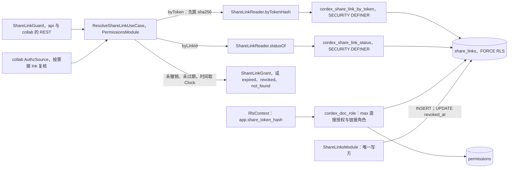
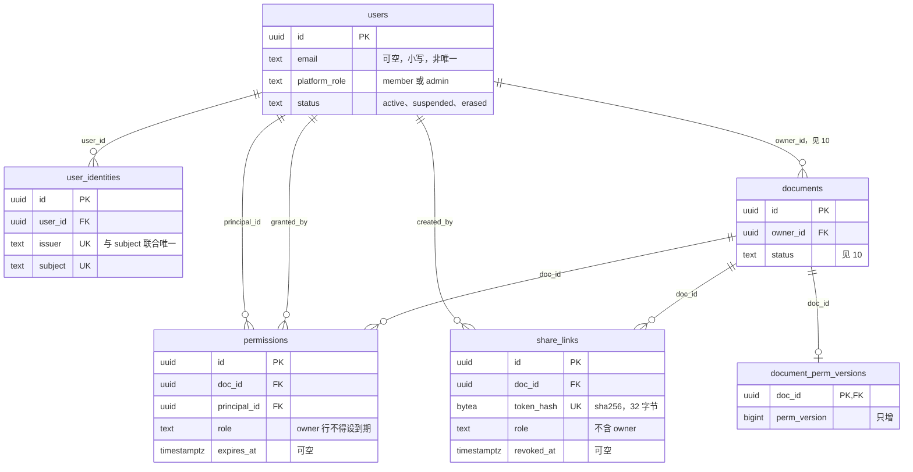
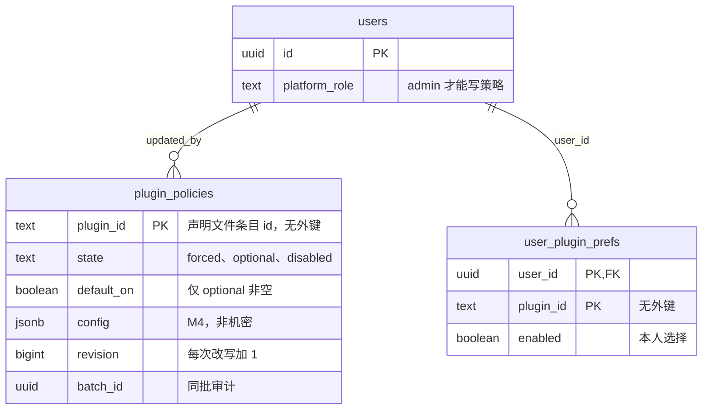

# 09 DDL：身份与权限
> 状态：v0.1 | 负责：后端设计线 | 更新：2026-09-25；2026-09-25（§4.19）；2026-09-26（§4.20）；2026-09-26（§4.21 Remap：原 30/08 引用按 60-backend/README §6.1 改指新位置，30/08 已删除）；2026-10-01（§4.23 插件管理：新增 §14 plugin_policies（0012）、user_plugin_prefs（0013），两表列入 RLS 例外） | 依赖：[08](08-db-conventions-roles-rls-migrations.md)（约定、角色、RLS 框架、0001 / 0002 / 0095 / 0096）；[10](10-ddl-documents-marks-media.md)（0020 `documents`）；[02](02-auth-chain.md) §3、§4、§7、§10；[03](03-modules-identity-and-access.md)；[40/08](../40-modules/08-server-identity-documents-and-storage.md) §2.1、§2.5、§5.3–§5.6；[ADR-0029](../30-architecture/adr/0029-gateway-authorization.md) 2026-09-24 修订；[ADR-0022](../30-architecture/adr/0022-server-storage.md) 修订 2026-09-24；[rulings](../00-charter/rulings-2026-09-14.md) §4.15 T-0/Q6、§4.17 D1/D3、§4.18 BE-02

> 读者：写 `apps/server/src/db/migrations/` 与 `db/schema/{users,user_identities,permissions,document_perm_versions,share_links}.ts` 的工程师；DBA；安全评审。
> 定位：身份与权限域五张表（另有 §14 插件策略两张表，2026-10-01）、四个 SECURITY DEFINER 函数与本域 RLS policy 的**唯一 DDL 源**。SQL 围栏首行 `-- migrate: NNNN_<name>` 为可执行迁移，`-- example` 只做语法解析（[08 §11](08-db-conventions-roles-rls-migrations.md)）。
> 不在本文：命名、外键、角色、GUC 与 policy 写法的通则见 [08](08-db-conventions-roles-rls-migrations.md)；表级与列级 GRANT 由 08 的 0095 统一落地（本文 §8.4 只给本域规格）；Valkey 会话键与保留期总表见 [14](14-valkey-object-storage-and-retention.md)；用例与事务边界见 [03](03-modules-identity-and-access.md)。

---

## 1. 域说明

| 表 | 所属 Nest 模块 | 仓储 | 迁移 | RLS | 里程碑 |
|---|---|---|---|---|---|
| `users` | UsersModule | `UserRepository` | 0010 | 例外（身份目录，无 `doc_id`） | M2 |
| `user_identities` | UsersModule | `UserRepository` | 0011 | 例外（同上） | M2 |
| `plugin_policies`（§14.1，2026-10-01） | PluginsModule | `PluginPolicyRepository` | 0012 | 例外（部署级管理表，无 `doc_id`） | M3 |
| `user_plugin_prefs`（§14.2，2026-10-01） | PluginsModule | `UserPluginPrefsRepository` | 0013 | 例外（用户级偏好，无 `doc_id`） | M3 |
| `permissions` | PermissionsModule | `PermissionRepository` | 0030 | ENABLE + FORCE（0090） | M2 建表与 owner 行；M3 授权 REST |
| `document_perm_versions` | PermissionsModule | `PermissionRepository.bumpPermVersion`（唯一写入点） | 0031 | ENABLE + FORCE（0090） | M2 建表并随协同票据携带（rulings §4.19 D-M2-CONTENT 把网关提前到 M2）；M3 起随授权 REST 递增与广播 |
| `share_links` | ShareLinksModule（写）/ PermissionsModule（只读解析） | `ShareLinkRepository` / `ShareLinkReader` | 0032 | ENABLE + FORCE（0090） | M3 |

本文占用的迁移号（全线唯一分配）：0010–0019（本文用 0010–0013）、0030–0039（本文用 0030–0035）、0090。执行顺序与依赖：0001、0002（08）→ **0010 → 0011 → 0012 → 0013** → 0020（10）→ **0030 → 0031 → 0032 → 0033 → 0034 → 0035** → 0040–0073（11–13）→ **0090** → 0091–0094 → 0095、0096（08）。

**实测**：本文全部 `-- migrate:` 围栏已在 `postgres:18-alpine` 中配合 08 的 0001、0002 与 10 的 0020 按编号顺序执行通过；§8.5 的行为矩阵与 §10 的 `-- example` 逐条实测（2026-09-25；0035 与其行为断言、§10 ⑦ 于 2026-09-26 随 ddl-check 执行通过，断言做过变异验证）；正式校验由 `docs/_tools/ddl-check` 执行。

本文采用的决策（均为 needsUser=false）：

| 决策 id | 在本文的落点 | authority |
|---|---|---|
| C-01 | `users.email text NULL`，小写、非唯一，删 `email_hash`；`lower(email)` 索引只作精确匹配 | 原 30/08 篇（旧版第 540 行）明示以 40/08 §2.1 为准 |
| C-24 | `users.status` 增 `erased`，原地脱敏由 CHECK 保证；不硬删 | PRD SV-11 + SV-07 |
| C-23 | `share_links.token_hash bytea NOT NULL UNIQUE`（32 字节）；`expires_at` 可空 | 原 30/08 篇函数签名 + 40/08 契约 |
| C-28 | `document_perm_versions` 只由 `bumpPermVersion(tx)` 写 | 谁的表谁写 + 同事务 |
| C-35 / MECH-C | 只保留两个分享链接函数，票据不落库 | 票据是 60 s JWT |
| RLS-GUC、DB-ROLES | `cordex_doc_role` 取 max(直接授权, 有效链接)；函数属主 `cordex_migrator`、固定 `search_path` | rulings §4.18 BE-02 + ADR-0022 修订 |
| C-21 | 三张文档作用域表 ENABLE + FORCE；`users`、`user_identities` 登记例外 | `check-rls-coverage` 规则文本 |
| FK-POLICY | 外键一律 `ON DELETE RESTRICT`；`users` 不硬删 | rulings §4.18 BE-15 |
| G-06 / G-07 / G-10 / G-17 | 无递归的 policy、建档窗口的 INSERT 放行、查询索引、函数加固 | schema-inventory 建议 |

---

## 2. users（0010）

```sql
-- migrate: 0010_users
CREATE TABLE users (
  id            uuid        NOT NULL,
  email         text        NULL,
  display_name  text        NOT NULL,
  avatar_url    text        NULL,
  platform_role text        NOT NULL DEFAULT 'member',
  status        text        NOT NULL DEFAULT 'active',
  last_seen_at  timestamptz NULL,
  created_at    timestamptz NOT NULL DEFAULT now(),
  updated_at    timestamptz NOT NULL DEFAULT now(),
  CONSTRAINT pk_users PRIMARY KEY (id),
  CONSTRAINT ck_users_platform_role CHECK (platform_role IN ('member', 'admin')),
  CONSTRAINT ck_users_status CHECK (status IN ('active', 'suspended', 'erased')),
  CONSTRAINT ck_users_email CHECK (
    email IS NULL
    OR (email = lower(email) AND char_length(email) BETWEEN 3 AND 320 AND position('@' IN email) > 1)),
  CONSTRAINT ck_users_display_name CHECK (char_length(display_name) BETWEEN 1 AND 128),
  CONSTRAINT ck_users_avatar_url CHECK (
    avatar_url IS NULL OR (avatar_url LIKE 'https://%' AND char_length(avatar_url) <= 2048)),
  CONSTRAINT ck_users_erased_scrubbed CHECK (
    status <> 'erased'
    OR (email IS NULL AND avatar_url IS NULL AND last_seen_at IS NULL
        AND display_name = 'deleted-user' AND platform_role = 'member'))
);

-- 按人分享的邮箱精确匹配（决策 SG-05：不做模糊匹配、不回显）
CREATE INDEX ix_users_email ON users (lower(email));
-- 显示名前缀检索（分享对话框），只覆盖 active 用户
CREATE INDEX ix_users_display_name ON users (lower(display_name) text_pattern_ops) WHERE status = 'active';
-- 最后一名 admin 保护与 bootstrap 判定
CREATE INDEX ix_users_platform_role ON users (id) WHERE platform_role = 'admin' AND status = 'active';

COMMENT ON TABLE users IS
  '身份目录：外部 OIDC 用户在本部署的本地行（60/09 §2）。写方 UsersModule；不硬删，GDPR 擦除为原地脱敏 status=erased；无 doc_id，RLS 例外（60/08 §6.4）。';
COMMENT ON COLUMN users.id IS 'UUIDv7，应用层生成；JIT 建号时写入';
COMMENT ON COLUMN users.email IS '可检索邮箱：只写 IdP 声明 email_verified=true 的邮箱，小写，非唯一；未验证、未提供或已擦除时为 NULL';
COMMENT ON COLUMN users.display_name IS '建号时取 IdP name / preferred_username，此后只由本人修改；擦除后为 deleted-user';
COMMENT ON COLUMN users.avatar_url IS '每次登录按 IdP picture 刷新或由本人修改；非 https 或已擦除时为 NULL；服务端从不抓取';
COMMENT ON COLUMN users.platform_role IS '部署级平台角色 member | admin；admin 不隐含任何文档角色；至少保留一名 active admin（应用层）';
COMMENT ON COLUMN users.status IS 'active | suspended | erased；非 active 时会话复核失败，cordex_doc_role 返回 NULL';
COMMENT ON COLUMN users.last_seen_at IS '会话复核缓存未命中时节流更新（≥ 5 min）；从未访问或已擦除时为 NULL';
```

| 项 | 内容 |
|---|---|
| 用途 | 本部署的用户目录：显示名、头像、可检索邮箱、平台角色、状态；服务端不持有密码（rulings §4.15 Q6） |
| 所属模块与仓储 | UsersModule / `UserRepository`（`users/infrastructure/user.repository.ts`） |
| 读写方 | 写：`ProvisionOnFirstLoginUseCase`、`UpdateOwnProfileUseCase`、`AdminUpdateUserUseCase`、`EraseUserUseCase`、`TouchLastSeenUseCase`（均 `cordex_app`）。读：AuthModule（`SessionValidator`、`GetMe`）、`UserDirectory` 的消费方（Permissions、Comments）、`cordex_doc_role`（状态） |
| RLS | 例外：身份目录，登录与按人搜索发生在任何文档上下文之前；替代防线是 UsersModule 字段裁剪（搜索只回 `id / displayName / avatarUrl`，邮箱只精确匹配且不回显）与列级 GRANT（§8.4） |
| 保留与清理 | 永久保留，不硬删；擦除后行内不含个人数据（`ck_users_erased_scrubbed`），外键与审计行保持指向（决策 C-24、FK-POLICY） |
| 里程碑 | M2（随 OIDC 登录） |

- **显示名检索的索引取舍**：选 `lower(display_name) text_pattern_ops` 的 btree 前缀索引，不用 `pg_trgm`。理由：① 需求只到前缀匹配（决策 SG-05 要求收窄枚举面，子串检索反而扩大可枚举范围）；② 三元组对中日韩文字的切分依赖数据库 `LC_CTYPE`，同一查询在不同部署上结果可能不同，前缀匹配结果确定；③ btree 不依赖扩展（08 的 0001 为本表预装的 `pg_trgm` 因此可以不装）。
- 邮箱索引按 `lower(email)` 建，查询写 `lower(email) = lower($1)`；CHECK 已保证入库即小写，两者等价，写法与决策 C-01 一致。
- 无 `password` 类列，也不允许出现口令哈希库（40/08 §10）。

---

## 3. user_identities（0011）

```sql
-- migrate: 0011_user_identities
CREATE TABLE user_identities (
  id             uuid        NOT NULL,
  user_id        uuid        NOT NULL,
  issuer         text        NOT NULL,
  subject        text        NOT NULL,
  email_at_login text        NULL,
  last_login_at  timestamptz NOT NULL DEFAULT now(),
  created_at     timestamptz NOT NULL DEFAULT now(),
  updated_at     timestamptz NOT NULL DEFAULT now(),
  CONSTRAINT pk_user_identities PRIMARY KEY (id),
  CONSTRAINT fk_user_identities_user_id FOREIGN KEY (user_id) REFERENCES users (id) ON DELETE RESTRICT,
  CONSTRAINT uq_user_identities_issuer_subject UNIQUE (issuer, subject),
  CONSTRAINT ck_user_identities_issuer CHECK (char_length(issuer) BETWEEN 1 AND 2048),
  CONSTRAINT ck_user_identities_subject CHECK (char_length(subject) BETWEEN 1 AND 255),
  CONSTRAINT ck_user_identities_email_at_login CHECK (email_at_login IS NULL OR char_length(email_at_login) <= 320)
);

CREATE INDEX ix_user_identities_user_id ON user_identities (user_id);

COMMENT ON TABLE user_identities IS
  '外部 IdP 身份与本地用户的绑定，(issuer, subject) 全局唯一（60/09 §3）。写方 UsersModule；GDPR 擦除时删除该用户全部行；无 doc_id，RLS 例外。';
COMMENT ON COLUMN user_identities.issuer IS 'id_token 的 iss，须等于部署配置的受信 issuer（对外 URL，如 https://idp.<域名>）';
COMMENT ON COLUMN user_identities.subject IS 'id_token 的 sub（OIDC 规定 ≤ 255 个 ASCII 字符）';
COMMENT ON COLUMN user_identities.email_at_login IS '最近一次登录时 IdP 声明的邮箱原文（不论是否已验证），供管理与审计；IdP 未提供时为 NULL';
```

| 项 | 内容 |
|---|---|
| 用途 | 以 `(issuer, subject)` 唯一识别外部身份；一个用户可绑定多个身份（换 IdP 迁移用，合并操作留 M4） |
| 所属模块与仓储 | UsersModule / `UserRepository` |
| 读写方 | 写：`ProvisionOnFirstLoginUseCase`（插入、更新 `last_login_at` / `email_at_login` / `updated_at`）、`EraseUserUseCase`（删除）。读：`ProvisionOnFirstLoginUseCase`（`findByIdentity`）；REST 从不直接暴露 |
| RLS | 例外：同 `users` |
| 保留与清理 | 随用户永久保留；擦除时删除（此后同一 IdP 账号登录即新建用户，02 §3） |
| 里程碑 | M2 |

并发首登：两个请求同时为同一 `(issuer, subject)` 建号时，后提交者在 `uq_user_identities_issuer_subject` 上失败（SQLSTATE 23505），用例回滚整个事务（连同它插入的 `users` 行）并改为读取已存在的身份（03 §3.2）。

---

## 4. permissions（0030）

```sql
-- migrate: 0030_permissions
CREATE TABLE permissions (
  id             uuid        NOT NULL,
  doc_id         uuid        NOT NULL,
  principal_type text        NOT NULL DEFAULT 'user',
  principal_id   uuid        NOT NULL,
  role           text        NOT NULL,
  expires_at     timestamptz NULL,
  granted_by     uuid        NOT NULL,
  created_at     timestamptz NOT NULL DEFAULT now(),
  updated_at     timestamptz NOT NULL DEFAULT now(),
  CONSTRAINT pk_permissions PRIMARY KEY (id),
  CONSTRAINT fk_permissions_doc_id FOREIGN KEY (doc_id) REFERENCES documents (id) ON DELETE RESTRICT,
  CONSTRAINT fk_permissions_principal_id FOREIGN KEY (principal_id) REFERENCES users (id) ON DELETE RESTRICT,
  CONSTRAINT fk_permissions_granted_by FOREIGN KEY (granted_by) REFERENCES users (id) ON DELETE RESTRICT,
  CONSTRAINT uq_permissions_doc_principal UNIQUE (doc_id, principal_type, principal_id),
  CONSTRAINT ck_permissions_principal_type CHECK (principal_type IN ('user')),
  CONSTRAINT ck_permissions_role CHECK (role IN ('owner', 'editor', 'commenter', 'viewer')),
  CONSTRAINT ck_permissions_owner_no_expiry CHECK (role <> 'owner' OR expires_at IS NULL)
);

-- 「与我共享」与文档列表按主体驱动（08 §6.7）；尾列 doc_id 让列表 join 只走索引
CREATE INDEX ix_permissions_principal ON permissions (principal_type, principal_id, doc_id);
-- 最后 owner 保护：按文档锁 owner 行
CREATE INDEX ix_permissions_doc_owner ON permissions (doc_id) WHERE role = 'owner';

COMMENT ON TABLE permissions IS
  '文档直接授权，fail-closed：无行即无权（60/09 §4）。写方 PermissionsModule（授予、改角色、撤销、建档首条 owner 行、purge 参与者 permissions）；保留至文档永久删除；RLS ENABLE + FORCE（0090）。';
COMMENT ON COLUMN permissions.principal_type IS 'M1–M3 只有 user；group 随组管理（U-11）推迟，届时拆列并替换 principal_id 的外键';
COMMENT ON COLUMN permissions.principal_id IS '被授权用户；当前外键指向 users（users 不硬删，擦除后仍指向 deleted-user 行）';
COMMENT ON COLUMN permissions.expires_at IS '授权到期时刻，到期即不计入有效角色；永不过期时为 NULL；owner 行必须为 NULL';
COMMENT ON COLUMN permissions.granted_by IS '最近一次授予或改角色的操作者；建档首条 owner 行为创建者本人';
```

| 项 | 内容 |
|---|---|
| 用途 | 每文档每用户一条直接授权；与 `share_links` 共同决定有效角色（02 §1） |
| 所属模块与仓储 | PermissionsModule / `PermissionRepository`（`permissions/infrastructure/permission.repository.ts`） |
| 读写方 | 写：`GrantPermissionUseCase`、`RevokePermissionUseCase`、`GrantInitialOwnerInTx`（`cordex_app`；导入建档时 `cordex_system`）、参与者 `permissions`（`cordex_system`）。读：`RoleResolverService`、`ListPermissionsQuery`、`cordex_doc_role`；DocumentsModule 的文档列表以 SQL join 只读（04） |
| RLS | ENABLE + FORCE；policy 见 §8 |
| 保留与清理 | 保留至文档永久删除，由参与者 `permissions` 删除（03 §10）；过期授权行不自动清理（列表可见、判定时不计入），由 owner 手动撤销 |
| 里程碑 | M2（建档写首条 owner 行，列表按授权过滤）；M3（授权 REST） |

- `principal_id` 直接建外键：M1–M3 主体只有用户，外键让「授权给不存在的用户」在库里就失败；组管理（U-11）落地时按 expand / contract 拆成 `principal_user_id` / `principal_group_id` 两列（08 §10.3），不在本期预留。
- 「至少一个 owner」与「`documents.owner_id` 指向的用户始终是 owner」都是应用层不变量（§10），库里只保证 owner 行不带到期时间，避免最后一个 owner 因到期而静默消失。

---

## 5. document_perm_versions（0031）

```sql
-- migrate: 0031_document_perm_versions
CREATE TABLE document_perm_versions (
  doc_id       uuid        NOT NULL,
  perm_version bigint      NOT NULL DEFAULT 0,
  updated_at   timestamptz NOT NULL DEFAULT now(),
  CONSTRAINT pk_document_perm_versions PRIMARY KEY (doc_id),
  CONSTRAINT fk_document_perm_versions_doc_id FOREIGN KEY (doc_id) REFERENCES documents (id) ON DELETE RESTRICT,
  CONSTRAINT ck_document_perm_versions_non_negative CHECK (perm_version >= 0)
);

COMMENT ON TABLE document_perm_versions IS
  '文档权限变更计数 permVersion，进入协同票据并经 perm:doc:{docId} 广播（60/09 §5）。唯一写入点 PermissionRepository.bumpPermVersion(tx)（决策 C-28）；保留至文档永久删除；RLS ENABLE + FORCE（0090）。';
COMMENT ON COLUMN document_perm_versions.perm_version IS '只增；授予、改角色、撤销授权、撤销分享链接各 +1，与业务写入同事务；建档时为 0';
```

| 项 | 内容 |
|---|---|
| 用途 | 权限变更的单调计数；票据带签发时的值，WS 握手以库为准比对（02 §9.3） |
| 所属模块与仓储 | PermissionsModule / `PermissionRepository.bumpPermVersion(tx, docId)`（唯一写入点）；读面 `PermVersionReader` |
| 读写方 | 写：`bumpPermVersion`（经 Grant / Revoke / `PermVersionBumper`）、`GrantInitialOwnerInTx`（插入 0）、参与者 `permissions`。读：`IssueCollabTicketUseCase`；collab `TicketVerifier` 在 `perm:ver:{docId}` 缺失时回源（`cordex_system`，`collab.gateway`） |
| RLS | ENABLE + FORCE；policy 见 §8 |
| 保留与清理 | 保留至文档永久删除（参与者 `permissions`）；Valkey 缓存 `perm:ver:{docId}` 由同一参与者删除 |
| 里程碑 | M2 建表（建档写 0），协同票据的 `perm_ver` 与网关比对随 M2 协同网关上线；M3 起授权 REST 与分享链接撤销递增并广播 |

`perm_version` 用 `bigint`：只增、永不回绕；与 `documents.epoch`（10，强制重连）是两个互不联动的计数器（02 §11）。

---

## 6. share_links（0032）

```sql
-- migrate: 0032_share_links
CREATE TABLE share_links (
  id         uuid        NOT NULL,
  doc_id     uuid        NOT NULL,
  token_hash bytea       NOT NULL,
  role       text        NOT NULL,
  expires_at timestamptz NULL,
  revoked_at timestamptz NULL,
  created_by uuid        NOT NULL,
  created_at timestamptz NOT NULL DEFAULT now(),
  CONSTRAINT pk_share_links PRIMARY KEY (id),
  CONSTRAINT fk_share_links_doc_id FOREIGN KEY (doc_id) REFERENCES documents (id) ON DELETE RESTRICT,
  CONSTRAINT fk_share_links_created_by FOREIGN KEY (created_by) REFERENCES users (id) ON DELETE RESTRICT,
  CONSTRAINT uq_share_links_token_hash UNIQUE (token_hash),
  CONSTRAINT ck_share_links_token_hash CHECK (octet_length(token_hash) = 32),
  CONSTRAINT ck_share_links_role CHECK (role IN ('viewer', 'commenter', 'editor')),
  CONSTRAINT ck_share_links_expiry CHECK (expires_at IS NULL OR expires_at > created_at),
  CONSTRAINT ck_share_links_revoked_at CHECK (revoked_at IS NULL OR revoked_at >= created_at)
);

-- 管理列表与永久删除参与者按文档访问；外键列作前导（08 §1）
CREATE INDEX ix_share_links_doc_id ON share_links (doc_id, created_at DESC);

COMMENT ON TABLE share_links IS
  '分享链接：角色叠加令牌，始终要求登录（60/09 §6）。唯一写方 ShareLinksModule；令牌解析只经 SECURITY DEFINER 函数（0033、0034）；撤销与过期行保留至文档永久删除；RLS ENABLE + FORCE（0090）。';
COMMENT ON COLUMN share_links.token_hash IS 'sha256(令牌) 原始 32 字节；令牌明文只在创建响应出现一次，库里不存';
COMMENT ON COLUMN share_links.role IS 'viewer | commenter | editor；链接不能造出 owner';
COMMENT ON COLUMN share_links.expires_at IS '链接到期时刻；永不过期时为 NULL';
COMMENT ON COLUMN share_links.revoked_at IS '撤销时刻；未撤销时为 NULL；撤销后不可恢复（收紧 = 撤销后新建）';
```

| 项 | 内容 |
|---|---|
| 用途 | 链接角色的来源；有效链接的角色与直接授权取高（rulings §4.18 BE-02） |
| 所属模块与仓储 | 写：ShareLinksModule / `ShareLinkRepository`；只读解析：PermissionsModule / `ShareLinkReader`（只调 §7 的函数） |
| 读写方 | 写：`CreateShareLinkUseCase`、`RevokeShareLinkUseCase`（`cordex_app`）、参与者 `share-links`（`cordex_system`）。读：`ListShareLinksQuery`（owner）；令牌与链接 id 查询只经 `cordex_share_link_by_token` / `cordex_share_link_status`；`cordex_doc_role` |
| RLS | ENABLE + FORCE；policy 见 §8 |
| 保留与清理 | 撤销、过期的行照常保留（列表可见、校验时实时判定），不做定时清理；文档永久删除时由参与者 `share-links` 删除 |
| 里程碑 | M3 |

`token_hash` 的唯一约束同时是按令牌查找的索引；令牌是 256 位随机数，碰撞只在理论上存在，撞上即创建失败重试。

---

## 7. SECURITY DEFINER 函数（0033–0035）

依据：决策 RLS-GUC、DB-ROLES、C-35；rulings §4.20 BE-05（0035）；schema-inventory G-06（policy 自引用递归）、G-17（函数加固）；[08 §4.3](08-db-conventions-roles-rls-migrations.md)（全线 SECURITY DEFINER 函数的唯一清单：本文四个，另有 10 的 `cordex_storage_usage`）。

```sql
-- migrate: 0033_share_link_lookup_functions
-- 执行者：cordex_migrator。令牌查找发生在「已登录、尚无文档上下文」的时刻，只能以属主身份只读 share_links
CREATE FUNCTION cordex_share_link_by_token(p_token_hash bytea)
  RETURNS TABLE (link_id uuid, doc_id uuid, role text, expires_at timestamptz, revoked_at timestamptz)
  LANGUAGE sql
  STABLE
  SECURITY DEFINER
  SET search_path = pg_catalog, pg_temp
AS $$
  SELECT s.id, s.doc_id, s.role, s.expires_at, s.revoked_at
    FROM public.share_links AS s
   WHERE s.token_hash = p_token_hash
$$;

CREATE FUNCTION cordex_share_link_status(p_link_id uuid)
  RETURNS TABLE (link_id uuid, doc_id uuid, role text, expires_at timestamptz, revoked_at timestamptz)
  LANGUAGE sql
  STABLE
  SECURITY DEFINER
  SET search_path = pg_catalog, pg_temp
AS $$
  SELECT s.id, s.doc_id, s.role, s.expires_at, s.revoked_at
    FROM public.share_links AS s
   WHERE s.id = p_link_id
$$;

ALTER FUNCTION cordex_share_link_by_token(bytea) OWNER TO cordex_migrator;
ALTER FUNCTION cordex_share_link_status(uuid) OWNER TO cordex_migrator;
REVOKE ALL ON FUNCTION cordex_share_link_by_token(bytea), cordex_share_link_status(uuid) FROM PUBLIC;
GRANT EXECUTE ON FUNCTION cordex_share_link_by_token(bytea), cordex_share_link_status(uuid)
  TO cordex_app, cordex_system;

COMMENT ON FUNCTION cordex_share_link_by_token(bytea) IS
  '按令牌哈希取链接（60/09 §7）。撤销、过期的行照常返回，有效性由 ResolveShareLinkUseCase 判定。调用方只有 PermissionsModule 的 ShareLinkReader。';
COMMENT ON FUNCTION cordex_share_link_status(uuid) IS
  '按链接 id 取链接（WS 会话按票据 lnk 复核）；返回形状同 cordex_share_link_by_token。';
```

```sql
-- migrate: 0034_cordex_doc_role
-- 执行者：cordex_migrator。全部文档作用域 policy 的角色来源；以属主（BYPASSRLS）身份读授权来源表，避免 permissions 自身 policy 递归
CREATE FUNCTION cordex_doc_role(p_doc_id uuid)
  RETURNS text
  LANGUAGE sql
  STABLE
  SECURITY DEFINER
  COST 1000
  SET search_path = pg_catalog, pg_temp
AS $$
  WITH me AS (
    SELECT u.id AS uid
      FROM public.users AS u
     WHERE u.id = public.cordex_current_user()
       AND u.status = 'active'
  ),
  candidates AS (
    -- ① 直接授权：本人、未过期
    SELECT p.role
      FROM public.permissions AS p
      JOIN me ON p.principal_id = me.uid
     WHERE p.doc_id = p_doc_id
       AND p.principal_type = 'user'
       AND (p.expires_at IS NULL OR p.expires_at > pg_catalog.now())
    UNION ALL
    -- ② 链接角色：数据库自行复核本请求携带的令牌（须已登录，S-1）
    SELECT s.role
      FROM public.share_links AS s
      CROSS JOIN me
     WHERE s.doc_id = p_doc_id
       AND s.token_hash = public.cordex_share_token_hash()
       AND s.revoked_at IS NULL
       AND (s.expires_at IS NULL OR s.expires_at > pg_catalog.now())
    UNION ALL
    -- ③ 建档窗口引导：本人是 owner_id、文档 active、且尚无任何授权行时视为 owner
    SELECT 'owner'::text
      FROM public.documents AS d
      JOIN me ON d.owner_id = me.uid
     WHERE d.id = p_doc_id
       AND d.status = 'active'
       AND NOT EXISTS (SELECT 1 FROM public.permissions AS p2 WHERE p2.doc_id = p_doc_id)
  )
  SELECT c.role
    FROM candidates AS c
   ORDER BY pg_catalog.array_position(ARRAY['viewer', 'commenter', 'editor', 'owner']::text[], c.role) DESC
   LIMIT 1
$$;

ALTER FUNCTION cordex_doc_role(uuid) OWNER TO cordex_migrator;
REVOKE ALL ON FUNCTION cordex_doc_role(uuid) FROM PUBLIC;
GRANT EXECUTE ON FUNCTION cordex_doc_role(uuid) TO cordex_app, cordex_system;

COMMENT ON FUNCTION cordex_doc_role(uuid) IS
  '当前用户对该文档的有效角色 = max(直接授权, app.share_token_hash 对应的有效链接角色)，另含建档窗口引导；用户非 active 或无上下文时返回 NULL（60/09 §7）。';
```

```sql
-- migrate: 0035_sole_owner_doc_count
-- 执行者：cordex_migrator。平台管理员停用或擦除用户时统计「该用户是唯一可用 owner」的文档数（rulings §4.20 BE-05）：
-- 管理员在 RLS 下看不到他人文档的授权行，api 又只有 cordex_app 连接池，只能以属主身份计数；只返回数字
CREATE FUNCTION cordex_sole_owner_doc_count(p_user_id uuid)
  RETURNS bigint
  LANGUAGE plpgsql
  STABLE
  SECURITY DEFINER
  SET search_path = pg_catalog, pg_temp
AS $$
BEGIN
  IF NOT EXISTS (SELECT 1
                   FROM public.users AS u
                  WHERE u.id = public.cordex_current_user()
                    AND u.status = 'active'
                    AND u.platform_role = 'admin') THEN
    RAISE EXCEPTION USING ERRCODE = '42501', MESSAGE = 'cordex_sole_owner_doc_count: caller is not an active platform admin';
  END IF;
  RETURN (
    SELECT count(*)
      FROM public.permissions AS p
      JOIN public.documents AS d ON d.id = p.doc_id
     WHERE p.principal_type = 'user'
       AND p.principal_id = p_user_id
       AND p.role = 'owner'
       AND d.status <> 'purging'
       AND NOT EXISTS (
             SELECT 1
               FROM public.permissions AS o
               JOIN public.users AS ou ON ou.id = o.principal_id
              WHERE o.doc_id = p.doc_id
                AND o.principal_type = 'user'
                AND o.role = 'owner'
                AND o.principal_id <> p_user_id
                AND ou.status = 'active'));
END $$;

ALTER FUNCTION cordex_sole_owner_doc_count(uuid) OWNER TO cordex_migrator;
REVOKE ALL ON FUNCTION cordex_sole_owner_doc_count(uuid) FROM PUBLIC;
GRANT EXECUTE ON FUNCTION cordex_sole_owner_doc_count(uuid) TO cordex_app;

COMMENT ON FUNCTION cordex_sole_owner_doc_count(uuid) IS
  '该用户持 owner 授权、且没有其他 active 用户持 owner 的非 purging 文档数（60/09 §7）。只允许 active 平台管理员调用，只返回数字；供停用与擦除的响应和审计提醒管理员执行 cordex-ops documents:reassign-owner。';
```

`cordex_sole_owner_doc_count` 的口径与边界（rulings §4.20 BE-05+TX-22）：

- **「唯一可用 owner」**：该用户持 owner 授权，且文档里没有**其他 active 用户**持 owner——其余 owner 都已停用或擦除的文档同样计入，因为它们同样无人能执行 `doc.manage`。`purging` 文档不计。
- **暴露面**：只有 active 平台管理员能调用（否则 42501），只返回一个数字、不返回文档 id；只授予 `cordex_app`（调用方是 api 的 `AdminUpdateUserUseCase`、`EraseUserUseCase`，[03 §3.2](03-modules-identity-and-access.md)），系统作业不需要。
- 运维命令 `documents:reassign-owner` 的写入不经本函数：它以 `cordex_system` 执行，写法见 §10 ⑦。

```sql
-- example
-- 0035 行为断言（§8.5 I-15）：非管理员调用被拒；管理员得到「唯一可用 owner」文档数，另一位 owner 停用后该文档随之计入。
-- 超级用户会话执行（SET ROLE 需要）；整段一个事务、以 ROLLBACK 结束，不留数据。任一 RAISE 即断言失败。
BEGIN;
SET LOCAL ROLE cordex_app;
SET LOCAL app.user_id = '0199a000-0000-7000-8000-0000000a11ce';
INSERT INTO users (id, email, display_name, platform_role) VALUES
  ('0199a000-0000-7000-8000-00000000ad01', 'admin@example.test', 'admin', 'admin'),
  ('0199a000-0000-7000-8000-0000000a11ce', 'alice@example.test', 'alice', 'member'),
  ('0199a000-0000-7000-8000-000000000b0b', 'bob@example.test', 'bob', 'member');
-- alice 建 d1、d2（建档窗口写首条 owner 行），再把 d1 的 owner 也授给 bob
INSERT INTO documents (id, title, doc_type, owner_id) VALUES
  ('0199a000-0000-7000-8000-0000000000d1', 'd1', 'slide', '0199a000-0000-7000-8000-0000000a11ce'),
  ('0199a000-0000-7000-8000-0000000000d2', 'd2', 'slide', '0199a000-0000-7000-8000-0000000a11ce');
INSERT INTO permissions (id, doc_id, principal_type, principal_id, role, granted_by) VALUES
  ('0199a000-0000-7000-8000-00000000e0d1', '0199a000-0000-7000-8000-0000000000d1', 'user',
   '0199a000-0000-7000-8000-0000000a11ce', 'owner', '0199a000-0000-7000-8000-0000000a11ce'),
  ('0199a000-0000-7000-8000-00000000e0d2', '0199a000-0000-7000-8000-0000000000d2', 'user',
   '0199a000-0000-7000-8000-0000000a11ce', 'owner', '0199a000-0000-7000-8000-0000000a11ce');
INSERT INTO permissions (id, doc_id, principal_type, principal_id, role, granted_by) VALUES
  ('0199a000-0000-7000-8000-00000000e0b1', '0199a000-0000-7000-8000-0000000000d1', 'user',
   '0199a000-0000-7000-8000-000000000b0b', 'owner', '0199a000-0000-7000-8000-0000000a11ce');
-- 非管理员（alice 自己）调用被拒
DO $$
BEGIN
  BEGIN
    PERFORM cordex_sole_owner_doc_count('0199a000-0000-7000-8000-0000000a11ce');
    RAISE EXCEPTION '0035 失败：非管理员调用未被拒绝';
  EXCEPTION WHEN insufficient_privilege THEN NULL;  -- 42501
  END;
END $$;
-- 管理员：d1 另有 active owner bob，不计；只计 d2
SET LOCAL app.user_id = '0199a000-0000-7000-8000-00000000ad01';
DO $$ BEGIN
  IF cordex_sole_owner_doc_count('0199a000-0000-7000-8000-0000000a11ce') <> 1 THEN
    RAISE EXCEPTION '0035 失败：d1 另有 active owner，应只计 d2';
  END IF;
END $$;
-- bob 被停用后 d1 也无人可管，计入
UPDATE users SET status = 'suspended' WHERE id = '0199a000-0000-7000-8000-000000000b0b';
DO $$ BEGIN
  IF cordex_sole_owner_doc_count('0199a000-0000-7000-8000-0000000a11ce') <> 2 THEN
    RAISE EXCEPTION '0035 失败：另一位 owner 停用后 d1 应计入';
  END IF;
END $$;
ROLLBACK;
```

| 加固项（[08 §4.3](08-db-conventions-roles-rls-migrations.md)、决策 G-17） | 四个函数 |
|---|---|
| 属主 `cordex_migrator`（唯一 `BYPASSRLS`），函数内读表不再触发 RLS | ✓ |
| `SET search_path = pg_catalog, pg_temp`；表与辅助函数一律 `public.` 限定 | ✓ |
| `STABLE`，只读，不写任何表 | ✓ |
| `REVOKE … FROM PUBLIC`，只授 `cordex_app`、`cordex_system`（0035 只授 `cordex_app`） | ✓ |
| 入参不做字符串拼接，无动态 SQL | ✓ |

`cordex_doc_role` 的四个设计点：

1. **不递归**：`permissions`、`share_links`、`document_perm_versions` 的 policy 都调用它，而它以属主身份读这些表，policy 不会再次触发（G-06）。
2. **链接由库自己复核**：应用层只把 `sha256(令牌)` 放进 `app.share_token_hash`，函数自己查 `share_links` 判断未撤销、未过期、`doc_id` 匹配；应用层即使把令牌错挂到别的文档，库里也不会放行（决策 RLS-GUC「DB 自行校验令牌」）。链接角色读写同口径。
3. **建档窗口引导**（第 ③ 支）：新建文档的事务里，`documents` 行先插入、首条 owner 授权行随后插入；在这两条语句之间文档还没有任何授权行，`permissions` 的 INSERT policy 需要「此人是 owner」才能放行首条 owner 行（G-07）。第 ③ 支只在「本人是 `owner_id`、文档 `active`、该文档一条授权行都没有」时成立——正常文档至少有一条 owner 行（应用层不变量），永久删除中的文档是 `purging`，因此该分支在建档事务之外不会生效。窗口内写入的第一条授权行必须是创建者本人的 owner 行（`GrantInitialOwnerInTx` 的固定写法）：若先写了别人的授权行，第 ③ 支随即失效，创建者再也写不进自己的 owner 行（PG 18 实测）。把它放进函数而不是放进 `permissions` 的 policy 子查询，是因为 policy 里查 `documents` 要受 `documents` 自身 SELECT policy 的可见性约束（10 §8），函数以属主身份读则不受影响。
4. 用户非 `active`（停用、擦除）时第一步 `me` 为空，函数返回 NULL：会话复核之外，数据库层也拒绝停用用户（纵深防御）。

**图 7-1 分享令牌的只读路径**



怎么读：上半是应用层解析令牌的两条入口（REST 守卫凭令牌、WS 会话凭链接 id），都经同一个用例、两个只读函数到达 `share_links`，由用例判定有效性；下半是数据库层对同一令牌的独立复核——`RlsContext` 只传哈希，`cordex_doc_role` 自己查表取角色。写入只有 ShareLinksModule 一个来源，且走普通 RLS policy。
依据：本节；02 §7.3、§10；决策 RLS-GUC、C-35；rulings §4.18 BE-02。

---

## 8. RLS（0090）

依据：[08 §6.3](08-db-conventions-roles-rls-migrations.md) 的 policy 写法（命名 `p_{表}_{app|system}_{操作}`、`cordex_role_at_least(cordex_doc_role(doc_id), …)`、系统只一条 `FOR ALL`、policy 内不读 `current_setting`、不子查询 `permissions` / `share_links`）；决策 RLS-GUC、C-21。

```sql
-- migrate: 0090_rls_identity
ALTER TABLE permissions ENABLE ROW LEVEL SECURITY;
ALTER TABLE permissions FORCE ROW LEVEL SECURITY;
ALTER TABLE document_perm_versions ENABLE ROW LEVEL SECURITY;
ALTER TABLE document_perm_versions FORCE ROW LEVEL SECURITY;
ALTER TABLE share_links ENABLE ROW LEVEL SECURITY;
ALTER TABLE share_links FORCE ROW LEVEL SECURITY;

-- permissions：本人行可见（列表与角色解析）；管理（增改删、看全部成员）要求 owner
CREATE POLICY p_permissions_app_select ON permissions FOR SELECT TO cordex_app
  USING ((principal_type = 'user' AND principal_id = cordex_current_user())
         OR cordex_role_at_least(cordex_doc_role(doc_id), 'owner'));
CREATE POLICY p_permissions_app_insert ON permissions FOR INSERT TO cordex_app
  WITH CHECK (cordex_role_at_least(cordex_doc_role(doc_id), 'owner') AND granted_by = cordex_current_user());
CREATE POLICY p_permissions_app_update ON permissions FOR UPDATE TO cordex_app
  USING (cordex_role_at_least(cordex_doc_role(doc_id), 'owner'))
  WITH CHECK (cordex_role_at_least(cordex_doc_role(doc_id), 'owner') AND granted_by = cordex_current_user());
CREATE POLICY p_permissions_app_delete ON permissions FOR DELETE TO cordex_app
  USING (cordex_role_at_least(cordex_doc_role(doc_id), 'owner'));
CREATE POLICY p_permissions_system_all ON permissions FOR ALL TO cordex_system
  USING (cordex_system_job() IS NOT NULL) WITH CHECK (cordex_system_job() IS NOT NULL);

-- document_perm_versions：任何角色可读（换票据）；递增要求 owner（授权与链接变更都只有 owner 能做）
CREATE POLICY p_document_perm_versions_app_select ON document_perm_versions FOR SELECT TO cordex_app
  USING (cordex_role_at_least(cordex_doc_role(doc_id), 'viewer'));
CREATE POLICY p_document_perm_versions_app_insert ON document_perm_versions FOR INSERT TO cordex_app
  WITH CHECK (cordex_role_at_least(cordex_doc_role(doc_id), 'owner'));
CREATE POLICY p_document_perm_versions_app_update ON document_perm_versions FOR UPDATE TO cordex_app
  USING (cordex_role_at_least(cordex_doc_role(doc_id), 'owner'))
  WITH CHECK (cordex_role_at_least(cordex_doc_role(doc_id), 'owner'));
CREATE POLICY p_document_perm_versions_system_all ON document_perm_versions FOR ALL TO cordex_system
  USING (cordex_system_job() IS NOT NULL) WITH CHECK (cordex_system_job() IS NOT NULL);

-- share_links：只有 owner 能看、建、撤销；应用角色无 DELETE（只由 purge 参与者删除）
CREATE POLICY p_share_links_app_select ON share_links FOR SELECT TO cordex_app
  USING (cordex_role_at_least(cordex_doc_role(doc_id), 'owner'));
CREATE POLICY p_share_links_app_insert ON share_links FOR INSERT TO cordex_app
  WITH CHECK (cordex_role_at_least(cordex_doc_role(doc_id), 'owner') AND created_by = cordex_current_user());
CREATE POLICY p_share_links_app_update ON share_links FOR UPDATE TO cordex_app
  USING (cordex_role_at_least(cordex_doc_role(doc_id), 'owner'))
  WITH CHECK (cordex_role_at_least(cordex_doc_role(doc_id), 'owner') AND revoked_at IS NOT NULL);
CREATE POLICY p_share_links_system_all ON share_links FOR ALL TO cordex_system
  USING (cordex_system_job() IS NOT NULL) WITH CHECK (cordex_system_job() IS NOT NULL);
```

### 8.1 policy 矩阵

「最低角色」即 policy 中 `cordex_role_at_least(cordex_doc_role(doc_id), …)` 的第二个参数；与 PermissionsModule 的 `ROLE_CAPABILITIES`（03 §4.2）对应：`owner` ⇔ `doc.manage`。

| 表 | `cordex_app` SELECT | INSERT | UPDATE | DELETE | `cordex_system` |
|---|---|---|---|---|---|
| `permissions` | 本人行，或 owner | owner，且 `granted_by` = 本人（建档窗口经 `cordex_doc_role` 第 ③ 支放行） | owner，写后 `granted_by` = 本人 | owner | `cordex_system_job()` 非空时全部 |
| `document_perm_versions` | viewer 及以上 | owner | owner | 无（无 GRANT） | 同上 |
| `share_links` | owner | owner，且 `created_by` = 本人 | owner，写后 `revoked_at` 非空（撤销不可逆） | 无（无 GRANT，只由参与者删） | 同上 |
| `users`、`user_identities` | 例外，不开 RLS（§8.3） | — | — | — | — |

- `permissions` 的「本人行可见」分支让文档列表能从 `ix_permissions_principal` 驱动、`RoleResolverService` 在请求上下文里读到本人授权；它不扩大可见范围——本人的授权行本就代表本人对该文档有角色（过期行除外，过期行只对本人可见、不计入角色）。
- 应用层的细分规则（最后 owner、`owner_id` 用户不可降级、目标用户须 active）不在 policy 里，policy 只做兜底（03 §4.2，本文 §10）。

### 8.2 与 [10](10-ddl-documents-marks-media.md) 的配合

- 建档事务固定顺序 `documents` → `permissions`（首条 owner 行）→ `document_perm_versions`（[08 §6.3](08-db-conventions-roles-rls-migrations.md) 第 6 条）。两处放行各管一步：`INSERT documents … RETURNING`（04 的 `CreateDocumentUseCase`）的 SELECT 检查在新行写入**之前**求值，`cordex_doc_role` 此时还查不到这行文档，只能靠 10 的 `documents` SELECT policy 中 `owner_id = cordex_current_user()` 分支（PG 18 实测：去掉该分支后本语句报 `new row violates row-level security policy`）；首条 owner 授权行由 `cordex_doc_role` 第 ③ 支放行（上一条语句写入的 `documents` 行已可见）。建档后第 ③ 支自动失效（文档已有授权行）。
- `documents` 行被永久删除收尾（04 §4.4）之前，参与者 `permissions`、`share-links` 已清空本域三张表；三张表对 `documents` 的外键都是 `RESTRICT`，漏清即收尾失败（决策 FK-POLICY）。

### 8.3 RLS 例外（写入 `policy/rls-exceptions.json`，清单以 [08 §6.4](08-db-conventions-roles-rls-migrations.md) 为准）

| 表 | 理由 | 替代防线 |
|---|---|---|
| `users` | 身份目录，无 `doc_id`；登录、会话复核、按人搜索都发生在任何文档上下文之前 | UsersModule 字段裁剪（搜索只回 `id / displayName / avatarUrl`，邮箱只精确匹配且不回显，决策 SG-05）；列级 UPDATE GRANT（§8.4）；擦除行由 `ck_users_erased_scrubbed` 保证无个人数据 |
| `user_identities` | 身份目录，无 `doc_id`；只在 OIDC 回调与擦除中访问 | 只经 UsersModule 用例访问，无任何 REST 直接暴露 |

### 8.4 本域 GRANT 规格（由 [08](08-db-conventions-roles-rls-migrations.md) 的 0095 落地）

表级权限与 08 §4.2 矩阵一致；本节要求 0095 对 UPDATE 改为**列级**授予（表级 UPDATE 会覆盖列级限制），把「哪些列可改」也落到数据库层：`id`、`created_at`、主体与文档外键、令牌哈希对应用角色不可改。

```sql
-- example
-- 身份与权限域的列级 UPDATE 规格（由 08 的 0095 落地；其余表级权限见 08 §4.2）
GRANT UPDATE (email, display_name, avatar_url, platform_role, status, last_seen_at, updated_at)
  ON users TO cordex_app;
GRANT UPDATE (email_at_login, last_login_at, updated_at) ON user_identities TO cordex_app;
GRANT UPDATE (role, expires_at, granted_by, updated_at) ON permissions TO cordex_app;
GRANT UPDATE (perm_version, updated_at) ON document_perm_versions TO cordex_app, cordex_system;
GRANT UPDATE (revoked_at) ON share_links TO cordex_app;
```

### 8.5 行为矩阵（本域实测结论）

| # | 情形 | 期望（已在 PG 18 实测） | 对应 08 §6.8 |
|---|---|---|---|
| I-01 | 创建者在建档事务里写首条 owner 行，`RETURNING` 可见；随后 `document_perm_versions` 写 0 | 成功；`cordex_doc_role` 在窗口内与窗口后都为 `owner` | R12 |
| I-02 | 非 `owner_id` 用户给别人的新文档写 owner 行；非 owner 给已有文档写 owner 行 | `new row violates row-level security policy` | R12 |
| I-03 | editor 读 `permissions` | 只见本人 1 行；能读 `perm_version`；改 `perm_version` 影响 0 行；建链接被拒 | R3–R4 |
| I-04 | 无直接授权，携带有效 commenter 链接的哈希 | `cordex_doc_role = commenter`，文档可见；换成别的文档 id → NULL | R6、R7 |
| I-05 | 链接已过期、已撤销；未设 `app.user_id` 而只带有效链接哈希 | NULL（链接不豁免登录） | R7、R1 |
| I-06 | `app.share_token_hash` 为非法 hex | 报错 `invalid hexadecimal digit`，整条语句失败 | R7 |
| I-07 | `cordex_system` 设了作业名 / 同一连接下一个事务未设 | 全部可见 / 0 行（占位 GUC 回落为空串，`cordex_system_job()` 返回 NULL） | R8、R9 |
| I-08 | `cordex_app` 未设 `app.user_id` | 三张表都 0 行 | R1 |
| I-09 | 用户被停用 | `cordex_doc_role` 为 NULL | — |
| I-10 | 置 `erased` 而不脱敏；owner 行加到期；31 字节令牌哈希；链接角色 `owner` | 各自违反对应 CHECK | — |
| I-11 | owner 把已撤销链接的 `revoked_at` 改回 NULL | policy 拒绝（撤销不可逆） | — |
| I-12 | 非 owner 调 `cordex_share_link_by_token` / `cordex_share_link_status`；直接 `SELECT share_links` | 函数返回链接行（有效性由用例判定）；直接查询 0 行 | — |
| I-13 | 两个 owner 并发互相撤销（`FOR UPDATE` 锁 owner 行后计数） | 先者看到 2 行并删除对方；后者在锁释放后只看到 1 行，被应用层拒绝 | — |
| I-14 | 四个函数的加固属性 | `prosecdef`、`search_path=pg_catalog, pg_temp`、属主 `cordex_migrator`、PUBLIC 无 EXECUTE、`cordex_doc_role` 的 `COST 1000` | 08 0096 ④ |
| I-15 | 非平台管理员调用 `cordex_sole_owner_doc_count`；管理员查询「另有 active owner」与「其余 owner 均已停用」的文档 | 前者 42501；后者前一类不计、后一类计入（§7 的 example 断言，ddl-check 每次执行） | — |

---

## 9. 逐表汇总

| 表 | 所属模块与仓储 | 写方（登录角色） | 读方 | 保留与清理 | 里程碑 |
|---|---|---|---|---|---|
| `users` | Users / `UserRepository` | JIT 建号、资料、平台管理、擦除、`last_seen_at`（`cordex_app`） | Auth、`UserDirectory` 消费方、`cordex_doc_role` | 永久，不硬删；擦除原地脱敏 | M2 |
| `user_identities` | Users / `UserRepository` | JIT 建号与登录更新、擦除删除（`cordex_app`） | OIDC 回调 | 随用户；擦除时删除 | M2 |
| `permissions` | Permissions / `PermissionRepository` | 授予、改角色、撤销、建档 owner 行（`cordex_app`；导入建档 `cordex_system`）；参与者（`cordex_system`） | `RoleResolverService`、列表 join、`cordex_doc_role` | 至文档永久删除；过期行不自动清理 | M2 / M3 |
| `document_perm_versions` | Permissions / `bumpPermVersion` | 同事务递增（`cordex_app`）；建档写 0；参与者 | 换票据；collab 回源（`cordex_system`） | 至文档永久删除；同时删 `perm:ver:{docId}` | M2 / M3 |
| `share_links` | ShareLinks / `ShareLinkRepository`；只读 `ShareLinkReader` | 创建、撤销（`cordex_app`）；参与者（`cordex_system`） | 只经 SECURITY DEFINER 函数；owner 列表；`cordex_doc_role` | 撤销与过期行保留至文档永久删除 | M3 |

保留期、清理作业与 Valkey 会话键的总表以 [14](14-valkey-object-storage-and-retention.md) 为唯一源；本域没有周期清理作业。

---

## 10. 应用层不变量与关键语句

库里只放能用约束表达的规则（CHECK、唯一、外键、policy）；下列不变量在应用层实现，语句写法固定如下（每条语句都能单独 `PREPARE`；事务边界见注释，用例见 [03](03-modules-identity-and-access.md)）。

| 不变量 | 落点 | 并发控制 |
|---|---|---|
| 每份文档至少一个 owner | `RevokePermissionUseCase`、`GrantPermissionUseCase`（降级 owner 时） | 按 `principal_id` 顺序 `FOR UPDATE` 锁该文档全部 owner 行后计数（实测 I-13） |
| `documents.owner_id` 指向的用户始终持 owner | 同上（[04 §1](04-modules-documents-storage-media.md) 的跨模块不变量） | 读 `owner_id` 与锁 owner 行在同一事务 |
| 部署内至少一名 active admin | `AdminUpdateUserUseCase`、`EraseUserUseCase` | 按 `id` 顺序 `FOR UPDATE` 锁全部 active admin 行后计数 |
| 授权目标必须是已存在且 active 的用户 | `GrantPermissionUseCase` | 外键保证存在；`status` 由 `UserDirectory` 在同一事务读取 |
| `perm_version` 与授权、链接变更同事务 +1 | `bumpPermVersion(tx)` | 行锁由 `ON CONFLICT … DO UPDATE` 取得 |
| 运维转移 owner 只增不减：写目标用户的 owner 行，原 owner 的授权与 `documents.owner_id` 不动 | `ReassignOwnerUseCase`（03 §4.2，`cordex_system`） | 同一事务内先删目标用户旧授权行再插 owner 行（`cordex_system` 对 `permissions` 只有 S I D，08 §4.2），随后 `bumpPermVersion` |

```sql
-- example
-- ① 最后 owner 与 owner_id 保护（cordex_app，操作者上下文；与随后的 DELETE / UPSERT 同一事务）
SELECT principal_id
  FROM permissions
 WHERE doc_id = $1 AND role = 'owner'
 ORDER BY principal_id
   FOR UPDATE;
SELECT owner_id FROM documents WHERE id = $1;
-- 应用层：目标 = owner_id 且新角色 ≠ owner → permission.last_owner{document_owner}；
--         目标在上面的结果里且结果只有 1 行 → permission.last_owner{last_owner}
```

```sql
-- example
-- ② 授予或改角色（先 SELECT … FOR UPDATE 取旧角色供审计 previousRole），随后在同一事务递增 perm_version
SELECT role FROM permissions WHERE doc_id = $1 AND principal_type = 'user' AND principal_id = $2 FOR UPDATE;
INSERT INTO permissions AS p (id, doc_id, principal_type, principal_id, role, expires_at, granted_by)
VALUES ($1, $2, 'user', $3, $4, $5, $6)
ON CONFLICT (doc_id, principal_type, principal_id)
DO UPDATE SET role = EXCLUDED.role, expires_at = EXCLUDED.expires_at,
              granted_by = EXCLUDED.granted_by, updated_at = now()
RETURNING p.id, p.role;
INSERT INTO document_perm_versions AS v (doc_id, perm_version) VALUES ($1, 1)
ON CONFLICT (doc_id) DO UPDATE SET perm_version = v.perm_version + 1, updated_at = now()
RETURNING v.perm_version;
```

```sql
-- example
-- ③ 最后 admin 保护（停用、降级、擦除 admin 前；cordex_app，与随后的 UPDATE 同一事务）
SELECT id FROM users WHERE platform_role = 'admin' AND status = 'active' ORDER BY id FOR UPDATE;
-- ④ 擦除：原地脱敏 + 删身份（同一事务；提交后吊销会话键，02 §4.5）
UPDATE users
   SET status = 'erased', display_name = 'deleted-user', email = NULL, avatar_url = NULL,
       last_seen_at = NULL, platform_role = 'member', updated_at = now()
 WHERE id = $1 AND status <> 'erased';
DELETE FROM user_identities WHERE user_id = $1;
```

```sql
-- example
-- ⑤ 首次登录：按 (issuer, subject) 查；未命中则同一事务插入两行，撞 uq_user_identities_issuer_subject 即回滚并重查
SELECT u.id, u.status
  FROM user_identities AS i JOIN users AS u ON u.id = i.user_id
 WHERE i.issuer = $1 AND i.subject = $2;
INSERT INTO users (id, email, display_name, avatar_url) VALUES ($1, $2, $3, $4);
INSERT INTO user_identities (id, user_id, issuer, subject, email_at_login) VALUES ($1, $2, $3, $4, $5);
-- ⑥ 按人搜索（SG-05）：显示名前缀（$1 = lower(已转义 % _ \ 的前缀) || '%'）与邮箱精确匹配，只回三列
SELECT id, display_name, avatar_url
  FROM users
 WHERE status = 'active' AND lower(display_name) LIKE $1 ESCAPE '\'
 ORDER BY lower(display_name), id
 LIMIT 20;
SELECT id, display_name, avatar_url
  FROM users
 WHERE status = 'active' AND lower(email) = lower($1)
 ORDER BY id
 LIMIT 20;
```

```sql
-- example
-- ⑦ 运维转移 owner（ReassignOwnerUseCase；cordex_system，app.system_job = 'ops.documents-reassign-owner'；rulings §4.20 BE-05）
-- 前置：文档存在且非 purging，目标用户 active（均在应用层判定，读取如下）
SELECT status FROM documents WHERE id = $1;
SELECT status FROM users WHERE id = $1;
-- cordex_system 对 permissions 只有 S I D：目标已有授权行时先删（取旧角色供审计 previousRole）再插 owner 行
DELETE FROM permissions WHERE doc_id = $1 AND principal_type = 'user' AND principal_id = $2 RETURNING role;
INSERT INTO permissions (id, doc_id, principal_type, principal_id, role, granted_by)
VALUES ($1, $2, 'user', $3, 'owner', $3);
INSERT INTO document_perm_versions AS v (doc_id, perm_version) VALUES ($1, 1)
ON CONFLICT (doc_id) DO UPDATE SET perm_version = v.perm_version + 1, updated_at = now()
RETURNING v.perm_version;
-- granted_by 取目标用户本人（与建档首条 owner 行同一写法）；运维身份记在审计 admin.owner_reassigned 的 actor_type = 'ops'
```

---

## 11. M4 预留：api_keys（只给列草案，不建表）

依据：rulings §4.15 Q6（API Key 降为 M4）；ADR-0029 决策 7（不能直接用于 WS，须先经 REST 换票）；40/08 §2.1 `ApiKey`。M1–M3 的迁移与 drizzle schema 中都没有这张表（08 §1 表清单）。

```sql
-- example
-- M4 草案：不进迁移。明文 key 只在签发响应出现一次，库里只存 sha256；revoked_at 非空即立即失效
CREATE TABLE api_keys (
  id            uuid        NOT NULL,
  owner_user_id uuid        NOT NULL,
  name          text        NOT NULL,
  key_prefix    text        NOT NULL,
  key_hash      bytea       NOT NULL,
  capabilities  text[]      NOT NULL,
  expires_at    timestamptz NULL,
  last_used_at  timestamptz NULL,
  revoked_at    timestamptz NULL,
  created_at    timestamptz NOT NULL DEFAULT now(),
  CONSTRAINT pk_api_keys PRIMARY KEY (id),
  CONSTRAINT fk_api_keys_owner_user_id FOREIGN KEY (owner_user_id) REFERENCES users (id) ON DELETE RESTRICT,
  CONSTRAINT uq_api_keys_key_hash UNIQUE (key_hash),
  CONSTRAINT uq_api_keys_key_prefix UNIQUE (key_prefix),
  CONSTRAINT ck_api_keys_key_hash CHECK (octet_length(key_hash) = 32),
  CONSTRAINT ck_api_keys_capabilities CHECK (cardinality(capabilities) > 0)
);
```

草案要点：按用户归属（无租户，T-0）；`key_prefix` 用于在界面与日志中辨认而不暴露密钥；能力位取 `protocol permissions/actions.ts` 的字面量，作用面不超过 owner 本人对文档的有效角色；无 `doc_id`，届时登记为 RLS 例外（只经 AuthModule 访问）。集成方签名 JWT 的影子用户复用 `users` + `user_identities`（`issuer` = 集成方 issuer），不另建表（02 §14）。

---

## 12. 按域 ER 图

**图 12-1 身份与权限域**



怎么读：连线两端是基数（`||` 恰一、`o|` 零或一、`o{` 零或多），连线文字是外键列；全部外键 `ON DELETE RESTRICT`。`documents` 属于 [10](10-ddl-documents-marks-media.md)，此处只画被本域引用的列。`users` 不硬删，所以指向它的外键不与擦除冲突；三张文档作用域表在文档永久删除时由各自参与者先清空。`permissions` 的唯一键 `(doc_id, principal_type, principal_id)` 未在图中表达。
依据：本文 §2–§6；决策 FK-POLICY、C-01、C-23、C-24；[08 §8](08-db-conventions-roles-rls-migrations.md) 跨域总览。

---

## 13. 机械验证

只写断言；执行方式见 [70-testing/07](../70-testing/07-backend-integration-and-api-e2e.md)、[70-testing/10](../70-testing/10-security-testing.md)，CI 步骤名见 [70-testing/12](../70-testing/12-ci-gates-mapping.md)。

| # | 断言 | 执行 |
|---|---|---|
| D-01 | 本文 `-- migrate:` 围栏（0010–0013、0030–0035、0090）与 08、10–13 的围栏按编号在 PG 18 空库顺序执行通过；本文 `-- example` 围栏可解析 | `docs/_tools/ddl-check`（08 §11） |
| D-02 | `permissions`、`document_perm_versions`、`share_links` 为 ENABLE + FORCE，各有 `TO cordex_app` 与 `TO cordex_system` policy；`users`、`user_identities` 在例外清单且未开 RLS；policy 文本不含 `current_setting('app.` 与对 `permissions` / `share_links` 的子查询 | 治理检查 `check-rls-coverage`（`scanners/check-rls-coverage`）+ 08 的 0096 自检 |
| D-03 | 四个 SECURITY DEFINER 函数：属主 `cordex_migrator`、`search_path=pg_catalog, pg_temp`、PUBLIC 无 EXECUTE（§8.5 I-14） | 08 的 0096 自检 |
| D-04 | §8.5 行为矩阵 I-01–I-12、I-15 全部符合 | `e2e/smoke` 的 security-rls（M3 起阻断）+ `test/server-integration` |
| D-05 | 并发：两个 owner 互相撤销只有一个成功（I-13）；两名 admin 并发互降只有一个成功 | `test/server-integration` |
| D-06 | 列级 GRANT 快照含 §8.4 五条；应用角色改 `users.id`、`permissions.doc_id`、`share_links.token_hash` 得 `permission denied` | `test/server-integration`（08 DB-06） |
| D-07 | drizzle `schema/{users,user_identities,permissions,document_perm_versions,share_links}.ts` 与迁移后的库无漂移；无 `password` 类列、无 `tenant_id` | `test/server-integration`（08 DB-03） |
| D-08 | 按人搜索的两条查询在 1 万用户规模下走 `ix_users_display_name` / `ix_users_email`（EXPLAIN 无顺序扫描） | `test/server-integration` |


---

## 14. 插件策略与个人选择（0012、0013，rulings §4.23）

依据：rulings §4.23 裁决 1、3 与 O-1、O-2 定稿（2026-10-01）；PRD [09-plugin-manager](../10-prd/03-features/09-plugin-manager.md) PM-03、PM-08、PM-10、PM-14；用例与模块归属见 [03](03-modules-identity-and-access.md) §9；REST 见 [15](15-rest-api-catalog.md) §3.15。

两张表都是**部署级 / 用户级**数据，没有 `doc_id`，按 [08 §6.4](08-db-conventions-roles-rls-migrations.md) 的口径列入 RLS 例外清单，替代防线是「只经 PluginsModule 用例访问」：`plugin_policies` 的写入口只有 `PlatformAdminGuard` 之后的 `UpdatePluginPoliciesUseCase` / `UpdatePluginConfigUseCase`；`user_plugin_prefs` 的每条语句都以会话主体的 `user_id` 为条件，REST 路径里没有用户 id（`/users/me/plugins`），无法越权改他人。

- **插件从哪里来不在库里**：可用清单来自部署声明文件与镜像内置（[17](17-deployment-and-config.md) §5.16），部署时校验结果在每个进程启动时由 `PluginCatalog` 重新算出并持有在内存（声明文件不变则结果确定）；被拒插件只经审计 `plugin.rejected` 留痕（[07](07-modules-comments-webhooks-audit.md) §9.5）。库里只存**管理员的决定**与**用户的个人选择**。
- **无行 = 取声明文件的初始状态**：`plugin_policies` 只在管理员第一次保存某插件时插入；管理员「恢复部署默认」即删除该行。
- `plugin_id` 不设外键：它引用的是声明文件里的条目，不是库内实体；声明文件移除某插件后，其策略行与个人选择行保留（重新加入时恢复），`GET /admin/plugins` 不再列出。

### 14.1 plugin_policies（0012）

```sql
-- migrate: 0012_plugin_policies
CREATE TABLE plugin_policies (
  plugin_id  text        NOT NULL,
  state      text        NOT NULL,
  default_on boolean     NULL,
  config     jsonb       NULL,
  revision   bigint      NOT NULL DEFAULT 1,
  batch_id   uuid        NOT NULL,
  updated_by uuid        NOT NULL,
  created_at timestamptz NOT NULL DEFAULT now(),
  updated_at timestamptz NOT NULL DEFAULT now(),
  CONSTRAINT pk_plugin_policies PRIMARY KEY (plugin_id),
  CONSTRAINT fk_plugin_policies_updated_by FOREIGN KEY (updated_by) REFERENCES users (id) ON DELETE RESTRICT,
  CONSTRAINT ck_plugin_policies_plugin_id CHECK (char_length(plugin_id) BETWEEN 1 AND 214 AND plugin_id !~ '\s'),
  CONSTRAINT ck_plugin_policies_state CHECK (state IN ('forced', 'optional', 'disabled')),
  CONSTRAINT ck_plugin_policies_default_on CHECK ((state = 'optional') = (default_on IS NOT NULL)),
  CONSTRAINT ck_plugin_policies_config CHECK (config IS NULL OR jsonb_typeof(config) = 'object'),
  CONSTRAINT ck_plugin_policies_revision CHECK (revision >= 1)
);

COMMENT ON TABLE plugin_policies IS
  '部署管理员对每个插件的三态策略与非机密配置覆盖（60/09 §14.1，rulings §4.23）。写方 PluginsModule（仅平台管理员，cordex_app）；无行时取声明文件 initial；无 doc_id，RLS 例外（60/08 §6.4）；永久保留。';
COMMENT ON COLUMN plugin_policies.plugin_id IS '插件 id，与声明文件条目及 cordex-manifest.json 的 id 一致；不设外键（引用的是声明文件条目）';
COMMENT ON COLUMN plugin_policies.state IS 'forced | optional | disabled；内容级插件不得为 optional（应用层按声明文件与清单的 scope 校验，422 server.plugins.policy_invalid）';
COMMENT ON COLUMN plugin_policies.default_on IS '仅 state=optional 时非空：用户未做个人选择时是否开启；其余状态为 NULL';
COMMENT ON COLUMN plugin_policies.config IS '非机密配置覆盖（M4，PM-09），须通过插件 Config schema；机密字段只经部署文件提供，从不入库；未覆盖时为 NULL';
COMMENT ON COLUMN plugin_policies.revision IS '本行每次改写加 1；与 policy 摘要一起支撑 PATCH /admin/plugins 的 If-Match';
COMMENT ON COLUMN plugin_policies.batch_id IS '最近一次写入所属的保存批次（UUIDv7），与同批 plugin.policy_changed 审计行的 details.batchId 相同';
```

| 项 | 内容 |
|---|---|
| 用途 | 管理员三态（强制启用 / 允许用户选择 / 禁用）、可选插件的默认值、插件配置覆盖；`policy` 摘要（插件集指纹第二段，[16](16-ws-protocol-server-view.md) §12）由声明文件初始状态叠加本表算出 |
| 所属模块与仓储 | PluginsModule / `PluginPolicyRepository`（`plugins/infrastructure/plugin-policy.repository.ts`） |
| 读写方 | 写：`UpdatePluginPoliciesUseCase`、`UpdatePluginConfigUseCase`（`cordex_app`，经 `PlatformAdminGuard`）。读：`GetPluginCatalogUseCase`、`GetEffectivePluginSetUseCase`（api，`cordex_app`）；collab 的指纹轮询与 worker / renderer 的 headless 内容级集合（`cordex_system`，只读） |
| RLS | 例外：部署级管理表，无 `doc_id`；只授 `cordex_system` SELECT |
| 保留与清理 | 永久保留；「恢复部署默认」删除该行（`cordex_app` DELETE） |
| 里程碑 | M3（随管理员「能看能改」，rulings §4.23 O-4）；`config` 列 M4 起写入 |

### 14.2 user_plugin_prefs（0013）

```sql
-- migrate: 0013_user_plugin_prefs
CREATE TABLE user_plugin_prefs (
  user_id    uuid        NOT NULL,
  plugin_id  text        NOT NULL,
  enabled    boolean     NOT NULL,
  created_at timestamptz NOT NULL DEFAULT now(),
  updated_at timestamptz NOT NULL DEFAULT now(),
  CONSTRAINT pk_user_plugin_prefs PRIMARY KEY (user_id, plugin_id),
  CONSTRAINT fk_user_plugin_prefs_user_id FOREIGN KEY (user_id) REFERENCES users (id) ON DELETE RESTRICT,
  CONSTRAINT ck_user_plugin_prefs_plugin_id CHECK (char_length(plugin_id) BETWEEN 1 AND 214 AND plugin_id !~ '\s')
);

COMMENT ON TABLE user_plugin_prefs IS
  '用户对「允许用户选择」的界面级插件的个人启停（60/09 §14.2，rulings §4.23 O-2：服务端按账号保存，跨设备一致）。写方 PluginsModule（本人，cordex_app）；只含插件 id 与开关、不含个人数据，擦除时保留（users 行原地脱敏，UsersModule 保持叶子）；无 doc_id，RLS 例外（60/08 §6.4）。';
COMMENT ON COLUMN user_plugin_prefs.plugin_id IS '插件 id；管理员把该插件改为 forced / disabled 时本行保留但不生效，改回 optional 时恢复（PM-03）';
COMMENT ON COLUMN user_plugin_prefs.enabled IS '本人的选择；无行时取 plugin_policies.default_on（或声明文件 initial.defaultOn）';
```

| 项 | 内容 |
|---|---|
| 用途 | 个人插件面板「我的界面插件」的开关（PM-10）；只影响本人会话的界面，不进文档、不改插件集指纹、不写审计（PM-14） |
| 所属模块与仓储 | PluginsModule / `UserPluginPrefsRepository` |
| 读写方 | 写：`SetUserPluginPreferenceUseCase`（upsert）、`ResetUserPluginPreferenceUseCase`（删除）（均 `cordex_app`）。读：`GetEffectivePluginSetUseCase`（本人） |
| RLS | 例外：用户级偏好，无 `doc_id`；`cordex_system` 无任何权限 |
| 保留与清理 | 随用户保留；擦除时不删（只含插件 id 与开关，不是个人数据；擦除不回调其他模块，[01](01-service-overview-and-roles.md) 规则 I2）；非 active 用户的行不再被读取；声明文件移除插件后行保留（重新加入时恢复） |
| 里程碑 | M3（M2 的 `/users/me/plugins` 只读，不读本表） |

### 14.3 本域 GRANT 规格与关键语句

GRANT 由 [08](08-db-conventions-roles-rls-migrations.md) 的 0095 落地（08 §4.2 矩阵同步两行）：

```sql
-- example
-- 插件两表的 GRANT 规格（由 08 的 0095 落地）
GRANT SELECT, INSERT, DELETE ON plugin_policies TO cordex_app;
GRANT UPDATE (state, default_on, config, revision, batch_id, updated_by, updated_at) ON plugin_policies TO cordex_app;
GRANT SELECT ON plugin_policies TO cordex_system;
GRANT SELECT, INSERT, DELETE ON user_plugin_prefs TO cordex_app;
GRANT UPDATE (enabled, updated_at) ON user_plugin_prefs TO cordex_app;
```

保存一批管理员变更（`UpdatePluginPoliciesUseCase`，一个事务）：先取事务级咨询锁串行化全部保存，再按当前库内状态重算 `policy` 摘要并与 `If-Match` 比较，不等即 412 `server.plugins.revision_conflict`；逐项 upsert 并写审计，提交后发布 `plugins:ctl`（[14](14-valkey-object-storage-and-retention.md) §3）。

```sql
-- example
SELECT pg_advisory_xact_lock(hashtext('cordex.plugin_policies'));
INSERT INTO plugin_policies (plugin_id, state, default_on, batch_id, updated_by)
  VALUES ($1, $2, $3, $4, $5)
  ON CONFLICT (plugin_id) DO UPDATE
    SET state = EXCLUDED.state, default_on = EXCLUDED.default_on,
        revision = plugin_policies.revision + 1, batch_id = EXCLUDED.batch_id,
        updated_by = EXCLUDED.updated_by, updated_at = now();
```

```sql
-- example
-- 个人启停（本人）：upsert；「恢复管理员默认」即删除
INSERT INTO user_plugin_prefs (user_id, plugin_id, enabled) VALUES ($1, $2, $3)
  ON CONFLICT (user_id, plugin_id) DO UPDATE SET enabled = EXCLUDED.enabled, updated_at = now();
DELETE FROM user_plugin_prefs WHERE user_id = $1 AND plugin_id = $2;
```

```sql
-- example
-- 约束断言（ddl-check 在回滚事务里真实执行）：optional 必须带 default_on，其余状态不得带
DO $$
DECLARE u uuid := '01900000-0000-7000-8000-00000000a001';
BEGIN
  INSERT INTO users (id, display_name, platform_role) VALUES (u, 'plugin-admin', 'admin');
  INSERT INTO plugin_policies (plugin_id, state, default_on, batch_id, updated_by)
    VALUES ('acme:status-clock', 'optional', true, '01900000-0000-7000-8000-00000000b001', u);
  BEGIN
    INSERT INTO plugin_policies (plugin_id, state, default_on, batch_id, updated_by)
      VALUES ('acme:qr-shape', 'forced', false, '01900000-0000-7000-8000-00000000b001', u);
    RAISE EXCEPTION '0012 失败：forced 带 default_on 未被拒绝';
  EXCEPTION WHEN check_violation THEN NULL;
  END;
  BEGIN
    INSERT INTO plugin_policies (plugin_id, state, batch_id, updated_by)
      VALUES ('acme:ruler', 'optional', '01900000-0000-7000-8000-00000000b001', u);
    RAISE EXCEPTION '0012 失败：optional 缺 default_on 未被拒绝';
  EXCEPTION WHEN check_violation THEN NULL;
  END;
  INSERT INTO user_plugin_prefs (user_id, plugin_id, enabled) VALUES (u, 'acme:status-clock', false);
  IF (SELECT count(*) FROM user_plugin_prefs WHERE user_id = u) <> 1 THEN
    RAISE EXCEPTION '0013 失败：个人选择未写入';
  END IF;
END $$;
```

**图 14-1 插件两表与身份域**



怎么读：两张表只通过外键挂在 `users` 上，彼此之间与声明文件之间都没有外键——`plugin_id` 是声明文件里的名字。一次会话实际装配的集合 = 声明文件（通过校验）× `plugin_policies`（无行取 initial）× 本人的 `user_plugin_prefs`（只对 optional 生效），由 `GetEffectivePluginSetUseCase` 在应用层合成。
依据：本节 §14.1、§14.2；[03](03-modules-identity-and-access.md) §9；rulings §4.23。

### 14.4 本节机械验证

| # | 断言 | 执行 |
|---|---|---|
| D-09 | 0012、0013 随全部围栏按编号执行通过；§14.3 约束断言通过；两表在 08 §6.4 例外清单且未开 RLS | `docs/_tools/ddl-check`（08 §11）+ 0096 自检 |
| D-10 | 列级 GRANT：`cordex_app` 改 `plugin_policies.plugin_id`、`created_at` 与 `user_plugin_prefs.user_id` 得 `permission denied`；`cordex_system` 写 `plugin_policies` 或读 `user_plugin_prefs` 得 `permission denied` | `test/server-integration`（08 DB-06） |
| D-11 | 两名管理员以同一 `If-Match` 并发保存：一个 200、一个 412，审计只有成功一方的行 | `test/server-integration`（[70/07](../70-testing/07-backend-integration-and-api-e2e.md)） |
| D-12 | drizzle `schema/plugin_policies.ts`、`schema/user_plugin_prefs.ts` 与迁移后的库无漂移 | `test/server-integration`（08 DB-03） |
