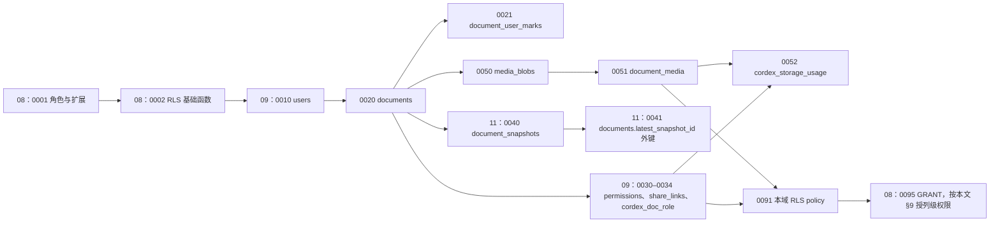
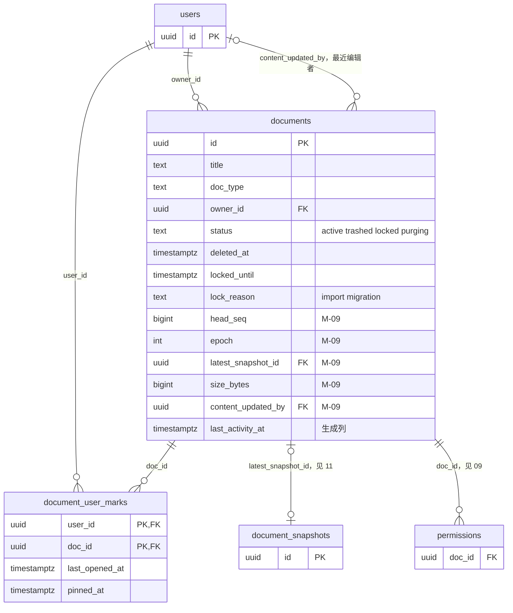
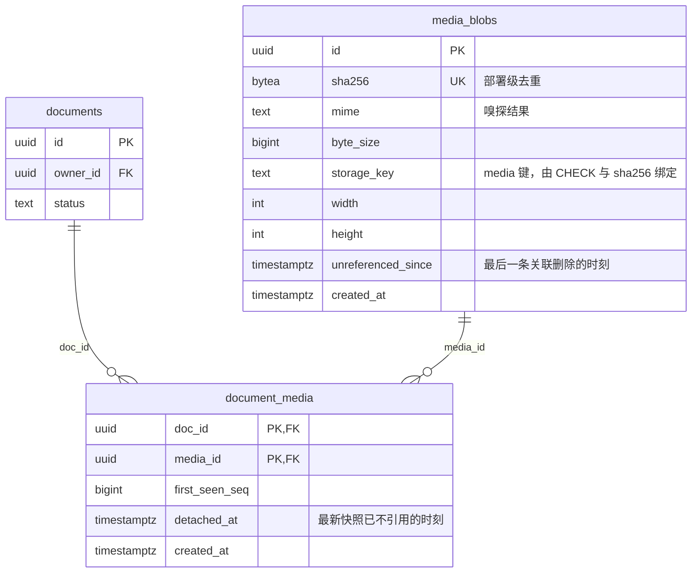
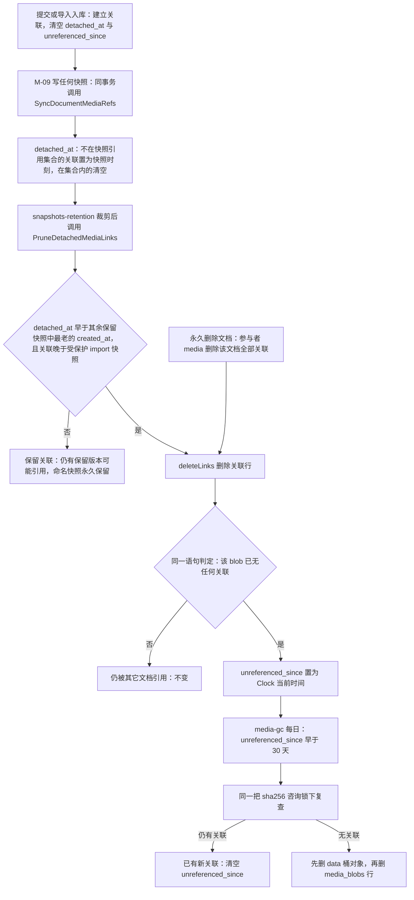

# 10 DDL：文档、用户记账与媒体
> 状态：v0.1 | 负责：后端设计线 | 更新：2026-09-25；2026-09-25（§4.19）；2026-09-25（§4.19 N1）：`documents.epoch` 列注释补覆盖导入写入路径；2026-09-25（lock_reason，§4.19 N1 补缺）；2026-09-26（§4.20）；2026-09-26（§4.21 Remap：原 30/08 引用按 60-backend/README §6.1 改指新位置，30/08 已删除）；2026-10-03（§4.24 AL-1：§7 注明分享链接最高只叠加到 commenter，不构成配额函数要求的 editor）；2026-10-22（design-language-v3 第 3 批：§2 迁移 0020 增列 `content_updated_by`（最近编辑者，外键 → `users`、不另建索引，唯一写方 M-09，rulings §4.25 DS-83），生成列 `last_activity_at` 由 `greatest(updated_at, content_updated_at)` 改为 `coalesce(content_updated_at, created_at)`（列表的最近活动只看内容，改名与回收站进出不改变次序，DS-84），`content_updated_at` 等三列注释写明推进规则，设计说明与写方表同步；图 1-2 补 `content_updated_by`；§9 GRANT 规格与角色汇总表由八个 M-09 列改为九个；§11「我的文档」示例补最近编辑者，新增回收站列表示例（DS-84、DS-85）；§12 增 DDL10-12。本批 0020 与示例的改动当时未跑 ddl-check（本机 Docker 守护进程未运行；同日复核时已实跑通过，见 08 §12））；2026-10-22（design-language-v3 第 3 批回写补充：§2 设计说明「排序键只看内容」补依据 rulings §4.25 TB-144（「我的文档」「与我共享」按内容更新时间倒序）；只改正文，SQL 不变；2026-10-22 复核修正：0020 与 §11 示例同日已随 ddl-check 在 PostgreSQL 18.6 空库实跑通过（08 §12），§12 DDL10-12 的括注随之改；§9 角色汇总表 `cordex_system` 的 `documents` UPDATE 补列 `lock_reason`（与本节 GRANT 规格及 08 §4.2 一致，汇总表原漏写；只改正文）） | 依赖：[08 数据库总约定](08-db-conventions-roles-rls-migrations.md)；[09](09-ddl-identity-and-access.md)（`users`、`cordex_doc_role`）；[11](11-ddl-collab-updates-and-snapshots.md)（0041 外键）；[04 模块设计](04-modules-documents-storage-media.md)；[14](14-valkey-object-storage-and-retention.md)；[rulings](../00-charter/rulings-2026-09-14.md) §4.13、§4.16 Q17、§4.18 BE-15/BE-31/CO-07；ADR-0022、ADR-0025；rulings §4.25 DS-83…DS-85、TB-144

本文是 `documents`、`document_user_marks`、`media_blobs`、`document_media` 四张表、一个存储用量函数与本域 RLS policy 的唯一事实源。命名、主键、时间列、外键默认策略、数据库角色、GUC 与迁移纪律见 [08](08-db-conventions-roles-rls-migrations.md)；这些表背后的用例、事务边界与永久删除编排见 [04](04-modules-documents-storage-media.md)。

SQL 围栏约定（[08](08-db-conventions-roles-rls-migrations.md) §11）：首行 `-- migrate: NNNN_<name>` 的围栏按编号在 PG 18 中顺序执行；首行 `-- example` 的围栏只做语法解析。本文全部 `migrate` 围栏已在 `postgres:18-alpine` 中配合 08 / 09 / 11 的最小桩顺序执行通过，`example` 围栏以 `PREPARE` 解析通过，§12 所列 RLS、列权限、引用维护与约束行为逐条实测（2026-09-25，本轮复核后重测）；正式校验由 `docs/_tools/ddl-check` 执行。

## 1. 域说明

| 表 | 用途 | 所属模块 / 仓储 | 迁移 | RLS | 里程碑 |
|---|---|---|---|---|---|
| `documents` | 文档目录条目（元数据，不含内容） | DocumentsModule / `DocumentRepository`；M-09 列由 `PgUpdateStore` / `PgSnapshotStore` 写 | 0020 | ENABLE + FORCE | M2（`purging` 的使用在 M3） |
| `document_user_marks` | 最近打开 / 固定记账 | DocumentsModule / `UserMarksRepository` | 0021 | ENABLE + FORCE，只本人行 | M2（决策 C-04） |
| `media_blobs` | 部署级内容寻址媒体 | MediaModule / `MediaBlobRepository` | 0050 | 例外（无 `doc_id`） | M2 |
| `document_media` | 文档 → 媒体引用，媒体读取授权依据 | MediaModule / `DocumentMediaRepository` | 0051 | ENABLE + FORCE | M2 |
| 函数 `cordex_storage_usage` | 存储配额汇总（决策 G-09） | DocumentsModule / `StorageQuotaService` 调用 | 0052 | `SECURITY DEFINER` | M2（配额执行随 PRD SV-08 的里程碑） |

本文占用的迁移编号（全线唯一分配，见计划 ownership）：0020–0029、0050–0059、0091；本轮用到 0020、0021、0050、0051、0052、0091。

**图 1-1 本域迁移顺序与跨文件依赖**



怎么读：箭头表示「必须先执行」；带文件号前缀的节点属于别的 DDL 文件，其余是本文的迁移。`0091` 的 policy 用到 08 在 `0002` 定义的 `cordex_current_user`、`cordex_system_job`、`cordex_role_at_least`；`0052` 与 `0091` 都调用 09 在 `0034` 定义的 `cordex_doc_role`，所以编号排在它之后；`documents.latest_snapshot_id` 的外键要等快照表建好，由 11 的 `0041` 追加。

依据：计划 ownership「迁移编号全线唯一分配」；决策 FK-POLICY、RLS-GUC。

**图 1-2 文档与用户记账（ER）**



怎么读：本域两张表居中，`users`、`document_snapshots`、`permissions` 只画出被引用的键（完整结构见 09、11）。`documents` 只列关键列，标 M-09 的列由协同服务端写（列级写方见 [04](04-modules-documents-storage-media.md) §5）；`users` 到 `documents` 的两条线分别是计费所有者与最近编辑者（后者可空，2026-10-22，rulings §4.25 DS-83）；`document_user_marks` 以 `(user_id, doc_id)` 为主键，每个用户对每份文档至多一行。

**图 1-3 媒体（ER）**



怎么读：`media_blobs` 在整个部署内按 sha256 去重、不带 `doc_id`；文档对媒体的一切访问都经过 `document_media`（受 RLS），这张关联表同时是读取授权的依据与回收的引用计数。两个时间列 `detached_at`、`unreferenced_since` 驱动 30 天无引用回收（§6）。

依据：决策 INC-21、C-25；ADR-0022（原 30/08 篇 §5 的媒体草案已删，本文为唯一源，rulings §4.19）。

## 2. documents（0020）

```sql
-- migrate: 0020_documents
CREATE TABLE documents (
  id                 uuid        NOT NULL,
  title              text        NOT NULL DEFAULT '',
  doc_type           text        NOT NULL,
  owner_id           uuid        NOT NULL,
  status             text        NOT NULL DEFAULT 'active',
  deleted_at         timestamptz NULL,
  locked_until       timestamptz NULL,
  lock_reason        text        NULL,
  head_seq           bigint      NOT NULL DEFAULT 0,
  epoch              integer     NOT NULL DEFAULT 0,
  latest_snapshot_id uuid        NULL,
  schema_version     integer     NULL,
  element_count      integer     NOT NULL DEFAULT 0,
  slide_count        integer     NOT NULL DEFAULT 0,
  size_bytes         bigint      NOT NULL DEFAULT 0,
  content_updated_at timestamptz NULL,
  content_updated_by uuid        NULL,
  created_at         timestamptz NOT NULL DEFAULT now(),
  updated_at         timestamptz NOT NULL DEFAULT now(),
  last_activity_at   timestamptz GENERATED ALWAYS AS (coalesce(content_updated_at, created_at)) STORED,
  CONSTRAINT pk_documents PRIMARY KEY (id),
  CONSTRAINT fk_documents_owner FOREIGN KEY (owner_id) REFERENCES users (id) ON DELETE RESTRICT,
  CONSTRAINT fk_documents_content_updated_by FOREIGN KEY (content_updated_by) REFERENCES users (id) ON DELETE RESTRICT,
  CONSTRAINT ck_documents_status CHECK (status IN ('active', 'trashed', 'locked', 'purging')),
  CONSTRAINT ck_documents_title_len CHECK (char_length(title) <= 512),
  CONSTRAINT ck_documents_doc_type CHECK (doc_type ~ '^[a-z][a-z0-9-]{0,31}$'),
  CONSTRAINT ck_documents_deleted_at CHECK (
       (status IN ('active', 'locked') AND deleted_at IS NULL)
    OR (status = 'trashed' AND deleted_at IS NOT NULL)
    OR status = 'purging'),
  CONSTRAINT ck_documents_locked_until CHECK ((status = 'locked') = (locked_until IS NOT NULL)),
  CONSTRAINT ck_documents_lock_reason CHECK (
    (status = 'locked') = (lock_reason IS NOT NULL) AND (lock_reason IS NULL OR lock_reason IN ('import', 'migration'))),
  CONSTRAINT ck_documents_counters CHECK (
    head_seq >= 0 AND epoch >= 0 AND element_count >= 0 AND slide_count >= 0 AND size_bytes >= 0),
  CONSTRAINT ck_documents_schema_version CHECK (schema_version IS NULL OR schema_version > 0)
);

CREATE INDEX ix_documents_owner_activity ON documents (owner_id, last_activity_at DESC, id DESC);
CREATE INDEX ix_documents_trashed_deleted_at ON documents (deleted_at) WHERE status = 'trashed';
CREATE INDEX ix_documents_locked_until ON documents (locked_until) WHERE status = 'locked';

COMMENT ON TABLE documents IS '文档目录条目（元数据，不含内容）。所属：DocumentsModule / DocumentRepository。列级写方见各列注释（决策 C-03）。保留：回收站满 retention.trashDays 进入 purging，finalize-purge 删行。RLS：ENABLE + FORCE（0091）。';
COMMENT ON COLUMN documents.id IS 'UUIDv7，应用层生成；写方 M-08（仅插入）';
COMMENT ON COLUMN documents.title IS '写方 M-08；空串表示未命名，界面本地化显示';
COMMENT ON COLUMN documents.doc_type IS '文档类型标识，只透传（文档类型盲）；写方 M-08（仅插入），无默认值';
COMMENT ON COLUMN documents.owner_id IS '计费所有者：配额归属、我的文档；不变量：该用户持 owner 授权行；写方 M-08（仅插入）';
COMMENT ON COLUMN documents.status IS 'active | trashed | locked | purging；写方 M-08（用户用例经 cordex_app，系统用例经 cordex_system）';
COMMENT ON COLUMN documents.deleted_at IS '移到回收站的时刻，trash-expiry 起算点；active / locked 时为空，purging 保留来路的值；写方 M-08 用户用例';
COMMENT ON COLUMN documents.locked_until IS '系统锁到期时刻，仅 status = locked 时非空；写方 M-08 系统用例';
COMMENT ON COLUMN documents.lock_reason IS '锁定原因 import | migration（rulings §4.19 N1：版本恢复不加锁），仅 status = locked 时非空，与 locked_until 同进同出；供 collab 在会话加入与 lockChanged 重读时填 CONTROL.room.locked.reason；写方 M-08 系统用例';
COMMENT ON COLUMN documents.head_seq IS '已持久化的最大 update seq，与 document_updates 同事务推进；唯一写方 M-09';
COMMENT ON COLUMN documents.epoch IS '强制全体重连计数（forceEpoch、覆盖导入的 SnapshotStore.put，rulings §4.19 N1）；唯一写方 M-09 代码';
COMMENT ON COLUMN documents.latest_snapshot_id IS '最新非 named 快照，NULL = 尚无快照；外键由 0041 添加（ON DELETE SET NULL）；唯一写方 M-09';
COMMENT ON COLUMN documents.schema_version IS '最新快照的 schema 版本，NULL = 尚无快照；唯一写方 M-09';
COMMENT ON COLUMN documents.element_count IS '实体数（墓碑计入），房间权重准入与规模天花板；唯一写方 M-09';
COMMENT ON COLUMN documents.slide_count IS '页数；唯一写方 M-09';
COMMENT ON COLUMN documents.size_bytes IS '内容占用字节（口径见 60/05），存储配额的文档部分；唯一写方 M-09';
COMMENT ON COLUMN documents.content_updated_at IS '最近一次由用户造成的内容变化的时刻（写快照时节流更新，与 content_updated_by 成对；推进规则见 60/05 §7）：auto 取区间内最后一条带 user_id 的 update 的 created_at，import 与 restore 取写快照时刻；只有服务端事务的区间与 named、migration、epoch 快照不推进；NULL = 尚无快照；唯一写方 M-09';
COMMENT ON COLUMN documents.content_updated_by IS '最近编辑者（文档卡片「编辑者 · 相对时间」，rulings §4.25 DS-83）：与 content_updated_at 同一条规则取用户，import 为作业发起人、restore 为执行恢复的用户；NULL = 尚无快照或系统作业建档；唯一写方 M-09';
COMMENT ON COLUMN documents.updated_at IS '元数据最近变化；写方 M-08';
COMMENT ON COLUMN documents.last_activity_at IS '生成列 coalesce(content_updated_at, created_at)：列表的最近活动只看内容，改名与回收站进出不改变次序（rulings §4.25 DS-84）；列表排序键，无人写';
```

设计说明：

- **不拆表**（决策 C-03）：M-08 与 M-09 按列分写，三道机械防线见 [04](04-modules-documents-storage-media.md) §5；列注释标写方，列级权限见 §9。
- **`doc_type` 无默认值**：每次插入都必须显式给出类型，避免把某一类型写成隐式缺省（文档类型盲，M5 新增类型无需迁移）；CHECK 只约束标识符格式。
- **删除的列**：`folder_id`（全仓无文件夹功能，需要时以迁移加回，决策 C-26 / DDL-COLS）；`media_bytes`（配额改为按 owner 经 `document_media` 汇总，决策 G-09，见 §7）。
- **新增的列**：`locked_until`——系统锁必须带到期时间，持锁方崩溃后由 `trash-expiry` 释放（[04](04-modules-documents-storage-media.md) §2）；`content_updated_at` 与生成列 `last_activity_at`——M-09 不能写 `updated_at`（C-03），用生成列让排序键无人可写；`content_updated_by`（2026-10-22，rulings §4.25 DS-83）——文档卡片第二行要写「编辑者 · 相对时间」，最近编辑者只能在压缩当时从 update 日志取出（日志只留 7 天，事后无法回算），所以与 `content_updated_at` 由 M-09 在同一条语句里成对写入（规则见 [05](05-modules-collab-and-snapshots.md) §7，取数示例为 [11](11-ddl-collab-updates-and-snapshots.md) §8 的 e6b）；外键指向 `users`，`users` 不硬删，按 [08](08-db-conventions-roles-rls-migrations.md) §1 不另建索引。
- **排序键只看内容**（2026-10-22，rulings §4.25 DS-84；同日由 TB-144 定为「我的文档」「与我共享」的次序）：`last_activity_at` 由 `greatest(updated_at, content_updated_at)` 改为 `coalesce(content_updated_at, created_at)`——「我的文档」「与我共享」与搜索结果按最近活动即内容编辑时间倒序，与卡片上的时间同源；改名、移入与恢复回收站（只改 `updated_at`）不再改变次序，尚无快照的文档按建档时刻排。
- **状态一致性由 CHECK 保证**：`trashed` 必有 `deleted_at`，`active` / `locked` 必无；`locked` 与 `locked_until`、`lock_reason` 同进同出，`lock_reason` 只取 `import` / `migration`（rulings §4.19 N1 后恢复不加锁）。`lock_reason` 让中途加入的会话也能拿到锁定原因（CONTROL.room.locked.reason）。`purging` 两种来路（`active` 或 `trashed`）都允许，因此不约束 `deleted_at`。
- **索引**：`ix_documents_owner_activity` 服务「我的文档」键集分页；`ix_documents_trashed_deleted_at` 与 `ix_documents_locked_until` 是只含少量行的部分索引，服务 `trash-expiry` 的两个扫描（决策 G-10）。「与我共享」经 09 的 `permissions (principal_type, principal_id)` 索引驱动。
- `latest_snapshot_id` 的外键（`ON DELETE SET NULL`，决策 FK-POLICY 的唯一例外）由 11 的 `0041` 追加，本迁移不引用尚未存在的表。

| 项 | 内容 |
|---|---|
| 用途 | 文档目录条目：标题、类型、计费所有者、状态、回收站与锁定时间，以及 M-09 维护的协同计数 |
| 所属模块与仓储 | DocumentsModule / `DocumentRepository`（`apps/server/src/modules/documents/infrastructure/document.repository.ts`）；M-09 列经 `apps/server/src/modules/collab/infrastructure/` 的 `PgUpdateStore`、`PgSnapshotStore` |
| 写方 | M-08：`id`、`title`、`doc_type`、`owner_id`、`status`、`deleted_at`、`locked_until`、`lock_reason`、`updated_at`、删行（`finalize-purge`）；M-09：`head_seq`、`epoch`、`latest_snapshot_id`、`schema_version`、`element_count`、`slide_count`、`size_bytes`、`content_updated_at`、`content_updated_by`（2026-10-22，rulings §4.25 DS-83） |
| 读方 | M-08 列表与详情；M-09 加入房间（`status`、`element_count`）；M-12 导入导出与缩略图（只读）；`PermissionsModule`（`owner_id` 不变量）；`cordex_storage_usage` |
| RLS | ENABLE + FORCE；`cordex_app` 读 = 任意角色或本人是 `owner_id`，写 = editor 起、只能改 `active` / `trashed` 行且不能置 `locked`，插入须 `owner_id` = 当前用户；`cordex_system` 须设 `app.system_job`（§8） |
| 保留与清理 | 回收站满 `retention.trashDays`（默认 30）由 `trash-expiry` 进入 `purging`；永久删除由 `finalize-purge` 删行（[04](04-modules-documents-storage-media.md) §4）；外键全部 RESTRICT，参与者漏清即删行失败 |
| 里程碑 | M2（目录与元数据、`locked`、`element_count` 准入，协同后端随 rulings §4.19 D-M2-CONTENT 提前）；M3（`purging`） |

## 3. seq 分配语句

M-09 每个持久化批次在同一事务里先取号、再批量插入 `document_updates`；实际执行的是 [11](11-ddl-collab-updates-and-snapshots.md) §5 把取号与插入合成一条的 CTE 语句（恢复查询见 11 §6），下面只摘出取号部分，条件必须与之逐字一致。取号语句自带两道栅栏：文档一旦进入 `purging`，或房间纪元已不是 `documents.epoch`，都返回 0 行，该批放弃并分别以 4404 / 4428 关闭 Room——前者是「在线编辑中永久删除后无 update 落库」的数据库一侧保证（[04](04-modules-documents-storage-media.md) §4.2）。行锁同时串行化了多实例对同一文档的并发取号。

```sql
-- example
-- M-09 持久化批次：cordex_system，app.system_job = 'collab.persist'；$2 = 本批帧数，$3 = 房间当前纪元
UPDATE documents
   SET head_seq = head_seq + $2
 WHERE id = $1
   AND epoch = $3
   AND status <> 'purging'
RETURNING head_seq - $2 + 1 AS first_seq, head_seq AS last_seq;
```

`head_seq` 每批都写，`content_updated_at`、`size_bytes` 等其余 M-09 列只在写快照时节流更新（决策 C-03），避免每批 update 放大 `documents` 的写入。

## 4. document_user_marks（0021）

```sql
-- migrate: 0021_document_user_marks
CREATE TABLE document_user_marks (
  user_id        uuid        NOT NULL,
  doc_id         uuid        NOT NULL,
  last_opened_at timestamptz NULL,
  pinned_at      timestamptz NULL,
  CONSTRAINT pk_document_user_marks PRIMARY KEY (user_id, doc_id),
  CONSTRAINT fk_document_user_marks_user FOREIGN KEY (user_id) REFERENCES users (id) ON DELETE RESTRICT,
  CONSTRAINT fk_document_user_marks_doc FOREIGN KEY (doc_id) REFERENCES documents (id) ON DELETE RESTRICT,
  CONSTRAINT ck_document_user_marks_not_empty CHECK (last_opened_at IS NOT NULL OR pinned_at IS NOT NULL)
);

CREATE INDEX ix_document_user_marks_recent ON document_user_marks (user_id, last_opened_at DESC)
  WHERE last_opened_at IS NOT NULL;
CREATE INDEX ix_document_user_marks_pinned ON document_user_marks (user_id, pinned_at DESC)
  WHERE pinned_at IS NOT NULL;
CREATE INDEX ix_document_user_marks_doc ON document_user_marks (doc_id);

COMMENT ON TABLE document_user_marks IS '用户对文档的最近打开 / 固定记账（rulings U-04、BE-31）。所属：DocumentsModule / UserMarksRepository。保留：两列皆空时删行；随文档永久删除（参与者 user-marks）。RLS：只本人行且须对文档有角色。';
COMMENT ON COLUMN document_user_marks.last_opened_at IS '最近打开时刻，NULL = 已从最近移除（G-12）';
COMMENT ON COLUMN document_user_marks.pinned_at IS '固定时刻，NULL = 未固定';
```

`ck_document_user_marks_not_empty` 把「两列皆空时删行」（决策 G-12）变成约束：取消固定或从最近移除时，若另一列也为空就删行，否则只置空这一列（示例见 §11）。`ix_document_user_marks_doc` 服务参与者 `user-marks` 按文档删除。

| 项 | 内容 |
|---|---|
| 用途 | 开始页与文档列表的「最近打开」与「固定」（rulings §4.12 U-04、§4.18 BE-31）；`collab_sessions` 不建 |
| 所属模块与仓储 | DocumentsModule / `UserMarksRepository`（与 `DocumentRepository` 同目录） |
| 写方 | `TouchRecentUseCase`（打开时，60 s 节流）、`Pin` / `Unpin`、`RemoveFromRecent`（`cordex_app`）；参与者 `user-marks`（`cordex_system`） |
| 读方 | `ListRecentQuery`、`ListPinnedQuery`、列表返回的 `pinned` 标记 |
| RLS | ENABLE + FORCE；`cordex_app` 只见 `user_id` = 当前用户且对该文档仍有角色的行（失去权限后行仍在但不可见，永久删除时清理）；`cordex_system` 须设 `app.system_job` |
| 保留与清理 | 无独立保留期；文档永久删除时由参与者 `user-marks` 删除 |
| 里程碑 | M2 |

## 5. media_blobs（0050）

```sql
-- migrate: 0050_media_blobs
CREATE TABLE media_blobs (
  id                 uuid        NOT NULL,
  sha256             bytea       NOT NULL,
  mime               text        NOT NULL,
  byte_size          bigint      NOT NULL,
  storage_key        text        NOT NULL,
  width              integer     NULL,
  height             integer     NULL,
  unreferenced_since timestamptz NULL,
  created_at         timestamptz NOT NULL DEFAULT now(),
  CONSTRAINT pk_media_blobs PRIMARY KEY (id),
  CONSTRAINT uq_media_blobs_sha256 UNIQUE (sha256),
  CONSTRAINT ck_media_blobs_sha256_len CHECK (octet_length(sha256) = 32),
  CONSTRAINT ck_media_blobs_storage_key CHECK (
    storage_key = 'media/' || substr(encode(sha256, 'hex'), 1, 2) || '/' || encode(sha256, 'hex')),
  CONSTRAINT ck_media_blobs_mime CHECK (mime ~ '^[a-z]+/[a-z0-9.+-]+$'),
  CONSTRAINT ck_media_blobs_byte_size CHECK (byte_size > 0),
  CONSTRAINT ck_media_blobs_dims CHECK ((width IS NULL OR width > 0) AND (height IS NULL OR height > 0))
);

CREATE INDEX ix_media_blobs_unreferenced ON media_blobs (unreferenced_since)
  WHERE unreferenced_since IS NOT NULL;

COMMENT ON TABLE media_blobs IS '部署级内容寻址媒体（sha256 去重）。所属：MediaModule / MediaBlobRepository。保留：无关联满 retention.mediaUnreferencedDays 由 media-gc 删除。RLS 例外：无 doc_id，读取一律经 document_media（受 RLS）连接；表内只有哈希、类型、尺寸，不含内容与文档归属。';
COMMENT ON COLUMN media_blobs.sha256 IS '规范 sha256（SVG 为消毒后字节的哈希），32 字节';
COMMENT ON COLUMN media_blobs.mime IS '服务端嗅探结果，不信客户端申报';
COMMENT ON COLUMN media_blobs.storage_key IS 'data 桶键 media/{sha256 前 2 位}/{sha256}，由 CHECK 保证与 sha256 一致';
COMMENT ON COLUMN media_blobs.width IS '文件头读出的像素宽；NULL = 该类型无尺寸（音视频）或文件头未给出';
COMMENT ON COLUMN media_blobs.height IS '同 width';
COMMENT ON COLUMN media_blobs.unreferenced_since IS '最后一条 document_media 关联被删除的时刻，NULL = 仍有关联；由删除关联的同一语句置位、由提交与入库的 upsert 清空（§6）；media-gc 在 retention.mediaUnreferencedDays 后删除';
```

- `sha256` 为 32 字节 `bytea`（CHECK 约束长度）；REST 与对象键使用小写十六进制，与浏览器 WebCrypto 结果一致。SVG 以消毒后字节的哈希为规范哈希（[04](04-modules-documents-storage-media.md) §7.2）。
- `storage_key` 可由 `sha256` 推出，保留该列是为了让对象键在库里可查、可对账；`ck_media_blobs_storage_key` 保证二者永不背离（键布局登记在 [14](14-valkey-object-storage-and-retention.md) §6）。
- 不设按上传者归属的列：配额按文档 owner 经 `document_media` 汇总（决策 G-09），去重命中也不记录「谁先上传」，避免成为跨用户探针。

| 项 | 内容 |
|---|---|
| 用途 | 部署级内容寻址的媒体元数据（字节在 `data` 桶 `media/` 键） |
| 所属模块与仓储 | MediaModule / `MediaBlobRepository`（`apps/server/src/modules/media/infrastructure/media-blob.repository.ts`） |
| 写方 | 提交用例 upsert（`cordex_app`，同时清空 `unreferenced_since`）；导入入库（`cordex_system`）；删除关联的系统用例置位 `unreferenced_since`（§6）；`media-gc` 删行（`cordex_system`） |
| 读方 | 媒体读取（经 `document_media` 连接）、`cordex_storage_usage`、`media-gc` |
| RLS | 例外（无 `doc_id`）。理由供 [08](08-db-conventions-roles-rls-migrations.md) 收录进 `policy/rls-exceptions.json`：部署级去重、读取路径一律经受 RLS 的 `document_media`，表内只有哈希、类型、尺寸，不含内容与文档归属；应用角色只有列级 INSERT 与 `UPDATE (unreferenced_since)`，无 DELETE |
| 保留与清理 | `unreferenced_since` 早于 `retention.mediaUnreferencedDays`（默认 30）的行由 `media-gc` 删除（先删对象再删行）；不参与永久删除编排 |
| 里程碑 | M2 |

## 6. document_media（0051）

```sql
-- migrate: 0051_document_media
CREATE TABLE document_media (
  doc_id         uuid        NOT NULL,
  media_id       uuid        NOT NULL,
  first_seen_seq bigint      NOT NULL DEFAULT 0,
  detached_at    timestamptz NULL,
  created_at     timestamptz NOT NULL DEFAULT now(),
  CONSTRAINT pk_document_media PRIMARY KEY (doc_id, media_id),
  CONSTRAINT fk_document_media_doc FOREIGN KEY (doc_id) REFERENCES documents (id) ON DELETE RESTRICT,
  CONSTRAINT fk_document_media_media FOREIGN KEY (media_id) REFERENCES media_blobs (id) ON DELETE RESTRICT,
  CONSTRAINT ck_document_media_seq CHECK (first_seen_seq >= 0)
);

CREATE INDEX ix_document_media_media ON document_media (media_id);
CREATE INDEX ix_document_media_detached ON document_media (doc_id, detached_at)
  WHERE detached_at IS NOT NULL;

COMMENT ON TABLE document_media IS '文档对媒体的引用关联，也是媒体读取授权的依据（决策 INC-21）。所属：MediaModule / DocumentMediaRepository。保留：snapshots-retention 按 detached_at 裁剪；随文档永久删除（参与者 media）。RLS：ENABLE + FORCE（0091）。';
COMMENT ON COLUMN document_media.first_seen_seq IS '建立关联时文档的 head_seq（导入与创建副本为 0）；裁剪时与受保护 import 快照的 seq_upto 比较（04 §7.4）';
COMMENT ON COLUMN document_media.detached_at IS '最近一次写快照时发现本文档当前状态已不引用该媒体的时刻，NULL = 当前仍引用；再次引用或重新提交时清空（决策 C-25）';
```

`media_blobs.unreferenced_since` 由应用层在同一语句里维护，不用触发器（[08](08-db-conventions-roles-rls-migrations.md) §1「业务表不用触发器」）：

- **清空**：建立关联只有两条路径（提交、导入入库），二者都先 `INSERT … ON CONFLICT (sha256) DO UPDATE SET unreferenced_since = NULL` 再写关联（§11），无需另写。
- **置位**：删除关联只有两条路径（参与者 `media`、保留作业裁剪），二者都只经 `DocumentMediaRepository.deleteLinks(tx, sys, docId, cutoff, now, protectedSeq)`——仓储不提供别的删除方法。它用一条数据修改 CTE 删关联，并把失去最后一条关联的 blob 置为 Clock 当前时间：

```sql
-- example
-- deleteLinks（cordex_system）：$1 = docId；$2 = 裁剪截止（除受保护 import 快照外最老保留快照的 created_at，无其余快照取 Clock 当前时间；
-- 参与者 media 传 'infinity'）；$3 = Clock 当前时间；$4 = 受保护 import 快照（该文档最新 import 快照）的 seq_upto，无则 NULL（04 §7.4）
WITH removed AS (
  DELETE FROM document_media
   WHERE doc_id = $1
     AND ($2 = 'infinity'::timestamptz
          OR (detached_at < $2 AND ($4::bigint IS NULL OR first_seen_seq > $4::bigint)))
  RETURNING media_id
)
UPDATE media_blobs mb SET unreferenced_since = $3
 WHERE mb.id IN (SELECT media_id FROM removed)
   AND mb.unreferenced_since IS NULL
   AND NOT EXISTS (SELECT 1 FROM document_media dm WHERE dm.media_id = mb.id AND dm.doc_id <> $1);
```

- `$4` 的作用：每文档最新一个 `import` 快照永不稀疏（rulings §4.19 C-06 + 决策 C-07，[11](11-ddl-collab-updates-and-snapshots.md) §8），若它参与截止时间的计算，截止就永远停在导入时刻、任何关联都删不掉；因此截止时间取其余保留快照中最老的一个，另以 `first_seen_seq > $4` 排除该 import 快照可能引用的关联（关联建立早于或等于该快照时保守保留）。
- CTE 与主语句共用同一快照，主语句仍看得见刚删掉的行，所以 `NOT EXISTS` 排除本文档的行：`(doc_id, media_id)` 是主键，本文档对同一 blob 至多一行，而它正在被删。参与者 media 传 `'infinity'` 删全部关联（含 `detached_at` 为空的）。系统策略看得到全部行，判断准确，不需要 `SECURITY DEFINER`。
- 并发下可能把仍被新关联引用的 blob 误标（删除方看不到尚未提交的新关联）；`media-gc` 在删除前会在同一把咨询锁下复查并清空误标（自愈），所以误标只会推迟回收，不会误删。
- `ix_document_media_media` 服务回收时的引用复查与外键检查；`ix_document_media_detached` 服务保留作业的裁剪。

| 项 | 内容 |
|---|---|
| 用途 | 文档对媒体的引用；媒体读取的授权依据（决策 INC-21）；30 天无引用回收的引用计数（决策 C-25） |
| 所属模块与仓储 | MediaModule / `DocumentMediaRepository` |
| 写方 | 提交用例（`cordex_app`，只能新增或清空 `detached_at`）；导入入库、`SyncDocumentMediaRefsUseCase`（由 M-09 在写快照的同一事务里调用）、`PruneDetachedMediaLinksUseCase`、参与者 `media`（`cordex_system`） |
| 读方 | `GET /documents/:id/media/:sha256`、`cordex_storage_usage`、`media-gc` |
| RLS | ENABLE + FORCE；读 = 对文档有任意角色，新增 = owner / editor，应用角色更新后 `detached_at` 必须为空；`cordex_system` 须设 `app.system_job` |
| 保留与清理 | `detached_at` 早于该文档除受保护 import 快照外最老保留快照的 `created_at`、且 `first_seen_seq` 晚于受保护 import 快照时由 `snapshots-retention` 裁剪；永久删除时由参与者 `media` 全删 |
| 里程碑 | M2 |

**图 6-1 媒体引用关系与 30 天无引用回收**



怎么读：自上而下是一张图片从「当前文档不再引用」到「对象被删除」的全过程；菱形是判定，边上写判定结果。两条入口汇入「删除关联行」：保留作业确认没有保留版本还引用它，或者整份文档被永久删除。删除语句同时把「最后一条关联消失」记成 `unreferenced_since`，再等 30 天由 `media-gc` 在锁内复查后删除。压缩、恢复与 CRDT 中出现的哈希从不补建关联（[04](04-modules-documents-storage-media.md) §7.4）。

依据：rulings §4.18 CO-07（历史版本仍含该内容 + 30 天无引用回收）；决策 C-25、RETENTION；ADR-0025。

## 7. 存储用量函数 cordex_storage_usage（0052）

```sql
-- migrate: 0052_storage_usage_fn
CREATE FUNCTION cordex_storage_usage(p_doc_id uuid DEFAULT NULL)
  RETURNS TABLE (owner_id uuid, owner_bytes bigint, total_bytes bigint)
  LANGUAGE plpgsql STABLE SECURITY DEFINER
  SET search_path = pg_catalog, pg_temp
AS $$
DECLARE
  v_owner uuid;
BEGIN
  IF p_doc_id IS NULL THEN
    v_owner := public.cordex_current_user();
  ELSIF coalesce(public.cordex_role_at_least(public.cordex_doc_role(p_doc_id), 'editor'), false) THEN
    SELECT d.owner_id INTO v_owner FROM public.documents d WHERE d.id = p_doc_id;
  ELSE
    RAISE EXCEPTION USING ERRCODE = '42501', MESSAGE = 'cordex_storage_usage: caller has no write role on document';
  END IF;
  IF v_owner IS NULL THEN
    RETURN;
  END IF;
  RETURN QUERY SELECT
    v_owner,
    (SELECT coalesce(sum(d.size_bytes), 0)::bigint FROM public.documents d
      WHERE d.owner_id = v_owner AND d.status <> 'purging')
    + (SELECT coalesce(sum(mb.byte_size), 0)::bigint FROM public.media_blobs mb
      WHERE EXISTS (SELECT 1 FROM public.document_media dm JOIN public.documents d ON d.id = dm.doc_id
                     WHERE dm.media_id = mb.id AND d.owner_id = v_owner AND d.status <> 'purging')),
    (SELECT coalesce(sum(d.size_bytes), 0)::bigint FROM public.documents d)
    + (SELECT coalesce(sum(mb.byte_size), 0)::bigint FROM public.media_blobs mb);
END $$;

ALTER FUNCTION cordex_storage_usage(uuid) OWNER TO cordex_migrator;
REVOKE EXECUTE ON FUNCTION cordex_storage_usage(uuid) FROM PUBLIC;
GRANT EXECUTE ON FUNCTION cordex_storage_usage(uuid) TO cordex_app;
COMMENT ON FUNCTION cordex_storage_usage(uuid) IS '存储配额汇总（决策 G-09）：无参 = 当前用户名下；带 doc_id = 该文档 owner 名下（调用者须对该文档持 owner 或 editor）。只返回数字。';
```

为什么要 `SECURITY DEFINER`：存储配额按文档 **owner** 计量（决策 G-09），而发起上传的可能是 editor，他在 RLS 下看不到 owner 的其它文档，直接汇总会少算、形成绕过；api 角色又只有 `cordex_app` 连接池（决策 DB-ROLES），不能改用系统角色。函数因此以属主 `cordex_migrator` 的视角汇总，但把暴露面压到最小：

- 只返回三个数字（owner、owner 用量、部署总量），不返回任何行；
- 带 `doc_id` 时要求调用者对该文档持 owner 或 editor（经 `cordex_doc_role`；分享链接最高只叠加到 commenter，不构成 editor，rulings §4.24 AL-1）；不带参数时只能查自己名下；
- 按 DB-ROLES 加固：`SET search_path = pg_catalog, pg_temp`、函数体内全部 schema 限定（本文假定业务表在 `public`，以 [08](08-db-conventions-roles-rls-migrations.md) §1 为准）、`REVOKE EXECUTE FROM PUBLIC`、只授 `cordex_app`（系统作业不做配额检查）。

口径：owner 用量 = owner 名下非 `purging` 文档的 `size_bytes` 之和 + 这些文档关联的 `media_blobs.byte_size`（按 blob 去重）；部署总量 = 全部 `size_bytes` + 全部 `media_blobs.byte_size`。部署总量是两次全表求和，M3 规模下为毫秒级；规模上来后可改为周期汇总缓存，口径不变。`documents` 维度（文档数）不走本函数：owner 在 RLS 下看得到自己名下的全部文档（`owner_id` 不变量），直接计数即可（§11）。

函数登记：本函数是第四个 `SECURITY DEFINER`（前三个为两个分享链接函数与 `cordex_doc_role`，C-35），理由即本节第一段，已登记于 [08](08-db-conventions-roles-rls-migrations.md) §4.3 与 §9 迁移表；0096 自检对它同样适用（属主、`search_path`、无 PUBLIC EXECUTE），本文写法已满足。

## 8. RLS（0091）

```sql
-- migrate: 0091_rls_documents_media
ALTER TABLE documents ENABLE ROW LEVEL SECURITY;
ALTER TABLE documents FORCE ROW LEVEL SECURITY;
ALTER TABLE document_user_marks ENABLE ROW LEVEL SECURITY;
ALTER TABLE document_user_marks FORCE ROW LEVEL SECURITY;
ALTER TABLE document_media ENABLE ROW LEVEL SECURITY;
ALTER TABLE document_media FORCE ROW LEVEL SECURITY;

-- documents：读 = viewer 起或本人是 owner_id（建档事务的 RETURNING，08 §6.3 第 6 条）；写 = editor 起（细分能力位在应用层）
-- 应用角色只能改 active / trashed 行，且写后不能是 locked（锁只由系统用例设置）；无 DELETE GRANT，不建 DELETE policy
CREATE POLICY p_documents_app_select ON documents FOR SELECT TO cordex_app
  USING (owner_id = cordex_current_user() OR cordex_role_at_least(cordex_doc_role(id), 'viewer'));
CREATE POLICY p_documents_app_insert ON documents FOR INSERT TO cordex_app
  WITH CHECK (owner_id = cordex_current_user() AND status = 'active');
CREATE POLICY p_documents_app_update ON documents FOR UPDATE TO cordex_app
  USING (status IN ('active', 'trashed') AND cordex_role_at_least(cordex_doc_role(id), 'editor'))
  WITH CHECK (status <> 'locked' AND cordex_role_at_least(cordex_doc_role(id), 'editor'));
CREATE POLICY p_documents_system_all ON documents FOR ALL TO cordex_system
  USING (cordex_system_job() IS NOT NULL) WITH CHECK (cordex_system_job() IS NOT NULL);

-- document_user_marks：只本人行，且须对文档仍有 viewer 起的角色（08 §6.3 第 7 条）
CREATE POLICY p_document_user_marks_app_select ON document_user_marks FOR SELECT TO cordex_app
  USING (user_id = cordex_current_user() AND cordex_role_at_least(cordex_doc_role(doc_id), 'viewer'));
CREATE POLICY p_document_user_marks_app_insert ON document_user_marks FOR INSERT TO cordex_app
  WITH CHECK (user_id = cordex_current_user() AND cordex_role_at_least(cordex_doc_role(doc_id), 'viewer'));
CREATE POLICY p_document_user_marks_app_update ON document_user_marks FOR UPDATE TO cordex_app
  USING (user_id = cordex_current_user() AND cordex_role_at_least(cordex_doc_role(doc_id), 'viewer'))
  WITH CHECK (user_id = cordex_current_user() AND cordex_role_at_least(cordex_doc_role(doc_id), 'viewer'));
CREATE POLICY p_document_user_marks_app_delete ON document_user_marks FOR DELETE TO cordex_app
  USING (user_id = cordex_current_user() AND cordex_role_at_least(cordex_doc_role(doc_id), 'viewer'));
CREATE POLICY p_document_user_marks_system_all ON document_user_marks FOR ALL TO cordex_system
  USING (cordex_system_job() IS NOT NULL) WITH CHECK (cordex_system_job() IS NOT NULL);

-- document_media：读 = viewer 起，建立关联 = editor 起，应用角色的 UPDATE 只能清空 detached_at；无 DELETE GRANT
CREATE POLICY p_document_media_app_select ON document_media FOR SELECT TO cordex_app
  USING (cordex_role_at_least(cordex_doc_role(doc_id), 'viewer'));
CREATE POLICY p_document_media_app_insert ON document_media FOR INSERT TO cordex_app
  WITH CHECK (cordex_role_at_least(cordex_doc_role(doc_id), 'editor'));
CREATE POLICY p_document_media_app_update ON document_media FOR UPDATE TO cordex_app
  USING (cordex_role_at_least(cordex_doc_role(doc_id), 'editor'))
  WITH CHECK (detached_at IS NULL AND cordex_role_at_least(cordex_doc_role(doc_id), 'editor'));
CREATE POLICY p_document_media_system_all ON document_media FOR ALL TO cordex_system
  USING (cordex_system_job() IS NOT NULL) WITH CHECK (cordex_system_job() IS NOT NULL);
```

**表 8-1 本域 policy 小表**（`cordex_app` 各操作的最低角色，供 [08](08-db-conventions-roles-rls-migrations.md) §6.8 的 R1–R13 生成用例；`cordex_system` 三表都是一条 `FOR ALL`，条件 `cordex_system_job() IS NOT NULL`）

| 表 | SELECT | INSERT | UPDATE | DELETE |
|---|---|---|---|---|
| `documents` | viewer，或本人是 `owner_id` | 本人是 `owner_id` 且 `status = 'active'` | editor；旧行须 `active` / `trashed`，新行不得为 `locked` | 无 GRANT，不建（删行只由 finalize-purge 以系统作业执行） |
| `document_user_marks` | 本人行 + viewer | 本人行 + viewer | 本人行 + viewer | 本人行 + viewer |
| `document_media` | viewer | editor | editor；新行 `detached_at` 须为空 | 无 GRANT，不建（删除只经 `deleteLinks`，系统作业） |

要点（框架、GUC、`set_config` 时机与 policy 写法见 [08](08-db-conventions-roles-rls-migrations.md) §6）：

- **按 08 §6.3 书写**：命名 `p_{表}_{app|system}_{操作|all}`；角色一律 `cordex_role_at_least(cordex_doc_role(…), '<最低角色>')`，函数对 NULL 返回 NULL、policy 视为不放行；系统放行一律 `cordex_system_job() IS NOT NULL`——该函数把 `SET LOCAL` 过的 GUC 在事务结束后回落成的空串视为未设置（PG 18 实测），policy 里不直接引用 `current_setting`。分享链接叠加的角色由 `cordex_doc_role` 按 `app.share_token_hash` 在数据库侧自行校验（决策 RLS-GUC），DB 层与应用层同一口径。
- **建档与 `RETURNING`**：`documents` 的 SELECT policy 含 `owner_id = cordex_current_user()` 分支，所以 `CreateDocumentUseCase` 在首条 owner 授权行写入之前就能 `INSERT … RETURNING`；首条 owner 行的 INSERT 放行由 09 的 `permissions` policy 负责（08 §6.3 第 6 条）。
- **应用角色的写限制**：`documents` 的 UPDATE 只作用于 `active` / `trashed` 行，写后不能是 `locked`——`locked` 与 `purging` 行对应用角色既不可改也不可 `SELECT … FOR UPDATE`（[04](04-modules-documents-storage-media.md) §4.1 据此退回普通读取）；`document_media` 的 UPDATE 写后 `detached_at` 必须为空（应用角色只能清空，置位只由写快照的系统事务做）。细分能力位（例如移到回收站需 `doc.manage`）在应用层判定，policy 是兜底而非全部规则。
- `document_user_marks` 的 policy 要求当前用户对文档仍有角色：只凭分享链接打开过的文档，在不带令牌的列表请求里不可见（[04](04-modules-documents-storage-media.md) §3.1 已知限制）。
- `media_blobs` 不启用 RLS，登记为例外（理由见 §5）。

## 9. 列级 GRANT 规格

GRANT 本体由 [08](08-db-conventions-roles-rls-migrations.md) 的 `0095` 统一落地；本节是本域四张表必须满足的规格，`0095` 须按此授予**列级**权限（表级 `UPDATE` 会覆盖列级限制）。这是 `documents` 列写方所有权（决策 C-03）在数据库层的第二道防线：`cordex_app` 碰不到任何 M-09 列。

与 08 §12.3 现行 0095 的差异（由 08 回写，[04](04-modules-documents-storage-media.md) §11）：`cordex_app` 的 `documents` UPDATE 去掉 `owner_id`、INSERT 改为 4 列；`cordex_system` 的 `documents` UPDATE 加 `locked_until`、INSERT 改为 4 列；其余三表的 INSERT / UPDATE 改为按列授予。

```sql
-- example
-- 列级 GRANT 规格（由 08 的 0095 落地）
REVOKE ALL ON documents, document_user_marks, media_blobs, document_media FROM PUBLIC;
GRANT SELECT ON documents TO cordex_app, cordex_system;
GRANT INSERT (id, title, doc_type, owner_id) ON documents TO cordex_app, cordex_system;
GRANT UPDATE (title, status, deleted_at, updated_at) ON documents TO cordex_app;
GRANT UPDATE (status, locked_until, lock_reason, updated_at,
              head_seq, epoch, latest_snapshot_id, schema_version,
              element_count, slide_count, size_bytes, content_updated_at,
              content_updated_by) ON documents TO cordex_system;
GRANT DELETE ON documents TO cordex_system;
GRANT SELECT, INSERT, UPDATE (last_opened_at, pinned_at), DELETE ON document_user_marks TO cordex_app;
GRANT SELECT, DELETE ON document_user_marks TO cordex_system;
GRANT SELECT, INSERT (id, sha256, mime, byte_size, storage_key, width, height),
      UPDATE (unreferenced_since) ON media_blobs TO cordex_app;
GRANT SELECT, INSERT (id, sha256, mime, byte_size, storage_key, width, height),
      UPDATE (unreferenced_since), DELETE ON media_blobs TO cordex_system;
GRANT SELECT, INSERT (doc_id, media_id, first_seen_seq), UPDATE (detached_at) ON document_media TO cordex_app;
GRANT SELECT, INSERT (doc_id, media_id, first_seen_seq), UPDATE (detached_at), DELETE ON document_media TO cordex_system;
```

| 角色 | `documents` | `document_user_marks` | `media_blobs` | `document_media` |
|---|---|---|---|---|
| `cordex_app` | SELECT；INSERT（4 列）；UPDATE（`title`、`status`、`deleted_at`、`updated_at`；不含 `owner_id`，M1–M3 无转移所有者） | SELECT、INSERT、UPDATE（2 列）、DELETE | SELECT；INSERT（7 列）；UPDATE（`unreferenced_since`，供 upsert 清空） | SELECT；INSERT（3 列）；UPDATE（`detached_at`） |
| `cordex_system` | SELECT；INSERT（4 列，导入建档）；UPDATE（`status`、`locked_until`、`lock_reason`、`updated_at` + 9 个 M-09 列，2026-10-22 增 `content_updated_by`）；DELETE | SELECT、DELETE | SELECT、INSERT、UPDATE（`unreferenced_since`）、DELETE | SELECT、INSERT、UPDATE（`detached_at`）、DELETE |
| `cordex_migrator` | 属主（唯一 `BYPASSRLS`，只由迁移作业与 ops 命令持有） | 属主 | 属主 | 属主 |

## 10. 保留与清理汇总

供 [14](14-valkey-object-storage-and-retention.md) §8 的数据保留总表收录（配置键以 [17](17-deployment-and-config.md) 为准，周期作业清单以 [06](06-modules-jobs-import-export-thumbnails.md) §4 为准）。

| 表 | 保留规则 | 配置键（默认） | 清理机制与执行者 |
|---|---|---|---|
| `documents` | `trashed` 满宽限期 → `purging` → 删行；`locked` 到期 → `active` | `retention.trashDays`（30） | 周期作业 `trash-expiry`（每 5 min，worker）；`document-purge` 作业的 `finalize-purge` |
| `document_user_marks` | 随文档 | — | 参与者 `user-marks` |
| `document_media` | 其余保留快照都晚于 `detached_at` 且关联晚于受保护 import 快照后裁剪（§6）；随文档 | 间接受 `retention.autoSnapshotDays` 与 `retention.autoSnapshotDailyDays` 影响 | `snapshots-retention` 调 `PruneDetachedMediaLinksUseCase`；参与者 `media` |
| `media_blobs` | 无关联满期限后删行与对象 | `retention.mediaUnreferencedDays`（30） | 周期作业 `media-gc`（每日，worker） |

## 11. 查询示例

以下均为 `-- example`（只做语法解析）；`cordex_current_user()` 由 [08](08-db-conventions-roles-rls-migrations.md) 的 `0002` 定义。业务时间一律由应用层 Clock 端口传入参数（决策 T-DETERMINISM），不在语句里写 `now()`；数据库 `now()` 只用于 `created_at` / `updated_at` 的插入默认值——测试中 FixedClock 从真实时间起步并只向前推进，截止参数自然越过这些时间戳。

**最近 / 固定记账**（`cordex_app`）：

```sql
-- example
-- TouchRecent：$2 = Clock 当前时间；距上次记录不足 60 s 不写
INSERT INTO document_user_marks (user_id, doc_id, last_opened_at)
VALUES (cordex_current_user(), $1, $2)
ON CONFLICT (user_id, doc_id) DO UPDATE
   SET last_opened_at = excluded.last_opened_at
 WHERE document_user_marks.last_opened_at IS NULL
    OR document_user_marks.last_opened_at < excluded.last_opened_at - interval '60 seconds';

-- Pin
INSERT INTO document_user_marks (user_id, doc_id, pinned_at)
VALUES (cordex_current_user(), $1, $2)
ON CONFLICT (user_id, doc_id) DO UPDATE SET pinned_at = excluded.pinned_at;

-- Unpin：另一列也为空则删行，否则只置空（RemoveFromRecent 对称）
DELETE FROM document_user_marks
 WHERE user_id = cordex_current_user() AND doc_id = $1 AND last_opened_at IS NULL;
UPDATE document_user_marks SET pinned_at = NULL
 WHERE user_id = cordex_current_user() AND doc_id = $1 AND last_opened_at IS NOT NULL;

-- 最近列表（前 50 条）
SELECT d.id, d.title, d.status, d.owner_id, m.last_opened_at, m.pinned_at
  FROM document_user_marks m
  JOIN documents d ON d.id = m.doc_id
 WHERE m.user_id = cordex_current_user()
   AND m.last_opened_at IS NOT NULL
   AND d.status IN ('active', 'locked')
 ORDER BY m.last_opened_at DESC
 LIMIT 50;
```

**文档列表与配额**（`cordex_app`）：

```sql
-- example
-- 我的文档：键集分页，$1 / $2 为上一页最后一行的 last_activity_at / id；
-- 卡片第二行的最近编辑者按 users 主键取显示名（rulings §4.25 DS-83）
SELECT d.id, d.title, d.status, d.created_at, d.content_updated_at, d.last_activity_at,
       e.id AS last_editor_id, e.display_name AS last_editor_name
  FROM documents d
  LEFT JOIN users e ON e.id = d.content_updated_by
 WHERE d.owner_id = cordex_current_user()
   AND d.status IN ('active', 'locked')
   AND (d.last_activity_at, d.id) < ($1, $2)
 ORDER BY d.last_activity_at DESC, d.id DESC
 LIMIT $3;

-- 回收站：只列本人为 owner 的，按移入时间倒序（rulings §4.25 DS-84、DS-85）；$1 / $2 为上一页最后一行的 deleted_at / id
SELECT id, title, deleted_at AS trashed_at
  FROM documents
 WHERE owner_id = cordex_current_user()
   AND status = 'trashed'
   AND (deleted_at, id) < ($1, $2)
 ORDER BY deleted_at DESC, id DESC
 LIMIT $3;

-- 与我共享：由 09 的 permissions (principal_type, principal_id) 索引驱动
SELECT d.id, d.title, d.owner_id, d.last_activity_at
  FROM permissions p
  JOIN documents d ON d.id = p.doc_id
 WHERE p.principal_type = 'user'
   AND p.principal_id = cordex_current_user()
   AND d.owner_id <> cordex_current_user()
   AND d.status IN ('active', 'locked')
 ORDER BY d.last_activity_at DESC, d.id DESC
 LIMIT $2;

-- documents 维度：本人名下文档数（计 active / trashed / locked）
SELECT count(*) AS owned_documents
  FROM documents
 WHERE owner_id = cordex_current_user() AND status <> 'purging';

-- bytes 维度：按文档 owner 汇总（决策 G-09）；新建文档时不带参数
SELECT owner_id, owner_bytes, total_bytes FROM cordex_storage_usage($1);
```

**媒体提交、读取与引用维护**：

```sql
-- example
-- 读取授权（cordex_app）：无行即 404 server.media.not_found
SELECT mb.storage_key, mb.mime
  FROM document_media dm
  JOIN media_blobs mb ON mb.id = dm.media_id
 WHERE dm.doc_id = $1 AND mb.sha256 = decode($2, 'hex');

-- 提交事务（cordex_app）：先取 sha256 咨询锁（与 media-gc 同一把，第一个键为常量 'MEDI'）
SELECT pg_advisory_xact_lock(1296385097, hashtext($1));
INSERT INTO media_blobs (id, sha256, mime, byte_size, storage_key, width, height)
VALUES ($2, decode($1, 'hex'), $3, $4, 'media/' || substr($1, 1, 2) || '/' || $1, $5, $6)
ON CONFLICT (sha256) DO UPDATE SET unreferenced_since = NULL
RETURNING id, (xmax = 0) AS inserted;
-- inserted 为真时在此写对象（仍持锁），然后建立关联；已存在的关联清空 detached_at
INSERT INTO document_media (doc_id, media_id, first_seen_seq)
VALUES ($7, $8, (SELECT head_seq FROM documents WHERE id = $7))
ON CONFLICT (doc_id, media_id) DO UPDATE SET detached_at = NULL;

-- SyncDocumentMediaRefs（cordex_system，与写快照同一事务）：$2 = 快照引用的 sha256 数组，$3 = 快照时刻
UPDATE document_media dm SET detached_at = NULL
  FROM media_blobs mb
 WHERE dm.doc_id = $1 AND dm.media_id = mb.id
   AND dm.detached_at IS NOT NULL
   AND mb.sha256 = ANY ($2);
UPDATE document_media dm SET detached_at = $3
  FROM media_blobs mb
 WHERE dm.doc_id = $1 AND dm.media_id = mb.id
   AND dm.detached_at IS NULL
   AND NOT (mb.sha256 = ANY ($2));

-- PruneDetachedMediaLinks（cordex_system）与参与者 media：都调用 §6 的 deleteLinks，
-- 前者 $2 = 除受保护 import 快照外最老保留快照的 created_at、$4 = 受保护 import 快照的 seq_upto，后者 $2 = 'infinity'、$4 = NULL；同一语句置位 unreferenced_since
```

**回收与状态到期**（`cordex_system`，`app.system_job` 已设）：

```sql
-- example
-- media-gc 第 1 步：取候选（不加行锁，避免与提交事务的锁顺序相反而死锁）；$1 = Clock 当前时间 − retention.mediaUnreferencedDays
SELECT id, encode(sha256, 'hex') AS sha_hex, storage_key
  FROM media_blobs
 WHERE unreferenced_since < $1
 ORDER BY unreferenced_since
 LIMIT 100;
-- 第 2 步：每个候选一个短事务，锁顺序与提交相同：先咨询锁，再行锁
SELECT pg_advisory_xact_lock(1296385097, hashtext($2));
SELECT id FROM media_blobs WHERE id = $3 AND unreferenced_since IS NOT NULL FOR UPDATE;
-- 仍有关联：自愈
UPDATE media_blobs SET unreferenced_since = NULL
 WHERE id = $3 AND EXISTS (SELECT 1 FROM document_media WHERE media_id = $3);
-- 无关联：先删 data 桶对象（storage_key），再删行
DELETE FROM media_blobs
 WHERE id = $3 AND NOT EXISTS (SELECT 1 FROM document_media WHERE media_id = $3);

-- trash-expiry 第 1 步：释放到期的系统锁；$1 = Clock 当前时间
UPDATE documents
   SET status = 'active', locked_until = NULL, updated_at = $1
 WHERE status = 'locked' AND locked_until < $1
RETURNING id;
-- trash-expiry 第 2 步：回收站到期候选，逐行调用 SchedulePurgeUseCase；$1 = Clock 当前时间 − retention.trashDays
SELECT id
  FROM documents
 WHERE status = 'trashed' AND deleted_at < $1
 ORDER BY deleted_at
 LIMIT 100;
```

**永久删除的发起与收尾**：

```sql
-- example
-- SchedulePurge（用户发起为 cordex_app，trash-expiry 为 cordex_system）：行锁串行化并发发起
SELECT status FROM documents WHERE id = $1 FOR UPDATE;
UPDATE documents SET status = 'purging', updated_at = $2
 WHERE id = $1 AND status IN ('active', 'trashed');
-- 同一事务写 job_runs（JobRunsRepository.create(tx, …)，DDL 见 12）与审计，提交后入队

-- finalize-purge（cordex_system）：参与者漏清任何子表行时，外键 RESTRICT 使本语句失败
DELETE FROM documents WHERE id = $1 AND status = 'purging';
```

## 12. 机械验证

只写断言；执行方式与 CI 步骤归 70（[70/07](../70-testing/07-backend-integration-and-api-e2e.md)、[70/12](../70-testing/12-ci-gates-mapping.md)）。标「已实测」的条目在本文定稿时已于 `postgres:18-alpine` 手工验证一遍，正式用例须进入自动化。

| 编号 | 断言 | 落地 |
|---|---|---|
| DDL10-01 | `ddl-check` 按编号顺序执行本文全部 `migrate` 围栏成功，`example` 围栏语法解析通过（已实测） | `docs/_tools/ddl-check`（总编排实现） |
| DDL10-02 | 治理检查 `check-rls-coverage`：`documents`、`document_user_marks`、`document_media` 均有 `ENABLE` + `FORCE` 与 policy；`media_blobs` 在 `policy/rls-exceptions.json` 中登记且理由非空 | `scanners/check-rls-coverage` |
| DDL10-03 | `cordex_app`：无授权用户 `SELECT documents` 0 行；插入 `owner_id` ≠ 当前用户被拒；首条 owner 行之前本人 `INSERT … RETURNING` 成功；把状态改成 `locked` 被拒；`locked` 行改名、改状态均影响 0 行；他人 `document_user_marks` 不可见（已实测） | 70/07，`test/server-integration`（security-rls 另见 [70/10](../70-testing/10-security-testing.md)） |
| DDL10-04 | `cordex_app` 执行 `UPDATE documents SET head_seq = …` 报权限错误（列级 GRANT，已实测） | 70/07，`test/server-integration` |
| DDL10-05 | `cordex_system` 未设 `app.system_job` 时 0 行；同一连接上一事务 `SET LOCAL` 过、本事务未设时仍 0 行（空串陷阱，已实测）；`pg_policy` 中本域 policy 不含 `current_setting` | 70/07；ddl-check |
| DDL10-06 | 取号语句对 `purging` 文档、纪元不符时均返回 0 行（已实测） | 70/07 |
| DDL10-07 | 参与者漏清任一子表时 `finalize-purge` 的删行失败（外键 RESTRICT，已实测） | 70/07 |
| DDL10-08 | `deleteLinks`：删最后一条关联后 `unreferenced_since` = 传入时刻、仍被他文档引用的 blob 不变、裁剪不删 `detached_at` 为空的关联、`first_seen_seq ≤ $4` 的关联不删；提交 upsert 后 `unreferenced_since` 为空；同一文档重新提交已被标 `detached_at` 的图后 `detached_at` 为空；本域无触发器（已实测） | 70/07 |
| DDL10-09 | `cordex_storage_usage`：owner 与 editor 得到 owner 口径的用量；无角色调用者得 `42501`；无参调用只返回本人（已实测） | 70/07 |
| DDL10-10 | CHECK 与非空：`trashed` 无 `deleted_at`、`locked` 无 `locked_until`、`doc_type` 缺失或格式不符、`storage_key` 与 `sha256` 不一致、`sha256` 非 32 字节、两列皆空的记账行均被拒（已实测） | 70/07 |
| DDL10-11 | Drizzle schema（`apps/server/src/db/schema/`）与本文 DDL 对比无漂移；GRANT 快照与 §9 一致 | 70/07、[08](08-db-conventions-roles-rls-migrations.md) §13 |
| DDL10-12 | 2026-10-22（rulings §4.25 DS-83、DS-84）：`content_updated_by` 指向不存在的用户被外键拒绝；`last_activity_at` 恒等于 `coalesce(content_updated_at, created_at)`，只改 `title`、`status`、`deleted_at` 或 `updated_at` 时不变；`cordex_app` 写 `content_updated_by` 报权限错误（列级 GRANT）（0020 与 §11 示例 2026-10-22 已随 ddl-check 实跑通过，08 §12；本条断言由 70/07 执行） | 70/07；ddl-check |
