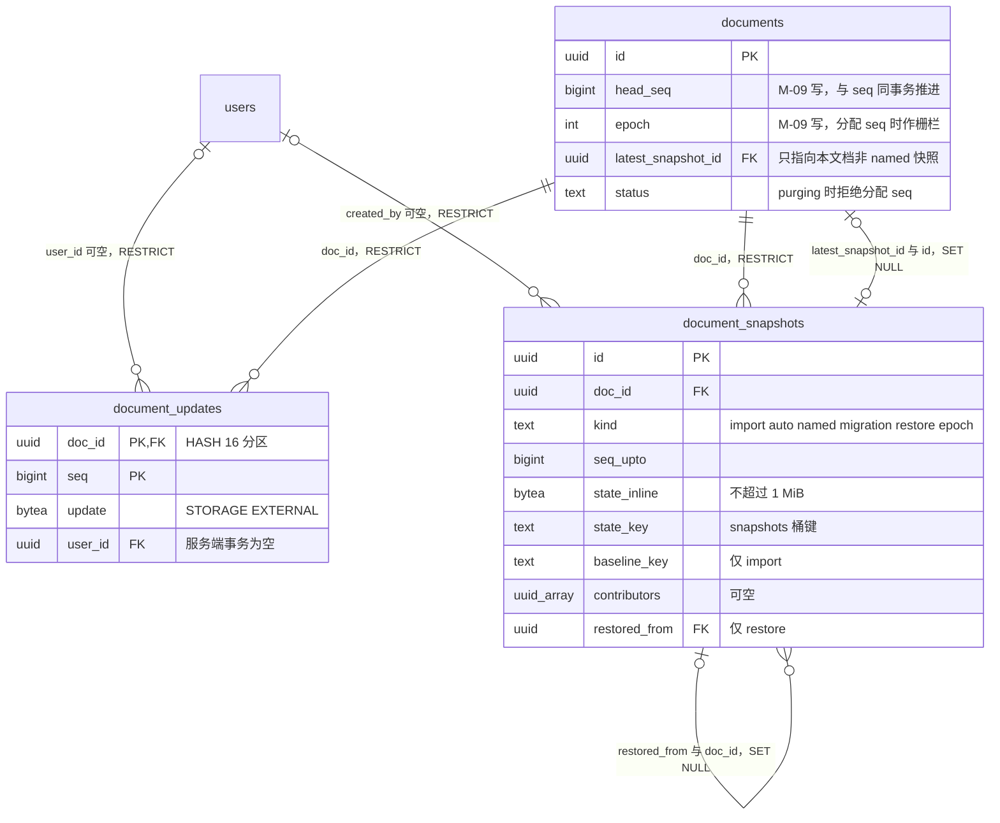
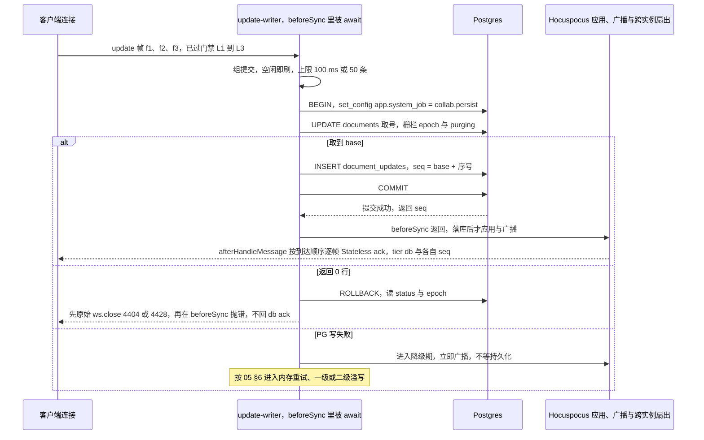
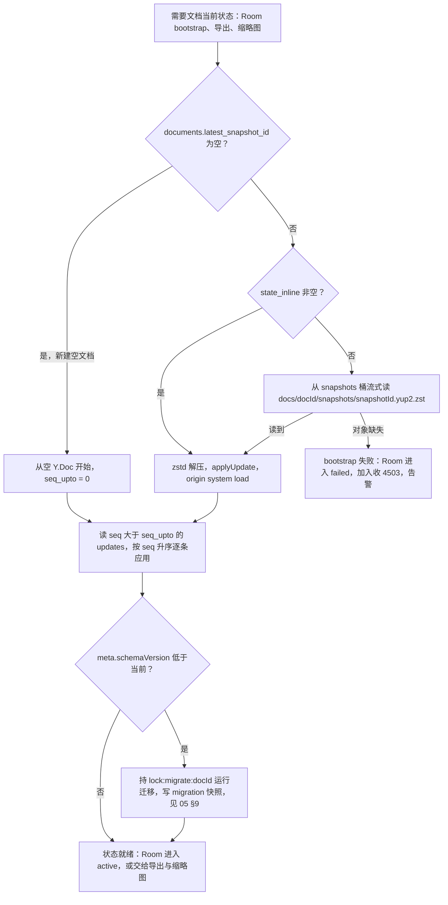
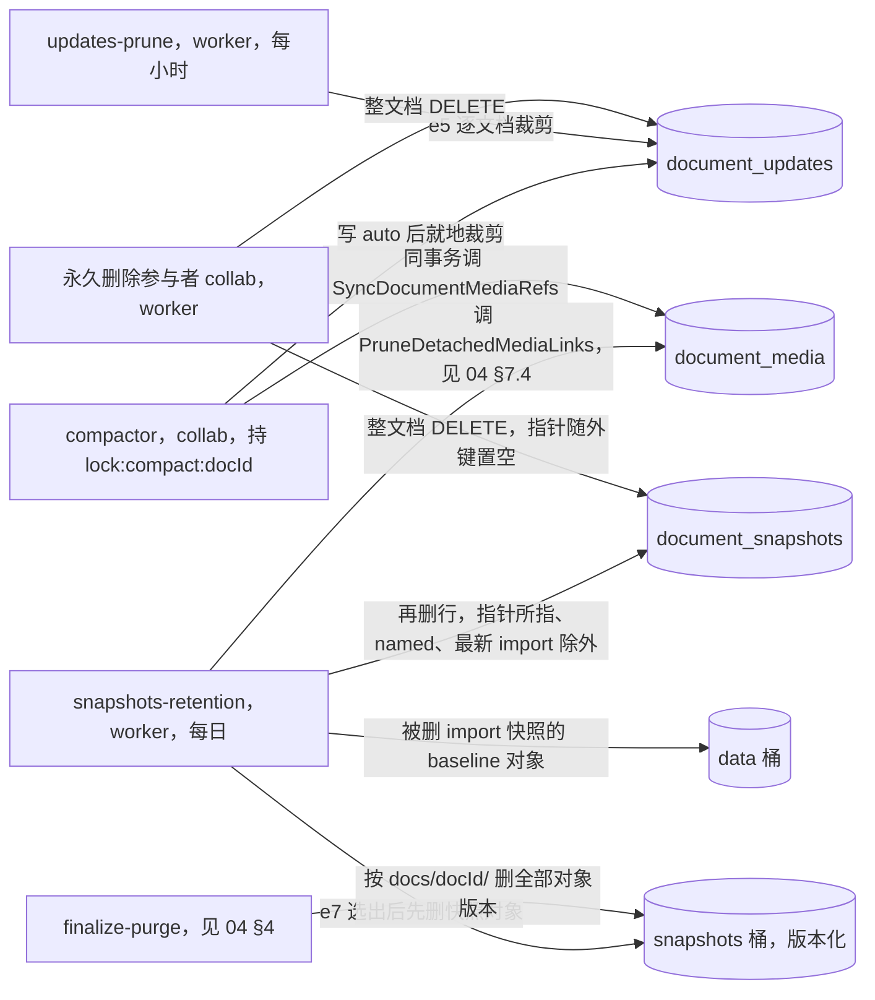
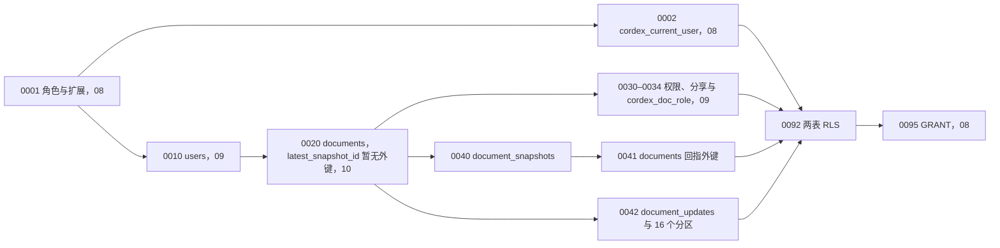

# 11 DDL：协同更新与版本快照
> 状态：v0.1 | 负责：后端设计线 | 更新：2026-09-25；2026-09-25（§4.19）；2026-09-25（§4.19 N1）；2026-09-26（§4.20）；2026-09-26（§4.21：`document_updates.update` 存 Yjs V1 字节（0042 表注释同步改）、`client_id` 取 Auth token 的 `clientId`、`session_id` 取连接会话号；§5 调用点改 Hocuspocus `beforeSync`、组提交「空闲即刷、上限 100 ms / 50 条」、取号 0 行先 `ws.close` 再抛错）；2026-09-26（§4.21 Remap：原 30/08 引用按 60-backend/README §6.1 改指新位置，30/08 已删除）；2026-10-03（§4.24 AL-1：RLS 行为矩阵「有效角色 ≥ editor」注明只来自直接授权）；2026-10-15（design-language-v3 第 2 批，rulings §4.25 DS-57、DS-40：§2 `document_snapshots` 加 `pre_restore`（仅 `auto`，恢复用例在恢复前写下的「恢复前」版本，列表据此标注并单列）及 CHECK；设计说明补「恢复前」与命名的 REST 入参上限；§8 注明「恢复前」版本按 auto 口径保留；§11 增一条约束断言；0040 改动当时未跑 ddl-check（同日已实跑通过，见 §11）；同日再补（rulings §4.25 DS-70）：§2 `document_snapshots` 增 `origin`、`origin_name`（只在 `import` 行：文档来源 upload / blank / template / duplicate 与显示名，版本历史据此写最早那一条）及四条 CHECK、两条列注释，设计说明与表格写方行同步，§11 负向约束补一项；0040 同样随同日的 ddl-check 实跑通过；同日再补：§11 第 1 条的实测记录改为 2026-10-15 的结论——PostgreSQL 18.6 空库以 ddl-check 连同 08–13 全部 38 个迁移按编号执行通过，含 0040 的 `pre_restore`、`origin`、`origin_name` 与相关 CHECK（结构与示例围栏的计数见 08 §12）；§2 设计说明「来源与显示名」补一句：显示名在建档写这条 `import` 快照时记下，源文档或模板之后改名不回写（与设计 03-07 §4.1 一致，rulings §4.25 DS-70））；2026-10-22（design-language-v3 第 3 批，rulings §4.25 DS-83：§8 示例增 e6b——压缩时取 `(上一快照.seq_upto, seq_upto]` 区间里最后一条带用户的 update，供 `documents.content_updated_by` / `content_updated_at`（最近编辑者）；§2「版本元数据」补一句，§4 表的 `UpdateStore` 方法列表增 `lastEditor`。e6b 当时未跑 ddl-check；2026-10-22 复核修正：e6b 同日随 ddl-check 在 PostgreSQL 18.6 空库实跑通过（08 §12）；§2「版本元数据」里 e6 的出处由「§5 示例」改正为「§8 示例」） | 依赖：[08 数据库总约定](08-db-conventions-roles-rls-migrations.md)（角色、GUC、`cordex_current_user`）；[09 DDL：身份与权限](09-ddl-identity-and-access.md)（`users`、`cordex_doc_role`）；[10 DDL：文档](10-ddl-documents-marks-media.md)（`documents`）；[05 协同与快照模块](05-modules-collab-and-snapshots.md)；[14 键空间与保留](14-valkey-object-storage-and-retention.md)；ADR-0022、ADR-0025、ADR-0039；rulings §4.13、§4.16 Q17、§4.18 BE-15 / BE-25 / CO-07 / CO-16、§4.19 D-M2-CONTENT / C-06、§4.21；rulings §4.25 DS-40、DS-57、DS-70、DS-83

本文是 `document_snapshots`、`document_updates` 两张表的唯一事实源：建表语句、约束、索引、RLS、读写方、保留与清理都以本文为准。写入这两张表的只有 M-09（CollabModule 的 `PgUpdateStore`、`PgSnapshotStore`），运行机制（批量写、压缩、溢写回放、恢复、墓碑清扫）见 [05](05-modules-collab-and-snapshots.md)。

## 1. 域说明

| 表 | 迁移 | 所属 Nest 模块 | 仓储（唯一写入口） | 建表里程碑 |
|---|---|---|---|---|
| `document_snapshots` | `0040`；`0041` 给 `documents` 补回指外键 | CollabModule（写）；SnapshotsModule（REST 只读） | `PgSnapshotStore`（`apps/server/src/modules/collab/infrastructure/pg-snapshot-store.ts`） | M2（rulings §4.19 D-M2-CONTENT：协同后端提前到 M2，M2 起文档内容以本表快照为唯一事实源；40-modules/09 的「M2 切片」即 M2 交付） |
| `document_updates` | `0042` | CollabModule | `PgUpdateStore`（`…/collab/infrastructure/pg-update-store.ts`） | 同上 |
| 两表 RLS | `0092` | — | — | 随表在 M2 建立；security-rls 自 M3 起阻断合并（rulings §4.18 GV-16，[08](08-db-conventions-roles-rls-migrations.md) §6） |

本文迁移编号：`0040`–`0042` 已用，`0043`–`0049` 预留给本域后续 expand / contract，`0092` 为 RLS。依赖的外部迁移：`0001` 角色、`0002` `cordex_current_user()`（08）；`0010` `users`、`0034` `cordex_doc_role()`（09）；`0020` `documents`（10）。GRANT 统一在 08 的 `0095`，本文 §7.4 只列需求。SQL 围栏首行 `-- migrate: NNNN_<name>` 表示按编号可执行，`-- example` 只做语法解析（[08](08-db-conventions-roles-rls-migrations.md) §11）。

**图 11-1 协同更新与版本快照**



怎么读：连线两端是基数（`||` 恰一，`o|` 零或一，`o{` 零或多），连线文字是外键列与删除动作。`documents` 与 `document_snapshots` 互相引用：快照经 `doc_id` 从属于文档（RESTRICT），文档经 `latest_snapshot_id` 指回「当前检查点」（复合外键保证只能指本文档的快照，快照被保留作业删除时指针置空）。`contributors` 实际类型是 `uuid[]`，图中写作 `uuid_array`。

依据：[08](08-db-conventions-roles-rls-migrations.md) §1–§3（约定、外键、分区；原 30/08 篇 §5 草案已删，rulings §4.19）；ADR-0025 决策 1–5；决策 FK-POLICY、DDL-COLS、C-07、C-30。

## 2. document_snapshots（0040）

```sql
-- migrate: 0040_document_snapshots
CREATE TABLE document_snapshots (
  id                  uuid        NOT NULL,
  doc_id              uuid        NOT NULL,
  kind                text        NOT NULL,
  seq_upto            bigint      NOT NULL,
  epoch               integer     NOT NULL,
  schema_version      integer     NOT NULL,
  layout_algo_version integer     NOT NULL,
  state_inline        bytea       NULL,
  state_key           text        NULL,
  state_vector        bytea       NOT NULL,
  byte_size           integer     NOT NULL,
  baseline_key        text        NULL,
  name                text        NULL,
  description         text        NULL,
  contributors        uuid[]      NULL,
  restored_from       uuid        NULL,
  pre_restore         boolean     NOT NULL DEFAULT false,
  origin              text        NULL,
  origin_name         text        NULL,
  created_by          uuid        NULL,
  created_at          timestamptz NOT NULL DEFAULT now(),
  CONSTRAINT pk_document_snapshots PRIMARY KEY (id),
  CONSTRAINT uq_document_snapshots_id_doc UNIQUE (id, doc_id),
  CONSTRAINT fk_document_snapshots_doc FOREIGN KEY (doc_id)
    REFERENCES documents (id) ON DELETE RESTRICT,
  CONSTRAINT fk_document_snapshots_created_by FOREIGN KEY (created_by)
    REFERENCES users (id) ON DELETE RESTRICT,
  CONSTRAINT fk_document_snapshots_restored_from FOREIGN KEY (restored_from, doc_id)
    REFERENCES document_snapshots (id, doc_id) ON DELETE SET NULL (restored_from),
  CONSTRAINT ck_document_snapshots_kind
    CHECK (kind IN ('import', 'auto', 'named', 'migration', 'restore', 'epoch')),
  CONSTRAINT ck_document_snapshots_counters
    CHECK (seq_upto >= 0 AND epoch >= 0 AND schema_version >= 1 AND layout_algo_version >= 0),
  CONSTRAINT ck_document_snapshots_state_one_of
    CHECK ((state_inline IS NULL) <> (state_key IS NULL)),
  CONSTRAINT ck_document_snapshots_state_inline_size
    CHECK (state_inline IS NULL OR octet_length(state_inline) <= 1048576),
  CONSTRAINT ck_document_snapshots_state_key
    CHECK (state_key IS NULL
           OR state_key = 'docs/' || doc_id::text || '/snapshots/' || id::text || '.yup2.zst'),
  CONSTRAINT ck_document_snapshots_byte_size CHECK (byte_size > 0),
  CONSTRAINT ck_document_snapshots_baseline
    CHECK (baseline_key IS NULL
           OR (kind = 'import'
               AND baseline_key LIKE 'docs/' || doc_id::text || '/baseline/' || id::text || '.%')),
  CONSTRAINT ck_document_snapshots_named
    CHECK (kind <> 'named' OR name IS NOT NULL),
  CONSTRAINT ck_document_snapshots_name
    CHECK (name IS NULL OR char_length(btrim(name)) BETWEEN 1 AND 200),
  CONSTRAINT ck_document_snapshots_description
    CHECK (description IS NULL OR char_length(description) <= 2000),
  CONSTRAINT ck_document_snapshots_restored_from
    CHECK (restored_from IS NULL OR kind = 'restore'),
  CONSTRAINT ck_document_snapshots_pre_restore
    CHECK (NOT pre_restore OR kind = 'auto'),
  CONSTRAINT ck_document_snapshots_origin
    CHECK ((kind = 'import') = (origin IS NOT NULL)),
  CONSTRAINT ck_document_snapshots_origin_value
    CHECK (origin IS NULL OR origin IN ('upload', 'blank', 'template', 'duplicate')),
  CONSTRAINT ck_document_snapshots_origin_name
    CHECK ((origin IS NULL OR origin = 'blank') = (origin_name IS NULL)),
  CONSTRAINT ck_document_snapshots_origin_name_len
    CHECK (origin_name IS NULL OR char_length(origin_name) <= 512)
);

CREATE INDEX ix_document_snapshots_doc_seq
  ON document_snapshots (doc_id, seq_upto DESC, id DESC);
CREATE INDEX ix_document_snapshots_doc_kind_created
  ON document_snapshots (doc_id, kind, created_at);
CREATE UNIQUE INDEX uq_document_snapshots_epoch
  ON document_snapshots (doc_id, epoch) WHERE kind = 'epoch';
CREATE UNIQUE INDEX uq_document_snapshots_migration
  ON document_snapshots (doc_id, schema_version) WHERE kind = 'migration';
-- 外键前导索引（08 §1）：删除被恢复引用的源快照时，SET NULL 动作按 (restored_from, doc_id) 查找引用行
CREATE INDEX ix_document_snapshots_restored_from
  ON document_snapshots (restored_from, doc_id) WHERE restored_from IS NOT NULL;

COMMENT ON TABLE document_snapshots IS
  'CRDT 全量状态检查点与版本；唯一写方 M-09（PgSnapshotStore），DDL 见 60-backend/11';
COMMENT ON COLUMN document_snapshots.seq_upto IS
  '快照已包含的最大 document_updates.seq；bootstrap = 本快照 + seq > seq_upto 的 updates';
COMMENT ON COLUMN document_snapshots.state_inline IS
  'zstd 压缩的 encodeStateAsUpdateV2；≤ 1 MiB 时内联，否则为 NULL 并使用 state_key';
COMMENT ON COLUMN document_snapshots.state_key IS
  'snapshots 桶对象键 docs/{docId}/snapshots/{snapshotId}.yup2.zst（C-08/OBJ、C-30）';
COMMENT ON COLUMN document_snapshots.baseline_key IS
  '仅 kind=import：data 桶 docs/{docId}/baseline/{snapshotId}.<ext>；随所属 import 快照保留，每文档最新 import 快照的基线永不删除（C-06、C-07）';
COMMENT ON COLUMN document_snapshots.contributors IS
  '(上一快照.seq_upto, seq_upto] 区间 updates 的 user_id 去重；NULL = 不适用（DDL-COLS）';
COMMENT ON COLUMN document_snapshots.restored_from IS
  '仅 kind=restore：被恢复的源快照；源被保留作业删除时置 NULL';
COMMENT ON COLUMN document_snapshots.pre_restore IS
  '仅 kind=auto：恢复用例在执行恢复前写下的「恢复前」版本（60/05 §10 第 2 步，rulings §4.25 DS-57）；版本列表据此标「恢复前」并单列，不并进相邻的自动版本组';
COMMENT ON COLUMN document_snapshots.origin IS
  '仅 kind=import 且必有：文档来源 upload（导入文件）| blank（新建空白）| template（从模板新建）| duplicate（创建副本），版本历史据此写最早那一条（rulings §4.25 DS-70）';
COMMENT ON COLUMN document_snapshots.origin_name IS
  '来源的显示名：upload 为原文件名（含扩展名）、template 为模板名、duplicate 为源文档在受理时的标题（可为空串）；blank 与非 import 行为 NULL';
```

设计说明：

- **六种 kind**（ADR-0025 决策 2）：`auto`（压缩点）、`named`（用户命名）、`import`（导入，带基线）、`migration`（schema 迁移后）、`restore`（恢复后）、`epoch`（换纪元）。`documents.latest_snapshot_id` 只指向后五类中最新的一个，`named` 不移动指针（命名只是给当前状态起名，不改变 bootstrap 起点）。
- **状态二选一**：`state_inline` 与 `state_key` 恰有一个非空（`ck_document_snapshots_state_one_of`）；内联上限 1 MiB 由 CHECK 兜底。对象键由行本身推出（`docs/{docId}/snapshots/{snapshotId}.yup2.zst`，决策 C-30），CHECK 逐字比对，写错桶路径在插入时就失败。对象放 `storage.s3.buckets.snapshots`（开版本化，决策 C-08/OBJ），应用在插入行之前先写对象，写对象失败不插行。
- **基线**（决策 C-07）：只有 `import` 能带 `baseline_key`，且键必须是本文档 `baseline/` 前缀下以本快照 id 命名的对象；导入原件 `imports/{jobId}/source.pptx` 仍按 30 天清理，二者互不引用。
- **版本元数据**（决策 DDL-COLS 之 C-15）：`description` 只随命名版本写入；`contributors` 在写 `auto` 与 `named` 时由 `(上一快照.seq_upto, seq_upto]` 区间 updates 的 `user_id` 去重得到（§8 示例 e6），`restore` 写入执行恢复的用户，`import` / `migration` / `epoch` 为 NULL。updates 只保留 7 天，贡献者必须在压缩当时算好落列，事后无法回算。同一次压缩还按 §8 的 e6b 取区间里最后一条带用户的 update，写进 `documents.content_updated_by` / `content_updated_at`（文档卡片的「编辑者 · 相对时间」，2026-10-22，rulings §4.25 DS-83；推进规则见 [05](05-modules-collab-and-snapshots.md) §7，列定义见 [10](10-ddl-documents-marks-media.md) §2），理由相同：事后无法回算。
- **恢复链**：`restored_from` 记录恢复源，供版本时间轴显示「恢复自『X』」（设计 07）；源快照被保留作业删掉时置 NULL、恢复行本身保留。每次恢复之前，恢复用例都先写一个 `pre_restore = true` 的 `auto` 快照存下当时的内容（2026-10-15，rulings §4.25 DS-40、DS-57：恢复前的内容一律能从版本历史找回，不取决于恢复前有没有新的 update），版本列表据此标「恢复前」、单列显示；它不是撤销恢复的手段（撤销恢复见 ADR-0038）。这是 FK-POLICY「默认 RESTRICT」之外的第二个 SET NULL 例外（第一个是 `latest_snapshot_id`），理由相同：被引用方是可按保留期删除的历史行。
- **来源与显示名**（2026-10-15，rulings §4.25 DS-70）：`import` 行必带 `origin`（四种之一），除 `blank` 外必带 `origin_name`，其余 kind 两列皆空（四条 CHECK）。导入处理器写 `import` 快照时按作业 `payload` 一并写入——上传导入取请求声明的 `origin`（缺省 `upload`）与 `fileName` / `templateName`，创建副本取受理时记下的源文档标题（[06](06-modules-jobs-import-export-thumbnails.md) §6.4、§6.6）；版本历史经 `SnapshotMeta.origin` / `originName` 写最早那一条「导入自『X』」「新建演示文稿」「从模板『X』新建」「创建自『X』的副本」（[15](15-rest-api-catalog.md) §3.8）。显示名在建档写这条 `import` 快照时记下，源文档或模板之后改名都不回写（设计 03-07 §4.1）。两列只作显示，不参与 bootstrap、保留与导出；`origin_name` 上限 512 与 `documents.title` 同档、只作兜底，入口另限文件名 ≤ 255、模板名 ≤ 100（15 §3.9）。覆盖导入（换纪元）写的 `import` 行同样是 `upload` + 文件名。
- **幂等唯一索引**：每个纪元至多一个 `epoch` 快照、每个 schema 版本至多一个 `migration` 快照；重试的换纪元或迁移在插入时即冲突，不会生成重复检查点。
- **外键前导索引**（[08](08-db-conventions-roles-rls-migrations.md) §1：被硬删除方的外键列必须是某索引的前导列）：`restored_from` 用部分索引 `ix_document_snapshots_restored_from (restored_from, doc_id)`，保留作业删源快照时 SET NULL 不做全表扫描；`documents.latest_snapshot_id` 的 `ix_documents_latest_snapshot` 放在 §3 的 0041 里与外键一起建。二者都只收非空行，`restored_from` 与指针在绝大多数行上为空或唯一，部分索引很小。
- **命名的入参上限**：REST 入参另限名称 1–30 字、说明 ≤ 200 字（[15](15-rest-api-catalog.md) §3.8，rulings §4.25 DS-57）；`ck_document_snapshots_name`（≤ 200）与 `ck_document_snapshots_description`（≤ 2000）只作宽松兜底，不随界面收紧。
- **命名版本上限每文档 200**（rulings §4.19 C-06）放在应用层：`PgSnapshotStore.put(kind='named')` 在同一事务内先取 `pg_advisory_xact_lock(hashtextextended('cordex:named-snapshot:' || doc_id, 0))`、再数现有命名行、达上限则回滚并返回 `server.snapshots.named_limit_reached`（409；非配额码，`*.quota_exceeded` 只用于 rulings §4.17 D2 三码，决策 MECH-INC 之 INC-12；码名以 [15](15-rest-api-catalog.md) §3.8 为准）。不用触发器或 CHECK 的理由：上限是部署配置（`quota.namedSnapshotsPerDoc`，[17](17-deployment-and-config.md)），CHECK 无法跨行计数；触发器会把配置复制进数据库、且在 FORCE RLS 下要单独授权，得不偿失。
- `seq_upto ≤ documents.head_seq`、指针不指向 `named`、指针只前进（§3）三条跨表不变量无法用 CHECK 表达，由 §11 的集成断言覆盖。

| 项 | 内容 |
|---|---|
| 用途 | CRDT 全量状态检查点（bootstrap 起点）与版本历史（命名、恢复、预览） |
| 所属模块与仓储 | CollabModule：`PgSnapshotStore` 实现 server-collab `SnapshotStore`（契约见 [05](05-modules-collab-and-snapshots.md) §2）；SnapshotsModule 只经 `collabServer` 与只读查询访问 |
| 写方 | 均为 M-09 代码：`compactor`（`auto`）、`createNamedSnapshot`（`named`）、`restoreSnapshot`（恢复前的 `auto`，`pre_restore = true`；`restore`）、`migration-runner`（`migration`）、`forceEpoch`（`epoch`）、`PgSnapshotStore.put(kind='import')`（由 M-12 导入处理器在其事务内调用，决策 DDL-COLS 之 C-29；2026-10-15 起同时写 `origin` 与 `origin_name`，DS-70）、保留作业（删）、永久删除参与者 `collab`（删） |
| 读方 | `bootstrap-loader`；SnapshotsModule 的列表、latest、详情、diff（请求事务，`cordex_app`）；M-12 导出与缩略图（worker 系统池） |
| RLS | ENABLE + FORCE；`cordex_app` 只读、最低角色 viewer（含链接角色）；`cordex_system` 一条 FOR ALL policy，作业名非空即放行（§7，[08](08-db-conventions-roles-rls-migrations.md) §6.3） |
| 保留与清理 | `auto`/`import`/`migration`/`restore`/`epoch`：30 天内全保留，之后每个 UTC 日留最后一个，至 `retention.autoSnapshotDailyDays`（默认 365，0 = 永久，rulings §4.19 C-06）；每文档最新一个 `import` 快照（及其基线对象）与 `latest_snapshot_id` 所指行永不删除；`named` 永久（每文档 ≤ 200）；永久删除时参与者 `collab` 删行、finalize-purge 按前缀删对象版本（§8） |
| 里程碑 | M2（`auto`、`import`、`migration`、`epoch`）；M3（`named`、`restore`） |

## 3. latest_snapshot_id 回指外键（0041）

`documents` 由 [10](10-ddl-documents-marks-media.md) 的 `0020` 先建（`latest_snapshot_id uuid NULL`，不带外键），快照表建好后在这里补外键，打破建表环。

```sql
-- migrate: 0041_documents_latest_snapshot_fk
ALTER TABLE documents
  ADD CONSTRAINT fk_documents_latest_snapshot
  FOREIGN KEY (latest_snapshot_id, id)
  REFERENCES document_snapshots (id, doc_id)
  ON DELETE SET NULL (latest_snapshot_id);

-- 外键前导索引（08 §1）：保留作业与参与者删快照行时，SET NULL 动作按 latest_snapshot_id 查找 documents 行
CREATE INDEX ix_documents_latest_snapshot
  ON documents (latest_snapshot_id) WHERE latest_snapshot_id IS NOT NULL;

COMMENT ON CONSTRAINT fk_documents_latest_snapshot ON documents IS
  '指针只能指向本文档的快照；快照被删除时只把 latest_snapshot_id 置 NULL（FK-POLICY 例外）';
```

- 复合外键 `(latest_snapshot_id, id) → (id, doc_id)` 让「指针指向别的文档的快照」在数据库层不可能发生；部分索引 `ix_documents_latest_snapshot` 是它的前导索引（`documents` 归 10，但索引跟外键一起放在本迁移，避免 0020 引用尚不存在的快照语义），同时不影响 `head_seq` 取号的 HOT 更新（索引不含 `head_seq`，§10 第 1 条）；`ON DELETE SET NULL (latest_snapshot_id)`（PG 15 起支持列清单）只清指针列，不动 `documents.id`。
- 删除动作由外键触发器以表属主身份执行，不受 RLS 与列级 GRANT 的影响（已在 PG 18.6 实测）。保留作业本身永不删除指针所指的行（§8），这条 SET NULL 只在永久删除参与者清表时生效，随后 finalize-purge 删掉 `documents` 行。
- **指针只前进**：M-09 移动指针的语句带条件「新快照的 `seq_upto` 不小于当前指针所指快照的 `seq_upto`」（e8）。租约在「校验 `stillHeld()`」与「提交」之间失效时，两个实例的压缩可能先后提交；没有这个条件，较旧的快照可能后提交并把指针拨回，而 §8 的裁剪已按较新的指针删掉了中间的 update，下次 bootstrap 就会缺内容。有了这个条件，指针所指快照的 `seq_upto` 单调不减，裁剪以它为界（e5）就永远不会越过 bootstrap 起点。
- 依据：决策 FK-POLICY（`documents.latest_snapshot_id → ON DELETE SET NULL`）；ADR-0025 决策 3、4。

```sql
-- example
-- e8：移动检查点指针（只前进）；$2 新快照 id，$3 新快照 seq_upto
UPDATE documents d
   SET latest_snapshot_id = $2
 WHERE d.id = $1
   AND (d.latest_snapshot_id IS NULL
        OR (SELECT s.seq_upto FROM document_snapshots s
             WHERE s.id = d.latest_snapshot_id) <= $3::bigint);
```

## 4. document_updates（0042）

```sql
-- migrate: 0042_document_updates
CREATE TABLE document_updates (
  doc_id      uuid        NOT NULL,
  seq         bigint      NOT NULL,
  update      bytea       STORAGE EXTERNAL NOT NULL,
  byte_size   integer     NOT NULL,
  client_id   bigint      NOT NULL,
  session_id  uuid        NULL,
  user_id     uuid        NULL,
  created_at  timestamptz NOT NULL DEFAULT now(),
  CONSTRAINT pk_document_updates PRIMARY KEY (doc_id, seq),
  CONSTRAINT fk_document_updates_doc FOREIGN KEY (doc_id)
    REFERENCES documents (id) ON DELETE RESTRICT,
  CONSTRAINT fk_document_updates_user FOREIGN KEY (user_id)
    REFERENCES users (id) ON DELETE RESTRICT,
  CONSTRAINT ck_document_updates_seq CHECK (seq > 0),
  CONSTRAINT ck_document_updates_byte_size CHECK (byte_size = octet_length(update)),
  CONSTRAINT ck_document_updates_client_id CHECK (client_id BETWEEN 0 AND 4294967295)
) PARTITION BY HASH (doc_id);

DO $$
BEGIN
  FOR r IN 0..15 LOOP
    EXECUTE format(
      'CREATE TABLE document_updates_p%s PARTITION OF document_updates '
      'FOR VALUES WITH (MODULUS 16, REMAINDER %s)',
      lpad(r::text, 2, '0'), r);
  END LOOP;
END $$;

CREATE INDEX ix_document_updates_doc_created
  ON document_updates (doc_id, created_at);

COMMENT ON TABLE document_updates IS
  'CRDT update 追加日志（Yjs V1，协同帧原样字节）；HASH(doc_id) 16 分区；唯一写方 M-09（PgUpdateStore）';
COMMENT ON COLUMN document_updates.seq IS
  '与 documents.head_seq 在同一事务内分配；严格单调，不复用';
COMMENT ON COLUMN document_updates.user_id IS
  '发起用户；repair / maintenance / migration 等服务端事务为 NULL，restore 为执行恢复的用户';
```

设计说明：

- **分区**：`HASH(doc_id)` 16 个分区 `document_updates_p00…p15`（ADR-0022、[08](08-db-conventions-roles-rls-migrations.md) §3）。一篇文档的全部行落在同一分区，`loadSince`、裁剪、贡献者统计都只扫一个分区；分区不单独授权，应用只能经父表访问，父表的 RLS 因此对所有行生效。
- **`update` 列存 Yjs V1 字节**（2026-09-26，rulings §4.21，ADR-0039 决策 3、证据 d-10）：协同线上改用 Hocuspocus 协议后只有 Yjs V1 update 编码，写入器把客户端帧的 update 字节原样入库（不做 V1↔V2 转码），bootstrap 时以 `Y.applyUpdate` 应用；快照仍是 `encodeStateAsUpdateV2` + zstd（§2），两者在同一 Y.Doc 上按序应用即可。（原：「Yjs V2 update」，作废；本列与表注释同步改，迁移编号不变。）
- **`update` 列 `STORAGE EXTERNAL`**：Yjs update 已是紧凑编码，再做 TOAST 压缩只费 CPU；子分区继承父表的 storage 设置（PG 18.6 实测 16 个分区均为 `e`）。列名 `update` 在 PostgreSQL 中是非保留关键字，无需加引号。
- **主键即顺序**：`(doc_id, seq)` 同时支撑 `loadSince`（`seq > $n ORDER BY seq`）与按区间统计贡献者；`ix_document_updates_doc_created` 只服务 7 天裁剪。`seq` 由 `documents.head_seq` 在同一事务内分配（§5），不用序列：序列跨文档共享且回滚会留洞，而 at-least-once 的 ack 语义要求「提交即有 seq、seq 即落库」。
- **行来源**：本实例客户端发来的 update（含重连 step2 的非空差量）、服务端事务（软门禁修复、恢复、迁移、墓碑硬删除）的 update、PG 恢复后回放的溢写行。跨实例扇入的 update 只应用不落库（ADR-0035 决策 3），所以同一内容至多由一个实例写一行；客户端重发导致的重复行对 Yjs 幂等无害。
- `byte_size = octet_length(update)` 由 CHECK 保证一致（对 EXTERNAL 值取长度不需要解 TOAST）；不设 1 MiB 上限——客户端帧的上限在网关 L1（[16](16-ws-protocol-server-view.md) §4），服务端事务（如大文档恢复）产生的 update 可以更大。
- `client_id` 为 Yjs clientID（uint32），取 Auth token 里客户端声明的 `clientId`（`beforeHandleAwareness` 用同一个值做身份绑定）；`session_id` 为该连接的会话号（`auth.ok.sessionId`），服务端事务的 `client_id` 取服务端 Unit（即 Hocuspocus Document）自己的 Yjs clientID，`session_id` 为 NULL。（2026-09-26 明确来源：原「网关会话 id」的网关已改为 Hocuspocus 连接，[16](16-ws-protocol-server-view.md) §3。）

| 项 | 内容 |
|---|---|
| 用途 | CRDT update 追加日志：已 ack(db) 的持久性载体、bootstrap 的增量部分、7 天窗口内的按时间点恢复 |
| 所属模块与仓储 | CollabModule：`PgUpdateStore` 实现 server-collab `UpdateStore`（`append` / `loadSince` / `contributors` / `lastEditor`（2026-10-22，§8 e6b） / `pruneBefore` / `purgeAll`，[05](05-modules-collab-and-snapshots.md) §2） |
| 写方 | collab 角色 `update-writer`（挂 Hocuspocus `beforeSync`，组提交空闲即刷、上限 100 ms / 50 条）、`replay-spilled`（回放时由 PG 分配 seq）；删：`compactor` 压缩后裁剪、`updates-prune` 周期作业（worker）、永久删除参与者 `collab`（worker） |
| 读方 | `bootstrap-loader`、`compactor`（压缩前补齐与贡献者统计）、M-12 导出与缩略图读取当前状态（经 M-09 的状态读取用例，worker 系统池） |
| RLS | ENABLE + FORCE；`cordex_app` 只读、最低角色 editor（请求路径目前不读原始 update，§7.1）；`cordex_system` 一条 FOR ALL policy，作业名非空即放行（§7） |
| 保留与清理 | 只删 `seq ≤ 检查点指针所指快照.seq_upto` 且早于 `retention.updatesDays`（默认 7）的行；永久删除时整文档清空（§8） |
| 里程碑 | M2 |

## 5. 批量持久化事务

一次组提交把 ≤ 50 个 update 帧落成一个事务：先在 `documents` 行上原子地取一段 seq，再多行插入，提交后按帧到达顺序逐帧回 `ack{seq, tier:'db'}`（ack 规则见 [16](16-ws-protocol-server-view.md) §5）。**调用点**（2026-09-26，rulings §4.21 H:Q1，ADR-0039 决策 5）：写入器由 server-collab 的 `GatePersistExtension` 在 Hocuspocus 的 `beforeSync` 里 await（该钩子被 await、早于应用与广播），提交返回后 Hocuspocus 才应用并广播，ack 在 `afterHandleMessage` 以 Stateless 发出。每个连接的帧串行 await，组提交因此是「**空闲即刷、上限 100 ms 或 50 条**」：写入器空闲时来一帧就立即开事务，事务在途期间到达的帧（来自同一文档的其他连接）并进下一批，上限 100 ms 或 50 条（原：「≤ 50 个（或 100 ms 内到达的）」固定窗口，会把单连接限到约 10 帧/s，作废）。取号语句同时是三道栅栏：`status <> 'purging'`（永久删除开始后无 update 落库，rulings §4.18 BE-15）、`epoch = 房间纪元`（换纪元后旧纪元的 update 无法落库，[05](05-modules-collab-and-snapshots.md) §9）、行锁串行化同一文档的并发写入（多实例同时写同一文档时 seq 仍严格单调）。

```sql
-- example
BEGIN;
SELECT set_config('app.system_job', 'collab.persist', true);
-- e1：$1 docId，$2 updates，$3 clientIds，$4 sessionIds，$5 userIds，$6 房间当前纪元
WITH alloc AS (
  UPDATE documents
     SET head_seq = head_seq + cardinality($2::bytea[])
   WHERE id = $1
     AND epoch = $6
     AND status <> 'purging'
  RETURNING head_seq - cardinality($2::bytea[]) AS base
)
INSERT INTO document_updates (doc_id, seq, update, byte_size, client_id, session_id, user_id)
SELECT $1, alloc.base + u.ord, u.upd, octet_length(u.upd), u.cid, u.sid, u.uid
  FROM alloc,
       unnest($2::bytea[], $3::bigint[], $4::uuid[], $5::uuid[])
         WITH ORDINALITY AS u(upd, cid, sid, uid, ord)
RETURNING seq;
COMMIT;
```

- 返回 0 行表示栅栏生效：写入方随即读一次 `documents.status, epoch`，`purging` → 关闭房间（4404 `collab.doc_purging`），纪元变了 → 关闭房间（4428 `collab.epoch_changed`），两种情况都不回 db ack。2026-09-26 起的顺序：先对该文档的连接调原始 `ws.close(4404 或 4428)`，**再**在 `beforeSync` 里抛错阻止 Hocuspocus 应用这批帧（抛错会清空该连接已排队的帧，正合意；钩子抛错本身只产生客户端看到 1000 的文档级关闭，所以码必须先由原始关闭发出）。
- 取号只改 `head_seq`，不改 `updated_at`；`documents` 不得给 `head_seq` 建索引，以保证每 100 ms 一次的取号走 HOT 更新（对 [10](10-ddl-documents-marks-media.md) 的约束）。`content_updated_at`、`element_count` 等 M-09 列在压缩时节流写入（决策 C-03）。
- 该语句已在 PG 18.6 以 `PREPARE` 校验并实测：同一事务内取号 + 插入原子完成，纪元不符时插入 0 行。

**图 11-2 一次批量持久化事务**



怎么读：纵线是参与方，自上而下是时间。三条分支对应取号的三种结果；只有第一条分支会回 `tier db` 的 ack，且在 COMMIT 返回之后发出（2026-09-26 起写入器在 Hocuspocus 的 `beforeSync` 里被 await，ack 在 `afterHandleMessage` 发出，ADR-0039）。降级分支的溢写与回放在 [05](05-modules-collab-and-snapshots.md) §6。

依据：本文 §5（写路径的唯一源；原 30/08 篇 §5 草案已删，rulings §4.19）；ADR-0025 决策 1、8；rulings §4.18 CO-08、CO-10、BE-15。

## 6. 恢复查询

「恢复」在这里指把一篇文档的当前状态从库里重建出来（Room bootstrap、导出与缩略图读取、按时间点恢复），与版本历史的「恢复到某版本」（[05](05-modules-collab-and-snapshots.md) §10）不是一回事。规则只有一条：**当前状态 = 指针所指快照 + `seq > seq_upto` 的全部 updates，按 seq 顺序应用**。CRDT 本身与顺序无关，排序只为可复现。

```sql
-- example
-- e2：取检查点；无指针（新建空文档）时 seq_upto 视为 0、从空文档开始
SELECT s.id, s.seq_upto, s.epoch, s.schema_version, s.state_inline, s.state_key
  FROM documents d
  JOIN document_snapshots s ON s.id = d.latest_snapshot_id AND s.doc_id = d.id
 WHERE d.id = $1;

-- e3：检查点之后的增量（主键范围扫描，只命中一个分区）
SELECT seq, update
  FROM document_updates
 WHERE doc_id = $1 AND seq > $2
 ORDER BY seq;

-- e4：按时间点恢复，取 T 之前最近的任意快照，再叠加 T 之前的 updates（只在 7 天窗口内完整）
SELECT id, seq_upto, state_inline, state_key
  FROM document_snapshots
 WHERE doc_id = $1 AND created_at <= $2
 ORDER BY seq_upto DESC, id DESC
 LIMIT 1;
```

- `state_key` 非空时从 `snapshots` 桶读对象当前版本（流式、zstd 解压）；读不到对象属于数据损坏，bootstrap 失败（Room 进入 `failed`，加入请求收 4503），并告警，不回退到更旧的快照以免静默丢数据。
- `GET /documents/:id/snapshots/latest` 只返回 e2 的字节（小快照直接取 `state_inline`，大快照从桶流式代理），增量由随后的 WS step1 / step2 补齐（30-architecture/06 §9.1）。
- 读 `document_updates` 只发生在系统池（bootstrap、压缩、导出），请求事务从不读它（§7）。

**图 11-3 恢复路径**



怎么读：菱形是判定，方框是动作；自上而下是一次状态重建。左支是新建空文档，右支按快照是内联还是对象存储分两路，汇合后都要叠加检查点之后的 updates。唯一的失败出口是大快照对象缺失，此时宁可让加入失败也不回退到更旧的状态。

依据：本文 §6（状态重建的唯一源；原 30/08 篇 §5 草案已删，rulings §4.19）；ADR-0025 决策 2、4；决策 C-08/OBJ、C-30。

## 7. RLS（0092）

写法遵守 [08](08-db-conventions-roles-rls-migrations.md) §6.3：`cordex_app` 按操作建 policy、条件一律 `cordex_role_at_least(cordex_doc_role(doc_id), '<最低角色>')`；`cordex_system` 每表只建一条 `FOR ALL` policy，经 `cordex_system_job()` 判定（08 §6.2，空串视为未设置）；policy 内不直接读 `current_setting`。

| 表 | `cordex_app` 最低读角色 | `cordex_app` 写 | `cordex_system` |
|---|---|---|---|
| `document_snapshots` | viewer（含链接角色） | 无（无 GRANT，不建 policy） | FOR ALL，作业名非空 |
| `document_updates` | editor | 无（同上） | FOR ALL，作业名非空 |

```sql
-- migrate: 0092_rls_collab
ALTER TABLE document_snapshots ENABLE ROW LEVEL SECURITY;
ALTER TABLE document_snapshots FORCE ROW LEVEL SECURITY;
ALTER TABLE document_updates ENABLE ROW LEVEL SECURITY;
ALTER TABLE document_updates FORCE ROW LEVEL SECURITY;

-- 请求事务（cordex_app）：只读；history.read 等能力位由应用层 DocumentRoleGuard 判定
CREATE POLICY p_document_snapshots_app_select ON document_snapshots
  FOR SELECT TO cordex_app
  USING (cordex_role_at_least(cordex_doc_role(doc_id), 'viewer'));
CREATE POLICY p_document_updates_app_select ON document_updates
  FOR SELECT TO cordex_app
  USING (cordex_role_at_least(cordex_doc_role(doc_id), 'editor'));

-- 系统作业（cordex_system）：每表一条 FOR ALL，作业名非空即放行；可做的操作由 0095 的 GRANT 限定
CREATE POLICY p_document_snapshots_system_all ON document_snapshots
  FOR ALL TO cordex_system
  USING (cordex_system_job() IS NOT NULL) WITH CHECK (cordex_system_job() IS NOT NULL);
CREATE POLICY p_document_updates_system_all ON document_updates
  FOR ALL TO cordex_system
  USING (cordex_system_job() IS NOT NULL) WITH CHECK (cordex_system_job() IS NOT NULL);
```

### 7.1 policy 取舍

- **请求路径**：SnapshotsModule 的列表、latest、详情、diff 在请求事务内执行（collab 角色的 `cordex_app` 池，已设 `app.user_id` 与可选的 `app.share_token_hash`），RLS 以 `cordex_doc_role(doc_id)`（[09](09-ddl-identity-and-access.md) 的 `0034`，取 max(直接授权, 有效链接角色)，决策 RLS-GUC）兜底 viewer；列表与详情要求的 `history.read`（owner 与 editor，rulings §4.12 U-09）在应用层判定，不把角色→能力位表复制进 SQL。
- **`document_updates` 的 app 读**：请求路径目前不读原始 update（bootstrap、压缩、导出都在系统池）。仍建一条最低 editor 的 SELECT policy，是为了与 08 的 0095（对 `cordex_app` 授 SELECT）和 0096 自检（每张 RLS 表都要有 `TO cordex_app` 的 policy）一致；门槛取 editor 而非 viewer，因为原始 update 属于逐条编辑历史（含 `user_id`、`session_id`），与 `history.read` 同级。
- **系统作业只判非空**：`cordex_system` 由 collab 与 worker 共用（决策 DB-ROLES），作业名只用于诊断与 `application_name`（08 §6.5），不在 policy 里按前缀区分写方。「只有 M-09 写这两张表」由代码层的表写方所有权保证（[08](08-db-conventions-roles-rls-migrations.md) §7：唯一仓储 `PgUpdateStore` / `PgSnapshotStore`；M-12 导入经 M-09 导出的 `SnapshotStore.put`）。
- **空串陷阱**：占位 GUC 在设置过它的事务结束后回落为空串而不是 NULL（PG 18 实测）；`cordex_system_job()` 用 `NULLIF(…, '')` 处理，连接池复用连接上漏设作业名的事务一行也看不到、写不进（§7.3 第 3 行）。
- **不可改写**：两表对 `cordex_system` 只授 SELECT / INSERT / DELETE、不授 UPDATE——快照与 update 行写入后不变；`FOR ALL` policy 不改变这一点，因为 GRANT 先于 policy 生效。外键的 SET NULL 动作由触发器以属主身份执行，不需要 UPDATE 权限。

### 7.2 本域系统作业名

取值以 [08](08-db-conventions-roles-rls-migrations.md) §6.5 为唯一登记处，下表只列触碰本域两表的作业。

| 作业名（`app.system_job`） | 执行者（角色） | 触碰 | 操作 |
|---|---|---|---|
| `collab.gateway` | 网关票据校验与加入检查（collab） | `documents` | 读 status、epoch、schema_version、element_count |
| `collab.bootstrap` | `bootstrap-loader`（collab） | 两表 | 读（e2、e3） |
| `collab.persist` | `update-writer`（collab，挂 Hocuspocus `beforeSync`；修复、恢复、墓碑、迁移事务同走此路径，2026-09-26 作业名不变） | `documents`、`document_updates` | 取号、插入（e1） |
| `collab.spill-replay` | `replay-spilled`（collab） | 同上 | 回放插入 |
| `collab.compact` | `compactor`（collab） | 两表、`documents`；同事务经 MediaModule 用例触碰 `document_media` | 读区间、写 `auto`、移动指针（e8）、裁剪（e5）、写 M-09 列 |
| `collab.snapshot` | 命名、恢复、迁移、换纪元（collab） | `document_snapshots`、`documents` | 写 `named` / `restore` / `migration` / `epoch`，移动指针 |
| `worker.import` | M-12 导入处理器（含创建副本）经 `SnapshotStore.put`（worker） | `document_snapshots`、`documents`；创建副本另读源文档两表 | 写 `import`，移动指针；覆盖既有文档时同一事务以 `WHERE epoch = E` 把 `documents.epoch` 推进到 `E + 1`（rulings §4.19 N1，[05](05-modules-collab-and-snapshots.md) §9.2、[06](06-modules-jobs-import-export-thumbnails.md) §6.5） |
| `maintenance.updates-prune` / `maintenance.snapshots-retention` | 保留周期作业（worker 装配的 CollabModule） | 两表 | 删除（§8） |
| `worker.document-purge` | 永久删除参与者 `collab`（worker） | 两表 | 整文档删除（§8） |

### 7.3 RLS 期望矩阵

| 会话 | `document_snapshots` 读 | 写 / 删 | `document_updates` 读 | 写 / 删 |
|---|---|---|---|---|
| `cordex_app`，有效角色 ≥ editor（只来自直接授权；链接最高 commenter，rulings §4.24 AL-1） | 该文档全部行 | 拒绝（无 GRANT） | 该文档全部行 | 拒绝 |
| `cordex_app`，有效角色为 viewer 或 commenter | 该文档全部行 | 拒绝 | 0 行 | 拒绝 |
| `cordex_app`，无授权或链接已撤销 / 过期 | 0 行 | 拒绝 | 0 行 | 拒绝 |
| `cordex_system`，未设作业名（含连接复用后的空串） | 0 行 | 拒绝 | 0 行 | 拒绝 |
| `cordex_system`，已设作业名 | 全部 | INSERT / DELETE 允许，UPDATE 拒绝（无 GRANT） | 全部 | 同左 |
| `cordex_migrator` | BYPASSRLS，只用于迁移与运维命令 | — | — | — |

本矩阵是 [70/07](../70-testing/07-backend-integration-and-api-e2e.md) `security-rls` 用例的输入，与 [08](08-db-conventions-roles-rls-migrations.md) §6.8 的 R1–R10 合并生成。

### 7.4 GRANT 需求（由 08 的 0095 落实）

- `cordex_system`：`document_snapshots`、`document_updates` 的 SELECT、INSERT、DELETE；`documents` 的 SELECT 与 M-09 列的列级 UPDATE（列清单见 [10](10-ddl-documents-marks-media.md) §9）；`document_media` 的权限归 MediaModule（10 §9），本域只经其导出的用例访问。
- `cordex_app`：`document_snapshots`、`document_updates` 的 SELECT，无写权限。
- 分区子表不单独授权（08 的 0096 自检）。

## 8. 保留与清理

| 对象 | 默认保留 | 配置键（唯一源 [17](17-deployment-and-config.md)） | 清理机制与执行者 |
|---|---|---|---|
| `document_updates` | `seq ≤ 检查点指针所指快照.seq_upto` 且超过 7 天 | `retention.updatesDays` | ① 压缩成功后由 `compactor` 就地裁剪本文档（collab，持 `lock:compact:{docId}`）；② `updates-prune` 周期作业逐文档裁剪未再打开的文档（worker，[06](06-modules-jobs-import-export-thumbnails.md) §4） |
| `auto`（含 `pre_restore` 的「恢复前」版本）、`import`、`migration`、`restore`、`epoch` 快照 | 30 天内全留；之后每个 UTC 日只留 seq 最大的一个；超过 `autoSnapshotDailyDays` 删除；「恢复前」版本不另设保护（rulings §4.25 DS-57 只要求它在列表里单列） | `retention.autoSnapshotDays`（30）、`retention.autoSnapshotDailyDays`（365，0 = 永久） | `snapshots-retention` 周期作业（worker）：先删快照对象与（`import` 的）`baseline/` 对象，后删行 |
| 每文档最新一个 `import` 快照及其基线对象 | 永不被保留作业删除 | — | 只随永久删除清除：它是导出复用不透明部件的基线锚点（决策 C-07「基线随文档」） |
| `named` 快照 | 永久；每文档 ≤ 200 | `quota.namedSnapshotsPerDoc` | 只随永久删除清除 |
| `latest_snapshot_id` 所指行 | 永不被保留作业删除 | — | 否则一篇 365 天未编辑的文档会失去检查点 |
| 永久删除 | 立即 | — | 参与者 `collab`：`DELETE` 两表该文档全部行（`worker.document-purge`）；对象由 finalize-purge 按 `docs/{docId}/` 删全部版本（[04](04-modules-documents-storage-media.md) §4） |

依据：rulings §4.19 C-06（auto 30 天全量、之后按天保留最后一个至 `retention.autoSnapshotDailyDays`；named 永久且每文档上限 200；import / migration / restore / epoch 事件快照按 auto 口径）+ 决策 C-07（基线随文档，由最新 import 快照承载）。与 [14](14-valkey-object-storage-and-retention.md) §8.1 RT-01、[70/07](../70-testing/07-backend-integration-and-api-e2e.md) 的保留断言同一口径：`import` 快照参与按天稀疏，只有每文档最新一个 import 快照（及其基线对象）与指针所指行不删；被删 import 快照的 `baseline/` 对象一并删除。

- 已知后果：早于最新 import 快照的命名版本若在其之前的 import 快照已被稀疏删除后再导出，找不到对应基线，导出退回 codec 默认包骨架（[06](06-modules-jobs-import-export-thumbnails.md) §7.1「没有基线的文档」同一路径），不透明部件可能缺失；最新 import 之后的版本不受影响。
- 顺带效果：旧 import 快照不再永久占住「最老保留快照」，媒体关联的裁剪截止时间也不再被它钉住；最新 import 快照由 [04](04-modules-documents-storage-media.md) §7.4 的 `protectedSeq` 单独处理（[10](10-ddl-documents-marks-media.md) §6 `deleteLinks` 的 `$4`）。

```sql
-- example
-- e5：updates 裁剪，以检查点指针所指快照为界（按文档执行；doc_id 条件使运行时只扫一个分区）
DELETE FROM document_updates u
 WHERE u.doc_id = $1
   AND u.seq <= (SELECT s.seq_upto
                   FROM documents d
                   JOIN document_snapshots s ON s.id = d.latest_snapshot_id AND s.doc_id = d.id
                  WHERE d.id = $1)
   AND u.created_at < now() - make_interval(days => $2);

-- e6：压缩时的贡献者集合，(上一快照.seq_upto, 本次 seq_upto]
SELECT coalesce(array_agg(DISTINCT user_id) FILTER (WHERE user_id IS NOT NULL), '{}')
  FROM document_updates
 WHERE doc_id = $1 AND seq > $2 AND seq <= $3;

-- e6b：压缩时的最近编辑者（同一区间里最后一条带用户的 update；无行 = 区间里只有服务端事务，
-- documents.content_updated_at / content_updated_by 保持不变，rulings §4.25 DS-83，60/05 §7）
SELECT user_id, created_at
  FROM document_updates
 WHERE doc_id = $1 AND seq > $2 AND seq <= $3 AND user_id IS NOT NULL
 ORDER BY seq DESC
 LIMIT 1;

-- e7：snapshots-retention 选出可删快照（$2 = autoSnapshotDays，$3 = autoSnapshotDailyDays）
-- 返回 state_key（snapshots 桶）与 baseline_key（data 桶，仅 import），作业先删这两个对象再删行
WITH day_ranked AS (
  SELECT s.id, s.state_key, s.baseline_key, s.created_at,
         row_number() OVER (PARTITION BY (s.created_at AT TIME ZONE 'UTC')::date
                            ORDER BY s.seq_upto DESC, s.id DESC) AS rank_in_day
    FROM document_snapshots s
   WHERE s.doc_id = $1
     AND s.kind IN ('auto', 'import', 'migration', 'restore', 'epoch')
     AND s.created_at < now() - make_interval(days => $2)
)
SELECT r.id, r.state_key, r.baseline_key
  FROM day_ranked r
 WHERE (r.rank_in_day > 1
        OR ($3 > 0 AND r.created_at < now() - make_interval(days => $3)))
   AND r.id IS DISTINCT FROM (SELECT d.latest_snapshot_id FROM documents d WHERE d.id = $1)
   AND r.id IS DISTINCT FROM (SELECT li.id FROM document_snapshots li
                               WHERE li.doc_id = $1 AND li.kind = 'import'
                               ORDER BY li.created_at DESC, li.id DESC LIMIT 1);
```

- 删除顺序「先对象、后行」：对象（快照对象与 `import` 的基线对象）删除幂等（删不存在的键不报错），行删除失败时下一轮重跑；反过来会留下无行引用的孤儿对象。`snapshots` 桶开版本化，删除只产生删除标记，旧版本由桶的非当前版本过期规则回收（[14](14-valkey-object-storage-and-retention.md) §5）。
- e5 以指针所指快照为界而不是「最新 `auto` 快照」：指针只前进（§3），所指快照正是 bootstrap 的起点，裁剪到它为止既不越界、也能在换纪元、恢复、迁移之后及时回收旧行。ADR-0025 决策 3 的「裁剪 `seq ≤ seq_upto`」指刚写成并已成为检查点的那个快照，二者一致。
- 媒体关联（决策 C-25）不由本域 SQL 直接改：M-09 写任何快照时在同一事务里调用 MediaModule 的 `SyncDocumentMediaRefsUseCase` 维护 `detached_at`，`snapshots-retention` 删完快照后调用 `PruneDetachedMediaLinksUseCase`，删除「早于最老保留快照 `created_at`」的关联；用例与 SQL 的唯一源是 [04](04-modules-documents-storage-media.md) §7.4 与 [10](10-ddl-documents-marks-media.md)（「谁的表谁写」，rulings §4.13 S-2）。截止时间不取受保护的最新 import 快照、改以 `first_seen_seq` 与其 `seq_upto` 比较（上面「顺带效果」一条），所以导入之后才脱离引用的图片能按期解除关联；界面口径「历史版本仍含该内容，要连历史清除请永久删除文档」不受影响（rulings §4.18 CO-07）。
- 保留作业与永久删除参与者的实现归 CollabModule 的 worker 装配（不激活 `collabServer`，装配明细见 [05](05-modules-collab-and-snapshots.md) §1），不在只装配于 collab 的 SnapshotsModule；调度与频率见 [06](06-modules-jobs-import-export-thumbnails.md) §4。

**图 11-4 保留与清理的执行者**



怎么读：左侧方框是执行者（逗号后为所在角色与节奏），右侧圆柱是被清理的表或桶，连线文字是动作。collab 只做与房间生命周期绑定的就地裁剪，其余周期清理都在 worker；指向 `document_media` 的两条线是调用 MediaModule 的用例，不是本域直接写表；永久删除分两段，参与者清行、finalize 清对象。

依据：ADR-0025 决策 3、5；rulings §4.16 Q17、§4.18 BE-15 / BE-19 / CO-07；决策 RETENTION、C-06、C-07、C-25。

## 9. 迁移依赖与顺序

**图 11-5 本域迁移的依赖**



怎么读：箭头从被依赖的迁移指向依赖它的迁移，编号小的先执行；方框里注明归属文件，不带归属的是本文迁移。`0092` 必须晚于 `cordex_doc_role` 与两张表，`0095` 的授权最后统一下发。

依据：决策「迁移编号全线唯一分配」（本文占 0040–0049、0092）；[08](08-db-conventions-roles-rls-migrations.md) §9。

- expand / contract：新增列一律可空或带默认值（expand），应用跨一个版本后再加 NOT NULL 或删旧列（contract），各占 `0043` 起的新编号；向前兼容一个版本（[08](08-db-conventions-roles-rls-migrations.md) §10）。
- `0042` 的分区数 16 写死在迁移里；将来扩分区需新建表并迁移数据，不做在线重分区。

## 10. 与相邻文档的对齐项

1. `documents` 取号栅栏（§5）要求 [10](10-ddl-documents-marks-media.md) 不对 `head_seq` 建索引（保证每 100 ms 一次的取号走 HOT 更新）；M-09 移动指针一律用 e8 的「只前进」条件（§3）。本文在 `documents` 上建的唯一索引 `ix_documents_latest_snapshot` 不含 `head_seq`，不影响 HOT。
2. 已落实（2026-09-25，rulings §4.19）：[06](06-modules-jobs-import-export-thumbnails.md) §4 的 `snapshots-retention` 与 `updates-prune` 归 worker 装配的 CollabModule，`updates-prune` 以检查点指针所指快照的 `seq_upto` 为界（e5）；命名版本上限码为 `server.snapshots.named_limit_reached`（[15](15-rest-api-catalog.md) §3.8，决策 MECH-INC 之 INC-12）；参与者作业名统一为 `worker.document-purge`（[08](08-db-conventions-roles-rls-migrations.md) §6.5）；import 快照按 auto 口径稀疏、最新一个保留（§8，与 [14](14-valkey-object-storage-and-retention.md) §8.1 一致）。

## 11. 机械验证

| 断言 | 落点（执行方式见 70） |
|---|---|
| `0040`–`0042`、`0092` 按编号在 PG 18 空库顺序执行成功（2026-10-15 以 ddl-check 在 PostgreSQL 18.6 空库连同 08–13 全部 38 个 `migrate` 围栏执行通过，含本批 0040 的 `pre_restore`、`origin`、`origin_name` 与相关 CHECK，计数见 [08](08-db-conventions-roles-rls-migrations.md) §12；此前 2026-09-25 实跑一次）；再在上一版本库上增量执行成功；`restored_from` 与 `latest_snapshot_id` 两个外键都有前导索引 | docs/_tools/ddl-check；[70/07](../70-testing/07-backend-integration-and-api-e2e.md) 迁移测试（`test/server-integration`） |
| 16 个分区齐全、`update` 列 attstorage = `e` | 同上，schema 快照比对 |
| 负向约束：状态二选一、对象键不匹配、非 import 带基线、命名快照缺名、非 restore 带 `restored_from`、非 auto 带 `pre_restore`（2026-10-15）、`import` 缺 `origin` 或非 `import` 带 `origin`、`origin` 取值越界、`blank` 带显示名或其余来源缺显示名（2026-10-15，DS-70）、指针指向他文档快照，均在插入时失败 | [70/07](../70-testing/07-backend-integration-and-api-e2e.md) 约束用例 |
| §7.3 矩阵逐格成立（含「连接复用后空串作业名」一格）；policy 不直接读 `current_setting`、`cordex_system` 每表只有一条 `FOR ALL` | `security-rls`（e2e smoke，GV-16）+ `check-rls-coverage`（scanners） |
| 取号栅栏：`purging` 与纪元不符时插入 0 行；两实例并发写同一文档 seq 连续无重复 | `test/server-integration`（`runUpdateStoreConformance` 的 PG 实例化） |
| 保留：`latest_snapshot_id` 所指、`named`、每文档最新一个 `import` 行永不被 e7 选中；更早的 `import` 行按天稀疏且其 `baseline/` 对象随之删除；删除后 `restored_from` 与指针按外键置空；e5 只删指针所指快照 `seq_upto` 及以下的行 | `test/server-integration` |
| 跨表不变量：`seq_upto ≤ documents.head_seq`；指针不指向 `named`；两个压缩以相反顺序提交时指针不回退（e8） | `test/server-integration` |
| 永久删除后两表该文档 0 行、`documents` 行可被 finalize 删除（RESTRICT 不再阻挡） | [70/07](../70-testing/07-backend-integration-and-api-e2e.md) 永久删除用例 |
| Drizzle schema（`db/schema/document_{updates,snapshots}.ts`）与本文 DDL 无漂移 | `test/server-integration`（[08](08-db-conventions-roles-rls-migrations.md) DB-03） |
