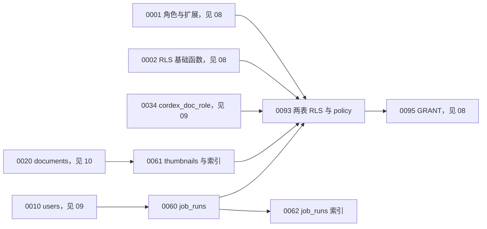
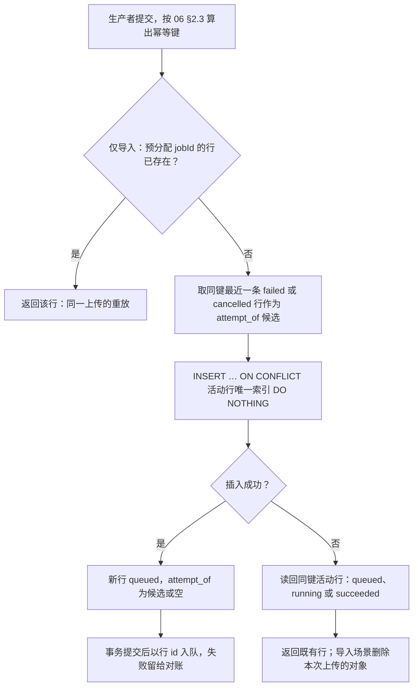
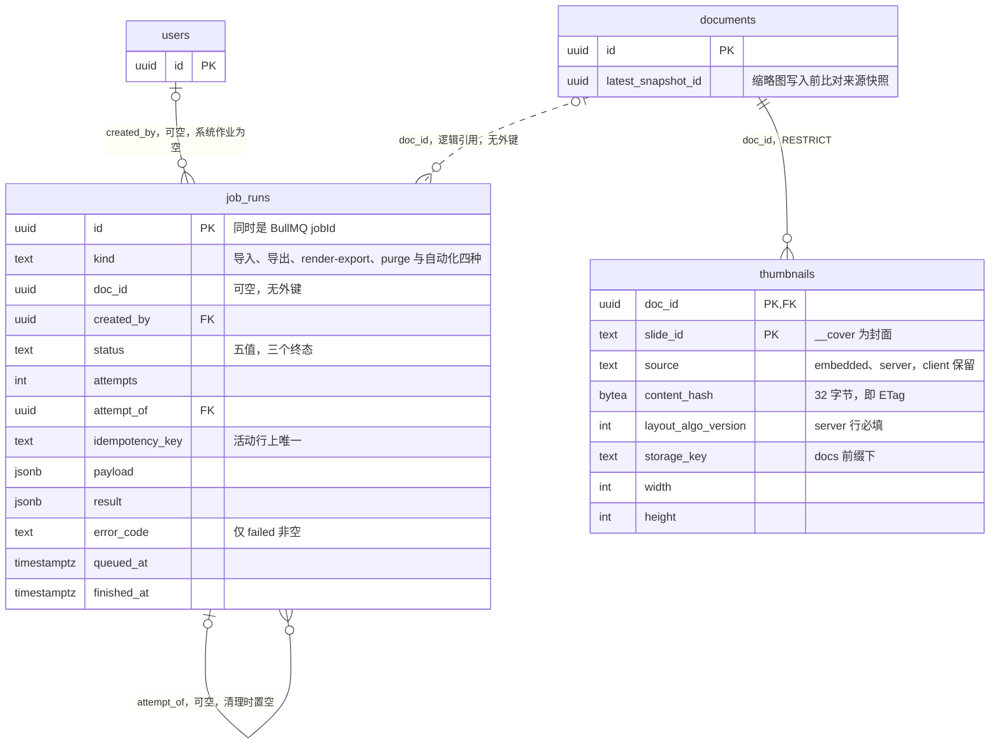

# 12 DDL：作业与缩略图

> 状态：v0.1 | 负责：后端设计线 | 更新：2026-09-25；2026-09-25（§4.19）；2026-09-26（§4.20）；2026-09-26（§4.21 Remap：原 30/08 引用按 60-backend/README §6.1 改指新位置，30/08 已删除）；2026-10-03（§4.24 AL-7：新增 §2.1 迁移 0063，`job_runs.kind` 增 SV-13 四种自动化作业、上传来源放宽 `doc_id` 可空，payload / result 形状补四行） | 依赖：[08](08-db-conventions-roles-rls-migrations.md)（命名、角色、RLS 框架、迁移顺序）；[09](09-ddl-identity-and-access.md)（`users`、`cordex_doc_role`）；[10](10-ddl-documents-marks-media.md)（`documents`）；[06](06-modules-jobs-import-export-thumbnails.md)（作业与缩略图的行为）；[14](14-valkey-object-storage-and-retention.md)（对象键、保留总表）；[06](06-modules-jobs-import-export-thumbnails.md) §1（原 30/08 §7）；[40-modules/12](../40-modules/12-server-jobs-comments-and-ops.md) §2.1、§2.2、§2.5；[ADR-0026](../30-architecture/adr/0026-headless-rendering-and-thumbnails.md) 决策 2–4；[rulings](../00-charter/rulings-2026-09-14.md) §4.15 Q8、§4.18 BE-18 / BE-19 / BE-26 / UX-14

## 1. 域说明

本文是 `job_runs` 与 `thumbnails` 两张表的唯一 DDL 来源；表如何被使用（状态机、幂等算法、处理器、缩略图管线）见 [06](06-modules-jobs-import-export-thumbnails.md)，本文只写结构、约束、索引、RLS 与数据生命周期。命名、类型与外键约定遵循 [08 §1–§2](08-db-conventions-roles-rls-migrations.md)：主键 UUIDv7 由应用层生成、DDL 不设默认值；枚举用 `text + CHECK`；约束与索引前缀 `pk_ / fk_ / uq_ / ck_ / ix_`；外键默认 `ON DELETE RESTRICT`。

| 表 | 所属 Nest 模块 | 仓储（`apps/server/src/modules/…`） | 迁移 | 里程碑 |
|---|---|---|---|---|
| `job_runs` | JobsModule（M-12，BC-23） | `JobRunsRepository`（`jobs/infrastructure/job-runs.repository.ts`） | `0060_job_runs`、`0062_job_runs_indexes` | 表 M1；首个业务写入 M2（服务端导入与创建副本，rulings §4.19 D-M2-CONTENT） |
| `thumbnails` | ThumbnailsModule（M-12，BC-24） | `ThumbnailsRepository`（`thumbnails/infrastructure/thumbnails.repository.ts`） | `0061_thumbnails` | embedded 封面 M2（由 M2 的导入处理器写入，rulings §4.19 D-M2-CONTENT）；server 缩略图 M3 前半段 |
| 两表的 RLS | — | — | `0093_rls_jobs_thumbnails` | 随表 |

本文迁移号段为 0060–0069 与 0093（全线分配见 [08 §9](08-db-conventions-roles-rls-migrations.md)），已用 0060、0061、0062、0063（2026-10-03，SV-13 自动化作业 kind，rulings §4.24 AL-7）、0093；0064–0069 预留给本域后续的 expand 迁移。SQL 围栏首行 `-- migrate: NNNN_<name>` 表示按编号在 PG 18 中顺序执行，`-- example` 只做语法解析（[08 §11](08-db-conventions-roles-rls-migrations.md)）。

**图 1-1 本域迁移的依赖顺序**



怎么读：箭头指向依赖它的迁移。`job_runs` 只依赖 `users`（`created_by` 外键），刻意不依赖 `documents`；`thumbnails` 依赖 `documents`；两表的 policy 要用到 08 的角色与 0002 的 `cordex_current_user()`、`cordex_system_job()`、`cordex_role_at_least()`，以及 09 的 `cordex_doc_role()`，所以集中放在 0093；GRANT 由 08 的 0095 统一授予。

依据：[08 §9](08-db-conventions-roles-rls-migrations.md) 迁移编号分配；决策 FK-POLICY、RLS-GUC、DB-ROLES。

## 2. `job_runs`（0060）

用户可见作业（导入、导出、render-export、永久删除）在 PG 中的镜像，同时充当 outbox：先写行、再以行 id 作 BullMQ jobId 入队（[06 §3](06-modules-jobs-import-export-thumbnails.md)）。`doc_id` 不设外键，文档永久删除后作业行仍保留供追溯（依据：决策 FK-POLICY，authority：rulings §4.18 BE-15）；`created_by` 指向 `users`，系统作业为空（依据：决策 DDL-COLS 之 C-22，authority：M-12 用例的鉴权前置条件）。

```sql
-- migrate: 0060_job_runs
CREATE TABLE job_runs (
  id               uuid        NOT NULL,
  kind             text        NOT NULL,
  doc_id           uuid        NULL,
  created_by       uuid        NULL,
  status           text        NOT NULL DEFAULT 'queued',
  attempts         integer     NOT NULL DEFAULT 0,
  attempt_of       uuid        NULL,
  idempotency_key  text        NULL,
  payload          jsonb       NOT NULL DEFAULT '{}'::jsonb,
  result           jsonb       NULL,
  error_code       text        NULL,
  traceparent      text        NULL,
  queued_at        timestamptz NOT NULL DEFAULT now(),
  started_at       timestamptz NULL,
  finished_at      timestamptz NULL,
  updated_at       timestamptz NOT NULL DEFAULT now(),
  CONSTRAINT pk_job_runs PRIMARY KEY (id),
  CONSTRAINT fk_job_runs_created_by FOREIGN KEY (created_by)
    REFERENCES users (id) ON DELETE RESTRICT,
  CONSTRAINT fk_job_runs_attempt_of FOREIGN KEY (attempt_of)
    REFERENCES job_runs (id) ON DELETE SET NULL,
  CONSTRAINT ck_job_runs_kind
    CHECK (kind IN ('import', 'export', 'render-export', 'document-purge')),
  CONSTRAINT ck_job_runs_status
    CHECK (status IN ('queued', 'running', 'succeeded', 'failed', 'cancelled')),
  CONSTRAINT ck_job_runs_doc_scoped
    CHECK (doc_id IS NOT NULL OR kind NOT IN ('import', 'export', 'render-export', 'document-purge')),
  CONSTRAINT ck_job_runs_attempts CHECK (attempts >= 0),
  CONSTRAINT ck_job_runs_attempt_of_not_self CHECK (attempt_of IS NULL OR attempt_of <> id),
  CONSTRAINT ck_job_runs_idempotency_key_len
    CHECK (idempotency_key IS NULL OR char_length(idempotency_key) BETWEEN 1 AND 512),
  CONSTRAINT ck_job_runs_error_code_iff_failed
    CHECK ((status = 'failed') = (error_code IS NOT NULL)),
  CONSTRAINT ck_job_runs_error_code_format
    CHECK (error_code IS NULL OR error_code ~ '^[a-z][a-z0-9_]*(\.[a-z][a-z0-9_]*)+$'),
  CONSTRAINT ck_job_runs_finished_iff_terminal
    CHECK ((status IN ('succeeded', 'failed', 'cancelled')) = (finished_at IS NOT NULL)),
  CONSTRAINT ck_job_runs_started_when_run
    CHECK (status NOT IN ('running', 'succeeded') OR started_at IS NOT NULL),
  CONSTRAINT ck_job_runs_payload_object CHECK (jsonb_typeof(payload) = 'object'),
  CONSTRAINT ck_job_runs_result_object CHECK (result IS NULL OR jsonb_typeof(result) = 'object'),
  CONSTRAINT ck_job_runs_traceparent
    CHECK (traceparent IS NULL OR traceparent ~ '^[0-9a-f]{2}-[0-9a-f]{32}-[0-9a-f]{16}-[0-9a-f]{2}$')
);

COMMENT ON TABLE job_runs IS '用户可见作业的 PG 镜像与 outbox；写方 M-12 JobsModule（JobRunsRepository），kind=document-purge 行由 M-08 SchedulePurgeUseCase 经同一仓储写入；见 60-backend/06 §2';
COMMENT ON COLUMN job_runs.id IS 'UUIDv7，应用层生成；同时是 BullMQ jobId；导入作业在 POST /imports/uploads 预分配';
COMMENT ON COLUMN job_runs.doc_id IS '作业作用的文档；新建导入为预分配 docId；刻意不设外键，文档永久删除后行保留';
COMMENT ON COLUMN job_runs.created_by IS '发起用户；系统作业（trash-expiry、内容迁入）为空';
COMMENT ON COLUMN job_runs.status IS 'queued → running → succeeded | failed；导入可 queued | running → cancelled；三个终态不复活';
COMMENT ON COLUMN job_runs.attempts IS '处理器开始执行的次数（含 BullMQ 重试与对账重投后的再次开始）';
COMMENT ON COLUMN job_runs.attempt_of IS '同一幂等键上一条 failed 或 cancelled 行；被引用行清理时置空';
COMMENT ON COLUMN job_runs.idempotency_key IS '格式见 60-backend/06 §2.3；只在非 failed、非 cancelled 行上唯一；产物失效时由清理作业置空以释放';
COMMENT ON COLUMN job_runs.payload IS '重建 BullMQ 作业所需的全部输入（对账补投用）；从不经 REST 返回';
COMMENT ON COLUMN job_runs.result IS '进度 stage 与各 kind 的结果；形状由 jobs/domain 的 zod schema 定义';
COMMENT ON COLUMN job_runs.error_code IS '失败码，<domain>.<snake_case_name>，仅 failed 行非空；细节在 result.errorDetails';
COMMENT ON COLUMN job_runs.traceparent IS '受理请求的 W3C traceparent，补投时恢复链路';
COMMENT ON COLUMN job_runs.updated_at IS '由仓储在每次更新时写入';
```

约束说明：

- `ck_job_runs_status` 为五值（依据：决策 MECH-C 之 C-18，authority：rulings §4.18 BE-18、UX-14）；合法迁移由应用层 `canTransitionJobStatus` 把关（[06 §2.2](06-modules-jobs-import-export-thumbnails.md)），DB 用三条状态相关 CHECK（失败必有码、终态必有 `finished_at`、运行或成功必有 `started_at`）守住不可能组合。
- **不设时间先后 CHECK**：`queued_at` / `started_at` / `finished_at` 由不同进程（api 受理、worker 开工、api 取消）经各自的 Clock 端口写入，多主机时钟偏差或测试中的 FixedClock 都会让「`started_at ≥ queued_at`」偶发不成立，把正常迁移变成约束错误；三列一律由仓储显式写入（DDL 默认值只作兜底），先后关系由状态机保证。
- `ck_job_runs_doc_scoped`：0060 的四种 kind 都有文档作用域（新建导入用预分配 id），`doc_id` 保持可空为无文档作业留位；2026-10-03 由 0063 放宽：自动化 `convert` / `validate` / `migrate` 的上传来源无文档作用域（§2.1，原「M4 再放宽」作废）。
- `attempt_of` 用 `ON DELETE SET NULL`（已登记在 [08 §2](08-db-conventions-roles-rls-migrations.md) 的例外表）：`job-runs-prune` 按时间删除终态行时，较新的重试行可能还引用较旧的失败行，RESTRICT 会让清理作业卡住；链条断开只损失排障线索，不影响正确性。

`payload` 与 `result` 的形状（zod schema 在 `jobs/domain/`，DB 只保证是 JSON 对象）：

| kind | `payload` | `result` |
|---|---|---|
| `import` | 上传导入 `{source: 'upload', uploadId, sourceKey, fileName, byteSize, sha256, targetExists, baseSeq}`；创建副本 `{source: 'duplicate', srcDocId, srcSeq, title?}`（[06 §6.6](06-modules-jobs-import-export-thumbnails.md)） | `{stage, snapshotId?, docId?, fidelityReport?, sourceDeleted?, errorDetails?}` |
| `export` | `{sourceRef, snapshotId?, headSeq?, format: 'pptx'}` | `{stage, objectKey?, bytes?, sha256?, expiresAt?, expired?, errorDetails?}` |
| `render-export` | `{sourceRef, format, pages?, width?, quality?}` | 同 `export`，另加 `pageCount?` |
| `document-purge` | `{reason: 'permanent_delete' \| 'trash_expired' \| 'erasure'}`（与 [07 §9.2](07-modules-comments-webhooks-audit.md) `document.purge_scheduled` 同名） | 只作观测，形状以 [04 §4.5](04-modules-documents-storage-media.md) 为准：`{step, roomClosedAt?, done[], attempt, objectVersionsDeleted?, errorDetails?}` |

### 2.1 自动化作业 kind（0063，2026-10-03，rulings §4.24 AL-7）

SV-13 的四种作业随 M3 交付（[06 §7.4](06-modules-jobs-import-export-thumbnails.md)），复用 `job_runs` 作为镜像与 outbox，不新建表、不加列：本迁移只放宽两条 CHECK——`kind` 增加 `fill-template`、`convert`、`validate`、`migrate`；`convert` / `validate` / `migrate` 的来源可以是上传文件，此时没有文档作用域，`doc_id` 允许为空（`fill-template` 的模板即文档，仍要求 `doc_id`）。这正是 §2 约束说明里为「无文档作业」预留可空 `doc_id` 的用途。按本文号段说明，0063 是本域第一个 expand 迁移；基线冻结前它与 0060 同批执行，结果与把 CHECK 直接写进 0060 相同。

```sql
-- migrate: 0063_job_runs_automation_kinds
-- 执行者：cordex_migrator。SV-13 四种自动化作业（60/06 §7.4）；只改 CHECK，不加列、不动数据
ALTER TABLE job_runs
  DROP CONSTRAINT ck_job_runs_kind,
  ADD CONSTRAINT ck_job_runs_kind
    CHECK (kind IN ('import', 'export', 'render-export', 'document-purge',
                    'fill-template', 'convert', 'validate', 'migrate'));

ALTER TABLE job_runs
  DROP CONSTRAINT ck_job_runs_doc_scoped,
  ADD CONSTRAINT ck_job_runs_doc_scoped
    CHECK (doc_id IS NOT NULL
           OR kind NOT IN ('import', 'export', 'render-export', 'document-purge', 'fill-template'));

COMMENT ON COLUMN job_runs.doc_id IS '作业作用的文档；新建导入为预分配 docId；自动化 convert / validate / migrate 的上传来源为空（0063）；刻意不设外键，文档永久删除后行保留';
```

```sql
-- example
-- 上传来源的 convert 作业：无文档作用域，只有创建者可见（RLS 的 created_by 分支，§5）
INSERT INTO job_runs (id, kind, doc_id, created_by, idempotency_key, payload, traceparent)
VALUES ($1, 'convert', NULL, $2, $3, $4, $5)
ON CONFLICT (idempotency_key) WHERE status NOT IN ('failed', 'cancelled') DO NOTHING
RETURNING id;
```

| kind | `payload` | `result` |
|---|---|---|
| `fill-template` | `{sourceRef, snapshotId?, headSeq?, format: 'pptx' \| 'pdf', batchId, clientRef?, data, contentPlugins}`（`data` 为单项占位符数据，图片值只存 sha256） | `{stage, objectKey?, bytes?, sha256?, expiresAt?, expired?, batchId, clientRef?, unmatched?, errorDetails?}` |
| `convert` | 文档来源 `{source: 'doc', sourceRef, to, pages?, width?, contentPlugins}`；上传来源 `{source: 'upload', sourceKey, sha256, byteSize, to, pages?, width?, contentPlugins}` | 同 `render-export`；`to = 'markdown'` 时无 `pageCount` |
| `validate` | 来源同 `convert`，无 `to` | `{stage, report: {ok, errors, warnings, fidelityCounts?}, reportKey?, expiresAt?, expired?, errorDetails?}` |
| `migrate` | 来源同 `convert`，另带 `targetSchemaVersion` | `{stage, fromSchemaVersion, toSchemaVersion, objectKey?, expiresAt?, expired?, errorDetails?}` |

形状的事实源仍是 `jobs/domain/` 的 zod schema（[06 §7.4](06-modules-jobs-import-export-thumbnails.md)）；`contentPlugins = {policy, ids[]}` 是受理时的内容级插件集（06 §7.1），2026-10-03 起导入、导出与 render-export 的 `payload` 同样携带它。

## 3. `job_runs` 索引与典型语句

```sql
-- migrate: 0062_job_runs_indexes
-- 幂等：只在未失败、未取消的行上唯一（BE-18 / UX-14，C-18）
CREATE UNIQUE INDEX uq_job_runs_idempotency_key_active
  ON job_runs (idempotency_key)
  WHERE status NOT IN ('failed', 'cancelled');

-- 同键上一条终态行（attempt_of 候选）
CREATE INDEX ix_job_runs_idempotency_key_terminal
  ON job_runs (idempotency_key, queued_at DESC)
  WHERE idempotency_key IS NOT NULL AND status IN ('failed', 'cancelled');

-- 按文档与种类列作业（进度、审计、导出下载）
CREATE INDEX ix_job_runs_doc_kind_queued
  ON job_runs (doc_id, kind, queued_at DESC)
  WHERE doc_id IS NOT NULL;

-- 对账扫描：只索引非终态行
CREATE INDEX ix_job_runs_reconcile
  ON job_runs (status, queued_at)
  WHERE status IN ('queued', 'running');

-- 「我的作业」与 RLS 的 created_by 条件
CREATE INDEX ix_job_runs_created_by_queued
  ON job_runs (created_by, queued_at DESC)
  WHERE created_by IS NOT NULL;

-- imports-cleanup、exports-cleanup、job-runs-prune 按完成时间扫描
CREATE INDEX ix_job_runs_kind_finished
  ON job_runs (kind, finished_at)
  WHERE finished_at IS NOT NULL;

-- attempt_of 外键的 SET NULL 需要反查
CREATE INDEX ix_job_runs_attempt_of
  ON job_runs (attempt_of)
  WHERE attempt_of IS NOT NULL;
```

索引依据：决策 MECH-C 之 G-10（`(created_by, queued_at desc)`）与 C-18；对账索引来自 40-modules/15 §3.5 的代价评估（「一个新 cron 任务 + 一个 `(status, queued_at)` 索引」）。

创建作业（[06 §2.3](06-modules-jobs-import-export-thumbnails.md) 算法第 2–4 步，同一事务）：

```sql
-- example
PREPARE job_runs_find_attempt_of (text) AS
SELECT id
  FROM job_runs
 WHERE idempotency_key = $1
   AND status IN ('failed', 'cancelled')
 ORDER BY queued_at DESC
 LIMIT 1;

-- $9 = Clock 端口给出的当前时间（queued_at 与 updated_at 同值）
PREPARE job_runs_create (uuid, text, uuid, uuid, text, uuid, jsonb, text, timestamptz) AS
INSERT INTO job_runs (id, kind, doc_id, created_by, idempotency_key, attempt_of, payload, traceparent,
                      queued_at, updated_at)
VALUES ($1, $2, $3, $4, $5, $6, $7, $8, $9, $9)
ON CONFLICT (idempotency_key) WHERE status NOT IN ('failed', 'cancelled')
DO NOTHING
RETURNING *;

-- 无返回行：并发或重复提交命中活动行，读回既有行
PREPARE job_runs_find_active (text) AS
SELECT *
  FROM job_runs
 WHERE idempotency_key = $1
   AND status NOT IN ('failed', 'cancelled');
```

对账扫描与产物失效释放键（[06 §3、§4](06-modules-jobs-import-export-thumbnails.md)）：

```sql
-- example
-- 「现在」一律由 Clock 端口传入（前一条的 $3、后一条的 $2），不用数据库 now()，FixedClock 才能驱动这些作业（06 §4）
PREPARE job_runs_orphan_candidates (interval, text, timestamptz) AS
SELECT id, kind, status, payload, traceparent
  FROM job_runs
 WHERE status IN ('queued', 'running')
   AND kind = $2
   AND coalesce(started_at, queued_at) < $3 - $1
 ORDER BY queued_at
 LIMIT 500;

PREPARE job_runs_release_expired_export (uuid, timestamptz) AS
UPDATE job_runs
   SET idempotency_key = NULL,
       result = coalesce(result, '{}'::jsonb) || '{"expired": true}'::jsonb,
       updated_at = $2
 WHERE id = $1
   AND kind IN ('export', 'render-export')
   AND status = 'succeeded';
```

**图 3-1 幂等键命中规则**



怎么读：自上而下是一次创建请求的判定路径。命中 `queued` / `running` / `succeeded` 的活动行一律返回既有行；终态的 `failed` / `cancelled` 行不占部分唯一索引，所以同键可以插入新行，并用 `attempt_of` 串起重试链；两个并发请求同时插入时，唯一索引让后到者落入「否」分支。

依据：rulings §4.18 BE-18、UX-14；决策 MECH-C 之 C-18；[06 §2.3](06-modules-jobs-import-export-thumbnails.md)。

## 4. `thumbnails`（0061）

每页只保留最新一行，覆盖写；失效依据是页内容哈希（依据：决策 MECH-C 之 C-13，authority：rulings §4.15 Q8）——`layoutAlgoVersion` 与 `fontProfile` 已并入 `content_hash`，因此**不加** `font_profile` 与 `snapshot_seq` 列；1280 px 变体只存对象、不入表（依据：决策 SG-10）。`source` 保留 `client` 位但领域层不产生该值（rulings §4.18 BE-26，ADR-0026 决策 4）。

```sql
-- migrate: 0061_thumbnails
CREATE TABLE thumbnails (
  doc_id               uuid        NOT NULL,
  slide_id             text        NOT NULL,
  source               text        NOT NULL,
  content_hash         bytea       NOT NULL,
  layout_algo_version  integer     NULL,
  storage_key          text        NOT NULL,
  width                integer     NOT NULL,
  height               integer     NOT NULL,
  created_at           timestamptz NOT NULL DEFAULT now(),
  updated_at           timestamptz NOT NULL DEFAULT now(),
  CONSTRAINT pk_thumbnails PRIMARY KEY (doc_id, slide_id),
  CONSTRAINT fk_thumbnails_doc FOREIGN KEY (doc_id)
    REFERENCES documents (id) ON DELETE RESTRICT,
  CONSTRAINT ck_thumbnails_source
    CHECK (source IN ('embedded', 'server', 'client')),
  CONSTRAINT ck_thumbnails_embedded_only_cover
    CHECK (source <> 'embedded' OR slide_id = '__cover'),
  CONSTRAINT ck_thumbnails_slide_id
    CHECK (char_length(slide_id) BETWEEN 1 AND 128),
  CONSTRAINT ck_thumbnails_content_hash
    CHECK (octet_length(content_hash) = 32),
  CONSTRAINT ck_thumbnails_server_has_algo
    CHECK (source <> 'server' OR layout_algo_version IS NOT NULL),
  CONSTRAINT ck_thumbnails_algo_positive
    CHECK (layout_algo_version IS NULL OR layout_algo_version > 0),
  CONSTRAINT ck_thumbnails_storage_key_prefix
    CHECK (starts_with(storage_key, 'docs/' || doc_id::text || '/thumbs/')),
  CONSTRAINT ck_thumbnails_dims
    CHECK (width BETWEEN 1 AND 16384
       AND height BETWEEN 1 AND 16384
       AND width::bigint * height <= 16777216)
);

-- thumbs-orphan-cleanup 以「上次运行以来有更新的文档」为扫描范围
CREATE INDEX ix_thumbnails_updated_at ON thumbnails (updated_at);

COMMENT ON TABLE thumbnails IS '每页最新缩略图元数据与文档封面行；写方 M-12 ThumbnailsModule（仅 cordex_system）；见 60-backend/06 §11';
COMMENT ON COLUMN thumbnails.slide_id IS '页 id；保留 id __cover 为文档卡片封面（M2 起导入写 embedded，M3 起由首页 server 图覆盖）';
COMMENT ON COLUMN thumbnails.source IS 'embedded：包内 docProps/thumbnail.jpeg 原字节（只做头校验）；server：renderer 产出的 640 px WebP；client：保留位，领域层不写';
COMMENT ON COLUMN thumbnails.content_hash IS 'server 行为页内容哈希（含 layoutAlgoVersion 与 fontProfile）；embedded 行为 JPEG 字节 sha256；即 ETag';
COMMENT ON COLUMN thumbnails.layout_algo_version IS '渲染所用 engine-layout 断行算法版本；低于当前版本即视为陈旧、读取时入队重渲；embedded 行为空';
COMMENT ON COLUMN thumbnails.storage_key IS 'data 桶对象键，必须在 docs/{docId}/thumbs/ 之下（finalize-purge 按前缀清除）';
COMMENT ON COLUMN thumbnails.width IS '像素宽；server 行固定 640';
```

约束说明：

- `ck_thumbnails_embedded_only_cover`：embedded 只能出现在 `__cover` 行；`__cover` 行本身可以是 `embedded`（M2 过渡）或 `server`（M3 首页图，与首页行指向同一对象键）。
- `ck_thumbnails_storage_key_prefix` 把「所有缩略图对象都在该文档前缀下」变成可机械检查的事实，永久删除的 finalize-purge 按 `docs/{docId}/` 删除全部版本时不会漏（对象键布局见 [14 §6](14-valkey-object-storage-and-retention.md)，C-32 以原 30/08 篇 §6 的完整键为准，该键现登记在 14 §6）。
- `ck_thumbnails_dims`：像素上限与 OF-24 位图预览上限一致（16,777,216 px），embedded 封面的头校验在写入前已按同一上限拒绝（[06 §11.2](06-modules-jobs-import-export-thumbnails.md)）。
- 响应的 `Content-Type` 由 `source` 推出（embedded → `image/jpeg`，server → `image/webp`），不单设列。

写入（`ThumbnailsProcessor`，与 [06 §11.3](06-modules-jobs-import-export-thumbnails.md) 的「按文档 advisory lock + 来源快照仍为最新」校验同一事务）：

```sql
-- example
-- $9 = Clock 端口给出的当前时间
PREPARE thumbnails_upsert (uuid, text, text, bytea, integer, text, integer, integer, timestamptz) AS
INSERT INTO thumbnails (doc_id, slide_id, source, content_hash, layout_algo_version, storage_key, width, height,
                        created_at, updated_at)
VALUES ($1, $2, $3, $4, $5, $6, $7, $8, $9, $9)
ON CONFLICT (doc_id, slide_id) DO UPDATE
   SET source              = EXCLUDED.source,
       content_hash        = EXCLUDED.content_hash,
       layout_algo_version = EXCLUDED.layout_algo_version,
       storage_key         = EXCLUDED.storage_key,
       width               = EXCLUDED.width,
       height              = EXCLUDED.height,
       updated_at          = EXCLUDED.updated_at
 WHERE thumbnails.content_hash IS DISTINCT FROM EXCLUDED.content_hash
    OR thumbnails.source IS DISTINCT FROM EXCLUDED.source
    OR thumbnails.layout_algo_version IS DISTINCT FROM EXCLUDED.layout_algo_version;

-- 永久删除参与者 thumbnails（幂等）
PREPARE thumbnails_purge_doc (uuid) AS
DELETE FROM thumbnails WHERE doc_id = $1;
```

## 5. RLS（0093）

两表都 `ENABLE` + `FORCE`（依据：决策 C-21，authority：check-rls-coverage 规则 + ADR-0022 修订 2026-09-24；`job_runs` 带可空 `doc_id`，按「安全宁可提前」纳入）。policy 写法遵守 [08 §6.3](08-db-conventions-roles-rls-migrations.md)（决策 RLS-GUC）：只经 0002 的 `cordex_current_user()`、`cordex_system_job()`、`cordex_role_at_least()` 与 09 的 `cordex_doc_role(doc_id)`（0034，取直接授权与 `app.share_token_hash` 对应有效链接角色的较高者）判定，不在 policy 里直接读 `current_setting`；命名 `p_{表}_{app|system}_{操作}`；不用 `BYPASSRLS`。

**policy 小表**（[08 §6.8](08-db-conventions-roles-rls-migrations.md) 测试矩阵的「最低读 / 写角色」取自这里）：

| 表 | app SELECT | app INSERT | app UPDATE | app DELETE | system |
|---|---|---|---|---|---|
| `job_runs` | 本人发起（`created_by`）或文档角色 ≥ `viewer`（含有效链接角色） | 只能以本人名义插初始态 `queued` 行 | 只能把本人未终态行改成 `cancelled` | 无（无 GRANT） | `FOR ALL`，作业名非空 |
| `thumbnails` | 文档角色 ≥ `viewer`（`doc.read`） | 无（无 GRANT） | 无 | 无 | `FOR ALL`，作业名非空 |

```sql
-- migrate: 0093_rls_jobs_thumbnails
ALTER TABLE job_runs ENABLE ROW LEVEL SECURITY;
ALTER TABLE job_runs FORCE ROW LEVEL SECURITY;

-- 读：本人发起，或对该文档有任一文档角色（含有效分享链接角色）；doc_id 为空时 cordex_doc_role 返回 NULL，该分支为假
CREATE POLICY p_job_runs_app_select ON job_runs
  FOR SELECT TO cordex_app
  USING (
    created_by = cordex_current_user()
    OR cordex_role_at_least(cordex_doc_role(doc_id), 'viewer')
  );

-- 写：只能以本人名义新建 queued 行，不能伪造进度或终态
CREATE POLICY p_job_runs_app_insert ON job_runs
  FOR INSERT TO cordex_app
  WITH CHECK (
    created_by = cordex_current_user()
    AND status = 'queued'
    AND attempts = 0
    AND started_at IS NULL
    AND finished_at IS NULL
    AND result IS NULL
  );

-- 改：只允许创建者把自己未终态的作业改成 cancelled
CREATE POLICY p_job_runs_app_update ON job_runs
  FOR UPDATE TO cordex_app
  USING (created_by = cordex_current_user() AND status IN ('queued', 'running'))
  WITH CHECK (created_by = cordex_current_user() AND status = 'cancelled');

-- 系统作业：必须在本事务内声明作业名（08 §6.5）
CREATE POLICY p_job_runs_system_all ON job_runs
  FOR ALL TO cordex_system
  USING (cordex_system_job() IS NOT NULL)
  WITH CHECK (cordex_system_job() IS NOT NULL);

ALTER TABLE thumbnails ENABLE ROW LEVEL SECURITY;
ALTER TABLE thumbnails FORCE ROW LEVEL SECURITY;

-- 读：doc.read，即对该文档有任一文档角色
CREATE POLICY p_thumbnails_app_select ON thumbnails
  FOR SELECT TO cordex_app
  USING (cordex_role_at_least(cordex_doc_role(doc_id), 'viewer'));

-- 写：只有系统作业（导入、缩略图处理器、永久删除参与者）
CREATE POLICY p_thumbnails_system_all ON thumbnails
  FOR ALL TO cordex_system
  USING (cordex_system_job() IS NOT NULL)
  WITH CHECK (cordex_system_job() IS NOT NULL);
```

- 系统放行用 `cordex_system_job() IS NOT NULL`：占位 GUC 在设置过它的事务结束后回落为空串而不是 NULL，该函数把空串视为 NULL，因此连接池复用的 `cordex_system` 连接漏设作业名时一行也看不到（08 §6.2 的机械修正，本文写作时已在 PG 18 复现该陷阱）。
- `cordex_doc_role` 为 `SECURITY DEFINER STABLE`，policy 调用它而不直接查 `permissions`，避免对 `permissions` 自身 RLS 的递归（RLS-GUC）。
- 表级权限（08 的 0095 统一授予）。本文要求 `cordex_app` 对 `job_runs` 的 UPDATE **按列**授予：policy 只能约束新行的 `created_by` 与 `status`，无法阻止取消语句顺带改写 `payload`、`result`、`idempotency_key`，列级 GRANT 才能把「只能取消」落到数据库。08 §4.2 与 0095 已按列授予（§8）：

| 表 | `cordex_app` | `cordex_system` | `cordex_migrator` |
|---|---|---|---|
| `job_runs` | `SELECT`、`INSERT`、`UPDATE (status, finished_at, updated_at)` | `SELECT`、`INSERT`、`UPDATE`、`DELETE` | 属主（迁移与 ops） |
| `thumbnails` | `SELECT` | `SELECT`、`INSERT`、`UPDATE`、`DELETE` | 属主 |

**RLS 测试矩阵（本域行）**，执行方式见 [70-testing/07 §5](../70-testing/07-backend-integration-and-api-e2e.md)（`security-rls`）：

| 主体 | `job_runs` 读 | `job_runs` 写 | `thumbnails` 读 | `thumbnails` 写 |
|---|---|---|---|---|
| `cordex_app`，作业创建者 | 本人全部行 | 以本人名义插 `queued` 行；本人未终态行改为 `cancelled` | 按文档角色 | 拒绝 |
| `cordex_app`，对文档有角色、非创建者 | 该文档的行 | 拒绝（改他人行、插他人名义行均失败） | 可读 | 拒绝 |
| `cordex_app`，只凭有效分享链接 | 该文档的行 | 同上 | 可读 | 拒绝 |
| `cordex_app`，链接过期或撤销 / 无关用户 | 不可见 | 拒绝 | 不可见 | 拒绝 |
| `cordex_app`，新建导入未完成（文档行尚不存在） | 仅创建者可见 | — | — | — |
| `cordex_system`，已设 `app.system_job` | 全部 | 全部 | 全部 | 全部 |
| `cordex_system`，本事务未设 `app.system_job`（含同一连接上一事务设过的情形） | 无行 | 拒绝 | 无行 | 拒绝 |

## 6. 逐表：归属、读写方、保留与清理

**`job_runs`**

| 项 | 内容 |
|---|---|
| 用途 | 用户可见作业的镜像与 outbox：进度查询、幂等去重、对账补投、审计追溯 |
| 所属模块与仓储 | JobsModule · `JobRunsRepository`（`create`、`findById`、`findActiveByKey`、`findLatestTerminalByKey`、`transition`、`listOrphans`、`releaseKey`、`pruneTerminalBefore`） |
| 写方 | api 生产者用例（`cordex_app`：新建、取消）；M-08 `SchedulePurgeUseCase`（api 用户请求用 `cordex_app`，trash-expiry 用 `cordex_system`）；worker 上的 `BaseProcessor`、reconciliation、`imports-cleanup`、`exports-cleanup`、`job-runs-prune`（`cordex_system`） |
| 读方 | `GET /jobs/:id`、`GET /exports/:jobId`（api）；reconciliation 与清理作业（worker）；document-purge 处理器（进度写 `result`） |
| RLS | ENABLE + FORCE；app 读本人或有文档角色的行、只能新建与取消；系统作业全权（§5） |
| 保留与清理 | 终态行 `finished_at` 早于 `retention.jobRunsDays`（默认 90 天）由 `job-runs-prune` 删除，导出行须已 `expired`、导入行须已 `sourceDeleted`；**不**参与文档永久删除（无外键，行在文档删除后保留，FK-POLICY）；用户擦除不删行，`created_by` 仍指向原地脱敏的用户（C-24） |
| 体量 | 每次导入、导出、永久删除一行，自动化每项数据一行（单批 ≤ 100）；90 天窗口内预计 < 10⁶ 行，不分区 |
| 里程碑 | 表 M1；业务写入 M2 |

**`thumbnails`**

| 项 | 内容 |
|---|---|
| 用途 | 每页最新缩略图元数据与文档封面行，供 `GET /documents/:id/thumbnails/:slideId` 与失效判定 |
| 所属模块与仓储 | ThumbnailsModule · `ThumbnailsRepository`（`findLatest`、`upsert`、`listByDoc`、`listUpdatedSince`、`deleteByDoc`） |
| 写方 | `ImportProcessor`（embedded 封面）、`ThumbnailsProcessor`（server 行与 `__cover` 覆盖）、永久删除参与者 `thumbnails`——全部 `cordex_system` |
| 读方 | 缩略图读取端点（api，`cordex_app`，受 RLS）；`ThumbnailsProcessor`（按哈希跳过未变页）；`thumbs-orphan-cleanup` |
| RLS | ENABLE + FORCE；app 只读（`doc.read`）；写仅系统作业（§5） |
| 保留与清理 | 每页一行覆盖写；旧哈希对象与过期 1280 变体由 `thumbs-orphan-cleanup` 删除（对象最后修改超过 24 h 才删，固定宽限以 [14 §8](14-valkey-object-storage-and-retention.md) 为准）；文档永久删除时参与者删行、finalize-purge 按 `docs/{docId}/` 删全部对象版本（[04 §4](04-modules-documents-storage-media.md)） |
| 体量 | 每文档 ≤ 页数 + 1 行（天花板下 ≤ 201 行） |
| 里程碑 | embedded 封面 M2（导入处理器写入）；server 缩略图 M3 前半段 |

保留期配置键与默认值以 [14 §8](14-valkey-object-storage-and-retention.md) 保留总表、[17 §5](17-deployment-and-config.md) 配置 schema 为准；执行这些清理的周期作业登记在 [06 §4](06-modules-jobs-import-export-thumbnails.md)。

## 7. 按域 ER 图

**图 7-1 作业与缩略图**



怎么读：实线是声明的外键，虚线是只作查询用的逻辑引用；两端符号是基数（`||` 恰一、`|o` 零或一、`o{` 零或多）。`job_runs` 故意不挂到 `documents` 上，作业记录比文档活得久；`thumbnails` 随文档存在，由永久删除参与者先删行、再由 finalize-purge 删文档行，RESTRICT 保证漏删会报错而不是静默级联。

依据：决策 FK-POLICY、DDL-COLS、C-13、C-21；本文 §2–§4（完整字段；原 30/08 篇 §5 草案已删，rulings §4.19）；40-modules/19 图 5-4、5-5（本图为迁入后的唯一版本）。

## 8. 未决与对旧稿的修正

| 项 | 内容 | 状态 |
|---|---|---|
| 与原 30/08 篇 §5 的差异 | `job_runs` 增 `created_by`（C-22）、`traceparent`、`updated_at`，全部约束命名化；`thumbnails` 的 `source` 保留 `client`（BE-26）、增 `updated_at` 与前缀、尺寸约束，`created_at` 不再作失效依据 | 本文为准，原 30/08 篇 §5 改为链接（已回写；该篇 §4.21 撤销） |
| `attempt_of` 的删除策略 | `ON DELETE SET NULL`（§2） | 已在 08 §2 登记 |
| 系统放行表达式 | 改用 08 §6.2 的 `cordex_system_job() IS NOT NULL`，app policy 用 `cordex_role_at_least`、命名加 `p_` 前缀（§5） | 已与 08 对齐 |
| `job_runs` 的 app UPDATE 列级授予 | `UPDATE (status, finished_at, updated_at)` | 已与 08 §4.2 / 0095 对齐 |
| `document-purge` 的 `payload.reason` 与 `result` | `reason` 取 07 §9.2 的 `permanent_delete \| trash_expired \| erasure`（`erasure` 为 M4 预留，04 §3.2）；`result` 按 04 §4.5 | 已与 04 对齐 |
| 导入幂等键格式 | 列约束不变，键格式按 [06 §2.3](06-modules-jobs-import-export-thumbnails.md) 的 JOB-IDEM（含创建副本的 `import:{newDocId}:dup-{srcDocId}:{srcSeq}`） | 已定稿（BE-10 / BE-18 的细化） |
| embedded 封面在 M2 的写入路径 | 由 M2 的导入处理器在同一 `persist` 事务写 `__cover` 行（[06 §6.4、§11.2](06-modules-jobs-import-export-thumbnails.md)）；创建副本复制源封面（06 §6.6） | 已裁定（rulings §4.19 D-M2-CONTENT） |

## 9. 机械验证

只列断言；执行方式与 CI 步骤归 70 线。写作时已在 `postgres:18-alpine`（18.6）中先执行 08 原文的 0001、0002，再以最小桩（`users`、`documents`、`permissions` 与 SECURITY DEFINER 的 `cordex_doc_role()`）实跑本文全部 `migrate` 段与 `example` 段，并通过下表第 3、5、6、7 条的主干用例（第 7 条的「取消时顺带改 `payload`」按 §5 的列级 GRANT 验证）；正式验证以 ddl-check 与 70 线为准。

| # | 断言 | 执行 |
|---|---|---|
| 1 | 0060、0061、0062、0063、0093 在空的 PG 18 库中按编号顺序执行成功（2026-09-25 于 `cordex-ddl-pg` 连同 08–13 全部 `migrate` 围栏重跑通过）；本文 `-- example` 段全部可解析 | `docs/_tools/ddl-check`（总编排实现）；[70-testing/07](../70-testing/07-backend-integration-and-api-e2e.md) §4 迁移测试 |
| 2 | 两表均 `ENABLE` + `FORCE` RLS，且不在 `policy/rls-exceptions.json` 例外表中 | `scanners/check-rls-coverage` |
| 3 | §5 RLS 测试矩阵逐格成立（含链接过期、撤销、未设 `app.system_job` 以及同一连接上一事务设过作业名的负向格）；`pg_policy` 中两表的表达式不含 `current_setting` | 70/07 §5，`e2e/smoke` 的 security-rls |
| 4 | 100 个并发事务以同一幂等键插入，只有 1 行成功；把该行改为 `failed` 或 `cancelled` 后同键可再插入 | 70/07 §11，`test/server-integration` |
| 5 | 负向插入全部被 CHECK 拒绝：非法 `status` 或 `kind`；`failed` 缺 `error_code`；终态缺 `finished_at`；embedded 行的 `slide_id` 不是 `__cover`；`storage_key` 不在该文档前缀下；`content_hash` 非 32 字节；像素超上限 | 70/07 §4 |
| 6 | `job-runs-prune` 删除被 `attempt_of` 引用的旧行时，引用方被置空而非报错；删除有 `thumbnails` 行的 `documents` 行被 RESTRICT 拒绝 | 70/07 §11 |
| 7 | `cordex_app` 对 `job_runs` 执行 DELETE、改 `payload` 或 `result`（含取消语句顺带改写）、对 `thumbnails` 执行任何写入均因 GRANT 或 policy 失败（改 `payload` 一项依赖 §8 的列级 GRANT） | 70/07 §4 GRANT 快照 |
| 8 | drizzle schema（`apps/server/src/db/schema/{job_runs,thumbnails}.ts`）与本文 DDL 对比无差异 | 70/07 §4；[08](08-db-conventions-roles-rls-migrations.md) 的 schema 对比 |
