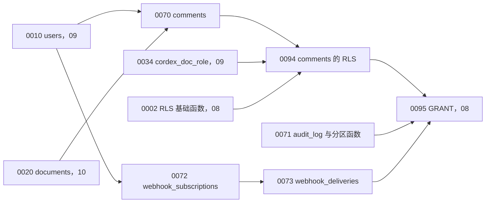
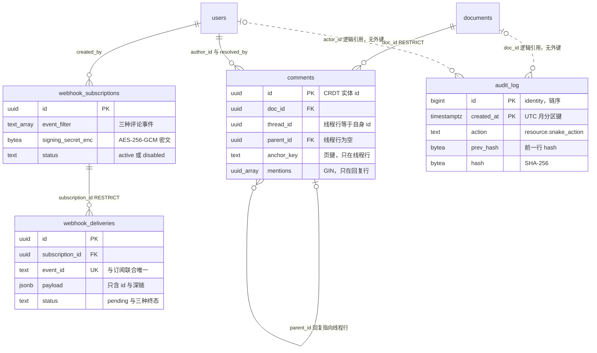
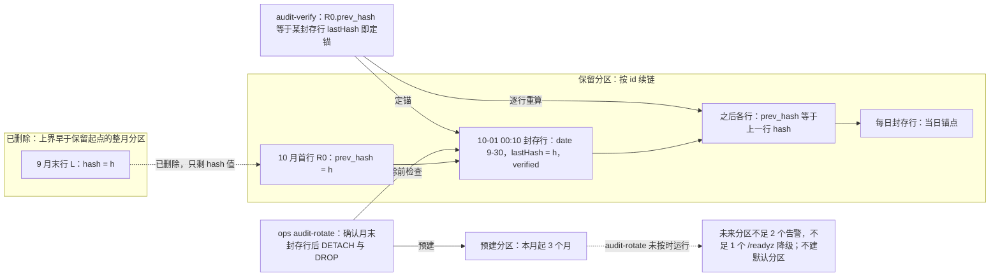

# 13 DDL：评论、Webhook 与审计
> 状态：v0.1 | 负责：后端设计线 | 更新：2026-09-25；2026-09-25（§4.19）；2026-09-26（§4.21 Remap：原 30/08 引用按 60-backend/README §6.1 改指新位置，30/08 已删除） | 依赖：[07 模块设计：评论镜像、Webhook 与审计](07-modules-comments-webhooks-audit.md)；[08 数据库总约定](08-db-conventions-roles-rls-migrations.md)；[09 DDL：身份与权限](09-ddl-identity-and-access.md)（`users`、`cordex_doc_role`）；[10 DDL：文档](10-ddl-documents-marks-media.md)（`documents`）；[ADR-0031](../30-architecture/adr/0031-comments-and-anchors-storage.md)；[PRD 06](../10-prd/03-features/06-server-and-ops.md) SV-07/SV-15；[rulings](../00-charter/rulings-2026-09-14.md) §4.12 U-14/U-15、§4.18 BE-19/BE-25


## 1. 域说明

本文件给出评论镜像、Webhook 与审计四张表的 PostgreSQL 18 建表语句、索引、RLS policy 与示例查询，是这四张表结构的唯一事实源；模块行为（谁在什么时候写、写什么）见 [07](07-modules-comments-webhooks-audit.md)。通用约定（命名前缀 `pk_ / fk_ / uq_ / ck_ / ix_`、主键 UUIDv7 由应用层生成、枚举用 `text + CHECK`、`timestamptz`）、数据库角色、GRANT 与 RLS 框架以 [08](08-db-conventions-roles-rls-migrations.md) 为准。

| 表 | 所属 Nest 模块 | 迁移 | 分区 | RLS | 里程碑 |
|---|---|---|---|---|---|
| `comments` | CommentsModule | `0070_comments` | 无 | ENABLE + FORCE（`0094_rls_comments`） | 表随 M2 建立，M3 起写入 |
| `audit_log`（含月分区，无默认分区） | AuditModule | `0071_audit_log` | `RANGE (created_at)` 按 UTC 月 | 例外（只追加，读仅平台管理员） | M2 建表，链从首行开始；封存与校验 M3 |
| `webhook_subscriptions` | WebhooksModule | `0072_webhook_subscriptions` | 无 | 例外（部署级管理员表） | 表随 M2 建立，M3 起写入 |
| `webhook_deliveries` | WebhooksModule | `0073_webhook_deliveries` | 无 | 例外（同上） | 表随 M2 建立，M3 起写入 |

**迁移依赖**：本文件编号段为 0070–0079 与 0094（全线分配见 [08](08-db-conventions-roles-rls-migrations.md) §9）。`0070` 依赖 `users`（09 的 0010）与 `documents`（10 的 0020）；`0071` 无外键依赖；`0072` 依赖 `users`；`0073` 依赖 `0072`；`0094` 依赖 `0070`、RLS 基础函数 `cordex_system_job()` / `cordex_role_at_least()`（08 的 0002）与 `cordex_doc_role`（09 的 0034）；本组表的 GRANT 写在 08 的 `0095`，所需权限见 §6.3。`0070`–`0073` 在 M2 首批服务端迁移中一起执行（评论与 Webhook 表 M3 才有写方，提前建空表无副作用），避免日后插入比已执行迁移编号更小的迁移；`0094` 随 08 规定的 RLS 批次执行。

**图 1 本文件迁移顺序与依赖**



怎么读：箭头从被依赖的迁移指向依赖它的迁移；带「08 / 09 / 10」后缀的节点属于其它 DDL 文件，本文件只写无后缀的五个；`docs/_tools/ddl-check` 按编号升序在 PG 18 容器中执行全部 `-- migrate:` 围栏，这张图说明本文件的编号不会早于它的依赖。

**与计划草案、盘点的差异**（均按 [07](07-modules-comments-webhooks-audit.md) 的设计定稿，写方已知）：

| 项 | 本文定稿 | 理由 |
|---|---|---|
| `comments` 线程与回复同表 | 一行一个 CRDT 实体；锚点与解决字段只在线程行、正文与提及只在回复行，由 `ck_comments_shape` 约束；`anchor_key` 因此只对线程行非空 | 与 ADR-0031 v0.2 的 `threads` / `replies` 两张实体表一一对应，upsert 以实体 id 幂等，无需反规范化 |
| `comments.mirrored_at` | 新增 | 镜像延迟观测与对账 |
| `audit_log` 列 | 新增 `category`、`result`、`client_version`、`trace_id`；`user_agent_hash` 改名 `ua_hash`；`id` 用 `GENERATED ALWAYS AS IDENTITY` | PRD SV-07 要求类别、结果、客户端版本；trace 关联；identity 列在 PG 17+ 分区表可用，应用角色插入不需要序列权限 |
| `audit_log` 默认分区与防改写触发器 | 都不建 | 按 [08](08-db-conventions-roles-rls-migrations.md) §1「业务表不用触发器」与 §3「不建 DEFAULT 分区」：只追加由 0095 的 GRANT 与 0096 自检保证，篡改由哈希链与每日封存发现（[07](07-modules-comments-webhooks-audit.md) §8）；缺月份时写入直接失败并告警，比悄悄落进默认分区更早暴露，且保留 `DETACH … CONCURRENTLY` 可用 |
| `webhook_subscriptions` 密钥列 | `signing_secret_hash` 改为 `signing_secret_enc` + `secret_version` + 轮换期旧密钥两列 | 决策 C-16/INC-30；HMAC 需要密钥本体 |
| `webhook_deliveries` 列 | 新增 `payload`（C-17）、`event_id` 唯一键、`next_attempt_at`、`last_error`、`updated_at`；状态值沿用 rulings §4.18 BE-19 的 `dead-lettered` | outbox 对账重投、多实例去重、退避调度 |

## 2. comments（0070）

评论镜像读模型：事实源是快照内 ResourceHook `comments.threads`（Y.Doc 路径 `resources['comments.threads']`，内含 threads、replies 两张实体表；客户端插件为 iso 包 `@cordexjs/comments`，rulings §4.19 D-COMMENTS-PKG），本表只由镜像观察器与 purge 参与者写（ADR-0031 v0.2、60-backend/07 §1）。

```sql
-- migrate: 0070_comments
CREATE TABLE comments (
  id            uuid        NOT NULL,
  doc_id        uuid        NOT NULL,
  thread_id     uuid        NOT NULL,
  parent_id     uuid        NULL,
  author_id     uuid        NOT NULL,
  body          text        NULL,
  body_format   text        NULL,
  anchor        jsonb       NULL,
  anchor_key    text        NULL,
  anchor_state  text        NULL,
  mentions      uuid[]      NOT NULL DEFAULT '{}',
  resolved_by   uuid        NULL,
  resolved_at   timestamptz NULL,
  created_at    timestamptz NOT NULL,
  edited_at     timestamptz NULL,
  deleted_at    timestamptz NULL,
  mirrored_at   timestamptz NOT NULL DEFAULT now(),
  CONSTRAINT pk_comments PRIMARY KEY (id),
  CONSTRAINT fk_comments_doc FOREIGN KEY (doc_id) REFERENCES documents (id) ON DELETE RESTRICT,
  CONSTRAINT fk_comments_parent FOREIGN KEY (parent_id) REFERENCES comments (id) ON DELETE RESTRICT,
  CONSTRAINT fk_comments_author FOREIGN KEY (author_id) REFERENCES users (id) ON DELETE RESTRICT,
  CONSTRAINT fk_comments_resolved_by FOREIGN KEY (resolved_by) REFERENCES users (id) ON DELETE RESTRICT,
  CONSTRAINT ck_comments_shape CHECK (
    (parent_id IS NULL AND thread_id = id
      AND body IS NULL AND body_format IS NULL AND edited_at IS NULL AND cardinality(mentions) = 0
      AND anchor IS NOT NULL AND anchor_key IS NOT NULL AND anchor_state IS NOT NULL)
    OR
    (parent_id IS NOT NULL AND parent_id = thread_id
      AND body IS NOT NULL AND body_format IS NOT NULL
      AND anchor IS NULL AND anchor_key IS NULL AND anchor_state IS NULL
      AND resolved_by IS NULL AND resolved_at IS NULL)),
  CONSTRAINT ck_comments_body CHECK (body IS NULL OR char_length(body) <= 5000),
  CONSTRAINT ck_comments_body_format CHECK (body_format IS NULL OR body_format = 'plain'),
  CONSTRAINT ck_comments_anchor CHECK (anchor IS NULL OR (jsonb_typeof(anchor) = 'object' AND anchor ? 'kind')),
  CONSTRAINT ck_comments_anchor_key CHECK (anchor_key IS NULL OR char_length(anchor_key) <= 128),
  CONSTRAINT ck_comments_anchor_state CHECK (anchor_state IS NULL OR anchor_state IN ('attached', 'detached')),
  CONSTRAINT ck_comments_mentions CHECK (cardinality(mentions) <= 50),
  CONSTRAINT ck_comments_resolved CHECK ((resolved_at IS NULL) = (resolved_by IS NULL))
);

CREATE INDEX ix_comments_doc_thread ON comments (doc_id, thread_id);
CREATE INDEX ix_comments_doc_anchor_key ON comments (doc_id, anchor_key) WHERE parent_id IS NULL;
CREATE INDEX ix_comments_mentions ON comments USING gin (mentions) WHERE deleted_at IS NULL;
-- 外键前导索引（08 §1）：删除线程行时，自引用外键的 RESTRICT 检查按 parent_id 查找回复行
CREATE INDEX ix_comments_parent ON comments (parent_id) WHERE parent_id IS NOT NULL;

COMMENT ON TABLE comments IS '评论镜像读模型（ADR-0031 v0.2）。事实源为快照内 ResourceHook comments.threads（resources[''comments.threads'']）；唯一写方 CommentMirrorObserver（collab，cordex_system）与参与者 comments（worker）。一行 = 一个 CRDT 实体：线程行 parent_id IS NULL，回复行 parent_id = thread_id';
COMMENT ON COLUMN comments.id IS 'CRDT 实体 id（ThreadId 或 ReplyId，UUIDv7，由客户端生成）';
COMMENT ON COLUMN comments.thread_id IS '所属线程 id；线程行等于自身 id';
COMMENT ON COLUMN comments.parent_id IS '回复行指向线程行；线程行为空。自引用外键 RESTRICT：RI 检查在语句末尾执行，单条 DELETE 可同时删线程与回复（08 §2，PG 18 实测）';
COMMENT ON COLUMN comments.author_id IS '线程行 = createdBy，回复行 = authorId；作者一致性由软门禁保证（ADR-0034）';
COMMENT ON COLUMN comments.body IS '回复正文，纯文本，镜像层截断到 5000 字符；线程行为空';
COMMENT ON COLUMN comments.body_format IS '正文格式，目前只有 plain；线程行为空';
COMMENT ON COLUMN comments.anchor IS '锚点 JSON（开放判别联合，必须含 kind），服务端只校验形状不解码 RelativePosition；只在线程行';
COMMENT ON COLUMN comments.anchor_key IS '页键：锚点所在页的稳定 id（幻灯片 = slideId，文档级锚点为空串）；由文档类型登记的 deriveAnchorKey 在镜像写入时计算，非 GENERATED 列（BE-25）';
COMMENT ON COLUMN comments.anchor_state IS 'attached | detached；镜像写入时按文档类型登记的解析器判定，客户端解析结果为准；回复行为空';
COMMENT ON COLUMN comments.mentions IS '被提及用户 id（去重、至多 50、只保留存在且未擦除的用户）；只在回复行非空';
COMMENT ON COLUMN comments.resolved_by IS '解决线程的用户（CRDT resolvedBy）；未解决或回复行为空，与 resolved_at 同空同非空';
COMMENT ON COLUMN comments.resolved_at IS '解决时间；未解决或回复行为空';
COMMENT ON COLUMN comments.created_at IS 'CRDT createdAt，镜像写入时截到不晚于服务端当前时间';
COMMENT ON COLUMN comments.edited_at IS 'CRDT editedAt；从未编辑或线程行为空';
COMMENT ON COLUMN comments.deleted_at IS 'CRDT 中软删除或实体消失的时间；物理删除只经 purge 参与者';
COMMENT ON COLUMN comments.mirrored_at IS '最近一次镜像写入时间，用于镜像延迟观测';
```

| 项 | 内容 |
|---|---|
| 用途 | 跨文档「@我」、单文档评论 REST、Webhook 事件派生与审计的读模型；可从 CRDT 全量重建 |
| 所属模块与仓储 | CommentsModule · `CommentsRepository`（`apps/server/src/modules/comments/infrastructure/comments.repository.ts`） |
| 写方 | `CommentMirrorObserver`（collab，`cordex_system`，`app.system_job = 'collab.comment-mirror'`）；参与者 `comments`（worker，`app.system_job = 'worker.document-purge'`；作业名取值见 [08](08-db-conventions-roles-rls-migrations.md) §6.5） |
| 读方 | 评论 REST（api，`cordex_app` + RLS）；观察器自身（差异比对） |
| RLS | ENABLE + FORCE；应用角色只读、`cordex_role_at_least(cordex_doc_role(doc_id), 'viewer')`；系统角色须在本事务设 `app.system_job`（§6） |
| 保留与清理 | 随文档存在；文档永久删除时由参与者 `comments` 整文档删除；CRDT 中消失的实体只置 `deleted_at`；用户擦除不改本表（正文按 `retention.erasure.commentBody`，[07](07-modules-comments-webhooks-audit.md) §1.7） |
| 里程碑 | 表随 M2 建立；M3 起写入（镜像、REST、提及） |

索引说明：`ix_comments_doc_thread` 支撑单文档线程列表与线程详情；`ix_comments_doc_anchor_key` 只索引线程行，支撑 `filter=page`；`ix_comments_mentions` 为 GIN 部分索引，查询须带 `deleted_at IS NULL` 才能命中（§7.4）；`ix_comments_parent` 是自引用外键 `fk_comments_parent` 的前导索引（[08](08-db-conventions-roles-rls-migrations.md) §1「被硬删除方的外键列必须是某索引前导列」），只收回复行，参与者 `comments` 整文档删除时 RESTRICT 检查不做全表扫描。不为 `author_id` 建索引：M3 没有按作者查询的路径，M4 的正文 redact 由 CRDT 侧驱动。

## 3. audit_log（0071）

审计日志：只追加、哈希链、按 UTC 自然月分区（PRD SV-07、rulings §4.12 U-15、决策 C-20/G-13/G-14）。写入协议、链定义、封存与轮换流程见 [07](07-modules-comments-webhooks-audit.md) §8。

```sql
-- migrate: 0071_audit_log
CREATE TABLE audit_log (
  id              bigint      GENERATED ALWAYS AS IDENTITY,
  created_at      timestamptz NOT NULL,
  category        text        NOT NULL,
  action          text        NOT NULL,
  result          text        NOT NULL DEFAULT 'success',
  actor_type      text        NOT NULL,
  actor_id        uuid        NULL,
  target_type     text        NULL,
  target_id       text        NULL,
  doc_id          uuid        NULL,
  session_id      text        NULL,
  request_id      text        NULL,
  trace_id        text        NULL,
  ip_hash         bytea       NULL,
  ua_hash         bytea       NULL,
  client_version  text        NULL,
  details         jsonb       NOT NULL DEFAULT '{}'::jsonb,
  prev_hash       bytea       NULL,
  hash            bytea       NOT NULL,
  CONSTRAINT pk_audit_log PRIMARY KEY (id, created_at),
  CONSTRAINT ck_audit_log_category CHECK (category IN
    ('access', 'edit', 'comment', 'permission', 'version', 'admin', 'security', 'system')),
  CONSTRAINT ck_audit_log_action CHECK (action ~ '^[a-z][a-z0-9_]*\.[a-z][a-z0-9_]*$'),
  CONSTRAINT ck_audit_log_result CHECK (result IN ('success', 'denied', 'failed')),
  CONSTRAINT ck_audit_log_actor CHECK (actor_type IN ('user', 'system', 'ops')
    AND (actor_type <> 'user' OR actor_id IS NOT NULL)),
  CONSTRAINT ck_audit_log_text_len CHECK (char_length(coalesce(target_id, '')) <= 200
    AND char_length(coalesce(session_id, '')) <= 64 AND char_length(coalesce(request_id, '')) <= 64
    AND char_length(coalesce(trace_id, '')) <= 32 AND char_length(coalesce(client_version, '')) <= 64),
  CONSTRAINT ck_audit_log_hash CHECK (octet_length(hash) = 32
    AND (prev_hash IS NULL OR octet_length(prev_hash) = 32)),
  CONSTRAINT ck_audit_log_pseudonym CHECK ((ip_hash IS NULL OR octet_length(ip_hash) = 32)
    AND (ua_hash IS NULL OR octet_length(ua_hash) = 32)),
  CONSTRAINT ck_audit_log_details CHECK (jsonb_typeof(details) = 'object')
) PARTITION BY RANGE (created_at);

CREATE INDEX ix_audit_log_created ON audit_log (created_at DESC, id DESC);
CREATE INDEX ix_audit_log_doc ON audit_log (doc_id, created_at DESC) WHERE doc_id IS NOT NULL;
CREATE INDEX ix_audit_log_actor ON audit_log (actor_id, created_at DESC) WHERE actor_id IS NOT NULL;
CREATE INDEX ix_audit_log_category ON audit_log (category, created_at DESC);
CREATE INDEX ix_audit_log_sealed ON audit_log (created_at) WHERE action = 'audit.sealed';

-- 不建 DEFAULT 分区（08 §3）：落到未建月份的写入直接失败并告警
-- 按 UTC 自然月预建分区：本月起共 1 + p_months_ahead 个；已存在则跳过；只由 cordex_migrator 执行（迁移与 ops audit-rotate）
CREATE FUNCTION cordex_audit_ensure_partitions(p_months_ahead integer DEFAULT 3)
RETURNS integer
LANGUAGE plpgsql
AS $$
DECLARE
  m       date := date_trunc('month', now() AT TIME ZONE 'UTC')::date;
  last_m  date := (date_trunc('month', now() AT TIME ZONE 'UTC') + make_interval(months => p_months_ahead))::date;
  lo      timestamptz;
  hi      timestamptz;
  part    text;
  made    integer := 0;
BEGIN
  IF p_months_ahead < 0 OR p_months_ahead > 24 THEN
    RAISE EXCEPTION 'p_months_ahead out of range: %', p_months_ahead;
  END IF;
  WHILE m <= last_m LOOP
    part := format('audit_log_y%sm%s', to_char(m, 'YYYY'), to_char(m, 'MM'));
    lo := m::timestamp AT TIME ZONE 'UTC';
    hi := (m + interval '1 month')::timestamp AT TIME ZONE 'UTC';
    IF to_regclass(part) IS NULL THEN
      EXECUTE format('CREATE TABLE %I PARTITION OF audit_log FOR VALUES FROM (%L) TO (%L)', part, lo, hi);
      made := made + 1;
    END IF;
    m := (m + interval '1 month')::date;
  END LOOP;
  RETURN made;
END
$$;
REVOKE ALL ON FUNCTION cordex_audit_ensure_partitions(integer) FROM PUBLIC;

SELECT cordex_audit_ensure_partitions(3);

COMMENT ON TABLE audit_log IS '审计日志：只追加 + 哈希链（PRD SV-07、rulings U-15）。按 UTC 自然月 RANGE 分区；应用角色只有 INSERT / SELECT；保留期到期由 ops audit-rotate 以 cordex_migrator 整月 DETACH + DROP';
COMMENT ON COLUMN audit_log.id IS '链序：写入在常量 advisory 锁内分配，id 升序即链序；允许空洞（回滚的事务会消耗序号）';
COMMENT ON COLUMN audit_log.created_at IS '分区键；写入时在锁内取 date_trunc(''milliseconds'', clock_timestamp())，参与哈希';
COMMENT ON COLUMN audit_log.action IS '<resource>.<snake_action>，唯一登记表见 60-backend/07 §9';
COMMENT ON COLUMN audit_log.actor_id IS '主体用户 id，逻辑引用不设外键；actor_type 为 system 或 ops 时为空';
COMMENT ON COLUMN audit_log.target_type IS '目标类型（user、link、subscription 等）；action 无独立目标时为空，target_id 同';
COMMENT ON COLUMN audit_log.doc_id IS '逻辑引用，不设外键：文档永久删除后审计保留（FK-POLICY）；与文档无关的 action 为空';
COMMENT ON COLUMN audit_log.session_id IS '会话 sid；系统作业、ops 与未登录的失败路径为空；request_id、trace_id 同理按来源可空';
COMMENT ON COLUMN audit_log.ip_hash IS 'HMAC-SHA256(部署审计盐, 客户端 IP)；audit.recordClientIp=false 或无客户端（系统作业）时为空';
COMMENT ON COLUMN audit_log.ua_hash IS 'HMAC-SHA256(部署审计盐, User-Agent)；无客户端时为空';
COMMENT ON COLUMN audit_log.client_version IS '请求头 X-Cordex-Client-Version 或票据 appVersion；无客户端时为空';
COMMENT ON COLUMN audit_log.details IS '按 action 登记的 zod schema 校验；禁止文档内容与令牌';
COMMENT ON COLUMN audit_log.prev_hash IS '前一行 hash；只有创世行为空';
COMMENT ON COLUMN audit_log.hash IS 'SHA-256(prev_hash 或 32 个零字节 ‖ JCS(条目))，见 60-backend/07 §8';
```

| 项 | 内容 |
|---|---|
| 用途 | 合规审计（SV-07 七类事件）；只追加、哈希链防篡改；按文档、主体、类别、时间范围查询与导出 |
| 所属模块与仓储 | AuditModule · `AuditRepository`（`apps/server/src/modules/audit/infrastructure/audit.repository.ts`；只有 `insert`、`insertBatch`、`tail`、`query`、`exportRange`） |
| 写方 | `RecordAuditEventUseCase`（api / collab / worker，`cordex_app` 或 `cordex_system`，只 INSERT）；分区的建立与删除只由 `cordex_migrator`（迁移与 ops `audit-rotate`） |
| 读方 | `GET /audit`、`GET /audit/export`（平台管理员）；`audit-seal` 与链校验（worker） |
| RLS | 不启用，登记例外（§6.2）：没有文档作用域的读路径，读取只经 `PlatformAdminGuard`；应用角色只有 INSERT / SELECT |
| 保留与清理 | `retention.auditDays`（默认 365，可配）按整月 `DETACH + DROP`（ops `audit-rotate`，[07](07-modules-comments-webhooks-audit.md) §8.4），实际保留 365～396 天；文档永久删除与用户擦除都不删、不改审计行 |
| 里程碑 | M2 建表并从首行起链（`hash NOT NULL`，写入方从 M2 起实现 `chainHash`）；每日封存、校验工具、分区轮换 M3 |

设计要点：

- **主键含分区键**：分区表的主键与唯一约束必须包含分区键，故为 `(id, created_at)`（C-19）；链序以 `id` 为准，`created_at` 在同一把 advisory 锁内取 `clock_timestamp()`，二者同向递增。
- **不建默认分区**（[08](08-db-conventions-roles-rls-migrations.md) §3）：本月起预建 3 个月，`audit-rotate` 每日补足；已建的未来月分区少于 2 个时告警 `CordexAuditPartitionsLow`，少于 1 个时 `/readyz` 标记 `degraded`（[18](18-observability-and-ops-endpoints.md) §5、§6）。真走到缺月份，审计写入失败会连带事务内审计的业务事务失败——这是有意的 fail-closed，而不是让审计悄悄进默认分区；没有默认分区也使保留期轮换可以用 `DETACH … CONCURRENTLY`（§7.3）。
- **只追加的防线**：应用角色只有 INSERT / SELECT（0095），0096 自检核对应用角色无 UPDATE / DELETE / TRUNCATE、无分区子表权限；不另加触发器（08 §1「业务表不用触发器」）。持有属主凭据的篡改由哈希链与每日封存发现（[07](07-modules-comments-webhooks-audit.md) §8）。
- **索引**：`ix_audit_log_created` 支撑时间倒序游标；`ix_audit_log_doc`、`ix_audit_log_actor` 为部分索引（可空列）；`ix_audit_log_category` 支撑按类别过滤；`ix_audit_log_sealed` 让封存与校验快速定位 `audit.sealed` 行。链尾查询 `ORDER BY id DESC LIMIT 1` 走各分区主键索引的倒序扫描加 Merge Append，只触达每个分区一个索引页。
- **权限**：`cordex_audit_ensure_partitions` `REVOKE ALL … FROM PUBLIC`，只有属主 `cordex_migrator` 可执行；它是 `SECURITY INVOKER`，不在 [08](08-db-conventions-roles-rls-migrations.md) §4.3 的 SECURITY DEFINER 清单内。

## 4. webhook_subscriptions（0072）

```sql
-- migrate: 0072_webhook_subscriptions
CREATE TABLE webhook_subscriptions (
  id                          uuid        NOT NULL,
  target_url                  text        NOT NULL,
  event_filter                text[]      NOT NULL,
  signing_secret_enc          bytea       NOT NULL,
  secret_version              integer     NOT NULL DEFAULT 1,
  previous_secret_enc         bytea       NULL,
  previous_secret_expires_at  timestamptz NULL,
  status                      text        NOT NULL DEFAULT 'active',
  created_by                  uuid        NOT NULL,
  created_at                  timestamptz NOT NULL DEFAULT now(),
  updated_at                  timestamptz NOT NULL DEFAULT now(),
  CONSTRAINT pk_webhook_subscriptions PRIMARY KEY (id),
  CONSTRAINT fk_webhook_subscriptions_created_by FOREIGN KEY (created_by) REFERENCES users (id) ON DELETE RESTRICT,
  CONSTRAINT ck_webhook_subscriptions_url CHECK (char_length(target_url) <= 2048
    AND target_url ~ '^https?://[^/?#@[:space:]]+([/?#]|$)'),
  CONSTRAINT ck_webhook_subscriptions_events CHECK (cardinality(event_filter) BETWEEN 1 AND 3
    AND event_filter <@ ARRAY['comment.added', 'comment.mentioned', 'comment.resolved']::text[]),
  CONSTRAINT ck_webhook_subscriptions_secret CHECK (octet_length(signing_secret_enc) >= 62
    AND (previous_secret_enc IS NULL OR octet_length(previous_secret_enc) >= 62)),
  CONSTRAINT ck_webhook_subscriptions_previous CHECK ((previous_secret_enc IS NULL) = (previous_secret_expires_at IS NULL)),
  CONSTRAINT ck_webhook_subscriptions_version CHECK (secret_version >= 1),
  CONSTRAINT ck_webhook_subscriptions_status CHECK (status IN ('active', 'disabled'))
);

COMMENT ON TABLE webhook_subscriptions IS 'Webhook 订阅（BC-30，平台管理员管理）。部署级表，无 doc_id，登记为 RLS 例外';
COMMENT ON COLUMN webhook_subscriptions.target_url IS '投递地址；生产环境只收 https（应用层按配置判定）；不得含 userinfo';
COMMENT ON COLUMN webhook_subscriptions.event_filter IS '订阅的事件，⊆ {comment.added, comment.mentioned, comment.resolved}';
COMMENT ON COLUMN webhook_subscriptions.signing_secret_enc IS 'HMAC 密钥密文：AES-256-GCM(KEK = CORDEX_SECRETS_KEK_FILE)，信封 = 格式版本 1 B ‖ KEK 编号 1 B ‖ nonce 12 B ‖ 密文 32 B ‖ tag 16 B，AAD = id ‖ secret_version；明文只在创建与轮换响应出现一次';
COMMENT ON COLUMN webhook_subscriptions.secret_version IS '当前密钥版本，每次轮换 +1';
COMMENT ON COLUMN webhook_subscriptions.previous_secret_enc IS '轮换宽限期内的旧密钥密文；从未轮换时为空；到期后投递处理器不再使用，由下一次 PATCH 清空';
COMMENT ON COLUMN webhook_subscriptions.previous_secret_expires_at IS '旧密钥宽限期截止（轮换时 now() + 24 h）；与 previous_secret_enc 同空同非空';
```

| 项 | 内容 |
|---|---|
| 用途 | Webhook 订阅：目标地址、事件过滤、加密的签名密钥与轮换状态（PRD SV-15、BC-30） |
| 所属模块与仓储 | WebhooksModule · `WebhookRepository`（`apps/server/src/modules/webhooks/infrastructure/webhook.repository.ts`） |
| 写方 | 订阅管理用例（api，平台管理员；创建、PATCH、轮换、删除，过期旧密钥在下一次 PATCH 时顺带清空） |
| 读方 | 生产者（collab，只读 `id`、`status`、`event_filter`）；投递处理器（worker，解密密钥）；管理 REST |
| RLS | 不启用，登记例外（§6.2）：部署级管理员表，无文档作用域 |
| 保留与清理 | 直至管理员删除；删除时同一事务先删其投递记录 |
| 里程碑 | 表随 M2 建立，M3 起写入 |

订阅数量是部署级的小集合（几十条），生产者按事件匹配时顺序扫描即可，不为 `event_filter` 建 GIN 索引。`https` 强制属于应用层规则（依赖 `NODE_ENV`），表上 CHECK 只保证 `http(s)://` 形态、不含 userinfo 与长度上限。

## 5. webhook_deliveries（0073）

```sql
-- migrate: 0073_webhook_deliveries
CREATE TABLE webhook_deliveries (
  id               uuid        NOT NULL,
  subscription_id  uuid        NOT NULL,
  event            text        NOT NULL,
  event_id         text        NOT NULL,
  payload          jsonb       NOT NULL,
  payload_hash     bytea       NOT NULL,
  attempt          integer     NOT NULL DEFAULT 0,
  status           text        NOT NULL DEFAULT 'pending',
  next_attempt_at  timestamptz NULL,
  response_code    integer     NULL,
  last_error       text        NULL,
  delivered_at     timestamptz NULL,
  created_at       timestamptz NOT NULL DEFAULT now(),
  updated_at       timestamptz NOT NULL DEFAULT now(),
  CONSTRAINT pk_webhook_deliveries PRIMARY KEY (id),
  CONSTRAINT fk_webhook_deliveries_subscription FOREIGN KEY (subscription_id)
    REFERENCES webhook_subscriptions (id) ON DELETE RESTRICT,
  CONSTRAINT uq_webhook_deliveries_event UNIQUE (subscription_id, event_id),
  CONSTRAINT ck_webhook_deliveries_event CHECK (event IN ('comment.added', 'comment.mentioned', 'comment.resolved')),
  CONSTRAINT ck_webhook_deliveries_event_id CHECK (char_length(event_id) <= 200),
  CONSTRAINT ck_webhook_deliveries_payload CHECK (jsonb_typeof(payload) = 'object' AND octet_length(payload_hash) = 32),
  CONSTRAINT ck_webhook_deliveries_attempt CHECK (attempt BETWEEN 0 AND 32),
  CONSTRAINT ck_webhook_deliveries_status CHECK (status IN ('pending', 'succeeded', 'failed', 'dead-lettered')),
  CONSTRAINT ck_webhook_deliveries_code CHECK (response_code IS NULL OR response_code BETWEEN 100 AND 599),
  CONSTRAINT ck_webhook_deliveries_error CHECK (last_error IS NULL OR char_length(last_error) <= 1024),
  CONSTRAINT ck_webhook_deliveries_state CHECK (
    (status = 'pending' AND next_attempt_at IS NOT NULL AND delivered_at IS NULL)
    OR (status = 'succeeded' AND delivered_at IS NOT NULL AND next_attempt_at IS NULL)
    OR (status IN ('failed', 'dead-lettered') AND delivered_at IS NULL AND next_attempt_at IS NULL))
);

CREATE INDEX ix_webhook_deliveries_pending ON webhook_deliveries (next_attempt_at) WHERE status = 'pending';
CREATE INDEX ix_webhook_deliveries_subscription ON webhook_deliveries (subscription_id, created_at DESC);
CREATE INDEX ix_webhook_deliveries_terminal ON webhook_deliveries (updated_at) WHERE status <> 'pending';

COMMENT ON TABLE webhook_deliveries IS 'Webhook 投递记录与 outbox：与评论镜像同事务写 pending 行，提交后入 webhook-delivery 队列；reconciliation 扫描孤儿 pending 行补投';
COMMENT ON COLUMN webhook_deliveries.event_id IS '确定性去重键（如 comment.added:{replyId}），多实例或重试重复产生同一事件时只落一行';
COMMENT ON COLUMN webhook_deliveries.payload IS '版本化事件信封 {id,type,version,createdAt,data}；只含 id、时间与深链，不含评论正文与文档标题';
COMMENT ON COLUMN webhook_deliveries.payload_hash IS 'SHA-256(规范化载荷字节)，签名与重投以它校验载荷未变';
COMMENT ON COLUMN webhook_deliveries.attempt IS '已发出的投递次数；pending 含重试中（BE-19）';
COMMENT ON COLUMN webhook_deliveries.status IS 'pending（含重试中）→ succeeded | failed（不可重试）| dead-lettered（重试用尽），rulings §4.18 BE-19';
COMMENT ON COLUMN webhook_deliveries.next_attempt_at IS '下次尝试时间；只在 pending 时非空，终态为空';
COMMENT ON COLUMN webhook_deliveries.response_code IS '最近一次 HTTP 响应码；未发出请求或连接失败时为空';
COMMENT ON COLUMN webhook_deliveries.last_error IS '最近一次失败原因（错误类别与截断的响应摘要，≤1 KiB，不含响应正文全文）；从未失败时为空';
COMMENT ON COLUMN webhook_deliveries.delivered_at IS '得到 2xx 的时间；只在 succeeded 时非空';
```

| 项 | 内容 |
|---|---|
| 用途 | 投递记录与 outbox：保存待投递载荷供对账补投与人工重放，并作投递日志 |
| 所属模块与仓储 | WebhooksModule · `WebhookRepository` |
| 写方 | 生产者（collab，评论镜像事务内写 `pending`）；`WebhookDeliveryProcessor`（worker，状态与尝试）；`webhook-deliveries-prune`（worker，删终态行）；ops `webhooks:replay`（`cordex_system`）；删除订阅时同事务连带删除（api，`cordex_app`，外键 RESTRICT 要求先删子行） |
| 读方 | 投递日志 REST（api）；`reconciliation`（worker，只读孤儿 `pending` 行） |
| RLS | 不启用，登记例外（§6.2） |
| 保留与清理 | 终态行（`succeeded`、`failed`、`dead-lettered`）`updated_at` 超过 `retention.webhookDeliveriesDays`（默认 90 天）由 maintenance `webhook-deliveries-prune` 删除；`pending` 行不清；载荷只含 id、时间与深链，因此不需要参与文档永久删除 |
| 里程碑 | 表随 M2 建立，M3 起写入 |

约束说明：`ck_webhook_deliveries_state` 把状态与时间字段绑在一起（`pending` 必有 `next_attempt_at`，`succeeded` 必有 `delivered_at`，终态不再有下次尝试时间），处理器漏写字段会直接失败而不是留下语义不明的行。`attempt` 上限 32 只是结构护栏，业务上限是固定的 8 次（rulings §4.18 BE-19，不设配置键）。

## 6. RLS 与授权

### 6.1 comments 的 policy（0094）

依据：决策 RLS-GUC、C-21（authority：rulings §4.18 BE-02 + ADR-0022 修订 2026-09-24，系统作业用独立角色 + 系统作业上下文，不用 BYPASSRLS）。写法遵守 [08](08-db-conventions-roles-rls-migrations.md) §6.3：只经 0002 的 `cordex_system_job()`、`cordex_role_at_least()` 与 09 的 `cordex_doc_role(doc_id)` 判定，policy 里不直接读 `current_setting`；命名 `p_{表}_{app|system}_{操作}`。

**policy 小表**（[08](08-db-conventions-roles-rls-migrations.md) §6.8 测试矩阵的「最低读 / 写角色」取自这里）：

| 表 | app SELECT | app INSERT / UPDATE / DELETE | system |
|---|---|---|---|
| `comments` | 文档角色 ≥ `viewer`（`doc.read`，含有效链接角色） | 无（无 GRANT，不建 policy） | `FOR ALL`，作业名非空 |

```sql
-- migrate: 0094_rls_comments
ALTER TABLE comments ENABLE ROW LEVEL SECURITY;
ALTER TABLE comments FORCE ROW LEVEL SECURITY;

-- 请求路径只读：doc.read，即对该文档有任一文档角色（09 的 0034：max(直接授权, 有效分享链接角色)）
CREATE POLICY p_comments_app_select ON comments
  FOR SELECT TO cordex_app
  USING (cordex_role_at_least(cordex_doc_role(doc_id), 'viewer'));

-- 系统路径：CommentMirrorObserver（collab.comment-mirror）与参与者 comments（worker.document-purge）
CREATE POLICY p_comments_system_all ON comments
  FOR ALL TO cordex_system
  USING (cordex_system_job() IS NOT NULL)
  WITH CHECK (cordex_system_job() IS NOT NULL);
```

- **读**：`cordex_doc_role(doc_id)` 返回当前 `app.user_id` 对该文档的有效角色（直接授权与 `app.share_token_hash` 命中的有效链接取较高者），`cordex_role_at_least(…, 'viewer')` 对 NULL 或格外取值返回 NULL，一律不可见（fail-closed）。跨文档「@我」请求不带分享令牌，因此只看到直接授权的文档。
- **写**：`cordex_app` 没有 `comments` 的写权限（§6.3），请求路径无论 policy 如何都写不进；`cordex_system` 只有在本事务 `set_config('app.system_job', …, true)` 之后才可读写。占位 GUC 在设置过它的事务结束后回落为空串而非 NULL，`cordex_system_job()` 以 `NULLIF(…, '')` 处理，连接池复用连接上漏设作业名的事务一行也看不到（08 §6.2 机械修正，本文写作时已在 PG 18.6 复现该陷阱）。
- **FORCE**：表属主之外的角色本来就受 RLS 约束；`FORCE` 保证即便日后表属主被误授给应用角色，policy 仍生效。`cordex_migrator` 持有 BYPASSRLS，仅用于迁移与运维。

### 6.2 RLS 例外（清单本体在 08 §6.4）

本组三张表不开 RLS，已登记在 [08](08-db-conventions-roles-rls-migrations.md) §6.4 的例外清单（即 `policy/rls-exceptions.json` 与 0096 自检的同一份清单），本文只补充理由：

| 表 | 理由 |
|---|---|
| `audit_log` | 带可空 `doc_id` 但没有文档作用域的读路径：读取只经 `PlatformAdminGuard`（`GET /audit`、导出）；应用角色只有 INSERT 与 SELECT；若按文档权限过滤，管理员将无法审计已被移除授权或已永久删除的文档 |
| `webhook_subscriptions` | 部署级管理员配置表，无 `doc_id`；读写只经 `PlatformAdminGuard`，系统路径只读 |
| `webhook_deliveries` | 部署级投递日志，无 `doc_id` 列（载荷里的 `docId` 只是逻辑引用）；读取与随订阅删除只经 `PlatformAdminGuard`，其余写入来自系统路径 |

### 6.3 本组表所需的 GRANT（写入 08 的 0095）

| 表 | `cordex_app` | `cordex_system` | 说明 |
|---|---|---|---|
| `comments` | SELECT | SELECT、INSERT、UPDATE、DELETE | 应用角色只读；写只在系统路径（镜像、purge） |
| `audit_log`（父表） | SELECT、INSERT | SELECT、INSERT | 无 UPDATE、DELETE、TRUNCATE；identity 列插入不需要序列权限（PG 18.6 实测） |
| `webhook_subscriptions` | SELECT、INSERT、UPDATE、DELETE | SELECT | 管理员经 api 写；生产者与投递处理器只读 |
| `webhook_deliveries` | SELECT、**DELETE** | SELECT、INSERT、UPDATE、DELETE | api 只在删除订阅时同事务连带删除（外键 RESTRICT）；生产、处理、清理、重放都在系统路径 |

与 08 §4.2 / 0095 现稿的差异只有一处：`webhook_deliveries` 需要对 `cordex_app` 授予 `DELETE`（否则有投递记录的订阅无法删除），待 08 补授。

分区表的 GRANT 授在父表即可：经父表访问时只检查父表权限。属主以外的角色直接访问某个分区表（`audit_log_y2026m09`）没有权限，这正是期望的行为（08 §3、0096 自检 ②）。

## 7. 示例（只做语法解析，不作为迁移执行）

### 7.1 审计写入串行化

```sql
-- example
-- 请求事务（READ COMMITTED）的最后一步；参数由 RecordAuditEventUseCase 绑定
SELECT current_setting('transaction_isolation');                  -- 必须是 read committed
SELECT pg_advisory_xact_lock(1128552513, 1);                      -- 审计链常量键：'CDXA' 与 1
SELECT hash FROM audit_log ORDER BY id DESC LIMIT 1;              -- 链尾；0 行表示创世
SELECT date_trunc('milliseconds', clock_timestamp()) AS created_at;
INSERT INTO audit_log (created_at, category, action, result, actor_type, actor_id,
  target_type, target_id, doc_id, session_id, request_id, trace_id,
  ip_hash, ua_hash, client_version, details, prev_hash, hash)
VALUES ($1, 'permission', 'permission.granted', 'success', 'user', $2,
  'user', $3, $4, $5, $6, $7, $8, $9, $10, $11, $12, $13);
-- 随后由请求上下文 COMMIT，锁随事务释放
```

### 7.2 每日封存与校验读取

```sql
-- example
-- audit-seal：封存 UTC 日 2026-09-24
SELECT min(id) AS first_id, max(id) AS last_id, count(*) AS rows
FROM audit_log
WHERE created_at >= timestamptz '2026-09-24 00:00:00+00'
  AND created_at <  timestamptz '2026-09-25 00:00:00+00';
-- 上一日封存行作为锚点
SELECT id, details->>'lastHash' AS last_hash
FROM audit_log
WHERE action = 'audit.sealed' AND details->>'date' = '2026-09-23';
-- 按 id 分批读出待校验行，应用层重算 chainHash
SELECT id, created_at, category, action, result, actor_type, actor_id, target_type, target_id,
       doc_id, session_id, request_id, trace_id, ip_hash, ua_hash, client_version,
       details, prev_hash, hash
FROM audit_log
WHERE id > $1
ORDER BY id
LIMIT 10000;
```

### 7.3 分区轮换（ops audit-rotate，cordex_migrator）

```sql
-- example
SELECT cordex_audit_ensure_partitions(3);
SELECT c.relname AS partition, pg_get_expr(c.relpartbound, c.oid) AS bound
FROM pg_inherits i
JOIN pg_class c ON c.oid = i.inhrelid
WHERE i.inhparent = 'audit_log'::regclass
ORDER BY c.relname;
-- 以 2025-09 分区到期为例：月末封存行存在且已校验才继续
SELECT id FROM audit_log
WHERE action = 'audit.sealed' AND details->>'date' = '2025-09-30'
  AND (details->>'verified')::boolean;
-- 以下两条各自在自动提交模式下执行：DETACH … CONCURRENTLY 不能放在事务块里
SET lock_timeout = '5s';
ALTER TABLE audit_log DETACH PARTITION audit_log_y2025m09 CONCURRENTLY;
DROP TABLE audit_log_y2025m09;
```

`DETACH … CONCURRENTLY` 分两个内部事务执行，父表全程只取 `SHARE UPDATE EXCLUSIVE` 锁（`ACCESS EXCLUSIVE` 只落在被摘除的旧分区上），审计写入不被阻塞；它要求父表没有默认分区（本表不建，§3）。命令在两阶段之间中断时，分区停在「detach pending」状态，`audit-rotate` 下次运行先执行 `ALTER TABLE audit_log DETACH PARTITION … FINALIZE` 再 `DROP`；`lock_timeout` 失败时整条命令重试，不影响已保留数据。执行入口与频率（每日 03:00、幂等）见 [17](17-deployment-and-config.md) §9。

### 7.4 评论镜像写入与「@我」查询

```sql
-- example
-- 镜像一条回复（cordex_system，事务内已 set_config('app.system_job', 'collab.comment-mirror', true)）
WITH prev AS (SELECT mentions, edited_at FROM comments WHERE id = $1)
INSERT INTO comments (id, doc_id, thread_id, parent_id, author_id, body, body_format,
                      mentions, created_at, edited_at, deleted_at)
VALUES ($1, $2, $3, $3, $4, $5, 'plain', $6, least($7, now()), $8, $9)
ON CONFLICT (id) DO UPDATE
  SET body = EXCLUDED.body, mentions = EXCLUDED.mentions, edited_at = EXCLUDED.edited_at,
      deleted_at = EXCLUDED.deleted_at, mirrored_at = now()
RETURNING (xmax = 0) AS inserted, (SELECT mentions FROM prev) AS prev_mentions;

-- GET /comments/mentions（cordex_app，事务内已 set_config('app.user_id', …, true)）
SELECT c.id, c.doc_id, c.thread_id, c.author_id, c.created_at
FROM comments c
JOIN documents d ON d.id = c.doc_id AND d.status = 'active'
WHERE c.mentions @> ARRAY[cordex_current_user()]
  AND c.deleted_at IS NULL
  AND (c.created_at, c.id) < ($1, $2)
ORDER BY c.created_at DESC, c.id DESC
LIMIT 50;
```

`RETURNING` 同时给出「是否新增」与更新前的 `mentions`，观察器据此派生 `comment.added` 与 `comment.mentioned`（[07](07-modules-comments-webhooks-audit.md) §1.3）。「@我」查询的文档可见性由 `comments` 与 `documents` 两张表各自的 RLS 共同保证，应用层只加 `status = 'active'`。

### 7.5 投递对账与清理

```sql
-- example
-- reconciliation：孤儿 pending 行（webhook-delivery 处理器超时 15 s，06 §1；阈值取 2 倍）
SELECT id FROM webhook_deliveries
WHERE status = 'pending' AND next_attempt_at < now() - interval '30 seconds'
ORDER BY next_attempt_at
LIMIT 500;
-- webhook-deliveries-prune：终态行超过 retention.webhookDeliveriesDays，分批删除
DELETE FROM webhook_deliveries
WHERE id IN (SELECT id FROM webhook_deliveries
             WHERE status <> 'pending' AND updated_at < now() - interval '90 days'
             LIMIT 1000);
```

## 8. 保留期与清理汇总

| 对象 | 默认保留 | 配置键 | 清理机制与执行者 |
|---|---|---|---|
| `comments` 行 | 随文档 | — | 文档永久删除时参与者 `comments`（worker，`document-purge` 队列，[04](04-modules-documents-storage-media.md) §4）；CRDT 中消失的实体只置 `deleted_at` |
| `audit_log` 分区 | ≥ 365 天，按整月 | `retention.auditDays` | ops `audit-rotate`（`cordex_migrator`，每日 03:00、幂等，[17](17-deployment-and-config.md) §9）`DETACH … CONCURRENTLY` + `DROP` |
| `audit_log` 未来分区 | 本月起预建 3 个月 | — | `audit-rotate` 调 `cordex_audit_ensure_partitions(3)`；不足 2 个时告警，不足 1 个时 `/readyz` 为 `degraded` |
| `webhook_subscriptions` | 直至删除 | — | 管理员删除（同事务删其投递记录） |
| `webhook_deliveries` 终态行 | 90 天 | `retention.webhookDeliveriesDays` | maintenance `webhook-deliveries-prune`（worker） |
| `webhook_deliveries` pending 行 | 不清 | — | `reconciliation` 补投直至终态 |

全部配置键的 schema 在 [17](17-deployment-and-config.md) §5，全局保留总表在 [14](14-valkey-object-storage-and-retention.md) §8。

## 9. 按域 ER 图与审计保留流程

**图 2 评论、Webhook 与审计 ER**



怎么读：实线是真实外键（本组一律 RESTRICT；评论自引用也是 RESTRICT，RI 检查在语句末尾执行，参与者一条 DELETE 就能删掉整文档的线程与回复），虚线是只存 id、不声明外键的逻辑引用——审计行必须在文档永久删除与用户擦除后继续存在；`documents` 与 `users` 的完整结构见 [10](10-ddl-documents-marks-media.md) 与 [09](09-ddl-identity-and-access.md)。

依据：本文 §2–§5；决策 FK-POLICY、C-14、C-16、C-17、C-19、DDL-COLS。

**图 3 审计哈希链、每日封存与按月分区保留**



怎么读：左框是被整月删除的分区，只有它末行的 hash 值 `h` 还存在于两处——保留区首行 R0 的 `prev_hash` 与次月首日封存行的 `lastHash`；校验工具以二者相等定锚，再按 `id` 逐行重算。实线是链的先后与命令动作，虚线是已不存在的数据或异常路径；缺月份的写入直接失败而不是落进默认分区，所以预建不足要在告警阶段就处理。

依据：决策 C-20/G-13/G-14；[07](07-modules-comments-webhooks-audit.md) §8；[08](08-db-conventions-roles-rls-migrations.md) §3；本文 §7.2–§7.3。

## 10. 机械验证

| 断言 | 执行（套件 / CI 步骤） |
|---|---|
| 全部 `-- migrate:` 围栏按编号在 PG 18 空库顺序执行成功（本文件 0070–0073、0094；2026-09-25 于 `cordex-ddl-pg`（PG 18.6）连同 08–13 全部 `migrate` 围栏重跑通过）；`fk_comments_parent` 有前导索引 `ix_comments_parent` | `docs/_tools/ddl-check`（总编排实现）；实现期由 [70/07](../70-testing/07-backend-integration-and-api-e2e.md) §4 迁移测试覆盖 |
| drizzle schema 与本文 DDL 一致（列、类型、默认值、约束名） | 70/07 §4，`test/server-integration` |
| `comments` 启用并强制 RLS、app 与 system 各有 policy 且 policy 文本不含 `current_setting('app.`；`audit_log`、`webhook_subscriptions`、`webhook_deliveries` 在 08 §6.4 例外清单中 | `check-rls-coverage`（`scanners` job）；0096 自检 ① |
| 无授权用户读 `comments` 得 0 行；`cordex_system` 未设 `app.system_job` 时读写均被拒，含同一连接前一事务设过该 GUC 的情形 | 70/07 §5（`security-rls`，`e2e/smoke`） |
| GRANT 快照与 §6.3 一致（含 `cordex_app` 对 `webhook_deliveries` 的 DELETE）；`cordex_app` 直接访问 `audit_log` 分区表被拒 | 70/07 §4；0096 自检 ② |
| `cordex_app`、`cordex_system` 对 `audit_log` 的 UPDATE / DELETE / TRUNCATE 被拒；`audit_log` 没有默认分区 | [70/10](../70-testing/10-security-testing.md) §8；0096 自检 ③ |
| `cordex_audit_ensure_partitions(3)` 幂等；`DETACH … CONCURRENTLY` + `DROP` 最老月分区后审计写入不中断、链可从封存行续验 | 70/07 §4、§12 |
| `ck_comments_shape`、`ck_webhook_deliveries_state`、`uq_webhook_deliveries_event` 的正反用例；参与者 `comments` 一条 `DELETE … WHERE doc_id` 删净线程与回复（自引用 RESTRICT 不报错） | 70/07 §12 |
