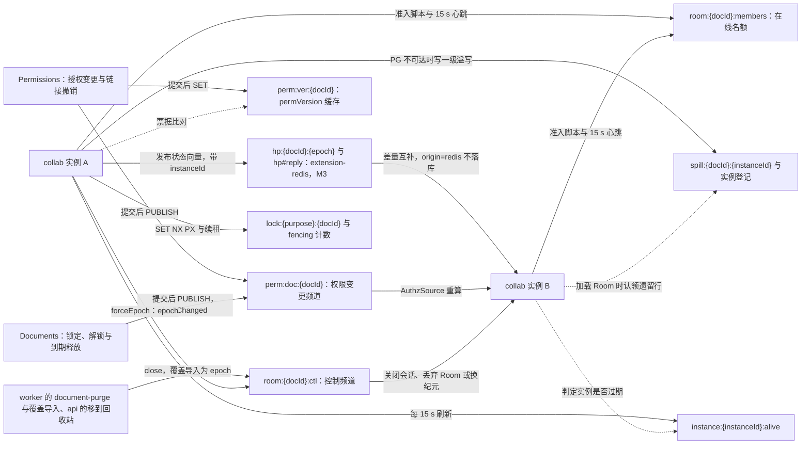
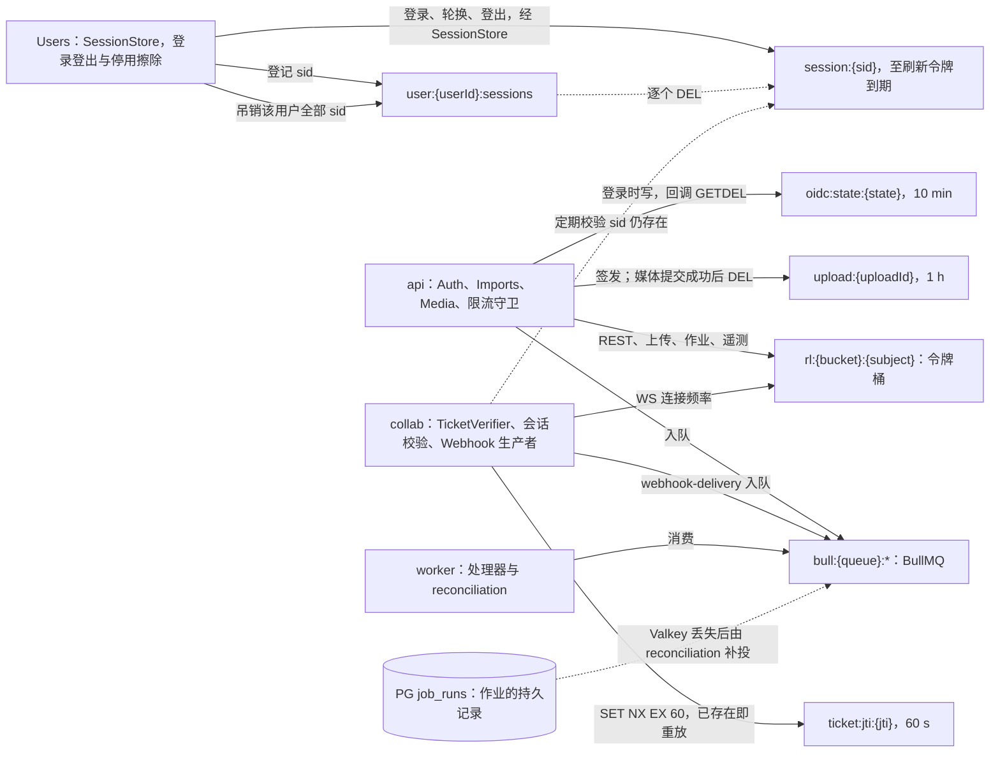
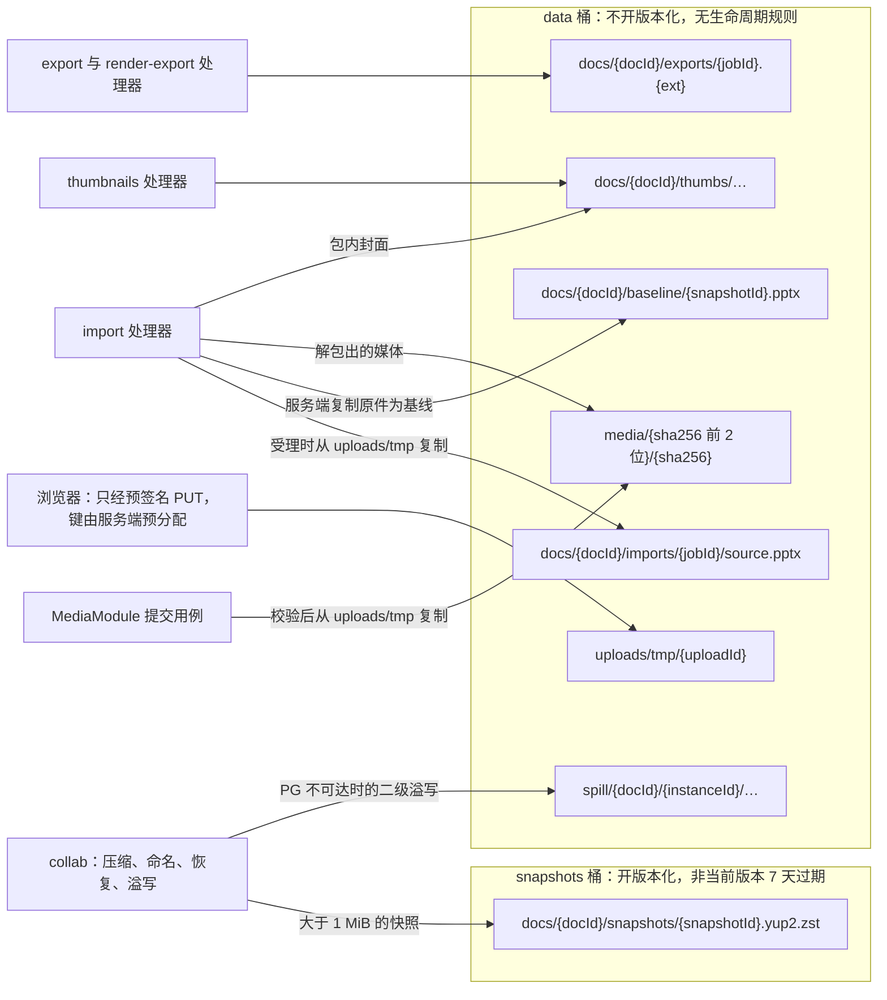
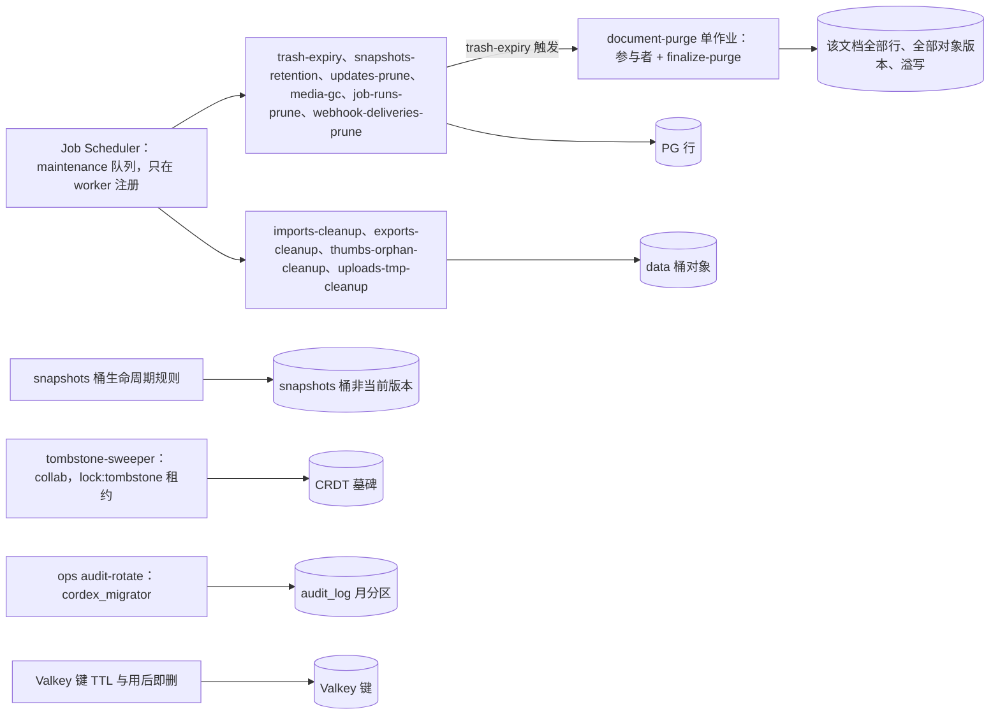
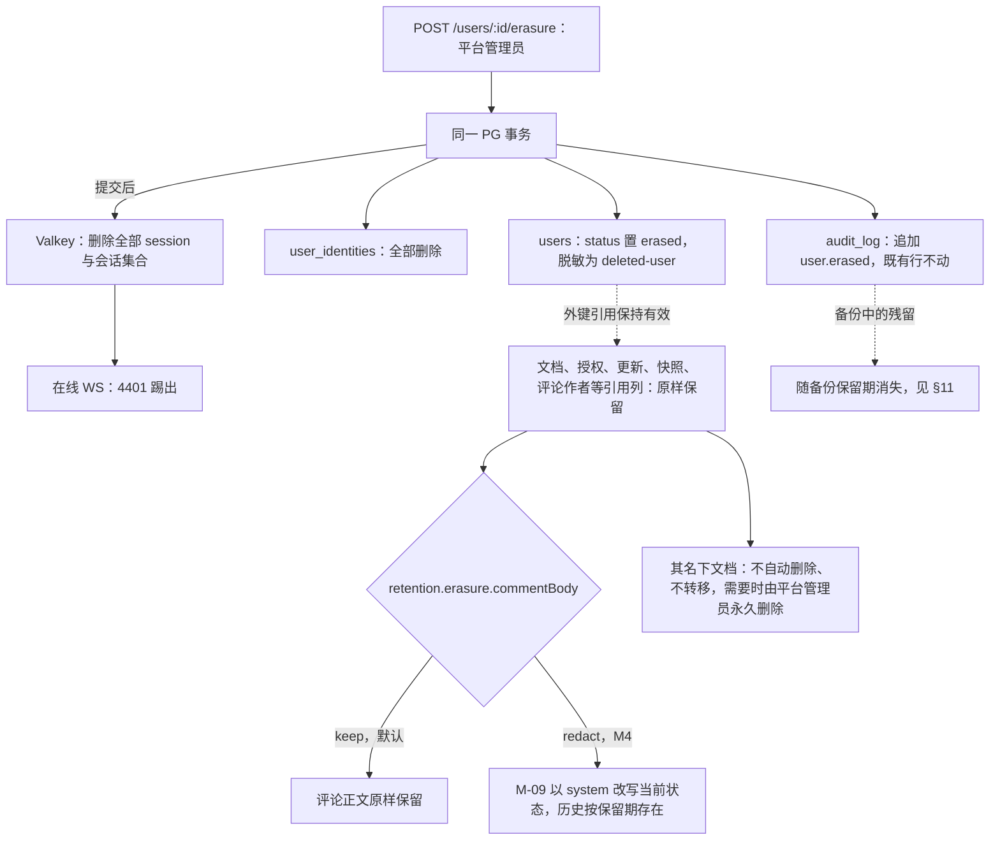

# 14 Valkey 键空间、对象存储布局与数据保留
> 状态：v0.1 | 负责：后端设计线 | 更新：2026-09-25；2026-09-25（§4.19）；2026-09-25（§4.19 N1）；2026-09-26（§4.20）；2026-09-26（§4.21：§3.1 登记 extension-redis 的频道 `hp:{docId}:{epoch}`、`hp#reply:{instanceId}` 与 redlock 锁键，`collab:doc:{docId}` 作废；§2 键名生成约束覆盖扩展前缀；§4 准入脚本改用 ioredis `defineCommand`）；2026-09-26（§4.21 复核：extension-redis 例外出处改指 ADR-0049 与 60/19 §14）；2026-10-01（§4.23 插件管理：§3.2 登记频道 plugins:ctl，keys.ts 新前缀 plugins:）；2026-10-03（§4.24：TA-4 §3.2 登记 `plugins:fail:{pluginId}:{yyyyMMddHH}`（按小时分桶 HyperLogLog，TTL 25 h，读时合并 24 桶）与 `plugins:lasterr:{pluginId}`；AL-7 队列八条、`upload` 增 `automation` 类、§6 与 §8.2 登记 `automation/{jobId}/` 前缀） | 依赖：[ADR-0039](../30-architecture/adr/0039-collab-server-hocuspocus.md)、[ADR-0022](../30-architecture/adr/0022-server-storage.md)、[ADR-0025](../30-architecture/adr/0025-update-persistence-and-compaction.md)、[ADR-0035](../30-architecture/adr/0035-gateway-horizontal-scaling.md)、[30/01 §2.2](../30-architecture/01-overview.md)（原 30/08 §6–§8）、[rulings §4.13 S-2 / §4.16 Q17 / §4.18 / §4.19](../00-charter/rulings-2026-09-14.md)、[08](./08-db-conventions-roles-rls-migrations.md)、[17](./17-deployment-and-config.md)

> 读者：写 Valkey 适配器、对象存储适配器、周期作业与永久删除编排的工程师；运维。
> 本文是三张登记表的唯一源：**Valkey 键与频道**（§3）、**对象键布局**（§6）、**数据保留总表**（§8）。其它文件（[02](./02-auth-chain.md) 的会话与票据、[05](./05-modules-collab-and-snapshots.md) 的房间与溢写、[06](./06-modules-jobs-import-export-thumbnails.md) 的上传与队列）只引用这里的模板，不自造名字；保留期的配置键与 [17 §5](./17-deployment-and-config.md) 逐项一致。

## 0. 本文拥有与引用

| 本文拥有 | 本文引用 |
|---|---|
| Valkey 部署要求、键前缀、键与频道模板、TTL、丢失后果 | 准入算法本体、溢写与回放机制：[05](./05-modules-collab-and-snapshots.md)；会话与票据语义：[02](./02-auth-chain.md) |
| 两个桶的规划、对象键模板、Content-Type 与 Cache-Control | 预签名与提交用例：[04](./04-modules-documents-storage-media.md)、[06](./06-modules-jobs-import-export-thumbnails.md)；路由：[15](./15-rest-api-catalog.md) |
| 数据保留总表（表、对象前缀、键、墓碑）与清理执行者 | 周期作业的频率、锁与失败处理：[06 §4](./06-modules-jobs-import-export-thumbnails.md)；永久删除编排：[04 §4](./04-modules-documents-storage-media.md) |
| GDPR 擦除的数据面、元素彻底删除的数据边界、备份残留 | 配置键全字段：[17 §5](./17-deployment-and-config.md)；测试执行：[70/07](../70-testing/07-backend-integration-and-api-e2e.md)、[70/08](../70-testing/08-deployment-and-environment-e2e.md) |

## 1. Valkey 定位与部署要求

Valkey 只做**易失协调**：扇出、权限变更通知、在线名额、租约锁、一级溢写、会话与一次性凭证、限流、BullMQ。一致性关键路径只有 PostgreSQL；Valkey 丢数据时每类键都有恢复路径（下表），不会丢已获 `ack{tier:'db'}` 的内容。依据：ADR-0022 决策表与「后果」；决策 VALKEY-DEPLOY（BullMQ 要求 + ADR-0022「易失协调，丢失可恢复」）。

**部署要求**（compose 默认值见 [17 §2](./17-deployment-and-config.md)）：

| 参数 | 值 | 理由 |
|---|---|---|
| `maxmemory-policy` | `noeviction` | BullMQ 硬性要求；淘汰会静默丢掉锁、会话与作业。内存用满时写命令报错，由 80% 水位告警提前发现（告警名见 [18](./18-observability-and-ops-endpoints.md)） |
| `appendonly` / `appendfsync` | `yes` / `everysec` | 重启后会话、锁计数、队列不丢，丢失窗口 ≤ 1 s |
| 协议基线 | Redis ≥ 7.2（Valkey 钉次版本） | 客户自带实现只要求 7.2 协议；**不使用** 7.4+ 才有的 `HEXPIRE` 家族与 Valkey 8.1 的条件 SET（决策 C-11）；M1–M3 为单主（可加副本与哨兵），不支持集群模式 |
| 启动自检 | 读 `INFO memory` 的 `maxmemory_policy` | 不是 `noeviction` 时 `/readyz` 标记降级并告警 |

**丢失后的恢复路径**：

| 键族 | 丢失后果 | 恢复 |
|---|---|---|
| 扇出与控制频道（含 M3 extension-redis 的 `hp:*` 频道） | 跨实例延迟；控制消息可能丢 | extension-redis 在 Valkey 恢复后任意一次变更即以状态向量补齐，客户端重连 step1 / step2 也能补齐；`purging` 由加入时查库兜底，epoch 由连接时比对兜底，停用与擦除由 5 s 会话复核关闭 WS（[02](./02-auth-chain.md) §9.5） |
| `perm:ver:*` | 票据比对缺缓存 | 回源 PG |
| `room:*:members` | 名额计数清零 | 各实例在一个心跳（15 s）内重新登记；期间名额可能短暂超发 |
| 租约锁与 fencing 计数 | 锁提前释放、令牌从 1 重来 | 持锁者提交前核对锁值；AOF 把窗口压到 ≤ 1 s |
| 一级溢写 | 已离开客户端的未落库更改丢失 | 在线客户端的这些更改从未得到 db ack，仍在其 pending 中，重连后重发 |
| `ticket:jti:*` | 票据重放窗口放宽到剩余寿命（≤ 60 s） | 票据仍绑定 `sid` 与 `exp` |
| `session:*`、`user:*:sessions` | 全体用户需重新登录（安全侧失败） | 重新登录 |
| `oidc:state:*`、`upload:*` | 进行中的登录 / 上传失败 | 用户重试；未提交对象由清理作业删除 |
| `rl:*` | 令牌桶重置，短时放宽 | 自动恢复 |
| BullMQ | 队列内作业丢失 | `reconciliation`（每 1 min）从 `job_runs` 补投未完成作业 |

## 2. 全局前缀与命名规则

- 全部键**与频道**都带前缀 `valkey.keyPrefix`（默认 `cordex:`）；BullMQ 的 `prefix` 取 `{keyPrefix}bull`。下文模板省略前缀。
- 段分隔用 `:`；占位符 `{docId}`、`{userId}` 等为小写 uuid 文本；`{instanceId}` 是 collab 实例启动时生成的随机 id（见 05）。
- 键名只能由两个文件生成：`@cordexjs/server-collab` 的 `redis-keys.ts`（`room:`、`lock:`、`spill:`、`instance:` 前缀，以及 extension-redis 的前缀 `hp`）与 `apps/server` 的 `keys.ts`（`perm:`、`ticket:`、`oidc:`、`session:`、`user:`、`upload:`、`rl:`、`plugins:`（2026-10-01））；文件路径登记在 40/09 与 40/12。其它代码不得拼接键名（§12）。**第三方扩展的键**（2026-09-26，rulings §4.21）：`@hocuspocus/extension-redis`（M3）按自己的规则由 `prefix` 派生频道与锁键，我们不能改它的拼接方式，因此只允许经 `redis-keys.ts` 导出的 `hpPrefix()`（= `{valkey.keyPrefix}hp`）配置它的 `prefix`，派生出的三个模板登记在 §3.1；装配代码不得另写前缀字面量。
- 作废的写法：`collab:doc:{docId}` 与分片写法 `collab:{shard}:doc:{docId}`（2026-09-26 起帧扇出由 extension-redis 承担，改 `hp:{docId}:{epoch}`，§3.1）、`room:{id}:clients`（改 `room:{docId}:members`）、`room:ctl:{doc}`（改 `room:{docId}:ctl`）、`collab:migrate:{doc}`（改 `lock:migrate:{docId}`）、`import:upload:{uploadId}`（改 `upload:{uploadId}`）、`RenderStateToken`（BE-04 取消）、任何按租户分段的键（T-0）。依据：决策 KEYS（40-modules/09 `redis-keys.ts` 为代码唯一落点；schema-inventory C-12、G-01~G-03、G-11 的建议）。

## 3. 键与频道清单（唯一登记表）

依据：决策 KEYS。「所属模块」一列同时指出代码落点（`redis-keys.ts` 或 `keys.ts`）。

### 3.1 协同类（`redis-keys.ts`）

| 模板 | 类型 | TTL | 写方 | 读方 | 所属模块 |
|---|---|---|---|---|---|
| `hp:{docId}:{epoch}`（M3，2026-09-26） | pub/sub 频道（extension-redis 的文档频道；文档名即 `{docId}:{epoch}`） | — | 持有该文档的每个 collab 实例的 extension-redis：本地变更后发布状态向量（同一事件循环合并一次）、awareness 更新、服务端 `broadcastStateless` 事件；消息体前缀带发布方 `instanceId` | 同文档的其它 collab 实例（自己发布的消息按 `instanceId` 忽略） | Collab |
| `hp#reply:{instanceId}`（M3） | pub/sub 频道（每实例一个回复频道；用 `#` 与文档频道分隔，不会与名为 `reply:…` 的文档频道冲突） | — | 对端实例回送差量（SyncReply step2）与反向请求 | 该实例自己 | Collab |
| `hp:{docId}:{epoch}:lock`（M3） | string（redlock，`SET NX PX`） | `PX lockTimeout`（1000 ms），取不到即跳过、不重试 | extension-redis 的 `onStoreDocument` 存储锁 | 同左 | Collab |
| `room:{docId}:members` | hash：field = `instanceId`，value = JSON `{owners:[userId], editors:[userId], viewers:[userId], ts}`（`owners` 只计在线人数、不占名额） | 整键 `PEXPIRE 120 s`，每次写入刷新；字段 `ts` 超过 60 s 视为失效 | collab `RedisMembershipRegistry`（准入脚本；离开与每 15 s 心跳按文档串行 `HSET` 本实例字段） | 准入脚本、`CONTROL.room` 在线人数聚合 | Collab |
| `room:{docId}:ctl` | pub/sub 频道 | — | worker 的 document-purge（`close`，`reason:'purge'`）、api 的 `TrashDocumentUseCase`（`close`，`reason:'trashed'`，提交后尽力而为）、collab 的 `forceEpoch`（`epoch`，`reason:'admin'`）、worker 的导入处理器（覆盖导入提交后发 `epoch`，`reason:'import'`，rulings §4.19 N1，[06](./06-modules-jobs-import-export-thumbnails.md) §6.5；不新增 worker → collab 通道） | 全部 collab 实例 | Collab |
| `lock:{purpose}:{docId}` | string，值 `{instanceId}:{fencingToken}` | `PX 30 s`，持有者每 10 s 续租 | `LeaseLock`（collab；`purpose` ∈ `compact`、`migrate`、`tombstone`、`spill`、`epoch`） | 同左 | Collab |
| `lock:fence:{purpose}:{docId}` | string 计数（`INCR`） | 无 | `LeaseLock` 取锁时递增 | 持锁者提交前核对 | Collab |
| `spill:{docId}:{instanceId}` | list，按 `spill.tier1MaxBytesPerDoc` 有界 | 无；回放成功后 `DEL` | collab `RedisSpillStore`（一级溢写） | 回放（本实例，或持 `lock:spill:{docId}` 的认领者） | Collab |
| `spill:{docId}:instances` | set of `instanceId` | 无；清空即 `DEL` | `RedisSpillStore` | 加载 Room 时的遗留溢写认领 | Collab |
| `instance:{instanceId}:alive` | string | `PX 60 s`，每 15 s 刷新 | 每个 collab 实例 | 认领判定（实例是否已过期） | Collab |

自有频道的载荷（server-collab 内部类型，不进 `@cordexjs/protocol`）与 extension-redis 频道的取舍：
- **extension-redis 取代 `collab:doc:{docId}`**（2026-09-26，rulings §4.21 H:Q2，ADR-0035 决策 2 修订）：原设计由自研 `RedisFanoutBus` 把通过门禁的帧原样发布到 `collab:doc:{docId}`（`{instanceId, frame}`）；改用 Hocuspocus 后帧扇出由 extension-redis 承担——它发布的是状态向量、对端回差量（3 跳，回包含全量删除集，O(文档)），可自愈、也转发 awareness 与服务端 Stateless 事件，Valkey 8.1 实测跨实例 2.6–7.1 ms。取舍：它每次变更让每个对端付 O(文档) 成本，所以反代按 `documentId` 一致性哈希是默认配置（ADR-0035 决策 7），常态只有一个实例订阅某文档频道；代价是带入 ioredis 5.6.x 与 package.json 标 UNLICENSED 的 redlock（例外登记见 ADR-0049 EX-01、EX-02 与 [60/19 §14](19-reuse-and-dependency-catalog.md#14-传递依赖许可与例外登记)）。`collab:doc:{docId}` 与其分片写法作废；`RedisFanoutBus` 只保留控制频道 `room:{docId}:ctl`。
- **extension-redis 不承载控制面**：它的 `BroadcastStateless` 只到对端实例的客户端、不触发对端服务端钩子，因此权限（`perm:doc:{docId}`）、关闭与换纪元（`room:{docId}:ctl`）、名额（`room:{docId}:members`）、租约（`lock:*`）、溢写（`spill:*`）全部照旧，与 extension-redis 的 `hp` 前缀互不重叠。extension-redis 的 redlock 只服务它自己的存储锁（本项目不用 `onStoreDocument` 持久化，该锁只让压缩节拍在他实例持锁时落空），不复用为 `LeaseLock`（它不带 fencing）。
- **客户端**：extension-redis 以 `createClient` 注入 apps/server 的 ioredis 6.0.x 客户端（每实例一对 pub / sub 连接），不自建连接（ADR-0039 版本与许可）。
- `room:{docId}:ctl`：`{op:'close'|'epoch', docId, reason, epoch?, fromInstanceId}`；`epoch` 触发 4428（[16](./16-ws-protocol-server-view.md)）。不设按用户踢人的操作：停用、擦除、登出按 [02](./02-auth-chain.md) §9.5 的会话复核在 ≤ 5 s 内以 4401 关闭 WS（决策 SESSION 的实现细化，效果不变），不需要按房间点名。

### 3.2 鉴权、上传、限流与作业类（`keys.ts`）

| 模板 | 类型 | TTL | 写方 | 读方 | 所属模块 |
|---|---|---|---|---|---|
| `perm:doc:{docId}` | pub/sub 频道，载荷 `{docId, permVersion?, lockChanged?}` | — | Permissions 的 `PermChangePublisher`（授权或链接变更提交后，带 `permVersion`）；Documents 的 `Lock` / `Unlock` / `ReleaseExpiredLocks` 用例（提交后，带 `lockChanged: true`，[04](./04-modules-documents-storage-media.md) §2） | collab 的 AuthzSource（≤ 1 s 重算会话角色；`lockChanged` 时重读 `documents.status` 并推 `room{locked}`，[16](./16-ws-protocol-server-view.md) §8） | Permissions、Documents |
| `plugins:ctl`（M3，2026-10-01，rulings §4.23） | pub/sub 频道，载荷 `{type:'policy_changed', policy}`（`policy` 为插件集指纹第二段） | — | Plugins 的 `UpdatePluginPoliciesUseCase` / `UpdatePluginConfigUseCase`（提交后，尽力而为，失败只记指标 `cordex_plugin_policy_notify_total{result}`） | 全部 collab 实例：向本实例 `policy` 不符的连接推 Stateless `plugins`（[16](./16-ws-protocol-server-view.md) §12）；丢消息由 collab 每 `plugins.policyPollSeconds`（60 s）读 `plugin_policies` 重算兜底 | Plugins |
| `plugins:fail:{pluginId}:{yyyyMMddHH}`（M3，2026-10-03，rulings §4.24 TA-4） | HyperLogLog，元素为会话 id（`ClientErrorReport.sessionId`；缺省时取登录会话 `sid` 的 HMAC，盐同审计） | 25 h：每次 `PFADD` 后 `EXPIRE … 90000 NX`，只在首次写入时设、之后不续期（桶按 UTC 小时命名） | ClientTelemetryModule：`POST /telemetry/errors` 中带插件 `id` 的上报（`plugin` 只限声明文件与镜像内置清单中的 cordis 插件 id），对当前小时桶 `PFADD`（[15 §3.14](./15-rest-api-catalog.md)） | PluginsModule 的 `GetPluginCatalogUseCase`：对最近 24 个小时桶一次 `PFCOUNT k1 … k24`，读时合并、按会话去重，得到「近 24 h 失败会话数」（[03 §12.2](./03-modules-identity-and-access.md)）；多实例共享、进程重启不丢 | ClientTelemetry、Plugins |
| `plugins:lasterr:{pluginId}`（M3，2026-10-03） | string，最近一次上报的错误码 | `EX 86400`，每次写入重置 | 同上（与 `PFADD` 同一次上报） | 同上（管理员清单的 `lastErrorCode`） | ClientTelemetry、Plugins |
| `perm:ver:{docId}` | string，十进制 permVersion | 无；缺失回源 PG | Permissions（提交后先 `SET` 再 `PUBLISH`，失败只记指标） | collab TicketVerifier | Permissions |
| `ticket:jti:{jti}` | string，`SET NX` | `EX 60` | collab TicketVerifier | 同左（已存在即判重放，4401） | Auth |
| `oidc:state:{state}` | string，JSON `{codeVerifier, nonce, next, mode, bindHash, createdAt}`（字段语义见 [02](./02-auth-chain.md) §2） | `EX 600`；回调时 `GETDEL` | `GET /auth/oidc/login`（api） | OIDC 回调（api） | Auth |
| `session:{sid}` | hash，字段 `userId`、`refreshHash`、`prevRefreshHash`、`rotatedAt`、`createdAt`、`absExpiresAt`、可选 `idTokenHint`（值形状以 [02](./02-auth-chain.md) §4.1 为准） | min(`auth.session.refreshTtlSec`, `absExpiresAt − now`)，每次轮换重置 | UsersModule 的 `SessionStore`（AuthModule 在登录、刷新轮换、登出时经它写与删，[02](./02-auth-chain.md) §4） | SessionGuard（进程内缓存 ≤ `auth.session.revocationCacheMs`）、collab 会话复核 | Auth |
| `user:{userId}:sessions` | set of `sid` | `auth.session.absoluteTtlSec`（30 天），每次 `SADD` 重置 | UsersModule 的 `SessionStore` | 停用 / 擦除时吊销全部会话 | Users |
| `upload:{uploadId}` | string，JSON：公共字段 `{kind:'import'\|'media'\|'automation', userId, docId, byteSize, sha256}`（`automation` 无 `docId`，2026-10-03，[06](./06-modules-jobs-import-export-thumbnails.md) §7.4）；`import` 另带 `{jobId, targetExists, fileName, multipartUploadId?}`（[06](./06-modules-jobs-import-export-thumbnails.md) §6.1）；两种 `kind` 的直传落点都是隔离区 `uploads/tmp/{uploadId}`（[04](./04-modules-documents-storage-media.md) §7.2、06 §6.1） | `EX 3600`。`media`：提交成功后 `DEL`，提交失败可重试；`import`：受理后不删（不 `GETDEL`），绑定唯一 `jobId` 使重放拿回同一作业，到期自然过期 | `POST /imports/uploads`、`POST /documents/:id/media/presign`（api） | `POST /imports`、`POST /documents/:id/media/commit`（校验 `userId` 归属，不符 403） | ImportExport、Media |
| `rl:{bucket}:{subject}` | hash `{tokens, ts}`（令牌桶） | `PEXPIRE` = 桶从空到满的时间 | 限流守卫、WS 网关、ClientTelemetry | 同左 | common rate-limit |
| `bull:{queue}:*` | BullMQ 内部结构 | 完成的作业保留 1 h / 至多 1000 条；失败的保留 7 天 | 各生产者 | worker 处理器 | Jobs（`queues.ts`） |

`rl` 令牌桶的 `bucket` 取 [15 §8](./15-rest-api-catalog.md) 的限流档名，速率与突发的配置键是 [17 §5.8](./17-deployment-and-config.md) 的 `limits.rate.<档>.*`：`default`、`upload`、`job`、`ticket`、`search`、`telemetryErrors`、`telemetryOtlp` 按用户（`subject = u:{userId}`）；`public`、`csp`、`ws-connect` 按来源 IP（`subject = ip:{ipHash}`，IP 取 `clientIp()`、按 `http.trustProxy` 跳数自右向左取，用审计盐做 HMAC，不存明文 IP；[15 §8](./15-rest-api-catalog.md)）。`ws-connect` 是先扣后退的桶：WS 升级前取 1 个令牌，票据验签通过后退还 1 个（不超过容量），所以实际只约束未通过认证的升级（[16 §1](./16-ws-protocol-server-view.md)，rulings §4.20 BE-01+TX-03）；每用户单实例并发上限是 collab 进程内计数，不占 Valkey 键。分享链接的外部访问审计不按天去重、不占 Valkey 键（[02](./02-auth-chain.md) §7.5：每次叠加都写，审计缓冲 1 s 合并）。BullMQ 队列为 `import`、`export`、`thumbnails`、`render-export`、`automation`（2026-10-03，rulings §4.24 AL-7）、`maintenance`、`webhook-delivery`、`document-purge` 八条（队列表见 [06 §1](./06-modules-jobs-import-export-thumbnails.md)；不设 `compaction`，压缩只在 collab 实例内执行）。

**图 3-1 协同类键与使用方**

怎么读：左右两个 collab 实例对称，图中每类边只画一侧；实线是写或发布，虚线是读。所有键都在 Valkey 里、都带 `valkey.keyPrefix`；PG 才是一致性来源，这些键丢了都能按 §1 的路径恢复。2026-09-26 起扇出频道是 M3 的 extension-redis（原「collab:doc:{docId}」作废），控制、权限、名额、租约、溢写的键不变。
依据：决策 KEYS、C-11；ADR-0035 决策 2–5、9；ADR-0039 决策 7；rulings §4.18 CO-16、§4.21。

**图 3-2 鉴权、上传、限流与作业类键与使用方**

怎么读：上半部分是会话与一次性凭证，下半部分是限流与队列；实线是写，虚线是读或补偿路径。会话与票据的语义归 [02](./02-auth-chain.md)，本图只说明键被谁读写；作业的持久事实在 PG 的 `job_runs`，BullMQ 只是投递通道。
依据：决策 KEYS、SESSION、INC-18、INC-21、VALKEY-DEPLOY；rulings §4.18 BE-10。

## 4. 在线名额结构与准入脚本的键访问约定

依据：决策 C-11（ADR-0022「客户自带实现只要求 Redis ≥ 7.2 协议」，`HEXPIRE` 需 7.4+ / Valkey 9，故不用；rulings §4.15 Q5「名额按用户计」；ADR-0035）。准入算法本体（先按 LRU 回收空闲房间、按权重判定实例内存预算）归 [05 §4](./05-modules-collab-and-snapshots.md)，本节只定键的形状与访问约定。

- **值的形状**：`room:{docId}:members` 的每个字段是一个 collab 实例，值为 `{owners:[userId…], editors:[userId…], viewers:[userId…], ts}`（`ts` 为毫秒时间戳）。owner 登记在 `owners`，只计入在线人数、不占编辑者名额；commenter 登记在 `viewers`；`CONTROL.room` 的在线人数 = 三个列表跨实例去重后的用户数。
- **原子性**：准入与登记由**同一个 Lua 脚本**（`admit.lua`）完成，只访问一个键：`KEYS[1] = room:{docId}:members`。脚本文本、ARGV 顺序与判定分支以 [05 §4.2](./05-modules-collab-and-snapshots.md) 为准；本节只约束：剔除 `ts` 超过 60 s 的字段、跨实例按 `userId` 去重计数、判定与改写本实例字段在同一次调用内完成、满员时返回拒绝由调用方回 4503。
- **离开与心跳**：本实例对自己字段的其余写入（最后一个连接断开时移除该用户、每 15 s 刷新 `ts` 并 `PEXPIRE` 整键 120 s）经 `RedisMembershipRegistry` 内按文档串行的队列以普通 `HSET` 覆盖，不需要脚本；实例崩溃时，其字段在 60 s 后被下一次准入脚本剔除。
- 脚本经 ioredis 的 `defineCommand` 注册为自定义命令（内部走 `EVALSHA`，脚本缓存丢失时自动回退 `EVAL`；2026-09-26，rulings §4.21 R-d-38；原「`SCRIPT LOAD` + `EVALSHA` 调用」由客户端库代劳），脚本文本随 `redis-keys.ts` 同目录登记；上限参数取配置 `collab.room.maxEditors` / `collab.room.maxViewers`（[17 §5](./17-deployment-and-config.md)）。

## 5. 对象存储桶规划

依据：决策 C-08/OBJ（ADR-0022 意图「只有快照需要历史版本」+ S3 版本化是**桶级**语义，「只对 `snapshots/` 前缀开版本化」不可实现，属机械修正 + rulings §4.18 BE-19 周期作业挂 maintenance + CO-16 / BE-15 溢写键含 docId）。ADR-0022 的对应修订记录由总编排追加。

| | data 桶 | snapshots 桶 |
|---|---|---|
| 配置键（默认名） | `storage.s3.buckets.data`（`cordex-data`） | `storage.s3.buckets.snapshots`（`cordex-snapshots`） |
| 版本化 | 不开 | **开**（SV-09 备份依赖，SeaweedFS 默认栈同样必须开） |
| 生命周期规则 | **不用**：带 TTL 的对象一律由 maintenance 周期作业清理（前缀型规则在各实现上行为不一，决策 MECH-C 中 C-09） | 只有一条：非当前版本 `storage.s3.snapshotsNoncurrentDays`（默认 7）天后过期，并清理过期删除标记 |
| 浏览器访问 | 预签名 PUT 只有一类键：隔离区 `uploads/tmp/{uploadId}`（媒体与导入原件，由服务端预分配；导入原件受理时服务端复制到 `docs/{docId}/imports/{jobId}/source.pptx`，UPLOAD-QUARANTINE）；预签名 GET（媒体、导出结果，均以 JSON 返回 URL、每次现签） | **无**：最新快照由服务端流式代理（决策 MECH-INC 中 INC-14），从不签发该桶的预签名 URL |
| CORS | `AllowedOrigins` = `security.allowedOrigins`；方法 `PUT, GET, HEAD`；请求头 `Content-Type, Content-MD5, x-amz-*`；`ExposeHeaders: ETag`（分片上传收尾要读）；`MaxAgeSeconds 600` | 不配置 |

- **两个端点**（rulings §4.18 BE-01）：服务端自身读写走内网 `storage.s3.endpoint`；预签名一律按 `storage.s3.publicEndpoint`（默认栈为 `https://s3.<域名>`，web 容器保持 Host 头转发，[17 §3](./17-deployment-and-config.md)）生成。
- **预签名有效期**：PUT 默认 600 s（`storage.s3.presign.putTtlSec`），导入原件的 PUT 等于 `uploadId` 寿命 1 h（rulings §4.18 BE-10）；GET 3600 s（`storage.s3.presign.getTtlSec`）；导出下载与媒体读取的 URL 每次请求现签（决策 MECH-C 中 C-31、MECH-INC 中 INC-40）。
- **凭据**：一组服务端凭据，只对这两个桶有读写与版本操作权限；renderer 不持有任何存储凭据。
- **初始化**：`cordex-ops storage:init` 幂等地建桶、开版本化、写生命周期规则与 CORS，并读回核对；所用对象存储不支持非当前版本过期规则时直接失败（不静默降级）。

**图 5-1 两个桶的对象前缀与写方**

怎么读：两个方框是两个桶，框内是键前缀；左侧是写方，箭头是写入方向。浏览器只能写服务端预先分配好键的隔离区对象，其余对象（含导入原件，受理时由服务端从隔离区复制）都由服务端进程写；文档相关的对象都在 `docs/{docId}/` 下，这是永久删除按前缀清理的依据（§7）。
依据：决策 C-08/OBJ、C-07、INC-21、UPLOAD-QUARANTINE（BE-10 的细化，[06](./06-modules-jobs-import-export-thumbnails.md) §6.1）；rulings §4.18 BE-10、BE-15、CO-16，§4.19 D-M2-CONTENT（不设 pptx 内容版本对象）。

## 6. 对象键布局表（唯一登记表）

`{ext}` 取导出格式（`pptx`、`pdf`、`png`、`jpeg`，多页图片打包为 `zip`，格式清单见 [06 §7](./06-modules-jobs-import-export-thumbnails.md)）；保留期的配置键见 §8.2。

| 桶 | 键模板 | 写方 | 可变性 | 保留 | 清理方式 | Content-Type | Cache-Control |
|---|---|---|---|---|---|---|---|
| snapshots | `docs/{docId}/snapshots/{snapshotId}.yup2.zst` | `PgSnapshotStore`（system；超过 1 MiB 的快照） | 不可变；版本化 | 随快照行 | 快照行被删时删对象（留下删除标记），非当前版本由生命周期规则过期；永久删除按版本全删 | `application/octet-stream`（zstd 压缩的 Yjs v2 update） | `private, no-store` |
| data | `docs/{docId}/baseline/{snapshotId}.pptx` | import 处理器（服务端复制原件，决策 C-07；创建副本复制源基线） | 不可变 | 随其 import 快照行；每文档最新一个 import 快照的基线随文档保留 | `snapshots-retention` 删 import 快照行时一并删；永久删除 | `application/vnd.openxmlformats-officedocument.presentationml.presentation` | `private, no-store` |
| data | `docs/{docId}/imports/{jobId}/source.pptx` | 导入受理用例（从 `uploads/tmp/{uploadId}` 服务端复制，[06](./06-modules-jobs-import-export-thumbnails.md) §6.1） | 不可变 | 30 天；取消导入立即删 | `imports-cleanup`；取消用例；永久删除 | 同上（提交时重新校验魔数） | `private, no-store` |
| data | `docs/{docId}/exports/{jobId}.{ext}` | export、render-export 处理器；文档来源的自动化作业（`AutomationProcessor`，2026-10-03） | 不可变 | 24 h | `exports-cleanup`；永久删除 | 按格式 | `private, no-store`；下载 URL 带 `Content-Disposition: attachment` |
| data | `docs/{docId}/thumbs/{slideId}/{contentHash}.webp`，1280 px 变体为 `…/{contentHash}@1280.webp` | thumbnails 处理器 | 不可变（按页内容哈希寻址） | 被新哈希取代后成孤儿 | `thumbs-orphan-cleanup`（未被 `thumbnails.storage_key` 引用且超过 24 h）；永久删除 | `image/webp` | `private, max-age=31536000, immutable` |
| data | `docs/{docId}/thumbs/__cover/embedded.jpg` | import 处理器（包内 `docProps/thumbnail.jpeg` 原字节，只做头校验） | 重新导入时覆盖 | 随文档；封面行被服务端渲染结果取代后成孤儿 | `thumbs-orphan-cleanup`（[06 §4](./06-modules-jobs-import-export-thumbnails.md)）；参与者 thumbnails 删行，`finalize-purge` 删对象 | `image/jpeg` | `private, no-cache` |
| data | `media/{sha256 前 2 位}/{sha256}` | MediaModule 提交（从 `uploads/tmp/` 服务端复制）、import 处理器 | 不可变（内容寻址，部署级去重） | 无引用满 30 天 | `media-gc` | 嗅探得到的 MIME，不信任客户端声明 | `private, max-age=31536000, immutable` |
| data | `automation/{jobId}/source.{ext}`、`automation/{jobId}/output.{ext}`、`automation/{jobId}/report.json`（2026-10-03，rulings §4.24 AL-7） | 自动化受理用例（从 `uploads/tmp/{uploadId}` 服务端复制原件）、`AutomationProcessor`（产物与报告；上传来源，无文档作用域，[06 §7.4](./06-modules-jobs-import-export-thumbnails.md)） | 不可变 | `source` 作业终态即删；产物与报告 24 h | 处理器；`exports-cleanup` | 按格式；`report.json` 为 `application/json` | `private, no-store`；下载 URL 带 `Content-Disposition: attachment` |
| data | `uploads/tmp/{uploadId}` | 浏览器预签名 PUT（媒体、导入原件、自动化原件） | 临时 | 24 h；媒体提交成功或导入受理后即删 | 提交用例；`uploads-tmp-cleanup` | 客户端声明（提交时重新嗅探） | — |
| data | `spill/{docId}/{instanceId}/{from}-{to}.bin` | collab `BlobSpillStore`（二级溢写，`{from}-{to}` 为实例内本地计数区间） | 临时 | 回放成功即删；未回放的保留到下次加载该文档 | 回放用例；`finalize-purge` 按 `spill/{docId}/` 删除 | `application/octet-stream` | — |

浏览器可 PUT 的键只有 `uploads/tmp/{uploadId}` 一类（UPLOAD-QUARANTINE 定稿，rulings §4.18 BE-10 的细化：对象键仍由服务端预分配、客户端从不提交任意键；只申请不提交的对象由 `uploads-tmp-cleanup` 清理，不会落进 `docs/{docId}/`）。rulings §4.19 D-M2-CONTENT 裁定 M2 起内容以协同快照为唯一事实源，不设 pptx 内容版本对象。

## 7. 永久删除覆盖

依据：rulings §4.18 BE-15、CO-16；决策 C-08/OBJ、C-25。编排与参与者顺序归 [04 §4](./04-modules-documents-storage-media.md)，本节只列 `finalize-purge` 必须清到的数据面：

1. **两个桶**：对 data 桶与 snapshots 桶分别以前缀 `docs/{docId}/` 调 `ListObjectVersions`，把每个 `(key, versionId)`（含删除标记）按每批 ≤ 1000 调 `DeleteObjects`；只删当前版本不算擦除。
2. **溢写**：data 桶前缀 `spill/{docId}/` 全删；Valkey 删除 `spill:{docId}:instances` 中每个实例的 `spill:{docId}:{instanceId}` 与集合本身（由 finalize-purge 执行，collab 参与者只依赖 Pg 存储，rulings §4.18 BE-15）。文档正在被删除，未回放的溢写直接丢弃。
3. **其它键**：删除 `perm:ver:{docId}`；`room:{docId}:members` 与 `lock:*:{docId}` 按 TTL 自然过期（≤ 120 s）。
4. **不在范围内**：`media/` 不随单个文档删除——参与者 media 删掉 `document_media` 关联后，`media_blobs.unreferenced_since` 起算，30 天后由 `media-gc` 删除（其它文档仍引用则不删）；审计行保留。
5. 收尾可重复执行：第二次执行时列举结果为空即视为完成，再删 `documents` 行并写审计（action 名以 [07](./07-modules-comments-webhooks-audit.md) 的登记表为准）。

## 8. 数据保留总表（唯一源）

依据：决策 RETENTION（rulings §4.16 Q17「默认值不变、全部可配」+ §4.18 BE-19 + schema-inventory G-05 / G-15）、rulings §4.19 C-06、决策 C-07、C-24、C-25。配置键与 [17 §5](./17-deployment-and-config.md) 逐项一致（§12 RT-02 机械核对）；执行者一列写「清理动作 → 运行在哪个角色」。

### 8.1 PostgreSQL 表

| 表 | 默认保留 | 配置键 | 清理机制 → 执行者 |
|---|---|---|---|
| `users` | 永久；擦除为原地脱敏（§9） | — | 擦除用例 → api |
| `user_identities` | 随用户；擦除时全部删除 | — | 擦除用例 → api |
| `documents` | 活动文档永久；进回收站后 30 天永久删除；也可随时「永久删除文档」 | `retention.trashDays` | `trash-expiry` → schedule-purge → document-purge 单作业 → worker |
| `document_user_marks` | 随文档；两列皆空即删行 | — | 用例内删除 → api；参与者 user-marks → worker |
| `document_updates` | 只删「`seq` ≤ 最新 auto 快照的 `seq_upto`」且早于 7 天的行 | `retention.updatesDays` | `updates-prune`、参与者 collab → worker |
| `document_snapshots`（auto） | 30 天内全留；之后每天只留当天最后一个，保留到 365 天（0 = 永久） | `retention.autoSnapshotDays`、`retention.autoSnapshotDailyDays` | `snapshots-retention` → worker |
| `document_snapshots`（named） | 永久；每文档至多 200 个（超出时拒绝新建） | `quota.namedSnapshotsPerDoc` | 只随永久删除 → worker |
| `document_snapshots`（import / migration / restore / epoch） | 按 auto 口径；但**每文档最新一个 import 快照**（导出基线的锚点）与 `documents.latest_snapshot_id` 所指快照永不清理；被删 import 快照的 `baseline/` 对象一并删除 | 同 auto | `snapshots-retention` → worker |
| `media_blobs` | 无任何 `document_media` 关联满 30 天删除 | `retention.mediaUnreferencedDays` | `media-gc` → worker |
| `document_media` | 除受保护的最新 import 快照外、其余保留快照都晚于 `detached_at`，且关联晚于该 import 快照（`first_seen_seq` 大于其 `seq_upto`）时删除；永久删除 | — | `snapshots-retention`、参与者 media → worker（[04](./04-modules-documents-storage-media.md) §7.4） |
| `permissions`、`document_perm_versions` | 随文档 | — | 参与者 permissions → worker |
| `share_links` | 撤销或过期的行保留到文档永久删除 | — | 参与者 share-links → worker |
| `comments` | 随文档；擦除后作者显示 deleted-user，正文按策略 | `retention.erasure.commentBody` | 参与者 comments → worker；`redact`（M4）→ collab |
| `thumbnails` | 每页一行、覆盖写；随文档 | — | 参与者 thumbnails → worker |
| `job_runs` | 终态行 90 天；未结束的行不删 | `retention.jobRunsDays` | `job-runs-prune` → worker |
| `audit_log` | 365 天，按整月删除分区 | `retention.auditDays` | ops `audit-rotate`（`DETACH` + `DROP`）→ ops 作业（`cordex_migrator`） |
| `webhook_subscriptions` | 直到平台管理员删除 | — | 用例 → api |
| `webhook_deliveries` | 终态行（`succeeded`、`failed`、`dead-lettered`）90 天 | `retention.webhookDeliveriesDays` | `webhook-deliveries-prune` → worker |
| `cordex_schema_migrations` | 永久 | — | — |

C-06 已由 rulings §4.19 裁定：auto 快照 30 天内全量，之后每天保留最后一个，保留至 `retention.autoSnapshotDailyDays`（默认 365，0 = 永久）；named 永久且每文档上限 200；import / migration / restore / epoch 事件快照按 auto 口径。
「最新 import 快照不清理」是本文补的边界：C-07 要求基线随文档保留、C-06 又让 import 快照按 auto 口径稀疏，二者同时成立只能保留最新的那一个 import 快照（更早的 import 快照连同其基线对象照常清理）；与 [11](./11-ddl-collab-updates-and-snapshots.md) §8 的 e7、[70/07](../70-testing/07-backend-integration-and-api-e2e.md) 的保留断言同一口径。

### 8.2 对象前缀

| 桶 / 前缀 | 默认保留 | 配置键 | 清理机制 → 执行者 |
|---|---|---|---|
| snapshots `docs/{docId}/snapshots/` | 随快照行；删除后的非当前版本再留 7 天 | `storage.s3.snapshotsNoncurrentDays` | `snapshots-retention` 删当前版本 → worker；非当前版本 → 桶生命周期规则 |
| data `docs/{docId}/baseline/` | 随其 import 快照行（每文档最新一个 import 快照的基线随文档） | — | `snapshots-retention` → worker |
| data `docs/{docId}/imports/` | 30 天 | `retention.importOriginalDays` | `imports-cleanup` → worker；取消导入 → api |
| data `docs/{docId}/exports/` | 24 h | `retention.exportHours` | `exports-cleanup` → worker |
| data `automation/{jobId}/`（2026-10-03） | 原件作业终态即删；产物与报告 24 h | `retention.exportHours` | 处理器；`exports-cleanup` → worker |
| data `docs/{docId}/thumbs/` | 当前哈希的对象随文档；孤儿 24 h | —（宽限 24 h 固定） | `thumbs-orphan-cleanup` → worker |
| data `media/` | 无引用满 30 天 | `retention.mediaUnreferencedDays` | `media-gc` → worker |
| data `uploads/tmp/` | 24 h | `retention.uploadTmpHours` | `uploads-tmp-cleanup` → worker |
| data `spill/{docId}/` | 回放后即删；未回放的留到下次加载或永久删除 | — | 回放 → collab；`finalize-purge` → worker |
| 以上全部 `docs/{docId}/` 与 `spill/{docId}/` | 永久删除时立即清除全部版本 | — | `finalize-purge` → worker |

### 8.3 Valkey 键

全部靠键 TTL 或「用后即删」，没有周期作业（TTL 与写方见 §3）：`ticket:jti` 60 s；`oidc:state` 10 min（回调 GETDEL）；`upload` 1 h（媒体提交成功后 DEL，导入到期自然过期）；`session` 至刷新窗口或绝对封顶先到者、`user:*:sessions` 30 天（登出、停用、擦除时立即 DEL）；`room:*:members` 120 s；`lock:*` 30 s；`instance:*:alive` 60 s；`rl:*` 到桶满；`plugins:fail:*` 25 h、`plugins:lasterr:*` 24 h；`perm:ver`、`lock:fence:*` 无 TTL（永久删除时删 `perm:ver`）；`spill:*` 回放后 DEL；BullMQ 完成作业 1 h / 1000 条、失败作业 7 天。

### 8.4 CRDT 内的软删除墓碑

| 数据 | 默认 | 配置键 | 清理机制 → 执行者 |
|---|---|---|---|
| 元素墓碑（软删除） | 24 h 后硬删除 | `tombstone.ttlHours` | `tombstone-sweeper`（`lock:tombstone:{docId}` 租约单写者，`system('maintenance')`；未打开的文档在下次加载时顺带执行）→ collab。它是应用进程内唯一不走 Job Scheduler 的周期清理（rulings §4.18 BE-19）；另一个例外是运维命令 `audit-rotate`（[17 §9](./17-deployment-and-config.md)） |
| owner 的「彻底删除元素」 | 立即（只限墓碑态） | — | 同一单写者事务 → collab（rulings §4.18 CO-07） |

### 8.5 周期作业清单

全部用 BullMQ Job Scheduler 挂在 `maintenance` 队列、只由 worker 启动时注册（rulings §4.18 BE-19）；频率、锁、失败处理与幂等性见 [06 §4](./06-modules-jobs-import-export-thumbnails.md)。作业名同时是 `app.system_job` 的 `maintenance.{作业名}`（[08 §6.5](./08-db-conventions-roles-rls-migrations.md)）。

| 作业 | 清理或维护的对象 | 配置键 |
|---|---|---|
| `reconciliation` | 补投孤儿作业（含 document-purge、Webhook 投递） | — |
| `audit-seal` | 每日写 `audit.sealed` 锚点行并校验前一日链 | — |
| `trash-expiry` | 回收站到期文档 → schedule-purge | `retention.trashDays` |
| `snapshots-retention` | auto 与事件快照稀疏化、快照对象、基线对象、`document_media` 解除关联 | `retention.autoSnapshotDays`、`retention.autoSnapshotDailyDays` |
| `updates-prune` | `document_updates` | `retention.updatesDays` |
| `media-gc` | `media_blobs` 行与 `media/` 对象 | `retention.mediaUnreferencedDays` |
| `imports-cleanup` | 导入原件 | `retention.importOriginalDays` |
| `exports-cleanup` | 导出结果 | `retention.exportHours` |
| `thumbs-orphan-cleanup` | 被新哈希取代的缩略图对象 | — |
| `uploads-tmp-cleanup` | 未提交的媒体上传与未受理的导入原件 | `retention.uploadTmpHours` |
| `job-runs-prune` | 终态 `job_runs` 行 | `retention.jobRunsDays` |
| `webhook-deliveries-prune` | 终态投递行 | `retention.webhookDeliveriesDays` |

**图 8-1 清理机制与执行者**

怎么读：左边是六种清理机制，右边圆柱是被清理的数据；只有 Job Scheduler 下的作业是「周期作业」，其余是租约单写者（墓碑）、运维命令（审计分区）、桶规则（快照非当前版本）、键 TTL 与永久删除编排。任何一种机制都不跨越自己的数据范围。
依据：决策 RETENTION、C-20/G-13/G-14、C-08/OBJ；rulings §4.18 BE-15、BE-19。

## 9. 用户数据擦除（GDPR）的数据面

依据：决策 C-24（PRD SV-11「评论正文按部署策略」+ SV-07「审计只追加」）、INC-22（入口 `POST /users/:id/erasure`，PlatformAdminGuard，M3 P1）、SESSION。用例与事务边界归 [03](./03-modules-identity-and-access.md)。

| 数据 | 处理 |
|---|---|
| `users` 行 | **不删**：`status = 'erased'`，`display_name = 'deleted-user'`，`email`、`avatar_url`、`last_seen_at` 置空；外键引用因此全部保持有效 |
| `user_identities` | 全部删除。同一 IdP 身份再次登录会 JIT 建一个新用户，旧账号不会复活 |
| 会话 | `user:{userId}:sessions` 中每个 `session:{sid}` 与集合本身 `DEL`；在线 WS 以 4401 踢出（机制见 [02](./02-auth-chain.md)） |
| 引用该用户的列（`documents.owner_id`、`permissions.principal_id / granted_by`、`document_updates.user_id`、`document_snapshots.created_by / contributors`、`share_links.created_by`、`job_runs.created_by`、`comments.author_id`） | 原样保留，界面显示为 deleted-user |
| 其名下文档 | 不自动删除、不转移（M1–M3 无转移所有者，[04](./04-modules-documents-storage-media.md) §1）：其它 owner 角色成员照常管理；需要清除时由平台管理员「永久删除文档」（运维手册一步） |
| 评论正文 | `retention.erasure.commentBody`：`keep`（默认，原样保留）或 `redact`（M4：M-09 以 `system('maintenance')` 改写当前 CRDT 状态，镜像随之更新；历史快照与 updates 按各自保留期存在） |
| `audit_log` | 既有行不动；写一条 `user.erased`；`ip_hash`、`ua_hash` 是加盐哈希 |
| 对象存储 | 没有按用户组织的对象（头像是 IdP 的 URL，不入库） |
| 备份 | 残留时长见 §11 |

**图 9-1 GDPR 用户擦除的数据面**

怎么读：自上而下是一次擦除请求的数据面；实线是本次动作直接改写的数据，虚线是保留不动、只在展示上替换主体的数据。审计行与外键引用都不动，这是「只追加审计」与「替换主体标识」能同时成立的原因。
依据：决策 C-24、INC-22、SESSION；PRD SV-11。

## 10. 元素彻底删除与墓碑 TTL 的数据边界

依据：rulings §4.18 CO-07（只清当前文档状态，历史快照与 update 表按保留期存在，引用的图片按 30 天无引用 GC）、决策 C-25。硬删除（墓碑到期或 owner 的「彻底删除元素」）之后，各处数据的去留：

| 数据 | 硬删除之后 | 最长残留（默认配置） |
|---|---|---|
| 当前文档状态（Room 与下一次快照） | 立即不再含该元素 | 0 |
| `document_updates` 中含该元素的历史 update | 保留 | 7 天，且须早于最新 auto 快照 |
| auto 快照与事件快照 | 保留 | 30 天全量，此后按天稀疏至 `retention.autoSnapshotDailyDays`（默认 365 天，rulings §4.19 C-06）；最新 import 快照随文档 |
| named 快照 | 保留 | 永久（直到永久删除文档） |
| 该元素引用的图片 | 下一次压缩按新快照的引用集合置 `document_media.detached_at` → 最老保留快照晚于 `detached_at` 时删除关联 → 无其它关联则 `media_blobs.unreferenced_since` 起算 → 满 30 天 `media-gc` 删除对象 | 上一行的快照保留期 + 30 天 |
| 缩略图 | 页内容哈希变化后生成新图，旧对象成孤儿 | 约 24 h |
| 评论 | 锚点转为 detached，评论本身保留 | 随文档 |

因此界面必须明示「历史版本仍含该内容，要连历史清除请永久删除文档」（文案归 [50](../50-frontend/README.md) 的设计线）；需要彻底清除时走永久删除（§7），它不等墓碑 TTL。

## 11. 备份与 PITR

依据：PRD SV-09（RPO ≤ 1 min、RTO ≤ 15 min、`snapshots/` 版本化必须开启）、ADR-0022「后果」。部署步骤见 [17 §10](./17-deployment-and-config.md)，演练见 [70/08](../70-testing/08-deployment-and-environment-e2e.md)。

- **PostgreSQL**：每日基础备份 + 连续 WAL 归档（`archive_timeout = 60s`），RPO ≤ 1 min、RTO ≤ 15 min；备份保留默认 7 天（运维配置）；备份写到与业务桶分离的存储。Casdoor 的 `casdoor` 库随同一实例一起备份。
- **snapshots 桶**：版本化 + 非当前版本 7 天过期；`storage.s3.snapshotsNoncurrentDays` 必须 ≥ PG 备份保留天数——把 PG 恢复到窗口内任一点时，那一刻仍被引用、之后才被保留作业删掉的快照对象都还能取回。
- **data 桶**：不版本化；生产推荐客户自有 S3（跨可用区耐久）；默认栈的单机 SeaweedFS 必须配置副本或至少每小时增量同步到第二存储。
- **恢复原则**：对象的恢复点不得早于 PG 的恢复点。对象不可变且以 id 或哈希寻址，多出来的对象会被 GC 清掉；缺了则 PG 里的引用悬空。
- **Valkey 不备份**：AOF 只保证重启不丢；恢复后按 §1 的路径重建，全体用户重新登录。
- **已删除数据在备份中的残留**：永久删除与擦除之后，在线系统立即不可达；PG 备份中最长残留 = 备份保留期（默认 7 天）；snapshots 桶中常规保留产生的非当前版本最长 7 天，永久删除则按版本全删、不留非当前版本；data 桶的外部副本按其同步策略，须与 PG 备份保留期一致。对外声明：「删除后，数据在 N 天内从备份中消失」，N = 备份保留期。
- **恢复到更早的时间点**时，恢复点之后发生的永久删除与擦除会「复活」：运维手册要求按审计导出（`document.purge_scheduled`、`user.erased`）逐条重新发起。

## 12. 机械验证

只列断言与落点；测试层级与夹具见 [70/07](../70-testing/07-backend-integration-and-api-e2e.md)、[70/02](../70-testing/02-contract-suites-and-pluggability.md)、[70/08](../70-testing/08-deployment-and-environment-e2e.md)。不新增扫描器与 CI job。

| # | 断言 | 落地方式 |
|---|---|---|
| VK-01 | 键名只由 `redis-keys.ts` 与 `keys.ts` 生成，导出的模板集合与 §3 完全一致 | `test/unit` 模板快照；lint 规则禁止这两个文件之外出现以已登记前缀开头的字符串字面量 |
| VK-02 | 每个键的类型与 TTL 符合 §3（含 `room:*:members` 整键 120 s、`ticket:jti` 60 s、`upload` 按 kind 在提交成功后删除或到期过期；`room:{docId}:ctl` 载荷的 `op` 只有 `close`、`epoch`） | `test/server-integration`（70/07 §11） |
| VK-03 | 准入脚本只访问一个键；并发第 21 个编辑者不超额；实例崩溃 60 s 后名额回收 | `test/contract`（`runCollabServerConformance`，70/02 §5） |
| VK-04 | Valkey 的 `maxmemory_policy` 不是 `noeviction` 时 `/readyz` 标记降级 | `test/server-integration` |
| OB-01 | `runBlobStoreConformance` 覆盖两个桶、按版本删除、按 `publicEndpoint` 生成的预签名经保持 Host 的反代后可用 | `test/contract` |
| OB-02 | 永久删除后，两个桶以 `docs/{docId}/` 列举版本为 0、`spill/{docId}/` 为 0、`spill:{docId}:*` 键为 0；中途失败重试结果一致 | `test/server-integration`（70/07 §10） |
| OB-03 | `storage:init` 之后读回：data 桶未开版本化、无生命周期规则；snapshots 桶已开版本化且有非当前版本规则；两桶 CORS 符合 §5 | `e2e/full-compose`（70/08） |
| RT-01 | 每个周期作业按配置键清理且守住边界：最新 import 快照（及其基线对象）与 `latest_snapshot_id` 所指快照不删，更早的 import 快照按 auto 口径稀疏且基线对象随之删除；`document_updates` 只删已被快照覆盖的行；未结束的作业行不删 | `test/server-integration` |
| RT-02 | §8 的配置键集合 = [17 §5](./17-deployment-and-config.md) 配置 schema 中 `retention.*`、`tombstone.ttlHours`、`storage.s3.snapshotsNoncurrentDays`、`quota.namedSnapshotsPerDoc` 的集合 | `test/unit` 配置 schema 快照 |
| RT-03 | 每个保留期配置键都有读取点 | 扫描器 `scan-config-usage` |
| GD-01 | 擦除后：无身份行；会话 ≤ 5 s 失效且 WS 被 4401 踢出；审计行保留并新增 `user.erased`；评论作者显示 deleted-user | `test/server-integration`（70/07 §10） |
