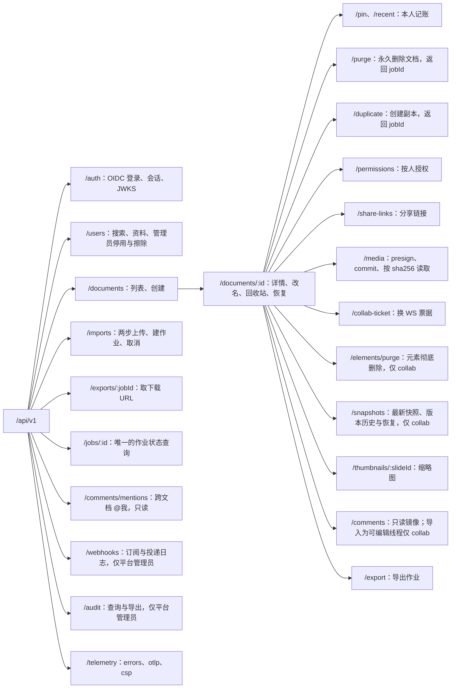
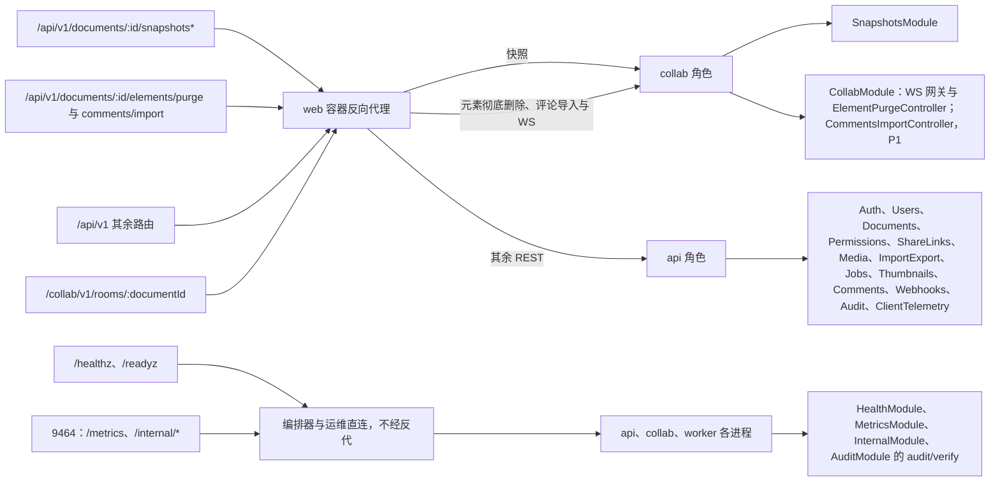

# 15 REST API 目录
> 状态：v0.1 | 负责：后端设计线 | 更新：2026-09-25；2026-09-25（§4.19）；2026-09-25（§4.19 N1）：两个导入受理路由补 409 `server.documents.locked` | 依赖：rulings §4.10 Q20、§4.13 S-1/S-2、§4.15 Q6、§4.17 D1/D2、§4.18 BE-02/BE-03/BE-05/BE-06/BE-10/BE-11/BE-18/BE-30/CO-07/UX-02、§4.19；ADR-0026、ADR-0029、ADR-0031；30-architecture/08 §2、§9、§11、§16.4；30-architecture/10 §1.4；40-modules/08 §6、09 §6、12 §6；PRD 06 SV-08、SV-12，PRD 05 EM-10

> 读者：实现 `apps/server` 控制器与 `@cordexjs/protocol` `rest/*` 的工程师；前端（[50-frontend/02](../50-frontend/02-app-shell-routing-and-session.md) 的用例层只引用本表，不复写守卫与错误码）；测试（[70/07](../70-testing/07-backend-integration-and-api-e2e.md) 由本表生成「角色 × 能力位 × 路由」矩阵）。
> 定位：**全后端唯一的 REST 路由源**。每条路由的方法、路径、装配角色、守卫与能力位、DTO 文件、成功码、主要错误码、审计 action、限流档、里程碑只在这里登记；[03](03-modules-identity-and-access.md)–[07](07-modules-comments-webhooks-audit.md) 的模块卡只写用例与事务边界，并按固定小节号（§3.1 auth … §3.14 telemetry）链接本文。
> 不在本文：字段级 DTO（在 protocol `rest/*.ts`，文件登记见 [40-modules/02](../40-modules/02-kernel-protocol-and-document-core.md)）；WS 帧（[30-architecture/06 §6](../30-architecture/06-collaboration.md) 与 [16](16-ws-protocol-server-view.md)）；`/render` 页注入协议（[50-frontend/12](../50-frontend/12-viewer-embedding-and-render-page.md)）；renderer RPC 字段（[06](06-modules-jobs-import-export-thumbnails.md)）；错误码格式与权威映射表（[30-architecture/10 §1](../30-architecture/10-observability-and-errors.md)）。

---

## 1. 约定

| 项 | 约定 |
|---|---|
| 基址 | `RuntimeConfig.apiBase = https://<host>/api/v1`（Nest `setGlobalPrefix('api/v1', { exclude: ['healthz', 'readyz'] })`）；§3 的路径一律**相对 apiBase**；`/healthz`、`/readyz` 无前缀；`/metrics` 与 `/internal/*` 在内部端口 9464（§5）；WS 是 `/collab/v1/rooms/:documentId`（[16](16-ws-protocol-server-view.md)）（rulings §4.18 BE-11） |
| DTO 来源 | 请求与响应 schema 一律来自 `@cordexjs/protocol`：`rest/{auth, users, documents, share-links, media, snapshots, import-export, thumbnails, comments, webhooks, audit, telemetry, problem}.ts`；`documents.ts` 含权限段、pin、recent、purge、duplicate、collab-ticket 与 elements/purge 段；`import-export.ts` 含 uploads、cancel、exports 与 jobs 状态；错误码联合在 `errors/codes.ts`，HTTP / WS 映射在 `errors/http-map.ts`（依据：决策 INC-11/INC-13，30-architecture/08、10 正文 > 40）。控制器 `@Body()` 类型只能是 `z.infer<typeof X>` 且 `X` 来自 protocol；出参也经 schema 解析，防止泄漏字段 |
| OpenAPI | 由 protocol 的 zod schema 生成 OpenAPI 3.1 文档，作为构建产物入库做差异检查（§10 R3）；OpenAPI 只是派生物，不是事实源 |
| 错误 | RFC 9457 `application/problem+json`：`type`、`title`、`status`、`detail`、`instance`、`code`、`traceId`、`retryable`；`details` 只对 `user:true` 的码回传；分享链接失效时 `permission.denied`（`user:true`）在 `details.reason` 携带 `'share_link.expired' \| 'share_link.revoked'`，不设问题体顶层扩展字段（依据：决策 INC-20，ADR-0029；决策 INC-11/INC-13「ErrorEnvelope 只含 `details?`」，30/10 §1.4，[02](02-auth-chain.md) §7.4）。前端的 `ErrorEnvelope`（`code`、`detail`、`traceId`、`retryable`、`details?`）是它的客户端视图 |
| 分页 | 游标分页：`?cursor=<不透明串>&limit=<1..100，默认 50>` → `{ items, nextCursor }`，`nextCursor` 为 `null` 表示末页；游标编码排序键与 id，不返回总数 |
| 标识与时间 | id 为 UUIDv7 字符串（应用层生成）；时间为 RFC 3339 UTC；哈希为小写十六进制 |
| 幂等 | 作业类创建请求的去重键由服务端构造（格式与命中规则见 [06](06-modules-jobs-import-export-thumbnails.md) §2.3，BE-18：命中 queued / running / succeeded 返回既有作业，命中 failed / cancelled 新建一行并以 `attempt_of` 串联）。`POST /documents/:id/export`（含走 `render-export` 的 pdf / png / jpeg）与 `POST /documents/:id/duplicate` 另接受可选请求头 `Idempotency-Key`，只用于识别客户端网络重放（同键重放返回同一 `jobId`），不作为去重键本体，避免客户端控制去重范围；`POST /imports` 不需要该头——`uploadId` 只能兑换预分配的唯一作业，重放天然返回同一行 |
| 条件请求 | `snapshots/latest` 以 `snapshotId` 作 ETag（另带响应头 `X-Cordex-Epoch`）、缩略图以 `contentHash` 作 ETag，支持 `If-None-Match` → 304 |
| 缓存 | JSON 响应默认 `Cache-Control: no-store`；只有表中注明的字节与图片端点另设缓存头；全部响应带 `X-Content-Type-Options: nosniff` |
| CSRF | cookie 会话下，所有非安全方法（POST / PUT / PATCH / DELETE）且非 `@Public` 的路由，要求 ① `Origin` 命中 `security.allowedOrigins`（缺 `Origin` 时 `Sec-Fetch-Site` 必须为 `same-origin`）② 请求头 `X-Cordex-Request: 1`；否则 403 `server.auth.csrf_rejected`。M4 的 Bearer 请求豁免。前端对全部非安全方法请求自动附加该头（GET / HEAD 不带，免得无谓触发跨源预检，决策 INC-24、[02](02-auth-chain.md) §5）；页面卸载时的上报用 `fetch(…, { keepalive: true })` 而不是 `sendBeacon`（后者不能带自定义头）（依据：决策 INC-24 + PRD SV-12；机制见 [02](02-auth-chain.md)） |
| 分享令牌 | 只经请求头 `X-Cordex-Share-Token` 传递，服务端不读取 query 中的同名参数；日志与 trace 对该头脱敏（依据：决策 INC-25，ADR-0029 否决 URL 令牌） |
| 限流 | 每条路由属于一个限流档（§8）；超限 429 `server.http.rate_limited`，带 `Retry-After` |

---

## 2. 守卫与能力位列的写法

「守卫」列按执行顺序书写。全局链固定为 `RateLimitGuard → SessionGuard → CsrfGuard → ShareLinkGuard`（`AppModule` 以 `APP_GUARD` 注册，顺序见 [02](02-auth-chain.md)），表中只写与默认不同的部分和控制器级守卫。

| 写法 | 含义 |
|---|---|
| `Public` | `@Public()`：不经 `SessionGuard` 与 `CsrfGuard`（仍经限流）；快照清单见 §4 |
| `Session` | 已登录：会话 JWT 验签通过、`sid` 未吊销、用户 `status='active'`；全部非 `Public` 路由的默认值 |
| `Session*` | 允许会话 JWT 已过期（签名有效且 `sid` 仍存在）；只用于 `POST /auth/token/refresh` 与 `POST /auth/logout`，前者另验 refresh cookie |
| `+Link` | `ShareLinkGuard` 生效：请求带 `X-Cordex-Share-Token` 时，把有效链接的角色叠加进 `Principal.scopes`；无效、过期、撤销的令牌**直通不叠加**，是否 403 由后续守卫按直接授权决定（依据：决策 INC-20） |
| `DocRole(cap)` | 控制器级 `DocumentRoleGuard`：`max(直接授权, 链接角色)` 的能力位含 `cap` 才放行，否则 403 `permission.denied`；文档不存在或处于 `purging` → 404 `server.documents.not_found`（fail-closed，D12） |
| `Admin` | 控制器级 `PlatformAdminGuard`：`users.platform_role = 'admin'`，否则 403 `server.auth.forbidden` |
| `Creator` | 作业创建者：`job_runs.created_by = 当前用户`，由用例判定（RLS 同口径兜底） |
| `Ops` | 内部端口的运维令牌（§5），不经上述全局链 |

能力位以 protocol `permissions/actions.ts` 为唯一定义；角色是能力位的预设组合（运行时初值 `ROLE_CAPABILITIES` 见 [03](03-modules-identity-and-access.md)，依据 40-modules/08 §2.2 与 PRD 03 CO 条）：

| 能力位 | owner | editor | commenter | viewer |
|---|---|---|---|---|
| `doc.read` | ✓ | ✓ | ✓ | ✓ |
| `doc.comment` | ✓ | ✓ | ✓ | — |
| `doc.write` | ✓ | ✓ | — | — |
| `doc.export` | ✓ | ✓ | — | — |
| `history.read` | ✓ | ✓ | — | — |
| `doc.manage`（分享、权限、删除、命名版本、元素彻底删除） | ✓ | — | — | — |
| `history.restore` | ✓ | — | — | — |

分享链接可授予的角色是 `viewer`、`commenter`、`editor`，不能是 `owner`。

---

## 3. 路由总表

**每行都隐含的错误码**（行内不再重复）：`Session` 路由的 401 `server.auth.unauthenticated` / `server.auth.expired`；非安全方法的 403 `server.auth.csrf_rejected`；入参校验失败的 400 `<域>.validation_failed`；限流 429 `server.http.rate_limited`；请求体超限 413 `server.http.payload_too_large`；`DocRole` 路由的 403 `permission.denied` 与 404 `server.documents.not_found`。

**列说明**：「状态」是路由的 `@DocState` 访问类（`meta` / `content` / `write` / `transition`，放行规则见 [04](04-modules-documents-storage-media.md) §2 表 2-2；「—」表示没有单文档作用域）；「角色」是装配该控制器的 `CORDEX_ROLE`（`all` 总是包含，不写）；「审计」列的 action 名与 [07](07-modules-comments-webhooks-audit.md) 的审计登记表同一口径（`<resource>.<snake_action>`，决策 INC-31/INC-29），两处不一致时以 07 为准并回改本表，「—」表示不写审计；「限流」列的档位定义见 §8；「里程碑」按章程 §7 与 rulings §4.19 D-M2-CONTENT（协同网关、快照、服务端导入提前到 M2，总表见 [01](01-service-overview-and-roles.md) §3）。

**图 3-1 REST 资源树**

怎么读：从左到右是 URL 的层级，叶子节点文字是该资源下的操作；标「仅 collab」的三处由反代转给 collab 角色（§6），其余都在 api；评论与 @我 只读，评论唯一写入口是 CRDT 经服务端镜像观察器（ADR-0031）。
依据：本节 §3.1–§3.14；rulings §4.18 BE-03、CO-07，§4.19 D-M2-CONTENT（不设 pptx 内容版本端点）；决策 SG-03、SG-08。

### 3.1 auth

`AuthModule` · `rest/auth.ts` · 角色 api · 会话机制、cookie 属性与刷新轮换见 [02](02-auth-chain.md)（决策 SESSION、INC-18）。

| 方法 | 路径 | 守卫与能力位 | 状态 | 请求 → 响应 | 成功 | 主要错误码 | 审计 | 限流 | 里程碑 |
|---|---|---|---|---|---|---|---|---|---|
| GET | `/auth/oidc/login?next=&mode=redirect\|popup` | `Public` | — | 服务端生成 state、PKCE verifier，与 `next`、`mode` 一起存 `oidc:state:{state}`（10 min）→ 302 到 IdP 授权端点；`next` 只接受站内相对路径 | 302 | `server.auth.idp_unavailable`（503，发现文档不可达） | — | public | M2 |
| GET | `/auth/oidc/callback?code=&state=` | `Public` | — | 校验 state → 服务端换码 → 验 id_token（issuer 须在受信列表）→ 首次登录 JIT 建 `users` + `user_identities` → 设 `cordex_session` 与 `cordex_refresh` → 302 到前端 `/auth/callback?next=` 或（`mode=popup`）`/auth/popup-callback` | 302 | 失败一律 302 回前端同一回调页并带 `?error=<码>`（`/auth/callback` 或 `/auth/popup-callback`）：`server.auth.invalid_token`（state 失配、换码或验签失败、issuer 不受信）、`server.auth.account_disabled`（用户已停用）、`server.auth.idp_unavailable` | `auth.login_succeeded` / `auth.login_failed`；首次建号另记 `user.provisioned` | public | M2 |
| GET | `/auth/config` | `Public` | — | → `{ selfSignup, signupUrl?, idpDisplayName? }`（可变开关只从此处读，静态部署项在 RuntimeConfig，决策 RUNTIME-CONFIG） | 200 | — | — | public | M2 |
| GET | `/auth/.well-known/jwks.json` | `Public` | — | → JWK Set（ES256，含轮换期旧公钥）；`Cache-Control: public, max-age=300` | 200 | — | — | public | M2 |
| GET | `/auth/me` | `Session` | — | → `Principal`（`id`、`displayName`、`avatarUrl`、`platformRole`、`email?`）；前端据此判定会话、比对重新登录前后是否同一人（UX-02） | 200 | 仅隐含码 | — | default | M2 |
| POST | `/auth/token/refresh` | `Session*` + refresh cookie | — | 校验 `cordex_refresh` 与 `session:{sid}.refreshHash` → 轮换两个 cookie；已轮换的旧 refresh 再次出现视为泄漏，吊销该 `sid`（同一浏览器 10 s 内的并发刷新除外，[02](02-auth-chain.md) §4.3） | 204 | `server.auth.expired`（401，refresh 无效或过期；前端直接进「登录已过期」，UX-02） | 重放时 `auth.session_revoked`（`reason: refresh_reused`） | default | M2 |
| POST | `/auth/logout` | `Session*` | — | 删 `session:{sid}` 与 `user:{userId}:sessions` 中的该项，清两个 cookie → `{ endSessionUrl? }`：IdP 发现文档有 `end_session_endpoint` 时由服务端拼好（`client_id`、`post_logout_redirect_uri` = `publicUrl` + `auth.oidc.postLogoutRedirectPath`（默认 `/login`）、会话保留了 id_token 时带 `id_token_hint`），否则省略；前端清本地离线数据后顶层跳转到它完成 RP-initiated logout（PRD AS-06，[02](02-auth-chain.md) §4.4） | 200 | 仅隐含码 | `auth.logout` | default | M2 |

### 3.2 users

`UsersModule` · `rest/users.ts` · 角色 api。无邀请表、无租户成员接口（rulings §4.15 T-0、§4.17 D1）。

| 方法 | 路径 | 守卫与能力位 | 状态 | 请求 → 响应 | 成功 | 主要错误码 | 审计 | 限流 | 里程碑 |
|---|---|---|---|---|---|---|---|---|---|
| GET | `/users?query=` | `Session` | — | `query` 至少 2 个字符；按显示名前缀匹配，邮箱只做**精确**匹配且不回显 → 至多 20 条 `{ id, displayName, avatarUrl }`（依据：决策 SG-05） | 200 | `server.users.validation_failed`（400，query 过短） | — | search | M3 |
| PATCH | `/users/me/profile` | `Session` | — | `{ displayName?, avatarUrl? }` → `User` | 200 | 仅隐含码 | `user.profile_updated` | default | M3 |
| PATCH | `/users/:id` | `Session` → `Admin` | — | `{ status?: 'active' \| 'suspended', platformRole?: 'member' \| 'admin' }` → `User`；停用即吊销该用户全部 `sid` 并以 4401 踢出其 WS（决策 SESSION） | 200 | `server.users.not_found`（404）、`server.users.last_admin`（409，停用或降级最后一名 admin） | `user.suspended` / `user.reactivated` / `user.role_changed` | default | M3 |
| POST | `/users/:id/erasure` | `Session` → `Admin` | — | `{ reason? }` → `{ userId, erasedAt }`，同步完成：用户行原地脱敏（`status='erased'`，显示名 `deleted-user`，邮箱与头像置空）、删除全部 `user_identities`、吊销全部会话；指向该用户的外键、审计行与其为 owner 的文档都不动，不进入永久删除编排（[03](03-modules-identity-and-access.md) §3.3；依据：决策 C-24、INC-22） | 200 | `server.users.not_found`（404）、`server.users.last_admin`（409） | `user.erased` | job | M3 P1 |

### 3.3 documents

`DocumentsModule` · `rest/documents.ts` · 角色 api。文档状态机、永久删除编排与列级写方见 [04](04-modules-documents-storage-media.md)；`purging` 状态的文档对全部路由表现为 404。

| 方法 | 路径 | 守卫与能力位 | 状态 | 请求 → 响应 | 成功 | 主要错误码 | 审计 | 限流 | 里程碑 |
|---|---|---|---|---|---|---|---|---|---|
| GET | `/documents?filter=all\|owned\|shared\|recent\|pinned\|trashed&q=&cursor=&limit=` | `Session`（逐条按角色过滤，RLS 兜底） | — | → `Page<DocumentSummary>`（含 `role`、`pinned`、`lastOpenedAt?`、封面 URL）；`recent` 按 `document_user_marks.last_opened_at`，`trashed` 只列本人为 owner 的回收站文档 | 200 | 仅隐含码 | — | default | M2 |
| POST | `/documents` | `Session`（`status='active'` 即可） | — | `{ documentType: 'slide', title }` → `Document`；同一事务写 `documents` 与 owner 权限行 | 201 | `storage.quota_exceeded{dimension:'documents'}`（429） | `document.created` | default | M2 |
| GET | `/documents/:id` | `+Link` → `DocRole(doc.read)` | `meta` | → `DocumentDetail`（`role`、`capabilities[]`、`status`、`documentType`、`pinned` 等）；无副作用（「最近」在签发协同票据时记录，见 [04](04-modules-documents-storage-media.md) §3.1） | 200 | 403 可带 `reason`（链接失效，INC-20） | 凭链接访问时 `share_link.accessed`（合并计数） | default | M2 |
| PATCH | `/documents/:id` | `DocRole(doc.write)` | `write` | `{ title }` → `DocumentSummary`；只收 `title`，不再按字段区分能力位（决策 SG-06/SG-07） | 200 | `server.documents.locked`（409） | `document.renamed` | default | M2 |
| DELETE | `/documents/:id` | `DocRole(doc.manage)` | `transition` | 移入回收站：`active → trashed`，宽限期 `retention.trashDays` | 204 | `server.documents.locked`（409） | `document.trashed` | default | M2 |
| POST | `/documents/:id/restore` | `DocRole(doc.manage)`（守卫对 `trashed` 文档放行） | `transition` | `trashed → active`；对 `active` 幂等 | 200 | 仅隐含码 | `document.restored` | default | M2 |
| PUT | `/documents/:id/pin` | `DocRole(doc.read)` | `meta` | upsert 本人 `pinned_at = now()` | 204 | 仅隐含码 | — | default | M2 |
| DELETE | `/documents/:id/pin` | `DocRole(doc.read)` | `meta` | 清本人 `pinned_at` | 204 | 仅隐含码 | — | default | M2 |
| DELETE | `/documents/:id/recent` | `DocRole(doc.read)` | `meta` | 从本人「最近」移除：清 `last_opened_at`（未固定则删行），不影响文档本身 | 204 | 仅隐含码 | — | default | M2 |
| POST | `/documents/:id/purge` | `DocRole(doc.manage)` | `transition` | 永久删除文档：`active \| trashed → purging`，同一事务写 `job_runs(kind='document-purge')` → `{ jobId }`；进度经 `GET /jobs/:id`（依据：决策 INC-22 + rulings §4.18 BE-15） | 202 | `server.documents.locked`（409） | `document.purge_scheduled` | job | M3 |
| POST | `/documents/:id/duplicate` | `+Link` → `DocRole(doc.export)` | `content` | `{ title? }` + 可选 `Idempotency-Key` → `{ docId, jobId }`：预分配新文档 id，写 `job_runs(kind='import', payload.source='duplicate')` 入 `import` 队列；worker 以源文档受理时已落库的状态（检查点 + `seq ≤ head_seq` 的 updates）为新文档写 `import` 快照，复制基线与被引用的媒体关联，新文档 owner = 调用者（[04](04-modules-documents-storage-media.md) §3.3、[06](06-modules-jobs-import-export-thumbnails.md) §6.6）；进度经 `GET /jobs/:id` | 202（幂等重放 200） | `storage.quota_exceeded`（429 文档数 / 413 字节） | 作业成功时 `document.created`（`source:'duplicate'`） | job | M2 |

自 M2 起文档内容只以协同快照为事实源（rulings §4.19 D-M2-CONTENT）：打开 = `GET snapshots/latest`（§3.8）+ 票据（§3.7）+ WS；新建空白、从模板新建与导入都经 §3.9 的两步导入写 `import` 快照；不设 pptx 内容版本端点（已删除端点见 §9）。

### 3.4 permissions

`PermissionsModule` · `rest/documents.ts`（权限段）· 角色 api。写库、`permVersion` 递增与 `PUBLISH perm:doc:{docId}` 同一用例、提交后广播，WS 会话 ≤ 1 s 重算（[02](02-auth-chain.md)）。只按人授权，组管理推迟（rulings §4.15 Q6）。

| 方法 | 路径 | 守卫与能力位 | 状态 | 请求 → 响应 | 成功 | 主要错误码 | 审计 | 限流 | 里程碑 |
|---|---|---|---|---|---|---|---|---|---|
| GET | `/documents/:id/permissions` | `DocRole(doc.manage)` | `meta` | → `Grant[]`（`principalType` 只有 `user`，附用户摘要） | 200 | 仅隐含码 | — | default | M3 |
| PUT | `/documents/:id/permissions` | `DocRole(doc.manage)` | `meta` | `{ principalType: 'user', principalId, role, expiresAt? }` → `Grant`（upsert）；目标账号必须已存在且 `active`（无邀请表，D1） | 200 | `permission.principal_not_found`（404，提示联系管理员建号）、`permission.principal_unsupported`（400）、`permission.last_owner`（409，降级最后一个 owner） | `permission.granted` | default | M3 |
| DELETE | `/documents/:id/permissions/:principalId` | `DocRole(doc.manage)` | `meta` | 撤销该用户的直接授权；对不存在的授权幂等 | 204 | `permission.last_owner`（409） | `permission.revoked` | default | M3 |

### 3.5 share-links

`ShareLinksModule` · `rest/share-links.ts` · 角色 api。令牌 32 字节随机数、库存 sha256；分享 URL 形态 `https://<host>/documents/{docId}#share={token}`，片段不进请求与日志；**链接始终要求登录**，角色只叠加在已登录用户上（rulings §4.13 S-1、§4.15 Q6；决策 INC-25）。令牌解析不在本模块，归 `PermissionsModule`（BE-02）。

| 方法 | 路径 | 守卫与能力位 | 状态 | 请求 → 响应 | 成功 | 主要错误码 | 审计 | 限流 | 里程碑 |
|---|---|---|---|---|---|---|---|---|---|
| POST | `/documents/:id/share-links` | `DocRole(doc.manage)` | `meta` | `{ role: 'viewer' \| 'commenter' \| 'editor', expiresAt? }` → `{ linkId, token, role, expiresAt }`；`token` 明文只在本响应出现一次 | 201 | 仅隐含码 | `share_link.created` | default | M3 |
| GET | `/documents/:id/share-links` | `DocRole(doc.manage)` | `meta` | → `ShareLink[]`（不含令牌，含 `revokedAt`、`expiresAt`） | 200 | 仅隐含码 | — | default | M3 |
| DELETE | `/documents/:id/share-links/:linkId` | `DocRole(doc.manage)` | `meta` | 置 `revoked_at`，同一事务 `permVersion` 递增，提交后广播；凭该链接的 WS 会话 ≤ 1 s 降权 | 204 | `server.share_links.not_found`（404） | `share_link.revoked` | default | M3 |

### 3.6 media

`MediaModule` · `rest/media.ts` · 角色 api。三条都在 `/documents/:id` 作用域下（依据：决策 INC-21，D12 fail-closed）；上传只有预签名直传一条通道，浏览器侧默认实现见 [50-frontend/05](../50-frontend/05-rendering-and-thumbnails.md)（决策 MEDIA-CLIENT）。**不提供「内容已存在即跳过上传」的捷径**：仅凭 sha256 不能证明持有内容，否则知道哈希即可把他人图片挂进自己的文档再读出（安全宁可提前）；去重发生在 commit 之后的存储层。

| 方法 | 路径 | 守卫与能力位 | 状态 | 请求 → 响应 | 成功 | 主要错误码 | 审计 | 限流 | 里程碑 |
|---|---|---|---|---|---|---|---|---|---|
| POST | `/documents/:id/media/presign` | `DocRole(doc.write)` | `write` | `{ sha256, byteSize, mime }` → `{ uploadId, upload: { url } \| { multipart: { partUrls[] } }, maxBytes, expiresAt }`；对象落 `data` 桶 `uploads/tmp/{uploadId}`，PUT TTL `storage.s3.presign.putTtlSec`（600 s），≥ 10 MB 分片，URL 按 `storage.s3.publicEndpoint` 签名 | 200 | `server.media.unsupported_type`（415，声明 MIME 不在白名单）、`server.media.payload_too_large`（413）、`storage.quota_exceeded{dimension:'bytes'}`（413，按 owner 汇总，决策 G-09）、`server.documents.locked`（409） | — | upload | M2 |
| POST | `/documents/:id/media/commit` | `DocRole(doc.write)` | `write` | `{ uploadId, sha256, byteSize, parts? }` → `{ sha256, mime, byteSize, width?, height? }`：HEAD + 流式重算 sha256、MIME 嗅探（以嗅探为准）、SVG 消毒、尺寸探测 → 服务端复制到 `media/{sha256[0:2]}/{sha256}`（已存在则跳过复制）→ upsert `media_blobs` 与 `document_media`；幂等 | 201 | `permission.denied`（403，`uploadId` 属于他人或他文档）、`storage.upload_not_found`（404）、`storage.integrity_mismatch`（422）、`server.media.unsupported_type`（415，嗅探不可识别）、`server.media.payload_too_large`（413）、`storage.quota_exceeded`（413） | `media.uploaded` | upload | M2 |
| GET | `/documents/:id/media/:sha256` | `+Link` → `DocRole(doc.read)`，且该文档存在 `document_media` 关联 | `content` | → 200 JSON `{ url, expiresAt }`：每次现签的 1 h 预签名 GET，响应 `Cache-Control: no-store`，与 `GET /exports/:jobId` 同一形态；不 302，避免 `fetch` 跟随跨源 302 把 `X-Cordex-Share-Token` 带到存储源并触发预检（决策 INC-25；[04](04-modules-documents-storage-media.md) §7.3）；前端以不带自定义头的请求取 `url` | 200 | `server.media.not_found`（404，无关联；跨文档取媒体一律 404） | — | default | M2 |

### 3.7 collab

票据签发在 api（`AuthModule` 的票据控制器，用例见 [03](03-modules-identity-and-access.md)），元素彻底删除在 collab（`CollabModule`）。WS 本身见 [16](16-ws-protocol-server-view.md)。

| 方法 | 路径 | 角色 | 守卫与能力位 | 状态 | 请求 → 响应 | 成功 | 主要错误码 | 审计 | 限流 | 里程碑 |
|---|---|---|---|---|---|---|---|---|---|---|
| POST | `/documents/:id/collab-ticket` | api | `+Link` → `DocRole(doc.read)`（≥ viewer；只凭链接、无直接授权的用户同样 200，BE-05） | `content` | `{}`（链接令牌只走 `X-Cordex-Share-Token` 头）→ `{ ticket, expiresAt }`；ticket 为 ES256 JWT，60 s、单次（`jti`），claims `sub`、`doc`、`role`、`perm_ver`、`sid`，凭链接时另含 `lnk`（BE-02；TS 字段 `permVersion`，决策 MECH-INC 中 INC-28）；顺带记录本人「最近」 | 200 | 403 可带 `details.reason`（链接失效） | `auth.collab_ticket_issued` | ticket | M2 |
| POST | `/documents/:id/elements/purge` | collab | `DocRole(doc.manage)`（即仅 owner） | `write` | `{ ids: NodeId[] }`（≤ 1,000）→ `{ purged: NodeId[] }`：只接受墓碑态元素，交 server-collab 单写者以 `system('maintenance')` 立即硬删（Room 未加载先加载）；只清当前状态，历史快照与 updates 按保留期存在（rulings §4.18 CO-07） | 200 | `server.documents.element_not_tombstoned`（409，含非墓碑 id，整批拒绝） | `document.element_purged` | default | M3 |

### 3.8 snapshots

`SnapshotsModule` · `rest/snapshots.ts` · **角色 collab**（反代把 `/api/v1/documents/:id/snapshots*` 转给 collab；api 进程装配即启动失败，BE-03）。恢复在本实例打开 Room 执行、多副本经 FanoutBus 收敛，在线客户端不断连；机制见 [05](05-modules-collab-and-snapshots.md)。

| 方法 | 路径 | 守卫与能力位 | 状态 | 请求 → 响应 | 成功 | 主要错误码 | 审计 | 限流 | 里程碑 |
|---|---|---|---|---|---|---|---|---|---|
| GET | `/documents/:id/snapshots?kind=&cursor=&limit=` | `DocRole(history.read)` | `content` | → `Page<SnapshotMeta>`（`kind ∈ import \| auto \| named \| migration \| restore \| epoch`、`name`、`description`、`contributors[]`、`seqUpto`、`createdAt`） | 200 | 仅隐含码 | — | default | M3 |
| GET | `/documents/:id/snapshots/latest` | `+Link` → `DocRole(doc.read)` | `content` | → 快照字节（Y V2 update，zstd，`application/octet-stream`）；> 1 MiB 的从 `snapshots` 桶流式代理，不返回预签名 URL（决策 MECH-INC 中 INC-14）；请求 `Accept-Encoding` 不含 zstd 时服务端解压后按 gzip 返回（[05](05-modules-collab-and-snapshots.md) §10）；`ETag = snapshotId`，`Cache-Control: private, max-age=0, must-revalidate`；响应头 `X-Cordex-Epoch` = `documents.epoch`，客户端在 WS `auth.epoch` 声明（[16](16-ws-protocol-server-view.md) §2） | 200 / 304 | `server.snapshots.not_found`（404，尚无快照，客户端从空文档开始） | `document.opened`（合并计数） | default | M2 |
| GET | `/documents/:id/snapshots/:snapshotId` | `DocRole(history.read)` | `content` | → 该版本字节（编码与 latest 相同，供预览）；版本内容不可变，`Cache-Control: private, max-age=31536000, immutable` | 200 / 304 | `server.snapshots.not_found`（404） | — | default | M3 |
| POST | `/documents/:id/snapshots` | `DocRole(doc.manage)` | `write` | `{ name, description? }` → `SnapshotMeta`（`kind='named'`，永久保留）：把当前状态命名为一个版本（决策 MECH-INC 中 INC-15） | 201 | `server.snapshots.named_limit_reached`（409，超过每文档命名版本上限 `quota.namedSnapshotsPerDoc`；非配额码）、`server.snapshots.persist_degraded`（503，Room 处于 PG 降级期，可重试，[05](05-modules-collab-and-snapshots.md) §10） | `snapshot.created` | default | M3 |
| POST | `/documents/:id/snapshots/:snapshotId/restore` | `DocRole(history.restore)`（即仅 owner） | `write` | → `SnapshotMeta`（新写入的 `kind='restore'` 快照）：执行 `core.restoreVersion`，单事务、origin `system('restore')`；提交后经扇出向在线会话发 `CONTROL.event{name:'version.restored'}`（[16](16-ws-protocol-server-view.md) §3） | 200 | `server.snapshots.not_found`（404）、`server.documents.locked`（409）、`server.snapshots.persist_degraded`（503，同上） | `snapshot.restored` | default | M3 |
| GET | `/documents/:id/snapshots/:a/diff/:b` | `DocRole(history.read)` | `content` | → 模型级 diff 预览 | 200 | `server.snapshots.not_found`（404） | — | default | P2（未排期） |

命名版本上限每文档 200（`quota.namedSnapshotsPerDoc`，rulings §4.19 C-06），超出返回 409 `server.snapshots.named_limit_reached`——它是业务上限而不是配额，`*.quota_exceeded` 只用于 rulings §4.17 D2 的三码（决策 MECH-INC 之 INC-12）；自动快照与事件快照 30 天内全保留、之后每天留最后一个、保留至 `retention.autoSnapshotDailyDays`（默认 365，0 = 永久），保留规则本体见 [14](14-valkey-object-storage-and-retention.md) §8。

### 3.9 imports / exports / jobs

`ImportExportModule`、`JobsModule` · `rest/import-export.ts` · 角色 api。导入两步上传：客户端全程不提交任意对象键（rulings §4.18 BE-10）；处理器阶段的拒绝（`format.encrypted`、`format.macro_rejected`、超天花板 `format.quota_exceeded`、`format.limit_exceeded`、`format.pptx.invalid_package`）不走 HTTP，写进作业结果，经 `GET /jobs/:id` 读取。队列与处理器见 [06](06-modules-jobs-import-export-thumbnails.md)。

| 方法 | 路径 | 守卫与能力位 | 状态 | 请求 → 响应 | 成功 | 主要错误码 | 审计 | 限流 | 里程碑 |
|---|---|---|---|---|---|---|---|---|---|
| POST | `/imports/uploads` | `Session`；带 `docId`（覆盖既有文档）时 `DocRole(doc.write)` | `write`（带 `docId` 覆盖既有文档时）/ — | `{ fileName, byteSize, sha256, docId? }` → `{ uploadId, jobId, docId, upload }`：预分配 `jobId`（新建文档时同时预分配 `docId`，UUIDv7）与 `uploadId`（绑定 userId 与这一个 jobId，1 h），返回预签名 PUT（≥ 10 MB 分片）；客户端从不提交对象键。PUT 落隔离区 `uploads/tmp/{uploadId}`，有效期等于 `uploadId` 寿命 1 h，受理时服务端复制到 `docs/{docId}/imports/{jobId}/source.pptx`（UPLOAD-QUARANTINE，rulings §4.18 BE-10 的细化，[06](06-modules-jobs-import-export-thumbnails.md) §6.1）；新建空白与从模板新建同样走本路由（rulings §4.19 D-M2-CONTENT） | 201 | `format.quota_exceeded{dimension:'fileSize'}`（413，> `scale.maxFileBytes` 200 MB）、`storage.quota_exceeded`（413 字节 / 429 文档数）、`format.macro_rejected` / `format.unsupported_binary`（415，按扩展名 `.pptm` / `.ppt` 提前拒绝，处理器仍按内容复核，[06](06-modules-jobs-import-export-thumbnails.md) §6.1）、`server.documents.locked`（409，带 `docId` 且文档正处于另一覆盖导入或迁移的锁定窗口，[06](06-modules-jobs-import-export-thumbnails.md) §6.5，rulings §4.19 N1） | — | upload | M2 |
| POST | `/imports` | `Session`；`uploadId` 须属于当前用户且未过期 | `write`（带 `docId` 覆盖既有文档时）/ — | `{ uploadId, parts? }`（JSON），或 ≤ 10 MB 文件的 `multipart/form-data` 单步直传（PRD SV-01，内部走同一路径）→ `{ jobId, docId }`：HEAD 确认对象 → 按服务端幂等键建 `job_runs` → 入 `import` 队列；`uploadId` 只能兑换预分配的那一个作业，重放总是返回同一行 | 202（重放 200） | `server.import.upload_forbidden`（403，不存在、过期或非本人，不区分）、`server.import.source_missing`（409，对象缺失或大小不符）、`server.documents.locked`（409，同上） | `import.created` | job | M2 |
| POST | `/imports/:jobId/cancel` | `Session` → `Creator` | — | queued / running → cancelled，删原件与已生成产物，不建文档 | 200 | `server.jobs.not_found`（404）、`server.import.job_terminal`（409，已终态） | `import.cancelled` | job | M2 |
| POST | `/documents/:id/export` | `DocRole(doc.export)` | `content` | `{ format: 'pptx' \| 'pdf' \| 'png' \| 'jpeg', snapshotId?, slides? }` + 可选 `Idempotency-Key` → `{ jobId }`；pptx 入 `export` 队列，其余经 `RenderExportProducerService` 入 `render-export` 队列 | 202（幂等命中 200） | 仅隐含码 | `export.created` | job | M3（PDF / PNG / JPEG 为 M3 后半段） |
| GET | `/exports/:jobId` | `Session` → `Creator` 或 `DocRole(doc.export)` | `content` | 只返回下载地址：`{ url, expiresAt, fileName }`，每次现签 1 h 预签名 GET（对象保留 24 h，决策 SG-08、MECH-INC 中 INC-40）；状态查询请用 `/jobs/:id` | 200 | `server.jobs.not_found`（404）、`server.export.not_ready`（409）、`server.export.expired`（410） | `export.downloaded` | default | M3 |
| GET | `/jobs/:id` | `Session`；`Creator` 或对 `job_runs.doc_id` 有授权（RLS 同口径） | — | → `JobStatus`（`kind`、`status ∈ queued \| running \| succeeded \| failed \| cancelled`、`progress?`、`result?`、`error?{ code, detail }`、`fidelityReport?`）；导入、导出、render-export、document-purge 共用（决策 SG-08） | 200 | `server.jobs.not_found`（404，不存在与无权查看同码，避免枚举） | — | default | M2 |

### 3.10 thumbnails

`ThumbnailsModule` · `rest/thumbnails.ts` · 角色 api。640 px 行入 `thumbnails` 表，1280 px 按需变体只存对象（键加 `@1280`），以 640 行的 `content_hash` 判新鲜（决策 SG-10）；封面用保留 slideId `'__cover'`（决策 MECH-INC 中 INC-16）。

| 方法 | 路径 | 守卫与能力位 | 状态 | 请求 → 响应 | 成功 | 主要错误码 | 审计 | 限流 | 里程碑 |
|---|---|---|---|---|---|---|---|---|---|
| GET | `/documents/:id/thumbnails/:slideId?size=640\|1280` | `+Link` → `DocRole(doc.read)` | `content` | 命中 → `image/webp`（`ETag = contentHash`，`Cache-Control: private, no-cache`，每次以 `If-None-Match` 复核，前端不另做缓存层，决策 APP-DATA）；`__cover` 的包内封面为 `image/jpeg`；图片响应一律 `X-Content-Type-Options: nosniff` + `Content-Security-Policy: sandbox`；未命中 → 404 + `Retry-After: 2` 并惰性入队（按页内容哈希去重、按用户限流，处理器丢弃不存在的 slideId；细节见 [06](06-modules-jobs-import-export-thumbnails.md) §11），前端显示占位 | 200 / 304 | `server.thumbnails.not_found`（404，未生成或 slideId 不存在，带 `Retry-After`） | — | default | M2（`__cover` 包内封面，由 M2 导入写入）/ M3 前半段（服务端渲染） |

### 3.11 comments

`CommentsModule` · `rest/comments.ts` · 角色 api（只读 REST 留在 api，镜像观察器与 `comments/import` 只在 collab，BE-03）。评论事实源是 CRDT 内的 ResourceHook `comments.threads`（路径 `resources['comments.threads']`，客户端插件为 iso 包 `@cordexjs/comments`，rulings §4.19 D-COMMENTS-PKG），PG 表只是读模型，**REST 只读**，唯一写入口是 `CommentMirrorObserver`（ADR-0031；决策 SG-03、INC-39）。在线通知走 `CONTROL.event{ name: 'comments.changed', payload: { threadIds[] } }`（[16](16-ws-protocol-server-view.md)）。

| 方法 | 路径 | 守卫与能力位 | 状态 | 请求 → 响应 | 成功 | 主要错误码 | 审计 | 限流 | 里程碑 |
|---|---|---|---|---|---|---|---|---|---|
| GET | `/documents/:id/comments?filter=all\|page\|unresolved\|mentions&page=<slideId>&cursor=&limit=` | `+Link` → `DocRole(doc.read)` | `content` | → `Page<CommentThread>`（线程、回复、`anchorState`、`resolvedAt`、`mentions`）；`filter=page` 时 `page` 必填 | 200 | 仅隐含码 | — | default | M3 |
| GET | `/documents/:id/comments/:threadId` | `+Link` → `DocRole(doc.read)` | `content` | → `CommentThread` | 200 | `server.comments.not_found`（404） | — | default | M3 |
| POST | `/documents/:id/comments/import` | `DocRole(doc.comment)` | `write` | `{ importedThreadIds[] }` → `{ threadIds[] }`：把 pptx 导入的只读批注转为可编辑线程，经服务端事务写入 CRDT。该事务只能在持有 Room 的 collab 实例内执行，所以本路由的**角色是 collab**（`CommentsImportController`，[07](07-modules-comments-webhooks-audit.md) §1.5），反代与快照、元素彻底删除同一条规则转发（[01](01-service-overview-and-roles.md) §7，启动断言 A5 禁止它出现在 api） | 200 | `server.comments.not_found`（404）、`server.comments.import_unsupported`（409，没有可导入的只读评论） | `comment.imported_as_editable` | default | M3 P1 |
| GET | `/comments/mentions?cursor=&limit=` | `Session`（逐文档按当前角色过滤，RLS 兜底） | — | → `Page<MentionItem>`：跨文档「@我」 | 200 | 仅隐含码 | — | default | M3 |

### 3.12 webhooks

`WebhooksModule` · `rest/webhooks.ts` · 角色 api · 只有平台管理员。对外事件 `comment.added`、`comment.mentioned`、`comment.resolved`，载荷 schema 带版本；签名头 `X-Cordex-Signature: t=<时间戳>, v1=<HMAC-SHA256>`；签名密钥以部署 KEK 做 AES-256-GCM 加密存储（`signing_secret_enc` + `secret_version`），明文只在创建与轮换响应中出现一次（决策 C-16/INC-30、INC-31/INC-29）。出站地址在创建、更新与每次投递前都过 SSRF 守卫（rulings §4.13 S-4），细节见 [07](07-modules-comments-webhooks-audit.md)。

| 方法 | 路径 | 守卫与能力位 | 状态 | 请求 → 响应 | 成功 | 主要错误码 | 审计 | 限流 | 里程碑 |
|---|---|---|---|---|---|---|---|---|---|
| POST | `/webhooks` | `Admin` | — | `{ targetUrl, eventFilter[], status? }` → `{ subscription, signingSecret }` | 201 | `server.webhooks.invalid_url`（422）、`server.webhooks.invalid_event_filter`（422）、`server.webhooks.egress_blocked`（422） | `webhook.created` | default | M3 |
| GET | `/webhooks` | `Admin` | — | → `WebhookSubscription[]`（不含密钥） | 200 | 仅隐含码 | — | default | M3 |
| PATCH | `/webhooks/:id` | `Admin` | — | `{ targetUrl?, eventFilter?, status?, rotateSecret?: true }` → `WebhookSubscription`；改地址时重新过 SSRF 守卫；`rotateSecret` 时响应另含一次性的 `{ signingSecret, secretVersion }`，旧密钥保留 24 h 宽限期、期间双签名（C-16 的轮换入口） | 200 | `server.webhooks.not_found`（404）、`server.webhooks.invalid_url`（422）、`server.webhooks.invalid_event_filter`（422）、`server.webhooks.egress_blocked`（422） | `webhook.updated`；轮换另记 `webhook.secret_rotated` | default | M3 |
| DELETE | `/webhooks/:id` | `Admin` | — | 同一事务先删除该订阅的全部投递记录、再删订阅行（外键 RESTRICT；`cordex_app` 对 `webhook_deliveries` 的 DELETE 已由 0095 授予，[08](08-db-conventions-roles-rls-migrations.md) §4.2）；在途的 BullMQ 作业执行时找不到投递行即丢弃（[07](07-modules-comments-webhooks-audit.md) §4.2） | 204 | `server.webhooks.not_found`（404） | `webhook.deleted` | default | M3 |
| GET | `/webhooks/:id/deliveries?status=&cursor=&limit=` | `Admin` | — | → `Page<WebhookDelivery>`（`pending \| succeeded \| failed \| dead-lettered`、`attempt`、`responseCode`） | 200 | `server.webhooks.not_found`（404） | — | default | M3 |

### 3.13 audit

`AuditModule` · `rest/audit.ts` · 角色 api · 只有平台管理员。审计只追加、哈希链与每日封存见 [07](07-modules-comments-webhooks-audit.md)；链校验不走公开 REST，走内部端点（§5，决策 MECH-INC 中 SG-09）。

| 方法 | 路径 | 守卫与能力位 | 状态 | 请求 → 响应 | 成功 | 主要错误码 | 审计 | 限流 | 里程碑 |
|---|---|---|---|---|---|---|---|---|---|
| GET | `/audit?from=&to=&category=&action=&docId=&actorId=&result=&cursor=&limit=` | `Admin` | — | → `Page<AuditRecord>`（`ip_hash`、`ua_hash` 不回传原值）；区间 ≤ 366 天 | 200 | `server.audit.range_too_large`（400） | — | default | M3 |
| GET | `/audit/export?format=csv\|json`（过滤参数同上） | `Admin` | — | → 流式导出（`Content-Disposition: attachment`），单次 ≤ 1,000,000 行 | 200 | `server.audit.range_too_large`（400）、`server.audit.export_too_large`（422） | `audit.exported` | job | M3 |

### 3.14 telemetry

`ClientTelemetryModule` · `rest/telemetry.ts` · 角色 api（rulings §4.18 BE-30）。请求体上限与限流是这组路由的主要防线；服务端端点、Collector 路由见 [18](18-observability-and-ops-endpoints.md)，浏览器侧采集与同意见 [50-frontend/15](../50-frontend/15-events-errors-and-telemetry.md)。

| 方法 | 路径 | 守卫与能力位 | 状态 | 请求 → 响应 | 成功 | 主要错误码 | 审计 | 限流 | 里程碑 |
|---|---|---|---|---|---|---|---|---|---|
| POST | `/telemetry/errors` | `Session` | — | `ClientErrorReport[]`（≤ 20 条，请求体 ≤ 64 KiB）→ 经 logger 落结构化日志；401 时前端丢弃、不重试（决策 MECH-INC 中 SG-11） | 204 | 仅隐含码 | — | telemetryErrors | M2 |
| POST | `/telemetry/otlp` | `Session` | — | OTLP/HTTP traces（≤ 512 KiB）：`application/x-protobuf`，或只含 `resourceSpans` 的 `application/json`；只转发到 Collector 的 `/v1/traces`（细则见 [18](18-observability-and-ops-endpoints.md) §9.1） | 200（透传 OTLP 响应） | `server.http.unsupported_media_type`（415，不是上述两种媒体类型，或 JSON 含 traces 以外的信号）；Collector 不可用 503 | — | telemetryOtlp | M3 |
| POST | `/telemetry/csp` | `Public` | — | `application/reports+json` 或 `application/csp-report`（≤ 16 KiB）→ 只记录违反的指令名与被拦主机名，丢弃其余字段（决策 TT-CSP-REPORT） | 204 | 仅限流与体积码 | — | csp | M2（report-only）/ M3（强制） |

---

## 4. `@Public` 白名单快照

`SessionGuard` 由 `AppModule` 以 `APP_GUARD` 全局注册、默认拒绝；只有下表 7 条带 `@Public()`（rulings §4.18 BE-06 的六条 + `/telemetry/csp`）。本表是 route-auth-coverage 测试的期望清单：遍历主端口路由表，除本表外任何路由在无会话时都必须 401（§10 R4）。增删本表必须改文档并同步测试夹具。

| # | 路由 | 为什么可以公开 | 公开后的防线 |
|---|---|---|---|
| P1 | `GET /auth/oidc/login` | 登录前必须可达 | 限流 public 档；`next` 只接受站内相对路径（防开放重定向）；state 10 min 单次 |
| P2 | `GET /auth/oidc/callback` | IdP 回跳时尚无会话 | state + PKCE 校验、issuer 受信列表、id_token 验签；失败只回前端错误页 |
| P3 | `GET /auth/config` | 登录页决定是否显示注册入口 | 只返回非敏感开关 |
| P4 | `GET /auth/.well-known/jwks.json` | 公钥本就公开 | 只含公钥 |
| P5 | `GET /healthz`（无前缀） | 编排器探针 | 不经反代（[01 §7](01-service-overview-and-roles.md#7-反代分流路径与子域到角色)）；不返回依赖细节 |
| P6 | `GET /readyz`（无前缀） | 编排器探针 | 同上；超包络标记只含布尔值 |
| P7 | `POST /api/v1/telemetry/csp` | 浏览器 Reporting API 不保证携带 cookie，无法要求会话 | 严格的按 IP 令牌桶（csp 档）、16 KiB 上限、只记录指令名与被拦主机名；不经 CSRF 检查（无会话可被利用） |

不在白名单里、但对「会话已过期」宽容的两条：`POST /auth/token/refresh` 与 `POST /auth/logout`（守卫写作 `Session*`，§2）——没有任何会话 cookie 时它们仍然 401。

---

## 5. 无前缀与内部端点

主端口上只有两个无前缀端点；其余运维端点都在**内部端口 9464**（只绑 backend 网络，启动断言见 [01 §6](01-service-overview-and-roles.md#6-启动断言) A10），不加 `/api/v1` 前缀、反代不转发、不经 `SessionGuard`（依据：决策 INC-26 + rulings §4.18 BE-03、BE-11）。内部端口由 `InternalModule` 启动的独立 Fastify 实例提供，不经 Nest 全局守卫链（[18](18-observability-and-ops-endpoints.md) §7）。`/internal/*` 另要求运维令牌：请求头 `X-Cordex-Ops-Token`，令牌来自 `CORDEX_OPS_TOKEN_FILE`，常量时间比较，错误或缺失 401 `server.auth.invalid_token`；未配置令牌文件时 `/internal/*` 一律 404（fail-closed）。令牌细则以 [18](18-observability-and-ops-endpoints.md) §8 为准。

| 方法 | 路径 | 端口 | 角色 | 鉴权 | 说明 | 审计 |
|---|---|---|---|---|---|---|
| GET | `/healthz` | 主端口 | api / collab / worker；renderer 为容器内精简变体 | Public | 进程存活；renderer 变体附 Chromium 池就绪 | — |
| GET | `/readyz` | 主端口 | api / collab / worker；renderer 为容器内精简变体 | Public | PG、Valkey、S3 两个桶、宿主 `ACTIVE`、迁移已应用、collab 未 draining；超包络附 `scaleEnvelopeExceeded`；否则 503。renderer 变体只判 Chromium 池就绪与验签公钥已加载，不查任何存储（rulings §4.18 BE-14）；判据表见 [18](18-observability-and-ops-endpoints.md) §6 | — |
| GET | `/metrics` | 9464 | api / collab / worker（renderer 不装） | 仅网络隔离（Prometheus 在 backend 网络抓取） | Prometheus 文本；指标名表见 [18](18-observability-and-ops-endpoints.md) | — |
| GET | `/internal/diagnostics/fibers\|effects\|pending\|contributions`（`effects?plugin=`） | 9464 | api / collab / worker | Ops | `dumpFiberTree`、effects、PENDING 列表、贡献点清单（四个都保留，决策 MECH-INC 中 INC-41） | — |
| POST | `/internal/admin/documents/:id/compact` | 9464 | collab（及 all） | Ops | 立即压缩：租约锁单写者 → 写 `auto` 快照 → 裁剪 updates | `admin.compacted` |
| POST | `/internal/admin/documents/:id/migrate` | 9464 | collab（及 all） | Ops | 快照 schema 迁移：`lock:migrate:{docId}` → 迁移 → `migration` 快照 | `admin.migrated` |
| POST | `/internal/admin/documents/:id/epoch` | 9464 | collab（及 all） | Ops | `forceEpoch()` 递增纪元并经 `room:{docId}:ctl` 通知其他实例，全部会话以 4428 关闭后重新 bootstrap（决策 INC-06） | `admin.epoch_forced` |
| POST | `/internal/admin/audit/verify` | 9464 | worker（及 all） | Ops | `{ from?, to? }` → `{ anchor, rows, firstId, lastId, breaks[] }`（`anchor` ∈ 创世 / 前一行 / 封存行 / `anchor_missing`，`breaks[]` 为 `{id, kind: 'prev_mismatch' \| 'hash_mismatch' \| 'seal_mismatch'}`，形状以 [07](07-modules-comments-webhooks-audit.md) §8.5 为准）；从最早保留分区之前的封存行续验哈希链；同一时刻只允许一个校验，重复请求 409 `server.audit.verify_busy`；由 `AuditModule` 的 `AuditVerifyController` 承载，与 ops 命令 `audit-verify` 同一用例（[07](07-modules-comments-webhooks-audit.md) §8.5、§10.2） | `audit.verified` |
| POST | `/render` | renderer 的 RPC 端口（只在 render 网络） | renderer | 请求头 `X-Cordex-Render-Signature`：worker 用 Ed25519 私钥签 `{ renderId, bodySha256, exp ≤ 30 s }`，renderer 只持公钥 | 注入渲染，返回 WebP / PDF 字节与逐页诊断；字段与超时见 [06](06-modules-jobs-import-export-thumbnails.md)（决策 SG-01） | — |

---

## 6. 路由 → 反代 → 角色映射

反代规则全文在 [01 §7](01-service-overview-and-roles.md#7-反代分流路径与子域到角色)，本节只按本目录的小节归并，供实现控制器时核对「写在哪个模块、装在哪个角色」。

| 本文小节 | 反代规则 | 角色 | Nest 模块 |
|---|---|---|---|
| §3.1–§3.6、§3.9–§3.14（§3.11 的 comments/import 除外），以及 §3.7 的 collab-ticket | `/api/*` | api | Auth、Users、Documents、Permissions、ShareLinks、Media、ImportExport、Jobs、Thumbnails、Comments、Webhooks、Audit、ClientTelemetry |
| §3.7 的 elements/purge、§3.8、§3.11 的 comments/import | 同一条规则 `^/api/v1/documents/[^/]+/(snapshots\|elements/purge\|comments/import)`（优先于 `/api/*`，[17](17-deployment-and-config.md) §3 的 location 正则） | collab | Collab（`CollabHttpModule`）、Snapshots（`SnapshotsHttpModule`）、Comments（`CommentsImportHttpModule`，P1） |
| §5 主端口两条 | 不经反代 | 各角色 | Health |
| §5 内部端口 | 不转发 | 见 §5 | Metrics、Internal、Audit（audit/verify）、renderer 入口 |

**图 6-1 路由前缀 → 反代 → 角色 → 模块**

怎么读：最左是请求前缀，中间是入口（经 web 反代，或由编排器与运维在网络内直连），再到装配该控制器的角色，最右是承载它的 Nest 模块。快照、元素彻底删除与评论导入三类路径由同一条 collab 规则在反代里优先于 `/api/*`；all 模式下 api、collab 是同一进程，映射不变。
依据：本节表；[01 §5](01-service-overview-and-roles.md#5-模块--角色--部件装配矩阵)、§7；rulings §4.18 BE-03、BE-11；决策 INC-26。

---

## 7. 后端视角的错误码 → HTTP 映射摘录

权威表是 [30-architecture/10 §1.4](../30-architecture/10-observability-and-errors.md) 与 protocol `errors/http-map.ts`；本节只摘录 REST 路由实际抛出的码，便于对照 §3。下表全部码已按决策 INC-10/SG-04 登记进 30/10 §1.1 与 http-map（rulings §4.19 回填），「登记」列只保留来历：**已登记** = 30/10 原有；**INC-10** = 本轮随新域一次登记。

| 码 | HTTP | 后端触发条件 | 登记 |
|---|---|---|---|
| `<域>.validation_failed` | 400 | zod 入参校验失败（含 `server.users.validation_failed`） | 已登记 |
| `server.auth.unauthenticated` | 401 | 无会话 cookie；refresh 端点上缺 refresh cookie | 已登记 |
| `server.auth.expired` | 401 | 会话 JWT 过期；会话复核发现 `session:{sid}` 不存在（已吊销或到期）或用户非 `active`；refresh 端点上 refresh 无效、过期或被重放（判定顺序见 [02](02-auth-chain.md) §4.2–§4.3） | INC-10 |
| `server.auth.invalid_token` | 401（回调为 302 带 error） | 会话 JWT 的算法、`kid`、`aud`、`iss` 或签名不符；运维令牌错误；OIDC state 失配、换码或 id_token 验签失败、issuer 不受信 | INC-10 |
| `server.auth.csrf_rejected` | 403 | 非安全方法缺 `X-Cordex-Request` 或 Origin 不在白名单 | INC-10 |
| `server.auth.idp_unavailable` | 503（回调为 302 带 error） | OIDC 发现文档、令牌端点或 JWKS 不可达 | INC-10 |
| `server.auth.account_disabled` | 302 带 error | 已停用的用户完成 IdP 登录（已擦除用户的身份行已删，再登录会新建账号，不走本码） | INC-10 |
| `server.auth.forbidden` | 403 | `PlatformAdminGuard` 不满足（[02](02-auth-chain.md) §6） | INC-10（`server.auth` 域） |
| `server.auth.unavailable` | 503 | 会话复核所需的 Valkey 不可达，按 fail-closed 拒绝（[02](02-auth-chain.md) §6） | INC-10 |
| `permission.denied` | 403 | `DocRole` / `Creator` 不满足；链接失效时带 `reason` | 已登记 |
| `permission.principal_not_found` | 404 | 授权目标账号不存在或非 `active`（D1） | INC-10 |
| `permission.principal_unsupported` | 400 | `principalType` 不是 `user` | INC-10（`permission` 域原有） |
| `permission.last_owner` | 409 | 撤销或降级文档最后一个 owner | INC-10（同上） |
| `server.users.not_found` | 404 | 管理端点的目标用户不存在 | INC-10 |
| `server.users.last_admin` | 409 | 停用、降级或擦除最后一名平台管理员（原 `user.last_admin`） | INC-10 |
| `server.documents.not_found` | 404 | 文档不存在、处于 `purging` 或已完成永久删除 | 已登记 |
| `server.documents.locked` | 409 | 对 `locked` 文档的写操作 | INC-10 |
| `server.documents.element_not_tombstoned` | 409 | 元素彻底删除的 id 中含非墓碑态元素 | INC-10 |
| `server.share_links.not_found` | 404 | linkId 不存在或不属于该文档（原 `share_link.not_found`） | INC-10 |
| `server.media.not_found` | 404 | 该文档无此 sha256 的 `document_media` 关联 | INC-10 |
| `server.media.unsupported_type` | 415 | 声明或嗅探出的 MIME 不在白名单 | INC-10 |
| `server.media.payload_too_large` | 413 | 超过单文件、SVG 或像素上限（[04](04-modules-documents-storage-media.md) §8） | INC-10（`server.media` 域） |
| `server.snapshots.not_found` | 404 | 快照不存在或不属于该文档（原 `snapshot.not_found`） | INC-10 |
| `server.snapshots.named_limit_reached` | 409 | 命名版本超过每文档上限 200（原 `snapshot.quota_exceeded`；业务上限而非配额，`*.quota_exceeded` 只留 D2 三码，决策 MECH-INC 之 INC-12；rulings §4.19 C-06） | INC-10 |
| `server.snapshots.persist_degraded` | 503 | 命名版本或恢复要求 Room `persist = ok`，PG 降级期拒绝（`retryable:true`，[05](05-modules-collab-and-snapshots.md) §10） | INC-10 |
| `server.jobs.not_found` | 404 | 作业不存在或无权查看 | INC-10 |
| `server.import.job_terminal` | 409 | 取消已终态的导入 | INC-10 |
| `server.import.upload_forbidden` / `server.import.source_missing` | 403 / 409 | `uploadId` 不存在、过期或非本人（不区分）；受理时对象缺失或大小不符（[06](06-modules-jobs-import-export-thumbnails.md) §6.1） | INC-10（`server.import` 域） |
| `server.export.not_ready` | 409 | 导出作业尚未成功 | INC-10 |
| `server.export.expired` | 410 | 导出对象已过保留期（24 h）被清理 | INC-10 |
| `server.thumbnails.not_found` | 404 | 缩略图未生成（带 `Retry-After`，已惰性入队）或 slideId 不存在 | INC-10（`server.thumbnails` 域） |
| `server.comments.not_found` | 404 | 线程不存在或不属于该文档 | INC-10 |
| `server.comments.import_unsupported` | 409 | 「导入为可编辑线程」时没有可导入的只读评论（[07](07-modules-comments-webhooks-audit.md) §10） | INC-10（`server.comments` 域） |
| `server.webhooks.not_found` | 404 | 订阅不存在 | INC-10 |
| `server.webhooks.egress_blocked` | 422 | 目标地址解析到私网、回环、链路本地或云元数据地址，且不在部署白名单 | INC-10 |
| `server.webhooks.invalid_url` / `server.webhooks.invalid_event_filter` | 422 | URL 不合法、含 userinfo、生产环境非 https；事件过滤为空或含未知事件（07 §10） | INC-10（`server.webhooks` 域） |
| `server.audit.range_too_large` / `server.audit.export_too_large` / `server.audit.verify_busy` | 400 / 422 / 409 | 查询区间超 366 天；导出超 1,000,000 行；已有链校验在执行（07 §10） | INC-10（`server.audit` 域） |
| `storage.quota_exceeded` | 413（字节）/ 429（文档数） | 按 owner 汇总的存储字节或每用户文档数超限（D2、决策 G-09） | 已登记 |
| `storage.integrity_mismatch` | 422 | commit 时重算的 sha256 或字节数与声明不符 | INC-10（`storage` 域原有，本轮补 HTTP 映射） |
| `storage.upload_not_found` | 404 | 媒体提交时 `uploadId` 不存在或已过期 | INC-10（同上） |
| `format.quota_exceeded` | 413 | 申请导入上传时单文件超 200 MB（其余维度在作业结果里） | 已登记 |
| `format.macro_rejected` / `format.unsupported_binary` | 415 | 申请导入上传时扩展名为 `.pptm` / `.ppt`（处理器仍按内容复核） | 前者已登记；后者 INC-10 补 HTTP 映射 |
| `server.http.rate_limited` | 429 | 任一限流档耗尽，带 `Retry-After` | INC-10（新域 `server.http`，30/10 `*.rate_limited` 在 REST 上的唯一落点） |
| `server.http.payload_too_large` | 413 | 请求体超过 §8 上限 | INC-10（同上，对应 `*.payload_too_large`） |
| `server.http.unsupported_media_type` | 415 | 请求 Content-Type 不被该路由接受 | INC-10（同上） |
| `kernel.invariant_violation` 与未知错误 | 500 | 程序错误；problem+json 不泄漏 `details` | 已登记 |

`collab.*` 码与 `server.auth.origin_rejected`（WS 升级 Origin 不在白名单，INC-24）只出现在 WS 与握手（`collab.unauthenticated` 映射 4401，`collab.room_full` 映射 4503），见 [16](16-ws-protocol-server-view.md)；错误码 → 用户文案与建议动作在 [50-frontend/15](../50-frontend/15-events-errors-and-telemetry.md)（i18n `errors.<code>`，决策 ERR-COPY）。

---

## 8. 限流与请求体上限

**限流档**（Valkey 令牌桶，键 `rl:{bucket}:{subject}`，键模板见 [14](14-valkey-object-storage-and-retention.md)；数值为默认值，配置键 `limits.rate.<档>.{perMin, burst}` 见 [17](17-deployment-and-config.md)，只收紧）：

| 档 | 主体 | 默认速率 / 突发 | 适用 |
|---|---|---|---|
| default | 用户 | 600 次 / min，突发 100 | 未另注明的全部 `Session` 路由（30-architecture/08 §9.3） |
| upload | 用户 | 10 次 / min，突发 5 | media presign / commit、`/imports/uploads` |
| job | 用户 | 60 次 / min，突发 10 | `POST /imports`、取消导入、创建副本、导出、永久删除文档、用户擦除、审计导出 |
| ticket | 用户 | 120 次 / min，突发 30 | `POST /documents/:id/collab-ticket`（重连风暴时单独限流，ADR-0023；M2 自托管 runner 压测校准） |
| search | 用户 | 30 次 / min，突发 10 | `GET /users?query=`（防枚举，决策 SG-05） |
| telemetryErrors | 用户 | 容量 5、每 10 s 补 1（数值以 [18](18-observability-and-ops-endpoints.md) §9.1 为准） | `/telemetry/errors` |
| telemetryOtlp | 用户 | 容量 20、每秒补 1（同上） | `/telemetry/otlp` |
| public | 来源 IP（取 `X-Forwarded-For` 首跳，只信任 web 容器网段） | 60 次 / min，突发 20 | `@Public` 的 auth 四条 |
| csp | 来源 IP（HMAC 后） | 容量 10、每 2 s 补 1，另有全局每秒 100 次（18 §9.1） | `/telemetry/csp` |

**请求体上限**（超限 413 `server.http.payload_too_large`；由 Fastify `bodyLimit` 按路由覆盖）：

| 路由 | 上限 |
|---|---|
| 默认（JSON） | 256 KiB |
| `POST /imports` 的 `multipart/form-data` 直传 | 10 MB（更大的文件必须走两步预签名上传） |
| `POST /telemetry/errors` | 64 KiB（≤ 20 条） |
| `POST /telemetry/otlp` | 512 KiB |
| `POST /telemetry/csp` | 16 KiB |
| 文件字节（媒体、导入原件） | 不经 Nest：浏览器按预签名直传对象存储，大小由预签名条件与 commit / 受理时的 HEAD 校验约束；导入原件 ≤ `scale.maxFileBytes`（200 MB） |

WS 升级的失败握手限流（每 IP 10 次 / min，只计失败握手）、帧大小与帧速率不在本表，见 [16](16-ws-protocol-server-view.md) §1。

---

## 9. 本轮路由决定与已删除端点

**路由决定记录**（needsUser=false 的决策直接落表；依据列写决策 id 与 authority）：

| 决定 | 落在本文 | 依据 |
|---|---|---|
| OIDC 登录是 `GET /auth/oidc/login?next=&mode=redirect\|popup` → 302，不设 JSON 变体；弹窗重新登录直接打开同一 URL | §3.1 | INC-18：浏览器顶层导航语义 + 不过度设计；60 为后端事实源，覆盖 40-modules/08、11 的 POST 写法 |
| 媒体三条端点收进 `/documents/:id` 作用域；读取要求 `doc.read` + `document_media` 关联，否则 404；上传落 `uploads/tmp/{uploadId}`，commit 后服务端复制到 `media/` 键 | §3.6 | INC-21：rulings D12 fail-closed + 安全宁可提前 |
| 新增 `POST /documents/:id/purge`（永久删除文档）与 `POST /users/:id/erasure`（平台管理员，M3 P1） | §3.3、§3.2 | INC-22：PRD SV-11 + rulings §4.18 BE-15、CO-07 |
| 评论 REST：列表、详情、导入为可编辑线程、跨文档 @我；REST 只读 | §3.11 | SG-03：ADR-0031 v0.2 + 30-architecture/08 §16.6 + rulings §4.12 U-14 |
| `PATCH /documents/:id` 只收 `title`；固定改为 `PUT / DELETE /documents/:id/pin`；新增 `DELETE /documents/:id/recent`；撤销授权与分享链接的目标 id 放进路径 | §3.3–§3.5 | SG-06/SG-07：避免守卫按字段分支，fail-closed 更易验证 |
| `GET /jobs/:id` 为唯一状态查询；`GET /exports/:jobId` 只给下载地址；删除 `GET /imports/:jobId` | §3.9 | SG-08：不过度设计 + 30-architecture/08 §7 `job_runs` 统一 |
| 缩略图 `GET /documents/:id/thumbnails/:slideId?size=640\|1280`，1280 变体只存对象，封面用 `'__cover'` | §3.10 | SG-10 + MECH-INC（INC-16）：ADR-0026 |
| 不设 pptx 内容版本端点：M2 起内容以协同快照为唯一事实源，协同网关、快照 REST、服务端导入随 M2 交付 | §3.3、§3.7–§3.9 | rulings §4.19 D-M2-CONTENT |
| 新增 `POST /documents/:id/duplicate`（`doc.export`），作业化执行，复用 `import` 队列 | §3.3 | rulings §4.10 Q20 + §4.19 D-M2-CONTENT |
| 媒体读取返回 200 JSON `{url, expiresAt}` 而不是 302 | §3.6 | INC-25（分享令牌不外泄到存储源）+ SG-08 / INC-40 先例 |
| `POST /auth/logout` 返回 200 `{endSessionUrl?}`（RP-initiated logout） | §3.1 | PRD AS-06 + rulings §4.15 Q6 |
| `comments/import` 装在 collab，与快照、元素彻底删除共用一条反代规则 | §3.11、§6 | rulings §4.18 BE-03 + CO-07 先例 |
| `snapshots/latest` 直接返回字节，> 1 MiB 流式代理；命名版本用 `POST …/snapshots{ name }`（`doc.manage`） | §3.8 | MECH-INC（INC-14、INC-15）：30-architecture 正文 + rulings §4.18 机械修正 |
| 读当前用户用 `GET /auth/me`，改资料用 `PATCH /users/me/profile`；导出下载地址每次现签 1 h；四个诊断端点都保留；链校验只走内部端点；`/telemetry/errors` 返回 204 | §3.1、§3.2、§3.9、§5、§3.14 | MECH-INC（INC-19、INC-40、INC-41、SG-09、SG-11） |
| 分享令牌只走 `X-Cordex-Share-Token` 头；无效令牌直通不叠加，403 带 `reason` | §1、§2 | INC-25、INC-20：ADR-0029（已接受）+ rulings §4.18 UX-19、BE-02 |
| CSRF：Origin 白名单 + `X-Cordex-Request: 1` | §1 | INC-24：PRD SV-12 + 安全宁可提前 |
| `/internal/*` 与 `/metrics` 在内部端口 9464，`/internal/*` 另验运维令牌 | §5 | INC-26：rulings §4.18 BE-03、BE-11 + 安全宁可提前 |
| `/telemetry/csp` 为第七条 `@Public` | §3.14、§4 | TT-CSP-REPORT：rulings §4.15 Q2 + §4.18 BE-30 |
| 错误码域按 `server.<资源>` 收编，废 `share_link.*`、`user.*`、`snapshot.*` 前缀 | §7 | INC-10/SG-04：30-architecture/10 §1.1 |

**本文新增、未经上游决策、需总编排复核的项**（错误码已随 30/10 登记，不再列入）：§8 各限流档的具体数值（default、upload 取自 30-architecture/08 §9.3，telemetry、csp 取自 [18](18-observability-and-ops-endpoints.md) §9.1，job、ticket、search、public 为新定默认）；`server.snapshots.persist_degraded` 码名；§8 默认请求体上限 256 KiB；探针不经反代；`/auth/token/refresh` 与 `/auth/logout` 的 `Session*` 写法（与 [02](02-auth-chain.md) 的会话机制须一致）。

**已删除端点**（任何文档、代码或测试再出现即视为回退）：

| 端点 | 删除依据 | 替代 |
|---|---|---|
| `POST /storage/presign` | rulings §4.18 BE-10 | `POST /imports/uploads` → `POST /imports{ uploadId }`；`GetPresignedPutUseCase` 只供内部 |
| `GET /internal/render/:token/state` | rulings §4.18 BE-04 | 编排方调用 `window.__cordex.inject` 注入，local 与 remote 同一路径 |
| `GET /imports/:jobId` | 决策 SG-08 | `GET /jobs/:id` |
| `POST /media/presign`、`POST /media/commit`、`GET /media/:sha256`（无文档作用域） | 决策 INC-21 | §3.6 的三条 `/documents/:id/media/*` |
| `POST /auth/oidc/login`（返回 `{ authorizationUrl }` 的 JSON 变体） | 决策 INC-18 | `GET /auth/oidc/login` → 302 |
| `POST /auth/register-personal` | rulings §4.15 Q6 | IdP 侧注册（`auth.selfSignup`）+ 首次登录 JIT |
| `/invitations`、`/tenants/:id/members`、`/groups` | rulings §4.15 T-0 / Q6、§4.17 D1 | 无邀请表；`GET /users?query=`；组管理推迟 |
| `PATCH /documents/:id{ pinned }` | 决策 SG-06/SG-07 | `PUT / DELETE /documents/:id/pin` |
| `DELETE /documents/:id/permissions`、`DELETE /documents/:id/share-links`（目标 id 放 query 或 body） | 决策 SG-06/SG-07 | 目标 id 放进路径 |
| `POST /documents/:id/content/uploads`、`POST /documents/:id/content/commit`、`GET /documents/:id/content/latest`（M2 pptx 内容版本） | rulings §4.19 D-M2-CONTENT | 打开：`GET snapshots/latest` + 票据 + WS；新建与导入：§3.9 两步导入 |

**仍未排期的端点**（不在本目录，出现时须先改本文）：`POST /documents{ template }`、`GET /templates`（AS-03 的服务端模板库，待 M-02 / M-12 立项；M2 的内置模板由前端以模板字节走 §3.9 导入）；SV-13 的 fill-template / convert / validate / migrate 作业 REST（M4，rulings §4.12 U-13）；M4 集成方签名 JWT 与 API Key 相关端点（rulings §4.15 Q6）。

---

## 10. 机械验证

只写断言与落点；测试层级、夹具与判定见 70。

| # | 断言 | 落点（CI job / 步骤） | 场景归属 |
|---|---|---|---|
| R1 | 各角色进程启动后导出的 Nest 路由表快照（方法、路径、守卫链、`@Public` 标记、`@DocState` 访问类、所在角色）与本文 §3、§5 一致；api 进程不存在 §3.8、elements/purge 与 comments/import 路由 | `test/server-integration`（route-table-snapshot） | [70/07](../70-testing/07-backend-integration-and-api-e2e.md) |
| R2 | 「角色 × 能力位 × 路由」矩阵由 §2、§3 生成：每条 `DocRole(cap)` 路由对缺该能力位的角色返回 403、对不存在或 `purging` 的文档返回 404；只凭链接、无直接授权的用户访问 `GET /documents/:id` 与 `collab-ticket` 得 200 | `test/server-integration` | [70/07](../70-testing/07-backend-integration-and-api-e2e.md) |
| R3 | 由 protocol zod schema 生成的 OpenAPI 3.1 与入库快照一致，差异须随 PR 显式更新 | `test/server-integration`（openapi-snapshot） | [70/07](../70-testing/07-backend-integration-and-api-e2e.md) |
| R4 | route-auth-coverage：遍历主端口路由表，除 §4 的 7 条外，无会话请求一律 401；内部端口 `/internal/*` 无运维令牌或令牌错误一律 401、未配置令牌文件 404（`/metrics` 不要求令牌） | `test/server-integration`（route-auth-coverage） | [70/07](../70-testing/07-backend-integration-and-api-e2e.md) |
| R5 | CSRF：跨源 POST、缺 `X-Cordex-Request` 的 POST 均 403 `server.auth.csrf_rejected`；`/telemetry/csp` 不受影响 | `test/server-integration` | [70/10](../70-testing/10-security-testing.md) |
| R6 | 媒体：跨文档按 sha256 取媒体 404；查看者可读本文档图片，读取响应为 200 JSON 且 `Cache-Control: no-store`、不是 3xx；提交他人 `uploadId` 或对象键 403 | `test/server-integration` | [70/07](../70-testing/07-backend-integration-and-api-e2e.md) |
| R7 | 限流与体积：每个限流档超限 429 且带 `Retry-After`；§8 每个上限超 1 字节即 413 | `test/server-integration` | [70/07](../70-testing/07-backend-integration-and-api-e2e.md) |
| R8 | `apps/**`、`packages/**` 中不出现 §9「已删除端点」表中的任何路径字面量（含 `/content/uploads`、`/content/commit`、`/content/latest`） | `lint`（`no-restricted-syntax` 规则项，由类型治理线登记，不新增扫描器） | [70/12](../70-testing/12-ci-gates-mapping.md) |
| R9 | §3 每行的错误码都在 protocol `errors/codes.ts` 中声明，且 `errors/http-map.ts` 的 HTTP 状态与 §7 一致 | `test/contract`（http-map 快照） | [70/02](../70-testing/02-contract-suites-and-pluggability.md) |
| R10 | 本文 Mermaid 图通过绘图规范校验 | `docs/_tools/mermaid-check.cjs` | 总编排 |
