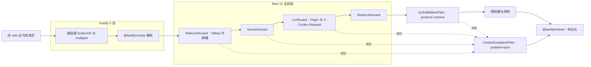
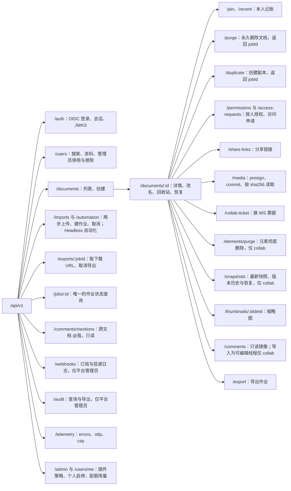
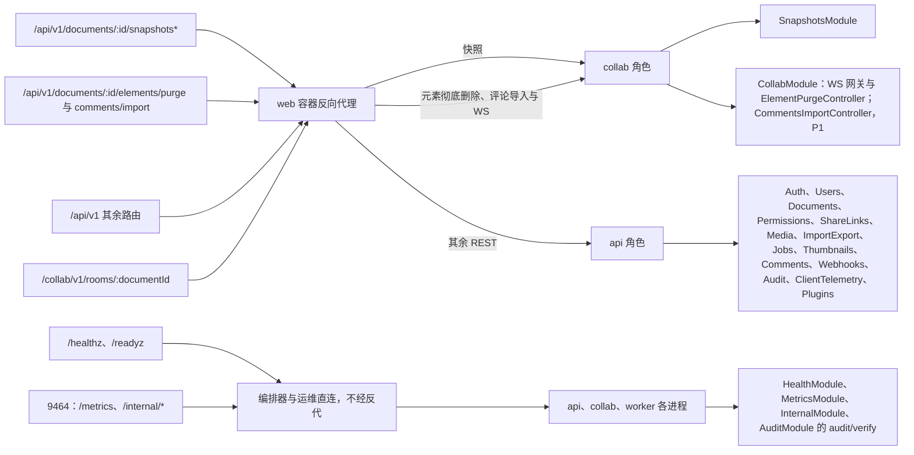

# 15 REST API 目录
> 状态：v0.1 | 负责：后端设计线 | 更新：2026-09-25；2026-09-25（§4.19）；2026-09-25（§4.19 N1）：两个导入受理路由补 409 `server.documents.locked`；2026-09-26（§4.20）；2026-09-26（§4.21：REST 基础件定稿——Nest 12 + Fastify 5、cookie、helmet、multipart、zod-openapi；Webhook 签名头改为 Standard Webhooks；限流维持自研令牌桶）；2026-09-26（§4.21 整合：§3.8 snapshots/latest 的 404 同样带 X-Cordex-Epoch）；2026-09-26（§4.21 Remap：原 30/08 引用按 60-backend/README §6.1 改指新位置，30/08 已删除）；2026-09-26（§4.21 复核：快照恢复改为复制文档先落库再应用、多副本由 extension-redis 收敛、控制事件走控制频道）；2026-10-01（§4.23 插件管理：新增 §3.15 plugins 七条路由（管理员四条、本人三条），资源树与反代映射同步）；2026-10-03（§4.24：AL-1 分享链接请求体删去 `editor`；AL-7 新增 §3.16 automation 三条路由（SV-13 改 M3，§9 未排期口径作废）；TA-4 `/telemetry/errors` 累加插件失败会话 HyperLogLog；TA-7 `server.plugins.*` 已登记、§7 补 `server.plugins.validation_failed` 与 `server.automation.media_not_found`；TA-10 新增 §3.17 quota 两条路由，`DocumentSummary` 加所有者与协作者摘要，位图导出加 `width` / `quality`，管理员插件页加部署与宿主版本；§8、§10 同步）；2026-10-03（§4.24 收尾：§3.15.1 登记 AdminPluginRow 依赖图与 AdminPluginDetail 字段）；2026-10-15（design-language-v3 第 2 批：DS-47 §3.5 分享链接改为每份文档至多一条未撤销的链接——新增 `PATCH …/share-links/:linkId` 改角色与有效期（令牌不变）、`POST` 已有有效链接时 409 `server.share_links.conflict`、`GET` 对 owner 返回可再次复制的令牌、`DELETE` 即「仅邀请」并永久作废旧令牌；DS-48 §3.4 `GET …/permissions` 放宽到 `doc.read`（非所有者不含邮箱），`GET …/share-links` 同样放宽（非所有者只得角色与到期），新增访问申请四条路由与 `DocumentDetail.pendingAccessRequests`；DS-57 §3.8 `SnapshotMeta.preRestore`、命名入参上限与 `named_limit_reached` 的 `details.limit`；§1、§2、图 3-1、§7、§9、§10 同步；新码 `server.share_links.conflict`、`server.access_requests.*` 登记于 30/10 §1.1a；同日再补：TB-65 §2、§3.4 非所有者的 `GET …/permissions` 只回姓名与角色、另附当前有效链接的角色（`MemberList` 读者视图，不含令牌与有效期），应用层用不取 `email`、`token_enc` 的独立查询投影，`GET …/share-links` 收回 `doc.manage`；DS-66 §3.5 `ShareLink.state` 让所有者看出「已到期未撤销」的那条与到期日期，到期等同收紧；DS-67 §3.4、§3.12 访问申请受理时产生 Webhook 事件 `access_request.created`，删「服务端不发任何通知」；DS-68 §3.4 拒绝不告知申请人、不设申请状态查询接口；TB-64 §3.8 命名说明 ≤ 200 字由服务端校验并写明 400 码，§1 增「字数」口径；TB-68 §3.3 `pendingAccessRequests` 只在打开时取一次、不做实时推送；TB-73 §3.4 回收站中的文档照常受理；§9、§10 R12、R13 同步；同日再补：§3.5 表下「复制链接」的出处由 50/02 §11（分享链接落地）改指 §8 的分享用例；同日再补：DS-69、TB-86 §2、§3.4 非所有者在链接授予角色时经 `GET …/permissions` 读者视图的 `link`（`ShareLinkSummary{ role, token }`）取得当前有效链接的令牌，不含有效期与链接 id，`GET …/share-links` 仍只给 `doc.manage`，§3.5 表下「复制链接」按链接设置分两种情形；DS-70 §3.8 `SnapshotMeta` 增 `origin`、`originName`（只在 `import` 快照），§3.9 `POST /imports/uploads` 增 `origin`、`templateName` 并限 `fileName` 1–255 字；§9 增两行，§10 改 R12、R13 并增 R14；同日再补：§2、§3.4 读者视图的链接投影注明取 `id`（只作 AAD、不出参，rulings §4.25 TB-94）、令牌由 PermissionsModule 的 `ShareLinkTokenCipher` 解密（TB-93）；§3.4、§3.5 与 §9 把 `ShareLinkSummary` 写作 `{ role, token? }`，§3.5 表下补「令牌缺省（解密失败）时所有者与非所有者的「复制链接」都不可用、不改为复制文档地址」（TB-91）；§3.8 `originName` 注明显示名建档时记下、源文档或模板改名不回写，空串时界面写「未命名演示文稿」（DS-70、TB-90）；§3.9 与 §9 的 `fileName` 1–255 字补依据与兜底（TB-95））；2026-10-22（design-language-v3 第 3 批：§3.1 `GET /auth/oidc/login` 增 `prompt`（只收 `login`、原样带进授权请求，账号停用后在登录页换账号，rulings §4.25 DS-124），取不到 IdP 发现文档时改为 302 回前端回调页带 `?error=server.auth.idp_unavailable`、原 503 作废（DS-121），回调失败由前端回到登录页内联显示（DS-120），`GET /auth/config` 三项写明配置来源、`signupUrl` 取新登记的 `auth.signupUrl`（DS-119）；§3.2 注明 `avatarUrl` 只存不显示（TB-123）；§3.3 `DocumentSummary` 增 `createdAt`、`contentUpdatedAt`、`lastEditor`、`trashedAt`，卡片第二行与所有者 / 协作者头像按新卡片口径改写（DS-83），各筛选的固定次序写明、不设排序参数（`sort` 等未登记的查询参数按入参校验失败处理），回收站按移入时间（DS-84），`DocumentDetail` 在回收站状态带 `trashedAt`、永久删除只从回收站发起（DS-85、DS-122）；§3.9 新增 `POST /exports/:jobId/cancel`（DS-101），`slides` 省略即全部页且不含隐藏页、pptx 只导整份、M3 起导出对话框的 PNG「全部页」与 PDF 走服务端、jpeg 与 `quality` 只经 API（DS-102、DS-103），`JobStatus` 注明 `cancelled` 的范围；§3.14 `plugins:lasterr` 随上报记阶段；§3.15 `AdminPluginRow` 增 `lastErrorPhase`，`PATCH /admin/plugins` 的 `reset` 注明不经界面、供运维脚本（TB-119）；图 3-1、§4 P1 与 P2、§7（`server.auth.idp_unavailable` 的 HTTP 列，新增 `server.export.job_terminal`，同日已登记进 30/10 §1.1a）、§8 job 档同步；§9 增四行，未排期段补模板库口径（DS-72、DS-93）；§10 增 R15）；2026-10-22（design-language-v3 第 3 批回写补充：§3.1 `GET /auth/config` 增 `trashDays`（取 `retention.trashDays`，回收站文案的天数只从这里读，rulings §4.25 TB-141），`selfSignup` 为真时 `signupUrl` 必有（为空拒绝启动，TB-143）；§3.2 `PATCH /users/me/profile` 删去 `avatarUrl` 入参、只收 `displayName`（去首尾空白后 1–128 字），即 M3 个人资料对话框唯一可改的一项（TB-137、TB-142），请求体带未登记字段 400；§3.3 次序依据补 TB-144，回收站到期日 = `trashedAt` + `trashDays`（TB-141）；§3.9 `POST /imports/uploads` 的文件大小上限注明同一值经 RuntimeConfig `limits.importMaxBytes` 给界面（TB-147）；§3.15 写明清单接口只返回部署时校验完成后的结果、`deployState` 实际不会是 `declared`（设计 03-32 §5.1，TB-119），详情含 `lastErrorPhase`；§9 增一行；§10 增 R16；同日再补：§3.4 注明 M2 界面上「申请访问」与「分享…」留在原位、不可用，本组与 §3.5 的路由 M3 起才有界面调用方（rulings §4.25 TB-156、DS-137）；§3.9 `POST /documents/:id/export` 的里程碑改为「PDF 为 M3 后半段」，PNG / JPEG 在 M3，与 06 §1、§7.2 和 rulings §4.24 AL-4 一致（原写 PDF / PNG / JPEG 都在后半段，与 DS-102「M3 起 PNG『全部页』走服务端」也不符）；§9「仍未排期的端点」按 TB-160 写定：M3 集成方模板源先按 RuntimeConfig 静态列表 `templates.sources` 由 web 容器渲染，浏览器直接取各源清单、不经本目录的端点，服务端模板端点仍随 PD-23 定；2026-10-22 复核修正：§3.1 回调一行与 §4 P2 写明新窗口重新登录失败时前端显示新窗口失败页（rulings §4.25 DS-125），原文只写了回到登录页内联；§3.1 回调一行另写明 state 失效、取不到 `mode` 时回 `/auth/callback`（TB-122）；§3.4 的「分享」入口写全为文档卡片菜单的「分享…」与编辑器的「分享」按钮（DS-137，v3 编辑器没有顶栏）；§3.15 清单行与详情行里管理页的阶段写法改为引用设计 03-32 §4.1、§9（原写「阶段 · 启动 / 贡献」「最近错误码 · 阶段」，与设计的「（阶段：启动）」不符，TB-119）；§3.1 `GET /auth/config` 写明 `auth.oidc.displayName` 为空时省略 `idpDisplayName`（与 17 §5.5 缺省改空、设计 03-33 §4.1 的通用说明句一致，DS-118）；§3.3 `lastEditor` 一段补省略时界面怎样写卡片第二行——缺 `lastEditor` 只写相对时间、两项都缺按 `createdAt`、不拿所有者顶替，服务端不补值、接口不变（rulings §4.25 TB-171，设计 03-01 §4.2）；§3.3 再写明开始页「最近」排序菜单的「最近编辑」按 `contentUpdatedAt`、缺省时取 `createdAt`，与 `last_activity_at` 同一个时间（TB-171、TB-144），`createdAt` 的用途随之补这一项；本批两条「回写补充」并为一条，后一段以「同日再补」接上）；2026-10-23（design-language-v3 第 3 批评审修改：§3.9 `POST /imports/uploads` 的文件大小上限一格，`limits.importMaxBytes` 的界面落点由导入页改为导入对话框——导入改为叠在原页上的「导入」对话框，整屏导入页与过渡页不再有（rulings §4.25 DS-140）；路由、请求与响应、错误码都不变）；2026-11-05（prd-v3-current：§3.17 引用的 PRD SV-08 原文由「配额用量可查询（管理 API 与管理面板）」改为现行措辞「配额用量可查询：M3 经 API」，管理面板随 SV-14 在 M4；路由、请求与响应不变） | 依赖：rulings §4.10 Q20、§4.13 S-1/S-2、§4.15 Q6、§4.17 D1/D2、§4.18 BE-02/BE-03/BE-05/BE-06/BE-10/BE-11/BE-18/BE-30/CO-07/UX-02、§4.19；ADR-0026、ADR-0029、ADR-0031；60-backend/02、04 §7、16 §2（原 30/08 §9、§11、§16.4）；30-architecture/10 §1.4；40-modules/08 §6、09 §6、12 §6；PRD 06 SV-08、SV-12，PRD 05 EM-10；rulings §4.25 DS-47、DS-48、DS-57、DS-66、DS-67、DS-68、TB-64、TB-65、TB-68、TB-71…TB-73、DS-69、DS-70、TB-86、TB-90、TB-91、TB-93…TB-95；rulings §4.25 DS-72、DS-80、DS-83…DS-85、DS-93、DS-101…DS-103、DS-119…DS-122、DS-124、TB-73、TB-119、TB-123、TB-127、TB-137、TB-141…TB-144、TB-147、TB-156、TB-160、DS-137、DS-125、TB-122、DS-118、TB-171、DS-140；rulings §4.24 AL-4

> 读者：实现 `apps/server` 控制器与 `@cordexjs/protocol` `rest/*` 的工程师；前端（[50-frontend/02](../50-frontend/02-app-shell-routing-and-session.md) 的用例层只引用本表，不复写守卫与错误码）；测试（[70/07](../70-testing/07-backend-integration-and-api-e2e.md) 由本表生成「角色 × 能力位 × 路由」矩阵）。
> 定位：**全后端唯一的 REST 路由源**。每条路由的方法、路径、装配角色、守卫与能力位、DTO 文件、成功码、主要错误码、审计 action、限流档、里程碑只在这里登记；[03](03-modules-identity-and-access.md)–[07](07-modules-comments-webhooks-audit.md) 的模块卡只写用例与事务边界，并按固定小节号（§3.1 auth … §3.14 telemetry、§3.15 plugins、§3.16 automation、§3.17 quota）链接本文。
> 不在本文：字段级 DTO（在 protocol `rest/*.ts`，文件登记见 [40-modules/02](../40-modules/02-kernel-protocol-and-document-core.md)）；WS 帧（[30-architecture/06 §6](../30-architecture/06-collaboration.md) 与 [16](16-ws-protocol-server-view.md)）；`/render` 页注入协议（[50-frontend/12](../50-frontend/12-viewer-embedding-and-render-page.md)）；renderer RPC 字段（[06](06-modules-jobs-import-export-thumbnails.md)）；错误码格式与权威映射表（[30-architecture/10 §1](../30-architecture/10-observability-and-errors.md)）。

---

## 1. 约定

| 项 | 约定 |
|---|---|
| 基址 | `RuntimeConfig.apiBase = https://<host>/api/v1`（Nest `setGlobalPrefix('api/v1', { exclude: ['healthz', 'readyz'] })`）；§3 的路径一律**相对 apiBase**；`/healthz`、`/readyz` 无前缀；`/metrics` 与 `/internal/*` 在内部端口 9464（§5）；WS 是 `/collab/v1/rooms/:documentId`（[16](16-ws-protocol-server-view.md)）（rulings §4.18 BE-11） |
| DTO 来源 | 请求与响应 schema 一律来自 `@cordexjs/protocol`：`rest/{auth, users, documents, share-links, media, snapshots, import-export, thumbnails, comments, webhooks, audit, telemetry, problem}.ts`；`documents.ts` 含权限段（含访问申请，2026-10-15）、pin、recent、purge、duplicate、collab-ticket 与 elements/purge 段；`import-export.ts` 含 uploads、cancel、exports 与 jobs 状态；错误码联合在 `errors/codes.ts`，HTTP / WS 映射在 `errors/http-map.ts`（依据：决策 INC-11/INC-13，30-architecture/10 与本线正文 > 40）。控制器 `@Body()` 类型只能是 `z.infer<typeof X>` 且 `X` 来自 protocol；出参也经 schema 解析，防止泄漏字段 |
| OpenAPI | 由 protocol 的 zod schema 经 `zod-openapi` 6 在 protocol 构建脚本里生成 OpenAPI 3.1 文档（devDependency，不进运行时；不用 `@nestjs/swagger` 与 `nestjs-zod`，后者 peer 只到 Nest 11，2026-09-26 定，R-d-54），作为构建产物入库做差异检查（§10 R3）；OpenAPI 只是派生物，不是事实源 |
| 错误 | RFC 9457 `application/problem+json`：`type`、`title`、`status`、`detail`、`instance`、`code`、`traceId`、`retryable`；`details` 只对 `user:true` 的码回传；分享链接失效时 `permission.denied`（`user:true`）在 `details.reason` 携带 `'share_link.expired' \| 'share_link.revoked'`，不设问题体顶层扩展字段（依据：决策 INC-20，ADR-0029；决策 INC-11/INC-13「ErrorEnvelope 只含 `details?`」，30/10 §1.4，[02](02-auth-chain.md) §7.4）。前端的 `ErrorEnvelope`（`code`、`detail`、`traceId`、`retryable`、`details?`）是它的客户端视图 |
| 分页 | 游标分页：`?cursor=<不透明串>&limit=<1..100，默认 50>` → `{ items, nextCursor }`，`nextCursor` 为 `null` 表示末页；游标编码排序键与 id，不返回总数 |
| 标识与时间 | id 为 UUIDv7 字符串（应用层生成）；时间为 RFC 3339 UTC；哈希为小写十六进制 |
| 字数 | 入参的「N 字」上限（版本名称与说明、访问申请留言等）一律按 Unicode 码位计，与 PG `char_length` 同口径；名称类先去首尾空白再计；zod 校验用按码位计数的自定义规则，不用 `.max()` 的 UTF-16 长度；超限 400 `<域>.validation_failed`。客户端的输入上限与计数按同一口径（2026-10-15，rulings §4.25 TB-64） |
| 幂等 | 作业类创建请求的去重键由服务端构造（格式与命中规则见 [06](06-modules-jobs-import-export-thumbnails.md) §2.3，BE-18：命中 queued / running / succeeded 返回既有作业，命中 failed / cancelled 新建一行并以 `attempt_of` 串联）。`POST /documents/:id/export`（含走 `render-export` 的 pdf / png / jpeg）与 `POST /documents/:id/duplicate` 另接受可选请求头 `Idempotency-Key`，只用于识别客户端网络重放（同键重放返回同一 `jobId`），不作为去重键本体，避免客户端控制去重范围；`POST /imports` 不需要该头——`uploadId` 只能兑换预分配的唯一作业，重放天然返回同一行 |
| 条件请求 | `snapshots/latest` 以 `snapshotId` 作 ETag（另带响应头 `X-Cordex-Epoch`）、缩略图以 `contentHash` 作 ETag，支持 `If-None-Match` → 304 |
| 缓存 | JSON 响应默认 `Cache-Control: no-store`；只有表中注明的字节与图片端点另设缓存头；全部响应带 `X-Content-Type-Options: nosniff` |
| CSRF | cookie 会话下，所有非安全方法（POST / PUT / PATCH / DELETE）且非 `@Public` 的路由，要求 ① `Origin` 命中 `security.allowedOrigins`（缺 `Origin` 时 `Sec-Fetch-Site` 必须为 `same-origin`）② 请求头 `X-Cordex-Request: 1`；否则 403 `server.auth.csrf_rejected`。M4 的 Bearer 请求豁免。前端对全部非安全方法请求自动附加该头（GET / HEAD 不带，免得无谓触发跨源预检，决策 INC-24、[02](02-auth-chain.md) §5）；页面卸载时的上报用 `fetch(…, { keepalive: true })` 而不是 `sendBeacon`（后者不能带自定义头）（依据：决策 INC-24 + PRD SV-12；机制见 [02](02-auth-chain.md)） |
| 分享令牌 | 只经请求头 `X-Cordex-Share-Token` 传递，服务端不读取 query 中的同名参数；日志与 trace 对该头脱敏（依据：决策 INC-25，ADR-0029 否决 URL 令牌） |
| 限流 | 每条路由属于一个限流档（§8）；超限 429 `server.http.rate_limited`，带 `Retry-After` |

### 1.1 REST 基础件（2026-09-26）

依据：rulings §4.21 q-nest-major、q-db-access（B2 结案）；R-d-43、R-d-52、R-d-54。版本、许可与否决过的替代以 [19](19-reuse-and-dependency-catalog.md) §2 为准，本节只写每个基础件在请求链路上的职责。

| 基础件 | 选定 | 在 REST 上的职责 |
|---|---|---|
| 传输壳与 HTTP 适配器 | Nest 12（`@nestjs/core`、`@nestjs/platform-fastify` 12.1.x）+ Fastify 5（ADR-0022 B2 结案） | 路由、依赖注入、全局守卫链；Nest 12 为纯 ESM，`apps/server` 按 ESM 构建 |
| 会话 cookie | `@fastify/cookie` 11.1，不启用 cookie 签名 | 读写 `__Host-` 会话与 refresh cookie（[02](02-auth-chain.md) §4.1）；完整性由 JWT 签名承担 |
| 安全响应头 | `@fastify/helmet` 13.1，最小配置 | 全部响应 `X-Content-Type-Options: nosniff` 等（§1「缓存」行）；图片与字节端点单独覆盖；CSP 不在这里设（web 容器下发，[17](17-deployment-and-config.md) §3） |
| multipart | `@fastify/multipart` 10.1 | 只用于 `POST /imports` 的 ≤ 10 MB 单步直传（§3.9、§8），全程流式；其余上传一律预签名直传对象存储 |
| DTO 校验与问题体 | zod 4（protocol schema）+ 自研 `ZodValidationPipe` 与 `CordexExceptionFilter` | 400 与 RFC 9457 问题体（§1「错误」行） |
| 限流 | 自研 Valkey Lua 令牌桶（`RateLimitGuard`） | §8 各档；不用 `rate-limiter-flexible`（只有固定窗口，违背 rulings §4.20 BE-02 的令牌桶定稿，[19](19-reuse-and-dependency-catalog.md) §15.2） |
| 来源 IP | `proxy-addr`（`clientIp()`） | 限流主体与审计 `ip_hash`（§8 末段） |

**图 1-1 一个 REST 请求经过的基础件**



怎么读：实线是一次成功请求依次经过的层，左边的 Fastify 插件先于 Nest 守卫执行，体积超限在进入 Nest 之前就被 413 拒绝；虚线是各层的拒绝出口，统一由异常过滤器写成问题体，最后都经 helmet 加响应头。控制器级守卫（`DocumentRoleGuard`、`PlatformAdminGuard`）在链尾，未画出。

依据：§1、§2、§8；[02](02-auth-chain.md) §6；rulings §4.21。

---

## 2. 守卫与能力位列的写法

「守卫」列按执行顺序书写。全局链固定为 `RateLimitGuard → SessionGuard → CsrfGuard → ShareLinkGuard`（`AppModule` 以 `APP_GUARD` 注册，顺序见 [02](02-auth-chain.md)），表中只写与默认不同的部分和控制器级守卫。

| 写法 | 含义 |
|---|---|
| `Public` | `@Public()`：不经 `SessionGuard` 与 `CsrfGuard`（仍经限流）；快照清单见 §4 |
| `Session` | 已登录：会话 JWT 验签通过、`sid` 未吊销、用户 `status='active'`；全部非 `Public` 路由的默认值 |
| `Session*` | 允许会话 JWT 已过期（签名有效且 `sid` 仍存在）；只用于 `POST /auth/token/refresh` 与 `POST /auth/logout`，前者另验 refresh cookie |
| `+Link` | `ShareLinkGuard` 生效：请求带 `X-Cordex-Share-Token` 时，把有效链接的角色叠加进 `Principal.scopes`；无效、过期、撤销的令牌**直通不叠加**，是否 403 由后续守卫按直接授权决定（依据：决策 INC-20） |
| `DocRole(cap)` | 控制器级 `DocumentRoleGuard`：`max(直接授权, 链接角色)` 的能力位含 `cap` 才放行，否则 403 `permission.denied`；文档不存在或处于 `purging` → 404 `server.documents.not_found`（fail-closed，D12） |
| `Admin` | 控制器级 `PlatformAdminGuard`：`users.platform_role = 'admin'`，否则 403 `server.auth.forbidden` |
| `Creator` | 作业创建者：`job_runs.created_by = 当前用户`，由用例判定（RLS 同口径兜底） |
| `Ops` | 内部端口的运维令牌（§5），不经上述全局链 |

能力位以 protocol `permissions/actions.ts` 为唯一定义；角色是能力位的预设组合（运行时初值 `ROLE_CAPABILITIES` 见 [03](03-modules-identity-and-access.md)，依据 40-modules/08 §2.2 与 PRD 03 CO 条）：

| 能力位 | owner | editor | commenter | viewer |
|---|---|---|---|---|
| `doc.read` | ✓ | ✓ | ✓ | ✓ |
| `doc.comment` | ✓ | ✓ | ✓ | — |
| `doc.write` | ✓ | ✓ | — | — |
| `doc.export` | ✓ | ✓ | — | — |
| `history.read` | ✓ | ✓ | — | — |
| `doc.manage`（分享、权限、处理访问申请、删除、命名版本、元素彻底删除） | ✓ | — | — | — |
| `history.restore` | ✓ | — | — | — |

分享链接可授予的角色是 `viewer`、`commenter`，不能是 `editor` 或 `owner`：编辑权只经按人邀请授予（rulings §4.24 AL-1，以设计 [03-08](../20-design/03-screens/08-share-permissions-dialog.md) 为准）。

成员列表的读取只要 `doc.read`（2026-10-15，rulings §4.25 DS-48：非所有者点「分享」看到只读的「谁能访问…」）：`GET /documents/:id/permissions` 对持 `doc.manage` 的调用者返回完整行，对其他读者只返回姓名与角色（不含邮箱），另附当前有效链接的摘要（不含有效期与链接 id，不列已撤销、已到期的链接，rulings §4.25 TB-65）——链接授予角色时摘要里带这条链接的令牌：非所有者在只读的「谁能访问…」里点「复制链接」，复制的就是凭链接访问的分享链接（2026-10-15，DS-69、TB-86，同 Figma；TB-65「非所有者拿不到令牌」一句随之修订）。两种视图在应用层走各自独立的查询投影——读者一侧的 SQL 不取 `users.email` 与到期列，链接只取仍有效那一行的角色与令牌密文（解密用的 AAD 另要行 id，只在进程内用、不出参，TB-94），令牌在 api 进程解密（TB-71、TB-86；解密件归 PermissionsModule，TB-93），响应再经读者视图的严格 DTO schema 解析兜底，多出的字段直接让响应失败而不是透出（TB-65）；库层的 RLS 只放宽到「对该文档有角色」这一层（[09 §8.1](09-ddl-identity-and-access.md)）。含全部行、有效期与链接 id 的链接设置（`GET …/share-links`）仍只给 `doc.manage`，前端对非所有者只发成员列表这一次请求。链接为「仅邀请」时「复制链接」复制文档地址（列表里的人都能打开），不经本目录任何路由（50/02 §8）；所有者改回「仅邀请」即撤销链接，旧令牌连同已经复制出去的分享链接一并作废（DS-47）。文档列表的协作者摘要不随之放宽（§3.3，rulings §4.24 TA-10）。增改删仍只属于 `doc.manage`。

---

## 3. 路由总表

**每行都隐含的错误码**（行内不再重复）：`Session` 路由的 401 `server.auth.unauthenticated` / `server.auth.expired`；非安全方法的 403 `server.auth.csrf_rejected`；入参校验失败的 400 `<域>.validation_failed`；限流 429 `server.http.rate_limited`；请求体超限 413 `server.http.payload_too_large`；`DocRole` 路由的 403 `permission.denied` 与 404 `server.documents.not_found`。

**列说明**：「状态」是路由的 `@DocState` 访问类（`meta` / `content` / `write` / `transition`，放行规则见 [04](04-modules-documents-storage-media.md) §2 表 2-2；「—」表示没有单文档作用域）；「角色」是装配该控制器的 `CORDEX_ROLE`（`all` 总是包含，不写）；「审计」列的 action 名与 [07](07-modules-comments-webhooks-audit.md) 的审计登记表同一口径（`<resource>.<snake_action>`，决策 INC-31/INC-29），两处不一致时以 07 为准并回改本表，「—」表示不写审计；「限流」列的档位定义见 §8；「里程碑」按章程 §7 与 rulings §4.19 D-M2-CONTENT（协同网关、快照、服务端导入提前到 M2，总表见 [01](01-service-overview-and-roles.md) §3）。

**图 3-1 REST 资源树**



怎么读：从左到右是 URL 的层级，叶子节点文字是该资源下的操作；标「仅 collab」的三处由反代转给 collab 角色（§6），其余都在 api；评论与 @我 只读，评论唯一写入口是 CRDT 经服务端镜像观察器（ADR-0031）。
依据：本节 §3.1–§3.17；rulings §4.18 BE-03、CO-07，§4.19 D-M2-CONTENT（不设 pptx 内容版本端点）；决策 SG-03、SG-08。

### 3.1 auth

`AuthModule` · `rest/auth.ts` · 角色 api · 会话机制、cookie 属性与刷新轮换见 [02](02-auth-chain.md)（决策 SESSION、INC-18）。

| 方法 | 路径 | 守卫与能力位 | 状态 | 请求 → 响应 | 成功 | 主要错误码 | 审计 | 限流 | 里程碑 |
|---|---|---|---|---|---|---|---|---|---|
| GET | `/auth/oidc/login?next=&mode=redirect\|popup&prompt=login` | `Public` | — | 服务端生成 state、PKCE verifier，与 `next`、`mode` 一起存 `oidc:state:{state}`（10 min）→ 302 到 IdP 授权端点；`next` 只接受站内相对路径；`prompt` 只接受 `login`，原样带进授权请求、要求 IdP 重新输入账号（登录页在 `?error=server.auth.account_disabled` 上重新发起时带它，用来换成别的账号，2026-10-22，rulings §4.25 DS-124），其他取值一律忽略、不报错；取不到 IdP 发现文档时不写 state、不下发 cookie，同样 302 回前端回调页并带 `?error=server.auth.idp_unavailable`（`mode=redirect` 回 `/auth/callback`，`mode=popup` 回 `/auth/popup-callback`），与回调失败同一出口，顶层导航里不出现接口错误页（DS-121；原「503 problem+json」作废） | 302 | `server.auth.idp_unavailable`（经 302 的 `?error=` 回前端，同上） | — | public | M2 |
| GET | `/auth/oidc/callback?code=&state=` | `Public` | — | 校验 state → 服务端换码 → 验 id_token（issuer 须在受信列表）→ 首次登录 JIT 建 `users` + `user_identities` → 设 `cordex_session` 与 `cordex_refresh` → 302 到前端 `/auth/callback?next=` 或（`mode=popup`）`/auth/popup-callback` | 302 | 失败一律 302 回前端同一回调页并带 `?error=<码>`（按 state 记下的 `mode` 回 `/auth/callback` 或 `/auth/popup-callback`；state 不存在或已过期时取不到 `mode`，回 `/auth/callback`，新窗口里由前端凭 sessionStorage 标记改显示新窗口失败页，rulings §4.25 TB-122）：`server.auth.invalid_token`（state 失配、换码或验签失败、issuer 不受信）、`server.auth.account_disabled`（用户已停用）、`server.auth.idp_unavailable`；主窗口登录时前端回调页拿到 `error` 即替换到 `/login?error=<码>`，在登录页主按钮上方内联显示（设计 [03-33](../20-design/03-screens/33-login-session-and-error-pages.md) §4.3，2026-10-22，rulings §4.25 DS-120），新窗口重新登录时显示新窗口失败页（03-33 §6，DS-125）；服务端不另设失败页 | `auth.login_succeeded` / `auth.login_failed`；首次建号另记 `user.provisioned` | public | M2 |
| GET | `/auth/config` | `Public` | — | → `{ selfSignup, signupUrl?, idpDisplayName?, trashDays }`（可变开关与只在应用容器里的部署项从此处读，web 容器渲染的静态部署项在 RuntimeConfig，决策 RUNTIME-CONFIG）；前三项分别取 `auth.selfSignup`、`auth.signupUrl`、`auth.oidc.displayName`（[17](17-deployment-and-config.md) §5.5；`auth.oidc.displayName` 缺省为空，为空时省略 `idpDisplayName`，登录页改用通用说明句，设计 03-33 §4.1）：`selfSignup` 为真时登录页把弱提示「没有账号？请联系管理员开通」换成「注册」按钮、在同一标签页顶层导航到 `signupUrl`（2026-10-22，rulings §4.25 DS-119，设计 03-33 §4.2），此时 `signupUrl` 必有——`auth.signupUrl` 为空时应用拒绝启动（TB-143）；`trashDays` 取 `retention.trashDays`（缺省 30，[17](17-deployment-and-config.md) §5.11），回收站说明行、空态、卡片的到期提示与「此文档在回收站中」阻断页的天数都读它，前端不另配，单条的到期日 = `trashedAt` + `trashDays`（§3.3；2026-10-22，rulings §4.25 TB-141） | 200 | — | — | public | M2 |
| GET | `/auth/.well-known/jwks.json` | `Public` | — | → JWK Set（ES256，含轮换期旧公钥）；`Cache-Control: public, max-age=300` | 200 | — | — | public | M2 |
| GET | `/auth/me` | `Session` | — | → `Principal`（`id`、`displayName`、`avatarUrl`、`platformRole`、`email?`）；前端据此判定会话、比对重新登录前后是否同一人（UX-02） | 200 | 仅隐含码 | — | default | M2 |
| POST | `/auth/token/refresh` | `Session*` + refresh cookie | — | 校验 `cordex_refresh` 与 `session:{sid}.refreshHash` → 轮换两个 cookie；已轮换的旧 refresh 再次出现视为泄漏，吊销该 `sid`（同一浏览器 10 s 内的并发刷新除外，[02](02-auth-chain.md) §4.3） | 204 | `server.auth.expired`（401，refresh 无效或过期；前端直接进「登录已过期」，UX-02） | 重放时 `auth.session_revoked`（`reason: refresh_reused`） | default | M2 |
| POST | `/auth/logout` | `Session*` | — | 删 `session:{sid}` 与 `user:{userId}:sessions` 中的该项，清两个 cookie → `{ endSessionUrl? }`：IdP 发现文档有 `end_session_endpoint` 时由服务端拼好（`client_id`、`post_logout_redirect_uri` = `publicUrl` + `auth.oidc.postLogoutRedirectPath`（默认 `/login`）、会话保留了 id_token 时带 `id_token_hint`），否则省略；前端清本地离线数据后顶层跳转到它完成 RP-initiated logout（PRD AS-06，[02](02-auth-chain.md) §4.4） | 200 | 仅隐含码 | `auth.logout` | default | M2 |

### 3.2 users

`UsersModule` · `rest/users.ts` · 角色 api。无邀请表、无租户成员接口（rulings §4.15 T-0、§4.17 D1）。

| 方法 | 路径 | 守卫与能力位 | 状态 | 请求 → 响应 | 成功 | 主要错误码 | 审计 | 限流 | 里程碑 |
|---|---|---|---|---|---|---|---|---|---|
| GET | `/users?query=` | `Session` | — | `query` 至少 2 个字符；按显示名前缀匹配，邮箱只做**精确**匹配且不回显 → 至多 20 条 `{ id, displayName, avatarUrl }`（依据：决策 SG-05） | 200 | `server.users.validation_failed`（400，query 过短） | — | search | M3 |
| PATCH | `/users/me/profile` | `Session` | — | `{ displayName }`（去首尾空白后 1–128 字，§1「字数」口径）→ `User`：M3 个人资料对话框里唯一可改的一项，邮箱只读、头像只读首字（2026-10-22，rulings §4.25 TB-137）；`avatarUrl` 入参同日删去（TB-142），`avatar_url` 只随 IdP 登录按 `picture` 刷新（[02](02-auth-chain.md) §3），请求体带 `avatarUrl` 等未登记字段按入参校验失败处理 | 200 | `server.users.validation_failed`（400，显示名为空、超过 128 字或带未登记字段） | `user.profile_updated` | default | M3 |
| PATCH | `/users/:id` | `Session` → `Admin` | — | `{ status?: 'active' \| 'suspended', platformRole?: 'member' \| 'admin' }` → `User`，本次改为 `suspended` 时另带 `soleOwnerDocCount`（该用户是唯一可用 owner 的文档数，提醒管理员用 ops 命令 `documents:reassign-owner` 转移，[03](03-modules-identity-and-access.md) §3.3、[17](17-deployment-and-config.md) §9，rulings §4.20 BE-05）；停用即吊销该用户全部 `sid` 并以 4401 踢出其 WS（决策 SESSION） | 200 | `server.users.not_found`（404）、`server.users.last_admin`（409，停用或降级最后一名 admin） | `user.suspended` / `user.reactivated` / `user.role_changed` | default | M3 |
| POST | `/users/:id/erasure` | `Session` → `Admin` | — | `{ reason? }` → `{ userId, erasedAt, soleOwnerDocCount }`（含义同上，rulings §4.20 BE-05），同步完成：用户行原地脱敏（`status='erased'`，显示名 `deleted-user`，邮箱与头像置空）、删除全部 `user_identities`、吊销全部会话；指向该用户的外键、审计行与其为 owner 的文档都不动，不进入永久删除编排（[03](03-modules-identity-and-access.md) §3.3；依据：决策 C-24、INC-22） | 200 | `server.users.not_found`（404）、`server.users.last_admin`（409） | `user.erased` | job | M3 P1 |

头像只存不显示（2026-10-22，rulings §4.25 TB-123）：`avatarUrl`（§3.1 的 `Principal`、本组的用户摘要、§3.3 文档列表的 `owner` 与协作者摘要、§3.4 的成员与申请人摘要里都有）照常返回，界面一律画身份色底 + 首字（PRD AS-06、CO-03），个人资料对话框（M3）里的头像同样只读首字；本人不能改头像（`PATCH /users/me/profile` 不收 `avatarUrl`，TB-142），字段来源与刷新规则见 [02](02-auth-chain.md) §3。

### 3.3 documents

`DocumentsModule` · `rest/documents.ts` · 角色 api。文档状态机、永久删除编排与列级写方见 [04](04-modules-documents-storage-media.md)；`purging` 状态的文档对全部路由表现为 404。

| 方法 | 路径 | 守卫与能力位 | 状态 | 请求 → 响应 | 成功 | 主要错误码 | 审计 | 限流 | 里程碑 |
|---|---|---|---|---|---|---|---|---|---|
| GET | `/documents?filter=all\|owned\|shared\|recent\|pinned\|trashed&q=&cursor=&limit=` | `Session`（逐条按角色过滤，RLS 兜底） | — | → `Page<DocumentSummary>`（含 `role`、`pinned`、`lastOpenedAt?`、封面 URL、`createdAt`、`contentUpdatedAt?`、`lastEditor?{ id, displayName }`、`trashedAt?`、`owner{ id, displayName, avatarUrl }`、`collaborators?{ count, preview[≤ 3]{ id, displayName, avatarUrl } }`）；`trashed` 只列本人为 owner 的回收站文档。**卡片第二行「编辑者 · 相对时间」**（2026-10-22，rulings §4.25 DS-83，设计 [03-01](../20-design/03-screens/01-document-list.md) §4.2）取 `lastEditor` 与 `contentUpdatedAt`：最近一次改动内容的人与时刻，由协同服务端写快照时成对写入 `documents.content_updated_by` / `content_updated_at`（auto 快照取区间内最后一条用户更新的人与时刻，import 取导入、新建或创建副本的发起人，restore 取执行恢复的人；只有服务端事务的区间与命名、迁移、换纪元快照不推进，规则见 [05 §7](05-modules-collab-and-snapshots.md)），所以列表里的这两项要到下一次写快照时才更新，时刻取的是那条更新落库的时间；尚无快照时两项都省略，没有可归属的用户（系统作业建档）时只省略 `lastEditor`；`lastEditor` 由 `content_updated_by` 关联 `users` 主键取显示名（取法同 `owner`）。省略时服务端不补值，界面按 rulings §4.25 TB-171 写第二行（设计 [03-01](../20-design/03-screens/01-document-list.md) §4.2）：缺 `lastEditor` 只写相对时间；`lastEditor` 与 `contentUpdatedAt` 都缺时按 `createdAt` 写相对时间、不写编辑者；不拿 `owner` 顶替编辑者。`createdAt` 供开始页「最近」本机排序菜单的「创建时间」（DS-84、TB-127），也是上面两项都缺时第二行的时间与「最近编辑」排序所取的时间（TB-171）；`trashedAt` 只在 `trashed` 条目出现，即移到回收站的时刻，回收站卡片的「N 天前移到回收站」与到期提示据此计算（DS-85），保留天数取 §3.1 `GET /auth/config` 的 `trashDays`（TB-141）。所有者与协作者摘要供卡片右下的头像：别人共享给我的文档画一枚所有者头像，我拥有的共享文档叠放协作者（DS-83；口径同 2026-10-03 rulings §4.24 TA-10，不变）：`owner` 由 `owner_id` 关联 `users` 主键取得（`users` 对 `cordex_app` 可读，[08 §6.4](08-db-conventions-roles-rls-migrations.md)）；`collaborators` **只对调用者是 owner 的条目返回**（TA-10 的卡片口径；2026-10-15 起成员列表对文档的任何读者可读，rulings §4.25 DS-48，卡片不随之扩大，非 owner 的条目省略该字段）；本页 owner 条目的协作者用一次 `permissions WHERE doc_id = ANY($ids)` 批量查询（每页 ≤ 100 个文档，走 `(doc_id, …)` 唯一索引）再按 `users` 主键取显示名，不做逐行子查询。**各筛选的次序固定，不设排序参数**（DS-84；查询串只认上列参数，带 `sort` 等未登记的参数按入参校验失败处理，即本节开头隐含的 400 `<域>.validation_failed`）：`owned`、`shared`、`all`（含 `q` 搜索）按 `last_activity_at DESC, id`，最近活动即内容最近变化、尚无快照时取建档时刻（[10 §2](10-ddl-documents-marks-media.md)），与卡片第二行的时间同源，改名、移入与恢复回收站不改变次序（rulings §4.25 TB-144）；`recent` 按本人 `last_opened_at DESC`，至多 50 条、一页即可取完（[04 §3.1](04-modules-documents-storage-media.md)），「固定的在前」由前端按每条的 `pinned` 排；`pinned` 按 `pinned_at DESC`；`trashed` 按 `deleted_at DESC`（移入时间）。开始页「最近」的排序菜单只在前端对那一段排序（TB-127）：「最近编辑」按 `contentUpdatedAt`、缺省时取 `createdAt`，与 `owned` / `shared` / `all` 所按的 `last_activity_at` 是同一个时间（rulings §4.25 TB-171、TB-144），「创建时间」按 `createdAt`。游标分页不返回总数（§1），列表头、搜索下拉与搜索结果页都不写数量（DS-80）；搜索下拉的前 5 条与「查看全部结果」走同一条 `filter=all&q=`，只是 `limit` 不同 | 200 | 仅隐含码 | — | default | M2 |
| POST | `/documents` | `Session`（`status='active'` 即可） | — | `{ documentType: 'slide', title }` → `Document`；同一事务写 `documents` 与 owner 权限行 | 201 | `storage.quota_exceeded{dimension:'documents'}`（429） | `document.created` | default | M2 |
| GET | `/documents/:id` | `+Link` → `DocRole(doc.read)` | `meta` | → `DocumentDetail`（`role`、`capabilities[]`、`status`、`documentType`、`pinned` 等；调用者持 `doc.manage` 时另带 `pendingAccessRequests`——待处理的访问申请数，「分享」按钮的圆点据此显示，2026-10-15，rulings §4.25 DS-48，M3；客户端打开编辑器时随本路由取一次，打开分享对话框时以 §3.4 访问申请列表的结果为准，本端批准或拒绝后直接减一，服务端不做实时推送，新申请的及时通知走 Webhook `access_request.created`（§3.12），TB-68）；`status = 'trashed'` 时另带 `trashedAt`——回收站里的文档只有持 `doc.manage` 的所有者读得到元数据，所有者从旧链接打开时前端据此换成「此文档在回收站中」阻断页并给「恢复」（到期日按 `trashedAt` + §3.1 的 `trashDays` 算，TB-141），有角色的非所有者得 404、从未获授权的人得 403（2026-10-22，rulings §4.25 DS-85、DS-122、TB-73；[04](04-modules-documents-storage-media.md) §2 交叉规则第 5 条，设计 03-33 §7.2）；无副作用（「最近」在签发协同票据时记录，见 [04](04-modules-documents-storage-media.md) §3.1） | 200 | 403 可带 `reason`（链接失效，INC-20） | 凭链接访问时 `share_link.accessed`（合并计数） | default | M2 |
| PATCH | `/documents/:id` | `DocRole(doc.write)` | `write` | `{ title }` → `DocumentSummary`；只收 `title`，不再按字段区分能力位（决策 SG-06/SG-07） | 200 | `server.documents.locked`（409） | `document.renamed` | default | M2 |
| DELETE | `/documents/:id` | `DocRole(doc.manage)` | `transition` | 移入回收站：`active → trashed`，宽限期 `retention.trashDays` | 204 | `server.documents.locked`（409） | `document.trashed` | default | M2 |
| POST | `/documents/:id/restore` | `DocRole(doc.manage)`（守卫对 `trashed` 文档放行） | `transition` | `trashed → active`；对 `active` 幂等 | 200 | 仅隐含码 | `document.restored` | default | M2 |
| PUT | `/documents/:id/pin` | `DocRole(doc.read)` | `meta` | upsert 本人 `pinned_at = now()` | 204 | 仅隐含码 | — | default | M2 |
| DELETE | `/documents/:id/pin` | `DocRole(doc.read)` | `meta` | 清本人 `pinned_at` | 204 | 仅隐含码 | — | default | M2 |
| DELETE | `/documents/:id/recent` | `DocRole(doc.read)` | `meta` | 从本人「最近」移除：清 `last_opened_at`（未固定则删行），不影响文档本身 | 204 | 仅隐含码 | — | default | M2 |
| POST | `/documents/:id/purge` | `DocRole(doc.manage)` | `transition` | 永久删除文档：`active \| trashed → purging`，同一事务写 `job_runs(kind='document-purge')` → `{ jobId }`；进度经 `GET /jobs/:id`（依据：决策 INC-22 + rulings §4.18 BE-15）；界面只在回收站视图发起（2026-10-22，rulings §4.25 DS-85：模态确认、不输文档名，回收站卡片原位显示「正在永久删除…」直到作业终态），接口仍接受 `active` 文档 | 202 | `server.documents.locked`（409） | `document.purge_scheduled` | job | M3 |
| POST | `/documents/:id/duplicate` | `+Link` → `DocRole(doc.export)` | `content` | `{ title? }` + 可选 `Idempotency-Key` → `{ docId, jobId }`：预分配新文档 id，写 `job_runs(kind='import', payload.source='duplicate')` 入 `import` 队列；worker 以源文档受理时已落库的状态（检查点 + `seq ≤ head_seq` 的 updates）为新文档写 `import` 快照，复制基线与被引用的媒体关联，新文档 owner = 调用者（[04](04-modules-documents-storage-media.md) §3.3、[06](06-modules-jobs-import-export-thumbnails.md) §6.6）；进度经 `GET /jobs/:id` | 202（幂等重放 200） | `storage.quota_exceeded`（429 文档数 / 413 字节） | 作业成功时 `document.created`（`source:'duplicate'`） | job | M2 |

自 M2 起文档内容只以协同快照为事实源（rulings §4.19 D-M2-CONTENT）：打开 = `GET snapshots/latest`（§3.8）+ 票据（§3.7）+ WS；新建空白、从模板新建与导入都经 §3.9 的两步导入写 `import` 快照；不设 pptx 内容版本端点（已删除端点见 §9）。

### 3.4 permissions

`PermissionsModule` · `rest/documents.ts`（权限段，含访问申请）· 角色 api。写库、`permVersion` 递增与 `PUBLISH perm:doc:{docId}` 同一用例、提交后广播，WS 会话 ≤ 1 s 重算（[02](02-auth-chain.md)）。只按人授权，组管理推迟（rulings §4.15 Q6）。访问申请（2026-10-15，rulings §4.25 DS-48）：对文档没有任何角色的已登录用户在阻断页提交，所有者在分享对话框顶部「访问申请 N」一节选角色后批准或拒绝；表与 24 小时规则见 [09 §15](09-ddl-identity-and-access.md)。新记下的申请在同一事务产生 Webhook 事件 `access_request.created`（§3.12，载荷不含留言正文），集成方据此通知所有者（rulings §4.25 DS-67）；申请被拒不告知申请人，也不提供申请人查询本人申请状态的接口（DS-68）；回收站中的文档照常受理、所有者恢复文档后可见，响应与正常文档相同，不向无权限的人泄露文档是否在回收站（TB-73）。本组路由与 §3.5 都在 M3：M2 界面上阻断页的「申请访问」、文档卡片菜单的「分享…」与编辑器的「分享」按钮都留在原位、不可用、写「后续版本提供」，不调用这些路由（2026-10-22，rulings §4.25 TB-156、DS-137）。

| 方法 | 路径 | 守卫与能力位 | 状态 | 请求 → 响应 | 成功 | 主要错误码 | 审计 | 限流 | 里程碑 |
|---|---|---|---|---|---|---|---|---|---|
| GET | `/documents/:id/permissions` | `+Link` → `DocRole(doc.read)`（2026-10-15 由 `doc.manage` 放宽，DS-48） | `meta` | → `MemberList`，按调用者分两种视图（`view` 判别，TB-65）：持 `doc.manage` 时 `{ view: 'owner', grants: Grant[] }`——完整行（`principalType` 只有 `user`，含已过期的授权、`expiresAt`、`grantedBy`，用户摘要含邮箱）；否则 `{ view: 'reader', members: MemberSummary[], link: ShareLinkSummary \| null }`——只列未过期的授权，每项只有 `principalId`、`role` 与 `{ id, displayName, avatarUrl }`（不含邮箱），`link` 为当前有效链接的 `ShareLinkSummary{ role, token? }`（`token` 供非所有者「复制链接」复制分享链接，2026-10-15，rulings §4.25 DS-69、TB-86；解密失败时只省略 `token`，TB-91；没有、已撤销或已到期时为 `null`），即只读的「谁能访问…」。读者视图由不取 `email` 与到期列的独立查询投影组装（链接一侧只取仍有效那一行的 `id`、角色与令牌密文，`id` 只作解密的 AAD、不出参，TB-94；令牌在 api 由 PermissionsModule 的 `ShareLinkTokenCipher` 解密，TB-93），再经 `MemberList` 读者分支的严格 schema 序列化（[03 §4.2](03-modules-identity-and-access.md)、[09 §10](09-ddl-identity-and-access.md) ⑩） | 200 | 仅隐含码 | — | default | M3 |
| PUT | `/documents/:id/permissions` | `DocRole(doc.manage)` | `meta` | `{ principalType: 'user', principalId, role, expiresAt? }` → `Grant`（upsert）；目标账号必须已存在且 `active`（无邀请表，D1） | 200 | `permission.principal_not_found`（404，提示联系管理员建号）、`permission.principal_unsupported`（400）、`permission.last_owner`（409，降级最后一个 owner） | `permission.granted` | default | M3 |
| DELETE | `/documents/:id/permissions/:principalId` | `DocRole(doc.manage)` | `meta` | 撤销该用户的直接授权；对不存在的授权幂等 | 204 | `permission.last_owner`（409） | `permission.revoked` | default | M3 |
| POST | `/documents/:id/access-requests` | `Session`、`+Link`（不经 `DocRole`：申请人对文档没有角色） | — | `{ message? }`（留言可选，1–200 字）→ `AccessRequestReceipt{ requestId, requestedAt, nextRequestAt }`（`nextRequestAt` = `requestedAt` + 24 h）：没有行即记下；上次已批准、或距上次提交已满 24 小时则改回待处理并刷新留言；否则不改写、照原样返回（界面据此显示「已发送申请，等待文档所有者批准」）；201 时与记下申请同一事务写 Webhook 投递行 `access_request.created`（§3.12，载荷带文档、申请与申请人的标识、申请时间与是否附留言，不含留言正文，[07 §5.1](07-modules-comments-webhooks-audit.md)），集成方据此通知所有者，200 不产生事件（rulings §4.25 DS-67）；在线所有者的「分享」圆点不实时刷新（TB-68）；回收站中的文档照常受理（TB-73） | 201（24 小时内重复提交 200） | `server.access_requests.already_granted`（409，调用者对该文档已有角色，含仍有效的链接角色）、`server.documents.not_found`（404，文档行已不存在：外键失败映射，TB-73） | `access_request.created`（只在 201 时） | default | M3 |
| GET | `/documents/:id/access-requests?cursor=&limit=` | `DocRole(doc.manage)` | `meta` | → `Page<AccessRequest>`：只列待处理的，新的在前；`AccessRequest{ requestId, requester{ id, displayName, avatarUrl, email }, message?, requestedAt }` | 200 | 仅隐含码 | — | default | M3 |
| POST | `/documents/:id/access-requests/:requestId/approve` | `DocRole(doc.manage)` | `meta` | `{ role: 'editor' \| 'commenter' \| 'viewer' }` → `Grant`：同一事务写授权（规则同 `PUT …/permissions`，已有更高角色时以本次为准）、标记已批准并清空留言、`permVersion` 递增，提交后广播 | 200 | `server.access_requests.not_found`（404）、`server.access_requests.not_pending`（409，已被处理）、`permission.principal_not_found`（404，申请人已停用或擦除） | `access_request.approved`、`permission.granted` | default | M3 |
| POST | `/documents/:id/access-requests/:requestId/reject` | `DocRole(doc.manage)` | `meta` | 标记已拒绝并清空留言；不告知申请人（rulings §4.25 DS-68）：申请人再打开文档时看到的阻断页与第一次相同，满 24 小时后可再申请；不提供申请人查询本人申请状态的接口 | 204 | `server.access_requests.not_found`（404）、`server.access_requests.not_pending`（409） | `access_request.rejected` | default | M3 |

### 3.5 share-links

`ShareLinksModule` · `rest/share-links.ts` · 角色 api。令牌 32 字节随机数，库存 sha256 供查找、另存 KEK 加密的密文供所有者再次复制（2026-10-15，rulings §4.25 DS-47；信封同 Webhook 签名密钥，[09 §6](09-ddl-identity-and-access.md)）——链接授予角色时，能读文档的成员也经 §3.4 成员列表的读者视图取得同一令牌（DS-69、TB-86）；分享 URL 形态 `https://<host>/documents/{docId}#share={token}`，片段不进请求与日志；**链接始终要求登录**，角色只叠加在已登录用户上（rulings §4.13 S-1、§4.15 Q6；决策 INC-25）。令牌解析不在本模块，归 `PermissionsModule`（BE-02）。

**每份文档至多一条未撤销的链接**（DS-47，对应分享对话框里唯一的链接设置）：放宽（仅邀请 → 凭链接可查看 / 可评审）= `POST` 新建一条、生成新令牌；在可查看与可评审之间切换、改有效期 = `PATCH` 原链接，令牌不变；改回「仅邀请的用户可访问」= `DELETE` 撤销，旧令牌永久失效，再次放宽时生成新链接。有效期只在链接授予角色时才有（永久 / 7 天 / 30 天，`expiresAt` 由客户端按所选档位算出）。

**到期等同收紧**（2026-10-15，rulings §4.25 DS-66）：链接到期后不需要所有者操作，它就和撤销一样不再叠加角色（[02 §7](02-auth-chain.md)、凭它在线的会话按 `linkExpiresAt` 降权）；行本身留着、不改写，`GET` 给每一行带服务端按当前时刻算出的 `state`（`active` / `expired` / `revoked`），所有者重开对话框时据此把链接权限显示回「仅邀请的用户可访问」，并用这一行的 `expiresAt` 写「原链接已于〈日期〉到期」。已到期的链接不能 `PATCH`（404），再放宽时走 `POST`：同一事务先撤销这条已到期的行、再生成新链接与新令牌，旧地址不会复活。客户端不用自己的时钟判断是否到期。

| 方法 | 路径 | 守卫与能力位 | 状态 | 请求 → 响应 | 成功 | 主要错误码 | 审计 | 限流 | 里程碑 |
|---|---|---|---|---|---|---|---|---|---|
| POST | `/documents/:id/share-links` | `DocRole(doc.manage)` | `meta` | `{ role: 'viewer' \| 'commenter', expiresAt? }` → `ShareLink`（含 `token`）：同一事务先撤销该文档已过期未撤销的旧链接，再新建；已有未撤销且未过期的链接 → 409，客户端改用 `PATCH` | 201 | `server.share_links.conflict`（409，已有有效链接） | `share_link.created` | default | M3 |
| GET | `/documents/:id/share-links` | `DocRole(doc.manage)`（2026-10-15 最初曾放宽到 `doc.read`，同日按 rulings §4.25 TB-65 收回：非所有者需要的只有当前有效链接的角色，已并入 §3.4 `GET …/permissions` 的读者视图；同日 DS-69 让非所有者也拿到令牌，同样经那里给出，本路由不随之放宽，TB-86） | `meta` | → `ShareLink[]`（全部行，新的在前，含 `state`、`revokedAt`、`expiresAt`、`createdBy`；`state = 'active'` 的那一条带 `token` 明文，供重开对话框后再次「复制链接」；最新一行 `state = 'expired'` 时界面显示「仅邀请的用户可访问」与「原链接已于〈`expiresAt`〉到期」，DS-66） | 200 | 仅隐含码 | — | default | M3 |
| PATCH | `/documents/:id/share-links/:linkId` | `DocRole(doc.manage)` | `meta` | `{ role?, expiresAt? }`（至少一项；`expiresAt: null` 为永久）→ `ShareLink`（含 `token`）：在原行上改，令牌不变，已发出的地址照常可用；同一事务 `permVersion` 递增，提交后广播，凭该链接在线的会话 ≤ 1 s 按新角色与到期重算 | 200 | `server.share_links.not_found`（404，链接不存在、不属于该文档、已撤销或已过期） | `share_link.updated` | default | M3 |
| DELETE | `/documents/:id/share-links/:linkId` | `DocRole(doc.manage)` | `meta` | 置 `revoked_at` 并清空令牌密文，同一事务 `permVersion` 递增，提交后广播；凭该链接的 WS 会话 ≤ 1 s 降权或失去访问；已撤销的幂等 204、不递增 | 204 | `server.share_links.not_found`（404） | `share_link.revoked` | default | M3 |

`ShareLink{ linkId, role, state: 'active' | 'expired' | 'revoked', expiresAt, revokedAt?, createdBy{ id, displayName }, createdAt, token? }`（`state` 2026-10-15 增，DS-66；`token` 只在 `state = 'active'` 时出现）；`ShareLinkSummary{ role, token? }`（只出现在 §3.4 读者视图，不含有效期与链接 id，TB-65；`token` 2026-10-15 增，与 `state = 'active'` 那一行的 `ShareLink.token` 是同一明文；解密失败（如 KEK 配置出错）时与 `ShareLink.token` 一样只省略、记 `warn`，所以 schema 上它是可选字段，DS-69、TB-86、TB-91）。「复制链接」按链接设置取地址：链接授予角色时复制 `/documents/{docId}#share={token}`——所有者的令牌取自本组 `GET`，非所有者的取自 §3.4 读者视图的 `link.token`（DS-69）；仅邀请时复制文档地址（列表里的人都能打开），不调用本组路由（[50/02 §8](../50-frontend/02-app-shell-routing-and-session.md) 的分享用例）；链接授予角色而响应里没有 `token`（解密失败）时，所有者与非所有者的「复制链接」都留在原位不可用，不改为复制文档地址（rulings §4.25 TB-91）。

### 3.6 media

`MediaModule` · `rest/media.ts` · 角色 api。三条都在 `/documents/:id` 作用域下（依据：决策 INC-21，D12 fail-closed）；上传只有预签名直传一条通道，浏览器侧默认实现见 [50-frontend/05](../50-frontend/05-rendering-and-thumbnails.md)（决策 MEDIA-CLIENT）。**不提供「内容已存在即跳过上传」的捷径**：仅凭 sha256 不能证明持有内容，否则知道哈希即可把他人图片挂进自己的文档再读出（安全宁可提前）；去重发生在 commit 之后的存储层。

| 方法 | 路径 | 守卫与能力位 | 状态 | 请求 → 响应 | 成功 | 主要错误码 | 审计 | 限流 | 里程碑 |
|---|---|---|---|---|---|---|---|---|---|
| POST | `/documents/:id/media/presign` | `DocRole(doc.write)` | `write` | `{ sha256, byteSize, mime }` → `{ uploadId, upload: { url } \| { multipart: { partUrls[] } }, maxBytes, expiresAt }`；对象落 `data` 桶 `uploads/tmp/{uploadId}`，PUT TTL `storage.s3.presign.putTtlSec`（600 s），≥ 10 MB 分片，URL 按 `storage.s3.publicEndpoint` 签名 | 200 | `server.media.unsupported_type`（415，声明 MIME 不在白名单）、`server.media.payload_too_large`（413）、`storage.quota_exceeded{dimension:'bytes'}`（413，按 owner 汇总，决策 G-09）、`server.documents.locked`（409） | — | upload | M2 |
| POST | `/documents/:id/media/commit` | `DocRole(doc.write)` | `write` | `{ uploadId, sha256, byteSize, parts? }` → `{ sha256, mime, byteSize, width?, height? }`：HEAD + 流式重算 sha256、MIME 嗅探（以嗅探为准）、SVG 消毒、尺寸探测 → 服务端复制到 `media/{sha256[0:2]}/{sha256}`（已存在则跳过复制）→ upsert `media_blobs` 与 `document_media`；幂等 | 201 | `permission.denied`（403，`uploadId` 属于他人或他文档）、`storage.upload_not_found`（404）、`storage.integrity_mismatch`（422）、`server.media.unsupported_type`（415，嗅探不可识别）、`server.media.payload_too_large`（413）、`storage.quota_exceeded`（413） | `media.uploaded` | upload | M2 |
| GET | `/documents/:id/media/:sha256` | `+Link` → `DocRole(doc.read)`，且该文档存在 `document_media` 关联 | `content` | → 200 JSON `{ url, expiresAt }`：每次现签的 1 h 预签名 GET，响应 `Cache-Control: no-store`，与 `GET /exports/:jobId` 同一形态；不 302，避免 `fetch` 跟随跨源 302 把 `X-Cordex-Share-Token` 带到存储源并触发预检（决策 INC-25；[04](04-modules-documents-storage-media.md) §7.3）；前端以不带自定义头的请求取 `url` | 200 | `server.media.not_found`（404，无关联；跨文档取媒体一律 404） | — | default | M2 |

### 3.7 collab

票据签发在 api（`AuthModule` 的票据控制器，用例见 [03](03-modules-identity-and-access.md)），元素彻底删除在 collab（`CollabModule`）。WS 本身见 [16](16-ws-protocol-server-view.md)。

| 方法 | 路径 | 角色 | 守卫与能力位 | 状态 | 请求 → 响应 | 成功 | 主要错误码 | 审计 | 限流 | 里程碑 |
|---|---|---|---|---|---|---|---|---|---|---|
| POST | `/documents/:id/collab-ticket` | api | `+Link` → `DocRole(doc.read)`（≥ viewer；只凭链接、无直接授权的用户同样 200，BE-05） | `content` | `{}`（链接令牌只走 `X-Cordex-Share-Token` 头）→ `{ ticket, expiresAt }`；ticket 为 ES256 JWT，60 s、单次（`jti`），claims `sub`、`doc`、`role`、`perm_ver`、`sid`，凭链接时另含 `lnk`（BE-02；TS 字段 `permVersion`，决策 MECH-INC 中 INC-28）；顺带记录本人「最近」 | 200 | 403 可带 `details.reason`（链接失效） | `auth.collab_ticket_issued` | ticket | M2 |
| POST | `/documents/:id/elements/purge` | collab | `DocRole(doc.manage)`（即仅 owner） | `write` | `{ ids: NodeId[] }`（≤ 1,000）→ `{ purged: NodeId[] }`：只接受墓碑态元素，交 server-collab 单写者以 `system('maintenance')` 立即硬删（Room 未加载先加载）；只清当前状态，历史快照与 updates 按保留期存在（rulings §4.18 CO-07） | 200 | `server.documents.element_not_tombstoned`（409，含非墓碑 id，整批拒绝） | `document.element_purged` | default | M3 |

### 3.8 snapshots

`SnapshotsModule` · `rest/snapshots.ts` · **角色 collab**（反代把 `/api/v1/documents/:id/snapshots*` 转给 collab；api 进程装配即启动失败，BE-03）。恢复在本实例打开 Room、在复制文档上先落库再应用（rulings §4.21 H:q-hp-server-tx），多副本由 extension-redis 收敛（M3），关闭或换纪元等控制事件经 FanoutBus 控制频道 `room:{docId}:ctl`，在线客户端不断连；机制见 [60/05 §10](05-modules-collab-and-snapshots.md#10-snapshotsmodule) 与 [60/05 §5](05-modules-collab-and-snapshots.md#5-持久化与跨实例扇出)。

| 方法 | 路径 | 守卫与能力位 | 状态 | 请求 → 响应 | 成功 | 主要错误码 | 审计 | 限流 | 里程碑 |
|---|---|---|---|---|---|---|---|---|---|
| GET | `/documents/:id/snapshots?kind=&cursor=&limit=` | `DocRole(history.read)` | `content` | → `Page<SnapshotMeta>`（`kind ∈ import \| auto \| named \| migration \| restore \| epoch`、`name`、`description`、`contributors[]`、`seqUpto`、`createdAt`；2026-10-15 补 `restoredFrom?{ snapshotId, name? }`——`restore` 版本的来源，界面写「恢复自『X』」，与 `preRestore`——恢复用例在恢复前写下的 `auto` 版本为真，界面标「恢复前」并单列，rulings §4.25 DS-57；同日再补 `origin?`、`originName?`——只在 `kind = 'import'` 时出现：`origin ∈ upload \| blank \| template \| duplicate`（导入文件、新建空白、从模板新建、创建副本），`originName` 为导入的原文件名（含扩展名）、模板名或副本的源文档在受理时的标题（源文档未命名时为空串，界面写「创建自『未命名演示文稿』的副本」，TB-90），`blank` 不带；显示名在建档写这条快照时记下，源文档或模板之后改名都不回写（设计 03-07 §4.1）；版本历史据此写最早那一条「导入自『X』」「新建演示文稿」「从模板『X』新建」「创建自『X』的副本」，rulings §4.25 DS-70） | 200 | 仅隐含码 | — | default | M3 |
| GET | `/documents/:id/snapshots/latest` | `+Link` → `DocRole(doc.read)` | `content` | → 快照字节（Y V2 update，zstd，`application/octet-stream`）；> 1 MiB 的从 `snapshots` 桶流式代理，不返回预签名 URL（决策 MECH-INC 中 INC-14）；请求 `Accept-Encoding` 不含 zstd 时服务端解压后按 gzip 返回（[05](05-modules-collab-and-snapshots.md) §10）；`ETag = snapshotId`，`Cache-Control: private, max-age=0, must-revalidate`；响应头 `X-Cordex-Epoch` = `documents.epoch`，客户端在 Auth 帧 token 的 `epoch` 声明并据此组 provider 文档名 `{documentId}:{epoch}`（[16](16-ws-protocol-server-view.md) §2） | 200 / 304 | `server.snapshots.not_found`（404，尚无快照，客户端从空文档开始；404 同样带 `X-Cordex-Epoch`，2026-09-26 整合） | `document.opened`（合并计数） | default | M2 |
| GET | `/documents/:id/snapshots/:snapshotId` | `DocRole(history.read)` | `content` | → 该版本字节（编码与 latest 相同，供预览）；版本内容不可变，`Cache-Control: private, max-age=31536000, immutable` | 200 / 304 | `server.snapshots.not_found`（404） | — | default | M3 |
| POST | `/documents/:id/snapshots` | `DocRole(doc.manage)` | `write` | `{ name, description? }`（名称去首尾空白后 1–30 字，说明 ≤ 200 字，2026-10-15，rulings §4.25 DS-57；两项上限都由服务端在建快照前按 §1「字数」口径校验，前端到上限后不再接收输入只是体验，不能代替这道校验，TB-64）→ `SnapshotMeta`（`kind='named'`，永久保留）：把当前状态命名为一个版本（决策 MECH-INC 中 INC-15） | 201 | `server.snapshots.validation_failed`（400，名称为空或超过 30 字、说明超过 200 字，TB-64）、`server.snapshots.named_limit_reached`（409，超过每文档命名版本上限 `quota.namedSnapshotsPerDoc`；非配额码；`details.limit` 为本部署上限，界面以轻提示读出、表单与已填名称保留）、`server.snapshots.persist_degraded`（503，Room 处于 PG 降级期，可重试，[05](05-modules-collab-and-snapshots.md) §10） | `snapshot.created` | default | M3 |
| POST | `/documents/:id/snapshots/:snapshotId/restore` | `DocRole(history.restore)`（即仅 owner） | `write` | → `SnapshotMeta`（新写入的 `kind='restore'` 快照）：执行前先写一个 `preRestore` 的 `auto` 版本存下当时的内容（每次都写，DS-40、DS-57），再执行 `core.restoreVersion`，单事务、origin `system('restore')`；提交后经扇出向在线会话发 `CONTROL.event{name:'version.restored'}`（[16](16-ws-protocol-server-view.md) §3） | 200 | `server.snapshots.not_found`（404）、`server.documents.locked`（409）、`server.snapshots.persist_degraded`（503，同上） | `snapshot.restored` | default | M3 |
| GET | `/documents/:id/snapshots/:a/diff/:b` | `DocRole(history.read)` | `content` | → 模型级 diff 预览 | 200 | `server.snapshots.not_found`（404） | — | default | P2（未排期） |

命名版本上限每文档 200（`quota.namedSnapshotsPerDoc`，rulings §4.19 C-06），超出返回 409 `server.snapshots.named_limit_reached`——它是业务上限而不是配额，`*.quota_exceeded` 只用于 rulings §4.17 D2 的三码（决策 MECH-INC 之 INC-12）；自动快照与事件快照 30 天内全保留、之后每天留最后一个、保留至 `retention.autoSnapshotDailyDays`（默认 365，0 = 永久），保留规则本体见 [14](14-valkey-object-storage-and-retention.md) §8。

### 3.9 imports / exports / jobs

`ImportExportModule`、`JobsModule` · `rest/import-export.ts` · 角色 api。导入两步上传：客户端全程不提交任意对象键（rulings §4.18 BE-10）；处理器阶段的拒绝（`format.encrypted`、`format.macro_rejected`、超天花板 `format.quota_exceeded`、`format.limit_exceeded`、`format.pptx.invalid_package`）不走 HTTP，写进作业结果，经 `GET /jobs/:id` 读取。队列与处理器见 [06](06-modules-jobs-import-export-thumbnails.md)。

| 方法 | 路径 | 守卫与能力位 | 状态 | 请求 → 响应 | 成功 | 主要错误码 | 审计 | 限流 | 里程碑 |
|---|---|---|---|---|---|---|---|---|---|
| POST | `/imports/uploads` | `Session`；带 `docId`（覆盖既有文档）时 `DocRole(doc.write)` | `write`（带 `docId` 覆盖既有文档时）/ — | `{ fileName, byteSize, sha256, docId?, origin?, templateName? }` → `{ uploadId, jobId, docId, upload }`：预分配 `jobId`（新建文档时同时预分配 `docId`，UUIDv7）与 `uploadId`（绑定 userId 与这一个 jobId，1 h），返回预签名 PUT（≥ 10 MB 分片）；客户端从不提交对象键。PUT 落隔离区 `uploads/tmp/{uploadId}`，有效期等于 `uploadId` 寿命 1 h，受理时服务端复制到 `docs/{docId}/imports/{jobId}/source.pptx`（UPLOAD-QUARANTINE，rulings §4.18 BE-10 的细化，[06](06-modules-jobs-import-export-thumbnails.md) §6.1）；新建空白与从模板新建同样走本路由（rulings §4.19 D-M2-CONTENT），并以 `origin` 声明来源（2026-10-15，rulings §4.25 DS-70）：缺省 `upload`（导入用户的文件），`blank` 新建空白，`template` 从模板新建、须带 `templateName`（去首尾空白后 1–100 字，§1「字数」口径）；`origin ≠ 'upload'` 时不能带 `docId`；`fileName` 去首尾空白后 1–255 字（主流文件系统的文件名上限，入口校验；库内 `origin_name` ≤ 512 只作兜底，rulings §4.25 TB-95）；来源与显示名随作业写进新文档 `import` 快照的 `origin` / `originName`（§3.8，[06 §6.4](06-modules-jobs-import-export-thumbnails.md)），只用于版本历史的显示，不影响解析 | 201 | `format.quota_exceeded{dimension:'fileSize'}`（413，> `scale.maxFileBytes` 200 MB；同一个值经 RuntimeConfig `limits.importMaxBytes` 给导入对话框（2026-10-23，rulings §4.25 DS-140）与拖入落区写「单个文件最大〈上限〉」，[17](17-deployment-and-config.md) §3.3，2026-10-22，rulings §4.25 TB-147）、`storage.quota_exceeded`（413 字节 / 429 文档数）、`format.macro_rejected` / `format.unsupported_binary`（415，按扩展名 `.pptm` / `.ppt` 提前拒绝，处理器仍按内容复核，[06](06-modules-jobs-import-export-thumbnails.md) §6.1）、`server.documents.locked`（409，带 `docId` 且文档正处于另一覆盖导入或迁移的锁定窗口，[06](06-modules-jobs-import-export-thumbnails.md) §6.5，rulings §4.19 N1） | — | upload | M2 |
| POST | `/imports` | `Session`；`uploadId` 须属于当前用户且未过期 | `write`（带 `docId` 覆盖既有文档时）/ — | `{ uploadId, parts? }`（JSON），或 ≤ 10 MB 文件的 `multipart/form-data` 单步直传（PRD SV-01，内部走同一路径；表单字段 `origin`、`templateName` 的规则同上一行，DS-70）→ `{ jobId, docId }`：HEAD 确认对象 → 按服务端幂等键建 `job_runs` → 入 `import` 队列；`uploadId` 只能兑换预分配的那一个作业，重放总是返回同一行 | 202（重放 200） | `server.import.upload_forbidden`（403，不存在、过期或非本人，不区分）、`server.import.source_missing`（409，对象缺失或大小不符）、`server.documents.locked`（409，同上） | `import.created` | job | M2 |
| POST | `/imports/:jobId/cancel` | `Session` → `Creator` | — | queued / running → cancelled，删原件与已生成产物，不建文档 | 200 | `server.jobs.not_found`（404）、`server.import.job_terminal`（409，已终态） | `import.cancelled` | job | M2 |
| POST | `/documents/:id/export` | `DocRole(doc.export)` | `content` | `{ format: 'pptx' \| 'pdf' \| 'png' \| 'jpeg', snapshotId?, slides?, width?: 1280 \| 1920 \| 3840, quality?: 1–100 }` + 可选 `Idempotency-Key` → `{ jobId }`；`width` 只对 png / jpeg 有效（缺省 1280，设计 [03-22](../20-design/03-screens/22-export-dialog.md)），`quality` 只对 jpeg 有效（缺省 85），二者进入幂等键并下发 renderer（[06 §7.2、§10.3](06-modules-jobs-import-export-thumbnails.md)，2026-10-03 TA-10）；`slides` 只对 pdf / png / jpeg 有效：省略即全部页、不含隐藏页，给出时按所列页导出、含其中的隐藏页；pptx 只导整份文档（2026-10-22，rulings §4.25 DS-103）；导出对话框里 M3 起 PNG「全部页」与 PDF 走本路由、只含已同步的内容（DS-102，设计 [03-22](../20-design/03-screens/22-export-dialog.md)），其余格式与范围在浏览器生成；jpeg 与 `quality` 不在对话框里，只经 API 与自动化调用（DS-103，PRD SV-02、SV-13）；pptx 入 `export` 队列，其余经 `RenderExportProducerService` 入 `render-export` 队列 | 202（幂等命中 200） | 仅隐含码 | `export.created` | job | M3（PDF 为 M3 后半段；rulings §4.24 AL-4，[06](06-modules-jobs-import-export-thumbnails.md) §1、§7.2） |
| POST | `/exports/:jobId/cancel` | `Session` → `Creator` | — | 只对 `export`、`render-export` 作业：`queued → cancelled`（从队列移除），`running → cancelled`（处理器在下一个检查点中止，已生成的字节丢弃、已写出的产物删除，不签下载地址）；同参数再导出新建一行、`attempt_of` 指向这一行（[06 §7.5](06-modules-jobs-import-export-thumbnails.md)）。导出对话框在排队与生成中只有「取消」一个出口（Esc、× 等同），取消即调本路由；不做关掉对话框后的后台继续（2026-10-22，rulings §4.25 DS-101，PRD 05 M3 验收 6） | 200 | `server.jobs.not_found`（404，不存在、不可见或不是导出作业）、`server.export.job_terminal`（409，已终态） | `export.cancelled` | job | M3 |
| GET | `/exports/:jobId` | `Session` → `Creator` 或 `DocRole(doc.export)` | `content` | 只返回下载地址：`{ url, expiresAt, fileName }`，每次现签 1 h 预签名 GET（对象保留 24 h，决策 SG-08、MECH-INC 中 INC-40）；自动化作业（§3.16）的产物与 `validate` 报告同样经此取得，无文档作用域的只对创建者；状态查询请用 `/jobs/:id` | 200 | `server.jobs.not_found`（404）、`server.export.not_ready`（409）、`server.export.expired`（410） | `export.downloaded` | default | M3 |
| GET | `/jobs/:id` | `Session`；`Creator` 或对 `job_runs.doc_id` 有授权（RLS 同口径） | — | → `JobStatus`（`kind`、`status ∈ queued \| running \| succeeded \| failed \| cancelled`、`progress?`、`result?`、`error?{ code, detail }`、`fidelityReport?`）；导入、导出、render-export、document-purge 与自动化四种 kind（§3.16）共用（决策 SG-08）；`cancelled` 只出现在导入与导出两类（DS-101） | 200 | `server.jobs.not_found`（404，不存在与无权查看同码，避免枚举） | — | default | M2 |

### 3.10 thumbnails

`ThumbnailsModule` · `rest/thumbnails.ts` · 角色 api。640 px 行入 `thumbnails` 表，1280 px 按需变体只存对象（键加 `@1280`），以 640 行的 `content_hash` 判新鲜（决策 SG-10）；封面用保留 slideId `'__cover'`（决策 MECH-INC 中 INC-16）。

| 方法 | 路径 | 守卫与能力位 | 状态 | 请求 → 响应 | 成功 | 主要错误码 | 审计 | 限流 | 里程碑 |
|---|---|---|---|---|---|---|---|---|---|
| GET | `/documents/:id/thumbnails/:slideId?size=640\|1280` | `+Link` → `DocRole(doc.read)` | `content` | 命中 → `image/webp`（`ETag = contentHash`，`Cache-Control: private, no-cache`，每次以 `If-None-Match` 复核，前端不另做缓存层，决策 APP-DATA）；`__cover` 的包内封面为 `image/jpeg`；图片响应一律 `X-Content-Type-Options: nosniff` + `Content-Security-Policy: sandbox`；未命中 → 404 + `Retry-After: 2` 并惰性入队（按页内容哈希去重、按用户限流，处理器丢弃不存在的 slideId；细节见 [06](06-modules-jobs-import-export-thumbnails.md) §11），前端显示占位 | 200 / 304 | `server.thumbnails.not_found`（404，未生成或 slideId 不存在，带 `Retry-After`） | — | default | M2（`__cover` 包内封面，由 M2 导入写入）/ M3 前半段（服务端渲染） |

### 3.11 comments

`CommentsModule` · `rest/comments.ts` · 角色 api（只读 REST 留在 api，镜像观察器与 `comments/import` 只在 collab，BE-03）。评论事实源是 CRDT 内的 ResourceHook `comments.threads`（路径 `resources['comments.threads']`，客户端插件为 iso 包 `@cordexjs/comments`，rulings §4.19 D-COMMENTS-PKG），PG 表只是读模型，**REST 只读**，唯一写入口是 `CommentMirrorObserver`（ADR-0031；决策 SG-03、INC-39）。在线通知走 `CONTROL.event{ name: 'comments.changed', payload: { threadIds[] } }`（[16](16-ws-protocol-server-view.md)）。

| 方法 | 路径 | 守卫与能力位 | 状态 | 请求 → 响应 | 成功 | 主要错误码 | 审计 | 限流 | 里程碑 |
|---|---|---|---|---|---|---|---|---|---|
| GET | `/documents/:id/comments?filter=all\|page\|unresolved\|mentions&page=<slideId>&cursor=&limit=` | `+Link` → `DocRole(doc.read)` | `content` | → `Page<CommentThread>`（线程、回复、`anchorState`、`resolvedAt`、`mentions`）；`filter=page` 时 `page` 必填 | 200 | 仅隐含码 | — | default | M3 |
| GET | `/documents/:id/comments/:threadId` | `+Link` → `DocRole(doc.read)` | `content` | → `CommentThread` | 200 | `server.comments.not_found`（404） | — | default | M3 |
| POST | `/documents/:id/comments/import` | `DocRole(doc.comment)` | `write` | `{ importedThreadIds[] }` → `{ threadIds[] }`：把 pptx 导入的只读批注转为可编辑线程，经服务端事务写入 CRDT。该事务只能在持有 Room 的 collab 实例内执行，所以本路由的**角色是 collab**（`CommentsImportController`，[07](07-modules-comments-webhooks-audit.md) §1.5），反代与快照、元素彻底删除同一条规则转发（[01](01-service-overview-and-roles.md) §7，启动断言 A5 禁止它出现在 api） | 200 | `server.comments.not_found`（404）、`server.comments.import_unsupported`（409，没有可导入的只读评论） | `comment.imported_as_editable` | default | M3 P1 |
| GET | `/comments/mentions?cursor=&limit=` | `Session`（逐文档按当前角色过滤，RLS 兜底） | — | → `Page<MentionItem>`：跨文档「@我」 | 200 | 仅隐含码 | — | default | M3 |

### 3.12 webhooks

`WebhooksModule` · `rest/webhooks.ts` · 角色 api · 只有平台管理员。对外事件 `comment.added`、`comment.mentioned`、`comment.resolved`、`automation.job_finished`（2026-10-03，§3.16）与 `access_request.created`（2026-10-15，rulings §4.25 DS-67：访问申请新记下时产生，载荷不含留言正文，集成方据此通知所有者），事件集合与载荷以 [07 §4.2、§5.1](07-modules-comments-webhooks-audit.md) 为准，载荷 schema 带版本；签名按 **Standard Webhooks**：`webhook-id`（投递行 id）、`webhook-timestamp`、`webhook-signature: v1,<base64(HMAC-SHA256)>`，多个签名空格分隔、轮换宽限期双签（2026-09-26，rulings §4.21 q-webhook-sig；原 `X-Cordex-Signature` 已废止，细节见 [07](07-modules-comments-webhooks-audit.md) §5.2）；密钥对外编码为 `whsec_<base64>`；签名密钥以部署 KEK 做 AES-256-GCM 加密存储（`signing_secret_enc` + `secret_version`），明文只在创建与轮换响应中出现一次（决策 C-16/INC-30、INC-31/INC-29）。出站地址在创建、更新与每次投递前都过 SSRF 守卫（rulings §4.13 S-4），细节见 [07](07-modules-comments-webhooks-audit.md)。

| 方法 | 路径 | 守卫与能力位 | 状态 | 请求 → 响应 | 成功 | 主要错误码 | 审计 | 限流 | 里程碑 |
|---|---|---|---|---|---|---|---|---|---|
| POST | `/webhooks` | `Admin` | — | `{ targetUrl, eventFilter[], status? }` → `{ subscription, signingSecret }` | 201 | `server.webhooks.invalid_url`（422）、`server.webhooks.invalid_event_filter`（422）、`server.webhooks.egress_blocked`（422） | `webhook.created` | default | M3 |
| GET | `/webhooks` | `Admin` | — | → `WebhookSubscription[]`（不含密钥） | 200 | 仅隐含码 | — | default | M3 |
| PATCH | `/webhooks/:id` | `Admin` | — | `{ targetUrl?, eventFilter?, status?, rotateSecret?: true }` → `WebhookSubscription`；改地址时重新过 SSRF 守卫；`rotateSecret` 时响应另含一次性的 `{ signingSecret, secretVersion }`，旧密钥保留 24 h 宽限期、期间双签名（C-16 的轮换入口） | 200 | `server.webhooks.not_found`（404）、`server.webhooks.invalid_url`（422）、`server.webhooks.invalid_event_filter`（422）、`server.webhooks.egress_blocked`（422） | `webhook.updated`；轮换另记 `webhook.secret_rotated` | default | M3 |
| DELETE | `/webhooks/:id` | `Admin` | — | 同一事务先删除该订阅的全部投递记录、再删订阅行（外键 RESTRICT；`cordex_app` 对 `webhook_deliveries` 的 DELETE 已由 0095 授予，[08](08-db-conventions-roles-rls-migrations.md) §4.2）；在途的 BullMQ 作业执行时找不到投递行即丢弃（[07](07-modules-comments-webhooks-audit.md) §4.2） | 204 | `server.webhooks.not_found`（404） | `webhook.deleted` | default | M3 |
| GET | `/webhooks/:id/deliveries?status=&cursor=&limit=` | `Admin` | — | → `Page<WebhookDelivery>`（`pending \| succeeded \| failed \| dead-lettered`、`attempt`、`responseCode`） | 200 | `server.webhooks.not_found`（404） | — | default | M3 |

### 3.13 audit

`AuditModule` · `rest/audit.ts` · 角色 api · 只有平台管理员。审计只追加、哈希链与每日封存见 [07](07-modules-comments-webhooks-audit.md)；链校验不走公开 REST，走内部端点（§5，决策 MECH-INC 中 SG-09）。

| 方法 | 路径 | 守卫与能力位 | 状态 | 请求 → 响应 | 成功 | 主要错误码 | 审计 | 限流 | 里程碑 |
|---|---|---|---|---|---|---|---|---|---|
| GET | `/audit?from=&to=&category=&action=&docId=&actorId=&result=&cursor=&limit=` | `Admin` | — | → `Page<AuditRecord>`（`ip_hash`、`ua_hash` 不回传原值）；区间 ≤ 366 天 | 200 | `server.audit.range_too_large`（400） | — | default | M3 |
| GET | `/audit/export?format=csv\|json`（过滤参数同上） | `Admin` | — | → 流式导出（`Content-Disposition: attachment`），单次 ≤ 1,000,000 行 | 200 | `server.audit.range_too_large`（400）、`server.audit.export_too_large`（422） | `audit.exported` | job | M3 |

### 3.14 telemetry

`ClientTelemetryModule` · `rest/telemetry.ts` · 角色 api（rulings §4.18 BE-30）。请求体上限与限流是这组路由的主要防线；服务端端点、Collector 路由见 [18](18-observability-and-ops-endpoints.md)，浏览器侧采集与同意见 [50-frontend/15](../50-frontend/15-events-errors-and-telemetry.md)。

| 方法 | 路径 | 守卫与能力位 | 状态 | 请求 → 响应 | 成功 | 主要错误码 | 审计 | 限流 | 里程碑 |
|---|---|---|---|---|---|---|---|---|---|
| POST | `/telemetry/errors` | `Session` | — | `ClientErrorReport[]`（≤ 20 条，请求体 ≤ 64 KiB）→ 经 logger 落结构化日志；带插件 `id` 的条目（插件 `FAILED`、`plugin/incompatible`，PM-15）另对 `plugins:fail:{pluginId}:{yyyyMMddHH}` 执行 `PFADD <sessionId>` 并写 `plugins:lasterr:{pluginId}`（值为 `{ code, phase? }`：`phase` 取该条上报里 `kernel.plugin_failed` 的 `details.phase`，`activate` / `contribution`，供管理员页显示失败阶段，2026-10-22，rulings §4.25 TB-119、TB-77），即本端点累加管理员页的「近 24 h 失败会话数」（按会话去重，[14 §3.2](14-valkey-object-storage-and-retention.md)，2026-10-03 rulings §4.24 TA-4）；401 时前端丢弃、不重试（决策 MECH-INC 中 SG-11） | 204 | 仅隐含码 | — | telemetryErrors | M2 |
| POST | `/telemetry/otlp` | `Session` | — | OTLP/HTTP traces（≤ 512 KiB）：`application/x-protobuf`，或只含 `resourceSpans` 的 `application/json`；只转发到 Collector 的 `/v1/traces`（细则见 [18](18-observability-and-ops-endpoints.md) §9.1） | 200（透传 OTLP 响应） | `server.http.unsupported_media_type`（415，不是上述两种媒体类型，或 JSON 含 traces 以外的信号）；Collector 不可用 503 | — | telemetryOtlp | M3 |
| POST | `/telemetry/csp` | `Public` | — | `application/reports+json` 或 `application/csp-report`（≤ 16 KiB）→ 只记录违反的指令名与被拦主机名，丢弃其余字段（决策 TT-CSP-REPORT） | 204 | 仅限流与体积码 | — | csp | M2（report-only）/ M3（强制） |

### 3.15 plugins（2026-10-01，rulings §4.23）

`PluginsModule` · `rest/plugins.ts` · 角色 api。用例与事务边界见 [03 §12](03-modules-identity-and-access.md)；表见 [09 §14](09-ddl-identity-and-access.md)；需求 PRD [09-plugin-manager](../10-prd/03-features/09-plugin-manager.md)。插件只经部署声明文件与镜像内置进入部署（[17 §5.16](17-deployment-and-config.md)），本组路由**没有**上传、安装、卸载或下载插件的端点。管理员路由的 `ETag` / `If-Match` 取插件集指纹的 `policy` 段（[16 §12](16-ws-protocol-server-view.md)）；个人启停不写审计、不改指纹（PM-14）。

| 方法 | 路径 | 守卫与能力位 | 状态 | 请求 → 响应 | 成功 | 主要错误码 | 审计 | 限流 | 里程碑 |
|---|---|---|---|---|---|---|---|---|---|
| GET | `/admin/plugins` | `Admin` | — | → `{ plugins: AdminPluginRow[], rejected: RejectedPlugin[], fingerprint: {catalog, policy}, allowUnsigned, deploymentVersion, hostApiVersion }`（后两项供设计 [03-32](../20-design/03-screens/32-admin-plugin-management.md) 页头「部署版本 · 宿主」：`deploymentVersion` 与 `cordex_build_info.version` 同源，`hostApiVersion` 是判定插件 `hostApi` 兼容所用的宿主 API 版本，2026-10-03 TA-10）；每行 `id`、`version`、`source`（`builtin` \| `mount`）、`vendor?`、`scope`、`necessity`、`state`（三态）、`defaultOn?`、`deployState`（八种之一；本接口只返回部署时校验完成后的结果——校验在进程启动阶段、主端口开始监听之前一次做完（[03 §12.2、§12.3](03-modules-identity-and-access.md)），所以实际不会出现 `declared`，设计 03-32 §5.1 的「已声明 · 校验中」在界面上不会出现；protocol 枚举仍保留这一值，界面按 rulings §4.25 TB-119 的只读画法兜底，2026-10-22）、`locked?`（`lockPolicy` / `kernel` / `contract`）、`failedSessions24h`（Valkey 小时桶 HyperLogLog 读时合并近 24 桶，[03 §12.2](03-modules-identity-and-access.md)）、`lastErrorCode?`、`lastErrorPhase?`（`activate` \| `contribution`，只在最近错误码为 `kernel.plugin_failed` 时出现；管理页的行下说明据此把 `activate` 写作「启动」、`contribution` 写作「贡献」，写法见设计 03-32 §4.1，2026-10-22，rulings §4.25 TB-119）、`requires` / `requiredBy` / `conflictsWith`（清单级依赖图，字段见 §3.15.1，供管理页客户端的依赖 / 互斥计算，2026-10-03）；响应头 `ETag: "<policy>"` | 200 | 仅隐含码 | — | default | M3 |
| GET | `/admin/plugins/:pluginId` | `Admin` | — | → `AdminPluginDetail`（字段见 §3.15.1；含清单行的全部字段，`lastErrorCode?` 与 `lastErrorPhase?` 供详情抽屉概要的「近 24 h 失败」一项附上最近错误码与阶段，写法见设计 03-32 §9，2026-10-22，rulings §4.25 TB-119）：宿主兼容范围、`injects` 与提供者、被谁依赖、互斥对象、按贡献点分组的贡献计数、能力声明（仅展示）、信任来源（内置 / 签名公钥指纹 / 审核记录）、最近 5 次策略变更（审计查询）、配置 schema 与当前非机密值（M4） | 200 | `server.plugins.not_found`（404） | — | default | M3 |
| PATCH | `/admin/plugins` | `Admin`；`If-Match` 必填 | — | `{ changes: [{ pluginId, state, defaultOn? } \| { pluginId, reset: true }] }`（≤ 100 项）→ 同 `GET /admin/plugins`；整批一个事务，失败不部分生效；`reset: true`（恢复部署默认：删除该插件的策略行、回到声明文件的初始状态）不经管理页界面——管理页不设这个操作，供运维脚本以平台管理员会话调用（2026-10-22，rulings §4.25 TB-119） | 200 | `server.plugins.revision_conflict`（412）、`server.plugins.policy_invalid`（422）、`server.plugins.conflict`（409）、`server.plugins.not_found`（404） | `plugin.policy_changed`（每项一条，同批 `batchId`） | default | M3 |
| PUT | `/admin/plugins/:pluginId/config` | `Admin`；`If-Match` 必填 | — | `{ config: object }`（非机密字段；机密字段只能「使用部署文件中的值」）→ `AdminPluginDetail` | 200 | `server.plugins.config_invalid`（422）、`server.plugins.revision_conflict`（412）、`server.plugins.not_found`（404） | `plugin.config_changed`（只记字段路径） | default | M4 |
| GET | `/users/me/plugins` | `Session` | — | → `{ fingerprint: {catalog, policy}, plugins: [{ id, version, scope, source, entry?, state, enabled, defaultOn? }] }`；`entry` 只对挂载目录插件给出（同源 `/plugins/{sha256}/…`，M4）；只含本部署当前会装配或可由本人开启的插件，被拒与已禁用的不列出 | 200 | 仅隐含码 | — | default | M2（只读，镜像内置组成）/ M3（含策略与个人选择） |
| PUT | `/users/me/plugins/:pluginId` | `Session` | — | `{ enabled: boolean }` → 同 `GET /users/me/plugins` 的该插件一行 | 200 | `server.plugins.not_optional`（409）、`server.plugins.not_found`（404） | — | default | M3 |
| DELETE | `/users/me/plugins/:pluginId` | `Session` | — | 删除本人的选择，回到管理员默认值 | 204 | `server.plugins.not_found`（404） | — | default | M3 |

#### 3.15.1 `AdminPluginRow` 依赖图与 `AdminPluginDetail` 字段（2026-10-03，rulings §4.24 收尾）

本组是 §1「不在本文：字段级 DTO」的例外：管理员插件页的前端状态（[50-frontend/03](../50-frontend/03-preset-assembly-and-plugins.md) §10.1）直接按字段消费，字段名在此登记，`protocol rest/plugins.ts` 的 zod schema 照此实现。依赖与互斥全部由 `PluginCatalog` 在启动时从各插件的 `cordex-manifest.json` 算出（`provides`、`injects`、`optional`、`contributes`，PRD [04 PS-01](../10-prd/03-features/04-plugin-sdk.md)），声明文件不另写依赖或互斥；被拒插件不进依赖图，也不算提供者。

```ts
type PluginId = string;                                  // cordis 插件 id（rulings §4.24 TA-5）
type PolicyState = 'forced' | 'optional' | 'disabled';

// GET /admin/plugins 每行在既有字段之外追加（清单级依赖图）
interface AdminPluginGraphFields {
  requires: { service: string; providers: PluginId[] }[];   // 清单 injects 的硬依赖；providers = 本部署内 provides 该服务的插件；可选注入（optional）不列
  requiredBy: PluginId[];                                    // 硬注入了本插件某个 provides 服务的插件
  conflictsWith: PluginConflict[];                           // 与本插件互斥的插件，双向各列一次
}
interface PluginConflict {
  pluginId: PluginId;
  kind: 'provider' | 'shapeKind';   // 同一 Provider 座（provides 服务名相同）/ 同一 slide.shapeKind（contributes 的键相同）
  key: string;                      // 冲突的服务名或 shapeKind 值，如 'flowchart'
}

// GET /admin/plugins/:pluginId；PUT /admin/plugins/:pluginId/config 的响应
interface AdminPluginDetail extends AdminPluginRow {        // 含上面三项与 §3.15 第一行列出的全部行字段
  displayName: string;
  description?: string;
  hostCompat: { range: string; current: string };          // range = 清单 hostApi（semver 范围）；current = 列表响应的 hostApiVersion
  injects: {                                               // 依赖：清单 injects 与 optional 全量
    service: string;
    optional: boolean;
    providers: { pluginId: PluginId; state: PolicyState }[]; // 对方当前策略（已保存值）
  }[];
  requiredByDetail: { pluginId: PluginId; services: string[]; state: PolicyState }[];
  conflictsDetail: (PluginConflict & { state: PolicyState })[];
  contributions: { point: string; count: number }[];      // 按贡献点 id 分组计数，取清单 contributes
  permissions: string[];                                   // 能力声明，原样取清单 permissions，仅展示、不做运行时限制（PS-13）；空数组 = 未声明
  trust:
    | { kind: 'builtin' }                                  // 镜像内置，随镜像 digest 与 SBOM 受信
    | { kind: 'signature'; publicKeyFingerprint: string }  // Ed25519 公钥 SHA-256 指纹，形如 'SHA256:3f:…'
    | { kind: 'review'; reviewer: string; date: string; sha256: string; link?: string } // 声明文件 review 的 by / date / link 与钉住的包 sha256
    | { kind: 'unsigned'; allowedBy: 'allowUnsigned' };    // 非生产部署 plugins.allowUnsigned 放行（M4）
  recentPolicyChanges: {                                   // 审计 plugin.policy_changed 最近 5 条，新到旧；空数组 = 暂无变更记录
    occurredAt: string;
    actor: { kind: 'user'; id: string; displayName: string } | { kind: 'system' };
    from: { state: PolicyState; defaultOn?: boolean };
    to: { state: PolicyState; defaultOn?: boolean };
    reset?: true;                                          // 恢复部署默认
  }[];
  config?: {                                               // M4（PS-10）；M3 省略该字段
    schema: object;                                        // 由插件 Config schema 转出的 JSON Schema 2020-12；机密字段带 writeOnly: true
    values: Record<string, unknown>;                       // 当前非机密值（声明文件 initial 叠加 plugin_policies.config）
    secrets: { path: string; usesDeploymentValue: boolean }[]; // 机密字段只给标记：是否已使用部署文件（*File）中的值，从不回传值
  };
}
```

- 行内 `requires` / `requiredBy` / `conflictsWith` 只给插件 id，前端用它与草稿求「等待依赖」「将进入等待依赖」「视同强制」「互斥」四种派生态；详情里的 `injects` / `requiredByDetail` / `conflictsDetail` 再附服务名与对方当前策略供抽屉展示。两处同源，同一 `catalog` 摘要下不变。
- 服务端裁决不依赖前端计算：`PATCH /admin/plugins` 仍按同一依赖图整批校验（`server.plugins.conflict` 的 `details.with` 即 `conflictsWith` 中命中的项）。
- `recentPolicyChanges` 由 `GetPluginCatalogUseCase` 经审计只读面查询（[07 §9.5](07-modules-comments-webhooks-audit.md)），`actor.displayName` 取 `users` 主键；`config` 的机密字段路径不出现在 `values` 中。

### 3.16 automation（2026-10-03，rulings §4.24 AL-7）

`ImportExportModule` · `rest/import-export.ts`（自动化段）· 角色 api。SV-13 Headless 自动化 API 的四种作业（`fill-template`、`convert`、`validate`、`migrate`）随 M3 交付（覆盖 rulings §4.12 U-13「REST 到 M4 一起定」），用例、处理器、幂等键、产物与 Webhook 结果回调见 [06 §7.4](06-modules-jobs-import-export-thumbnails.md)；不新增 Nest 模块。来源是文档时走 `/documents/:id/automation/:kind`、按该文档的 `doc.export` 判定；来源是上传文件时走 `/automation/:kind`、只要求会话。M3 调用方是持登录会话的用户（集成方专用账号，照常过 CSRF）；M4 的集成方 JWT / API Key（rulings §4.15 Q6）上线后同一组路由改用 Bearer、豁免 CSRF，路由不变。进度经 `GET /jobs/:id`，产物经 `GET /exports/:jobId`（§3.9），结果回调为 Webhook 事件 `automation.job_finished`（§3.12）。

| 方法 | 路径 | 守卫与能力位 | 状态 | 请求 → 响应 | 成功 | 主要错误码 | 审计 | 限流 | 里程碑 |
|---|---|---|---|---|---|---|---|---|---|
| POST | `/automation/uploads` | `Session` | — | `{ fileName, byteSize, sha256 }` → `{ uploadId, upload }`：预签名 PUT 到隔离区 `uploads/tmp/{uploadId}`（1 h，≥ 10 MB 分片），与 §3.9 两步上传同一机制，但不预分配文档与作业；只收 `.pptx`，`migrate` 另收 `.json` 快照 | 201 | `format.quota_exceeded{dimension:'fileSize'}`（413）、`format.macro_rejected` / `format.unsupported_binary`（415，按扩展名提前拒绝，处理器仍按内容复核） | — | upload | M3 |
| POST | `/documents/:id/automation/:kind`（`kind ∈ fill-template \| convert \| validate \| migrate`） | `DocRole(doc.export)` | `content` | `fill-template`：`{ snapshotId?, format: 'pptx' \| 'pdf', items: [{ clientRef?, data: { [占位符名]: { type: 'text', value } \| { type: 'image', sha256 } \| { type: 'table', rows: string[][] } } }] }`（1–100 项）→ `{ batchId, jobs: [{ clientRef?, jobId }] }`；`convert`：`{ snapshotId?, to: 'pdf' \| 'png' \| 'markdown', slides?, width?: 1280 \| 1920 \| 3840 }` → `{ jobId }`；`validate`：`{ snapshotId? }` → `{ jobId }`；`migrate`：`{ snapshotId?, targetSchemaVersion? }` → `{ jobId }`。来源为受理时已落库的状态；幂等按服务端键（[06 §2.3](06-modules-jobs-import-export-thumbnails.md)），另接受可选 `Idempotency-Key` 识别网络重放 | 202（全部命中既有作业 200） | `server.automation.media_not_found`（422，图片 sha256 未与该文档关联）、`server.documents.locked`（409） | `automation.created`（每批一条） | job | M3 |
| POST | `/automation/:kind`（`kind ∈ convert \| validate \| migrate`） | `Session`；`uploadId` 须属于当前用户且未过期 | — | 同上一行对应 kind 的请求体，以 `uploadId` 代替 `snapshotId` → `{ jobId }`；受理时把原件复制到 `automation/{jobId}/source.{ext}`，作业无文档作用域、只对创建者可见 | 202（命中既有作业 200） | `server.import.upload_forbidden`（403，不存在、过期或非本人，不区分）、`server.import.source_missing`（409） | `automation.created` | job | M3 |

### 3.17 quota（2026-10-03，rulings §4.24 TA-10）

`DocumentsModule`（存储配额读取的属主，[04](04-modules-documents-storage-media.md) §9）· `rest/documents.ts`（配额段）· 角色 api。PRD SV-08「配额用量可查询：M3 经 API」的落点（本人用量与部署用量；管理面板的「部署与配额」页随 SV-14 在 M4）；数字全部来自 [10 §7](10-ddl-documents-marks-media.md) 已有的 SECURITY DEFINER 函数 `cordex_storage_usage()`（只返回数字）与生效配置（[17 §5](17-deployment-and-config.md) 的 `scale.*`、`quota.*`），不新增函数、表或缓存。按用户列出用量明细（谁用了多少）需要汇总他人名下文档，M3 不提供，随 SV-14 管理面板（M4）另定。

| 方法 | 路径 | 守卫与能力位 | 状态 | 请求 → 响应 | 成功 | 主要错误码 | 审计 | 限流 | 里程碑 |
|---|---|---|---|---|---|---|---|---|---|
| GET | `/users/me/quota` | `Session` | — | → `{ storage: { ownerBytes, limitBytes? }, documents: { count, limit? } }`：`ownerBytes` 取 `cordex_storage_usage()` 无参调用的 `owner_bytes`；`count` 为本人为 owner 的非 `purging` 文档数（RLS 下直接计数）；`limitBytes` / `limit` 取 `quota.storagePerUserBytes` / `quota.documentsPerUser`，空 = 不限、字段省略 | 200 | 仅隐含码 | — | default | M3 |
| GET | `/admin/quota` | `Admin` | — | → `{ storage: { totalBytes, limitBytes? }, perUser: { bytesLimit?, documentsLimit? }, scale: { maxPages, softWarnPages, maxElementsPerSlide, maxElementsPerDoc, softWarnElementsPerDoc, maxFileBytes, envelopeExceeded: string[] }, perDoc: { commentThreads, namedSnapshots } }`：`totalBytes` 取同一函数返回的部署总量；`limitBytes` 取 `quota.storageTotalBytes`；`envelopeExceeded` 与 `/readyz` 的 `scaleEnvelopeExceeded` 同源（[17 §7](17-deployment-and-config.md)） | 200 | 仅隐含码 | — | default | M3 |

---

## 4. `@Public` 白名单快照

`SessionGuard` 由 `AppModule` 以 `APP_GUARD` 全局注册、默认拒绝；只有下表 7 条带 `@Public()`（rulings §4.18 BE-06 的六条 + `/telemetry/csp`）。本表是 route-auth-coverage 测试的期望清单：遍历主端口路由表，除本表外任何路由在无会话时都必须 401（§10 R4）。增删本表必须改文档并同步测试夹具。

| # | 路由 | 为什么可以公开 | 公开后的防线 |
|---|---|---|---|
| P1 | `GET /auth/oidc/login` | 登录前必须可达 | 限流 public 档；`next` 只接受站内相对路径（防开放重定向）；`prompt` 只收 `login`、其他取值丢弃（rulings §4.25 DS-124）；state 10 min 单次；IdP 不可达时也只 302 回前端回调页，不返回接口错误页（DS-121） |
| P2 | `GET /auth/oidc/callback` | IdP 回跳时尚无会话 | state + PKCE 校验、issuer 受信列表、id_token 验签；失败只 302 回前端回调页并带 `?error=`，由前端在登录页内联显示，或在新窗口重新登录时显示新窗口失败页（DS-120、DS-125） |
| P3 | `GET /auth/config` | 登录页决定是否显示注册入口 | 只返回非敏感开关与回收站保留天数（`trashDays`，rulings §4.25 TB-141） |
| P4 | `GET /auth/.well-known/jwks.json` | 公钥本就公开 | 只含公钥 |
| P5 | `GET /healthz`（无前缀） | 编排器探针 | 不经反代（[01 §7](01-service-overview-and-roles.md#7-反代分流路径与子域到角色)）；不返回依赖细节 |
| P6 | `GET /readyz`（无前缀） | 编排器探针 | 同上；超包络标记只含布尔值 |
| P7 | `POST /api/v1/telemetry/csp` | 浏览器 Reporting API 不保证携带 cookie，无法要求会话 | 严格的按 IP 令牌桶（csp 档）、16 KiB 上限、只记录指令名与被拦主机名；不经 CSRF 检查（无会话可被利用） |

不在白名单里、但对「会话已过期」宽容的两条：`POST /auth/token/refresh` 与 `POST /auth/logout`（守卫写作 `Session*`，§2）——没有任何会话 cookie 时它们仍然 401。

---

## 5. 无前缀与内部端点

主端口上只有两个无前缀端点；其余运维端点都在**内部端口 9464**（只绑 backend 网络，启动断言见 [01 §6](01-service-overview-and-roles.md#6-启动断言) A10），不加 `/api/v1` 前缀、反代不转发、不经 `SessionGuard`（依据：决策 INC-26 + rulings §4.18 BE-03、BE-11）。内部端口由 `InternalModule` 启动的独立 Fastify 实例提供，不经 Nest 全局守卫链（[18](18-observability-and-ops-endpoints.md) §7）。`/internal/*` 另要求运维令牌：请求头 `X-Cordex-Ops-Token`，令牌来自 `CORDEX_OPS_TOKEN_FILE`，常量时间比较，错误或缺失 401 `server.auth.invalid_token`；未配置令牌文件时 `/internal/*` 一律 404（fail-closed）。令牌细则以 [18](18-observability-and-ops-endpoints.md) §8 为准。

| 方法 | 路径 | 端口 | 角色 | 鉴权 | 说明 | 审计 |
|---|---|---|---|---|---|---|
| GET | `/healthz` | 主端口 | api / collab / worker；renderer 为容器内精简变体 | Public | 进程存活；renderer 变体附 Chromium 池就绪 | — |
| GET | `/readyz` | 主端口 | api / collab / worker；renderer 为容器内精简变体 | Public | PG、Valkey、S3 两个桶、宿主 `ACTIVE`、迁移已应用、collab 未 draining；超包络附 `scaleEnvelopeExceeded`；否则 503。renderer 变体只判 Chromium 池就绪与验签公钥已加载，不查任何存储（rulings §4.18 BE-14）；判据表见 [18](18-observability-and-ops-endpoints.md) §6 | — |
| GET | `/metrics` | 9464 | api / collab / worker（renderer 不装） | 仅网络隔离（Prometheus 在 backend 网络抓取） | Prometheus 文本；指标名表见 [18](18-observability-and-ops-endpoints.md) | — |
| GET | `/internal/diagnostics/fibers\|effects\|pending\|contributions`（`effects?plugin=`） | 9464 | api / collab / worker | Ops | `dumpFiberTree`、effects、PENDING 列表、贡献点清单（四个都保留，决策 MECH-INC 中 INC-41） | — |
| POST | `/internal/admin/documents/:id/compact` | 9464 | collab（及 all） | Ops | 立即压缩：租约锁单写者 → 写 `auto` 快照 → 裁剪 updates | `admin.compacted` |
| POST | `/internal/admin/documents/:id/migrate` | 9464 | collab（及 all） | Ops | 快照 schema 迁移：`lock:migrate:{docId}` → 迁移 → `migration` 快照 | `admin.migrated` |
| POST | `/internal/admin/documents/:id/epoch` | 9464 | collab（及 all） | Ops | `forceEpoch()` 递增纪元并经 `room:{docId}:ctl` 通知其他实例，全部会话以 4428 关闭后重新 bootstrap（决策 INC-06） | `admin.epoch_forced` |
| POST | `/internal/admin/audit/verify` | 9464 | worker（及 all） | Ops | `{ from?, to? }` → `{ anchor, rows, firstId, lastId, breaks[] }`（`anchor` ∈ 创世 / 前一行 / 封存行 / `anchor_missing`，`breaks[]` 为 `{id, kind: 'prev_mismatch' \| 'hash_mismatch' \| 'seal_mismatch'}`，形状以 [07](07-modules-comments-webhooks-audit.md) §8.5 为准）；从最早保留分区之前的封存行续验哈希链；同一时刻只允许一个校验，重复请求 409 `server.audit.verify_busy`；由 `AuditModule` 的 `AuditVerifyController` 承载，与 ops 命令 `audit-verify` 同一用例（[07](07-modules-comments-webhooks-audit.md) §8.5、§10.2） | `audit.verified` |
| POST | `/render` | renderer 的 RPC 端口（只在 render 网络） | renderer | 请求头 `X-Cordex-Render-Signature`：worker 用 Ed25519 私钥签 `{ renderId, bodySha256, exp ≤ 30 s }`，renderer 只持公钥 | 注入渲染，返回 WebP / PDF 字节与逐页诊断；字段与超时见 [06](06-modules-jobs-import-export-thumbnails.md)（决策 SG-01） | — |

---

## 6. 路由 → 反代 → 角色映射

反代规则全文在 [01 §7](01-service-overview-and-roles.md#7-反代分流路径与子域到角色)，本节只按本目录的小节归并，供实现控制器时核对「写在哪个模块、装在哪个角色」。

| 本文小节 | 反代规则 | 角色 | Nest 模块 |
|---|---|---|---|
| §3.1–§3.6、§3.9–§3.17（§3.11 的 comments/import 除外），以及 §3.7 的 collab-ticket | `/api/*` | api | Auth、Users、Documents、Permissions、ShareLinks、Media、ImportExport、Jobs、Thumbnails、Comments、Webhooks、Audit、ClientTelemetry、Plugins |
| §3.7 的 elements/purge、§3.8、§3.11 的 comments/import | 同一条规则 `^/api/v1/documents/[^/]+/(snapshots\|elements/purge\|comments/import)`（优先于 `/api/*`，[17](17-deployment-and-config.md) §3 的 location 正则） | collab | Collab（`CollabHttpModule`）、Snapshots（`SnapshotsHttpModule`）、Comments（`CommentsImportHttpModule`，P1） |
| §5 主端口两条 | 不经反代 | 各角色 | Health |
| §5 内部端口 | 不转发 | 见 §5 | Metrics、Internal、Audit（audit/verify）、renderer 入口 |

**图 6-1 路由前缀 → 反代 → 角色 → 模块**



怎么读：最左是请求前缀，中间是入口（经 web 反代，或由编排器与运维在网络内直连），再到装配该控制器的角色，最右是承载它的 Nest 模块。快照、元素彻底删除与评论导入三类路径由同一条 collab 规则在反代里优先于 `/api/*`；all 模式下 api、collab 是同一进程，映射不变。
依据：本节表；[01 §5](01-service-overview-and-roles.md#5-模块--角色--部件装配矩阵)、§7；rulings §4.18 BE-03、BE-11；决策 INC-26。

---

## 7. 后端视角的错误码 → HTTP 映射摘录

权威表是 [30-architecture/10 §1.4](../30-architecture/10-observability-and-errors.md) 与 protocol `errors/http-map.ts`；本节只摘录 REST 路由实际抛出的码，便于对照 §3。下表全部码已按决策 INC-10/SG-04 登记进 30/10 §1.1 与 http-map（rulings §4.19 回填），「登记」列只保留来历：**已登记** = 30/10 原有；**INC-10** = 本轮随新域一次登记。

| 码 | HTTP | 后端触发条件 | 登记 |
|---|---|---|---|
| `<域>.validation_failed` | 400 | zod 入参校验失败（含 `server.users.validation_failed`） | 已登记 |
| `server.auth.unauthenticated` | 401 | 无会话 cookie；refresh 端点上缺 refresh cookie | 已登记 |
| `server.auth.expired` | 401 | 会话 JWT 过期；会话复核发现 `session:{sid}` 不存在（已吊销或到期）或用户非 `active`；refresh 端点上 refresh 无效、过期或被重放（判定顺序见 [02](02-auth-chain.md) §4.2–§4.3） | INC-10 |
| `server.auth.invalid_token` | 401（回调为 302 带 error） | 会话 JWT 的算法、`kid`、`aud`、`iss` 或签名不符；运维令牌错误；OIDC state 失配、换码或 id_token 验签失败、issuer 不受信 | INC-10 |
| `server.auth.csrf_rejected` | 403 | 非安全方法缺 `X-Cordex-Request` 或 Origin 不在白名单 | INC-10 |
| `server.auth.idp_unavailable` | 302 带 error（发起与回调都是；发起端原 503 于 2026-10-22 作废，rulings §4.25 DS-121） | OIDC 发现文档、令牌端点或 JWKS 不可达 | INC-10；HTTP 映射同日已在 30/10 §1.1a、§1.4 改写 |
| `server.auth.account_disabled` | 302 带 error | 已停用的用户完成 IdP 登录（已擦除用户的身份行已删，再登录会新建账号，不走本码） | INC-10 |
| `server.auth.forbidden` | 403 | `PlatformAdminGuard` 不满足（[02](02-auth-chain.md) §6） | INC-10（`server.auth` 域） |
| `server.auth.unavailable` | 503 | 会话复核所需的 Valkey 不可达，按 fail-closed 拒绝（[02](02-auth-chain.md) §6） | INC-10 |
| `permission.denied` | 403 | `DocRole` / `Creator` 不满足；链接失效时带 `reason` | 已登记 |
| `permission.principal_not_found` | 404 | 授权目标账号不存在或非 `active`（D1） | INC-10 |
| `permission.principal_unsupported` | 400 | `principalType` 不是 `user` | INC-10（`permission` 域原有） |
| `permission.last_owner` | 409 | 撤销或降级文档最后一个 owner | INC-10（同上） |
| `server.users.not_found` | 404 | 管理端点的目标用户不存在 | INC-10 |
| `server.users.last_admin` | 409 | 停用、降级或擦除最后一名平台管理员（原 `user.last_admin`） | INC-10 |
| `server.documents.not_found` | 404 | 文档不存在、处于 `purging` 或已完成永久删除 | 已登记 |
| `server.documents.locked` | 409 | 对 `locked` 文档的写操作 | INC-10 |
| `server.documents.element_not_tombstoned` | 409 | 元素彻底删除的 id 中含非墓碑态元素 | INC-10 |
| `server.share_links.not_found` | 404 | linkId 不存在或不属于该文档（原 `share_link.not_found`）；`PATCH` 时另含已撤销或已过期（2026-10-15） | INC-10 |
| `server.share_links.conflict` | 409 | 新建链接时该文档已有未撤销且未过期的链接（每份文档至多一条，客户端改用 `PATCH`；rulings §4.25 DS-47） | 2026-10-15 登记进 30/10 §1.1a |
| `server.access_requests.not_found` / `server.access_requests.not_pending` / `server.access_requests.already_granted` | 404 / 409 / 409 | 申请不存在或不属于该文档；批准或拒绝时申请已被处理；提交申请时调用者对该文档已有角色（rulings §4.25 DS-48） | 2026-10-15 新域 `server.access_requests`，登记进 30/10 §1.1a |
| `server.media.not_found` | 404 | 该文档无此 sha256 的 `document_media` 关联 | INC-10 |
| `server.media.unsupported_type` | 415 | 声明或嗅探出的 MIME 不在白名单 | INC-10 |
| `server.media.payload_too_large` | 413 | 超过单文件、SVG 或像素上限（[04](04-modules-documents-storage-media.md) §8） | INC-10（`server.media` 域） |
| `server.snapshots.not_found` | 404 | 快照不存在或不属于该文档（原 `snapshot.not_found`） | INC-10 |
| `server.snapshots.named_limit_reached` | 409 | 命名版本超过每文档上限 200（原 `snapshot.quota_exceeded`；业务上限而非配额，`*.quota_exceeded` 只留 D2 三码，决策 MECH-INC 之 INC-12；rulings §4.19 C-06）；`details: { limit }`（`user:true`，界面轻提示读出本部署的上限，2026-10-15，rulings §4.25 DS-57） | INC-10 |
| `server.snapshots.persist_degraded` | 503 | 命名版本或恢复要求 Room `persist = ok`，PG 降级期拒绝（`retryable:true`，[05](05-modules-collab-and-snapshots.md) §10） | INC-10 |
| `server.jobs.not_found` | 404 | 作业不存在或无权查看 | INC-10 |
| `server.import.job_terminal` | 409 | 取消已终态的导入 | INC-10 |
| `server.import.upload_forbidden` / `server.import.source_missing` | 403 / 409 | `uploadId` 不存在、过期或非本人（不区分）；受理时对象缺失或大小不符（[06](06-modules-jobs-import-export-thumbnails.md) §6.1） | INC-10（`server.import` 域） |
| `server.export.not_ready` | 409 | 导出作业尚未成功 | INC-10 |
| `server.export.job_terminal` | 409 | 取消已终态的导出作业（`POST /exports/:jobId/cancel`，rulings §4.25 DS-101；与 `server.import.job_terminal` 对称） | 2026-10-22 新增，已登记进 30/10 §1.1a 与 §1.4 |
| `server.export.expired` | 410 | 导出对象已过保留期（24 h）被清理 | INC-10 |
| `server.thumbnails.not_found` | 404 | 缩略图未生成（带 `Retry-After`，已惰性入队）或 slideId 不存在 | INC-10（`server.thumbnails` 域） |
| `server.comments.not_found` | 404 | 线程不存在或不属于该文档 | INC-10 |
| `server.comments.import_unsupported` | 409 | 「导入为可编辑线程」时没有可导入的只读评论（[07](07-modules-comments-webhooks-audit.md) §10） | INC-10（`server.comments` 域） |
| `server.webhooks.not_found` | 404 | 订阅不存在 | INC-10 |
| `server.webhooks.egress_blocked` | 422 | 目标地址解析到私网、回环、链路本地或云元数据地址，且不在部署白名单 | INC-10 |
| `server.webhooks.invalid_url` / `server.webhooks.invalid_event_filter` | 422 | URL 不合法、含 userinfo、生产环境非 https；事件过滤为空或含未知事件（07 §10） | INC-10（`server.webhooks` 域） |
| `server.audit.range_too_large` / `server.audit.export_too_large` / `server.audit.verify_busy` | 400 / 422 / 409 | 查询区间超 366 天；导出超 1,000,000 行；已有链校验在执行（07 §10） | INC-10（`server.audit` 域） |
| `server.plugins.not_found` / `server.plugins.not_optional` | 404 / 409 | 插件 id 不在本部署；本人启停的插件当前不是 `optional`（[03](03-modules-identity-and-access.md) §12.4） | §4.23 新域 `server.plugins`；2026-10-03 已登记进 30/10 §1.1a 与 §1.4（rulings §4.24 TA-7） |
| `server.plugins.validation_failed` | 400 | 插件路由入参不合 schema：缺 `If-Match`、`changes` 超 100 项、取值非法（[03](03-modules-identity-and-access.md) §12.4） | 同上（TA-7 单列） |
| `server.plugins.policy_invalid` / `server.plugins.config_invalid` | 422 | 内容级设 `optional`、改锁定项、启用被拒插件；配置未过 schema 或含机密字段 | 同上 |
| `server.plugins.revision_conflict` / `server.plugins.conflict` | 412 / 409 | `If-Match` 与当前 `policy` 摘要不符；同批变更后争用同一 Provider 座或 `slide.shapeKind` | 同上 |
| `server.automation.media_not_found` | 422 | `fill-template` 的图片值引用的 sha256 与模板文档无 `document_media` 关联（[06 §7.4](06-modules-jobs-import-export-thumbnails.md)） | 2026-10-03 新域 `server.automation`（rulings §4.24 AL-7），已登记 30/10 §1.1a |
| `storage.quota_exceeded` | 413（字节）/ 429（文档数） | 按 owner 汇总的存储字节或每用户文档数超限（D2、决策 G-09） | 已登记 |
| `storage.integrity_mismatch` | 422 | commit 时重算的 sha256 或字节数与声明不符 | INC-10（`storage` 域原有，本轮补 HTTP 映射） |
| `storage.upload_not_found` | 404 | 媒体提交时 `uploadId` 不存在或已过期 | INC-10（同上） |
| `format.quota_exceeded` | 413 | 申请导入上传时单文件超 200 MB（其余维度在作业结果里） | 已登记 |
| `format.macro_rejected` / `format.unsupported_binary` | 415 | 申请导入上传时扩展名为 `.pptm` / `.ppt`（处理器仍按内容复核） | 前者已登记；后者 INC-10 补 HTTP 映射 |
| `server.http.rate_limited` | 429 | 任一限流档耗尽，带 `Retry-After` | INC-10（新域 `server.http`，30/10 `*.rate_limited` 在 REST 上的唯一落点） |
| `server.http.payload_too_large` | 413 | 请求体超过 §8 上限 | INC-10（同上，对应 `*.payload_too_large`） |
| `server.http.unsupported_media_type` | 415 | 请求 Content-Type 不被该路由接受 | INC-10（同上） |
| `kernel.invariant_violation` 与未知错误 | 500 | 程序错误；problem+json 不泄漏 `details` | 已登记 |

`collab.*` 码与 `server.auth.origin_rejected`（WS 升级 Origin 不在白名单，INC-24）只出现在 WS 与握手（`collab.unauthenticated` 映射 4401，`collab.room_full` 映射 4503），见 [16](16-ws-protocol-server-view.md)；错误码 → 用户文案与建议动作在 [50-frontend/15](../50-frontend/15-events-errors-and-telemetry.md)（i18n `errors.<code>`，决策 ERR-COPY）。

---

## 8. 限流与请求体上限

**限流档**（自研 Valkey Lua 令牌桶，键 `rl:{bucket}:{subject}`，键模板见 [14](14-valkey-object-storage-and-retention.md)；限流语义维持令牌桶，不换成固定窗口的现成库，理由见 [19](19-reuse-and-dependency-catalog.md) §15.2；数值为默认值，配置键 `limits.rate.<档>.{perMin, burst}` 见 [17](17-deployment-and-config.md)，只收紧）。各档数值与默认请求体上限已经评审定稿（rulings §4.20 BE-02）：upload、public 两档上调，其余维持；不加档位、不加配置键。

| 档 | 主体 | 默认速率 / 突发 | 适用 |
|---|---|---|---|
| default | 用户 | 600 次 / min，突发 100 | 未另注明的全部 `Session` 路由（数值出处原为 30/08 篇 §9.3，现以本表为准） |
| upload | 用户 | 60 次 / min，突发 20 | media presign / commit、`/imports/uploads`、`/automation/uploads`（每张图 presign + commit 两次调用，连插 20 张图约 20 s 传完；原 10 / 5 下要约 3.5 min，BE-02） |
| job | 用户 | 60 次 / min，突发 10 | `POST /imports`、取消导入、创建副本、导出、取消导出（2026-10-22）、自动化受理（§3.16，每次请求计 1 次，一批至多 100 项）、永久删除文档、用户擦除、审计导出 |
| ticket | 用户 | 120 次 / min，突发 30 | `POST /documents/:id/collab-ticket`（重连风暴时单独限流，ADR-0023；每次连接一张单次票据，外加被动续期） |
| search | 用户 | 30 次 / min，突发 10 | `GET /users?query=`（防枚举，决策 SG-05） |
| telemetryErrors | 用户 | 容量 5、每 10 s 补 1（数值以 [18](18-observability-and-ops-endpoints.md) §9.1 为准） | `/telemetry/errors` |
| telemetryOtlp | 用户 | 容量 20、每秒补 1（同上） | `/telemetry/otlp` |
| public | 来源 IP = `clientIp()`（按 `http.trustProxy` 跳数自右向左取，默认 1；不读 `X-Forwarded-For` 首跳；HMAC 后作主体，BE-04） | 300 次 / min，突发 100 | `@Public` 的 auth 四条（单组织部署多数用户共用办公出口 IP：登录一次 3 次调用，离线探测「疑似离线」时每 30 s 一次 `/auth/config`，百人出口在登录高峰或 API 恢复后不再撞 429，BE-02） |
| csp | 来源 IP = `clientIp()`（同上，HMAC 后） | 容量 10、每 2 s 补 1，另有全局每秒 100 次（18 §9.1） | `/telemetry/csp` |

**请求体上限**（超限 413 `server.http.payload_too_large`；由 Fastify `bodyLimit` 按路由覆盖）：

| 路由 | 上限 |
|---|---|
| 默认（JSON） | 256 KiB |
| `POST /imports` 的 `multipart/form-data` 直传 | 10 MB（更大的文件必须走两步预签名上传；由 `@fastify/multipart` 流式解析） |
| `POST /documents/:id/automation/fill-template` | 1 MiB（≤ 100 项占位符数据，2026-10-03；图片只传 sha256，不传字节） |
| `POST /telemetry/errors` | 64 KiB（≤ 20 条） |
| `POST /telemetry/otlp` | 512 KiB |
| `POST /telemetry/csp` | 16 KiB |
| 文件字节（媒体、导入原件） | 不经 Nest：浏览器按预签名直传对象存储，大小由预签名条件与 commit / 受理时的 HEAD 校验约束；导入原件 ≤ `scale.maxFileBytes`（200 MB） |

`clientIp(req)`：HTTP 与 WS 升级共用的来源 IP 取法（`common/`，与 Fastify `request.ip` 同为 proxy-addr 算法），按 `http.trustProxy`（[17](17-deployment-and-config.md) §5.1）的可信跳数从右向左取；web 容器覆盖写入 `X-Forwarded-For`（[17](17-deployment-and-config.md) §3.1），伪造的首跳既不改变限流主体，也不改变审计 `ip_hash`（rulings §4.20 BE-04；文件级为 `apps/server/src/common/rate-limit/client-ip.ts`，登记在 40-modules/12 §4.9、§5.9）。

WS 升级限流（每 IP 10 次 / min，先扣后退：升级前扣、票据验签通过即退还，净计未通过认证的升级；另有每用户单实例已认证连接上限 32）、帧大小与帧速率不在本表，见 [16](16-ws-protocol-server-view.md) §1、§13。

---

## 9. 本轮路由决定与已删除端点

**路由决定记录**（needsUser=false 的决策直接落表；依据列写决策 id 与 authority）：

| 决定 | 落在本文 | 依据 |
|---|---|---|
| OIDC 登录是 `GET /auth/oidc/login?next=&mode=redirect\|popup` → 302，不设 JSON 变体；弹窗重新登录直接打开同一 URL | §3.1 | INC-18：浏览器顶层导航语义 + 不过度设计；60 为后端事实源，覆盖 40-modules/08、11 的 POST 写法 |
| 媒体三条端点收进 `/documents/:id` 作用域；读取要求 `doc.read` + `document_media` 关联，否则 404；上传落 `uploads/tmp/{uploadId}`，commit 后服务端复制到 `media/` 键 | §3.6 | INC-21：rulings D12 fail-closed + 安全宁可提前 |
| 新增 `POST /documents/:id/purge`（永久删除文档）与 `POST /users/:id/erasure`（平台管理员，M3 P1） | §3.3、§3.2 | INC-22：PRD SV-11 + rulings §4.18 BE-15、CO-07 |
| 评论 REST：列表、详情、导入为可编辑线程、跨文档 @我；REST 只读 | §3.11 | SG-03：ADR-0031 v0.2 + 60-backend/07 §1（原 30/08 篇 §16.6）+ rulings §4.12 U-14 |
| `PATCH /documents/:id` 只收 `title`；固定改为 `PUT / DELETE /documents/:id/pin`；新增 `DELETE /documents/:id/recent`；撤销授权与分享链接的目标 id 放进路径 | §3.3–§3.5 | SG-06/SG-07：避免守卫按字段分支，fail-closed 更易验证 |
| `GET /jobs/:id` 为唯一状态查询；`GET /exports/:jobId` 只给下载地址；删除 `GET /imports/:jobId` | §3.9 | SG-08：不过度设计 + 60-backend/06 §2（原 30/08 篇 §7）`job_runs` 统一 |
| 缩略图 `GET /documents/:id/thumbnails/:slideId?size=640\|1280`，1280 变体只存对象，封面用 `'__cover'` | §3.10 | SG-10 + MECH-INC（INC-16）：ADR-0026 |
| 不设 pptx 内容版本端点：M2 起内容以协同快照为唯一事实源，协同网关、快照 REST、服务端导入随 M2 交付 | §3.3、§3.7–§3.9 | rulings §4.19 D-M2-CONTENT |
| 新增 `POST /documents/:id/duplicate`（`doc.export`），作业化执行，复用 `import` 队列 | §3.3 | rulings §4.10 Q20 + §4.19 D-M2-CONTENT |
| 媒体读取返回 200 JSON `{url, expiresAt}` 而不是 302 | §3.6 | INC-25（分享令牌不外泄到存储源）+ SG-08 / INC-40 先例 |
| `POST /auth/logout` 返回 200 `{endSessionUrl?}`（RP-initiated logout） | §3.1 | PRD AS-06 + rulings §4.15 Q6 |
| `comments/import` 装在 collab，与快照、元素彻底删除共用一条反代规则 | §3.11、§6 | rulings §4.18 BE-03 + CO-07 先例 |
| `snapshots/latest` 直接返回字节，> 1 MiB 流式代理；命名版本用 `POST …/snapshots{ name }`（`doc.manage`） | §3.8 | MECH-INC（INC-14、INC-15）：30-architecture 正文 + rulings §4.18 机械修正 |
| 读当前用户用 `GET /auth/me`，改资料用 `PATCH /users/me/profile`；导出下载地址每次现签 1 h；四个诊断端点都保留；链校验只走内部端点；`/telemetry/errors` 返回 204 | §3.1、§3.2、§3.9、§5、§3.14 | MECH-INC（INC-19、INC-40、INC-41、SG-09、SG-11） |
| 分享令牌只走 `X-Cordex-Share-Token` 头；无效令牌直通不叠加，403 带 `reason` | §1、§2 | INC-25、INC-20：ADR-0029（已接受）+ rulings §4.18 UX-19、BE-02 |
| CSRF：Origin 白名单 + `X-Cordex-Request: 1` | §1 | INC-24：PRD SV-12 + 安全宁可提前 |
| `/internal/*` 与 `/metrics` 在内部端口 9464，`/internal/*` 另验运维令牌 | §5 | INC-26：rulings §4.18 BE-03、BE-11 + 安全宁可提前 |
| `/telemetry/csp` 为第七条 `@Public` | §3.14、§4 | TT-CSP-REPORT：rulings §4.15 Q2 + §4.18 BE-30 |
| 错误码域按 `server.<资源>` 收编，废 `share_link.*`、`user.*`、`snapshot.*` 前缀 | §7 | INC-10/SG-04：30-architecture/10 §1.1 |
| 分享链接只授予 `viewer` / `commenter`，编辑权只经按人邀请 | §3.5 | rulings §4.24 AL-1（以设计 03-08 为准） |
| SV-13 自动化作业 REST：文档来源 `/documents/:id/automation/:kind`（`doc.export`）、上传来源 `/automation/:kind`，产物复用 `/exports/:jobId`，回调复用 Webhook | §3.16 | rulings §4.24 AL-7；守卫按路径取文档、不从请求体取 `docId`，与 §2 的 `DocRole` 写法一致 |
| 配额用量查询 `/users/me/quota`、`/admin/quota`；`DocumentSummary` 加所有者与协作者摘要；位图导出 `width` / `quality`；管理员插件页加部署与宿主版本 | §3.17、§3.3、§3.9、§3.15 | rulings §4.24 TA-10 |
| 分享链接每份文档至多一条未撤销：新增 `PATCH …/share-links/:linkId` 改角色与有效期（令牌不变）；`GET` 对 owner 返回可再次复制的令牌（库存 KEK 加密的密文）；改回「仅邀请」即 `DELETE`，旧令牌永久失效 | §3.5 | rulings §4.25 DS-47（2026-10-15）：后端令牌原先只在创建响应出现一次，重开分享对话框后取不回 |
| 成员列表与链接设置的读取放宽到 `doc.read`，按调用者是否持 `doc.manage` 裁剪字段；新增访问申请四条路由，`DocumentDetail` 加 `pendingAccessRequests` | §3.3、§3.4、§3.5 | rulings §4.25 DS-48（2026-10-15）；其中链接设置的放宽同日按 TB-65 收回，见本表 TB-65 一行 |
| `SnapshotMeta` 加 `preRestore`；命名入参名称 1–30 字、说明 ≤ 200 字；达上限的 409 带 `details.limit` | §3.8 | rulings §4.25 DS-40、DS-57（2026-10-15） |
| 非所有者的成员列表只回姓名与角色、另附当前有效链接的角色（`MemberList` 读者视图），读者一侧用不取邮箱与密文的独立查询投影并经严格 schema 序列化；`GET …/share-links` 收回 `doc.manage`；非所有者「复制链接」复制文档地址（同日按 DS-69、TB-86 修订：读者投影另取令牌密文，链接授予角色时非所有者复制分享链接，见下方 DS-69 一行） | §2、§3.4、§3.5 | rulings §4.25 TB-65（2026-10-15）：最初让非所有者经 `GET …/share-links` 拿到角色与到期，与「不含有效期」冲突，且两条路由各给一份链接摘要；并入一条路由后读者能看到的链接信息只有一处 |
| 链接到期等同收紧：行不改写，`ShareLink.state` 由服务端按当前时刻算出，所有者据此看到「已到期」与到期日期；再放宽走 `POST` | §3.5 | rulings §4.25 DS-66 |
| 访问申请受理时产生 Webhook 事件 `access_request.created`（不含留言正文）；拒绝不告知申请人，不设申请状态查询接口；回收站中的文档照常受理 | §3.4、§3.12 | rulings §4.25 DS-67、DS-68、TB-73 |
| 命名版本「说明」≤ 200 字由服务端校验（400）；「N 字」统一按码位计 | §1、§3.8 | rulings §4.25 TB-64 |
| 「分享」圆点的计数随 `GET /documents/:id` 取一次，不做实时推送 | §3.3 | rulings §4.25 TB-68 |
| 链接授予角色时，非所有者经成员列表读者视图的 `link.token` 取得分享令牌（`ShareLinkSummary{ role, token? }`，解密失败时只省略 `token`），不含有效期与链接 id；`GET …/share-links` 仍只给 `doc.manage` | §2、§3.4、§3.5 | rulings §4.25 DS-69、TB-86（2026-10-15；令牌缺省的处理按 TB-91）：非所有者「复制链接」复制分享链接（同 Figma）；令牌并入对非所有者本就要发的那一次请求，读者能拿到的链接信息仍只有一处 |
| `SnapshotMeta` 增 `origin`、`originName`（只在 `import` 快照）；`POST /imports/uploads` 增 `origin`、`templateName`，`fileName` 限 1–255 字 | §3.8、§3.9 | rulings §4.25 DS-70、TB-95：版本历史最早那一条按来源写；新建空白与从模板新建在请求里声明来源，导入与创建副本由服务端自知；文件名要作显示名存进快照，先在入口限长 |
| OIDC 发起端增 `prompt`（只收 `login`，原样透传给授权请求）；取不到 IdP 发现文档时改为 302 回前端回调页带 `?error=`，不再 503；`GET /auth/config` 的三项写明配置来源（`auth.signupUrl` 新登记） | §3.1、§4、§7 | rulings §4.25 DS-119、DS-121、DS-124（2026-10-22）：前端只处理一个失败出口，顶层导航里不出现接口错误页；账号停用后在登录页重新发起时要求 IdP 重新输入账号，界面不加按钮；selfSignup 开时「注册」按钮要有去处 |
| `DocumentSummary` 增 `lastEditor`、`contentUpdatedAt`、`createdAt`、`trashedAt`；`DocumentDetail` 在回收站状态带 `trashedAt`；各筛选次序固定、不设排序参数，回收站按移入时间 | §3.3 | rulings §4.25 DS-83、DS-84、DS-85（2026-10-22）：卡片第二行「编辑者 · 相对时间」与开始页「最近」的本机排序要用；不加排序就不必补 sort 参数与索引；所有者从旧链接打开回收站里的文档时要写到期时间 |
| 新增 `POST /exports/:jobId/cancel`（只对 export、render-export 作业），终态 409 `server.export.job_terminal`；`slides` 省略即全部页、不含隐藏页，pptx 只导整份，jpeg 与 `quality` 只经 API | §3.9、§7 | rulings §4.25 DS-101、DS-102、DS-103（2026-10-22）：PRD 05 M3 验收 6「导出作业可取消」，与导入取消同一口径、不做后台继续；隐藏页缺省不含与放映一致 |
| `AdminPluginRow` 增 `lastErrorPhase`（随 `/telemetry/errors` 写进 `plugins:lasterr`）；`PATCH /admin/plugins` 的 `reset` 注明不经界面 | §3.14、§3.15 | rulings §4.25 TB-119（2026-10-22）：管理页显示失败阶段（TB-77 的 `details.phase`）；界面不设「恢复部署默认」 |
| `GET /auth/config` 增 `trashDays`，`selfSignup` 为真时 `signupUrl` 必有；`PATCH /users/me/profile` 删去 `avatarUrl`、只收 `displayName`；「我的文档」「与我共享」按内容更新时间倒序；清单接口只返回部署时校验完成后的结果 | §3.1、§3.2、§3.3、§3.15 | rulings §4.25 TB-141…TB-144、TB-137、TB-119（2026-10-22）：回收站天数只在应用容器，经前端已在用的公开端点下发，值只有一个来源；登录页不出现点了没去处的「注册」；头像一律身份色首字之后这个入参没有调用方，且每次登录会被 IdP `picture` 覆盖；次序与卡片上的时间同源；部署时校验在启动时做完，「校验中」不会出现在接口上 |

**本文新增项的复核**：原列在此处待总编排复核的五项已全部收口（2026-09-26，rulings §4.20 BE-02、BE-11+TX-12；与 [README](README.md) §8.2 同一口径，不再在两处重复维护）——§8 各限流档数值与默认请求体上限 256 KiB 经评审定稿（upload、public 上调，其余维持）；`server.snapshots.persist_degraded` 码名随 30/10 §1.1 登记；探针不经反代；`/auth/token/refresh` 与 `/auth/logout` 的 `Session*` 写法与 [02](02-auth-chain.md) 一致。

**已删除端点**（任何文档、代码或测试再出现即视为回退）：

| 端点 | 删除依据 | 替代 |
|---|---|---|
| `POST /storage/presign` | rulings §4.18 BE-10 | `POST /imports/uploads` → `POST /imports{ uploadId }`；`GetPresignedPutUseCase` 只供内部 |
| `GET /internal/render/:token/state` | rulings §4.18 BE-04 | 编排方调用 `window.__cordex.inject` 注入，local 与 remote 同一路径 |
| `GET /imports/:jobId` | 决策 SG-08 | `GET /jobs/:id` |
| `POST /media/presign`、`POST /media/commit`、`GET /media/:sha256`（无文档作用域） | 决策 INC-21 | §3.6 的三条 `/documents/:id/media/*` |
| `POST /auth/oidc/login`（返回 `{ authorizationUrl }` 的 JSON 变体） | 决策 INC-18 | `GET /auth/oidc/login` → 302 |
| `POST /auth/register-personal` | rulings §4.15 Q6 | IdP 侧注册（`auth.selfSignup`）+ 首次登录 JIT |
| `/invitations`、`/tenants/:id/members`、`/groups` | rulings §4.15 T-0 / Q6、§4.17 D1 | 无邀请表；`GET /users?query=`；组管理推迟 |
| `PATCH /documents/:id{ pinned }` | 决策 SG-06/SG-07 | `PUT / DELETE /documents/:id/pin` |
| `DELETE /documents/:id/permissions`、`DELETE /documents/:id/share-links`（目标 id 放 query 或 body） | 决策 SG-06/SG-07 | 目标 id 放进路径 |
| `POST /documents/:id/content/uploads`、`POST /documents/:id/content/commit`、`GET /documents/:id/content/latest`（M2 pptx 内容版本） | rulings §4.19 D-M2-CONTENT | 打开：`GET snapshots/latest` + 票据 + WS；新建与导入：§3.9 两步导入 |

**仍未排期的端点**（不在本目录，出现时须先改本文）：`POST /documents{ template }`、`GET /templates`（AS-03 的服务端模板库，待 M-02 / M-12 立项；M2 的内置模板由前端以模板字节走 §3.9 导入；M3 模板库只做来源分段与预览、不做分类与搜索，rulings §4.25 DS-72、DS-93；集成方模板源在 PD-23 定案前按 RuntimeConfig 静态列表 `templates.sources: { id, name, manifestUrl }[]` 由 web 容器渲染（[17](17-deployment-and-config.md) §3.3），浏览器直接取各源的清单 JSON，「使用此模板」仍走 §3.9 两步导入（`origin: 'template'`），本目录不为它新增端点（2026-10-22，rulings §4.25 TB-160）；模板源从哪里来、怎样审核随 PD-23 定，服务端模板端点在那之前不登记）；M4 集成方签名 JWT 与 API Key 相关端点（rulings §4.15 Q6）。SV-13 的 fill-template / convert / validate / migrate 作业 REST 已于 2026-10-03 按 rulings §4.24 AL-7 改为 M3 并登记在 §3.16（原「M4，rulings §4.12 U-13」未排期口径作废）。

---

## 10. 机械验证

只写断言与落点；测试层级、夹具与判定见 70。

| # | 断言 | 落点（CI job / 步骤） | 场景归属 |
|---|---|---|---|
| R1 | 各角色进程启动后导出的 Nest 路由表快照（方法、路径、守卫链、`@Public` 标记、`@DocState` 访问类、所在角色）与本文 §3、§5 一致；api 进程不存在 §3.8、elements/purge 与 comments/import 路由 | `test/server-integration`（route-table-snapshot） | [70/07](../70-testing/07-backend-integration-and-api-e2e.md) |
| R2 | 「角色 × 能力位 × 路由」矩阵由 §2、§3 生成：每条 `DocRole(cap)` 路由对缺该能力位的角色返回 403、对不存在或 `purging` 的文档返回 404；只凭链接、无直接授权的用户访问 `GET /documents/:id` 与 `collab-ticket` 得 200 | `test/server-integration` | [70/07](../70-testing/07-backend-integration-and-api-e2e.md) |
| R3 | 由 protocol zod schema 生成的 OpenAPI 3.1 与入库快照一致，差异须随 PR 显式更新 | `test/server-integration`（openapi-snapshot） | [70/07](../70-testing/07-backend-integration-and-api-e2e.md) |
| R4 | route-auth-coverage：遍历主端口路由表，除 §4 的 7 条外，无会话请求一律 401；内部端口 `/internal/*` 无运维令牌或令牌错误一律 401、未配置令牌文件 404（`/metrics` 不要求令牌） | `test/server-integration`（route-auth-coverage） | [70/07](../70-testing/07-backend-integration-and-api-e2e.md) |
| R5 | CSRF：跨源 POST、缺 `X-Cordex-Request` 的 POST 均 403 `server.auth.csrf_rejected`；`/telemetry/csp` 不受影响 | `test/server-integration` | [70/10](../70-testing/10-security-testing.md) |
| R6 | 媒体：跨文档按 sha256 取媒体 404；查看者可读本文档图片，读取响应为 200 JSON 且 `Cache-Control: no-store`、不是 3xx；提交他人 `uploadId` 或对象键 403 | `test/server-integration` | [70/07](../70-testing/07-backend-integration-and-api-e2e.md) |
| R7 | 限流与体积：每个限流档超限 429 且带 `Retry-After`；§8 每个上限超 1 字节即 413 | `test/server-integration` | [70/07](../70-testing/07-backend-integration-and-api-e2e.md) |
| R8 | `apps/**`、`packages/**` 中不出现 §9「已删除端点」表中的任何路径字面量（含 `/content/uploads`、`/content/commit`、`/content/latest`） | `lint`（`no-restricted-syntax` 规则项，由类型治理线登记，不新增扫描器） | [70/12](../70-testing/12-ci-gates-mapping.md) |
| R9 | §3 每行的错误码都在 protocol `errors/codes.ts` 中声明，且 `errors/http-map.ts` 的 HTTP 状态与 §7 一致 | `test/contract`（http-map 快照） | [70/02](../70-testing/02-contract-suites-and-pluggability.md) |
| R10 | 本文 Mermaid 图通过绘图规范校验 | `docs/_tools/mermaid-check.cjs` | 总编排 |
| R11 | 2026-10-03（§4.24）：创建分享链接 `role='editor'` 或 `'owner'` → 400，库内 `ck_share_links_role` 兜底；自动化 `fill-template` 101 项 → 400、请求体超 1 MiB → 413，上传来源作业对他人 `GET /jobs/:id` 与 `GET /exports/:jobId` 均 404；非 owner 的文档列表条目不含 `collaborators`；`member` 调 `/admin/quota` 403 | `test/server-integration` | [70/07](../70-testing/07-backend-integration-and-api-e2e.md) |
| R12 | 2026-10-15（§4.25 DS-47、DS-48、DS-57）：同一文档第二次 `POST share-links` 在已有有效链接时 409 `server.share_links.conflict`，旧链接过期后 `POST` 成功且旧行被撤销；`PATCH` 前后令牌不变、`perm_version` +1，凭链接在线的会话 ≤ 1 s 按新角色重算；`DELETE` 后库内该行 `token_enc` 为空；非 owner 的 `GET permissions` 为读者视图、不含 `email`，`link` 只有 `role` 与 `token`（同日按 TB-65 改，再按 DS-69、TB-86 补令牌）；非 owner `GET share-links` 403；无角色用户 `POST access-requests` 201、24 小时内重复 200 且 `requestedAt` 不变（FixedClock）、有角色者 409；`approve` 后申请人立即可开文档、重复 `approve` 409；`restore` 后列表最前两条依次为 `restore` 与 `preRestore` 的 `auto`；`POST snapshots` 名称 31 字 400 | `test/server-integration` | [70/07](../70-testing/07-backend-integration-and-api-e2e.md) |
| R13 | 2026-10-15（§4.25 DS-66、DS-67、TB-64、TB-65）：链接到期后（FixedClock）owner 的 `GET share-links` 中该行 `state = 'expired'`、不带 `token`，`PATCH` 404，`POST` 201 且旧行变为 `revoked`；非 owner 的 `GET permissions` 读者视图在链接到期后 `link` 为 `null`；读者视图的响应以严格 schema 解析，向用例注入带 `email`、`expiresAt` 或 `linkId` 的结果时请求失败而不透出（按 DS-69，`link.token` 是读者视图的合法字段）；`POST access-requests` 得 201 时每个订阅了 `access_request.created` 的 active 订阅各有一条 `pending` 投递行、载荷无 `message` 字段，同一申请 24 小时内重复提交（200）不再产生；`POST snapshots` 说明 201 字（按码位，含扩展区汉字与表情）400、200 字 201 | `test/server-integration` | [70/07](../70-testing/07-backend-integration-and-api-e2e.md) |
| R14 | 2026-10-15（§4.25 DS-69、DS-70、TB-86）：链接授予角色时，editor、commenter、viewer 与只凭链接的用户 `GET permissions` 读者视图的 `link.token` 等于 owner `GET share-links` 里 `state = 'active'` 那一行的 `token`，凭它拼出的地址按链接角色打开；读者视图不含 `expiresAt` 与 `linkId`；owner `DELETE` 该链接后读者视图 `link` 为 `null`、旧令牌直通不叠加；`POST /imports/uploads` 中 `origin = 'template'` 缺 `templateName` 400、`origin = 'blank'` 带 `docId` 400、`fileName` 256 字 400；导入、新建空白、从模板新建、创建副本四条路径写出的 `import` 快照在 `GET snapshots` 里的 `origin` / `originName` 依次为 `upload` + 文件名、`blank` + 无、`template` + 模板名、`duplicate` + 源文档受理时的标题，其余 kind 不带这两项 | `test/server-integration` | [70/07](../70-testing/07-backend-integration-and-api-e2e.md) |
| R15 | 2026-10-22（§4.25 第 3 批：DS-83…DS-85、DS-101、DS-103、DS-121、DS-124、TB-119）：mock IdP 发现文档不可达时 `GET /auth/oidc/login` 得 302，`Location` 为 `/auth/callback?error=server.auth.idp_unavailable`（`mode=popup` 时为 `/auth/popup-callback?error=…`），不写 `oidc:state:*`、不下发绑定 cookie；`prompt=login` 原样出现在授权请求里，`prompt=none` 等其他取值被丢弃；`POST /exports/:jobId/cancel` 对 queued 作业 200 且队列里不再有它，对 running 的 render-export 作业 200、终态为 `cancelled` 且不留 `docs/{docId}/exports/{jobId}.*`，对已终态 409 `server.export.job_terminal`，对导入或自动化作业 404，看得见作业的非创建者 403；取消后同参数再导出新建一行、`attempt_of` 指向被取消的行；`slides` 省略的 PDF / PNG 不含隐藏页、点名的隐藏页照常导出；用户编辑后压缩，该文档的 `lastEditor` 是这名用户、`contentUpdatedAt` 是其最后一条更新的落库时刻，只含墓碑清扫等服务端事务的压缩不改这两项，改名不改变 `owned` 列表的次序；`filter=trashed` 按 `deleted_at` 倒序且每条带 `trashedAt`；所有者对回收站里的文档 `GET /documents/:id` 200 且带 `trashedAt`，有角色的非所有者 404，无角色者 403；带插件 id 的 `kernel.plugin_failed` 上报之后，`GET /admin/plugins` 该行的 `lastErrorPhase` 等于上报的 `details.phase` | `test/server-integration` | [70/07](../70-testing/07-backend-integration-and-api-e2e.md) |
| R16 | 2026-10-22（§4.25 TB-137、TB-141…TB-144、TB-119）：`GET /auth/config` 的 `trashDays` 等于配置的 `retention.trashDays`（缺省 30，配成 7 时为 7），`selfSignup` 为真时带非空 `signupUrl`；`PATCH /users/me/profile` 的 `displayName` 去首尾空白后 128 字 200、129 字或空串 400 `server.users.validation_failed`，请求体带 `avatarUrl` 400 且库内 `avatar_url` 不变，之后用另一个 `picture` 登录一次 `avatar_url` 随之刷新；文档改名、移入并恢复回收站后在 `owned` 与 `shared` 里的位置不变，编辑并压缩后排到最前；声明文件里有被拒项与正常项时，`GET /admin/plugins` 每行的 `deployState` 都不是 `declared` | `test/server-integration` | [70/07](../70-testing/07-backend-integration-and-api-e2e.md) |
