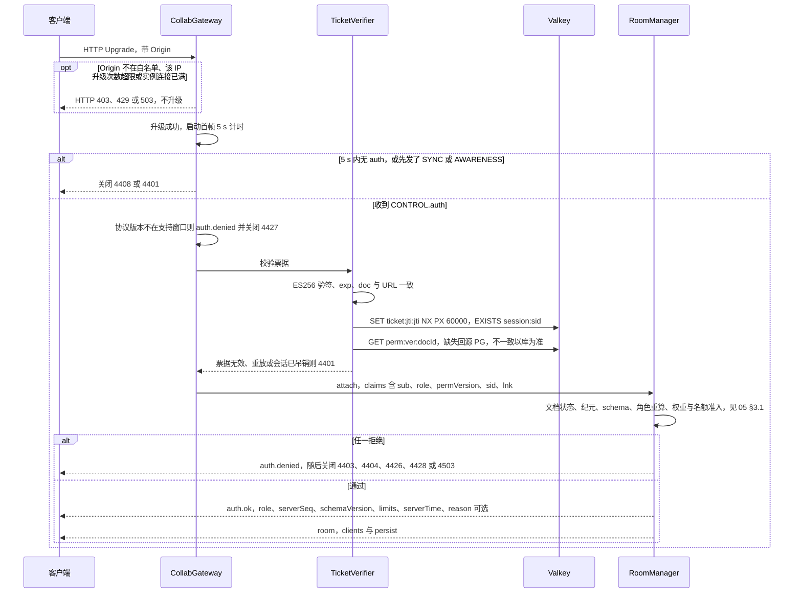
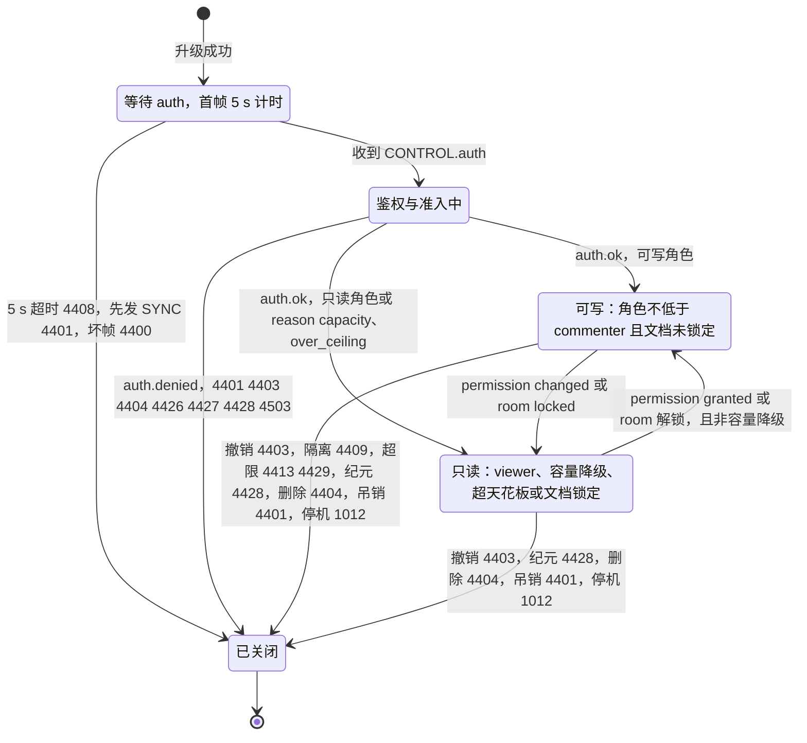
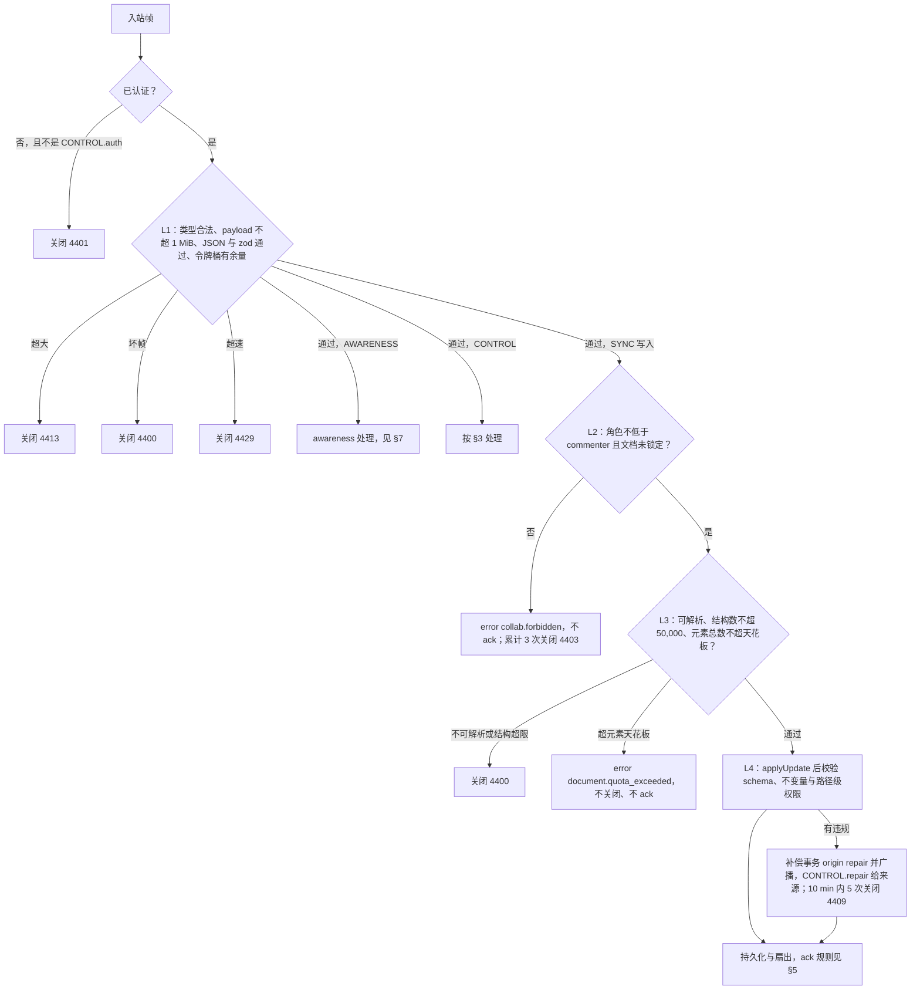
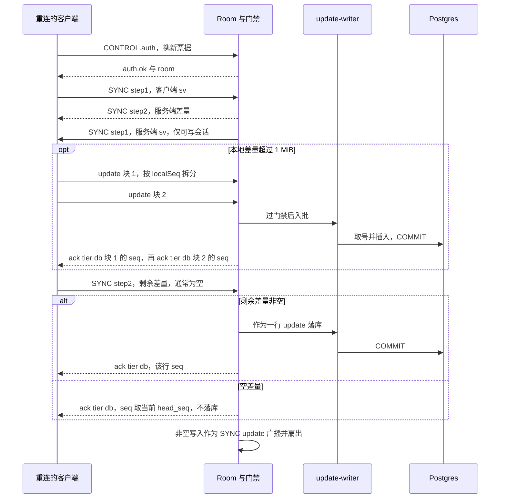

# 16 WS 协议（服务端视角）
> 状态：v0.1 | 负责：后端设计线 | 更新：2026-09-25；2026-09-25（§4.19）；2026-09-25（§4.19 N1）；2026-09-25（lock_reason，§4.19 N1 补缺）| 依赖：[30-architecture/06 协同](../30-architecture/06-collaboration.md) §6、§7、§10、§11、§14、§18.5；ADR-0023、0029、0034、0035；40-modules/02（protocol 文件）；[02 鉴权链路](02-auth-chain.md)；[05 协同与快照模块](05-modules-collab-and-snapshots.md)；[14 键空间](14-valkey-object-storage-and-retention.md)；[17 配置](17-deployment-and-config.md)；rulings §4.15 S-3a、§4.18 CO-08 / CO-09 / CO-10 / CO-15、§4.19 D-M2-CONTENT / INC-09 / D-COMMENTS-PKG

本文是 WS 协同通道在服务端的唯一事实源：升级与握手的检查顺序、每类 CONTROL 帧的服务端处理、入站门禁 L1–L4、ack 的发出规则、同步与 awareness 的处理、权限重算、关闭码的触发条件、跨实例扇出语义与限额数值。帧、CONTROL 成员与关闭码的**定义**在 30-architecture/06 §6 与 `@cordexjs/protocol`，本文不重述字段表；房间、持久化、溢写与准入的机制在 [05](05-modules-collab-and-snapshots.md)；客户端行为在 [50/07](../50-frontend/07-collaboration-client.md)。

**里程碑**：本文全部握手、门禁 L1–L4、ack、同步、awareness 中继、权限重算、关闭码与扇出随协同网关在 M2 交付（rulings §4.19 D-M2-CONTENT；总表见 [01](01-service-overview-and-roles.md) §3）；`CONTROL.event` 的两个事件随各自功能在 M3 出现（`comments.changed` 随评论，`version.restored` 随版本恢复），多人在场的体验层在客户端。

## 1. 端点与升级

端点 `wss://<host>/collab/v1/rooms/:documentId`（不带 `/api/v1` 前缀，rulings §4.18 BE-11），只在 collab 角色装配，反代把 `/collab/*` 转给 collab 并把读超时设为 ≥ 3600 s（[17](17-deployment-and-config.md) §3）。WS 不接受 cookie、URL 令牌或 `Sec-WebSocket-Protocol` 作为凭据，唯一凭据是首帧里的 60 s 单次票据（ADR-0029 决策 1–2）。

升级请求在 HTTP 层依次检查，任一不过即以 HTTP 响应拒绝、不升级：

| 顺序 | 检查 | 拒绝 |
|---|---|---|
| 1 | `:documentId` 是 UUID | 400 `collab.validation_failed`（按 [15](15-rest-api-catalog.md) 的 `<域>.validation_failed` 口径） |
| 2 | `Origin` 命中 `security.allowedOrigins`（缺 `Origin` 同样拒绝；非浏览器客户端与测试须显式带 `Origin`） | 403 `server.auth.origin_rejected`，计数（决策 INC-24） |
| 3 | 该 IP 最近 1 min 的升级请求未超 10 次（令牌桶 `rl:ws-connect:ip:{ipHash}`，IP 经审计盐 HMAC、不存明文，键模板见 [14](14-valkey-object-storage-and-retention.md) §3） | 429 `server.http.rate_limited`，`Retry-After` |
| 4 | 本实例连接数 < `limits.ws.maxConnectionsPerInstance` | 503，LB 改投其他实例 |

- 按 30/08 §9.3「WS 连接 10 次/min/IP」对每个升级请求计数（Origin 检查之后、升级之前扣减），认证成功的连接同样消耗额度：只计失败握手时，不发 `auth` 的空连接要等 5 s 首帧超时才被计数，一个 IP 在这 5 s 内可以开出大量连接。已知代价：同一 NAT 出口后几十人同时重连（如 1012 驱逐后）会有人收到 429、按退避重试；部署可调高 `limits.ws.connectPerIpPerMin`。待确认（总编排）：是否改为「先扣后退」（认证成功即退还额度）以兼顾两者。
- IP 取自反代传入的可信转发头（可信代理列表见 [17](17-deployment-and-config.md)）。
- 升级成功后启动首帧计时：5 s 内必须收到 `CONTROL.auth`，否则 4408；此前收到 SYNC 或 AWARENESS 立即 4401；其他 CONTROL 类型丢弃。

**图 16-1 握手与拒绝分支（服务端视角）**

怎么读：纵线是参与方，自上而下是时间；`opt` 是升级前的 HTTP 拒绝，外层 `alt` 区分首帧是否按时到达，内层 `alt` 区分鉴权与准入结果。拒绝时总是先回 `auth.denied{code}`（升级前的拒绝除外）再按码关闭，码与关闭码的对照见 §10。

依据：30-architecture/06 §6.3 握手图；ADR-0029 决策 1–2、5；决策 INC-24、INC-06；rulings §4.18 BE-02、BE-15。

## 2. 信封与帧类型

只引用，不重述：

- 二进制信封（1 字节 `FrameType`：`0 SYNC`、`1 AWARENESS`、`2 CONTROL`、`3 QUERY_AWARENESS`，与 y-websocket 编号兼容）与编解码函数：protocol `collab/frame.ts`；关闭码常量：`collab/close-codes.ts`；awareness 状态 schema：`collab/awareness.ts`；票据 claims：`collab/ticket.ts`（登记见 40-modules/02，决策 INC-01）。
- CONTROL 判别联合（判别键统一为 `type`，含 `ack = {type:'ack', tier:'spill'} | {type:'ack', tier:'db', seq}`）：protocol `ws/frames.ts`；握手 schema：`ws/handshake.ts`；成员集合以 30-architecture/06 §6.2、§6.3 为准（决策 INC-02、INC-03/04/05）。
- SYNC 与 AWARENESS 的 payload 对 protocol 是不透明字节，由 server-collab 用 y-protocols 解码。

`auth` 帧中服务端据以判定版本的两个可选字段（登记于 30-architecture/06 §6.3）：`epoch`——客户端本地文档纪元，无本地状态时省略，客户端从 `GET snapshots/latest` 的响应头 `X-Cordex-Epoch` 得到它（[15](15-rest-api-catalog.md) §3.8）；`maxSchemaVersion`——客户端支持的最高文档 `schemaVersion`。服务端据此在加入时判定 `collab.epoch_changed` 与 `collab.schema_too_new`（§12）。

## 3. CONTROL 各类型的服务端处理

| `type` | 方向 | 服务端处理 |
|---|---|---|
| `auth` | C→S | 只接受作为首帧；按 §1 图与 [05](05-modules-collab-and-snapshots.md) §3.1 的顺序校验；成功后才接受 SYNC / AWARENESS；认证后再收到 `auth` 视为坏帧（4400） |
| `auth.ok` | S→C | 成功时发一次：`sessionId`、`role`（封顶后的有效角色）、`serverSeq`（加入时的 `documents.head_seq`）、`schemaVersion`、`limits{maxUpdateBytes, msgRateHz, msgBurst}`（决策 INC-07）、`serverTime`；只读降级时带 `reason`：`'capacity'` = 编辑者名额满，`'over_ceiling'` = 部署调低天花板后元素数超限、只读打开（[05](05-modules-collab-and-snapshots.md) §4.1；两者客户端提示不同，决策 INC-03/04/05） |
| `auth.denied` | S→C | 拒绝时发一次再关闭；`code` 取 `collab.unauthenticated`、`collab.forbidden`、`collab.doc_not_found`、`collab.doc_purging`、`collab.schema_too_new`、`collab.protocol_mismatch`、`collab.epoch_changed`、`collab.room_full` 之一，关闭码见 §10 |
| `auth.refresh` | C→S | 载荷 `{ticket}`，为客户端新换的 collab ticket（决策 INC-27，验票步骤以 [02](02-auth-chain.md) §9.5 为准）：验签、`jti` 单次、`sub`、`doc` 与 `sid` 均须与当前会话一致，否则 4401；通过后重算角色（变化则发 `permission`）。M1–M3 会话有效期绑定 `sid` 指向的登录会话（[05](05-modules-collab-and-snapshots.md) §3.4），`auth.refresh` 不延长期限、成功不回应答帧；M4 集成方 JWT 复用本帧，届时以新 JWT 的 `exp` 延长 |
| `permission` | S→C | 角色重算结果变化时发 `{role, reason:'granted' \| 'changed' \| 'revoked', permVersion}`；`revoked` 后立即关闭 4403（§8） |
| `ack` | S→C | 规则见 §5 |
| `error` | S→C | 非致命：单帧被 L2 拒（`collab.forbidden`）或 L3 超元素天花板（`document.quota_exceeded`），`{code, retryable:false, details?}`；被拒的帧不回 ack |
| `repair` | S→C | 软门禁对**来源会话**发 `{reason, paths[]}`；修复事务本身作为 SYNC update 广播给所有人 |
| `ping` / `pong` | C↔S | 收到 `ping{t}` 即回 `pong{t}`；客户端每 15 s 一次，服务端 45 s 未收到任何帧即断开（客户端看到 1006） |
| `room` | S→C | 加入后立即发一次，之后仅在变化时发：`clients`（名额登记的去重用户数，≤ 15 s 刷新）、`draining?`（实例进入停机或驱逐前）、`persist?: 'ok' \| 'degraded'`（PG 写失败 ≤ 1 s 推 `degraded`，回放完成且无溢写后推 `ok`；[05](05-modules-collab-and-snapshots.md) §6.1，rulings §4.19 INC-09）、`locked?: {reason, until}`（文档处于系统锁定时带，解锁后推一次不带 `locked` 的 `room`，§8） |
| `event` | S→C | 两个事件（决策 SG-03，帧定义登记在 30-architecture/06 §6.3）：`{name:'comments.changed', payload:{threadIds[]}}`，由执行评论镜像落库的实例产生；`{name:'version.restored', payload:{snapshotId, name?, by}}`，由执行恢复的实例在恢复提交后产生（[05](05-modules-collab-and-snapshots.md) §10）。二者都经扇出送达所有副本的会话（§11） |
| 未知 `type` | C→S | 丢弃并计数，不关闭（ADR-0023 补充 v0.2）；JSON 或 zod 解析失败 → 4400 |

**图 16-2 服务端 RoomSession 状态**

怎么读：方框是一个连接在服务端的会话状态，箭头上是触发条件与关闭码。`writer` 与 `readonly` 之间只靠 `CONTROL.permission` 或 `room{locked}` 切换，不断连；容量降级与超天花板的会话在本次连接内不升回可写（重连时重新判定）。只读会话不会触发 4409、4413、4429 以外的写入类关闭，因为它的 SYNC 写入在 L2 就被拒。

依据：ADR-0029 决策 2–5；30-architecture/06 §6.3、§6.5、§10；决策 INC-06、INC-27。

## 4. 门禁分层

| 层 | 检查 | 失败出口 |
|---|---|---|
| L1 帧 | 信封类型字节合法；payload（不含 1 字节类型头）≤ `maxUpdateBytes`（1 MiB，决策 INC-07）；认证前只收 `auth`；CONTROL 为合法 JSON 且通过 zod；令牌桶 `msgRateHz` 200 / `msgBurst` 500 对全部入站帧计量，另有每连接 `updateBytesPerMin` 10 MiB | 超大 4413（`collab.payload_too_large`）；坏帧 4400（`collab.bad_frame`）；超速 4429（`collab.rate_limited`）；均不广播不落库 |
| L2 权限与锁定 | SYNC 写入（`update` 与 `step2`）要求有效角色 ≥ `commenter` 且文档未锁定；AWARENESS 要求 ≥ `viewer`；CONTROL 只允许白名单类型 | 写入被拒：`error{collab.forbidden}`；只对越权写入计数（计数起点见表下），同一会话累计 3 次 → 4403 |
| L3 结构 | `Y.decodeUpdateV2` 可解析；单帧结构数 ≤ `structsPerUpdate`（50,000）；按文档类型提供的实体计数钩子，应用后元素总数不超天花板（墓碑计入） | 解析失败或结构超限 4400；超元素天花板 `error{document.quota_exceeded{dimension, limit, actual}}`，不关闭 |
| L4 语义（软门禁） | 在服务端 Unit 上 `applyUpdate`（origin remote）后，对 `ChangeSet.touched` 做 `documentType.validateChangeSet` 与不变量检查；路径级权限：commenter 的写入只能触及 `resources['comments.threads']`（threads、replies 两张实体表），作者只能改自己的评论实体；删除写入的 `Tombstone.byUser` 必须等于来源会话的 userId，否则按修复还原（ADR-0034 补充 v0.2 的路径级规则，与评论作者规则同一机制） | 不拒绝：生成 `origin = system('repair')` 的补偿事务并广播，向来源会话发 `CONTROL.repair`；同一会话 10 min 内 ≥ 5 次 → 4409（`collab.quarantined`）。模式：不变量 `repair`、schema `report-only`（`collab.softGate.*`，rulings §4.1 P8） |

- **L2 门槛是 commenter**（定稿，依据：rulings §4.19 D-COMMENTS-PKG——评论事实源是 ResourceHook `comments.threads`、经 `comments.*` 命令写 CRDT；PRD PD-04；ADR-0029 决策 3 的修订；ADR-0034 补充 v0.2 的路径级规则）：commenter 必须能写 CRDT，否则协同模式下无法评论；写入范围由 L4 的路径级规则限定在 `resources['comments.threads']`。viewer 仍拒绝全部写入。[02](02-auth-chain.md) §9.4 与 30-architecture/06 §10、§11 同此口径。
- **L2 计数起点**（ADR-0029 决策 3：计数针对越权写入）：服务端发出降权 `permission` 或 `room{locked}` 的那一刻起算，此前已到达、仍在门禁队列里的写入帧照常回 `error`、不计数；此后 2 s 内到达的写入帧视为客户端尚未收到通知时发出的在途帧，同样只回 `error`、不计数（常量，不设配置键）；超过 2 s 仍到达的越权写入才计数。一开始就以只读身份加入的会话没有在途窗口，第一帧写入即计数。
- L1–L3 失败的帧既不应用也不扇出（I8）；L4 不回滚，只追加修复，以保持全网收敛（I7）。硬门禁与软门禁都在 PG 故障降级期照常执行，且先于 `ack{tier:'spill'}`（ADR-0034 修订 2026-09-24）。
- 预算：软门禁 p95 ≤ 5 ms/update；服务端单 update 处理（门禁 + 落库 + 扇出）p95 ≤ 20 ms，span `server.collab.update`。

**图 16-3 入站帧门禁 L1–L4 与拒绝出口**

怎么读：菱形是逐层判定，方框是动作或出口；只有 SYNC 写入会走完四层。L1–L3 的失败出口都不应用、不扇出；L4 不拒绝，违规时追加修复事务后与原 update 一起进入持久化。

依据：30-architecture/06 §11；ADR-0029 决策 3；ADR-0034 决策 1–5 与补充 v0.2、修订 2026-09-24；决策 INC-07。

## 5. ack 发出规则

ack 帧形状的唯一源是 protocol `ws/frames.ts`；客户端以在途 FIFO 对应（rulings §4.18 CO-09），因此服务端必须保证下面的「一帧一应答、按序」：

1. **一帧恰好一个 db ack**：同一连接上每个通过门禁的写入帧——SYNC `update`（msgType 2）与 SYNC `step2`（msgType 1）——恰好得到一帧 `{type:'ack', tier:'db', seq}`，`seq` 是该帧落库时分配的 seq（逐帧应答，不是累计确认）。
2. **step2 视同一帧**（CO-10）：非空差量作为一行 update 落库并回 db ack；**空差量也回**，不落库，`seq` 取回 ack 时的 `documents.head_seq`。空差量的 ack 排在该连接此前所有待回 ack 之后发出。
3. **只在提交后发**：db ack 在批量事务 COMMIT 返回之后按帧到达顺序发出；取号栅栏生效（`purging`、纪元变化）时不回 db ack，改为关闭（4404 / 4428）。
4. **降级期**：帧写入一级或二级溢写成功后回 `{type:'ack', tier:'spill'}`（无 seq），回放落库后再补该帧的 db ack；处在内存重试窗口（`none`）的帧暂不回任何 ack（[05](05-modules-collab-and-snapshots.md) §6）。
5. **顺序**：同一连接上 db ack 的顺序始终等于帧到达顺序。回放期间新到的帧排在回放队列之后落库（CO-15）；spill ack 不参与客户端 FIFO，因此它与 db ack 交错不影响对应。
6. **原会话已断开**：回放补发的 db ack 直接丢弃，客户端重连后由 step2 兜底（ADR-0025 修订 2026-09-25 第 3 条）。
7. **不回 ack 的帧**：被 L2 / L3 拒绝的写入帧（改回一帧 `error`，客户端按 30-architecture/06 §18.4 导出后重载，见 [50/07](../50-frontend/07-collaboration-client.md)）；AWARENESS、QUERY_AWARENESS 与所有 CONTROL；服务端自己发起的修复、恢复、墓碑事务。

## 6. 同步流程

1. 客户端先经 HTTP 取检查点字节（`GET /documents/:id/snapshots/latest`，ETag，[15](15-rest-api-catalog.md) §3.8）并应用，再建 WS；因此握手后的差量通常只有几十 KB（30-architecture/06 §9.1）。
2. `auth.ok` 与 `room` 之后，客户端发 `step1(sv)`；服务端用 Room 的 Y.Doc 计算差量回 `step2`（出站帧不受 `maxUpdateBytes` 限制）。
3. 对可写会话，服务端随即发自己的 `step1(serverSv)`；客户端回 `step2(本地差量)`，服务端按 §4 门禁与 §5 规则处理（它是一个普通写入帧），非空时作为 SYNC `update` 广播给房间与其他副本。对只读会话服务端不发 `step1`：它不能写，发了只会得到一个被 L2 拒绝的 step2。
4. 客户端本地差量超过 `maxUpdateBytes` 时，由客户端先按 `localSeq` 用 `mergeUpdates` 拆成不超限的块、逐块以普通 `update` 帧发送，最后发只含剩余差量（通常为空）的 `step2`；服务端门禁与应答规则不变，每块一帧 db ack（CO-10）。
5. `QUERY_AWARENESS` → 服务端回本房间全部 awareness 状态。

**图 16-4 重连 step2、超限拆块与逐帧 db ack**

怎么读：自上而下是一次重连后的同步；`opt` 段只在离线积累的差量超过单帧上限时出现，每个块各得一帧 db ack；最后的 step2 无论是否为空都恰好得到一帧 db ack，客户端以它清空被覆盖的 pending。

依据：30-architecture/06 §6.4、§9.1；ADR-0023 决策 7；rulings §4.18 CO-09、CO-10。

## 7. awareness

服务端只中继、不持久化、不审计内容（`collab.join` / `collab.leave` 另行审计）。每个 Room 持有一个服务端 Awareness 实例（`awareness-relay`）。

- **校验**：逐个状态按 protocol `collab/awareness.ts` 的 zod schema 解析；单个状态 > `awarenessMaxBytes`（2 KiB）或 schema 不合法 → 丢弃该状态并计数，不关闭连接（30-architecture/06 §7.1）。
- **身份绑定**：状态的 Yjs clientID 必须等于该会话在 `auth.clientId` 声明的值，`user.id` 必须等于会话用户；不符即丢弃——一个会话不能冒充他人的光标或在场。
- **节流**：同一 clientID 的更新至多每 `awarenessMinIntervalMs`（50 ms）转发一次，窗口内只保留最新值（合并而非拒绝）。
- **查看者只上报 view**：只读会话的状态只保留 `v`、`user`、`client`、`view`、`idle`、`ts`，其余字段（选区、光标、正在编辑）在转发前剥掉。
- **满员合并 tick**：房间在线用户 ≥ `awarenessTickThreshold`（20）时改为每 `awarenessTickMs`（100 ms）把期间变化合并成一个 awareness 帧下发（30-architecture/08 §3.1 `awareness-tick.ts`）。
- **加入与离开**：新会话认证后立即收到全量状态；会话断开时服务端主动广播该 clientID 的移除，不等 30 s 超时。
- awareness 帧经扇出送达其他副本（§11），也计入 L1 令牌桶。

## 8. 权限重算与降权

触发重算的四种事件：`perm:doc:{docId}` 频道带 `permVersion` 的消息（权限变更或分享链接撤销，写方在同一事务内递增 `permVersion` 后发布，[02](02-auth-chain.md) §11）；同一频道带 `lockChanged` 的消息（文档锁定状态变化，见本节末）；会话的 `linkExpiresAt` 到期（每个会话一个定时器）；`auth.refresh`。重算对本实例该文档的每个会话调用 `AuthorizationSource.resolveRole`（绕过 5 s 直接授权缓存），取 max(直接授权, 票据 `lnk` 对应链接此刻的有效角色)（rulings §4.18 BE-02），再按文档锁定与容量降级封顶：

| 重算结果相对当前有效角色 | 服务端动作 |
|---|---|
| 不变 | 只更新会话的 `permVersion` |
| 升高 | `permission{role, reason:'granted', permVersion}`；容量降级的会话仍只读 |
| 降低但非 `none` | `permission{role, reason:'changed', permVersion}`；之后越权写入在 L2 被拒 |
| `none` | `permission{role:'none', reason:'revoked'}`，广播其 awareness 移除，关闭 4403 |

- 传播预算：权限写库到所有在线会话生效 p95 ≤ 1 s（PRD 门禁 ≤ 2 s），测量为审计时间戳与客户端 `permission/changed` 事件之差。
- 只凭链接加入的会话不会因为**他人**的权限变更被误降为 `none`；链接撤销 ≤ 1 s 降权；链接到期由定时器主动降权，不等推送。
- `permVersion` 递增只重算、不断连；与纪元递增（强制重连，4428）互不联动（rulings §4.11 C-17）。
- **锁定与解锁**：[04](04-modules-documents-storage-media.md) §2 的 `Lock` / `Unlock` / `ReleaseExpiredLocks` 用例提交后经 `perm:doc:{docId}` 发布 `{docId, lockChanged: true}`（不递增 `permVersion`，[14](14-valkey-object-storage-and-retention.md) §3.2；控制频道 `room:{docId}:ctl` 只承载 `close` 与 `epoch`）。各实例的 `AuthzSource` 重读 `documents.status`、`locked_until` 与 `lock_reason`（会话加入时同样读取，保证中途加入者也拿到原因）：锁定时向会话推 `room{locked:{reason, until}}` 并把可写会话封顶为只读（之后的写入在 L2 被拒，计数起点同 §4）；解锁时推一次不带 `locked` 的 `room`，会话恢复原角色。锁定窗口只有覆盖导入（`reason:'import'`）与迁移（`reason:'migration'`），版本恢复不加锁（rulings §4.19 N1）；覆盖导入成功时不以解锁收尾，而是先经 `room:{docId}:ctl` 发 `epoch` 使会话以 4428 断开（[06](06-modules-jobs-import-export-thumbnails.md) §6.5），随后的解锁通知只影响重新加入的会话。通知丢失时，下一次加入按 `documents.status` 判定（[05](05-modules-collab-and-snapshots.md) §3.1），`locked_until` 到期由 `trash-expiry` 释放并再次通知。

## 9. 容量

规则与算法在 [05](05-modules-collab-and-snapshots.md) §4，协议上的表现只有四种：编辑者名额满 → `auth.ok{role:'viewer', reason:'capacity'}` 只读加入；文档元素数超过部署调低后的天花板 → `auth.ok{reason:'over_ceiling'}` 只读打开；查看者名额也满、或本实例权重预算不足 → `auth.denied{collab.room_full}` 后关闭 4503（统一码 `collab.room_full`，废 `collab.server.room_full`，决策 INC-10/SG-04），客户端退避重连、多半落到其他实例；已开房间在内存压力下被驱逐 → 向会话发 1012，客户端首轮不退避、≤ 5 s 连到其他实例。

## 10. 关闭码触发条件

以 30-architecture/06 §6.5 补全后的表为准（决策 INC-06：补 1011、4427，新增 4428，`collab.doc_purging` 归 4404）；`collab/close-codes.ts` 是代码中的唯一源。客户端行为的权威在 30/06 §6.5 与 [50/07](../50-frontend/07-collaboration-client.md)，此处只列服务端何时发出。

| 码 | 错误码 | 服务端触发条件 |
|---|---|---|
| 1000 | — | 服务端不主动使用；客户端 `leave` 时由客户端发起 |
| 1001 / 1006 | — | 服务端不主动发 1001；45 s 未收到任何帧时直接断开 TCP，客户端观察到 1006 |
| 1011 | `kernel.invariant_violation` 及未知异常 | 帧处理中出现未预期异常；记录错误与 traceId，不向客户端泄漏细节 |
| 1012 | — | SIGTERM 优雅停机（先 `room.draining`，再关闭，≤ 30 s）；内存压力驱逐 `active` 房间 |
| 4400 | `collab.bad_frame` | 未知信封类型；CONTROL 非法 JSON 或 zod 失败；认证后重复 `auth`；L3 解析失败或结构数超限 |
| 4401 | `collab.unauthenticated` | 认证前收到 SYNC / AWARENESS；票据验签失败、过期或格式无效；`jti` 重放；`sid` 已吊销或用户已停用、擦除（每 5 s 批量会话复核，[02](02-auth-chain.md) §9.5；不设按房间点名的踢人操作）；`auth.refresh` 校验失败 |
| 4403 | `collab.forbidden` | 票据 `doc` 与 URL 不符；加入或重算后角色为 `none`；L2 拒绝累计 3 次 |
| 4404 | `collab.doc_not_found` / `collab.doc_purging` | 文档不存在或在回收站（加入时；或收到 `close{reason:'trashed'}`）；文档 `purging`（加入时、收到 `close{reason:'purge'}`、或取号栅栏生效） |
| 4408 | `collab.auth_timeout` | 升级后 5 s 内未收到 `auth` |
| 4409 | `collab.quarantined` | 同一会话 10 min 内触发软门禁修复 ≥ 5 次 |
| 4413 | `collab.payload_too_large` | 入站帧 payload > `maxUpdateBytes` |
| 4426 | `collab.schema_too_new` | 文档 schema 高于客户端声明的支持上限（加入时；或迁移后在线客户端落后） |
| 4427 | `collab.protocol_mismatch` | `auth.protocolVersion` 不在服务端支持窗口 |
| 4428 | `collab.epoch_changed` | 客户端声明的本地纪元与文档纪元不符（加入时）；收到 `epoch` 控制消息（运维 `forceEpoch`，或覆盖导入提交，rulings §4.19 N1）；取号纪元栅栏生效 |
| 4429 | `collab.rate_limited` | 令牌桶耗尽或每分钟字节超限 |
| 4503 | `collab.room_full` / `collab.bootstrap_failed` | 名额或实例预算不足；Room 进入 `failed`；等待迁移租约超时 |

## 11. 跨实例扇出语义

- 频道 `collab:doc:{docId}`（ADR-0035 决策 2；启用分片时为 `collab:{shard}:doc:{docId}`，分片数由 `hash(doc_id)` 决定），消息 = 16 字节 `instanceId` + 原信封字节；订阅方丢弃自己发布的消息。键模板与分片规则登记在 [14](14-valkey-object-storage-and-retention.md)。
- **每个实例只持久化自己客户端的 update**，扇入的 update 只应用、只转发（ADR-0035 决策 3）。

| 帧 | 是否扇出 | 接收实例的处理 |
|---|---|---|
| SYNC `update`（含非空 step2 重编码成的 update、修复、恢复、墓碑与迁移事务） | 是 | 应用到本副本（origin remote）→ 转发给本实例全部会话；不落库、不回 ack |
| SYNC `step1` / `step2`（握手差量） | 否 | 会话私有 |
| AWARENESS | 是（校验与节流之后） | 更新本副本的 Awareness 实例并转发 |
| CONTROL `event` | 是（由执行镜像落库或执行恢复的实例发布一次） | 转发给本实例会话 |
| CONTROL `permission`、`room`、`repair`、`ack`、`error` | 否 | 各实例分别由 `perm:doc` 重算（含 `lockChanged`）、本地计数、来源会话产生 |

- 控制频道 `room:{docId}:ctl` 的消息（只有 `close`、`epoch`）与处理见 [05](05-modules-collab-and-snapshots.md) §3.3；权限频道 `perm:doc:{docId}`（权限重算与锁定通知）见 §8。
- Valkey 不可用：各实例内部仍一致，跨实例同步中断到恢复后客户端重连触发 step1 / step2 补齐；`/readyz` 返回 503 让 LB 停止分配新连接，已有连接保留（ADR-0035 决策 8）。
- 预算：跨实例传播 ≤ 50 ms，房间内广播 p95 ≤ 100 ms（30-architecture/06 §18.5）。

## 12. 版本协商

加入时按以下顺序判定，前一项失败就不看后一项：

1. **协议版本**：`auth.protocolVersion` ∈ [`PROTOCOL_MIN`, `PROTOCOL_MAX`]（常量在 protocol `ws/handshake.ts`，M2 起均为 1）→ 否则 `collab.protocol_mismatch` / 4427（提示刷新）。放在票据校验之前：协议不兼容时连票据的解析方式都不可信。
2. **文档纪元**：客户端声明的本地纪元存在且 ≠ `documents.epoch` → `collab.epoch_changed` / 4428（客户端丢弃本地 Y 状态、重新 bootstrap，pending 移入 `rejected` 并可导出）。
3. **文档 schema**：`documents.schema_version` > 客户端声明的支持上限 → `collab.schema_too_new` / 4426（客户端需升级，提示刷新）。

`appVersion` 只记日志与指标，不参与判定。4426、4427、4428 客户端行为不同，因此分码（决策 INC-06）。第 2、3 项依赖的 `auth` 字段见 §2。

## 13. 速率与限制数值

数值的归属在本文（决策「WS 协同分工」），配置键名与校验以 [17](17-deployment-and-config.md) 为唯一源，二者须一致；全部可由部署调整，门禁数值只收紧。

| 配置键 | 默认 | 作用点 | 超限出口 | 出处 |
|---|---|---|---|---|
| `limits.maxUpdateBytes` | 1 MiB（不含 1 字节类型头） | L1，经 `auth.ok.limits` 下发客户端 | 4413 | 决策 INC-07；PRD CO-12 |
| `limits.msgRateHz` / `limits.msgBurst` | 200 / 500 | L1 令牌桶，全部入站帧 | 4429 | 决策 INC-07；30/06 §18.5 |
| `limits.updateBytesPerMin` | 10 MiB | L1，每连接写入字节 | 4429 | 30/06 §9.3 |
| `limits.structsPerUpdate` | 50,000 | L3 | 4400 | 30/06 §11 |
| `limits.awarenessMaxBytes` | 2 KiB | awareness 单状态 | 丢弃计数 | 30/06 §7.1 |
| `limits.awarenessMinIntervalMs` | 50 | awareness 节流 | 合并 | PRD CO-12 |
| `limits.awarenessTickThreshold` / `limits.awarenessTickMs` | 20 / 100 | 满员合并 tick | — | 本文 §7 |
| `limits.ws.firstFrameTimeoutMs` | 5000 | 首帧计时 | 4408 | ADR-0029 决策 2 |
| `limits.idleTimeoutMs` | 45000 | 无任何入站帧（客户端 15 s 心跳 × 3） | 断开（1006） | 本文 §3 |
| `limits.ws.connectPerIpPerMin` | 10 | 升级前，按 IP 计升级请求 | HTTP 429 | 30/08 §9.3（口径见 §1） |
| `limits.ws.maxConnectionsPerInstance` | 4000 | 升级前 | HTTP 503 | RM-S 单实例 ≥ 2,000 的 2 倍余量（与 [17](17-deployment-and-config.md) 一致） |
| `collab.repair.quarantineThreshold` / `windowMs` | 5 / 600000 | L4 | 4409 | ADR-0034 决策 2 |
| L2 违规累计 | 3 次 | L2 | 4403 | ADR-0029 决策 3 |
| `collab.room.maxEditors` / `maxViewers` | 20 / 50 | 名额 | 只读加入 / 4503 | rulings §4.15 Q5 |

## 14. 与相邻文档的对齐项

2026-09-25 按 rulings §4.19 回填后已全部落实，保留此表便于反查：

| 项 | 落点 | 状态 |
|---|---|---|
| `auth` 登记 `epoch`、`maxSchemaVersion`；`auth.ok.limits = {maxUpdateBytes, msgRateHz, msgBurst}`；`auth.ok.reason` 取 `capacity` / `over_ceiling`；`room` 增 `persist?`、`locked?`；`event` 增 `version.restored` | 30-architecture/06 §6.3 | 已登记（决策 INC-03/04/05、INC-07、INC-09） |
| SYNC 写入门槛 ≥ commenter、路径限制在 L4 | ADR-0029 决策 3 修订、30-architecture/06 §10 与 §11、[02](02-auth-chain.md) §9.4 | 已改（rulings §4.19 D-COMMENTS-PKG） |
| 锁定 / 解锁经 `perm:doc:{docId}` 通知在线会话 | [04](04-modules-documents-storage-media.md) §2、[14](14-valkey-object-storage-and-retention.md) §3.2 | 已落实 |
| §13 各键与 `limits.ws.maxConnectionsPerInstance = 4000` | [17](17-deployment-and-config.md) §5 | 已登记 |

## 15. 机械验证

本节只列断言；执行方式与 CI 步骤见 [70/02](../70-testing/02-contract-suites-and-pluggability.md)、[70/07](../70-testing/07-backend-integration-and-api-e2e.md)、[70/10](../70-testing/10-security-testing.md)。

| 断言 | 落点 |
|---|---|
| 握手拒绝分支逐条可达：跨源升级 403 `server.auth.origin_rejected`；同一 IP 1 min 内第 11 次升级 429；5 s 无 auth → 4408；先发 SYNC → 4401；票据过期、重放、`sid` 吊销 → 4401；协议版本不符 → 4427；纪元不符 → 4428；schema 过新 → 4426；`purging` → 4404；名额与预算不足 → 4503 | `test/server-integration`、`e2e/smoke`（跨源 WS 升级被拒） |
| 门禁 L1–L4 负向用例：超 1 MiB → 4413；坏 JSON → 4400；超速 → 4429；viewer 写入得 `error` 且连接保持、第 3 次 4403；降权后 2 s 内到达的在途写入只回 `error` 不计数、2 s 后的越权写入计数；commenter 只写 `resources['comments.threads']` 被放行、改其他路径被修复还原；`Tombstone.byUser` 不等于来源会话 userId 的删除被修复还原；结构数超限 4400；超元素天花板得 `error{document.quota_exceeded}` 且不关闭；5 次修复 → 4409 | `test/contract`（`runCollabServerConformance`）+ `test/server-integration`（组合根 soft-gate 分节） |
| ack：每个写入帧恰好一帧 db ack 且顺序等于到达顺序；step2 空差量回 db ack 且 `seq = head`；拆块后每块一帧 db ack；降级期先 spill 后 db；被拒帧不回 ack | `test/contract` |
| 关闭码全表：`close-codes.ts` 与 §10 一致，每个码至少一条触发用例（`heartbeat-and-close-codes.test`） | `test/contract`（客户端与服务端各一份） |
| awareness：冒充他人 clientID 或 user.id 的状态被丢弃；只读会话的选区字段被剥掉；> 2 KiB 丢弃且连接保持；断开即广播移除 | `test/server-integration` |
| 权限：他人改权限不踢链接会话；撤销 ≤ 1 s 降权并 4403；链接到期主动降权（FixedClock）；锁定后 ≤ 1 s 收到 `room{locked}` 且写入被 L2 拒绝，解锁后收到不带 `locked` 的 `room` 并恢复可写；覆盖导入成功时锁定中的会话以 4428 关闭、不先收到解锁；恢复进行中任何会话都收不到 `room{locked}`（rulings §4.19 N1） | `test/server-integration` |
| 协议字段：超天花板文档加入得 `auth.ok.reason = 'over_ceiling'`（名额满为 `capacity`）；`auth.epoch` 与 `snapshots/latest` 的 `X-Cordex-Epoch` 不符 → 4428；恢复提交后每个副本的会话收到一帧 `event{version.restored}`；票据 `doc` 与 URL 不符 → 4403 | `test/server-integration`、`test/contract` |
| CONTROL 判别联合导出的 JSON Schema 快照与本文 §3 成员一致，变更需显式更新快照 | `test/contract`（schema 快照） |
| 与 y-websocket 官方客户端互操作：测试夹具先完成 `auth`，再由 y-websocket 的编码收发 SYNC / AWARENESS 并同步成功 | `test/server-integration` |
