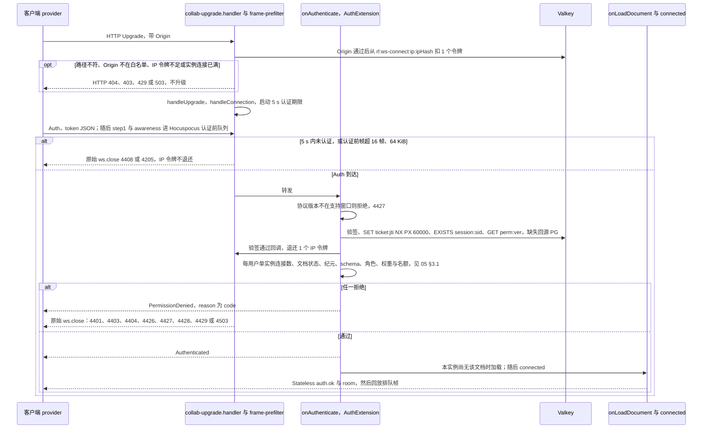
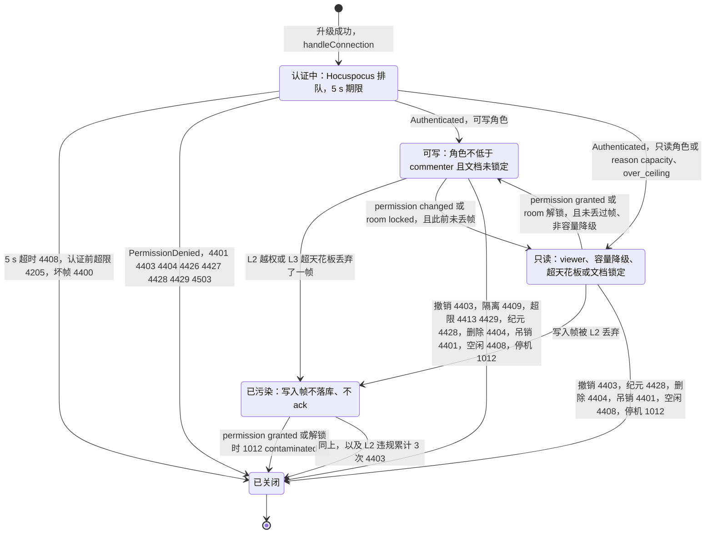
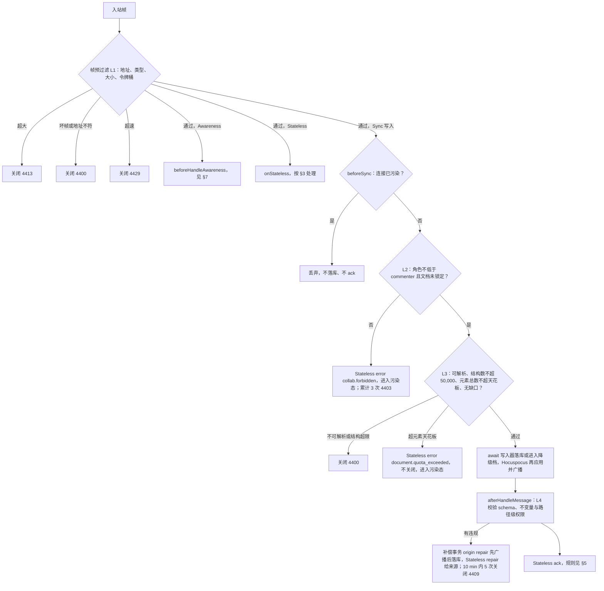
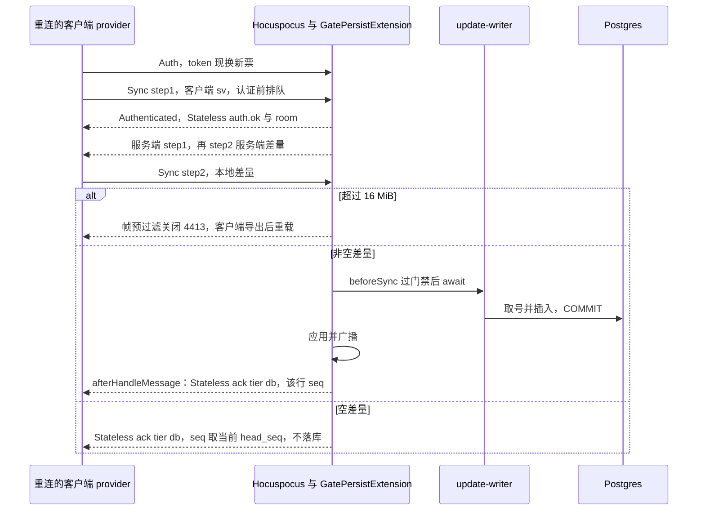
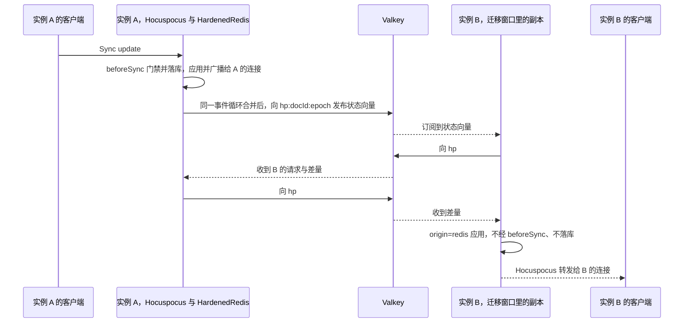
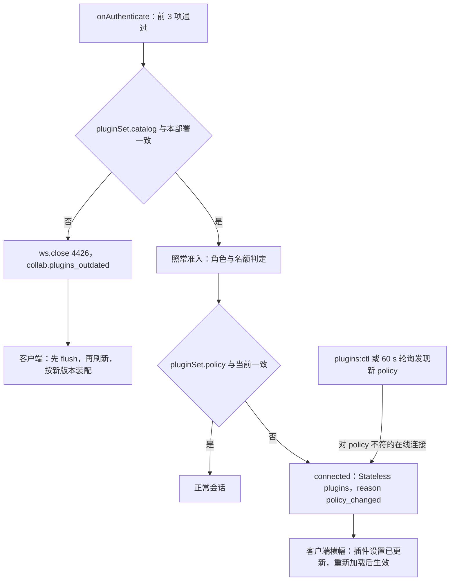

# 16 WS 协议（服务端视角）
> 状态：v0.1 | 负责：后端设计线 | 更新：2026-09-25；2026-09-25（§4.19）；2026-09-25（§4.19 N1）；2026-09-25（lock_reason，§4.19 N1 补缺）；2026-09-26（§4.20）；2026-09-26（§4.21：协同服务端改用 Hocuspocus 4（ADR-0039）——§1 自挂 upgrade、适配层计时与帧预过滤、一 WS 一文档；§2 改 Hocuspocus 帧；§3 CONTROL 改 Stateless 与 Auth / `onTokenSync`，删 ping 行，重画图 16-2；§4 门禁挂点与连接污染规则；§5 ack 挂点与 step2 16 MiB；§6 服务端先发 step1、只读会话也收 step1；§7 `beforeHandleAwareness` 与出站合并；§8 PermissionSync；§10 关闭码由原始 `ws.close` 发出、加 4205；§11 extension-redis；§13 step2 上限与 Hocuspocus 配置；§15 机械验证）；2026-09-26（§4.21 整合：§2 补文档名 {documentId}:{epoch} 解析规则；§3 登记可选 rtt.ping / rtt.pong；§5、§6 写明只读会话的空差量 step2 不回 ack；§15 测试名改 close-policy.test）；2026-09-26（§4.21 Remap：原 30/08 引用按 60-backend/README §6.1 改指新位置，30/08 已删除）；2026-10-01（§4.23 插件管理：Auth token 新增 pluginSet 指纹；§12 第 4 项握手判定与在线通知；Stateless 新增 plugins；4426 增 collab.plugins_outdated）；2026-10-15（design-language-v3 第 2 批：§8 重算同时按链接此刻的到期时刻重设 `linkExpiresAt` 定时器（链接的角色与有效期可在原行上改，rulings §4.25 DS-47）；§9 注明名额已满的会话不自动提升，「重试以编辑身份加入」即重新握手（DS-58）；§8 `none` 一行补访问被撤销后的口径（DS-50））；2026-10-22（design-language-v3 第 3 批：§3 `auth.ok` 在 `reason: 'over_ceiling'` 时另带 `elementCount`（判定所用的 `documents.element_count`，墓碑计入）与 `maxElements`（`scale.maxElementsPerDoc`），供「文档已达元素上限」横幅写「实际 / 上限」、客户端不另数（rulings §4.25 TB-146、DS-128）；§9、§14 新增一行、§15 协议字段断言同步；2026-10-22 复核修正：§14 新增那一行的状态改为已登记——30/06 §6.3 与 protocol `ws/frames.ts`（40-modules/02）同日已回写） | 依赖：[30-architecture/06 协同](../30-architecture/06-collaboration.md) §6、§7、§10、§11、§14、§18.5；ADR-0023、0029、0034、0035、[0039](../30-architecture/adr/0039-collab-server-hocuspocus.md)；40-modules/02（protocol 文件）；[02 鉴权链路](02-auth-chain.md)；[05 协同与快照模块](05-modules-collab-and-snapshots.md)；[14 键空间](14-valkey-object-storage-and-retention.md)；[17 配置](17-deployment-and-config.md)；rulings §4.15 S-3a、§4.18 CO-08 / CO-09 / CO-10 / CO-15、§4.19 D-M2-CONTENT / INC-09 / D-COMMENTS-PKG、§4.21；rulings §4.25 DS-47、DS-50、DS-58、DS-128、TB-146

本文是 WS 协同通道在服务端的唯一事实源：升级与握手的检查顺序、每类 CONTROL 帧的服务端处理、入站门禁 L1–L4、ack 的发出规则、同步与 awareness 的处理、权限重算、关闭码的触发条件、跨实例扇出语义与限额数值。帧、CONTROL 成员与关闭码的**定义**在 30-architecture/06 §6 与 `@cordexjs/protocol`，本文不重述字段表；房间、持久化、溢写与准入的机制在 [05](05-modules-collab-and-snapshots.md)；客户端行为在 [50/07](../50-frontend/07-collaboration-client.md)。

**2026-09-26 起的实现底座**（rulings §4.21 q-ws-gateway，[ADR-0039](../30-architecture/adr/0039-collab-server-hocuspocus.md)）：服务端传输层是 server-collab 持有的 Hocuspocus 4.7.0 类，嵌入 Nest（Fastify）的 HTTP server；本文每一条规则都写明它挂在哪里——**网关适配层**（apps/server：upgrade 处理与帧预过滤，在帧进入 Hocuspocus 之前）或 **Hocuspocus 钩子**（server-collab 的自有扩展）。Hocuspocus 原生承担的部分（y-protocols 同步分发、awareness 中继、每连接串行队列、认证前排队、房间文档表与并发加载去重）本文只写约束，不重复实现。

**里程碑**：本文全部握手、门禁 L1–L4、ack、同步、awareness 中继、权限重算、关闭码随协同网关在 M2 交付（rulings §4.19 D-M2-CONTENT；总表见 [01](01-service-overview-and-roles.md) §3），M2 为单实例；跨实例扇出（extension-redis）与文档哈希分流在 M3；`CONTROL.event` 的两个事件随各自功能在 M3 出现（`comments.changed` 随评论，`version.restored` 随版本恢复），多人在场的体验层在客户端。

## 1. 端点与升级

端点 `wss://<host>/collab/v1/rooms/:documentId`（不带 `/api/v1` 前缀，rulings §4.18 BE-11），只在 collab（及 `all`）角色装配，反代把 `/collab/*` 转给 collab、读超时设为 ≥ 3600 s，并按路径里的 `documentId` 做一致性哈希（偏好亲和、非会话粘性，ADR-0035 决策 7；[17](17-deployment-and-config.md) §3）。WS 不接受 cookie、URL 令牌或 `Sec-WebSocket-Protocol` 作为凭据，唯一凭据是 Auth 帧 token 里的 60 s 单次票据（ADR-0029 决策 1–2）。

**升级接入**（2026-09-26，rulings §4.21 q-ws-gateway；落点 40-modules/09 §4.1 `collab-upgrade.handler.ts`）：apps/server 不注册 Nest `WsAdapter`（它只做精确路径匹配、升级前没有钩子，路由不到带参数的 `:documentId`），而是在 `app.getHttpServer()` 的 `upgrade` 事件上自挂处理函数，**必须在 `listen` 之前挂好**。处理函数自己解析路径（不匹配本端点的升级请求回 HTTP 404、不升级，新增（§4.21）），在 HTTP 层依次检查，任一不过即以 HTTP 响应拒绝、销毁 socket、不升级：

| 顺序 | 检查 | 拒绝 |
|---|---|---|
| 1 | `:documentId` 是 UUID | 400 `collab.validation_failed`（按 [15](15-rest-api-catalog.md) 的 `<域>.validation_failed` 口径） |
| 2 | `Origin` 命中 `security.allowedOrigins`（缺 `Origin` 同样拒绝；非浏览器客户端与测试须显式带 `Origin`） | 403 `server.auth.origin_rejected`，计数（决策 INC-24） |
| 3 | 从该 IP 的令牌桶取 1 个令牌（`rl:ws-connect:ip:{ipHash}`，默认每分钟补 10、容量 10，IP 经审计盐 HMAC、不存明文，键模板见 [14](14-valkey-object-storage-and-retention.md) §3）；票据验签通过后退还（见下方「先扣后退」） | 429 `server.http.rate_limited`，`Retry-After` |
| 4 | 本实例连接数 < `limits.ws.maxConnectionsPerInstance`（Hocuspocus 不计实例连接数，由处理函数自己计） | 503，LB 改投其他实例 |

通过后：`new WebSocketServer({ noServer: true, maxPayload: limits.ws.step2MaxBytes })` 的 `handleUpgrade` 取得 socket → 用 `IncomingMessage` 构造 Web `Request(url, headers)` → 调 `collabServer.handleConnection(ws, request, conn)`（内部即 `hp.handleConnection`，Hocuspocus.ts:217-269），其中 `conn` 是适配层提供的 `ServerConnection`（URL 文档、`ipHash`、原始关闭、暂停入站、验签通过回调，[05](05-modules-collab-and-snapshots.md) §2.1）→ `ws.on('message')` 先经**帧预过滤**再交 `handleMessage`，`ws.on('close')` 转给 `handleClose`（嵌入模式下调用方必须自己转发这两个事件，RELEASE_NOTES_V4.md:362-389）。Hocuspocus 的 `onUpgrade`、`onRequest`、`onListen`、`onDestroy` 在嵌入模式下不触发，这里的检查不能写成钩子。

- **先扣后退**（定稿，rulings §4.20 BE-01+TX-03；数值出处原为 30/08 篇 §9.3，现以本文为准）：Origin 通过后、升级之前从 IP 令牌桶扣 1；`onAuthenticate` 里票据**验签通过即退还** 1 个令牌（经 `ServerConnection` 的验签通过回调通知适配层，给桶加回 1，不超过容量；「验签通过」指 `TicketVerifier` 的验签、`exp`、`doc` 与 URL 一致、`jti` 单次、`sid` 未吊销全部通过，即此后不会再以 4401 拒绝）。退还点只有这一个：之后无论 `auth.ok`、只读降级，还是被 4503、4404、4426、4428 等准入规则拒绝，额度都已退还。**不退**的情形：4401（票据无效、过期、重放或会话已吊销）与票据 `doc` 与 URL 不符的 4403、4408（5 s 内未完成认证）、4427（协议版本不符，在票据之前判定，§12），以及升级后未认证就断开的连接。因此 IP 桶实际只约束「未通过认证的升级」；已认证连接另受每用户 ticket 档（120 / min，票据单次有效，[15](15-rest-api-catalog.md) §8）与下一条的每用户并发上限约束。同一出口 IP 后数十人被 1012 驱逐后约分 3 波、≤ 5 s 全部重连完（PRD SV-05）；更大的出口由部署调高 `limits.ws.connectPerIpPerMin`（该键不属 L1–L4 门禁，可以调高，§13）。浏览器看不到 429 的状态码与 `Retry-After`，只观察到 1006，客户端按 [50/07](../50-frontend/07-collaboration-client.md) 的常规退避重试。退还是一次 Valkey Lua 调用；退还失败只记日志与计数、不影响本次握手。Hocuspocus 的 extension-throttle 不用（进程内计数、在 `onConnect` 时计、不能退还）。
- **每用户单实例并发上限**：票据验签通过（并已退还 IP 令牌）后，若该用户在本实例已持有 `limits.ws.maxConnectionsPerUser`（默认 32）个已认证连接，`onAuthenticate` 以 `collab.rate_limited` 拒绝（`PermissionDenied`）并以 4429 关闭，客户端按既有退避重连。计数是 server-collab 进程内按 `userId` 的计数器：验签通过即计入、`onDisconnect` 或后续判定失败时扣除（失败路径对称扣减），被本条拒绝的连接不计入。它兜住「退还额度后已认证连接被放大」的风险——没有这道上限时，一个已认证账号能慢慢占满实例的 4000 个连接。
- IP 取 `clientIp(升级请求)`：与 REST 同算法、同配置（按 `http.trustProxy` 跳数自右向左取，默认 1，不读 `X-Forwarded-For` 首跳），口径同 [15](15-rest-api-catalog.md) §8；web 容器覆盖写入 `X-Forwarded-For` 的做法见 [17](17-deployment-and-config.md) §3.1（rulings §4.20 BE-04）。Hocuspocus 钩子拿到的是 Web 标准 `Request`，取不到 socket 地址，因此 IP 只在 upgrade 处理里取、经 `ServerConnection` 带入。
- **认证期限与认证前的帧**（2026-09-26，ADR-0039 决策 3，证据 K11-A、K15-A）：升级成功后适配层启动 5 s 认证期限，计到 `Authenticated` 发出为止，超时以 4408 关闭。官方 provider 发完 Auth 帧立即发 step1 与 awareness，取票期间的编辑还可能先于 Auth 上线；这些帧**不再以 4401 拒绝**，而是由 Hocuspocus 有界排队、不应用，认证通过并加载完成后回放（原：「此前收到 SYNC 或 AWARENESS 立即 4401」，作废）。Hocuspocus 自己的认证前队列保持默认宽上限（5 MiB / 1000 条，超限它以 4205 关闭），因为认证成功后、文档加载期间的帧仍进同一个队列；严格的认证前限额由适配层执行、只计到 `Authenticated`：认证前入站帧 ≤ `limits.ws.preAuthMaxFrames`（16）、累计 ≤ `limits.ws.preAuthMaxBytes`（64 KiB），超出以 4205 关闭。Auth 帧 token ≤ `limits.ws.authTokenMaxBytes`（8 KiB），超出 4400。
- **帧预过滤**（2026-09-26，落点 40-modules/09 §4.1 `frame-prefilter.ts`）：每个入站帧进 Hocuspocus 之前，适配层用 server-collab 导出的 `peekFrameHeader`（lib0 解码只在 server-collab）读出地址、类型与 Sync 子类型，然后依次：①**一 WS 一文档**：地址必须等于 `{URL documentId}:{epoch}`（纪元部分由 `onAuthenticate` 与 `documents.epoch` 比对，§12），不符 4400；②**类型白名单**：客户端发来的 `BroadcastStateless(6)` 按 4400 拒绝（Hocuspocus 自己会抛错做文档级关闭，客户端只见 1000，MessageReceiver.ts:134-138），`SyncStatus`、`SyncReply` 等只该由服务端发出的类型同样 4400；③**L1 门禁**（§4）；④**空闲计时**：记下收帧时刻，适配层每 `limits.ws.idleCheckIntervalMs`（5 s）检查一次，`limits.idleTimeoutMs`（45 s）内无任何入站帧即以 4408 关闭——Hocuspocus 的 `timeout` 检查间隔等于自身，45 s 配置实际 45–90 s 才判死，只作兜底；⑤**续票暂停**：已认证后到达的 Auth 帧（即 `auth.refresh`）转发后暂停后续帧，等 `onTokenSync` 完成再放行（§3）。被预过滤拒绝的帧不进 Hocuspocus，不应用、不扇出。

**图 16-1 升级、认证与拒绝分支（服务端视角）**

怎么读：纵线是参与方，自上而下是时间；第一个 `opt` 是升级前的 HTTP 拒绝，外层 `alt` 区分认证期限内是否拿到 Auth，内层 `alt` 区分鉴权与准入结果。IP 令牌在升级前扣、`onAuthenticate` 验签通过后退还，所以只有未通过认证的升级真正消耗额度。拒绝时总是先回 `PermissionDenied`（reason 为 `{code}` JSON，升级前的拒绝除外）再由钩子调原始 `ws.close(码)`——Hocuspocus 钩子抛错本身只会产生文档级 CLOSE、客户端恒见 1000；码与关闭码的对照见 §10。2026-09-26 按 ADR-0039 重画（原图「首帧 CONTROL.auth」「先发 SYNC 即 4401」「CollabGateway → RoomManager.attach」作废）。

依据：30-architecture/06 §6.3 握手图；ADR-0029 决策 1–2、5；ADR-0039 决策 1–3；决策 INC-24、INC-06；rulings §4.18 BE-02、BE-15，§4.20 BE-01+TX-03、BE-04，§4.21。

## 2. 帧与载荷

只引用，不重述（2026-09-26 起为 Hocuspocus 帧，30-architecture/06 §6.2）：

- **帧**：varString 地址（文档名 `{docId}:{epoch}`）+ varUint 类型 + 载荷；Sync（y-protocols step1 / step2 / update，只有 **Yjs V1** 编码）、Awareness、Auth（Token / PermissionDenied / Authenticated）、QueryAwareness、SyncReply、Stateless、BroadcastStateless、CLOSE、SyncStatus。帧编解码由 Hocuspocus 与 server-collab 负责；protocol 包的 `collab/frame.ts` 信封编解码随之删除（原 1 字节 `FrameType` 与 y-websocket 编号兼容的信封作废，登记见 40-modules/02）。关闭码常量仍在 `collab/close-codes.ts`；awareness 状态 schema 在 `collab/awareness.ts`；票据 claims 在 `collab/ticket.ts`（决策 INC-01）。
- **CONTROL**：判别联合（判别键统一为 `type`，含 `ack = {type:'ack', tier:'spill'} | {type:'ack', tier:'db', seq}`）在 protocol `ws/frames.ts`，作为 **Stateless 载荷**（UTF-8 JSON）收发；Auth token 的 JSON schema 在 `ws/handshake.ts`；成员集合以 30-architecture/06 §6.3 为准（决策 INC-02、INC-03/04/05）。
- Sync 与 Awareness 的载荷对 protocol 是不透明字节，由 Hocuspocus（y-protocols）解码；server-collab 在 `beforeSync` 拿到 update 字节做 L3。

Auth token 中服务端据以判定版本的两个字段（登记于 30-architecture/06 §6.3）：`epoch`——客户端本地文档纪元，客户端从 `GET snapshots/latest` 的响应头 `X-Cordex-Epoch` 得到它（[15](15-rest-api-catalog.md) §3.8），同时构成 provider 的文档名；`maxSchemaVersion`——客户端支持的最高文档 `schemaVersion`。服务端据此在 `onAuthenticate` 判定 `collab.epoch_changed` 与 `collab.schema_too_new`（§12）。2026-10-01（rulings §4.23）新增第三个字段 `pluginSet: {catalog, policy}`——插件集指纹，客户端取自 `GET /users/me/plugins`（[15](15-rest-api-catalog.md) §3.15），据以判定 `collab.plugins_outdated` 与「插件设置已更新」（§12 第 4 项）；M3 起必填，M2 客户端不带时按「一致」处理。

**文档名解析**（2026-09-26 整合确认，回应 [50/07](../50-frontend/07-collaboration-client.md) §17）：provider 的文档名固定为 `{documentId}:{epoch}`。服务端按**最后一个** `:` 切成两段：前段必须是小写连字符 UUID 且等于 URL 路径里的 `documentId`，后段必须是十进制非负整数（无前导零、≤ 2^53−1）；任一段不合法，或出现多余的 `:`，帧预过滤以 4400 关闭（§1 第①条）。格式合法后，纪元部分与 `documents.epoch` 的比较在 `onAuthenticate` 做，不符为 4428（§12）。新文档还没有快照时，`snapshots/latest` 的 404 同样带 `X-Cordex-Epoch`（[15](15-rest-api-catalog.md) §3.8），客户端用它组文档名。

## 3. CONTROL 各类型的服务端处理

| `type` | 方向 | 服务端处理（2026-09-26 起的挂点） |
|---|---|---|
| `auth` | C→S | **Auth 帧的 token**（不是 Stateless）。在 `onAuthenticate` 按 §1 图与 [05](05-modules-collab-and-snapshots.md) §3.1 的顺序校验；判定一律放 `onAuthenticate`，不放 `onConnect`（它先于前者触发）。通过后 Hocuspocus 回 `Authenticated(scope)`（`scope` 只作初值参考），并按连接设 `connectionConfig.readOnly`；认证前排队的帧此后才回放。已认证后再到的 Auth 帧即 `auth.refresh`（本表下两行）（原：「只接受作为首帧；认证后再收到 `auth` 视为坏帧（4400）」，作废） |
| `auth.ok` | S→C | 在 `connected` 钩子里以 `connection.sendStateless` 发一次：`sessionId`、`role`（封顶后的有效角色）、`serverSeq`（加入时的 `documents.head_seq`，此时文档已加载）、`schemaVersion`、`limits{maxUpdateBytes, msgRateHz, msgBurst}`（决策 INC-07）、`serverTime`；只读降级时带 `reason`：`'capacity'` = 编辑者名额满，`'over_ceiling'` = 部署调低天花板后元素数超限、只读打开（[05](05-modules-collab-and-snapshots.md) §4.1；两者客户端提示不同，决策 INC-03/04/05）；`reason: 'over_ceiling'` 时另带 `elementCount`（判定所用的 `documents.element_count`，墓碑计入）与 `maxElements`（本部署的 `scale.maxElementsPerDoc`），「文档已达元素上限」横幅的「实际 / 上限」直接取这两个数，其余情形不带（2026-10-22，rulings §4.25 TB-146、DS-128；字段定义登记在 30-architecture/06 §6.3）。它与回放帧、step1 / step2 的先后不保证（实测先于 step1）；`connected` 整体 try/catch，失败 `ws.close(1011)`（否则会出现客户端已收 authenticationFailed、服务端连接仍存活的状态） |
| `auth.denied` | S→C | 改为 `onAuthenticate` 抛错产生的 `PermissionDenied(reason)`，reason 为 `{code}` JSON；`code` 取 `collab.unauthenticated`、`collab.forbidden`、`collab.doc_not_found`、`collab.doc_purging`、`collab.schema_too_new`、`collab.protocol_mismatch`、`collab.epoch_changed`、`collab.room_full`、`collab.rate_limited`（每用户单实例并发上限，§1）之一；随后钩子调原始 `ws.close`，关闭码见 §10 |
| `auth.refresh` | C→S | 客户端 `provider.sendToken()`（token 函数现换新票）发出的已认证后 Auth 帧，由 `onTokenSync` 处理（验票步骤以 [02](02-auth-chain.md) §9.5 为准）：验签、`jti` 单次、`sub`、`doc` 与 `sid` 均须与当前会话一致，否则钩子以 `ws.close(4401)` 关闭（原生行为只是文档级关闭、客户端见 1000）；通过后重算角色，**直接写 `connection.readOnly`**（`onTokenSync` 的返回值不会更新 `connection.context`，会话态放 context 里的可变对象直接改），变化则发 `permission`。`onTokenSync` 不被 Hocuspocus await，因此帧预过滤在转发该帧后**暂停后续帧**、等钩子完成再放行，否则紧跟其后的 update 会按旧角色处理（证据 K17-A、vC）。M1–M3 会话有效期绑定 `sid` 指向的登录会话（[05](05-modules-collab-and-snapshots.md) §3.4），`auth.refresh` 不延长期限、成功不回应答帧；M4 集成方 JWT 复用本帧，届时以新 JWT 的 `exp` 延长 |
| `permission` | S→C | 角色重算结果变化时由 `PermissionSync` 扩展以 Stateless 发 `{role, reason:'granted' \| 'changed' \| 'revoked', permVersion}`；`revoked` 后立即 `ws.close(4403)`（§8） |
| `ack` | S→C | 规则见 §5；在 `afterHandleMessage` 以 Stateless 发出 |
| `error` | S→C | 非致命：单帧被 L2 拒（`collab.forbidden`）或 L3 超元素天花板（`document.quota_exceeded`），`{code, retryable:false, details?}`；被拒的帧不回 ack，且该连接进入**污染态**（§4） |
| `repair` | S→C | 软门禁对**来源会话**以 Stateless 发 `{reason, paths[]}`；修复事务本身作为 Sync update 广播给所有人 |
| `room` | S→C | 加入后在 `connected` 立即发一次，之后仅在变化时发，只对本实例连接 `sendStateless`（不用 `broadcastStateless`，以免经 extension-redis 串到他实例）：`clients`（名额登记的去重用户数，≤ 15 s 刷新）、`draining?`（实例进入停机或驱逐前）、`persist?: 'ok' \| 'degraded'`（PG 写失败 ≤ 1 s 推 `degraded`，回放完成且无溢写后推 `ok`；[05](05-modules-collab-and-snapshots.md) §6.1，rulings §4.19 INC-09）、`locked?: {reason, until}`（文档处于系统锁定时带，解锁后推一次不带 `locked` 的 `room`，§8） |
| `event` | S→C | 两个事件（决策 SG-03，帧定义登记在 30-architecture/06 §6.3）：`{name:'comments.changed', payload:{threadIds[]}}`，由执行评论镜像落库的实例产生；`{name:'version.restored', payload:{snapshotId, name?, by}}`，由执行恢复的实例在恢复提交后产生（[05](05-modules-collab-and-snapshots.md) §10）。二者都以 `document.broadcastStateless` 发出一次，M3 起经 extension-redis 送达其他实例的会话（§11） |
| `rtt.ping` / `rtt.pong`（可选，2026-09-26 整合登记） | C→S / S→C | RTT 探测，不参与判死：客户端只在诊断面板打开或 `collab/latency` 遥测采样命中时发 `{type:'rtt.ping', t}`（`t` 为客户端单调时钟毫秒数，间隔 ≥ 5 s），服务端在 `onStateless` 里立即以 `connection.sendStateless` 回 `{type:'rtt.pong', t}`，原样回显 `t`、不带服务端时间，客户端用本机时钟计算往返。计入 L1 令牌桶，不计入 L2；只读会话同样应答 |
| `plugins`（2026-10-01，rulings §4.23） | S→C | `{type:'plugins', reason:'policy_changed', policy}`：握手时 `pluginSet.policy` 不符在 `connected` 里紧随 `auth.ok` 发一次；在线期间由 `plugins:ctl` 订阅或 60 s 轮询发现新 `policy` 后对不符的本实例连接发一次（`sendStateless`，不用 `broadcastStateless`）；只提示、不改读写状态（§12 第 4 项）。只读会话同样收到 |
| 未知 `type` | C→S | `onStateless` 里丢弃并计数，不关闭（ADR-0023 补充 v0.2）；JSON 或 zod 解析失败 → `ws.close(4400)`。`onStateless` 不被 await，必须自包 try/catch（抛错会成为未处理的 rejection 杀进程） |

**删除的行**（2026-09-26，ADR-0039 决策 3）：`ping` / `pong`（原：「收到 `ping{t}` 即回 `pong{t}`；客户端每 15 s 一次，服务端 45 s 未收到任何帧即断开（客户端看到 1006）」）。服务端空闲判死改由帧预过滤逐帧计时、45 s 无入站帧以 4408 关闭（§1）；客户端靠 awareness 每 15 s 的续期帧保活，并以 provider 的 `messageReconnectTimeout`（30 s）判断服务端失联；RTT 诊断改用上表可选的 `rtt.ping` / `rtt.pong`（2026-09-26 整合登记，不参与判死）。

**图 16-2 服务端连接状态**

怎么读：方框是一个连接在服务端的状态，箭头上是触发条件与关闭码。`writer` 与 `readonly` 之间只靠 Stateless `permission` 或 `room{locked}` 切换，不断连（运行中改 Hocuspocus 的 `connection.readOnly`，下一帧生效）；容量降级与超天花板的会话在本次连接内不升回可写（重连时重新判定）。一旦丢弃过写入帧就进入「已污染」，此后没有回到可写的边——该客户端之后的更新可能因缺前驱不可见，只能断开重连、由客户端按被拒回滚重建（§4）。2026-09-26 按 ADR-0039 重画：删「等待 auth 首帧」与「先发 SYNC 4401」，加「已污染」（原图作废）。

依据：ADR-0029 决策 2–5 与 2026-09-26 修订；ADR-0039 决策 3、6；30-architecture/06 §6.3、§6.5、§10、§11；决策 INC-06、INC-27。

## 4. 门禁分层

| 层 | 挂点（2026-09-26，ADR-0034 修订） | 检查 | 失败出口 |
|---|---|---|---|
| L1 帧 | 帧预过滤（适配层，进 Hocuspocus 之前） | 地址与类型合法（§1）；update 帧载荷 ≤ `maxUpdateBytes`（1 MiB，决策 INC-07），step2 载荷 ≤ `step2MaxBytes`（16 MiB）；Auth token ≤ 8 KiB；令牌桶 `msgRateHz` 200 / `msgBurst` 500 对全部入站帧计量，另有每连接 `updateBytesPerMin` 10 MiB；CONTROL 的 JSON 与 zod 在 `onStateless` 校验 | 超大 4413（`collab.payload_too_large`）；坏帧 4400（`collab.bad_frame`）；超速 4429（`collab.rate_limited`）；均不进 Hocuspocus、不广播不落库 |
| L2 权限与锁定 | `beforeSync` | Sync 写入（`update` 与 `step2`）要求有效角色 ≥ `commenter` 且文档未锁定（映射为 `connection.readOnly`）；Awareness 各角色都可发，只读会话的字段在 `beforeHandleAwareness` 剥离（§7）；Stateless 只允许白名单类型 | 写入被拒：Stateless `error{collab.forbidden}`，连接进入污染态；只对越权写入计数（计数起点见表下），同一会话累计 3 次 → 4403 |
| L3 结构 | `beforeSync` | `Y.decodeUpdate` 可解析（Yjs V1；原 `decodeUpdateV2` 作废）；单帧结构数 ≤ `structsPerUpdate`（50,000）；按文档类型提供的实体计数钩子，应用后元素总数不超天花板（墓碑计入）；落库前 `Y.parseUpdateMeta` 加删除集缺口检查 | 解析失败或结构超限 4400；超元素天花板 Stateless `error{document.quota_exceeded{dimension, limit, actual}}`，不关闭、连接进入污染态 |
| L4 语义（软门禁） | `afterHandleMessage`（应用之后，同一连接串行；不挂 `onChange`） | 在服务端 Unit 上（Unit 已接管 Hocuspocus Document，应用 origin 识别为 remote）对 `ChangeSet.touched` 做 `documentType.validateChangeSet` 与不变量检查；路径级权限：commenter 的写入只能触及 `resources['comments.threads']`（threads、replies 两张实体表），作者只能改自己的评论实体；删除写入的 `Tombstone.byUser` 必须等于来源会话的 userId，否则按修复还原（ADR-0034 补充 v0.2 的路径级规则，与评论作者规则同一机制） | 不拒绝：生成 `origin = system('repair')` 的补偿事务，先在 Room 上执行并广播、经 `onChange` 送写入器，向来源会话发 Stateless `repair`；同一会话 10 min 内 ≥ 5 次 → 4409（`collab.quarantined`）。模式：不变量 `repair`、schema `report-only`（`collab.softGate.*`，rulings §4.1 P8）。`afterHandleMessage` 自身异常被 Hocuspocus 吞掉，L4 失败只计数告警 |

- **L2 门槛是 commenter**（定稿，依据：rulings §4.19 D-COMMENTS-PKG——评论事实源是 ResourceHook `comments.threads`、经 `comments.*` 命令写 CRDT；PRD PD-04；ADR-0029 决策 3 的修订；ADR-0034 补充 v0.2 的路径级规则）：commenter 必须能写 CRDT，否则协同模式下无法评论；写入范围由 L4 的路径级规则限定在 `resources['comments.threads']`。viewer 仍拒绝全部写入。[02](02-auth-chain.md) §9.4 与 30-architecture/06 §10、§11 同此口径。
- **L2 计数起点**（ADR-0029 决策 3：计数针对越权写入）：服务端发出降权 `permission` 或 `room{locked}` 的那一刻起算，此前已到达、仍在该连接串行队列里的写入帧照常回 `error`、不计数；此后 2 s 内到达的写入帧视为客户端尚未收到通知时发出的在途帧，同样只回 `error`、不计数（常量，不设配置键）；超过 2 s 仍到达的越权写入才计数。一开始就以只读身份加入的会话没有在途窗口，第一帧写入即计数；只读会话重连时带来的 step2 若不含新内容（`Y.snapshotContainsUpdate` 判定）不计数、不算违规。
- **连接污染规则**（2026-09-26，ADR-0039 决策 6；证据 d-09、K4-A、K14-A+C）：Hocuspocus 没有「拒绝单帧但不断连」的原语，而「`beforeSync` 临时置 readOnly、`afterHandleMessage` 恢复」的软拒被核实推翻——被拒帧之后同一客户端的帧因缺前驱挂在 `pendingStructs`，照样过 `beforeSync`、被落库并拿到 ack，成为「已 ack 但不可见」且永久残留在快照里的数据（vB）。因此：一条连接一旦有写入帧被 L2 或 L3 丢弃（含运行中降权与锁定后的写入），**之后的全部写入帧一律不落库、不回 ack，直到重连**；其间不允许把 `readOnly` 恢复为 `false`；权限升级或解锁时若该连接丢过帧，先发 `permission` 再以 1012（reason `contaminated`）关闭，客户端按 30-architecture/06 §18.4 导出后重载。`Y.parseUpdateMeta` 与删除集缺口检查作为兜底（只含删除的帧查不出结构缺口，vD）。
- L1–L3 失败的帧既不应用也不扇出（I8）；L4 不回滚，只追加修复，以保持全网收敛（I7）。硬门禁与软门禁都在 PG 故障降级期照常执行，且先于 `ack{tier:'spill'}`（ADR-0034 修订 2026-09-24）。
- 预算：软门禁 p95 ≤ 5 ms/update；服务端单 update 处理（门禁 + 落库 + 扇出）p95 ≤ 20 ms，span `server.collab.update`（包住 `beforeSync` 到 `afterHandleMessage`）。

**图 16-3 入站帧门禁 L1–L4 与拒绝出口**

怎么读：菱形是逐层判定，方框是动作或出口；只有 Sync 写入会走完四层。L1 在适配层，被拒帧不进 Hocuspocus；L2、L3 与落库都在 `beforeSync`，所以原 update 先落库、后广播；L4 在应用之后，不拒绝，违规时追加修复事务。多出的「连接已污染」判定使一条连接丢过帧之后不再有任何写入被落库与确认。2026-09-26 按 ADR-0039 重画（原图「认证前非 auth 帧 4401」「L4 之后才持久化与扇出」作废）。

依据：30-architecture/06 §11；ADR-0029 决策 3；ADR-0034 决策 1–5 与补充 v0.2、修订 2026-09-24、修订 2026-09-26；ADR-0039 决策 4、6；决策 INC-07。

## 5. ack 发出规则

ack 帧形状的唯一源是 protocol `ws/frames.ts`；客户端以在途 FIFO 对应（rulings §4.18 CO-09），因此服务端必须保证下面的「一帧一应答、按序」。**挂点**（2026-09-26，rulings §4.21 H:Q1，ADR-0039 决策 5）：写入器在 `beforeSync` 里被 await（取号并提交，或进入降级档），ack 在 `afterHandleMessage` 以 Stateless 发出；Hocuspocus 对同一连接的帧串行处理（Connection.ts:244-302），`afterHandleMessage` 完成前下一帧不开始，所以按序与恰好一次是结构上成立的。Hocuspocus 原生的 `SyncStatus` 只表示「已应用到内存」（缺依赖被挂起的更新也回 1），照发、客户端忽略；`afterHandleMessage` 对只读丢弃的帧也会触发，是否 ack 看 `beforeSync` 留下的门禁标记。

1. **一帧恰好一个 db ack**：同一连接上每个通过门禁的写入帧——Sync `update`（子类型 2）与 Sync `step2`（子类型 1）——恰好得到一帧 `{type:'ack', tier:'db', seq}`，`seq` 是该帧落库时分配的 seq（逐帧应答，不是累计确认）。
2. **step2 视同一帧**（CO-10）：非空差量作为一行 update 落库并回 db ack；**空差量也回**（限有写权限的会话；只读会话的空差量不回 ack，见 §6 第 3 步），不落库，`seq` 取回 ack 时的 `documents.head_seq`（`Y.snapshotContainsUpdate` 判空）。空差量的 ack 排在该连接此前所有待回 ack 之后发出。step2 由 provider 自动生成、无法先切块，单设上限 `step2MaxBytes` 16 MiB，超出在 L1 以 4413 关闭（rulings §4.21 H:Q6；原「客户端先按 1 MiB 拆块」作废）。
3. **只在提交后发**：db ack 在写入器事务 COMMIT 返回之后按帧到达顺序发出；写入器的组提交是「空闲即刷、上限 100 ms 或 50 条」（每连接串行 await，固定窗口会把单连接限到约 10 帧/s）。取号栅栏生效（`purging`、纪元变化，取号返回 0 行）时不回 db ack，而是**先以原始 `ws.close` 关闭（4404 / 4428）再在 `beforeSync` 抛错**阻止应用（抛错会清空该连接已排队的帧，正合意）。
4. **降级期**：帧写入一级或二级溢写成功后回 `{type:'ack', tier:'spill'}`（无 seq），回放落库后再补该帧的 db ack；处在内存重试窗口（`none`）的帧暂不回任何 ack（[05](05-modules-collab-and-snapshots.md) §6）。
5. **顺序**：同一连接上 db ack 的顺序始终等于帧到达顺序。回放期间新到的帧排在回放队列之后落库（CO-15）；spill ack 不参与客户端 FIFO，因此它与 db ack 交错不影响对应。
6. **原会话已断开**：回放补发的 db ack 直接丢弃，客户端重连后由 step2 兜底（ADR-0025 修订 2026-09-25 第 3 条）。
7. **不回 ack 的帧**：被 L2 / L3 拒绝的写入帧（改回一帧 `error`，客户端按 30-architecture/06 §18.4 导出后重载，见 [50/07](../50-frontend/07-collaboration-client.md)）；污染态连接上的全部后续写入帧；Awareness、QueryAwareness、Auth 与所有 Stateless；服务端自己发起的修复、恢复、墓碑事务。

## 6. 同步流程

1. 客户端先经 HTTP 取检查点字节（`GET /documents/:id/snapshots/latest`，ETag，[15](15-rest-api-catalog.md) §3.8）并应用，再建 WS，provider 以已应用快照的 Y.Doc 作 `document`；因此握手后的差量通常只有几十 KB（30-architecture/06 §9.1）。
2. provider 发完 Auth 就发 `step1(sv)`，它在认证前队列里等待；认证并加载完成后回放，服务端**先发自己的 `step1(serverSv)`、再发 `step2`**（差量，出站帧不受 `maxUpdateBytes` 限制；MessageReceiver.ts:62-68、207-213，核实修正：原写法「先回 step2 再发 step1」顺序相反，不影响收敛）。
3. 客户端回 `step2(本地差量)`，服务端按 §4 门禁与 §5 规则处理（它是一个普通写入帧），非空时作为 Sync update 广播给房间（M3 起经 extension-redis 到达其他实例）。**只读会话也会收到服务端 step1**（Hocuspocus 不区分），它回的 step2 若不含新内容，服务端只回 Hocuspocus 原生的 `SyncStatus`（客户端忽略）、不计违规、**不回 ack**（§4 L2 计数起点；只读会话不建在途条目，2026-09-26 整合确认，回应 50/07 §17）；若含新内容，按 L2 拒绝（原：「对只读会话服务端不发 step1」，作废——Hocuspocus 做不到，且无害）。
4. step2 的大小上限 16 MiB（§5 第 2 条），超出以 4413 关闭，客户端导出未同步更改后重载（原：「客户端先按 `localSeq` 拆块、逐块以 update 帧发送」，作废）。
5. `QueryAwareness` → Hocuspocus 原生回本房间全部 awareness 状态。
6. `onLoadDocument` 末尾必须 `document.flush()`：不 flush 时，加载内容会作为一条整文档 update 再广播给首个连接（exp8：step1 12 B | step2 100,029 B | update 100,029 B）。

**图 16-4 重连后的同步与逐帧 db ack**

怎么读：自上而下是一次重连后的同步；最后的 step2 无论是否为空都恰好得到一帧 db ack（超限与只读会话除外），客户端以它清空被覆盖的 pending。2026-09-26 起不再有「差量超 1 MiB 时先拆块」的 `opt` 段（step2 由 provider 自动生成，无法先切块，rulings §4.21 H:Q6），服务端 step1 先于 step2 发出。

依据：30-architecture/06 §6.4、§9.1；ADR-0023 决策 7；ADR-0039 决策 5；rulings §4.18 CO-09、CO-10，§4.21 H:Q6。

## 7. awareness

服务端只中继、不持久化、不审计内容（`collab.join` / `collab.leave` 另行审计）。2026-09-26 起每个 Room 的服务端 Awareness 就是 Hocuspocus Document 自带的实例（ADR-0024 修订），新连接建立时的全量推送、连接关闭时移除该连接全部 clientID 并广播、`QueryAwareness`、M3 跨实例同步都是原生实现；自有逻辑挂在 `beforeHandleAwareness`（被 await、在应用之前），**只就地删改条目、从不抛错**（抛错会关闭该文档连接，exp5）。

- **校验**：逐个状态按 protocol `collab/awareness.ts` 的 zod schema 解析；单个状态 > `awarenessMaxBytes`（2 KiB）或 schema 不合法 → 删除该条目并计数（`cordex_collab_awareness_dropped_total`），不关闭连接（30-architecture/06 §7.1）。
- **身份绑定**：状态的 Yjs clientID 必须等于该会话在 Auth token `clientId` 里声明的值，`user.id` 由服务端盖章为会话用户；不符即删除——一个会话不能冒充他人的光标或在场。
- **节流**：同一 clientID 的更新至多每 `awarenessMinIntervalMs`（50 ms）转发一次，窗口内只保留最新值（合并而非拒绝）；客户端 provider 以 `flushDelay` 50 ms 合并出站，正常客户端本来就不会超。
- **查看者只上报 view**：只读会话的状态只保留 `v`、`user`、`client`、`view`、`idle`、`ts`，其余字段（选区、光标、正在编辑）在应用前剥掉。Hocuspocus 对 awareness 不检查 `readOnly`，只读连接也能发，**剥离是必做项**。
- **满员合并**（rulings §4.21 H:Q5「包装出站合并」）：房间在线用户 ≥ `awarenessTickThreshold`（20）时，包装该房间各连接的 `Connection.send`，**只对 awareness 帧**按连接每 `awarenessTickMs`（100 ms）合并为一帧下发，文档更新帧直通。不用按文档调 Hocuspocus 的 `flushDelay`：它会连带推迟文档更新（vF：p50 从 1.5 ms 升到约 103 ms），吃掉房间内广播 p95 ≤ 100 ms 的预算。文件级见 40-modules/09 §4.4、§5.4 的 `interface/hp/awareness-coalescer.ts`。
- **加入与离开**：新会话认证后立即收到全量状态；会话断开时 Hocuspocus 主动广播该连接的移除，不等 30 s 超时。客户端 awareness 每 15 s 续期一次，同时是服务端空闲判死的保活帧（§1）。
- awareness 帧计入 L1 令牌桶；M3 起经 extension-redis 送达其他实例（§11）。

## 8. 权限重算与降权

触发重算的四种事件：`perm:doc:{docId}` 频道带 `permVersion` 的消息（权限变更或分享链接撤销，写方在同一事务内递增 `permVersion` 后发布，[02](02-auth-chain.md) §11）；同一频道带 `lockChanged` 的消息（文档锁定状态变化，见本节末）；会话的 `linkExpiresAt` 到期（每个会话一个定时器，挂在连接的 context 上，`onDisconnect` 时清理）；`auth.refresh`。**执行者**（2026-09-26，ADR-0039 决策 4）：server-collab 的 `PermissionSync` 扩展，经 `AuthorizationSource.onPermissionChanged` 订阅（Valkey 订阅连接在 apps/server 的 `AuthzSource` 里）；Hocuspocus 没有跨实例控制面、也没有权限通知消息，extension-redis 不承载这条链路。重算对本实例该文档的每个连接调用 `AuthorizationSource.resolveRole`（绕过 5 s 直接授权缓存），取 max(直接授权, 票据 `lnk` 对应链接此刻的有效角色)（rulings §4.18 BE-02），再按文档锁定与容量降级封顶，结果直接写 Hocuspocus 的 `connection.readOnly`（下一帧生效）；同一次复核带回链接此刻的到期时刻，`linkExpiresAt` 与定时器随之重设（所有者在原行上改了链接的角色或有效期时，令牌与 `lnk` 都不变，2026-10-15，rulings §4.25 DS-47）：

| 重算结果相对当前有效角色 | 服务端动作 |
|---|---|
| 不变 | 只更新会话的 `permVersion` |
| 升高 | Stateless `permission{role, reason:'granted', permVersion}`；容量降级的会话仍只读；**连接已污染时随后以 1012（reason `contaminated`）关闭**（§4） |
| 降低但非 `none` | Stateless `permission{role, reason:'changed', permVersion}`，`readOnly = true`；之后越权写入在 L2 被拒 |
| `none` | Stateless `permission{role:'none', reason:'revoked'}` 后原始 `ws.close(4403)`，awareness 移除由 Hocuspocus 原生广播；此后该用户的 REST 一律 403（客户端换成阻断页、清空内存里的文档与待同步更改，服务端不为其保留或接收任何内容，rulings §4.25 DS-50，50/07 §8.1） |

- 传播预算：权限写库到所有在线会话生效 p95 ≤ 1 s（PRD 门禁 ≤ 2 s），测量为审计时间戳与客户端 `permission/changed` 事件之差。
- Valkey 订阅断开后恢复时，`PermissionSync` 对本实例全部会话做一次全量重算，补上可能丢失的消息（证据 K7-A）。
- 只凭链接加入的会话不会因为**他人**的权限变更被误降为 `none`；链接撤销 ≤ 1 s 降权；链接到期由定时器主动降权，不等推送。
- `permVersion` 递增只重算、不断连；与纪元递增（强制重连，4428）互不联动（rulings §4.11 C-17）。
- **锁定与解锁**：[04](04-modules-documents-storage-media.md) §2 的 `Lock` / `Unlock` / `ReleaseExpiredLocks` 用例提交后经 `perm:doc:{docId}` 发布 `{docId, lockChanged: true}`（不递增 `permVersion`，[14](14-valkey-object-storage-and-retention.md) §3.2；控制频道 `room:{docId}:ctl` 只承载 `close` 与 `epoch`）。各实例的 `AuthzSource` 重读 `documents.status`、`locked_until` 与 `lock_reason`（会话加入时同样读取，保证中途加入者也拿到原因）：锁定时向会话推 `room{locked:{reason, until}}` 并把可写会话封顶为只读（之后的写入在 L2 被拒，计数起点同 §4）；解锁时推一次不带 `locked` 的 `room`，会话恢复原角色（锁定期间丢过写入帧的连接改为 1012 `contaminated` 关闭）。锁定窗口只有覆盖导入（`reason:'import'`）与迁移（`reason:'migration'`），版本恢复不加锁（rulings §4.19 N1）；覆盖导入成功时不以解锁收尾，而是先经 `room:{docId}:ctl` 发 `epoch` 使会话以 4428 断开（[06](06-modules-jobs-import-export-thumbnails.md) §6.5），随后的解锁通知只影响重新加入的会话。通知丢失时，下一次加入按 `documents.status` 判定（[05](05-modules-collab-and-snapshots.md) §3.1），`locked_until` 到期由 `trash-expiry` 释放并再次通知。

## 9. 容量

规则与算法在 [05](05-modules-collab-and-snapshots.md) §4，协议上的表现只有四种：编辑者名额满 → `auth.ok{role:'viewer', reason:'capacity'}` 只读加入（本次连接内不自动提升；界面「重试以编辑身份加入」由客户端断开后重新握手，服务端再判一次名额，rulings §4.25 DS-58）；文档元素数超过部署调低后的天花板 → `auth.ok{reason:'over_ceiling', elementCount, maxElements}` 只读打开（两个数与判定同口径，TB-146）；查看者名额也满、或本实例权重预算不足 → `PermissionDenied{collab.room_full}` 后关闭 4503（统一码 `collab.room_full`，废 `collab.server.room_full`，决策 INC-10/SG-04），客户端退避重连、多半落到其他实例；已开房间在内存压力下被驱逐 → 原始 `ws.close(1012)`，客户端首轮不退避、≤ 5 s 连到其他实例（`hp.closeConnections()` 只发文档级 CLOSE，不能代替）。权重准入在 `onAuthenticate` 里、文档尚未加载时计算（Hocuspocus 没有内存上限与驱逐策略，只能靠这里），不足先对 `draining` 文档调 `hp.unloadDocument` 再重判。

## 10. 关闭码触发条件

以 30-architecture/06 §6.5 补全后的表为准（决策 INC-06：补 1011、4427，新增 4428，`collab.doc_purging` 归 4404；2026-09-26 新增 4205、4408 扩为超时通用码）；`collab/close-codes.ts` 是代码中的唯一源。客户端行为的权威在 30/06 §6.5 与 [50/07](../50-frontend/07-collaboration-client.md)，此处只列服务端何时发出。**发出方式**（2026-09-26，ADR-0039 决策 2）：下表每个码都由适配层或钩子调**原始 `ws.close(码)`** 发出（一 WS 一文档，关的就是这个文档的连接）；Hocuspocus 钩子抛错只产生文档级 CLOSE（客户端恒见 1000 + reason），不作为业务关闭手段，所有钩子因此自包 try/catch 并在需要时自己关。

| 码 | 错误码 | 服务端触发条件 |
|---|---|---|
| 1000 | — | 服务端不主动使用；客户端 `leave` 时由客户端发起 |
| 1001 / 1006 | — | 服务端不主动发；网络中断或反代断开时客户端观察到 1006（空闲判死改用 4408） |
| 1011 | `kernel.invariant_violation` 及未知异常 | 帧处理或钩子中出现未预期异常（钩子自包 try/catch 后记 traceId 再关）；`connected` 钩子失败；不向客户端泄漏细节 |
| 1012 | — | SIGTERM 优雅停机（先 `room{draining}`，再关闭，≤ 30 s，§11 停机顺序）；内存压力驱逐 `active` 房间；连接污染后权限升级或解锁（reason `contaminated`，§4） |
| 4205 | `collab.pre_auth_overflow`（新增（§4.21）） | 认证前入站帧超过适配层上限（16 帧或 64 KiB）；Hocuspocus 内部的认证前队列或待认证文档数超限（默认 5 MiB / 1000 条，理论上先被适配层拦下）；Auth 帧解码失败（Hocuspocus 原生） |
| 4400 | `collab.bad_frame` | 帧地址与 URL 文档不符；客户端发 `BroadcastStateless` 或只该由服务端发的类型；Auth token 超 8 KiB；Stateless 载荷非法 JSON 或 zod 失败；L3 解析失败或结构数超限 |
| 4401 | `collab.unauthenticated` | 票据验签失败、过期或格式无效；`jti` 重放；`sid` 已吊销或用户已停用、擦除（每 5 s 批量会话复核，`session-sweeper`，[02](02-auth-chain.md) §9.5；不设按房间点名的踢人操作）；`onTokenSync`（`auth.refresh`）校验失败。（原：「认证前收到 SYNC / AWARENESS」，作废——这些帧现在排队） |
| 4403 | `collab.forbidden` | 票据 `doc` 与 URL 不符；加入或重算后角色为 `none`；L2 拒绝累计 3 次 |
| 4404 | `collab.doc_not_found` / `collab.doc_purging` | 文档不存在或在回收站（加入时；或收到 `close{reason:'trashed'}`）；文档 `purging`（加入时、收到 `close{reason:'purge'}`、或取号栅栏生效） |
| 4408 | `collab.auth_timeout` / `collab.idle_timeout`（后者新增（§4.21）） | 升级后 5 s 内未完成认证；45 s 内无任何入站帧（适配层每 5 s 检查；Hocuspocus 的 `timeout` 只作兜底） |
| 4409 | `collab.quarantined` | 同一会话 10 min 内触发软门禁修复 ≥ 5 次 |
| 4413 | `collab.payload_too_large` | update 帧载荷 > `maxUpdateBytes`（1 MiB），或 step2 载荷 > `step2MaxBytes`（16 MiB）；ws 帧超 `maxPayload` 时 ws 库以 1009 断开（等价处理） |
| 4426 | `collab.schema_too_new` / `collab.plugins_outdated`（后者 2026-10-01 新增，rulings §4.23） | 文档 schema 高于客户端声明的支持上限（加入时；或迁移后在线客户端落后）；Auth token 的 `pluginSet.catalog` 与本部署当前内容级插件集不符（加入时，§12 第 4 项；客户端行为与 schema 过新相同：先 flush 再提示刷新） |
| 4427 | `collab.protocol_mismatch` | Auth token 的 `protocolVersion` 不在服务端支持窗口 |
| 4428 | `collab.epoch_changed` | 客户端声明的本地纪元（与文档名 `{docId}:{epoch}`）与文档纪元不符（加入时）；收到 `epoch` 控制消息（运维 `forceEpoch`，或覆盖导入提交，rulings §4.19 N1）；取号纪元栅栏生效 |
| 4429 | `collab.rate_limited` | 令牌桶耗尽或每分钟字节超限；握手期该用户在本实例的已认证连接数已达 `limits.ws.maxConnectionsPerUser`（先回 `PermissionDenied{collab.rate_limited}`，§1） |
| 4503 | `collab.room_full` / `collab.bootstrap_failed` | 名额或实例预算不足；`onLoadDocument` 失败（Room 进入 `failed`，已收到 `Authenticated` 的加入者各自再收 `PermissionDenied`）；等待迁移租约超时 |

## 11. 跨实例扇出语义

2026-09-26 起按 rulings §4.21 H:Q2「Redis 扩展 + 文档哈希」（ADR-0035 修订、ADR-0039 决策 7）：M2 单实例不装；**M3 装 `@hocuspocus/extension-redis`**（在 apps/server 组装的加固子类，注入 server-collab 的 Hocuspocus 实例），反代按 `documentId` 一致性哈希使同一文档的连接常态落在同一实例，extension-redis 只在扩缩容迁移窗口与故障时兜底。原「`PUBLISH collab:doc:{docId}`，消息 = 16 字节 `instanceId` + 原信封字节」的自研扇出作废；`FanoutBus` 只保留控制频道。

- **机制**：持有文档的实例订阅频道 `hp:{docId}:{epoch}`，另有本实例回复频道 `hp#reply:{instanceId}`（键模板登记在 [14](14-valkey-object-storage-and-retention.md) §3.1）。本地变更不发布 update 本身，而是同一事件循环内合并后发布一次状态向量，对端把差量回到请求方的回复频道并反向请求（3 跳；回包含全量删除集，O(文档)，所以必须配合文档哈希）；加载文档时若对端已持有，最多阻塞 `awaitInitialSyncTimeout`（1 s）等对端状态。Valkey 8.1 实测跨实例 2.6–7.1 ms。
- **每个实例只持久化自己客户端的 update**（ADR-0035 决策 3）：extension-redis 送来的更新 `origin=redis`，不经 `beforeSync`、跳过存储钩子，天然只应用不落库；`onChange` 仍以 origin `redis` 触发，写入器按来源过滤。

**图 16-5 一次跨实例同步（M3，extension-redis）**

怎么读：纵线是参与方，自上而下是时间。extension-redis 不直接发布 update，而是发布状态向量，由对端经回复频道回差量（共 3 跳，回包含全量删除集，O(文档)），所以只有反代把同一文档的连接集中到一个实例时这条路径才只在迁移窗口出现。只有实例 A（产生更新的实例）落库；实例 B 应用的更新 origin 为 `redis`，既不过门禁也不落库。Valkey 8.1 实测整条路径 2.6–7.1 ms。

依据：ADR-0039 决策 7；ADR-0035 决策 2–3 修订 2026-09-26；证据 scaling、ver K6 修正、vE。

| 内容 | 是否跨实例 | 接收实例的处理 |
|---|---|---|
| Sync update（含非空 step2、修复、恢复、墓碑与迁移事务产生的更新） | 是，经 extension-redis 的状态向量差量 | 应用到本副本（origin `redis`）→ Hocuspocus 转发给本实例全部连接；不落库、不回 ack |
| 握手期的 step1 / step2 | 否 | 会话私有 |
| Awareness | 是（`beforeHandleAwareness` 之后），经 extension-redis | 更新本副本的 Awareness 并转发 |
| Stateless `event`（`document.broadcastStateless`） | 是（由执行镜像落库或执行恢复的实例发布一次），经 extension-redis 的 `beforeBroadcastStateless` | 转发给本实例连接（不触发那边服务端的钩子） |
| Stateless `permission`、`room`、`repair`、`ack`、`error` | 否 | 各实例分别由 `perm:doc` 重算（含 `lockChanged`）、本地计数、来源会话产生；`room` 只用 `connection.sendStateless`，不用 `broadcastStateless` |

- 控制频道 `room:{docId}:ctl` 的消息（只有 `close`、`epoch`）由 server-collab 的 `ControlPlane` 扩展经 `FanoutBus.subscribeControl` 处理，见 [05](05-modules-collab-and-snapshots.md) §3.3；权限频道 `perm:doc:{docId}`（权限重算与锁定通知）见 §8。两者都不经 extension-redis：它的 `BroadcastStateless` 只到对端的客户端、不触发对端服务端钩子，承载不了控制面。
- **Valkey 不可用**：各实例内部仍一致，跨实例同步中断，`/readyz` 返回 503 让 LB 停止分配新连接，已有连接保留（ADR-0035 决策 8）；恢复后任意一次变更即由状态向量补齐。**加固**（证据 K16-A）：保留 ioredis 离线队列（关掉会让所有文档加载永久失败）并限 `maxRetriesPerRequest`；覆写 `beforeBroadcastStateless` 与 `onStoreDocument` 加 catch（Valkey 宕机时前者默认会杀进程，后者的 redlock 连不上会被误报为锁冲突）；进程级 `unhandledRejection` 兜底。
- **停机**（证据 d-21）：`drainAll` = `/readyz` 503 → 停止接受 upgrade → 各连接 Stateless `room{draining}` → 写入器 flush 并补发 ack（PG 不可达则写一级溢写）→ 原始 `ws.close(1012)` → 等文档卸载 → 自调 `hooks('onDestroy')` 让 extension-redis 断开订阅。
- 预算：跨实例传播 ≤ 50 ms，房间内广播 p95 ≤ 100 ms（30-architecture/06 §18.5）。

## 12. 版本协商

加入时在 `onAuthenticate` 按以下顺序判定，前一项失败就不看后一项。完整的握手期顺序是：第 1 项协议版本 → 票据校验（§1，失败 4401）→ 退还 IP 令牌并判每用户单实例并发上限（§1，超限 4429）→ 文档状态、第 2、3 项、角色与准入（[05](05-modules-collab-and-snapshots.md) §3.1）：

1. **协议版本**：Auth token 的 `protocolVersion` ∈ [`PROTOCOL_MIN`, `PROTOCOL_MAX`]（常量在 protocol `ws/handshake.ts`，M2 起均为 1）→ 否则 `collab.protocol_mismatch` / 4427（提示刷新）。放在票据校验之前：协议不兼容时连票据的解析方式都不可信。Hocuspocus 的 provider 版本号（Auth 帧里 provider 自带）只记日志，不参与判定。
2. **文档纪元**：客户端声明的本地纪元存在且 ≠ `documents.epoch`，或文档名 `{docId}:{epoch}` 的纪元部分与之不符 → `collab.epoch_changed` / 4428（客户端丢弃本地 Y 状态、重新 bootstrap，pending 移入 `rejected` 并可导出）。
3. **文档 schema**：`documents.schema_version` > 客户端声明的支持上限 → `collab.schema_too_new` / 4426（客户端需升级，提示刷新）。

4. **插件集指纹**（2026-10-01，rulings §4.23 O-1 定稿；PRD [09-plugin-manager](../10-prd/03-features/09-plugin-manager.md) PM-08、PM-13）：`pluginSet.catalog` ≠ 本部署当前 `catalog`（内容级插件的 `id@version@sha256` 摘要，只随重新部署变化）→ `collab.plugins_outdated` / 4426（走版本漂移流程：先 flush 再刷新，刷新前不接受该会话的新写入，避免两个版本的迁移与 schema 在同一文档交错）。`pluginSet.policy` ≠ 当前 `policy` → **照常准入**，`connected` 里紧随 `auth.ok` 以 `connection.sendStateless` 发 `{type:'plugins', reason:'policy_changed', policy}`，客户端显示「管理员更新了插件设置，重新加载后生效」。两段摘要由 PluginsModule 的 `PluginSetFingerprinter` 在本进程算出（[03](03-modules-identity-and-access.md) §12.3）。

**在线会话的插件设置通知**：每个 collab 实例订阅 `plugins:ctl`（[14](14-valkey-object-storage-and-retention.md) §3.2），收到新 `policy` 后对本实例上握手 `policy` 与之不符的连接逐个 `sendStateless({type:'plugins', reason:'policy_changed', policy})`（只推一次，记在连接上）；频道丢消息时由每 `plugins.policyPollSeconds`（默认 60 s）一次的只读轮询（`cordex_system` 读 `plugin_policies`，[09 §14](09-ddl-identity-and-access.md)）兜底，因此在线会话最迟 60 s 内收到。`plugins` 控制消息只提示、不改连接的读写状态，也不断连；过渡期同一 Room 内新旧两种内容级集合共存，缺插件一方对未知 kind / 命名空间只做结构校验并原样保留（软门禁不因本端缺插件而拒绝对方的合法写入，PM-13 第 4 条）。

`appVersion` 只记日志与指标，不参与判定。4426、4427、4428 客户端行为不同，因此分码（决策 INC-06）；第 4 项的 `catalog` 不符复用 4426，因为客户端行为与「schema 过新」相同（刷新以装配新版本）。第 2、3、4 项依赖的 Auth token 字段见 §2。

**图 12-1 插件集指纹的握手判定**

怎么读：先比 `catalog`（重新部署才会变），不符就按版本漂移关闭；再比 `policy`（管理员保存就会变），不符只提示、不拒绝。右下是在线会话的通知入口：频道消息或轮询发现新 `policy` 后，走同一条「Stateless plugins → 横幅」路径。
依据：本节第 4 项；[03 §12](03-modules-identity-and-access.md)；rulings §4.23 O-1；PRD PM-08、PM-13。

## 13. 速率与限制数值

数值的归属在本文（决策「WS 协同分工」），配置键名与校验以 [17](17-deployment-and-config.md) 为唯一源，二者须一致；全部可由部署调整。L1–L4 门禁的数值只收紧；`limits.ws.connectPerIpPerMin` 与 `limits.ws.maxConnectionsPerUser` 是握手期的连接约束、不属 L1–L4 门禁，可以调高（例如更大的办公出口，§1）。标「新增（§4.21）」的键由 17 登记。

| 配置键 | 默认 | 作用点 | 超限出口 | 出处 |
|---|---|---|---|---|
| `limits.maxUpdateBytes` | 1 MiB（载荷，不含帧头） | L1 帧预过滤，经 `auth.ok.limits` 下发客户端 | 4413 | 决策 INC-07；PRD CO-12 |
| `limits.ws.step2MaxBytes`（新增（§4.21）） | 16 MiB | L1，step2 载荷；同时是 ws `maxPayload` 的硬顶 | 4413 | rulings §4.21 H:Q6 |
| `limits.msgRateHz` / `limits.msgBurst` | 200 / 500 | L1 令牌桶，全部入站帧 | 4429 | 决策 INC-07；30/06 §18.5 |
| `limits.updateBytesPerMin` | 10 MiB | L1，每连接写入字节 | 4429 | 30/06 §9.3 |
| `limits.structsPerUpdate` | 50,000 | L3 | 4400 | 30/06 §11 |
| `limits.awarenessMaxBytes` | 2 KiB | awareness 单状态 | 删除条目并计数 | 30/06 §7.1 |
| `limits.awarenessMinIntervalMs` | 50 | awareness 节流 | 合并 | PRD CO-12 |
| `limits.awarenessTickThreshold` / `limits.awarenessTickMs` | 20 / 100 | 满员时包装出站、只合并 awareness 帧 | — | 本文 §7；rulings §4.21 H:Q5 |
| `limits.ws.firstFrameTimeoutMs` | 5000 | 认证期限，计到 `Authenticated` | 4408 | ADR-0029 决策 2（键名沿用，语义改为「认证期限」） |
| `limits.ws.preAuthMaxFrames` / `limits.ws.preAuthMaxBytes`（新增（§4.21）） | 16 / 64 KiB | 适配层计数认证前入站帧，只计到 `Authenticated` | 4205 | 证据 K11-A、K15-A |
| `limits.ws.authTokenMaxBytes`（新增（§4.21）） | 8 KiB | Auth 帧 token | 4400 | 证据 TX-03 |
| `limits.idleTimeoutMs` | 45000 | 无任何入站帧（客户端 awareness 15 s 续期 × 3） | 4408（原「直接断开，客户端观察到 1006」，作废） | 本文 §1 |
| `limits.ws.idleCheckIntervalMs`（新增（§4.21）） | 5000 | 适配层空闲检查间隔 | — | 证据 d-07、TX-09 |
| `limits.ws.connectPerIpPerMin` | 10 | 升级前从 IP 令牌桶扣 1，票据验签通过退还（先扣后退，§1）；实际只约束未通过认证的升级；不属 L1–L4 门禁，可以调高 | HTTP 429 | 原 30/08 篇 §9.3，现以本文为准；rulings §4.20 BE-01+TX-03 |
| `limits.ws.maxConnectionsPerUser` | 32 | `onAuthenticate`，票据验签通过之后：每用户在单个实例上的已认证连接数（进程内计数） | `PermissionDenied{collab.rate_limited}` + 4429 | rulings §4.20 BE-01+TX-03 |
| `limits.ws.maxConnectionsPerInstance` | 4000 | 升级前（upgrade 处理自己计数） | HTTP 503 | RM-S 单实例 ≥ 2,000 的 2 倍余量（与 [17](17-deployment-and-config.md) 一致） |
| `collab.repair.quarantineThreshold` / `windowMs` | 5 / 600000 | L4 | 4409 | ADR-0034 决策 2 |
| L2 违规累计 | 3 次 | L2 | 4403 | ADR-0029 决策 3 |
| `collab.room.maxEditors` / `maxViewers` | 20 / 50 | 名额 | 只读加入 / 4503 | rulings §4.15 Q5 |

**Hocuspocus 实例配置**（新增（§4.21），ADR-0039「Hocuspocus 配置」；部署可调的键以 [17](17-deployment-and-config.md) §5.7 为准，其余为代码常量；与上表 `limits.ws.*` 的对应关系如下）：

| Hocuspocus 配置 | 配置键或常量 | 取值 | 与本文限额的关系 |
|---|---|---|---|
| `timeout` | `collab.hocuspocus.timeoutMs` | 45000 | 兜底；主判定是 `limits.idleTimeoutMs` + `idleCheckIntervalMs`（实际 45–90 s 才会由它触发） |
| `maxUnauthenticatedQueueSize` / `maxUnauthenticatedQueueMessages` | `collab.hocuspocus.maxUnauthenticatedQueueBytes` / `…Messages` | 5 MiB / 1000（默认） | 覆盖认证后、加载期间仍进队列的帧；严格限额是 `preAuthMax*` |
| `maxPendingDocuments` | 代码常量 | 1 | 一 WS 一文档 |
| `flushDelay` | `collab.hocuspocus.flushDelayMs` | 0 | 文档更新不额外延迟；awareness 合并见 `awarenessTick*` |
| `debounce` / `maxDebounce` | 代码常量 | 2000 / 10000（默认） | 只驱动 `onStoreDocument` 的压缩检查节拍（[05](05-modules-collab-and-snapshots.md) §7） |
| extension-redis（M3）`prefix` / `identifier` / `lockTimeout` / `disconnectDelay` / `awaitInitialSyncTimeout` | 代码常量 | `{valkey.keyPrefix}hp` / `instanceId` / 1000 / 1000 / 1000 | 键模板见 [14](14-valkey-object-storage-and-retention.md) §3.1 |

## 14. 与相邻文档的对齐项

2026-09-25 按 rulings §4.19 回填后已全部落实，保留此表便于反查；2026-09-26 按 rulings §4.20、§4.21 新增末几行；2026-10-22 按 rulings §4.25 TB-146 新增最后一行：

| 项 | 落点 | 状态 |
|---|---|---|
| `auth` 登记 `epoch`、`maxSchemaVersion`；`auth.ok.limits = {maxUpdateBytes, msgRateHz, msgBurst}`；`auth.ok.reason` 取 `capacity` / `over_ceiling`；`room` 增 `persist?`、`locked?`；`event` 增 `version.restored` | 30-architecture/06 §6.3 | 已登记（决策 INC-03/04/05、INC-07、INC-09） |
| SYNC 写入门槛 ≥ commenter、路径限制在 L4 | ADR-0029 决策 3 修订、30-architecture/06 §10 与 §11、[02](02-auth-chain.md) §9.4 | 已改（rulings §4.19 D-COMMENTS-PKG） |
| 锁定 / 解锁经 `perm:doc:{docId}` 通知在线会话 | [04](04-modules-documents-storage-media.md) §2、[14](14-valkey-object-storage-and-retention.md) §3.2 | 已落实 |
| §13 各键与 `limits.ws.maxConnectionsPerInstance = 4000` | [17](17-deployment-and-config.md) §5 | 已登记 |
| `auth.denied` 的 code 集合加 `collab.rate_limited`（→ 4429，每用户单实例并发上限）；`limits.ws.maxConnectionsPerUser = 32` | 30-architecture/06 §6.3、protocol `ws/handshake.ts`（40-modules/02）；[17](17-deployment-and-config.md) §5.8 | 17 已登记；30/06 与 protocol 随 rulings §4.20 BE-01+TX-03 同轮回写 |
| Hocuspocus 帧与 Stateless：删 protocol `collab/frame.ts`；`ws/frames.ts` 只留 CONTROL 联合（Stateless 载荷）；`ws/handshake.ts` 改为 Auth token JSON；`close-codes.ts` 加 4205；`collab.pre_auth_overflow`、`collab.idle_timeout` 登记进错误码目录 | 40-modules/02；30-architecture/10 | 随 rulings §4.21 同轮回写（本文已按新口径） |
| 新增 `limits.ws.step2MaxBytes`、`preAuthMaxFrames`、`preAuthMaxBytes`、`authTokenMaxBytes`、`idleCheckIntervalMs` 与 `collab.hocuspocus.*`；废止客户端 ping 相关键 | [17](17-deployment-and-config.md) §5.7、§5.8 | 已登记（rulings §4.21） |
| 反代按 `documentId` 一致性哈希（偏好亲和、非会话粘性） | [17](17-deployment-and-config.md) §3、[01](01-service-overview-and-roles.md) §7 | 随 rulings §4.21 同轮回写 |
| extension-redis 的频道与锁键 | [14](14-valkey-object-storage-and-retention.md) §3.1 | 已登记（rulings §4.21） |
| `auth.ok` 在 `reason: 'over_ceiling'` 时带 `elementCount`、`maxElements`（2026-10-22，rulings §4.25 TB-146） | 30-architecture/06 §6.3、protocol `ws/frames.ts`（40-modules/02） | 已登记：30/06 §6.3 与 protocol `ws/frames.ts`（40-modules/02）同日回写；本文与 [05](05-modules-collab-and-snapshots.md) §3.1、§4.1 按同一口径 |

## 15. 机械验证

本节只列断言；执行方式与 CI 步骤见 [70/02](../70-testing/02-contract-suites-and-pluggability.md)、[70/07](../70-testing/07-backend-integration-and-api-e2e.md)、[70/10](../70-testing/10-security-testing.md)。

| 断言 | 落点 |
|---|---|
| 握手拒绝分支逐条可达：非本端点路径 404；跨源升级 403 `server.auth.origin_rejected`；同一 IP 并发 11 个未认证升级，第 11 个得 429；5 s 未认证 → 4408；认证前第 17 帧或累计超 64 KiB → 4205；票据过期、重放、`sid` 吊销 → 4401；协议版本不符 → 4427；纪元不符 → 4428；schema 过新 → 4426；`purging` → 4404；名额与预算不足 → 4503；以上关闭码在 provider 侧收到的都是原码而不是 1000 | `test/server-integration`、`e2e/smoke`（跨源 WS 升级被拒） |
| 认证前排队（2026-09-26）：provider 取票 300 ms 期间先于 Auth 上线的 update 不被应用、认证后回放并落库；认证后文档加载 1.5 s 期间持续编辑不触发 4205；`auth.ok` 与 step1/step2 的相对顺序不作断言 | `test/server-integration` |
| 先扣后退与每用户上限（rulings §4.20 BE-01+TX-03）：同一 IP 30 个连接依次认证成功，都不得 429；持有效票据但被 4503 拒绝的连接不消耗 IP 额度；4401、4408、4427 与升级后未认证即断开的连接不退还额度；同一用户在单实例上的第 33 个连接得 `PermissionDenied{collab.rate_limited}` 并以 4429 关闭、其前 32 个连接不受影响；伪造的 `X-Forwarded-For` 首跳不改变 IP 桶的主体（`clientIp()`，BE-04）；同一出口 IP 的 30 人被 1012 驱逐后 ≤ 5 s 全部重连 | `test/server-integration`（安全侧另见 [70/10](../70-testing/10-security-testing.md) SEC-RL-03；每用户上限的契约用例 [70/02](../70-testing/02-contract-suites-and-pluggability.md) §5.2 `admission/per-user-connection-cap-4429`；集体重连 [70/07](../70-testing/07-backend-integration-and-api-e2e.md) §9 W4「同一出口 IP 30 人、≤ 5 s」） |
| 门禁 L1–L4 负向用例：update 超 1 MiB → 4413；step2 超 16 MiB → 4413；帧地址与 URL 文档不符 → 4400；客户端发 BroadcastStateless → 4400；坏 JSON → 4400；超速 → 4429；viewer 写入得 `error` 且连接保持、第 3 次 4403；降权后 2 s 内到达的在途写入只回 `error` 不计数、2 s 后的越权写入计数；commenter 只写 `resources['comments.threads']` 被放行、改其他路径被修复还原；`Tombstone.byUser` 不等于来源会话 userId 的删除被修复还原；结构数超限 4400；超元素天花板得 `error{document.quota_exceeded}` 且不关闭；5 次修复 → 4409 | `test/contract`（`runCollabServerConformance`）+ `test/server-integration`（组合根 soft-gate 分节） |
| 连接污染（vB 回归，2026-09-26）：L2 拒绝一帧后，同一连接此后的写入帧不落库、不回 ack，`document_updates` 无对应行、快照无 `pendingStructs`；权限升级时该连接先收 `permission` 再以 1012 `contaminated` 关闭；只含删除的缺口帧被缺口检查拦下 | `test/contract` |
| ack：每个写入帧恰好一帧 db ack 且顺序等于到达顺序；`beforeSync` 注入 300 ms 延迟时对端在落库完成后才看到更新；step2 空差量回 db ack 且 `seq = head`，只读会话的空差量不回 ack、不计违规；可选 `rtt.ping` 得到回显同一 `t` 的 `rtt.pong`；降级期先 spill 后 db；被拒帧不回 ack；取号 0 行时连接以 4404 或 4428 关闭、无 db ack | `test/contract` |
| 关闭码全表：`close-codes.ts` 与 §10 一致，每个码至少一条触发用例（`close-policy.test`）；45 s 无入站帧在 45–50 s 内以 4408 关闭（适配层计时，不依赖 Hocuspocus `timeout`） | `test/contract`（客户端与服务端各一份） |
| 钩子健壮性：`onChange`、`onStateless`、`onAwarenessUpdate`、`beforeBroadcastStateless`、`onDisconnect` 注入异常时进程不退出；`connected` 注入异常时连接以 1011 关闭；`onLoadDocument` 末尾缺 `flush()` 的回归（首个连接不得多收整文档 update） | `test/contract`（「钩子异常不杀进程」） |
| awareness：冒充他人 clientID 或 `user.id` 的条目被删除且连接保持；只读会话的选区字段被剥掉；> 2 KiB 删除且连接保持；断开即广播移除；满员房间内文档更新的广播时延不受 awareness 合并影响 | `test/server-integration` |
| 权限：他人改权限不踢链接会话；撤销 ≤ 1 s 降权并 4403；链接到期主动降权（FixedClock）；锁定后 ≤ 1 s 收到 `room{locked}` 且写入被 L2 拒绝，解锁后收到不带 `locked` 的 `room` 并恢复可写；覆盖导入成功时锁定中的会话以 4428 关闭、不先收到解锁；恢复进行中任何会话都收不到 `room{locked}`（rulings §4.19 N1）；`auth.refresh` 之后紧跟的 update 按新角色处理（适配层暂停） | `test/server-integration` |
| 协议字段：超天花板文档加入得 `auth.ok.reason = 'over_ceiling'`（名额满为 `capacity`），且 `elementCount` 等于该文档的 `element_count`（含墓碑）、`maxElements` 等于配置的 `scale.maxElementsPerDoc`，`capacity` 与正常加入时不带这两项（2026-10-22，TB-146）；Auth token 的 `epoch` 与 `snapshots/latest` 的 `X-Cordex-Epoch` 不符 → 4428；恢复提交后每个副本的会话收到一帧 `event{version.restored}`；票据 `doc` 与 URL 不符 → 4403 | `test/server-integration`、`test/contract` |
| 跨实例（M3）：两实例 + extension-redis（Valkey 容器）下 A 实例客户端编辑 → B 实例客户端状态向量收敛；跨实例更新不产生 `document_updates` 行；Valkey 宕机 30 s 两进程都不退出、恢复后一次变更即补齐；SIGTERM 时客户端收 1012 而非 1000 | `test/server-integration`（[70/07](../70-testing/07-backend-integration-and-api-e2e.md) §9） |
| CONTROL 判别联合（Stateless 载荷）导出的 JSON Schema 快照与本文 §3 成员一致，变更需显式更新快照 | `test/contract`（schema 快照） |
| 互操作（2026-09-26 改）：`@hocuspocus/provider` v3 与 v4 分别连接网关能完成认证与同步，y-protocols 编码与服务端一致。（原：「与 y-websocket 官方客户端互操作」——Hocuspocus 帧带文档名前缀，不兼容，作废） | `test/server-integration` |
