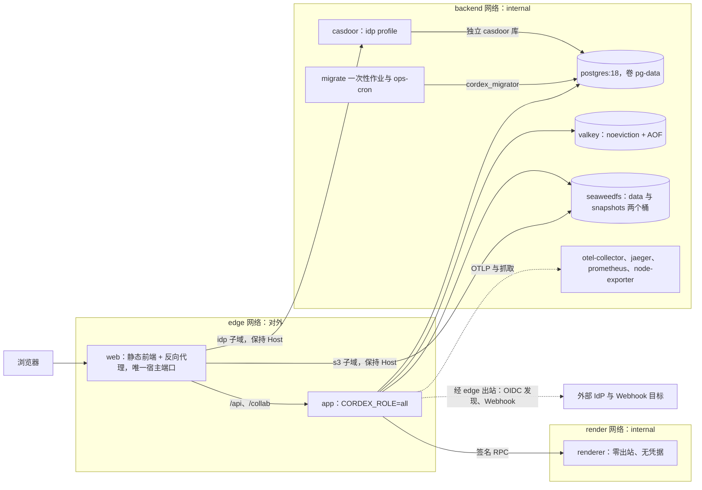
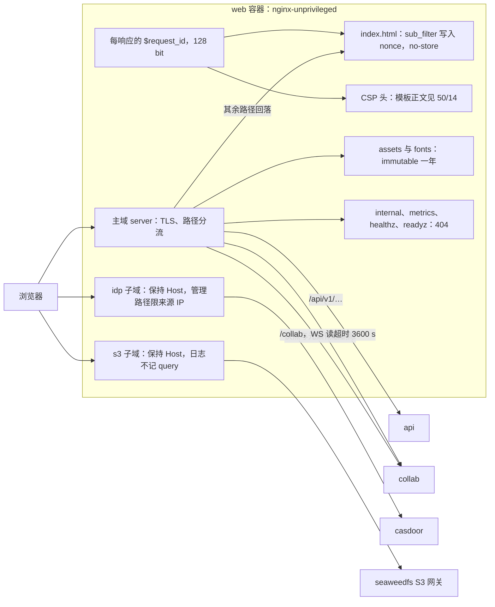
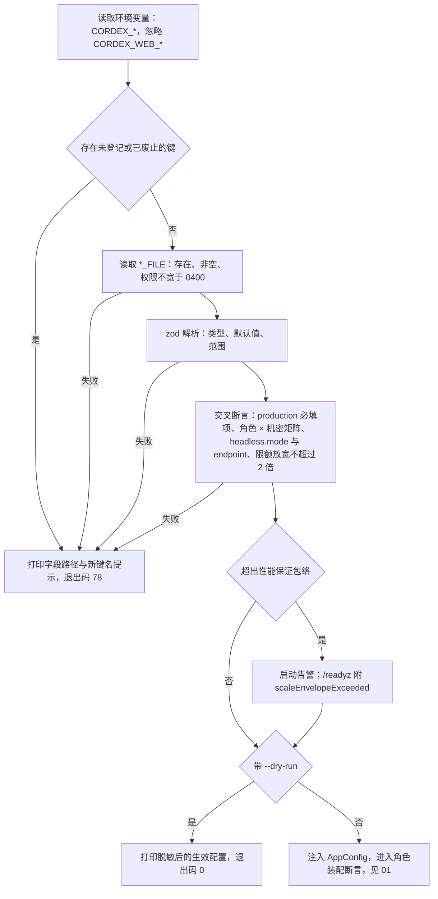
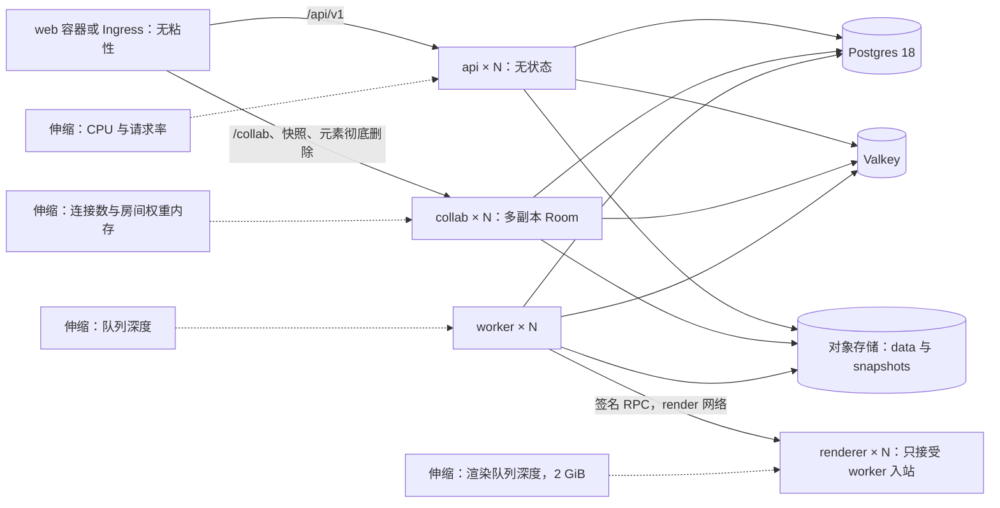

# 17 部署拓扑与配置 schema
> 状态：v0.1 | 负责：后端设计线 | 更新：2026-09-25；2026-09-25（§4.19） | 依赖：[ADR-0037](../30-architecture/adr/0037-deployment-topology-and-packaging.md)、[ADR-0022](../30-architecture/adr/0022-server-storage.md)、[ADR-0030](../30-architecture/adr/0030-observability-stack.md)、[30/08 §2 / §10](../30-architecture/08-backend-nestjs.md)、[rulings §4.15 Q2·Q5·Q9·Q10 / §4.16 Q17·Q19 / §4.18](../00-charter/rulings-2026-09-14.md)、[01](./01-service-overview-and-roles.md)、[08](./08-db-conventions-roles-rls-migrations.md)、[14](./14-valkey-object-storage-and-retention.md)、[50/14](../50-frontend/14-client-security.md)

> 读者：运维、写 `apps/server/src/config/**`、Dockerfile 与 compose 的工程师。
> 本文是**配置 schema 全字段表**（§5）的唯一源，也是 compose、web 容器、镜像、迁移作业与备份的部署事实源。进程角色的模块装配矩阵在 [01](./01-service-overview-and-roles.md)；CSP 策略正文在 [50/14](../50-frontend/14-client-security.md)，本文只负责「每响应生成 nonce 并下发」；RuntimeConfig 的字段在 [50/02](../50-frontend/02-app-shell-routing-and-session.md)，本文只负责「启动时渲染进 index.html」。

## 0. 本文拥有与引用

| 本文拥有 | 本文引用 |
|---|---|
| compose 服务、profile、网络、卷；web 容器的路径分流、子域、安全头、缓存头、nonce 生成 | CSP 策略正文、Trusted Types：[50/14](../50-frontend/14-client-security.md)；RuntimeConfig 字段：[50/02](../50-frontend/02-app-shell-routing-and-session.md) |
| 镜像构成、字体包、digest / SBOM / 许可门禁的产物形态 | 许可白名单与门禁判定：ADR-0037 决策 2、6；执行：[70/08](../70-testing/08-deployment-and-environment-e2e.md) |
| 配置 schema 全字段表、环境变量命名、机密来源、角色 × 机密矩阵、启动校验 | 模块装配与启动断言：[01](./01-service-overview-and-roles.md)；保留期语义：[14 §8](./14-valkey-object-storage-and-retention.md) |
| 迁移作业与 ops 命令的入口、升级步骤、备份恢复、主机规格口径 | 迁移纪律：[08 §10](./08-db-conventions-roles-rls-migrations.md)；探针与告警：[18](./18-observability-and-ops-endpoints.md) |

## 1. 交付形态

依据：ADR-0037 决策 1–7；rulings §4.15 Q9 / Q10。

- M1–M5 只交付**集成方或自有部署的 docker-compose 洁净栈**，不自营 SaaS；一次部署 = 一个组织（T-0）。
- 自建镜像三个：`cordex-server`（`CORDEX_ROLE` 选择 `all`、`api`、`collab`、`worker`）、`cordex-server` 的 `renderer` 构建目标（`CORDEX_ROLE=renderer`，§4）、`cordex-web`（静态前端 + 反向代理，§3）。同一版本号一起构建、一起发布。
- compose 默认 `CORDEX_ROLE=all` 单进程；拆分部署按 §8。
- **M4 P1**：Helm chart（按角色拆 Deployment）、离线安装包（镜像 tar + 字体包 + SBOM + 校验和）、amd64 / arm64 多架构镜像；不进 M3 出口。

## 2. compose

### 2.1 服务清单

| 服务 | 镜像 | profile | 网络 | 卷 / 挂载 | 说明 |
|---|---|---|---|---|---|
| `web` | `cordex-web` | 默认 | edge、backend | TLS 证书（只读） | **唯一开宿主端口的服务**（443，另 80 只做跳转）；backend 网络只用于 `idp.`、`s3.` 两个子域转发，并在 backend 上登记网络别名 `idp.<域名>`，供应用做 OIDC 发现与取 JWKS |
| `app` | `cordex-server`，`CORDEX_ROLE=all` | 默认 | edge、backend、render | 机密目录、`fonts.extraDirs`（均只读） | 出站只有两类：Webhook 与外部 IdP 经 edge；内置 Casdoor 时 OIDC 发现与 JWKS 经 web 在 backend 上的别名 `idp.<域名>`，不出宿主（ADR-0037 决策 3） |
| `migrate` | `cordex-server`，命令 `cordex-ops db:migrate storage:init` | 默认 | backend | 机密目录 | 一次性；`app` 以 `service_completed_successfully` 依赖它 |
| `ops-cron` | `cordex-server`，命令 `cordex-ops cron` | 默认 | backend | 机密目录 | 每日执行 `audit-rotate`（§9）；只读根文件系统、无端口 |
| `renderer` | `cordex-server` 的 renderer 目标 | 默认（M3 起） | **只有** render | `fonts.extraDirs`（只读） | 零出站、无凭据、非 root、`--shm-size` 而非 `--ipc=host` |
| `postgres` | `postgres:18` | 默认 | backend | `pg-data`；初始化钩子（只读） | 初始化钩子执行 0001、设置三个角色口令、建 `casdoor` 库与角色（§9） |
| `valkey` | `valkey/valkey`（钉次版本） | 默认 | backend | `valkey-data` | `--appendonly yes --appendfsync everysec --maxmemory-policy noeviction`（[14 §1](./14-valkey-object-storage-and-retention.md)） |
| `seaweedfs` | `chrislusf/seaweedfs` | 默认 | backend | `seaweedfs-data` | S3 网关 8333；两个桶由 `storage:init` 建立 |
| `otel-collector`、`jaeger`、`prometheus` | 各官方镜像 | 默认 | backend | — | Apache-2.0；默认告警规则随 compose 提供（ADR-0030 决策 7）；Collector 另配 spanmetrics connector，把产品事件 span 转成 Prometheus 指标（[18](./18-observability-and-ops-endpoints.md) §9.2） |
| `node-exporter` | `prom/node-exporter` | 默认 | backend | 宿主 `/proc`、`/sys`、根文件系统（只读） | Apache-2.0（rulings §4.15 Q10 许可白名单）；PRD SV-10 默认告警含「磁盘 > 85%」，需要宿主磁盘与内存指标；只被 Prometheus 抓取、不开宿主端口 |
| `casdoor` | `casbin/casdoor` | `idp` | backend | — | 使用同一 PG 实例的 `casdoor` 库；未启用时必须配置外部 issuer |
| `grafana`、`loki` | 各官方镜像 | `observability-agpl` | backend | — | AGPL-3.0，启用时打印许可提示 |
| `mock-oidc` | `oidc-provider` mock | `dev` | backend | — | 仅开发与 CI；web 容器在 dev 下把 `idp.` 子域指向它 |

全部镜像以 `@sha256:` digest 引用（§4）。容器一律：非 root、只读根文件系统（需要写的路径用 tmpfs）、`no-new-privileges`、丢弃全部 Linux capability。

### 2.2 profile 与网络

- profile：**默认**（`docker compose up`）；`idp`（Casdoor）；`observability-agpl`（Grafana、Loki，显式开启）；`dev`（mock-oidc）。
- 网络：`edge`（对外，普通 bridge）；`backend`（`internal: true`）；`render`（`internal: true`，只有 `app` / worker 与 `renderer`）。Casdoor 与 SeaweedFS 不开宿主端口，浏览器只能经 web 容器的子域到达（rulings §4.18 BE-01）。
- 卷：`pg-data`、`valkey-data`、`seaweedfs-data`；机密目录以只读 bind mount 挂入，文件权限 0400、属主为容器用户。

**图 2-1 compose 拓扑：服务、网络与 profile**



怎么读：方框分组是 compose 网络；实线是网络内调用，虚线是观测与出站。web 是浏览器唯一入口，按路径转给 app、按子域转给 Casdoor 与 SeaweedFS；renderer 只挂 render 网络，任何出站都不可达。`observability-agpl` 与 `dev` profile 默认不启动，图中不画。
依据：ADR-0037 决策 2–4；rulings §4.18 BE-01、BE-11、BE-14。

### 2.3 compose 骨架

```yaml
# 节选：镜像一律 @sha256 引用；完整文件随发布件提供
networks:
  edge: {}
  backend: { internal: true }
  render: { internal: true }
x-hardening: &hardening
  read_only: true
  security_opt: ["no-new-privileges:true"]
  cap_drop: ["ALL"]
services:
  web:
    <<: *hardening
    image: cordex-web@sha256:…
    ports: ["443:8443", "80:8080"]
    networks:
      edge: {}
      backend: { aliases: ["${CORDEX_WEB_IDP_HOST}"] }   # idp.<域名>：应用经此别名访问内置 Casdoor 的对外 issuer
    env_file: [web.env]
  migrate:
    <<: *hardening
    image: cordex-server@sha256:…
    command: ["cordex-ops", "db:migrate", "storage:init"]   # 多个子命令按序执行，首个失败即退出
    networks: [backend]
    depends_on: { postgres: { condition: service_healthy }, seaweedfs: { condition: service_healthy } }
  app:
    <<: *hardening
    image: cordex-server@sha256:…
    environment: { CORDEX_ROLE: all }
    env_file: [server.env]
    volumes: ["./secrets:/run/secrets/cordex:ro"]
    networks: [edge, backend, render]
    depends_on: { migrate: { condition: service_completed_successfully } }
    stop_grace_period: 40s
  renderer:
    <<: *hardening
    image: cordex-server@sha256:…   # renderer 构建目标
    environment: { CORDEX_ROLE: renderer }
    volumes: ["./secrets/render-verify.pub:/run/secrets/cordex/render-verify.pub:ro"]
    networks: [render]
    shm_size: 1gb
  valkey:
    image: valkey/valkey@sha256:…
    command: ["valkey-server", "--appendonly", "yes", "--appendfsync", "everysec", "--maxmemory-policy", "noeviction"]
    networks: [backend]
    volumes: ["valkey-data:/data"]
```

## 3. web 容器

依据：决策 CSP-NONCE（rulings §4.15 Q2「CSP nonce M2」+ §4.18 BE-11「其余静态文件由 web 容器提供」+ 30/08 §10.1）、RUNTIME-CONFIG、VERSION-DRIFT-SW、INC-25（Referrer-Policy）。基础镜像 `nginx-unprivileged`（非 root，监听 8080 / 8443）。

### 3.1 路径与子域分流

「哪条路径进哪个角色」以 [01 §7](./01-service-overview-and-roles.md) 为准；本表在其上补 nginx 实现要点（体积上限、超时、透传头、日志）。

| 主机 / 路径 | 去向 | 要点 |
|---|---|---|
| `<host>/internal/*`、`/metrics`、`/healthz`、`/readyz` | **404** | 内部端点与探针不对外；编排器在 backend 网络直接探测应用 |
| `<host>/api/v1/documents/{id}/snapshots*`、`…/elements/purge`、`…/comments/import` | collab | 须在 Room 内执行事务的 REST 只在 collab 装配（rulings §4.18 BE-03、CO-07；评论导入为 P1，[15](./15-rest-api-catalog.md) §3.11）；三类路径共用一条 location 正则；`all` 模式同一进程 |
| `<host>/api/*` | api | 请求体上限 11 MiB（≤ 10 MB multipart 直传）；透传 `Origin`、`X-Cordex-Request`、`X-Cordex-Share-Token` |
| `<host>/collab/*` | collab | WS 升级；`proxy_read_timeout` 与 `proxy_send_timeout` 3600 s；无粘性 |
| `<host>/assets/*`、`<host>/fonts/*` | 静态文件 | `Cache-Control: public, max-age=31536000, immutable`（文件名带内容哈希，字体路径带 fontProfile 版本） |
| `<host>/` 其余路径 | `index.html`（SPA 回落） | 每响应生成 nonce；`Cache-Control: no-store` |
| `idp.<域名>` | casdoor:8000 | 保持 Host，`X-Forwarded-Proto https`；管理后台路径（随 Casdoor 版本维护的清单文件）只允许 `CORDEX_WEB_IDP_ADMIN_ALLOW` 中的来源 IP |
| `s3.<域名>` | seaweedfs:8333 | 保持 Host（SigV4 把 Host 算进签名）；`proxy_request_buffering off`；单请求上限 32 MiB（≥ 10 MB 的上传走分片）；访问日志只记路径不记 query（query 里有预签名签名）；响应一律加 `Content-Security-Policy: sandbox` 与 `nosniff`（预签名 GET 返回的是用户上传内容，不得在该源执行，[04 §11](./04-modules-documents-storage-media.md)） |

TLS 证书覆盖 `<host>`、`idp.<域名>`、`s3.<域名>` 三个名字；前面另有 TLS 终止的负载均衡时设 `CORDEX_WEB_TLS_MODE=upstream`，此时 web 只监听 8080 并信任一跳 `X-Forwarded-*`。使用客户自有 S3 或外部 IdP 时省略对应子域（`CORDEX_WEB_S3_HOST` / `CORDEX_WEB_IDP_HOST` 置空）。

### 3.2 CSP nonce 与响应头

- **每响应生成**：nonce 取 nginx 的 `$request_id`（每请求 16 字节随机数的 hex，128 bit）。同一个值经 `sub_filter` 替换 index.html 模板里的占位符 `__CSP_NONCE__`（`<script nonce>` 与 `<meta name="cordex-nonce">`），并写进同一响应的 CSP 头。nonce 的消费链（injectCss 单例、第三方运行时 style 读 meta）见 [50/14 §3](../50-frontend/14-client-security.md)。
- **策略正文只在 [50/14 §2](../50-frontend/14-client-security.md)**：容器启动时把 50/14 的模板与本容器的环境变量（`CORDEX_WEB_S3_PUBLIC_ORIGIN`、`CORDEX_WEB_WS_BASE`、`CORDEX_WEB_EMBED_ALLOWED_ORIGINS`）渲染成 `/etc/nginx/cordex/csp.conf`，其中保留 `$request_id` 供 nginx 逐请求代入；本文不复写任何指令。
- **模式**：CSP（含 nonce）自 M2 起始终以强制头 `Content-Security-Policy` 下发；`CORDEX_WEB_CSP_MODE=report-only | enforce` 只决定 Trusted Types 的两条指令放在 `Content-Security-Policy-Report-Only` 还是并入强制头——M2 为 report-only，M3 起 enforce（rulings §4.15 Q2「CSP nonce M2、Trusted Types M2 report-only → M3 强制」；指令归属见 50/14 §2）。
- index.html 不得以预压缩文件（`gzip_static`）提供，否则 `sub_filter` 无法替换；动态 gzip 不受影响。
- nginx 的 `add_header` 不向下继承：每个自己写了 `add_header` 的 location 都要再 `include security-headers.conf`（见 §3.5 片段）。

### 3.3 RuntimeConfig 渲染

依据：决策 RUNTIME-CONFIG。容器**启动时**（不是每请求）从 `CORDEX_WEB_*` 环境变量生成 RuntimeConfig 的 JSON，写进 index.html 模板中的非执行数据块 `<script type="application/json" id="cordex-runtime-config">`（数据块不执行，不需要 nonce）；字段集合与 schema 以 [50/02 §3](../50-frontend/02-app-shell-routing-and-session.md) 为准，JSON 经转义防止 `</script>` 截断。只放静态部署项（`apiBase`、`wsBase`、`publicUrl`、`storagePublicOrigin`、`auth.mode`、`externalResources`、`telemetry` 默认开关、`embed.allowedHostOrigins`、`brand`、`features`、`help`；`appVersion` 取镜像构建时写入的版本号，不可配置）；`selfSignup`、IdP 显示名等可变开关只来自 `GET /api/v1/auth/config`。`auth.mode=none` 只存在于 dev 构建的镜像，生产镜像的启动脚本拒绝该值。

### 3.4 安全响应头

| 头 | 值 | 适用 |
|---|---|---|
| `Strict-Transport-Security` | `max-age=31536000; includeSubDomains` | 三个域名（`TLS_MODE=upstream` 时由上游设置） |
| `X-Content-Type-Options` | `nosniff` | 全部 |
| `Referrer-Policy` | `strict-origin-when-cross-origin` | 全部（决策 INC-25） |
| `Cross-Origin-Opener-Policy` | `same-origin` | 主域（重新登录弹窗经 BroadcastChannel 通信，不依赖 `window.opener`） |
| `Permissions-Policy` | `camera=(), microphone=(), geolocation=(), payment=()` | 主域 |
| `Content-Security-Policy`；M2 另加只含 Trusted Types 两条指令的 `Content-Security-Policy-Report-Only` | 50/14 模板 + 本响应的 nonce | 主域的 index.html |
| `Content-Security-Policy: sandbox` | 固定值 | `s3.` 子域全部响应 |
| `Cache-Control` | index.html `no-store`；`/assets/`、`/fonts/` `public, max-age=31536000, immutable` | 主域静态 |

不设 `X-Frame-Options`：嵌入形态由 CSP `frame-ancestors` 控制（50/14）——`/embed/*` 的 `frame-ancestors` 取 `CORDEX_WEB_EMBED_ALLOWED_ORIGINS`（为空即 `'none'`，默认禁止任何站点嵌入），其余路径恒为 `'none'`。版本漂移的处理（惰性 chunk 加载失败、4426 / 4427 → 提示刷新）归 50/02；M1–M4 不引入 Service Worker（决策 VERSION-DRIFT-SW）。

### 3.5 配置片段

```nginx
# /etc/nginx/conf.d/cordex.conf 节选（启动时由模板渲染；$request_id 为每请求 128 bit 随机 hex）
map $http_upgrade $connection_upgrade { default upgrade; '' close; }
log_format cordex_noquery '$remote_addr [$time_local] "$request_method $uri" $status $body_bytes_sent';
server {
  listen 8443 ssl;
  server_name ${CORDEX_WEB_HOST};
  include /etc/nginx/cordex/tls.conf;
  include /etc/nginx/cordex/security-headers.conf;
  location ^~ /internal/ { return 404; }
  location ~ ^/(metrics|healthz|readyz)$ { return 404; }
  location ~ ^/api/v1/documents/[^/]+/(snapshots|elements/purge|comments/import) {
    proxy_pass http://collab_upstream; include /etc/nginx/cordex/proxy.conf;
  }
  location /api/ { client_max_body_size 11m; proxy_pass http://api_upstream; include /etc/nginx/cordex/proxy.conf; }
  location /collab/ {
    proxy_pass http://collab_upstream; include /etc/nginx/cordex/proxy.conf;
    proxy_http_version 1.1;
    proxy_set_header Upgrade $http_upgrade;
    proxy_set_header Connection $connection_upgrade;
    proxy_read_timeout 3600s; proxy_send_timeout 3600s;
  }
  location ~ ^/(assets|fonts)/ {
    root /usr/share/nginx/html;
    include /etc/nginx/cordex/security-headers.conf;
    add_header Cache-Control "public, max-age=31536000, immutable" always;
  }
  location / { root /usr/share/nginx/html; try_files $uri /index.html; }
  location = /index.html {
    root /usr/share/nginx/html;
    sub_filter_once off;
    sub_filter '__CSP_NONCE__' $request_id;
    include /etc/nginx/cordex/security-headers.conf;
    include /etc/nginx/cordex/csp.conf;   # 由 50/14 的模板渲染，正文不在本文
    add_header Cache-Control "no-store" always;
  }
}
server {
  listen 8443 ssl;
  server_name ${CORDEX_WEB_S3_HOST};
  include /etc/nginx/cordex/tls.conf;
  access_log /var/log/nginx/s3.log cordex_noquery;
  add_header Strict-Transport-Security "max-age=31536000; includeSubDomains" always;
  add_header X-Content-Type-Options "nosniff" always;
  add_header Content-Security-Policy "sandbox" always;   # 用户上传内容在该源不可执行
  client_max_body_size 32m;
  proxy_request_buffering off;
  location / { proxy_pass http://seaweedfs:8333; proxy_set_header Host $host; }
}
# idp 子域同理：proxy_set_header Host $host；include idp-admin-paths.conf（allow 来源 IP 白名单；deny all）
```

### 3.6 web 容器的环境变量

前缀 `CORDEX_WEB_`；应用容器忽略这一前缀（§6）。RuntimeConfig 各字段的含义以 50/02 为准。

| 变量 | 默认 | 用途 |
|---|---|---|
| `CORDEX_WEB_HOST` | —（必填） | 主域名；`server_name` |
| `CORDEX_WEB_PUBLIC_URL` | `https://${CORDEX_WEB_HOST}` | RuntimeConfig `publicUrl` |
| `CORDEX_WEB_API_BASE` | `${PUBLIC_URL}/api/v1` | RuntimeConfig `apiBase`（rulings §4.18 BE-11） |
| `CORDEX_WEB_WS_BASE` | `wss://${CORDEX_WEB_HOST}` | RuntimeConfig `wsBase`（客户端拼 `{wsBase}/collab/v1/rooms/{documentId}`，50/02 §3）；CSP 模板变量 |
| `CORDEX_WEB_S3_HOST` / `CORDEX_WEB_S3_PUBLIC_ORIGIN` | `s3.${域}` / `https://s3.${域}` | `s3.` 子域；RuntimeConfig 与 CSP 模板中的存储源；置空 = 使用客户自有 S3 的对外地址 |
| `CORDEX_WEB_IDP_HOST` | `idp.${域}` | `idp.` 子域；置空 = 外部 IdP |
| `CORDEX_WEB_IDP_ADMIN_ALLOW` | `127.0.0.1/32` | Casdoor 管理后台允许的来源 CIDR 列表 |
| `CORDEX_WEB_AUTH_MODE` | `oidc` | RuntimeConfig `auth.mode`；生产镜像只接受 `oidc` |
| `CORDEX_WEB_EXTERNAL_RESOURCES` | 以 50/02 schema 默认为准 | RuntimeConfig `externalResources`（`auto`、`confirm`、`never`） |
| `CORDEX_WEB_ERROR_REPORTS_DEFAULT` / `CORDEX_WEB_PRODUCT_TELEMETRY_DEFAULT` / `CORDEX_WEB_OTLP_DEFAULT` | `on` / `off` / `off` | RuntimeConfig `telemetry` 三个默认开关（决策 TELEMETRY-DEFAULT） |
| `CORDEX_WEB_RUNTIME_CONFIG_FILE` | 空 | 可选的只读 JSON 文件，提供 `brand`、`features`、`help` 等结构化字段，与上面各变量合并后整体按 50/02 的 `RuntimeConfigSchema` 校验，失败即容器拒绝启动 |
| `CORDEX_WEB_CSP_MODE` | M2 `report-only`，M3 起 `enforce` | 只作用于 Trusted Types 两条指令（§3.2） |
| `CORDEX_WEB_EMBED_ALLOWED_ORIGINS` | 空 | 允许以 iframe 嵌入 `/embed/*` 的宿主源列表（逗号分隔的 `https://` 源）；空 → `/embed/*` 的 `frame-ancestors 'none'`。同一份值渲染进 CSP 与 RuntimeConfig `embed.allowedHostOrigins`（前端据此做 postMessage 来源白名单，[50/12](../50-frontend/12-viewer-embedding-and-render-page.md) §9、[50/14](../50-frontend/14-client-security.md) §2），两处不会不一致 |
| `CORDEX_WEB_ENV` | `production` | `production` 或 `test`；只有 e2e 预览服务器与 [70/08](../70-testing/08-deployment-and-environment-e2e.md) 的 `compose.test.yml` 设为 `test`，供下一行的启动校验判定 |
| `CORDEX_WEB_DIAGNOSTICS_E2E_TRACE` | `false` | RuntimeConfig `diagnostics.e2eTrace`（[50/02](../50-frontend/02-app-shell-routing-and-session.md) §3、[50/15](../50-frontend/15-events-errors-and-telemetry.md) §10）；为 `true` 且 `CORDEX_WEB_ENV` 不是 `test` 时容器拒绝启动（生产部署配置拒绝其为真，§5.15） |
| `CORDEX_WEB_TLS_MODE` | `terminate` | `terminate` 或 `upstream` |
| `CORDEX_WEB_UPSTREAM_API` / `CORDEX_WEB_UPSTREAM_COLLAB` | `app:3000` / `app:3000` | 拆分部署时分别指向 api、collab（§8） |

**图 3-1 web 容器的分流、子域与 nonce 生成**



怎么读：浏览器的三个域名都进同一个 web 容器；主域按路径分流到 api、collab 或静态文件，两个子域原样转发并保持 Host。nonce 在每个 index.html 响应上生成一次，同时写进页面与 CSP 头，所以两者一定一致、每次响应都不同。
依据：决策 CSP-NONCE、RUNTIME-CONFIG；rulings §4.18 BE-01、BE-03、BE-11；ADR-0037 决策 3。

## 4. 镜像

依据：ADR-0037 决策 1、2、6、7；rulings §4.15 Q9（Node 26）、§4.16 Q19（字体）；决策 FONTS。

| 镜像 | 基础 | 内容 | 运行用户 |
|---|---|---|---|
| `cordex-server`（runtime 目标） | `node:26-slim@sha256:…` | `apps/server` 生产依赖（`pnpm deploy --prod`）、`cordex-ops` 入口、tini、字体包；**不含 Chromium** | uid 10001 |
| `cordex-server`（renderer 目标） | 上一行 runtime 目标 | 另加钉死版本的 `chromium-headless-shell`、同版本的 `/render` 静态包、seccomp 配置 | uid 10001；`chromiumSandbox: true` |
| `cordex-web` | `nginxinc/nginx-unprivileged@sha256:…` | `apps/web` 构建产物、`/fonts/` 字体子集、nginx 模板与启动渲染脚本 | nginx 默认非 root 用户 |

多阶段 Dockerfile：

```text
deps      pnpm fetch（锁文件驱动，可缓存）
build     pnpm -r build（turbo）：apps/server、apps/web 及其依赖包
prune     pnpm deploy --prod --filter apps/server → /out/server
runtime   FROM node:26-slim@sha256:…；COPY /out/server、字体包；USER 10001；ENTRYPOINT ["tini","--","node","dist/main.js"]
renderer  FROM runtime；安装钉死版本 chromium-headless-shell；COPY apps/web 的 /render 静态包；CORDEX_ROLE=renderer
web       FROM nginx-unprivileged@sha256:…；COPY apps/web dist 与 /fonts/；COPY nginx 模板与 entrypoint 渲染脚本
```

**renderer 镜像二选一，取「`cordex-server` 的 renderer 构建目标」**：
- 理由：同一次构建产出 worker 与 renderer，`/render` 静态包、fontProfile 与 RPC 契约版本天然一致，ADR-0037 的「renderer 与 worker 版本锁」由构建方式直接保证，不需要额外的锁步流水线；renderer 入口本来就是 `apps/server` 的 `CORDEX_ROLE=renderer`，另做最小镜像仍要带上这部分代码。
- 代价与对策：镜像比自建最小 Chromium 镜像大；镜像里有服务端代码。对策是运行时约束而非删文件：只挂 render 网络、零出站、不挂任何凭据、启动时检测到凭据环境变量即拒绝启动、进程内不建 DB / Valkey / S3 客户端（[01](./01-service-overview-and-roles.md)），并由治理检查 `check-image-policy` 静态核对非 root、无凭据、沙箱开启。
- 每周随 Chrome 稳定版重建并与 worker 同版本发布。

**字体包**（决策 FONTS）：一份字体清单（fontProfile id、版本、每个文件的 sha256，含内置 Noto（含 CJK）、Liberation、Carlito / Caladea）被三个镜像共用——runtime（`node-font` 度量）、renderer（Chromium 渲染）、web（`/fonts/{profileVersion}/…`，按 unicode-range 子集供浏览器按需加载）。部署方自有授权字体只读挂载到 `fonts.extraDirs`（rulings §4.16 Q19）。三个镜像中同名字体的 sha256 必须一致（`check-image-policy` 的子规则）。

**供应链**：全部镜像（自建与第三方）以 digest 钉死；自建镜像随发布附 SBOM（buildx 生成的 SPDX 证明并导出文件）与 CVE 扫描报告；`ops:image-licenses` 门禁要求默认 profile 每个镜像的主组件许可在白名单内，AGPL / SSPL / RSAL 只允许出现在显式 profile（ADR-0037 决策 2、6）。

## 5. 配置 schema 全字段表（唯一源）

`apps/server/src/config/config.schema.ts`（zod）是本表的代码形态；解析一次，注入 typed `AppConfig`。统一键名：房间容量只在 `collab.room.*`（废 `room.*`），保留期只在 `retention.*`（40/12 的 `RetentionPolicy` 值对象改为读这里），单帧与速率只在 `limits.*`（决策 INC-07），溢写阈值只在 `spill.*`（决策 SPILL）。旧键名一律拒绝启动并提示新键名（§5.14）。单位写在键名后缀里（`Ms`、`Sec`、`Hours`、`Days`、`Bytes`）；「生产必填」指 `NODE_ENV=production` 时缺失即退出码 78；机密一律经 `*File` 读文件（§6）。「生产必填」按角色取舍：机密项以 §6 的角色 × 机密矩阵为准；renderer 只读取 `role`、`http.port`、`headless.*`、`fonts.extraDirs`、`telemetry.logLevel`，其余键对它不适用。

### 5.1 进程与 HTTP

| 路径 | 类型 | 默认 | 范围 / 校验 | 生产必填 | 环境变量 | 机密 |
|---|---|---|---|---|---|---|
| `role` | 枚举 | `all` | `all`、`api`、`collab`、`worker`、`renderer` | 是 | `CORDEX_ROLE` | 否 |
| （运行环境） | 枚举 | `development` | `production`、`development`、`test` | 是 | `NODE_ENV` | 否 |
| `publicUrl` | URL | — | https、无路径 | 是 | `CORDEX_PUBLIC_URL` | 否 |
| `http.port` | 整数 | 3000 | 1–65535 | — | `CORDEX_HTTP_PORT` | 否 |
| `http.internalPort` | 整数 | 9464 | ≠ `http.port`；只绑 backend 网络（`/metrics`、`/internal/*`） | — | `CORDEX_HTTP_INTERNAL_PORT` | 否 |
| `http.internalHost` | 字符串 | dev 为 `127.0.0.1` | 内部端口的监听地址；production 必须显式配置且不得为通配地址 `0.0.0.0` / `::`（[01 §6](./01-service-overview-and-roles.md) A10）；compose 模板注入容器在 backend 网络上的地址 | 是（api、collab、worker） | `CORDEX_HTTP_INTERNAL_HOST` | 否 |
| `http.trustProxy` | 整数 | 1 | 0–3（可信反代跳数） | — | `CORDEX_HTTP_TRUST_PROXY` | 否 |
| `http.bodyLimitBytes` | 整数 | 262144 | ≤ 16 MiB；未另注明路由的 JSON 请求体上限，按路由的覆盖值见 [15 §8](./15-rest-api-catalog.md) | — | `CORDEX_HTTP_BODY_LIMIT_BYTES` | 否 |
| `http.multipartMaxBytes` | 整数 | 10485760 | ≤ 10 MiB（小文件 multipart 直传） | — | `CORDEX_HTTP_MULTIPART_MAX_BYTES` | 否 |
| `http.shutdownGraceMs` | 整数 | 30000 | 5000–60000（SIGTERM 排空上限） | — | `CORDEX_HTTP_SHUTDOWN_GRACE_MS` | 否 |

### 5.2 数据库

| 路径 | 类型 | 默认 | 范围 / 校验 | 生产必填 | 环境变量 | 机密 |
|---|---|---|---|---|---|---|
| `db.host` / `db.port` / `db.database` | 字符串 / 整数 / 字符串 | `postgres` / 5432 / `cordex` | — | 是 | `CORDEX_DB_HOST` / `CORDEX_DB_PORT` / `CORDEX_DB_DATABASE` | 否 |
| `db.sslMode` | 枚举 | `disable` | `disable`、`require`、`verify-full`；库在容器网络之外时须 `verify-full` | — | `CORDEX_DB_SSL_MODE` | 否 |
| `db.app.user` | 字符串 | `cordex_app` | — | — | `CORDEX_DB_APP_USER` | 否 |
| `db.app.passwordFile` | 路径 | — | 可读文件 | api、collab、worker | `CORDEX_DB_APP_PASSWORD_FILE` | 是 |
| `db.app.poolMax` | 整数 | 20 | 1–200 | — | `CORDEX_DB_APP_POOL_MAX` | 否 |
| `db.app.statementTimeoutMs` | 整数 | 30000 | 1000–120000 | — | `CORDEX_DB_APP_STATEMENT_TIMEOUT_MS` | 否 |
| `db.system.user` | 字符串 | `cordex_system` | — | — | `CORDEX_DB_SYSTEM_USER` | 否 |
| `db.system.passwordFile` | 路径 | — | api 与 renderer 配置即拒绝启动 | collab、worker | `CORDEX_DB_SYSTEM_PASSWORD_FILE` | 是 |
| `db.system.poolMax` | 整数 | 20 | 1–200 | — | `CORDEX_DB_SYSTEM_POOL_MAX` | 否 |
| `db.system.statementTimeoutMs` | 整数 | 120000 | 1000–600000 | — | `CORDEX_DB_SYSTEM_STATEMENT_TIMEOUT_MS` | 否 |
| `db.migrator.user` | 字符串 | `cordex_migrator` | 只供 `cordex-ops` | — | `CORDEX_DB_MIGRATOR_USER` | 否 |
| `db.migrator.passwordFile` | 路径 | — | 应用进程（任何 `CORDEX_ROLE`）配置即拒绝启动 | ops 命令 | `CORDEX_DB_MIGRATOR_PASSWORD_FILE` | 是 |

### 5.3 Valkey

| 路径 | 类型 | 默认 | 范围 / 校验 | 生产必填 | 环境变量 | 机密 |
|---|---|---|---|---|---|---|
| `valkey.url` | URL | `redis://valkey:6379` | `redis://` 或 `rediss://`，不含口令 | 是（renderer 除外） | `CORDEX_VALKEY_URL` | 否 |
| `valkey.passwordFile` | 路径 | — | 可选 | — | `CORDEX_VALKEY_PASSWORD_FILE` | 是 |
| `valkey.keyPrefix` | 字符串 | `cordex:` | `^[a-z0-9-]+:$`（[14 §2](./14-valkey-object-storage-and-retention.md)） | — | `CORDEX_VALKEY_KEY_PREFIX` | 否 |

### 5.4 对象存储

| 路径 | 类型 | 默认 | 范围 / 校验 | 生产必填 | 环境变量 | 机密 |
|---|---|---|---|---|---|---|
| `storage.provider` | 枚举 | `s3` | `s3`、`local`；production 只允许 `s3` | 是 | `CORDEX_STORAGE_PROVIDER` | 否 |
| `storage.local.dir` | 路径 | — | 仅 dev / test | — | `CORDEX_STORAGE_LOCAL_DIR` | 否 |
| `storage.s3.endpoint` | URL | `http://seaweedfs:8333` | 内网地址，服务端自身读写 | 是 | `CORDEX_STORAGE_S3_ENDPOINT` | 否 |
| `storage.s3.publicEndpoint` | URL | — | 浏览器可达；预签名一律按它生成（rulings §4.18 BE-01） | 是 | `CORDEX_STORAGE_S3_PUBLIC_ENDPOINT` | 否 |
| `storage.s3.region` | 字符串 | `us-east-1` | — | — | `CORDEX_STORAGE_S3_REGION` | 否 |
| `storage.s3.forcePathStyle` | 布尔 | `true` | — | — | `CORDEX_STORAGE_S3_FORCE_PATH_STYLE` | 否 |
| `storage.s3.accessKeyIdFile` / `storage.s3.secretAccessKeyFile` | 路径 | — | renderer 配置即拒绝启动 | 是 | `CORDEX_STORAGE_S3_ACCESS_KEY_ID_FILE` / `CORDEX_STORAGE_S3_SECRET_ACCESS_KEY_FILE` | 是 |
| `storage.s3.buckets.data` | 字符串 | `cordex-data` | S3 桶名规则 | — | `CORDEX_STORAGE_S3_BUCKETS_DATA` | 否 |
| `storage.s3.buckets.snapshots` | 字符串 | `cordex-snapshots` | ≠ `buckets.data` | — | `CORDEX_STORAGE_S3_BUCKETS_SNAPSHOTS` | 否 |
| `storage.s3.presign.putTtlSec` | 整数 | 600 | 60–3600；媒体上传的预签名 PUT 有效期。导入原件的 PUT 不读本键，固定等于 `uploadId` 寿命 1 h（rulings §4.18 BE-10；落点隔离区 `uploads/tmp/{uploadId}`，UPLOAD-QUARANTINE，[06 §6.1](./06-modules-jobs-import-export-thumbnails.md)） | — | `CORDEX_STORAGE_S3_PRESIGN_PUT_TTL_SEC` | 否 |
| `storage.s3.presign.getTtlSec` | 整数 | 3600 | 60–86400 | — | `CORDEX_STORAGE_S3_PRESIGN_GET_TTL_SEC` | 否 |
| `storage.s3.snapshotsNoncurrentDays` | 整数 | 7 | ≥ 1，且 ≥ PG 备份保留天数（[14 §11](./14-valkey-object-storage-and-retention.md)） | — | `CORDEX_STORAGE_S3_SNAPSHOTS_NONCURRENT_DAYS` | 否 |

### 5.5 鉴权

| 路径 | 类型 | 默认 | 范围 / 校验 | 生产必填 | 环境变量 | 机密 |
|---|---|---|---|---|---|---|
| `auth.oidc.issuer` | URL | — | 浏览器可达的对外地址（内置 Casdoor 时为 `https://idp.<域名>`）；启动时能完成发现 | 是（api） | `CORDEX_AUTH_OIDC_ISSUER` | 否 |
| `auth.oidc.clientId` | 字符串 | — | — | 是（api） | `CORDEX_AUTH_OIDC_CLIENT_ID` | 否 |
| `auth.oidc.clientSecretFile` | 路径 | — | 只有 api 持有 | 是（api） | `CORDEX_AUTH_OIDC_CLIENT_SECRET_FILE` | 是 |
| `auth.oidc.redirectUri` | URL | `{publicUrl}/api/v1/auth/oidc/callback` | 与 `publicUrl` 同源 | — | `CORDEX_AUTH_OIDC_REDIRECT_URI` | 否 |
| `auth.oidc.scopes` | 字符串数组 | `openid,profile,email` | 必含 `openid` | — | `CORDEX_AUTH_OIDC_SCOPES` | 否 |
| `auth.oidc.displayName` | 字符串 | `单点登录` | ≤ 40 字；经 `GET /auth/config` 下发 | — | `CORDEX_AUTH_OIDC_DISPLAY_NAME` | 否 |
| `auth.oidc.requireEmailVerified` | 布尔 | `true` | `false` 时接受不下发 `email_verified` 的企业 IdP 邮箱（[02 §3](./02-auth-chain.md)） | — | `CORDEX_AUTH_OIDC_REQUIRE_EMAIL_VERIFIED` | 否 |
| `auth.oidc.postLogoutRedirectPath` | 字符串 | `/login` | 以 `/` 开头的站内路径；RP-initiated logout 的 `post_logout_redirect_uri` = `publicUrl` + 本值，须在 IdP 侧登记为允许的回跳地址（[02 §4.4](./02-auth-chain.md)） | — | `CORDEX_AUTH_OIDC_POST_LOGOUT_REDIRECT_PATH` | 否 |
| `auth.selfSignup` | 布尔 | `false` | 经 `GET /auth/config` 下发 | — | `CORDEX_AUTH_SELF_SIGNUP` | 否 |
| `auth.bootstrapAdmins` | 字符串数组 | 空 | 已验证邮箱列表；只在部署内不存在任何 active 平台管理员时生效（[02 §3](./02-auth-chain.md)） | — | `CORDEX_AUTH_BOOTSTRAP_ADMINS` | 否 |
| `auth.session.accessTtlSec` | 整数 | 900 | 300–3600（会话 JWT） | — | `CORDEX_AUTH_SESSION_ACCESS_TTL_SEC` | 否 |
| `auth.session.refreshTtlSec` | 整数 | 604800 | ≤ `absoluteTtlSec`（刷新滑动窗口） | — | `CORDEX_AUTH_SESSION_REFRESH_TTL_SEC` | 否 |
| `auth.session.absoluteTtlSec` | 整数 | 2592000 | ≤ 90 天（会话绝对封顶，[02 §4.1](./02-auth-chain.md)） | — | `CORDEX_AUTH_SESSION_ABSOLUTE_TTL_SEC` | 否 |
| `auth.session.revocationCacheMs` | 整数 | 5000 | ≤ 5000；SessionGuard 进程内缓存与 collab 的 WS 会话批量复核周期（吊销 ≤ 5 s 生效，决策 SESSION；[02 §4.2、§9.5](./02-auth-chain.md)） | — | `CORDEX_AUTH_SESSION_REVOCATION_CACHE_MS` | 否 |
| `auth.jwt.signingKeysFile` | 路径 | — | ES256 私钥 JWKS，可含多个 `kid` 以便轮换；只有 api 持有 | 是（api） | `CORDEX_AUTH_JWT_SIGNING_KEYS_FILE` | 是 |
| `auth.jwt.verifyKeysFile` | 路径 | — | 同一组密钥的公钥 JWKS；轮换期保留旧公钥至最长令牌寿命 | 是（collab） | `CORDEX_AUTH_JWT_VERIFY_KEYS_FILE` | 否 |
| `auth.ticket.ttlSec` | 整数 | 60 | 30–120（collab 票据） | — | `CORDEX_AUTH_TICKET_TTL_SEC` | 否 |

### 5.6 安全与机密

| 路径 | 类型 | 默认 | 范围 / 校验 | 生产必填 | 环境变量 | 机密 |
|---|---|---|---|---|---|---|
| `security.allowedOrigins` | URL 数组 | `publicUrl` 的 origin | 每项是 origin；CSRF 与 WS Origin 白名单（决策 INC-24） | — | `CORDEX_SECURITY_ALLOWED_ORIGINS` | 否 |
| `secrets.kekFile` | 路径 | — | 32 字节；AES-256-GCM 加密 Webhook 签名密钥（决策 C-16/INC-30）；api 与 worker 持有 | 是（M3 起） | `CORDEX_SECRETS_KEK_FILE` | 是 |
| `ops.tokenFile` | 路径 | — | ≥ 32 字节；`/internal/*` 常量时间比较（决策 INC-26） | 是 | `CORDEX_OPS_TOKEN_FILE` | 是 |
| `audit.hashSaltFile` | 路径 | — | ≥ 32 字节；`ip_hash`、`ua_hash` 与限流 IP 主体的盐 | 是 | `CORDEX_AUDIT_HASH_SALT_FILE` | 是 |
| `audit.recordClientIp` | 布尔 | `true` | `false` 时审计行 `ip_hash` 恒为空（[07](./07-modules-comments-webhooks-audit.md)） | — | `CORDEX_AUDIT_RECORD_CLIENT_IP` | 否 |
| `webhooks.egressAllowlist` | 字符串数组 | 空（严格模式） | CIDR 或主机名；放宽 SSRF 默认拒绝的显式白名单 | — | `CORDEX_WEBHOOKS_EGRESS_ALLOWLIST` | 否 |

### 5.7 协同

| 路径 | 类型 | 默认 | 范围 / 校验 | 生产必填 | 环境变量 | 机密 |
|---|---|---|---|---|---|---|
| `collab.room.maxEditors` | 整数 | 20 | 1–100；> 20 为超包络 | — | `CORDEX_COLLAB_ROOM_MAX_EDITORS` | 否 |
| `collab.room.maxViewers` | 整数 | 50 | 0–500；> 50 为超包络 | — | `CORDEX_COLLAB_ROOM_MAX_VIEWERS` | 否 |
| `collab.room.memoryAdmissionPct` | 整数 | 75 | 10–95；实例内存预算 = cgroup 限额 × 本值（rulings §4.18 BE-29） | — | `CORDEX_COLLAB_ROOM_MEMORY_ADMISSION_PCT` | 否 |
| `collab.room.weightBytesPerElement` | 整数 | 14336 | 房间权重 = `documents.element_count` × 本值（[05 §4.1](./05-modules-collab-and-snapshots.md)，CO-17） | — | `CORDEX_COLLAB_ROOM_WEIGHT_BYTES_PER_ELEMENT` | 否 |
| `collab.room.weightBudgetBytes` | 整数 | 无 | 可选的绝对覆盖值 | — | `CORDEX_COLLAB_ROOM_WEIGHT_BUDGET_BYTES` | 否 |
| `collab.room.drainGraceMs` | 整数 | 60000 | 0–600000（空置房间销毁延迟） | — | `CORDEX_COLLAB_ROOM_DRAIN_GRACE_MS` | 否 |
| `collab.membership.heartbeatMs` / `collab.membership.staleMs` | 整数 | 15000 / 60000 | stale ≥ 3 × heartbeat（名额登记刷新与过期，决策 C-11，[14 §4](./14-valkey-object-storage-and-retention.md)） | — | `CORDEX_COLLAB_MEMBERSHIP_HEARTBEAT_MS` / `CORDEX_COLLAB_MEMBERSHIP_STALE_MS` | 否 |
| `collab.compaction.maxPendingUpdates` | 整数 | 500 | 50–10000 | — | `CORDEX_COLLAB_COMPACTION_MAX_PENDING_UPDATES` | 否 |
| `collab.compaction.maxPendingBytes` | 整数 | 5242880 | 1 MiB–64 MiB | — | `CORDEX_COLLAB_COMPACTION_MAX_PENDING_BYTES` | 否 |
| `collab.compaction.maxAgeMs` | 整数 | 600000 | 60000–3600000（三个阈值任一满足即压缩，ADR-0025 决策 3） | — | `CORDEX_COLLAB_COMPACTION_MAX_AGE_MS` | 否 |
| `collab.compaction.maxLogToSnapshotRatio` | 整数 | 10 | 2–100（update 日志达到最新快照大小的本值倍数即压缩，NF-10，[05 §7](./05-modules-collab-and-snapshots.md)） | — | `CORDEX_COLLAB_COMPACTION_MAX_LOG_TO_SNAPSHOT_RATIO` | 否 |
| `collab.persist.flushMs` / `collab.persist.batchMax` | 整数 | 100 / 50 | 10–1000 / 1–500 | — | `CORDEX_COLLAB_PERSIST_FLUSH_MS` / `CORDEX_COLLAB_PERSIST_BATCH_MAX` | 否 |
| `collab.persist.persistBeforeBroadcast` | 布尔 | `true` | 只约束 PG 可用时的顺序；PG 降级期照常广播（rulings §4.18 CO-08） | — | `CORDEX_COLLAB_PERSIST_PERSIST_BEFORE_BROADCAST` | 否 |
| `collab.persist.retryWindowMs` / `collab.persist.probeIntervalMs` | 整数 | 800 / 1000 | PG 抖动重试窗口，超过即进入降级期并溢写；降级期 PG 探活间隔（[05 §5、§6](./05-modules-collab-and-snapshots.md)） | — | `CORDEX_COLLAB_PERSIST_RETRY_WINDOW_MS` / `CORDEX_COLLAB_PERSIST_PROBE_INTERVAL_MS` | 否 |
| `collab.softGate.mode` / `collab.softGate.schemaMode` | 枚举 | `repair` / `report-only` | `repair`、`report-only`、`off`（ADR-0034；默认值按 rulings §4.1 P8：不变量 repair、schema report-only） | — | `CORDEX_COLLAB_SOFT_GATE_MODE` / `CORDEX_COLLAB_SOFT_GATE_SCHEMA_MODE` | 否 |
| `collab.repair.quarantineThreshold` / `collab.repair.windowMs` | 整数 | 5 / 600000 | 窗口内修复次数达阈值即隔离（4409，ADR-0034 决策 2，[16 §13](./16-ws-protocol-server-view.md)） | — | `CORDEX_COLLAB_REPAIR_QUARANTINE_THRESHOLD` / `CORDEX_COLLAB_REPAIR_WINDOW_MS` | 否 |

名额按用户计、owner 不占编辑者名额、commenter 计入查看者是固定规则（rulings §4.15 Q5），不是配置项。

### 5.8 限额与限流

| 路径 | 类型 | 默认 | 范围 / 校验 | 生产必填 | 环境变量 | 机密 |
|---|---|---|---|---|---|---|
| `limits.maxUpdateBytes` | 整数 | 1048576 | 64 KiB–4 MiB；单帧 payload 上限（不含 1 字节 FrameType），超限 4413 | — | `CORDEX_LIMITS_MAX_UPDATE_BYTES` | 否 |
| `limits.msgRateHz` / `limits.msgBurst` | 整数 | 200 / 500 | 对全部帧限速（决策 INC-07） | — | `CORDEX_LIMITS_MSG_RATE_HZ` / `CORDEX_LIMITS_MSG_BURST` | 否 |
| `limits.awarenessMinIntervalMs` / `limits.awarenessMaxBytes` | 整数 | 50 / 2048 | — | — | `CORDEX_LIMITS_AWARENESS_MIN_INTERVAL_MS` / `CORDEX_LIMITS_AWARENESS_MAX_BYTES` | 否 |
| `limits.structsPerUpdate` | 整数 | 50000 | — | — | `CORDEX_LIMITS_STRUCTS_PER_UPDATE` | 否 |
| `limits.updateBytesPerMin` | 整数 | 10485760 | 每连接每分钟写入字节，超限 4429（[16 §13](./16-ws-protocol-server-view.md)） | — | `CORDEX_LIMITS_UPDATE_BYTES_PER_MIN` | 否 |
| `limits.awarenessTickThreshold` / `limits.awarenessTickMs` | 整数 | 20 / 100 | 房间在线人数达阈值后 awareness 按 tick 合并转发（16 §7） | — | `CORDEX_LIMITS_AWARENESS_TICK_THRESHOLD` / `CORDEX_LIMITS_AWARENESS_TICK_MS` | 否 |
| `limits.idleTimeoutMs` | 整数 | 45000 | 无任何入站帧即断开（客户端 15 s 心跳 × 3，16 §3） | — | `CORDEX_LIMITS_IDLE_TIMEOUT_MS` | 否 |
| `limits.ws.maxConnectionsPerInstance` | 整数 | 4000 | RM-S 单实例 ≥ 2,000 连接的 2 倍余量；数值归 [16 §13](./16-ws-protocol-server-view.md) | — | `CORDEX_LIMITS_WS_MAX_CONNECTIONS_PER_INSTANCE` | 否 |
| `limits.ws.connectPerIpPerMin` / `limits.ws.firstFrameTimeoutMs` | 整数 | 10 / 5000 | — | — | `CORDEX_LIMITS_WS_CONNECT_PER_IP_PER_MIN` / `CORDEX_LIMITS_WS_FIRST_FRAME_TIMEOUT_MS` | 否 |
| `limits.rate.<档>.perMin` / `limits.rate.<档>.burst` | 整数 | 见表后各档默认 | 令牌桶的补充速率与容量；档名、适用路由与主体以 [15 §8](./15-rest-api-catalog.md) 为准，桶键见 [14 §3.2](./14-valkey-object-storage-and-retention.md)；只可收紧 | — | `CORDEX_LIMITS_RATE_<档>_PER_MIN` / `CORDEX_LIMITS_RATE_<档>_BURST`（档名转大写蛇形） | 否 |
| `limits.media.maxBytes` | 整数 | 104857600 | 资源上传单文件 100 MiB | — | `CORDEX_LIMITS_MEDIA_MAX_BYTES` | 否 |
| `limits.zip.maxEntries` | 整数 | 4000 | 只可收紧；放宽不超过 2 倍（OF-24），否则拒绝启动 | — | `CORDEX_LIMITS_ZIP_MAX_ENTRIES` | 否 |
| `limits.zip.maxEntryUncompressedBytes` / `limits.zip.maxTotalUncompressedBytes` | 整数 | 64 MiB / 512 MiB | 同上 | — | `CORDEX_LIMITS_ZIP_MAX_ENTRY_UNCOMPRESSED_BYTES` / `CORDEX_LIMITS_ZIP_MAX_TOTAL_UNCOMPRESSED_BYTES` | 否 |
| `limits.zip.maxCompressionRatio` / `limits.zip.maxMediaBytes` | 整数 | 100 / 256 MiB | 同上 | — | `CORDEX_LIMITS_ZIP_MAX_COMPRESSION_RATIO` / `CORDEX_LIMITS_ZIP_MAX_MEDIA_BYTES` | 否 |
| `limits.xml.maxDepth` / `limits.xml.maxAttributesPerElement` / `limits.xml.maxTextNodeBytes` | 整数 | 256 / 1024 / 16 MiB | 同上；DTD 与外部实体始终禁用，不可配置 | — | `CORDEX_LIMITS_XML_MAX_DEPTH` / `CORDEX_LIMITS_XML_MAX_ATTRIBUTES_PER_ELEMENT` / `CORDEX_LIMITS_XML_MAX_TEXT_NODE_BYTES` | 否 |
| `limits.fonts.maxEmbeddedBytes` / `limits.fonts.maxEmbeddedTotalBytes` | 整数 | 20 MB / 60 MB | PRD OF-17 | — | `CORDEX_LIMITS_FONTS_MAX_EMBEDDED_BYTES` / `CORDEX_LIMITS_FONTS_MAX_EMBEDDED_TOTAL_BYTES` | 否 |
| `limits.import.parseTimeoutMs` | 整数 | 60000 | 10000–300000 | — | `CORDEX_LIMITS_IMPORT_PARSE_TIMEOUT_MS` | 否 |

`limits.rate` 各档默认（perMin / burst）：`default` 600 / 100、`upload` 10 / 5、`job` 60 / 10、`ticket` 120 / 30、`search` 30 / 10、`public` 60 / 20 取自 15 §8；`telemetryErrors` 6 / 5、`telemetryOtlp` 60 / 20、`csp` 30 / 10 取自 18 §9.1（`csp` 另有全局每秒 100 次，为常量）。档名同时是 Valkey 桶名 `rl:{档}:{subject}`；WS 升级限流不在此列，用 `limits.ws.connectPerIpPerMin`（桶 `ws-connect`）。

### 5.9 规模与配额

| 路径 | 类型 | 默认 | 范围 / 校验 | 生产必填 | 环境变量 | 机密 |
|---|---|---|---|---|---|---|
| `scale.maxPages` / `scale.softWarnPages` | 整数 | 200 / 150 | soft ≤ max；> 200 为超包络（§7） | — | `CORDEX_SCALE_MAX_PAGES` / `CORDEX_SCALE_SOFT_WARN_PAGES` | 否 |
| `scale.maxElementsPerSlide` | 整数 | 1000 | > 1000 为超包络 | — | `CORDEX_SCALE_MAX_ELEMENTS_PER_SLIDE` | 否 |
| `scale.maxElementsPerDoc` / `scale.softWarnElementsPerDoc` | 整数 | 20000 / 15000 | 墓碑计入；> 20000 为超包络 | — | `CORDEX_SCALE_MAX_ELEMENTS_PER_DOC` / `CORDEX_SCALE_SOFT_WARN_ELEMENTS_PER_DOC` | 否 |
| `scale.maxFileBytes` | 整数 | 209715200 | 单文件导入上限 200 MiB；更大为超包络 | — | `CORDEX_SCALE_MAX_FILE_BYTES` | 否 |
| `quota.storageTotalBytes` / `quota.storagePerUserBytes` / `quota.documentsPerUser` | 整数或空 | 空（不限） | 超限 `storage.quota_exceeded`（按 owner 汇总，决策 G-09） | — | `CORDEX_QUOTA_STORAGE_TOTAL_BYTES` / `CORDEX_QUOTA_STORAGE_PER_USER_BYTES` / `CORDEX_QUOTA_DOCUMENTS_PER_USER` | 否 |
| `quota.commentThreadsPerDoc` / `quota.namedSnapshotsPerDoc` | 整数 | 5000 / 200 | PRD SV-08 | — | `CORDEX_QUOTA_COMMENT_THREADS_PER_DOC` / `CORDEX_QUOTA_NAMED_SNAPSHOTS_PER_DOC` | 否 |

### 5.10 溢写

依据：决策 SPILL（规格空白；阈值只收紧）。在 M2 前落地的自托管专用 runner 上压测校准（rulings §4.19 D-TEST-INFRA），只能收紧。

| 路径 | 类型 | 默认 | 范围 / 校验 | 生产必填 | 环境变量 | 机密 |
|---|---|---|---|---|---|---|
| `spill.tier1MaxBytesPerDoc` | 整数 | 16777216 | 16 MiB；超出后转二级（对象存储分块） | — | `CORDEX_SPILL_TIER1_MAX_BYTES_PER_DOC` | 否 |
| `spill.tier1MaxBytesPerInstance` | 整数 | 268435456 | 256 MiB | — | `CORDEX_SPILL_TIER1_MAX_BYTES_PER_INSTANCE` | 否 |
| `spill.tier2ChunkBytes` | 整数 | 4194304 | 4 MiB | — | `CORDEX_SPILL_TIER2_CHUNK_BYTES` | 否 |

### 5.11 保留期与墓碑

语义与执行者见 [14 §8](./14-valkey-object-storage-and-retention.md)，两处键集合逐项一致。依据：决策 RETENTION、rulings §4.19 C-06、决策 C-24。

`retention.autoSnapshotDailyDays` 默认 365（0 = 永久），rulings §4.19 C-06 已裁定；rulings §4.19 D-M2-CONTENT 裁定不设 pptx 内容版本，`retention.contentRevisions` 与 `collab.room.importWaitMs` 两个键已删除（登记在 §5.14 废止键表，出现即拒绝启动）。

| 路径 | 类型 | 默认 | 范围 / 校验 | 生产必填 | 环境变量 | 机密 |
|---|---|---|---|---|---|---|
| `retention.trashDays` | 整数 | 30 | 1–365 | — | `CORDEX_RETENTION_TRASH_DAYS` | 否 |
| `retention.updatesDays` | 整数 | 7 | 1–90 | — | `CORDEX_RETENTION_UPDATES_DAYS` | 否 |
| `retention.autoSnapshotDays` | 整数 | 30 | 1–365 | — | `CORDEX_RETENTION_AUTO_SNAPSHOT_DAYS` | 否 |
| `retention.autoSnapshotDailyDays` | 整数 | 365（rulings §4.19 C-06） | 0 = 永久；否则 ≥ `autoSnapshotDays` | — | `CORDEX_RETENTION_AUTO_SNAPSHOT_DAILY_DAYS` | 否 |
| `retention.importOriginalDays` | 整数 | 30 | 1–365 | — | `CORDEX_RETENTION_IMPORT_ORIGINAL_DAYS` | 否 |
| `retention.exportHours` | 整数 | 24 | 1–168 | — | `CORDEX_RETENTION_EXPORT_HOURS` | 否 |
| `retention.mediaUnreferencedDays` | 整数 | 30 | 1–365 | — | `CORDEX_RETENTION_MEDIA_UNREFERENCED_DAYS` | 否 |
| `retention.auditDays` | 整数 | 365 | 30–3650；按整月删除分区 | — | `CORDEX_RETENTION_AUDIT_DAYS` | 否 |
| `retention.jobRunsDays` | 整数 | 90 | 7–3650 | — | `CORDEX_RETENTION_JOB_RUNS_DAYS` | 否 |
| `retention.webhookDeliveriesDays` | 整数 | 90 | 7–3650 | — | `CORDEX_RETENTION_WEBHOOK_DELIVERIES_DAYS` | 否 |
| `retention.uploadTmpHours` | 整数 | 24 | 1–168 | — | `CORDEX_RETENTION_UPLOAD_TMP_HOURS` | 否 |
| `retention.erasure.commentBody` | 枚举 | `keep` | `keep`、`redact`；`redact` 在 M4 实现前配置即拒绝启动 | — | `CORDEX_RETENTION_ERASURE_COMMENT_BODY` | 否 |
| `tombstone.ttlHours` | 整数 | 24 | 1–720（rulings §4.15 Q3、§4.18 BE-24） | — | `CORDEX_TOMBSTONE_TTL_HOURS` | 否 |
| `tombstone.sweepIntervalMs` | 整数 | 600000 | 60000–3600000（`tombstone-sweeper` 对本实例活跃房间的清扫间隔，[05 §8](./05-modules-collab-and-snapshots.md)） | — | `CORDEX_TOMBSTONE_SWEEP_INTERVAL_MS` | 否 |

### 5.12 作业、headless 与字体

| 路径 | 类型 | 默认 | 范围 / 校验 | 生产必填 | 环境变量 | 机密 |
|---|---|---|---|---|---|---|
| `jobs.import.concurrency` / `jobs.export.concurrency` | 整数 | 4 / 4 | 1–32（每 worker 实例，rulings §4.18 BE-28） | — | `CORDEX_JOBS_IMPORT_CONCURRENCY` / `CORDEX_JOBS_EXPORT_CONCURRENCY` | 否 |
| `jobs.webhookDelivery.concurrency` | 整数 | 4 | 1–32（重试上限 8 次为固定值，BE-19） | — | `CORDEX_JOBS_WEBHOOK_DELIVERY_CONCURRENCY` | 否 |
| `headless.mode` | 枚举 | `remote` | `remote`、`local`（ADR-0037 为这两个键的事实源） | — | `CORDEX_HEADLESS_MODE` | 否 |
| `headless.endpoint` | URL | `http://renderer:3000`（renderer 的 `http.port`） | `remote` 时必填；只在 render 网络可达 | worker（remote） | `CORDEX_HEADLESS_ENDPOINT` | 否 |
| `headless.poolSize` | 整数 | 2 | 1–16（`remote`：每个 renderer 进程的并发页数；`local`：worker 进程内 Chromium 池大小，[06 §8.2](./06-modules-jobs-import-export-thumbnails.md)） | — | `CORDEX_HEADLESS_POOL_SIZE` | 否 |
| `headless.pageTimeoutMs` | 整数 | 10000 | 每页渲染超时，注入完成后计时（决策 SG-01）；注入等待是 `/render` 页常量 60 s，不设配置键（rulings §4.18 FE-09） | — | `CORDEX_HEADLESS_PAGE_TIMEOUT_MS` | 否 |
| `headless.renderSigningKeyFile` | 路径 | — | Ed25519 私钥；只有 worker 持有 | worker（remote） | `CORDEX_HEADLESS_RENDER_SIGNING_KEY_FILE` | 是 |
| `headless.renderVerifyKeyFile` | 路径 | — | 对应公钥；只有 renderer 持有（公钥不是凭据，renderer 仍零出站） | renderer | `CORDEX_HEADLESS_RENDER_VERIFY_KEY_FILE` | 否 |
| `headless.worker.maxThreads` | 整数 | `min(4, CPU 数)` | 1–32；worker 进程内同时存在的导入导出任务线程上限（[06 §8.2](./06-modules-jobs-import-export-thumbnails.md)） | — | `CORDEX_HEADLESS_WORKER_MAX_THREADS` | 否 |
| `headless.worker.memoryLimitMb` / `headless.worker.timeoutMs` | 整数 | 2048 / 60000 | 每个任务线程的老生代上限与墙钟超时；`maxThreads × memoryLimitMb` 超过容器内存 70% 时启动告警（同 §7） | — | `CORDEX_HEADLESS_WORKER_MEMORY_LIMIT_MB` / `CORDEX_HEADLESS_WORKER_TIMEOUT_MS` | 否 |
| `fonts.extraDirs` | 路径数组 | 空 | 只读目录（rulings §4.16 Q19） | — | `CORDEX_FONTS_EXTRA_DIRS` | 否 |

### 5.13 遥测

| 路径 | 类型 | 默认 | 范围 / 校验 | 生产必填 | 环境变量 | 机密 |
|---|---|---|---|---|---|---|
| `telemetry.otlpEndpoint` | URL | `http://otel-collector:4317` | Node 进程走 OTLP/gRPC（30-architecture/10、[18](./18-observability-and-ops-endpoints.md) §3）；浏览器 traces 由 `/telemetry/otlp` 代理转发到 Collector 的 OTLP/HTTP 4318；renderer 强制关闭 OTLP 导出 | — | `CORDEX_TELEMETRY_OTLP_ENDPOINT` | 否 |
| `telemetry.tracesSampleRatio` | 小数 | 0.1 | 0–1（错误路径在 Collector 尾采样，ADR-0030 决策 6） | — | `CORDEX_TELEMETRY_TRACES_SAMPLE_RATIO` | 否 |
| `telemetry.tracesUpdateSampleRatio` | 小数 | 0.01 | 0–1；WS update 帧处理 span 的独立抽样（[18](./18-observability-and-ops-endpoints.md) §3） | — | `CORDEX_TELEMETRY_TRACES_UPDATE_SAMPLE_RATIO` | 否 |
| `telemetry.browser.errors.enabled` / `telemetry.browser.traces.enabled` | 布尔 | `true` / `true` | 关闭时 `/telemetry/errors`、`/telemetry/otlp` 照常 204 并丢弃（[18 §9.1](./18-observability-and-ops-endpoints.md)） | — | `CORDEX_TELEMETRY_BROWSER_ERRORS_ENABLED` / `CORDEX_TELEMETRY_BROWSER_TRACES_ENABLED` | 否 |
| `telemetry.metricsExporter` | 枚举 | `prometheus` | `prometheus`、`otlp` | — | `CORDEX_TELEMETRY_METRICS_EXPORTER` | 否 |
| `telemetry.logLevel` | 枚举 | `info` | `fatal`…`trace` | — | `CORDEX_TELEMETRY_LOG_LEVEL` | 否 |

### 5.14 废止的键（出现即拒绝启动，并提示新键）

| 旧键 | 新键 |
|---|---|
| `room.*`（`countBy`、`ownerReservedSeat`、`commenterCountsAs`、`maxEditors`、`maxViewers`、`weightBudgetBytes`） | `collab.room.*`；前三项改为固定规则 |
| `compaction.everyUpdates`、`compaction.everyMinutes` | `collab.compaction.maxPendingUpdates`、`collab.compaction.maxAgeMs` |
| `retention.documentUpdatesDays`、`retention.importSourceDays`、`retention.softDeleteDays`、`retention.namedSnapshots` | `retention.updatesDays`、`retention.importOriginalDays`、`retention.trashDays`、`quota.namedSnapshotsPerDoc` |
| `limits.maxFrameBytes`、`limits.updateRateHz`、`limits.zip`（单值）、`limits.rest.perUserPerMin`、`limits.upload.perUserPerMin`、`limits.jobs.perUserPerMin`、`limits.usersSearch.perUserPerMin`、`limits.telemetry.*` | `limits.maxUpdateBytes`、`limits.msgRateHz`、`limits.zip.*`、`limits.rate.<档>.*`（§5.8） |
| `db.url`、`db.poolMax`、`redis.url` | `db.*`（按池拆分）、`valkey.url` |
| `auth.jwt.keys`、`auth.jwt.ttl` / `auth.jwt.ttlSec`、`auth.ticketTtlSec`、`auth.refresh.ttlDays` / `auth.refresh.absoluteDays`、`auth.sessionCheckSec` | `auth.jwt.signingKeysFile` / `verifyKeysFile`、`auth.session.accessTtlSec`、`auth.ticket.ttlSec`、`auth.session.refreshTtlSec` / `auth.session.absoluteTtlSec`、`auth.session.revocationCacheMs` |
| `webhookEgressAllowlist` | `webhooks.egressAllowlist` |
| `renderer.*` | `headless.*`（ADR-0037 决策 3） |
| `externalResources` | web 容器的 `CORDEX_WEB_EXTERNAL_RESOURCES`（服务端永不加载外链，不需要该项） |
| `scale.maxUploadBytes` | `scale.maxFileBytes`（导入）、`limits.media.maxBytes`（媒体） |
| `retention.contentRevisions`、`collab.room.importWaitMs` | 无（rulings §4.19 D-M2-CONTENT：不设 pptx 内容版本） |
| `headless.injectTimeoutMs` | 无（注入等待为 `/render` 页常量 60 s，rulings §4.18 FE-09） |
| `browserPool.*` | `headless.poolSize`（`local` 与 `remote` 共用） |

### 5.15 web 容器键（RuntimeConfig 渲染，不属于应用 `config.schema.ts`）

前端文档以 `web.*` 路径引用的部署键登记在此；它们由 web 容器在启动时读取并渲染（§3.3），应用容器忽略 `CORDEX_WEB_*`（§6），环境变量名沿用 §3.6 的既有名称、不走 §6 的机械映射。

| 路径 | 类型 | 默认 | 范围 / 校验 | 环境变量 | 渲染到 |
|---|---|---|---|---|---|
| `web.embed.allowedHostOrigins` | `https://` 源数组 | 空 | 空 = `/embed/*` 的 `frame-ancestors 'none'`（默认禁止任何站点嵌入）；非空时同一份值写进 `/embed/*` 的 CSP `frame-ancestors`（[50/14](../50-frontend/14-client-security.md) §2）与 RuntimeConfig `embed.allowedHostOrigins`（[50/02](../50-frontend/02-app-shell-routing-and-session.md) §3，postMessage 来源白名单，[50/12](../50-frontend/12-viewer-embedding-and-render-page.md) §9） | `CORDEX_WEB_EMBED_ALLOWED_ORIGINS` | CSP、RuntimeConfig |
| `web.diagnostics.e2eTrace` | 布尔 | `false` | 生产部署配置拒绝其为真：值为 `true` 而 `CORDEX_WEB_ENV` ≠ `test` 时容器拒绝启动（与 `CORDEX_WEB_AUTH_MODE` 只接受 `oidc` 同类约束）；只在 e2e 预览服务器与测试 compose 栈开启 | `CORDEX_WEB_DIAGNOSTICS_E2E_TRACE` | RuntimeConfig `diagnostics.e2eTrace` |

## 6. 环境变量命名、机密来源与启动校验

**命名规则**（机械映射，§12 CFG-01 核对唯一性）：`CORDEX_` + 路径各段转大写蛇形、以 `_` 连接（`collab.room.maxEditors` → `CORDEX_COLLAB_ROOM_MAX_EDITORS`）；数组用逗号分隔；布尔只认 `true` / `false`。`NODE_ENV` 是唯一不带前缀的变量。
- 应用容器忽略 `CORDEX_WEB_*`（属于 web 容器）；其余**未登记或已废止**的 `CORDEX_*` 变量一律拒绝启动（防止拼错的键被静默忽略）。
- **机密只从文件读**：键名以 `File` 结尾、变量以 `_FILE` 结尾，指向只读挂载的文件（compose 的 `./secrets`、K8s Secret 卷或密钥管理器注入的文件）；文件须存在、非空、权限不宽于 0400。production 下若以明文变量直接给出口令类值即拒绝启动。
- 启动后日志与 `--dry-run` 输出一律把机密显示为 `***`。

**角色 × 机密矩阵**（启动断言；「禁止」项存在即退出码 78。`all` = api ∪ collab ∪ worker 的要求）：

| 机密（配置键） | api | collab | worker | renderer | ops 命令 |
|---|---|---|---|---|---|
| `db.app.passwordFile` | 必需 | 必需 | 必需 | 禁止 | 仅 `audit-verify` |
| `db.system.passwordFile` | **禁止** | 必需 | 必需 | 禁止 | 仅 `jobs:replay`、`webhooks:replay`、`thumbnails:rebuild` |
| `db.migrator.passwordFile` | 禁止 | 禁止 | 禁止 | 禁止 | `db:migrate`、`db:status`、`audit-rotate` |
| `valkey.passwordFile` | 可选 | 可选 | 可选 | 禁止 | 可选 |
| `storage.s3.accessKeyIdFile` 与 `secretAccessKeyFile` | 必需 | 必需 | 必需 | 禁止 | 必需（`storage:init`） |
| `auth.oidc.clientSecretFile` | 必需 | 禁止 | 禁止 | 禁止 | — |
| `auth.jwt.signingKeysFile` | 必需 | 禁止 | 禁止 | 禁止 | — |
| `secrets.kekFile` | 必需（加密） | 禁止 | 必需（投递时解密） | 禁止 | — |
| `ops.tokenFile` | 必需 | 必需 | 必需 | 禁止 | — |
| `audit.hashSaltFile` | 必需 | 必需 | 必需 | 禁止 | — |
| `headless.renderSigningKeyFile` | 禁止 | 禁止 | 必需（`remote`） | 禁止 | — |

renderer 只接受 `headless.renderVerifyKeyFile`（公钥）与 `fonts.extraDirs`；检测到上表任何一项即拒绝启动（rulings §4.18 BE-14）。collab 验会话与票据只用公钥 `auth.jwt.verifyKeysFile`，签发只在 api——任何被攻破的 collab 实例都无法伪造会话。

**`--dry-run`**：`node dist/main.js --dry-run`（或 `cordex-ops config:check`）完成下图全部校验后打印脱敏的生效配置并以 0 退出，失败以 78 退出；compose 的 `migrate` 作业与 CI 都先跑一次。

**图 6-1 配置加载与启动校验**



怎么读：自上而下是一次启动的配置阶段；任何一步失败都汇入同一个出口（退出码 78，EX_CONFIG），不会带着部分配置继续启动。超包络只告警不阻止启动，因为规模数字是部署方有权调大的（性能承诺随之失效）。
依据：PRD SV-09「配置经 Standard Schema 校验、--dry-run」；30/08 §2 `config.module.ts`；ADR-0037「如何被机械验证」；rulings §4.15 Q5。

## 7. 规模配置与超包络告警

依据：rulings §4.15 Q5（性能保证包络与系统天花板两层口径）；PRD SV-08。性能保证包络 = D200、DX-1000、20 编辑者 + 50 查看者、200 MB；系统天花板 = 200 页 / 单页 1,000 / 文档总元素 20,000。默认值即包络上沿。

| 键 | 默认 | 调小 | 调大 |
|---|---|---|---|
| `scale.maxPages`、`scale.maxElementsPerSlide`、`scale.maxElementsPerDoc` | 200、1000、20000 | 允许，性能承诺保持 | 允许；启动告警、`/readyz` 响应体 `scaleEnvelopeExceeded` 列出这些键（仍返回 200），性能承诺不再成立 |
| `scale.maxFileBytes` | 200 MiB | 同上 | 同上 |
| `collab.room.maxEditors`、`collab.room.maxViewers` | 20、50 | 同上 | 同上 |
| `limits.zip.*`、`limits.xml.*` | 30/08 §9.2 表 | 允许 | 最多放宽到默认的 2 倍（OF-24），超过即退出码 78 |
| `spill.*` | §5.10 | 允许 | 不建议；M2 自托管 runner 压测后只收紧 |

超包络时另有指标与告警（名称见 [18](./18-observability-and-ops-endpoints.md)）。

## 8. 按角色拆分部署与副本建议

装配内容以 [01](./01-service-overview-and-roles.md) 的「模块 × 角色 × 部件」矩阵为准；这里只给部署形态。拆分时 web 容器的 `CORDEX_WEB_UPSTREAM_API` 与 `CORDEX_WEB_UPSTREAM_COLLAB` 分别指向 api 与 collab。

| 角色 | 副本建议 | 伸缩依据 | 资源口径 | 注意 |
|---|---|---|---|---|
| api | ≥ 2 | CPU、请求率 | 无状态 | 只有 app 连接池；不装快照 REST 与管理动作 |
| collab | ≥ 2（滚动发布时房间不整体断连） | 连接数 ≤ `limits.ws.maxConnectionsPerInstance`；房间权重内存 ≤ cgroup 限额 × `collab.room.memoryAdmissionPct` | RM-S：2 vCPU / 4 GB 是 collab **单实例**口径（ADR-0035） | `stop_grace_period` ≥ 40 s（排空 30 s）；负载均衡无粘性，可按 documentId 一致性哈希「偏好」同一实例 |
| worker | ≥ 1 | 队列深度 | 每实例导入 / 导出并发各 4 | 周期作业经 Job Scheduler 注册，多副本不重复执行 |
| renderer | 按渲染并发 | 渲染队列深度 | 内存 request 2 GiB，每进程并发 2 页（ADR-0026 决策 7） | 与 worker 同版本；只挂 render 网络 |

```yaml
# 拆分部署节选：替换 §2.3 的 app 服务；其余服务不变
  api:
    image: cordex-server@sha256:…
    environment: { CORDEX_ROLE: api }
    networks: [edge, backend]
  collab:
    image: cordex-server@sha256:…
    environment: { CORDEX_ROLE: collab }
    networks: [edge, backend]
    stop_grace_period: 40s
    deploy: { replicas: 2 }
  worker:
    image: cordex-server@sha256:…
    environment: { CORDEX_ROLE: worker }
    networks: [edge, backend, render]   # edge 只用于 Webhook 出站
```

**图 8-1 按角色拆分部署与伸缩依据**



怎么读：实线是请求与数据访问，虚线框是各角色的伸缩依据。四个角色可以各自扩缩；collab 多副本的一致性靠 Valkey 扇出与 CRDT，不靠路由；renderer 只能被 worker 调用。
依据：ADR-0035 决策 1–9 与修订；ADR-0037 决策 1、3；30/08 §10.2。

## 9. 数据库迁移作业与 ops 命令

`cordex-ops` 是 `cordex-server` 镜像里的第二个入口，可在一次调用里按序执行多个子命令，首个失败即退出。

| 命令 | 作用 | 数据库 / 存储身份 | compose 入口 | Helm 入口（M4） |
|---|---|---|---|---|
| `db:bootstrap` | 执行 0001；从 `*_FILE` 设置三个角色的口令；建 `casdoor` 库与角色 | 数据库管理员 | postgres 首次初始化钩子（同一份 0001 SQL + 设口令脚本） | 由 DBA 执行一次，或 pre-install Job |
| `db:migrate` | 应用台账里没有的迁移（[08 §10.2](./08-db-conventions-roles-rls-migrations.md)） | `cordex_migrator` | `migrate` 一次性服务 | pre-upgrade Job |
| `db:status` | 列出已应用与待应用的迁移 | `cordex_migrator` | 手动 | 手动 |
| `storage:init` | 建两个桶、版本化、生命周期规则、CORS，并读回核对（[14 §5](./14-valkey-object-storage-and-retention.md)） | S3 凭据 | `migrate` 一次性服务 | pre-upgrade Job |
| `audit-rotate` | 预建未来 3 个月审计分区；`DETACH … CONCURRENTLY` + `DROP` 整月早于 `retention.auditDays` 的分区（幂等） | `cordex_migrator` | `ops-cron` 每日 03:00 | CronJob 每日 |
| `audit-verify` | 从最早保留分区之前的封存行起校验审计哈希链 | `cordex_app`（只读） | 手动 | 手动 |
| `jobs:replay` | 按队列或 jobId 重放失败或死信作业：按原 `payload` 新建一行（`attempt_of` 指向原行）再入队，审计 `admin.job_replayed`（[06](./06-modules-jobs-import-export-thumbnails.md) §5.3） | `cordex_system` + Valkey | 手动 | 手动 |
| `webhooks:replay` | 把 `dead-lettered` 或 `failed` 投递重置为 `pending` 并入队，审计 `webhook.delivery_replayed`（[07](./07-modules-comments-webhooks-audit.md) §5.4） | `cordex_system` + Valkey | 手动 | 手动 |
| `thumbnails:rebuild` | 按文档或全部重建缩略图（字体包升级后），审计 `admin.thumbnails_rebuilt`（[06](./06-modules-jobs-import-export-thumbnails.md) §11.1） | `cordex_system` + Valkey | 手动 | 手动 |
| `config:check` | 等同 `--dry-run` | — | `migrate` 之前 | Job 首步 |

- `audit-rotate` 需要 DDL 权限，不能挂在 worker 的 `maintenance` 队列里（应用进程不持有 `cordex_migrator`），因此是周期作业统一走 Job Scheduler 的第二个例外；Helm 的这一个 CronJob 与 rulings §4.18 BE-19「K8s 不另设 CronJob」不冲突（后者针对 maintenance 队列的作业）。
- `ops-cron` 是唯一长期运行且持有 `cordex_migrator` 口令的容器：只挂 backend 网络、无端口、只读根文件系统、只执行 `audit-rotate`；不想常驻时可删掉该服务，改由宿主机 cron 每日执行 `docker compose run --rm ops-cron cordex-ops audit-rotate`。`/readyz` 在未来分区不足 1 个月时标记降级（[08 §3](./08-db-conventions-roles-rls-migrations.md)）。

**升级步骤**（零停机）：1. `config:check`；2. 拉取新版本镜像（digest）；3. 运行 `migrate`（只做 expand，[08 §10.3](./08-db-conventions-roles-rls-migrations.md)）；4. 依次滚动 api → worker 与 renderer（同版本）→ collab：collab 收到 SIGTERM 后 `/readyz` 返回 503、向客户端发 1012、排空与落库 ≤ 30 s 再退出，客户端首轮不退避地重连到其它实例（ADR-0035 决策 9）；5. 全部 `/readyz` 就绪；6. 下一个版本再做 contract。协议向后兼容一个次版本；不兼容时客户端收到 4426 / 4427 提示刷新。回滚一步 = 把应用镜像退回上一版，数据库不回滚。

## 10. 备份与恢复

目标：RPO ≤ 1 min、RTO ≤ 15 min（PRD SV-09）。数据面的残留与对外声明见 [14 §11](./14-valkey-object-storage-and-retention.md)；演练与测量见 [70/08](../70-testing/08-deployment-and-environment-e2e.md)。

| 对象 | 做法 | 默认 |
|---|---|---|
| PostgreSQL（`cordex` 与 `casdoor` 两个库） | 每日基础备份 + 连续 WAL 归档（`archive_mode = on`、`archive_timeout = 60s`）；参考工具 pgBackRest（MIT），仓库放在与业务桶分离的存储 | 保留 7 天 |
| snapshots 桶 | 桶版本化 + 非当前版本过期规则；`storage.s3.snapshotsNoncurrentDays` ≥ PG 备份保留天数 | 7 天 |
| data 桶 | 生产用客户自有 S3（跨可用区耐久）；默认栈 SeaweedFS 单机须配副本或至少每小时增量同步到第二存储 | 由运维设定 |
| Valkey | 不备份；AOF 只保证重启不丢 | — |
| 机密目录、TLS 证书、`server.env` / `web.env` | 离线保管（密钥管理器或加密备份），不与数据备份放在一起 | — |

**恢复顺序**：1. 恢复对象存储到时点 T₀；2. PG 做 PITR 到时点 T₁ ≤ T₀（对象恢复点不得早于 PG）；3. 清空 Valkey 后启动（全体用户重新登录，队列由 `reconciliation` 从 `job_runs` 补投）；4. 若 T₁ 早于最近的永久删除或擦除，按审计导出重新发起它们（[14 §11](./14-valkey-object-storage-and-retention.md)）；5. 演练脚本以「随机抽取文档导出、与备份前的导出比对 sha256」验证。

## 11. 主机规格

依据：ADR-0037 决策 5——compose 全家桶的最低规格 **与 RM-S 分开写**：RM-S（2 vCPU / 4 GB）只是 collab 单实例口径。数值 M3 前实测后填入，以「core（默认 profile）」与「core + idp」两档给出；`observability-agpl` 不计入。

| 项 | 口径 | core | core + idp |
|---|---|---|---|
| app（`all`） | 以 collab 负载为主：房间按文档实测权重准入，D200 ≈ 85 MB / 房间，D50 ≈ 17.8 MB / 房间 | 待实测 | 待实测 |
| renderer | 内存 request 2 GiB；每进程并发 2 页 | 2 GiB 起 | 同左 |
| postgres、valkey、seaweedfs | testcontainers 与 compose 基准实测 | 待实测 | 待实测 |
| 观测默认组件 | Jaeger all-in-one 须配置存储上限 | 待实测 | 待实测 |
| casdoor | 轻量，不按 Keycloak 的 1.25 GB 规划 | — | 待实测 |
| 合计 + 余量 | 各项之和 × 1.3 | 待实测 | 待实测 |

## 12. 机械验证

只列断言与落点；执行方式见 [70/08](../70-testing/08-deployment-and-environment-e2e.md)、[70/07](../70-testing/07-backend-integration-and-api-e2e.md)、[70/12](../70-testing/12-ci-gates-mapping.md)。不新增扫描器与 CI job。

| # | 断言 | 落地方式 |
|---|---|---|
| CFG-01 | 配置 schema 快照 = 本文 §5 全字段表（路径、类型、默认、范围、环境变量名、是否机密）；环境变量名按 §6 规则生成且两两不同 | `test/unit` 配置 schema 快照 |
| CFG-02 | 未登记或已废止的 `CORDEX_*` 变量、缺少生产必填项、角色 × 机密矩阵中的「禁止」项、限额放宽超过 2 倍 → 退出码 78；`--dry-run` 输出不含机密明文 | `test/unit` 与 `test/server-integration` 的 role-assembly |
| CFG-03 | 保留期键集合与 [14 §8](./14-valkey-object-storage-and-retention.md) 一致；每个配置键都有读取点 | `test/unit`；扫描器 `scan-config-usage` |
| CFG-04 | 超包络配置启动告警且 `/readyz` 附 `scaleEnvelopeExceeded` | `test/server-integration` |
| DEP-01 | `ops:compose`：默认 profile 一条命令启动，`/readyz` 3 min 内全部就绪；production 下既无 `idp` profile 又未配外部 issuer 即拒绝启动 | `e2e/full-compose` |
| DEP-02 | `ops:airgap`：禁止宿主出站后登录 → 导入 → 协同编辑 → 缩略图 → 导出全链路通过，记录到任何出站尝试即失败 | `e2e/full-airgap` |
| DEP-03 | web 容器：每次 index.html 响应的 nonce 不同且与 CSP 头一致；CSP 在任何模式下都是强制头，`CORDEX_WEB_CSP_MODE=report-only` 时只有 Trusted Types 两条指令出现在 `-Report-Only` 头；`s3.` 子域响应带 `Content-Security-Policy: sandbox`；index.html `no-store`、`/assets/*` `immutable`；`/internal/*`、`/metrics`、`/readyz` 经反代 404；预签名经 `s3.` 子域且保持 Host 可用；Casdoor 与 SeaweedFS 宿主端口未开放；s3 访问日志不含 query | `e2e/full-compose` |
| DEP-04 | `ops:image-licenses`、digest 钉死、SBOM 存在；renderer 与 worker 镜像同版本；三个镜像的字体 sha256 一致；renderer 非 root、无凭据、沙箱开启 | 治理检查 `check-image-policy`（`scanners`）与 `e2e/full-compose` |
| DEP-05 | 滚动重启期间双浏览器编辑不丢（ack 全部到达）；collab 下线 ≤ 30 s | `e2e/full-compose`（发布演练，70/08 §8） |
| DEP-06 | 备份恢复演练达到 RPO ≤ 1 min、RTO ≤ 15 min，恢复后导出 sha256 与备份前一致 | 70/08 §9（M3，人工证据归档） |
