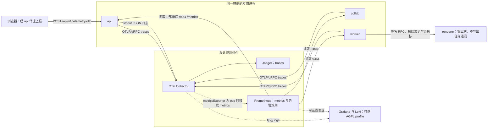
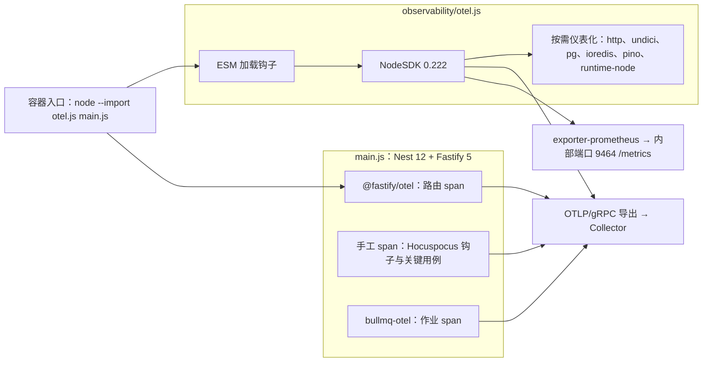
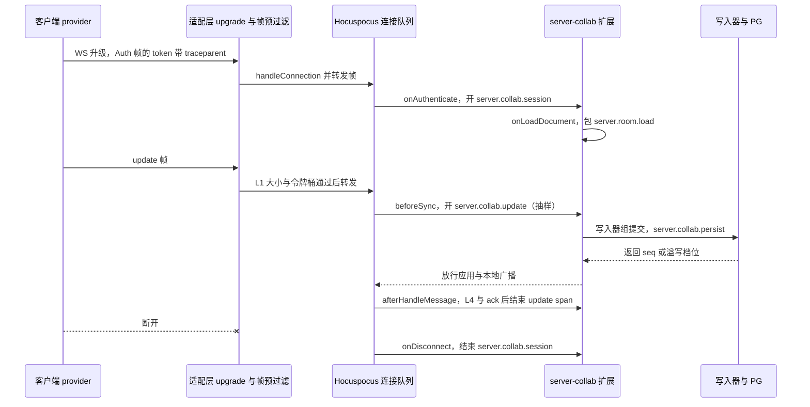
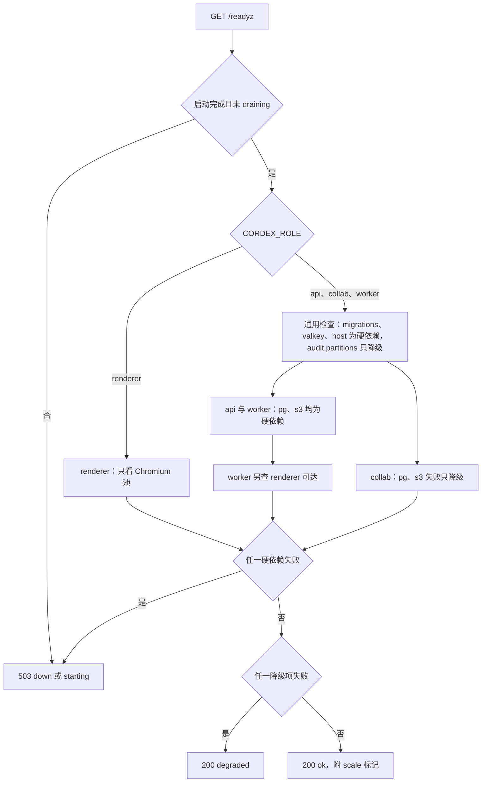
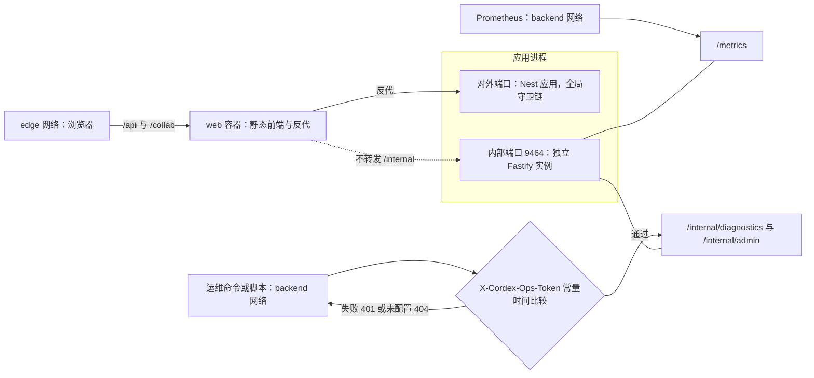
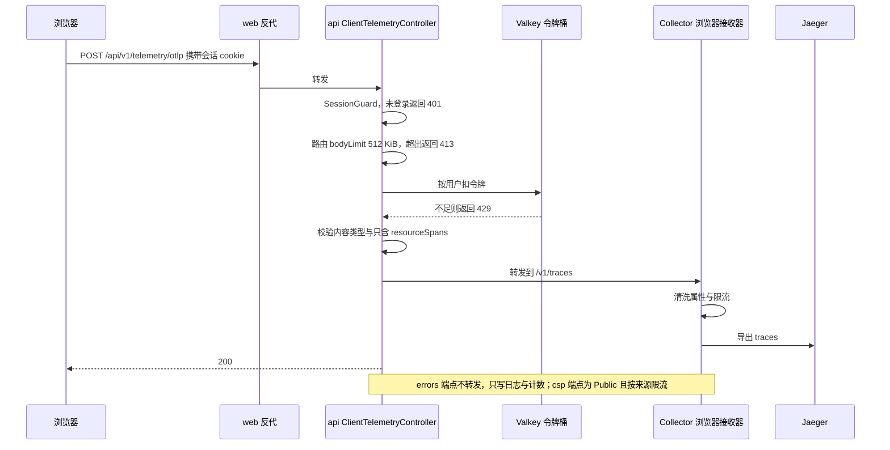

# 18 可观测性与运维端点
> 状态：v0.1 | 负责：后端设计线 | 更新：2026-09-25；2026-09-25（§4.19）；2026-09-26（§4.20）；2026-09-26（§4.21：Nest 12 下的栈定稿与 OTel 预加载；span 与协同指标改挂 Hocuspocus 钩子；Webhook 脱敏头改为 `webhook-signature`）；2026-09-26（§4.21 整合：§3 HTTP 服务端行写明 Nest 12 下的 span 口径（路由 span + 手工 span，node --import 预加载））；2026-09-26（§4.21 Remap：原 30/08 引用按 60-backend/README §6.1 改指新位置，30/08 已删除）；2026-10-01（§4.23 插件管理：新增指标 cordex_plugins_rejected 等三项、告警 CordexPluginsRejected 与 CordexForcedPluginFailed、/readyz 的 plugins 检查与 flags.pluginsRejected）；2026-10-03（§4.24 TA-4：`cordex_plugin_client_failures_total` 不再作为管理员「近 24 h 失败会话数」的来源，改读 Valkey 小时桶 HyperLogLog）；2026-10-15（design-language-v3 第 2 批，rulings §4.25 DS-47、DS-69、TB-86：§2.2 写明响应体同样从不记录——分享令牌明文会出现在所有者的链接列表与非所有者成员列表读者视图的响应里） | 依赖：[30/10 观测性与错误](../30-architecture/10-observability-and-errors.md)；[ADR-0030](../30-architecture/adr/0030-observability-stack.md)、[ADR-0035](../30-architecture/adr/0035-gateway-horizontal-scaling.md)；[01](01-service-overview-and-roles.md) §12（原 30/08 §12）；[PRD 06](../10-prd/03-features/06-server-and-ops.md) SV-10；[rulings](../00-charter/rulings-2026-09-14.md) §4.18 BE-14/BE-30/CO-08、§4.21 q-nest-major；[ADR-0039](../30-architecture/adr/0039-collab-server-hocuspocus.md)；[19 后端复用组件清单](19-reuse-and-dependency-catalog.md)；[01 服务总览](01-service-overview-and-roles.md)；[07 评论、Webhook 与审计](07-modules-comments-webhooks-audit.md)

## 0. 本文定位

本文是服务端可观测性与运维端点的唯一事实源，持有全后端唯一的**服务端指标统一名表**（§4）。边界：

| 本文拥有 | 本文引用 |
|---|---|
| 服务端日志字段、脱敏头清单与 logger 名（§2） | 命名与脱敏规则本体、错误码格式：[30/10](../30-architecture/10-observability-and-errors.md) §1–§2.3 |
| 服务端 span 清单与采样（§3） | 公开事件名定稿：30/10 §11.1 |
| 服务端指标统一名表、默认告警与 SLO（§4、§5） | 客户端采集、批量、同意与上报管线：[50/15](../50-frontend/15-events-errors-and-telemetry.md) |
| `HealthModule`、`MetricsModule`、`InternalModule`、`ClientTelemetryModule`（§6–§9） | CSP 策略正文与 Trusted Types：[50/14](../50-frontend/14-client-security.md) |
| 审计与遥测的分工（§10） | compose、Collector 与 Prometheus 部署配置：[17](17-deployment-and-config.md)；预算 target：[01](01-service-overview-and-roles.md) §12；测试执行：[70/07](../70-testing/07-backend-integration-and-api-e2e.md)、[70/09](../70-testing/09-performance-and-capacity.md) |

## 1. 栈

| 组件 | 作用 | 默认 profile |
|---|---|---|
| OpenTelemetry Node SDK | traces 与 metrics 的唯一 SDK；经容器入口 `node --import ./dist/observability/otel.js` 在入口模块之前预加载（Nest 12 纯 ESM，§1.1；原：`main.ts` 第一行 `import './observability/otel'`）；按需仪表化 http、undici、pg、ioredis、pino、runtime-node，Fastify 路由 span 用 `@fastify/otel`，ws 与 Hocuspocus 钩子用手工 span（原：「自动仪表化 http、fastify、pg、ioredis、ws」） | 默认 |
| pino + nestjs-pino（经 kernel `logger` 适配器） | JSON 行写 stdout，由 Collector 的 filelog 接收；关掉 Fastify 自带的请求日志 | 默认 |
| OTel Prometheus 导出器 | `@opentelemetry/exporter-prometheus`，`preventServerStart`，处理函数挂在内部端口 9464（§7）；不用 `prom-client` | 默认 |
| OTel Collector | 接收 traces（Node 进程走 OTLP/gRPC 4317，`telemetry.otlpEndpoint` 默认 `http://otel-collector:4317`）、浏览器 traces（独立的 browser 接收器，OTLP/HTTP，§9.2）、日志；尾采样；spanmetrics connector 把浏览器产品事件 span 转成 Prometheus 指标（§9.3）；转发 | 默认 |
| Jaeger | traces 后端 | 默认 |
| Prometheus | 抓取各进程内部端口 9464 的 `/metrics`、Collector 的 spanmetrics 端点与 node-exporter；加载默认告警规则（§5） | 默认 |
| node-exporter | 宿主磁盘、内存与文件系统指标，供 `CordexDiskHigh` 等 PRD SV-10 默认告警（Apache-2.0） | 默认（[17](17-deployment-and-config.md) §2.1） |
| Grafana、Loki（Tempo） | 仪表盘与日志检索；AGPL-3.0，附许可提示 | `observability-agpl`，需显式开启 |

- **资源属性**：`service.name = cordex-server`、`service.version = <appVersion>`、`service.instance.id = <instanceId>`、`cordex.role = <CORDEX_ROLE>`。
- **指标导出**：默认 Prometheus 拉取（`telemetry.metricsExporter = prometheus`）；也可配置为 `otlp` 推给 Collector、再由 Collector 转给 Prometheus（ADR-0030 决策 3，二选一；配置键见 [17](17-deployment-and-config.md) §5）。
- **renderer 例外**（BE-14、ADR-0030 决策 3）：renderer 只挂零出站的 render 网络，Prometheus 抓不到、也不能推 OTLP，所以它**不装 `MetricsModule`、关闭全部 OTLP 导出、日志只写 stdout**；渲染耗时、超时、崩溃与拒绝由 worker 侧 RPC 客户端按结果记录（§4.2 `cordex_render_*`）。

**图 1 服务端遥测数据流**

怎么读：实线为默认链路，虚线为可选配置或可选 profile；traces 由进程推给 Collector，metrics 由 Prometheus 从内部端口拉取（箭头方向即请求方向）；renderer 没有任何出向遥测，它的指标由调用它的 worker 记录；浏览器数据只能经 api 的代理端点进入 Collector。collab 与 worker 的日志同 api 一样写 stdout，图中只画一条以免拥挤。

依据：ADR-0030 决策 1–3、7；rulings §4.18 BE-14、BE-30；30/10 §5 流图。

### 1.1 Nest 12 下的栈定稿（2026-09-26）

依据：rulings §4.21 q-nest-major（用户选择 M1 直接上 Nest 12）；ADR-0030 修订 2026-09-26；R-d-47、R-d-48。依赖的版本、许可与替代见 [19](19-reuse-and-dependency-catalog.md) §10。

- **启动**：Nest 12 是纯 ESM，`apps/server` 构建改为 ESM（[09-type-discipline/01](../30-architecture/09-type-discipline/01-tsconfig-baseline.md) §6）。ESM 的静态 import 在入口模块求值前全部解析完，「`main.ts` 第一行 import otel」保证不了仪表化先加载，所以镜像入口改为 `tini -- node --import ./dist/observability/otel.js dist/main.js`（[17](17-deployment-and-config.md) §4）。`otel.ts` 先用 `node:module` 的 `register()` 注册 `@opentelemetry/instrumentation/hook.mjs`，再启动 `NodeSDK`；renderer 走同一入口，但 `otel.ts` 按 `CORDEX_ROLE` 不启动 SDK。
- **按需仪表化**：`instrumentation-http`、`-undici`（Webhook 出站与 OTLP 代理）、`-pg`、`-ioredis`、`-pino`（日志注入 `trace_id` / `span_id`）、`-runtime-node`（事件循环、GC、内存）；Fastify 路由 span 用 `@fastify/otel`（`instrumentation-fastify` 已弃用）；BullMQ 作业 span 用 `bullmq-otel`。不装 `auto-instrumentations-node` 全家桶。
- **Nest 层 span 暂缺**：`instrumentation-nestjs-core` 0.68 只支持 `<12`，Nest 12 下暂不启用；控制器、守卫一级的耗时由 `@fastify/otel` 的路由 span 覆盖，需要时在用例入口加手工 span（名称仍按 §3 登记）。上游支持 12 后在同一 PR 启用并删掉重复的手工 span。
- **ws 与 Hocuspocus**：`ws` 没有维护中的 OTel 仪表化，Hocuspocus 的 extension-logger 只打日志，**都不用**；协同 span 由 server-collab 的 Hocuspocus 扩展在钩子里手工开（§3.1），协同指标的采集挂点见 §4.4。
- **版本并存**：sdk-node 与各仪表化锁 0.222.x；`@fastify/otel` 0.21 依赖 `@opentelemetry/instrumentation` `^0.221.0`，两版并存、不做 overrides。

**图 1-2 进程内的遥测组件与挂点**

怎么读：左边是预加载阶段，钩子与 SDK 在应用模块加载前就绪，仪表化才能给随后 import 的 `pg`、`ioredis` 等打补丁；右边是应用内的三类 span 来源；traces 经 OTLP 推给 Collector，metrics 由 exporter-prometheus 在内部端口供 Prometheus 拉取。renderer 不启动 SDK，图中不画。

## 2. 日志字段规范（服务端）

命名、级别与脱敏的规则本体见 [30/10](../30-architecture/10-observability-and-errors.md) §2.1–§2.3，本节只定服务端的字段集合、logger 名与额外的脱敏清单。

### 2.1 字段

| 字段 | 取值 | 说明 |
|---|---|---|
| `time` `level` `logger` `msg` | pino 基础字段 | `msg` 为低基数模板，变量进字段 |
| `trace_id` `span_id` | 当前 span | 自动注入 |
| `cordex.role` `cordex.instance_id` | 进程启动时绑定 | 多副本排障 |
| `cordex.request_id` | 请求上下文 | 与审计 `request_id` 同值 |
| `cordex.user_id` | sha256 前 12 位 | 不写原始 id、邮箱、姓名 |
| `cordex.doc_id` `cordex.room_id` | UUID 原值 | 文档 id 不是个人数据，排障需要原值 |
| `cordex.session_id` | 会话 sid 的 sha256 前 12 位 | sid 可用于吊销，原值视同凭据 |
| `cordex.job_id` `cordex.queue` | 作业上下文 | — |
| `http.request.method` `http.route` `http.response.status_code` | HTTP | `http.route` 为路由模板，不含实际路径参数与查询串 |
| `cordex.close_code` | WS 关闭码 | — |
| `cordex.error_code` `cordex.error_fingerprint` | `errors.report` | — |
| `duration_ms` `bytes` `count` | 计量 | — |
| `client.address` | IP 的 /24（IPv6 /48）掩码 | 30/10 §2.3 |

### 2.2 服务端额外脱敏

- **请求 / 响应头**一律替换为 `[redacted]`：`Cookie`、`Set-Cookie`、`Authorization`、`X-Cordex-Share-Token`（分享令牌，[02](02-auth-chain.md) §7）、`X-Cordex-Ops-Token`（运维令牌，§8）、`X-Cordex-Render-Signature`（renderer RPC，[06](06-modules-jobs-import-export-thumbnails.md) §10）、`webhook-signature`（出站 Webhook，Standard Webhooks；原 `X-Cordex-Signature` 已废止，[07](07-modules-comments-webhooks-audit.md) §5.2）。`webhook-id`、`webhook-timestamp` 不是凭据，照常记录。
- **URL 查询参数**：`code`、`state`（OIDC 回调）、`token`、`next` 的值替换为 `[redacted]`；访问日志只记 `http.route`。
- **请求体、响应体与 WS 帧**从不记录；WS 只记帧类型与字节数。分享令牌明文会出现在 `GET …/share-links`（所有者）与 `GET …/permissions` 读者视图的 `link.token`（链接授予角色时的非所有者）的响应里（2026-10-15，rulings §4.25 DS-47、DS-69、TB-86，[15](15-rest-api-catalog.md) §3.4、§3.5），这两条路由的响应同样不进日志、trace 与审计 details。
- **仪表化**：pg 关闭参数上报（`enhancedDatabaseReporting: false`）；ioredis 的 `db.statement` 只保留命令名（键名里有 `session:{sid}`、`ticket:jti:{jti}` 等凭据性标识）。
- 脱敏路径集中配置在 pino 适配器（文件归属见 [40/09](../40-modules/09-server-collab-gateway-and-headless-host.md) `cordis-host/adapters/pino-logger.adapter.ts`），清单以本节为准。

### 2.3 logger 名与级别

服务端 logger 名：`server:http`、`server:auth`、`server:ws`、`server-collab:room`、`server-collab:persist`、`server-collab:gate`、`server:jobs:<queue>`、`server:comments`、`server:webhooks`、`server:audit`、`server:health`、`server:internal`、`client:errors`（浏览器错误报告落日志用）、`client:csp`。访问日志每个 HTTP 请求一行 `info`，`/healthz`、`/readyz`、`/metrics` 不记；每个 WS 帧级别的事件只允许 `debug` 并 1% 采样，否则用指标。

## 3. 服务端 span 清单与采样

span 名采用 `server.<子系统>.<操作>`（小写，操作用 snake_case），在 `apps/server/src/observability/spans.ts` 以声明合并登记（30/10 §3.1）。30/10 §3.2 的服务端条目迁入本表；`server.collab.replay-spilled` 改名 `server.collab.replay_spilled`（旧名作废）。

| span | 关键属性 | 所在角色 | 说明 |
|---|---|---|---|
| HTTP 服务端（自动） | `http.route`、`http.response.status_code` | api、collab | `@fastify/otel` 路由 span 与 http 仪表化；不含查询串；Nest 12 下无 nestjs-core 控制器 span（`instrumentation-nestjs-core` 0.68 只支持 `<12`），控制器与守卫一级由本行路由 span 覆盖，需要时在用例入口加手工 span；OTel 由 `node --import` 预加载（§1.1） |
| pg、ioredis 客户端（自动） | 命令名、`db.operation` | 除 renderer | 不含参数与键名 |
| `server.collab.session` | `doc_id`、`role`、`via_link` | collab | WS 会话父 span，在 `onAuthenticate` 开启，以 Auth token（JSON）里携带的 `traceparent` 为父，`onDisconnect` 结束（§3.1；原：以 `CONTROL.auth` 的 `traceparent` 为父） |
| `server.room.load` | `doc_id`、`snapshot_bytes`、`updates` | collab | 包住 `onLoadDocument`（快照 + 日志、迁移、认领溢写、墓碑清扫）；预算：bootstrap ≤ 500 ms p95 @ 8 MB |
| `server.collab.update` | `bytes`、`gate_result` | collab | 包住 `beforeSync` → `afterHandleMessage`（L2/L3 门禁、落库、应用与广播、L4 与 ack）；不逐帧建 span，按 1% 独立抽样 |
| `server.collab.persist` | `entries`、`bytes`、`tier` | collab | 每个写入器组提交批次一个（`beforeSync` 内 await） |
| `server.collab.replay_spilled` | `entries`、`bytes` | collab | 溢写回放；预算 ≤ 10 s p95 |
| `server.snapshot.compact` | `pending`、`bytes` | collab、worker | — |
| `server.tombstone.sweep` | `doc_id`、`purged` | collab | tombstone-sweeper 单写者 |
| `server.comments.mirror` | `doc_id`、`threads`、`replies` | collab | [07](07-modules-comments-webhooks-audit.md) §1.3 |
| `server.webhooks.deliver` | `event`、`attempt`、`result`、`target_host` | worker | 只记主机名 |
| `server.audit.seal` | `date`、`rows`、`verified` | worker | [07](07-modules-comments-webhooks-audit.md) §8.3 |
| `server.purge.document` | `doc_id`、`participants` | worker | [04](04-modules-documents-storage-media.md) §4 |
| `job.<kind>` | `attempts`、`queue` | worker | 从 BullMQ 作业数据里的 `traceparent` 续接 |
| `render.rpc` | `render_id`、`pages`、`mode`、`result` | worker | worker → renderer；renderer 侧不产生 span |
| `thumbnail.render` | `slides`、`ms_per_slide` | worker | 30/10 §3.2 原条目保留 |
| `format.import` / `format.export` | `codec`、`bytes`、`parts`、`warnings` | worker | headless 任务内由编解码器产生（30/10 §3.2） |

**采样**（ADR-0030 决策 6）：

- 父级优先：入站请求带已采样的 `traceparent`（浏览器或上游）时跟随；根 span 头采样比例 `telemetry.tracesSampleRatio`（默认 0.1，[17](17-deployment-and-config.md) §5）。
- 尾采样在 Collector：出错或时长 > 2 s 的 trace 100% 保留（Collector 配置归 [17](17-deployment-and-config.md)）。
- WS update 帧不建 span；`server.collab.update` 以 `telemetry.tracesUpdateSampleRatio`（默认 0.01，待 17 登记）独立抽样。
- 不追踪：`/healthz`、`/readyz`、`/metrics`、`/internal/*`。
- span 属性不得包含文档内容、令牌、完整 URL 与查询串（与 §2.2 同一清单）。

### 3.1 Hocuspocus 钩子上的 span 挂点（2026-09-26）

依据：rulings §4.21 q-ws-gateway（协同改用 Hocuspocus 4）；[ADR-0039](../30-architecture/adr/0039-collab-server-hocuspocus.md) 决策 4；H 证据 docPlan（60/18 §3）。协同 span 全部由 server-collab 的 Hocuspocus 扩展在钩子里手工开启，不用 extension-logger；钩子自包 try/catch，span 在 `finally` 里结束，异常时记 `error` 状态并照常 `ws.close(1011)`。

| span | 开启 | 结束 | 父 span |
|---|---|---|---|
| `server.collab.session` | `onAuthenticate` 进入时 | `onDisconnect` | Auth token（JSON）里携带的 `traceparent`；没有则为根 span |
| `server.room.load` | `onLoadDocument` 进入时（只在文档尚未加载时触发，并发加载共享同一次） | `onLoadDocument` 返回（含末尾 `document.flush()`） | 触发加载的那个会话的 `server.collab.session` |
| `server.collab.update` | `beforeSync` 进入时（按 `telemetry.tracesUpdateSampleRatio` 抽样） | `afterHandleMessage` 发出 ack 之后 | 所属会话的 `server.collab.session` |
| `server.collab.persist` | 写入器组提交开始（`beforeSync` 内 await） | 落库或溢写返回 `seq` | 被抽中时为 `server.collab.update`，否则为独立根 span |

**图 3-1 协同帧处理的 span 挂点**

怎么读：纵线是参与方，自上而下是一个会话从认证、加载到一次写入再到断开；span 的开启与结束都落在 Hocuspocus 钩子里，适配层只负责把 `traceparent` 随 Auth 帧带进来。`server.room.load` 只在文档首次加载时出现，之后加入的会话不再有这一段。

## 4. 服务端指标统一名表（全后端唯一源）

依据：决策 METRICS（authority：ADR-0035（已接受）> 30 正文 > PRD）——统一为 `cordex_<subsystem>_<name>_<unit>`，协同类一律 `cordex_collab_*`；PRD SV-10、30/10 §3.3、原 30/08 篇 §12 的旧名只作别名列，Prometheus 只暴露统一名。其它文件（[01](01-service-overview-and-roles.md) §12 预算、[05](05-modules-collab-and-snapshots.md)、[06](06-modules-jobs-import-export-thumbnails.md)、[07](07-modules-comments-webhooks-audit.md)、`test/perf/budgets.json`）只引用本表的名字。

### 4.1 命名、单位与标签规则

- **单位后缀**：时长 `_seconds`（Prometheus 基本单位，OTel 单位 `s`），大小 `_bytes`，计数器 `_total`，时间戳 `_timestamp_seconds`，无量纲 gauge 不加后缀。30/10 与原 30/08 篇中服务端指标的 `_ms` 写法改为 `_seconds`，旧名进别名列；浏览器指标（如 `cordex_render_frame_ms`）不在服务端 `/metrics`，归 [50/15](../50-frontend/15-events-errors-and-telemetry.md)。
- **子系统**：`http`、`auth`、`permission`、`collab`、`snapshot`、`jobs`、`render`、`thumbnails`、`comments`、`webhooks`、`audit`、`db`、`health`、`config`、`client`（浏览器上报在服务端的计数）、`build`；kernel 两端共用的 `cordex_errors_total`、`cordex_commands_total` 等沿用 30/10 §3.3 / §11.3 原名。
- **标签**：值集合封闭（下表列出）；禁止 `doc_id`、`user_id`、`session_id`、`jti`、URL 等高基数或标识性标签；`instance` 由 Prometheus 抓取目标附加，代码不写；路由类标签用模板。
- **登记与消费者**：名称在 `apps/server/src/observability/metrics.ts` 声明合并登记，每项带 `consumer`（`alert:<规则名>` / `dashboard:<面板>` / `test:<套件>`）；扫描器 `scan-observability-identifiers` 核对「调用点 ⊆ 登记表」与「登记项至少一个调用点」（ADR-0030 决策 5）。
- **直方图桶**：通用时长 `[0.005, 0.01, 0.025, 0.05, 0.1, 0.25, 0.5, 1, 2.5, 5, 10]`；作业时长 `[0.5, 1, 2, 5, 10, 20, 30, 60, 120, 300]`；字节 `[1 KiB … 64 MiB]` 按 4 倍递增。

### 4.2 名表

**HTTP、鉴权与安全**

| 名称 | 类型 | 标签 | 发布角色 | 消费者 | 别名（旧名，不暴露） |
|---|---|---|---|---|---|
| `cordex_http_rate_limited_total` | counter | `bucket` | api、collab | alert 鉴权失败突增旁证；dashboard 安全 | `cordex_rate_limited_total`（PRD） |
| `cordex_auth_logins_total` | counter | `result: success\|failure` | api | dashboard 安全 | — |
| `cordex_auth_failures_total` | counter | `kind: login\|session\|ticket\|ops_token`，`reason` | api、collab | alert `CordexAuthFailureSpike` | 同名（PRD） |
| `cordex_auth_sessions_revoked_total` | counter | `reason` | api | dashboard 安全 | — |
| `cordex_auth_csrf_rejected_total` | counter | `reason: origin\|header` | api、collab | dashboard 安全；test 70/10 §6 | — |
| `cordex_auth_origin_rejected_total` | counter | `channel: ws` | collab | dashboard 安全；test 70/10 §6 | — |
| `cordex_permission_denied_total` | counter | `action`，`channel: rest\|ws\|command` | api、collab | dashboard 安全 | 同名（PRD、30/10 §11.3） |

**协同与快照**（Hocuspocus 下的采集挂点见 §4.4）

| 名称 | 类型 | 标签 | 发布角色 | 消费者 | 别名 |
|---|---|---|---|---|---|
| `cordex_collab_connections` | gauge | — | collab | dashboard 协同；容量 | `cordex_ws_connections` |
| `cordex_collab_rooms_active` | gauge | — | collab | dashboard 协同；ADR-0035 与 `room:{docId}:members` 聚合一致校验 | `cordex_rooms_active`（PRD） |
| `cordex_collab_clients` | gauge | `role: editor\|viewer` | collab | dashboard 容量 | 同名 |
| `cordex_collab_room_weight_bytes` | gauge | — | collab | dashboard 容量；alert 准入压力 | 同名（原 30/08 篇） |
| `cordex_collab_admission_denied_total` | counter | `reason: room_full\|memory\|purging` | collab | dashboard 容量；test perf-collab | — |
| `cordex_collab_room_evictions_total` | counter | `reason: idle_reclaim\|memory` | collab | dashboard 容量 | — |
| `cordex_collab_update_apply_duration_seconds` | histogram | — | collab | SLO 面板；预算 ≤ 20 ms p95 | `cordex_update_apply_seconds`（PRD） |
| `cordex_collab_update_bytes` | histogram | `direction: in\|out` | collab | dashboard 容量 | 同名 |
| `cordex_collab_broadcast_latency_seconds` | histogram | `scope: local\|cross_instance` | collab | SLO p95 ≤ 100 ms；alert `CordexBroadcastLatencyHigh` | `cordex_broadcast_latency_seconds`（PRD） |
| `cordex_collab_persist_latency_seconds` | histogram | — | collab | SLO p99 ≤ 1 s | `cordex_collab_persist_latency_ms`、`cordex_persist_lag_seconds`（PRD） |
| `cordex_collab_rooms_persist_degraded` | gauge | — | collab | alert `CordexPersistDegraded` | —（`room.persist = degraded` 的房间数，INC-09） |
| `cordex_collab_broadcast_before_persist_total` | counter | `tier: none\|valkey\|blob` | collab | alert 旁证；dashboard 协同 | 同名（CO-08） |
| `cordex_collab_spill_rooms` | gauge | `tier: none\|valkey\|blob` | collab | dashboard 协同 | `cordex_collab_spill_tier_current`（按房间打点，基数过高，作废） |
| `cordex_collab_spill_bytes_total` | counter | `tier: valkey\|blob` | collab | dashboard 协同 | `cordex_collab_spill_tier2_bytes_total`（= `tier="blob"`） |
| `cordex_collab_spill_replay_duration_seconds` | histogram | — | collab | 预算 ≤ 10 s p95；test 70/07 §9 | — |
| `cordex_collab_updates_rejected_total` | counter | `reason` | collab | alert 安全面板 | 同名 |
| `cordex_collab_repairs_total` | counter | `rule` | collab | dashboard 数据质量 | 同名 |
| `cordex_collab_gate_reports_total` | counter | `rule`（含 `hard_delete_bypass`、schema report-only） | collab | dashboard 数据质量 | — |
| `cordex_collab_awareness_dropped_total` | counter | `reason` | collab | dashboard 协同 | 同名（30/10 §11.3） |
| `cordex_collab_close_codes_total` | counter | `code` | collab | alert `CordexCollabInternalErrors`（1011）；dashboard | — |
| `cordex_collab_permission_propagation_seconds` | histogram | — | collab | 预算 ≤ 1 s p95；test 70/07 §7 | — |
| `cordex_collab_ydoc_bytes` | histogram | — | collab | dashboard（epoch 触发参考） | `cordex_ydoc_bytes`、`cordex_ydoc_structs` |
| `cordex_collab_tombstones_purged_total` | counter | `trigger: ttl\|element_purge` | collab | dashboard 数据质量 | — |
| `cordex_snapshot_compactions_total` | counter | `result` | collab（压缩只在持有 Room 的实例内执行，无 `compaction` 队列） | dashboard 存储 | 同名 |
| `cordex_snapshot_compaction_duration_seconds` | histogram | — | collab | 预算（10,000 update ≤ 2 s） | — |
| `cordex_snapshot_bytes` | histogram | `kind` | collab | dashboard 存储 | 同名 |

**作业与渲染**

| 名称 | 类型 | 标签 | 发布角色 | 消费者 | 别名 |
|---|---|---|---|---|---|
| `cordex_jobs_queue_depth` | gauge | `queue`，`state: waiting\|active\|delayed\|failed` | worker（每 15 s 取一次 BullMQ 计数） | alert `CordexQueueBacklog` | `cordex_job_queue_depth`（PRD）、`cordex_jobs_waiting`（06 现稿，= `state="waiting"`） |
| `cordex_jobs_total` | counter | `queue`，`result: succeeded\|rejected\|failed\|cancelled\|retried` | worker | SLO 导入 / 导出成功率 | — |
| `cordex_jobs_duration_seconds` | histogram | `queue` | worker | SLO；预算（导入 D50 ≤ 5 s 等） | `cordex_import_duration_seconds`、`cordex_export_duration_seconds`、`cordex_thumbnail_duration_seconds`（PRD）与对应 `_ms`（30/10） |
| `cordex_jobs_orphans_requeued_total` | counter | `table: job_runs\|webhook_deliveries` | worker | alert `CordexJobsOrphans`；test 70/07 §11 | `cordex_jobs_orphans_total`（06 现稿） |
| `cordex_jobs_unclassified_errors_total` | counter | `queue` | worker | alert `CordexJobsUnclassifiedErrors`（推动补错误分类，06 §5.2） | — |
| `cordex_jobs_dead_lettered_total` | counter | `queue` | worker | alert `CordexDeadLetters` | — |
| `cordex_render_rpc_duration_seconds` | histogram | `kind: thumbnail\|pdf\|image`，`result` | worker | dashboard 作业 | — |
| `cordex_render_page_duration_seconds` | histogram | `kind` | worker | 预算 ≤ 400 ms / 页 p95 | span `thumbnail.render` 的 `ms_per_slide` |
| `cordex_render_rpc_failures_total` | counter | `reason: timeout\|crash\|busy\|signature\|headless_error` | worker | alert `CordexRendererFailures` | `cordex_render_failures_total`（06 现稿） |
| `cordex_render_pool_wait_seconds` | histogram | `priority: p0\|p1\|p2` | worker | dashboard 作业（池排队，06 §10.5） | — |
| `cordex_thumbnails_page_failures_total` | counter | — | worker | dashboard 作业（页级重试后仍失败，06 §11.3） | — |
| `cordex_render_rpc_inflight` / `cordex_render_rpc_capacity` | gauge | — | worker | alert `CordexRendererSaturated`（PRD「Chromium 池耗尽」） | — |

**文档、媒体与永久删除**

| 名称 | 类型 | 标签 | 发布角色 | 消费者 | 别名 |
|---|---|---|---|---|---|
| `cordex_media_dangling_refs_total` | counter | — | collab、worker | dashboard 数据质量（快照引用了本文档无关联的媒体哈希，客户端显示占位；[04](04-modules-documents-storage-media.md) §7.4、[06](06-modules-jobs-import-export-thumbnails.md) §6.6） | — |
| `cordex_purge_residual_objects_total` | counter | `bucket: data\|snapshots` | worker | dashboard 存储；持续非零说明有写者未在写前复查 `purging`（finalize-purge 第二遍列举删除的竞态残留，[04](04-modules-documents-storage-media.md) §4.4 第 4 步） | — |

`cordex_jobs_total` 的 `rejected` 专指用户输入导致的终止（`format.encrypted`、`format.macro_rejected`、`format.quota_exceeded` 等），不计入服务成功率分母；多个 worker 副本会各自上报相同的队列深度，告警一律取 `max`。

**评论、Webhook 与审计**

| 名称 | 类型 | 标签 | 发布角色 | 消费者 | 别名 |
|---|---|---|---|---|---|
| `cordex_comments_mirror_lag_seconds` | histogram | — | collab | 预算 ≤ 1 s；test 70/07 §12 | — |
| `cordex_comments_mirror_skipped_total` | counter | `reason: body_too_long\|thread_limit\|reply_limit\|unknown_anchor` | collab | dashboard 数据质量 | — |
| `cordex_webhooks_deliveries_total` | counter | `event`，`result: succeeded\|failed\|retried\|dead-lettered` | worker | alert `CordexWebhookDeadLetters` | — |
| `cordex_webhooks_delivery_duration_seconds` | histogram | — | worker | dashboard 集成 | — |
| `cordex_webhooks_egress_blocked_total` | counter | `stage: subscribe\|deliver` | api、worker | dashboard 安全；test 70/10 §10 | — |
| `cordex_audit_writes_total` | counter | `path: tx\|buffered`，`result: ok\|error` | api、collab、worker | dashboard 审计 | — |
| `cordex_audit_buffer_dropped_total` | counter | — | api、collab、worker | alert `CordexAuditDropped`（critical） | — |
| `cordex_audit_chain_verify_failures_total` | counter | — | worker | alert `CordexAuditChainBroken`（critical） | — |
| `cordex_audit_seal_last_success_timestamp_seconds` | gauge | — | worker | alert `CordexAuditSealStale` | — |
| `cordex_audit_partitions_ahead` | gauge | — | worker | alert `CordexAuditPartitionsLow` | — |

**健康、运行时与浏览器上报**

| 名称 | 类型 | 标签 | 发布角色 | 消费者 | 别名 |
|---|---|---|---|---|---|
| `cordex_health_ready` | gauge | `role` | api、collab、worker | alert `CordexNotReady`；SLO 可用性 | — |
| `cordex_health_check_status` | gauge | `check` | api、collab、worker | dashboard 总览 | — |
| `cordex_config_scale_envelope_exceeded` | gauge | — | api、collab、worker | dashboard 总览（超出包络标记，SV-08） | — |
| `cordex_plugins_rejected`（2026-10-01） | gauge | `reason`（[03 §12.3](03-modules-identity-and-access.md) 的十个原因码） | api、collab、worker | alert `CordexPluginsRejected`；管理员界面顶部红条旁证（PRD PM-05） | — |
| `cordex_plugin_client_failures_total`（2026-10-01） | counter | `plugin`，`code` | api（由 `/telemetry/errors` 中带插件 `id` 的上报累加，`plugin` 取值只限声明文件与镜像内置清单中的 id） | dashboard 前端质量；管理员清单「近 24 h 失败会话数」（PM-15）不取本 counter，改读同一上报写入的 Valkey 小时桶 HyperLogLog（按会话去重，[14 §3.2](14-valkey-object-storage-and-retention.md)，rulings §4.24 TA-4） | — |
| `cordex_plugin_policy_notify_total`（2026-10-01） | counter | `result: published\|publish_failed\|pushed\|poll_detected` | api（发布）、collab（推送与轮询发现） | dashboard 总览；`plugins:ctl` 丢消息时轮询兜底的旁证（[16 §12](16-ws-protocol-server-view.md)） | — |
| `cordex_build_info` | gauge | `version`，`role` | api、collab、worker | dashboard 总览；版本漂移排查 | — |
| `cordex_db_pool_connections` | gauge | `pool: app\|system`，`state: idle\|used\|waiting` | api、collab、worker | alert `CordexDbPoolExhausted` | — |
| `cordex_client_errors_total` | counter | `severity` | api | dashboard 前端质量 | — |
| `cordex_client_csp_violations_total` | counter | `directive`，`disposition: report\|enforce` | api | dashboard 安全；M3 强制前「零违规」检查（50/14） | — |
| `cordex_client_telemetry_rejected_total` | counter | `endpoint: errors\|otlp\|csp`，`reason: unauthenticated\|too_large\|rate_limited\|invalid` | api | dashboard 安全 | — |
| `cordex_product_events_total` / `cordex_product_event_duration_seconds` | counter / histogram | `event` 与 Collector 白名单维度 | otel-collector（spanmetrics connector，不是服务端进程） | PRD MT 指标的 PromQL 查询定义（§9.3） | — |

**kernel 共用指标**（名称沿用 30/10 §3.3、§11.3，服务端宿主同样暴露）：`cordex_errors_total{code,severity}`、`cordex_fiber_state{plugin,state}`、`cordex_effects_live{plugin}`、`cordex_plugin_failures_total{plugin}`（PRD 同名）、`cordex_commands_total{command_id,result}` 与 `cordex_command_failures_total{command_id,code}`（只含服务端执行的系统命令）、`cordex_cache_events_total{cache,event}`。`command_id` 取值受命令登记表约束，不是开放集合。

**标准指标**（不加 `cordex_` 前缀）：OTel HTTP 语义约定的 `http_server_request_duration_seconds`、pg 客户端时长、进程与 Node 运行时指标（CPU、内存、事件循环延迟、GC），命名以 OTel 语义约定为准（PRD SV-10「进程 / DB / Valkey 标准指标」）。磁盘占用来自 node-exporter，它在默认 compose profile 中（[17](17-deployment-and-config.md) §2.1；PRD SV-10 默认告警含「磁盘 > 85%」）。

### 4.3 不在服务端暴露的 PRD 指标

`cordex_collab_soft_conflicts_total{type}` 与 `cordex_store_undo_skipped_total{whole_step}` 由浏览器产生（`collab/soft-conflict`、`store/undo-skipped` 是客户端事件），而浏览器 OTLP 代理只转发 traces（BE-30），服务端 `/metrics` 不含这两项；它们的采集与呈现归 [50/15](../50-frontend/15-events-errors-and-telemetry.md)。PRD SV-10 把它们列在服务端指标清单里，由总编排按本节回写。

### 4.4 协同指标的采集挂点（2026-09-26）

依据：rulings §4.21 q-ws-gateway；ADR-0039 决策 4、9；H 证据 docPlan（60/18 §4.2）。协同改用 Hocuspocus 后，§4.2「协同与快照」各指标的名字、类型与标签不变，只是采集点改到下列位置；gauge 一律用 OTel 的 observable 回调在抓取时读取，不在热路径上打点。

| 指标 | 采集挂点 |
|---|---|
| `cordex_collab_connections` | `hp.getConnectionsCount()`（一 WS 一文档，连接数即 WS 数） |
| `cordex_collab_rooms_active` | `hp.documents.size`（含 draining 期间被钉住的文档；与 `room:{docId}:members` 聚合一致的校验不变） |
| `cordex_collab_clients` | 适配层按会话角色的进程内计数（Hocuspocus 不区分角色） |
| `cordex_collab_admission_denied_total`、`cordex_collab_close_codes_total`、`cordex_auth_origin_rejected_total`、`cordex_http_rate_limited_total{bucket="ws-connect"}` | 适配层：升级前检查与原始 `ws.close(码)` 是业务关闭的唯一出口，钩子产生的文档级 CLOSE 不计 |
| `cordex_collab_update_bytes` | `direction="in"` 在适配层帧预过滤；`direction="out"` 在包装后的 `Connection.send` |
| `cordex_collab_update_apply_duration_seconds`、`cordex_collab_updates_rejected_total`、`cordex_collab_gate_reports_total` | `beforeSync`（L2/L3 门禁） |
| `cordex_collab_repairs_total` | `afterHandleMessage`（L4 修复） |
| `cordex_collab_persist_latency_seconds`、`cordex_collab_broadcast_before_persist_total`、`cordex_collab_spill_rooms`、`cordex_collab_spill_bytes_total`、`cordex_collab_rooms_persist_degraded`、`cordex_collab_spill_replay_duration_seconds` | 写入器（组提交、溢写与回放） |
| `cordex_collab_broadcast_latency_seconds` | `scope="local"`：从帧到达适配层到包装后的 `Connection.send` 发出；`scope="cross_instance"`：M3 的 `hp-redis.extension` 接收端 |
| `cordex_collab_awareness_dropped_total` | `beforeHandleAwareness`（就地删改时计数，从不抛错） |
| `cordex_collab_room_evictions_total` | `beforeUnloadDocument` 与 `drainAll` 路径 |
| `cordex_collab_permission_propagation_seconds` | PermissionSync 扩展（收到 `perm:doc` 到连接 `readOnly` 生效） |
| `cordex_collab_room_weight_bytes` | `onAuthenticate` 内的权重准入计算 |

## 5. SLO 与默认告警规则

### 5.1 SLO（PRD SV-10 初始值）

| SLO | 目标 | SLI（PromQL） |
|---|---|---|
| 协同服务可用性 | 99.9% / 月 | `avg_over_time(max(cordex_health_ready{role="collab"})[30d:1m])` |
| 房间内广播延迟 | p95 ≤ 100 ms | `histogram_quantile(0.95, sum by (le) (rate(cordex_collab_broadcast_latency_seconds_bucket{scope="local"}[5m])))` |
| 导入成功率 | ≥ 99.5% | `sum(increase(cordex_jobs_total{queue="import",result="succeeded"}[30d]))` ÷（同式 `succeeded` + 同式 `failed`）；`rejected`（用户文件问题）与 `cancelled` 不计 |
| 导出成功率 | ≥ 99.5% | 同上，`queue="export"` |
| 持久化滞后 | p99 ≤ 1 s | `histogram_quantile(0.99, sum by (le) (rate(cordex_collab_persist_latency_seconds_bucket[5m])))` |

预算 target 与 gate 的数值以 [01](01-service-overview-and-roles.md) §12 与 PRD 04 NF-10 为准，测量与判定见 [70/09](../70-testing/09-performance-and-capacity.md)。

### 5.2 默认告警规则

| 规则 | 表达式 | 持续 | 级别 | 来源 |
|---|---|---|---|---|
| `CordexTargetDown` | `up{job="cordex"} == 0` | 1 m | critical | SV-10 就绪探针失败（进程已不可抓取） |
| `CordexNotReady` | `min by (instance) (cordex_health_ready) == 0` | 1 m | critical | SV-10 就绪探针失败 > 1 min |
| `CordexBroadcastLatencyHigh` | `histogram_quantile(0.95, sum by (le) (rate(cordex_collab_broadcast_latency_seconds_bucket[5m]))) > 0.3` | 5 m | warning | SV-10 |
| `CordexQueueBacklog` | `max by (queue) (cordex_jobs_queue_depth{state="waiting"}) > 100` | 5 m | warning | SV-10 |
| `CordexAuthFailureSpike` | `sum(rate(cordex_auth_failures_total[10m])) > 10 * (sum(rate(cordex_auth_failures_total[7d])) + 0.001)` | 10 m | warning | SV-10 鉴权失败 > 10× 基线 |
| `CordexDiskHigh` | `1 - node_filesystem_avail_bytes{mountpoint="/"} / node_filesystem_size_bytes{mountpoint="/"} > 0.85` | 10 m | warning | SV-10（依赖 node-exporter） |
| `CordexRendererSaturated` | `max(cordex_render_rpc_inflight) >= max(cordex_render_rpc_capacity)` | 5 m | warning | SV-10 Chromium 池耗尽 |
| `CordexRendererFailures` | `sum(rate(cordex_render_rpc_failures_total[5m])) > 0.1` | 10 m | warning | BE-14 |
| `CordexPersistDegraded` | `sum(cordex_collab_rooms_persist_degraded) > 0` | 1 m | critical | CO-08 降级期（照常广播但未落库） |
| `CordexCollabInternalErrors` | `sum(rate(cordex_collab_close_codes_total{code="1011"}[5m])) > 0.05` | 5 m | warning | 关闭码 1011 突增 |
| `CordexDbPoolExhausted` | `max by (instance, pool) (cordex_db_pool_connections{state="waiting"}) > 0` | 2 m | warning | 连接池等待 |
| `CordexDeadLetters` | `sum(increase(cordex_jobs_dead_lettered_total[1h])) > 0` | — | warning | 作业死信 |
| `CordexWebhookDeadLetters` | `sum(increase(cordex_webhooks_deliveries_total{result="dead-lettered"}[1h])) > 0` | — | warning | SV-15 |
| `CordexJobsOrphans` | `sum(increase(cordex_jobs_orphans_requeued_total[1m])) > 0` | 3 m | warning | 06 §3 对账连续 3 次非零 |
| `CordexJobsUnclassifiedErrors` | `sum(increase(cordex_jobs_unclassified_errors_total[1h])) > 0` | — | warning | 06 §5.2 未分类异常 |
| `CordexAuditDropped` | `sum(increase(cordex_audit_buffer_dropped_total[5m])) > 0` | — | critical | SV-07 审计不可丢 |
| `CordexAuditChainBroken` | `sum(increase(cordex_audit_chain_verify_failures_total[1h])) > 0` | — | critical | SV-07 哈希链 |
| `CordexAuditSealStale` | `time() - max(cordex_audit_seal_last_success_timestamp_seconds) > 93600` | — | warning | 26 h 未封存 |
| `CordexPluginsRejected`（2026-10-01） | `sum(cordex_plugins_rejected) > 0` | 5 m | warning | PRD PM-05、PM-15：部署时校验拒绝了插件（未签名、版本不兼容、校验失败），由部署方处理 |
| `CordexForcedPluginFailed`（2026-10-01） | `max(cordex_fiber_state{state="FAILED", forced="true"}) > 0` | 2 m | critical | PRD PM-15：强制启用的插件在服务端宿主 `FAILED`（`forced` 标签由 PluginsModule 按策略补在服务端宿主的 `cordex_fiber_state` 上） |
| `CordexAuditPartitionsLow` | `min(cordex_audit_partitions_ahead) < 2` | — | warning | ops `audit-rotate` 未按时运行；表上无默认分区，缺月份写入会失败（[08](08-db-conventions-roles-rls-migrations.md) §3） |

### 5.3 文件落点

- 告警规则：`deploy/observability/prometheus/rules/cordex.rules.yml`，默认 profile 的 Prometheus 挂载（compose 与目录布局以 [17](17-deployment-and-config.md) 为准）；规则单测 `cordex.rules.test.yml` 与之同目录，用 `promtool test rules` 在 `e2e/full-compose` 步骤中执行（[70/08](../70-testing/08-deployment-and-environment-e2e.md)）。
- 仪表盘：`deploy/observability/grafana/dashboards/{overview,collab,jobs,security}.json`（PRD SV-10 的四块），随 `observability-agpl` profile 提供，JSON 入库；面板引用的指标名必须在 §4.2 登记（ADR-0030「仪表盘即代码」）。

## 6. HealthModule：`/healthz` 与 `/readyz`

两个端点挂在对外 HTTP 端口、不加 `/api/v1` 前缀、标 `@Public()`（BE-06、BE-11）；web 容器不把它们转发到公网（反代只转 `/api/*` 与 `/collab/*`，其余是静态文件），只由编排器在 backend 网络直连。

- **`/healthz`（存活）**：不检查任何依赖，事件循环能应答即 200 `{status:'ok'}`；编排器超时 5 s 视为挂死并重启。
- **`/readyz`（就绪）**：并发执行本角色的检查项，单项超时 1 s，结果缓存 2 s（避免探针风暴打到依赖），整体目标 ≤ 200 ms。响应体只含 `{status: 'starting'|'ok'|'degraded'|'down', role, failing: [检查名], flags: {draining, scaleEnvelopeExceeded, pluginsRejected}}`，不含主机名、地址与错误详情；`pluginsRejected`（2026-10-01，rulings §4.23）为 `[{id, version, reason}]`，只列部署时校验被拒的插件（原因码见 [03 §12.3](03-modules-identity-and-access.md)），为空时省略。
- **启动期**：Nest `onApplicationBootstrap` 完成（cordis 宿主 `fiber.await`、角色装配断言通过、迁移版本检查通过）之前返回 503 `starting`。
- **关闭期**：收到 SIGTERM 立即进入 draining，`/readyz` 返回 503，负载均衡停止分配新连接，进程在 30 s 预算内优雅关闭（[01](01-service-overview-and-roles.md) §10）。

| 检查 | 内容 | api | collab | worker | 失败时 |
|---|---|---|---|---|---|
| `pg.app` | app 池 `SELECT 1` | ✓ | ✓ | ✓ | api / worker：503；collab：`degraded` |
| `pg.system` | system 池 `SELECT 1` | — | ✓ | ✓ | worker：503；collab：`degraded` |
| `migrations` | 台账最大编号不低于本镜像内置迁移、校验和一致（启动时与每 60 s 检查一次；原因 `migrations_pending` / `migration_checksum_mismatch`，[08](08-db-conventions-roles-rls-migrations.md) §10.5） | ✓ | ✓ | ✓ | 503 |
| `audit.partitions` | `audit_log` 已建的未来月分区 ≥ 1（读 `pg_inherits`，每 60 s；[08](08-db-conventions-roles-rls-migrations.md) §3） | ✓ | ✓ | ✓ | `degraded`（仍 200）；为 0 时下月审计写入将失败 |
| `valkey` | `PING` | ✓ | ✓ | ✓ | 503（ADR-0035：Valkey 断开期间 503） |
| `s3.data` | `HeadBucket` data 桶 | ✓ | ✓ | ✓ | api / worker：503；collab：`degraded` |
| `s3.snapshots` | `HeadBucket` snapshots 桶 | — | ✓ | ✓ | 同上 |
| `host` | cordis 宿主 ACTIVE，preset-server 核心 Fiber 无 PENDING / FAILED | ✓ | ✓ | ✓ | 503 |
| `draining` | RoomManager 未进入 draining | — | ✓ | — | 503 |
| `renderer` | remote 模式下经 render 网络探 renderer `/healthz` | — | — | ✓ | `degraded`（导入导出仍可用，缩略图与 PDF 排队） |
| `scale` | 规模配置超出性能保证包络（SV-08） | ✓ | ✓ | ✓ | 仍 200，`flags.scaleEnvelopeExceeded = true` |
| `plugins`（2026-10-01） | 插件声明文件在启动时逐项校验的结果（[17 §5.16](17-deployment-and-config.md)）；文件级错误在启动前已以 78 退出，走不到这里 | ✓ | ✓ | ✓ | 有被拒项仍 200（不置为未就绪），`flags.pluginsRejected` 列出；强制启用的插件被拒另记启动 `warn` |

collab 在 PG 或对象存储故障时报 `degraded` 而不是 503，是为了配合 CO-08「降级期照常广播」：已建立的会话继续协作，断线重连的客户端仍能被路由回持有房间的实例；确实需要 PG 的新加入由握手流程单独拒绝（可重试关闭码，[16](16-ws-protocol-server-view.md) §10）。renderer 角色只装 `HealthModule.forRole('renderer')`：`/healthz` 与 `/readyz` 都只看 Chromium 池是否已启动且有空闲槽，不 import 任何含凭据的模块（BE-14）。

**图 2 /readyz 按角色判定**

怎么读：自上而下；先看生命周期（启动未完成或正在 draining 直接 503），再按角色选检查集合；「硬依赖」失败一律 503，「降级项」失败返回 200 `degraded`，二者都通过才是 `ok`。collab 把 PG 与对象存储列为降级项，worker 把 renderer 列为降级项，三个角色都把审计未来分区不足列为降级项；renderer 只有一个检查。

依据：40-modules/12 §4.6（`health/` 文件级）；rulings §4.18 BE-06、BE-11、BE-14、CO-08；ADR-0035「如何被机械验证」混沌条。

## 7. MetricsModule 与内部端口

- **内部端口**：`http.internalPort`（默认 9464）由 `InternalModule` 在 `onApplicationBootstrap` 时启动的**独立 Fastify 实例**提供，与对外端口分开监听、只在 backend 网络可达。它不是 Nest 的第二个 HTTP 适配器（宿主是进程单例，不能为第二个端口再建一套 Nest 应用），因此不经 Nest 全局守卫链（`SessionGuard`、`CsrfGuard` 与内部端口无关）；[40/12](../40-modules/12-server-jobs-comments-and-ops.md) 的 `DiagnosticsController` / `AdminController` 等文件划分不变，只是以路由处理器的形式注册到该实例。
- **`GET /metrics`**：OTel MeterProvider 接 Prometheus 导出器（不自起服务器，由内部实例挂载其处理函数），输出 §4.2 登记的指标与标准指标；不要求令牌（Prometheus 在 backend 网络内抓取）。
- **renderer 不装**：见 §1 renderer 例外；Prometheus 的抓取目标只含 api、collab、worker（抓取配置归 [17](17-deployment-and-config.md)）。
- **指标写入点**：各模块只经 kernel `ctx.telemetry.counter / histogram / gauge` 或 Nest 侧同名登记的仪表写入，名称未登记则编译失败（30/10 §3.1 声明合并）。

## 8. InternalModule：诊断与管理端点

依据：决策 INC-26（authority：rulings §4.18 BE-03 / BE-11，`/internal` 不加前缀、反代不转发 + 安全宁可提前）。

| 端点（内部端口 9464） | 装配角色 | 鉴权 | 说明 |
|---|---|---|---|
| `GET /metrics` | api、collab、worker | 无 | §7 |
| `GET /internal/diagnostics/{fibers\|effects\|pending\|contributions}` | api、collab、worker | 运维令牌 | Fiber 树、effect 树、PENDING 缺失服务、贡献点清单（30/10 §4；四个都保留，MECH-INC INC-41） |
| `POST /internal/admin/documents/:id/{compact\|migrate\|epoch}` | 仅 collab（及 all） | 运维令牌 | 管理动作，语义见 [05](05-modules-collab-and-snapshots.md) §9；审计 `admin.*`（[07](07-modules-comments-webhooks-audit.md) §9.4） |
| `POST /internal/admin/audit/verify` | 仅 worker（及 all） | 运维令牌 | 审计链校验，见 [07](07-modules-comments-webhooks-audit.md) §8.5 |

- **运维令牌**：请求头 `X-Cordex-Ops-Token`；令牌来自 `CORDEX_OPS_TOKEN_FILE`（≥ 32 字节随机值）；比较时先各自做 SHA-256 再 `timingSafeEqual`（等长常量时间）；失败返回 401 `server.auth.invalid_token`，计 `cordex_auth_failures_total{kind="ops_token"}`，同一来源每分钟 10 次限流。
- **缺令牌即关闭**：未配置 `CORDEX_OPS_TOKEN_FILE` 时 `/internal/diagnostics/*` 与 `/internal/admin/*` 一律 404（fail-closed），启动日志给出 `warn`；`/metrics` 不受影响。
- **启动断言**（进程可判定的部分，与 [01](01-service-overview-and-roles.md) §6 A10 同口径）：内部端口不等于对外端口；production 下内部监听地址必须显式配置且不是通配地址（`0.0.0.0` / `::`）；renderer 角色不启动内部端口。容器是否只挂 backend 网络由 compose 模板保证，并由 `e2e/full-compose` 从 edge 侧探测「9464 与 `/internal/*` 不可达、经反代访问 `/internal/*` 得不到内部响应」（[70/08](../70-testing/08-deployment-and-environment-e2e.md)）。
- 运维令牌访问写审计时主体类型为 `ops`；诊断端点的读取不审计（只读、无业务数据），管理动作全部审计。

**图 3 对外端口与内部端口的分流**

怎么读：左侧 edge 流量只能经 web 容器到达对外端口；内部端口只在 backend 网络可达，`/metrics` 不要求令牌，诊断与管理端点必须先过运维令牌判定；虚线表示反代明确不转发的路径，无箭头的连线表示端点隶属于内部端口实例。

依据：决策 INC-26；rulings §4.18 BE-03、BE-11、BE-14；60-backend/17 §3.1 反代分流（原 30/08 篇 §10.1）。

## 9. ClientTelemetryModule：浏览器上报端点

依据：rulings §4.18 BE-30（承接模块、装在 api、要求登录、令牌桶、体积上限、只转发 traces）；决策 TT-CSP-REPORT（CSP / Trusted Types 违规上报端点，`@Public`）；ADR-0030 决策 1。客户端的采集、批量、采样与同意开关归 [50/15](../50-frontend/15-events-errors-and-telemetry.md)，路由登记见 [15](15-rest-api-catalog.md) §3.14。

### 9.1 三个端点

| 端点（相对 `/api/v1`） | 鉴权 | 体积上限 | 限流（Valkey `rl:{bucket}:{subject}`） | 处理 | 成功 |
|---|---|---|---|---|---|
| `POST /telemetry/errors` | 会话 | 64 KiB | 按用户：容量 5、每 10 s 补 1 | zod 校验 `ClientErrorReport`（protocol `rest/telemetry.ts`），每请求 ≤ 20 条；服务端再做一次脱敏（丢弃内容类键、截断 `stack` 至 16 KiB、breadcrumbs ≤ 50）；写 `client:errors` 日志并计 `cordex_client_errors_total`；可选转发错误平台 Provider | 204 |
| `POST /telemetry/otlp` | 会话 | 512 KiB | 按用户：容量 20、每秒补 1 | 只收 `application/x-protobuf` 与 `application/json`，其余或 JSON 含 `resourceSpans` 以外的信号 → 415 `server.http.unsupported_media_type`（[15](15-rest-api-catalog.md) §3.14）；唯一上游是 Collector 浏览器接收器的 `/v1/traces`，信号类型由路径固定，metrics 与 logs 无从进入 | 透传 200；Collector 不可用 503 |
| `POST /telemetry/csp` | `@Public` | 16 KiB | 按来源（HMAC 后的 IP）：容量 10、每 2 s 补 1；另有全局每秒 100 次 | 收 `application/reports+json` 与 `application/csp-report`，每请求 ≤ 20 条；只保留违反的指令名、被拦资源的**主机名**（或 `inline`、`eval`、`trusted-types-sink` 等关键字）与 `disposition`，丢弃脚本样本、源码位置与文档 URL；写 `client:csp` 日志并计 `cordex_client_csp_violations_total` | 204 |

- 超过体积上限 413、超过令牌桶 429、未登录 401，均计 `cordex_client_telemetry_rejected_total{endpoint,reason}`；码名沿用全局限流与体积码（[15](15-rest-api-catalog.md) §8）。体积上限在 Fastify 路由级 `bodyLimit` 执行，先于解析。
- `/telemetry/csp` 为 `@Public` 的理由：Reporting API 不保证携带 cookie（TT-CSP-REPORT）；它不产生会话副作用，滥用面由按来源令牌桶、全局上限与体积上限控制；该路由列入 `@Public` 快照（[15](15-rest-api-catalog.md) §4）。
- **CSRF 不设豁免**（依据：决策 INC-24「所有非安全方法带 `X-Cordex-Request`」+ [02](02-auth-chain.md) AC-02「`@Public` 豁免只有 `/telemetry/csp`」+ 决策 TT-CSP-REPORT）：`/telemetry/errors` 与 `/telemetry/otlp` 照常经 `CsrfGuard`。浏览器在页面卸载时改用 `fetch(url, { method: 'POST', keepalive: true, headers: { 'X-Cordex-Request': '1' } })`，不用 `sendBeacon`（后者不能带自定义头；keepalive 请求体上限 64 KiB，与 errors 端点上限一致，[50/15](../50-frontend/15-events-errors-and-telemetry.md)）。只有 `/telemetry/csp` 因 `@Public`、无会话而不做 CSRF 校验，它只写日志与计数。
- 部署开关 `telemetry.browser.errors.enabled`、`telemetry.browser.traces.enabled`（默认都开）；关闭时端点照常 204 并丢弃，避免客户端报错。浏览器侧默认值（错误上报开、产品遥测关）按决策 TELEMETRY-DEFAULT 由 50/15 执行。

### 9.2 Collector 侧的浏览器 traces 卫生

代理只负责鉴权、体积、限流与信号类型；属性清洗放在 Collector 的独立浏览器接收器（只对 api 所在的 backend 网络开放，配置归 [17](17-deployment-and-config.md)）：强制 `service.name = cordex-web` 与 `cordex.source = browser`，删除 `enduser.*`，把 `url.full` / `http.url` 截成路径模板，限制单请求 span 数。浏览器 span 若带服务端可识别的 `traceparent` 会与服务端 trace 串联（30/10 §3.2 传播规则）。

### 9.3 产品事件：零时长 span 转指标

产品遥测（PRD MT 指标，默认关、由用户同意开启，决策 TELEMETRY-DEFAULT）不新增端点、不新增存储，复用 `/telemetry/otlp` 与默认观测栈（rulings §4.15 Q10「Collector + Jaeger + Prometheus」；用户偏好「不要过度设计」）：

1. apps/web 把每个产品事件编码为一个**零时长 span**，名为 `product.<事件名>`，带标记属性 `cordex.product_event = true`，事件的有界维度（如 `outcome`、`surface`）作为属性；需要时延的事件在 span 上带 `cordex.duration_ms`（编码与白名单归 [50/15](../50-frontend/15-events-errors-and-telemetry.md)）。
2. Collector 浏览器管线按该标记分流：带标记的 span 进 spanmetrics connector，按「span 名 + 白名单维度」生成 Prometheus 计数与时延直方图（`cordex_product_events_total`、`cordex_product_event_duration_seconds`，维度 `event` 与白名单属性），经 Prometheus exporter 被抓取；这些 span **不导出到 Jaeger**（filter 处理器从 traces 管线丢弃），非标记 span 照旧走 §9.2 的 traces 管线。
3. MT 指标的查询定义以 PromQL 随参考应用发布（PRD 06 §5「查询定义随参考应用发布」），dashboard 与告警只引用上面两个指标名；维度白名单写在 Collector 配置里，超出白名单的属性在转换前删除，防止基数失控。

依据：决策 TELEMETRY-DEFAULT、METRICS；rulings §4.18 BE-30（代理只转发 traces）、§4.15 Q10。

**图 4 浏览器遥测代理**

怎么读：自上而下是一次 OTLP 上报；401、413、429 三道拒绝都发生在转发之前，被拒请求不会到达 Collector；Collector 只接收 traces，属性清洗在 Collector 完成；底部注记说明另两个端点与本流程的差异。

依据：rulings §4.18 BE-30；决策 TT-CSP-REPORT、TELEMETRY-DEFAULT；ADR-0030 决策 1、「如何被机械验证」BE-30 条。

## 10. 审计与遥测的分工

| 维度 | 审计 `audit_log`（[07](07-modules-comments-webhooks-audit.md)） | 结构化日志 | 指标 | traces |
|---|---|---|---|---|
| 回答的问题 | 谁在何时对哪个文档做了什么（合规证据） | 某次请求或作业里发生了什么（排障） | 系统整体是否健康（告警与 SLO） | 一次操作跨进程的耗时分布 |
| 完整性 | 不采样；高频项合并计数；只追加 + 哈希链 | `info` 以上不采样，热路径 `debug` 1% | 全量计数 | 头采样 10%、错误与慢请求尾采样全留 |
| 保留 | ≥ 365 天，整月轮换 | 由日志后端决定（部署方） | 由 Prometheus 保留期决定 | 由 Jaeger 保留期决定 |
| 身份信息 | `actor_id` 原值、IP 与 UA 为部署盐 HMAC | 用户 id 哈希前 12 位、IP 掩码 | 不含任何身份标签 | 不含身份属性 |
| 读者 | 平台管理员（`GET /audit`、导出） | 运维 | 运维与告警 | 开发与运维 |
| 同一事件的关系 | 权威记录 | 可附同一 `request_id` 以便关联 | 只计次数 | 只计时 |

规则：安全事件（鉴权失败、越权、CSRF / Origin 拒绝、门禁拒绝与修复）**同时**写审计行与计数器，告警只看指标、取证只看审计；日志不能替代审计，指标也不能替代审计。审计写入失败本身是指标（`cordex_audit_buffer_dropped_total`）与告警，不写审计。

## 11. 机械验证

| 断言 | 执行（套件 / CI 步骤） |
|---|---|
| 代码中 `telemetry.span / counter / histogram / gauge` 的名称 ⊆ §3、§4.2 登记表，登记项都有调用点与 `consumer` | `scan-observability-identifiers`（`scanners` job） |
| `/metrics` 输出的 `cordex_*` 名称集合与 §4.2 快照一致，别名列里的旧名不出现 | [70/07](../70-testing/07-backend-integration-and-api-e2e.md) §12，`test/server-integration` |
| 告警规则与仪表盘只引用登记过的指标名；规则单测通过 | `promtool test rules`（`e2e/full-compose`，[70/08](../70-testing/08-deployment-and-environment-e2e.md)） |
| 依赖逐项故障注入：api / worker 的 PG、Valkey、任一桶失败 → `/readyz` 503；collab 的 PG 或桶失败 → 200 `degraded`，Valkey 失败 → 503；draining → 503；`audit_log` 未来月分区为 0 → 200 `degraded` | 70/07 §12 |
| OTel 预加载（2026-09-26）：api、collab、worker 经 `node --import` 启动后产出 `@fastify/otel` 路由 span 与 pg、ioredis span；协同会话产出 §3.1 的 `server.collab.session` 且父为 Auth token 里的 `traceparent`；依赖树里没有 `prom-client` 与 `instrumentation-fastify` | 70/07 §12；ESM 启动冒烟见 [19](19-reuse-and-dependency-catalog.md) §18 RC-06 |
| renderer 角色进程无 `/metrics`、无 OTLP 出站；worker 记录了 `cordex_render_*` | 70/07 §12；[70/10](../70-testing/10-security-testing.md) §9（`renderer-egress`，`e2e/smoke`） |
| `/telemetry/errors` 与 `/telemetry/otlp` 未登录 401、超限 413、超令牌桶 429、缺 `X-Cordex-Request` 403；OTLP 的 metrics / logs 载荷被拒；`/telemetry/csp` 未登录可用且丢弃样本字段 | 70/07 §12 |
| 产品事件：带 `cordex.product_event` 标记的 span 在 Prometheus 出现为 `cordex_product_events_total` 且不出现在 Jaeger；白名单外属性不成为指标标签 | `e2e/full-compose`（[70/08](../70-testing/08-deployment-and-environment-e2e.md)） |
| `/internal/*` 无令牌或错误令牌 401、未配置令牌 404；经反代不可达；`AdminController` 只在 collab、审计校验只在 worker | 70/10 §9；70/08（`e2e/full-compose`）；`role-assembly`（`test/server-integration`） |
| 日志与 span 中不出现 §2.2 列出的头、查询参数值与键名中的凭据；分享令牌头被脱敏 | 70/10 §11 |
