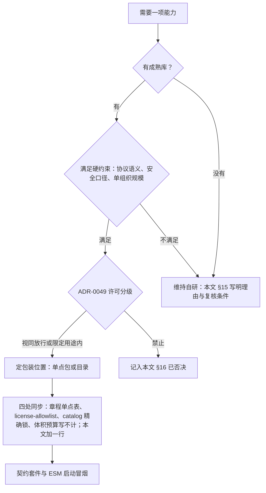
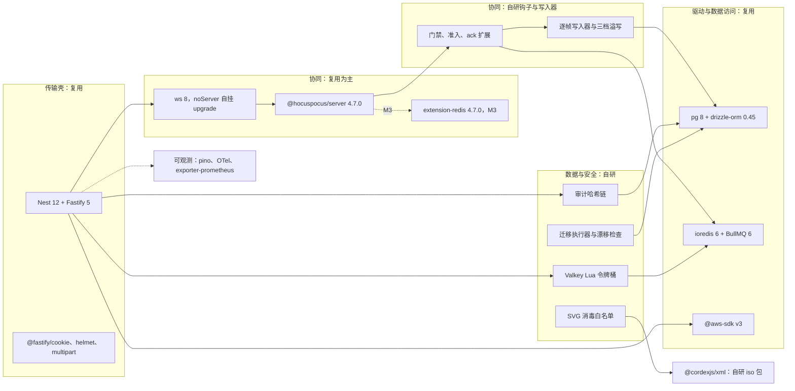
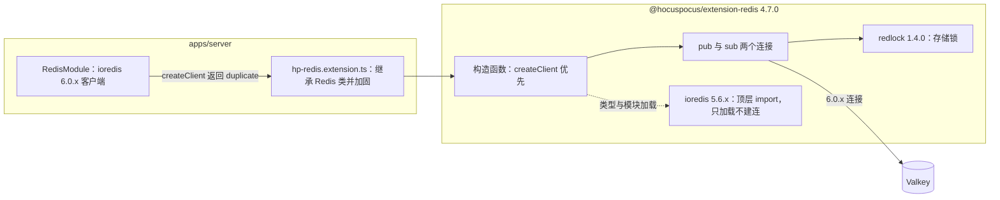
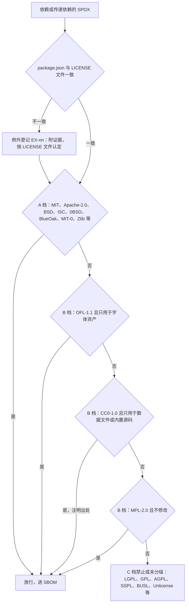
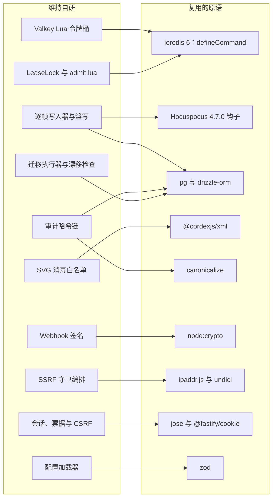
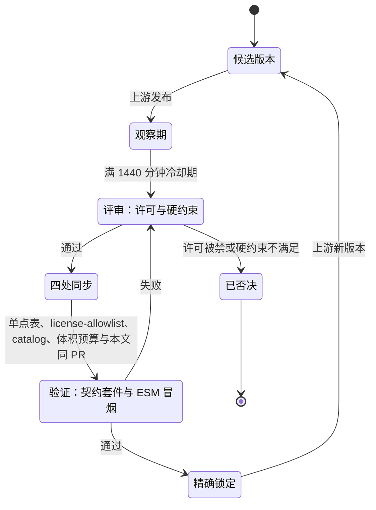

# 19 后端复用组件清单
> 状态：v0.1 | 负责：后端设计线 | 更新：2026-09-26（§4.21：新建。后端第三方依赖、传递许可例外与维持自研项的唯一清单）；2026-09-26（§4.21 整合：OTel instrumentation 双版本改引 ADR-0049 EX-03、quick-lru 预登记维护边缘；FanoutBus 按「只剩控制频道」口径改写；登记 @hocuspocus/server 作 collab-transport-ws 测试期 devDependency） | 依赖：[rulings](../00-charter/rulings-2026-09-14.md) §4.21（q-license-tiers、q-db-access、q-nest-major、q-ws-gateway、q-webhook-sig、X:q-xml-package、H:q-hp-fanout）；[章程](../00-charter/charter.md) D8、D13、§5.3 规则 4；[ADR-0049](../30-architecture/adr/0049-dependency-admission-and-license-tiers.md)、[ADR-0039](../30-architecture/adr/0039-collab-server-hocuspocus.md)、[ADR-0019](../30-architecture/adr/0019-xml-lexer-and-fidelity-tree.md)、[ADR-0022](../30-architecture/adr/0022-server-storage.md)、[ADR-0030](../30-architecture/adr/0030-observability-stack.md)、[ADR-0037](../30-architecture/adr/0037-deployment-topology-and-packaging.md)；[50/17 前端复用组件清单](../50-frontend/17-reuse-and-dependency-catalog.md)；[01](./01-service-overview-and-roles.md) §11、[08](./08-db-conventions-roles-rls-migrations.md) §10、[17](./17-deployment-and-config.md) §4、[18](./18-observability-and-ops-endpoints.md) §1；证据 `00-charter/_evidence/reuse-arch-elements-plan-2026-09-26.json`（backendReuse）、`hocuspocus-adoption-2026-09-26.json`、`xml-parser-research-2026-09-26.json`

> 读者：选型与升级后端依赖的工程师，维护 `apps/server/package.json` 与 `pnpm-workspace.yaml#catalog` 的人，做许可与 SBOM 审核的人。
> 本文是**后端第三方依赖的唯一清单**：每个依赖的版本锁、许可、单点位置和否决过的替代只在这里登记，其它 60 篇只写「用它做什么」，版本与许可一律链接本文。用户的要求是「凡有可复用的成熟组件，应尽可能复用」，所以每个**维持自研**项都在 §15 写明为什么没有合适的成熟库，以及什么情况下重新评估。

## 0. 本文拥有与引用

| 本文拥有 | 本文引用 |
|---|---|
| 后端运行时与测试依赖的版本锁、许可、单点位置、替代与否决理由（§2–§13） | 许可分级规则与门禁：ADR-0049；单点引入规则：章程 §5.3 规则 4；驱动放行表：[01](./01-service-overview-and-roles.md) §11 |
| 传递依赖的许可标注与例外登记（§14） | 前端依赖：[50/17](../50-frontend/17-reuse-and-dependency-catalog.md) |
| 维持自研清单与复核条件（§15）、已否决清单（§16） | 协同框架：ADR-0039；XML 解析器：ADR-0019；DB 访问层与 HTTP 适配器：ADR-0022；观测栈：ADR-0030 |
| 同步升级组与升级纪律（§17） | 镜像 digest 与配置键：[17](./17-deployment-and-config.md)；观测栈装配：[18](./18-observability-and-ops-endpoints.md) §1 |

### 0.1 列的含义

列与 [50/17](../50-frontend/17-reuse-and-dependency-catalog.md) 相同。50/17 的最后两列「CSP/TT 影响」「体积预算」只对浏览器有意义，服务端换成含义对应的两列：

| 列 | 含义 |
|---|---|
| 能力 | 这个依赖替我们做掉的事 |
| 库 | npm 包名；「自研」表示不引第三方，理由在 §15 |
| 版本 | 精确锁的版本，或锁定线（`12.1.x` 表示锁到次版本、补丁随 catalog 升级）；以 2026-09-26 npm registry 实查为准 |
| 许可证 | 包自身的 SPDX；传递依赖里的非常见许可见 §14 |
| 包装位置（单点） | 唯一允许 import 它的包或目录；其它位置 import 即 depcruise 报错 |
| 替代与否决理由 | 看过的候选，以及不选的原因 |
| 出处 | 决策来源：rulings、ADR、60/40 章节 |
| 装配角色（对应「CSP/TT 影响」） | 哪些 `CORDEX_ROLE` 进程会加载它；renderer 越少越好 |
| 运行注记（对应「体积预算」） | 纯 ESM、原生构建、同步升级、已知的坑 |

### 0.2 口径

- **精确锁**：运行时依赖一律在 `pnpm-workspace.yaml#catalog` 精确锁（ADR-0004），包内 `package.json` 写 `catalog:`；表中写 `x.y.x` 的，catalog 里仍是一个确切版本，只是允许按补丁随时升级。
- **四处同步**（ADR-0049 决策 3、R-d-10）：新增后端依赖在同一 PR 内同步章程 §5.3 规则 4 单点表、`tooling/policy/license-allowlist.json`、catalog 精确锁（版本须已满 1440 分钟冷却期）、体积预算（服务端依赖写「不计」），并在本文对应分组加一行。
- **许可**：按 ADR-0049 分级执行。A 档视同放行（MIT、Apache-2.0、BSD-2/3、ISC、0BSD、BlueOak-1.0.0、MIT-0、Zlib、Python-2.0 等）；B 档限定用途（OFL-1.1 只用于字体资产，CC0-1.0 只用于数据文件和内置源码，MPL-2.0 只允许不修改的依赖）；C 档禁止（LGPL、GPL、AGPL、SSPL、BUSL、Unlicense 与更强的 copyleft）。传递依赖与 devDependency 同扫。
- **单点**：驱动类依赖的放行位置以 [01](./01-service-overview-and-roles.md) §11 为准，本文「包装位置」列与它一致；`server-*` 包仍不直接 import `pg`、`ioredis`、`@aws-sdk/*`（`server-storage` 的 S3 Provider 除外）。
- **Nest 12 与 ESM**：`apps/server` 构建改为 ESM（[09-type-discipline/01](../30-architecture/09-type-discipline/01-tsconfig-baseline.md) §6）。纯 ESM 依赖（`@nestjs/*` 12、`openid-client`、`jose`、`file-type`、`canonicalize`、`quick-lru`）直接按 ESM 加载，原「CJS 构建经 `require(esm)` 加载」的口径作废；M1 冒烟改为「ESM 入口 + `node --import` 预加载 OTel」能启动并出 span。

**图 0-1 后端依赖准入流程**

怎么读：自上而下是一次选型。先找成熟库，找到了还要过硬约束（例如逐帧 seq、令牌桶语义、严格 XML）和许可分级两道关，都过了才进入单点定位与四处同步；任一关不过，要么维持自研并在 §15 写清理由，要么因许可被禁记入 §16。

依据：rulings §4.21 q-license-tiers；R-d-10（四处同步）；ADR-0049；章程 §5.3 规则 4。

## 1. 总览

**图 1-1 apps/server 进程内的复用件与自研件**

怎么读：左侧是请求进入的传输壳，中间是协同链路（ws 接住升级后交给 Hocuspocus，自研的钩子与写入器挂在它上面），右侧是驱动；带「自研」的分组是本文 §15 登记的维持自研项，其余都是复用的成熟库。虚线表示按里程碑启用（extension-redis 随 M3）或横切的观测。

依据：rulings §4.21 q-ws-gateway、q-nest-major、q-db-access、X:q-xml-package；ADR-0039 决策 1–5；[01](./01-service-overview-and-roles.md) §5。

**表 1-1 分组导航**

| 分组 | 本文章节 | 复用 | 维持自研（§15） |
|---|---|---|---|
| 传输壳 | §2 | Nest 12、Fastify 5、@fastify 四包、zod、zod-openapi、terminus、quick-lru | problem+json 过滤器、ZodPipe、配置加载器 |
| 协同 | §3 | Hocuspocus 4.7.0、extension-redis、ws、yjs 三件 | 钩子扩展、写入器与溢写、LeaseLock、admit.lua、PermissionSync、适配层 |
| 存储驱动 | §4 | pg、ioredis、@aws-sdk v3 | — |
| 数据访问 | §5 | drizzle-orm 0.45.x | 迁移执行器、分区轮换、pg_catalog 漂移检查 |
| 作业 | §6 | BullMQ 6、@nestjs/bullmq、bullmq-otel | outbox 对账与幂等键 |
| 认证与安全 | §7 | openid-client、jose、ipaddr.js、undici、canonicalize | 令牌桶、CSRF、会话、票据、Webhook 签名、SSRF 编排、审计链、渲染 RPC 签名 |
| 媒体 | §8 | file-type、image-size、playwright-core | SVG 消毒白名单、EMF/WMF 签名 |
| 格式 | §9 | fflate、opentype.js | `@cordexjs/xml`（自研 iso 包） |
| 可观测 | §10 | pino、nestjs-pino、OTel SDK、@fastify/otel、exporter-prometheus | ws 与 Hocuspocus 手工 span |
| 运维 CLI | §11 | commander、croner | 子命令编排 |
| 测试 | §12 | vitest、testcontainers、oidc-provider、@hocuspocus/provider | 压测负载驱动 |
| 基础设施镜像 | §13 | postgres 18、Valkey 9.1.2、SeaweedFS 4.47、Casdoor v4.10 等 | — |

## 2. 传输壳

| 能力 | 库 | 版本 | 许可证 | 包装位置（单点） | 替代与否决理由 | 出处 | 装配角色 | 运行注记 |
|---|---|---|---|---|---|---|---|---|
| HTTP 与依赖注入的传输壳 | `@nestjs/core`、`@nestjs/common`、`@nestjs/platform-fastify` | 12.1.x（12.1.0） | MIT | `apps/server/**` | 留在 Nest 11.2.x（原推荐项；11 线挂 `legacy` 标签仍出补丁）；用户选 M1 直接上 12，省掉 M3 前的第二次迁移 | rulings §4.21 q-nest-major；章程 D8；ADR-0030 修订 | 全部（renderer 只装 `HealthModule.forRole('renderer')`） | 纯 ESM（`type: module`）；仍用遗留装饰器与 `emitDecoratorMetadata`（peer `reflect-metadata`）；带进 `tslib` 2.8.1（0BSD，§14）；全部 `@nestjs/*` 同在 12 线 |
| HTTP 适配器（B2） | `fastify` | 5.12.5（由 platform-fastify 12.1.0 精确锁） | MIT | `apps/server/**` | Express（`@nestjs/platform-express`）：只提供 Express 中间件的库要换插件，schema 路由与性能不如 Fastify | ADR-0022 修订（B2 结案）；R-d-36 | 全部 | 次版本随 Nest 线升级、不单独升；platform-fastify 另带进 `@fastify/cors`、`@fastify/middie`、`@fastify/formbody`、`light-my-request`（BSD-3-Clause） |
| 会话 cookie 读写 | `@fastify/cookie` | 11.1.2 | MIT | `main.ts` 注册插件；读写只在 `auth/infrastructure/tokens/` | `@fastify/session`、`@fastify/secure-session`：会话语义与 [02](./02-auth-chain.md) 的 JWT + Valkey 会话重复；`cookie` 2.0.1 要自己接 Fastify | R-d-43 | api | 不启用 cookie 签名（完整性由 JWT 签名承担）；`__Host-` 前缀约束由测试断言 |
| 安全响应头 | `@fastify/helmet` | 13.1.1 | MIT | `main.ts` 注册插件 | 自写 `onSend` 钩子 | R-d-54 | api、collab | 最小配置（默认配置偏重），图片与字节路由单独覆盖；CSP 由 web 容器下发（[17](./17-deployment-and-config.md) §3），这里不重复设 |
| multipart：导入直传 | `@fastify/multipart` | 10.1.2 | MIT | `import-export/interface/imports.controller.ts` | `busboy` 1.6（停更）；`Response.formData()`（整体缓冲） | R-d-52；[15](./15-rest-api-catalog.md) §8 | api | platform-fastify 12 的 peer 为 `^10.1.0`；≤ 10 MB，由路由 `bodyLimit` 执行 |
| multipart：renderer RPC | `@fastify/busboy` | 3.2.2 | MIT | renderer 的 `POST /render` 处理器；worker 侧 `remote-renderer.client` 解析响应 | 同上 | R-d-52；[06](./06-modules-jobs-import-export-thumbnails.md) §10.1 | renderer、worker | 400 MiB 请求全程流式，边收边算 body 哈希 |
| 可信反代取来源 IP | `proxy-addr` | 2.0.8 | MIT | `common/rate-limit/client-ip.ts` | 读 `X-Forwarded-For` 首跳（可伪造，rulings §4.20 BE-04 否决） | [15](./15-rest-api-catalog.md) §8 | api、collab | 与 Fastify `request.ip` 同一算法；HTTP 与 WS 升级共用 |
| 配置、DTO、CONTROL 载荷、审计 details 校验 | `zod` | 4.6.x（4.6.5） | MIT | `@cordexjs/protocol`、`kernel` 与各包 `config`/schema 文件；`apps/server/src/config/` | class-validator（与 protocol 的单一 schema 源冲突）；配置加载库见 §15.4 | R-d-56；[17](./17-deployment-and-config.md) §5 | 全部 | 章程 R5「zod 单点」按 R-d-56 放宽为「protocol/kernel + 各包 config 与 schema 文件」（章程由总编排改写） |
| OpenAPI 3.1 生成 | `zod-openapi` | 6.0.2 | MIT | protocol 构建脚本（devDependency，不进运行时） | `@nestjs/swagger` 12（装饰器上再写一套 schema）；`nestjs-zod` 5.5（peer 只到 Nest 11，且本来就不用）；`@asteasolutions/zod-to-openapi` 9 | R-d-54；[15](./15-rest-api-catalog.md) §1、§10 | — | peer `zod ^4`；需维护「路由 → schema」登记表 |
| 健康探针装配 | `@nestjs/terminus` | 12.1.x（12.1.0） | MIT | `modules/health/` | 全自写 | R-d-54；[18](./18-observability-and-ops-endpoints.md) §6 | api、collab、worker | peer 为 `@nestjs/core` 11 或 12；renderer 的探针与内部端口 9464 的处理器不经 Nest |
| 进程内 TTL 缓存 | `quick-lru` | 7.3.0 | MIT | 使用方模块的 `infrastructure/`（如角色解析 5 s 缓存、renderer 的 `renderId` 防重放） | `lru-cache` 11.5（BlueOak-1.0.0，按 ADR-0049 可用，但 quick-lru 够用且更小）；`lru.min`（无 TTL） | R-d-56 | api、collab、renderer | 纯 ESM；多实例不共享（已接受） |
| 进程内领域事件 | Nest `DiscoveryService`（`@nestjs/core` 内置）+ 参与者装饰器 | 随 Nest | MIT | 各模块 `interface/`（如 `@PurgeParticipant`） | `@nestjs/event-emitter`（底层 eventemitter2 停更）；`@nestjs/cqrs`（过重） | R-d-55；[04](./04-modules-documents-storage-media.md) §4.3 | api、worker | 顺序编排；补偿策略写在各编排文档 |
| 平台内置 | Node 26：`worker_threads`、`node:crypto`、`node:dns`、`node:net`、`AsyncLocalStorage`、`zlib` | Node 26（`node:26-slim`） | MIT | — | — | rulings §4.15 Q9 | 全部 | engines `>=26` |

### 2.1 Nest 12 的连带影响

- **构建**：Nest 12 是纯 ESM，`apps/server` 的 `package.json` 设 `"type": "module"`，构建产物为 ESM（tsconfig 改动见 [09-type-discipline/01](../30-architecture/09-type-discipline/01-tsconfig-baseline.md) §6）。
- **OTel 启动**：ESM 下「`main.ts` 第一行 import otel」不再能保证仪表化先于被仪表化模块加载，改为 `node --import ./dist/observability/otel.js dist/main.js` 预加载（[18](./18-observability-and-ops-endpoints.md) §1、ADR-0030 修订）。
- **Nest 层 span**：`@opentelemetry/instrumentation-nestjs-core` 0.68.0 的 supportedVersions 为 `>=4.0.0 <12`，Nest 12 下**暂不可用**；控制器与守卫级 span 由 `@fastify/otel` 的路由 span 加手工 span 补齐，上游支持 12 后再启用（§10）。
- **生态兼容**：`nestjs-pino` 5.2.x peer 为 Nest `^11.0.8 || ^12.0.2`；`@nestjs/bullmq` 12.0.0 peer 覆盖 Nest 10–12；`@nestjs/terminus` 12.1.x 同时支持 11 与 12；`nestjs-zod` 不支持 12，本来就不用。
- **不装的 Nest 包**：`@nestjs/platform-ws`、`@nestjs/websockets` 与 `WsAdapter`。Nest 12 的 `WsAdapter` 默认已是 `noServer` + `handleUpgrade`，但只做 pathname 精确匹配、升级前没有钩子，带参路径 `/collab/v1/rooms/:documentId` 路由不到；协同入口改为在 `app.getHttpServer()` 的 `upgrade` 事件上自挂 ws（§3、ADR-0039 决策 1）。`@nestjs/config` 与 `@nestjs/schedule` 也不装（配置加载器见 §15.4，cron 见 §11）。

## 3. 协同

| 能力 | 库 | 版本 | 许可证 | 包装位置（单点） | 替代与否决理由 | 出处 | 装配角色 | 运行注记 |
|---|---|---|---|---|---|---|---|---|
| 协同服务端框架：WS 会话、同步与 awareness 中继、房间文档表、每连接串行队列、认证前排队 | `@hocuspocus/server`、`@hocuspocus/common` | 精确 4.7.0 | MIT | `@cordexjs/server-collab`（common 随 server 引入） | 维持 ADR-0023 自研（原推荐项）；Hocuspocus `Server` 类（自建 `http.Server`，无法与 Nest 共端口）；y-websocket 服务端（无鉴权与控制面）；y-sweet（Rust、整文档存 S3）；`@liveblocks/server`（AGPL） | rulings §4.21 q-ws-gateway；ADR-0039 决策 1–9 | collab、all | 已含 GHSA-xwhh-v746-pj9m 与 GHSA-8v8m-xjrm-95h6 修复；传递依赖 `crossws`、`async-mutex`、`kleur`、`lib0` 均 MIT；只用 `Hocuspocus` 类嵌入，`Server` 类会注册 SIGTERM 并 `process.exit` |
| 跨实例同步（M3） | `@hocuspocus/extension-redis` | 精确 4.7.0 | MIT | apps/server `collab/infrastructure/hp-redis.extension.ts`（继承加固） | 自写扇出扩展（ADR-0035 原设计，约 400 行，丢包后的状态向量补齐也要自写）；`@y/redis`（AGPL-3.0 或商业）；NATS（多一套设施） | rulings §4.21 H:q-hp-fanout；ADR-0039 决策 7 | collab（M3 多实例；M2 单实例不装） | 硬依赖 `ioredis` ~5.6.1 与 `@sesamecare-oss/redlock` ^1.4.0（§3.2、§14）；继承 `Redis` 类覆写 `beforeBroadcastStateless` 与 `onStoreDocument` 加 catch，保留离线队列并限 `maxRetriesPerRequest`；独立键前缀登记在 [14](./14-valkey-object-storage-and-retention.md) |
| WS 服务端 | `ws` | 8.21.x（8.21.3） | MIT | apps/server 的协同接入层（`upgrade` 处理，[40/09](../40-modules/09-server-collab-gateway-and-headless-host.md)） | `@fastify/websocket` 11.3（走 Fastify 路由，同样没有升级前的 Origin、IP 扣桶钩子）；uWebSockets.js（原生构建）；crossws node 适配器（Hocuspocus 官方示例的做法，本项目需要原始 socket 做 L1 门禁与带码关闭）；socket.io（协议不兼容） | ADR-0039 决策 1 | collab、all | `WebSocketServer({ noServer: true, maxPayload })`，`maxPayload` = `limits.ws.step2MaxBytes`（[17](./17-deployment-and-config.md) §5.8）；permessage-deflate 关闭 |
| CRDT 内核与同步编码 | `yjs`、`y-protocols`、`lib0` | 精确 13.6.33、1.0.7、0.2.118 | MIT | 章程 §5.3 规则 4（`server-collab` 等） | Yjs 14（`@y/y`，latest 标签 14.0.0-rc.7）只在 M3 前 spike；Automerge 已否（ADR-0020） | R-d-37；ADR-0020 | collab、worker | Hocuspocus 线上只用 Yjs V1 update（`document_updates` 存 V1 字节，快照仍 V2 + zstd，H-d-10）；根 `overrides` 锁 yjs，CI 检查锁文件只有一份 |
| 快照 zstd | Node 26 内置 `zlib` zstd + codec 适配器 | Node 26 | MIT | `server-collab` 的 codec 适配器 | `@bokuweb/zstd-wasm` 0.0.27（2025-02 后停更）；`zstd-napi`（原生构建） | R-d-39；ADR-0025 | collab、worker | Node 26.10 仍标 Experimental；浏览器侧探测 `DecompressionStream('zstd')`，不支持回退 gzip |

### 3.1 复用边界

- **交给 Hocuspocus 的**：WS 会话管理、y-protocols 同步与 awareness 中继、房间文档表与并发加载去重、每连接串行队列、认证前排队、Auth 与续票通道；M3 起跨实例状态同步交给 extension-redis。
- **挂在它钩子上的自研件**（§15.1）：握手全序与准入（`onAuthenticate`）、L2/L3 门禁并先落库（`beforeSync`）、L4 修复与逐帧 ack（`afterHandleMessage` + Stateless）、awareness 校验盖章（`beforeHandleAwareness`）、快照加日志加载（`onLoadDocument`）、权限、锁定与纪元控制面（自有 Valkey 频道）。
- **原复用默认的调整**：R-d-38 把 FanoutBus 列为维持自研；采用 Hocuspocus 后，M3 的跨实例扇出改由 extension-redis 承担，反代按 `documentId` 一致性哈希做偏好亲和（非会话粘性，[17](./17-deployment-and-config.md) §3.1），FanoutBus 不再承载帧扇出，只剩自有控制频道（`room:{docId}:ctl` 等，[05](./05-modules-collab-and-snapshots.md) §2.1）；R-d-38 其余自研项（持久化、LeaseLock、admit.lua、迁移执行器、分区轮换）保留。
- **不用的部件**：`onStoreDocument` 整文档持久化、extension-database / s3 / sqlite / throttle / webhook / logger、transformer、cli（理由见 ADR-0039「不用的部件」与本文 §16）。
- **配置**：Hocuspocus 构造参数中需要部署可调的三组（`timeout`、认证前队列两项、服务端 `flushDelay`）登记为 `collab.hocuspocus.*`（[17](./17-deployment-and-config.md) §5.7）；在它之前生效的适配层限额（认证期限、认证前帧数、step2 上限等）是 `limits.ws.*`（17 §5.8）；其余为代码常量。

### 3.2 ioredis 版本核实

简报要求核实 extension-redis 能否注入外部 ioredis 实例：能注入就统一用 6.0.x，不能就允许两版并存并登记例外。核实结果是「能注入，但 5.6.x 仍会被安装和加载」，因此两条都要做：

| 核实项 | 结果 | 依据 |
|---|---|---|
| extension-redis 4.7.0 的依赖声明 | `ioredis: ~5.6.1`（硬依赖，不是 peer）、`@sesamecare-oss/redlock: ^1.4.0` | `npm view @hocuspocus/extension-redis@4.7.0 dependencies`（2026-09-26） |
| 能否注入外部客户端 | 能：构造参数 `createClient: () => RedisInstance` 优先于 `redis`（取 `.duplicate()`）与 `host/port`，`pub`、`sub` 两个连接都由它创建 | 源码 `packages/extension-redis/src/Redis.ts` 构造函数（v4.7.0，commit 6ddc757） |
| 扩展对客户端用到的 API | `duplicate`、`subscribe`、`unsubscribe`、`publish`、`pubsub('NUMSUB')`、`on('messageBuffer')`、`disconnect`；redlock 以 Lua 脚本命令加锁、`quit` 收尾 | 同上；redlock 1.4.0 的 peer 为 `ioredis >=5` |
| ioredis 6.0.0 是否保留这些 API | 已实查保留的两处关键点：`Redis.d.ts` 仍有 `duplicate()`，`DataHandler` 仍发 `messageBuffer` 事件；其余是 ioredis 的基础命令接口，M3 集成时由契约用例（下方第 3 条）覆盖 | `npm pack ioredis@6.0.0` 实查 |
| 5.6.x 能否不装 | 不能：`Redis.ts` 顶层 `import RedisClient from "ioredis"`，模块加载即加载 5.6.x；类型 `RedisInstance` 来自 5.6.x 的声明 | 同上 |

**结论**：

1. **运行期统一 6.0.x**：apps/server 在 `hp-redis.extension.ts` 以 `createClient: () => redis.duplicate()` 注入 `RedisModule` 的 6.0.x 客户端，扩展的 `pub`、`sub` 与 redlock 都走 6.0.x；类型差异只在这一处做一次显式转换。
2. **5.6.x 作为「已安装、不建连接」的传递依赖并存**：不用 `overrides` 把 `~5.6.1` 强改到 6（跨主版本，改的是第三方的依赖范围）；登记为单版本规则的例外，即 ADR-0049 决策 5 的 **EX-02**（`syncpack` 只管直接依赖，不受影响），并在 §14 标注。
3. **机械验证**：extension-redis 契约用例断言扩展持有的连接是 6.0.x 的 `Redis` 实例，且进程内没有 5.6.x 建立的 socket；升级 extension-redis 时复核它是否改成 peer 依赖，改成后删除这条例外。

**图 3-1 extension-redis 的 ioredis 注入**

怎么读：实线是运行期的对象传递，客户端从 `RedisModule` 经加固子类注入扩展，扩展的两个连接和 redlock 都是 6.0.x；虚线表示 5.6.x 只因顶层 import 被加载、提供类型，但不建立任何连接。

依据：rulings §4.21 H:q-hp-fanout 与关键口径「ioredis 版本」；H-d-22、H-d-23、H-d-25；ADR-0039「版本、许可与依赖边界」。

## 4. 存储驱动

| 能力 | 库 | 版本 | 许可证 | 包装位置（单点） | 替代与否决理由 | 出处 | 装配角色 | 运行注记 |
|---|---|---|---|---|---|---|---|---|
| Valkey 客户端 | `ioredis` | 6.0.x（6.0.0） | MIT | `apps/server/src/redis/**`、`common/rate-limit/**`、`modules/*/infrastructure/**`（[01](./01-service-overview-and-roles.md) §11） | `iovalkey` 0.4（ioredis 分叉，尚在 0.x）；`@valkey/valkey-glide` 2.5（Rust 原生构建）；`node-redis` 6.2（BullMQ 与 extension-redis 都按 ioredis 接口实现，换客户端要维护两套） | R-d-40 | api、collab、worker | apps/server 显式声明；Lua 脚本用 `defineCommand` 注册；新主版本需回归 Lua、pub/sub 与重连；`instrumentation-ioredis` 覆盖 `>=2 <7`；extension-redis 自带的 5.6.x 见 §3.2 |
| PG 驱动与连接池 | `pg`、`pg-query-stream` | 8.23.x（8.23.0）、4.17.0 | MIT | `apps/server/src/db/**`、`modules/*/infrastructure/**` | `postgres.js` 3.4.9（Unlicense，按 ADR-0049 禁止） | R-d-40；[08](./08-db-conventions-roles-rls-migrations.md) §5 | api、collab、worker | 大结果集用 `pg-query-stream`；RLS 只用事务级 `set_config(…, true)`；compose 不带 PgBouncer，迁移直连 PG（[08](./08-db-conventions-roles-rls-migrations.md) §10.2） |
| S3 兼容对象存储客户端 | `@aws-sdk/client-s3`、`@aws-sdk/lib-storage`、`@aws-sdk/s3-request-presigner` | 3.1141.0（每周发版，精确锁） | Apache-2.0 | `packages/server-storage/src/providers/**`（唯一 S3 SDK 引入点） | `minio` 8.0.7（MinIO 上游已归档） | R-d-49；ADR-0022 修订 | api、collab、worker | 接 SeaweedFS 设 `forcePathStyle` 与 `WHEN_REQUIRED` 校验和（v3.729 起默认 CRC32，SeaweedFS 支持不全），预签名直传同样适用 |

## 5. 数据访问

| 能力 | 库 | 版本 | 许可证 | 包装位置（单点） | 替代与否决理由 | 出处 | 装配角色 | 运行注记 |
|---|---|---|---|---|---|---|---|---|
| DB 类型镜像与仓储查询（B1） | `drizzle-orm` | 0.45.x（0.45.3） | Apache-2.0 | `apps/server/src/db/client.ts`、`db/schema/*.ts`（手写）、各模块 `infrastructure/*.repository.ts` | Kysely 0.29.6 + kysely-codegen 0.20（内省含分区父表，是备选，但要改 40/12 §5.13 的文件布局且仍是 0.x）；Prisma 7.10、MikroORM 7.2（运行时代码生成或实体映射，与「SQL 可见」不符）；纯 `pg` + 手写类型（仓储代码量最大） | rulings §4.21 q-db-access；ADR-0022 修订（B1 结案） | api、collab、worker | Drizzle 1.0（RC）的破坏性变更须在 M2 前评估；漂移检查不用 drizzle 内省，改为直查 `pg_catalog`（[08](./08-db-conventions-roles-rls-migrations.md) §10.1） |
| 起草普通表 SQL | `drizzle-kit` | 0.31.11（devDependency） | MIT | 开发者本地，生成物不入库 | — | [08](./08-db-conventions-roles-rls-migrations.md) §10.1 | — | 只用 `generate` 起草；**不用 `pull`**：内省只选 relkind `r`/`v`/`m`，分区父表 `document_updates`、`audit_log` 整张丢失（drizzle 仓库 issue #6093，未关闭） |
| 迁移执行器、分区轮换、漂移检查 | 自研 | — | — | `db/migrator.ts`、`ops/cli.ts`、`test/integration` | 见 §15.3 | [08](./08-db-conventions-roles-rls-migrations.md) §10 | — | — |

## 6. 作业

| 能力 | 库 | 版本 | 许可证 | 包装位置（单点） | 替代与否决理由 | 出处 | 装配角色 | 运行注记 |
|---|---|---|---|---|---|---|---|---|
| 作业队列与周期作业（Job Scheduler） | `bullmq` | 6.3.x（6.3.9） | MIT | `apps/server/src/redis/`（连接工厂）、各模块 `interface/*.processor.ts` 与生产者 | BullMQ 6 的 PG 后端（2026-07 才发布，太新）；`pg-boss` 12.34（事务内入队、可省 outbox，但要把 Valkey 队列迁到 PG）；`graphile-worker` | R-d-41；[06](./06-modules-jobs-import-export-thumbnails.md) §1、§4 | worker（处理器）；api、collab（生产者） | 6 相对 5 有破坏性变更，锁主版本；带进 `tslib`（0BSD）与 `msgpackr`，其可选原生件 `msgpackr-extract` 需在 pnpm 构建白名单登记；ioredis 在 6 里是 optional peer，由 apps/server 显式提供 |
| Nest 队列集成 | `@nestjs/bullmq` | 12.0.0 | MIT | 同上 | 手写 Worker 生命周期 | R-d-41 | worker、api、collab | peer 覆盖 bullmq 3–6、Nest 10–12 |
| 作业 trace 传播 | `bullmq-otel` | 2.0.1 | MIT | `redis/redis.module.ts` 的队列工厂 | 手工把 `traceparent` 塞进作业数据 | R-d-41；[18](./18-observability-and-ops-endpoints.md) §3 | worker、api、collab | `job.<kind>` span 从作业里的 `traceparent` 续接 |
| outbox 对账与幂等键 | 自研 | — | — | `JobsModule` | 见 §15.3 | [06](./06-modules-jobs-import-export-thumbnails.md) §2.3、§3 | worker | — |

将来若要去掉 Valkey 或省掉 `job_runs` 对账，可评估 BullMQ PG 后端或 pg-boss；不在本轮范围。

## 7. 认证与安全

| 能力 | 库 | 版本 | 许可证 | 包装位置（单点） | 替代与否决理由 | 出处 | 装配角色 | 运行注记 |
|---|---|---|---|---|---|---|---|---|
| OIDC RP（授权码 + PKCE） | `openid-client` | 6.8.x（6.8.8） | MIT | `auth/infrastructure/oidc/oidc-client.provider.ts` | `passport-openidconnect`（停更）；`casdoor-nodejs-sdk`（绑死 Casdoor，与「可换任意 OIDC IdP」冲突）；直接用 `oauth4webapi`（openid-client 的底层，要多写发现与缓存） | R-d-43；[02](./02-auth-chain.md) | api | 纯 ESM；服务端不持有密码，登录只经它（rulings §4.15 Q6） |
| JWT 签发验签与 JWKS | `jose` | 6.2.x（6.2.12） | MIT | `auth/infrastructure/tokens/jwt.service.ts`（票据验签面经 `AuthModule` 导出给协同） | `@nestjs/jwt`（包一层 jsonwebtoken，不覆盖 JWKS 轮换与 Back-Channel Logout 验签）；`fast-jwt` | R-d-43 | api、collab | 零依赖、纯 ESM；ES256 会话与票据、`kid` 轮换需测试覆盖 |
| 密码学原语 | `node:crypto` | Node 26 | MIT | 各用例的 `infrastructure/` | `libsodium-wrappers`；RFC 9421 HTTP 消息签名库 | R-d-55 | 全部 | HMAC-SHA256、AES-256-GCM 信封、Ed25519、SHA-256、`timingSafeEqual`；KEK 轮换写进运维手册 |
| SSRF 地址判段 | `ipaddr.js` | 2.5.0 | MIT | `webhooks/infrastructure/egress-guard.ts` | `request-filtering-agent` 3.2、`ssrf-req-filter`（停更）；编排部分见 §15.2 | R-d-53；[07](./07-modules-comments-webhooks-audit.md) §6 | api、worker | 阻断段以 60/07 §6 明示表为准，库只负责解析与判段 |
| 出站 HTTP 客户端 | `undici` | 8.11.x（8.11.2） | MIT | `egress-guard.ts`、Webhook 投递、`telemetry/infrastructure/otlp-proxy.service.ts` | `node:https` + Agent `lookup`（能做但要自己处理连接复用与超时）；`got`、`axios`（多一层抽象，锁 IP 不直接） | R-d-53 | api、worker | `Agent({ connect: { lookup } })` 把连接锁到守卫放行的 IP；不跟随重定向；npm 版与 Node 内置 `fetch` 的 undici 版本不同，一律从 `undici` 包 import |
| JSON 规范化（RFC 8785 JCS） | `canonicalize` | 5.1.0 | Apache-2.0 | `audit/domain/audit-chain.ts` | `json-canonicalize` 3.0.1；自研 | R-d-55；[07](./07-modules-comments-webhooks-audit.md) §8.1 | api、collab、worker | 纯 ESM；作者是 RFC 8785 合著者；`details` 只放安全整数，保证读回后规范化结果逐字节相同 |
| 限流、CSRF、会话、票据、Webhook 签名与密钥信封、SSRF 编排、审计链、渲染 RPC 签名 | 自研 | — | — | 各模块 | 见 §15.2 | — | — | 全部复用上面几行的原语 |

## 8. 媒体

| 能力 | 库 | 版本 | 许可证 | 包装位置（单点） | 替代与否决理由 | 出处 | 装配角色 | 运行注记 |
|---|---|---|---|---|---|---|---|---|
| MIME 嗅探 | `file-type` | 22.1.x（22.1.1） | MIT | `media/infrastructure/asset-inspector.ts` | `magic-bytes.js` | R-d-46；[04](./04-modules-documents-storage-media.md) §7.2 | api、worker | 纯 ESM；**不识别 SVG、EMF、WMF**，这三类由 `asset-inspector.ts` 自写签名判定；m4a 归一为 `audio/mp4` |
| 图片尺寸（只读文件头） | `image-size` | 2.0.4 | MIT | 同上 | `probe-image-size` 7.4；全自研 | R-d-46 | api、worker | 支持 PNG、JPEG、GIF、WebP、BMP、TIFF、SVG 等，不含 EMF/WMF（自写头解析）；SVG 尺寸靠正则，输入必须是消毒后的字节；不解码像素 |
| 驱动 headless Chromium | `playwright-core` | 1.63.0 | Apache-2.0 | `packages/server-headless/src/thumbnails/**` | `puppeteer-core` 25.12 | R-d-50；ADR-0026 | renderer、worker（local 模式） | 与 `chromium-headless-shell` 同步升级（§13）；`screenshot` 直出 WebP，服务端不引图像编解码库 |
| SVG 消毒 | 自研白名单 + `@cordexjs/xml` | — | — | `media/infrastructure/svg-sanitizer.ts` | 见 §15.4 | [04](./04-modules-documents-storage-media.md) §7.2 | api、worker | 严格 XML 解析与重序列化用 `@cordexjs/xml`（拒 DOCTYPE、XmlLimits），元素与属性白名单自写 |

服务端图像处理的边界不变：不引 sharp、`@napi-rs/image`、jimp、`@jsquash/*`、photon-node（都要在持凭据的进程里解码不可信图片），也不引 `@resvg/resvg-js`（MPL-2.0，且同样是解码）；栅格化只在 renderer 沙箱内（rulings §4.15 Q8）。

## 9. 格式

| 能力 | 库 | 版本 | 许可证 | 包装位置（单点） | 替代与否决理由 | 出处 | 装配角色 | 运行注记 |
|---|---|---|---|---|---|---|---|---|
| XML 词法、保真树、序列化、XmlLimits | `@cordexjs/xml`（自研 iso 包：L0 · 秩 0 · library，零运行时依赖） | workspace | Apache-2.0（本仓） | `ooxml-core`；apps/server 媒体模块的 SVG 消毒（`server-app-thin` 白名单加这一项） | saxes 6.0.0（已归档、2021-11 后无发版）；`@rgrove/parse-xml` 5（退路：不能流式、无限额、约 1 万层嵌套栈溢出）；`fast-xml-parser`、`@xmldom/xmldom`、`txml` 等 21 个候选实测（不保真或畸形放行） | rulings §4.21 X:q-xml-lexer、X:q-xml-package；ADR-0019 | worker（导入导出）、api（SVG 消毒） | 两个入口 `scan`（不建树，计数与限额）与 `parseDocument`（整树），都支持 `write`/`end` 与按时间片让出；DOCTYPE 一律拒绝；限额只在 ADR-0019 的 XmlLimits 表定义 |
| XML 差分 oracle | `saxes`、`libxml2-wasm` | 6.0.0、0.7.2（devDependency） | ISC、MIT | `@cordexjs/xml` 的合规与差分测试 | — | ADR-0019 | — | 输入限深、限长；只在测试 |
| zip 读写与多页 PNG 打包 | `fflate` | 0.8.3 | MIT | `ooxml-core`（导出 `writeZip`，经 `publicEntry` 登记供 worker 打包多页 PNG） | `yauzl`/`yazl`；`@zip.js/zip.js`；`jszip`（MIT OR GPL-3.0 双许可，引入要在 SBOM 声明取向） | R-d-51；[06](./06-modules-jobs-import-export-thumbnails.md) §7.2 | worker | zip 炸弹按实际解压字节计；zip64 需实测；多页 zip 不再扩 fflate 的单点 |
| 字体度量（node-font） | `opentype.js` | 2.0.0 | MIT | `node-font` 包 | `fontkit` 2.0.4（停更）；`harfbuzzjs` 1.6.2（shaping 用，度量不需要） | R-d-57 | worker | WOFF2 先用 Node brotli 解压；CJK 大字体注意内存 |

## 10. 可观测

| 能力 | 库 | 版本 | 许可证 | 包装位置（单点） | 替代与否决理由 | 出处 | 装配角色 | 运行注记 |
|---|---|---|---|---|---|---|---|---|
| 结构化日志 | `pino`、`nestjs-pino` | 10.3.x（10.3.1）、5.2.x（5.2.1） | MIT | M-09 `cordis-host/adapters/pino-logger.adapter.ts`（kernel logger 适配）与 `observability/observability.module.ts` | Fastify 内建 logger + 自写桥；`winston`（慢、结构化字段约定要重写） | R-d-47；[18](./18-observability-and-ops-endpoints.md) §2 | 全部 | 关掉 Fastify 自带的请求日志，访问日志由 nestjs-pino 按 [18](./18-observability-and-ops-endpoints.md) §2.3 输出；脱敏路径集中在适配器 |
| traces 与 metrics SDK | `@opentelemetry/sdk-node` 与同批 OTLP/gRPC 导出器 | 0.222.x（0.222.0） | Apache-2.0 | `observability/otel.ts`（经 `node --import` 预加载） | 全量 `auto-instrumentations-node` 0.80（启动慢，且已不含 fastify） | R-d-47；ADR-0030 修订 | api、collab、worker（renderer 关闭导出） | 按需挑仪表化，不装全家桶 |
| 自动仪表化（按需） | `@opentelemetry/instrumentation-http`、`-undici`、`-pg`、`-ioredis`、`-pino`、`-runtime-node` | 与 sdk-node 同批 | Apache-2.0 | 同上 | — | ADR-0030 修订 | 同上 | pg 关参数上报；ioredis 只留命令名（[18](./18-observability-and-ops-endpoints.md) §2.2） |
| Fastify 路由 span | `@fastify/otel` | 0.21.0 | MIT | 同上（作为 Fastify 插件注册） | `@opentelemetry/instrumentation-fastify`（已弃用，由 `@fastify/otel` 接替） | R-d-47 | api、collab、worker | 依赖 `@opentelemetry/instrumentation` `^0.221.0`，与 sdk-node 0.222 并存，**不做 overrides**；带进 `minimatch`（BlueOak-1.0.0，§14） |
| Nest 层 span | `@opentelemetry/instrumentation-nestjs-core` | 0.68.0（**暂不启用**） | Apache-2.0 | — | supportedVersions `>=4.0.0 <12`，Nest 12 下失效；控制器与守卫级 span 由 `@fastify/otel` 与手工 span 补齐 | rulings §4.21 q-nest-major；ADR-0030 修订 | — | 上游支持 12 后在同一 PR 启用并删掉重复的手工 span |
| WS 与协同 span | 手工 span（自研挂点） | — | — | `server-collab` 的 Hocuspocus 扩展 | `ws` 没有维护中的 OTel 仪表化；Hocuspocus 的 extension-logger 只打日志（不用） | [18](./18-observability-and-ops-endpoints.md) §3 | collab | `server.collab.session` 挂 `onAuthenticate`、`server.room.load` 包 `onLoadDocument`、`server.collab.update` 包 `beforeSync`→`afterHandleMessage` |
| `/metrics` 导出 | `@opentelemetry/exporter-prometheus` | 0.222.0 | Apache-2.0 | `modules/metrics/infrastructure/prometheus-registry.provider.ts` | `prom-client` 15.1.3（已 deprecated，改名 `@prometheus-io/client`） | R-d-48；[18](./18-observability-and-ops-endpoints.md) §7 | api、collab、worker | `preventServerStart: true`，处理函数挂到内部端口 9464 的 Fastify 实例；指标名单位后缀转换须对齐 [18](./18-observability-and-ops-endpoints.md) §4.1 |
| 错误平台 | 只留 Reporter 接缝 | — | — | `apps/*` 装配层 | `@sentry/node` 11.0.0（MIT，可作可选 Provider，不进默认依赖；Sentry 自托管为 FSL）；GlitchTip（MIT） | R-d-48；ADR-0030 决策 4 | — | 默认 Reporter = 日志 + `cordex_errors_total` |

## 11. 运维 CLI

| 能力 | 库 | 版本 | 许可证 | 包装位置（单点） | 替代与否决理由 | 出处 | 装配角色 | 运行注记 |
|---|---|---|---|---|---|---|---|---|
| 子命令与参数解析 | `commander` | 15.0.0 | MIT | `apps/server/src/ops/cli.ts` | `nest-commander`（每个子命令要起完整 Nest 应用）；`citty`、`cac` | R-d-42；[17](./17-deployment-and-config.md) §9 | 运维入口（不属任何 `CORDEX_ROLE`） | node `>=22.12`；sysexits 退出码自映射；按需 `NestFactory.createApplicationContext` 只装所需模块 |
| `cordex-ops cron` 定时 | `croner` | 10.0.1 | MIT | `ops/cli.ts` 的 `cron` 子命令 | `@nestjs/schedule`（要常驻完整 Nest 应用）；`cron` 4.4；宿主 cron 或 K8s CronJob（Helm 用 CronJob，compose 可删 `ops-cron` 改用宿主 cron，二选一） | R-d-42；[17](./17-deployment-and-config.md) §9 | `ops-cron` 容器 | 零依赖；只调度 `audit-rotate` 一个任务 |
| 子命令编排 | 自研 | — | — | `ops/cli.ts` | 见 §15.3 | [40/12](../40-modules/12-server-jobs-comments-and-ops.md) §4.13 | — | 只调各模块公开用例，不直接写表 |

## 12. 测试

| 能力 | 库 | 版本 | 许可证 | 包装位置（单点） | 替代与否决理由 | 出处 | 装配角色 | 运行注记 |
|---|---|---|---|---|---|---|---|---|
| 测试运行器 | `vitest` | 5.0.2 | MIT | 全仓（devDependency） | Jest | [70/01](../70-testing/01-strategy-and-layers.md) | — | 经 SWC 保留装饰器元数据 |
| Nest 集成测试 | `@nestjs/testing` | 12.1.0 | MIT | `apps/server/test/**` | — | 同上 | — | 与 `@nestjs/core` 同版本 |
| 集成测试容器 | `testcontainers` 与 `@testcontainers/postgresql`、`@testcontainers/valkey`、`@testcontainers/toxiproxy` | 12.1.0 | MIT | `apps/server/test/integration/**` | PGlite（测不了数据库角色与 RLS）；自管 compose | R-d-58 | — | CI 需 Docker；镜像 digest 与 compose 一致（§13） |
| HTTP 注入 | Fastify `inject`（`light-my-request`） | 随 fastify | BSD-3-Clause | 同上 | `supertest` 7.3（要真起端口） | R-d-58 | — | 用 `app.inject()` |
| dev 与 CI 的 OIDC mock | `oidc-provider` | 9.12.2 | MIT | compose `dev` profile 的 `mock-oidc` 与集成测试 | 真 Casdoor（慢、需管理员初始化） | R-d-58；ADR-0037 | — | 只在 `dev` profile |
| 协同互连 | `@hocuspocus/provider` | 精确 4.7.0（另取一个 3.x 做互连回归） | MIT | 协同契约与互连测试（devDependency；运行时单点仍只在 `collab-yjs` 与 `collab-transport-ws`，ADR-0039） | y-websocket 官方客户端（线上格式已不兼容，互操作测试删除） | H-d-30；ADR-0039 | — | conformance 与 collab-sim 直接跑 `Hocuspocus` 类 + 内存 `WebSocketLike`；第三方内部计时用 fake timers |
| 客户端传输测试的脚本化服务端 | `@hocuspocus/server` | 精确 4.7.0（devDependency） | MIT | `collab-transport-ws` 的 `testing/` 与 `__tests__/`（`createScriptedServer`，40-modules/05） | 自写假服务端（要复刻 Hocuspocus 帧与认证前排队，易与真实实现漂移） | 章程 §5.3 规则 4 的测试期例外；ADR-0039 | — | 不进生产依赖；生产单点仍只在 `server-collab` |
| 压测时延注入 | toxiproxy（容器） | digest 钉死 | MIT | 性能测试 | — | [70/09](../70-testing/09-performance-and-capacity.md) | — | — |
| 压测负载驱动 | 自研 | — | — | `test/perf/load-driver` | 见 §15.3 | 70/09 | — | — |

## 13. 基础设施镜像

镜像的 digest 引用、compose 写法与版本锁表见 [17](./17-deployment-and-config.md) §4.1；本节只登记选型、许可与替代。全部镜像按 `@sha256:` digest 钉死，默认 profile 的主组件许可由 `check-image-policy` 核对（ADR-0037 决策 2、6）。

| 能力 | 镜像 | 版本 | 许可证 | 包装位置（单点） | 替代与否决理由 | 出处 | 装配角色 | 运行注记 |
|---|---|---|---|---|---|---|---|---|
| 关系库 | `postgres` | 18.x（ddl-check 实跑 18.6） | PostgreSQL License | compose `postgres` 服务 | 客户自带 PG（支持下限 16） | ADR-0022；R-d-59 | — | uuid v7 在应用层生成，下限不必抬高 |
| Redis 协议服务 | `valkey/valkey` | 9.1.2（不用 9.2.0-rc1） | BSD-3-Clause | compose `valkey` 服务 | Valkey 9.0.x；客户自带 Redis ≥ 7.2 协议；未钉版本的 `redis` 镜像（7.4.x 起 RSAL/SSPL、8.x 含 AGPL，不过 D13 镜像口径） | ADR-0022 修订；R-d-59 | — | `noeviction`、AOF `everysec`；不用 `HEXPIRE`；extension-redis 只用 PUBLISH、SUBSCRIBE、PUBSUB NUMSUB 与 `SET NX PX` |
| S3 兼容对象存储 | `chrislusf/seaweedfs` | 4.47 | Apache-2.0 | compose `seaweedfs` 服务 | MinIO（上游已归档、镜像下架、自建须承担 AGPL）；versitygw（适合单机）；RustFS（刚 GA、alpha 期有高危漏洞，M4 再评估） | ADR-0022 修订；R-d-59 | — | S3 网关 8333；替换后须重跑 `runBlobStoreConformance` |
| 可选内置 IdP | `casbin/casdoor` | v4.10.x（v4.10.0） | Apache-2.0 | `idp` profile | 外部任意 OIDC IdP（部署方自选） | ADR-0029；ADR-0037；R-d-59 | — | 发版频繁，升级须回归 OIDC 登录与登出 |
| 观测默认栈 | OTel Collector、Jaeger、Prometheus、`prom/node-exporter` | digest 钉死，具体版本随发布件清单确定（本轮证据未核定版本号） | Apache-2.0 | 默认 profile | — | ADR-0030 决策 7 | — | 默认告警规则随 compose 提供 |
| 仪表盘与日志检索 | Grafana、Loki（Tempo） | 同上 | AGPL-3.0 | 只在 `observability-agpl` profile | — | ADR-0030 决策 7；ADR-0037 | — | 需显式开启，启用时打印许可提示 |
| web 容器 | `nginxinc/nginx-unprivileged` | digest 钉死 | BSD-2-Clause | `cordex-web` 基础镜像 | — | [17](./17-deployment-and-config.md) §3、§4 | — | 非 root，监听 8080 / 8443 |
| 应用基础镜像 | `node:26-slim` + `tini` | digest 钉死 | MIT | `cordex-server` runtime 目标 | — | [17](./17-deployment-and-config.md) §4 | 全部 | 入口 `tini -- node --import …`（§2.1） |
| 无头浏览器 | `chromium-headless-shell` | 与 `playwright-core` 1.63 绑定的修订 | BSD 系 | `cordex-server` renderer 目标 | 自建最小 Chromium 镜像（与 worker 版本锁要另建流水线） | ADR-0026；[17](./17-deployment-and-config.md) §4 | renderer | 每周随 Chrome 稳定版重建，与 worker 同版本发布 |
| 开发与 CI 的 OIDC mock | `oidc-provider` 镜像化 | 9.12.2 | MIT | `dev` profile | — | §12 | — | 只在开发与 CI |

## 14. 传递依赖许可与例外登记

按 ADR-0049：A 档视同放行，只在 SBOM 中照常列出；许可元数据有问题、或违反单版本规则的，在 ADR-0049 决策 5 的例外表登记（`license-allowlist.json#exceptions`，EX-01、EX-02、EX-03），本文标注引入路径与处置。

| 包 | 许可 | 经由 | 分级 | 处置 |
|---|---|---|---|---|
| `tslib` 2.8.1 | 0BSD | `@nestjs/*` 12、`bullmq`、`bullmq-otel` | A 档 | SBOM 列出 |
| `minimatch` 10.x | BlueOak-1.0.0 | `@fastify/otel` | A 档 | SBOM 列出 |
| `light-my-request` 6.6.0 | BSD-3-Clause | `@nestjs/platform-fastify` | A 档 | — |
| `crossws`、`async-mutex`、`kleur`、`lib0` | MIT | `@hocuspocus/server` | A 档 | — |
| `msgpackr`、`msgpackr-extract`（可选原生件） | MIT | `bullmq` | A 档 | `msgpackr-extract` 有安装期构建，需在 pnpm 构建白名单显式登记，否则回退纯 JS 实现 |
| `@sesamecare-oss/redlock` 1.4.0 | package.json 写 `UNLICENSED`，LICENSE.md 为 MIT（Copyright 2015 Mike Marcacci） | `@hocuspocus/extension-redis`（M3） | 未分级 → **例外 EX-01**：按 LICENSE.md 认定 MIT | 证据见 ADR-0049 决策 5（H 证据 extraFindings 与包内 LICENSE.md）；只对该版本放行，版本一变即重新核实；另按「传递依赖」类登记停更例外（2025-01 后无发版） |
| `ioredis` 5.6.x | MIT | `@hocuspocus/extension-redis`（M3） | A 档；**单版本例外 EX-02** | 已安装、只加载不建连（§3.2 核实结论，即 ADR-0049 所说「注入点的类型适配」）；extension-redis 改为 peer 依赖后删除 |
| `@opentelemetry/instrumentation` 0.221.x 与 0.222.x | Apache-2.0 | `@fastify/otel`（`^0.221.0`）与 sdk-node 0.222 | A 档；两版并存，登记为**单版本例外 EX-03**（ADR-0049 决策 5；不新增多版本扫描） | 不做 overrides（强压 `^0.x` 范围可能破坏 API）；`@fastify/otel` 跟进后收敛 |

因许可而未进入依赖树的：`postgres.js`（Unlicense）、`standardwebhooks` 带进的 `fast-sha256`（Unlicense，2022 年后停更）；jsdom 会带进 BlueOak、CC0 与 MIT-0 的传递依赖，但它是因为别的理由被否决（§16）。

**图 14-1 许可分级判定（ADR-0049）**

怎么读：自上而下逐级判定，先看许可元数据是否可信（redlock 的 `UNLICENSED` 就在这一步转为例外 EX-01），再依次看是否 A 档、是否在 B 档的三类限定用途之内；其余属于 C 档或未分级，一律不准入。

依据：rulings §4.21 q-license-tiers 与关键口径「许可分级」；ADR-0049；H-d-23。

## 15. 维持自研清单

每一项都回答三件事：看过哪些成熟库，为什么不合适（落到具体的硬约束），什么情况下重新评估。多数自研项并不是从零写，而是建在复用的原语之上，见图 15-1。

**图 15-1 自研件建在哪些复用原语之上**

怎么读：左边每个自研件，箭头指向它依赖的成熟原语；自研的部分只是这些原语之上的编排与本项目特有的语义（逐帧 seq、先扣后退、明示阻断表、逐字一致的迁移台账等）。

依据：rulings §4.21 关键口径「后端复用默认」；R-d-38、R-d-43…R-d-46、R-d-53、R-d-55；H-d-11、H-d-12、H-d-16。

### 15.1 协同

| 自研项 | 落点 | 看过的成熟库 | 为什么不合适 | 何时重新评估 |
|---|---|---|---|---|
| 门禁、准入与 ack 扩展（Auth、Gate+Persist、Room、Awareness、Control） | `@cordexjs/server-collab` 内的 Hocuspocus 扩展 | Hocuspocus 自带能力 | 它的 `SyncStatus` 只表示「已应用到内存」，没有 seq 与帧 id，缺依赖被挂起的更新也回 1（exp6）；L2–L4 门禁（ADR-0034）与两级 ack 是本项目的协议语义，只能挂在钩子上自写 | 上游提供落库确认原语时，评估替换 ack 部分 |
| 逐帧写入器、三档溢写（none / valkey / blob）与两级 ack | `server-collab` spill + apps/server `collab/infrastructure/spill/*` | `onStoreDocument` 与 extension-database / s3 / sqlite；`y-postgresql` 1.0.1；`y-leveldb`；`@y/redis` | 前者都是整文档 debounce 覆盖写（默认 2 s / 10 s，RPO 从 ≤ 1 s 变为 ≤ 10 s），存储失败不重试、之后一次空断开即丢（exp2）；y-postgresql 2025-05 后无发版；`@y/redis` 以 Redis 为主存且为 AGPL；正式 seq 必须由 PG 分配、PG 故障时不拒写（ADR-0025） | — |
| 快照、压缩与墓碑清扫 | `server-collab` | 同上 | 只需 yjs 自带的 V2 合并与差分 API；库只提供整文档存取 | 10,000 条 update 合并 ≤ 2 s 的基准不达标时 |
| LeaseLock（`SET NX PX` + `INCR` fencing token） | `collab/infrastructure/redis-lease-lock.ts` | redlock 系（含 extension-redis 自带的 `@sesamecare-oss/redlock`）；PG advisory lock | redlock 不给 fencing token，锁过期后迟到的写无法拒绝；PG advisory lock 把协调压回一致性关键路径 | — |
| 房间名额原子准入 `admit.lua` | `redis-membership-registry.ts` | 无现成库（Hocuspocus 没有跨实例名额） | 跨实例按用户去重、每用户 32 连接上限与权重准入要在一次 Lua 内完成；不用 `HEXPIRE`，保持 Redis ≥ 7.2 协议兼容 | — |
| PermissionSync 与控制面（`perm:doc`、`room:ctl` 频道；`FanoutBus` 的 Redis 实现只承载这类控制频道） | apps/server `collab/infrastructure/` | Hocuspocus、extension-redis | 没有跨实例的踢人、权限重算与纪元通道；`BroadcastStateless` 经 Redis 只到其它实例的客户端，不触发那边的服务端钩子 | 上游提供服务端间消息通道时 |
| 接入适配层：自挂 upgrade、帧预过滤（一 WS 一文档、L1 大小与令牌桶）、5 s 认证期限、45 s 空闲判死、满员 awareness 出站合并 | apps/server 协同接入层（[40/09](../40-modules/09-server-collab-gateway-and-headless-host.md)） | `WsAdapter`、`@fastify/websocket`、extension-throttle、Hocuspocus 的 `timeout` 与文档级 `flushDelay` | `WsAdapter` 只做精确路径匹配、升级前无钩子；Hocuspocus 没有单帧大小门禁（ws `maxPayload` 默认 100 MiB）与消息速率限制，`timeout` 同时是认证期限与空闲超时、实际 45–90 s 才判死；按文档调 `flushDelay` 会把文档更新 p50 从 1.5 ms 拖到约 103 ms（vF） | — |
| CONTROL 载荷 schema 与关闭码表 | `@cordexjs/protocol` `collab/*`、`close-codes.ts` | y-websocket 协议 | 协议缺鉴权、ack、错误与房间控制；载体已改用 Hocuspocus 帧与 Stateless，自有的只剩载荷 schema 与码表 | — |

原复用默认里的「FanoutBus 自研」收窄：M3 的跨实例帧扇出由 extension-redis 承担（§3.1），FanoutBus 只剩控制频道，归入上表「PermissionSync 与控制面」一行。

### 15.2 认证与安全

| 自研项 | 落点 | 看过的成熟库 | 为什么不合适 | 何时重新评估 |
|---|---|---|---|---|
| 限流：HTTP 与 WS 升级共用的 Valkey Lua 令牌桶 | `common/rate-limit/redis-token-bucket.ts` | `rate-limiter-flexible` 11.2.1（ISC）；`@nestjs/throttler`；`@fastify/rate-limit`；Hocuspocus extension-throttle | rate-limiter-flexible 只有 Flexible Fixed Window，没有令牌桶，违背 rulings §4.20 BE-01+TX-03、BE-02 与 [14](./14-valkey-object-storage-and-retention.md) 的桶结构 `{tokens, ts}`，其 insuranceLimiter 在 Valkey 故障时退到进程内会按实例数放大限额；`@nestjs/throttler` 与 `@fastify/rate-limit` 只挂在 HTTP 路由上，WS 升级发生在原始 `upgrade` 事件里，做不到「升级前先扣、验签通过即退」；extension-throttle 进程内计数、只在 `onConnect` 计且不能退还 | 出现支持令牌桶与退还的 Valkey 限流库时 |
| CSRF 与 Origin 校验 | `AuthModule` 的 `CsrfGuard` | `@fastify/csrf-protection` 8、`csrf-csrf` 4 | 两者都是令牌方案（同步令牌或双提交 cookie）；本项目是 Origin 白名单 + 自定义头 `X-Cordex-Request`（[02](./02-auth-chain.md) §5），不发令牌，约 30 行 | — |
| 登录会话：ES256 JWT cookie + Valkey 会话 + 刷新轮换 + 吊销 ≤ 5 s | `auth/infrastructure/tokens`、`SessionStore` | `@fastify/session`、`@fastify/secure-session`、Passport | 服务端不持 IdP 令牌与密码；要有刷新轮换的泄漏检测与按 `sid` 吊销 ≤ 5 s（[02](./02-auth-chain.md)），库的会话模型要么纯服务端存储、要么纯加密 cookie，都不含这两条；签名与 cookie 读写已复用 jose 与 `@fastify/cookie` | — |
| 协同票据（60 s 单次 JWT、`jti` SETNX、链接角色重算） | `AuthModule` 与协同 `TicketVerifier` | — | 语义为本项目专有；签验复用 jose，单次性用 Valkey `SETNX` | — |
| Webhook 签名（Standard Webhooks v1） | `webhooks/infrastructure/webhook-signer.ts` | `standardwebhooks` 1.1.1（MIT）；svix 2.5 | **格式复用公开规范**，集成方可直接用各语言的 Standard Webhooks 校验库；实现只要 `node:crypto` 约 15 行，而 `standardwebhooks` 依赖 `fast-sha256` 1.3.0（Unlicense，2022-06 后停更） | 该包去掉 Unlicense 依赖后可改用 |
| Webhook 密钥 AES-256-GCM 信封 | `WebhooksModule` + `config/secrets.ts` | `libsodium-wrappers` | HMAC 必须持有密钥本体；`node:crypto` 原生 AES-GCM，信封带 KEK 编号与 AAD 绑定（[07](./07-modules-comments-webhooks-audit.md) §4.3） | KEK 轮换命令（M4 P1）落地时复核 |
| SSRF 出站守卫编排 | `webhooks/infrastructure/egress-guard.ts` | `request-filtering-agent` 3.2；`ssrf-req-filter`（停更） | 要按 [07](./07-modules-comments-webhooks-audit.md) §6 的明示阻断表判定「A 与 AAAA 任一地址命中即整体拒绝」、白名单只放宽判段不放宽协议、保存时尽力与投递时权威两阶段、锁定 IP 但 SNI 与 Host 用原主机名；现成 agent 自带阻断表与判定时机，要打补丁才能对齐。判段已交给 ipaddr.js、连接已交给 undici | — |
| 审计哈希链、每日封存、链校验 | `audit/domain/audit-chain.ts` 等 | Trillian（Go 服务） | 链只是 `SHA-256(prev ‖ JCS(entry))`，靠 PG 事务级 advisory lock 串行化；Trillian 要多部署一套服务与存储，超出单组织自托管的规模；JCS 复用 canonicalize | — |
| worker → renderer 签名 RPC（Ed25519） | protocol `render/sidecar.ts`、worker 客户端与 renderer 入口 | RFC 9421 HTTP 消息签名库；共享密钥 HMAC | 要签 body 哈希 + `exp` + `renderId` 防重放，且 renderer 只持公钥（共享密钥会让被攻破的渲染区冒充 worker）；`node:crypto` 原生 Ed25519 已够 | — |

### 15.3 数据与运维

| 自研项 | 落点 | 看过的成熟库 | 为什么不合适 | 何时重新评估 |
|---|---|---|---|---|
| 迁移执行器（sha256 台账、`pg_advisory_lock`、无 down） | `db/migrator.ts` + `cordex-ops db:*` | dbmate 2.36；node-pg-migrate 9；graphile-migrate（2.0.0-rc.5）；postgrator 8 | 迁移文件必须与 60/08–13 的文档围栏逐字节一致、台账记 sha256（[08](./08-db-conventions-roles-rls-migrations.md) §10.1）；现成工具各有自己的文件约定（dbmate 的 up/down 标记、postgrator 的 do/undo 命名、graphile-migrate 的 current.sql 工作流等），接进来要么改写文件、要么放弃逐字一致；分区、RLS、函数与 GRANT 本来就只能手写；执行器约 200 行 | 基线冻结后迁移数量显著增长时 |
| 分区轮换 `audit-rotate` | `AuditModule` + `cordex-ops audit-rotate` | pg_partman | pg_partman 是数据库扩展，客户自带或托管的 PG 未必允许安装；轮换只做「预建未来 3 个月 + `DETACH … CONCURRENTLY` + `DROP`」一件事 | — |
| schema 漂移检查（直查 `pg_catalog`） | `apps/server/test/integration/`（[08](./08-db-conventions-roles-rls-migrations.md) §10.1、§13 DB-03） | `drizzle-kit pull`；`kysely-codegen` | drizzle-kit 内省只选 relkind `r`/`v`/`m`，丢分区父表；kysely-codegen 内省含 `p`，但属于另一套访问层（B1 已定 Drizzle）；直查 `pg_catalog` 只是几条查询 | Drizzle 1.0 修好分区内省后 |
| RLS 会话上下文与系统事务入口 | `permissions/infrastructure/rls-context.ts`、`db/client.ts` | — | 事务级 GUC（`set_config(…, true)`）与系统作业上下文本身就是本项目的 RLS 设计 | — |
| 作业 outbox、对账与幂等键 | `JobsModule` 的 `ReconciliationJob` | BullMQ 6 PG 后端；pg-boss（事务内入队） | `job_runs` 即 outbox、`jobId` = 行 id，已建在 BullMQ 上；换队列后端的成本高于对账本身（§6） | 评估去掉 Valkey 时 |
| 配置加载器（`CORDEX_*`、`*_FILE`、角色 × 机密矩阵、`--dry-run`、废止键拒绝启动） | `apps/server/src/config/*` | `@nestjs/config` 12；envalid 8；`@t3-oss/env-core` | 要「未登记键拒绝启动」「废止键提示新键」（[17](./17-deployment-and-config.md) §5.14）、「机密只经 `*_FILE`」与按角色取舍必填；这些库只做 env 到对象的校验，其余仍要自写；校验本身复用 zod | — |
| 角色装配矩阵与启动断言 A1–A12 | `config/roles.ts`、`cordis-host/preset-server.ts` | — | 本项目特有的 `CORDEX_ROLE` 五值装配（[01](./01-service-overview-and-roles.md) §5、§6） | — |
| problem+json 过滤器、ZodPipe、请求上下文拦截器 | `apps/server/src/common/*` | `nestjs-zod` 5.5 | 三个文件合计很小；nestjs-zod 的 peer 只到 Nest 11 | — |
| 运维 CLI 子命令编排 | `ops/cli.ts` | `nest-commander` | 参数解析已复用 commander；子命令只调各模块公开用例（[40/12](../40-modules/12-server-jobs-comments-and-ops.md) §4.13） | — |
| UUIDv7 | `@cordexjs/shared` 的 `ids.ts` | `uuid` 14、`uuidv7` 1.2 | shared 是前后端共用的 L0 包，零依赖；要求时间有序与可重放（ADR-0014，R-d-33） | — |
| 压测负载驱动 | `test/perf/load-driver` | k6 | k6 为 AGPL-3.0 | — |
| ddl-check | `docs/_tools/ddl-check.sh` | — | 文档围栏即迁移事实源，检查对象是文档本身 | — |

### 15.4 格式与媒体

| 自研项 | 落点 | 看过的成熟库 | 为什么不合适 | 何时重新评估 |
|---|---|---|---|---|
| `@cordexjs/xml`：词法、保真树、序列化、XmlLimits | 独立 iso 包（ADR-0019） | saxes 6、`@rgrove/parse-xml` 5、`fast-xml-parser`、`@xmldom/xmldom` 等 21 个候选实测 | 保真度已能打平（parse-xml 补约 30 行命名空间层后差分 3000/3000），真正缺的是现成库做不到的：不建树计数、词法层限额带 `{limit, actual}`、流式与按 50 ms 分片、深嵌套安全（parse-xml 约 1 万层 RangeError）；给现成库补计数扫描器就等于写了词法器；工作量约 20 人日 ±30% | parse-xml 5 是退路（ADR-0019） |
| SVG 消毒白名单 | `media/infrastructure/svg-sanitizer.ts` | DOMPurify 3.4（MPL-2.0 OR Apache-2.0）+ jsdom 30；isomorphic-dompurify；linkedom | jsdom 约 7 MB，要在持凭据的 api 进程里用完整 DOM 引擎处理不可信输入，与 rulings §4.15 Q8 的取向不一致（70/01、40/04 也回避 jsdom）；DOMPurify 默认按 HTML 序列化，U+00A0 会写成 `&nbsp;`，独立 SVG 按 XML 解析即失败；DOCTYPE 与实体必须严格拒绝。现在解析与重序列化复用 `@cordexjs/xml`，自写的只剩元素与属性白名单 | — |
| SVG、EMF、WMF 签名与 EMF/WMF 头解析 | `media/infrastructure/asset-inspector.ts` | file-type、image-size | file-type 22 不识别三者，image-size 2 不识别 EMF/WMF；签名与头只涉及十几个字节 | 上游支持后删除 |
| headless 任务运行器（worker_threads 每任务一宿主） | `packages/server-headless` | 线程池（如 piscina） | 线程池复用线程，与「每个不可信 pptx 一个新线程、任务结束即销毁、按任务设 `resourceLimits`」的隔离要求相反 | — |
| 服务端渲染复用 `/render` 页 | renderer sidecar + apps/web `/render` | node-canvas、resvg 或 sharp、LibreOffice | 保真靠与前端同一渲染器（ADR-0026）；这些方案要么是第二套渲染，要么在服务端解码 | — |

## 16. 已否决

| 候选 | 原拟用途 | 否决理由 | 出处 |
|---|---|---|---|
| `rate-limiter-flexible` 11.2.1 | 限流 | 只有固定窗口，违背令牌桶定稿；insuranceLimiter 放大限额 | R-d-44；rulings §4.20 BE-01、BE-02 |
| DOMPurify + jsdom | SVG 消毒 | 见 §15.4 | R-d-45 |
| `standardwebhooks` 1.1.1 | Webhook 签名 | 依赖 `fast-sha256`（Unlicense、停更）；规范照用，代码自写 | rulings §4.21 q-webhook-sig |
| `drizzle-kit pull` 生成 schema | 类型镜像 | 丢分区父表（issue #6093） | rulings §4.21 q-db-access |
| `prom-client` 15.1.3 | `/metrics` | 已 deprecated；改用 OTel exporter-prometheus | R-d-48 |
| `@opentelemetry/instrumentation-fastify` | Fastify span | 已弃用，由 `@fastify/otel` 接替 | R-d-47 |
| OTel 版本 `overrides` | 对齐 0.221/0.222 | 强压 `^0.x` 范围可能破坏 API；两版并存 | R-d-47 |
| `nestjs-zod` 5.5 | DTO 与 OpenAPI | peer 只到 Nest 11 | rulings §4.21 q-nest-major |
| `@nestjs/platform-ws` + `WsAdapter` | 协同 WS 接入 | 精确路径匹配、升级前无钩子 | rulings §4.21 q-ws-gateway；ADR-0039 |
| Hocuspocus `Server` 类、`onStoreDocument` 持久化、extension-database / s3 / sqlite / throttle / webhook / logger、transformer、cli | 协同 | 见 §3.1 与 ADR-0039「不用的部件」 | H-d-12 |
| y-websocket 互操作测试 | 协同测试 | 线上格式改为 Hocuspocus 帧，已不兼容 | H-d-30 |
| FanoutBus 自写帧扇出 | 跨实例帧扇出 | M3 由 extension-redis 承担；FanoutBus 只剩控制频道 | rulings §4.21 H:q-hp-fanout |
| `postgres.js` 3.4.9 | PG 驱动 | Unlicense | R-d-40；ADR-0049 |
| saxes 6 作运行时依赖 | XML 词法 | 已归档、2021-11 后无发版；降为 devDependency 差分 oracle | rulings §4.21 X:q-xml-lexer |
| sharp、`@napi-rs/image`、jimp、`@jsquash/*`、photon-node、`@resvg/resvg-js` | 服务端图像处理 | 在持凭据进程解码不可信图片 | R-d-50；rulings §4.15 Q8 |
| PgBouncer 进 compose | 连接池 | 事务池下迁移器的会话级 advisory lock 失效；compose 规模不需要 | R-d-40；[08](./08-db-conventions-roles-rls-migrations.md) §10.2 |
| `@nestjs/event-emitter` | 领域事件 | 底层 eventemitter2 停更 | R-d-55 |
| `@nestjs/config`、`@nestjs/schedule` | 配置、cron | 见 §15.3 与 §11 | R-d-42、R-d-56 |
| k6 | 压测 | AGPL-3.0 | 70/09 |
| nodemailer | 邮件 | SDK 与服务端不发邮件 | R 证据 researchNotes |
| Sentry 作默认 | 错误平台 | 只留 Reporter 接缝；自托管为 FSL | R-d-48 |

## 17. 同步升级组与升级纪律

| 升级组 | 包 | 规则 |
|---|---|---|
| Nest 线 | `@nestjs/core`、`common`、`platform-fastify`、`testing`、`terminus`、`bullmq`，以及 `nestjs-pino` | 同一 PR 升级；`fastify` 由 platform-fastify 精确锁定，不单独升 |
| OTel | `@opentelemetry/sdk-node`、各 `instrumentation-*`、`exporter-prometheus`、OTLP 导出器，以及 `@fastify/otel` | 同批升级；`@fastify/otel` 跟进前允许 `instrumentation` 0.221 与 0.222 并存；`instrumentation-nestjs-core` 支持 Nest 12 后在同一 PR 启用 |
| 协同 | `@hocuspocus/server`、`common`、`provider`、`extension-redis` | 四包同版本；升级 PR 必须跑完协同契约套件与 vB 回归（ADR-0039） |
| Yjs | `yjs`、`y-protocols`、`lib0` | 精确锁一起升；锁文件只有一份 yjs |
| 渲染 | `playwright-core`、`chromium-headless-shell` | 修订绑定，renderer 与 worker 同版本发布 |
| S3 SDK | `@aws-sdk/client-s3`、`lib-storage`、`s3-request-presigner` | 三包同版本；每周发版，按需升级并重跑 `runBlobStoreConformance` |
| 驱动 | `ioredis`、`bullmq` | ioredis 升主版本须回归 Lua、pub/sub、重连与 BullMQ；extension-redis 自带的 5.6.x 不跟随 |
| 基础设施镜像 | Valkey、SeaweedFS、Casdoor、postgres | 按 digest 升级；Casdoor 升级回归 OIDC；SeaweedFS 升级重跑 `runBlobStoreConformance` |

**停更观察**（ADR-0049 决策 4：最新版本距今超过 12 个月即判停更）：`quick-lru` 7.3.0 发布于 2025-10-10，将在 2026-10 越过阈值，已在 ADR-0049 决策 4 预先登记为「维护边缘」，退路为改用 `lru-cache`（A 档）；`@sesamecare-oss/redlock` 1.4.0 按「传递依赖」类登记；saxes 6.0.0 按「只作对照」类登记（§9）。

**图 17-1 一个后端依赖的升级状态**

怎么读：每个方框是依赖所处的状态，箭头上是进入下一状态的条件。新版本先过观察期（防止刚发布即被投毒的版本进锁文件），再按 ADR-0049 与本项目硬约束评审；验证失败退回评审，不带病锁定；被否决的写进 §16。

依据：R-d-10；ADR-0004（catalog 精确锁）；ADR-0049；ADR-0039「版本、许可与依赖边界」。

## 18. 机械验证

只列断言与落点；执行方式见 [70/12](../70-testing/12-ci-gates-mapping.md)。不新增扫描器与 CI job。

| # | 断言 | 落地方式 |
|---|---|---|
| RC-01 | 后端运行时依赖都在 `pnpm-workspace.yaml#catalog` 精确锁，包内写 `catalog:` | `syncpack`（`scanners` 步骤） |
| RC-02 | 许可扫描（含传递依赖与 devDependency）按 ADR-0049 分级通过；除 §14 登记的例外外无报红 | TD-050 `license-allowlist`（`scanners` 步骤） |
| RC-03 | 单点：本文「包装位置」列与 depcruise 规则一致——`@hocuspocus/server` 只在 `server-collab`，extension-redis 与 ioredis 只在 apps/server，S3 SDK 只在 `server-storage`，`@cordexjs/xml` 在 apps/server 只被媒体模块引用 | `depcruise` job |
| RC-04 | 锁文件只有一份 yjs；ioredis（6.0.x 与 extension-redis 带入的 5.6.x）与 `@opentelemetry/instrumentation`（0.221 与 0.222）的双版本只在本文 §14 与 ADR-0049 EX-02、EX-03 登记，不再出现第三个版本 | yjs 由 `scanners` 步骤检查（ADR-0039「如何被机械验证」）；双版本不另设扫描（ADR-0049 不新增多版本扫描），由评审核对锁文件差异 |
| RC-05 | extension-redis 持有的 `pub`、`sub` 连接都是 6.0.x 客户端，进程内没有 5.6.x 建立的连接 | 协同契约套件（M3） |
| RC-06 | ESM 启动冒烟：`node --import` 预加载 OTel 后，`all`、`api`、`collab`、`worker`、`renderer` 五个角色都能启动；纯 ESM 依赖可加载；api 产出 HTTP span | `e2e/smoke`（[70/12](../70-testing/12-ci-gates-mapping.md)） |
| RC-07 | 新增或删除后端依赖的 PR 同时改本文对应分组的行 | 评审清单 |
| RC-08 | 本文 Mermaid 图通过绘图规范校验 | `docs/_tools/mermaid-check.cjs` |
