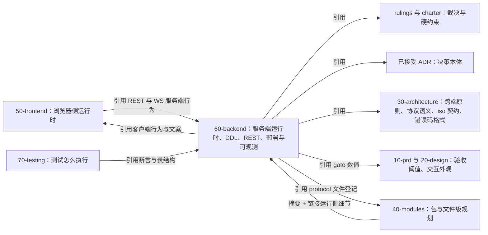
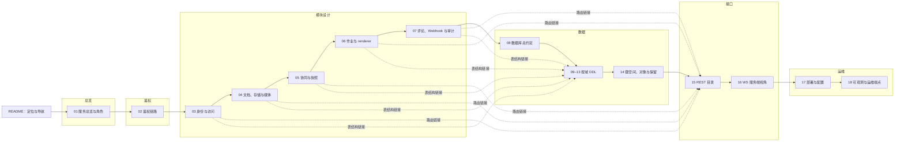

# 60 后端设计线：定位、边界与导航
> 状态：v0.1 | 负责：后端设计线 | 更新：2026-09-25；2026-09-25（§4.19）；2026-09-25（§4.19 N1）；2026-09-25（审稿） | 依赖：charter §7、§8、§9.2；rulings §4.11–§4.19；30-architecture/README；40-modules/README；30-architecture/08 §0；40-modules/19

## 1. 定位

`docs/60-backend/` 是**后端运行时设计的唯一事实源**，覆盖：`apps/server`（NestJS 11 + Fastify）、`@cordexjs/server-collab`、`@cordexjs/server-storage`、`@cordexjs/server-headless`、renderer sidecar，以及 PostgreSQL 18、Valkey、SeaweedFS 三类存储上的全部结构与约定。它与 [50-frontend](../50-frontend/README.md)、[70-testing](../70-testing/README.md) 并列，各管一侧、互不覆盖（三线总边界表见 [docs/README.md](../README.md)）。

**口径链**（冲突时自左向右取前者）：rulings（§4.11–§4.19，后者覆盖前者；§4.19 已登记三条设计线各为该侧唯一事实源）> charter > 已接受 ADR > 30-architecture 正文 > **50 / 60 / 70** > 40-modules（包与文件级）> PRD / 设计的既定口径。其中验收阈值与检查名以 PRD 为准、测试如何执行以 70 为准。

**与 30、40 的分工**：[30-architecture/08](../30-architecture/08-backend-nestjs.md) 收缩为跨端原则——Nest 薄壳、cordis 宿主内嵌、fail-closed 双点、驱动放行、文档类型盲——其余运行侧细节由本线承接并在原处改为「摘要 + 链接」（清单见 §6）；40-modules 保留包目录树、逐文件职责、扩展缝、测试文件清单与机械约束，它的服务端 §1、§2、§6、§7 与「Nest 模块定义表」改为链接本线。

**图 1-1 事实源边界**



怎么读：箭头从「引用方」指向「被引用的事实源」；60 只向上引用裁决、ADR、30 正文与 PRD 阈值，向下被 40 与 70 引用；50 与 60 互相引用对方的一侧行为，但不复制对方内容。
依据：计划 ownership「口径链」「30-architecture 保留」「40-modules 保留」三条；charter §9.2。

---

## 2. 本线拥有 / 本线引用

**本线拥有**（这些内容只在本线出现，其他文档只能链接）：

| 主题 | 文件 |
|---|---|
| Nest 模块清单、`CORDEX_ROLE` 语义、「模块 × 角色 × 部件」装配矩阵、启动断言、反代路径到角色、imports 总图、cordis 宿主生命周期、进程启动与优雅关闭、驱动放行取值、服务端预算 target | [01](01-service-overview-and-roles.md) |
| 鉴权链路：OIDC RP、会话 cookie 与吊销、CSRF 与 WS Origin、collab ticket、分享链接解析与 WS 链接角色重算、RLS 上下文；请求头名 `X-Cordex-Request`、`X-Cordex-Share-Token` | [02](02-auth-chain.md) |
| 模块设计卡（用例、事务边界、抛出的错误码、角色装配、purge 参与者、Clock 注入点） | [03](03-modules-identity-and-access.md)–[07](07-modules-comments-webhooks-audit.md) |
| 永久删除文档编排（单作业 + `@PurgeParticipant`） | [04](04-modules-documents-storage-media.md) |
| Room 生命周期、持久化、两级溢写与回放、准入、压缩、墓碑 TTL 与 tombstone-sweeper、元素彻底删除、server-collab 契约 | [05](05-modules-collab-and-snapshots.md) |
| 队列总表、周期作业清单、server-headless、renderer sidecar 进程与 RPC | [06](06-modules-jobs-import-export-thumbnails.md) |
| 评论镜像、Webhook、审计，以及**审计 action 全量登记表** | [07](07-modules-comments-webhooks-audit.md) |
| 数据库总约定、DB 角色与 GRANT、RLS 框架、迁移编号与顺序、`policy/rls-exceptions.json` 的内容 | [08](08-db-conventions-roles-rls-migrations.md) |
| 全部 DDL（建表、约束、索引、RLS policy、函数、COMMENT）与按域 ER 图 | [09](09-ddl-identity-and-access.md)–[13](13-ddl-comments-webhooks-audit.md) |
| Valkey 键空间、对象存储桶与键布局、数据保留总表 | [14](14-valkey-object-storage-and-retention.md) |
| REST 路由总表（全后端唯一路由源） | [15](15-rest-api-catalog.md) |
| WS 服务端处理：门禁 L1–L4、ack 发出规则、关闭触发条件、限额数值、扇出语义 | [16](16-ws-protocol-server-view.md) |
| 部署拓扑、web 容器（静态前端 + 反代、nonce 生成）、镜像、配置 schema 全字段表 | [17](17-deployment-and-config.md) |
| 服务端 span 与**指标统一名表**、告警与 SLO、健康探针、`/telemetry/*` 与内部端点的处理细则（限流数值、体积上限、运维令牌、内部端口实例；路由本身登记在 15） | [18](18-observability-and-ops-endpoints.md) |

**本线引用**（本线只链接，不复写）：

| 主题 | 事实源 |
|---|---|
| WS 帧类型、CONTROL 判别联合、ack 语义、关闭码表 | [30-architecture/06 §6](../30-architecture/06-collaboration.md) |
| Room 七态图（照抄源，CO-13） | [30-architecture/06 §5.2](../30-architecture/06-collaboration.md) |
| 错误码格式、域清单、HTTP / WS 映射 | [30-architecture/10 §1](../30-architecture/10-observability-and-errors.md) |
| 日志字段与脱敏规则、事件命名规则与公开事件定稿 | [30-architecture/10 §2–§3、§11.1](../30-architecture/10-observability-and-errors.md) |
| iso 契约本体（DocumentStore、StoreOp、中性撤销、OfflineStore 签名等） | [30-architecture/04](../30-architecture/04-document-model.md)、[05](../30-architecture/05-command-and-history.md)、ADR-0007、ADR-0020 |
| `@cordexjs/protocol` 文件清单与路径登记 | [40-modules/02](../40-modules/02-kernel-protocol-and-document-core.md) |
| 服务端包与应用的目录树、逐文件职责 | [40-modules/08](../40-modules/08-server-identity-documents-and-storage.md)、[09](../40-modules/09-server-collab-gateway-and-headless-host.md)、[12](../40-modules/12-server-jobs-comments-and-ops.md) §4–§5；进程入口 `main.ts`、根模块 `app.module.ts` 与 `observability/`、`redis/`、`db/`（含 `db/schema/*.ts`、`db/migrations/*.sql`）在 12 §4.13、§5.13（迁移内容仍以本线 08–13 为准） |
| 浏览器会话状态机、重新登录、CSRF 头附加、分享链接落地 | [50-frontend/02](../50-frontend/02-app-shell-routing-and-session.md) |
| 客户端协同 Session FSM、在途 FIFO、离线队列、连接 UI | [50-frontend/07](../50-frontend/07-collaboration-client.md) |
| `/render` 页、注入协议与 ready 判据 | [50-frontend/12](../50-frontend/12-viewer-embedding-and-render-page.md) |
| CSP 策略正文、Trusted Types | [50-frontend/14](../50-frontend/14-client-security.md) |
| 错误码到用户文案与建议动作 | [50-frontend/15](../50-frontend/15-events-errors-and-telemetry.md) |
| 测试层级、夹具、CI 步骤、阈值判定 | [70-testing](../70-testing/README.md) |
| 验收阈值（gate）与检查名定义 | [10-prd](../10-prd/README.md) |

---

## 3. 文件清单与阅读顺序

建议顺序：01 总览 → 02 鉴权链路 → 03–07 模块设计 → 08 数据库总约定 → 09–13 DDL → 14 键空间、对象与保留 → 15 REST → 16 WS → 17 部署与配置 → 18 可观测。实现某个模块时，先读它的模块卡（03–07），再按卡里的链接跳到对应的 DDL、路由小节与键模板。

| # | 文件 | 一句话职责 | 主要依赖 | 首次交付 |
|---|---|---|---|---|
| 01 | [服务总览、进程角色与 cordis 宿主](01-service-overview-and-roles.md) | 模块清单、角色矩阵、启动断言、反代分流、宿主生命周期、预算总览 | 30/08 §0、ADR-0037 | M2 |
| 02 | [鉴权链路](02-auth-chain.md) | OIDC、会话、CSRF、票据、分享链接、RLS 上下文的端到端链路 | ADR-0029、01 | M2（会话、票据、RLS 上下文）/ M3（分享链接；security-rls 阻断） |
| 03 | [模块：身份与访问](03-modules-identity-and-access.md) | Auth、Users、Permissions、ShareLinks 的模块卡；模块卡模板首次定义于此 | 02、09、15 | M2 / M3 |
| 04 | [模块：文档、存储与媒体](04-modules-documents-storage-media.md) | Documents、Storage、Media；永久删除文档编排唯一源 | 10、14、15 | M2 / M3 |
| 05 | [模块：协同与快照](05-modules-collab-and-snapshots.md) | Collab、Snapshots、server-collab 契约；Room、溢写、准入、墓碑 | 30/06、11、16 | M2（网关、Room、持久化、auto 快照、`snapshots/latest`）/ M3（版本历史与恢复、元素彻底删除） |
| 06 | [模块：作业、导入导出、缩略图与 renderer](06-modules-jobs-import-export-thumbnails.md) | 队列总表、周期作业、server-headless、renderer RPC | 12、14 | M2（作业骨架、导入、创建副本、包内封面）/ M3（导出、renderer） |
| 07 | [模块：评论镜像、Webhook 与审计](07-modules-comments-webhooks-audit.md) | 评论读模型、Webhook 投递与 SSRF、审计哈希链与 action 登记表 | 13 | M3 |
| 08 | [数据库总约定](08-db-conventions-roles-rls-migrations.md) | 命名、DB 角色与 GRANT、RLS 框架、迁移编号与顺序 | ADR-0022 | M2 |
| 09 | [DDL：身份与权限](09-ddl-identity-and-access.md) | users、user_identities、permissions、document_perm_versions、share_links 与 SECURITY DEFINER 函数 | 08 | M2 / M3 |
| 10 | [DDL：文档、用户记账与媒体](10-ddl-documents-marks-media.md) | documents、document_user_marks、media_blobs、document_media | 08 | M2 / M3 |
| 11 | [DDL：协同更新与版本快照](11-ddl-collab-updates-and-snapshots.md) | document_updates（16 个哈希分区）、document_snapshots | 08 | M2 |
| 12 | [DDL：作业与缩略图](12-ddl-jobs-and-thumbnails.md) | job_runs（幂等列）、thumbnails | 08 | M2 |
| 13 | [DDL：评论、Webhook 与审计](13-ddl-comments-webhooks-audit.md) | comments、webhook_subscriptions、webhook_deliveries、audit_log（按月分区） | 08 | M2（建表、审计写入）/ M3（评论与 Webhook 写入） |
| 14 | [Valkey 键空间、对象存储与数据保留](14-valkey-object-storage-and-retention.md) | 键模板唯一登记表、两个桶的键布局、保留期与清理方式总表 | 08–13 | M2 / M3 |
| 15 | [REST API 目录](15-rest-api-catalog.md) | 全部路由：角色、守卫、DTO、错误码、审计、限流、里程碑 | 02–07 | M2 / M3 |
| 16 | [WS 协议（服务端视角）](16-ws-protocol-server-view.md) | 握手、门禁、ack、关闭、限额、扇出的服务端处理 | 30/06 §6、05 | M2 |
| 17 | [部署拓扑与配置 schema](17-deployment-and-config.md) | compose、web 容器、镜像、配置全字段表、迁移作业与备份 | 01、ADR-0037 | M2 / M3 |
| 18 | [可观测性与运维端点](18-observability-and-ops-endpoints.md) | 日志、span、指标统一名表、告警、探针、遥测与内部端点 | 30/10、01 | M2 / M3 |

**图 3-1 后端设计线文件地图**



怎么读：实线是建议阅读顺序，分组框是六类内容；虚线表示模块卡只链接路由与 DDL，不复写。09–13 五份 DDL 在图中合为一个节点。
依据：本节文件表；计划 ownership「REST」「数据」两条。

---

## 4. 关键口径速查

| 口径 | 内容 | 出处 |
|---|---|---|
| 部署边界 | 单组织、无租户：数据模型、API、权限、对象键、日志都没有 tenant | rulings §4.15 T-0 |
| 身份 | 外置 OIDC，compose 可选 Casdoor；IdP 与对象存储经反代子域 `idp.` / `s3.` 暴露（保持 Host）；首次登录 JIT 建 `users` + `user_identities`；跨 issuer 同邮箱不自动关联；`auth.selfSignup` 默认关；无邀请表 | rulings §4.15 Q6、§4.17 D1、§4.18 BE-01；决策 OIDC-LINK |
| 会话 | `cordex_session`（ES256 JWT 15 min，含 sid）+ `cordex_refresh`（7 天，轮换，只存哈希）；Valkey `session:{sid}` 支撑 ≤ 5 s 吊销；JWT / API Key 在 M4 | 决策 SESSION；rulings §4.15 Q6 |
| CSRF 与 Origin | 非安全方法：Origin 白名单 + `X-Cordex-Request: 1`；WS 升级校验 Origin | 决策 INC-24；PRD SV-12 |
| 分享链接 | 要求登录；URL 片段携带令牌，API 只收 `X-Cordex-Share-Token`；解析归 `PermissionsModule`；WS 会话按 `max(直接授权, 有效链接)` 重算，撤销 ≤ 1 s 降权、到期主动降权 | rulings §4.13 S-1、§4.18 BE-02；决策 INC-25、INC-20 |
| 里程碑 | 协同网关、Room、update 持久化与快照、服务端导入、创建副本在 M2；M2 起文档内容只以协同快照为事实源，不设 pptx 内容版本；M3 为多人协同体验层（在场、评论、权限细化、版本历史与恢复、服务端缩略图与 PDF、导出、Webhook）；总表见 [01](01-service-overview-and-roles.md) §3 | rulings §4.19 D-M2-CONTENT |
| 协同 | Yjs 13.6.x；两级 ack（`tier:'spill'` / `tier:'db'`，只有后者清 pending）；PG 降级期照常广播并推 `room.persist`（PG 写失败 ≤ 1 s 推 `degraded`，回放完成且无溢写推 `ok`）；锁定经 `room.locked` 通知；30 s 离线判据在客户端；SYNC 写入门槛 ≥ commenter、评论路径 `resources['comments.threads']` | rulings §4.15 Q3、S-3a，§4.18 CO-08、UX-03，§4.19 INC-09、D-COMMENTS-PKG |
| 删除 | 墓碑 TTL（默认 24 h）+ `tombstone-sweeper` 租约单写者；元素彻底删除只对墓碑态、只 owner、写审计；永久删除文档 = 单作业 + `@PurgeParticipant` 七个参与者（collab 只依赖 Pg 存储）+ finalize 清两个桶全部版本与溢写键 | rulings §4.15 Q3、§4.18 CO-07、BE-15 |
| 保留 | auto 快照 30 天全量、之后每天留最后一个至 `retention.autoSnapshotDailyDays`（默认 365，0 = 永久）；事件快照同口径，每文档最新 import 快照保留；named 永久、每文档 ≤ 200 | rulings §4.19 C-06；决策 C-07 |
| renderer | 零出站、只接受注入（无 `/render` 拉取端点）、无凭据、非 root、沙箱；worker → renderer 用 Ed25519 签名 RPC | rulings §4.18 BE-04、BE-14；决策 SG-01 |
| 角色 | `CORDEX_ROLE ∈ {all, api, collab, worker, renderer}`；快照 REST 与管理动作只在 collab；周期作业只在 worker | rulings §4.15 Q10、§4.18 BE-03、BE-13、BE-19 |
| 存储 | PG 18（文档级 RLS，三个 DB 角色，不用 BYPASSRLS 做业务）；Valkey（noeviction）；SeaweedFS 两个桶 `data` 与 `snapshots`（后者开版本化） | rulings §4.15 Q10；决策 DB-ROLES、RLS-GUC、C-08/OBJ、VALKEY-DEPLOY |
| 错误码 | 配额三码 `format.` / `document.` / `storage.quota_exceeded`；导入拒绝 `format.encrypted`、`format.macro_rejected`；服务端域 `server.<资源>` | rulings §4.16 Q15、§4.17 D2；决策 INC-10 |
| 命名 | 审计 action `<resource>.<snake_action>`（登记表在 07）；指标 `cordex_<subsystem>_<name>_<unit>`（统一名表在 18） | 决策 INC-31/INC-29、METRICS |

---

## 5. 书写约定

- 每份文件首行标题、第二行状态行 `> 状态：v0.1 | 负责：后端设计线 | 更新：<日期> | 依赖：<上游>`；中文正文，英文标识符。
- **DDL** 一律写在 ```` ```sql ```` 围栏里，首行为 `-- migrate: NNNN_<name>`（可执行，由 `docs/_tools/ddl-check` 按编号在 PG 18 容器中顺序执行）或 `-- example`（只做语法解析）。迁移编号全线唯一，按计划 ownership 分配：08 占 0001–0009、0095–0099；09 占 0010–0019、0030–0039、0090；10 占 0020–0029、0050–0059、0091；11 占 0040–0049、0092；12 占 0060–0069、0093；13 占 0070–0079、0094。
- 表名、列名、Valkey 键模板、对象键前缀、路由、配置键、审计 action、指标名**以本线为准**；其他文档出现不同写法时以本线为准回改对方。
- 每份文件末尾设「机械验证」小节，只写断言（what）并注明 70 的套件或 CI 步骤名；不新增扫描器（上限 14）与 CI job（13 个封闭集合），新检查只能是既有扫描器子规则、lint 规则、既有 job 的步骤或 `docs/_tools` 脚本。
- 已定决策（needsUser=false）与 rulings 已裁定项直接写结论并注明「依据：决策 id + authority」；仍需用户确认的项按推荐写，段首标「待确认（总编排）：<决策 id>」，裁定后改为定稿并删去标注（本轮按 rulings §4.19 清理，剩余项见 §8.1）。
- 图用 Mermaid（绘图规范见 [_tools/README](../_tools/README.md)），每图上一行加粗图名、下一行「怎么读」，必要时加「依据」；写完运行 `mermaid-check` 要求 0 invalid。

---

## 6. 迁入与回写清单

本线迁入的内容在原处改为「摘要 + 链接」，由总编排在全部写作组完成后统一执行（本线各文件只写新内容，不改其他文档）。格式「原处 → 处理 → 本线文件」。

| 原处 | 处理 | 本线文件 |
|---|---|---|
| 30-architecture/08 §0 | 保留一页总览与跨端原则；角色矩阵引用改指本线 | 01 |
| 30-architecture/08 §1 模块图、§4 宿主生命周期映射 | 摘要 + 链接 | 01 |
| 30-architecture/08 §2 `apps/server` 目录树 | 目录树已删；模块目录链接 40-modules/08、09、12 §4，原树中不属于任何业务模块的进程入口、根模块与 `observability/`、`redis/`、`db/` 收口登记到 40-modules/12 §4.13（2026-09-25 审稿，01 §3 与 08 §10.1 的「文件级」引用随之改指）；运行侧链接本线 | 01、08 |
| 30-architecture/08 §3 `server-*` 包契约 | 目录链接 40-modules/09 §4；契约改指本线 | 05（server-collab）、04（server-storage）、06（server-headless） |
| 30-architecture/08 §5 数据模型（SQL 草案与 ER 图） | 删除草案，只留一句与链接 | 08–13 |
| 30-architecture/08 §6 对象存储布局 | 迁入 | 14 |
| 30-architecture/08 §7 任务队列 | 迁入 | 06 |
| 30-architecture/08 §8 网关横向扩展 | 摘要 + 链接（ADR-0035 仍是决策） | 05 |
| 30-architecture/08 §9.1 / §9.2 / §9.3 / §9.4 | 分别迁入 | 02 / 06 / 15（限流）与 17（配额配置）/ 02 与 17 |
| 30-architecture/08 §10 部署拓扑与 compose | 迁入 | 17 |
| 30-architecture/08 §11 与 protocol 的对应 | 文件登记链接 40-modules/02；删 `collab/control.ts` 行（决策 INC-01） | 15、16 |
| 30-architecture/08 §12 预算与测量 | 迁入 | 01 §12、18（指标） |
| 30-architecture/08 §16.2–§16.6 | §16.2、§16.3 → 06；§16.4 → 04；§16.5 → 05 与 16；§16.6 → 07；§16.1 对齐表保留 | 04–07、16 |
| 30-architecture/06 §5.2 Room 状态机 | 保留（CO-13 照抄源），加注「服务端机制见 60/05」 | 05 |
| 30-architecture/06 §6.4 服务端发 ack 规则与溢写回放 | 摘要 + 链接（客户端在途 FIFO 与 step2 拆块归 50/07） | 16、05 |
| 30-architecture/06 §7.1 服务端 relay 与满员合并 tick；§9.1 / §9.3 服务端限额；§11 服务端校验 | 摘要 + 链接（ADR-0034 仍是决策） | 16 |
| 30-architecture/06 §10 权限即时生效 | 保留 D12 原则一段；服务端传播链路迁入 | 02 |
| 30-architecture/06 §14 预算汇总 | 服务端部分摘要 + 链接 | 01 §12 |
| 30-architecture/07 §10 服务端 headless 渲染；§14.7 PDF | 摘要 + 链接（/render 页与 ready 判据归 50/12） | 06 |
| 30-architecture/10 §2.4 Sink Provider；§3.2 / §3.3 服务端 span 与 metric；§4 诊断；§5 客户端错误上报的端点部分 | 迁入（命名规则与脱敏规则留 30/10） | 18 |
| 30-architecture/02 §3.2 `apps/server`；§4.22–§4.24 三个 `server-*` 包 | 保留包级定位；运行细节改指本线 | 01、05、04、06 |
| 40-modules/08 §1.2–§1.3、§2、§3 Nest 模块定义表、§6、§7 | 摘要 + 链接 | 02、03、04、09、10、15 |
| 40-modules/09 §2、§3.3、§3.4、§6、§7.1–§7.3 | 摘要 + 链接（§3.1–§3.2、§4、§5、§9 保留） | 05、11、16、01、08 |
| 40-modules/12 §2、§3、§6、§7.1（矩阵）、§7.2、§7.3 | 摘要 + 链接；§7.1 矩阵整体迁入 | 06、07、12、13、18、01、08 |
| 40-modules/19 §1–§8 | 每节首加「事实源：60/xx，冲突以其为准」；§9 并入本 README §8 | 01、02、05、06、08–14 |
| 40-modules/00-module-map §5 前后端切分 | 链接 | 01 |
| ADR-0037 决策 1、charter §5.2 `apps/server` 行 | 矩阵引用改指本线（BE-13 内容不变；落点迁到 01 的依据是 rulings §4.19「三线各为该侧唯一事实源、重复段落改为引用」） | 01 |
| PRD 06 SV-08 配额表 | 保留产品口径；默认值链接本线 | 17 |

---

## 7. 机械验证总表

各文件「机械验证」小节的汇总；「落地方式」只取既有机制：既有 CI job 的步骤、既有扫描器子规则、lint 规则或 `docs/_tools` 脚本。

| 文件 | 断言 | 落地方式 |
|---|---|---|
| 01 | 逐角色装配与矩阵一致、启动断言负向用例；优雅关闭零丢失 | `test/server-integration`（role-assembly） |
| 01 | Nest 模块无环、驱动只在放行位置 | `depcruise` |
| 01 | 反代分流、探针与内部端点不经反代、edge 连不上 9464 | `e2e/full-compose` |
| 01 | 服务端 gate 与 `budgets.json` 一致 | `perf/perf-server`、`perf/perf-collab` |
| 02 | 路由鉴权覆盖、跨源 POST 403、跨源 WS 升级被拒、票据重放 4401、停用 ≤ 5 s 失去会话、只凭链接的用户 200、撤销 ≤ 1 s 与到期降权 | `test/server-integration`；链接会话三场景另在 `test/contract`（`runCollabServerConformance`） |
| 02、08–13 | 绕过应用层直连 PG 被 RLS 拒绝（角色 × 表 × 操作矩阵） | `e2e/smoke`（security-rls） |
| 03、04 | 最后 owner / admin 并发保护；擦除后无身份行且会话失效；永久删除后无 update 落库、两个桶无版本残留、中途失败重试一致；跨文档取媒体 404；M-08 仓储不写 M-09 列 | `test/server-integration` |
| 05、16 | Room 与门禁场景（step2 空 diff 回 db ack、PG 断开照常广播并推 persist、先回收空闲房间、purging 拒绝加入、epoch 4428）；关闭码全表；CONTROL schema 快照 | `test/contract`（`runCollabServerConformance`、heartbeat-and-close-codes） |
| 05 | 集群集成：降级互见、回放无重复、第 21 个编辑者准入原子性 | `test/server-integration` |
| 06 | 幂等（并发同键一行、失败后得新行）、取消不留原件、未签名 RPC 被拒 | `test/server-integration` |
| 06 | 两种模式下 `/render` 网络请求为 0 | `e2e/smoke`（renderer-egress） |
| 06 | 浏览器与 Node 导出同一快照的 sha256 相等 | `test/fidelity-roundtrip` |
| 07 | 镜像 ≤ 1 s、HMAC 验签、重试与死信、SSRF 拒绝私网、审计只追加与链校验、分区轮换后可续验 | `test/server-integration` |
| 08 | 迁移按编号在 PG 18 中全部执行通过 | `docs/_tools/ddl-check` |
| 08 | 迁移 SQL 文件须与文档逐字一致：`apps/server/src/db/migrations/` 的文件集合、文件名与内容等于 08–13 的围栏（**待实现**） | `docs/_tools/ddl-check` 实现期扩展（08 §11 第 6 条、DB-13） |
| 08 | 启用 RLS 的表清单与例外清单一致 | `scanners`（`check-rls-coverage`） |
| 08 | drizzle schema 与 DDL 一致；GRANT 快照 | `test/server-integration` |
| 14 | 键名只由 `redis-keys.ts` / `keys.ts` 生成且与登记表一致；BlobStore 契约覆盖按版本删除与反代 Host | `test/unit`、`test/contract`（`runBlobStoreConformance`） |
| 15 | 路由表快照、能力位矩阵、OpenAPI 快照、route-auth-coverage、CSRF、限流与体积 | `test/server-integration` |
| 15 | 已删除端点的路径字面量不再出现 | `lint`（`no-restricted-syntax`） |
| 15 | 路由错误码均已声明且 http-map 与 15 §7 一致 | `test/contract` |
| 17 | 配置 schema 快照 | `test/unit` |
| 17 | 一条命令起栈、断网全链路、镜像许可与 digest、nonce 每响应不同 | `e2e/full-compose`、`e2e/full-airgap`、`scanners`（`check-image-policy`） |
| 18 | `/readyz` 依赖故障返回 503；遥测端点 401 / 413 / 429 | `test/server-integration` |
| 全部 | Mermaid 图通过绘图规范 | `docs/_tools/mermaid-check.cjs` |

---

## 8. 待决与待确认

### 8.1 已由 rulings §4.19 裁定的项与仍待确认的项

**已裁定**（原按推荐写入的三项与本线相关的另两项，2026-09-25 全线回填；补完阶段分诊出的 N1 同日由用户裁决并回填；文中「待确认」标注已删除）：

| 决策 | 裁决 | 本线落点 |
|---|---|---|
| D-M2-CONTENT | 协同网关、Room、update 持久化与快照、服务端导入从 M3 提前到 M2；M2 起内容以协同快照为唯一事实源，不设 pptx 内容版本端点；M3 保留多人协同体验层 | 01 §3（里程碑总表）、04 §3.3（改为创建副本）、05 §3.2、06、07 §9、08 §9、11–16、17 |
| INC-09 | `CONTROL.room.persist` 为服务端显式信号（PG 写失败 ≤ 1 s 推 `degraded`，回放完成且无溢写推 `ok`）；受众分级在客户端 | 05 §6.1、16 §3、18 §4.2 |
| C-06 | auto 30 天全量、之后按天保留最后一个至 `retention.autoSnapshotDailyDays`（默认 365，0 = 永久）；named 永久、每文档 ≤ 200；事件快照按 auto 口径，每文档最新 import 快照随文档 | 11 §8、14 §8、15 §3.8、17 §5、04 §7.4（媒体关联裁剪避开受保护 import 快照） |
| D-COMMENTS-PKG | 评论客户端为 iso 包 `@cordexjs/comments`，ResourceHook `comments.threads`；本线的评论路径统一写 `resources['comments.threads']` | 05 §13、07 §1、13 §2、16 §4 |
| D-TEST-INFRA | 协同与服务端压测的自托管专用 runner 在 M2 前落地 | 01 §12、05 §6.2、06 §6.3、17 §5.10（阈值在该 runner 上校准） |
| N1-IMPORT-OVERWRITE-RESTORE-LOCK | 恢复不锁、覆盖导入换纪元：版本恢复是持有 Room 的 collab 进程内单事务、不加锁、在线不断连；覆盖既有文档的导入期间文档 `locked`，worker 写 `epoch + 1` 的 `import` 快照并经 `room:{docId}:ctl` 通知，在线会话 4428 后重新 bootstrap，未获 db 确认的更改移入 `rejected` 可导出；不新增 worker → collab 通道；锁 `reason` 只剩 `import`、`migration` | 06 §6.5、05 §3.3 / §9.2 / §10、04 §2–§3 / §5 / §8、02 §9.3 / §11、07 §9、10 §2（`documents.epoch` 列注释）、11 §7.2、14 §3.1、15 §3.9（导入受理 409 `server.documents.locked`）、16 §8 / §10 |

**仍待确认**：

| 项 | 所在 | 说明 |
|---|---|---|
| 待确认（总编排）：WS 升级限流「先扣后退」 | 16 §1 | 认证成功是否退还按 IP 的升级额度，兼顾 NAT 出口下的集体重连 |

### 8.2 已按权威定稿的后端相关决策

以下决策 needsUser=false，本线各文件直接按结论写并注明「依据：决策 id + authority」。

| 决策 | 结论（一句话） | 落点 |
|---|---|---|
| INC-02、INC-03/04/05、INC-06、INC-07 | CONTROL 成员与判别键统一 `type`；关闭码补 1011、4427、4428（epoch）；单帧上限名 `maxUpdateBytes`、速率 `msgRateHz` / `msgBurst` | 16、05 |
| INC-10/SG-04、INC-11/INC-13 | 错误码域 `server.<资源>` 一次登记；problem+json 与 protocol `rest/*` 文件清单 | 15 §1、§7，03–07 |
| INC-18、INC-20、INC-21、INC-22、SG-03、SG-05、SG-06/SG-07、SG-08、SG-10、MECH-INC | 路由形态决定（OIDC 302、链接令牌直通、媒体文档作用域、永久删除与擦除入口、评论只读、用户搜索收紧、pin / recent、唯一作业状态查询、缩略图尺寸参数等） | 15 §9 |
| INC-24、INC-25、INC-26、INC-27、SESSION、OIDC-LINK | CSRF 与 Origin；分享令牌只走请求头；内部端口 + 运维令牌；`auth.refresh` 携新票据；会话 cookie 与 Valkey 吊销；跨 issuer 不自动关联 | 02、15、16、18 |
| RLS-GUC、DB-ROLES、C-21、FK-POLICY | GUC 与辅助函数、三个 DB 角色、RLS 表与例外清单、外键默认 RESTRICT | 08–13 |
| C-01、C-03、C-07、C-24、C-25、C-20/G-13/G-14、DDL-COLS、MECH-C | 表结构修正（明文邮箱列、documents 列级写方、基线复制、擦除原地脱敏、媒体引用 GC 起算点、审计链与分区、缺列补齐等） | 09–13、04、07 |
| KEYS、C-11、SPILL、VALKEY-DEPLOY、C-08/OBJ、RETENTION、G-09 | 键模板与前缀、名额 Lua 原子判定、溢写阈值、Valkey 部署参数、两个桶与对象键、保留期配置键与周期作业、按 owner 统计配额 | 14、05、06、17 |
| SG-01、CSP-NONCE、TT-CSP-REPORT、C-16/INC-30 | renderer 签名 RPC；nonce 由 web 容器每响应生成；CSP 上报端点；Webhook 密钥加密存储 | 06、17、18、07 |
| METRICS、INC-31/INC-29 | 指标统一名 `cordex_<subsystem>_<name>_<unit>`；审计 action `<resource>.<snake_action>`；Webhook 事件名 | 18、07 |
| INC-37、T-DETERMINISM、T-DB-ISOLATION | 里程碑口径已被 rulings §4.19 D-M2-CONTENT 覆盖（协同后端提前到 M2，见 01 §3）；服务端 Clock 端口 `shared/clock.ts`；测试数据库按模板克隆、用非属主角色 | 01、03–07、70/07 |
| SESSION 的实现细化（本线提出，效果不变） | 停用、擦除、登出对 WS 的作用统一由每 5 s 批量会话复核以 4401 实现，删去控制频道的 `kick` 操作（`room:{docId}:ctl` 只剩 `close`、`epoch`）；吊销仍 ≤ 5 s 同时作用于 REST 与 WS，无需按房间点名 | 02 §9.5、05 §3.3、14 §3、16 §10 |
| BE-10 的细化（本线提出，意图不变） | JOB-IDEM：导入幂等键 `import:{docId}:{sha256}:{baseSeq}`；UPLOAD-QUARANTINE：导入直传落隔离区 `uploads/tmp/{uploadId}`、受理时服务端复制到原件键、`upload:{uploadId}` 不 `GETDEL`、导入 PUT 有效期等于 `uploadId` 寿命 1 h | 06 §2.3、§6.1，12 §8，14 §3、§5，15 §3.9，17 §5 |

### 8.3 仍开放的上游项

| 项 | 状态 | 本线处理 |
|---|---|---|
| U-07 version-restore-undo（版本恢复的撤销语义） | M-02 × M-05 × M-09 联合 ADR，未立项 | [05](05-modules-collab-and-snapshots.md) 只留占位与接口预留 |
| ADR-0037 决策 5 最低主机规格 | M3 前实测填入 | [17](17-deployment-and-config.md) 引用，不自填数值 |
| 溢写阈值（SPILL） | 已给默认值，在 M2 前落地的自托管 runner 上压测校准、只收紧（rulings §4.19 D-TEST-INFRA） | [01 §12](01-service-overview-and-roles.md#12-服务端预算总览) S21 |

### 8.4 本线写作中新提出、待总编排复核的项

| 项 | 所在 | 说明 |
|---|---|---|
| `server.http.*` 三码与原 15 §7 标「待登记」的其余码 | 15 §7 | 已按 INC-10 登记进 30-architecture/10 §1.1 与 http-map（rulings §4.19 回填）；命名版本上限码定为非配额码 `server.snapshots.named_limit_reached` |
| 限流档数值（ticket、search、public、job）与默认请求体上限 256 KiB | 15 §8 | default 与 upload 取自 30-architecture/08 §9.3，telemetry 与 csp 取自 18 §9.1，其余为新定默认，配置键归 17 |
| `DocumentsModule → JobsModule` 的 imports 边 | 01 §8 | schedule-purge 同事务写 `job_runs`，40-modules/08 §3 漏登；回写时补进 40 的 imports 列 |
| `UsersModule` 为叶子（`SessionStore` 放在其中）；票据签发控制器在 `AuthModule`，`DocumentsModule` 不 import `AuthModule` | 01 §8 I1、I2 | 与 03、04 的 imports 表一致；40-modules/08 §3 的 `DocumentsModule → AuthModule` 回写时删除 |
| `/auth/token/refresh`、`/auth/logout` 允许过期会话 JWT（`Session*`），不进 `@Public` 快照 | 15 §2、§4 | 须与 02 的会话机制一致 |
| 探针 `/healthz`、`/readyz` 不经反代 | 01 §7 | 安全宁可提前；17 的 web 容器配置须同步 |
| 启动断言退出码 78 / 70 的划分与 A10、A11 两条新断言 | 01 §6 | A11 依据决策 DB-ROLES，A10 依据决策 INC-26 |

---

## 9. 状态与变更记录

| 日期 | 版本 | 变更 |
|---|---|---|
| 2026-09-25 | v0.1（审稿） | 装配与数据库基础设施的文件级收口：30-architecture/08 §2 目录树删除后，`main.ts`、`app.module.ts`、`observability/`、`redis/`、`db/`（连接池、系统事务入口、迁移执行器、drizzle 类型镜像、迁移 SQL）登记到 40-modules/12 §4.13、§5.13；01 §3 的 `ObservabilityModule`、`DbModule`、`RedisModule`「文件级」列与 01、08 中「依据：30/08 §2、§4.1、§5」一类历史引用改指新位置；08 §10.1 写明迁移 SQL 文件须与文档逐字一致，§11 第 6 条与 §13 DB-13 登记 ddl-check 实现期扩展为对比 `db/migrations`（待实现）；`SystemJobName` 落点登记为 `db/system-jobs.ts` |
| 2026-09-25 | v0.1（§4.19） | 按 rulings §4.19 回填：协同网关、Room、持久化与快照、服务端导入提前到 M2（01 §3 里程碑总表），删除 pptx 内容版本全部设计；INC-09、C-06、D-COMMENTS-PKG、D-TEST-INFRA 定稿；新增创建副本（04 §3.3、06 §6.6、15 §3.3）；装配矩阵补 providers 格与 Http 模块拆分规则；collab purge 参与者只依赖 Pg 存储；删除 `compaction` 队列与 `kick` 控制操作；媒体读取改 200 JSON；RP-initiated logout；外键前导索引补齐并在 PG 18.6 重跑全部 DDL |
| 2026-09-25 | v0.1 | 新建后端设计线：README、01–18。01 的装配矩阵迁自 40-modules/12 §7.1（BE-13 内容不变、落点变更，补全局守卫行与 purge 参与者列）；15 以接口盘点的 59 条 REST 为底，按决策 INC-18、INC-21、INC-22、SG-03、SG-06/SG-07、SG-08、SG-10、MECH-INC 修正后定稿；三项待用户确认（C-06、D-M2-CONTENT、INC-09）按推荐写入并标注 |
