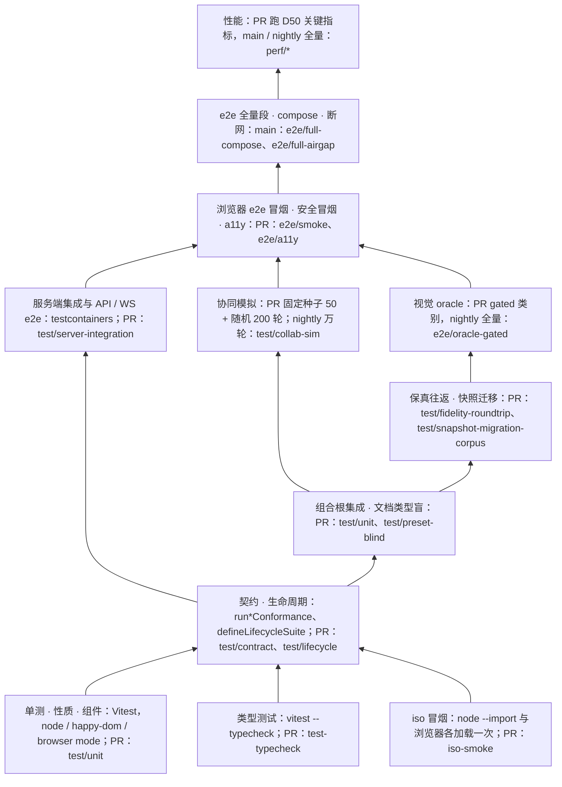
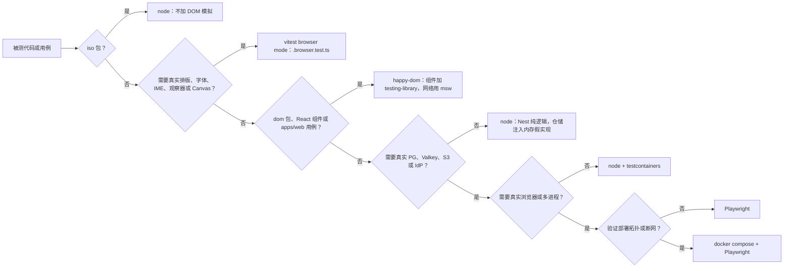
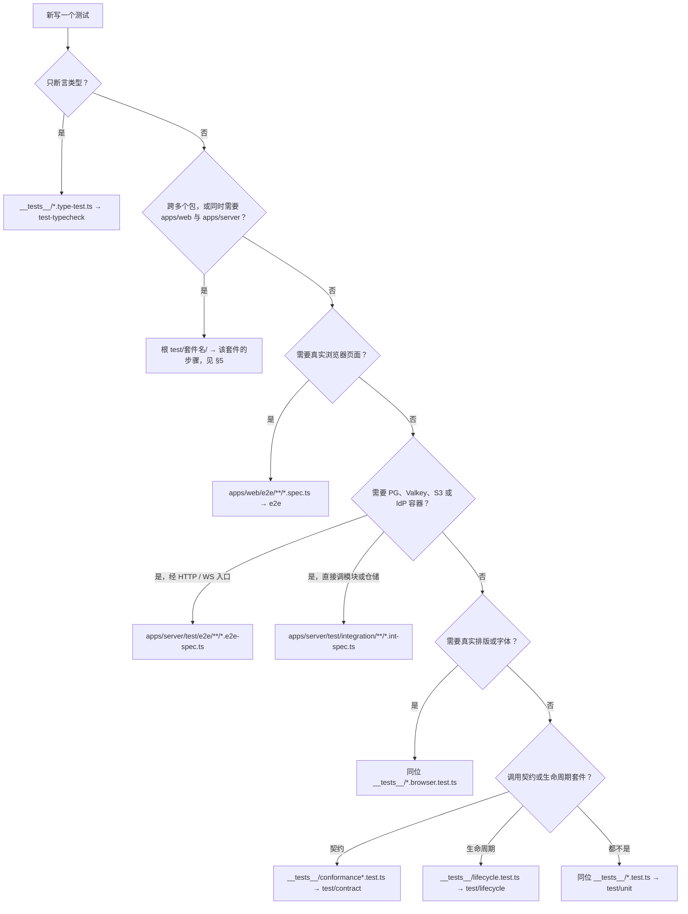
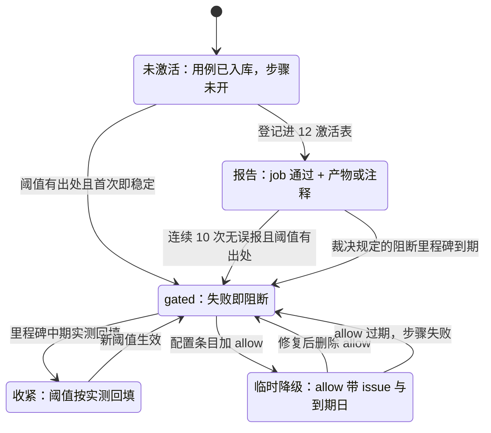

# 01 测试策略总览与分层职责
> 状态：v0.1 | 负责：测试设计线 | 更新：2026-09-25；2026-09-25（§4.19）；2026-09-26（§4.20） | 依赖：charter v0.2、rulings §4.15–§4.20、[30-architecture/11](../30-architecture/11-testing-strategy.md)、[09-06](../30-architecture/09-type-discipline/06-scanners.md)、[09-07](../30-architecture/09-type-discipline/07-hooks-and-ci.md)、[09-09](../30-architecture/09-type-discipline/09-plugin-type-contracts.md)、[ADR-0048](../30-architecture/adr/0048-type-testing-tooling.md)、PRD 04 NF-09

本文是测试侧的总纲：测试分几层、每层用什么工具、在什么环境跑、谁来写、何时跑、落在 13 个 CI job 的哪个步骤；测试文件叫什么、放在哪里（T-NAMING 在本文定稿，其余 70 文件与 50 / 60 的「机械验证」小节都按本文引用）；覆盖率、门禁分级与所有权。

读者：搭测试基础设施的工程师、每个包与 Nest 模块的实现者（知道自己必须交付哪些测试）、CI 维护者。

边界：被测对象（契约语义、状态机、表结构、协议字段）以 30 / 50 / 60 为准，本文只写「怎么验证、放在哪」；CI 的 job 名封闭集合与四条治理（存在、PR 触发、error 阻断、不可跳过）归 [09-07 §3](../30-architecture/09-type-discipline/07-hooks-and-ci.md#3-ci-工作流矩阵)，job 内的步骤表与激活时间线归 [12](./12-ci-gates-mapping.md)；数值阈值取 PRD，只引用不复制。

---

## 1. 目标与原则

30/11 保留跨端测试原则的原文，本文只引用，不复述：

| 原则 | 原文位置 | 本线的执行落点 |
|---|---|---|
| 金字塔：越往上越少、越慢、越接近真实部署 | [30/11 §0](../30-architecture/11-testing-strategy.md#0-金字塔与门禁一览) | 本文 §2 分层表 |
| 不 mock 内核，只 mock IO（transport、storage、fetch） | [30/11 §1](../30-architecture/11-testing-strategy.md#1-单元测试vitest) | 本文 §3；替身目录见 [11 §2](./11-test-data-fixtures-and-determinism.md#2-确定性工具目录) |
| 确定性：时间、随机数、id 一律可注入 | 30/11 §1 | [11 §1–§3](./11-test-data-fixtures-and-determinism.md#1-原则) |
| 契约即验收：Provider 以 `run<Definition>Conformance` 验收 | 30/11 §3 | [02](./02-contract-suites-and-pluggability.md) |
| 每条规则都有负向用例（lessons A17） | 30/11 §13 | 本文 §11 所有权矩阵、[40/01 §9](../40-modules/01-tooling-and-governance.md#9-测试布局) |
| 阈值只收紧（ratchet） | 30/11 §9、ADR-0040 | 本文 §10；性能见 [09](./09-performance-and-capacity.md) |

本线在上述原则之外只加四条执行口径：

1. **被测对象不在本线定义**。50 / 60 每份文档末的「机械验证」小节写「断言什么」，并注明本线的套件或 CI 步骤名；本线写「如何断言、放哪、何时跑」。
2. **「报告」有唯一定义**：job 通过，同时产出产物（HTML 报告、JSON、差异图）或 PR 注释。不存在 warn 级别的 job（与 09-07「全部规则为 error」相容）。依据：决策 T-PERF-GATE（PRD NF-01 / NF-09 + 09-07 §3）。
3. **失败必须可复现**：每个会失败的步骤都把复现所需的东西留成产物（随机种子、Playwright trace、diff 报告、容器日志）；复现命令见 [12 §12](./12-ci-gates-mapping.md)。
4. **跑在 PR 上**：除 nightly 专属的规模档（协同模拟万轮、oracle 全量、Keycloak）与 main 全量段外，每个门禁步骤都在每个 PR（含 draft）触发，不设分支白名单（lessons A16 / A18）。

---

## 2. 分层职责

**图 1-1 测试金字塔与各层运行时机**



怎么读：自下而上从底座到塔尖，越往上用例越少、越慢、越接近真实部署；每个节点写明内容、运行时机与 CI 步骤（`job/步骤`，步骤名以 [12](./12-ci-gates-mapping.md) 为准）。箭头表示「上层默认下层已绿」，不是执行依赖：13 个 job 在 PR 上并行运行。

依据：30/11 §0；rulings §4.18 GV-14（测试类别是 13 个 job 的步骤）、GV-16（安全冒烟进 PR）；决策 T-CI、T-PERF-GATE。

各层的职责（「谁写」指交付责任；「细则」列是该层的唯一展开处）：

| 层 | 目的 | 工具 | 运行环境 | 谁写 | 运行时机 | CI 步骤 | 细则 |
|---|---|---|---|---|---|---|---|
| 单测 | 纯函数、状态机、用例的确定性与边界 | Vitest | node / happy-dom / browser mode（§3） | 包与模块 owner | PR、本地 | `test/unit` | 本文 §3–§4 |
| 性质测试 | 纯度、幂等、往返、不变量 | fast-check（arbitraries 经 `@cordexjs/shared/testing`） | 同单测 | 包 owner | PR 默认轮数；nightly 放大轮数 | `test/unit` | [05 §10](./05-collab-simulation-and-property-tests.md) |
| 类型测试 | 类型契约的正向与负向 | `vitest --typecheck`、`expectTypeOf` | tsc | 包 owner | PR | `test-typecheck` | 本文 §7 |
| iso 冒烟 | iso 包在 Node 与浏览器都能加载 | `node --import`、vitest browser mode | Node 26、Chromium | 类型治理（清单）+ 包 owner | PR | `iso-smoke` | 本文 §6 |
| 契约 | Provider 满足 Definition | `run<Definition>Conformance` | node / browser | Definition owner 写 kit，Provider owner 调用 | PR | `test/contract` | [02](./02-contract-suites-and-pluggability.md) |
| 生命周期 | load、PENDING、unload、替换、多实例 | `defineLifecycleSuite` | node / happy-dom | 插件包 owner | PR | `test/lifecycle` | [02 §9](./02-contract-suites-and-pluggability.md) |
| 组件 | React 组件与视图模型的交互 | @testing-library/react、msw | happy-dom；需真实布局时 browser mode | 前端包 owner | PR | `test/unit` | [06 §2](./06-frontend-component-and-e2e.md) |
| 组合根集成 | preset 装配矩阵、apps/web 用例、文档类型盲 | Vitest + `createTestHost` | node / happy-dom | preset、apps/web owner | PR | `test/unit`、`test/preset-blind` | [02 §10–§11](./02-contract-suites-and-pluggability.md) |
| 服务端集成 | Nest 模块接真实 PG 18 / Valkey / SeaweedFS | Nest Testing、testcontainers | Node + Docker | 60 各模块 owner | PR | `test/server-integration` | [07](./07-backend-integration-and-api-e2e.md) |
| API / WS e2e | 经 HTTP 与 WS 的跨模块链路 | Nest 应用 + HTTP / WS 客户端 | Node + Docker | 60 owner | PR | `test/server-integration`；`smoke/` 子目录走 `e2e/smoke` | [07](./07-backend-integration-and-api-e2e.md) |
| 保真往返 | 零编辑部件级零差异；编辑后只改脏部件 | `diffPackage`（`@cordexjs/ooxml-core/testing`） | Node | M-04 + 测试线 | PR 跑 T1 子集与全部 gated 样本；nightly 全量 | `test/fidelity-roundtrip` | [03](./03-fidelity-roundtrip-and-corpus.md) |
| 快照迁移 | 历史版本快照可迁移且通过 schema | Vitest | Node | model-* owner | PR | `test/snapshot-migration-corpus` | [03 §11](./03-fidelity-roundtrip-and-corpus.md) |
| 视觉 oracle | 与 PowerPoint 基线的像素与结构对比 | Playwright、SSIM / IoU | Chromium + 字体 profile | 渲染线 + 测试线 | PR 跑 gated 类别；nightly 全量 | `e2e/oracle-gated` | [04](./04-visual-oracle.md) |
| 协同模拟 | 多客户端收敛与撤销语义 | `createCollabCluster`、`NetworkModel` | Node | 协同线 + 测试线 | PR 固定种子；nightly 万轮 | `test/collab-sim` | [05](./05-collab-simulation-and-property-tests.md) |
| 浏览器 e2e | 用户链路、只读变体、双浏览器协同、/render 页 | Playwright | Chromium（M2 起加 Firefox / WebKit） | 前端 + 测试线 | PR 冒烟子集；main 全量 | `e2e/smoke`、e2e 全量段 | [06](./06-frontend-component-and-e2e.md) |
| 可访问性 | axe、键盘、forced-colors | Playwright + axe-core | Chromium | 前端 | PR（激活见 12） | `e2e/a11y` | [06 §7](./06-frontend-component-and-e2e.md) |
| 部署 e2e | 角色装配、compose、断网、IdP 兼容 | docker compose、Playwright | 自托管洁净栈 | 后端 + 测试线 | role-assembly 在 PR；compose / 断网在 main；Keycloak 在 nightly | `test/server-integration`、`e2e/full-compose`、`e2e/full-airgap` | [08](./08-deployment-and-environment-e2e.md) |
| 性能 | 预算 gate 与相对回归 | Playwright trace、CDP、自写 WS 负载驱动 | 专用 runner | 测试线 + 产品 | PR 跑 D50 关键指标；main / nightly 全量 | `perf/perf-client`、`perf/perf-collab`、`perf/perf-server` | [09](./09-performance-and-capacity.md) |
| 安全 | RLS 绕过、零出站、CSRF、越权、注入 | 以上各层工具 | 同对应层 | 60 / 50 owner + 测试线 | PR（阻断时间线见 10） | `e2e/smoke`（security-rls、renderer-egress）及各层 | [10](./10-security-testing.md) |
| 规则负向夹具 | 每条 lint / 依赖 / 扫描规则确能失败 | rule-tester、夹具仓库 | Node | 类型治理 | PR | `lint`、`depcruise`、`scanners` | [40/01 §9](../40-modules/01-tooling-and-governance.md#9-测试布局) |
| 需求追溯 | P0 需求都有测试 | 扫描器 `scan-requirement-tags` + 矩阵判定脚本 | Node | 测试线 | PR | `scanners`、`test/requirement-matrix` | [13](./13-requirements-traceability.md) |
| 覆盖率 | 改动行与分支覆盖 | Vitest v8 coverage | — | 全体 | PR | `coverage-patch` | 本文 §8 |

---

## 3. 运行环境选择

规则（按表从上到下取第一条命中的）：

| 被测代码或用例特征 | 环境 | 说明 |
|---|---|---|
| iso 包（`cordex.iso = 'iso'`）的任何用例 | Vitest `environment: 'node'` | 不加任何 DOM 模拟，让 DOM 依赖泄漏直接暴露（lessons A20） |
| 需要真实排版与字体：`measureText`、`getBBox`、`FontFace` 加载、IME 合成事件、IntersectionObserver / ResizeObserver、滚动、Canvas、剪贴板 | Vitest browser mode（Chromium，Playwright provider） | 文件后缀 `.browser.test.ts(x)`，由 `tooling/vitest-config` 按后缀自动路由 |
| dom 包的纯逻辑、DOM 结构、属性 diff、事件分派；React 组件 | `happy-dom`；组件另加 @testing-library/react，网络用 msw | 默认 dom 环境 |
| `apps/web` 的 domain / application 层 | `happy-dom` + msw | 用例只依赖端口，HTTP 由 msw 响应，DTO 取自 `@cordexjs/protocol/testing` |
| Nest 模块的纯逻辑（用例、守卫、映射、状态机） | `node` | 仓储端口注入内存假实现；Clock 注入 `FixedClock`（[11 §3](./11-test-data-fixtures-and-determinism.md#3-假时钟统一规则)） |
| 需要真实 PG 18 / Valkey / SeaweedFS / IdP | `node` + testcontainers | Docker 不可用即失败，不跳过（决策 T-CI） |
| 跨进程、真实页面导航、多浏览器上下文 | Playwright | M1 只 Chromium，M2 起加 Firefox / WebKit（[06 §3](./06-frontend-component-and-e2e.md)） |
| 部署拓扑、反代子域、断网 | docker compose + Playwright | [08](./08-deployment-and-environment-e2e.md) |

- **jsdom 一律不用**：它的布局是空实现，会让依赖真实几何的用例「假绿」；happy-dom 只用于不依赖几何的用例。
- **进程级固定项**：CI 与本地测试进程统一 `TZ=UTC`；Playwright 每个 project 显式设置 `locale` 与 `timezoneId`；Node 版本由 `.node-version`（Node 26）锁定，Chromium 版本随锁定的 Playwright 版本走，不单独升级。
- **浏览器 mode 的成本**：browser mode 用例比 happy-dom 慢一个量级，只给确需真实布局的断言用；同一文件里不混用两种环境。

**图 1-2 运行环境选择**



怎么读：从左侧「被测代码或用例」出发逐个回答菱形里的问题，第一个落到的方框就是该用例的运行环境；越往右越慢、越接近真实部署。

依据：30/11 §1（iso 用 node、dom 用 happy-dom、真实布局用 browser mode、jsdom 不用，A 线 C-8 定稿）；rulings §4.15 Q10（testcontainers 用 PG 18 / Valkey / SeaweedFS）；决策 T-CI。

---

## 4. 文件命名与落点（T-NAMING）

依据：决策 T-NAMING（ADR-0048 已接受 + 40-modules 多数口径），needsUser=false。本节是测试文件命名的唯一事实源。

| 后缀 | 位置 | 内容 | 运行器 | CI 步骤 |
|---|---|---|---|---|
| `*.test.ts` / `*.test.tsx` | `packages/<pkg>/src/**/__tests__/`、`apps/web/src/**/__tests__/`、`apps/server/src/**/__tests__/` | 单测、组件、性质、组合根集成 | Vitest（node / happy-dom） | `test/unit` |
| `conformance*.test.ts` | Provider 包的 `src/__tests__/` | 调用 `run<Definition>Conformance` | Vitest | `test/contract` |
| `lifecycle.test.ts` | 每个含 `plugin.ts` 的包的 `src/__tests__/` | 调用 `defineLifecycleSuite` | Vitest | `test/lifecycle` |
| `*.browser.test.ts(x)` | 与 `*.test.ts` 同位 | 需要真实浏览器的用例 | Vitest browser mode | `test/unit`（browser 项目）；`conformance*` 前缀归 `test/contract` |
| `*.type-test.ts` | `src/**/__tests__/` | 类型断言（正向与 `@ts-expect-error` 负向） | `vitest --typecheck` | `test-typecheck` |
| `*.int-spec.ts` | `apps/server/test/integration/**` | 服务端集成：模块、仓储、处理器接真实容器 | Vitest（经 SWC 转译以保留装饰器元数据） | `test/server-integration` |
| `*.e2e-spec.ts` | `apps/server/test/e2e/**` | API / WS e2e：经 HTTP 与 WS 入口 | Vitest（经 SWC 转译） | `test/server-integration`；其中 `apps/server/test/e2e/smoke/**` 归 `e2e/smoke` |
| `*.spec.ts` | `apps/web/e2e/**` | 浏览器 e2e | Playwright | 标签 `@smoke` → `e2e/smoke`；`apps/web/e2e/a11y/**` → `e2e/a11y`；其余 → e2e 全量段 |
| `*.test.ts` / `*.spec.ts` | 根 `test/<suite>/**` | 跨包全链路套件 | 各套件自带 vitest 或 Playwright 配置 | 见 §5 |

步骤与环境正交：CI 步骤按文件名前缀判定（`conformance*` → `test/contract`，`lifecycle` → `test/lifecycle`，其余 → `test/unit`），运行环境按后缀判定（含 `.browser.` 即 browser mode）。例如 canvas 度量 Provider 的 `conformance-canvas.browser.test.ts` 在 `test/contract` 步骤里以 browser mode 运行。

落点规则：

1. **同位**：包与模块的测试放在被测源码旁的 `__tests__/`，文件名与被测文件同名（`foo.ts` → `__tests__/foo.test.ts`）；可选中缀 `.property.` 只作命名提示（如 `xml-parser-roundtrip.property.test.ts`），仍归 `test/unit`。
2. **容器隔离**：需要 Docker 的测试不得放在任何 `src/**/__tests__/`（`test/unit` 步骤不启动容器）；服务端一律放 `apps/server/test/{integration,e2e}/`。
3. **Playwright 只在四处**：`apps/web/e2e/**`、根 `test/oracle/**`、根 `test/deploy/**`、根 `test/perf/**`；包内不放 Playwright spec。
4. **测试工具与测试分开**：kit、替身、构造器放包的 `src/testing/`，经 `./testing` 子路径导出供包外复用；`__tests__/` 只放用例。生产代码不得 import 任何 `./testing`（depcruise `no-testing-in-prod`，30/02 §4.0.2）。
5. **冒烟标签**：浏览器 e2e 用 Playwright 原生标签（`test('…', { tag: '@smoke' }, …)`）进入 `e2e/smoke`；服务端 API / WS 用例以目录 `apps/server/test/e2e/smoke/` 进入 `e2e/smoke`。冒烟清单本身在 [12 §4](./12-ci-gates-mapping.md) 维护。
6. **夹具落点**见 [11 §9](./11-test-data-fixtures-and-determinism.md#9-夹具落点与所有者)。

**图 1-3 测试文件落点决策**



怎么读：自上而下回答问题，落到的方框给出文件后缀、目录与 CI 步骤；前三问先排除「类型」「跨包」「真实浏览器」三种特殊情况，其余按是否需要容器、真实排版、契约或生命周期套件细分。

**废止的旧写法**（由总编排按 [README §8](./README.md#8-回写清单) 回写）：

| 旧写法 | 新写法 | 出处 |
|---|---|---|
| `*.test-d.ts` | `*.type-test.ts` | 30/11 §2、§12；40/02 §9（`augment.test-d.ts`） |
| 模板 `tests/{unit,contract,integration,fixtures}/` | `src/__tests__/` + `src/testing/` | 40/_template §9 |
| 根 `test/e2e/` | 浏览器 → `apps/web/e2e/`；API / WS → `apps/server/test/e2e/`；部署 → `test/deploy/` | 30/11 §10、§12 |
| 根 `test/server-integration/` | `apps/server/test/integration/` | 30/11 §12 |
| `apps/server/src/**/__tests__/*.spec.ts` | 纯逻辑（含只用内存替身的处理器测试）→ `*.test.ts`；接真实 PG / Valkey 的（如 40/12 的 `*.processor.spec.ts`、`audit.repository.append-only.spec.ts`）→ `apps/server/test/integration/**/*.int-spec.ts`；接容器的 Provider 契约调用（如 40/09 的 `pg-update-store`、`redis-fanout.bus`、`redis-lease-lock`）→ `apps/server/test/integration/conformance/*.int-spec.ts`（[02 §1](./02-contract-suites-and-pluggability.md)） | 40/08、40/09、40/12 §9 |
| `packages/ui-react/src/__tests__/e2e/*.spec.ts` | `styleguide.a11y.spec.ts` → `apps/web/e2e/a11y/`；`editor.visual.spec.ts`、`perf.spec.ts` → `apps/web/e2e/ui/`（后者的体积断言降为信息性，决策 T-BUNDLE；[06 §3](./06-frontend-component-and-e2e.md)） | 40/10 §9 |
| `apps/server/test/e2e/document-rls.e2e-spec.ts` | `apps/server/test/e2e/smoke/security-rls.e2e-spec.ts` | 40/08 §9；rulings §4.18 GV-16 |
| `apps/server/test/e2e/render-zero-egress.e2e-spec.ts` | `apps/server/test/e2e/smoke/renderer-egress.e2e-spec.ts` | 40/09 §9；GV-16 |
| 根 `test/preset-blind.test.ts`、`test/preset-coexist.test.ts` | `test/preset-blind/{preset-blind,preset-coexist}.test.ts` | 40/02、40/13 §9 |
| `fixtures/pptx/wild/` | T2 语料，只登记在 `test/corpus/manifest.json` | 40/04 §9；决策 T-CORPUS |
| 文件顶部 `// @req CO-08` | `describe` / `it` 上方 JSDoc `@req PRD:CO-08` | 30/11 §17；决策 T-REQ（[13](./13-requirements-traceability.md)） |

---

## 5. 根 `test/` 工作区布局

根 `test/` 是 workspace 包 `@cordexjs/test-suite`（`private: true`，不发布，rulings §4.15 Q1），只放**跨包全链路**套件；单包测试一律同位（§4）。仓库根 `fixtures/`（小样本 pptx、快照历史样本、冻结锁）不属于本包，见 [11 §9](./11-test-data-fixtures-and-determinism.md#9-夹具落点与所有者)。

```text
test/
├── package.json · vitest.workspace.ts · playwright.config.ts   oracle、deploy、perf 三个 Playwright project
├── corpus/                     语料清单与工具（70/03）：manifest.json（tier 字段是 T1/T2/T3 的唯一映射）、
│                               normalizers.md、generators/（python-pptx）、scripts/（fetch-corpus.ts 按 sha256 预取等，03 §1）
├── roundtrip/                  保真往返 runner、diff 报告、export-parity（70/03）
├── snapshot-migration/         fixtures/snapshots/** 全量迁移 runner 与历史样本不可变校验（70/03 §11、11 §5）
├── oracle/                     视觉 oracle：baselines.json、capabilities.json、thresholds.json、runner/、fonts/（70/04）
├── collab-sim/                 协同模拟：createCollabCluster、NetworkModel、op-generator、invariants、minimize、seeds.json、repros/ 等（70/05 §2.1；
│                               归属按决策 T-NAMING 定在本目录，不放 @cordexjs/collab-yjs/testing）
├── preset-blind/               文档类型盲运行时层：preset-blind.test.ts、preset-coexist.test.ts（70/02 §11）
├── iso-smoke/                  node.mjs、register.mjs、browser.test.ts（本文 §6）
├── perf/                       budgets.json、scenarios/、driver/（自写 Node WS 负载驱动）、scripts/、results/（70/09）
├── deploy/                     compose、断网、IdP 兼容的环境 e2e（70/08）
├── plugin-compat/              M4：外部插件兼容套件 CTK（70/02 §12）
├── conventions/                测试布局自检 test-layout.test.ts（本文 §13）
├── security/                   SEC 用例目录的机器副本 catalog.json、ASVS L2 映射 asvs-l2.json（70/10 §2、§14）
├── traceability/               追溯判定器 judge.ts、check-names.json、obligations.json、doc-sync.test.ts（70/13）
└── evidence/<里程碑>/<检查名>.md   人工与半机械证据（本文 §8）
```

| 套件 | 运行器 | CI 步骤 | 触发段 |
|---|---|---|---|
| `roundtrip/` | Vitest | `test/fidelity-roundtrip` | PR（T1 子集 + 全部 gated 样本）；nightly（T1 + T2 全量） |
| `snapshot-migration/` | Vitest | `test/snapshot-migration-corpus` | PR |
| `oracle/` | Playwright | `e2e/oracle-gated` | PR（gated 类别）；nightly（全量） |
| `collab-sim/` | Vitest | `test/collab-sim` | PR（固定种子 50 + 随机 200 轮）；nightly（10,000 轮） |
| `preset-blind/` | Vitest | `test/preset-blind` | PR |
| `iso-smoke/` | Node 子进程 + Vitest browser mode | `iso-smoke` | PR |
| `perf/` | Playwright + Node 负载驱动 | `perf/perf-client`、`perf/perf-collab`、`perf/perf-server` | PR（D50 关键指标）；main / nightly（全量） |
| `deploy/` | docker compose + Playwright | `e2e/full-compose`、`e2e/full-airgap`；Keycloak 兼容在 nightly | main；nightly |
| `plugin-compat/` | Vitest | `test/contract` | PR（M4 起） |
| `conventions/` | Vitest | `test/unit` | PR |
| `security/` | 数据（SEC 目录与 ASVS 映射），不含用例 | 由 `test/requirement-matrix` 读取并校验完整性（[10 §16](./10-security-testing.md)） | PR |
| `traceability/` | 判定器脚本 + Vitest（`doc-sync.test.ts`） | 判定器在 `test/requirement-matrix`；`doc-sync.test.ts` 在 `test/unit` | PR |
| `corpus/`、`evidence/` | 数据与脚本，不含用例 | manifest 校验是 `test/fidelity-roundtrip` 的前置；evidence 由 `test/requirement-matrix` 读取 | — |

**与 40 各模块 §9 的对账**（40 §9 只保留包内测试文件清单；场景与断言以 70 为准，由总编排回写；M-01（`tooling/ci`、T-PERF-GATE）、M-05（`test/collab-sim/`）与 M-13（`test/preset-blind/`）三行已在 2026-09-25 §4.19 轮回写完成；M-02 的 `Clock` / `Random` 端口登记、M-04 的 T2 / T3 语料改为只登记 manifest、M-12 的 `src/shared/clock.ts`，以及各模块 §9 的覆盖率与性能预算改指本文 §8 与 [09](./09-performance-and-capacity.md)，随 2026-09-26 rulings §4.20 TX-10 同轮回写）：

| 模块 | 40 §9 现状 | 与本文的差异 | 处理 |
|---|---|---|---|
| M-01 工具与治理 | 规则同名测试、`{ok,violation}` 夹具仓库 | 无 | 保留；负向夹具在 `lint` / `depcruise` / `scanners` job 运行 |
| M-02 内核、协议与文档核心 | `src/__tests__/` + `src/testing/`；`augment.test-d.ts` | 类型测试后缀 | 改 `augment.type-test.ts` |
| M-03 幻灯片领域模型 | 同位；`testing/{builders,fixtures,conformance}.ts` | 无 | 保留 |
| M-04 OOXML 与 pptx 编解码 | 同位；`fixtures/pptx/{minimal,features,wild}` | `wild/` 目录 | 并入 T2，只登记在 manifest（T-CORPUS） |
| M-05 协同客户端 | 四包同位；跨进程 fuzz 在 `test/collab-sim/`；`createCollabCluster`、`NetworkModel` 写在 `@cordexjs/collab-yjs/testing` | 模拟需同时装 `server-collab` 与 `model-slide`，水平层包的 `testing/` 装不下 | 两者移到根 `test/collab-sim/`（决策 T-NAMING；30/06 §4 同步删除） |
| M-06 布局与渲染引擎 | 三包同位；`FixedWidthMeasurer` | 30/02 写作 `FixedMetricsMeasurer` | 统一为 `FixedWidthMeasurer`（[11 §2](./11-test-data-fixtures-and-determinism.md#2-确定性工具目录)） |
| M-07 幻灯片渲染 | 两包同位 | 无 | 保留 |
| M-08 身份、文档与存储 | 模块 `__tests__/*.spec.ts`；`apps/server/test/e2e/*.e2e-spec.ts`；`document-rls.e2e-spec.ts` | 模块测试后缀；RLS 用例属 `e2e/smoke`（GV-16） | 模块测试改 `*.test.ts`（接容器的移入 `test/integration/`）；RLS 用例移入 `smoke/` 并改名 `security-rls.e2e-spec.ts` |
| M-09 协同网关与无头宿主 | 包同位；模块 `__tests__/*.spec.ts`（部分接 testcontainers）；`apps/server/test/{e2e,integration}/` | 模块测试后缀与容器隔离；`render-zero-egress` 属 `e2e/smoke` | 纯逻辑改 `*.test.ts`，接容器的移入 `test/integration/`（契约调用放 `conformance/`）；`render-zero-egress` 移入 `smoke/` 并改名 `renderer-egress.e2e-spec.ts` |
| M-10 UI 外壳与 slide-ui | 各包同位；ui-react `__tests__/e2e/` 放 Playwright | 包内不放 Playwright | 移到 `apps/web/e2e/{a11y,ui}/`（按上方废止表） |
| M-11 预设装配与应用壳 | preset 同位；`apps/web/src/__tests__/`、`apps/web/e2e/` | `bundle-budget.test.ts` 为信息性断言（T-BUNDLE） | 保留 |
| M-12 作业、评论与运维 | 模块 `__tests__/*.spec.ts`；`*.processor.spec.ts` 接真实 PG / Valkey | 后缀与落点 | 纯逻辑改 `*.test.ts`；接容器的移入 `apps/server/test/integration/**/*.int-spec.ts` |
| M-13 doc / sheet 骨架 | 十包同位；根 `test/preset-coexist.test.ts` | 根级散文件 | 移入 `test/preset-blind/` |

---

## 6. iso 冒烟

- **清单**：只来自扫描器 `scan-isomorphic` 的产物 `dist/iso-smoke-manifest.json`（每个 `cordex.iso = 'iso'` 包的 `publicEntry`，09-06 §5）；本线不另维护包清单。
- **Node 侧**（`test/iso-smoke/node.mjs`）：每个条目起独立子进程 `node --import ./register.mjs`，import 入口；包若导出 `plugin`，在 `createTestHost()`（`@cordexjs/kernel/testing`）最小宿主中加载一次——断言状态为 `ACTIVE`，或在依赖缺失时为 `PENDING`（不视为失败）——随后 dispose 并断言 `assertNoLiveEffects`。判定：退出码 0，且 stderr 不含 `ReferenceError`（`window` / `document` / `navigator` 等未定义）。**加载插件而不只是 import**，因为环境假设常在 `apply` 里才触发。
- **浏览器侧**（`test/iso-smoke/browser.test.ts`，Vitest browser mode）：对同一清单 import 并加载。
- **附加静态断言**（不在本 job）：iso 包构建产物不含 `document` / `window` / `node:` 字面引用（`scan-isomorphic` 规则 (a)，`scanners` job）；iso 包 tsconfig 不含 `dom` lib（09-01）。
- **运行**：`iso-smoke` job，每次全新运行、不缓存（09-07 §5），各包并行，目标 < 30 s。
- **不在冒烟里做的**：服务端 Node 打开全部语料属保真往返的服务端路径（[03](./03-fidelity-roundtrip-and-corpus.md)，`apps/server/test/integration/pptx-roundtrip.int-spec.ts`），不放进 iso-smoke（40/09 §9 的写法由回写修正）。

---

## 7. 类型测试

- **工具**：`vitest --typecheck` 与 `expectTypeOf` / `assertType`，不引入 tsd 或独立 expect-type（[ADR-0048](../30-architecture/adr/0048-type-testing-tooling.md)）。
- **文件**：`src/**/__tests__/*.type-test.ts`，与同名行为测试分开；每个 Definition（含贡献点与 Manifest）至少一个类型测试文件（09 §6）。机械核对：扫描器 `scan-manifest` 规则 (e3)（09-06 §6，TD-111，rulings §4.20 TX-09）——Definition 集合 = 全部包的 `cordex.implements` 值 ∪ 各包 `defineContributionPoint()` 导出 ∪ kernel Manifest，定义包的 `__tests__/**/*.type-test.ts` 中至少一个文件以标识符引用它（import 或类型位置），缺失即报 `rule:'e3'` 与 Definition 名；负向夹具两例（定义包缺类型测试、某贡献点未被任何类型测试引用）。
- **负向断言**：`// @ts-expect-error: <为什么这里应当编译失败>`，说明必须非空。ESLint `@typescript-eslint/ban-ts-comment` 在全仓要求 `cordex-allow(…)` 或 `TS-<issue>` 格式（09-02 §3），对 `*.type-test.ts` 覆盖为 `descriptionFormat: '^: .+'`（只查非空，09 §6）：负向类型测试是预期行为，不是逃逸，不走豁免格式。
- **与 `typecheck` job 的区别**：`typecheck` 检查全部生产代码能否编译；`test-typecheck` 主动断言类型契约（尤其「非法用法必须编译失败」）。两者都保留（ADR-0048 后果）。

必测清单（每行至少一个正向与一个负向断言）：

| 断言 | 所属包 | 出处 |
|---|---|---|
| 品牌类型不可互赋（`Emu` ≠ `Pt`；`SlideId` ≠ `ShapeId`） | shared、model-slide | 30/11 §2、ADR-0014 |
| Mutation schema 无 `index` 字段；`EntityTable` 值不为数组 | model-core | 30/06 I4、30/11 §2 |
| 未登记错误码编译失败 | protocol（`errors/codes.ts`） | 30/10 §1；决策 INC-11/INC-13 |
| 事件参数与 `Events` 声明一致；`unit/*`、`store/*`、`history/*`、`selection/*` 首参为 `UnitId` | kernel、model-core | TD-098 |
| `ElementRenderer<T>` 泛型推断正确 | engine-render | 30/11 §2 |
| 插件 Config 的 `z.infer` 与插件签名一致；贡献点 schema 缺必填字段即编译失败 | kernel | 30/11 §2、09 §6 |
| protocol DTO 不含 `any`；CONTROL 帧按判别键 `type` 收窄 | protocol | 30/11 §2；决策 INC-03/04/05 |
| `Persisted<T>` 剔除 `Derived<T>` | model-core | 30-architecture README P7 |
| `no-bytes-in-snapshot`、`no-numeric-model-ids`、`no-execution-flags`、`single-model` | model-core、model-slide | TD-098 |

---

## 8. 覆盖率与证据归档（T-COVERAGE-EVIDENCE）

依据：决策 T-COVERAGE-EVIDENCE（30/11 §1 + 09-07 coverage-patch 机制），needsUser=false。

- **阻断口径**（`coverage-patch` job）：改动行的行覆盖 ≥ 80%、分支覆盖 ≥ 70%；每个包的语句总覆盖率不得低于 main 基线（按 0.1 个百分点取整后比较，只收紧）。
- **统计来源**：`test` job 里由 Vitest 执行的步骤（`unit`、`contract`、`lifecycle`、`preset-blind`、`snapshot-migration-corpus`、`server-integration`）以 v8 provider 产出覆盖率，合并为一份 lcov 作为产物交给 `coverage-patch`；e2e、oracle、perf 在进程外运行、无法稳定归因，不计入。
- **排除项**：`src/testing/**`、`__tests__/**`、生成的 `manifest.ts`、`*.d.ts`、`locales/*.json`、`apps/*/e2e/**`；排除清单只在 `tooling/vitest-config/coverage.ts` 一处，改动须测试线 CODEOWNERS 审批。
- **包级下限只作目标**：40 各模块给出的下限（M-10 语句 ≥ 85%、`design` 100%；M-11 三个 preset ≥ 90%、`apps/web` 的 domain 与 application ≥ 85%）登记在 `tooling/vitest-config/coverage-targets.json`，PR 注释报告差距，不单独阻断。
- **人工与半机械证据**：放 `test/evidence/<里程碑>/<检查名>.md`，文件头（YAML front matter）字段：`check`（PRD 检查名）、`result`（`pass` / `fail` / `waived`）、`date`、`executor`、`reviewer`、`artifacts`（链接；大文件放对象存储并写 sha256）；可选 `req`、`ruling`、`adr`（该证据覆盖的需求、裁决与 ADR 决策 id，语法同测试标签，[13 §1.2](./13-requirements-traceability.md)）；`result: waived` 时另须 `reason`（为什么豁免）与 `approver`（批准人，须为测试线 CODEOWNERS）。追溯矩阵中标 `manual` 并单独统计（[13 §8](./13-requirements-traceability.md)）。

---

## 9. 本地与 CI 分工

- **lefthook 三阶段都不跑测试**（回答 09-07 §2.3 的遗留问题）：`pre-push` 的 120 s 预算已由静态检查占用，全量单测随包数增长必然超过 09-07 设想的 30 s 门槛；本地以「按改动跑」替代，CI 强制全量。
- **本地日常命令与时长目标**（逐步骤复现命令见 [12 §12](./12-ci-gates-mapping.md)）：

| 场景 | 命令 | 目标时长 |
|---|---|---|
| 只改一个包 | `pnpm --filter <包名> test` | < 10 s |
| 相对 main 的全部受影响测试 | `pnpm test:changed`（`vitest run --changed origin/main`，含依赖图下游） | < 60 s |
| 类型测试 | `pnpm test:types` | < 60 s |
| 真实浏览器用例 | `pnpm test:browser -- <文件>` | 视文件而定 |
| 服务端集成（需 Docker） | `pnpm --filter ./apps/server test:int -- <文件或模式>` | 单文件 < 60 s |
| 浏览器 e2e 冒烟 | `pnpm --filter ./apps/web e2e --grep @smoke` | < 10 min |

- **CI 时长预算与分片**归 [12 §8](./12-ci-gates-mapping.md)；本地命令与 CI 步骤共用同一份 `tooling/vitest-config` 与 Playwright 配置，不维护两套 include 模式。

---

## 10. 门禁三级

| 级别 | 定义 | 失败时 | 例子 |
|---|---|---|---|
| gated（阻断） | 失败即 job 失败，阻断合并 | 修复；或按下文走临时降级 | 单测、契约、`fidelity-roundtrip`、gated oracle 类别、`security-rls`（M3 起） |
| 报告 | job 通过 + 产物或 PR 注释 | 看产物，不阻断 | PR 上的性能相对回归、非 gated oracle 类别、1920 px oracle、M2 前的 `shadcn-diff` |
| 人工 / 半机械 | 证据归档在 `test/evidence/`，矩阵标 `manual` | 里程碑出口评审 | PowerPoint 互操作、屏幕阅读器矩阵、第三方渗透测试 |

**报告 → gated** 须同时满足：① 阈值有出处（PRD、裁决或 ADR）并写进机器可读配置（`capabilities.json`、`budgets.json`、步骤激活表）；② 在 main 上以报告模式连续运行 ≥ 10 次（或满 2 周，取先到者）无误报、无 flaky；③ 失败产物足以定位；④ 在 [12 §7](./12-ci-gates-mapping.md) 激活时间线登记。PRD 或裁决规定了阻断里程碑的（如 `security-rls` 与 `renderer-egress` M3 起阻断，rulings §4.18 GV-16），到期即升级，不因第 ② 条推迟；届时仍不稳定按缺陷处理，先修测试。

**收紧**：阈值只收紧，由里程碑中期实测回填（[09 §12](./09-performance-and-capacity.md)、[04 §6](./04-visual-oracle.md)）。

**gated → 报告只能走临时降级**：在该门禁的机器可读配置条目旁写 `allow: { issue: "<issue 链接>", expires: "YYYY-MM-DD", reason: "…" }`（与 `cordex-allow` 同一「必须指向 issue」口径，`expires` 距提交日 ≤ 30 天）；读取该配置的步骤在两种情况下失败：(a) 条目相对 merge-base 由 gated 变为非 gated 却没有 `allow`；(b) `allow` 已过期。审批人为测试线 CODEOWNERS。

**图 1-4 门禁分级的升级路径**



怎么读：一个检查从入库到阻断只能向右走；阈值有出处且首次运行即稳定的（如 M0 空骨架上的静态门禁）可跳过报告直接阻断，与 [12](./12-ci-gates-mapping.md) 图 12-3 的「off → gated」边一致；阻断之后只会被收紧，唯一的回退是「临时降级」，且它必须带 issue 与到期日，到期后步骤自行失败，回到阻断态。

依据：决策 T-PERF-GATE（「报告」定义）、T-CI；09-07 §3（无 warn 级别）；rulings §4.18 GV-16。

---

## 11. 测试所有权矩阵

| 交付方 | 必须交付的测试 | 执行点 | 机械核对 |
|---|---|---|---|
| 每个 Definition 所在包 | `run<Definition>Conformance` kit，内含故意写错的 Provider 负向用例；≥ 1 个引用该 Definition 的 `*.type-test.ts` | `test/contract`、`test-typecheck` | kit 总表（[02 §3](./02-contract-suites-and-pluggability.md)）；类型测试由 `scan-manifest` 规则 (e3) 核对（TD-111） |
| 每个 Provider 包 | `conformance*.test.ts` 调用对应 kit；需要容器的服务端 Provider 在 `apps/server/test/integration/conformance/*.int-spec.ts` 调用（[02 §1](./02-contract-suites-and-pluggability.md)） | `test/contract`；容器版在 `test/server-integration` | `scan-manifest` 规则 (e) |
| 每个含 `plugin.ts` 的包 | `lifecycle.test.ts`；含 effect 的另断言卸载后 `assertNoLiveEffects` | `test/lifecycle` | `scan-effects` 规则 (1)(2) |
| 每个 preset 包 | `order-independence`、`pluggable`（以 `*_ENTRIES` 为数据源）；viewer 另有 `readonly` | `test/unit` | `scan-effects` 规则 (3) |
| model-* 包 | 性质测试；历史快照样本 `v<N>`；`randomCommand(seed)` 与不变量检查器（model-slide） | `test/unit`、`test/snapshot-migration-corpus`、`scanners` 的 `schema-lock` 步骤 | ADR-0009 |
| ooxml-* 包 | 零编辑与编辑后往返、导出确定性 | `test/fidelity-roundtrip`、`test/unit` | [03](./03-fidelity-roundtrip-and-corpus.md) |
| 渲染包（engine-*、render-dom、slide-render*） | 脏区与缓存反制单测（A28 / A29）、错误隔离、oracle 样本登记 | `test/unit`、`e2e/oracle-gated` | [04](./04-visual-oracle.md) |
| collab-* 包 | 传输与离线 kit 的实例化、确定性场景脚本、协同模拟所需生成器 | `test/contract`、`test/collab-sim` | [05](./05-collab-simulation-and-property-tests.md) |
| server-* 包 | 存储与协同 kit；水平层测试只用 fixture 文档类型 | `test/contract` | depcruise `horizontal-tests-use-fixture-only`（ADR-0016） |
| apps/server 各 Nest 模块 | 用例单测；仓储与处理器 `*.int-spec.ts`；对外路由的 `*.e2e-spec.ts` | `test/unit`、`test/server-integration` | route-auth-coverage 遍历路由表（[07 §13](./07-backend-integration-and-api-e2e.md)） |
| apps/web | domain 与 application 单测（msw）、页面组件、浏览器 e2e | `test/unit`、`e2e/*` | [06](./06-frontend-component-and-e2e.md) |
| tooling 规则与扫描器 | 每条规则 `ok` / `violation` 夹具 | `lint`、`depcruise`、`scanners` | `scan-policy` 规则 3 |
| 50 前端设计线 | 每份文档「机械验证」小节：断言 + 本线步骤名 | — | [13](./13-requirements-traceability.md) 追溯矩阵 |
| 60 后端设计线 | 同上；60/08 另给 RLS 测试矩阵（表 × 会话上下文 × 期望），`security-rls` 用例由它生成 | `e2e/smoke` | [07 §5](./07-backend-integration-and-api-e2e.md)、[10 §8](./10-security-testing.md) |
| 20 设计线 | UI 视觉基线（editor.visual 亮暗）的更新审批 | e2e 全量段 | CODEOWNERS（[04 §9](./04-visual-oracle.md)） |
| 测试设计线 | 根 `test/` 套件、夹具与确定性规则、CI 步骤映射、追溯矩阵 | 全部 | 本线各文档「机械验证」 |

---

## 12. 与 Univer 教训的对照

对照表原文保留在 [30/11 §13](../30-architecture/11-testing-strategy.md#13-与-univer-的对照)，本线只登记执行落点：

| 编号 | 教训 | 本线执行落点 |
|---|---|---|
| A16 / A18 | 门禁带 `--quiet`；门禁只在特定分支运行 | 本文 §1 第 4 条；09-07 §3 四条治理 |
| A17 | 规则实现是 no-op | 每条规则有 `violation` 夹具；每个 kit 带故意写错的 Provider（02 §2） |
| A19 | `patch: off` | 本文 §8 `coverage-patch` |
| A20 | 0 个 node 测试 | 本文 §3（iso 用 node）、§6（双环境冒烟） |
| A25 | 没有 dispose 门禁 | 生命周期套件；e2e 20 次开关堆增长 ≤ 5%（[06 §11](./06-frontend-component-and-e2e.md)，决策 T-PERF-GATE） |
| A28 / A29 | 脏区与缓存无人读 | 渲染包反制单测（本文 §11） |
| K5 | Disposable 纪律靠人 | `assertNoLiveEffects` 在 kit 与生命周期套件中自动执行 |

---

## 13. 机械验证

| 断言 | 执行点 |
|---|---|
| 测试文件只出现在 §4 允许的「后缀 × 目录」组合：无 `*.test-d.ts`；包内无 Playwright spec；`src/**/__tests__/` 内不 import testcontainers；根 `test/` 下无散文件 | `test/conventions/test-layout.test.ts`（`test/unit`） |
| 各 CI 步骤的 include 模式两两不相交，并集覆盖全部测试文件（每个测试文件恰好被一个步骤收集） | 同上：读取 `tooling/vitest-config` 与 Playwright 配置导出的步骤 include 集合 |
| 每个 iso 包都在冒烟清单中，且 Node 与浏览器两侧都加载成功 | 扫描器 `scan-isomorphic`；`iso-smoke` job |
| 每个插件包有生命周期测试，每个 Provider 调用对应 kit | 扫描器 `scan-effects` 规则 (2)；扫描器 `scan-manifest` 规则 (e) |
| `*.type-test.ts` 中的 `@ts-expect-error` 带非空说明 | `lint`（`ban-ts-comment` 覆盖配置） |
| 每个 Definition（`cordex.implements` 值、贡献点、kernel Manifest）至少被一个 `*.type-test.ts` 以标识符引用 | 扫描器 `scan-manifest` 规则 (e3)（TD-111） |
| 生产与测试代码不直接调用 `Date.now`、`Math.random`、无参 `new Date()`，测试另不调用 `performance.now`（`test/perf/**` 豁免） | `lint`（TD-110，[11 §1](./11-test-data-fixtures-and-determinism.md)） |
| 生产代码不 import 任何 `./testing` 子路径 | `depcruise`（`no-testing-in-prod`） |
| 改动行与分支覆盖达标、包级总覆盖率不下降 | `coverage-patch` |
| gated 条目降级必须带未过期的 `allow` | 读取该配置的步骤（`e2e/oracle-gated`、`perf/*`、`test/fidelity-roundtrip` 等） |
| 需求标签合法、P0 需求全部有测试 | 扫描器 `scan-requirement-tags`；`test/requirement-matrix` |
| `test/evidence/**` 文件头字段齐全 | `test/requirement-matrix`（读取证据时校验） |
