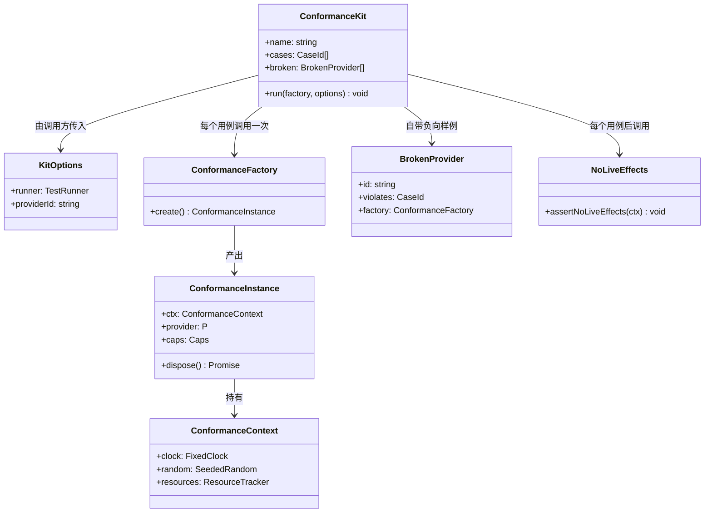
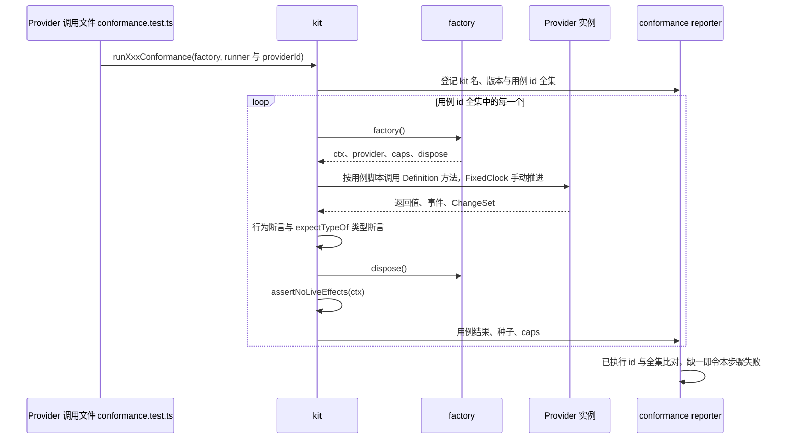
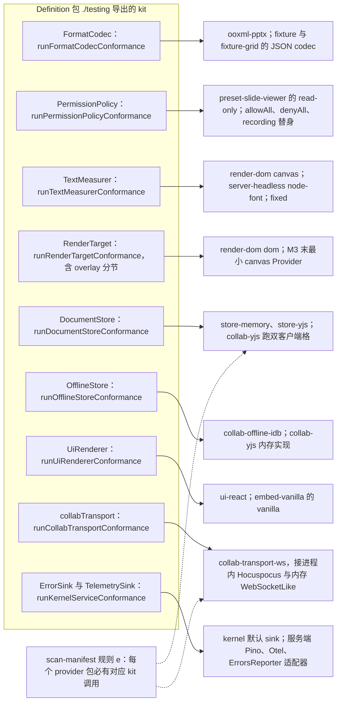
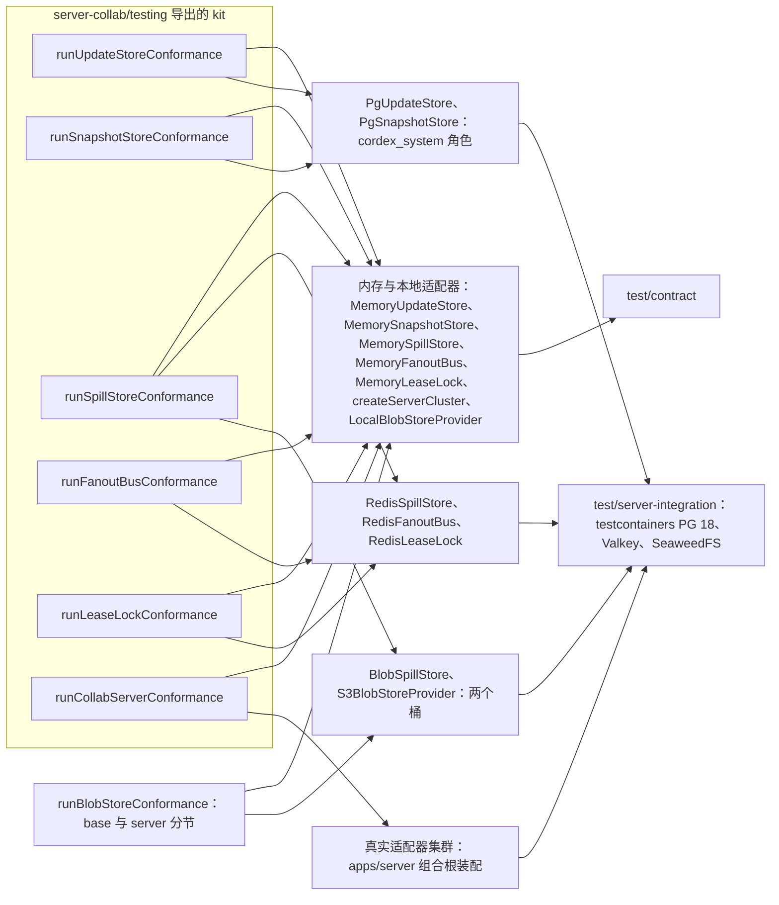
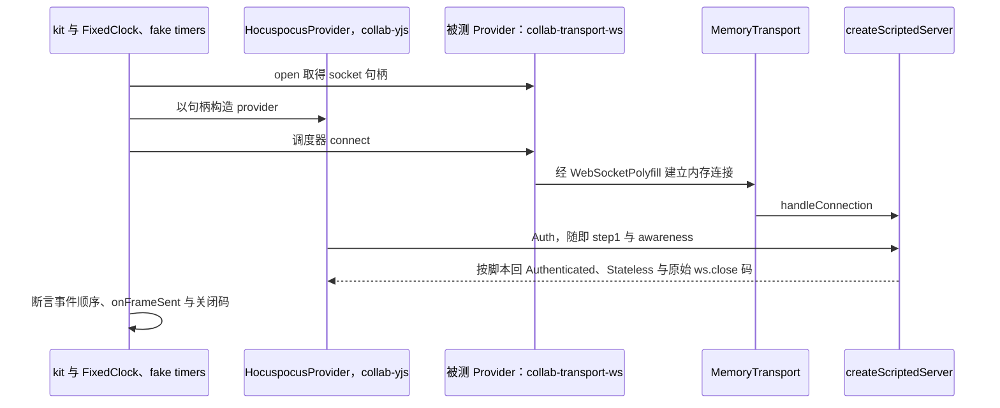
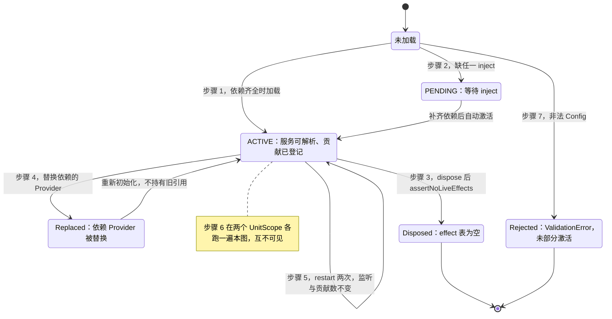
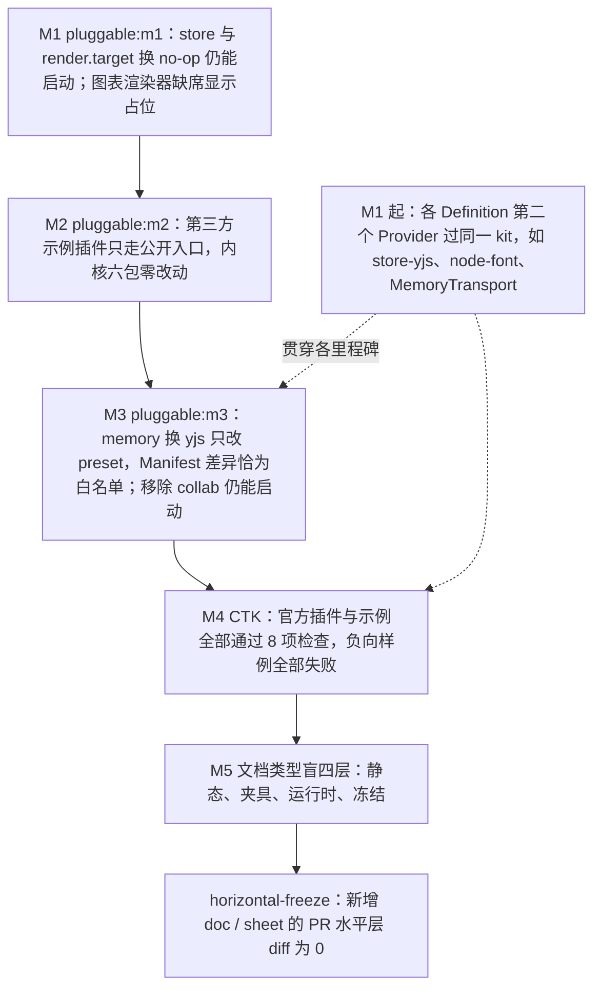

# 02 契约套件目录、生命周期与可插拔证据

> 状态：v0.1 | 负责：测试设计线 | 更新：2026-09-25；2026-09-25（§4.19）；2026-09-25（§4.19 N1）；2026-09-26（§4.20）；2026-09-26（§4.21：runCollabServerConformance 直接跑 Hocuspocus 实例，去重扇出改状态向量收敛，加钩子异常与 Valkey 宕机不杀进程、连接污染；runCollabTransportConformance 加 provider 事件时序分节）；2026-09-26（§4.21 复核：FanoutBus 变异体改为控制频道语义 `ctl/close-delivered-once`）；2026-10-01（§4.23 插件管理：新增 §10.1 作用域判定表驱动断言、策略算出 `exclude`、内容插件足迹维护与比对契约用例；§12 CTK 增 `ctk/scope`）；2026-10-01（40/16 重算：§3 全表补第 25 行 `MembershipRegistry`（有意不设 kit），作用域表驱动断言的数据源由 46 个改为 48 个 cordis 单元）；2026-10-01（插件口径仅计 cordis 插件：rulings §4.23 补充裁决 PC-1…PC-4，§10.1 `scope/table-driven` 数据源改称 48 个 cordis 插件，纯库与 Nest 模块不参与）；2026-10-03（§4.24 设计线对齐审计：§10.1 新增 `exclude/dependency-closure`（TA-5、TA-6：插件 id → 条目 id 换算与依赖闭包上推）与 `footprint/comments-excluded`（AL-6：评论不进足迹）；回写表同步）；2026-10-04（design-language-v3 第 0 批：§10 `pluggable:m2` 的「一个 Ribbon 按钮」改为底部工具条「更多」中的创建条目（rulings §4.25 DS-5）；§12 `ctk/contribution-schema` 负向样例 `bad-ribbon-item` 改为 `bad-toolbar-item`，并增 `retired-point`：向已删除的 `ui.ribbon` / `ui.statusBar` 贡献条目须报未登记贡献点（DS-5、DS-6））；2026-10-04（design-language-v3 第 0 批：术语残留清理：ribbon / 状态栏 / `ui.ribbon` / `ui.statusBar` 的历史陈述改用 check-terms 认可的标记措辞（废弃、作废、取代、原名））；2026-10-22（design-language-v3 第 3 批回写续：§5.1 `runUpdateStoreConformance` 增 `last-editor/last-user-in-range` 与 `last-editor/server-only-undefined`——`lastEditor(docId, afterSeq, uptoSeq)` 取区间里最后一条带用户的 update，只有服务端事务时为 `undefined`（rulings §4.25 DS-83，60/05 §2.1、§7，60/11 §8 e6b），§2.4 变异体表同步增 `last-editor-ignores-range`；§5.2 `admission/over-ceiling-readonly-join` 补 `elementCount` 与 `maxElements` 两个字段（TB-146，60/16 §3、§15）；2026-10-22 复核修正：§3 第 6 行 `SceneProvider` 原写「40/16 §3 待回写」，核对 40/16 §3 已写「不设」，改为已同步；状态头的回写轮次字样改为「回写续」）；2026-11-04（design-language-v3 母版视图改版：§3 全表第 8 行 `OverlayRenderer` 里 slide-render 的覆盖层 id 改为 `master-annotations`（原名 `master-inheritance`，覆盖全部占位符）；rulings §4.25 TB-188；需求编号、优先级与里程碑不变） | 依赖：rulings §4.25 TB-188、rulings §4.25 DS-83、TB-146、rulings §4.25 DS-5、DS-6、[30/11 测试策略](../30-architecture/11-testing-strategy.md)、[30/09-06 扫描器](../30-architecture/09-type-discipline/06-scanners.md)、[30/09-09 插件类型契约](../30-architecture/09-type-discipline/09-plugin-type-contracts.md)、[40/02](../40-modules/02-kernel-protocol-and-document-core.md)、[40/16 插件总账](../40-modules/16-plugin-catalog.md)、[rulings](../00-charter/rulings-2026-09-14.md) §4.15 / §4.17 / §4.18 / §4.19 / §4.20（BE-01+TX-03、FE-01）/ §4.21（q-ws-gateway、H:q-hp-persist-ack、H:q-hp-fanout、H:q-hp-provider、H:q-hp-step2-cap）、[ADR-0039](../30-architecture/adr/0039-collab-server-hocuspocus.md) 与证据 `00-charter/_evidence/hocuspocus-adoption-2026-09-26.json`（TS-01、TS-02、d-19、d-22、d-30，核实 vB、vC、vE）

本文是「契约套件（conformance kit）、插件生命周期套件、可插拔证据」三件事在测试侧的唯一事实源：定义 kit 的统一接口、每个 Definition 的 kit 与用例 id、运行矩阵、必须实例化的 Provider 与所在 CI 步骤。被测契约本身的语义不在这里：iso 契约签名在 [30/04](../30-architecture/04-document-model.md)、[30/05](../30-architecture/05-command-and-history.md)、[30/06](../30-architecture/06-collaboration.md) 与 [40/02 §2.5](../40-modules/02-kernel-protocol-and-document-core.md)，服务端运行侧行为在 [60/05](../60-backend/05-modules-collab-and-snapshots.md) 与 [60/16](../60-backend/16-ws-protocol-server-view.md)，客户端运行侧行为在 [50/04](../50-frontend/04-document-commands-and-undo.md) 与 [50/07](../50-frontend/07-collaboration-client.md)。协同模拟、fuzz 与性质测试见 [05](./05-collab-simulation-and-property-tests.md)；kit 实现文件仍登记在 40 各包的 `testing/`。

| 本文拥有 | 本文引用 |
|---|---|
| kit 统一接口、用例 id、BrokenProvider 负向样例、运行矩阵、CI 步骤归属；生命周期套件七步；可插拔证据 m1–m3、文档类型盲四层、CTK 的测试口径 | Definition 签名与语义（30、40/02、40/05、40/06、40/09）；CI 步骤名定稿（[12](./12-ci-gates-mapping.md)）；确定性工具归属（[11](./11-test-data-fixtures-and-determinism.md)）；PRD 检查名定义（[PRD 05](../10-prd/05-milestones-and-scope.md)） |

---

## 1. 规则

1. **一个 Definition 一套 kit**：每个 Definition 在 `@cordexjs/<pkg>/testing` 子路径导出 `run<Definition>Conformance(factory, options)`（章程 §5.5 命名；rulings §4.18 GV-19/GV-20 已作废 `run…ComplianceSuite`、`runCollabConformance`、`runServerCollabAdaptersConformance` 等旧名）。文档类型条目不是 Definition，命名例外为 `run<DocType>ModelConformance`（§8）。
2. **每个 Provider 必须实例化**：客户端与内存 Provider 在本包 `src/**/__tests__/conformance*.test.ts`（浏览器环境用 `conformance*.browser.test.ts`）调用对应 kit；需要容器的服务端 Provider 在 `apps/server/test/integration/conformance/*.int-spec.ts` 调用（落点按 T-NAMING）。由 `scan-manifest` 规则 (e) 核对（原名 `provider-runs-conformance`，GV-15）。
3. **kit 只依赖 Definition 与 `testing` fakes**，不感知任何具体 Provider 的实现细节；测试框架由调用方注入（`TestRunner`），Definition 包不把 vitest 带进运行时依赖（[30/09-09 §7](../30-architecture/09-type-discipline/09-plugin-type-contracts.md)；`scan-manifest` 规则 (d) 守护）。
4. **不可裁剪**：`KitOptions` 没有 `skip` / `only` / `exclude` / `cases` 字段；kit 声明用例 id 全集，`test/contract` 步骤的 reporter 比对「已执行 id = 全集」，缺一即失败（§2.3）。按 Provider 能力选择变体（如并发投递）由工厂返回的能力字段决定、写入报告，不由调用方选择。
5. **每个 kit 自带 BrokenProvider**：kit 模块导出一组故意写错的 Provider，每个声明它应在哪个用例 id 上失败；Definition 包的 `__tests__/<kit>.self-test.test.ts` 证明 kit 真能失败（Univer A17）。
6. **每个用例后 `assertNoLiveEffects`**：cordis Provider 查 Fiber 的 effect 表；非 cordis 的 Node/浏览器 Provider 查 `ResourceTracker` 登记的定时器、连接、订阅与监听器（Univer K5）。
7. **确定性**：时间、随机数、Yjs `clientID` 一律注入——`FixedClock`、`SeededRandom` 取自 `@cordexjs/shared/testing`，`MemoryTransport`、`MemoryOfflineStore` 取自 `@cordexjs/collab-core/testing`（依据：决策 T-DETERMINISM + 30/11 §1 确定性原则）。用例失败信息必须带种子。
8. **用例 id 形如 `<分节>/<用例名>`**：撤销五用例名照抄 [40/02 §2.5](../40-modules/02-kernel-protocol-and-document-core.md)「撤销协同契约用例名表」，[50/04](../50-frontend/04-document-commands-and-undo.md)、[50/07](../50-frontend/07-collaboration-client.md)、[60/05](../60-backend/05-modules-collab-and-snapshots.md)、[05](./05-collab-simulation-and-property-tests.md) 使用同一名字，不另起别名。
9. **CI 步骤**：浏览器与内存 Provider 的实例化及 kit 自测在 `test` job 的 `contract` 步骤；容器 Provider 在 `test/server-integration` 步骤（Docker 不可用即失败、不跳过）；生命周期套件在 `test/lifecycle`；文档类型盲运行时层在 `test/preset-blind`（依据：决策 T-CI + rulings §4.18 GV-14 的 13 个 job 封闭集合）。
10. **需求追溯**：每个 kit 文件与 Provider 调用文件带 `@req PRD:<id>` / `@ruling <节>/<id>` / `@adr <编号>/<决策号>` 标签（依据：决策 T-REQ），矩阵见 [13](./13-requirements-traceability.md)。

---

## 2. kit 统一接口

### 2.1 类型

公共类型与工具放在 `@cordexjs/kernel/testing` 的 `conformance/` 目录（kernel 是全部 Definition 包共同依赖的 L0 包，服务端 `server-collab` 同样可用）。示意签名：

```ts
// @cordexjs/kernel/testing —— conformance/kit.ts（签名级草案）
export interface TestRunner {                        // 调用方传入本地 vitest 导入
  describe(name: string, fn: () => void): void
  it(id: CaseId, fn: () => Promise<void> | void, timeoutMs?: number): void
  expect: ExpectStatic
  expectTypeOf: ExpectTypeOf
  beforeEach(fn: () => Promise<void> | void): void
  afterEach(fn: () => Promise<void> | void): void
}
export type CaseId = `${string}/${string}`            // <分节>/<用例名>

export interface ConformanceContext {
  readonly clock: FixedClock                         // @cordexjs/shared/testing
  readonly random: SeededRandom                      // 种子写进用例报告
  readonly resources: ResourceTracker                // 非 cordis Provider 的定时器、连接、订阅登记
  readonly host?: TestHost                           // cordis Provider：createTestHost()
}
export interface ConformanceInstance<P, Caps = {}> {
  readonly ctx: ConformanceContext
  readonly provider: P
  readonly caps: Caps                                // Provider 声明的能力，只用于选择变体并写进报告
  dispose(): Promise<void>
}
export type ConformanceFactory<P, Caps = {}> = () => Promise<ConformanceInstance<P, Caps>>

export interface KitOptions {
  readonly runner: TestRunner
  readonly providerId: string                        // 报告与失败信息里的 Provider 名
  readonly seed?: number                             // 缺省取环境变量 CORDEX_SEED，再缺省为 1
  // 刻意没有 skip / only / exclude / cases：调用方不能裁剪用例（类型测试守护，§15）
}
export interface BrokenProvider<P, Caps = {}> {
  readonly id: string
  readonly violates: CaseId                          // 预期失败的用例
  readonly factory: ConformanceFactory<P, Caps>
}
export interface ConformanceKit<P, Caps = {}> {
  readonly name: `run${string}Conformance`
  readonly version: number                           // 用例增删时 +1
  readonly cases: readonly CaseId[]
  readonly broken: readonly BrokenProvider<P, Caps>[]
  (factory: ConformanceFactory<P, Caps>, options: KitOptions): void
}
export function defineConformanceKit<P, Caps = {}>(spec: KitSpec<P, Caps>): ConformanceKit<P, Caps>
export function runKitSelfTest<P, Caps>(kit: ConformanceKit<P, Caps>, runner: TestRunner): void
export function assertNoLiveEffects(ctx: ConformanceContext): void
```

**图 2-1 契约套件统一接口**



怎么读：kit 是一个带元数据（名称、版本、用例全集、负向样例）的函数；调用方只能给出工厂与运行器，不能挑选用例。每个用例独立调用一次工厂拿到新的 Provider 实例，用完 `dispose` 后必须通过 `assertNoLiveEffects`。
依据：30/11 §3「kit 设计约束」；30/09-09 §7（测试框架由调用方传入）；Univer A17、K5。

### 2.2 一个用例的执行

**图 2-2 一个 kit 用例的执行**



怎么读：时间自上而下；循环体是单个用例的完整生命周期——新建实例、执行、断言、释放、查残留、上报。任何一步抛错都记为该用例失败并带上种子；最后一步由 reporter 在运行结束时统一做，用来发现调用方用 `describe.skip` 之类手段绕开用例。
依据：30/11 §3 kit 设计约束；本文 §1 规则 4、6、7。

### 2.3 报告与完整性

- reporter 由 `tooling/vitest-config` 统一装配（`conformance-reporter`），写 `dist/conformance/<kit>--<providerId>.json`：`{ kit, kitVersion, providerId, caps, seed, cases: [{ id, status, ms }] }`，作为 `test` job 产物上传。
- 完整性判定在 reporter 的结束钩子内完成，不另设脚本或扫描器：凡本次运行登记过的 kit，其用例 id 全集必须全部出现且为 `passed`；出现 `skipped`/`todo` 同样判失败。
- `caps` 只允许 kit 在规格里预先声明的键（如 `delivery`、`durability`），出现在报告中供评审；不同 `caps` 选择不同变体时，两个变体的用例 id 都在全集中，只是变体后缀不同（例如 `collab/concurrent-same-gap-insert@serial`、`…@concurrent`），不支持的变体以 `n/a` 写入报告并在 §3 表中登记为该 Provider 的既定范围。

### 2.4 BrokenProvider 负向样例

每个 kit 至少为每个分节提供一个负向样例；`runKitSelfTest` 用捕获型运行器执行 kit，断言每个样例恰在它声明的 `violates` 用例上失败、且不在无关用例上误报。下表只列代表性样例，完整清单以各 kit 模块导出的 `broken` 数组为准。

| kit | BrokenProvider（id） | 故意写错的行为 | 应失败的用例 |
|---|---|---|---|
| `runDocumentStoreConformance` | `undo-overwrites-remote` | 撤销时覆盖他人后写的键 | `neutral-undo/remote-conflict-skip` |
| 同上 | `undo-cascades` | 整步被跳过后继续撤销上一步 | `neutral-undo/undo-skip-no-cascade` |
| 同上 | `hard-delete-on-remove` | 用户删除直接 `delete` 实体键 | `neutral-undo/soft-delete-tombstone` |
| 同上 | `undo-resurrects-others` | 撤销复活他人删除的元素 | `neutral-undo/delete-vs-edit-undo` |
| 同上 | `read-leaks-tombstone` | `filterLive()` 返回墓碑实体 | `neutral-undo/read-path-filters-tombstone` |
| 同上 | `import-enters-history` | `system('import')` 事务进入撤销栈 | `import/import-append` |
| `runBlobStoreConformance` | `versions-left-behind` | 按前缀删除只删当前版本 | `server/delete-all-versions` |
| `runFormatCodecConformance` | `progressive-mismatch` | `first` + `batches` 与 `import()` 结果不等 | `progressive/first-plus-batches-equals-import` |
| `runTextMeasurerConformance` | `negative-width` | 空串返回非 0 宽度 | `metrics/empty-string-zero-width` |
| `runRenderTargetConformance` | `repaint-mounts-again` | 同一 dirty 重复 `mount` | `paint/repeat-dirty-update-only` |
| `runCollabTransportConformance` | `close-code-rewritten` | 把 4428 改写为 1006 | `transport/close-code-exact@4428` |
| `runOfflineStoreConformance` | `ack-deletes-all` | `ackUpTo` 删除全部 pending | `pending/ack-up-to-only-le` |
| `runUiRendererConformance` | `error-bubbles` | 贡献项抛错冒泡到壳 | `render/contribution-error-isolated` |
| `runPermissionPolicyConformance` | `allow-on-throw` | `evaluate` 抛错时放行 | `policy/throw-means-deny` |
| `runKernelServiceConformance` | `leaks-pii` | 日志不做脱敏 | `logger/redaction` |
| `runUpdateStoreConformance` | `seq-gap` | seq 不与 `head_seq` 同事务分配 | `append/seq-contiguous` |
| 同上 | `last-editor-ignores-range`（2026-10-22） | `lastEditor` 不按 `(afterSeq, uptoSeq]` 过滤，取到区间之外更晚的用户更新 | `last-editor/last-user-in-range` |
| `runSnapshotStoreConformance` | `purge-noop` | `purgeAll` 不删 | `purge/purge-all-empties` |
| `runSpillStoreConformance` | `reads-other-instance` | `readAllOrdered` 读到其他实例的行 | `replay/own-instance-only` |
| `runFanoutBusConformance` | `echo-self` | 控制频道 `room:{docId}:ctl` 的控制消息（close、epoch）回投给发布实例，导致同一关闭或换纪元执行两次（§4.21 起 FanoutBus 只承载控制频道，帧扇出的按 instanceId 去重已作废） | `ctl/close-delivered-once` |
| `runLeaseLockConformance` | `fencing-decreases` | fencing token 不单调 | `lease/fencing-monotonic` |
| `runCollabServerConformance` | `ack-skips-empty-step2` | 空 diff 的 step2 不回 ack | `ack/step2-empty-diff-db-ack` |

### 2.5 残留检查

- cordis Provider：`assertNoLiveEffects(ctx)` 读 `ctx.host` 的 Fiber effect 表，要求 dispose 后为空（`@cordexjs/kernel` 诊断工具）。
- 非 cordis Provider（如 PG、Valkey、S3、IndexedDB 适配器）：工厂把定时器、连接池、订阅、DOM 监听器登记到 `ctx.resources`；dispose 后要求连接池活动连接数为 0、订阅数为 0、未决定时器为 0。
- 浏览器 Provider 另断言 dispose 后宿主容器内无残留 DOM 节点（`runUiRendererConformance`、`runRenderTargetConformance`）。

---

## 3. 全表：25 个 Definition 与 `collabServer`

Definition 清单以 [40/16 §3](../40-modules/16-plugin-catalog.md) 的 25 个为准（2026-10-01 40/16 重算时并入第 25 个 `MembershipRegistry`），另加服务契约 `collabServer`。「状态」列：**已有**＝40 已登记、本文补用例 id；**新增**＝本文按决策新增；**有意不设**＝不设 kit，写明替代验证。缺口裁定依据：决策 T-KITS（authority：40/06 §2.5 + 用户偏好「安全宁可提前」，权限契约需要机械证据）。

| # | Definition（定义包） | kit | 覆盖要点 | 必须实例化的 Provider（调用文件） | 状态 | CI 步骤 |
|---|---|---|---|---|---|---|
| 1 | `DocumentStore`（model-core） | `runDocumentStoreConformance` | 见 §4 | `store-memory`、`store-yjs`（各自 `__tests__/conformance.test.ts`）；`collab-yjs` 跑双客户端格（`__tests__/conformance-store-pair.test.ts`） | 已有 | `test/contract` |
| 2 | `BlobStore`（model-core 基础契约；服务端扩展接口 `ServerBlobStore` 与 kit 在 server-storage） | `runBlobStoreConformance`（`server-storage/src/testing/`，40/08 §2.5） | `base/*`：get / put / has、内容寻址；`server/*`：head、delete、预签名、完整性、经保持 Host 头的反代后预签名可用（BE-01）、两个桶（快照桶开版本化、数据桶不开，C-08/OBJ）、按版本删除后无残留（BE-15） | `LocalBlobStoreProvider`（server-storage `__tests__/conformance-local-blob-store.test.ts`；反代 Host 与两个桶版本化两例按 `caps` 记 `n/a`）；`S3BlobStoreProvider` 接 SeaweedFS（`apps/server/test/integration/conformance/s3-blob-store.int-spec.ts`，两个分节全跑） | 已有 | `test/contract`、`test/server-integration` |
| 3 | `FormatCodec`（model-core） | `runFormatCodecConformance` | `canImport`/`canExport` 与 `mimeTypes`/`extensions` 一致；`import → export` 语义等价；诊断路径不抛；`importProgressive` 的 `first` + 全部 `batches` ≡ `import()`；超天花板在 `first` 之前拒绝（CO-12） | `ooxml-pptx`（`__tests__/conformance.test.ts`）；`fixture-json`、`fixture-grid` 的 JSON codec（model-core 自测）；M5 `ooxml-docx`、`ooxml-xlsx` | 已有 | `test/contract` |
| 4 | `TextMeasurer`（engine-layout） | `runTextMeasurerConformance` | 见 §7.2 | `canvas`（render-dom，`conformance-measurer.browser.test.ts`）；`node-font`（server-headless，`conformance-measurer.test.ts`）；`fixed`（engine-layout/testing 的 `FixedWidthMeasurer`，自测） | 已有 | `test/contract` |
| 5 | `RenderTarget`（engine-render） | `runRenderTargetConformance` | 见 §7.1，含 `overlay/*` 分节 | `dom`（render-dom，`conformance-target.browser.test.ts`）；最小 canvas Provider（M3 末，`engine-render/src/__tests__/conformance-canvas-target.test.ts`，40/06 原名 `canvas-target-contract.test.ts` 按 01 §4 前缀规则改名，rulings §4.15 Q4） | 已有，补 `overlay/*` | `test/contract` |
| 6 | `SceneProvider`（engine-render） | 不设 | 替代：`engine-render/__tests__/renderer-table.test.ts`（查表机制）；`fixture` 的最小 SceneProvider 经 `test/preset-blind`；slide-render `compose-reconcile.test.ts`；视觉 oracle（[04](./04-visual-oracle.md)） | — | 有意不设（以 40/06 为准，40/16 §3 已同步） | `test/unit`、`test/preset-blind` |
| 7 | `ElementRenderer`（engine-render） | 不设（M-06 G-8） | 替代：`SpyRenderer`/`RecordingTarget` 自测；`error-isolation.test.ts`（单元素失败 → unknown 占位）；视觉 oracle | — | 有意不设 | `test/unit` |
| 8 | `OverlayRenderer`（engine-render） | 由 #5 的 `overlay/*` 分节 + 生命周期套件覆盖 | mount / update / dispose；改选区不触发任何 `ElementRenderer.update`；dispose 无残留 | render-dom 四个条目、slide-render `master-annotations`（2026-11-04 起覆盖全部占位符，原名 `master-inheritance`，rulings §4.25 TB-188；各自 `lifecycle.test.ts`） | 替代（T-KITS） | `test/contract`、`test/lifecycle` |
| 9 | `collab`（collab-core，`CollabService`） | 不设 | 替代：#1 的双客户端格经 collab-yjs 真实同步引擎运行；collab-yjs 包内 FSM 与事件测试；[05](./05-collab-simulation-and-property-tests.md) 协同模拟 | — | 有意不设（与 store-yjs 强耦合，40/05 §2.5） | `test/contract`、`test/collab-sim` |
| 10 | `collabTransport`（collab-core） | `runCollabTransportConformance` | 见 §6.1（§4.21 起含 `provider/*` 事件时序分节） | `collab-transport-ws`（`__tests__/conformance.test.ts`：进程内 Hocuspocus 4.7.0 经 `createScriptedServer` 接 collab-core/testing 的 `MemoryTransport` 内存 WebSocketLike 对，provider 内部计时用 fake timers）；§4.21 起 `MemoryTransport` 不再是 `CollabTransport` 实现，collab-core 只跑 `runKitSelfTest` | 已有，改写 | `test/contract` |
| 11 | `OfflineStore`（collab-core） | `runOfflineStoreConformance` | 见 §6.2 | `collab-offline-idb`（`conformance.test.ts`，node + `fake-indexeddb`，40/05 §4.4）；collab-yjs 同接口内存实现 | 已有 | `test/contract` |
| 12 | `UiRenderer`（ui-core） | `runUiRendererConformance` | 见 §7.3 | `ui-react`（`conformance-ui-renderer.test.ts`，40/10 原名 `ui-renderer.conformance.test.ts` 按 01 §4 前缀规则改名）；`UiRenderer('vanilla')`（`examples/embed-vanilla`，PRD M2 `embed:framework-free`） | 登记（T-KITS） | `test/contract` |
| 13 | `PermissionPolicy`（model-core） | `runPermissionPolicyConformance` | 零策略 → 全部 `PERMISSION_DENIED`（值 `command.permission_denied`）；`evaluate` 抛错或返回非法值 → 拒绝并出诊断；能力位全集（protocol `permissions/actions.ts`：`doc.read`、`doc.comment`、`doc.write`、`doc.export`、`doc.manage`、`history.read`、`history.restore`）逐一被显式判定；`denyAll` 覆盖 `allowAll`；未知 `<vendor>:` 能力位拒绝 | `preset-slide-viewer#read-only`（`__tests__/conformance-policy.test.ts`）；model-core/testing 的 `allowAllPolicy`、`denyAllPolicy`、`recordingPolicy`（自测） | 新增（T-KITS） | `test/contract` |
| 14 | `DocumentType`（model-core 贡献点条目） | 命名例外 `run<DocType>ModelConformance` | 见 §8 | `model-slide`；M5 `model-doc`、`model-sheet`；`fixture` / `fixture-grid` 由 #1 与生命周期套件作为样例覆盖（ADR-0016） | 已有 | `test/contract` |
| 15 | `Migration`（model-core 贡献点条目） | 不设 kit | 替代：`test/snapshot-migration-corpus` 把 `fixtures/snapshots/<type>/v<N>` 全部迁到当前版本，断言 `validateSnapshot` 通过、迁移链无缺口；`scanners/schema-lock` 守护 schema 变更 | — | 替代（T-KITS） | `test/snapshot-migration-corpus`、`scanners/schema-lock` |
| 16 | `ErrorSink`（kernel） | `runKernelServiceConformance` | no-op 降级、脱敏、未登记码报诊断 | kernel console sink；服务端 `ErrorsReporterAdapter` | 已有 | `test/contract` |
| 17 | `TelemetrySink`（kernel） | `runKernelServiceConformance` | 同上，另断言 span / metric 名必须已登记 | kernel no-op sink；服务端 `OtelTelemetryAdapter` | 已有 | `test/contract` |
| 18 | `SpillStore`（server-collab） | `runSpillStoreConformance` | 见 §5 | `MemorySpillStore`；`RedisSpillStore`、`BlobSpillStore`（int-spec） | 已有 | `test/contract`、`test/server-integration` |
| 19 | `ThumbnailRenderer`（server-headless） | 不设 | 替代：视觉 oracle 的「客户端与服务端互差 ≤ 0.5%」（[04 §4](./04-visual-oracle.md) 被测 b，ADR-0026，M3 起）；640 px WebP 缩略图管线由 [07](./07-backend-integration-and-api-e2e.md) 覆盖 | — | 替代（T-KITS） | `e2e/oracle-gated` |
| 20 | `FanoutBus`（server-collab） | `runFanoutBusConformance` | 见 §5；§4.21 起只承载自有控制频道（`room:{docId}:ctl` 的 close 与 epoch 等，ADR-0039 的 ControlPlane 扩展），update、awareness 与 Stateless 的跨实例同步改由 `@hocuspocus/extension-redis` 承担，由 §5.2 `fanout/*`、`redis/*` 覆盖 | `MemoryFanoutBus`；`RedisFanoutBus`（int-spec） | 已有，范围收窄 | `test/contract`、`test/server-integration` |
| 21 | `LeaseLock`（server-collab） | `runLeaseLockConformance` | 见 §5 | `MemoryLeaseLock`；`RedisLeaseLock`（int-spec） | 已有 | 同上 |
| 22 | `UpdateStore`（server-collab） | `runUpdateStoreConformance` | 见 §5 | `MemoryUpdateStore`；`PgUpdateStore`（int-spec） | 已有 | 同上 |
| 23 | `SnapshotStore`（server-collab） | `runSnapshotStoreConformance` | 见 §5 | `MemorySnapshotStore`；`PgSnapshotStore`（int-spec） | 已有 | 同上 |
| 24 | `AuthorizationSource`（server-collab） | 不设 | 替代：`runCollabServerConformance` 的 `link/*` 三个用例（BE-02） | — | 有意不设 | 同上 |
| 25 | `MembershipRegistry`（server-collab，决策 C-11） | 不设 | 替代：`runCollabServerConformance` 覆盖名额准入的原子性（40/09 §2.5、60/05 §2.2；2026-10-01 按 40/16 §3 第 25 行补登） | `RedisMembershipRegistry`（经 `collab-server.int-spec.ts`） | 有意不设 | 同上 |
| + | `collabServer`（server-collab 服务契约） | `runCollabServerConformance` | 见 §5.2 | `createServerCluster(n)`（§4.21 起为 n 个真 Hocuspocus 实例 + 内存适配器 + 内存 pub/sub 替身驱动的 extension-redis，客户端以内存 `WebSocketLike` 调 `handleConnection`，server-collab 自测）；真实适配器集群（`apps/server/test/integration/conformance/collab-server.int-spec.ts`：嵌入 Fastify 的 upgrade、真实 PG、Valkey 容器上的 extension-redis、SeaweedFS） | 已有，补用例 | 同上 |

合计：16 个 `run<Definition>Conformance` kit 加 1 个命名例外（`runSlideModelConformance`，M5 再加 doc / sheet 两个），7 个 Definition 以替代验证覆盖（#6–#9、#15、#19、#24）。服务端 PG 适配器的契约实例以非属主角色 `cordex_system` 连接并设置 `app.system_job`，每个测试文件使用从模板库克隆的独立数据库，不用事务回滚式隔离（依据：决策 T-DB-ISOLATION，authority：RLS 依赖会话变量与非属主角色，ADR-0022 修订）；角色与 GUC 的定义见 [60/08](../60-backend/08-db-conventions-roles-rls-migrations.md)。

**图 3-1 客户端 Definition、kit 与必须实例化的 Provider**



怎么读：左侧子图是 Definition 包导出的 kit，每条实线指向必须在自己 `__tests__` 里实例化该 kit 的 Provider 集合（分号分隔的是同一 kit 的不同 Provider）；虚线表示 `scan-manifest` 规则 (e) 对全部 provider 包做存在性核对，图中只画两条示意。服务端 kit 见图 5-1。
依据：本文 §3 表；40/16 §3；30/09-06 §6 规则 (e)。

---

## 4. `runDocumentStoreConformance` 分节

定义文件 `model-core/src/testing/document-store-conformance.ts`（[40/02 §2.5](../40-modules/02-kernel-protocol-and-document-core.md)）。被测语义：Store 契约与中性撤销六条在 40/02 §2.5，撤销判定在 [30/05 §6](../30-architecture/05-command-and-history.md)，墓碑与 TTL 的服务端执行在 [60/05](../60-backend/05-modules-collab-and-snapshots.md)，UI 表达在 [50/04](../50-frontend/04-document-commands-and-undo.md)。本节只定用例 id 与运行矩阵。

### 4.1 用例 id

| 分节 | 用例 id | 断言要点 |
|---|---|---|
| `primitives` | `record-set-get`、`entity-table-add-get`、`ordered-order-key-sort`、`richtext-delta-apply`、`blobref-leaf`、`opaque-leaf` | 六种存储原语（30/06 §1.2）读写一致；`Ordered` 读路径按 `(order, id)` 全序 |
| `primitives` | `five-storeops-only`、`no-index-api` | 事务只接受 5 种 `StoreOp`（无 `move`）；公共面无按下标的 API（运行时 + `expectTypeOf`） |
| `transaction` | `atomic-rollback`、`nested-rejected`、`state-reference-semantics` | 失败整体回滚；嵌套事务返回 `STORE_NESTED_TRANSACTION`；`state()` 事务内不变、事务后变化 |
| `observe` | `one-changeset-per-tx`、`touched-paths-exact` | 一次事务恰一次 `ChangeSet`；`touched` 与实际写入路径相等 |
| `undo` | `undo-redo-by-origin`、`undo-restores-prior-state`、`load-clears-can-undo` | 只撤给定 origin；`transact` 后 `undo` 深等于事务前 `state()`；`load` 后 `canUndo` 为 false |
| `position` | `stable-position-after-concurrent-insert` | `stablePosition` 在他人插入后仍指向同一字符 |
| `snapshot` | `snapshot-roundtrip`、`snapshot-idempotent` | `toSnapshotBody()` 深等于 `load` 入参；重复 `load` 同一 body 结果不变 |
| `import` | `import-append` | CO-12 三条约束：(a) 只新增，触及已存在键整体拒绝 `store.import_append_conflict`；(b) 不入任何撤销栈，`canUndo` 不变，不计入「他人后写」表；(c) `observe` 照常一次事务一次通知 |
| `neutral-undo` | `remote-conflict-skip` | 同一键在本步之后被他人写过 → 该键跳过、不覆盖，其余键回滚；`store/undo-skipped{skipped, wholeStep:false}` 恰一次 |
| `neutral-undo` | `undo-skip-no-cascade` | 一步全部键被跳过 → 出栈、`wholeStep:true`、不撤更早一步；`redo` 对称。分支：全部键被他人后写；目标已被他人删除（墓碑 TTL 内亦然）；目标已被硬删除（TTL 到期或经审计的「彻底删除元素」，CO-07） |
| `neutral-undo` | `soft-delete-tombstone` | 删除写 `_deleted:{at, by}`、id 稳定；删除方撤销 = 以原 id 清除墓碑；用户删除的降级结果只有 `set(<实体>/_deleted, …)`，不含实体键的 `delete`（CO-05） |
| `neutral-undo` | `delete-vs-edit-undo` | (a) 删除方撤销与他人「恢复元素」并发 → 只有一份、他人编辑不丢；(b) 他人撤销时目标已被删除 → 跳过（`reason:'remote-deleted'`）、不复活（D4） |
| `neutral-undo` | `read-path-filters-tombstone` | `filterLive()`、选择器、SceneProvider、FormatCodec 读取均不含墓碑；`state()` 原始树含墓碑 |
| `tombstone` | `tombstone-counts-toward-limit` | 实体总数按原始树计、含墓碑（20,000 上限的计数口径，rulings §4.15 Q5；30/11 §3「另断言墓碑计入元素数」）；单列一节，`neutral-undo` 只放 40/02 §2.5 的五个用例名 |
| `collab` | `each-undoes-own-only` | 两端同步后各自撤销只回退自己的事务 |
| `collab` | `concurrent-same-gap-insert` | 两端在同一间隙插入 → 两项都在，所有端 `(order, id)` 顺序一致 |
| `collab` | `rekey-preserves-order` | 病态同位插入后 rekey，顺序不变（ADR-0032） |
| `collab` | `concurrent-same-key-converges` | 同键并发写，所有端收敛到同一值（只在 `delivery` 含 `concurrent` 的 Provider 上执行） |
| `history-commands` | `restore-mine-new-local-tx`、`restore-mine-undoable`、`restore-mine-requires-doc-write` | `core.history.restoreMine{skipId}` 把 `myValue` 作为新的 `local` 事务写回、进入历史栈、可再撤销；无 `doc.write` 返回 `PERMISSION_DENIED` |
| `history-commands` | `restore-element-revives-same-id`、`restore-element-disabled-after-hard-delete` | `core.history.restoreElement{skipId}` 仅当目标仍为墓碑态时以同 id 复活；目标已硬删除时命令不可用并提示「该内容已被彻底删除」（术语按 CO-07，文案与返回以 50/04 §6.2 为准） |
| `history-commands` | `skip-records-capped-20`、`skip-records-cleared-on-rebootstrap` | history 只保留最近 20 条 UndoSkip 记录；Unit 以 `system('load')` 重新 bootstrap（epoch 变更路径）后记录与撤销栈清空 |

`history-commands` 分节经 `createCommandHarness(storeFactory)`（model-core/testing）在命令层执行，两个 Store 跑同一分节（依据：决策 RESTORE-CMD，authority：rulings §4.15 Q3「恢复我的值」为新事务 + §4.18 CO-07 硬删除后整步跳过 + 30/05）。命令 id 由 M-02 按命名规则登记，UI 入口与提示条状态机见 [50/04](../50-frontend/04-document-commands-and-undo.md)。

### 4.2 运行矩阵

矩阵为 `{ memory, yjs } × { 单机, 双客户端 } × { 单人策略, 协同分节 }`（30/11 §17），在 `test/contract` 步骤由四个包各跑一次，不另设 job 名（rulings §4.18 GV-14）。「单人策略」＝ `primitives`、`transaction`、`observe`、`undo`、`position`、`snapshot`、`import`、`tombstone`、`history-commands`；「协同分节」＝ `neutral-undo`、`collab`。

| 运行包 | Provider | 单机 × 单人策略 | 单机 × 协同分节 | 双客户端 × 单人策略 | 双客户端 × 协同分节 |
|---|---|---|---|---|---|
| model-core | `broken` 数组（`runKitSelfTest`） | 自测 | 自测 | 自测 | 自测 |
| store-memory | `MemoryStore` | ● | ●（他人写入以 `local(otherClientId)` / `remote` origin 注入同一实例） | ●（串行中继） | ●（串行中继；`delivery=['serial']`） |
| store-yjs | `YjsStore` | ● | ● | ●（直接交换 Y update） | ●（`delivery=['serial','concurrent']`） |
| collab-yjs | `YjsStore` + 官方 provider + `MemoryTransport` + 进程内 Hocuspocus 脚本服务端（§4.21，原「同步引擎 + 内存服务端」） | — | — | ● | ●（经真实 provider、`localSeq` 对应与在途 FIFO） |

- **单机**：一个 Store 实例，「他人」由 kit 以其他 origin 写入模拟，覆盖全部撤销判定分支。
- **双客户端**：工厂返回 `{ a, b, deliver }`。`serial` 投递把一端已提交的事务按顺序交给另一端（`store-memory` 只有这一种：它不承担并发合并，30/05 §6）；`concurrent` 投递让两端各自提交后再交换，只有 CRDT Provider 声明。两种投递下 `collab/*` 与 `neutral-undo/*` 的用例 id 相同、变体后缀不同，报告中 `store-memory` 的 `@concurrent` 记为 `n/a`（既定范围，不是跳过）。
- **协同预设约束**：`preset-slide-collab` 装配的 Store 必须声明 `concurrent`；由 `preset-slide-collab/__tests__/pluggable.test.ts` 读取 `caps` 断言。
- 撤销五用例在四个格里名字不变；`collab-yjs` 另有包内用例 `offline-replay-not-other-writer`（离线回放不计为他人后写，40/05 §2.3），不属于本 kit。

---

## 5. 服务端协同七套与 `collabServer`

七套＝ `runUpdateStoreConformance`、`runSnapshotStoreConformance`、`runSpillStoreConformance`、`runCollabServerConformance`、`runFanoutBusConformance`、`runLeaseLockConformance`（均由 `server-collab/testing/index.ts` 导出）加 `runBlobStoreConformance`（§3 #2）。契约签名见 [40/09 §2.5](../40-modules/09-server-collab-gateway-and-headless-host.md) 与 [60/05](../60-backend/05-modules-collab-and-snapshots.md)，WS 服务端处理见 [60/16](../60-backend/16-ws-protocol-server-view.md)，Hocuspocus 挂点与扩展见 [ADR-0039](../30-architecture/adr/0039-collab-server-hocuspocus.md)，Valkey 键模板见 [60/14](../60-backend/14-valkey-object-storage-and-retention.md)。每个 kit 先对内存适配器（BlobStore 为 `LocalBlobStoreProvider`）在 `test/contract` 自测，再对真实适配器在 `test/server-integration` 以 testcontainers（PG 18、Valkey、SeaweedFS）实例化。

### 5.1 适配器 kit 用例

| kit | 用例 id | 断言要点 | Provider |
|---|---|---|---|
| `runUpdateStoreConformance` | `append/seq-contiguous`、`append/same-tx-as-head-seq`、`append/idempotent-retry`、`load/since-ordered`、`prune/before-seq-and-age`、`purge/purge-all-empties`、`last-editor/last-user-in-range`、`last-editor/server-only-undefined`（后两项 2026-10-22） | seq 与 `documents.head_seq` 同事务分配、无空洞；重试不重复落库；`loadSince` 升序；`purgeAll` 后 `loadSince` 为空（S-2）；`lastEditor(docId, afterSeq, uptoSeq)` 返回 `(afterSeq, uptoSeq]` 区间里最后一条带用户的 update 的 `userId` 与落库时刻——区间里先后有两名用户时取后者，区间之外（≤ `afterSeq` 或 > `uptoSeq`）的用户更新不算；区间里只有服务端事务（墓碑硬删除、软门禁修复等，`user_id` 为空）时返回 `undefined`（rulings §4.25 DS-83；接口见 60/05 §2.1、§7，SQL 为 60/11 §8 e6b；压缩时据此推进 `content_updated_at` / `content_updated_by` 的集成断言在 [07 §8](./07-backend-integration-and-api-e2e.md) D18） | `MemoryUpdateStore`；`PgUpdateStore` |
| `runSnapshotStoreConformance` | `put/latest-roundtrip`、`list/paged-cursor`、`get/by-id`、`purge/purge-all-empties`、`put/import-bumps-epoch` | `latest` 为最近一次 `put`；分页游标稳定；`purgeAll` 后 `latest` 为空；`put(kind='import', epochFrom = E)` 写入 `epoch = E + 1` 的快照并把文档纪元推进到 `E + 1`，文档纪元已不是 `E` 时返回 `epoch_changed` 且不写行（rulings §4.19 N1，60/05 §9.2） | `MemorySnapshotStore`；`PgSnapshotStore` |
| `runSpillStoreConformance` | `write/tier1-then-tier2`、`replay/own-instance-only`、`replay/ordered-by-local-counter`、`instances/list-for-orphan-claim`、`clear/after-replay` | 两档合并按 `localCounter` 升序；只读指定 `instanceId`（CO-16）；`listInstances` 列出遗留实例；`clear` 后为空 | `MemorySpillStore`；`RedisSpillStore`（一级）、`BlobSpillStore`（二级） |
| `runFanoutBusConformance` | `fanout/cross-instance-delivery`、`ctl/close-delivered-once`（原 `fanout/dedup-by-instance`）、`fanout/unsubscribe-stops` | 控制消息跨实例投递；控制消息（close、epoch）每实例只执行一次、不回投发布实例；释放订阅后不再收到（§4.21 起只覆盖自有控制频道，文档状态的跨实例同步见 §5.2 `fanout/*`） | `MemoryFanoutBus`；`RedisFanoutBus` |
| `runLeaseLockConformance` | `lease/mutual-exclusion`、`lease/expiry-reacquire`、`lease/fencing-monotonic` | 同键互斥；过期后可被他人取得；fencing token 单调递增；键模板 `lock:{purpose}:{docId}` 与 `lock:fence:{purpose}:{docId}`（决策 KEYS） | `MemoryLeaseLock`；`RedisLeaseLock` |
| `runBlobStoreConformance` | `base/put-get-has`、`server/head-delete`、`server/presign-behind-host-proxy`、`server/integrity-sha256`、`server/two-buckets`、`server/delete-all-versions` | 见 §3 #2；`two-buckets` 断言快照桶开版本化、数据桶不开（C-08/OBJ）；`delete-all-versions` 对两个桶的 `docs/{docId}/` 各做 ListObjectVersions 并删除全部版本与删除标记后无残留（BE-15，60/04 §4） | `LocalBlobStoreProvider`；`S3BlobStoreProvider` |

一级溢写阈值等默认值（`spill.tier1MaxBytesPerDoc` 16 MiB、`spill.tier1MaxBytesPerInstance` 256 MiB、`spill.tier2ChunkBytes` 4 MiB）是 `write/tier1-then-tier2` 的输入参数，kit 用缩小后的阈值驱动切换，不把默认值写死（依据：决策 SPILL，authority：规格空白 + 阈值只收紧；默认值唯一源 [60/17](../60-backend/17-deployment-and-config.md)）。

### 5.2 `runCollabServerConformance` 用例

工厂签名 `createCluster(n) → ServerCluster`（内存版取 `createServerCluster(n)`；真实版由 `apps/server/test/integration/conformance/collab-server.int-spec.ts` 用真实 PG / Valkey / SeaweedFS 适配器组装）。§4.21 起（证据 TS-01、d-30）集群的每个实例就是一个真 Hocuspocus 4.7.0 类，装着 server-collab 的自有扩展；多实例之间用 `@hocuspocus/extension-redis`（真实版接 Valkey 容器，内存版接内存 pub/sub 替身，extension-redis 的 `awaitInitialSyncTimeout` 1 s 会拉长用例，内存版调小）；客户端一律用内存 `WebSocketLike` 调 `handleConnection`，发出的是 Hocuspocus 帧（Auth、Sync、Awareness、Stateless），不再有自研信封。服务端行为的规格来源：房间、持久化、溢写与准入在 [60/05](../60-backend/05-modules-collab-and-snapshots.md)，门禁、ack 发出规则与关闭码触发条件在 [60/16](../60-backend/16-ws-protocol-server-view.md)，帧与关闭码定义在 [30/06 §6](../30-architecture/06-collaboration.md)。

| 用例 id | 断言要点 | 依据 |
|---|---|---|
| `fanout/two-instance-sv-converge`（§4.21 改写，原 `fanout/two-instance-dedup`） | 两实例同一文档、客户端分在两个实例：静止后各端状态向量相等（extension-redis 以状态向量往返补齐，同一变更可能以多个差量到达，不再断言「恰收到一次」）；每个实例只持久化本实例客户端的 update——跨实例来的更新 origin 为 redis，不经 `beforeSync`、不触发存储钩子；库中无重复行 | ADR-0035（修订见 ADR-0039）；证据 PS-02、K6 |
| `fanout/doc-hash-single-holder` | 按文档哈希分流时同一文档的全部连接落在同一实例，另一实例不加载该文档；模拟扩缩容把文档迁到另一实例后，客户端经重连 step2 补齐、无数据丢失 | rulings §4.21 H:q-hp-fanout |
| `durability/crash-replay` | 进程被杀后重启，snapshot + updates 重放结果与崩溃前所有已 ack（db）状态相同 | 06 I10 |
| `durability/pg-down-db-ack-withheld` | 单实例、溢写前的重试窗口内（`spillTier = none`，[60/05](../60-backend/05-modules-collab-and-snapshots.md) §6.2；M2）：PG 写失败期间入站 update 不回 `{type:'ack', tier:'db'}`，≤ 1 s 推 `CONTROL.room{persist:'degraded'}`；PG 恢复后得到 db ack（原会话已断开则经重连 step2），`document_updates` 无重复行、seq 连续；推 `persist:'ok'` | PRD 05 M2 验收 17；rulings §4.19 INC-09 |
| `gate/frame-too-large-4413`、`gate/step2-over-16mib-4413`、`gate/rate-limit-4429` | update 帧 payload 超 `maxUpdateBytes`（1 MiB）关闭 4413；重连 step2 超 16 MiB（= ws `maxPayload`）关闭 4413、不超则一帧落库并恰回一帧 db ack（rulings §4.21 H:q-hp-step2-cap）；超 `msgRateHz` 200 / `msgBurst` 500 关闭 4429；以上都在适配层预过滤，失败帧不进 Hocuspocus | 决策 INC-07（authority：rulings §4.18 CO-10 原文用名） |
| `gate/viewer-update-rejected` | viewer 的 update 回 `error{collab.forbidden}` 不广播不落库，第 3 次关闭 4403（L2 要求角色 ≥ commenter，commenter 的越界路径由软门禁还原，见 [05 §8](./05-collab-simulation-and-property-tests.md)） | 60/16 §4；ADR-0031 |
| `gate/l2-count-starts-after-downgrade` | 降权瞬间仍在途的写入帧只回 `error{collab.forbidden}`、不计数；服务端发出降权 `CONTROL.permission` 或 `CONTROL.room{locked}` 后 2 s 内到达的写入帧同样视为在途、不计数（常量，60/16 §4）；只有 2 s 之后到达的越权写入帧计入 L2 拒绝计数：降权时在途 5 帧 + 2 s 内再到 2 帧 → 不关闭，2 s 之后的第 3 帧 → 4403（`FixedClock` 推进） | ADR-0029 决策 3（计数针对越权写入）；60/16 §4 |
| `gate/soft-gate-repair` | fixture 文档类型的不变量违规触发修复事务、广播 `CONTROL.repair`，所有端一致；10 分钟内 ≥ 5 次关闭 4409 | ADR-0034；slide 版见 [05 §8](./05-collab-simulation-and-property-tests.md) |
| `gate/no-ack-after-drop`（§4.21 新增，核实 vB 回归） | 连接污染规则：某连接一帧写入被 L3 软拒（`error{document.quota_exceeded}`）或在锁定窗口内被 L2 拒绝后，同一连接之后的写入帧（含结构上依赖被拒帧的 `ok`、`ok2`）一律不落库、不回 ack，直到重连；解锁或权限升级时对已污染的连接先推 `room` / `permission` 再关闭让它重连；落库前 `parseUpdateMeta` 与删除集缺口检查兜底；结束后服务端文档与「快照 + 日志」重建结果都无 `pendingStructs` | 证据 d-09、K4、K14；核实 vB、vD |
| `gate/broadcast-stateless-4400` | 客户端发 `BroadcastStateless(6)` 在适配层按 4400 关闭，不进入 Hocuspocus（否则它会抛错做文档级关闭） | 证据 TX-08 更正；GHSA-8v8m-xjrm-95h6 |
| `session/preauth-frames-queued` | 认证前到达的 step1、awareness 与 update 由 Hocuspocus 排队、不应用，认证通过后按序回放；取票 300 ms 期间先于 Auth 上线的 update 同样不应用；文档加载 1.5 s 期间持续编辑不触发 4205；5 s 未认证由适配层以 4408 关闭；认证前排队超出适配层严格限额关闭 4205 | ADR-0039；证据 d-04、K15-A；核实 vA-A1、vA-A2 |
| `hooks/exception-no-process-exit` | 对不被 await 的钩子（`onChange`、`onStateless`、`onAwarenessUpdate`、`beforeBroadcastStateless`、`onDisconnect`、`onConfigure`）与 `connected` 各注入一次抛错：进程不退出（进程级 `unhandledRejection` 只记录与计数）；未预期异常记 traceId 后以 1011 关闭该连接；`connected` 抛错不会出现「已通知客户端认证失败、服务端连接仍存活」的状态 | 证据 d-19；核实 exp3、vC |
| `redis/valkey-down-no-process-exit` | 两实例 + extension-redis：Valkey 宕机期间继续编辑与调用 `broadcastStateless`，进程不退出（extension-redis 保留离线队列、限 `maxRetriesPerRequest`，继承 Redis 类覆写 `beforeBroadcastStateless` 与 `onStoreDocument` 加 catch）；实例内编辑照常、跨实例中断、`/readyz` 503；Valkey 恢复后任一次变更即补齐、状态向量收敛；redlock 连不上不被误报为锁冲突 | 证据 d-22、K16-A；核实 vE；ADR-0035 决策 8 |
| `ack/one-db-ack-per-update-frame` | 每个入站 update 帧恰回一帧 `{type:'ack', tier:'db', seq}`，同连接内按到达顺序 | 决策 INC-03/04/05（判别键统一 `type`） |
| `ack/step2-empty-diff-db-ack` | 重连 `SyncStep2` 视同一帧，空 diff 也回一帧 db ack，`seq` 取当前 head | rulings §4.18 CO-10 |
| `degraded/pg-down-broadcast` | PG 断开期间两客户端仍互见编辑；入站 update 回 `{type:'ack', tier:'spill'}`（无 seq） | rulings §4.18 CO-08、§4.15 S-3a |
| `degraded/room-persist-signal` | PG 写失败 ≤ 1 s 内向该 Room 全部会话推 `CONTROL.room{persist:'degraded'}`；回放完成且无溢写后推 `persist:'ok'`；PG 正常期间的 `room` 帧不带 `persist` 或为 `'ok'`（字段可选，不新增帧类型） | rulings §4.19 INC-09 |
| `degraded/seq-contiguous-after-recovery` | PG 恢复回放后 seq 连续不丢、逐个补发 db ack（原会话已断开即丢弃）；回放后服务端 Y.Doc 无 `pendingStructs` | CO-08、S-3a |
| `replay/own-instance-only` | 两实例同时在线各自只回放自己 `instanceId` 的溢写行，无重复行 | rulings §4.18 CO-16 |
| `replay/orphan-claimed-by-next-loader` | 心跳过期实例的遗留行由下次加载该文档的 Room 在 bootstrap 后持 `lock:spill:{docId}` 认领回放 | CO-16、决策 KEYS |
| `admission/evict-idle-rooms-first` | 内存或准入不足时先按 LRU 结束空闲房间，仍不足才对活跃房间走 evicting（1012） | rulings §4.18 CO-14 |
| `admission/per-user-quota` | 名额按用户计：同一用户多标签占 1、owner 不占编辑者名额、commenter 计查看者 | rulings §4.15 Q5 |
| `admission/concurrent-21st-editor` | 20 编辑者满员时两实例并发接入第 21 个编辑者：恰一个被判超员，不超额 | 决策 C-11（authority：ADR-0022，不依赖 HEXPIRE；`room:{docId}:members` + Lua 原子判定） |
| `admission/capacity-readonly-join`、`admission/room-full-4503` | 超编辑者名额以 `auth.ok{role:'viewer', reason:'capacity'}` 只读加入；再超回 `PermissionDenied{collab.room_full}` 并关闭 4503（§4.21 起拒绝经 `PermissionDenied` 的 reason JSON，原 `auth.denied`） | 30/06 §18.5、INC-03/04/05 |
| `admission/per-user-connection-cap-4429` | 握手期每用户单实例并发上限：同一用户在同一实例上已持有 `limits.ws.maxConnectionsPerUser`（默认 32，kit 以缩小的值驱动、不写死）个已认证连接时，下一个连接在票据验签通过后收到 `PermissionDenied{code:'collab.rate_limited'}`（§4.21 前为 `auth.denied`）并以 4429 关闭；该用户已有连接、同实例其他用户、另一实例上的同一用户都不受影响；关闭其中一个后可再加入（计数随连接关闭扣除，被拒的连接不计入）；与帧速率超限的 4429（`gate/rate-limit-4429`，无 `PermissionDenied`）区分 | rulings §4.20 BE-01+TX-03；60/16 §1、§10、§12 |
| `admission/over-ceiling-readonly-join` | 部署调低天花板后，超出新天花板的文档以 `auth.ok{role:'viewer', reason:'over_ceiling'}` 只读打开；`reason` 与名额满的 `'capacity'` 区分，同一连接只出现其一；`over_ceiling` 时帧里另带 `elementCount`（等于该文档的 `element_count`，墓碑计入）与 `maxElements`（等于配置的 `scale.maxElementsPerDoc`），`capacity` 与正常加入时不带这两项（2026-10-22，rulings §4.25 TB-146） | 30/06 §6.3；60/05 §4.1；60/16 §3、§15 |
| `lock/room-locked-signal` | 文档进入锁定窗口（覆盖导入、迁移；`reason ∈ import \| migration`）时本 Room 全部会话收到 `CONTROL.room{locked:{reason, until}}`，不借用 `CONTROL.permission{reason:'changed'}`；锁定期间写入帧按 L2 拒绝；解锁后收到不含 `locked` 的 `room` 帧，写入恢复 | 30/06 §6.3；60/16 §8；rulings §4.19 N1 |
| `epoch/stale-auth-epoch-denied` | Auth token 的 `epoch` 小于当前纪元 → `PermissionDenied{collab.epoch_changed}` 并以 4428 关闭；无本地状态的客户端省略 `epoch` 照常加入；当前纪元与 `GET snapshots/latest` 响应头 `X-Cordex-Epoch` 一致；Hocuspocus 文档名 `{docId}:{epoch}` 与之匹配，旧纪元文档自然排空（ADR-0039） | 30/06 §6.3、§6.5；决策 INC-06 |
| `link/other-perm-change-keeps-session` | 只凭分享链接加入的会话，在他人改文档权限后不被踢 | rulings §4.18 BE-02 |
| `link/revoke-downgrade-within-1s` | 撤销链接后 ≤ 1 s 该会话降权（`CONTROL.permission`） | BE-02 |
| `link/expiry-proactive-downgrade` | 链接到期由服务端按 `linkExpiresAt` 主动降权，不等权限事件 | BE-02 |
| `purge/purging-doc-join-rejected` | `documents.status='purging'` 的文档加入被拒，`PermissionDenied{collab.doc_purging}` 后关闭 4404 | BE-15、决策 INC-06 |
| `purge/close-room-then-no-writes` | 在线编辑中执行 `closeRoom(docId,'purge')` 后无 update 落库、会话全部关闭 | BE-15、决策 MECH-C（C-33） |
| `elements/purge-only-tombstoned` | `purgeElements` 只接受墓碑态 id，非墓碑 id 整体拒绝；成功后删除方撤销该步得 `wholeStep:true` | rulings §4.18 CO-07 |
| `epoch/force-epoch-closes-4428` | `forceEpoch` 递增 epoch 后经 `room:{docId}:ctl` 通知其他实例，全部会话以 4428 关闭 | 决策 INC-06、KEYS |
| `epoch/external-epoch-control-closes-4428` | 不持有 Room 的发布方（夹具扮演 worker 导入处理器）先推进文档纪元、再经 `room:{docId}:ctl` 发 `{op:'epoch', reason:'import'}`：各实例上该文档的锁定中会话以 4428 关闭、Room 丢弃且不再持久化；屏蔽通知时，旧纪元 Room 的下一次取号插入 0 行并自行 4428 | rulings §4.19 N1；60/05 §3.3、§9.2 |
| `restore/version-restored-event` | 恢复到某个快照提交后，本实例与经扇出的其他实例上该文档的全部会话各收到一次 `CONTROL.event{name:'version.restored', payload:{snapshotId, name?, by}}`，会话不断连（M3，随版本历史） | 30/06 §6.3；60/05 §10 |
| `restore/no-lock` | 恢复执行期间任何会话都收不到 `room{locked}`，其他会话的写入照常获 `tier:'db'` 并与恢复事务收敛（M3） | rulings §4.19 N1；60/05 §10 |
| `session/auth-refresh-rebinds`、`session/login-revoked-4401` | 已认证连接上再到一个 Auth 帧（客户端 `provider.sendToken()`，服务端 `onTokenSync`；原 `CONTROL.auth.refresh{ticket}`）：通过验票且 `sub`、`doc`、`sid` 与本连接一致 → 会话不中断、按新票据重新绑定 `role`、`permVersion`、`linkId`、`linkExpiresAt`，重算的角色直接写 `connection.readOnly`，不回应答帧，且**不延长**会话寿命（寿命仍由 `sid` 决定：之后吊销 `sid`，该连接照样在下一轮复核被关闭）；适配层在转发该 Auth 帧后暂停后续帧、等钩子完成再放行：紧跟其后的 update 按新角色处理（核实 vC 的竞态不再出现）；任一不符 → 钩子对原始 WS 以 4401 关闭；登录会话（`sid`）被吊销后 ≤ `auth.session.revocationCacheMs`（5000 ms）经批量会话复核以 4401 关闭（[60/02 §9.5](../60-backend/02-auth-chain.md)） | 决策 INC-27（authority：规格空白，与 UX-02 一致）；60/16 §3；证据 d-05、K17-A |

`AuthorizationSource` 不设独立 kit：`link/*` 三个用例同时是它的契约证据。房间准入的 Lua 原子性只有真实 Valkey 能证明，内存版执行同一用例验证语义、真实版验证并发。

**里程碑**（以 [PRD 05 §0.3](../10-prd/05-milestones-and-scope.md) 的 M2 / M3 边界为准，rulings §4.19 D-M2-CONTENT）：§5.1 的 `runUpdateStoreConformance`、`runSnapshotStoreConformance`、`runFanoutBusConformance`、`runLeaseLockConformance`、`runBlobStoreConformance` 与本节 kit 随协同后端在 M2 入库即运行并阻断；`runSpillStoreConformance` 随单实例两级溢写同在 M2（PRD 05 §0.3「Postgres 故障」行）。kit 不可裁剪（§1 规则 4），用例全集随实现增长，由 kit 的 `cases` 常量登记——M2（单实例协同后端）：`durability/crash-replay`、`durability/pg-down-db-ack-withheld`、`gate/*`（含 §4.21 的 `gate/no-ack-after-drop`、`gate/step2-over-16mib-4413`、`gate/broadcast-stateless-4400`）、`hooks/exception-no-process-exit`、`ack/*`、`degraded/*`（单实例溢写、降级期广播与 `persist` 信号）、`lock/*`、`session/*`（含 `session/preauth-frames-queued`）、`epoch/*`（schema 迁移与换纪元）、`admission/evict-idle-rooms-first`、`admission/over-ceiling-readonly-join`（按权重准入）、`admission/per-user-connection-cap-4429`（握手期连接约束随 WS 网关，rulings §4.20 BE-01+TX-03）；M3（多人协同体验层与多实例）：`fanout/two-instance-sv-converge`、`fanout/doc-hash-single-holder`、`redis/valkey-down-no-process-exit`（extension-redis 随 M3 装配，rulings §4.21 H:q-hp-fanout）、`replay/*`（跨实例认领）、`admission/per-user-quota`、`admission/concurrent-21st-editor`、`admission/capacity-readonly-join`、`admission/room-full-4503`（名额按用户计与满员只读）、`link/*`、`purge/*`、`elements/*`、`restore/*`。M2 允许 `FanoutBus` / `LeaseLock` 以内存 Provider 跑单实例 Room（[40/09 §11](../40-modules/09-server-collab-gateway-and-headless-host.md)），真实 Valkey 版的这两个 kit 仍在 M2 实例化（压缩租约在单实例也要用）。

**图 5-1 服务端协同契约套件与 Provider**



怎么读：左上子图是 `server-collab/testing` 导出的六个 kit，另加 server-storage 侧的 BlobStore kit；每个 kit 先指向内存适配器（在 `test/contract` 跑），再指向真实适配器（在 `test/server-integration` 跑，容器缺失即失败）。`runCollabServerConformance` 的真实版不是单个适配器，而是由 apps/server 组合根装配的整套适配器集群。
依据：40/09 §2.5、§9；ADR-0022「如何被机械验证」；决策 T-CI、T-DB-ISOLATION。

---

## 6. 传输与离线套件

两个 kit 由 `collab-core/testing` 导出（[40/05 §2.5](../40-modules/05-collaboration-client.md)）。帧、CONTROL 与关闭码的定义在 [30/06 §6](../30-architecture/06-collaboration.md)（按 INC-02~07 补齐后的版本；§4.21 起线上帧为 Hocuspocus 格式，CONTROL 作 Stateless 载荷），客户端 Session 状态机、provider 事件映射与计时器的唯一源在 [50/07](../50-frontend/07-collaboration-client.md)。计时类用例全部用 `FixedClock` 手动推进、抖动用 `SeededRandom`，不 sleep；§4.21 起 `@hocuspocus/provider` 与 Hocuspocus 的内部计时用全局 fake timers 与 FixedClock 同步推进（证据 TS-05）。

### 6.1 `runCollabTransportConformance`

`transport/*` 分节只驱动 Provider 自身；`provider/*` 分节（§4.21 新增）把 `collab-yjs` 的 `HocuspocusProvider` 挂到被测 Provider 交出的 socket 句柄上，接 `collab-transport-ws/testing` 的 `createScriptedServer`（进程内 Hocuspocus + 脚本扩展），钉住 provider 的事件时序与我们依赖的内部顺序——升级 `@hocuspocus/*` 必须重跑（ADR-0039 升级规则）；`session/*` 分节用 collab-core 的纯 reducer `session-fsm.ts` 加 `collab-core/testing` 的最小效果执行器驱动 Provider，证明任何传输 Provider 下会话计时语义一致。

| 用例 id | 断言要点 | 依据 |
|---|---|---|
| `transport/connect-ok`、`transport/connect-timeout` | `open()` 交出的 socket 由调度器 `connect()` 后触发 `onOpen`；超时进入错误而非挂起；`destroy()` 后不再回调 | 40/05 §2.5 |
| `transport/remote-close-fires-onclose`、`transport/no-internal-reconnect` | 对端断开触发 `onClose` 恰一次；`onClose` 在构造配置里先 `disconnect()`，此后 provider 内部不发起任何重连（事后注册的 `.on('close')` 拦不住，exp7） | 同上；证据 CL-04 |
| `transport/backpressure-high-water` | 计量垫片读到的 `bufferedAmount` 与待发批次折算超过 `outboundHighWater` 时报出背压，回落后解除 | 同上 |
| `transport/frame-order-preserved`、`transport/frame-sent-metering` | 同一连接内帧按发送顺序到达（在途 FIFO 对应的前提，CO-09）；垫片对每个真正写上 socket 的帧恰回报一次 `onFrameSent`，能识别 update 与 step2 写帧（§4.21 取代原「首字节 FrameType 0–3 原样透传」，自研信封已删除） | 30/06 §6.2；证据 SY-02 |
| `transport/out-of-order-and-duplicate-tolerated` | 注入乱序与重复帧时 Provider 不崩、不吞帧，交由上层处理 | 30/11 §3 |
| `transport/close-code-exact@<码>` | 对 1000、1001、1006、1011、1012、4205、4400、4401、4403、4404、4408、4409、4413、4426、4427、4428、4429、4503 逐一：脚本化服务端对原始 WS 以该码关闭，客户端 `onClose` 收到同一码（§4.21 起业务关闭一律走原始 `ws.close`，文档级 CLOSE 只带 reason，另有 `transport/doc-level-close` 断言其按 1011 处理）；1006 不能写进关闭帧（RFC 6455 保留码），改由脚本化服务端直接切断底层连接、不发关闭帧来产生 | 决策 INC-06（authority：30/06 §6.5「客户端行为」列不同即分码）；ADR-0039 |
| `provider/auth-then-step1-queued`（§4.21，原 `session/auth-first-then-sync`） | 连接后 provider 先发 Auth 再立即发 step1 与 awareness（不等认证结果）；`token` 函数慢时 update 可能先于 Auth 上线，脚本化服务端断言这些帧在 `Authenticated` 之前都未被应用 | ADR-0039；核实 vA-A1 |
| `provider/event-order` | `open` → `authenticated` → `synced` 的顺序；`auth.ok`（Stateless）分别先于与晚于服务端 step2 到达，reducer 终态相同 | 证据 d-06、CL-03 |
| `provider/auth-failed-disconnects` | `token` 函数抛 401 → `authenticationFailed` → 立即断开，断开前后都没有无 Auth 的 step1 被服务端应用；网络错误同样断开并进入 backoff | 核实 CL-05 |
| `provider/listener-order` | LocalBatcher 的 `onUpdate` 监听先于 provider；`outgoingMessage` 同步发生在垫片 `send` 之前；FIFO 条目与上线帧一一对应 | 证据 SY-02、K10-A |
| `provider/leave-order` | `leave()` 顺序 flush → 等 db ack → `destroy()`；先 `destroy()` 的反例丢 ack | 核实 SY-07 |
| `provider/v3-v4-interop` | `@hocuspocus/provider` 4.7.0 与 3.4.4 连同一进程内 Hocuspocus 4.7.0 时文档与 awareness 同步 | 证据 TS-04 |
| `session/auth-timeout-backoff` | 自 WS 打开起 5 s 内无 `Authenticated` → 断开进入 backoff | 30/06 §5.1；证据 d-04 |
| `session/backoff-sequence` | 退避 1 → 2 → 4 → 8 → 16 → 30 s 封顶，每次落在 ±20% 区间，序列由种子确定 | 30/06 §12 |
| `session/offline-after-30s` | 自进入重连累计 29.9 s 未离线，30 s 离线 | rulings §4.18 UX-03 |
| `session/online-false-immediate-offline` | `navigator.onLine=false`（去抖 2 s）立即 offline，期间不发起任何连接 | UX-03、CO-03 |
| `session/offline-periodic-reconnect` | offline 后每 30 s（±20%）周期重连；服务端恢复后 ≤ 36 s 回连 | rulings §4.18 CO-03 |
| `session/online-event-or-reconnect-now` | `online` 事件或 `reconnectNow()` 立即进入 connecting | CO-03 |
| `session/1012-first-retry-immediate` | 1012 后首轮重连不退避 | 30/06 §6.5 |
| `session/refresh-401-denied`、`session/refresh-network-error-shares-timer` | 令牌刷新遇 401 直接 denied（对外「登录已过期」），不经 offline；网络错误走 backoff 并共用同一 30 s 计时 | rulings §4.18 UX-02、UX-03 |

两级 ack 与在途 FIFO 属于 collab-yjs 的 `LocalBatcher`，不在传输 kit 内：用例在 `collab-yjs/__tests__/batcher.test.ts`（`test/unit`）与 [05 §9](./05-collab-simulation-and-property-tests.md) 的确定性脚本中执行；传输 kit 只证明其前提 `transport/frame-order-preserved`、`transport/frame-sent-metering` 与 `provider/listener-order`。各关闭码对应的客户端行为（重连、换票据、quarantined、提示刷新、丢弃本地 Y 状态）由 `collab-transport-ws/__tests__/close-policy.test.ts`（原 `heartbeat-and-close-codes.test.ts`，§4.21 删应用层心跳）按 50/07 的关闭码行为表逐行断言。

**图 6-1 传输 kit 的 provider 分节怎么搭（§4.21）**



怎么读：kit 只替换网络（`MemoryTransport`）与服务端行为（脚本扩展），provider 与被测 Provider 都是生产代码；时间由 FixedClock 与 fake timers 一起推进，所以同一种子下时序完全可复现。
依据：证据 TS-02、TS-05、d-30；ADR-0039。

### 6.2 `runOfflineStoreConformance`

| 用例 id | 断言要点 |
|---|---|
| `pending/append-load-ordered` | `appendPending` 后 `loadPending` 按 `localSeq` 升序、内容一致 |
| `pending/ack-up-to-only-le`、`pending/ack-up-to-idempotent` | `ackUpTo(n)` 只删 `≤ n` 的项；重复调用无副作用 |
| `state/compact-atomic-with-concurrent-append` | `compact` 与并发 `appendPending` 同在一个存储事务域，不丢追加 |
| `quota/over-limit-returns-err` | 单文档超 50 MiB 时 `appendPending` 返回 `err(collab.offline_quota_exceeded)`，不抛异常 |
| `rejected/move-list-clear-roundtrip` | `moveToRejected` → `listRejected` → `clearRejected` 往返 |
| `scope/user-doc-isolation`、`scope/clear-all-by-user` | 键为 `{userId}/{documentId}`，同机多账号互不可见；`clearAll({userId})` 只清该用户（登出） |
| `meta/epoch-schema-persisted` | `compact` 写入的 `meta{epoch, schemaVersion, lastAckSeq}` 可读回 |
| `durability/survives-reopen` | 关闭再 `open` 同一 scope 后 state 与 pending 仍在；`caps.durability='session'` 的内存实现记 `n/a` |
| `estimate/usage-reported` | `estimate()` 返回的 `usedBytes` 随写入单调不减 |

多标签页互斥不属于 `OfflineStore` 接口：`navigator.locks` 独占锁 `cordex-offline:{userId}:{documentId}`、非持锁标签页退化为内存队列并提示、无 Web Locks 时经 BroadcastChannel 协商，在 `collab-offline-idb/__tests__/multi-tab-lock.browser.test.ts` 断言（M4 P2 启用前落地；依据：决策 OFFLINE-TABS，authority：ADR-0033 + 规格空白）。

---

## 7. 渲染与度量

### 7.1 `runRenderTargetConformance`

| 用例 id | 断言要点 |
|---|---|
| `paint/repeat-dirty-update-only` | 重复 `paint` 同一 dirty 只触发 `update`，不重复 `mount` |
| `paint/dirty-full-visits-all-visible` | `dirty.full` 访问全部可见节点 |
| `hit/empty-scene-null` | 空场景 `hitTest` 返回 `null` |
| `lifecycle/dispose-no-live-effects` | `dispose()` 后无残留 effect 与 DOM |
| `overlay/mount-update-dispose` | 覆盖层 mount → update → dispose 全程在覆盖层内，dispose 无残留 |
| `overlay/selection-change-no-element-update` | 改选区、远端光标只更新覆盖层，不触发任何 `ElementRenderer.update` |

`dom` Provider 在 vitest browser mode 跑；M3 末的最小 canvas Provider（只画矩形、路径、文本）跑同一套件，证明 `render.target` 契约不隐含 DOM 假设（rulings §4.15 Q4，PRD 04「canvas 预留，Stable 前须通过最小 canvas Provider 契约」）。

### 7.2 `runTextMeasurerConformance`

| 用例 id | 断言要点 |
|---|---|
| `metrics/empty-string-zero-width`、`metrics/monotonic-width` | 空串宽度 0；更长文本宽度不减 |
| `metrics/ascent-descent-positive`、`metrics/cjk-advance` | `ascent + descent > 0`；CJK 字符 advance 为正且与字号成比例 |
| `supports/unknown-family-false` | 未知字体族 `supports` 返回 false，不抛 |
| `metrics/deterministic-repeat` | 同输入重复度量结果相同 |

跨 Provider 一致性（`canvas` 与 `node-font` 对同一字体 advance 误差 ≤ 1%，ADR-0027）不是单 Provider 用例：`test/oracle/measure-parity.test.ts` 用 `engine-layout/testing` 导出的参考字符串集，在同一字体 profile（`corpus-fonts-v1`）下 Node 侧跑 `node-font`、Playwright Chromium 侧跑 `canvas`，逐字形比较，在 `e2e/oracle-gated` 步骤执行（字体 profile 见 [11](./11-test-data-fixtures-and-determinism.md)）。

### 7.3 `runUiRendererConformance`

| 用例 id | 断言要点 |
|---|---|
| `render/mount-without-unit` | 无 Unit 时挂载不抛错并渲染空壳 |
| `lifecycle/dispose-no-effects-no-dom` | `dispose()` 后无残留 effect 与 DOM 节点 |
| `render/contribution-error-isolated` | 单个贡献项渲染抛错只隔离该项，`plugin/failed` 不冒泡到壳 |
| `context/refilter-within-one-frame` | `ui/context-key-changed` 后 ≤ 1 帧完成 `when` 重过滤 |

`ui-react` 与 `UiRenderer('vanilla')` 跑同一套件；vanilla 只挂画布与宿主容器、不渲染 `ui.*` 贡献，产物中不含 react / radix 模块由 `examples/embed-vanilla/__tests__/no-framework-graph.test.ts` 读取构建清单断言（做法同 `preset-slide-viewer` 的 `no-editing-graph.test.ts`；PRD M2 `embed:framework-free`，rulings §4.15 Q2）。

---

## 8. 文档类型体级套件（命名例外）

`DocumentType` 是 `core.documentType` 贡献点的条目，不是 Definition / Provider 对，因此套件命名为 `run<DocType>ModelConformance`，验证「一份文档类型贡献是否自洽」（40/03 §2.5、40/14 §2.5 的建议；章程 §5.5 补一条平行命名约定为回写项）。首个实例 `runSlideModelConformance(createBody)` 在 `model-slide/src/testing/conformance.ts`。

| 用例 id | 断言要点 |
|---|---|
| `schema/body-schema-covers-entities` | `bodySchema` 覆盖全部实体类型，四类典型 body（单页文本、母版继承、分组、表格）通过校验 |
| `invariants/repair-idempotent` | 每条 `invariants[].repair` 对修复结果再执行一次无变化 |
| `shape-kind/builtins-registered` | 内建 7 类 `slide.shapeKind` 各有 `schema`、`createDefault`、`capabilities`、`describe` |
| `lower/pure-and-deterministic` | 同一 Mutation 对同一视图两次降级结果深等，无隐藏状态 |
| `lower/remove-lowers-to-tombstone` | 全部删除类 `lower()` 只产出 `set(…/_deleted, {at, by})`，不对实体行发 `delete` / `remove`（rulings §4.15 Q3、§4.18 CO-05） |
| `validate/changeset-rejects-invalid` | `validateChangeSet` 对越界路径与类型错误报出违规路径 |
| `diff/apply-yields-target` | `diff(current, target)` 的 Mutation 在一个事务内应用后得到 `target`（`core.restoreVersion` 的前提） |

运行位置：`model-slide/src/__tests__/conformance.test.ts`（fixtures 四类 body）；`ooxml-pptx/src/__tests__/model-after-roundtrip.test.ts` 对 T1 语料解码后的 body 再跑一次（语料落点见 [03](./03-fidelity-roundtrip-and-corpus.md)）；M5 的 `runDocModelConformance`、`runSheetModelConformance` 沿用同一组用例 id。`fixture`、`fixture-grid` 两个夹具类型不设体级套件，由生命周期套件与 `runDocumentStoreConformance`（作为 body 样例）覆盖（ADR-0016）。CI 步骤 `test/contract`。

---

## 9. 生命周期套件 `defineLifecycleSuite`

由 `@cordexjs/kernel/testing` 导出（30/11 §4 的 `describePluginLifecycle` 读作此名）。每个 `plugin.ts` 所在包必配 `__tests__/lifecycle.test.ts`，由 `scan-effects` 规则 (1)(2) 核对存在性；三个 preset 另须有 `order-independence.test.ts`（调用本套件、条目随机顺序 × 100）与以条目清单常量为数据源的 `pluggable.test.ts`，`preset-slide-viewer` 另须有断言 `PERMISSION_DENIED` 的 `readonly.test.ts`，由 `scan-effects` 规则 (3) 核对（GV-15）。CI 步骤：`lifecycle.test.ts` 在 `test/lifecycle`；preset 的 `order-independence`、`pluggable`、`readonly` 等文件按 [01 §4](./01-strategy-and-layers.md) 的文件名前缀规则在 `test/unit`。

| 用例 id | 步骤 | 断言要点 |
|---|---|---|
| `lifecycle/load-active` | 1 load | 在提供全部 `inject` 的宿主里加载 → `ACTIVE`；`provide` 的服务可解析 |
| `lifecycle/pending-then-active` | 2 PENDING | 缺任一 `inject` → `PENDING`（不是错误、不抛）；补齐后自动 `ACTIVE` |
| `lifecycle/unload-clean` | 3 unload | `fiber.dispose()` 后 `getEffects()` 为空；服务不可解析；贡献从 `ctx.contributions` 消失 |
| `lifecycle/provider-swap-reinit` | 4 Provider 替换 | 替换某个依赖的 Provider → 本插件重新初始化（spy 断言），不缓存旧引用 |
| `lifecycle/restart-no-duplicate` | 5 无重复注册 | `restart()` 两次后事件监听与贡献数量不变 |
| `lifecycle/multi-instance-isolated` | 6 多实例 | 同一插件在两个 UnitScope 各加载一次，互不可见、互不干扰 |
| `lifecycle/invalid-config-rejected` | 7 配置校验 | 非法 Config → `ValidationError`，不部分激活 |

**图 9-1 生命周期套件的状态断言**



怎么读：方框是被测插件的 Fiber 状态，箭头上写对应的套件步骤；每条箭头都是一次断言。`Pending` 不是失败态，`Rejected` 必须在任何服务或贡献登记之前发生；多实例步骤把整张图在两个隔离域里并行走一遍。
依据：30/11 §4；30/09-06 §4 `scan-effects`；cordis 指南「测试卸载 / 重载，不只测试启动」（primer MUST #7）。

### 9.1 UnitScope 默认 Provider 登记表（`units` 契约用例）

被测契约：`units.registerUnitProvider(entry): Disposer` 与 `units.listUnitProviders()`，落在 model-core `unit/units.service.ts`（rulings §4.20 FE-01；语义以 [40/02](../40-modules/02-kernel-protocol-and-document-core.md) §2.1 与 [50/03](../50-frontend/03-preset-assembly-and-plugins.md) §6.2 为准）。model-core 在 ready 时只登记 `history`、`selection`；`store`、`render`、`presence`、`collab-yjs`、`comments` 由 preset 的 `scope:'unit'` 条目在 mount 时登记；`Config.defaultStoreProvider` 已删除。登记表只有 model-core 一个实现，不是 Definition / Provider 对，因此不设 kit；用例仍按 `<分节>/<用例名>` 登记以便追溯，文件 `model-core/src/unit/__tests__/units-registry.test.ts`，按 [01 §4](./01-strategy-and-layers.md) 的文件名前缀规则归 `test/unit`（`test/contract` 只收 `conformance*` 的 kit 调用）。

| 用例 id | 断言要点 |
|---|---|
| `units/duplicate-provides-rejected` | 同一 `provides` 第二次登记被拒：`listUnitProviders()` 仍只有先登记者，记一条诊断（`RecordingErrorSink` 可见），不抛异常；后来者拿到的 `Disposer` 调用后不影响先登记者 |
| `units/affects-new-units-only` | 登记后新打开的 Unit 挂上该条目提供的服务；登记前已打开的 Unit 不变（服务表与 effect 表与登记前深等）；撤销登记同样只影响之后打开的 Unit |
| `units/dispose-no-residue` | preset dispose 后其登记的全部条目从 `listUnitProviders()` 消失，`assertNoLiveEffects` 为空；再次装配同一 preset 可重新登记，不因残留被判重复 |
| `units/core-registers-history-selection-only` | 只装 model-core 的最小宿主（`createTestHost()`）ready 后，`listUnitProviders()` 的 `provides` 集合恰为 `{history, selection}` |

model-core 不 import 秩更高的包由 depcruise 秩规则兜底，不另写用例。里程碑：M1 前定稿，随 `units.service.ts` 入库即 gated；追溯标签 `@ruling 4.20/FE-01`（[13 §6.4](./13-requirements-traceability.md)）。

---

## 10. 可插拔证据

PRD 05 的检查名 `pluggable:m1`、`pluggable:m2`、`pluggable:m3` 是既有 job 的步骤，不新增 job 名（rulings §4.18 GV-14）。no-op Provider 只证明「可移除」，不替代「第二个 Provider 过契约」（章程 §7）：后者由 §3–§8 的 kit 承担。

| 检查 | 里程碑 | 断言 | 测试落点 | CI 步骤 |
|---|---|---|---|---|
| `pluggable:m1` | M1 | `store=noop` 启动宿主并打开文件 → `unit/open-failed{code:'store.unavailable'}` 而非崩溃；`render.target=noop` → `unit/opened` 触发、画布为空、无异常；不装图表渲染器时图表显示占位（OF-09） | `preset-slide/src/__tests__/pluggable.test.ts` 的 `noop/*` 用例 | `test/unit` |
| `pluggable:m2` | M2 | `examples/plugin-qr-shape` 只 import 公开入口，新增一种元素渲染与一个创建入口（底部工具条「更多」中的条目，`ui.toolbar` slot `create.more`；取代 2026-10-04 前的 Ribbon 按钮，rulings §4.25 DS-5）；e2e 插入二维码元素 → 渲染 → 导出（图片回退 + `extLst` 数据）→ 撤销；引入该示例的 PR 对 `packages/{kernel,model-core,engine-render,render-dom,ui-core,ui-react}` diff = 0 行 | 公开入口：depcruise `cordex-no-deep-import`；e2e：`apps/web/e2e/editing/plugin-qr-shape.spec.ts`（[06 §5](./06-frontend-component-and-e2e.md) 第 16 行）；零 diff：该 PR 的 `git diff --stat` 归档为 `test/evidence/M2/pluggable-m2.md`（一次性证据，依据：决策 T-COVERAGE-EVIDENCE） | `depcruise`；`e2e/full-compose`（main 全量段） |
| `pluggable:m3` | M3（`manifest-diff.test.ts` 自 M2 起运行） | `preset-slide` 与 `preset-slide-collab` 的 Manifest 差异集合恰为白名单；M2 全部编辑 e2e 在 `store-yjs`（本地、无服务端）下重跑通过；移除 `collab-*` 后仍能启动（单人模式） | 白名单：`preset-slide-collab/src/__tests__/manifest-diff.test.ts`；重跑：[06 §4.2](./06-frontend-component-and-e2e.md) 的 `store-yjs` 本地变体（Playwright project 的登记以 06 §3.2 为准）；移除：`preset-slide-collab/src/__tests__/pluggable.test.ts` | `test/unit`；`e2e/full-compose`（main 全量段） |

**白名单（rulings §4.19 D-COMMENTS-PKG 定稿）**：`pluggable:m3` 的期望集合为 `{−store-memory, +store-yjs, −collab-core#local-presence, +collab-yjs, +collab-transport-ws, +comments}`（`collab-offline-idb` 为可选项，不计入）。其中 `−collab-core#local-presence` 是 `preset-slide-collab = preset-slide − {store-memory, local-presence} + …`（[40/11 §1.2](../40-modules/11-preset-assembly-and-app-shell.md)、[50/03 §11](../50-frontend/03-preset-assembly-and-plugins.md)）中 collab manifest `replaces` 行的机械结果；`+comments` 是新增 iso 包 `@cordexjs/comments`（文档类型盲的评论客户端插件，M3 装入 `preset-slide-collab`；slide 专属锚点解析、检查器评论页签、画布评论钉由 slide-ui 贡献，不单列）；PRD 05 原白名单中并不存在的 `+comments-ui`、`+presence-ui`、`+history-ui` 与重复的 `+collab-core` 删去。

**分阶段**：协同后端随 rulings §4.19 D-M2-CONTENT 提前到 M2，M2 的应用壳已以 `preset-slide-collab`（不含评论）打开服务端文档，因此 `manifest-diff.test.ts` 自 M2 起运行，M2 期间期望集合为上式去掉 `+comments`；M3 引入 `@cordexjs/comments` 的同一 PR 把 `+comments` 加进期望集合，`pluggable:m3` 在 M3 出口以完整白名单判定。期望集合按 `tooling/policy/milestones.json` 的当前里程碑取值，不在测试里写条件分支之外的例外。

preset 通用断言（ADR-0010「如何被机械验证」，测试文件清单以 [40/11 §9](../40-modules/11-preset-assembly-and-app-shell.md) 为准）：

| 断言 | 测试文件 | 用例 id |
|---|---|---|
| exclude 矩阵：对清单每个非 `required` 条目逐一 exclude → 宿主启动成功、errors 无 fatal；`required` 条目被 exclude 抛 `PRESET_REQUIRED_ENTRY` | 三个 preset 的 `pluggable.test.ts`（以 `*_ENTRIES` 常量为数据源） | `pluggable/exclude@<entryId>` |
| 顺序无关：条目随机顺序 × 100，最终 Fiber 状态与贡献表集合不变 | 三个 preset 的 `order-independence.test.ts` | `order/shuffle-100` |
| 惰性：无图表文档图表 chunk import 计数 0，含图表文档加载一次；locale 切换加载一次 | `lazy.test.ts` | `lazy/chart-on-demand`、`lazy/locale-on-demand` |
| 超集：`isSuperset(SLIDE_ENTRIES, VIEWER_ENTRIES, VIEWER_ONLY_IDS)` | `preset-slide/src/__tests__/superset.test.ts` | `superset/slide-covers-viewer` |
| 查看器只读：`slide.insertShape` → `COMMAND_NOT_FOUND`；override 装入 editing → `PERMISSION_DENIED`；`core.command` 贡献中无 `slide.*` | `preset-slide-viewer/src/__tests__/readonly.test.ts` | `readonly/no-edit-commands`、`readonly/override-denied` |
| 查看器依赖图：构建清单不含 `@cordexjs/model-slide/editing`、`ui-*`、`slide-ui`、`collab-*`、`react` | `preset-slide-viewer/src/__tests__/no-editing-graph.test.ts` + depcruise `cordex-viewer-no-editing` | `graph/no-editing` |
| 协同切换：同一 apps 侧参数，slide → collab 只改 preset 键（`pluggable:m3` 验收口径；M2 起运行） | `preset-slide-collab/src/__tests__/switch-from-slide.test.ts` | `switch/preset-key-only` |

**图 10-1 可插拔证据链**



怎么读：实线自上而下是按里程碑累积的可插拔证据，每一级都不替代上一级、而是在它之上加一种证明；虚线表示「第二个 Provider 过同一 kit」从 M1 起持续有效，是「可替换」而不只是「可移除」的证据。
依据：PRD 05 图 0-3 与 M1–M5「可插拔证据」；章程 §7；ADR-0010、ADR-0016。

### 10.1 插件作用域与内容插件足迹（2026-10-01，rulings §4.23）

被测口径：[PRD 09](../10-prd/03-features/09-plugin-manager.md) §2.2 作用域判定规则、PM-02、PM-12、PM-13；足迹的模型形态以 ADR-0050（内容插件足迹，提议）与 [30/04](../30-architecture/04-document-model.md) 的 `core.pluginFootprint` 资源为准。本节是契约层用例，界面表达在 [06 §5](./06-frontend-component-and-e2e.md) 第 28–30 行，服务端策略与指纹在 [07](./07-backend-integration-and-api-e2e.md) §7.5、§9 W21–W22。检查名：M2 `plugins:diagnose`（作用域表驱动与足迹提示）、M3 `plugins:consistency`（越权写被拒），[13 §3](./13-requirements-traceability.md)。

| 用例 id | 断言 | 测试落点 | CI 步骤 | 起始 |
|---|---|---|---|---|
| `scope/table-driven@<unitId>` | 以 [40/16](../40-modules/16-plugin-catalog.md) §2 主表 48 个 cordis 插件中「作用域」为内容级或界面级的 43 个（「插件」列为「是」的行；2 个纯装配 host 与 3 个 bundle 作用域不适用、不声明 `scope`；纯库与 Nest 模块不是插件，不参与）为数据源（「作用域」列），每个单元的 `cordex-manifest.json` 含 `scope`，且等于按 PRD 09 §2.2 规则从 `contributes` 与 `implements` 推出的最低作用域；主表新增单元未填作用域即失败 | `test/plugin-scope/scope-table.test.ts`（数据源由 40/16 §2 导出为 `tooling/policy/plugin-scope.json`，与 40/16 同一 PR 修改） | `test/unit` | M2 |
| `scope/declared-looser-fails` | 负向夹具：声明 `scope:'ui'` 却贡献 `slide.shapeKind`、`core.mutation`、带写能力位的 `core.command`、任一 Provider 座、`telemetry.sink` 各一例 → 清单生成失败，错误列出越界的贡献点 id | 同上（夹具在 `test/plugin-scope/negative/`） | `test/unit` | M2 |
| `scope/unknown-point-is-content` | 只贡献一个第三方自定义贡献点的插件被推为 `content`；只贡献 `ui.*`、`i18n.bundle`、`render.overlay` 与只读命令的推为 `ui`；作者把 `ui` 声明为 `content` 被接受（只能更严） | 同上 | `test/unit` | M2 |
| `exclude/from-plugin-set` | `compute-exclude` 纯函数：输入 preset 条目表与 `GET /users/me/plugins` 形状的生效集合（内容级集合、强制界面级、本人开启的 `optional`），输出的 `exclude` = preset 条目 − 三者并集；`required` 条目永不进 `exclude`；内容级条目的个人选择被忽略 | `apps/web/src/domain/plugins/compute-exclude.test.ts`（纯函数 `domain/plugins/compute-exclude.ts`，[50/03](../50-frontend/03-preset-assembly-and-plugins.md)） | `test/unit` | M2 |
| `exclude/dependency-closure` | 2026-10-03（rulings §4.24 TA-5、TA-6）：响应里的 cordis 插件 id 按 [50/03](../50-frontend/03-preset-assembly-and-plugins.md) §11.1 对应表换成条目 id 后再求 `exclude`（`@cordexjs/model-slide` → `model-slide`、`preset-slide#shell-glue` → `shell-glue` 等逐行一例），对应不上的插件 id 记诊断并忽略、不猜测；保留集合沿内容级条目的必需 `inject` 上推到不动点——`ui-react` 在内容级集合中时，即使策略把 `ui-core`、`i18n` 设为 `disabled` 或本人关闭，二者也不进 `exclude`，装配后 `ui-react` 不停在 `PENDING`；不被任何内容级条目必需注入的界面级条目照常可排除 | 同上（表驱动） | `test/unit` | M2（个人关闭的分支 M3） |
| `footprint/first-write-same-tx` | 内容级插件第一次写入自己的元素 kind 或资源命名空间的事务提交后，`resources['core.pluginFootprint']` 含该插件 `id`、`minVersion` 与对应 `kinds` / `namespaces`；足迹更新与写入在**同一事务**（`TransactionRecord` 只有一条，撤销栈只加 1） | `packages/kernel/src/__tests__/plugin-footprint.test.ts`（以 `fixture` 文档类型与测试用内容插件驱动，文档类型盲） | `test/unit` | M2 |
| `footprint/monotonic` | 撤销该写入后元素消失而足迹条目保留；重做不产生重复条目；较新版本插件再次写入把 `minVersion` 提高、从不降低；删除全部相关元素后足迹不自动删除 | 同上 | `test/unit` | M2 |
| `footprint/ui-not-recorded` | 界面级插件的任何动作都不产生足迹条目；足迹命名空间对 `store-memory` 与 `store-yjs` 两种 Store 行为相同（两个 Provider 各跑一遍） | 同上 | `test/unit` | M2 |
| `footprint/comments-excluded` | 2026-10-03（rulings §4.24 AL-6，ADR-0050 决策 1）：`comments` 插件虽按作用域判定为内容级，写评论线程与回复（`comments.*` 命名空间）不产生足迹条目，`kinds` / `namespaces` 中不出现 `comments.*`；不装 `comments` 的会话打开带评论的文档，`comparePluginFootprint` 结果为空、`comments.threads` 按未注册命名空间原样保留；其余内容级插件的足迹行为不受影响 | 同上 | `test/unit` | M3（随 `comments` 包） |
| `footprint/compare-reasons` | `comparePluginFootprint(footprint, sessionSet, catalogStates)` 对四种情况逐一返回正确 `reason`：管理员已停用 `disabled`、未声明或被拒 `absent`、版本低于 `minVersion` `outdated`、已启用但本会话 `FAILED` 或 `PENDING` `failed`；已装配且版本满足时不出现在结果中；`affectedSlideIds` 与夹具一致 | 同上 | `test/unit` | M2（`disabled` 与 `absent` 区分 M3） |
| `footprint/unknown-preserved` | 缺少足迹中插件的会话打开文档：该插件的元素与资源命名空间原样保留，任意编辑其它内容后导出，那部分数据字节不变，足迹不被改写 | `packages/preset-slide/src/__tests__/missing-plugin.test.ts` | `test/unit` | M2 |
| `footprint/pptx-roundtrip` | 导出时足迹写进 `p:presentation/p:extLst/p:ext`（`uri="urn:cordex:plugin-footprint:1"`），导入读回同一资源、条目逐项相等；零编辑往返该扩展字节不变；删掉该扩展的外部文件仍能打开并退化为只报「未知内容」 | `packages/ooxml-pptx/src/__tests__/plugin-footprint-ext.test.ts`；往返语料见 [03](./03-fidelity-roundtrip-and-corpus.md) | `test/fidelity-roundtrip` | M2 |
| `scope/ui-write-command-denied` | 运行期界面级插件经命令管线执行写命令 → 按未授权拒绝（`PERMISSION_DENIED`），Store 无事务，发出诊断事件 `plugin/scope-violation {pluginId, commandId}`；同一插件的只读命令照常执行 | `packages/kernel/src/__tests__/scope-violation.test.ts` | `test/unit` | M3 |

**图 10-2 内容插件足迹的维护与比对**


怎么读：左半是写入侧，足迹与内容写入同一事务落下、撤销不回退；右半是打开侧，比对结果只列出缺失或不满足的插件，四种原因对应 06 §5 第 29 行横幅的四种文案。
依据：PRD 09 PM-02、PM-12、PM-13；rulings §4.23 O-3（已确认）；ADR-0050（提议）。

---

## 11. 文档类型盲四层

四层不单设 job，按 13 个 job 封闭集合拆回既有 job（[30/12 §4](../30-architecture/12-extension-to-doc-and-sheet.md)，rulings §4.18 GV-14）。

| 层 | 检查 | 机制与落点 | job / 步骤 | 起始 |
|---|---|---|---|---|
| 静态 | 非组合根的水平层零横向依赖；组合根豁免但受 R4 / R9 约束 | depcruise R3 `cordex-doc-type-blind`、R4、R9；正负向夹具：`apps/web → preset` 通过、`preset-slide → model-slide` 通过、`engine-render → model-slide` 被 R3 拒、`preset-doc → model-slide` 被 R4 拒、`apps/web → model-slide` 被 R9 拒（FE-01） | `depcruise` | M0 |
| 静态 | 水平层无文档类型字面量；导出类型属性名不含文档词根 | lint `cordex/no-doc-type-literals`（含属性名子检测，扫描路径含 `apps/server/src/modules/**`） | `lint` | M0 |
| 夹具 | 水平层 `__tests__` 只用 `fixture` / `fixture-grid` | depcruise `horizontal-tests-use-fixture-only`；夹具在 `model-core/testing/fixtures/{fixture,fixture-grid}` | `depcruise`（规则）；`test/unit`（执行） | M0 |
| 运行时 | 只挂水平层 + `fixture`：`units.open({documentType:'fixture', source:{kind:'empty'}})` 成功；`fixture` 与 `fixture-grid` 同时打开互不干扰；移除 `fixture` 后打开返回 `format.no_document_type`、宿主仍健康 | `test/preset-blind/preset-blind.test.ts` | `test/preset-blind` | M1 |
| 运行时 | `boot:empty`：不加载任何 `DocumentType` 时宿主启动，打开文件返回 `format.no_document_type` | `test/preset-blind/preset-blind.test.ts` 的 `boot/empty` 用例 | `test/preset-blind` | M5（M1 起可跑） |
| 运行时 | `coexist`：同页 slide + doc + sheet 三个 Unit 各自打开、渲染、关闭，互不影响 | `test/preset-blind/preset-coexist.test.ts`（文件名以 [01 §4–§5](./01-strategy-and-layers.md) 为准） | `test/preset-blind` | M5 |
| 冻结 | 无 `cordex.bundle` 且非组合根的包 `src/**` 内容哈希写入 `fixtures/horizontal-freeze.lock`；带 `doc-type:new` 标签的 PR 锁文件无 diff，确需改动须附 ADR 并显式更新锁（PRD `diff:horizontal`） | `tooling/scripts/scan-horizontal-freeze.ts` | `scanners/horizontal-freeze` | M5 |

错误码唯一拼写为 `format.no_document_type`（40/14 C-16）。`test/preset-blind/` 取代 40/02 与 40/13 草拟的根级 `test/preset-blind.test.ts` 与 `test/preset-coexist.test.ts`，目录名与 CI 步骤名一致（依据：决策 T-NAMING「跨包全链路放根 `test/<suite>/`」）。

---

## 12. 插件兼容套件 CTK（M4）

PRD PS-06 定义「CTK 8 项检查 + 负向样例」，本节定测试口径与落点；CTK 命令行（草案 `cordex ctk run <pkg>`）的包归属由 M4 插件 SDK 设计定。CTK 复用已有机制，不另写一套断言（2026-10-01 按 PRD 09 PM-02 追加第 9 项 `ctk/scope`，rulings §4.23）：

| 用例 id | 检查（PS-06） | 复用的机制 | 负向样例（`test/plugin-compat/negative/`） |
|---|---|---|---|
| `ctk/load` | 进入 `ACTIVE`；Manifest 与运行时一致；Config schema 通过 / 失败两条路径 | 生命周期步骤 1、7；`scan-manifest` 规则 (a) 的同一比较函数 | `manifest-drift`（Manifest 少声明一个 `provide`） |
| `ctk/unload` | `fiber.getEffects()` 为空；贡献条目消失；无残留 DOM、timer、listener | 生命周期步骤 3；`assertNoLiveEffects` | `leaky-timer`（dispose 不清 `setInterval`） |
| `ctk/missing-dep` | 移除任一 `inject` 服务 → `PENDING` 而非抛错；恢复后自动 `ACTIVE` | 生命周期步骤 2 | `throws-on-missing`（缺依赖时构造函数抛错） |
| `ctk/multi-instance` | 同进程两个 Unit 各激活一次，互不污染 | 生命周期步骤 6 | `module-singleton`（模块级可变状态） |
| `ctk/iso` | 声明 `iso` 的包在 Node 下 `import` 并加载冒烟通过 | `iso-smoke` 同一执行器 | `window-at-import`（顶层读 `window`） |
| `ctk/failure-isolation` | 注入抛错版本，宿主其余功能可用 | kernel `failure-isolation` 测试夹具 | `throw-in-apply`（`apply` 抛错） |
| `ctk/version-negotiation` | `hostApi` 范围外的宿主拒绝加载，发 `plugin/incompatible`、错误码 `plugin.incompatible` | ADR-0002 版本协商 | `host-api-future`（声明未来主版本） |
| `ctk/contribution-schema` | 每个贡献条目通过对应贡献点 schema；React 组件型 `ui.*` 贡献在 axe 夹具下零违规 | `defineContributionPoint` schema；ui-react `testing` 的 `axeCheck`（rulings §4.15 Q2） | `bad-toolbar-item`（缺 `id` 的 `ui.toolbar` 条目）；`retired-point`（向已作废的 `ui.ribbon` 贡献一个按钮，须报「未登记的贡献点」；`ui.ribbon` 与 `ui.statusBar` 自 rulings §4.25 DS-5、DS-6 起删除，条目应改走 `ui.toolbar`、`ui.inspectorSection` 或 `ui.command`） |
| `ctk/scope`（2026-10-01 追加，PM-02） | `cordex-manifest.json` 含 `scope`，且不低于按 PRD 09 §2.2 推出的最低作用域；声明为 `ui` 的插件运行期执行写命令被拒并发 `plugin/scope-violation` | §10.1 `scope/*` 的同一推出函数与 `scope/ui-write-command-denied` 的夹具 | `ui-scope-writes`（声明 `ui` 却贡献 `slide.shapeKind`） |

- **宿主版本矩阵**：当前次版本 + 前两个次版本（ADR-0002），单插件全矩阵 ≤ 3 min；报告为 JSON 与 Markdown 徽章。
- **`ctk:self`**（PRD M4 验收 2）：`test/plugin-compat/self.test.ts` 读取官方插件与 `examples/*` 清单逐个运行 CTK，全部通过；同文件断言每个负向样例恰在其对应检查上失败（A17）。
- **CI 步骤**：M4 起随根 `test/plugin-compat/` 在 `test/contract` 执行（套件与步骤的对应以 [01 §5](./01-strategy-and-layers.md) 为准）；`pilot:external` 等半机械证据归档到 `test/evidence/M4/`。

---

## 13. 本文采用的决策

needsUser=false 的决策直接按推荐写入；needsUser=true 的五项已由 rulings §4.19 用户裁决，本文涉及的三项按裁决写入。

| 决策 | 用在 | authority |
|---|---|---|
| T-KITS | §3 全表（SceneProvider 不设、OverlayRenderer 由 RenderTarget + 生命周期覆盖、新增 `runPermissionPolicyConformance`、Migration 由快照迁移语料覆盖、ThumbnailRenderer 由像素 oracle 覆盖、UiRenderer 登记） | 40/06 §2.5 + 用户偏好「安全宁可提前」 |
| T-NAMING | §1 规则 2、§3 调用文件名、§11 `test/preset-blind/`、§14 回写 2 与 6 | ADR-0048 + 40-modules 多数口径 |
| T-CI | §1 规则 9、各表 CI 步骤列 | rulings §4.18 GV-14 / GV-16 + 09-07 §3 封闭集合 |
| T-DETERMINISM | §1 规则 7、§2.1 `ConformanceContext` | 30/11 §1 确定性原则 |
| T-DB-ISOLATION | §3 表后说明（PG 适配器用 `cordex_system`、模板库克隆） | RLS 依赖会话变量与非属主角色（ADR-0022 修订） |
| T-REQ | §1 规则 10、§15 | PRD NF-09 + 09-06 §12 |
| T-COVERAGE-EVIDENCE | §10 `pluggable:m2` 一次性证据归档 | 30/11 §1 + 09-07 coverage-patch 机制 |
| RESTORE-CMD | §4.1 `history-commands/*` | rulings §4.15 Q3 + §4.18 CO-07 + 30/05 |
| INC-03/04/05 | §5.2 ack 判别键 `type`、`auth.ok.reason`、`auth.denied.code` 新值 | 30/06 §6.3 为联合定义处 |
| INC-06 | §5.2、§6.1 关闭码全表（1011、4427、4428、`collab.doc_purging` → 4404） | 30/06 §6.5「客户端行为」列不同即分码 |
| INC-07 | §5.2 `maxUpdateBytes`、`msgRateHz`、`msgBurst` | rulings §4.18 CO-10 原文用名 |
| INC-27 | §5.2 `session/*` | 规格空白，与 rulings §4.18 UX-02 一致 |
| C-11 | §5.2 `admission/concurrent-21st-editor` | ADR-0022（不依赖 HEXPIRE）+ rulings Q5 + ADR-0035 |
| SPILL | §5.1 溢写阈值只作 kit 输入参数 | 规格空白 + 阈值只收紧 |
| KEYS | §5.1、§5.2 锁键与控制频道模板 | 40/09 redis-keys.ts 为代码落点，机械统一 |
| C-08/OBJ | §3 #2、§5.1 两个桶与按版本删除 | ADR-0022 意图 + S3 版本化为桶级语义 |
| MECH-C（C-33） | §5.2 `purge/close-room-then-no-writes` | rulings §4.18 BE-15 |
| OFFLINE-TABS | §6.2 多标签页互斥 | ADR-0033 + 规格空白 |
| D-COMMENTS-PKG | §10 `pluggable:m3` 白名单 | rulings §4.19（用户裁决）；40/11 §1.2 |
| INC-09 | §5.2 `degraded/room-persist-signal` | rulings §4.19（用户裁决） |
| D-M2-CONTENT | §10 `manifest-diff.test.ts` 自 M2 起运行 | rulings §4.19（用户裁决） |
| BE-01+TX-03（先扣后退加上限） | §5.2 `admission/per-user-connection-cap-4429` | rulings §4.20（用户裁决） |
| FE-01（UnitScope 默认 Provider 登记 API） | §9.1 `units/*` | rulings §4.20（默认值，用户确认） |
| q-ws-gateway、H:q-hp-persist-ack、H:q-hp-provider（Hocuspocus 4 与官方 provider） | §3 #10、#20、`collabServer` 行；§5.2 集群形态、`gate/no-ack-after-drop`、`gate/broadcast-stateless-4400`、`session/preauth-frames-queued`、`hooks/exception-no-process-exit`、`session/auth-refresh-rebinds`；§6.1 `provider/*` 与图 6-1 | rulings §4.21（q-ws-gateway 为用户选择的非推荐项，其余为推荐项）；ADR-0039 |
| H:q-hp-fanout（extension-redis + 文档哈希） | §5.2 `fanout/two-instance-sv-converge`、`fanout/doc-hash-single-holder`、`redis/valkey-down-no-process-exit` | rulings §4.21（推荐项） |
| H:q-hp-step2-cap | §5.2 `gate/step2-over-16mib-4413` | rulings §4.21（推荐项） |
| §4.24 AL-6（评论不进足迹）、TA-5（插件 id 与条目 id）、TA-6（依赖闭包上推） | §10.1 `footprint/comments-excluded`、`exclude/dependency-closure` | rulings §4.24（AL 为用户裁决，TA 为总编排裁定，2026-10-03） |
| §4.23 第 3 题（内容级按部署统一、界面级个人启停）、O-3（内容插件足迹） | §10.1 `scope/*`、`exclude/from-plugin-set`、`footprint/*`；§12 `ctk/scope` | rulings §4.23（用户裁决；O-3 于 2026-10-01 确认按推荐） |

---

## 14. 回写与未决

回写（由总编排执行，本文不改其它文档）：

1. [30/09-06 §6](../30-architecture/09-type-discipline/06-scanners.md) `scan-manifest` 规则 (e)：扫描范围加入 `apps/server/test/integration/conformance/`（40/09 §10 已把服务端适配器列为规则 (e) 的对象）；新增子项「Definition 包 `./testing` 导出的每个 kit 在本包 `__tests__` 有 `runKitSelfTest` 调用」。均为既有扫描器的子规则，不增加扫描器数量。（2026-09-25 §4.19 轮已完成：09-06 §6 规则 (e) 与子项 (e2)、08 矩阵 TD-103）
2. [40/09 §4.1](../40-modules/09-server-collab-gateway-and-headless-host.md)：`collab/__tests__/{pg-update-store,redis-fanout.bus,redis-lease-lock,…}.spec.ts` 的容器实例化移到 `apps/server/test/integration/conformance/*.int-spec.ts`（T-NAMING）。
3. [40/16 §3](../40-modules/16-plugin-catalog.md)：`SceneProvider` 行改「不设，以 40/06 为准」；`OverlayRenderer`、`PermissionPolicy`、`Migration`、`ThumbnailRenderer` 行按本文 §3 改写；§8.1 G-4 / G-5 / G-7 结案。
4. [30/11 §3、§4](../30-architecture/11-testing-strategy.md) 改为摘要 + 链接本文；40/13 §9 的 `test/preset-blind.test.ts`、`test/preset-coexist.test.ts` 改为 `test/preset-blind/` 目录。
5. 章程 §5.5 补「文档类型级套件命名 `run<DocType>ModelConformance`」一条平行约定。
6. 调用文件改名以符合 [01 §4](./01-strategy-and-layers.md) 的 `conformance*` 前缀规则：40/06 §9 与 50/05 的 `canvas-target-contract.test.ts` → `conformance-canvas-target.test.ts`；40/10 §9 的 `ui-renderer.conformance.test.ts` → `conformance-ui-renderer.test.ts`；40/08 §2.5 / §9 的 `__tests__/{s3,local}-blob-store.provider.spec.ts` → `LocalBlobStoreProvider` 留包内 `conformance-local-blob-store.test.ts`，S3 移到 `apps/server/test/integration/conformance/s3-blob-store.int-spec.ts`（需要容器）；40/05 §4.3 的 collab-transport-ws 文件树补 `__tests__/conformance.test.ts`（`scan-manifest` 规则 (e) 要求，现清单缺）。
7. [40/02 §5](../40-modules/02-kernel-protocol-and-document-core.md) kernel `testing/` 文件表登记 `conformance/kit.ts`（`defineConformanceKit`、`runKitSelfTest`、`ResourceTracker` 与 §2.1 类型）；`assertNoLiveEffects` 仍取自 `diagnostics/assert.ts`。

8. [PRD 05](../10-prd/05-milestones-and-scope.md) M3「可插拔证据」的白名单改为 §10 定稿集合（rulings §4.19 D-COMMENTS-PKG 明示），并注明 `manifest-diff.test.ts` 自 M2 起运行。
9. （§4.21）[40/09](../40-modules/09-server-collab-gateway-and-headless-host.md) 与 [60/05](../60-backend/05-modules-collab-and-snapshots.md)：`server-collab/testing` 的 `createServerCluster(n)` 改为 n 个 Hocuspocus 实例 + 内存 pub/sub 替身驱动的 extension-redis；`FanoutBus` 的职责收窄为自有控制频道；`runCollabServerConformance` 的 `cases` 常量按 §5.2 更新。[40/05](../40-modules/05-collaboration-client.md) 的 `collab-transport-ws/testing` 登记 `createScriptedServer`、`__tests__` 改名 `close-policy.test.ts`（已同轮完成）。
10. （§4.23）[40/16](../40-modules/16-plugin-catalog.md) §2「作用域」列导出为 `tooling/policy/plugin-scope.json`（§10.1 `scope/table-driven` 的数据源，生成脚本落点随 40/01 登记）；PRD PS-06「CTK 8 项检查」改为 9 项（加 `ctk/scope`）；[40/02](../40-modules/02-kernel-protocol-and-document-core.md) 与 [40/11](../40-modules/11-preset-assembly-and-app-shell.md) §9 登记 §10.1 的测试文件。
11. （§4.25，2026-10-04）[PRD 05](../10-prd/05-milestones-and-scope.md) `pluggable:m2`（图 0-3 与「可插拔证据」段）的「一个 ribbon 按钮」已作废，改为「底部工具条『更多』中的一个创建条目」（rulings §4.25 DS-5，产品线已在 `design-language-v3` 第 0 批回写）；`retired-point` 负向样例随 CTK 样例集登记在 `test/plugin-compat/negative/`（M4）。

未决：

- `UndoSkip.reason` 已由 [50/04 §6.1](../50-frontend/04-document-commands-and-undo.md) 统一：Store 层照抄 40/02 §2.2 的 `remote-conflict | remote-deleted`，history 记录另派生 `hard-deleted`，决策 RESTORE-CMD 原文的 `remote-overwrite` 即 `remote-conflict`。本文 `delete-vs-edit-undo` (b) 断言 `reason:'remote-deleted'`；`history-commands/*` 对记录 reason 的断言按该表三值写。

---

## 15. 机械验证

| 断言（what） | 执行方式（where） |
|---|---|
| `@hocuspocus/*` 升级 PR 必须跑完 `runCollabServerConformance` 与 `runCollabTransportConformance` 的 `provider/*` 分节 | `test/contract`、`test/server-integration`（依赖变更触发，ADR-0039 升级规则） |
| 每个 provider 包有对应 kit 调用 | `scan-manifest` 规则 (e)（`scanners` job）；扫描范围含 `apps/server/test/integration/conformance/`（回写项 1） |
| 每个 kit 有 BrokenProvider 自测且负向样例各自在声明的用例上失败 | `runKitSelfTest`（`test/contract`）；存在性作为 `scan-manifest` 规则 (e) 的子项核对（回写项 1） |
| kit 不可裁剪 | `kernel/testing` 的类型测试 `kit-options.type-test.ts` 断言 `KitOptions` 无 `skip`/`only`/`exclude`/`cases` 键（`test-typecheck`）；conformance reporter 比对已执行 id 与全集（`test/contract`） |
| kit 不把 vitest 带进运行时依赖 | `scan-manifest` 规则 (d) |
| 每个用例后无残留 | kit 内部 `assertNoLiveEffects`；`scan-effects` 规则 (1)(2) 核对生命周期测试存在 |
| 撤销五用例名全仓一致 | 代码侧唯一名单是 `runDocumentStoreConformance` 的 `cases` 常量；文档侧照抄 40/02 §2.5 用例名表，由评审核对，不另设检查 |
| preset 可插拔测试存在且以清单常量为数据源 | `scan-effects` 规则 (3) |
| UnitScope 默认 Provider 登记表：重复登记被拒、只影响新 Unit、dispose 无残留（§9.1） | `test/unit`（`model-core/src/unit/__tests__/units-registry.test.ts`） |
| 文档类型盲静态层 | `depcruise`、`lint` job 与各自负向夹具 |
| 冻结层 | `scanners/horizontal-freeze`（M5） |
| 需求追溯标签 | `scan-requirement-tags` 产出矩阵，P0 完整性由 `test/requirement-matrix` 判定（[13](./13-requirements-traceability.md)） |
