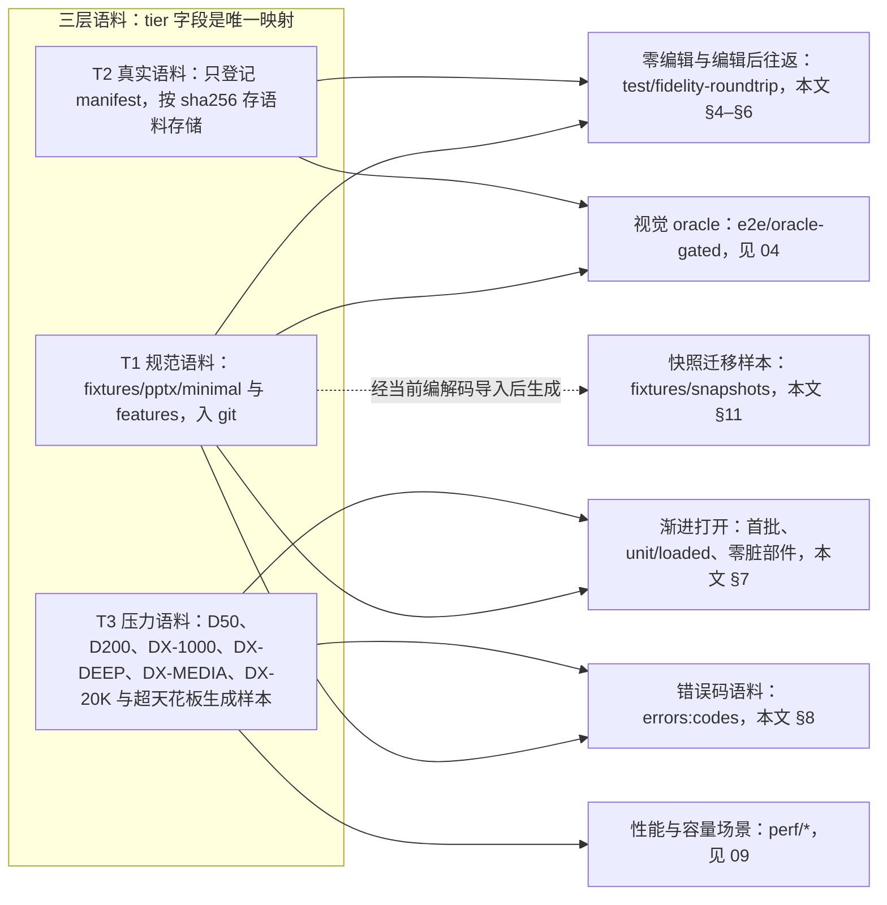
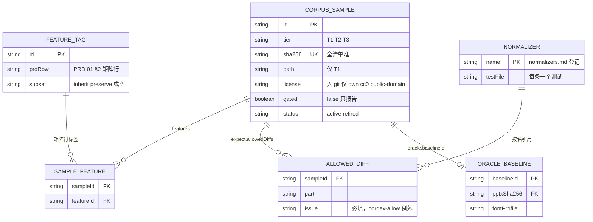
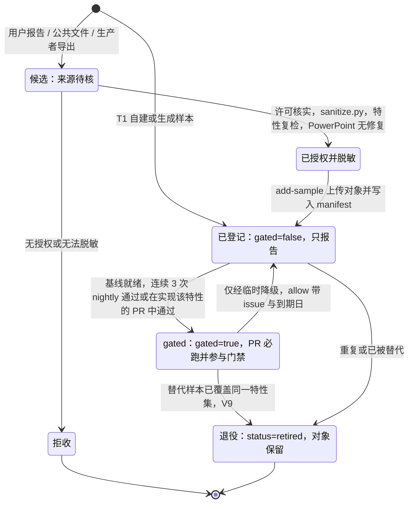
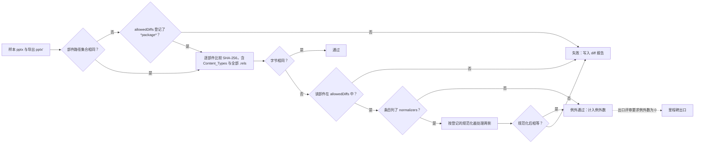
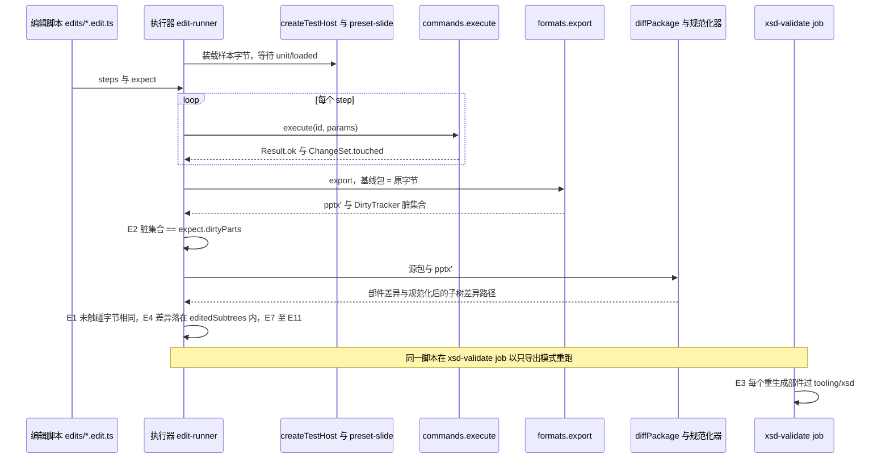
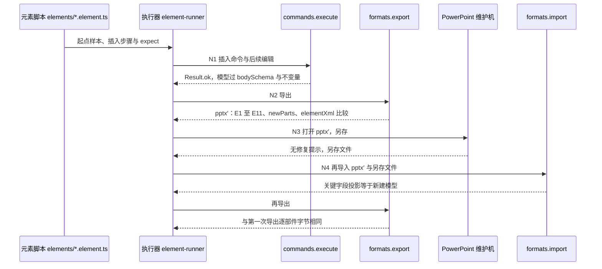
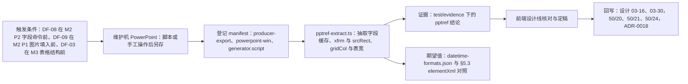

# 03 保真往返与语料库
> 状态：v0.1 | 负责：测试设计线 | 更新：2026-09-25；2026-09-25（§4.19）；2026-09-26（§4.20）；2026-09-26（§4.21：新增 §5.3 可追加元素往返语料；`[Content_Types].xml` 与 `.rels` 统一为「结构不变原样写回」（§4.2、§5.2 E7）；E9 白名单补 `tableStyles.xml` 追加与裸 `p:contentPart` 的 `p:xfrm`；§8 XML 限额改引 `XmlLimits`、补畸形 XML 两类；§9 表格样式、图表、墨迹、嵌入字体行）；2026-09-26（§4.21 整合：§1 规则 6 登记维护机生成的 oracle 样本（图表矩阵、arrow-ends、形状库 69 项）；§5.3 补五个命名往返用例）；2026-09-26（§4.21 Remap：原 30/08 与 30/07 迁出节的引用改指新位置，30/08 已删除）；2026-09-26（§4.21 复核：写回口径出处并列 ADR-0008 决策 5 与 ADR-0019 决策 5）；2026-09-30（§4.22 设计待决收口：新增 §12.1，登记三项 PowerPoint 对照与语料——DF-08 三语日期字段、DF-09 `obj` 占位符填图、DF-03 表格列分隔线拖动；§1 规则 6、§5.3、§13、§15、§16 同步）；2026-10-03（§4.24 设计线对齐审计：§6 新增 X6 服务端导出的足迹 `p:extLst` 往返（TA-9）、X7 评论不进足迹（AL-6）、X8 服务端导出按部署策略启用内容级插件与 renderer 经 RPC `contentPlugins` 取集合（PM-13、AL-3）、X9 自动化模板填充产物的足迹（AL-7）；§16 登记）；2026-10-08（design-language-v3 第 1 批收口：§5.1 编辑脚本覆盖面补形状不透明度——`slide.setShapeOpacity` 同时改填充与描边颜色的 `a:alpha`（rulings §4.25 TB-47），与背景「应用到全部」——只改所属母版的背景、不在各页新增 `p:bg`（TB-45）；判定与门禁不变） | 依赖：rulings §4.24 AL-3 / AL-6 / AL-7 / TA-9、[ADR-0050](../30-architecture/adr/0050-content-plugin-footprint.md)、[60/06](../60-backend/06-modules-jobs-import-export-thumbnails.md) §7.1 / §7.4 / §8.1 / §10.3、rulings §4.22 DF-03 / DF-08 / DF-09、rulings §4.21 X:q-content-types / q-table-depth / q-chart-route / q-extra-inserts、[ADR-0019](../30-architecture/adr/0019-xml-lexer-and-fidelity-tree.md)、rulings §4.20 TX-16、rulings §4.19 D-M2-CONTENT / C-06 / D-TEST-INFRA、PRD [03/01 §4](../10-prd/03-features/01-open-and-fidelity.md#4-保真度量口径产品验收定义测试实现见-70037004)、[PRD 04](../10-prd/04-non-functional-requirements.md) NF-02 / NF-08 / NF-09、[PRD 05](../10-prd/05-milestones-and-scope.md) M1–M5 验收、[30/04 §5.4](../30-architecture/04-document-model.md)、[30/11](../30-architecture/11-testing-strategy.md) §6 / §11 / §17、[ADR-0008](../30-architecture/adr/0008-opaque-preservation.md)、[ADR-0009](../30-architecture/adr/0009-snapshot-schema-version-and-migrations.md)、[40/04 §9](../40-modules/04-ooxml-format-and-pptx-codec.md)、[40/02 §9](../40-modules/02-kernel-protocol-and-document-core.md)

本文是保真往返与语料库的测试侧唯一事实源：语料分三层放在哪里、清单长什么样、样本怎么进来和退役、零编辑与编辑后往返怎么判、导出确定性与打开管线怎么验、错误码语料、基线包、快照迁移语料、PowerPoint 互操作证据，以及这些检查在哪个 CI 步骤、何时跑。

读者：`ooxml-core` / `ooxml-pptx` / `model-slide` 的实现者、语料维护者、CI 维护者。

边界：判定口径（什么算「零差异」、派生部件白名单）以 PRD 01 §4.1 与 30/04 §5.4 为准，本文只把它落成可执行的判定；阈值与语料规模数字取 PRD，只引用；包内测试文件清单在 [40/04 §9](../40-modules/04-ooxml-format-and-pptx-codec.md)；对象存储键布局以 [60/14](../60-backend/14-valkey-object-storage-and-retention.md) 为唯一登记表；CI 步骤名以 [12](./12-ci-gates-mapping.md) 为准；视觉比对见 [04](./04-visual-oracle.md)，性能场景见 [09](./09-performance-and-capacity.md)。

---

## 0. 本文拥有与引用

| 本文拥有 | 本文引用（不复述） |
|---|---|
| 语料三层的落点与 `test/corpus/manifest.json` 条目 schema、校验脚本 | 语料规模下限与保真门禁数字：PRD 04 NF-02、PRD 01 §4 |
| 样本来源、许可、脱敏与生命周期 | 零编辑 / 编辑后的判定表：PRD 01 §4.1 = 30/04 §5.4 |
| 零编辑往返与编辑后往返的执行器、规范化器登记、`allowedDiffs` 例外机制 | 不透明保留机制与白名单：ADR-0008 |
| 导出确定性（SV-02）与打开管线的语料级用例 | 渐进打开的协议与事件：[50-frontend/04](../50-frontend/04-document-commands-and-undo.md) §2、[50/13](../50-frontend/13-performance-and-bundling.md) |
| 错误码语料表、特殊对象用例、基线包用例（C-07） | 错误码的定义与 HTTP 映射：30/10 §1；导入作业：[60/06](../60-backend/06-modules-jobs-import-export-thumbnails.md) |
| 快照迁移语料的运行方式 | `schema-lock` 规则：ADR-0009 |
| 互操作检查的执行与证据归档 | 证据目录规则：[01 §8](./01-strategy-and-layers.md)、[13](./13-requirements-traceability.md) |

---

## 1. 语料分层与单一落点

依据：决策 T-CORPUS（30/11 §14 T1 待决的推荐默认 + 40/04 fixtures 口径）。

| 层 | 内容 | 规模下限（只引用） | 落点 | 入 git |
|---|---|---|---|---|
| T1 规范语料 | 手工构造或由生成器合成的最小样本与特性样本；PRD 01 §2 矩阵的每一行至少 1 个；含「继承专项」（OF-04）与「保留专项」（OF-12）两个子集 | NF-02 语料规模行；子集下限见 OF-04、OF-12 | 仓库根 `fixtures/pptx/minimal/`、`fixtures/pptx/features/` | 是 |
| T2 真实语料 | 脱敏且获授权的真实文件，覆盖 OF-20 所列的全部生产者 | NF-02 语料规模行（按里程碑递增）；PRD 05 §6 每里程碑 +100 | 只登记在 `test/corpus/manifest.json`，文件按 sha256 存语料存储 | 否 |
| T3 压力语料 | PRD 04 §0.2 参考文稿（D50、D200、DX-1000、DX-DEEP、DX-MEDIA、DX-20K，`perf` 固定成员）与生成的超天花板样本 | NF-02 语料规模行 | 同 T2 | 否 |

规则：

1. **tier 字段是三层与目录的唯一映射**。T1 条目带 `path`（仓库内相对路径），T2 / T3 条目不带 `path`、只带 `sha256`。同一个文件不得以两个 tier 出现。
2. **入 git 的条件**（三条同时满足才能是 T1）：单文件 ≤ 2 MB；许可为 `own`、`cc0` 或 `public-domain`；不含需要脱敏的内容。构造样本若确需大体积（例如 200 MB 媒体），归 T3。
3. **废止的落点**：`fixtures/pptx/wild/` 并入 T2 登记（文件迁到语料存储）；30/11 §12 的 `test/corpus/decks/` 不再使用。T1 的子目录分工：`minimal/` 放「每个矩阵行一个」的最小样本，`features/` 放专项样本，文件名前缀区分子集：`inherit-*`（继承专项）、`preserve-*`（保留专项）、`strict-*`（Strict 一致性类）、`errors-*`（错误码语料中可入 git 的部分）、`objects-*`（表格、图表、SmartArt、OLE 等特殊对象）。
4. **语料存储**：测试基础设施专用桶（与产品部署的 `data` / `snapshots` 两个桶无关），按 sha256 内容寻址，T2 / T3 样本、视觉基线产物（04 §2）与互操作证据截图（§12）共用；键布局、访问变量、取回脚本 `test/corpus/scripts/fetch-corpus.ts` 与缓存键以 [11 §10](./11-test-data-fixtures-and-determinism.md#10-大文件t-corpus) 为唯一登记处，本文不另起键名。不使用 Git LFS（配额与 fork 体验差，30/11 §14 T1）。
5. **拉取的执行规则**：每次读取都重算 sha256，不符即失败；CI 以 secrets 注入只读凭据（`CORDEX_CORPUS_ACCESS_KEY_ID` / `CORDEX_CORPUS_SECRET_ACCESS_KEY`，端点与桶名为普通变量 `CORDEX_CORPUS_S3_ENDPOINT` / `CORDEX_CORPUS_BUCKET`，rulings §4.20 TX-16），写入只由维护者以同名本地变量持写凭据执行；缺任一变量、缺凭据或缺对象时步骤**失败，不跳过**；来自 fork 的 PR 由维护者批准后运行（[12 §3](./12-ci-gates-mapping.md)）。
6. **维护机生成的 oracle 样本**（2026-09-26 整合登记，[04](./04-visual-oracle.md) §8.1、§8.2）：图表语料矩阵各行的样本（维护机脚本 `test/oracle/baseline/make-chart-corpus.ps1` 经 COM 生成）、箭头尺寸样本 `arrow-ends.pptx` 与形状库 69 项默认插入样本，都登记为 `source: 'producer-export'`、`producer: 'powerpoint-win'`，并在 `generator.script` 记下生成脚本；图表样本带 `oracle.categories` 含 `'chart'`，另两类带 `'geometry'`。tier 按规则 2 判定（能入 git 的放 `fixtures/pptx/features/`，否则登记为 T2）。它们依赖 PowerPoint，不进 `gen_cases.py --check` 的可重现检查，改版时由维护机重跑脚本并更新 sha256。rulings §4.22 推迟项要的三组 PowerPoint 对照样本（DF-08、DF-09、DF-03）同样按本条登记，清单与触发条件见 §12.1。

**图 1-1 语料分层与用途**



怎么读：左侧子图是三层语料，箭头指向消费它的检查；T1 与 T2 共同构成保真门禁的样本全集（NF-02 的「T1+T2」口径），T3 只服务渐进打开、性能与超限拒绝；虚线表示快照迁移样本不是独立采集，而是由 T1 样本经当前编解码导入后生成并入库。
依据：决策 T-CORPUS；PRD 04 NF-02、§0.2；30/11 §11。

---

## 2. manifest.json 条目 schema

`test/corpus/manifest.json` 是全部语料（含 T1）的唯一清单；schema 以 zod 写在 `test/corpus/manifest.schema.ts`，下面是字段口径（类型示意，以 schema 文件为准）：

```ts
type CorpusSample = {
  id: string;                 // 稳定 id，kebab-case；参考文稿用其代号，如 'd200'
  tier: 'T1' | 'T2' | 'T3';
  format: 'pptx' | 'docx' | 'xlsx';        // M5 起出现 docx / xlsx（§14）
  path?: string;              // 仅 T1：仓库内相对路径
  sha256: string;             // 小写 hex，全清单唯一
  sizeBytes: number;
  source: 'handmade' | 'generated' | 'producer-export' | 'public' | 'user-report';
  producer: string;           // powerpoint-win / powerpoint-mac / google-slides / keynote / wps / libreoffice / python-pptx …
  license: 'own' | 'cc0' | 'public-domain' | 'cc-by-4.0' | 'user-consent';
  licenseRef?: string;        // cc-by 的署名，或 user-consent 的内部授权工单号（不含个人信息）
  generator?: { script: string; params: Record<string, unknown>; seed: number };  // source='generated' 时必填
  features: string[];         // test/corpus/features.json 登记的矩阵行标签
  gated: boolean;             // true = PR 必跑并参与门禁；false = 已登记、只报告
  allow?: { issue: string; expires: string; reason: string };  // gated 退回 false 时必填，口径同 01 §10 临时降级
  status: 'active' | 'retired';               // 退役只改状态，语料存储中的对象保留
  expect: { roundtrip: 'exact' | 'skip'; allowedDiffs: AllowedDiff[] };  // 错误码语料为 skip，其余恒为 exact
  errorsExpect?: { code: string; details?: Record<string, unknown>; httpStatus?: number };
  oracle?: { baselineId: string; categories: string[]; fontsAvailable: boolean };      // 见 04 §2、§3
  perf?: { refDoc: 'D50' | 'D200' | 'DX-1000' | 'DX-DEEP' | 'DX-MEDIA' | 'DX-20K' };    // 见 09 §2
  addedIn: 'M1' | 'M2' | 'M3' | 'M4' | 'M5';
};
type AllowedDiff = {
  part: string;               // 部件路径；'*package*' 表示部件集合差异
  normalizers?: string[];     // 须是 normalizers.md 已登记的名字；缺省 = 该部件任意差异
  reason: string;
  issue: string;              // 必填：跟踪 issue 链接（cordex-allow 例外，§4.3）
  expires: string;            // 必填：YYYY-MM-DD，距提交日 ≤ 30 天（01 §10 临时降级口径）
};
```

配套文件：`test/corpus/features.json`（矩阵行标签表：`{ id, prdRow, subset?: 'inherit' | 'preserve' }`，每个标签指向 PRD 01 §2 的一行）；`test/corpus/targets.json`（NF-02 语料规模与 OF-04 / OF-12 子集下限的机器副本，含 `current` 里程碑，只收紧）。

**校验脚本** `test/corpus/scripts/validate-manifest.ts`，作为 `test/fidelity-roundtrip` 步骤的前置，任何一条不过即失败：

| # | 断言 |
|---|---|
| V1 | schema 解析通过；`id`、`sha256` 全清单唯一 |
| V2 | T1：`path` 存在、文件 sha256 与条目一致、≤ 2 MB、许可属于入 git 允许集；T2 / T3：无 `path` |
| V3 | `features` ⊆ features.json；features.json 每一行至少有 1 个未退役的 T1 样本 |
| V4 | 子集下限：`inherit` 与 `preserve` 子集数量、每种保留类特性样本数达到 targets.json |
| V5 | 各 tier 数量达到 targets.json 中 `current` 里程碑的下限；T2 的 `producer` 覆盖 OF-20 所列全部生产者 |
| V6 | `perf.refDoc` 六个参考文稿各恰好出现一次，且均为 T3 |
| V7 | `errorsExpect` 覆盖 §8 表中每一类，每类样本数达到下限 |
| V8 | `allowedDiffs` 的 `normalizers` 均已登记、`issue` 非空、`expires` 未过期；`gated` 样本的 `allowedDiffs` 总数不得多于 `origin/main` 上的同一文件（ratchet） |
| V9 | `retired` 的样本若曾为 `gated`，其 `features` 必须仍被其它 `gated` 样本覆盖；相对 merge-base 由 `gated: true` 改为 `false` 的条目必须带未过期的 `allow`（01 §10） |
| V10 | `targets.json` 与 PRD 04 NF-02「语料规模」行、OF-04 / OF-12 的数字一致（解析 PRD Markdown 表格对照） |

生成样本的可重现检查 `test/corpus/generators/gen_cases.py --check` 在 nightly 与生成器文件有改动的 PR 上运行：重新生成全部 `source='generated'` 的样本并比较 sha256。

**图 2-1 语料清单数据模型**



怎么读：一个样本挂多个矩阵行标签（经 SAMPLE_FEATURE 多对多），校验 V3 要求每个标签至少被一个 T1 样本覆盖；例外差异挂在样本上并按名引用登记过的规范化器；视觉基线是一对零或一，只有带 `oracle` 字段的样本才有（字段细节见 04 §2）。
依据：30/11 §11 清单字段；决策 T-CORPUS；PRD 04 NF-02。

---

## 3. 来源、许可、脱敏与样本生命周期

| 来源 | `source` | 说明 | 许可 |
|---|---|---|---|
| 自建（PowerPoint 365 Windows / macOS） | `handmade` | 每个特性一个最小文件（几何、填充、文本、表格、组合、占位符继承、Strict、嵌入字体、媒体…） | `own` |
| 合成 | `generated` | `test/corpus/generators/gen_cases.py`（python-pptx，`requirements.txt` 锁版本与哈希）参数化批量生成；OPC 结构类样本（限额、超天花板、外部关系）由 `@cordexjs/ooxml-core/testing` 的 `package-builder` 在测试时确定性生成，`generator.script` 写 `package-builder:<配方名>` | `own` |
| 其它生产者导出 | `producer-export` | 同一内容由 Keynote、Google Slides、LibreOffice、WPS 导出，用于生产者差异 | `own` |
| 公共领域 / CC | `public` | 少量真实世界文件，逐个登记许可与署名 | `cc0` / `public-domain` / `cc-by-4.0` |
| 用户报告 | `user-report` | 复现问题的文件，脱敏并取得书面授权后加入；授权记录存内部工单，manifest 只记工单号 | `user-consent` |

生成器约束：固定随机种子；`docProps/core.xml` 时间戳与 zip 条目时间取常量；同一参数两次生成字节相同。家族至少包括：187 种 `prstGeom` 每页一个（04 §5 几何 IoU）、继承矩阵（占位符 `type/idx` × `lstStyle` 各级 × `clrMapOvr` × 主题字体脚本）、表格 8 案例原生矩阵（OF-08）、图表类型矩阵（OF-09）、外部关系（`mailto:`、`file://`、`tel:`）、`mc:AlternateContent` 分支组合。

**脱敏**（`test/corpus/scripts/sanitize.py`，python-pptx + lxml，逐项可审计输出一份变更清单）：

1. 文本：按字符类别等长替换（拉丁字母 → 拉丁字母，CJK → 同字数常用汉字，数字 → 数字），保留 run 边界、段落结构、字号与语言标记，使断行特征不变。
2. 图片：替换为同尺寸、同格式、同色深的合成图，去除 EXIF；视频与音频替换为同容器的短静帧样本，保留海报帧尺寸。
3. `docProps/core.xml`、`app.xml`、`custom.xml` 的作者、公司、标题等清空或替换为常量；评论作者匿名化为「作者 N」。
4. 超链接与外部关系：保留协议与关系类型，主机名替换为 `example.com` 下的同构路径。
5. 嵌入对象负载（`embeddings/*`）替换为同类型的最小有效文件；`customXml/` 保留结构、清空值。
6. 脱敏后用特性探测脚本 `test/corpus/scripts/detect-features.ts` 复检 `features` 标签是否仍成立，再在 PowerPoint 中打开确认无修复提示，才能进入「已授权并脱敏」。

**登记**：`test/corpus/scripts/add-sample.ts` 计算 sha256、把 T2 / T3 文件上传语料存储（T1 则复制到 `fixtures/pptx/…`）、写入 manifest 条目并本地运行 V1–V10；变更以 PR 提交。

**准入 gated 的条件**：已生成视觉基线（带 `oracle` 字段时，见 04 §2）；`features` 已复检；并满足以下其一——(a) 所涉特性已实现的样本（外来文件、补充样本）：连续 3 次 nightly 通过；(b) 测试先行的新特性样本（30/11 §11「先加样本再实现」）：先以 `gated: false` 登记（只报告），在实现该特性的 PR 中改为 `gated: true`，以该 PR 上的全量运行通过为准。**退回**：`gated: true → false` 只能走 01 §10 的临时降级，条目带 `allow{issue, expires, reason}`（V9）。

**图 3-1 语料样本生命周期**



怎么读：自建与生成的 T1 样本直接进入「已登记」，外来文件必须先经许可与脱敏；「已登记」只报告，升为 gated 后才参与门禁；gated 退回只能走 01 §10 的临时降级（`allow` 带 issue 与 ≤ 30 天到期日）；退役只改状态、不删语料存储中的对象，保证历史报告可复现。
依据：30/11 §11；PRD 04 NF-02「真实文件须脱敏且获得使用许可」；PRD 01 OF-20 ratchet 与例外规则；[01 §10](./01-strategy-and-layers.md#10-门禁三级) 临时降级口径。

---

## 4. 零编辑往返判定

### 4.1 执行路径

执行器：`test/roundtrip/runner.test.ts`（Vitest，Node 环境），对 manifest 中 `expect.roundtrip='exact'` 的样本逐个执行：

1. 读字节 → `formats.import` 取该样本 `format` 对应的编解码器（执行器本身不写死 pptx，M5 复用，§14）→ `Snapshot`。
2. 分两条 store 路径各装载一次：`store-memory`（M1 起）与 `store-yjs`（M2 起，本地、无服务端；M2 起应用壳经协同快照编辑，rulings §4.19 D-M2-CONTENT）。
3. 每条路径直接 `formats.export`（基线包 = 原字节）→ `pptx′`。
4. `diffPackage(pptx, pptx′)`（`@cordexjs/ooxml-core/testing`）→ `PartDiff[]`，按 §4.2 判定。
5. M2 起另断言两条路径的 `pptx′` 部件级相同（每部件 sha256 相同）。

包内同类用例（`ooxml-pptx/__tests__/roundtrip-minimal.test.ts` 跑 `fixtures/pptx/minimal/**`）是开发期的快速子集；门禁以本执行器对 manifest 的全量判定为准。

### 4.2 判定

口径照 PRD 01 §4.1 与 30/04 §5.4「零编辑往返」行，不另起一版：

| 检查 | 通过条件 |
|---|---|
| 部件集合 | 导出包的部件路径集合与源相同 |
| 部件字节 | 每个部件 SHA-256 相同，**包括** `[Content_Types].xml` 与全部 `.rels`（这两类部件结构不变即写回原字节，零编辑时必然如此；ADR-0008 决策 5（写回规则）/ ADR-0019 决策 5（序列化 c14n 口径），rulings §4.21 X:q-content-types） |
| 不计入 | zip 条目顺序、时间戳、压缩方法与级别、extra 字段 |
| 例外 | 仅 §4.3 登记的 `allowedDiffs`，且计入例外数 |

> 30/11 §6 旧写法「`[Content_Types].xml` / `.rels` 按集合语义比较」只适用于**编辑后**的派生部件（§5.2），零编辑一律按字节比较；回写由总编排执行（§16）。

### 4.3 规范化器与 `allowedDiffs` 例外

- **规范化器登记表** `test/corpus/normalizers.md`：每条一行 `{ name, 作用, 适用场景, 测试文件 }`；首批：`c14n`（XML C14N）、`attr-sort`（属性按名排序）、`ws-insignificant`（忽略无意义空白）、`ns-prefix`（命名空间前缀归一）、`strict-to-transitional`（Strict 命名空间映射到 Transitional，只用于比较，不改产物）。每条在 `test/roundtrip/normalizers.test.ts` 有正例（应视为相等）与反例（语义不同必须仍判不等）。
- 规范化器的**常规用途**是编辑后脏部件的子树比较（§5）；在零编辑往返中只能经 `allowedDiffs` 引用。
- `allowedDiffs` 是 PRD OF-20「例外需 `cordex-allow` 标注与 issue」的落地：每条必须带 `issue`；列了 `normalizers` 时该部件经这些规范化后必须相等，未列时该部件任意差异都被接受。
- 例外通过的样本单独计数（`roundtrip-exceptions` 指标，进 diff 报告与出口评审）；**里程碑出口要求 T1 + T2 全部样本（不论是否 gated）零编辑往返通过且例外数为 0**（M1 验收 1、NF-02 零编辑 100%）；例外总数只减不增（V8）。

**图 4-1 零编辑往返判定**



怎么读：主线从左到右，字节相同直接通过；字节不同时只有两条出路——未登记即失败，已登记则按条目是否带规范化器分两个分支，最终都记为「例外通过」并计数；虚线表示例外只是临时豁免，里程碑出口时必须清零。
依据：PRD 01 §4.1、OF-20；30/04 §5.4；30/11 §6；PRD 04 NF-02。

### 4.4 解析后强制重生成（M1 起：差异只报告，保留专项的 XSD 阻断）

PRD 05 R-M1-2 指出只做零编辑往返会掩盖「脏部件重生成时带回未知内容」的缺陷，因此 M1 起另跑 `test/roundtrip/regen.test.ts`：不编辑，强制把每个已建模部件走一遍 `parse → generate`，与原部件在 `c14n + attr-sort + ws-insignificant` 下比较。差异即建模缺口，按部件类型计数进 diff 报告与保真指标（30/04 §5.4、PRD MT-02），**只报告，不阻断**；M2 编辑后往返（§5）成为门禁后，该计数仍保留作趋势。例外：T1 保留专项（`preserve-*`）强制重生成出的部件另交 `xsd-validate` job 校验，**自 M1 起阻断**（PRD 04 NF-02「重生成部件 XSD 有效」M1 列：100%，T1 保留专项）。

---

## 5. 编辑后往返（M2）

### 5.1 编辑脚本语料

PRD 05 M2 验收 2（`fidelity:edit-roundtrip`）要求编辑脚本语料达到规定数量；脚本放 `test/corpus/edits/<id>.edit.ts`，由执行器 `test/roundtrip/edit-runner.test.ts` 逐个运行：

```ts
export default defineEditScript({
  id: 'e-text-run-bold',
  sample: 't1-min-text-bullets',            // manifest id
  req: ['PRD:OF-18', 'PRD:ED-01'],          // 追溯标签，见 13
  steps: [/* { command, params }：只经 commands.execute，命令 id 以 model-slide 命令表为准 */],
  expect: {
    dirtyParts: ['ppt/slides/slide3.xml'],  // 精确集合（派生部件另按白名单判）
    editedSubtrees: ['ppt/slides/slide3.xml#//p:sp[p:nvSpPr/p:cNvPr/@id=4]/p:txBody'],
    removedParts: [],                       // 删页、删 OLE 等场景填写
  },
});
```

脚本覆盖面（每类至少 1 个，`validate-manifest` 同时检查 `sample` 存在）：文本 run / 段落编辑；形状增删、移动、缩放；插入图片（新部件命名）；页增删与重排；组合与取消组合；带 `extLst` / 未知属性的元素自身被编辑；删除被动画引用的元素；`mc:AlternateContent` 对象移动与缩放（M2 P1）；删除最后一个引用嵌入部件的 OLE；Strict 样本编辑；表格单元格文本（P1）；备注；隐藏页；超链接；裸 `p:contentPart` 删除（M1）与移动（M2 P1）；形状不透明度（`slide.setShapeOpacity`：同时改填充与描边颜色的 `a:alpha`、值相同，脏集合只有该页部件，2026-10-08，rulings §4.25 TB-47）；背景「应用到全部」（只改当前页所属母版的 `p:bg`，各页不新增 `p:bg`，带单独背景的页原样保留，PRD ED-20，TB-45）。新建元素的脚本另见 §5.3。同一执行器还承载 `layout:apply`（M2 验收 10）、`master:edit`（M3 验收 14）与 `theme:edit`（M3 验收 15）的脚本语料，这三者的视觉断言在 [04 §8](./04-visual-oracle.md)。

随机单元素编辑：`test/roundtrip/random-edit.test.ts` 对 `fixtures/pptx/features/*` 随机选一个元素与一个可编辑属性执行一条命令，期望脏集合 = 该元素所在页部件（加派生白名单），其余判定同 §5.2；PR 跑 20 个固定种子，nightly 跑 200 个，失败种子写入 `test/roundtrip/repros/`。

### 5.2 判定

| # | 断言（口径 = PRD 01 §4.1 编辑后各行、30/04 §5.4） | 执行处 |
|---|---|---|
| E1 | 未触碰部件字节相同 | `test/fidelity-roundtrip` |
| E2 | `DirtyTracker` 给出的脏部件集合 == `expect.dirtyParts` | 同上 |
| E3 | 每个重生成部件 XML 良构且通过 ECMA-376 XSD（Transitional；源为 Strict 且走 C 案时为 Strict） | 良构在同上；XSD 在 `xsd-validate` job |
| E4 | 规范化（`c14n` + `attr-sort` + `ws-insignificant`）后的差异路径全部落在 `expect.editedSubtrees` 内 | `test/fidelity-roundtrip` |
| E5 | 被编辑元素的未知属性、未知子元素、`extLst` 全部保留，子元素顺序符合 `schema-order` | 同上（`preserve-*` 样本） |
| E6 | `cNvPr@id` 在部件内唯一，引用处（连接符 `stCxn/endCxn`、`p:timing` 的 `spid`）一致 | 同上 |
| E7 | 派生部件只在白名单内变化：`docProps/core.xml` 的 `dcterms:modified`、`docProps/app.xml` 页数与字数、`docProps/thumbnail.jpeg`、`[Content_Types].xml` 只因新增类型与部件增删而变化、受新增 / 删除部件影响的 `.rels`。后两者的口径（ADR-0008 决策 5（写回规则）/ ADR-0019 决策 5（序列化 c14n 口径））：**结构不变即字节相同**——关系四元组（Id / Type / Target / TargetMode）集合或 Default / Override 集合未变的 `.rels` 与 `[Content_Types].xml` 必须与源字节相同，与所属部件是否变脏无关（仅文本编辑时页 `.rels` 字节相同）；**结构变了才按集合比较**，差集必须恰好对应新增或删除的部件，且重生成结果与规范形式 c14n 等价、原有条目相对顺序不变 | 同上 |
| E8 | 删页：页部件与其独占的 rels 目标（媒体、图表、备注）被移除，共享目标保留，无孤儿部件（源文件本就有的除外） | 同上 |
| E9 | 对不透明内容的修改只出现在 ADR-0008 决策 9 白名单：`p:timing` 引用清理、AlternateContent 分支 `xfrm` 同步（§4.21 起含裸 `p:contentPart` 自身 `p:xfrm`，M2 P1）、孤儿嵌入部件清理、`tableStyles.xml` 末尾追加包内缺失的内置样式定义（M3，§4.21，已有条目字节不动）；白名单外对不透明子树的任何改动在 E4 失败 | 同上 |
| E10 | 新增部件命名不冲突（`image<N>.<ext>`，N 取现有最大值 + 1），内容类型与 rels 同步 | 同上 |
| E11 | 编辑同页其它元素后，该页 `p:timing`、`p:transition`、`extLst` 子树规范化后逐字节一致，引用的 `spid` 仍有效（OF-12） | 同上（`preserve-*` 样本） |
| E12 | 导出文件在 PowerPoint 365 打开无修复提示 | 互操作，§12 |

Strict（M1 起，编解码层）：`strict-*` 样本以程序化 Mutation 编辑（不经 UI）后导出仍为 Strict 且过 Strict XSD（ADR-0008 决策 7，C 案）；触发 `format.pptx.strict_fallback_transitional` 兜底的样本单列并计入保真指标，不算通过。

**图 5-1 编辑后往返脚本**



怎么读：从上到下是一个脚本的一次运行；脚本只提供步骤与期望，编辑一律经 `commands.execute`（不直接写 store，保证撤销与脏追踪与真实编辑一致）；导出后先核对脏集合，再做部件级与子树级比较；XSD 校验不在本步骤，而是由 `xsd-validate` job 重跑同一批脚本完成，两处结论共同构成 `fidelity:edit-roundtrip`。
依据：PRD 01 §4.1、OF-18；PRD 05 M2 验收 2；ADR-0008「如何被机械验证」；09-07 §3 `xsd-validate`。

### 5.3 可追加元素往返语料（§4.21 新增）

导入往返只证明「读得回」；可追加元素还要证明「写得对」——从空白或模板页新建一个元素，导出后 PowerPoint 能直接打开，再导入回来仍是同一个元素。元素清单、命令与各元素的 OOXML 写法以 [50/19](../50-frontend/19-insertable-elements-overview.md) 与其分册为准，本节只定测试形态与断言。

脚本放 `test/corpus/elements/<id>.element.ts`，由执行器 `test/roundtrip/element-runner.test.ts` 运行，形态沿用 §5.1 的编辑脚本，另加两个字段：

```ts
export default defineElementScript({
  id: 'n-table-insert-default',
  sample: 't1-blank-16x9',                  // 起点样本（manifest id）
  element: 'table',                          // 元素键，与 50/19 的元素目录一致
  milestone: 'M2',                           // 该元素进入门禁的里程碑
  req: ['PRD:ED-10'],
  steps: [/* 插入命令与后续编辑，只经 commands.execute */],
  expect: {
    dirtyParts: ['ppt/slides/slide1.xml'],
    newParts: [],                            // 新增部件（图片、图表、xlsx 等）
    elementXml: 'expected/n-table-insert-default.xml',   // 新建元素的期望片段，与导出结果 c14n 等价
    reimport: ['kind', 'transform', 'table.styleId', 'table.cells'],   // 再导入后比较的关键字段投影
  },
});
```

每个脚本依次经过四步，任一步失败即整条失败：

| # | 步骤 | 断言 | 执行处 |
|---|---|---|---|
| N1 | 新建 | 命令成功；模型通过 `bodySchema` 与不变量（表格在 M3 另加 I-TBL1、I-TBL2） | `test/fidelity-roundtrip` |
| N2 | 导出 | §5.2 的 E1–E11 全部成立（新建也是编辑）；`newParts` 精确；新建元素的 XML 与 `elementXml` 在 `c14n` + `attr-sort` + `ws-insignificant` 下相等；新增部件与重生成部件过 XSD（E3） | 同上；XSD 在 `xsd-validate` job |
| N3 | PowerPoint 打开 | 打开无修复提示；元素可见、可选中；另存后的文件仍能通过 N4 | 互操作维护机（§12），半机械，证据归档 |
| N4 | 再导入 | 导出包再导入后，元素 `kind` 与 `reimport` 列出的字段等于新建时的模型（id 除外）；再导出与第一次导出逐部件字节相同（导出幂等） | `test/fidelity-roundtrip` |

**逐类断言**（每类至少 1 个脚本；元素到期的里程碑起进入 `fidelity:edit-roundtrip` 门禁，之前只报告）：

| 元素 | 门禁起点 | 关键断言 |
|---|---|---|
| 文本框 | M2 | 写 `txBox="1"` 与 `spAutoFit`；`rPr`/`pPr` 只写用户改过的属性；再导入仍是文本框 |
| 占位符文字（页上编辑、换版式、重置） | M2 | 保留 `p:ph`，不写死继承值（OF-04）；换版式按 `placeholderFamily` 匹配 |
| 预设形状、线条、动作按钮 | M2 | 未改的 `avLst` 省略；箭头类型与尺寸往返；动作按钮的 `ppaction` 原样保留 |
| 组合 | M2 | 嵌套组的 `chOff`/`chExt` 往返；组属性 `extLst` 写回 |
| 连接符 | M2（肘形与曲线重算 M3） | `stCxn`/`endCxn` 引用的 `cNvPr@id` 存在且一致（E6）；删除被连接的形状后导出去掉失效引用并上报诊断；再导入连接关系不变 |
| 图片、SVG | M2（SVG 的 PNG 回退 M2 P1） | 新媒体部件按 `image<N>.<ext>` 命名（E10）；`[Content_Types].xml` 只在首次出现该扩展名时新增 `Default`；只有该页的 `.rels` 结构变化（E7）；SVG 写 `asvg:svgBlip` 并带回退图片 |
| 页眉页脚与文本字段（页码、日期） | M2（P2） | `a:fld` 的 `id` 与 `type` 原样；脏部件的缓存 `a:t` 写当前计算值，干净部件原样；`p:hf` 往返；再导入仍是字段而非纯文本；日期字段缓存值的期望格式取 §12.1 DF-08 的三语语料 |
| 超链接 | M2（P1） | 新增 `TargetMode="External"` 关系；只有 `http(s)` 可激活；页 `.rels` 重生成后原有条目保持原相对顺序 |
| 表格 | 插入与单元格文字 M2；结构与样式 M3 | 插入写 `a:tbl`、`tableStyleId` 与 `firstRow`/`bandRow`；M3 套用包内没有的内置样式时 `tableStyles.xml` 只在末尾追加该样式定义（E9），已有条目字节不动、不重复追加；合并格的 `gridSpan`/`rowSpan`/`hMerge`/`vMerge` 往返；再导入样式 id 与格内容不变 |
| 图表（柱形、折线、饼、面积、散点） | M3 | 新增 `chartN.xml`、其 `.rels`、`embeddings/*.xlsx` 与内容类型；`c:numCache`/`c:strCache` 与 `Chart.data` 逐点一致；`c:externalData` 指向新 xlsx；xlsx 用 `ooxml-core` 打开后单元格值与缓存一致；改数据后只有该图表部件与 xlsx 变化；N3 另验 PowerPoint「编辑数据」可打开 |
| 图标 | M3（P2） | 同图片（SVG 加 PNG 回退） |
| 符号 | M3（P2） | 作为文本 run 写入；`a:sym` 或字体属性往返 |
| 音频、视频 | P2 | 写 `a:videoFile`/`a:audioFile` 与 `p14:media` 关系；**不写** `p:timing`（rulings §4.21 q-media-insert）；N3 另验 PowerPoint 媒体控件可点播 |

**命名用例**（2026-09-26 整合登记，出自 40/04 与 ADR-0008 决策 5、决策 9 (d)、决策 10 的本轮修订；用例 id 即 `test/corpus/elements/` 或 `test/roundtrip/` 下的脚本名）：

| id | 断言 | 门禁起点 |
|---|---|---|
| `rels-verbatim-when-unchanged` | 编辑只改了部件内容、关系集合与内容类型集合都没变时，`.rels` 与 `[Content_Types].xml` 原字节写回；集合变了才重生成，且沿用原 `rId`、只要求 `c14n` 等价（ADR-0008 决策 5） | M2 |
| `table-styles-append` | 套用包内没有的内置表格样式：`tableStyles.xml` 只在末尾追加该 `a:tblStyle`，`def` 属性与已有条目字节不变；部件不存在时新建并登记关系与内容类型（ADR-0008 决策 9 (d)） | M3 |
| `media-insert-no-timing` | 插入音频、视频后导出不写 `p:timing`，已有 `p:timing` 原样保留（rulings §4.21 q-media-insert） | P2 |
| `zoom-fallback-hlink` | 缩放定位对象的 Fallback 分支里的 `hlinkClick` 被只读提取用于放映跳转，导出时对象整体原样写回（ADR-0008 的 `zoom-fallback-hlink.test.ts`） | M2 P1（随放映跳转，50/25 §8） |
| `omml-linear-text` | 公式（OMML）的线性文本被只读提取为可访问名称与无回退时的纯文本，导出时公式部件与 Fallback 原样写回（ADR-0008 的 `omml-linear-text.test.ts`） | M1 |

不提供插入的元素（SmartArt、OLE、3D、墨迹、缩放定位、录屏，rulings §4.21 元素范围）不进本语料，其保留与只读断言在 §9。

**图 5-2 可追加元素往返**



怎么读：从上到下是一个元素脚本的一次运行。N3 在维护机上半机械执行，其余三步都在 `test/fidelity-roundtrip` 里自动完成；再导入时同时用 pptx′ 与 PowerPoint 另存后的文件，前者证明本系统自洽，后者证明写出的 XML 被 PowerPoint 接受后仍能读回。

依据：rulings §4.21（q-table-depth、q-chart-route、q-extra-inserts、q-media-insert 与元素范围）；[ADR-0019](../30-architecture/adr/0019-xml-lexer-and-fidelity-tree.md) 决策 5；ADR-0008 决策 9。

---

## 6. 导出确定性（SV-02）

前提（只引用）：`ooxml-pptx.encode` 是纯函数，不读布局、时钟与随机源，zip 写入器确定（60-backend/06 §7；静态约束为 40/04 §10 的禁时钟与随机源 lint 规则）；`docProps/thumbnail.jpeg` 是 `encode()` 的显式输入，缺省保留原部件（PRD 01 §2.1）。

| # | 用例 | 文件 | 里程碑 |
|---|---|---|---|
| X1 | 同一 `Snapshot`、同一基线包、同一 `thumbnailJpeg` 输入（分「缺省」与「提供」两种）在 Node 与 Chromium（客户端 Worker 导出路径）各导出一次，sha256 相等 | `test/roundtrip/export-parity.test.ts`（Vitest browser mode + Node 两个 project） | M1 |
| X2 | 同一进程连续导出两次字节相同；在 `TZ=UTC` 与 `TZ=Asia/Shanghai`、`LANG=C` 与 `zh_CN.UTF-8` 下导出字节相同（防时区与区域设置泄漏） | 同上 | M1 |
| X3 | 每个编辑脚本（§5.1）结束后的 `Snapshot` 也走 X1 | 同上 | M2 |
| X4 | 服务端 `server-headless` 经 `preset-server` 插件清单（FE-01）导出同一 `Snapshot` + 基线包，与 Node 导出 sha256 相等 | `apps/server/test/integration/pptx-roundtrip.int-spec.ts`，执行方式见 [07](./07-backend-integration-and-api-e2e.md) | M3（服务端导出） |
| X5 | 服务端导入：`server-headless` 经同一插件清单导入 gated T1 样本产出的 import 快照 body，与 Node 端 `formats.import` 同一字节的结果规范化后相等（同构） | 同上 | M2（服务端导入） |

样本集合：PR 跑全部 gated 的 T1 样本（含图片、嵌入字体、不透明部件、Strict 的样本必须在其中，V3 标签保证）；nightly 跑 T1 + T2 全量。PRD SV-02 的「规范化结果相同」在此以更严的 sha256 相等断言。

**内容插件足迹与按策略装配（2026-10-03，rulings §4.24）**：以下四例沿用 X4 的 harness（`apps/server/test/integration/pptx-roundtrip.int-spec.ts` 与同目录 `plugin-footprint-server.int-spec.ts`），声明文件夹具与 [07](./07-backend-integration-and-api-e2e.md) §7.5 相同（含测试用内容级插件 `test:content-p`）。足迹的写入、只增不减与客户端往返由 [02](./02-contract-suites-and-pluggability.md) §10.1 `footprint/*` 承担，这里只断言服务端链路。

| # | 用例 | 文件 | 里程碑 |
|---|---|---|---|
| X6 | 足迹的服务端往返（TA-9，§4.23 O-3）：`server-headless` 导出的 `ppt/presentation.xml` 含 `p:presentation/p:extLst/p:ext[@uri='urn:cordex:plugin-footprint:1']`，该部件与 Node 导出逐字节相同；服务端重新导入后 `resources['core.pluginFootprint']` 与导出前逐项相等；零编辑导出时该 `p:ext` 字节不变，其余 `extLst` 按 ADR-0008 原样保留；服务端只搬运足迹、不改写（导出前后足迹对象深相等） | `pptx-roundtrip.int-spec.ts` | M3（服务端导出；客户端侧 M2 由 02 `footprint/pptx-roundtrip` 覆盖） |
| X7 | 评论不进足迹（AL-6，ADR-0050 决策 1）：在 `collab` preset 下写评论线程后导出，足迹中没有 `comments` 条目、`namespaces` 不含任何 `comments.*`；以单人 preset（不装 `comments`）打开该文档与其导出的 pptx，`comparePluginFootprint` 结果为空；`comments.threads` 资源按未注册命名空间原样往返（导出再导入后深相等） | `plugin-footprint-server.int-spec.ts`；单人 preset 打开的界面断言见 [06](./06-frontend-component-and-e2e.md) §5 第 34 行 | M3 |
| X8 | 按部署策略装配内容级插件（PM-13，AL-3）：管理员把 `test:content-p` 设为 `disabled` 后受理的 pptx 导出，headless 宿主清单不含该插件，其元素按未知内容原样保留、导出字节与启用时该部分一致（[02](./02-contract-suites-and-pluggability.md) §10.1 `footprint/unknown-preserved` 同口径）；禁用前已受理的作业重试时仍用受理时的 `payload.contentPlugins`；render-export 与缩略图作业中 renderer 收到的 RPC `contentPlugins` 与作业 `payload.contentPlugins`（缩略图为处理时取得的集合）相等，`ids` 中而镜像里没有的插件记入页级 `missingResources`；renderer 进程内无 PG 客户端、无数据库凭据（与 [10](./10-security-testing.md) SEC-RS-08 同一断言，角色装配见 [08](./08-deployment-and-environment-e2e.md) §2） | `plugin-footprint-server.int-spec.ts` | M3 |
| X9 | 自动化模板填充的产物足迹（AL-7）：`fill-template` 作业经命令管线写入 `test:content-p` 的元素后，产物 pptx 的足迹含该插件条目（kernel 同事务维护，与浏览器同一实现），重新导入读回相等；模板文档自身的足迹不变 | `apps/server/test/e2e/automation/fill-template.e2e-spec.ts`（[07](./07-backend-integration-and-api-e2e.md) §11.6 AU4） | M3 |

---

## 7. 打开管线（CO-12 / CO-11）的语料级用例

`test/roundtrip/progressive-open.test.ts` 在 Node 中直接驱动 `FormatCodec.importProgressive()`（批次协议与 Worker 入口见 40/04），样本为 T3 的 D200、DX-20K 与多页 T1 样本。时间类断言（跳转 ≤ 300 / 100 ms、长任务）不在这里，见 [09 §4](./09-performance-and-capacity.md)。

| # | 断言 | 依据 |
|---|---|---|
| P1 | 首批只含主题、母版、版式与首页；其余页按 `order` 键顺序分批 | rulings §4.18 CO-12；40/04 §9.2 |
| P2 | 首批与全部后续批次合并后的 `Snapshot` 与一次性导入的结果深相等（规范排序后比较） | 同上 |
| P3 | 全部批次到齐（`unit/loaded`）后零编辑导出：`DirtyTracker` 脏集合为空，导出包按 §4.2 判定通过（后续批次以 `system('import')` 追加、不标脏） | CO-12；PRD 01 OF-18 |
| P4 | 后续批次不进入撤销栈：`unit/loaded` 之后 `canUndo = false` | CO-12 |
| P5 | 批次进行中发 `prioritize{ slideId }`，目标页所在批次先于其余未发批次到达 | rulings §4.18 CO-11 |
| P6 | 超系统天花板的样本在任何批次回传之前被拒绝（无 `batch` 消息），返回 `format.quota_exceeded` | CO-12；UX-13 |
| P7 | `unit/opened` 早于 `unit/loaded`；`loaded` 之前全文类命令（全选、查找替换、导出、跨页重排）等待或被禁用 | CO-12；命令守卫单测在 model-slide，界面行为 e2e 见 [06](./06-frontend-component-and-e2e.md) |

协同模式不走本路径（Y 状态由 HTTP 快照 bootstrap，30/06 §9.1），相应用例在 [05](./05-collab-simulation-and-property-tests.md) 与 [07](./07-backend-integration-and-api-e2e.md)。

---

## 8. 输入限额与错误码语料

M1 验收 5（`errors:codes`）要求 `.ppt`、加密、损坏、超限四类各有规定数量的样本；本表再加上宏与超天花板两类（rulings §4.16 Q15、§4.15 Q5）。错误码定义与 HTTP 映射以 30/10 §1 为准，服务端作业返回的 HTTP 状态由 [07](./07-backend-integration-and-api-e2e.md) 断言。

| 类别 | 错误码 | 样本构成 | 数量下限 | 期望 |
|---|---|---|---|---|
| 97-2003 二进制 | `format.unsupported_binary` | PowerPoint 另存的 `.ppt`；扩展名改为 `.pptx` 的 CFB；其它 CFB 容器 | ≥ 3 | 只读文件头判定，耗时满足 OF-02（5 次取中位数） |
| 加密 | `format.encrypted` | 标准加密与 agile 加密各至少 1 个；含 `EncryptionInfo` 的 CFB | ≥ 3 | 先于 zip 解析返回 |
| 宏 | `format.macro_rejected` | `.pptm` 扩展名；`.pptx` 扩展名但主内容类型为 macroEnabled；包内含 `vbaProject.bin` | 每种触发条件 ≥ 1，合计 ≥ 3 | 不解析幻灯片、不保留宏部件 |
| 损坏 | `format.pptx.invalid_package` | 非 zip；缺 `[Content_Types].xml`；缺 `ppt/presentation.xml`；截断的 zip；必需部件（`[Content_Types].xml`、`_rels/.rels`、`ppt/presentation.xml` 及其 `.rels`）XML 畸形（§4.21） | ≥ 4 | `details.part` 为首个失败部件 |
| 畸形 XML（非必需部件，§4.21） | 诊断 `format.malformed_xml`（`error` 级，不拒绝） | 页、版式或主题部件里的标签不匹配、未声明前缀、未定义实体、非法 UTF-8 各一 | 每种 ≥ 1 | 文件照常打开；该部件降级为不透明、零编辑往返字节相同；诊断带 `partName`、`reason`、行列（ADR-0019 决策 8） |
| 超 ZIP 安全限制 | `format.limit_exceeded` | ZIP 类：条目数、单条目解压、总解压、压缩比、媒体总量、每序列图表点数、位图预览像素各一；XML 类：[ADR-0019](../30-architecture/adr/0019-xml-lexer-and-fidelity-tree.md) 决策 6 `XmlLimits` 表的每个键各一对（恰在上限必须成功、上限 + 1 必须拒绝），另加 DOCTYPE 样本（无实体 DOCTYPE、内部实体、billion laughs、外部实体、参数实体各一，全部以 `limit: 'xml.doctype'` 拒绝）；数值从 `XmlLimits` 读取，不写死 | 每项 ≥ 1 | `details{limit, actual, max}`，`limit` 取 `zip.*` / `xml.*` 键 |
| 超规模天花板 | `format.quota_exceeded` | 页数、单页元素、总元素三个维度各一对边界样本：恰在上限（必须成功）与上限 + 1（必须拒绝）；文件大小维度只在服务端导入 | 每维度 1 对 | `details{dimension, limit, actual}`；在解析任何页之前触发（对页解析器的调用计数为 0） |

- 超限样本全部由 `package-builder` 确定性生成（§3），不把大文件或压缩炸弹入库；可入 git 的小样本放 `fixtures/pptx/features/errors-*`。
- 执行器 `test/roundtrip/error-corpus.test.ts` 遍历带 `errorsExpect` 的条目，断言码与 `details`；包内单测（`zip-limits.test.ts`、`import-admission.test.ts`、`import-envelope.test.ts`）见 40/04 §9。
- 可配置性：限额按部署配置可收紧、放宽不超过 2 倍（OF-24）——配置 schema 测试断言 2 倍被接受、超过 2 倍被拒绝。
- 包络外、天花板内的文件照常打开（rulings §4.18 UX-13）：DX-20K 与边界「恰在上限」样本即此证据。
- EMF / WMF 栅格化的三项上限（记录数、输出像素、耗时；M2，OF-24）超限时**不拒绝文件**，该元素回到占位并上报 `render/element-degraded`：每项一个超限样本，断言文件照常打开、其余元素正常渲染、无 `format.limit_exceeded`（样本由 `package-builder` 生成，M2）。

---

## 9. 特殊对象

M1 验收 10（`fidelity:objects`，rulings §4.15 Q7）与 PRD 01 §2.6 的落点。视觉阈值只在 [04 §6](./04-visual-oracle.md) 判定，本表只列往返与结构断言。

| 对象 | 断言 | 执行处 | 里程碑 |
|---|---|---|---|
| 表格 | 零编辑往返通过；8 案例原生矩阵与语料表格子集进入视觉 gated 类别；`tableStyles.xml` 零编辑字节相同，M2 起渲染按其中的样式继承（只读解析），M3 起追加样式见 §5.3 | `fidelity-roundtrip`；视觉见 04 | M1 / M2 / M3 |
| 图表 `c:chart` | 部件零编辑字节相同；渲染数据只来自 `c:numCache` / `c:strCache`（以渲染节点上的数据属性与缓存逐点比对，100% 一致）；不以包内预览位图代替；M3 起 `Chart.data` 未变的图表部件与内嵌 xlsx 在编辑同页其它元素后仍字节相同，改数据与新插入见 §5.3 | 同上；`slide-render` 单测（40/07 §9） | M1 / M3 |
| chartex `cx:` | 渲染为诊断占位并上报 `render/element-degraded{reason:'chartex-unsupported'}`；**不**选其 `mc:Fallback`；部件保留 | DOM 断言 + 往返 | M1 |
| SmartArt | 有 `dsp:drawing` 时按 dsp 渲染（含 `dsp:txXfrm`）；无 dsp 部件时占位并上报；整体移动 / 缩放 / 删除（M2）后 `dgm` 四部件与 `dsp` 部件关系完整 | 往返（E8 / E9）+ DOM 断言 | M1 / M2 |
| OLE | 显示 `mc:Fallback` 中 `p:pic` 提取的预览图（DOM 中为图像而非占位）；预览为 EMF / WMF 时 M2 起栅格化；删除最后一个引用后嵌入部件与内容类型条目被移除 | 往返 + `orphan-embeddings.test.ts` | M1 / M2 |
| `mc:AlternateContent` | 渲染首个受支持的 `mc:Choice`，否则 `mc:Fallback`；零编辑时全部分支字节保留；删除（M1）后导出过 XSD 且 PowerPoint 无修复；移动 / 缩放（M2 P1）后各分支 `xfrm` 一致、其余字节不变 | 往返 + `alternate-content-xfrm.test.ts` | M1 / M2 |
| 墨迹：裸 `p:contentPart`（§4.21） | 映射为 `UnknownShape` 并占位渲染；零编辑时元素与 `ppt/ink/*.xml` 字节相同；删除（M1）整体移除、无孤儿 ink 部件；移动 / 缩放（M2 P1）只改该元素的 `p:xfrm`（E9） | 往返 + `content-part.test.ts`（40/04 §9.2） | M1 / M2 |
| 未知 `a:graphicData` | 有 Fallback 图片时近似显示，否则占位并上报 `render/element-degraded` | DOM 断言 | M1 |
| 外部关系 | 含 `mailto:`、`file://`、`tel:` 的样本零编辑时 `.rels` 字节相同；编辑后 Relationship 一条不少；渲染层对非 `http(s)` 目标不激活（不可点击、不发请求） | `relationships-external.test.ts` + 往返 + 网络请求断言 | M1 |
| Strict 一致性类 | 加载后 `unit.meta.conformance = 'strict'`；零编辑字节相同；编辑后见 §5.2 Strict 段 | 往返 | M1 |
| `.ppsx` / `.potx` | `unit.meta.contentType` 记录原内容类型；导出保持 | 往返 | M1（P1） |
| 数字签名 `_xmlsignatures/` | 零编辑保留；M2 起打开签名文件出提示（P2） | 往返 | M1 |
| 动画与切换 | 保留专项子集零编辑通过；E11；删除被动画引用的元素后无悬空 `spid` 且过 XSD | 往返 + `timing-refs.test.ts` | M1 / M2 |
| 嵌入字体 | 零编辑字节相同；`.fntdata` 按 EOT 容器解出（MTX 压缩、XOR 加密、未压缩三类样本各至少 1 个，§4.21）；受限 `fsType` 字体在编辑态不加载、查看态加载（FontFace 列表断言，视觉部分见 04 §8）；解码失败时跳过并诊断，不影响打开 | 往返 + browser mode 单测 + `embedded-font.test.ts`（40/04 §9.1） | M1 / M2 |

---

## 10. 基线包（C-07）

导出需要基线包（不透明部件字节的来源，ADR-0008）。客户端单机导出用内存中的原字节；服务端导入成功时把原件复制为随文档生命周期保留的基线对象，`document_snapshots.baseline_key`（`kind='import'`）指向它；导入原件本身按保留期清理。键模板与保留期配置以 [60/14](../60-backend/14-valkey-object-storage-and-retention.md) 为唯一登记表（基线在 `data` 桶的 `docs/{docId}/baseline/…`，原件在 `docs/{docId}/imports/{jobId}/…`）；原 30/08 篇 §16.2「以导入原件作基线」的旧写法被本决策取代。依据：决策 C-07（rulings Q17 原件 30 天 + PRD SV-01 基线随文档）。

用例均为服务端集成（容器 harness 见 [07](./07-backend-integration-and-api-e2e.md)）：

| 用例 | 里程碑 |
|---|---|
| B1 导入成功后基线对象存在且 sha256 = 源文件；`baseline_key` 指向基线前缀而非导入原件前缀；新建空白与内置模板经同一两步导入，同样有基线 | M2 |
| B2 `FixedClock` 前进超过 `retention.importOriginalDays`，运行 `imports-cleanup` 周期作业后导入原件不存在；随后以该基线导出 pptx 成功（M2 以 Node 端 `formats.export` 代表客户端路径，二者按 X1 同一字节；M3 起另加服务端导出），且与清理前的导出 sha256 相等 | M2（`imports-cleanup` 随服务端导入在 M2，[60/06](../60-backend/06-modules-jobs-import-export-thumbnails.md) §4） |
| B3 零编辑导出按 §4.2 判定与源文件一致：M2 断言「import 快照 + 基线包」经 Node 端 `formats.export` 的结果（与客户端 Worker 导出按 X1 同一字节）；M3 起服务端导出同样断言 | M2 / M3 |
| B4 导入在上传或解析阶段取消（rulings §4.18 UX-14）后，既无导入原件也无基线对象 | M2 |
| B5 永久删除文档后两个桶在 `docs/{docId}/` 前缀下（含基线）无任何对象版本——断言在 [07](./07-backend-integration-and-api-e2e.md) 的永久删除用例中执行 | M3 |
| B6 覆盖导入（带 `docId` 的两步导入）生成新的 import 快照与新基线后，最新 import 快照的基线对象不被保留作业删除（rulings §4.19 C-06），旧基线随其快照按保留规则清理 | M2（`snapshots-retention` 在 M2，PRD 05 §0.3「持久化与快照」行） |

**M2 的基线来源**（rulings §4.19 D-M2-CONTENT）：M2 起服务端文档的内容以协同快照为唯一事实源，不设 pptx 内容版本；每篇服务端文档都由服务端导入产生 import 快照（新建空白 / 内置模板也经两步导入模板字节），客户端导出服务端文档时的基线包就是该文档最新 import 快照 `baseline_key` 所指对象。因此 M2 起的基线用例为「两步导入 → 以协同打开 → 零编辑导出与源文件按 §4.2 一致」（B1、B3）；本地文件与 M1 查看器仍以内存原字节为基线。

---

## 11. 快照迁移语料

规则本体见 ADR-0009（决策 4 schema-lock、决策 5 样本语料、决策 6 不向前写）；本文只定样本怎么来、步骤怎么跑。

- **落点**：`fixtures/snapshots/<documentType>/v<N>/*.json` 与 `fixtures/snapshots/<documentType>/schema-lock.json`；`slide` 之外，文档类型盲夹具 `fixture` 与 `fixture-grid` 各需 v1 样本（40/02 §9）。ResourceHook 命名空间的独立版本按同一规则留样，落点 `fixtures/snapshots/resources/<namespace>/v<N>/`（本文登记）。
- **样本怎么来**：升版的 PR 在改 schema **之前**运行 `pnpm corpus:snapshot-samples --type <documentType>`，用当前编解码导入 `test/corpus/snapshot-sample-sources.json` 列出的 T1 样本（覆盖每种实体类型），把规范化 JSON 写入 `v<N-1>/`，与 `Migration` 同一 PR 提交；`fixture` / `fixture-grid` 没有文件格式，样本由各自 `testing/` 中的 builder 生成。
- **`scanners` job 的 `schema-lock` 步骤**：`bodySchema` 规范化哈希变了而 `schemaVersion` 未增 → 失败；版本增加而无对应 `Migration` 贡献 → 失败；版本增加而 `v<N-1>/` 无样本 → 失败。
- **`test/snapshot-migration-corpus` 步骤**，对每个样本：
  1. `migrations.plan` → `run` 到当前版本，`validateSnapshot` 通过；
  2. 装入 `store-memory`（M2 起再装 `store-yjs`）后 `exportSnapshot()`，与迁移结果规范化后相等（装载无损）；
  3. 负向：删去链上一步 → `MIGRATION_PATH_MISSING`；样本版本高于运行时 → `SNAPSHOT_TOO_NEW`。
- 服务端批量预迁移（`server-headless` 的 migrate 任务）用同一批样本，在 [07](./07-backend-integration-and-api-e2e.md) 中断言。

---

## 12. 互操作（半机械）

PRD 05 M1 验收 3（`fidelity:interop`）、PRD 01 §4.4、NF-08。PowerPoint 不进 CI，下列检查在视觉基线维护机上执行（机器安排见 [04 §2](./04-visual-oracle.md)），输入为 nightly 产物 `roundtrip-exports`（§13）。

| # | 检查 | 方式 | 里程碑 |
|---|---|---|---|
| I1 | 导出文件在 PowerPoint 365 Windows 打开无修复提示（零编辑导出：gated T1 + T2；M2 起加编辑脚本产物） | `test/roundtrip/interop/win-open.ps1`：COM 以无窗口方式打开，UI Automation 监测打开期间出现的任何模态对话框；无对话框、60 s 内打开且页数与期望一致为通过；失败项截图，人工复核 | M1 |
| I2 | 同上，PowerPoint 365 macOS | `test/roundtrip/interop/mac-open.applescript`，判据同 I1 | M2（PRD 05 M1 验收 3：macOS 基线与 Mac 互操作抽检自 M2 起；M1 只报告） |
| I3 | 我们导出 → PowerPoint 另存 → 我们再打开：不崩溃，且对 PowerPoint 基线的 SSIM 不低于首次打开的 0.98 倍 | I1 脚本追加 `SaveAs`；SSIM 用 04 §5 的度量实现 | M2 |
| I4 | 编辑往返语料：PowerPoint 渲染我们导出的文件，与导出前我们的渲染比较，SSIM 达到 NF-08 M2 行 | 编辑脚本产物 + 04 §5 度量 | M2 |
| I5 | PowerPoint 2016 / 2019 打开无修复（抽样，best-effort） | 人工 | M2 |
| I6 | LibreOffice Impress 24.x 打开不崩溃，差异记录 | `test/roundtrip/interop/libreoffice.test.ts`：容器内 `soffice --headless --convert-to pdf`，超时或非零退出即失败；差异只报告。**机械**，nightly | M1 |
| I7 | 其它生产者（Google Slides、Keynote、WPS、LibreOffice）产出的文件作为输入全部打开成功 | T2 的 `producer` 覆盖（V5）+ 零编辑执行器的打开结果；**机械** | M1 |
| I8 | 评论导出为现代评论部件后 PowerPoint 365 可见且作者、时间正确（抽样） | COM 读取各页 `Comments` 集合比对 | M3 |
| I9 | SmartArt 整体移动 / 缩放后在 PowerPoint 中仍可编辑 | COM 检查 `HasSmartArt` 与节点数 | M2 |

**维护机**（rulings §4.19 D-TEST-INFRA）：一台 Windows + PowerPoint 365 维护机，不进 CI；macOS 基线在 M2 加入。PRD 05 M1 验收 3 已把 macOS 基线与 Mac 互操作抽检定在 M2 起，因此 M1 期间 I2 只由维护者在自有 Mac 上以同一脚本报告性运行，结果按下述方式归档、不作 M1 出口判据；M2 起 I2 在加入的 macOS 基线机上执行并计入出口。

**证据归档**（决策 T-COVERAGE-EVIDENCE）：每次执行写 `test/evidence/<里程碑>/fidelity-interop.md`（结论、日期、执行人、PowerPoint 版本与 build、样本数、失败项与复核结论、产物链接）；截图等大文件按 sha256 存入同一对象存储（[11 §10](./11-test-data-fixtures-and-determinism.md#10-大文件t-corpus)），证据文件列出其 sha256；需求追溯矩阵中标 `manual` 并单独统计（[13](./13-requirements-traceability.md)）。执行频率：每周一次，另在每个里程碑出口前全量一次。

### 12.1 PowerPoint 行为对照与待交付语料（rulings §4.22）

rulings §4.22 有三项推迟项要等维护机上的 PowerPoint 结果才能定稿。它们不是周期检查，按各自的触发条件交付一次，上游改版时重跑。样本按 §1 规则 6 登记（`source: 'producer-export'`、`producer: 'powerpoint-win'`，脚本记在 `generator.script`；手工操作的记 `manual:<编号>`）；抽取结果由 `test/corpus/scripts/pptref-extract.ts` 按编号输出 JSON；结论写 `test/evidence/<里程碑>/pptref-<编号>.md`（里程碑取交付时所在的里程碑，格式同 §12 的证据归档），交前端设计线核对、定稿并回写。

| 编号 | 交付物 | 做法与判读 | 触发条件 | 结论去向 |
|---|---|---|---|---|
| DF-08 | `datetime1`…`datetime13` 三语语料 | 维护机脚本 `test/oracle/baseline/make-datetime-corpus.ps1` 按 zh-CN、en-US、ja-JP 三种语言（文本的语言标记与「日期和时间」对话框的语言一致），各插入 13 种日期字段（勾「自动更新」），用 PowerPoint 另存。插入时刻要能区分月与日、12 与 24 小时制，取样张同一时刻 2026-09-30 14:32:05，脚本记下实际时刻。抽取每个 `a:fld@type` 与其缓存 `a:t`，得到 3 × 13 的「格式代码 → 显示值」表 `test/corpus/expected/datetime-formats.json`；M2 P2 起，产品侧格式表的单测以它为期望值 | M2 P2 开工 `slide.insertField`、`slide.setHeaderFooter` 之前 | 前端设计线（[50/20](../50-frontend/20-elements-text.md) §8 T-4）核对，回写设计 03-16 与 `datetime-formats.ts`；en-US 的 `datetime4`、`datetime6` 与 PowerPoint 原样一致就照搬 |
| DF-09 | `obj` 占位符填入图片后的 `p:pic` | 维护机脚本 `test/oracle/baseline/make-placeholder-picture.ps1` 分别在 `obj` 占位符（「标题和内容」版式）与 `pic` 占位符（「图片与标题」版式）上，用占位符图标插入三种长宽比的图片（比框宽、比框高、与框同比），然后另存。抽取 `p:pic` 的 `p:spPr/a:xfrm`（有无、取值）与 `a:blipFill/a:srcRect`。没有显式 `xfrm`（或等于占位符框）且 `srcRect` 在一个方向非零，判为「裁剪填满」；有显式 `xfrm`、一边等于框另一边更小，且 `srcRect` 缺省或全零，判为「等比放入」。定稿后，§5.3 里图片填入占位符的元素脚本以这批样本为 `elementXml` 的对照 | M2 P1 图片填入（`slide.fillPlaceholder` 图片）开工前 | 前端设计线（[50/21](../50-frontend/21-elements-structure.md) §8 S-4）定稿；结论为等比放入时改 ADR-0018 决策 10、50/21 §3 与 [50/19](../50-frontend/19-insertable-elements-overview.md) §3.1；`pic` 占位符两种结论都裁剪，样张不改 |
| DF-03 | 表格内部列分隔线的拖动语义 | 3 列等宽表格样本，维护者在 PowerPoint 里手工拖第 1、2 列之间的分隔线向右约 0.5 in（COM 只能直接设列宽，模拟不了拖动），另存并录屏。抽取 `a:gridCol@w` 与 `p:graphicFrame/p:xfrm/a:ext@cx`：左列变宽、右列等量变窄、表宽不变，判为「此消彼长」；只有左列变宽、表宽随之变大，判为「只改左列」 | M3 表格结构开工前 | 前端设计线（[50/24](../50-frontend/24-elements-tables-and-charts.md) §2.14 第 4 条）定稿；样张暂按此消彼长，结果不符时改列宽拖动角标与设计 03-30 §5.2 |

**图 12-1 PowerPoint 对照项的交付与回写**



怎么读：三项都走同一条路：到触发条件时在维护机上产出 PowerPoint 另存的样本，按 §1 规则 6 登记，再抽取判读所需的字段写成证据，交前端设计线定稿并回写各自的文档；DF-08 与 DF-09 的抽取结果同时成为后续自动测试的期望值。
依据：rulings §4.22 DF-03、DF-08、DF-09；50/20 §8 T-4、50/21 §8 S-4、50/24 §2.14 第 4 条。

---

## 13. 运行时机与产物

| 检查 | PR 与合入 main | nightly | CI 步骤 |
|---|---|---|---|
| 清单校验 V1–V10 | 每次 | 每次 | `test/fidelity-roundtrip`（前置） |
| 零编辑往返（§4） | 全部 gated 样本 + T1（超时按下文抽样） | T1 + T2 全量 | `test/fidelity-roundtrip` |
| 双 store 部件级相同（M2 起） | gated 样本 | 全量 | 同上 |
| 强制重生成计数（§4.4，报告） | — | 全量 | 同上 |
| 编辑脚本（§5，M2 起） | 全部 gated 脚本 + 随机编辑 20 个种子 | 全部脚本 + 200 个种子 | 同上 |
| 重生成部件 XSD（§4.4 保留专项，M1 起；E3 编辑脚本，M2 起） | 保留专项 + 全部 gated 脚本 | 保留专项 + 全部脚本 | `xsd-validate` job |
| 导出确定性（§6） | gated T1 | T1 + T2 | `test/fidelity-roundtrip` |
| 渐进打开（§7） | D200 与多页 T1 | 另加 DX-20K | 同上 |
| 错误码语料（§8） | 全部 | 全部 | 同上 |
| 生成器可重现 | 生成器文件有改动时 | 每次 | 同上 |
| 快照迁移（§11） | 全部 | 全部 | `test/snapshot-migration-corpus`；锁在 `scanners/schema-lock` |
| 基线包（§10，M2 起；B5 M3） | 每次 | 每次 | `test/server-integration` |
| LibreOffice 互操作（I6） | — | 每次（崩溃或超时即失败，差异只报告） | `test/fidelity-roundtrip`（nightly 套件） |
| PowerPoint 互操作（I1–I5、I8、I9） | — | — | 维护机，每周与里程碑出口前 |
| PowerPoint 对照（§12.1 DF-08、DF-09、DF-03） | — | — | 维护机，按各项触发条件交付一次，上游改版时重跑 |

- **PR 时长**：NF-09 规定每 PR 的语料回归 ≤ 10 min。先在步骤内按 `sha256` 取模分片并行；分片后仍超时，T1 部分改为抽样：全部 gated 样本 ∪ 特性标签与本 PR 改动包相关的样本（映射表 `test/corpus/package-features.json`，改动 `ooxml-*` 时视为全部相关）∪ 轮换切片（`hash(id) mod 7 == PR 编号 mod 7`）。抽样规则确定、可复现。
- **重试**：本文全部门禁步骤不重试、不隔离（决策 T-CI）。nightly 失败自动建 issue 并阻断下一次发布打标签，不阻断合并；步骤与触发段的总表见 [12](./12-ci-gates-mapping.md)。
- **产物**：`roundtrip-diff-report`（HTML + JSON：失败样本、检查编号、部件路径、首个差异字节偏移、规范化差异片段、实际与期望脏集合、例外数）；`roundtrip-exports`（nightly 的导出文件，供 §12）；随机编辑失败种子。保留 14 天。

---

## 14. M5：docx 与 xlsx

PRD 05 M5 验收 5（`roundtrip:docx-xlsx`，P1）：docx 与 xlsx 零编辑往返各达到规定样本数，部件级零差异。

- 样本落点仿 T1：`fixtures/docx/{minimal,features}/`、`fixtures/xlsx/{minimal,features}/`，manifest 条目 `format` 取 `docx` / `xlsx`。
- 执行器与 `diffPackage`、规范化器**不做任何改动**：执行器按 `format` 经 `formats` 取编解码器，本身不 import 任何具体编解码包；`ooxml-core`（含 `testing/`）在 `horizontal-freeze` 冻结范围内。这一点本身就是文档类型盲的证据之一（冻结检查见 [02](./02-contract-suites-and-pluggability.md)）。
- M5 不含 docx / xlsx 的编辑后往返与视觉 oracle。

---

## 15. 机械验证

| 断言 | PRD 检查名 / 依据 | 执行处 | 形态 |
|---|---|---|---|
| 清单 V1–V10 全部成立（含 ratchet：gated 样本例外数不增、targets.json 与 NF-02 一致） | NF-02、OF-20 | `test/fidelity-roundtrip` 前置 | 机械 |
| PR 上 gated 样本零编辑往返全部通过；里程碑出口时 T1 + T2 全部样本通过且例外数为 0 | `fidelity:roundtrip`（M1 验收 1） | `test/fidelity-roundtrip`；nightly 全量结果为出口证据 | 机械 |
| 编辑后 E1–E11 全部成立 | `fidelity:edit-roundtrip`（M2 验收 2） | `test/fidelity-roundtrip` | 机械 |
| 可追加元素 N1、N2、N4 全部成立，每类元素到期的里程碑起至少 1 个脚本（§5.3） | `fidelity:edit-roundtrip`（随元素里程碑扩充） | `test/fidelity-roundtrip`；XSD 在 `xsd-validate` job | 机械 |
| `[Content_Types].xml` 与 `.rels` 结构不变即字节相同（§4.2、E7） | ADR-0008 决策 5（写回规则）/ ADR-0019 决策 5（序列化 c14n 口径） | `test/fidelity-roundtrip` | 机械 |
| 重生成部件过 XSD（M1 起 §4.4 保留专项；M2 起 E3） | 同上；NF-02「重生成部件 XSD 有效」 | `xsd-validate` job | 机械 |
| 浏览器、Node、服务端导出 sha256 相等 | SV-02 | `test/fidelity-roundtrip`；服务端在 `test/server-integration` | 机械 |
| 渐进打开 P1–P7 | rulings §4.18 CO-11 / CO-12 | `test/fidelity-roundtrip` | 机械 |
| 错误码语料每类达到下限且码与 `details` 正确 | `errors:codes`（M1 验收 5） | 同上 | 机械 |
| 特殊对象断言 | `fidelity:objects`（M1 验收 10） | 同上；视觉部分 `e2e/oracle-gated` | 机械 |
| 基线包 B1–B5 | 决策 C-07、PRD SV-01 | `test/server-integration` | 机械 |
| 历史快照样本全部迁移并校验；schema 变更必有迁移与样本 | ADR-0009 | `test/snapshot-migration-corpus`；`scanners/schema-lock` | 机械 |
| PowerPoint 打开无修复、另存再开稳定、评论部件可见（I8）；可追加元素 N3 | `fidelity:interop`（M1 验收 3）、`comments:roundtrip`（M3 验收 11）、NF-08 | 维护机脚本 + 人工复核，证据归档 | 半机械 |
| LibreOffice 打开不崩溃（差异只报告） | NF-08 | `test/fidelity-roundtrip`（nightly） | 机械 |
| §4.22 推迟项的 PowerPoint 对照在触发条件前交付，样本登记、抽取 JSON 与证据齐全（§12.1） | rulings §4.22 DF-03、DF-08、DF-09 | 维护机脚本或手工操作 + `pptref-extract.ts`，证据归档 | 半机械 |
| docx / xlsx 零编辑往返 | `roundtrip:docx-xlsx`（M5 验收 5） | `test/fidelity-roundtrip` | 机械 |

---

## 16. 已定裁决与回写

**rulings §4.19 用户裁决（原「待确认」已定稿）**

| 决策 id | 本文写法 | 位置 |
|---|---|---|
| D-TEST-INFRA | PowerPoint 维护机为一台 Windows + PowerPoint 365（不进 CI），macOS 基线 M2 加入；M1 的 macOS 互操作只由维护者自有 Mac 报告性运行，自 M2 起计入出口 | §12 |
| D-M2-CONTENT | M2 起服务端文档以协同快照为唯一事实源；基线包来自服务端导入的 import 快照（C-07），无 pptx 内容版本；双 store 一致与 `store-yjs` 迁移装载提前到 M2 | §4.1、§10、§11、§13 |

**rulings §4.21 用户裁决**

| 裁决 | 本文写法 | 位置 |
|---|---|---|
| X:q-content-types（结构不变就原样写回） | 零编辑与结构不变的编辑后，`[Content_Types].xml` 与 `.rels` 都按字节比较；只有结构变了才按集合比较并要求 c14n 等价、原条目顺序不变。与 30/04 §5.4、40/04、ADR-0008 决策 5（写回规则）/ ADR-0019 决策 5（序列化 c14n 口径）同一口径（原 ADR-0008 决策 5「永不 verbatim」由其负责人改写） | §4.2、§5.2 E7 |
| q-table-depth、q-chart-route、q-extra-inserts、q-media-insert 与元素范围 | 可追加元素往返语料 N1–N4 与逐类断言；表格 M2 插入与单元格文字、M3 结构与样式；图表 M3；图标与符号 M3 P2；音视频插入 P2 且不写 `p:timing`；不提供插入的元素不进语料 | §5.3 |
| X:q-xml-lexer（XML 限额单一来源、DOCTYPE 一律拒绝） | XML 限额样本从 `XmlLimits` 读取；DOCTYPE 类样本一律以 `xml.doctype` 拒绝；非必需部件畸形 XML 降级不拒绝 | §8 |
| ADR-0008 决策 9 白名单新增项 | E9 补 `tableStyles.xml` 追加与裸 `p:contentPart` 的 `p:xfrm` | §5.2、§9 |

**rulings §4.24 设计线对齐审计（2026-10-03）**

| 编号 | 本文写法 | 位置 |
|---|---|---|
| TA-9 | 服务端导出把足迹写入 `p:presentation/p:extLst`、导入读回；headless 按受理时的部署策略取内容级集合 | §6 X6、X8 |
| AL-6 | 评论不进足迹，单人 preset 打开带评论的文档比对为空、评论原样往返 | §6 X7 |
| AL-3 | renderer 不读库，内容级集合经 worker → renderer RPC `contentPlugins` 下发 | §6 X8 |
| AL-7 | 自动化 `fill-template` 产物的足迹由命令管线维护 | §6 X9 |

**rulings §4.22 推迟项（测试线负责出语料或对照）**

| 编号 | 本文写法 | 位置 |
|---|---|---|
| DF-08 | 三语 PowerPoint 另存的 `datetime1`…`datetime13` 语料与「格式代码 → 显示值」表；触发条件：M2 P2 开工 `slide.insertField`、`slide.setHeaderFooter` 之前 | §12.1、§5.3 |
| DF-09 | 维护机实测 `obj` 与 `pic` 占位符填入图片后 `p:pic` 的 `xfrm` 与 `srcRect`；触发条件：M2 P1 图片填入开工前 | §12.1 |
| DF-03 | 表格内部列分隔线拖动语义与 PowerPoint 对照；触发条件：M3 表格结构开工前 | §12.1 |

**本文已定、依据已接受口径的取舍**

- 零编辑往返对 `[Content_Types].xml` 与 `.rels` 按字节比较（PRD 01 §4.1、30/04 §5.4）；编辑后结构不变时同样按字节比较，「集合比较」只用于结构确实变化的派生部件（§4.21）。
- `allowedDiffs` 是 OF-20 `cordex-allow` 例外的落地，里程碑出口时须清零。
- 语料存储不用 Git LFS（决策 T-CORPUS）；缺凭据或缺对象时步骤失败、不跳过。

**回写清单（由总编排执行）**

- 30/11 §6：「`[Content_Types].xml` / `.rels` 语义等价（集合比较）」限定为编辑后；§6、§11、§12 的语料与目录细节改为「摘要 + 链接本文」，删去 `test/corpus/decks/` 与 Git LFS 写法。
- 原 30/08 篇 §16.2：「导入时把原文件存为 `imports/{jobId}/source.pptx` 并作基线」改为按决策 C-07 复制基线对象。
- 40/04 §9.2：`fixtures/pptx/wild/` 并入 T2 登记；§9 的「引用 11」改为引用本文。
- 30/11 §11、§17 的 `perf: true` 写法：改为 manifest 的 `perf.refDoc`（§2），与 V6、09 §2.2 C6 一致（70/11 §11 已同步）。
