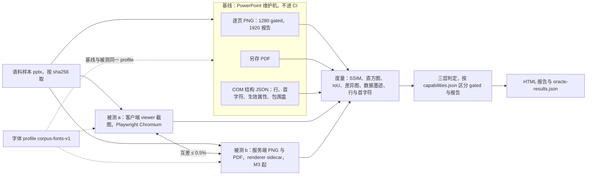
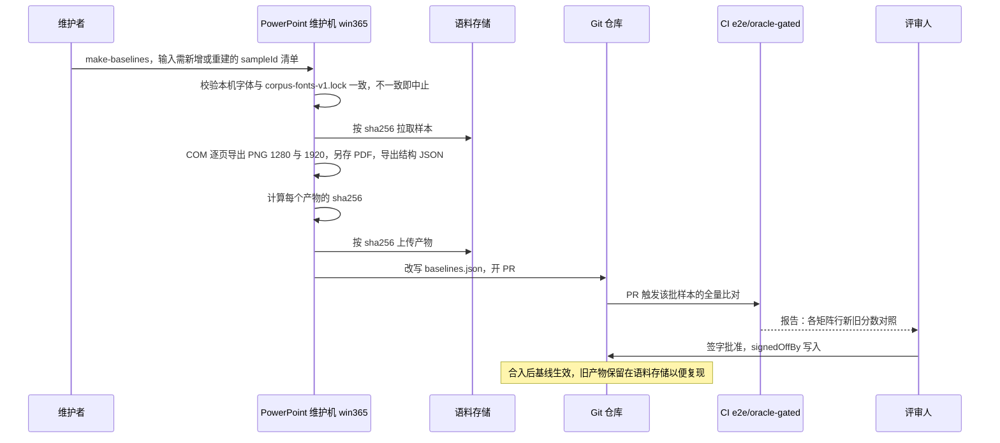
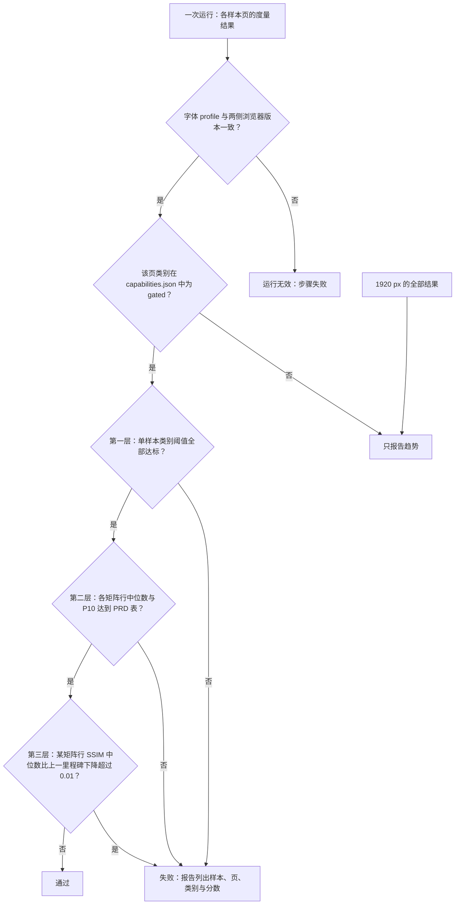
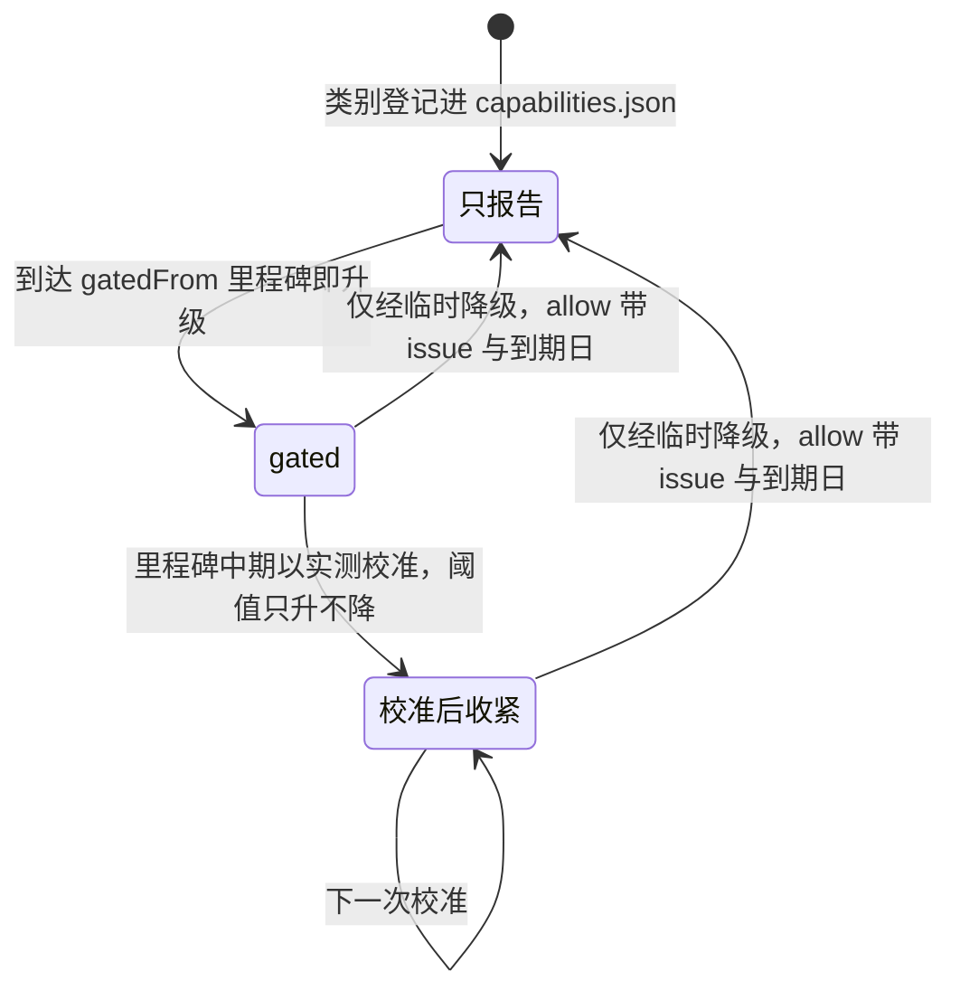

# 04 视觉 oracle
> 状态：v0.1 | 负责：测试设计线 | 更新：2026-09-25；2026-09-25（§4.19） | 依赖：rulings §4.19 D-TEST-INFRA、PRD [03/01](../10-prd/03-features/01-open-and-fidelity.md) OF-05 / OF-19 / OF-20 / §4.2 / §4.3、[PRD 04](../10-prd/04-non-functional-requirements.md) NF-02 / NF-08、[PRD 05](../10-prd/05-milestones-and-scope.md) M1–M4 验收、[30/11](../30-architecture/11-testing-strategy.md) §7 / §17、[ADR-0021](../30-architecture/adr/0021-rendering-medium.md)、[ADR-0026](../30-architecture/adr/0026-headless-rendering-and-thumbnails.md)、[ADR-0027](../30-architecture/adr/0027-text-measurement-strategy.md)、[ADR-0028](../30-architecture/adr/0028-text-editing-host.md)、[ADR-0017](../30-architecture/adr/0017-ui-component-library-shadcn-copy-model.md)、[40/07 §9](../40-modules/07-slide-rendering.md)、[40/10 §9](../40-modules/10-ui-shell-and-slide-ui.md)、rulings §4.15 Q7 / Q8

本文是视觉保真比对（oracle）的测试侧唯一事实源：以 PowerPoint 真机导出为参照物，怎么生成与管理基线、被测输出怎么取、用哪些度量、阈值分几层判、哪些类别何时成为门禁、专项用例、报告与运行、基线何时重建。UI 自身的截图基线也在本文（§9），但它不属于 oracle。

读者：`slide-render` / `render-dom` / `engine-layout` 的实现者、语料与基线维护者、CI 维护者。

边界：验收阈值与检查名以 PRD 为准（PRD 01 §4.2 / §4.3、NF-02 按里程碑、PRD 05 各验收条），本文只引用；本文自有的是单样本类别阈值（迁自 30/11 §7）与判定方法。语料与清单见 [03](./03-fidelity-roundtrip-and-corpus.md)，渲染管线与 ready 判据见 [50/05](../50-frontend/05-rendering-and-thumbnails.md)、[50/12](../50-frontend/12-viewer-embedding-and-render-page.md)，renderer sidecar 见 [60/06](../60-backend/06-modules-jobs-import-export-thumbnails.md)，CI 步骤名见 [12](./12-ci-gates-mapping.md)。

---

## 1. oracle 三通道

依据：PRD 01 §0 第 4 条「以 PowerPoint 真机导出为参照物」；30/11 §7、§17。

| 通道 | 参照物（基线维护机导出） | 被测 | 比较 | 服务的验收 |
|---|---|---|---|---|
| PNG | PowerPoint 365 逐页导出 PNG：宽 1280 px（gated）与 1920 px（只报告） | 客户端截图；M3 起服务端 PNG | §5 全部像素度量 | PRD 01 §4.2、NF-02、M1 验收 2 / 7 / 10 |
| PDF | PowerPoint 另存 PDF，逐页栅格化 | 服务端 PDF（M3 后半段），逐页栅格化 | 逐页 SSIM，阈值取 OF-19 / SV-02 | M3 验收 6b（`server:pdf`） |
| 结构 | PowerPoint COM 导出的结构 JSON：每个文本框的行数与每行首字符、各段落的生效属性（继承链解析结果）、形状包围盒、图表绘图区边界 | 客户端行模型（`engine-layout` 断行结果）、`model-slide` 的继承解析结果、DOM 几何 | 行数一致率、行首字符一致率、属性表逐项一致率、包围盒 IoU | OF-04（属性表 100%）、OF-05、PRD 01 §4.3 |

- 两侧 PDF 用同一个栅格化器（pdf.js，在 Playwright Chromium 中渲染到 1280 px 宽），避免栅格化器差异混入比对。
- 结构 oracle 以 COM 导出的**生效值**为准；python-pptx 只能读到存储值，自行沿继承链求值等于重写被测逻辑，因此只用于生成器与粗检，不作 oracle。macOS 的 AppleScript 对象模型不足以导出生效值，结构通道只由 Windows profile 产出。

**图 1-1 视觉 oracle 流程**



怎么读：同一个样本分三路——基线由维护机离线产出，两路被测在 CI 中实时产出；三路结果汇入同一套度量，再按类别是否 gated 做三层判定；双向箭头是客户端与服务端之间的互差约束；虚线表示字体 profile 相同是一切比对有效的前提。
依据：30/11 §7、§17；ADR-0026「如何被机械验证」；PRD 01 §4.2、§4.3。

---

## 2. 基线生成

依据：决策 T-ORACLE（gated 口径按 PRD：宽 1280 px 基线与被测同尺寸比较，1920 只作报告）；rulings §4.19 D-TEST-INFRA（用户裁决）。

**维护机**（rulings §4.19 D-TEST-INFRA）：基线由一台 Windows + PowerPoint 365 维护机生成（profile `win365`，M1 起），不进 CI，由脚本生成基线并提 PR、评审签字；macOS 基线（profile `mac365`）在 M2 加入，只报告。

- **导出**：`test/oracle/baseline/export-win.ps1` 经 COM 逐页 `Slide.Export(path, "PNG", 1280, h)`（h 按页面宽高比），另导 1920 宽；`SaveAs` 为 PDF；导出结构 JSON（§1）。动画一律静态全部可见（与编辑态、缩略图、导出一致，rulings §4.15 Q7）。隐藏页照常导出并标记。`export-mac.applescript` 只导 PNG。
- **汇总**：`test/oracle/baseline/make-baselines.ts` 计算每个产物的 sha256，按 sha256 上传测试对象存储（与语料同一存储、键布局见 [11 §10](./11-test-data-fixtures-and-determinism.md#10-大文件t-corpus)，不用 Git LFS，决策 T-CORPUS），并改写 `test/oracle/baselines.json`。
- **版本锁定**：维护机 PowerPoint 走固定更新通道、关闭自动更新，build 号写进每条基线；升级只在基线重建窗口进行（§12）。

`baselines.json` 条目（类型示意，schema 在 `test/oracle/baselines.schema.ts`）：

```ts
type OracleBaseline = {
  baselineId: string;              // `${sampleId}@${profile}`
  sampleId: string;                // 03 的 manifest id
  pptxSha256: string;
  profile: 'win365' | 'mac365';
  ppVersion: string;               // PowerPoint build
  os: string;
  fontProfile: 'corpus-fonts-v1';
  exporter: { script: string; version: string };
  pages: { index: number; slideId: string; hidden: boolean; png1280: string; png1920?: string }[];  // sha256
  pdf?: string;                    // sha256，PDF 通道
  structure?: string;              // sha256，结构 JSON（仅 win365）
  signedOffBy: string;             // 评审签字人（§12）
};
```

**图 2-1 基线生成**



怎么读：从上到下是一次基线生成；维护机只在本地运行、不进 CI，产物按内容寻址存放、清单进 Git；CI 在 PR 上用新基线重跑比对，评审人看新旧分数签字后才合入。
依据：30/11 §7、§14 T3；决策 T-ORACLE；rulings §4.19 D-TEST-INFRA。

---

## 3. 字体 profile

- **清单**：`test/oracle/fonts/corpus-fonts-v1.lock`，条目格式、`inProduct` 一致性规则与版本递增规则以 [11 §8](./11-test-data-fixtures-and-determinism.md#8-字体-profile) 为唯一定义。内容 = 产品默认字体包（Noto 含 CJK、Liberation、Carlito、Caladea；PRD SV-02、章程 Q19）+ 语料所需的测试专用字体。
- **同一份字体用在四处**：基线维护机（`install-fonts.ps1` 按 lock 安装并校验 sha256）、CI Playwright 容器、renderer 镜像字体包（[60/17](../60-backend/17-deployment-and-config.md)）、浏览器 `/fonts/`（决策 FONTS：浏览器与 renderer 共用同一 fontProfile，见 [50/05](../50-frontend/05-rendering-and-thumbnails.md)）。产品字体包必须是本 profile 的子集且逐文件 sha256 相同；测试专用字体经宿主字体供给（OF-25）注入 harness，不进产品包。
- **有效性**：每次运行由 harness 记录实际加载的字体文件 sha256，与基线条目的 `fontProfile` 对照；不一致即本次运行无效、步骤失败（不是跳过）。
- **「参照字体可用」**（PRD 01 §4.2 纯文本页行、OF-05 的前提）：样本引用的字体 ⊆ profile ∪ 文档内嵌字体时，manifest `oracle.fontsAvailable = true`（由 03 的特性探测脚本计算）。纯文本类别只对 `fontsAvailable` 的样本 gated，其余只报告并单列「参照字体不可用」计数；同度量替代字体（如 Carlito 替 Calibri）不算「可用」，因为 PowerPoint 与我们用的不是同一字体文件。

---

## 4. 被测输出

| # | 被测 | 取法 | 里程碑 |
|---|---|---|---|
| a | 客户端 | `test/oracle/runner/render-client.ts`：Playwright Chromium，视口宽 1280、`deviceScaleFactor` 1；Vite 起一个无 UI 外壳的 harness 页挂 `preset-slide-viewer`，关闭惰性加载（图表、语言包），逐页渲染；等待与 `/render` 相同的 ready 判据（所请求页全部 `render/page-mounted` ∧ 字体请求全部结算 ∧ 此后一帧 `render/frame` 的 `pendingDirty = 0`，唯一源 [50/12](../50-frontend/12-viewer-embedding-and-render-page.md)）后按页元素裁剪截图 | M1 |
| b | 服务端 PNG | `test/oracle/runner/render-server.ts`：以同一 `Snapshot` 与资源调用 renderer sidecar 的注入式 RPC（remote 模式，契约见 [60/06](../60-backend/06-modules-jobs-import-export-thumbnails.md)），请求 1280 px 无损 PNG | M3 |
| c | 服务端 PDF | 经 `render-export` 同一路径请求 PDF，再按 §1 栅格化 | M3 后半段 |

- **客户端与服务端互差**：同一页 a 与 b 的差异像素比 ≤ 0.5%（pixelmatch 阈值 0.1；ADR-0026）。两侧必须来自同一 Playwright 版本的 Chromium（lockfile 锁定，renderer 镜像按同一版本构建）；报告记录两侧浏览器版本，不一致即判无效。
- **外链资源**：服务端永不加载外链（占位），为使两侧可比，客户端 harness 以 `externalResources: 'never'` 运行；外链区域也不计入页内容哈希（SV-04）。
- **多架构**：M4 起 renderer 的 arm64 与 amd64 镜像对同一页输出互差 ≤ 0.5%，执行在 [08](./08-deployment-and-environment-e2e.md)，度量用本文 §5。
- 30/11 §7 的「被测 b = 服务端缩略图路径」按本表改为 1280 px 无损 PNG；640 px WebP 缩略图的正确性由 [07](./07-backend-integration-and-api-e2e.md) 的缩略图管线用例覆盖，不进 oracle。

---

## 5. 度量

实现放 `test/oracle/runner/metrics/`；每个度量都有合成图单测（完全相同 → 满分；已知扰动 → 期望区间），算法与参数版本记为 `metricVersion` 写入 `thresholds.json`，改算法或参数视同基线重建（§12）。

| 度量 | 定义 | 文件 | 用于 |
|---|---|---|---|
| SSIM | ssim.js，灰度 | `ssim.ts` | 全部像素类别；PRD 01 §4.2 |
| 彩色直方图相似度 | RGB 各 64 bin 直方图交集，∈ [0, 1] | `histogram.ts` | 与 SSIM 并列报告（PRD 01 §4.2「灰度 + 彩色直方图」），不单独设阈值 |
| 元素包围盒 IoU | 我们 DOM 中每个元素的包围盒与结构 oracle 中同 `cNvPr@id` 形状的包围盒求 IoU，页内取中位数 | `iou.ts` | 几何、文本、图片类别；`spAutoFit` 文本框 IoU（PRD 01 §4.3） |
| 差异图 | pixelmatch（阈值 0.1），输出差异 PNG 与差异像素比 | `pixel-diff.ts` | 报告；客户端与服务端互差；§8 自比较用例 |
| 图表数据墨迹 IoU | 在结构 oracle 给出的绘图区内，与背景色差超过固定 ΔE 的像素记为数据墨迹，两侧掩码求 IoU | `data-ink.ts` | 图表类别（OF-09、NF-02） |
| 几何掩码 IoU | 187 种 `prstGeom` 生成样本（每页一个实心形状），两侧形状掩码求 IoU | `shape-mask.ts` | M1 验收 7 |
| 行数一致率 | 行数与结构 oracle 相同的文本框数 / 文本框总数 | `text-lines.ts` | OF-05、NF-02、PRD 01 §4.3 |
| 行首字符一致率 | 首字符与结构 oracle 相同的行数 / 总行数 | 同上 | OF-05、PRD 01 §4.3 |
| 继承属性表一致率 | `model-slide` 解析出的每段生效属性与结构 oracle 逐项比较 | `test/oracle/structure/inheritance.test.ts` | OF-04（100%） |
| 降级元素占比 | T2 全部元素中触发 `render/element-degraded` 或 `render/element-failed` 的比例 | `degraded.ts` | NF-02 |

---

## 6. 三层判定

依据：决策 T-ORACLE（单样本类别阈值与矩阵行聚合两层都须通过；SSIM 中位数比上一里程碑下降 > 0.01 即失败；1920 只作报告；阈值定义以 PRD OF-20 / §4.2 为准，只在其定义尺寸 1280 px 上有意义）。

**第一层：单样本类别阈值**（本文自有，迁自 30/11 §7；机器副本 `test/oracle/thresholds.json` 的 `perSample` 段）。每页按 §7 的分类规则归入一个类别；表格与图表类别在结构 oracle 给出的对象区域裁剪后比较，其余整页比较。

| 类别 id | 含义 | SSIM | IoU 等 |
|---|---|---|---|
| `geometry` | 几何、填充、线条（无文本） | ≥ 0.97 | 包围盒 IoU ≥ 0.95 |
| `text-latin` | 西文文本（仅 `fontsAvailable`） | ≥ 0.93 | 包围盒 IoU ≥ 0.90 |
| `text-vertical` | `vert` / `vert270` 竖排 | 同 `text-latin` | 同 `text-latin` |
| `text-cjk` | CJK 与混排（仅 `fontsAvailable`） | ≥ 0.90 | 包围盒 IoU ≥ 0.88 |
| `image` | 图片与裁切 | ≥ 0.95 | 包围盒 IoU ≥ 0.95 |
| `table` | 表格 | OF-08 阈值 | — |
| `chart` | 图表（单图表页） | OF-09 阈值 | 数据墨迹 IoU：OF-09 阈值 |
| `smartart` | 有 `dsp:drawing` 的 SmartArt | OF-10 阈值 | — |
| `ole-preview` | OLE 预览图 | 同 `image` | 同 `image` |
| `emf-wmf` | EMF / WMF 栅格化 | 报告 | 报告 |
| `effects-3d` | 效果与 3D（近似） | 报告 | 报告 |
| `text-rtl` | RTL 文本的像素比较 | 报告 | —（结构断言见 §8） |

**第二层：矩阵行聚合**。按矩阵行统计每个度量的中位数与 P10，阈值取 PRD 01 §4.2 表（纯文本页、形状 / 填充 / 线条、图片、表格、图表、SmartArt、效果 / 3D 仅监控、全语料）、NF-02 按里程碑的各行（全语料 SSIM、文本行数一致率、图表数据墨迹 IoU、降级元素占比）与 PRD 01 §4.3（行首字符一致率、`spAutoFit` 文本框 IoU）。`thresholds.json` 的 `aggregate` 段是这些表的机器副本，每行带 `prdRef`；数字只在 PRD 修改。

**第三层：相对上一里程碑的回归**。任一矩阵行的 SSIM 中位数比上一里程碑出口记录（`test/oracle/history/<里程碑>.json`，由出口提交的 nightly 全量结果写入，分别记录「全量」与「gated 集合」两套中位数）下降超过 0.01 即失败（NF-02）。

**一致性检查** `test/oracle/scripts/check-thresholds.ts`（`e2e/oracle-gated` 的前置）：`aggregate` 与 PRD 表格逐项相等（解析 PRD Markdown 表）；`perSample` 与 `origin/main` 相比只升不降；`capabilities.json` 中每个类别都有 `perSample` 条目；相对 merge-base 由 gated 退回 report 的类别带未过期的 `allow`，`sampleExclusions` 无过期条目（01 §10）。

**图 6-1 gated 判定**



怎么读：自上而下先判运行是否有效，再按类别是否 gated 分流；gated 类别依次经过三层，任一层不过即失败，三层全过才通过；1920 px 的结果无论类别一律只进报告。
依据：决策 T-ORACLE；PRD 01 §4.2、OF-20；PRD 04 NF-02。

---

## 7. capabilities.json

`test/oracle/capabilities.json` 声明每个类别当前是 gated 还是只报告，以及个别样本的豁免；数字不在这里（在 `thresholds.json`）。

```ts
type Capabilities = {
  categories: Record<string, {           // 键 = §6 类别 id
    status: 'report' | 'gated';
    gatedFrom?: 'M1' | 'M2' | 'M3' | 'M4';
    requiresFontsAvailable?: boolean;    // text-latin / text-vertical / text-cjk 为 true
  }>;
  sampleExclusions: { sampleId: string; category: string; issue: string; expires: string }[];  // cordex-allow 例外，只减不增；expires 口径同 01 §10（≤ 30 天）
  // 某类别由 gated 退回 report 时，该类别条目须带 allow{issue, expires, reason}（01 §10 临时降级）
};
```

**页分类规则**（`test/oracle/runner/classify-page.ts`，按我们模型中该页的元素种类确定，结果确定）：含图表 → `chart`；否则含 SmartArt → `smartart`；否则含表格 → `table`；否则含 OLE → `ole-preview`；否则含图片 → `image`（EMF 且无预览的除外）；否则只有文本 → 按脚本与方向归 `text-*`；否则 `geometry`。任一元素带效果或 3D 时该页另记 `effects-3d`（只报告）。

| 类别 | gated 自 | 依据 |
|---|---|---|
| `geometry`、`text-latin`、`image` | M1 | 30/11 §7；PRD 05 M1 验收 2 |
| `text-vertical` | M1 | ADR-0027（`vert` / `vert270` 以文本框旋转实现；`eaVert` 近似，只报告） |
| `table`、`chart`、`smartart` | M1 | rulings §4.15 Q7；PRD 05 M1 验收 10 |
| `ole-preview` | M1（预览为 EMF / WMF 的样本 M2 起） | 30/11 §7；PRD 01 §2.6 |
| `text-cjk` | M2 | 30/11 §7 |
| `emf-wmf` | 不 gated：M2 起报告，矢量渲染 M4+ | PRD 01 §2.5 |
| `effects-3d`、`text-rtl`（像素） | 不 gated | PRD 01 §4.2；ADR-0027 |
| PDF 通道 | M3 后半段 | PRD 05 M3 验收 6b |

**图 7-1 类别的 gated 状态**



怎么读：类别从「只报告」起步，`gatedFrom` 是 PRD 或裁决规定的阻断里程碑，到期即转为 gated，不因稳定性推迟（届时不达标按缺陷处理）；此后每次校准只能把阈值往严里改；从 gated 退回只报告只有临时降级一条路，须带 issue 与不超过 30 天的到期日。
依据：PRD 01 OF-20 与 §4.2 末句（校准只能收紧）；PRD 04 开头 ratchet 说明；30/11 §7；[01 §10](./01-strategy-and-layers.md#10-门禁三级) 升级与临时降级规则。

---

## 8. 专项用例

阈值写「验收 N 值」的，数字见 PRD 05 对应验收条，本文不复制。

| 用例 | 断言 | 参照物 | 里程碑 |
|---|---|---|---|
| 187 种 `prstGeom` | 每种形状的几何掩码 IoU 达到 M1 验收 7 值 | PowerPoint PNG | M1 |
| 竖排与 RTL | `text-vertical` 按第一层判定；RTL 样本的行数与行首字符一致率纳入结构断言（M1 P1）；RTL 段落 DOM 中每行一个 `<text>` 且 run 无 `x` 属性 | 结构 oracle | M1 |
| 客户端与服务端互差 | 差异像素比 ≤ 0.5%（§4） | 自比较 | M3 |
| 母版视图合成（`master:view`） | 选中任一母版或版式节点的画布合成与 PowerPoint 母版视图截图的 SSIM 达到 M2 验收 9 值，抽样 20 个版式 | 维护机脚本以 UI 自动化切到母版视图逐个版式截图，作为 `master-view` 基线 | M2 |
| 版式重置（`layout:apply`） | 重置页与「基于该版式新建 + 填入同样文本」的渲染 SSIM 达到 M2 验收 10 值 | 自比较 | M2 |
| 受限字体 | 含受限 `fsType` 内嵌字体的样本：查看态 FontFace 列表含该字体并按文本类别判定；编辑态 FontFace 列表不含该字体，画面只报告 | PowerPoint PNG（查看态） | M2 |
| 编辑态与失焦一致 | 同一文本框进入编辑态（隐藏 textarea 聚焦）与失焦后，隐藏覆盖层（光标、选区）截图，差异像素为 0（pixelmatch 阈值 0.1） | 自比较（ADR-0028） | M2 |
| 带与不带 `ui-react` 样式 | 同一页在裸 harness 与装齐 `ui-react` 全部样式的编辑器画布中截图，画布区域差异像素为 0 | 自比较（ADR-0017 样式隔离） | M2 |
| 母版编辑后导出（`master:edit`） | 母版编辑脚本（03 §5.1）导出后在 PowerPoint 母版视图中截图，与我们的合成 SSIM 达到 M3 验收 14 值 | PowerPoint 母版视图截图 | M3 |
| 主题编辑（`theme:edit`） | 改 12 个主题色与主题字体前后，显式 `srgbClr` 元素区域（按元素包围盒生成掩码）差异像素为 0 | 自比较 | M3 |
| 服务端 PDF（`server:pdf`） | 逐页 SSIM 达到 OF-19 / SV-02 值 | PowerPoint PDF | M3 后半段 |
| 多架构 | arm64 与 amd64 renderer 同页互差 ≤ 0.5%（执行在 08） | 自比较 | M4 |

---

## 9. UI 视觉基线（不属于 oracle）

这类截图没有 PowerPoint 参照物，是 UI 外壳对自身的回归基线：`apps/web/e2e/ui/editor.visual.spec.ts`（由 40/10 §9 迁入，落点见 [06 §3](./06-frontend-component-and-e2e.md)）覆盖 `/editor` 亮暗两套主题、`prefers-reduced-transparency: reduce` 下面板退化为不透明（`--card`）、宿主外壳版本的 body 防线。

- 基线用 Playwright `toHaveScreenshot`，**只在锁定镜像的 CI 容器内生成**（避免操作系统字体栅格化差异），PNG 与 spec 同目录存放于 `__screenshots__/`，体积小、入 git。
- 判定：关闭动画、隐藏光标、固定字体后 `maxDiffPixels = 0`。
- 更新：在同一容器中运行 `pnpm test:visual --update`；改动 `__screenshots__/**` 的 PR 必须经设计线 CODEOWNERS 审批（决策 T-CI）。
- 所在 e2e 步骤与分片由 [06](./06-frontend-component-and-e2e.md)、[12](./12-ci-gates-mapping.md) 规定；本文只定判定与基线治理。

---

## 10. 报告

- **产物** `oracle-report`（HTML）：首页按矩阵行列出各度量的中位数与 P10、对应阈值、与上一里程碑的差值；逐页视图为「PowerPoint 基线 | 我们的渲染 | 差异图」并排，附全部分数；可筛选失败项与「参照字体不可用」项。
- **机器结果** `oracle-results.json`：运行 id、提交、profile、字体 profile、两侧浏览器版本、逐页度量；nightly 结果追加到 `oracle-history` 分支，供趋势与第三层回归使用。
- 保留 14 天；T2 截图来自已脱敏样本（03 §3），产物只对仓库成员可见。

---

## 11. 运行

| 触发 | 范围 | 判定 | 步骤 |
|---|---|---|---|
| PR 与合入 main | 全部 gated 样本的 gated 类别页（1280 px）；结构通道（行、首字符、继承属性表）；M3 起另取不超过 20 个样本做客户端与服务端互差 | 三层（第二、三层在 gated 集合上计算，对照 history 中 gated 集合的记录） | `e2e/oracle-gated`（属 PR 冒烟子集） |
| nightly | T1 + T2 全量，全部类别（含只报告的）、1920 px、`mac365`（M2 起）、PDF 通道（M3 后半段）、全量客户端与服务端互差 | 三层（全量） | `e2e/oracle-gated`（`CORDEX_SUITE=nightly`） |
| 里程碑出口 | 出口提交的 nightly 全量结果即 `fidelity:visual` 的证据，并写入 `history/<里程碑>.json` | — | — |

- **时长**：PR 冒烟子集分片后 ≤ 15 min（决策 T-CI）；`oracle-gated` 按样本 sha256 取模分片，分片数由 [12](./12-ci-gates-mapping.md) 定；超时时加分片，不减样本。
- 样本与基线按 sha256 预取并缓存（03 §1）；缺失即失败、不跳过。
- 本步骤为 gated 步骤，不重试、不隔离（决策 T-CI）；nightly 失败自动建 issue 并阻断下一次发布打标签。

---

## 12. 基线重建

**触发**：维护机 PowerPoint build 变更；字体 profile 变更（如 `corpus-fonts-v2`）；导出脚本变更；样本替换；度量的 `metricVersion` 变更。

**流程**：

1. 维护机按图 2-1 重建受影响的基线（PowerPoint 或字体变更时全量重建）。
2. PR 同时包含 `baselines.json` 变更（字体变更时还有 lock 文件与产品字体包的同步变更）。
3. CI 在该 PR 上跑全量比对，报告给出各矩阵行的新旧分数。
4. 评审签字：测试设计线与渲染保真负责人（`slide-render` / `engine-layout` 维护者）；签字记录写 `test/evidence/<里程碑>/oracle-baseline-<日期>.md`（原因、旧与新 build、各矩阵行分数变化、签字人），`signedOffBy` 写入基线条目。
5. 若重建使某矩阵行中位数变化，同一 PR 显式重设 `history/<里程碑>.json` 的对照值并在签字记录中说明；阈值本身**不因重建放松**——重建后 gated 类别不达标，只能修渲染，或走 `cordex-allow` 例外 / 01 §10 临时降级（均须 issue 与到期日）。

---

## 13. 机械验证

| 断言 | PRD 检查名 / 依据 | 执行处 | 形态 |
|---|---|---|---|
| gated 类别三层判定全部通过 | `fidelity:visual`（M1 验收 2）、NF-02 | `e2e/oracle-gated`；出口以 nightly 全量为证据 | 机械 |
| 表格、图表、SmartArt、OLE 预览按类别 gated | `fidelity:objects`（M1 验收 10） | 同上 | 机械 |
| 187 种 `prstGeom` 几何 IoU | M1 验收 7 | 同上 | 机械 |
| 继承属性表 100% 一致、文本行与首字符一致率 | OF-04、OF-05、PRD 01 §4.3 | 同上（结构通道） | 机械 |
| 客户端与服务端互差 ≤ 0.5% | ADR-0026、ADR-0027 | 同上（M3 起） | 机械 |
| 服务端 PDF 逐页 SSIM | `server:pdf`（M3 验收 6b） | 同上（M3 后半段） | 机械 |
| 母版视图、版式重置、母版编辑、主题编辑的视觉断言 | `master:view`、`layout:apply`、`master:edit`、`theme:edit` | 同上 | 机械 |
| `thresholds.json` 与 PRD 表一致、单样本阈值只升不降、类别表完整、降级与豁免未过期 | OF-20 ratchet；01 §10 | `e2e/oracle-gated` 前置 `check-thresholds.ts` | 机械 |
| 字体 profile 与浏览器版本一致，否则运行无效 | 30/11 §7 | 每次运行 | 机械 |
| UI 截图基线零差异，更新经设计线审批 | 决策 T-CI | e2e（步骤见 06 / 12）+ CODEOWNERS | 机械 |
| 基线生成与重建经评审签字 | 30/11 §14 T3 | 维护机 + PR 评审，证据归档 | 半机械 |

---

## 14. 已定裁决与回写

**rulings §4.19 D-TEST-INFRA（已定稿）**：基线维护机为一台 Windows + PowerPoint 365（不进 CI），macOS 基线 M2 加入；本文 §2、§11、§12 的运行方式按此写。维护机到位前，M1 基线由维护者在临时 Windows 机上按同一脚本生成并签字，产物与签字流程不变。

**回写清单（由总编排执行）**：

- 30/11 §7：基线分辨率「@1920×1080」改为「gated 按 1280 px 宽，1920 只报告」（决策 T-ORACLE，机械修正）；「PNG 二进制在 Git LFS」改为语料存储按 sha256 存放（决策 T-CORPUS）；「被测 b = 缩略图路径」改为 1280 px 无损 PNG；阈值表、流程图与 `capabilities.json` 细节改为「摘要 + 链接本文」。
- 30/11 §17「视觉 oracle 增补」改为链接本文 §1、§8。
- 40/07 §9「视觉保真」行与 40/10 §9 `editor.visual.spec.ts` 行补「判定与基线治理见 70/04」。
