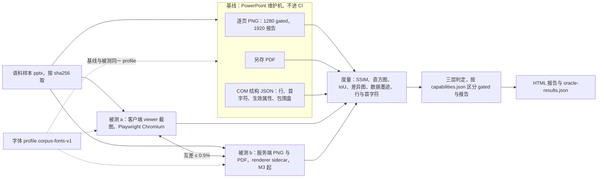
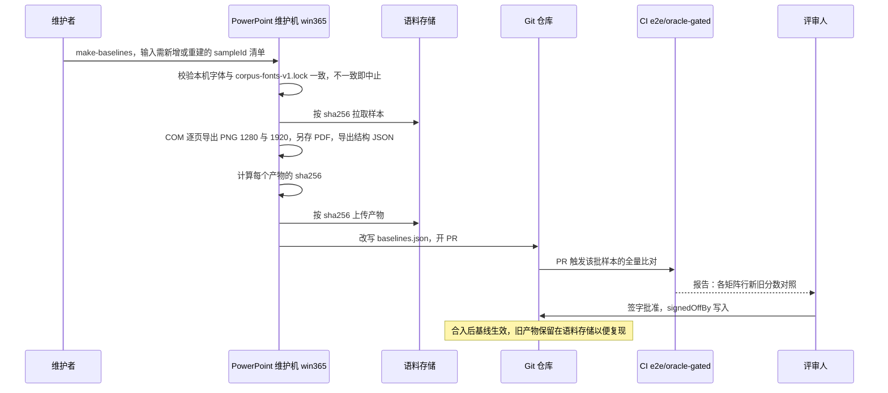
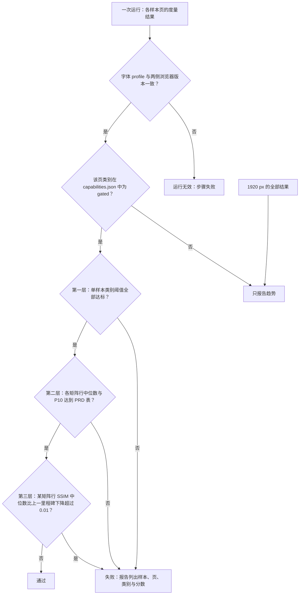
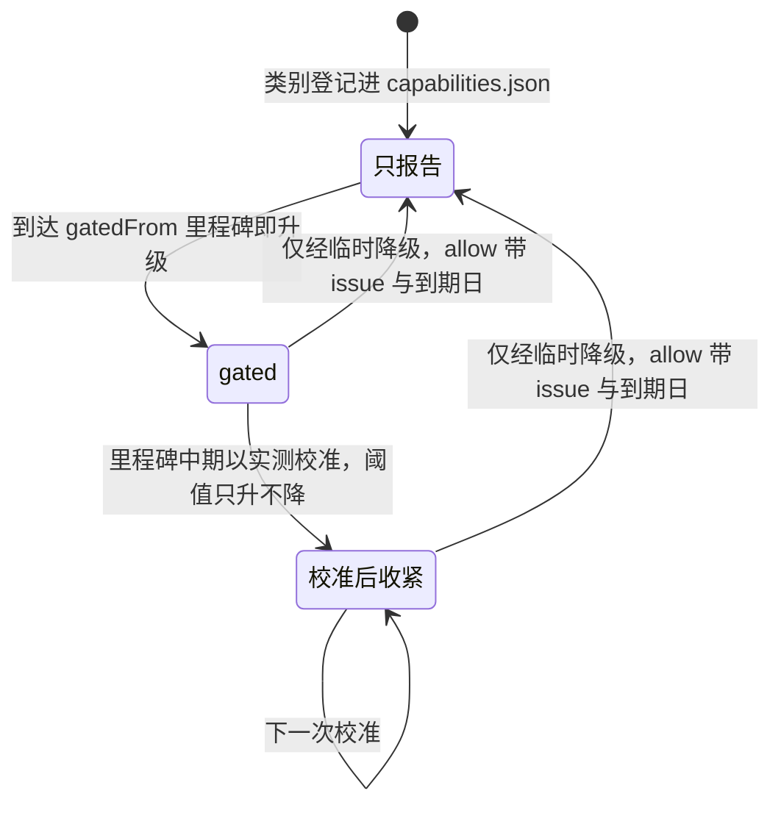
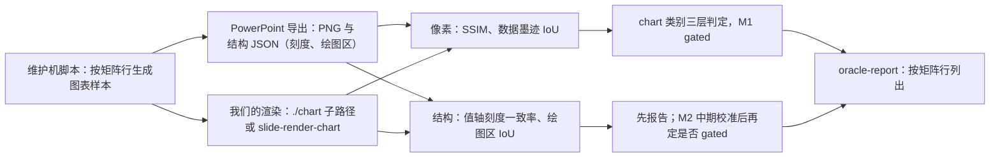
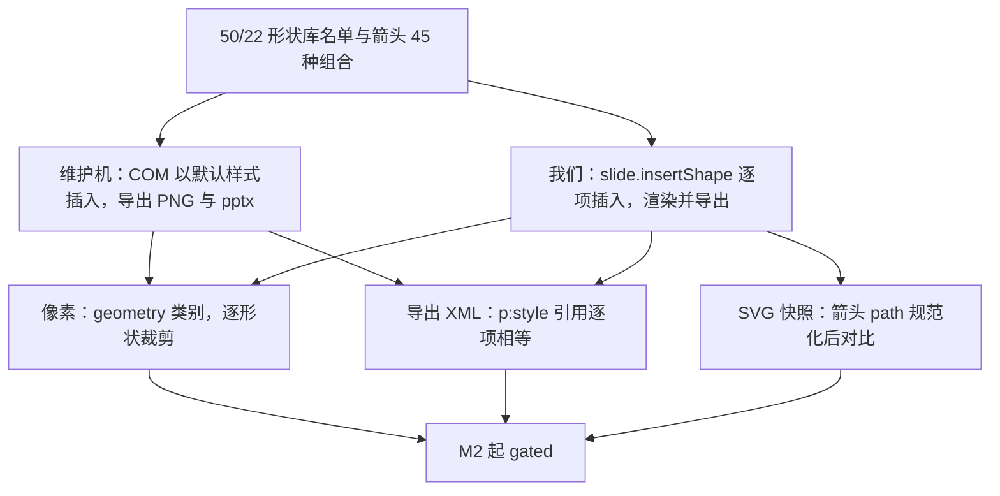

# 04 视觉 oracle
> 状态：v0.1 | 负责：测试设计线 | 更新：2026-09-25；2026-09-25（§4.19）；2026-09-26（§4.21：新增 §8.1 图表语料矩阵与刻度、绘图区结构断言，§8.2 形状库 72 项默认插入与箭头尺寸快照，§9 补形状库与数据网格的 UI 基线）；2026-09-26（§4.21 整合：§8.2 形状库缩略图改为 gen-shape-gallery-thumbs 生成物（原 SVG sprite 作废）；补 M3 连接符路由标定语料 connector-*）；2026-10-04（design-language-v3 第 0 批：§9 UI 视觉基线的覆盖范围与基线来源对齐 v3 路由——编辑器按单页四态、网格与网格焦点 × 亮暗，首页亮暗，状态与 playground `#/v3/editor`、`#/v3/home` 一一对应；openspec 对照截图只作审批参照；ribbon 版旧路由与据其生成的基线随全量迁移删除（rulings §4.25 DS-7），玻璃退化截图作废（DS-2）；形状、表格、图表弹层基线随第 1 批重建；§14 登记）；2026-10-07（design-language-v3 第 1 批：按 rulings §4.25 DS-21、DS-22、DS-24、DS-26 与已拍板的第 1 批样张——§9 新增「编辑器 · 第 1 批代表状态」（与 `screens/batch1/` 的 11 组对照截图一一对应，另补图片、形状库、选择、文本、表格、图表代表态与紧凑、仅查看两种形态，亮暗各一张），基线来源补 `batch1/`，弹层基线按定稿重建（形状库、表格网格、图表类型菜单、400 宽数据面板与紧凑底部 Sheet，原数据网格抽屉作废），写明画布标记统一强调色、颜色口径由 06 §11 ⑤ 断言；§14 登记）；2026-10-08（design-language-v3 第 1 批收口：§14 第 0 批回写段的弹层基线改写为已于第 1 批重建，两段「回写清单」核对为已回写（`editor.visual.spec.ts` 已迁到 40/11 §9 登记，注释已改为 v3 状态与第 1 批代表状态以本文为准）；快速样式库、幻灯片大小与 5 套主题画廊（rulings §4.25 DS-31、DS-33）的样张状态补画并经评审确认前不进基线；oracle 本体与判定不变）；2026-10-08（design-language-v3 第 1 批评审修改：按 rulings §4.25 DS-34…DS-37、TB-55、TB-56——§9 新增「控件画法与基线重拍」条：检查器控件改为安静样式（DS-35 修订 DS-9）、开关按下为强调色淡底（DS-36）、次按钮为透明底加细边（DS-37）、分段选中块贴边（TB-55）、快速样式缩略图去掉白衬底（TB-56）、分隔线暗色 #444，编辑器各态、弹层与首页的 UI 基线按新画法生成、此前按原画法生成的重拍，状态集合与判定不变，设计参照以样张缺省画法为准；§14 登记，快速样式库改为检查器内原位展开（DS-34），两态样张已画、仍在第 1 批评审确认后进基线；oracle 本体不变）；2026-10-15（design-language-v3 第 2 批：按 rulings §4.25 DS-38…DS-63 与已拍板的第 2 批样张——§9 新增「编辑器 · 第 2 批代表状态」（评论、版本历史、分享、插件、保真报告、离线与冲突六个场景各取代表状态，亮暗各一张，对照截图在 `screens/batch2/`），写明样张里标「未采纳」的 `alt-*` 状态不进基线（DS-63）、计时类状态在计时结束前截取，第 1 批受影响的评审模式与查找面板两组基线按 DS-43、DS-62 重拍；基线来源与批次说明同步；§14 登记；oracle 本体不变）；2026-10-15（design-language-v3 第 2 批回写：§9 第 2 批代表状态里版本历史与保真报告两张的「280 整栏」按 rulings §4.25 TB-60 改写为「沿用检查器宽度（缺省 280）」——基线在缺省检查器宽度下截取，状态集合与判定不变；DS-64…DS-68 与其余 TB 不改基线清单（链接已到期 `share.link-expired` 是链接一行的文字变体，由 06 §5 第 36 行的行为断言覆盖）；§14 登记）；2026-10-15（design-language-v3 第 2 批回写：§14 登记 rulings §4.25 DS-69、DS-70、TB-76…TB-86 不增减基线——样张新增的 `share.no-permission-link` 只是链接一行的文字变体，由 06 §5 第 36 行断言；TB-80 的三条横幅随第 3 批横幅样张再进基线；oracle 本体与状态清单不变）；2026-10-22（design-language-v3 第 3 批：按 rulings §4.25 DS-79…DS-136 与已拍板的第 3 批样张——§9 首页默认态按第 3 批补齐的画面重拍，新增「应用壳族 · 第 3 批代表状态」（十七个场景各取代表状态，亮暗各一张，对照截图在 `screens/batch3/`；采纳了原备选的五题以采纳态为准，`alt-*` 与嵌入的宿主外框不进基线，放映舞台亮暗两张逐像素相同）与「第 1、2 批随之重拍」（横幅高 40、视图切换分段、备注区凹陷底、锁定比例未锁图标、文件名、主菜单两处，DS-75、DS-78、DS-82、DS-89、DS-133、DS-134、DS-136；拖动把手不改，DS-135），基线来源写明应用壳族已补上，「控件画法与基线重拍」条的 TB-58 一句改为已定；§14 登记；oracle 本体与判定不变）；2026-10-22（design-language-v3 第 3 批回写续：§8 新增「页级占位同一画法」专项——harness 页里整页无法解析的页仍画出页级占位、M3 起与服务端缩略图互差 ≤ 0.5%（rulings §4.25 TB-151）；§9「第 1、2 批随之重拍」补 M2 的「分享」不可用态、仅查看形态备注卡的空态句与降权后的文档菜单三处（DS-137、DS-138、TB-138）；§13 补一行、§14 登记；同日再补：§8「页级占位同一画法」写明与服务端缩略图的互比只对整页解析失败的保真占位——运行时单页渲染出错的页服务端不回传、不写新的缩略图行（rulings §4.25 TB-157，07 §11.3），页级回退的单测改指 slide-render `degrade.test.ts`（40/07 §9）；§13 一行同步；§14 登记 TB-152…TB-162 不增减基线；2026-10-22 复核修正：§8 与 §13 写明运行时单页渲染出错的页已有旧行时保留旧图、没有行时客户端按 404 画占位，互比对象写明为 §4 的服务端 1280 px 输出；§9 写明 TB-58 四项采纳的是哪几态（拖动把手采纳现画法 `handle-now`），这个场景里不带 `alt-` 前缀的未采纳对照态同样不进基线，降权后文档菜单的有意改动补引 DS-139、样张改指 `version-history.degraded-menu`；§14 登记 DS-139 与 TB-163…TB-169 不增减基线，另登记复核期间 rulings 追加的 TB-170…TB-174 同样不增减基线，§14 那一段的「同日补充」改为「同日再补」；状态头的回写轮次字样改为「回写续 / 同日再补」；§14 补登 TB-175 与 TB-171…TB-173 的补句同样不增减基线；§14 再补登 TB-176…TB-178 与 TB-172 再补的一句同样不增减基线）；2026-10-23（design-language-v3 第 3 批评审修改：按 rulings §4.25 DS-140…DS-143、TB-179…TB-183——§9 第 3 批代表状态里导入改为导入对话框各态（`import.dialog`、`dialog-dragover`、`dialog-uploading`、`dialog-parsing`、`dialog-failed-invalid-package`、`dialog-phone`），导出加 `export.m3-pdf`，开始页加 `home.drop-import`，采纳原备选的五题一句注明 DS-98 采纳的那一态随 DS-140 删去；新增「第 3 批评审修改随之重拍」条（对话框标题栏 40、圆角 12、× 正文色与抽屉标题行，格式行文件类型图标，主区拖入落区）；「基线来源」条补一句；§14 登记；oracle 本体与判定不变）；2026-11-04（design-language-v3 母版视图改版：§8「母版视图合成」写明被测输出不含占位符标注层（TB-188）；§9 第 1 批 `master-view.default` 的说明改写，新增「母版视图改版 · 代表状态」「母版视图改版随之重拍」两条，「基线来源」条写明哪几张对照截图按转正后的样张重拍、其余只作历史对照；§14 登记；oracle 本体与判定不变；同日再补：§9 第 1 批 `master-view.default` 一项首次出现的「上下文条」带提示「母版视图的模式横幅」；再补：§9「母版视图改版随之重拍」改为按规则写、不逐个列状态（检查器「版式」节、「转到版式」顶行、快捷键面板的母版三行与 `master-view.default` 整张，另列现在不命中基线的版式画廊与重置确认、普通视图「主题颜色与字体」与母版视图里菜单和命令面板的写法，只改 DOM 的不重拍），「代表状态」写明主菜单「视图」里的入口不另截，「基线来源」条写全按改版后的样张重拍的 39 张对照截图、其余只作历史对照，§14 同步并把回写清单核对为已回写；rulings §4.25 DS-145…DS-177、TB-188、TB-193、TB-196、TB-203；需求编号、优先级与里程碑不变） | 依赖：rulings §4.25 DS-145…DS-177、TB-188、TB-193、TB-196、TB-203、rulings §4.25 DS-140…DS-143、TB-179…TB-183、rulings §4.25 TB-170…TB-178、rulings §4.25 DS-139、TB-163…TB-169、rulings §4.25 TB-157、rulings §4.25 DS-137、DS-138、TB-138、TB-151、rulings §4.25 DS-75、DS-78…DS-136、TB-80、rulings §4.25 DS-38…DS-63、DS-69、DS-70、TB-60、TB-80、rulings §4.25 DS-1、DS-2、DS-7、DS-8、DS-21、DS-22、DS-24、DS-26、DS-34…DS-37、TB-55、TB-56、设计 [02](../20-design/03-screens/02-editor-main.md) §6.1、设计 [29](../20-design/03-screens/29-home-start-page.md) §3、rulings §4.19 D-TEST-INFRA、rulings §4.21 q-chart-route / R-d-66、[ADR-0036](../30-architecture/adr/0036-chart-rendering-and-editing.md)、[50/22](../50-frontend/22-elements-shapes-and-lines.md)、[50/24](../50-frontend/24-elements-tables-and-charts.md)、PRD [03/01](../10-prd/03-features/01-open-and-fidelity.md) OF-05 / OF-19 / OF-20 / §4.2 / §4.3、[PRD 04](../10-prd/04-non-functional-requirements.md) NF-02 / NF-08、[PRD 05](../10-prd/05-milestones-and-scope.md) M1–M4 验收、[30/11](../30-architecture/11-testing-strategy.md) §7 / §17、[ADR-0021](../30-architecture/adr/0021-rendering-medium.md)、[ADR-0026](../30-architecture/adr/0026-headless-rendering-and-thumbnails.md)、[ADR-0027](../30-architecture/adr/0027-text-measurement-strategy.md)、[ADR-0028](../30-architecture/adr/0028-text-editing-host.md)、[ADR-0017](../30-architecture/adr/0017-ui-component-library-shadcn-copy-model.md)、[40/07 §9](../40-modules/07-slide-rendering.md)、[40/10 §9](../40-modules/10-ui-shell-and-slide-ui.md)、rulings §4.15 Q7 / Q8

本文是视觉保真比对（oracle）的测试侧唯一事实源：以 PowerPoint 真机导出为参照物，怎么生成与管理基线、被测输出怎么取、用哪些度量、阈值分几层判、哪些类别何时成为门禁、专项用例、报告与运行、基线何时重建。UI 自身的截图基线也在本文（§9），但它不属于 oracle。

读者：`slide-render` / `render-dom` / `engine-layout` 的实现者、语料与基线维护者、CI 维护者。

边界：验收阈值与检查名以 PRD 为准（PRD 01 §4.2 / §4.3、NF-02 按里程碑、PRD 05 各验收条），本文只引用；本文自有的是单样本类别阈值（迁自 30/11 §7）与判定方法。语料与清单见 [03](./03-fidelity-roundtrip-and-corpus.md)，渲染管线与 ready 判据见 [50/05](../50-frontend/05-rendering-and-thumbnails.md)、[50/12](../50-frontend/12-viewer-embedding-and-render-page.md)，renderer sidecar 见 [60/06](../60-backend/06-modules-jobs-import-export-thumbnails.md)，CI 步骤名见 [12](./12-ci-gates-mapping.md)。

---

## 1. oracle 三通道

依据：PRD 01 §0 第 4 条「以 PowerPoint 真机导出为参照物」；30/11 §7、§17。

| 通道 | 参照物（基线维护机导出） | 被测 | 比较 | 服务的验收 |
|---|---|---|---|---|
| PNG | PowerPoint 365 逐页导出 PNG：宽 1280 px（gated）与 1920 px（只报告） | 客户端截图；M3 起服务端 PNG | §5 全部像素度量 | PRD 01 §4.2、NF-02、M1 验收 2 / 7 / 10 |
| PDF | PowerPoint 另存 PDF，逐页栅格化 | 服务端 PDF（M3 后半段），逐页栅格化 | 逐页 SSIM，阈值取 OF-19 / SV-02 | M3 验收 6b（`server:pdf`） |
| 结构 | PowerPoint COM 导出的结构 JSON：每个文本框的行数与每行首字符、各段落的生效属性（继承链解析结果）、形状包围盒、图表绘图区边界与值轴刻度（最小值、最大值、主刻度，2026-09-26 增，§8.1） | 客户端行模型（`engine-layout` 断行结果）、`model-slide` 的继承解析结果、DOM 几何 | 行数一致率、行首字符一致率、属性表逐项一致率、包围盒 IoU | OF-04（属性表 100%）、OF-05、PRD 01 §4.3 |

- 两侧 PDF 用同一个栅格化器（pdf.js，在 Playwright Chromium 中渲染到 1280 px 宽），避免栅格化器差异混入比对。
- 结构 oracle 以 COM 导出的**生效值**为准；python-pptx 只能读到存储值，自行沿继承链求值等于重写被测逻辑，因此只用于生成器与粗检，不作 oracle。macOS 的 AppleScript 对象模型不足以导出生效值，结构通道只由 Windows profile 产出。

**图 1-1 视觉 oracle 流程**



怎么读：同一个样本分三路——基线由维护机离线产出，两路被测在 CI 中实时产出；三路结果汇入同一套度量，再按类别是否 gated 做三层判定；双向箭头是客户端与服务端之间的互差约束；虚线表示字体 profile 相同是一切比对有效的前提。
依据：30/11 §7、§17；ADR-0026「如何被机械验证」；PRD 01 §4.2、§4.3。

---

## 2. 基线生成

依据：决策 T-ORACLE（gated 口径按 PRD：宽 1280 px 基线与被测同尺寸比较，1920 只作报告）；rulings §4.19 D-TEST-INFRA（用户裁决）。

**维护机**（rulings §4.19 D-TEST-INFRA）：基线由一台 Windows + PowerPoint 365 维护机生成（profile `win365`，M1 起），不进 CI，由脚本生成基线并提 PR、评审签字；macOS 基线（profile `mac365`）在 M2 加入，只报告。

- **导出**：`test/oracle/baseline/export-win.ps1` 经 COM 逐页 `Slide.Export(path, "PNG", 1280, h)`（h 按页面宽高比），另导 1920 宽；`SaveAs` 为 PDF；导出结构 JSON（§1）。动画一律静态全部可见（与编辑态、缩略图、导出一致，rulings §4.15 Q7）。隐藏页照常导出并标记。`export-mac.applescript` 只导 PNG。
- **汇总**：`test/oracle/baseline/make-baselines.ts` 计算每个产物的 sha256，按 sha256 上传测试对象存储（与语料同一存储、键布局见 [11 §10](./11-test-data-fixtures-and-determinism.md#10-大文件t-corpus)，不用 Git LFS，决策 T-CORPUS），并改写 `test/oracle/baselines.json`。
- **版本锁定**：维护机 PowerPoint 走固定更新通道、关闭自动更新，build 号写进每条基线；升级只在基线重建窗口进行（§12）。

`baselines.json` 条目（类型示意，schema 在 `test/oracle/baselines.schema.ts`）：

```ts
type OracleBaseline = {
  baselineId: string;              // `${sampleId}@${profile}`
  sampleId: string;                // 03 的 manifest id
  pptxSha256: string;
  profile: 'win365' | 'mac365';
  ppVersion: string;               // PowerPoint build
  os: string;
  fontProfile: 'corpus-fonts-v1';
  exporter: { script: string; version: string };
  pages: { index: number; slideId: string; hidden: boolean; png1280: string; png1920?: string }[];  // sha256
  pdf?: string;                    // sha256，PDF 通道
  structure?: string;              // sha256，结构 JSON（仅 win365）
  signedOffBy: string;             // 评审签字人（§12）
};
```

**图 2-1 基线生成**



怎么读：从上到下是一次基线生成；维护机只在本地运行、不进 CI，产物按内容寻址存放、清单进 Git；CI 在 PR 上用新基线重跑比对，评审人看新旧分数签字后才合入。
依据：30/11 §7、§14 T3；决策 T-ORACLE；rulings §4.19 D-TEST-INFRA。

---

## 3. 字体 profile

- **清单**：`test/oracle/fonts/corpus-fonts-v1.lock`，条目格式、`inProduct` 一致性规则与版本递增规则以 [11 §8](./11-test-data-fixtures-and-determinism.md#8-字体-profile) 为唯一定义。内容 = 产品默认字体包（Noto 含 CJK、Liberation、Carlito、Caladea；PRD SV-02、章程 Q19）+ 语料所需的测试专用字体。
- **同一份字体用在四处**：基线维护机（`install-fonts.ps1` 按 lock 安装并校验 sha256）、CI Playwright 容器、renderer 镜像字体包（[60/17](../60-backend/17-deployment-and-config.md)）、浏览器 `/fonts/`（决策 FONTS：浏览器与 renderer 共用同一 fontProfile，见 [50/05](../50-frontend/05-rendering-and-thumbnails.md)）。产品字体包必须是本 profile 的子集且逐文件 sha256 相同；测试专用字体经宿主字体供给（OF-25）注入 harness，不进产品包。
- **有效性**：每次运行由 harness 记录实际加载的字体文件 sha256，与基线条目的 `fontProfile` 对照；不一致即本次运行无效、步骤失败（不是跳过）。
- **「参照字体可用」**（PRD 01 §4.2 纯文本页行、OF-05 的前提）：样本引用的字体 ⊆ profile ∪ 文档内嵌字体时，manifest `oracle.fontsAvailable = true`（由 03 的特性探测脚本计算）。纯文本类别只对 `fontsAvailable` 的样本 gated，其余只报告并单列「参照字体不可用」计数；同度量替代字体（如 Carlito 替 Calibri）不算「可用」，因为 PowerPoint 与我们用的不是同一字体文件。

---

## 4. 被测输出

| # | 被测 | 取法 | 里程碑 |
|---|---|---|---|
| a | 客户端 | `test/oracle/runner/render-client.ts`：Playwright Chromium，视口宽 1280、`deviceScaleFactor` 1；Vite 起一个无 UI 外壳的 harness 页挂 `preset-slide-viewer`，关闭惰性加载（图表、语言包），逐页渲染；等待与 `/render` 相同的 ready 判据（所请求页全部 `render/page-mounted` ∧ 字体请求全部结算 ∧ 此后一帧 `render/frame` 的 `pendingDirty = 0`，唯一源 [50/12](../50-frontend/12-viewer-embedding-and-render-page.md)）后按页元素裁剪截图 | M1 |
| b | 服务端 PNG | `test/oracle/runner/render-server.ts`：以同一 `Snapshot` 与资源调用 renderer sidecar 的注入式 RPC（remote 模式，契约见 [60/06](../60-backend/06-modules-jobs-import-export-thumbnails.md)），请求 1280 px 无损 PNG | M3 |
| c | 服务端 PDF | 经 `render-export` 同一路径请求 PDF，再按 §1 栅格化 | M3 后半段 |

- **客户端与服务端互差**：同一页 a 与 b 的差异像素比 ≤ 0.5%（pixelmatch 阈值 0.1；ADR-0026）。两侧必须来自同一 Playwright 版本的 Chromium（lockfile 锁定，renderer 镜像按同一版本构建）；报告记录两侧浏览器版本，不一致即判无效。
- **外链资源**：服务端永不加载外链（占位），为使两侧可比，客户端 harness 以 `externalResources: 'never'` 运行；外链区域也不计入页内容哈希（SV-04）。
- **多架构**：M4 起 renderer 的 arm64 与 amd64 镜像对同一页输出互差 ≤ 0.5%，执行在 [08](./08-deployment-and-environment-e2e.md)，度量用本文 §5。
- 30/11 §7 的「被测 b = 服务端缩略图路径」按本表改为 1280 px 无损 PNG；640 px WebP 缩略图的正确性由 [07](./07-backend-integration-and-api-e2e.md) 的缩略图管线用例覆盖，不进 oracle。

---

## 5. 度量

实现放 `test/oracle/runner/metrics/`；每个度量都有合成图单测（完全相同 → 满分；已知扰动 → 期望区间），算法与参数版本记为 `metricVersion` 写入 `thresholds.json`，改算法或参数视同基线重建（§12）。

| 度量 | 定义 | 文件 | 用于 |
|---|---|---|---|
| SSIM | ssim.js，灰度 | `ssim.ts` | 全部像素类别；PRD 01 §4.2 |
| 彩色直方图相似度 | RGB 各 64 bin 直方图交集，∈ [0, 1] | `histogram.ts` | 与 SSIM 并列报告（PRD 01 §4.2「灰度 + 彩色直方图」），不单独设阈值 |
| 元素包围盒 IoU | 我们 DOM 中每个元素的包围盒与结构 oracle 中同 `cNvPr@id` 形状的包围盒求 IoU，页内取中位数 | `iou.ts` | 几何、文本、图片类别；`spAutoFit` 文本框 IoU（PRD 01 §4.3） |
| 差异图 | pixelmatch（阈值 0.1），输出差异 PNG 与差异像素比 | `pixel-diff.ts` | 报告；客户端与服务端互差；§8 自比较用例 |
| 图表数据墨迹 IoU | 在结构 oracle 给出的绘图区内，与背景色差超过固定 ΔE 的像素记为数据墨迹，两侧掩码求 IoU | `data-ink.ts` | 图表类别（OF-09、NF-02） |
| 值轴刻度一致率 | 我们的版式函数算出的值轴最小值、最大值、主刻度三项与结构 oracle 完全相等（相对误差 ≤ 1e-9）的轴数 / 值轴总数；散点的两个值轴都算 | `chart-axis.ts` | 图表类别（§8.1，ADR-0036 决策 8；2026-09-26 新增） |
| 绘图区 IoU | 我们计算的绘图区内框与结构 oracle 的绘图区内框求 IoU | `chart-axis.ts` | 图表类别（§8.1；2026-09-26 新增） |
| 几何掩码 IoU | 187 种 `prstGeom` 生成样本（每页一个实心形状），两侧形状掩码求 IoU | `shape-mask.ts` | M1 验收 7 |
| 行数一致率 | 行数与结构 oracle 相同的文本框数 / 文本框总数 | `text-lines.ts` | OF-05、NF-02、PRD 01 §4.3 |
| 行首字符一致率 | 首字符与结构 oracle 相同的行数 / 总行数 | 同上 | OF-05、PRD 01 §4.3 |
| 继承属性表一致率 | `model-slide` 解析出的每段生效属性与结构 oracle 逐项比较 | `test/oracle/structure/inheritance.test.ts` | OF-04（100%） |
| 降级元素占比 | T2 全部元素中触发 `render/element-degraded` 或 `render/element-failed` 的比例 | `degraded.ts` | NF-02 |

---

## 6. 三层判定

依据：决策 T-ORACLE（单样本类别阈值与矩阵行聚合两层都须通过；SSIM 中位数比上一里程碑下降 > 0.01 即失败；1920 只作报告；阈值定义以 PRD OF-20 / §4.2 为准，只在其定义尺寸 1280 px 上有意义）。

**第一层：单样本类别阈值**（本文自有，迁自 30/11 §7；机器副本 `test/oracle/thresholds.json` 的 `perSample` 段）。每页按 §7 的分类规则归入一个类别；表格与图表类别在结构 oracle 给出的对象区域裁剪后比较，其余整页比较。

| 类别 id | 含义 | SSIM | IoU 等 |
|---|---|---|---|
| `geometry` | 几何、填充、线条（无文本） | ≥ 0.97 | 包围盒 IoU ≥ 0.95 |
| `text-latin` | 西文文本（仅 `fontsAvailable`） | ≥ 0.93 | 包围盒 IoU ≥ 0.90 |
| `text-vertical` | `vert` / `vert270` 竖排 | 同 `text-latin` | 同 `text-latin` |
| `text-cjk` | CJK 与混排（仅 `fontsAvailable`） | ≥ 0.90 | 包围盒 IoU ≥ 0.88 |
| `image` | 图片与裁切 | ≥ 0.95 | 包围盒 IoU ≥ 0.95 |
| `table` | 表格 | OF-08 阈值 | — |
| `chart` | 图表（单图表页） | OF-09 阈值 | 数据墨迹 IoU：OF-09 阈值；值轴刻度一致率与绘图区 IoU 先报告，M2 中期校准后再定是否升为 gated（§8.1） |
| `smartart` | 有 `dsp:drawing` 的 SmartArt | OF-10 阈值 | — |
| `ole-preview` | OLE 预览图 | 同 `image` | 同 `image` |
| `emf-wmf` | EMF / WMF 栅格化 | 报告 | 报告 |
| `effects-3d` | 效果与 3D（近似） | 报告 | 报告 |
| `text-rtl` | RTL 文本的像素比较 | 报告 | —（结构断言见 §8） |

**第二层：矩阵行聚合**。按矩阵行统计每个度量的中位数与 P10，阈值取 PRD 01 §4.2 表（纯文本页、形状 / 填充 / 线条、图片、表格、图表、SmartArt、效果 / 3D 仅监控、全语料）、NF-02 按里程碑的各行（全语料 SSIM、文本行数一致率、图表数据墨迹 IoU、降级元素占比）与 PRD 01 §4.3（行首字符一致率、`spAutoFit` 文本框 IoU）。`thresholds.json` 的 `aggregate` 段是这些表的机器副本，每行带 `prdRef`；数字只在 PRD 修改。

**第三层：相对上一里程碑的回归**。任一矩阵行的 SSIM 中位数比上一里程碑出口记录（`test/oracle/history/<里程碑>.json`，由出口提交的 nightly 全量结果写入，分别记录「全量」与「gated 集合」两套中位数）下降超过 0.01 即失败（NF-02）。

**一致性检查** `test/oracle/scripts/check-thresholds.ts`（`e2e/oracle-gated` 的前置）：`aggregate` 与 PRD 表格逐项相等（解析 PRD Markdown 表）；`perSample` 与 `origin/main` 相比只升不降；`capabilities.json` 中每个类别都有 `perSample` 条目；相对 merge-base 由 gated 退回 report 的类别带未过期的 `allow`，`sampleExclusions` 无过期条目（01 §10）。

**图 6-1 gated 判定**



怎么读：自上而下先判运行是否有效，再按类别是否 gated 分流；gated 类别依次经过三层，任一层不过即失败，三层全过才通过；1920 px 的结果无论类别一律只进报告。
依据：决策 T-ORACLE；PRD 01 §4.2、OF-20；PRD 04 NF-02。

---

## 7. capabilities.json

`test/oracle/capabilities.json` 声明每个类别当前是 gated 还是只报告，以及个别样本的豁免；数字不在这里（在 `thresholds.json`）。

```ts
type Capabilities = {
  categories: Record<string, {           // 键 = §6 类别 id
    status: 'report' | 'gated';
    gatedFrom?: 'M1' | 'M2' | 'M3' | 'M4';
    requiresFontsAvailable?: boolean;    // text-latin / text-vertical / text-cjk 为 true
  }>;
  sampleExclusions: { sampleId: string; category: string; issue: string; expires: string }[];  // cordex-allow 例外，只减不增；expires 口径同 01 §10（≤ 30 天）
  // 某类别由 gated 退回 report 时，该类别条目须带 allow{issue, expires, reason}（01 §10 临时降级）
};
```

**页分类规则**（`test/oracle/runner/classify-page.ts`，按我们模型中该页的元素种类确定，结果确定）：含图表 → `chart`；否则含 SmartArt → `smartart`；否则含表格 → `table`；否则含 OLE → `ole-preview`；否则含图片 → `image`（EMF 且无预览的除外）；否则只有文本 → 按脚本与方向归 `text-*`；否则 `geometry`。任一元素带效果或 3D 时该页另记 `effects-3d`（只报告）。

| 类别 | gated 自 | 依据 |
|---|---|---|
| `geometry`、`text-latin`、`image` | M1 | 30/11 §7；PRD 05 M1 验收 2 |
| `text-vertical` | M1 | ADR-0027（`vert` / `vert270` 以文本框旋转实现；`eaVert` 近似，只报告） |
| `table`、`chart`、`smartart` | M1 | rulings §4.15 Q7；PRD 05 M1 验收 10 |
| `ole-preview` | M1（预览为 EMF / WMF 的样本 M2 起） | 30/11 §7；PRD 01 §2.6 |
| `text-cjk` | M2 | 30/11 §7 |
| `emf-wmf` | 不 gated：M2 起报告，矢量渲染 M4+ | PRD 01 §2.5 |
| `effects-3d`、`text-rtl`（像素） | 不 gated | PRD 01 §4.2；ADR-0027 |
| PDF 通道 | M3 后半段 | PRD 05 M3 验收 6b |

**图 7-1 类别的 gated 状态**



怎么读：类别从「只报告」起步，`gatedFrom` 是 PRD 或裁决规定的阻断里程碑，到期即转为 gated，不因稳定性推迟（届时不达标按缺陷处理）；此后每次校准只能把阈值往严里改；从 gated 退回只报告只有临时降级一条路，须带 issue 与不超过 30 天的到期日。
依据：PRD 01 OF-20 与 §4.2 末句（校准只能收紧）；PRD 04 开头 ratchet 说明；30/11 §7；[01 §10](./01-strategy-and-layers.md#10-门禁三级) 升级与临时降级规则。

---

## 8. 专项用例

阈值写「验收 N 值」的，数字见 PRD 05 对应验收条，本文不复制。

| 用例 | 断言 | 参照物 | 里程碑 |
|---|---|---|---|
| 187 种 `prstGeom` | 每种形状的几何掩码 IoU 达到 M1 验收 7 值 | PowerPoint PNG | M1 |
| 竖排与 RTL | `text-vertical` 按第一层判定；RTL 样本的行数与行首字符一致率纳入结构断言（M1 P1）；RTL 段落 DOM 中每行一个 `<text>` 且 run 无 `x` 属性 | 结构 oracle | M1 |
| 客户端与服务端互差 | 差异像素比 ≤ 0.5%（§4） | 自比较 | M3 |
| 页级占位同一画法（2026-10-22，rulings §4.25 TB-151） | 整页无法解析的样本（[03 §8](./03-fidelity-roundtrip-and-corpus.md) 的语料）在不带 UI 外壳的 harness 页（§4）里这一页仍画出页级占位「此页内容无法解析」（虚线框 + 图标 + 标题 + 原因，母版页脚照常）——证明占位由渲染层（slide-render 的页级回退，单测 `slide-render/__tests__/degrade.test.ts`，40/07 §9）在纸面内画、不是编辑器界面层叠上去的；M3 起与服务端 renderer 对这一页的输出（§4 被测 b，服务端缩略图与它同一渲染路径）互差 ≤ 0.5%（同上一行口径）——只对整页解析失败的保真占位：它是这一页的确定内容，服务端照常回传；运行时单页渲染出错的页服务端不回传字节、不写新的缩略图行（已有旧行的保留旧图，没有行的 `GET` 得 404、客户端画占位，[07](./07-backend-integration-and-api-e2e.md) §11.3），不做互比（2026-10-22，rulings §4.25 TB-157）；放映单页渲染失败的「此页内容暂时无法显示」由同一回退画出，在 [06 §5](./06-frontend-component-and-e2e.md) 第 59 行断言 | 自比较 | M2（harness）/ M3（与服务端互比） |
| 母版视图合成（`master:view`） | 选中任一母版或版式节点的画布合成与 PowerPoint 母版视图截图的 SSIM 达到 M2 验收 9 值，抽样 20 个版式；被测输出只取合成内容（提示文字、母版图形、页脚等），不含母版视图的占位符标注层——框线、类型名、图标条与 M2 锁签只画在编辑界面上，不进缩略图、放映与导出（2026-11-04，rulings §4.25 TB-188，[50/11](../50-frontend/11-masters-layouts-and-themes.md) §6） | 维护机脚本以 UI 自动化切到母版视图逐个版式截图，作为 `master-view` 基线 | M2 |
| 版式重置（`layout:apply`） | 重置页与「基于该版式新建 + 填入同样文本」的渲染 SSIM 达到 M2 验收 10 值 | 自比较 | M2 |
| 受限字体 | 含受限 `fsType` 内嵌字体的样本：查看态 FontFace 列表含该字体并按文本类别判定；编辑态 FontFace 列表不含该字体，画面只报告 | PowerPoint PNG（查看态） | M2 |
| 编辑态与失焦一致 | 同一文本框进入编辑态（隐藏 textarea 聚焦）与失焦后，隐藏覆盖层（光标、选区）截图，差异像素为 0（pixelmatch 阈值 0.1） | 自比较（ADR-0028） | M2 |
| 带与不带 `ui-react` 样式 | 同一页在裸 harness 与装齐 `ui-react` 全部样式的编辑器画布中截图，画布区域差异像素为 0 | 自比较（ADR-0017 样式隔离） | M2 |
| 母版编辑后导出（`master:edit`） | 母版编辑脚本（03 §5.1）导出后在 PowerPoint 母版视图中截图，与我们的合成 SSIM 达到 M3 验收 14 值 | PowerPoint 母版视图截图 | M3 |
| 主题编辑（`theme:edit`） | 改 12 个主题色与主题字体前后，显式 `srgbClr` 元素区域（按元素包围盒生成掩码）差异像素为 0 | 自比较 | M3 |
| 服务端 PDF（`server:pdf`） | 逐页 SSIM 达到 OF-19 / SV-02 值 | PowerPoint PDF | M3 后半段 |
| 多架构 | arm64 与 amd64 renderer 同页互差 ≤ 0.5%（执行在 08） | 自比较 | M4 |
| 图表语料矩阵与编辑往返 | 见 §8.1 | PowerPoint PNG、结构 oracle、维护机打开 | M1（只读）/ M3（编辑） |
| 形状库默认插入与箭头尺寸 | 见 §8.2 | PowerPoint PNG、导出 XML、SVG 快照 | M2 |

### 8.1 图表语料矩阵与结构断言（rulings §4.21 q-chart-route）

图表按 ADR-0036 走「d3 只做比例尺与路径、版式按 OOXML 语义自研」，保真的风险集中在版式：自动刻度、绘图区位置、柱宽与堆积、饼图标签。所以语料按「类型 × 版式特性」组织，每行都要有样本，并在像素度量之外加两项结构断言，把像素差距拆成可定位的原因。

**样本来源**：维护机脚本 `test/oracle/baseline/make-chart-corpus.ps1` 经 COM 逐个生成图表（插入指定类型、写入工作表数据、设置格式与布局），保存为 pptx 并按 §2 导出 PNG 与结构 JSON；与 T2 真实语料中的图表子集并列。样本登记进语料清单（[03](./03-fidelity-roundtrip-and-corpus.md)），`oracle.category = 'chart'`。结构 JSON 为每个图表额外导出：各值轴的 `MinimumScale` / `MaximumScale` / `MajorUnit` 与是否自动、`PlotArea` 的内框位置与尺寸。

| 矩阵行 | 覆盖的特性 | 每项最少样本 |
|---|---|---|
| 柱形 / 条形 | 簇状、堆积、百分比堆积；正负值混合；`gapWidth` 0 与 500、`overlap` −100 与 100；类别数 1–30 | 各 5 |
| 折线 | 带与不带数据标记、平滑线、堆积；空值的三种 `dispBlanksAs` | 各 3 |
| 面积 | 标准、堆积、百分比堆积；含负值 | 各 3 |
| 饼 | 起始角 0 / 90 / 270°、分离扇区、数据标签 `bestFit` 与外侧引导线、类别 2–12 | 各 3 |
| 散点 | 仅标记、带直线、带平滑线；跨零与全负 | 各 3 |
| 坐标轴 | 自动刻度（跨零、全正窄幅、全负、大数量级、小数）、手动 `min` / `max` / `majorUnit`、对数轴、日期轴、数字格式（百分比、千分位、货币）、刻度标签旋转与跳过 | 各 3 |
| 版式 | `manualLayout`（inner、outer）、图例五个位置与 overlay、标题有无与 overlay、数据标签各位置 | 各 2 |
| 文字 | 中日文类别名与系列名、长标签换行 | 各 3 |
| 只读类型 | 气泡、雷达、股价、组合与次坐标轴、环形；3D 退 2D（只报告） | 各 2 |
| chartex | 瀑布、直方、箱形等：只断言占位与 `chartex-unsupported`，不比像素 | 各 1 |

**判定**：像素按 §6 的 `chart` 类别（OF-09：SSIM ≥ 0.80、数据墨迹 IoU ≥ 0.85，M1 gated），按矩阵行出中位数与 P10；结构断言用 §5 的「值轴刻度一致率」与「绘图区 IoU」，M1 起只报告，M2 中期用实测校准后再定是否升为 gated（只收紧，§7）。刻度不一致的样本在报告里单独列出期望值与实际值，直接对应 `chart-layout` 的自动刻度函数。

**插入默认外观（M3）**：维护机用 COM 插入五类默认图表（PowerPoint 默认示例数据），我们在同主题的空文档里执行 `slide.insertChart`，两侧按 `chart` 类别比较；用于核对默认样式与示例数据（50/24 §3.3）。

**编辑往返（M3，半机械）**：对每类可编辑样本执行编辑脚本（改一格数值、增一个类别、删一个系列、换类型、改标题与图例位置）后导出；维护机 PowerPoint 打开时记录是否弹出修复，导出 PNG 与我们对同一模型的渲染按 `chart` 类别比较，并经 COM 打开内嵌工作簿读回数据，与模型逐格一致。结果写进 `test/evidence/<里程碑>/`；验收检查名由 [13](./13-requirements-traceability.md) 登记（ED-15）。

**图 8-1 图表的像素与结构两路判定**



怎么读：同一个样本同时走像素与结构两路；像素一路按 OF-09 阈值门禁，结构一路先只报告，用来解释像素差距来自刻度还是绘图区；两路结果按矩阵行汇总到同一份报告。
依据：rulings §4.21 q-chart-route；ADR-0036 决策 8；PRD OF-09。

### 8.2 形状库 72 项默认插入与箭头尺寸快照（R-d-66）

- **形状库默认插入（M2）**：形状库首批 72 项（名单与默认样式在 [50/22](../50-frontend/22-elements-shapes-and-lines.md) 的「形状库」与「默认样式与默认尺寸」两节）中有预设几何的 69 项（曲线、任意多边形、自由曲线 3 项是 P2 绘制工具，不在本用例），维护机经 COM 以 PowerPoint 默认样式在 Office 主题空白页各插入一个 1 in 大小的形状，导出 PNG 与 pptx；我们在同一主题的空文档里逐个执行 `slide.insertShape{preset}`（线条类用 `from` / `to`），按 `geometry` 类别逐个形状裁剪比较（SSIM ≥ 0.97、包围盒 IoU ≥ 0.95），几何掩码 IoU 达到 M1 验收 7 值。另比较导出 XML：我们写的 `p:style` 引用（`lnRef` / `fillRef` / `effectRef` / `fontRef` 的 `idx` 与颜色）与 PowerPoint 保存的逐项相等（默认样式来源见 50/22）。
- **箭头尺寸快照（M2）**：5 种箭头类型（`triangle`、`stealth`、`diamond`、`oval`、`arrow`）× `w` 三档 × `len` 三档 = 45 种，各在 1 pt 与 6 pt 两种线宽下作首端与尾端，共 180 个箭头，由维护机生成样本 `arrow-ends.pptx`。两层断言：① 单元快照——`cxn-sp.renderer` 为每种组合生成的箭头 path（坐标规范化后）存为 SVG 快照（40/07 `elements.render.test.ts`），改动须评审；② oracle——每条线按结构 oracle 的包围盒裁剪，几何掩码 IoU ≥ 0.95（与 187 种 `prstGeom` 同一口径）。
- **形状库缩略图**不是 oracle：构建期由 `tooling/scripts/gen-shape-gallery-thumbs.ts` 调 engine-layout `presetGeometryPath` 生成的 slide-ui `domain/shape-gallery-thumbs.ts`（path 数据，`--check` 核对生成物，[50/22](../50-frontend/22-elements-shapes-and-lines.md) §2）走 §9 的 UI 基线（2026-09-26 整合：原「SVG sprite」方案作废）。
- **连接符路由标定语料（M3）**：维护机以 PowerPoint 365 生成 `fixtures/pptx/features/connector-*`，覆盖肘形与曲线连接符两端连接点法向的四向组合（上、下、左、右两两组合）与一端或两端自由的情形；PowerPoint 导出的 `prstGeom` 与 `adj` 值作 oracle，由 engine-layout `connector-routing.test.ts` 逐条比对 `routeConnector` 的选型与 `adj`，并按 `geometry` 类别比对像素（[40/06](../40-modules/06-layout-and-render-engine.md) §13 Q-8，2026-09-26 整合登记）。

**图 8-2 形状库与箭头的三层核对**



怎么读：同一份名单驱动两侧插入；像素比较核对几何与默认外观，XML 比较核对默认样式确实只写了与 PowerPoint 相同的引用，SVG 快照在单元层锁住箭头几何，三者都通过才算这批元素的插入默认值正确。
依据：R-d-66；50/22（形状库、默认样式、箭头类型与尺寸）；PRD 05 M1 验收 7。

---

## 9. UI 视觉基线（不属于 oracle）

这类截图没有 PowerPoint 参照物，是 UI 外壳对自身的回归基线：`apps/web/e2e/ui/editor.visual.spec.ts`（由 40/10 §9 迁入，落点见 [06 §3](./06-frontend-component-and-e2e.md)）。2026-10-04 起（rulings §4.25 DS-1、DS-2、DS-7，变更 `design-language-v3` 第 0 批）覆盖范围与基线来源按 v3 改写：

- **编辑器**：以固定夹具文档打开 `/documents/:id`，取单页视图的无选中、选中形状、编辑文字、形状弹层展开四态，以及网格视图与网格键盘焦点态，亮暗两套主题各一张。状态集合与 playground `#/v3/editor` 样张的状态一一对应（`state=empty|shape|text|shapes-menu`、`view=grid`、`theme=dark|light`，设计 [02](../20-design/03-screens/02-editor-main.md) §6.1）；强调色只取品牌蓝（DS-2），样张的备选强调色（`accent=violet|coral`）不进基线。网格焦点态用来锁住中性色焦点框与当前页强调色环的区分（[06 §5](./06-frontend-component-and-e2e.md) 第 41 行）。
- **编辑器 · 第 1 批代表状态**（2026-10-07 起，rulings §4.25 DS-21：第 1 批样张拍板后按其补基线）：在同一夹具文档上进入与样张同名的产品状态，亮暗两套主题各一张——主菜单展开（`main-states` 底座的主菜单，对照 `shell-editor-main-menu`）；评审模式（`main-states.review`，评审条替换创建工具条，DS-23）；插入「更多」（`insert.more`）；形状库（`shape-library.library`）与插入后的变换手柄（`shape-library.inserted`，含强调色菱形调整手柄）；编辑文字（`text-edit.editing`）与空内容占位符图标条（`text-edit.placeholder`）；多选包围盒（`selection.multi-select`）与拖动中的智能参考线（`selection.smart-guides`：页面对齐实线、对象对齐虚线、等间距数值角标）；选中图片（`image-editing.selected`）与裁剪模式（`image-editing.crop`，工具条收起、检查器只留「裁剪」）；表格插入网格（`table.grid`）与表格右键（`table.context-menu`）；图表类型菜单（`chart.menu`）与 400 宽数据面板（`chart.data-panel`）；查找面板（`find-replace.default`）；母版视图（`master-view.default`，上下文条（母版视图的模式横幅）与「关闭母版视图」；2026-11-04 起按母版视图改版的画法，见下文「母版视图改版 · 代表状态」「母版视图改版随之重拍」两条）；紧凑形态的检查器抽屉（视口 1000 × 760，对照 `narrow.compact-inspector`，样张按区间上沿 1024 × 768 截取）与仅查看形态（390 × 844，`narrow.narrow`）。状态集合与 `openspec/changes/design-language-v3/screens/batch1/` 的 11 组对照截图一一对应，另加 `image-editing`、`shape-library` 各两态与 `selection`、`text-edit`、`table`、`chart` 各一态（rulings §4.25 DS-21 拍板的场景）。**画布标记的颜色**（DS-24）：选中框、手柄、参考线与焦点环在这些基线里都是强调色（品牌蓝），只有网格焦点框为中性色；颜色口径本身另由 [06 §11](./06-frontend-component-and-e2e.md) 平面规则 ⑤ 逐元素断言，截图基线只锁外观、不替代那条断言。
- **编辑器 · 第 2 批代表状态**（2026-10-15 起，rulings §4.25 DS-38…DS-62：第 2 批（协作族）样张拍板后按其补基线）：在同一夹具文档上进入与样张同名的产品状态，亮暗两套主题各一张——评论：评论页签与画布评论钉（`comments.default`）、评论工具与浮动撰写框（`comments.compose`）、已解决展开（`comments.resolved`）、手机评论面板（`comments.phone`，390 × 844）；版本历史：整栏列表（`version-history.default`，宽度沿用检查器、在缺省 280 下截取，TB-60）、预览（`version-history.preview`：左栏与画布换成该版本、工具条收起、预览横幅）、恢复的非模态确认卡（`version-history.restore-confirm`）、预览中离线的两条横幅（`version-history.offline-cached`）、整块出错（`version-history.error`）；分享：所有者视角（`share.default`）、访问申请与「分享」圆点（`share.access-requests`、`share.request-pending`）、非所有者只读（`share.no-permission`）、链接收紧的行内确认（`share.link-tighten`）、加载失败的内联错误行（`share.load-failed`）；插件：个人插件对话框 640（`plugins.default`）、插件整页面板 400（`plugins.panel`）、中性底的启动失败横幅（`plugins.banner-queue`）、缺插件占位两行字与无缩放手柄（`plugins.missing-selected`）、「更多」里的插件子菜单（`plugins.more-many`）；保真报告：整栏报告（`fidelity.report`，同上在缺省 280 下截取）、页级提示条（`fidelity.page-hint`）、选中降级对象（`fidelity.degraded-selected`）、整页无法解析的危险色角标与提示条（`fidelity.parse-hint`）；离线与冲突：长时间离线（`offline-conflict.long-offline`）、应用内离开拦截（`offline-conflict.leave-confirm`）、登录已过期（`offline-conflict.auth-expired`）、访问被撤销的阻断页（`offline-conflict.access-revoked`）、仅查看形态的竖排横幅（`offline-conflict.narrow-offline`，390 × 844）、同一文本框的提示签（`offline-conflict.conflict-same-text`）。设计参照为 `openspec/changes/design-language-v3/screens/batch2/<场景>-<状态>-dark.jpg`（与第 1 批同一口径，只供审批对照）。**不进基线**：样张里标题以「未采纳 · 」开头的备选状态（`alt-*`，DS-63）只是拍板时的对照，产品没有这些画面；样张为演示停住的计时（「已恢复」不滑出、页级提示条定格）不是产品行为，产品里有计时的状态（页级提示条约 5 s 淡出、「已恢复」3 s 滑出）以 `page.clock` 暂停在出现之后、计时结束之前截取。**第 1 批随之重拍**（第 2 批裁决改了第 1 批已拍板的画面）：评审模式（`main-states.review`）的「评论」页签换成第 2 批评论面板（DS-62）；查找面板（`find-replace.default`）停在第 4 页时画布补评论钉（DS-43）；仅查看形态（`narrow.narrow`）在线时不变（DS-60）。插件横幅改中性底（DS-41）、缺插件占位改两行字（DS-52）、降权横幅新正文（DS-58）、画布空白处右键加「添加评论 C」（DS-44）所在的第 1 批画面不在上列基线内，只由 [06 §5](./06-frontend-component-and-e2e.md) 第 55 行的行为断言覆盖。颜色口径：身份色按 12 色（DS-42），评论钉与提示签的色点由 06 §11 平面规则 ⑤ 逐元素断言，截图基线只锁外观。
- **首页**：`/home` 默认态亮暗各一张，对应 `#/v3/home`（设计 [29](../20-design/03-screens/29-home-start-page.md) §3）；2026-10-22 起按第 3 批补齐的首页（左栏五项含回收站、M2 不显示「更多模板 →」、卡片第二行「编辑者 · 相对时间」，样张 `home.m2-default`，rulings §4.25 DS-79、DS-83）重拍，其余状态见下条。
- **应用壳族 · 第 3 批代表状态**（2026-10-22 起，rulings §4.25 DS-79…DS-136：第 3 批（应用壳族）样张拍板后按其补基线）：在同一组夹具上进入与样张同名的产品状态，亮暗两套主题各一张——开始页：帮助菜单（`home.help-menu`）、最近为空（`home.first-run`）、加载中（`home.loading`）、紧凑的导航抽屉（`home.compact-drawer`，1000 × 760）、手机（`home.phone`，390 × 844）、主区拖入落区（`home.drop-import`，2026-10-23 加，rulings §4.25 TB-180）；文档列表：最近（`documents.recent`）、列表显示（`documents.list`）、卡片菜单（`documents.card-menu`）、搜索框下拉（`documents.search-dropdown`）与结果页（`documents.search`）、回收站（`documents.trash`，M3）与永久删除确认（`documents.purge-confirm`）、空态（`documents.empty`）、离线（`documents.offline`，横幅在顶栏之下）、紧凑（`documents.compact`）；账户菜单（`account-menu.member`、`account-menu.admin`）；模板库（M3：`templates.default`、`templates.preview`）；管理员插件页（M3：`admin-plugins.default`、`admin-plugins.detail`、`admin-plugins.draft`、`admin-plugins.change-confirm`、`admin-plugins.loading`）；导入（2026-10-23 起为导入对话框各态，rulings §4.25 DS-140：`import.dialog`、`import.dialog-dragover`、`import.dialog-uploading`、`import.dialog-parsing`、`import.dialog-failed-invalid-package`、`import.dialog-phone`（390 × 844）与 `import.snapshot-opening`）；导出（`export.default`、`export.png`、`export.generating`、`export.exported-toast`，2026-10-23 加 `export.m3-pdf`（M3：PDF 选中、插件格式同屏，DS-143））；放映（`present.default`、`present.end`、`present.page-jump`、`present.following`、`present.editor-following`）；查看器（`viewer.default`、`viewer.summary`、`viewer.missing-plugin`、`viewer.failed`、`viewer.narrow`、`viewer.narrow-more`，后两张 390 × 844）；嵌入（M3 P2：`embed.full-menu`、`embed.view-only`、`embed-frame.auth-required`、`embed-frame.open-failed`，在测试宿主页的 iframe 里按容器尺寸截取 iframe 内的页面，样张的宿主外框不进基线）；偏好设置（`settings.default`、`settings.from-home`、`settings.phone`）；快捷键面板（`shortcuts.default`、`shortcuts.from-home`）；命令面板（`command-palette.default`、`command-palette.search`）；登录与错误页（`shell-pages.login`、`shell-pages.login-error-retry`、`shell-pages.login-narrow`、`shell-pages.not-found-doc`、`shell-pages.link-expired`、`shell-pages.app-error`、`shell-pages.logout-unsynced-confirm`）；文档状态横幅（`doc-banners.version-drift`、`doc-banners.epoch-replaced`、`doc-banners.epoch-pending`、`doc-banners.over-ceiling`，2026-10-15 记下的 TB-80 三条横幅由此进基线）；窄屏复核（`narrow-review.compact-history-preview`、`narrow-review.compact-plugin-panel`，1000 × 760；`narrow-review.tablet-comments` 820 × 1180、`narrow-review.tablet-comments-landscape` 1180 × 820）；在场规模（`presence-scale.avatars-reuse`、`presence-scale.multi-session`）。设计参照为 `openspec/changes/design-language-v3/screens/batch3/<场景>-<状态>-dark.jpg`（与前两批同一口径，只供审批对照）。用户采纳了原备选的五题以采纳态为准（`documents.search-dropdown` 是转正后的状态 id——DS-98 采纳的那一态于 2026-10-23 随 DS-140 从样张删去，导入的代表状态改为上列对话框各态，`account-menu.member` 即 M2 不显示「个人资料…」的画法，管理页被拒横幅没有按钮，画布底上的主按钮不可用与进行中为 kit 主按钮不可用态，DS-80、DS-91、DS-96、DS-98、DS-123）；样张里标「未采纳 · 」的 `alt-*` 状态不进基线（DS-63）；放映舞台与界面主题无关，`present.*` 的亮暗两张应逐像素相同；样张的示例数据（文档名、人数、存储用量、元素数与上限）在夹具里按同值构造，不作规则；有计时的状态（导出完成的轻提示约 5 s、放映控制条静止 3 s 隐藏）以 `page.clock` 暂停在计时结束之前截取。TB-58 四项拍板采纳的那一态（`quiet-leftovers.view-toggle-after`、`view-toggle-grid-after`、`notes-after`、`lock-ratio-after`，拖动把手采纳的是现画法 `handle-now`，DS-133…DS-136）就是现在的画法，由下条的第 1、2 批重拍覆盖，不另截对照态；这个场景里标「未采纳 · 」的对照态不带 `alt-` 前缀（`view-toggle-now`、`view-toggle-grid-now`、`notes-now`、`notes-after-text3`、`handle-after`、`lock-ratio-now`），同样不进基线（DS-63）。
- **第 1、2 批随之重拍**（2026-10-22，第 3 批裁决改了已拍板的画面）：横幅统一高 40（DS-75）——凡带按钮的横幅状态矮 1 px、横幅以下整体上移 1 px；左栏顶行与网格胶囊的视图切换改分段画法（DS-133）——凡露出左栏顶行或网格胶囊的基线；备注区改凹陷底、亮色占位字为 text-2（DS-134）——凡露出备注区的基线；锁定比例未锁时为断开的链（DS-136）——凡露出检查器「位置与大小」的基线；评审模式（`main-states.review`）与查看者变体的文件名不再带 ▾（DS-82）；主菜单展开态里「帮助 › 帮助中心」带外链图标（DS-89）、「文件 › 导出…」写 ⇧⌘E（DS-78）。拖动把手不改（DS-135）；第 3 批回写（同日）再改三处已有画面——M2 构建里编辑器「分享」按钮为不可用态、不带待处理圆点，卡片菜单「分享…」同为不可用态、右侧写「后续版本提供」（DS-137），仅查看形态备注卡的空态句为「这一页没有演讲者备注」（DS-138，`narrow.narrow`），降权后文档菜单的「重命名」「创建副本」「版本历史」为不可用态（DS-139、TB-138，样张 `version-history.degraded-menu`；`main-states.degraded-menu` 里「文件 › 导出…」同为不可用态，DS-105），露出这几处的基线按有意改动重拍；状态集合与判定（`maxDiffPixels = 0`）不变；改动 `__screenshots__/**` 的 PR 照常经设计线 CODEOWNERS 审批。
- **第 3 批评审修改随之重拍**（2026-10-23，rulings §4.25 DS-140…DS-143、TB-179…TB-183）：**对话框新画法**（DS-142：kit 对话框标题栏 40、圆角 12、关闭 × 用正文色，确认变体没有标题栏、只改圆角；kit 抽屉的标题行同为 40、× 正文色）——上列基线里开着对话框或抽屉的按有意改动重拍：第 2 批 `share.default`、`share.access-requests`、`share.no-permission`、`share.link-tighten`、`share.load-failed`、`plugins.default`（固定高 720，正文区随之加高 8）与 `offline-conflict.leave-confirm`（确认变体），第 3 批 `documents.purge-confirm`（确认变体）、`templates.preview`、`admin-plugins.detail`（详情抽屉）、`admin-plugins.change-confirm`、`export.default`、`export.png`、`export.generating`、`settings.default`、`settings.from-home` 与 `shell-pages.logout-unsynced-confirm`（确认变体）；第 1 批的代表状态里没有对话框，不受影响；手机底部面板（`settings.phone`、`import.dialog-phone`）的标题行是触控画法、不改。**格式行的文件类型图标**（DS-143、TB-182）——`export.default`、`export.png` 的格式行在单选圈与名称之间多一枚 20 px 图标，随上一项一并重拍；新增的 `export.m3-pdf` 与导入对话框上传、解析两态（文件名前的 .pptx 图标）按新画法生成。**主区拖入落区**（TB-180）改为强调色虚线加淡底，新增 `home.drop-import` 一张。**导入**（DS-140、DS-141、TB-181）的代表状态按上列对话框各态生成，原整屏画法的基线不迁移。未采纳的 `import.alt-dialog-dash-control`、`import.alt-dialog-entry-only` 与 `export.alt-icons-*` 照 DS-63 不进基线；TB-183 删去的彩色图标样张没有对应的产品画面。状态集合按上列增减，判定（`maxDiffPixels = 0`）不变；对话框画法的结构断言另由 [06 §11](./06-frontend-component-and-e2e.md) 平面规则 ⑥ 承担，截图基线只锁外观；改动 `__screenshots__/**` 的 PR 照常经设计线 CODEOWNERS 审批；设计参照 `screens/batch3/<场景>-<状态>-*.jpg` 由总编排按新状态 id 重出。
- **母版视图改版 · 代表状态**（2026-11-04 起，rulings §4.25 DS-145…DS-177：母版视图改版拍板转正后按其补基线）：在同一夹具文档上进入与样张同名的产品状态，亮暗两套主题各一张——编辑版式（`master-view.default`，即上面第 1 批那一张）、编辑母版（`master-view.edit-master`）、占位符属性（`master-view.placeholder`）、选中继承的页脚（`master-view.inherited`）、M2 占位符只能查看（`master-view.m2-locked`）、插入占位符的菜单（`master-view.insert-placeholder`）、版式与母版的右键（`master-view.context-menu`、`master-view.master-context-menu`）、删除被引用的版式（`master-view.delete-confirm`）与多选批量删除（`master-view.multi-delete-confirm`）、多选画布（`master-view.multi-select`）、主题（`master-view.theme`，「主题颜色与字体」盖在检查器栏上）、会话内降权（`master-view.readonly`）、加载中（`master-view.loading`）与加载失败（`master-view.load-failed`）、普通视图的两个上下文入口（`master-view.entry-inspector`、`master-view.goto-layout`）、M2 一组（`master-view.m2-default`、`m2-edit-master`、`m2-inherited`、`m2-theme`）、就地改名（`master-view.rename-inline`）、母版文本级别（`master-view.master-text-level`）、新文档的默认母版（`master-view.new-doc`）、长名与未命名（`master-view.long-names`）；紧凑形态的母版视图与其检查器抽屉（`narrow.compact-master`、`narrow.compact-master-inspector`，1000 × 760）；母版视图里离线时的两条横幅（`offline-conflict.master-offline`）。轻提示、拖拽、协同与只靠交互才出现的状态不进基线，由 [06 §5](./06-frontend-component-and-e2e.md) 第 6、71–74 行的行为断言覆盖，普通视图主菜单「视图」里的入口（`master-view.entry`）只是菜单里的一项，同样由第 6 行断言、不另截；加载中按超过 300 ms 之后的画面截取，有计时的状态以 `page.clock` 停在计时结束之前截取。拍板用的对比场景 `master-view-options` 照 DS-63 留在样张里、没有采纳的状态标「未采纳 · 」（DS-173），不进基线。设计参照见下文「基线来源」条。
- **母版视图改版随之重拍**（2026-11-04，rulings §4.25 DS-145、DS-147…DS-149、DS-152、DS-155、DS-157、DS-174、DS-177、TB-193、TB-196、TB-203）：改版也改了已拍板的画面。哪些基线重拍按规则判、不逐个列状态：画面里露出下列改动之一的基线按有意改动整张重拍（同一张里随之而来的栅格化差异一并收下），只有 DOM 变、画面不变的不重拍，规则之外的基线应逐像素不变——① 检查器的「版式」节：节标题右侧多出 24px「编辑版式」（只读展示里留在原位、不可用，DS-147），「版式」字段的 32 × 18 缩略换成与窗格同一种细线画法（DS-149）；「编辑版式」与缩略都被不透明的浮层整个盖住时不算露出；② 选中对象本身是占位符形状（空占位符，或来自版式占位符的标题与文本框，含正在编辑文字）时的检查器顶行「继承自版式「〈名〉」」+「转到版式」（DS-174）：顶行以下的内容随之下移，锚在检查器上的弹层与菜单跟着下移、放不下时改向上展开；③ 快捷键面板（编辑器里的浮动面板，以及开始页与手机底部面板里的静态表，设计 03-24）列表里看得见的母版视图三行（TB-196），三行在可见区之外时只有 DOM 变；④ 版式画廊（更换版式与新建幻灯片共用的那一件）与重置确认里的卡片和预览，同 ① 的细线画法（DS-149）；⑤ 普通视图的「主题颜色与字体」改为盖在检查器栏上，「字体」页的说明拆成两个短句（DS-155、TB-193）；⑥ 母版视图里主菜单、文档菜单与命令面板的「版本历史」「保真报告」「插件…」「重置页…」写「母版视图下不可用」（DS-157、TB-203；主菜单随最宽的一行加宽）；⑦ 第 1 批的 `master-view.default` 整张按新画法（上下文条、占位符标注、窗格缩略与工具条「占位符 ▾」第 2 位，DS-145、DS-148、DS-152）。上列各批基线命中的是 ①②③⑦；④⑤⑥ 所在的状态（版式画廊或重置确认开着、普通视图的「主题颜色与字体」开着、母版视图里主菜单或命令面板开着）不在基线清单里，以后进基线时直接按新画法生成。只改 DOM、不重拍：母版视图里他人头像与「+N」在线列表各行的「跟随」不可用（`aria-disabled`、读屏名与工具提示，外观不变，DS-177）。状态集合按上一条增减，判定（`maxDiffPixels = 0`）不变；改动 `__screenshots__/**` 的 PR 照常经设计线 CODEOWNERS 审批。
- **宿主外壳**：宿主外壳版本的 body 防线（不变）。
- **基线来源**：CI 基线只由被测构建在锁定镜像中生成（见下条）。设计参照是 playground v3 样张与 `openspec/changes/design-language-v3/screens/` 的对照截图（1600 × 1000 视口、2 倍像素；第 1 批在 `screens/batch1/`，1600 宽，窄屏为 1024 × 768 与 390 × 844），只供设计线 CODEOWNERS 审批截图变更时对照，不作像素基线（视口与字体栅格化都不同）。ribbon 版旧路由（`#/editor`、`#/home` 等）在 v3 全量迁移后删除（DS-7），据其生成的基线不迁移；原「`prefers-reduced-transparency: reduce` 下面板退化为不透明（`--card`）」一张随毛玻璃取消而作废（DS-2）。其余界面按迁移批次（DS-8：编辑器族 → 协作族 → 应用壳族）在该批拍板后补基线：编辑器族与窄屏已于 2026-10-07 补上（上面「第 1 批代表状态」），协作族已于 2026-10-15 补上（上面「第 2 批代表状态」，对照截图在 `screens/batch2/`），应用壳族已于 2026-10-22 补上（上面「第 3 批代表状态」，含通用导出对话框与查看器桌面壳，对照截图在 `screens/batch3/`），横幅高度统一（DS-75）与 TB-58 四项（DS-133、DS-134、DS-136）带来的第 1、2 批重拍同时完成（rulings §4.25 DS-62 的两项推迟随之结案）；第 3 批评审修改（2026-10-23，DS-140…DS-143）的增减与重拍见上文「第 3 批评审修改随之重拍」条。母版视图改版（2026-11-04，DS-145…DS-177）：拍板时的对照截图在 `screens/master-view/`（推荐、备选与现状并排），只作拍板记录；转正后的画面以样张为准。docs/ 里写出了文件名、画面又按上文「母版视图改版随之重拍」的规则变了的对照截图，2026-11-05 已按转正后的样张以原尺寸、原文件名、原拍法重拍，共 39 张——第 0 批 `screens/editor-empty-*.jpg`；`screens/batch1/` 的 `master-view-default-*`、`text-edit-editing-*`、`find-replace-default-*`、`shell-editor-main-menu-*`；`screens/batch2/` 的 `offline-conflict-master-offline-dark`、`offline-conflict-master-degraded-dark`、`offline-conflict-offline-no-network-*`、`fidelity-page-hint-dark`、`fidelity-parse-hint-dark`、`plugins-default-dark`、`plugins-user-off-dark`、`share-default-*`、`share-access-requests-*`、`share-link-expiry-dark`；`screens/batch3/` 的 `shortcuts-default-*`、`command-palette-default-*`、`settings-default-*`、`shell-pages-logout-unsynced-confirm-*`、`present-editor-following-dark`，以及导出对话框的 `export-default-dark`、`export-png-dark`、`export-generating-dark`、`export-waiting-sync-dark`、`export-unsynced-client-dark`、`export-exported-toast-dark`、`export-exported-server-dark`（`*` 为暗亮两张）；画面也变了、但 docs/ 没有写出文件名的 `batch1`、`batch2`、`batch3` 对照图（共 171 张）不重拍，只作历史对照（同下文「控件画法与基线重拍」条的口径）。
- **弹层基线**（2026-09-26，rulings §4.21 起；2026-10-07 按第 1 批定稿重建）：形状弹层（常用 4 × 3 +「全部形状 72 ›」）与原位展开的 72 项形状库、表格网格选择器（8 行 × 10 列，读数「R 行 × C 列」，M2）、图表类型菜单与子类型 flyout、400 宽数据面板与紧凑形态的底部 Sheet（M3，`narrow.compact-chart-data`）。v3 中前三者分别由底部工具条「形状」「表格」「图表」打开，数据面板由检查器「数据」分区的「展开」打开（图表迷你工具条已作废，rulings §4.25 DS-22、DS-26）；原「数据网格抽屉」随之作废，旧版据其生成的弹层基线不迁移。
- **控件画法与基线重拍**（2026-10-08，rulings §4.25 DS-35…DS-37、TB-55、TB-56）：检查器控件改为安静样式（DS-35，修订 DS-9 的「输入框加 1px 独立边界」）——数字与文本输入只铺淡底、不描边（悬停出细边），下拉与选择为透明底加一道与分隔线同档的细边，分段控件的槽不描边、选中块为面板色加细边并贴边（TB-55），按钮按下与「设计 / 评论」页签选中只铺淡底；开关按下为强调色淡底（DS-36）；次按钮全局为透明底加细边，主按钮仍是强调色实底（DS-37）；分隔线与面板边暗色 #444（原 #3D3D3D）、亮色 #E5E5E5；快速样式缩略图去掉白衬底、外圈为色块轮廓线（TB-56）。这些都是外观变更：上列编辑器各态、弹层与首页的基线按新画法生成，此前按原画法生成的一律重拍（改动 `__screenshots__/**` 的 PR 照常经设计线 CODEOWNERS 审批，见下文「更新」），状态集合与判定（`maxDiffPixels = 0`）不变；设计参照以 playground 样张的缺省画法（DS-35 起即安静样式）为准，`screens/` 中按原画法截取的对照图在设计线重截前只作历史对照。控件状态的非颜色线索（字重、图标描边）与仍须 ≥ 3:1 的图形（复选框与单选圈外框、插入表格网格、焦点环、自己头像外圈）另由 [06 §7.4](./06-frontend-component-and-e2e.md) 与 design 对比度测试断言，截图基线只锁外观、不替代那些断言。TB-58 列出的界面（左栏视图切换、备注区底色、拖动把手、锁定比例未锁时的图标）当时不改，2026-10-22 第 3 批拍板：视图切换改分段（DS-133）、备注区改凹陷底（DS-134）、锁定比例未锁时为断开的链（DS-136）随之重拍（见上文「第 1、2 批随之重拍」），拖动把手不改（DS-135）。

- 基线用 Playwright `toHaveScreenshot`，**只在锁定镜像的 CI 容器内生成**（避免操作系统字体栅格化差异），PNG 与 spec 同目录存放于 `__screenshots__/`，体积小、入 git。
- 判定：关闭动画、隐藏光标、固定字体后 `maxDiffPixels = 0`。
- 更新：在同一容器中运行 `pnpm test:visual --update`；改动 `__screenshots__/**` 的 PR 必须经设计线 CODEOWNERS 审批（决策 T-CI）。
- 所在 e2e 步骤与分片由 [06](./06-frontend-component-and-e2e.md)、[12](./12-ci-gates-mapping.md) 规定；本文只定判定与基线治理。

---

## 10. 报告

- **产物** `oracle-report`（HTML）：首页按矩阵行列出各度量的中位数与 P10、对应阈值、与上一里程碑的差值；逐页视图为「PowerPoint 基线 | 我们的渲染 | 差异图」并排，附全部分数；可筛选失败项与「参照字体不可用」项。
- **机器结果** `oracle-results.json`：运行 id、提交、profile、字体 profile、两侧浏览器版本、逐页度量；nightly 结果追加到 `oracle-history` 分支，供趋势与第三层回归使用。
- 保留 14 天；T2 截图来自已脱敏样本（03 §3），产物只对仓库成员可见。

---

## 11. 运行

| 触发 | 范围 | 判定 | 步骤 |
|---|---|---|---|
| PR 与合入 main | 全部 gated 样本的 gated 类别页（1280 px）；结构通道（行、首字符、继承属性表）；M3 起另取不超过 20 个样本做客户端与服务端互差 | 三层（第二、三层在 gated 集合上计算，对照 history 中 gated 集合的记录） | `e2e/oracle-gated`（属 PR 冒烟子集） |
| nightly | T1 + T2 全量，全部类别（含只报告的）、1920 px、`mac365`（M2 起）、PDF 通道（M3 后半段）、全量客户端与服务端互差 | 三层（全量） | `e2e/oracle-gated`（`CORDEX_SUITE=nightly`） |
| 里程碑出口 | 出口提交的 nightly 全量结果即 `fidelity:visual` 的证据，并写入 `history/<里程碑>.json` | — | — |

- **时长**：PR 冒烟子集分片后 ≤ 15 min（决策 T-CI）；`oracle-gated` 按样本 sha256 取模分片，分片数由 [12](./12-ci-gates-mapping.md) 定；超时时加分片，不减样本。
- 样本与基线按 sha256 预取并缓存（03 §1）；缺失即失败、不跳过。
- 本步骤为 gated 步骤，不重试、不隔离（决策 T-CI）；nightly 失败自动建 issue 并阻断下一次发布打标签。

---

## 12. 基线重建

**触发**：维护机 PowerPoint build 变更；字体 profile 变更（如 `corpus-fonts-v2`）；导出脚本变更；样本替换；度量的 `metricVersion` 变更。

**流程**：

1. 维护机按图 2-1 重建受影响的基线（PowerPoint 或字体变更时全量重建）。
2. PR 同时包含 `baselines.json` 变更（字体变更时还有 lock 文件与产品字体包的同步变更）。
3. CI 在该 PR 上跑全量比对，报告给出各矩阵行的新旧分数。
4. 评审签字：测试设计线与渲染保真负责人（`slide-render` / `engine-layout` 维护者）；签字记录写 `test/evidence/<里程碑>/oracle-baseline-<日期>.md`（原因、旧与新 build、各矩阵行分数变化、签字人），`signedOffBy` 写入基线条目。
5. 若重建使某矩阵行中位数变化，同一 PR 显式重设 `history/<里程碑>.json` 的对照值并在签字记录中说明；阈值本身**不因重建放松**——重建后 gated 类别不达标，只能修渲染，或走 `cordex-allow` 例外 / 01 §10 临时降级（均须 issue 与到期日）。

---

## 13. 机械验证

| 断言 | PRD 检查名 / 依据 | 执行处 | 形态 |
|---|---|---|---|
| gated 类别三层判定全部通过 | `fidelity:visual`（M1 验收 2）、NF-02 | `e2e/oracle-gated`；出口以 nightly 全量为证据 | 机械 |
| 表格、图表、SmartArt、OLE 预览按类别 gated | `fidelity:objects`（M1 验收 10） | 同上 | 机械 |
| 187 种 `prstGeom` 几何 IoU | M1 验收 7 | 同上 | 机械 |
| 图表语料矩阵各行达到 `chart` 类别阈值；值轴刻度一致率与绘图区 IoU 出报告 | OF-09；ADR-0036 决策 8 | 同上（§8.1） | 机械 |
| 形状库 69 项默认插入的像素与 `p:style` 引用、45 种箭头的 SVG 快照与几何掩码 IoU | R-d-66；M1 验收 7 口径 | 同上与 40/07 `elements.render.test.ts`（§8.2） | 机械 |
| 图表编辑往返：维护机打开无修复、内嵌工作簿读回一致 | ED-15 | 维护机 + 证据归档（§8.1） | 半机械 |
| 继承属性表 100% 一致、文本行与首字符一致率 | OF-04、OF-05、PRD 01 §4.3 | 同上（结构通道） | 机械 |
| 客户端与服务端互差 ≤ 0.5% | ADR-0026、ADR-0027 | 同上（M3 起） | 机械 |
| 整页无法解析的页在 harness 页里画出页级占位，M3 起与服务端 renderer 的输出互差 ≤ 0.5%（运行时单页渲染出错的页不写新的缩略图行、不互比） | rulings §4.25 TB-151、TB-157 | 同上（§8「页级占位同一画法」） | 机械 |
| 服务端 PDF 逐页 SSIM | `server:pdf`（M3 验收 6b） | 同上（M3 后半段） | 机械 |
| 母版视图、版式重置、母版编辑、主题编辑的视觉断言 | `master:view`、`layout:apply`、`master:edit`、`theme:edit` | 同上 | 机械 |
| `thresholds.json` 与 PRD 表一致、单样本阈值只升不降、类别表完整、降级与豁免未过期 | OF-20 ratchet；01 §10 | `e2e/oracle-gated` 前置 `check-thresholds.ts` | 机械 |
| 字体 profile 与浏览器版本一致，否则运行无效 | 30/11 §7 | 每次运行 | 机械 |
| UI 截图基线零差异，更新经设计线审批 | 决策 T-CI | e2e（步骤见 06 / 12）+ CODEOWNERS | 机械 |
| 基线生成与重建经评审签字 | 30/11 §14 T3 | 维护机 + PR 评审，证据归档 | 半机械 |

---

## 14. 已定裁决与回写

**rulings §4.19 D-TEST-INFRA（已定稿）**：基线维护机为一台 Windows + PowerPoint 365（不进 CI），macOS 基线 M2 加入；本文 §2、§11、§12 的运行方式按此写。维护机到位前，M1 基线由维护者在临时 Windows 机上按同一脚本生成并签字，产物与签字流程不变。

**回写清单（由总编排执行）**：

- 30/11 §7：基线分辨率「@1920×1080」改为「gated 按 1280 px 宽，1920 只报告」（决策 T-ORACLE，机械修正）；「PNG 二进制在 Git LFS」改为语料存储按 sha256 存放（决策 T-CORPUS）；「被测 b = 缩略图路径」改为 1280 px 无损 PNG；阈值表、流程图与 `capabilities.json` 细节改为「摘要 + 链接本文」。
- 30/11 §17「视觉 oracle 增补」改为链接本文 §1、§8。
- 40/07 §9「视觉保真」行与 40/10 §9 `editor.visual.spec.ts` 行补「判定与基线治理见 70/04」。

**rulings §4.21 回写（2026-09-26，本文已落地）**：q-chart-route 与 ADR-0036 决策 8 → §1 结构通道加值轴刻度、§5 新增两项图表结构度量、§6 `chart` 行、§8.1 图表语料矩阵、插入默认外观与编辑往返；R-d-66 → §8.2 形状库默认插入与箭头尺寸快照；§9 补形状库、表格网格与图表数据网格的 UI 基线；§13 补三行。

**回写清单（由总编排执行）**：

- 03：图表语料矩阵各行的样本登记进语料清单（`oracle.category = 'chart'`，生成脚本 `make-chart-corpus.ps1`），箭头样本 `arrow-ends.pptx` 与形状库默认插入样本登记为生成样本。
- 13：登记图表编辑往返的验收检查名（ED-15，M3）。
- 40/07 §9「视觉保真」行已由同组回写（图表结构断言与语料矩阵见 §8.1，箭头快照见 §8.2），不再列入。

**rulings §4.25 回写（2026-10-04，design-language-v3 第 0 批，本文已落地）**：DS-1、DS-2、DS-7 → §9 的覆盖范围按 v3 编辑器与首页的样张状态重列，基线来源写明 openspec 对照截图只作审批参照、ribbon 版旧路由的基线不迁移、玻璃退化截图作废，形状 / 表格 / 图表弹层基线当时留到编辑器族拍板后重建（2026-10-07 已按定稿重建，见下文第 1 批回写段）。oracle 本体（§1–§8、§10–§13）不受影响：被测输出 a 是不带 UI 外壳的 harness 页（§4），与编辑器外壳改版无关。

**回写清单（由总编排执行）**：

- 40/10 §9 `editor.visual.spec.ts` 行：「/editor 亮暗截图基线；prefers-reduced-transparency 下面板不透明（--card）」改为「v3 编辑器单页四态、网格与网格焦点 × 亮暗，首页亮暗；判定与基线治理见 70/04 §9」。（2026-10-08 核对：已回写；该 spec 已随 06 §3.1 的迁移改登记在 40/11 §9 的 `apps/web/e2e/ui/editor.visual.spec.ts`，注释为「v3 编辑器亮暗截图基线（单页四态 + 网格 + 网格焦点；第 1 批代表状态以 70/04 §9 为准）与宿主外壳版 body 防线」）

**rulings §4.25 回写（2026-10-07，design-language-v3 第 1 批，本文已落地）**：DS-21 → §9 新增「编辑器 · 第 1 批代表状态」，与 `screens/batch1/` 的 11 组对照截图一一对应，另补图片、形状库、选择、文本、表格、图表的代表态与两种窄屏形态；DS-22、DS-26 → 弹层基线按定稿重建（形状库、表格网格、图表类型菜单、400 宽数据面板与紧凑底部 Sheet），原「数据网格抽屉」作废；DS-24 → 选中框、手柄与参考线在基线里统一为强调色，颜色口径由 06 §11 平面规则 ⑤ 断言。oracle 本体（§1–§8、§10–§13）不受影响。

**回写清单（由总编排执行）**：

- 40/10 §9 `editor.visual.spec.ts` 行的注释补「第 1 批代表状态（主菜单、评审模式、插入「更多」、形状库与变换手柄、编辑文字与占位符图标条、多选与智能参考线、图片与裁剪、表格网格与右键、图表类型菜单与数据面板、查找、母版视图、紧凑检查器抽屉、仅查看）× 亮暗；判定与基线治理见 70/04 §9」。（2026-10-08 核对：已回写，40/11 §9 `ui/editor.visual.spec.ts` 的注释写为「第 1 批代表状态以 70/04 §9 为准」，状态清单以本文 §9 为唯一登记处）

**rulings §4.25 第 1 批收口（2026-10-08）**：DS-31（快速样式与幻灯片大小的入口）与 DS-33（主题画廊 5 套内置主题）的样张状态由设计线补画、经用户评审确认后，按 §9「其余界面按迁移批次在该批拍板后补基线」的口径补截图基线，在此之前不进基线；其余 TB-31…TB-52 不涉及截图基线。oracle 本体（§1–§8、§10–§13）不受影响。

**rulings §4.25 第 1 批评审修改（2026-10-08）**：DS-35…DS-37 与 TB-55、TB-56 → §9 新增「控件画法与基线重拍」条，UI 基线按安静样式生成、已按原画法生成的重拍，状态集合与判定不变；DS-34 把快速样式库从贴检查器左缘的弹层改为「快速样式」节内原位展开（原弹层作废），`main-states.quick-styles`、`main-states.quick-styles-gallery` 两态的样张已按此画出，仍按上一段的口径在第 1 批评审确认后补进基线；TB-57、TB-58 不涉及现有基线。oracle 本体（§1–§8、§10–§13）不受影响。

**rulings §4.25 第 2 批（2026-10-15，design-language-v3 协作族）**：DS-38…DS-62 → §9 新增「编辑器 · 第 2 批代表状态」，评论、版本历史、分享、插件、保真报告、离线与冲突六个场景各取代表状态（含手机评论面板与仅查看形态的竖排横幅两张窄屏），设计参照为 `screens/batch2/`；DS-63 → 样张里标「未采纳」的 `alt-*` 状态不进基线，产品里有计时的状态在计时结束前截取；第 1 批的评审模式与查找面板两组基线随 DS-62、DS-43 重拍。oracle 本体（§1–§8、§10–§13）不受影响：被测输出 a 是不带 UI 外壳的 harness 页（§4），协作族界面不进入 oracle。同日再补：TB-60 把整栏面板的宽度改为「沿用检查器宽度（缺省 280）」，版本历史与保真报告两张基线在缺省检查器宽度下截取、清单不变；DS-64…DS-68 与 TB-59、TB-61…TB-74 只改行为或文字，不增减基线（由 06 的行为断言覆盖）。同日再补：DS-69、DS-70 与 TB-76…TB-86 同样只改行为或文字，不增减基线——样张新增的 `share.no-permission-link` 与已进基线的 `share.no-permission` 只差链接一行的文字与说明行，由 [06 §5](./06-frontend-component-and-e2e.md) 第 36 行断言；版本历史最早一条按来源换写法（DS-70）不改 `version-history.default` 的画面；TB-80 的三条文档状态横幅随第 3 批横幅样张拍板后再进基线；TB-82、TB-83 只改样张底座，不影响产品状态。

**回写清单（由总编排执行）**：

- 40/11 §9 `ui/editor.visual.spec.ts` 行的注释补「第 2 批代表状态（评论、版本历史、分享、插件、保真报告、离线与冲突，含手机评论面板与仅查看竖排横幅）× 亮暗；备选状态不进基线；判定与基线治理见 70/04 §9」，状态清单仍以本文 §9 为唯一登记处。

**rulings §4.25 第 3 批（2026-10-22，design-language-v3 应用壳族）**：DS-79…DS-136 → §9 新增「应用壳族 · 第 3 批代表状态」（开始页、文档列表、账户菜单、模板库、管理员插件页、导入、导出、放映、查看器、嵌入、偏好设置、快捷键面板、命令面板、登录与错误页、文档状态横幅、窄屏复核、在场规模各取代表状态，亮暗各一张，设计参照为 `screens/batch3/`），首页默认态按第 3 批补齐的画面重拍；采纳了原备选的五题（DS-80、DS-91、DS-96、DS-98、DS-123）以采纳态为准，`alt-*` 状态照旧不进基线（DS-63），嵌入样张的宿主外框不进基线；新增「第 1、2 批随之重拍」条：横幅高 40（DS-75）、视图切换分段（DS-133）、备注区凹陷底（DS-134）、锁定比例未锁图标（DS-136）、评审者与查看者的文件名（DS-82）、主菜单的帮助中心与导出快捷键（DS-89、DS-78）所在的已有基线按有意改动重拍，拖动把手不改（DS-135）；2026-10-15 记下随第 3 批的三条文档状态横幅（TB-80）由 DS-126…DS-128 进基线。其余第 3 批裁决（DS-71…DS-78 的范围安排、TB-101…TB-129 的行为口径）只改行为或文字，由 [06](./06-frontend-component-and-e2e.md) 的行为断言覆盖，不增减基线。oracle 本体（§1–§8、§10–§13）不受影响：被测输出 a 是不带 UI 外壳的 harness 页（§4），应用壳族界面不进入 oracle。

**rulings §4.25 第 3 批回写续（2026-10-22）**：DS-137、DS-138、TB-138 → §9「第 1、2 批随之重拍」条补三处已有画面的有意改动（M2 的「分享」不可用态、仅查看形态备注卡的空态句、降权后的文档菜单）；TB-151 → §8 新增「页级占位同一画法」专项：harness 页里整页无法解析的页仍画出页级占位，证明占位由渲染层画，M3 起与服务端缩略图互差 ≤ 0.5%；其余 TB-130…TB-150 只改行为或文字，不增减基线（由 [06](./06-frontend-component-and-e2e.md) 的行为断言覆盖）。oracle 判定（§1–§7、§10–§13）不变。同日再补：TB-157 → §8「页级占位同一画法」写明与服务端缩略图互比只对整页解析失败的保真占位（运行时单页渲染出错的页服务端不回传、不写新的缩略图行），页级回退的单测改指 slide-render `degrade.test.ts`（40/07 §9 已登记）；TB-153、TB-154、TB-156 改到的画面（平板的顶部提示行、手机与平板上的快捷键面板、M2 阻断页上不可用的「申请访问」）样张没有单独画、不在上列基线内，由 06 §5 第 7、23、40、56、63、66 行的行为断言覆盖；其余 TB-152、TB-155、TB-158…TB-162 只改行为或文字，不增减基线。复核时（2026-10-22）再登记：DS-139 与 TB-138 是同一处画面（降权后的文档菜单，样张 `version-history.degraded-menu`），已在上列重拍里；TB-163…TB-169（「触控设备」只指平板、触控形态菜单项不写键位提示、平板上开始页与文档列表的左栏与列数、浏览器图片导出遇运行时渲染出错即失败、手机与平板直接打开 `/import`、模板源的 CSP、测试部署的故障注入点）只改行为或文字，不增减基线，由 [06](./06-frontend-component-and-e2e.md) 的行为断言覆盖；§8 的互比对象写明为 §4 的服务端 1280 px 输出。复核期间 rulings 追加的 TB-170…TB-174（平板列表头与搜索框、卡片第二行缺编辑者或内容时间时的写法、仅查看形态横幅的位置与按钮换行、页面渲染出错时导出失败的原因句、`/render` 不设故障注入点）同样只改行为、文字或测试的制造方法，不增减基线，由 [06](./06-frontend-component-and-e2e.md)、[07](./07-backend-integration-and-api-e2e.md) 的行为断言覆盖；其后 TB-171 扩到的列表形态、搜索与排序，TB-172 补的触控形态按钮照常 44（已在基线里的手机样张 `offline-conflict.narrow-offline` 本来就是 44 高的按钮）、TB-173 补的文案登记处，以及新增的 TB-175（单页超时的原因句，样张 `export.failed` 画的就是这一句，这一态不在上列基线内）也不增减基线；再追加的 TB-176（导出失败态其余失败用通用文案，同样只落在 `export.failed`）、TB-177（诊断包归 SDK）、TB-178（自动化作业的页级失败与 renderer 诊断映射的单测），以及 TB-172 再补的一句（应用壳页面的横幅在触控形态同此、一行放得下时高 55）同样只改行为、文字或测试落点，不增减基线。

**回写清单（由总编排执行）**：

- 40/11 §9 `ui/editor.visual.spec.ts` 行的注释补「第 3 批代表状态（应用壳族十七个场景）× 亮暗与第 1、2 批的有意重拍（横幅高度、视图切换、备注区、锁定比例）；判定与基线治理见 70/04 §9」，状态清单仍以本文 §9 为唯一登记处；`openspec/changes/design-language-v3/screens/batch3/` 的对照截图由总编排放入。

**rulings §4.25 第 3 批评审修改（2026-10-23）**：DS-142 → §9 新增「第 3 批评审修改随之重拍」条：kit 对话框标题栏 40、圆角 12、× 正文色，kit 抽屉标题行同此，上列基线里开着对话框或抽屉的第 2、3 批状态按有意改动重拍（第 1 批的代表状态里没有对话框），手机底部面板不改；DS-140、DS-141、TB-179…TB-181 → 导入的代表状态由原整屏画法换成导入对话框各态（含拖入悬停与手机底部面板），原基线不迁移；DS-143、TB-182 → 导出选项页两张基线重拍、新增 `export.m3-pdf`（M3），导入上传与解析两态带 .pptx 图标；TB-180 → 新增 `home.drop-import`；TB-183 没有对应的产品画面；未采纳的 `alt-dialog-*`、`alt-icons-*` 照 DS-63 不进基线。对话框画法的结构断言另由 [06 §11](./06-frontend-component-and-e2e.md) 平面规则 ⑥ 承担，截图基线只锁外观。oracle 本体与判定（§1–§8、§10–§13）不变：被测输出 a 是不带 UI 外壳的 harness 页（§4）。

**回写清单（由总编排执行）**：

- 40/11 §9 `ui/editor.visual.spec.ts` 行的注释补「第 3 批评审修改的有意重拍（对话框标题栏 40、圆角 12、× 正文色，抽屉标题行同此；导出格式图标；导入对话框各态与主区拖入落区）；判定与基线治理见 70/04 §9」，状态清单仍以本文 §9 为唯一登记处；`openspec/changes/design-language-v3/screens/batch3/` 里 import、export 两个场景的对照截图按转正后的状态 id 重出（评审修改删去的状态不再留对照截图）。

**rulings §4.25 母版视图改版（2026-11-04）**：DS-145…DS-177 → §9 新增「母版视图改版 · 代表状态」（母版视图各题的推荐画面、M2 一组、紧凑形态的母版视图与检查器抽屉、母版视图里离线的两条横幅，亮暗各一张）与「母版视图改版随之重拍」（按规则判、不逐个列状态：检查器「版式」节的「编辑版式」与版式缩略画法、「转到版式」顶行、快捷键面板的母版三行、`master-view.default` 整张，另列现在不命中基线的版式画廊与重置确认、普通视图「主题颜色与字体」的位置与「字体」页说明、母版视图里菜单与命令面板的写法），第 1 批 `master-view.default` 的说明改写，「基线来源」条写明哪几张对照截图按转正后的样张重拍、其余只作历史对照；拍板用的对比场景 `master-view-options` 照 DS-63 留在样张里（DS-173），不进基线；TB-188 → §8「母版视图合成」写明被测输出不含占位符标注层；头像「跟随」的不可用只改 DOM、不重拍（DS-177）。再补：「随之重拍」由示例改为规则（原示例把 `text-edit.placeholder` 归进「转到版式」一组有误——这一态没有选中，露出的是「版式」节，按规则 ① 判）；「代表状态」写明主菜单「视图」里的入口不另截；「基线来源」条按重拍结果写全 39 张。oracle 本体（§1–§8 的判定、§10–§13）不变。

**回写清单（由总编排执行）**：

- 40/11 §9 `ui/editor.visual.spec.ts` 行的注释补「母版视图改版的代表状态 × 亮暗与普通视图的有意重拍（检查器「编辑版式」与版式缩略画法、「转到版式」顶行、快捷键面板母版三行）；判定与基线治理见 70/04 §9」，状态清单仍以本文 §9 为唯一登记处；`openspec/changes/design-language-v3/screens/` 里上文「基线来源」条列出的几张对照截图由总编排按转正后的样张重拍。（2026-11-04 核对：已回写——40/11 §9 `ui/editor.visual.spec.ts` 的注释已补母版视图改版的代表状态与有意重拍，状态清单与基线治理以本文 §9 为准；对照截图已按上文「基线来源」条重拍 39 张）
