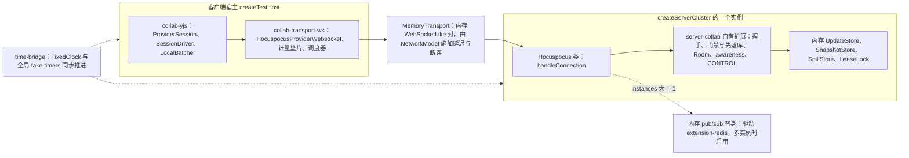
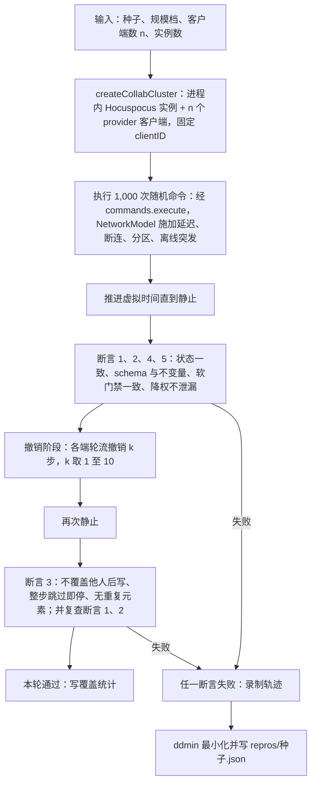
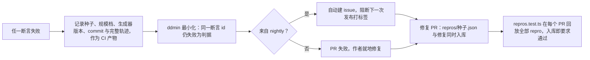
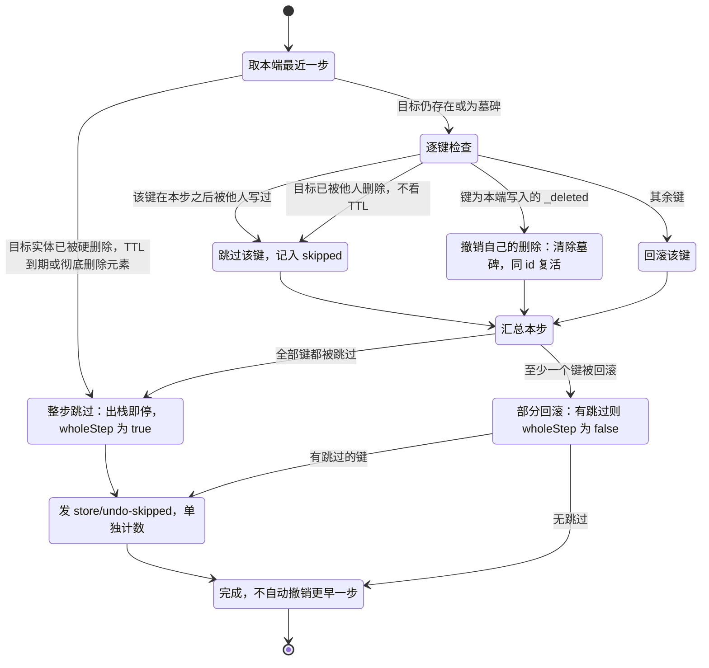
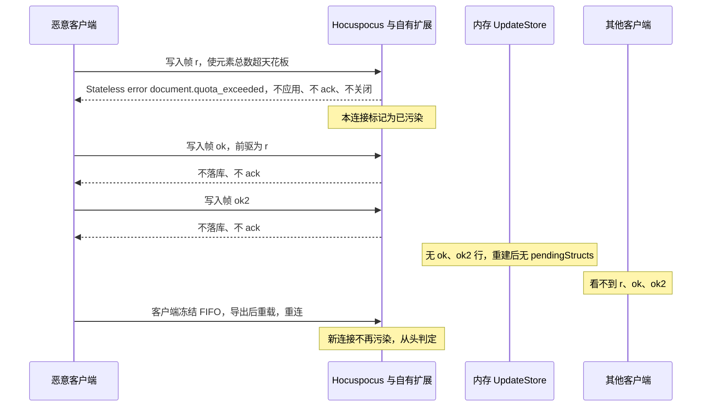
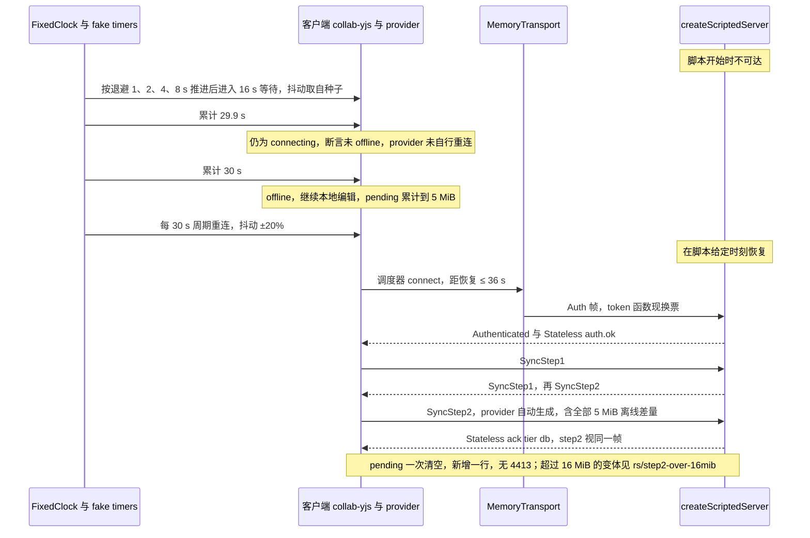
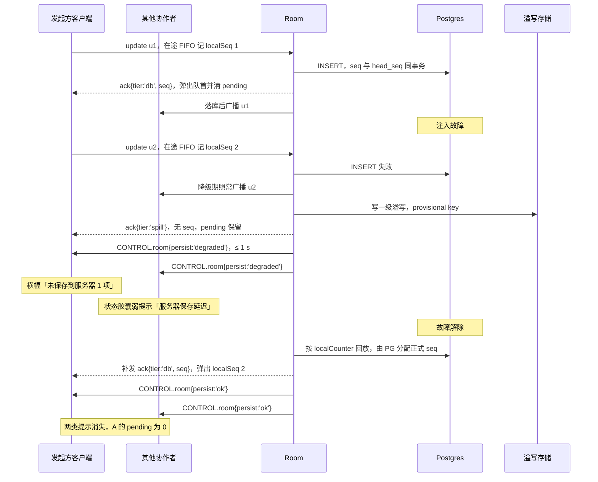

# 05 协同模拟、fuzz 与性质测试

> 状态：v0.1 | 负责：测试设计线 | 更新：2026-09-25；2026-09-25（§4.19）；2026-09-25（§4.19 N1）；2026-09-26（§4.20）；2026-09-26（§4.21：模拟器改跑真 Hocuspocus 类与官方 provider，内存 WebSocketLike + fake timers；脚本化服务端改为进程内 Hocuspocus；互操作改 provider v3/v4；跨进程加 extension-redis 与文档哈希；新增连接污染回归）；2026-09-26（§4.21 整合：§6 补 sc-25~sc-29 元素族并发场景（表格插行插列与删行、占位符并发填入、连接符两端目标、组内最后子元素）；§10 XML 往返改 @cordexjs/xml 路径并补差分模糊行；§9 rs/bootstrap-epoch 改为 Auth 帧） | 依赖：[30/11 §8](../30-architecture/11-testing-strategy.md)、[30/05 §6](../30-architecture/05-command-and-history.md)、[30/06](../30-architecture/06-collaboration.md)、[40/02 §2.5](../40-modules/02-kernel-protocol-and-document-core.md)、[40/05](../40-modules/05-collaboration-client.md)、[40/09](../40-modules/09-server-collab-gateway-and-headless-host.md)、ADR-0020 / 0032 / 0033 / 0034、[rulings](../00-charter/rulings-2026-09-14.md) §4.15 Q3、§4.17 D4 / D5、§4.18 CO-03~CO-10、UX-02 / UX-03、§4.19 D-M2-CONTENT / INC-09 / D-TEST-INFRA、§4.20 FE-03 / FE-04 / FE-05 / FE-23 / TX-01+BE-10、[30/04 §12.3](../30-architecture/04-document-model.md) I-ML2、[ADR-0039](../30-architecture/adr/0039-collab-server-hocuspocus.md)、rulings §4.21（q-ws-gateway、H:q-hp-persist-ack、H:q-hp-fanout、H:q-hp-provider、H:q-hp-step2-cap）与证据 `00-charter/_evidence/hocuspocus-adoption-2026-09-26.json`（TS-01~TS-05、d-09、d-30，核实 vB、vD、vE）

本文是协同收敛、协同撤销、软门禁修复、重连与离线在测试侧的唯一事实源：模拟器组件、断言、规模档、失败种子流程、确定性场景与脚本的用例 id、性质测试目录，以及它们所在的 CI 步骤。被测语义不在这里：撤销契约见 [40/02 §2.5](../40-modules/02-kernel-protocol-and-document-core.md) 与 [30/05 §6](../30-architecture/05-command-and-history.md)，软冲突表见 [30/06 §8](../30-architecture/06-collaboration.md) 与 PRD [CO-08](../10-prd/03-features/03-collaboration.md)，客户端会话与信号分流见 [50/07](../50-frontend/07-collaboration-client.md)，撤销的 UI 表达见 [50/04](../50-frontend/04-document-commands-and-undo.md)，服务端房间、溢写、墓碑见 [60/05](../60-backend/05-modules-collab-and-snapshots.md)，门禁与 ack 发出规则见 [60/16](../60-backend/16-ws-protocol-server-view.md)。契约套件（`runDocumentStoreConformance` 等）的接口与用例 id 见 [02](./02-contract-suites-and-pluggability.md)。

| 本文拥有 | 本文引用 |
|---|---|
| `test/collab-sim/` 的组件、断言、规模档、种子与 repro 格式；软冲突场景 `sc-*`、撤销场景 `undo/*`、软门禁注入类、重连离线脚本 `rs/*` 的用例 id；性质测试目录；互操作与跨进程变体的测试口径 | 协同与撤销语义（30、40、50/07、60/05、60/16）；确定性工具归属（[11](./11-test-data-fixtures-and-determinism.md)）；容器 harness 与服务端集成（[07](./07-backend-integration-and-api-e2e.md)）；CI 步骤名定稿（[12](./12-ci-gates-mapping.md)） |

---

## 1. 定位

协同与撤销语义**不做简化**：模拟器跑的是生产同一份 Yjs（lockfile 锁 13.6.x 精确版本，ADR-0020）、同一份 `store-yjs` 撤销包装层、同一份 `collab-yjs` 编排与 `server-collab` 的 Hocuspocus 扩展，以及同一版本的 `@hocuspocus/server` 类与 `@hocuspocus/provider`（精确 4.7.0，rulings §4.21），只把网络、时钟、持久化换成确定性替身。要机械证明的是五件事：

1. **收敛**：任意操作与网络扰动之后，所有端与服务端状态一致；
2. **撤销不越界**：撤销只回退本端的写入，不覆盖他人后写的键、整步被跳过即停、永不复活他人删除的元素，删除与编辑并发后无重复元素（rulings §4.15 Q3、§4.17 D4）；
3. **软门禁一致**：非法 update 进入后，修复事务让所有端得到同一个合法状态（ADR-0034）；
4. **fail-closed**：降权后被拒的 update 不出现在任何其他端（30/06 §10、§18.4）；
5. **不丢已确认数据**：重连、离线、PG 故障与溢写回放之后，已获 `tier:'db'` 确认的更改零丢失、不重复落库（NF-03，rulings §4.15 S-3a、§4.18 CO-10）。

| 层 | 内容 | 落点 | CI 步骤 |
|---|---|---|---|
| 包内确定性场景 | 12 种软冲突的通用版（`fixture` 文档类型）、两级 ack、会话脚本 | `collab-yjs/src/__tests__/{soft-conflict-scenarios,batcher,session-scripts}.test.ts` | `test/unit` |
| 契约 | 撤销五用例、协同分节（store-memory 与 store-yjs 同一套件） | 见 [02 §4](./02-contract-suites-and-pluggability.md) | `test/contract` |
| slide 级确定性场景 | `sc-*` 软冲突、`undo/*` 协同撤销 | `test/collab-sim/scenarios/*.test.ts` | `test/collab-sim` |
| 随机模拟（fuzz） | 多客户端随机命令 + 网络扰动 + 五条断言 | `test/collab-sim/sim.test.ts`、`repros.test.ts` | `test/collab-sim` |
| 性质测试 | fast-check 性质（§10） | 各包 `__tests__` | `test/unit` |
| 跨进程变体 | 真实网关 + 容器（nightly） | `test/collab-sim/cross-process.test.ts` | `test/collab-sim`（仅 `CORDEX_SUITE=nightly`，需 Docker） |

**里程碑**（以 [PRD 05 §0.3](../10-prd/05-milestones-and-scope.md) 的 M2 / M3 边界为准，rulings §4.19 D-M2-CONTENT：协同网关、Room（单实例）、update 持久化与快照、单实例 PG 故障溢写与两级 ack、换纪元提前到 M2；M3 保留在场、评论、权限细化、离线体验、多实例（含跨实例溢写认领）等多人协同体验层）：

| 里程碑 | 本文内容 |
|---|---|
| M2 | `test/collab-sim` 转阻断：`pr-fixed`、`pr-random`、`softgate`、`nightly` 档与 `repros.test.ts`，服务端实例数固定为 1（2–5 个客户端代表同一用户的多标签页与多设备，经同一 Room 与持久化路径，PRD 05 M2 验收 15）；断言 1–4；`sc-*` 中不依赖评论与降权的场景、`undo/*` 中除墓碑 TTL 硬删除、彻底删除元素、永久删除文档三个场景以外的全部场景；§8 软门禁全部注入类（`unauthorized-path`、`foreign-author` 用 commenter / viewer 身份的变体除外，PRD `collab:gate`）；`softgate` 档的 PG 故障叠加（单实例溢写）；§9 基础重连与会话脚本（`rs/reconnect-now`、`rs/1012-immediate`、`rs/step2-single-fifo-entry`、`rs/offline-5mib-single-step2`、`rs/step2-over-16mib`、`rs/preauth-frames-queued`、`rs/auth-ok-order`、`rs/leave-order`、`rs/no-unsynced-as-saved`、`rs/flush-db-only` 的 db 与 spill 分支、`rs/fifo-and-consecutive-spill`、`rs/refresh-401-expired`、`rs/reauth-reconnect`、`rs/auth-refresh-rebinds`、`rs/room-locked`、`rs/bootstrap-epoch`、`rs/epoch-4428`、`rs/over-ceiling-readonly`、`rs/close-code-behaviors`）与 `rs/unsaved-indicator` 三个分支及两类受众（PRD `collab:degraded`） |
| M3 | 断言 5 `perm/rejected-not-leaked` 与 `sc-15`（降权）；`undo/ttl-hard-delete-whole-step`、`undo/element-purge-whole-step`、`undo/document-purge-no-ttl-wait`（随 M3 验收 17 `collab:undo`；墓碑 TTL 清扫作业本身在 M2 交付，CO-07 与永久删除随 M3）；`sc-18`（评论）；op-generator 评论类权重由 0 恢复到 §2.3 表值；`inject/unauthorized-path`、`inject/foreign-author` 的 commenter / viewer 变体；`pr-random` 与 `nightly` 档的两实例轮次（含跨实例溢写认领）；§9 的多人脚本（`rs/downgrade-*`、`rs/version-restored-notice`）；离线体验脚本（`rs/offline-*`、`rs/online-false`、`rs/server-recovery-36s`，PRD `offline:queue`；`rs/refresh-restores-offline` 随 M4 `collab-offline-idb`）；§12 跨进程变体（两实例与 PG 暂停）；`converge` 档（20 客户端、两实例，PRD `collab:converge`）；§7.1 母版与版式删除的 `ml/*` 与协同撤销用例（随删除命令入库即运行，最迟 M3 `master:edit`）；§7.2 版本恢复的撤销 `rs/restore-revert-*`（PRD `history:restore-revert`；随 ADR-0038 定稿补全，ADR 未定稿则 M3 版本恢复不开工，rulings §4.20 TX-01+BE-10） |

---

## 2. 模拟器组件

### 2.1 目录

```text
test/collab-sim/
├── cluster.ts            createCollabCluster(n, opts)：进程内 Hocuspocus 实例（server-collab 扩展）+ n 个完整客户端（官方 provider），经内存 WebSocketLike 对连
├── time-bridge.ts        （§4.21 新增）把注入的 FixedClock 与全局 fake timers 绑成同一条虚拟时间线
├── network-model.ts      NetworkModel：虚拟时钟上的延迟、乱序、断连、分区、离线突发
├── op-generator.ts       包装 model-slide/testing 的 randomCommand(seed)，加权重表与覆盖统计
├── undo-oracle.ts        逐路径记录「谁在何时写过」，供断言 3 判定他人后写
├── invariants.ts         五条断言（§3）
├── minimize.ts           失败轨迹的删操作二分最小化（ddmin）
├── trace.ts              事件轨迹录制与回放（repro 的格式与加载）
├── profiles.ts           规模档 pr-fixed / pr-random / nightly / converge / softgate（§4）
├── seeds.json            固定种子集
├── repros/*.json         最小化后的失败轨迹（确定性回归用例）
├── scenarios/            sc-*.test.ts 软冲突场景、undo-*.test.ts 协同撤销场景
├── xsd/                  导出 pptx 的 ECMA-376 Transitional schema 引用
├── sim.test.ts           按规模档跑随机模拟
├── repros.test.ts        逐个回放 repros/*.json
└── cross-process.test.ts       跨进程变体（§12，仅 nightly）
```

根 `test/` 工作区不属于水平层，可同时 import `server-collab`、`collab-yjs`、`collab-transport-ws`、`store-yjs` 与 `model-slide`（`@hocuspocus/server` 与 `@hocuspocus/provider` 经这些包间接进入，根 `test/` 不直接 import）（落点规则见 [01](./01-strategy-and-layers.md)；依据：决策 T-NAMING「跨包全链路放根 `test/<suite>/`」）。因此 `createCollabCluster` 放在这里，而不是 30/11 §8 草拟的 `collab-yjs/testing`——collab-yjs 的测试只能用 `fixture` 文档类型（R3 `horizontal-tests-use-fixture-only`），装不进 model-slide 的不变量与软门禁规则。

### 2.2 组件

- **`createCollabCluster(n, { instances, profile, seed })`**（§4.21 改写，证据 TS-01、TS-03、d-30）：服务端取 `server-collab/testing` 的 `createServerCluster(instances)`——每个实例就是一个真 Hocuspocus 类，装着生产同一份自有扩展（握手、门禁与先落库、Room 加载、awareness 校验、CONTROL），IO 接内存 `UpdateStore` / `SnapshotStore` / `SpillStore` / `LeaseLock`，软门禁装入 model-slide 的不变量与修复规则；多实例之间用内存 pub/sub 替身驱动 `@hocuspocus/extension-redis` 的同一套 Redis 协议（真实 Valkey 只在 §12 与 [07](./07-backend-integration-and-api-e2e.md)）。每个客户端是一个 `createTestHost()` 宿主，装 kernel、model-core、store-yjs、collab-core、collab-yjs、collab-transport-ws、model-slide（含 editing）；`collab-transport-ws` 以 `WebSocketPolyfill` 注入 `collab-core/testing` 的 `MemoryTransport`（内存 WebSocketLike 对：客户端一端给 provider，服务端一端交 `hocuspocus.handleConnection`，类型见 Hocuspocus `WebSocketLike`）。客户端 Yjs `clientID` 由种子派生、固定。
- **虚拟时间**：自有代码的定时器、退避、awareness 节流、墓碑 TTL 都挂在同一个 `FixedClock` 事件队列上（`@cordexjs/shared/testing`）；随机数全部来自 `SeededRandom`（依据：决策 T-DETERMINISM，authority：30/11 §1 确定性原则）。§4.21 起第三方内部计时——Hocuspocus 的 `setImmediate` 广播刷新（`flushDelay:0`）、存储 debounce、`timeout` 检查，provider 的 `flushDelay` 批次、`messageReconnectTimeout` 与 `connectionChecker`，y-protocols awareness 的续期与过期——不经注入 Clock，改用全局 fake timers（Vitest `vi.useFakeTimers`，含 `setImmediate` 与 `Date`）；`time-bridge.ts` 每推进一步都先推 FixedClock 再推 fake timers 到同一时刻，保证两条时间线不分叉（证据 TS-05；TD-110 只约束自有代码）。
- **时序钉版本**：模拟器依赖的第三方内部时序（监听器注册顺序、`Connection.send`、`afterHandleMessage` 在 finally 中执行）随 `@hocuspocus/*` 版本变化；`@hocuspocus/*` 升级 PR 必须跑完 `pr-fixed`、`softgate` 两档与 §9 全部脚本（ADR-0039 升级规则）。
- **`NetworkModel`**：参数取 30/11 §8——延迟 U(0, 200 ms)；乱序体现在不同客户端之间、以及跨实例同步（extension-redis 的状态向量往返）的到达顺序（同一 WS 连接内保序，与 TCP 语义一致）；「丢包 5%」以「该帧所在连接被断开（1006）」实现，因为 WS 不会静默丢帧，丢失只能表现为断连后经 step1 / step2 补齐；分区概率 10%、单次 ≤ 2 s；离线突发让客户端在 5–60 s 虚拟时间内保持断网并继续编辑。
- **`op-generator`**：每步按种子选客户端与命令，命令来自 `model-slide/testing` 的 `randomCommand(seed)`，全部经 `commands.execute` 进入命令管线，不直接写 Store。
- **`undo-oracle`**：对每条路径记录写入它的 `(clientId, 本地步号, Lamport 时刻)`；撤销发生时据此得出「本步之后被他人写过的路径集合」。
- **`minimize`**：对失败轨迹按事件（命令与网络事件）做 ddmin，保持「同一条断言 id 仍失败」为判据。

**图 2-0 模拟器的一个客户端与一个服务端实例（§4.21）**



怎么读：实线是一帧从客户端到服务端持久化的路径，除 `MemoryTransport` 与内存适配器外全是生产代码；虚线是只在多实例或计时上起作用的替身。第三方的内部计时由 fake timers 驱动，自有计时由 FixedClock 驱动，二者经 `time-bridge.ts` 对齐。
依据：证据 TS-01、TS-03、TS-05、d-30；ADR-0039。

### 2.3 操作权重与覆盖

| 类别 | 命令（`randomCommand` 的种类） | 权重 % |
|---|---|---|
| 文本 | 插入字符 14、删除区间 6、设置格式 6、分段 4、合段 3 | 33 |
| 形状 | 新增 7、删除 5、移动或缩放 10、改填充与线条 5、进出组 4、组合与取消组合 3 | 34 |
| 幻灯片 | 新增 4、删除 3、重排 4、换版式 3 | 14 |
| 母版与版式 | 重命名版式 1、改占位符几何 1、删除版式（带 `reassignTo`）1 | 3 |
| 历史 | 撤销 7、重做 3、恢复我的值 1、恢复元素 1 | 12 |
| 媒体 | 插入图片（内容寻址） | 2 |
| 评论 | 新建、回复、解决 | 2 |

覆盖门槛：`pr-fixed` 档的 50 个种子合计，每种命令至少执行 50 次、每个类别占比不低于表中权重的一半；`sim.test.ts` 结束时写 `op-coverage.json` 产物并按门槛判定，不达标即失败。生成器改动须同时提升 `generatorVersion`（§5）。

**图 2-1 协同模拟一轮**



怎么读：主干自上而下是一轮模拟；静止后先查不依赖撤销的四条断言，再进入撤销阶段并查断言 3，同时复查收敛与不变量在撤销后仍成立。两处判定失败都走向右下的录制与最小化分支。
依据：30/11 §8；本文 §3、§5。

---

## 3. 每轮静止后的五条断言

**静止**＝网络事件队列为空 ∧ 无进行中的分区与离线突发 ∧ 每个客户端对外 `SyncState` 为 `synced` 且 pending 为 0（全部获 `tier:'db'` 确认）∧ 服务端房间无待持久化与待回放项。静止前推进虚拟时间，超过 10 分钟虚拟时间仍未静止即判「不收敛」失败。

| 断言 id | 断言 | 判据 |
|---|---|---|
| `converge/state-equal` | 1 所有客户端与服务端状态相同 | Y 状态向量逐端相等，且规范化 JSON 快照（`toSnapshotBody()` 后按键排序）的哈希逐端相等；不要求 `encodeStateAsUpdateV2` 字节相等 |
| `model/schema-and-invariants` | 2 schema 与不变量成立 | model-slide `bodySchema` 通过；无父子环、无孤儿（`parentId` 指向墓碑不算孤儿，ADR-0034）、`order` 为合法 FracKey、id 唯一、`_deleted` 符合 `{at, by}` 形状、元素总数（含墓碑）≤ 20,000 |
| `undo/no-foreign-overwrite` | 3a 撤销不回退他人后写的键 | 每个撤销事务的写入路径与 `undo-oracle` 给出的「本步之后被他人写过的路径」交集为空；被跳过的路径都出现在该次 `store/undo-skipped.skipped` 中 |
| `undo/whole-step-stop` | 3b 整步被跳过即停 | 若一步全部键被跳过：该次撤销无写入、`wholeStep:true`、撤销栈恰减 1，不连带撤销更早一步 |
| `undo/no-duplicate-entity` | 3c 删除 vs 编辑后无重复元素 | 撤销阶段后实体 id 唯一；对每个曾被删除又被恢复的实体，存活实例恰为 1；存活实体数与 oracle 推算一致 |
| `softgate/repair-consistent` | 4 软门禁修复在所有端一致 | 仅 `softgate` 档：每个注入的非法 update 都有对应的 `CONTROL.repair` 或计数；静止后断言 1、2 成立（§8） |
| `perm/rejected-not-leaked` | 5 降权后被拒的 update 不出现在其它端 | 模拟器在随机时刻把某端降为 viewer：该端此后发出的 update 的内容在其他端与服务端均不存在；该端 pending 移入 `rejected` 且可导出，本地状态回滚到服务端状态（30/06 §18.4） |

撤销阶段：静止后按种子决定顺序，各端轮流执行 k 次撤销（k 取 1–10），其间其他端不再发命令；每次撤销后推进到静止，再逐次核对 3a / 3b，全部完成后核对 3c 并复查断言 1、2。撤销语义的判定流程见 §7 图 7-1。

---

## 4. 规模档

| 档 | 触发 | 客户端 n | 服务端实例 | 每轮命令 | 轮数 × 种子 | 附加断言 | 时长目标 | CI 步骤 |
|---|---|---|---|---|---|---|---|---|
| `pr-fixed` | 每个 PR | 2–5（按种子） | 1 | 1,000 | 固定种子 50 个（`seeds.json`） | 覆盖门槛（§2.3） | 与下行合计约 2 min | `test/collab-sim` |
| `pr-random` | 每个 PR | 2–5 | 1 或 2 | 1,000 | 随机 200 轮（种子由 CI 运行号派生并打印） | — | 同上 | `test/collab-sim` |
| `softgate` | 每个 PR 10 个固定种子；nightly 1,000 轮 | 3–5 | 1 | 1,000 | 注入 5% 非法 update（§8） | 断言 4 | PR ≤ 30 s | `test/collab-sim` |
| `nightly` | `CORDEX_SUITE=nightly` | 2–5 | 1 或 2 | 1,000 | 10,000 轮 | 10% 的轮次叠加 `softgate` 注入 | ≤ 60 min，按种子分片 | `test/collab-sim` |
| `converge` | nightly 与发布打标签前 | 20 | 2 | 1,000 | 100 个种子 | 导出 pptx 通过 XSD 校验 | ≤ 90 min，按种子分片 | `test/collab-sim` |

- `converge` 档即 PRD M3 验收 1 `collab:converge`：20 客户端 × 1,000 随机命令（文本插删、形状增删移、页重排、组合与取消组合）+ 随机分区与重连，100 个种子全部收敛，且每个种子收敛后由客户端导出一次 pptx，用与 `xsd-validate` job 同一个校验器按 ECMA-376 Transitional schema 校验（schema 引用放 `test/collab-sim/xsd/`），在本步骤内执行。
- 两实例（`instances: 2`）时客户端默认随机分布到两个实例，经内存 pub/sub 替身驱动的 extension-redis 同步（每次变更 3 跳状态向量往返），覆盖跨实例乱序与 Redis 兜底路径；另有 20% 的两实例轮次按文档哈希把同一文档的客户端全部放在同一实例（生产默认的偏好亲和，rulings §4.21 H:q-hp-fanout），只在「迁移」事件（模拟扩缩容）时部分客户端换到另一实例。原内存 `FanoutBus` 扇出随 §4.21 由 extension-redis 取代。
- 各档默认值是下限，只收紧；nightly 与 `converge` 失败自动建 issue 并阻断下一次发布打标签、不阻断合并（依据：决策 T-CI，authority：rulings §4.18 GV-14 / GV-16 + 09-07 §3 封闭集合）。

---

## 5. 失败处理

1. **记录**：失败时写出 `{ seed, profile, generatorVersion, commit, assertion, trace }`，`trace` 是本轮全部命令与网络事件的有序列表（含虚拟时刻、客户端、命令 id 与参数），作为 CI 产物上传。
2. **最小化**：`minimize.ts` 对 `trace` 做 ddmin，判据是「回放后同一断言 id 仍失败」；结果通常是几条到几十条事件。
3. **入库**：修复 PR 把最小化结果写成 `test/collab-sim/repros/<seed>.json` 并附在同一 PR；`repros.test.ts` 在每个 PR 逐个回放全部 repro，要求通过。repro 回放的是轨迹本身，不依赖生成器，生成器升级不会让 repro 失效。
4. **nightly 失败**：自动建 issue，附最小化 repro 产物；repro 与修复在同一 PR 入库，入库即要求通过。不设 `expected: 'fail'`、`skip` 之类的隔离通道（`test/collab-sim` 是 gated 步骤，不重试、不隔离，决策 T-CI）。

`seeds.json` 与 repro 的格式（示意）：

```json
{
  "generatorVersion": 3,
  "profiles": {
    "pr-fixed": [
      { "seed": 1017, "clients": 3, "instances": 1, "note": "含分区与离线突发", "addedAt": "2026-09-25" }
    ]
  }
}
```

```json
{
  "id": "sim-20260925-1017",
  "seed": 1017,
  "profile": "nightly",
  "generatorVersion": 3,
  "commit": "<git sha>",
  "assertion": "undo/no-foreign-overwrite",
  "clients": 3,
  "instances": 1,
  "trace": [
    { "t": 12, "client": 1, "kind": "command", "id": "<命令 id>", "params": {} },
    { "t": 40, "kind": "net", "op": "partition", "clients": [0, 2], "ms": 1200 },
    { "t": 95, "client": 0, "kind": "command", "id": "core.undo", "params": {} }
  ]
}
```

- **生成器升级**：`generatorVersion` +1 后固定种子会生成不同的命令序列，`seeds.json` 的种子保留、重新跑通即可；若某个命令的参数 schema 改变导致 repro 轨迹无法通过当前 schema 校验，`repros.test.ts` 直接失败，须在同一 PR 迁移该 repro，不得删除。
- **新种子入库**：只有两类来源——nightly 失败后的最小化 repro（进 `repros/`），以及评审认为值得长期固定的高覆盖种子（进 `seeds.json`，写明 `note`）。

**图 5-1 失败种子处理**



怎么读：从左到右是一次失败的完整去向；菱形按来源分流，但两条路都汇到「修复 PR 连同 repro 入库」，最终由每个 PR 的回放守住。repro 回放轨迹而不是重跑种子，所以生成器改动不会让历史 repro 失效。
依据：30/11 §0 门禁流 ②、§8；决策 T-CI。

---

## 6. 确定性软冲突场景

来源合并三张表：PRD [CO-08](../10-prd/03-features/03-collaboration.md) 冲突表 14 行、[30/06 §8](../30-architecture/06-collaboration.md) 十二种场景、PRD [ML-03](../10-prd/03-features/07-masters-layouts-and-themes.md) 协同冲突表 5 行，去重后为 24 个场景；2026-09-26 整合另补 5 个元素族并发场景 `sc-25`~`sc-29`（表格、占位符、连接符、组合，依据 30/06 §1.3 与 §8 #14、40/03 的 I-TBL1 / I-PH1 / I-GRP1、ADR-0018 决策 8），共 29 个。每个场景是 `test/collab-sim/scenarios/sc-NN.test.ts` 的确定性脚本：固定 clientID 与虚拟时钟，逐帧控制投递顺序；同一场景再以 20 种不同投递顺序（种子派生）各跑一次，要求结果与提示在每次运行中都一致。「提示出现率 100%」的判据：提示驱动事件在预期的客户端上**恰好出现一次**、在其他客户端上不出现；事件名与载荷以 [50/07](../50-frontend/07-collaboration-client.md) 的信号分流表为准，提示条的渲染由 [06](./06-frontend-component-and-e2e.md) 的双浏览器 e2e 抽样覆盖（`prop-lww`、`delete-vs-edit`、`undo-skipped` 三类各一条）。30/06 §8 的十二种在 `fixture` 文档类型上的通用版另在 `collab-yjs/src/__tests__/soft-conflict-scenarios.test.ts` 执行（40/05 §2.3，`test/unit`）。

| id | 场景 | 来源 | 收敛结果断言 | 信号与提示断言 |
|---|---|---|---|---|
| `sc-01` | A、B 同时移动同一形状 | 06 #1；CO-08 | `xfrm` 键级后写者胜，所有端一致 | 失败方恰一次 `collab/soft-conflict{type:'prop-lww'}`，附「恢复我的值」 |
| `sc-02` | A 删除形状，B 同时编辑其文本 | 06 #2；CO-08 | 形状为墓碑、id 不变；B 的编辑保留在墓碑实体上；读路径不可见 | B 端 `delete-vs-edit` 恰一次，附「恢复元素（含我的编辑）」 |
| `sc-03` | A 删除页，B 在该页新增形状 | 06 #3；CO-08 | 页为墓碑；B 新增的形状随页不可见；「恢复此页」后以原 id、原 `order` 复活且 B 的形状可见 | B 端 `delete-vs-edit`（页粒度）恰一次 |
| `sc-04` | A、B 在同一间隙各插一页 | 06 #4 | 两页都在、相邻，所有端按 `(order, id)` 同序 | 无提示 |
| `sc-05` | A、B 同时重排页顺序 | CO-08 | 无重复、无丢页，顺序确定 | `collab/soft-conflict{type:'reorder'}` |
| `sc-06` | A 把 X 放入组 G，B 同时把 G 放入 X | 06 #5；CO-08 | 环上 id 字典序最大者回页根；客户端轻量修复与服务端软门禁结果相同 | `collab/repair{rule:'cycle'}`，非阻断提示「已自动修正 1 处结构问题」 |
| `sc-07` | A 改填充色，B 改位置 | 06 #6 | 两个键都生效 | 无提示 |
| `sc-08` | 同一文本框不同位置并发键入 | 06 #7；CO-08 | 字符级合并，两处都保留；光标经相对位置保持 | 无提示 |
| `sc-09` | 同一文本框同一位置并发键入 | CO-08 | 两段插入相邻、顺序由 clientID 决定，所有端一致 | `collab/soft-conflict{type:'text-same-pos'}`；预防性提示来自 presence `caret` / `editing` |
| `sc-10` | A 回车分段，B 给被移动的尾部加粗 | 06 #8；CO-08 | 尾部格式落空（已知限制），所有端结果相同 | 无提示 |
| `sc-11` | A 换版式，B 编辑占位符文本 | 06 #9 | `layoutId` 与 `txBody` 都生效，文本按新版式解析继承 | 无提示 |
| `sc-12` | A、B 同时更换同一页版式 | CO-08 | `layoutId` 后写者胜，占位符文本保留 | `prop-lww` |
| `sc-13` | A 撤销自己的移动，其间 B 也移动了该形状 | 06 #10 | 被 B 后写的键跳过、其余键回退；整步都被跳过则停下 | A 端 `store/undo-skipped` 恰一次，不计入 `collab/soft-conflict`（D5） |
| `sc-14` | 离线的 A 修改形状，在线的 B 早已删除 | 06 #11；CO-08 | TTL 内：A 的修改合入墓碑实体；TTL 已过（已硬删）：A 的修改被丢弃 | TTL 内：A 端 `delete-vs-edit`；TTL 已过：A 的离线更改可从「未同步更改」导出 |
| `sc-15` | A 被降为 viewer 时仍有 pending update | 06 #12 | 服务端拒绝、不落库不广播；A 本地回滚到服务端状态 | `collab/update-rejected`；横幅「你的 N 项更改未被保存」+ 导出 |
| `sc-16` | A 组合元素，B 同时编辑其中一个子元素 | CO-08 | 组合成功，B 的编辑作用于组内子元素 | 无提示 |
| `sc-17` | A 取消组合，B 同时移动组 | CO-08 | 取消组合胜，组变换烤进子元素、视觉位置不变；B 对已删组的写入落空 | 无提示 |
| `sc-18` | A 解决评论线程，B 同时回复 | CO-08 | 回复保留，线程为已解决 | 绑定 [50/08 §5](../50-frontend/08-comments-and-version-history.md) 评论面板的派生状态：所有端该线程为已解决，且因最新回复晚于解决时刻派生出「已解决线程有新回复」内联提示；不发事件、不出 Toast，因此不用「事件恰一次」判据，改断言各端派生状态相同 |
| `sc-19` | A、B 同时插入图片 | CO-08 | 媒体按 sha256 内容寻址，导出部件名不冲突 | 无提示 |
| `sc-20` | A 删除版式 L，B 同时把页 P 改为 L | ML-03；rulings §4.20 FE-04 | 两端收敛：L 为墓碑，墓碑期内 P 的 `layoutId` 仍为 L（读时容错，不写修复），渲染与导出按 `defaultLayoutOf`（30/04 §12.3 I-ML2 链）取替代版式，此时导出的 pptx 中 P 引用存活版式；变体 a：A 随后撤销删除 → L 以原 id 复活、P 显示 L，全程无修复写入；变体 b：虚拟时钟推进过墓碑 TTL、tombstone-sweeper 硬删 L → 同一事务把 P 的 `layoutId` 改为 `defaultLayoutOf` 的结果，修复只写一次（再跑一次清扫不再写） | 墓碑期 B 端恰一次 `collab/soft-conflict{type:'delete-vs-reference'}`（Toast 文案按 [50/11 §10](../50-frontend/11-masters-layouts-and-themes.md)），A 端无提示，不发 `collab/repair`；变体 b 硬删修复时各在线端恰一次 `collab/repair{rule:'dangling-layout'}`（规则名以 30/04 §12.3 为准，不用 `layout-missing`） |
| `sc-21` | A 改版式占位符文本样式，B 在页上显式覆盖同一属性 | ML-03 | 页显式覆盖优先，其余页跟随 A | 无提示 |
| `sc-22` | A 删除版式占位符，B 同时编辑该占位符文本 | ML-03 | B 的形状脱离为普通形状，文本保留 | 绑定 [50/11 §10](../50-frontend/11-masters-layouts-and-themes.md) 冲突表「A 删除版式上的占位符」行的占位符删除信号：B 端恰一次（Toast「占位符已被 A 删除，你的文本已保留为普通形状」），A 端不出现；事件名以 [50/07](../50-frontend/07-collaboration-client.md) 信号分流表的登记为准 |
| `sc-23` | A、B 同时重命名同一版式 | ML-03 | 键级后写者胜 | `prop-lww` |
| `sc-24` | A、B 同时编辑同一占位符几何 | ML-03 | 键级后写者胜 | `prop-lww`；随后 A 撤销按 `sc-13` 规则跳过 |
| `sc-25` | A 在表格里插一行，B 同时插一列 | 30/06 §1.3；40/03 I-TBL1 | 新行与新列都在、按 `(order, id)` 同序；新行 × 新列的交叉格缺失时客户端读时画空格（`cellAt` 容错），服务端软门禁以 `system('repair')` 补空格后所有端一致 | 后到达服务端的一方收到一次 Stateless `repair`；无用户提示 |
| `sc-26` | A 删除表格一行，B 同时编辑该行某格文字 | 30/06 §1.3；06 #2 | 行为墓碑、其格随之不可见；B 的文字保留在墓碑行的格上、不丢，A 撤销删行后该格以原 `CellKey` 可见且含 B 的文字 | 同 `sc-02` 口径 |
| `sc-27` | A、B 同时把内容填入同一个空内容占位符 | 30/06 §8 #14；40/03 I-PH1 | 两个新元素都保留；服务端软门禁修复一次：`(order, id)` 最小者保留为占位符，其余转为普通元素；所有端一致 | 触发修复的会话收到一次 Stateless `repair`；无阻断提示 |
| `sc-28` | A、B 分别移动同一连接符两端所连的目标形状 | ADR-0018 决策 8；50/22 | 连接符存储的端点同键 LWW 后可能陈旧；显示按派生几何，两端画面一致且端点贴合两个目标；导出经 `connectorGeometry` 写出派生几何，各端导出字节相同 | 无提示 |
| `sc-29` | A、B 同时各删除组内仅剩的两个子元素之一 | 40/03 I-GRP1 | 组没有存活子元素，服务端软门禁给组写墓碑，所有端组不可见 | 触发修复的会话收到一次 Stateless `repair`；无用户提示 |

PRD M3 验收 2 `collab:soft-conflict` 与验收 14 的「ML-03 协同冲突表 5 行」、验收 13 `collab:rejected-rollback` 分别由上表 `sc-01`~`sc-19`、`sc-20`~`sc-24`、`sc-15` 承担。`sc-25`~`sc-29` 随各自元素的交付里程碑启用（表格结构编辑 M3；占位符填入、连接符与组合 M2），不新增检查名，归入 `collab:soft-conflict`。

---

## 7. `collab:undo` 专项

PRD M3 验收 17 `collab:undo` 由两层承担：Store 层的契约用例在 store-memory 与 store-yjs 上跑同一套件（[02 §4](./02-contract-suites-and-pluggability.md)：`remote-conflict-skip`、`undo-skip-no-cascade`、`soft-delete-tombstone`、`delete-vs-edit-undo`、`read-path-filters-tombstone` 与 `history-commands/*`）；本节的场景层在 `test/collab-sim/scenarios/undo-*.test.ts` 用真实客户端与内存服务端复现同一语义，额外覆盖服务端单写者的硬删除路径与 UI 信号。用例名与 [50/04](../50-frontend/04-document-commands-and-undo.md)、[60/05](../60-backend/05-modules-collab-and-snapshots.md) 一致。

| 用例 id | 场景 | 断言 |
|---|---|---|
| `undo/remote-conflict-skip` | A 一步写 k1、k2；B 随后写 k1；A 撤销 | k1 保持 B 的值、k2 回滚；A 端 `store/undo-skipped{wholeStep:false}` 恰一次，提示「X 之后修改了此处，已跳过」 |
| `undo/undo-skip-no-cascade` | A 步 1 写 k1、步 2 写 k2；B 随后写 k2；A 撤销一次 | 步 2 整步跳过、出栈、`wholeStep:true`；k1 未被连带撤销；再撤销一次才回滚 k1；`redo` 对称 |
| `undo/remote-deleted-no-resurrect` | B 先编辑 E，A 随后删除 E（墓碑 TTL 内），B 撤销自己的编辑 | B 的撤销跳过、E 不复活；不看 TTL（rulings §4.17 D4） |
| `undo/delete-vs-edit-restore-same-id` | A 删除 E，B 编辑 E；A 撤销删除，同时 B 点「恢复元素」 | E 以原 id 复活且带 B 的编辑；所有端 E 恰一份 |
| `undo/ttl-hard-delete-whole-step` | A 删除 E；虚拟时钟推进 24 h；服务端 tombstone-sweeper 持 `lock:tombstone:{docId}` 以 `system('maintenance')` 硬删；A 撤销该步 | 硬删后 Y 状态无该实体残留；A 的撤销整步跳过（`wholeStep:true`） |
| `undo/element-purge-whole-step` | A 删除 E；owner 对墓碑态 E 执行「彻底删除元素」；A 撤销该步 | 服务端立即硬删（复用 tombstone-sweeper 事务）；A 的撤销 `wholeStep:true`；对非墓碑 id 调用被拒（rulings §4.18 CO-07；审计 `document.element_purged` 在 [07](./07-backend-integration-and-api-e2e.md) 断言） |
| `undo/document-purge-no-ttl-wait` | 在线编辑中文档被「永久删除」 | 房间被 `closeRoom(docId,'purge')` 关闭，客户端收到 4404，不等墓碑 TTL；之后无 update 落库（编排见 [60/04](../60-backend/04-modules-documents-storage-media.md)） |
| `undo/offline-replay-not-other-writer` | A 离线编辑后重连回放 | 回放以本端 clientId 写入，不计为「他人后写」，A 之后仍可正常撤销离线前的步骤（40/05 §2.3） |
| `undo/restore-mine-then-undo` | `sc-13` 之后 A 执行 `core.history.restoreMine{skipId}` 再撤销 | 恢复是新的 `local` 事务、进入历史栈；撤销它时若 B 又改了该键，同样按跳过规则处理 |
| `undo/restore-element-disabled-after-hard-delete` | 目标已被 TTL 或「彻底删除元素」硬删后调用 `core.history.restoreElement{skipId}` | 命令不可用并提示「该内容已被彻底删除」（术语按 CO-07，以 50/04 §6.2 为准），不产生事务 |
| `undo/skip-records-cleared-on-epoch` | 产生若干 UndoSkip 记录后服务端 `forceEpoch`（4428） | 客户端重新 bootstrap 后 UndoSkip 记录与撤销栈清空，旧 `skipId` 调用返回错误 |
| `undo/skip-metric-separate` | 任一跳过发生 | `RecordingTelemetry` 中 `store/undo-skipped` 单独计数（跳过次数、整步跳过次数），不计入 `collab/soft-conflict` 与软冲突率（rulings §4.17 D5） |

`restoreMine` / `restoreElement` 的命令契约（UndoSkip 记录字段与 20 条上限、epoch 变更清空、两者都需 `doc.write`、不可用时的返回）以 [50/04 §6.1–§6.2](../50-frontend/04-document-commands-and-undo.md) 为唯一源，本节只断言（依据：决策 RESTORE-CMD，authority：rulings §4.15 Q3「恢复我的值」为新事务 + §4.18 CO-07 + 30/05）。

**图 7-1 撤销一步的判定**



怎么读：状态是撤销包装层处理一步撤销时的阶段，转移上写判定条件；两条「跳过」边只要命中其一即跳过该键，图中先后不代表实现顺序。整步跳过既可能来自逐键汇总，也可能在取步时就因目标已被硬删除而直接得出；无论哪条路径都停在「完成」，不连撤更早一步。复活只发生在撤销**本端**的删除，他人删除的目标永远走跳过边。
依据：30/05 §6；40/02 §2.5 中性撤销语义第 2–4 条；rulings §4.15 Q3、§4.17 D4 / D5、§4.18 CO-07。

### 7.1 母版与版式删除：撤销与目标选取

rulings §4.20 FE-05 裁定删除被引用的版式或母版「确认后可撤销」（保留确认对话框，执行后入撤销栈、Toast 带「撤销」；`CommandDef.undoable` 不改为谓词），FE-23 定下删除母版时各页改用的版式，FE-03 把默认版式选取统一为 30/04 §12.3 I-ML2 链的单一纯函数 `defaultLayoutOf(body, {masterId, type?, exclude?})`（model-slide `domain/invariants/reassign.ts` 导出）。单机命令层用例经 `createCommandHarness`（model-core/testing）在 store-memory 与 store-yjs 上各跑一次；这些用例不调用 kit，按 [01 §4](./01-strategy-and-layers.md) 的文件名前缀规则归 `test/unit`。对话框文案与 Toast 的界面表达在 [06 §5](./06-frontend-component-and-e2e.md) 第 25 行。

| 用例 id | 场景 | 断言 | 落点 |
|---|---|---|---|
| `ml/delete-layout-undo-one-step` | 删除被 3 页引用的版式 L：`slide.deleteLayout{layoutId, reassignTo}`，再 `core.undo` | 删除是一个事务、撤销栈深度 +1；一次撤销后 3 页的 `layoutId` 回到 L、L 以原 id 复活（清除墓碑），占位符重匹配结果回到删除前；`core.redo` 对称 | `model-slide/src/__tests__/master-layout-delete.test.ts`（`test/unit`） |
| `ml/delete-layouts-batch-single-tx` | 多选删除 `slide.deleteLayout{layoutIds:[L1, L2], reassignTo}` | 一个事务；一次撤销两者都以原 id 复活、引用页全部回退 | 同上 |
| `ml/delete-master-reassign-same-type` | 删除被引用的母版 M1：`slide.deleteMaster{masterId: M1, reassignTo: M2}`，M2 下有与原版式同 `type` 的版式 | 每个受影响页取 `defaultLayoutOf(body, {masterId: M2, type: 原版式的 type})`，页的版式 `type` 保持不变；重指引用页与删除母版及其版式在同一事务 | 同上 |
| `ml/delete-master-fallback-first` | 同上，但 M2 下没有同 `type` 的版式；另一例不传 `reassignTo` | 该页落到 M2 按 `order` 的首个版式；不传 `reassignTo` 时目标母版取按 `order` 排序的首个剩余母版 | 同上 |
| `ml/delete-master-undo-one-step` | 上两例之后 `core.undo` | 一步恢复：M1 与其版式以原 id 复活、各页引用回退；撤销栈深度与删除前相同 | 同上 |
| `ml/default-layout-of-chain` | 对 `defaultLayoutOf` 构造三级回退与墓碑 | 原母版下同 `type` 首个 → 该母版首个 → 首个母版的首个；跳过墓碑与 `exclude`；删除母版首个版式时得到的 `reassignTo` 不等于被删版式；slide-ui 的编辑目标逻辑调用的是 model-slide 导出的同一符号（不另写本地实现） | `model-slide/src/domain/invariants/__tests__/reassign.test.ts`；`slide-ui/src/__tests__/edit-target.test.ts`（`test/unit`） |
| `undo/delete-layout-revert-skips-later-writes` | A 删除被引用的版式 L（P1、P2 被重指到默认版式），B 随后把 P2 改用版式 K；A 撤销 | P1 回到 L、L 以原 id 复活；P2 的 `layoutId` 保持 K（该键在本步之后被他人写过，按 rulings §4.15 Q3 跳过）；A 端恰一次 `store/undo-skipped{wholeStep:false}` 与跳过提示 | `test/collab-sim/scenarios/undo-master-layout.test.ts`（`test/collab-sim`） |

`deleteLayout(reassignTo)` 的结果与 I-ML2 修复一致由 §10 的性质测试断言；墓碑期并发引用的收敛由 §6 `sc-20` 断言。追溯标签 `@ruling 4.20/FE-03`、`4.20/FE-05`、`4.20/FE-23`（[13 §6.4](./13-requirements-traceability.md)）。

### 7.2 版本恢复的撤销 `rs/restore-revert-*`（占位，随 ADR-0038）

U-07「版本恢复可撤销」由 ADR-0038 version-restore-undo 立项（提议；M-02 主笔，M-05、M-09 会签，rulings §4.20 TX-01+BE-10），M2 期间起草、M2 出口评审前定稿；ADR 未定稿则 M3 的版本恢复不开工，本组用例也不入库。基线：在持有 Room 的实例内单事务执行、不加锁、不断连，走命令管线（不用 `revertTo`）；判断「他人后写」看当前值是否仍出自恢复事务的 struct 范围，不比较值是否相等；恢复时删掉的元素以原 id 复活。本节先登记用例 id 与断言骨架，场景在 `test/collab-sim/scenarios/restore-revert.test.ts`（真实客户端 + 内存服务端，服务端 Room 执行恢复与撤销事务，`test/collab-sim`），服务端路由、能力位与审计的集成用例在 ADR 定稿后登记进 [07 §9](./07-backend-integration-and-api-e2e.md)。

| 用例 id | 场景 | 断言骨架 |
|---|---|---|
| `rs/restore-revert-skip-later-writes` | A 把文档恢复到版本 V（恢复事务改写 k1、k2、k3，并删除元素 E）；B 随后写 k2——含一个「B 写回与恢复值相同的值」的变体；持 `history.restore` 者撤销此次恢复 | k1、k3 回到恢复前的值、E 以原 id 复活；k2 保持 B 的值并计入跳过数；「写回相同值」的变体中 k2 同样被跳过（按 struct 范围判定，不按值相等）；撤销是一个事务、期间无 `room{locked}`、会话不断连；各会话恰一次 `CONTROL.event{name:'version.restore-reverted'}`，审计 `snapshot.restore_reverted` 一行 |
| `rs/restore-revert-whole-step` | 恢复之后，恢复事务改写的每个键都被他人写过 | 不提交任何事务，返回 `wholeStep:true`；不回退更早的恢复或编辑 |
| `rs/restore-revert-tombstone-expired` | 恢复时删除的元素 E 已过墓碑 TTL 被硬删（另一变体：经「彻底删除元素」）后撤销恢复 | E 跳过、不复活，计入跳过数；其余键照常回退 |

「谁能撤销恢复」（建议任一持 `history.restore` 者）与「可撤销时效」（建议只限最近一次恢复、其后无新恢复且仍在 update 保留 7 天内）两处在 ADR-0038 定稿时交互拍板，届时补主体与时效两类断言（含越权 403 与超时效拒绝）。PRD 05 M3 检查名 `history:restore-revert` 的登记见 [13 §3.4](./13-requirements-traceability.md)；追溯标签 `@ruling 4.20/TX-01`、`4.20/BE-10` 与 `@adr 0038/<决策号>`（ADR 定稿后生效）。

---

## 8. 软门禁变体

`softgate` 档（§4）让 5% 的 update 来自「恶意客户端」：它绕过命令管线，直接对本端 Y.Doc 写原始 update 再发出，角色仍为 editor（路径级权限类注入改用 commenter / viewer 身份）。服务端软门禁行为与修复规则的唯一源是 [ADR-0034](../30-architecture/adr/0034-server-update-validation-and-repair.md) 与 [60/16](../60-backend/16-ws-protocol-server-view.md)。`softgate` 档显式以 `softGate.mode='repair'`（不变量）、`softGate.schemaMode='report-only'`（schema 类型）运行，与 M3 生产默认相同；门禁随协同后端在 M2 入库，因此本档自 M2 起阻断，M2 的部署默认值以 60/16 为准。

| 注入类 | 构造 | 期望（默认配置，随协同后端自 M2 生效） | 黄金用例 |
|---|---|---|---|
| `inject/cycle` | 两个形状 `parentId` 互指 | 环上 id 字典序最大者 `parentId=null`；客户端轻量修复结果相同 | `gate/cycle` |
| `inject/dangling-parent` | `parentId` 指向不存在的形状 | `parentId=null` | `gate/dangling-parent` |
| `inject/dangling-layout` | `layoutId` 指向不存在的版式（不是墓碑，见 `inject/tombstone-ref`） | 按 30/04 §12.3 I-ML2 链改为 `defaultLayoutOf` 的结果：原母版下同 `type` 的首个版式 → 该母版首个版式 → 首个母版的首个版式（rulings §4.20 FE-03） | `gate/dangling-layout` |
| `inject/bad-order` | `order` 写入非法字串 | 重新生成为集合末尾键 | `gate/bad-order` |
| `inject/meta-tamper` | 改 `meta.schemaVersion` 或 `epoch` | 写回服务端已知值 | `gate/meta-restore` |
| `inject/id-mismatch` | 实体键与内部 `id` 不一致 | 内部 `id` 写回键值 | `gate/id-rewrite` |
| `inject/bad-tombstone` | `_deleted` 为 `true`、字符串、缺 `at` 或 `by`、`at` 非数字 | 恢复该键上一个合法值；`{at, by}` 且 `at` 晚于服务端时间仍合法、不修复（rulings §4.18 CO-06） | `gate/tombstone-shape` |
| `inject/unauthorized-path` | commenter 写 `resources['comments.threads']`（内含 threads、replies 两张实体表）以外的路径；commenter / viewer 写 `_deleted` | 用 Y 事件旧值还原；计数 | `gate/path-permission` |
| `inject/foreign-author` | 回复或线程的 `authorId ≠ session.userId`（非 owner） | 还原或删除该实体 | `gate/comment-author` |
| `inject/tombstone-ref` | `parentId` / `layoutId` 指向墓碑实体 | **不是违规、不修复**；目标被硬删除后才按「指向不存在」修复 | `gate/tombstone-ref-no-repair` |
| `inject/hard-delete-bypass` | 客户端直接删除实体键（绕过墓碑） | 不修复；`report-only` 计数并审计 `collab.hard_delete_bypass`（审计在 [07](./07-backend-integration-and-api-e2e.md) 断言） | `gate/hard-delete-bypass` |
| `inject/rejected-then-dependent`（§4.21 新增，核实 vB 回归） | 两个变体，都以 editor 身份：(a) 一帧使元素总数超天花板、被 L3 软拒（`error{document.quota_exceeded}`，不关闭），紧接着在同一连接上发两帧依赖它的写入 `ok`、`ok2`（结构上以被拒帧为前驱）；(b) 锁定窗口内一帧被 L2 拒绝，解锁后再发 `ok`、`ok2` | 连接污染规则（证据 d-09）：被拒帧之后这条连接的写入帧一律不落库、不回 ack，直到重连；(b) 解锁时服务端对已污染的连接先推 `room`（不含 `locked`）再关闭让它重连；`document_updates` 中不出现 `ok`、`ok2`；静止后服务端 Y.Doc 与由日志重建的文档都无 `pendingStructs`；该客户端 FIFO 冻结、`ok`、`ok2` 进入被拒集合并可导出；落库前的 `parseUpdateMeta` 与删除集缺口检查作为兜底另有单测（核实 vD：只含删除的帧查不出结构缺口） | `gate/no-ack-after-drop` |

- **不注入 schema 类型错误**：默认 `schemaMode='report-only'`（ADR-0034），该类只计数不修复，放进随机模拟会让断言 2 失真；另设 `softgate-schema` 小档（`schemaMode='repair'`，PR 5 个固定种子）覆盖「恢复为该键上一个合法值或删除可选键」。
- **隔离阈值**：同一会话 10 分钟虚拟时间内触发修复 ≥ 5 次 → 以 4409 关闭并进入 quarantined（30/06 §11）；用例 `gate/quarantine-threshold`。
- **黄金用例落点**：`server-collab/src/__tests__/soft-gate-repair.test.ts`（`fixture` 文档类型的规则，`test/unit`）；model-slide 规则的输入 / 输出黄金对放在 `apps/server/test/fixtures/soft-gate/<用例>.json`，由 `apps/server/test/integration/soft-gate-repair.int-spec.ts` 执行（只有组合根能同时 import `server-collab` 与 `model-slide`，rulings §4.18 FE-01；`test/server-integration`）。客户端轻量修复与服务端规则是同一纯函数，`model-slide/src/__tests__/invariants-repair.test.ts` 用同一批黄金对断言两侧输出相同。
- **PG 故障叠加**：修复事务与普通 update 一样进入溢写、随回放由 PG 分配 seq；`softgate` 档 10% 的轮次叠加 PG 故障注入，静止后断言 `seq` 连续（ADR-0034 修订 2026-09-24 第 2 条）。

**连接污染回归（§4.21 新增，`inject/rejected-then-dependent`）**：原「被拒帧只回 error、之后照常处理」在 Hocuspocus 上会造成「已 ack 但不可见」——被拒帧之后同一客户端的更新因缺前驱挂进服务端 `pendingStructs`，却照样通过 `beforeSync` 被落库并拿到 ack，重载日志后仍挂着、压缩快照会永久带着（核实 vB）。本档以 5% 注入率中的五分之一注入这一形态，每轮静止后在断言 1、2 之外追加 `durability/no-pending-structs`：每个实例的内存文档与「快照 + 日志」重建结果都无 `pendingStructs`，且每个获过 `tier:'db'` 的 update 都在其他端可见。

**图 8-1 连接污染：被拒帧之后不落库、不回 ack**



怎么读：纵向是时间；被拒帧之后的写入帧即使本身合法也不落库、不回 ack，因为它们在服务端缺前驱、应用了也不可见；客户端这一侧按 [50/07](../50-frontend/07-collaboration-client.md) 的冻结 FIFO 与导出后重载收尾，重连后恢复正常判定。
依据：证据 d-09、K4、K14，核实 vB、vD；ADR-0034（修订见 ADR-0039）。

PRD M2 验收 16 `collab:gate` 的软门禁部分与 M3 验收 12 `collab:softgate` 的多客户端回归（所有端最终一致且合法、每条修复规则有黄金用例）由本节承担；「修复与拒绝进入审计」在 [07](./07-backend-integration-and-api-e2e.md) 断言。

---

## 9. 重连与离线确定性脚本

脚本用 `collab-core/testing` 的 `MemoryTransport`（内存 WebSocketLike 对）、脚本化服务端与 `FixedClock` 加全局 fake timers（§2.2），客户端是真实的 collab-yjs + collab-transport-ws + store-yjs 与官方 provider。§4.21 起脚本化服务端是 `collab-transport-ws/testing` 的 `createScriptedServer(script)`：进程内一个真 Hocuspocus 4.7.0 实例加一个脚本扩展，按脚本发 `Authenticated` / `PermissionDenied`、Stateless 载荷（`auth.ok`、ack、`room`、`permission`、`error`）与原始 `ws.close(码)`，精确控制时序（证据 TS-02；`@hocuspocus/server` 只是该包的 devDependency）。脚本定义在 `collab-core/testing/scenarios.ts`，由 `collab-yjs/src/__tests__/session-scripts.test.ts` 与 `batcher.test.ts` 执行（`test/unit`）；计时类脚本同时是传输 kit 的 `session/*` 用例（[02 §6.1](./02-contract-suites-and-pluggability.md)），这里只列入矩阵、不重复实现。Session 状态机、计时器与关闭码行为表的唯一源是 [50/07](../50-frontend/07-collaboration-client.md)；服务端真实版本（真实网关与容器）在 [07](./07-backend-integration-and-api-e2e.md)。

| id | 脚本 | 断言 | 依据 | 落点 |
|---|---|---|---|---|
| `rs/offline-threshold` | 服务端不可达，推进虚拟时钟 | 自进入重连累计 29.9 s 未离线，30 s 离线 | UX-03 | kit `session/offline-after-30s` |
| `rs/online-false` | `navigator.onLine=false` | 去抖 2 s 后立即 offline，期间零连接尝试 | UX-03、CO-03 | kit `session/online-false-immediate-offline` |
| `rs/server-recovery-36s` | offline 后服务端在任意时刻恢复 | ≤ 36 s 自动回连（30 s × 1.2 抖动上限） | CO-03 | kit `session/offline-periodic-reconnect` |
| `rs/reconnect-now`、`rs/1012-immediate` | 点「立即重连」；服务端 1012 驱逐 | 立即 connecting；1012 首轮不退避 | CO-03；30/06 §6.5 | kit |
| `rs/offline-5mib-single-step2`（原 `rs/offline-5mib-chunked`） | 离线累计 5 MiB 更改后重连 | provider 对服务端 step1 自动生成一个 step2 送达全部离线差量（不切块，rulings §4.21 H:q-hp-step2-cap）；恰回一帧 db ack、pending 一次清空、无 4413、服务端无重复行 | CO-10（按 §4.21 改写） | `batcher.test.ts` |
| `rs/step2-over-16mib` | 离线累计差量超过 16 MiB 后重连 | 服务端以 4413 关闭；客户端上报遥测，按 `payload-too-large` 移入 `rejected` 并走导出后重载，不再重连 | §4.21 H:q-hp-step2-cap | `session-scripts.test.ts` |
| `rs/step2-single-fifo-entry` | 重连 step2 携带离线剩余差量 | step2 作为一个 FIFO 条目（取发送时 pending 最大 `localSeq`），收到 db ack 后 pending 一次清空，被覆盖的 pending 不逐帧重发 | CO-10 | `batcher.test.ts` |
| `rs/fifo-and-consecutive-spill` | ack 序列为 db、spill、spill、db、db | db 弹在途 FIFO 队首并 `ackUpTo`；spill 不参与对应、只更新 `SessionStats`；`seq` 只更新 `meta.lastAckSeq`；断线清空 FIFO、pending 保留 | CO-09；S-3a | `batcher.test.ts` |
| `rs/flush-db-only` | 调用 `Session.flush()` | 只有全部 pending 获 db ack 才 resolve；仅获 spill ack 时不 resolve | S-3a | `batcher.test.ts` |
| `rs/unsaved-indicator` | 服务端推 `CONTROL.room{persist:'degraded'}` 再推 `'ok'` | 见下段 | CO-08；INC-09 | `session-scripts.test.ts` |
| `rs/refresh-401-expired` | `token` 函数取票遇 401；另一次遇网络错误 | 401：provider 报 `authenticationFailed`，SessionDriver 立即断开、直接 denied（对外「登录已过期」），不经 offline，断开后不再有无 Auth 的 step1 上线（核实 CL-05）；网络错误走 backoff 并共用同一 30 s 计时 | UX-02、UX-03；证据 CL-05 | kit `session/refresh-*` |
| `rs/reauth-reconnect` | denied 后取得新票据 | `denied → connecting → syncing → synced`，pending 队列保留并继续发送 | UX-02 | `session-scripts.test.ts` |
| `rs/auth-refresh-rebinds` | 浏览器登录会话续期后 SessionDriver 调 `provider.sendToken()`（原 `CONTROL.auth.refresh{ticket}`，§4.21 改为 Auth 帧 → 服务端 `onTokenSync`）；之后登录会话被吊销 | 刷新：`sub`、`doc`、`sid` 一致时会话不中断、无应答帧，客户端不把它当作续期（不重置任何会话寿命计时）；紧跟在 Auth 帧之后的 update 按重算后的角色处理（服务端适配层暂停后续帧，证据 d-05）；吊销：服务端经 ≤ `auth.session.revocationCacheMs`（5000 ms）的批量会话复核以 4401 关闭，客户端取票遇 401 → denied（「登录已过期」），不经 offline、pending 保留（60/02 §9.5） | 决策 INC-27；UX-02 | `session-scripts.test.ts` |
| `rs/room-locked` | 服务端推 `CONTROL.room{locked:{reason, until}}`，之后推不含 `locked` 的 `room` 帧 | 锁定期间本端暂停发送写入帧、显示锁定原因而不是「权限已变更」，尚未发送的 pending 保留；锁定信号之前已在途、被服务端按 L2 拒绝的项按 [50/07](../50-frontend/07-collaboration-client.md) 的 `moveToRejected`（`reason:'locked'`）处理；解锁后保留的 pending 照常发送并获 db ack | 30/06 §6.3；[50/07](../50-frontend/07-collaboration-client.md) | `session-scripts.test.ts` |
| `rs/downgrade-inflight-not-counted` | 在途 FIFO 有 5 帧时服务端推降权 `CONTROL.permission`，随后对这 5 帧逐个回 `error{collab.forbidden}` | 客户端收到降权后立即停止发送写入帧；5 个 `forbidden` 不导致 4403（在途帧不计 L2 次数），连接保持；5 帧对应的 pending 按 `rs/downgrade-rejected-export` 处理 | ADR-0029 决策 3；60/16 §4 | `session-scripts.test.ts` |
| `rs/over-ceiling-readonly` | `auth.ok{role:'viewer', reason:'over_ceiling'}` | 以只读打开并显示「超出部署上限」类提示，与 `reason:'capacity'`（名额满）文案不同；不发写入帧 | 30/06 §6.3；60/05 §4.1 | `session-scripts.test.ts` |
| `rs/version-restored-notice` | 在线期间收到 `CONTROL.event{name:'version.restored', payload:{snapshotId, name?, by}}` | 恰一次 Toast「〈by〉已将文档恢复到『name』」（无名称时显示该版本时间；文案以 50/08 §10 为准），不断连、不丢本地 pending（M3） | 30/06 §6.3；[50/08 §10](../50-frontend/08-comments-and-version-history.md) | `session-scripts.test.ts` |
| `rs/bootstrap-epoch` | 以协同打开：`GET snapshots/latest` 响应头 `X-Cordex-Epoch: 7`；随后连接 | 客户端把 7 记为本地纪元，在 Auth 帧 token JSON 里携带 `epoch:7` 并以 `{documentId}:7` 为 provider 文档名；无本地状态时 token 省略 `epoch`；纪元不符被拒按 `rs/epoch-4428` 处理 | 30/06 §6.3；60/15 `snapshots/latest` | `session-scripts.test.ts` |
| `rs/downgrade-rejected-export` | pending 未确认时收到 `CONTROL.permission{role:'viewer'}` | 出站被拦截；被拒的 pending 移入 `rejected`；丢弃本地 Y 状态、HTTP 快照 + step1/step2 重新 bootstrap（`system('load')`），撤销栈清空；「未同步更改」可导出 | 30/06 §18.4；CO-05 | `session-scripts.test.ts`、`permission-gate.test.ts` |
| `rs/epoch-4428` | 服务端以 4428 关闭 | 丢弃本地 Y 状态、重新 bootstrap，pending 移入 `rejected` 并提供导出；UndoSkip 记录清空 | 决策 INC-06 | `session-scripts.test.ts` |
| `rs/import-overwrite` | 在线编辑中服务端先推 `CONTROL.room{locked:{reason:'import', until}}`，稍后以 4428 关闭；重连时 `snapshots/latest` 的 `X-Cordex-Epoch` 加一 | 锁定后停止发送写入帧、`readonlyReason='locked'`，锁定前被 L2 拒绝的项以 `locked` 移入 `rejected`；4428 后剩余未获 db 确认的项（含只获 spill 确认的）以 `epoch-changed` 移入 `rejected` 且可导出；重开 Unit、以新纪元声明 `auth{epoch}`；横幅为「文档已替换为导入的文件」（文案以 50/07 §9 为准）；全程不出现「权限已变更」 | rulings §4.19 N1；决策 INC-06 | `session-scripts.test.ts` |
| `rs/doc-gone-on-reconnect` | 重连时文档已删除或正在永久删除（4404） | closed + 提示，允许导出本地副本 | PRD CO-06；BE-15 | `session-scripts.test.ts` |
| `rs/close-code-behaviors` | 关闭码全表逐个关闭（服务端对原始 WS 调 `ws.close(码)`），另加一次文档级 CLOSE | 每个码的客户端行为与 50/07 关闭码行为表逐行一致（含 1011、4205、4408 超时通用、4427、4428）；每个码都先 `disconnect()`、provider 内部不发起重连；文档级 CLOSE 视同 1011 退避重连 | INC-06；证据 K5-A、vG | `collab-transport-ws/__tests__/close-policy.test.ts` |
| `rs/refresh-restores-offline` | 断线 → 编辑 → 刷新（重建宿主、复用同一 IDB 替身）→ 重连 | 离线更改合并；`updates` 被 db ack 清理（M4 P2 启用 `collab-offline-idb` 后生效） | ADR-0033 | `session-scripts.test.ts` |
| `rs/preauth-frames-queued`（§4.21 新增） | `token` 函数取票耗时 300 ms，期间用户持续编辑 | 取票期间 update 先于 Auth 上线，服务端排队、不应用；认证后按序回放、逐帧获 db ack；加载 1.5 s 期间持续编辑不触发 4205；5 s 内未认证 → 4408（核实 vA-A1、vA-A2） | ADR-0039；证据 d-04、K15-A | `session-scripts.test.ts` |
| `rs/auth-ok-order`（§4.21 新增） | 脚本让 `auth.ok` 分别先于与晚于服务端 step2 到达 | 两种顺序都以 `Authenticated` 进入 syncing、最终状态相同；viewer 在 `auth.ok` 到达前按 `Authenticated` 的 `readonly` scope 拦截写命令 | 证据 d-06、TX-05 | `session-scripts.test.ts` |
| `rs/leave-order`（§4.21 新增） | 有在途帧时调用 `leave()` | 顺序为 `flushPendingUpdates()` → 等 db ack（≤ 5 s）→ `destroy()`；先 `destroy()` 的反例会丢 ack（核实 SY-07） | 证据 d-27 | `session-scripts.test.ts` |
| `rs/no-unsynced-as-saved`（§4.21 新增） | PG 降级期（只回 spill）与 viewer 被 `SyncStatus(0)` 拒绝两种情形 | provider 的 `unsyncedChanges` / `synced` 与「未保存到服务器」判据、`flush()` 结果无关；判据只看 db ack FIFO 与 `room.persist` | 证据 d-27、CL-07、K9-A | `batcher.test.ts` |

**`rs/unsaved-indicator`（rulings §4.19 INC-09 定稿）**：判据＝ `room.persist==='degraded'` ∨ 在途含仅获 spill 确认的项 ∨ 最老在途 ≥ `unsavedWarnAfterMs`（collab-yjs 配置，默认 15,000 ms；虚拟时钟断言 14.9 s 不出现、15 s 出现），三个分支各一条子脚本。受众分级：有本地未获 db 确认项的发起方显示横幅「未保存到服务器 N 项」（N = 未获 db 确认的 pending 数）；其余协作者（无此类本地项）只在状态胶囊显示弱提示「服务器保存延迟」，不出横幅。服务端推 `persist:'ok'` 且发起方 pending 为 0 后两类提示在同一帧消失。里程碑：三个分支与两类受众都在 M2 断言（PRD 05 M2 验收 17 `collab:degraded`，单实例两级溢写随 M2，其余协作者可用同一用户的第二个标签页）；M3 只在多实例下回归（M3 验收 7）。服务端侧「PG 写失败 ≤ 1 s 内推 degraded」由 [02 §5.2](./02-contract-suites-and-pluggability.md) `degraded/room-persist-signal` 断言，浏览器呈现由 [06 §5](./06-frontend-component-and-e2e.md) 第 12 行断言。

**图 9-1 离线与重连确定性脚本**



怎么读：时间自上而下，自有计时由 FixedClock 推进、provider 与 Hocuspocus 的内部计时由 fake timers 同步推进，脚本从不真实 sleep；上半段验证离线判据、周期重连与「provider 内置重连已停用」，下半段验证 step2 一帧送达与 ack 对应。§4.21 前的「先按 `localSeq` 拆块再发剩余 step2」已取消。
依据：30/06 §6.4、§12；rulings §4.18 UX-03、CO-03、§4.21 H:q-hp-step2-cap（改写 CO-10 的先切块）；证据 TS-02、SY-05。

**图 9-2 两级 ack、room.persist 与 pending**



怎么读：时间自上而下；上段是 PG 正常时「先落库再广播、db ack 清 pending」，中段是降级期「照常广播、spill ack 不清 pending、推 degraded」，下段是回放后补发 db ack 并推 ok。两处 Note 是 INC-09 裁定的分级受众：发起方看横幅，其余协作者只看状态胶囊弱提示。图中各段都随 M2 单实例交付（PRD 05 §0.3「Postgres 故障」行）；M3 只加多实例下的跨实例扇出与遗留行认领。
依据：30/06 §6.4；rulings §4.15 S-3a、§4.18 CO-08 / CO-09、§4.19 INC-09。

---

## 10. 性质测试目录

全部用 fast-check，`fc.configureGlobal({ seed })` 取环境变量 `CORDEX_SEED`（未设时由 CI 运行号派生并打印）；失败的反例连同种子写进该测试的 `examples` 参数，作为永久回归（与 §5 的 repro 同理）。arbitraries 取自 `@cordexjs/shared/testing`（ids、单位、JsonValue、Path）与 `model-slide/testing/builders.ts`。默认在 `test/unit` 执行，nightly 以 `CORDEX_SUITE=nightly` 放大规模。

| 性质 | 所属包与文件 | PR 规模 | nightly 规模 | 依据 |
|---|---|---|---|---|
| `history:property`：随机 1,000 步命令 → 全部撤销后模型哈希等于初始 → 全部重做后等于终态 | `model-slide/src/__tests__/history-property.test.ts`（`createCommandHarness` × store-memory；M2 起加 store-yjs，协同后端随 rulings §4.19 提前） | 100 个种子 | 1,000 个种子 | PRD M2 验收 3 |
| `apply(inverse(apply(s, op))) ≡ s` | `store-memory/src/__tests__/apply-op.property.test.ts` | 1,000 例 | 100,000 例 | ADR-0007、ADR-0013 |
| 随机 Mutation 序列后 `bodySchema` 仍通过 | `model-slide/src/__tests__/mutations-property.test.ts` | 500 例 | 20,000 例 | ADR-0013 |
| `lower()` 确定性：同一 Mutation 对同一视图两次降级深等 | 同上 | 500 例 | 20,000 例 | ADR-0013 |
| `repair` 幂等：修复结果再修复无变化；客户端轻量修复与服务端规则同输出 | `model-slide/src/__tests__/invariants-repair.test.ts` | 500 例 | 20,000 例 | ADR-0034 |
| `bodySchema` 往返：`parse(serialize(body))` 深等于 `body` | `model-slide/src/__tests__/mutations-property.test.ts` | 500 例 | 20,000 例 | 30/04 |
| 分数索引：`between` 的字典序性质与最短性；随机插入后键长 p99 ≤ 32 | `shared/src/__tests__/order.test.ts` | 10 万次插入 | 100 万次插入 | ADR-0032 |
| `when` 子句往返：`parse → print → parse` 不变 | `ui-core/src/__tests__/when-clause.test.ts` | 1,000 例 | 50,000 例 | 40/10 §9 |
| `planLayoutChange`：带显式 `transform` 的占位符换版式后位置不变；`materialize` 后文本渲染快照不变 | `model-slide/src/__tests__/mutations-property.test.ts` | 200 例 | 5,000 例 | rulings §4.18 CO-18 |
| 随机文档上 `slide.deleteLayout{layoutId, reassignTo: defaultLayoutOf(…)}` 的结果与「直接硬删该版式再跑 I-ML2 修复」逐页 `layoutId` 相同；随机 `deleteMaster{reassignTo}` 后每页版式 `type` 在目标母版有同 `type` 时保持不变 | `model-slide/src/__tests__/master-layout-property.test.ts` | 200 例 | 5,000 例 | rulings §4.20 FE-03、FE-23；30/04 §12.3 I-ML2 |
| OPC 往返：`parse(serialize(parse(x)))` 与 `parse(x)` 规范化后相等 | `ooxml-core/src/__tests__/opc-roundtrip.test.ts` | T1 语料 + 500 例 | 20,000 例 | 40/04 §9.1 |
| XML 解析器往返 | `xml/src/__tests__/roundtrip.property.test.ts`（自 ooxml-core 迁入 `@cordexjs/xml`，§4.21） | 1,000 例 | 50,000 例 | 40/04 §9.3 |
| XML 差分模糊：与 saxes、libxml2-wasm 对照，接受与拒绝一致、结果树 c14n 等价 | `xml/src/__tests__/differential.property.test.ts`（输入限深 512、限长 64 KiB） | 1,000 例 | 50,000 例 | 40/04 §9.3；ADR-0019 |
| 撤销从不覆盖其他 clientId 在该步之后写入的键；软删除前后 id 不变、撤销删除后子树与并发编辑一致 | `collab-yjs/src/__tests__/soft-conflict-fuzz.test.ts`（`fixture` 文档类型，随机分区与乱序交换 update） | 200 例 | 10,000 例 | 40/05 §2.3 |
| 退避：`nextDelay` 恒在基准 ±20% 内且不超 30 s 封顶 | `collab-core/src/__tests__/backoff.test.ts` | 1,000 例 | 同左 | 30/06 §12 |
| 会话 FSM 全函数：任意事件序列不出现未定义转移，内部态到 `SyncState` 的投影与 50/07 对照表一致 | `collab-core/src/__tests__/session-fsm.test.ts` | 1,000 例 | 50,000 例 | 50/07 |

---

## 11. 互操作

- **provider v3 / v4 互连与编码一致**（§4.21，取代原 y-websocket 官方客户端互操作；Hocuspocus 帧带文档名前缀，与 y-websocket 不再兼容，ADR-0039，证据 TS-04）：进程内 Hocuspocus 4.7.0 服务端分别接 `@hocuspocus/provider` 4.7.0 与 3.4.4（v3 线最新版，npm view 2026-09-26 核实；v3 与 v4 可互连，RELEASE_NOTES_V4）客户端，断言双方文档同步、awareness 可见、两级 ack 照常到达；另断言 Sync 与 Awareness 载荷与 y-protocols 参考编码逐字节一致（只有 Yjs V1 编码）。落点 `apps/server/test/e2e/collab/provider-interop.e2e-spec.ts`（`test/server-integration`，经真实嵌入 Fastify 的 upgrade 入口）；进程内的快速版在 `collab-yjs/src/__tests__/sync-engine.test.ts`（`test/unit`）。
- **CONTROL 载荷快照**：`protocol` 的 `ws/frames.ts`（Stateless 载荷联合）与 `ws/handshake.ts`（Auth token、拒绝 reason）的 JSON Schema 快照保留，schema 变化必须显式更新快照（[07](./07-backend-integration-and-api-e2e.md) §14 protocol schema 快照）。
- **awareness 节流与超时**（ADR-0024）：本地变化节流后 1 s 内最多 20 帧；30 s 无更新的远端被移除；schema 非法的状态被丢弃并计数 `cordex_collab_awareness_dropped_total`；新加入者 1 s 内拿到全量在场状态；主动断开后其他端 ≤ 1 s 移除（服务端广播）；查看者只上报 `view`。客户端侧在 `collab-yjs/src/__tests__/awareness.test.ts`（虚拟时钟加 fake timers；收发、续期与超时由 provider 与 y-protocols 原生完成，本测试只断言字段集合、频率上限与清洗），服务端中继（`beforeHandleAwareness` 盖章与只读剥离）与满员房间合并 tick（包装出站发送、只合并 awareness，rulings §4.21 H:q-hp-awareness-tick）在 [07](./07-backend-integration-and-api-e2e.md)。

---

## 12. 跨进程变体

nightly 在真实进程上重跑一个缩小的随机模拟，验证内存替身之外的路径（真实 WS 与嵌入 Fastify 的 upgrade、PG 事务、extension-redis 经真实 Valkey 的跨实例同步、自有 Valkey 控制频道、溢写到对象存储）。

- **拓扑**：testcontainers 起 PG 18、Valkey、SeaweedFS（容器 harness 与数据库隔离见 [07](./07-backend-integration-and-api-e2e.md)），两个 `CORDEX_ROLE=collab` 的 apps/server 进程（均装 `@hocuspocus/extension-redis`，独立前缀，M3 形态）；客户端为 Node 里的 collab-yjs + `collab-transport-ws` 与官方 provider（`WebSocketPolyfill` 用 Node 内建 `WebSocket`，经计量垫片），6 个客户端。两种分布各跑一半轮次：**文档哈希**——模拟反代按 documentId 一致性哈希，同一文档的客户端全部连同一实例，随机杀实例时迁到另一实例（生产默认，rulings §4.21 H:q-hp-fanout）；**随机分布**——平均分到两个实例，覆盖 extension-redis 兜底同步。
- **规模与扰动**：500 轮 × 300 命令；扰动改为进程级——随机杀一个实例（崩溃或 SIGTERM）、`docker pause` PG 5–30 s、重启 Valkey（extension-redis 保留离线队列、限 `maxRetriesPerRequest`，宕机期间进程不得退出，恢复后任意一次变更即补齐，核实 vE）；时长目标 ≤ 30 min。
- **断言**：§3 五条（其中断言 1 以真实网络静止为准）；另加 `durability/reload-equals-clients`——全部结束后由第三个进程从 PG 快照 + updates 重建文档，与客户端状态哈希相等且无 `pendingStructs`（NF-03「已 ack（db）零丢失」）；PG 暂停期间客户端仍互见编辑、恢复后 seq 连续；`process/no-exit-on-valkey-down`——Valkey 重启期间两个 collab 进程都不退出（进程级 `unhandledRejection` 兜底与 extension-redis 加固，证据 d-19、d-22）。两实例扇出、崩溃重放、kill -9 × 50 次、Valkey 宕机与重启的专项在 [07](./07-backend-integration-and-api-e2e.md) §9，本变体不重复。
- **落点与步骤**：`test/collab-sim/cross-process.test.ts`（根 `test/` 套件只用 `*.test.ts`，`*.int-spec.ts` 只在 `apps/server/test/integration/`，见 [01 §4](./01-strategy-and-layers.md)），由 `test/collab-sim` 在 `CORDEX_SUITE=nightly` 时执行（testcontainers，Docker 不可用即失败）；PR 不跑。

---

## 13. 本文采用的决策

needsUser=false 的决策直接按推荐写入；needsUser=true 的五项已由 rulings §4.19 用户裁决，本文涉及的三项按裁决写入。

| 决策 | 用在 | authority |
|---|---|---|
| T-NAMING | §2.1 `createCollabCluster` 落点、`cross-process.test.ts` | ADR-0048 + 40-modules 多数口径 |
| T-DETERMINISM | §2.2 虚拟时间与种子 | 30/11 §1 确定性原则 |
| T-CI | §4 nightly 失败处理、§5 不设隔离通道 | rulings §4.18 GV-14 / GV-16 + 09-07 §3 封闭集合 |
| T-REQ | §15 追溯标签 | PRD NF-09 + 09-06 §12 |
| RESTORE-CMD | §7 `restoreMine` / `restoreElement` 场景 | rulings §4.15 Q3 + §4.18 CO-07 + 30/05 |
| INC-06 | §9 `rs/epoch-4428`、`rs/close-code-behaviors` | 30/06 §6.5「客户端行为」列不同即分码 |
| N1-IMPORT-OVERWRITE-RESTORE-LOCK | §9 `rs/import-overwrite`（覆盖导入：锁定 → 4428 → 重新 bootstrap）、`rs/version-restored-notice`（恢复不加锁、不断连） | rulings §4.19 表末行（用户裁决） |
| INC-07 | §9 update 帧上限取 `auth.ok.limits.maxUpdateBytes`（原名 `rs/offline-5mib-chunked` 的切块已随 §4.21 取消，现为 `rs/offline-5mib-single-step2`） | rulings §4.18 CO-10 原文用名 |
| INC-27 | §9 `rs/auth-refresh-rebinds`（重新绑定、不延长寿命） | 规格空白，与 rulings §4.18 UX-02 一致；60/02 §9.5 |
| INC-09 | §9 `rs/unsaved-indicator`、图 9-2 | rulings §4.19（用户裁决） |
| D-TEST-INFRA | §14 `converge` 档运行机器 | rulings §4.19（用户裁决） |
| D-M2-CONTENT | §1 里程碑表：`test/collab-sim` 自 M2 起阻断 | rulings §4.19（用户裁决） |
| FE-04（墓碑期读时容错、硬删时同事务修复） | §6 `sc-20` 变体 a / b | rulings §4.20 机械修正（依 rulings §4.15 Q3、30/06 §8） |
| FE-03、FE-05、FE-23 | §7.1 `ml/*`、`undo/delete-layout-revert-skips-later-writes`；§8 `inject/dangling-layout`；§10 删除版式与母版的性质 | rulings §4.20（FE-05 为用户裁决，FE-23 为默认值，FE-03 为机械修正） |
| TX-01+BE-10（ADR-0038 version-restore-undo） | §7.2 `rs/restore-revert-*` 占位 | rulings §4.20（默认值，用户确认） |
| q-ws-gateway、H:q-hp-provider、H:q-hp-persist-ack（Hocuspocus 4 与官方 provider） | §1、§2 模拟器组件与 `time-bridge.ts`、§9 `createScriptedServer` 与新增脚本、§11 provider v3/v4 互连 | rulings §4.21（q-ws-gateway 为用户选择的非推荐项，其余为推荐项）；ADR-0039 |
| H:q-hp-fanout（extension-redis + 文档哈希） | §4 两实例轮次、§12 两种分布 | rulings §4.21（推荐项） |
| H:q-hp-step2-cap（step2 单设 16 MiB） | §9 `rs/offline-5mib-single-step2`、`rs/step2-over-16mib`、图 9-1 | rulings §4.21（推荐项），改写 §4.18 CO-10 的先切块 |
| 连接污染规则（证据 d-09） | §8 `inject/rejected-then-dependent`、`durability/no-pending-structs` | rulings §4.21 defaults（核实 vB 推翻「临时 readOnly 软拒」） |

---

## 14. 回写与未决

回写（由总编排执行）：

1. [30/11 §8](../30-architecture/11-testing-strategy.md) 改为摘要 + 链接本文；`createCollabCluster` 的落点由 `collab-yjs/testing` 改为根 `test/collab-sim/cluster.ts`（§2.1 理由）。
2. [40/05 §4.2、§9](../40-modules/05-collaboration-client.md)：collab-yjs 新增 `session-scripts.test.ts`（`awareness.test.ts` 已在 40/05 §4.2 登记，只补 §11 的断言）；`collab-core/testing/scenarios.ts` 的脚本清单以本文 §9 为准。
3. [11 §2](./11-test-data-fixtures-and-determinism.md) 确定性工具表的 `createCollabCluster()`、`NetworkModel` 行由 `@cordexjs/collab-yjs/testing` 改为根 `test/collab-sim/`（同回写 1）。
4. [30/06 §8](../30-architecture/06-collaboration.md)「机械验证」一句中的 `test/collab-sim/scenarios/<n>.test.ts` 改为本文 `sc-*` 编号。

5. [50/07](../50-frontend/07-collaboration-client.md) 信号分流表登记 `sc-22` 所用的占位符删除信号的事件名（本文按 50/11 §10 的提示断言，事件名登记后只改断言中的事件名）。（2026-09-25 §4.19 轮已完成：50/07 §12 登记为 `collab/soft-conflict{type:'delete-vs-reference'}`）

已定（原未决项）：

- `sc-18` 绑定 50/08 §5 的派生状态（无事件），`sc-22` 绑定 50/11 §10 的占位符删除提示（§6）。
- `converge` 档与跨进程变体默认在 CI 常规 runner 运行；自托管专用 runner 在 M2 前落地（rulings §4.19 D-TEST-INFRA，承担 gated 的协同与服务端压测，见 [09 §9](./09-performance-and-capacity.md)），`converge` 档可迁过去以缩短时长，不改断言。

---

## 15. 机械验证

| 断言（what） | 执行方式（where） |
|---|---|
| 固定种子集与随机轮全部通过、覆盖门槛达标 | `test/collab-sim`（`sim.test.ts` + `op-coverage.json`） |
| 全部 repro 回放通过、repro 格式与当前命令 schema 一致 | `test/collab-sim`（`repros.test.ts`） |
| `sc-01`~`sc-24` 与 `undo/*` 在 20 种投递顺序下结果与提示一致 | `test/collab-sim`（`scenarios/*.test.ts`） |
| §7.1 `ml/*` 单机命令层用例（store-memory 与 store-yjs 各一次）；§7.2 `rs/restore-revert-*`（ADR-0038 定稿后入库） | `test/unit`；`test/collab-sim` |
| 20 客户端 × 1,000 × 100 种子收敛且导出通过 XSD | `test/collab-sim` 的 `converge` 档（nightly 与发布前） |
| `rs/*` 脚本与传输 kit `session/*`、`provider/*` 用例（进程内 Hocuspocus 脚本服务端，§4.21） | `test/unit`（collab-yjs、collab-transport-ws）；`test/contract` |
| 连接污染回归 `inject/rejected-then-dependent` 与 `durability/no-pending-structs` | `test/collab-sim`（`softgate` 档） |
| provider v3 / v4 互连与 y-protocols 编码一致 | `test/server-integration`（`provider-interop.e2e-spec.ts`）；`test/unit`（`sync-engine.test.ts`） |
| `@hocuspocus/*` 升级 PR 重跑 `pr-fixed`、`softgate` 与 §9 全部脚本 | `test/collab-sim`、`test/unit`（依赖变更触发，ADR-0039 升级规则） |
| 性质测试全部通过、反例进入 `examples` | `test/unit` |
| 跨进程变体 | `test/collab-sim`（`cross-process.test.ts`，仅 nightly） |
| 每个测试文件带 `@req PRD:CO-02` / `@ruling 4.18/CO-10` / `@adr 0034/…` 等追溯标签 | `scan-requirement-tags` 产出矩阵，P0 完整性由 `test/requirement-matrix` 判定（依据：决策 T-REQ；见 [13](./13-requirements-traceability.md)） |

PRD 检查名与本文的对应（`test/collab-sim` 自 M2 起阻断，下列检查名的出口里程碑以 PRD 05 为准）：M2 `history:property` → §10；M3 `collab:converge` → §4 `converge` 档；`collab:soft-conflict` → §6；`offline:queue` → §9（`rs/offline-*`、`rs/server-recovery-36s`、`rs/offline-5mib-single-step2`；断网 5 分钟编辑 500 步 ≤ 3 s 合并的计时部分属性能，见 [09](./09-performance-and-capacity.md)）；`collab:softgate` → §8；`collab:rejected-rollback` → `sc-15` 与 `rs/downgrade-rejected-export`；`collab:undo` → §7 与 [02 §4](./02-contract-suites-and-pluggability.md)；`master:edit` 的「删除被引用版式规则」→ §7.1；`history:restore-revert` → §7.2（随 ADR-0038）。全量映射在 [12](./12-ci-gates-mapping.md) 与 [13](./13-requirements-traceability.md)。
