# 06 前端组件测试、浏览器 e2e 与可访问性
> 状态：v0.1 | 负责：测试设计线 | 更新：2026-09-25；2026-09-25（§4.19）；2026-09-25（§4.19 N1）；2026-09-26（§4.20）；2026-09-26（§4.20 FE-08）；2026-09-26（§4.21：插入交互 e2e——插入工具态、元素手柄、键盘等价、上传占位与失败重试）；2026-09-26（§4.21 整合：§2.2 补文本输入宿主一致、单击插入文本框不输入即退出、单元格导航、图片裁剪三路径等价；§5 第 2 行登记 ED-15a / ED-31–ED-35 与 @cap；新增第 27 行（符号面板、超链接激活白名单、编辑态临时播放）；§10.1 补 50/14 V2、V15 断言组）；2026-09-30（§4.22 设计待决收口：§5 第 26 行补插入落点 e2e（50/10 §12.1 V21，Q1）——插入页签插入表格、图表、图片先填空内容占位符，已选中的优先，图标与音视频不自动填入；§14 同步）；2026-10-01（§4.23 插件管理：§2.2 个人插件面板、管理员三态控件与缺插件横幅组件断言；§5 第 16 行改由策略停用，新增第 28–31 行（个人插件面板、缺插件横幅、管理员插件页与「插件设置已更新」横幅、协同一致性）；§7 a11y 矩阵加 `/admin/plugins` 与插件面板、键盘与读屏；图 6-5）；2026-10-03（§4.24 设计线对齐审计：§3.1 目录树补 `admin/`；§2.2 补插件横幅优先级与管理员页草稿派生态两行；§5 第 28 行按对话框路由与失败行置顶改写，新增第 32 行表格编辑（设计 03-30，rulings §4.22 D-03/04/05/06/10、SF-05–SF-07、Q2、Q3）、第 33 行图表编辑（设计 03-31，D-11–D-15、D-18、SF-09–SF-13）、第 34 行插件横幅与状态栏入口及评论不算缺插件（AL-6）、第 35 行快捷键冲突深链与账户菜单「管理」、第 36 行分享对话框（AL-1、AL-5）、第 37 行导出里程碑（AL-4、TA-10）、第 38 行 OF-02 与 OF-23、第 39 行管理员插件页草稿与依赖 / 互斥派生态；§7.2 矩阵补表格 / 图表状态与对话框路由、§7.3 补图标条与表格 / 图表网格键盘行；图 6-6；§14 同步）；2026-10-04（design-language-v3 第 0 批：按 rulings §4.25 DS-1…DS-7 与设计 02 / 07 / 09 的 v3 改写——§2.2 尾部区行改为「编辑器结构与创建工具条」「检查器分区」两行，插件横幅行去掉状态栏入口；§3.3 testid 命名对齐样张锚点，写明「状态胶囊」在 v3 中的位置；§5 第 2、6、7、8、16、18、24、25、26、28、33、34 行的 Ribbon 页签与按钮、应用栏、状态栏入口改为底部工具条、检查器分区、主菜单、文档菜单与横幅，新增第 40 行编辑器结构与入口去向（工具条只含创建工具）、第 41 行网格视图联动，图 6-7；§7 a11y 矩阵、键盘 e2e（F6 按 v3 区域、创建工具条、视图切换与网格焦点）、读屏清单与媒体特性按 v3 改写；§8 伪本地化的不重叠对象改为工具条、检查器与胶囊；§11 材质层断言按 DS-2 改为平面规则；§13、§14 同步）；2026-10-04（design-language-v3 第 0 批：术语残留清理：ribbon / 状态栏 / `ui.ribbon` / `ui.statusBar` 的历史陈述改用 check-terms 认可的标记措辞（废弃、作废、取代、原名））；2026-10-04（design-language-v3 第 0 批：复验修正——原「状态胶囊」改称文件名旁的同步状态行（rulings §4.25 DS-6），带作废标记的历史陈述统一措辞；§7.2 `/styleguide` 行写明接替前后的门禁对象；§10 csp-strict 的 `/styleguide` 注明按 §7.2 接替；§2.2 测试文件名对齐 40/10 §9（\`creation-toolbar.test.tsx\`、\`editor-shell.test.tsx\`、\`inspector.test.tsx\`），检查器只读口径改指 50/10 §5；§13 第 0 批回写行①–④改为已回写；「设计 02 / 29 §x」统一写作「设计 03-02 / 03-29 §x」）；2026-10-04（design-language-v3 第 0 批：复验第 2 轮修正——§2.2「检查器分区」行把只读口径拆成两种：评审与只读浏览为只读展示（不可聚焦），编辑模式降权为控件留在原位、`aria-disabled` + 原因并加顶部说明（与 50/10 §5、设计 03-02 §6.2 一致）；NF-01 §1.5 的节名按 PRD 04 改为「材质与层次」；§5 第 33 行图表数据面板的旧称「检查器坞」改为「检查器由 280 加宽到 440」）；2026-10-05（design-language-v3 第 0 批修正：§5 第 40 行「更多」菜单断言改为内置条目恰为视频、音频、符号、链接四项、不含「组件」（rulings §4.25 DS-19），补「更多」为菜单触发器、不带工具提示，补头像组可读名「正在协作的人：N 人」；末句按 DS-18 把插件入口、返回首页、账户头像、主题切换改列为「入口已裁决、样张未落位」，依据列补 DS-19）；2026-10-05（design-language-v3 第 0 批修正：按 rulings §4.25 写入外壳类裁决——§2.2「编辑器结构与创建工具条」行主题切换改为进账户菜单「亮暗主题」（DS-18），「检查器分区」行无选中态「背景」「页面颜色」合并（DS-20）、空内容占位符无插入按钮组（DS-14）、评审 / 只读浏览 / 降权统一只读展示并取消表格与图表的禁用例外（DS-15）；§5 第 7 行首页左栏无「设置」（DS-10），第 8 行编辑器账户菜单由检查器顶行（网格：右上胶囊）里自己的头像打开、条目与主菜单「返回首页」「插件…」的断言（DS-18、DS-10），第 28 行插件入口改为主菜单「插件…」（DS-18），第 32 行 M2 单元格文本条取消、只读检查器改为只读展示（DS-13、DS-15），第 40 行补编辑文字时无文字格式浮条（DS-13）；§14 新增外壳类细化一行）；2026-10-05（design-language-v3 第 0 批修正：快捷键按 rulings §4.25 DS-11、DS-16 补用例——§5 第 7 行补开始页作用域 `Mod+K` 聚焦搜索框；新增第 42 行 `editing/ed-16-shortcuts.spec.ts`（命令面板 `Mod+K`、`Mod+Shift+P` 不再绑定，超链接 `Mod+Shift+K`，替换 `Ctrl+H` / macOS `Meta+Shift+H`，工具单键 V / T / S / C 的生效与不生效条件，提示与 ED-16 一致）；§7.3 新增「字符键快捷键（WCAG 2.1.4）」一行）；2026-10-05（design-language-v3 第 0 批修正：§5 第 8 行账户菜单的条目改为以 PRD AS-06 为准、三处相同（亮暗主题、偏好设置、键盘快捷键、帮助中心、退出登录各一例，管理员另有「管理」），删去「编辑器账户菜单是否另列……随第 1 批」，「个人资料…」的断言随 AS-06 待决结论再补；第 40 行「原入口去向」的文档菜单补断言条目恰为重命名、创建副本、版本历史（无「移动到…」，DS-19），与 13 §6.9 一致）；2026-10-07（design-language-v3 第 1 批：按 rulings §4.25 DS-21…DS-30、TB-1…TB-30 与已拍板的第 1 批样张（17 个场景）、设计 03-02、03-04、03-05、03-14…03-21、03-26…03-28、03-30、03-31、04、07 的第 1 批改写——§2.2 新增评审条（DS-23、TB-1）、三种形态与抽屉 / 底部面板焦点（DS-17）、主菜单与文档菜单（随角色与降权、「关于母版继承」TB-15）、浮层焦点契约（DS-21）、长度单位与网格间距（DS-27）、快捷键作用域（DS-29、TB-19）、面板分隔条（TB-24、TB-25）各行，改写查看者变体、检查器分区（其余选中态、对齐行 TB-20、打开中与远端覆盖）、编辑器结构（`toolbar.<selectionKind>` 删除 TB-29）、母版视图（< 640 退出 TB-16）、禁用而不隐藏（同一原因说明行 TB-22）、裁剪（取消回滚 TB-4）、插件横幅（母版横幅例外 TB-14）各行；§3.2 平板与手机 project 按 DS-28；§3.3 同步状态 testid 改为 `editor.sync-status`，登记第 1 批区域前缀；§5 第 5、6、8、12、19、25–28、32、33、40–42 行按定稿改写（表格与图表不设迷你工具条、命令在检查器 / 右键 / ⌘K，数据面板 400 与紧凑底部 Sheet，DS-22、DS-26、TB-8…TB-13；形状库漫游 TB-5、来自 URL 只收 https TB-7、链接命名 TB-6、视图写入地址栏 TB-30、恢复按钮保留 TB-26），新增第 43 行评审模式与降权、第 44 行窄屏形态（含 M3 手机评论 DS-28）、第 45 行参考线与网格（DS-24、DS-27）、第 46 行幻灯片管理与右键（DS-25、TB-17、TB-18、TB-23）、第 47 行查找 / 缩放 / 撤销与保存态（TB-27、TB-28）、第 48 行文本与图片，图 6-8；§7.2 矩阵补形态与选中态、`/styleguide` 按 TB-3 定稿；§7.3 键盘补形态区域顺序、评审条、`Esc` 分流、抽屉与仅查看、分隔条、菜单与浮层，删去「样张未接」类待补；§7.4 补 44 × 44 与命中区；§7.5–§7.7、§8、§10.1 同步；§11 平面规则补 ⑤（画布标记只用强调色）与浮层层级（TB-2）；§13、§14 同步）；2026-10-08（design-language-v3 第 1 批收口：按 rulings §4.25 DS-31…DS-33、TB-31…TB-52 与 TB-1 的更正——§2.2 编辑器结构行写明「选择」由 slide-ui 贡献（TB-38）与插件条目多时的暂行收纳（TB-31），检查器分区行补快速样式与 42 格样式库（DS-31）、形状「替代文本」节（TB-32）、不透明度同写填充与描边 alpha（TB-47）、图片填充与内阴影 P2 不可用（TB-43），主菜单行补「文件 › 幻灯片大小…」P2（DS-31）、帮助中心与「关于母版继承」走壳意图 `help-center`（TB-39）、开发者面板只在开发构建出现（TB-40），母版视图行补进入判定与原因「在更大窗口中编辑」（TB-44），禁用而不隐藏行按 TB-51 写说明行文案、断言查说明行而不查条目文字，浮层焦点契约补日期和时间与符号弹层的例外（TB-52），长度单位行补段落间距始终 pt 与 OOXML 默认值保留原单位（TB-33、TB-37），快捷键作用域行 `Mod+Shift+V` 改为由剪贴板管线处理，分隔条行补本机键 `cordex.layout.{rememberKey}` 与登出清除（TB-41）、检查器不设折叠（DS-32），插入工具态补键盘插入后焦点交给画布；§3.2 平板只读与手机可发表（TB-49）；§5 第 6 行补横幅两种说明取同一计数与重置页确认对话框（DS-32）、母版检查器「文本」（TB-34）与进入原因（TB-44），第 7 行模板与主题画廊同一套（DS-33），第 9 行登出清除 `cordex.layout.*`（TB-41），第 25 行内置主题 5 套与 3 个变体（DS-32、DS-33），第 26 行键盘插入后焦点交给画布，第 27、48 行焦点回到文本插入符（TB-52）与页眉和页脚作用于所选页（DS-32），第 32 行网格未选格边界（TB-35），第 40 行快速样式与幻灯片大小入口（DS-31），第 43、46 行说明行文案（TB-51）与「编辑替代文本…」（TB-32），第 44 行平板只读（TB-49）与母版视图原因（TB-44）；§7.2 `/styleguide` 只在测试环境挂出（TB-50）、矩阵补快速样式库；§7.3 补查找面板键盘流与仅查看形态的评论撰写；§7.5 母版视图原因（TB-44）；§7.6 阅读顺序入口（TB-42）；§7.7 手机评论读屏；§10.1 `/styleguide` 在测试环境（TB-50）；§14 第 1 批跨线回写行改为已回写并新增收口行；依据 rulings §4.25 DS-31…DS-33、TB-31…TB-52）；2026-10-08（design-language-v3 第 1 批评审修改：按 rulings §4.25 DS-34…DS-37、TB-55…TB-58——§2.2「检查器分区」行、§5 第 40 行、§7.2 与 §7.3「形状快速样式」行的 42 格样式库由弹层改为在「快速样式」节里原位展开（DS-34 修订 DS-31，原「样式库弹层」作废；两态样张已画），点按或 `Enter` / `Space` 应用后样式库保持展开，收起按钮、再按缩略行或 `Esc` 收起并回缩略行（原「应用并收起」作废，与设计 07 §1.2b 一致）；§7.4 新增「选中与按下的非颜色线索与控件边界」条：数字与文本输入、下拉、分段与按下态不再断言边界 ≥ 3:1（DS-35 修订 DS-9），改断言字重 500、图标描边加粗与焦点环，复选框与单选圈外框、插入表格网格（TB-35）、焦点环与自己头像外圈仍断言 ≥ 3:1，开关按下的强调色淡底（DS-36）、次按钮透明底加细边（DS-37）、分段选中块贴边（TB-55）与缩略图去衬底（TB-56）由 04 §9 截图基线锁定，TB-57、TB-58 无测试要求；同日补登 TB-53（§5 第 25 行「当前」卡）与 TB-54（§2.2 形状缺替代文本的计入口径）；§14 加一行）；2026-10-15（design-language-v3 第 2 批（协作族）：按 rulings §4.25 DS-38…DS-63 与已拍板的第 2 批样张（评论、版本历史、分享、插件、保真报告、离线与冲突六个场景）改写——§1 边界补第 2 批样张路由与「未采纳」状态不是被测行为（DS-63）；§2.2 新增评论面板与评论钉、评论工具、检查器整栏面板（280 / 400 / 640，DS-38）、第 2 批共用件（折叠行、加载行、整块出错）、轻提示播报、同步状态行各态（DS-61）、「分享」待处理圆点（DS-48）、降级对象（DS-52）、横幅通道（DS-39、DS-41、DS-58、DS-60）九行，改写编辑器结构与检查器分区（插件收纳 DS-49 取代 TB-31 的暂行规则）、三种形态（仅查看顶部条的同步状态，DS-60）、浮层焦点契约（焦点不经过 body 的实现要点）、个人插件面板（640 对话框、加载转圈、底栏反馈，DS-38、DS-53、DS-56）、缺插件横幅与插件横幅（中性底 DS-41、先后与重现 DS-54、单个失败写名字 DS-55、版本预览两条横幅 DS-39）各行；§3.2 平板与手机 project 按 DS-46 定稿；§3.3 登记第 2 批区域前缀；§5 第 10–15、23、28、29、34、36、40、43、44、46 行按裁决改写（删去「5 行骨架」「`destructive` 启动失败横幅」「多类插件横幅并存时只先缺插件」「降权横幅旧后半句」「评论面板按时间倒序」「面板布局随第 2 批」等与裁决冲突的旧断言），新增第 49–55 行（评论工具与撰写、保真报告与降级对象、需要人工处理的横幅与阻断页、同步状态行与离开拦截、同时编辑提示、插件收纳与整页面板、第 1 批随之改变的画面）与图 6-9；§7.2 矩阵、§7.3 键盘（评论、版本历史、分享、横幅与阻断页四行，焦点不经过 body）、§7.4 44 × 44、§7.5 减少动态效果、§7.6 轻提示两帧后播报、§7.7 读屏按第 2 批补齐；§8 不重叠对象补整栏面板与对话框；§11 平面规则 ③ ⑤ 补第 2 批浮层与画布标记；§14 新增第 2 批行与跨线回写行；依据 rulings §4.25 DS-38…DS-63）；2026-10-15（design-language-v3 第 2 批回写：按 rulings §4.25 DS-64…DS-68、TB-59…TB-74 补齐——§2.2「降级对象」行改为评审、只读浏览与降权下照常出「能摆放」菜单（编辑类命令留在原位不可用、顶部说明行写原因，DS-64；原「评审与只读浏览没有这份菜单」作废），「评论工具」行补换页时按页保留草稿（DS-65）与 `Enter` 落钉的前提（TB-62），「评论面板与评论钉」行补钉菜单不经 `ui.contextMenu`、查看者在钉上右键不拦截浏览器菜单（TB-61），「检查器分区」「检查器整栏面板」「面板分隔条」三行按 TB-59、TB-60 改写（分区条目的 `expandPanel` 与 `ui.openPanel{id}`、检查器页签只由内置包贡献；列表与报告类沿用检查器宽度、开着时分隔条照常可拖，编辑与整页类宽 max(400, 检查器宽度)、开着时不可拖），「「分享」按钮」行补圆点的数据来源（TB-68），「同步状态行各态」行补「文档正忙」中性锁形（TB-66），「新窗口重新登录」行补横幅只留「导出为本地副本」（TB-69），「浮层的焦点契约」行与 §7.3 的焦点不经过 body 改为逐帧采样（50/16 V8）；§5 第 15 行补面板打开期间被降权（TB-63）、说明 ≤ 200 字（TB-64）、恢复确认卡初始焦点在「取消」、API 直接建的空文档（TB-74）与宽度口径（TB-60），第 36 行补链接到期等同收紧（DS-66，样张 `share.link-expired`）、申请被拒不告知（DS-68）、非所有者的链接只读一行不写到期（TB-65）与圆点不做实时推送（TB-68），第 29、43、50 行按 DS-64 改，第 49 行按 DS-65、TB-62 改，第 33、50、54 行按 TB-59、TB-60 改，第 9 行补 `cordex.fidelity.*` 与 `cordex.inspector.pluginSections` 的登出口径（TB-70），第 10、51 行按 TB-69 改，第 14 行补查看者在钉上右键不拦截浏览器菜单（TB-61），第 21 行补「文档正忙」的图标、第 51 行「有更改过大无法同步」的里程碑改为 M3（TB-66），第 7、39 行与 §7.2 的加载骨架、§7.6 的阅读顺序入口注明随第 3 批复核（TB-67）；§7.2 分享对话框补链接已到期态、整栏面板改写宽度口径；§7.3 评论、版本历史两行按 TB-62、TB-63 改；§14 第 2 批行补本轮；依据 rulings §4.25 DS-64…DS-68、TB-59…TB-74）；2026-10-15（design-language-v3 第 2 批回写：按 rulings §4.25 DS-69、DS-70、TB-76…TB-79（修订）、TB-84…TB-86 与别组报来的跨组项补——§5 第 36 行非所有者在链接授予角色时「复制链接」复制分享链接、说明行与所有者相同、只发一次 `GET …/permissions`，所有者收紧后改回复制文档地址（DS-69、TB-86，样张 `share.no-permission-link`），并补两处同时改链接的 409 改用 `PATCH`、`not_found` / `not_pending` 的去向（TB-72，50/15 §4.3）；第 15 行最早一条按导入、新建空白、从模板新建、创建副本四种来源写（DS-70）；第 28、30 行与 §2.2「个人插件面板」行补管理员深链 `/admin/plugins?plugin=<pluginId>`（TB-76）、失败详情与管理员页「最近错误码」的 `kernel.plugin_failed` 与阶段（TB-77，§2.2 第一行的贡献项渲染抛错同补 `details.phase = contribution`）、两组失败行都在组内最前与重试成功后的焦点（TB-78）；§2.2「评论工具」「浮层的焦点契约」两行、§5 第 49 行与 §7.3 补恢复的撰写框不抢焦点、不改工具状态、收起时焦点先交给画布，进网格视图与切到评审模式同换页（TB-79、TB-84）；第 51、52 行补导出本地副本对话框由 SDK 提供、横幅与离开 / 刷新确认框打开同一个、嵌入形态同样可用（TB-85）；§2.2「面板分隔条」行与 §7.3 补编辑与整页类面板开着时分隔条留在 `Tab` 顺序、`aria-disabled`（TB-60，设计 07 §1.2）；§7.2 分享对话框补 `share.no-permission-link`；§14 第 2 批行补本轮、跨线回写行核对为已回写）；2026-10-15（design-language-v3 第 2 批回写：按 rulings §4.25 TB-87…TB-92 与别组报来的跨组项补断言——§2.2「评论工具」行补切换模式后仍在同一页时撰写框当场恢复（TB-87）、又明确发起新评论时不另开撰写框而焦点进恢复的那个（TB-88）、草稿留着期间锚点不在了（TB-92），并补在临时钉上按 `Enter` 进撰写框、恢复的撰写框发表后工具仍是「选择」，「浮层的焦点契约」行补 TB-88；§5 第 49 行补同样的 e2e 场景，第 15 行补最早一条的读屏名与月份行摘要写「导入版本 / 初始版本」（TB-90），第 36 行补令牌取不到时「复制链接」不可用（TB-91），第 44 行补仅查看形态「评论」的计数取本页未解决数与幻灯片列表读屏名（TB-89）；§7.3「评论」行与 §7.7 窄屏、版本历史、分享三行同步；§14 第 2 批行补本轮；同日再补：§2.2「评论工具」行与 §5 第 49 行补再次发起评论时评论工具照各入口原有规则按下、编辑文字时对选中文字发起评论的例外照旧（rulings §4.25 TB-97），第 49 行补整页被删、草稿已丢弃后撤销删页草稿不回来（TB-99）；§14 第 2 批行同步）；同日再补：§5 第 28 行断言「复制诊断信息」的四行内容（rulings §4.25 TB-96）；2026-10-22（design-language-v3 第 3 批（应用壳族）：按 rulings §4.25 DS-71…DS-136、TB-101…TB-129 与已拍板的第 3 批样张（`src/v3/scenarios/` 下 documents、home、account-menu、templates、admin-plugins、import、export、present、viewer、embed（含隐藏场景 embed-frame）、settings、shortcuts、command-palette、shell-pages、doc-banners、narrow-review、presence-scale、quiet-leftovers）改写——§1 边界补页面级宿主路由，嵌入外框与示例数据不是被测行为，采纳了原备选的五题（DS-80、DS-91、DS-96、DS-98、DS-123）以采纳态为准；§2.2 新增应用壳布局、文档卡片网格、搜索框下拉、账户菜单条目、偏好设置对话框、快捷键面板、命令面板、放映舞台与控制条、跟随、头像角标与多窗口、登录页与回调页、左栏视图切换与锁定比例十二行，改写查看者变体、三种形态、抽屉焦点、新窗口重新登录、编辑器结构、主菜单与文档菜单、个人插件面板、管理员三态与草稿、缺插件横幅、检查器整栏面板、列表加载、同步状态行、横幅通道各行；§3.2 平板评论面板按方向断言位置（DS-131）；§3.3 登记第 3 批区域前缀；§5 第 2–5、7–11、19–21、23、24、30、35、37–44、51、52 行改写，新增第 56–70 行（文档列表、搜索、模板库、放映、跟随、嵌入、偏好设置、快捷键面板、命令面板、登录与回调、错误页与退出登录、换纪元与元素上限横幅、紧凑与平板复核、多窗口、第 1、2 批随之改变的画面）与图 6-10；§7.2 矩阵补第 3 批路由与状态，回调页的豁免理由改为「只有过渡态与网络失败页」（DS-120、TB-122）；§7.3 新增八行；§7.4 删去「紧凑密度」（DS-76），补触控 44 与抽屉从横幅下沿开始（DS-130）；§7.5、§7.6（阅读顺序常驻入口在偏好设置，DS-116）、§7.7；§8；§10.1（头像三档都不加载，TB-123）、§10.3（重试保住的 `next` 同样过白名单，TB-122）；§11；§13；§14 新增第 3 批两行；依据 rulings §4.25 DS-71…DS-136、TB-101…TB-129）；2026-10-22（design-language-v3 第 3 批回写续：按 rulings §4.25 DS-137、DS-138 与 TB-130…TB-151 补断言——§1 注明 `account-menu.alt-profile-m2` 为未采纳的备选；§2.2「母版视图」「禁用而不隐藏」两行的不可用原因按窗口窄、触控设备、嵌入三种写（TB-136），嵌入标记取 ui-core 的只读宿主配置（TB-150）；「关于母版继承」与命令面板「帮助中心」按配置出现（TB-132）；降权时文档菜单「重命名」「创建副本」「版本历史」都不可用（TB-138）；M2 的编辑器「分享」与卡片「分享…」留在原位不可用（DS-137）；搜索下拉的组合框键盘与手机行高（TB-130）；网格 / 列表的显示方式两处共用（TB-131）；回收站天数取 `GET /auth/config` 的 `trashDays`（TB-141）；个人资料只改显示名（TB-137、TB-142）；iframe 嵌入的「返回首页」「退出登录」按 `cordex:init` 的 `intents`（TB-145）；`Mod+0` / `Mod+1` 与命令面板两条缩放命令绑到 `slide.zoomToFit` / `slide.zoomTo100`（TB-149）；不允许全屏时没有「全屏」（TB-134）；页级占位在渲染层的纸面内画（TB-151）；元素上限横幅的两个数取 `auth.ok`（TB-146）；导出本地副本第二句表外用中性句（TB-139）；Casdoor 不支持 `prompt=login` 时错误行补一句（TB-140）；开放注册必有注册地址（TB-143）；管理页两行的被测文件名对齐 40/10 §5.3、40/11 §9；§5 第 1 行补缩略图虚拟化（TB-135），第 4、44 行备注空态（DS-138），第 21 行导入上限与「取消」去向（TB-133、TB-147），第 23、56 行次序与天数（TB-141、TB-144），第 37 行图片页数上限分档（TB-148），第 5–10、24、36、40、42、43、47、50、51、57、59、61、62、64、65、67、70 行同步；§7.2 `/documents` 行、§7.3「应用壳」「放映与跟随」两行与 §7.4；§14 第 3 批跨线回写核对为已回写，并新增本次一行；同日再补：按 rulings §4.25 TB-152…TB-162 与别组提来的修改补断言——§2.2「三种形态」「母版视图」「禁用而不隐藏」三行补嵌入且触控时以触控为准、写「在电脑上编辑」（TB-159）；「快捷键作用域」行补 `Mod+D` 的两个作用域（左栏缩略图与网格里是「复制幻灯片」）；「「分享」按钮」行补宿主属性 `shareUnavailable: 'later'` / `onShare` / 都不传三种（TB-161）；「应用壳布局」「账户菜单条目」「快捷键面板」三行补手机与平板的快捷键面板形态、触控形态的菜单项不写「⌘/」（TB-154）；「命令面板」行补壳意图经 shell-glue 的五个无参 Operation 进命令面板（TB-162）；新增「嵌入桥」一行（`infrastructure/post-message-bridge.test.ts`）；§3.2 `tablet-webkit` 与 `mobile-*` 另跑 `shell/` 与嵌入里标 `@mobile` 的用例；§5 第 7、56 行平板的顶部提示行写「在电脑上新建或导入演示文稿」（TB-153），第 8、63 行快捷键面板的手机与平板形态（TB-154），第 9 行写明 DS-119 两态落在哪个 spec，第 21 行直接打开 `/import` 后「取消」的去向，第 23 行「恢复」失败的两种写法（TB-155）与 M2 的「申请访问」（TB-156），第 35、63 行「为我关闭」后快捷键面板即时刷新与焦点去向（设计 03-09 §4.4），第 36、40、55、66、70 行 M2 的「申请访问」留在原位不可用（TB-156），第 37 行 3840 一档、SVG 不分档（TB-152）与取消遇 409 `server.export.job_terminal`，第 46 行 `Mod+D` 复制幻灯片，第 58 行模板源按 RuntimeConfig `templates.sources`（TB-160），第 61、70 行嵌入且触控时以触控为准（TB-159），第 64 行壳意图进命令面板（TB-162）；§6.3 新增 R8 运行时单页渲染出错在 `ready` 诊断里报 `render.page_failed`（TB-157）；§7.2 `/home` 补快捷键面板两种触控形态、错误页行补「此文档在回收站中」与 M2 的「申请访问」；§7.3「快捷键面板」行补手机底部面板的焦点圈定；§14 第 3 批回写行改为核对结果并新增一行；顺带把第 56、61 行代码片段里的竖线转义、§14 第 3 批行多出的一格并回「处理」列（只修表格渲染，不改内容）；2026-10-22 复核修正：按 rulings §4.25 DS-139 与 TB-163…TB-169 补断言——「触控设备」只指平板（触控、宽 ≥ 640），手机不论是否触控都按窗口窄写，形态子句先窗口窄、再触控、再桌面（§2.2「三种形态」「母版视图」「禁用而不隐藏」三行，§3.2，§5 第 6、44、61、70 行，§7.6、§7.7，TB-163）；触控形态的菜单项一律不写键位提示（§2.2「应用壳布局」「账户菜单条目」「快捷键面板」三行，§5 第 7、8、63 行，TB-164）；平板上开始页与文档列表的左栏与列数按窗口宽度、「⋯」常显（§2.2「应用壳布局」「文档卡片网格」两行，§3.2，§5 第 7、56 行，§7.2、§7.4，TB-165）；浏览器图片导出遇运行时单页渲染出错即失败（§5 第 37 行，TB-166）；手机与平板直接打开 `/import` 照常显示（§3.2，§5 第 21 行，TB-167）；跨源模板源进 CSP `connect-src` 与网络白名单（§5 第 58 行、§10.2，TB-168）；测试部署的故障注入点（§3.5，§5 第 37、59、66 行，TB-169；`/render` 不设注入点，§6.3 R8 改用 scene provider 桩，TB-174）；降权后文档菜单三项不可用改引 DS-139、文档菜单的样张补 `version-history.degraded-menu`（§2.2「主菜单与文档菜单」行，§5 第 24、43、70 行，§14 第 3 批行）；M2「申请访问」不可用时阻断页的说明句不变（§5 第 23、36、40、66 行，TB-156）；§13 `/render` 判据补 R8；§14 第 3 批回写两行的模块线回写按别组核对改为已回写；§0 不再提旧状态 id；按别的复核者报来的修改补 §5 第 21 行导入页的到达焦点（设计 03-13）与触控形态「更多」的条目不写键位提示（§2.2「放映舞台与控制条」行，§5 第 4、44、59 行，TB-164），§5 第 56 行补菜单不写键位提示；落实复核期间 rulings 追加的 TB-170…TB-174——平板列表头的网格 / 列表与排序照常、手机的搜索框在主区、平板的搜索框随左栏（§2.2「应用壳布局」行，§5 第 7、56 行，TB-170），卡片第二行缺编辑者或内容时间时的写法（§2.2「文档卡片网格」行，TB-171），仅查看形态（手机与平板）的横幅在最顶上、按钮一行放不下才换行（§2.2「横幅通道」行，§5 第 20、44 行，TB-172），页面渲染出错时导出失败的原因句（§5 第 37 行，TB-173），`/render` 不设故障注入点（§3.5、§6.3 R8 组件级用例，TB-174），§3.5 与 §5 第 37、59、66 行的注入点写登记名 `diagnostics.faults.throwOnNextRender()`、`throwOnPageCompose(pageId)`（50/15 §10）；§2.2「登录页与回调页」行补说明句的两种写法（`idpDisplayName` 缺省为空，设计 03-33 §4.1）；§14 第 0 批行第⑤条、第 1 批评审修改行与第 2 批行里「随第 3 批 / 随后续批次」的几处补第 3 批的结果，「回写 40/10 §9、40/11 §9、30/11 §10」一行核对为只剩根目录 `a11y.spec.ts`，第 3 批回写两行的标签改为「回写续 / 回写续，同日再补」、核对日期去掉「复核」二字，模块线对 TB-163…TB-169 的注释核对为已回写，TB-170…TB-174 与上面几项要跟着改的注释部分已回写、其余已提给模块线；状态头的回写轮次字样改为「回写续 / 同日再补」；按 rulings §4.25 TB-171 扩到的列表形态、搜索与排序补列表显示时「编辑者」一列为空、读屏名缺编辑者时没有这一段、搜索下拉与搜索结果页每行同此、开始页「最近编辑」取内容更新时间且缺省取创建时间（§2.2「文档卡片网格」「搜索框下拉」两行，§5 第 7、56、57 行，§7.7），按 TB-172 的补句补触控形态的按钮与 × 照常 44、横幅随之撑高（§2.2「横幅通道」「应用壳布局」两行，§5 第 20、44 行，§7.4），按 TB-173 的补句补 `render.page_failed` 面向用户、两种语言都有文案键（§2.2 错误码文案一行，§5 第 37 行），按新增的 TB-175 补单页超时的原因句与 `headless.render_timeout` 面向用户（§2.2 错误码文案一行，§5 第 37 行；服务端的两种页级失败在 e2e 里以 `page.route` 回作业的失败码）；按别组提来的修改新增 §2.2「诊断接口」一行，§3.5 注明诊断接口的源文件与 e2e 用的页面全局 `window.__cordex.diagnostics`（50/15 §10）、补 `/render` 上没有这个全局，平板上网格 / 列表切换与排序菜单的触发器命中区 44（§5 第 7、56 行，§7.4），§6.3 R8 合成时抛错的一半落到 apps/web 既有单测 `application/render-page.usecase.test.ts`、§6.1 与 §13 的 R 编号对齐（R7 的截图比对归 04），§14 第 3 批末行核对模块线的注释回写；落实 rulings §4.25 TB-172 再补的一句与新增的 TB-176…TB-178——触控形态（`mobile-*` 与 `tablet-webkit`）不断言横幅高 40，按钮与 × 的命中区 44、一行放得下时高 55，应用壳页面同此（§2.2「横幅通道」「应用壳布局」两行，§5 第 44 行，§7.4，TB-172），导出失败态其余失败显示通用文案 `errors.generic`、服务端以一个其余码断言通用文案（§5 第 37 行，TB-176），诊断包归 SDK、apps/web 只转调并补开头，e2e 用的 `window.__cordex.diagnostics` 只在测试部署挂出（§2.2「诊断接口」行与新增「SDK 诊断包」一行，§3.5，TB-177）；§7.2 写明矩阵由 `a11y/matrix.a11y.spec.ts` 逐格执行、原根目录的 `a11y.spec.ts` 已并入；§14「回写 40/10 §9、40/11 §9、30/11 §10」一行与第 3 批末行核对为已回写）；2026-10-23（design-language-v3 第 3 批评审修改：按 rulings §4.25 DS-140…DS-143、TB-179…TB-182 与转正后的样张（`import` 18 态、`export` 23 态）改写——§1 边界注明 DS-98 采纳的 `import.drop-page` 随 DS-140 删去、第 3 批评审修改的状态以转正为准；§2.2「应用壳布局」行补顶栏「导入 .pptx」打开导入对话框；§3.2 平板与手机直接打开 `/import` 为对话框与底部面板（TB-181）；§3.3 `import.*` 改指导入对话框、补 `import.entry`；§5 第 21 行改写为导入对话框（选文件、拖入、上传、解析与失败都在框里，`/import` 叠在来路之上、后退即关闭，成功后以替换方式进编辑器，手机为底部面板，DS-140、DS-141、TB-179…TB-181），第 7、56 行改「导入 .pptx」与主区拖入落区（强调色虚线加淡底、松开即打开对话框的上传态，TB-180），第 37 行补格式行的文件类型图标与 `export.m3-pdf`（DS-143、TB-182），第 51 行补「导出本地副本」两行的图标（TB-182），第 70 行补对话框新画法（DS-142）；图 6-10 同步；§7.2 `/import` 行改为导入对话框各态；§7.3 新增「导入对话框」行、补导入的非拖拽路径；§7.6 补导入对话框的常驻播报区；§7.7 新增「导入与导出对话框」行；§8、§11、§13 的「导入页」改为导入对话框，§11 平面规则补 ⑥ 对话框画法（标题栏 40、圆角 12、× 正文色，抽屉标题行同此，DS-142）；§14 新增一行；TB-183 没有本线断言；§7.3「导入对话框」行补直接打开 `/import` 的焦点与平板关闭后的焦点去向（设计 07 §2.3、50/16 §7）；§14 末行的模块线回写改为已回写）；2026-11-04（design-language-v3 母版视图改版：§1 边界补母版视图改版转正的状态、演示种子与拍板用的对比场景 `master-view-options`（照 DS-63 保留、不是被测行为）；§2.2「母版视图」行补另外两种不能进入、⌥⌘M 不可进入时的轻提示、浮层开着时的 ⌥⌘M、进入时收起的浮动层与整栏面板、进入后焦点，「检查器分区」行补「编辑版式」「转到版式」（只读展示的唯一例外）与母版视图的检查器，「主菜单与文档菜单」「浮层的焦点契约」「快捷键作用域」「跟随」四行补母版视图，新增「母版视图的占位符标注与缩略图」一行；§3.3 登记母版视图改版的区域前缀；§5 第 6 行只留入口、退出、可用性与视图内总则，新增第 71–74 行（上下文条与窗格；画布、工具条、标注与多选；检查器、M2 与加载；进出时普通视图的浮层与入口）与图 6-11，第 15、25、42、43、44、50、60、63、64 行补母版视图的断言；§7.2 矩阵、§7.3（新增「母版视图」行，改「画布」「拖拽的键盘等价」「字符键快捷键」「无键盘陷阱」四行）、§7.5、§7.6、§7.7（新增「母版视图」行）与 §8 同步；§14 新增两行；母版视图的模式横幅按 TB-208 改称上下文条（含 §2.2「插件横幅」行与 §5 第 68、70 行）；同日再补：首次出现的「上下文条」带提示；§2.2「母版视图」行把非完整形态时的 `Mod+Alt+M` 与放映中改写为「不切换、给一次轻提示」「放映中不响应」，补进出时在线列表不抢焦点、上下文条的播报、经「在普通视图查看」退出与 Esc 逐级的指引，「检查器分区」行写明只读展示的两个例外，「快捷键作用域」行补 Esc 逐级（对齐前端 50/10 §12.1 V4、V6 与 50/11 §11.2 V12）；§5 第 6 行「放映中不响应」，第 71 行对象段的分隔、就地改名与窗格右键「在普通视图查看引用页」的不可用原因（单选「没有页面使用此版式」、多选并集为空「没有页面使用所选版式」），第 72 行键盘进入提示文本编辑时插入符的位置与普通形状的面板标题，第 73 行 M2 顶行的文案、「在母版中编辑」找不到对应占位符时的退路与重试后的选中，第 74 行往返后在线列表不抢焦点；§7.3「母版视图」行补 `Mod+M` / `Mod+D` 与改名后的焦点、「拖拽的键盘等价」行改正依据，§7.7「母版视图」行改正母版行与多选的读法、补在线列表各行与改名输入框的读法；随设计 03-26 的同日补充：第 6 行补「转到版式」从文本编辑进入时先提交、经「在普通视图查看」退出时当前页停在第一个引用页，第 71 行补改名输入框的读屏名与有错时失焦不提交，第 74 行补文档菜单其余条目照常，第 74 行与 §2.2「跟随」行补在线列表各行的外观、工具提示与母版视图里的底部说明，§2.2「母版视图的占位符标注与缩略图」行写明缩略图「整行取舍」的粒度、落位纯函数的单测文件；§14 跨线回写一行改为核对结果（已回写）；再补：§5 第 6 行的入口分类同设计 03-26 §1.1（主菜单、`Mod+Alt+M` 与命令面板三者等价、不常驻，普通视图检查器另有「编辑版式」「转到版式」两个上下文入口，其中「编辑版式」是普通视图里唯一常驻的进入入口），第 71 行「保留母版」的勾选语义（勾选菜单项、与检查器的复选框同一个值，03-26 §3）与对象段不画时的条面写法；§7.3「母版视图」「拖拽的键盘等价」两行与 §7.7「母版视图」行补键盘重排后播报版式在所属母版里的新位置（03-26 §9），§7.7 补「保留母版」两处同值；§2.2「母版视图」行补占位符标注覆盖层的启用入参 `MasterAnnotationsOptions` 与退出时停用，「母版视图的占位符标注与缩略图」行补标注层对读屏隐藏与文案只取启用入参（40/07 §2.5、§5.1，40/10 §9）；§14 跨线回写一行按 40/07、40/10、40/11 现文再核；§8「伪本地化 ×1.5 不破版」行的母版视图一句改为说明段放不下时整段换到第二行、各段不截断、「」里的名称不断行（同设计 03-26 §6.3）；rulings §4.25 DS-144…DS-177、TB-186…TB-210；需求编号、优先级与里程碑不变，没有新增测试文件） | 依赖：rulings §4.25 DS-144…DS-177、TB-186…TB-210、设计 [03-26](../20-design/03-screens/26-master-view-and-editing.md)（母版视图改版）、rulings §4.25 DS-140…DS-143、TB-179…TB-183、rulings §4.25 TB-170…TB-178、rulings §4.25 DS-139、TB-163…TB-169、rulings §4.25 TB-152…TB-162、rulings §4.25 DS-137、DS-138、TB-130…TB-151、rulings §4.25 DS-71…DS-136、TB-101…TB-129、设计 [03-01](../20-design/03-screens/01-document-list.md) / [03-11](../20-design/03-screens/11-present-mode.md) / [03-13](../20-design/03-screens/13-import-progress-and-degraded-states.md) / [03-22](../20-design/03-screens/22-export-dialog.md) / [03-23](../20-design/03-screens/23-settings-panel.md) / [03-24](../20-design/03-screens/24-keyboard-shortcuts-panel.md) / [03-25](../20-design/03-screens/25-viewer-preset-shell.md) / [03-29](../20-design/03-screens/29-home-start-page.md) / [03-32](../20-design/03-screens/32-admin-plugin-management.md) / [03-33](../20-design/03-screens/33-login-session-and-error-pages.md)（第 3 批）、playground 第 3 批场景 `src/v3/scenarios/{documents,home,account-menu,templates,admin-plugins,import,export,present,viewer,embed,settings,shortcuts,command-palette,shell-pages,doc-banners,narrow-review,presence-scale,quiet-leftovers}/`、rulings §4.25 DS-1…DS-70、TB-1…TB-92、TB-97、TB-99、设计 [02](../20-design/03-screens/02-editor-main.md) / [07](../20-design/07-accessibility-and-i18n.md) / [09](../20-design/09-design-specification.md)（v3）、设计 [03-06](../20-design/03-screens/06-comments-panel.md) / [03-07](../20-design/03-screens/07-version-history.md) / [03-08](../20-design/03-screens/08-share-permissions-dialog.md) / [03-09](../20-design/03-screens/09-plugin-manager.md) / [03-10](../20-design/03-screens/10-fidelity-report.md) / [03-12](../20-design/03-screens/12-offline-conflict-banner.md) / [03-13](../20-design/03-screens/13-import-progress-and-degraded-states.md)（第 2 批）、playground `src/v3/`（第 2 批场景 `src/v3/scenarios/{comments,version-history,share,plugins,fidelity,offline-conflict}/`）、rulings §4.22 Q1-insert-placement、rulings §4.21（R-d-62、R-d-66、R-d-72）、[50/10](../50-frontend/10-editor-shell-and-interaction.md) §7.4、§7.5、§10.4、§12.1 V4、V6、V21、[50/11](../50-frontend/11-masters-layouts-and-themes.md) §11.2 V12、[50/16](../50-frontend/16-i18n-and-accessibility.md) §1、[50/22](../50-frontend/22-elements-shapes-and-lines.md)、[50/05](../50-frontend/05-rendering-and-thumbnails.md) §8.3、设计 03-04 / 03-15 / 03-17、rulings §4.20 FE-02 / FE-05 / FE-06 / FE-07 / FE-16 / FE-18+TX-06 / FE-23、rulings §4.19 D-M2-CONTENT / INC-09、[01](./01-strategy-and-layers.md)、[30/11](../30-architecture/11-testing-strategy.md) §1 / §10 / §17、[40/10 §9](../40-modules/10-ui-shell-and-slide-ui.md)、[40/11 §9](../40-modules/11-preset-assembly-and-app-shell.md)、[40/06 §9.3](../40-modules/06-layout-and-render-engine.md)、[40/07 §2.5、§9](../40-modules/07-slide-rendering.md)、PRD 04 NF-01 / NF-04–NF-07、PRD 05 M2 验收 1 / 6–9 / 11–13 与 M3 验收 5 / 13、[设计 07](../20-design/07-accessibility-and-i18n.md) §1 / §4 / §9、ADR-0017 / 0026 / 0028 / 0033、rulings §4.15 Q2、§4.16 Q20、§4.18 BE-01 / BE-04 / FE-09 / UX-02 / UX-06 / UX-11 / UX-19 / UX-20

本文是浏览器侧测试的唯一事实源：组件与单测层的约定、Playwright 工程（目录、projects、页面对象、登录复用、产物）、e2e 的两种编排模式、浏览器用例族、`/render` 页的测法、可访问性的唯一执行口径、国际化与 IME 的自动化、前端安全 e2e、资源断言，以及前端用例在 PR 冒烟子集与全量段之间的划分。

读者：`apps/web`、`ui-*`、`slide-ui`、`render-dom`、各 preset 的实现者；搭 Playwright 基础设施的工程师；CI 维护者。

边界：被测行为（路由、会话状态机、协同 UI 态、撤销提示、只读变体、`/render` ready 判据、CSP 正文）以 [50-frontend](../50-frontend/README.md) 为准，界面外观以 20-design 与 playground 为准（2026-10-04 起为 v3 样张 `#/v3/editor`、`#/v3/home`，2026-10-07 起含第 1 批（编辑器族 + 窄屏）已拍板的场景状态 `#/v3/editor?state=<场景 id>.<状态 id>`，rulings §4.25 DS-21，2026-10-15 起含第 2 批（协作族：评论、版本历史、分享、插件、保真报告、离线与冲突）已拍板的状态，DS-38…DS-62，2026-10-22 起含第 3 批（应用壳族）已拍板的状态，DS-79…DS-136，2026-10-23 起含第 3 批评审修改转正的状态（导入对话框、全站对话框画法、导出格式的文件类型图标，DS-140…DS-143），2026-11-04 起含母版视图改版转正的状态（`master-view` 场景各态与 `narrow.compact-master`、`compact-master-pane`、`compact-master-inspector`、`viewonly-master-key`，`offline-conflict.master-offline`、`master-degraded`，rulings §4.25 DS-144…DS-177）——页面级宿主路由 `#/v3/<宿主>?state=<场景>.<状态>`（宿主 `home`、`documents`、`templates`、`admin/plugins`、`page`、`embed`，编辑器族照旧 `#/v3/editor`），嵌入样张的宿主外框只是演示容器，样张里的示例数据（文档名、人数、存储用量、元素数与上限等）只有写成「读接口 / 读部署配置」的规则才进断言；样张里标题以「未采纳 · 」开头的备选状态（`alt-*`）只供对照，不是被测行为，用例与截图基线都以已拍板（采纳）的状态为准，DS-63；母版视图拍板用的对比场景 `master-view-options` 照 DS-63 留在样张里（rulings §4.25 DS-173）：没有采纳的状态标题前加「未采纳 · 」，标「推荐 · 」的状态与 `master-view.*` 同一画法，整个场景只供对照，用例与截图基线都不覆盖它；第 3 批用户采纳了原备选的五题（DS-80、DS-91、DS-96、DS-98、DS-123）以采纳的那一态为准，转正后的状态 id 为 `documents.search-dropdown`（DS-98 采纳的整屏导入页 `import.drop-page` 于 2026-10-23 随 DS-140 删去，导入改为叠在原页上的对话框，状态 id 见 §5 第 21 行），`account-menu.member` / `admin` 即 M2 不显示「个人资料…」的画法，「个人资料…」M2 原位不可用的原推荐是未采纳的 `account-menu.alt-profile-m2`；样张为演示停住的计时（如「已恢复」不滑出、页级提示条定格）与跨样张转场也不是被测行为；母版视图样张的演示种子——载入即开着的工具提示、右键菜单与确认框，反复重演的「⌥⌘M 不可用」轻提示，不自己收起的轻提示——同样不是被测行为；ribbon 版旧路由（ribbon 已被 DS-1 取代）在全量迁移后删除，rulings §4.25 DS-7）；包内测试文件清单在 40 各模块 §9（rulings §4.25 DP-8 起测试文件也逐个登记在 §4 目录树与 §5 文件表，既有测试由模块线在 G6 落地前从 §9 一次性迁入，此前文档阶段新增的测试先登记在 §9，TB-48）；服务端容器 harness 在 [07](./07-backend-integration-and-api-e2e.md) §2；安全威胁总表在 [10](./10-security-testing.md)；性能场景与判定在 [09](./09-performance-and-capacity.md)；画布保真与 UI 视觉基线在 [04](./04-visual-oracle.md)；CI 步骤名与冒烟清单以 [12](./12-ci-gates-mapping.md) 为准。文件命名与落点规则见 [01](./01-strategy-and-layers.md) §4，本文只做前端侧的细化。

---

## 1. 范围与边界

| 本文拥有 | 本文引用（不复述） |
|---|---|
| 前端测试层次、工具与环境选择的前端细则 | 环境选择总规则：[01](./01-strategy-and-layers.md) §3 |
| Playwright 工程：目录、projects、页面对象、`data-testid` 约定、`storageState`、重试与产物 | 冒烟清单与分片、重试与 flaky 治理：[12](./12-ci-gates-mapping.md) §4 / §8 / §11 |
| e2e 两种编排模式与 `TestEnv` 接口 | 容器 harness 本体：[07](./07-backend-integration-and-api-e2e.md) §2；compose 栈：[08](./08-deployment-and-environment-e2e.md) §3 |
| 浏览器用例族清单与断言要点 | 被测行为：[50/02](../50-frontend/02-app-shell-routing-and-session.md)、[50/04](../50-frontend/04-document-commands-and-undo.md)、[50/07](../50-frontend/07-collaboration-client.md)、[50/08](../50-frontend/08-comments-and-version-history.md)、[50/10](../50-frontend/10-editor-shell-and-interaction.md)、[50/11](../50-frontend/11-masters-layouts-and-themes.md)、[50/12](../50-frontend/12-viewer-embedding-and-render-page.md) |
| `/render` 页的网络计数与 ready 判据测法 | ready 判据定义：[50/12](../50-frontend/12-viewer-embedding-and-render-page.md) §11；renderer 零出站与签名 RPC：[10](./10-security-testing.md) §9 |
| 可访问性执行口径（axe、键盘、目标尺寸、焦点、媒体特性、屏幕阅读器清单格式） | 口径定义：PRD NF-05；键盘模型与语义：[50/16](../50-frontend/16-i18n-and-accessibility.md)；对比度静态门禁：`design/__tests__/contrast.test.ts`（40/10 §9） |
| 国际化与 IME 的自动化部分、真机手测清单格式 | 键集合一致性扫描：`scan-contributions` 规则 (f)（[50/15](../50-frontend/15-events-errors-and-telemetry.md) §4、[50/16](../50-frontend/16-i18n-and-accessibility.md)） |
| 前端安全 e2e 的执行方式 | CSP 正文与 nonce 链：[50/14](../50-frontend/14-client-security.md) §2–§4；威胁总表与时间线：[10](./10-security-testing.md) |
| 资源断言（堆、blob URL、effects）与 v3 平面规则 | 预算数值：PRD NF-01 §1.3；平面规则：设计 [09](../20-design/09-design-specification.md) S-08 / S-10 与设计 [04](../20-design/04-design-system.md) §2（rulings §4.25 DS-2，取代 NF-01 §1.5 的材质层）；D50 / D200 内存预算判定：[09](./09-performance-and-capacity.md) |

本文只写「怎么测、放哪、何时跑」。每条用例都带需求标签（`@req PRD:<id>`、`@ruling <节>/<id>` 或 `@adr <编号>/<决策号>`，写法见 [13](./13-requirements-traceability.md) §1）。

---

## 2. 组件与单测层

### 2.1 工具与环境

| 被测对象 | 环境 | 工具 | 例子（文件清单以 40 §9 为准） |
|---|---|---|---|
| `ui-core` 视图模型、when 子句、快捷键解析、上下文键 | node（不渲染组件） | Vitest；fast-check 做往返性质 | `when-clause.test.ts`、`inspector-model.test.ts`、`shortcuts.service.test.ts` |
| `apps/web` 的 domain 与 application 层 | happy-dom | msw + 假端口；DTO 取自 `@cordexjs/protocol/testing` | `session.usecase.test.ts`、`reauth-in-window.usecase.test.ts`、`import-pptx.usecase.test.ts` |
| React 组件（`ui-react`、`slide-ui`、`apps/web/pages`） | happy-dom | @testing-library/react + user-event；需要网络时加 msw | `editor-host.test.tsx`、`contribution-renderer.test.tsx`、`HomePage.test.tsx` |
| 依赖真实几何、字体、IME、观察器、Canvas 的用例 | vitest browser mode（Chromium） | 同上 + `mountTestSurface()`（render-dom/testing） | `render-dom` 的 `ime-composition`、`font-fallback`、`text-lines-bidi`、`hit-test` |

- **msw 不放过未登记请求**：`onUnhandledRequest: 'error'`，任何没有 handler 的请求让用例失败。handler 的响应体一律由 `@cordexjs/protocol/testing` 的 DTO 工厂生成并经 zod `parse`，错误响应一律是 problem+json（`errors/http-map.ts` 的映射），不手写 JSON 字面量。
- **计时**：`apps/web` 用例与组件内的去抖、节流优先经注入的 `Clock` 取时间并注入 `FixedClock`；`vi.useFakeTimers()` 只用于无法注入的第三方库内部定时器，且必须以 `toFake` 显式列出被伪造的 API、用例结束恢复真实计时器，不与 `FixedClock` 在同一用例混用；规则见 [11](./11-test-data-fixtures-and-determinism.md) §3。
- **查询方式**：组件用例优先 `getByRole` + 可访问名称（顺带验证 WCAG 4.1.2 名称 / 角色 / 值），其次 `getByLabelText`，最后 `getByTestId`；文案断言用 i18n 键在 `en-XA` 伪语言下的渲染结果，不写中文字面量（伪语言见 §8）。e2e 的选择器规则不同，见 §3.3。
- **卸载即干净**：挂载宿主的组件用例在 `afterEach` 卸载并调用 `assertNoLiveEffects`（kernel/testing）；涉及媒体的组件另断言 `URL.createObjectURL` 与 `revokeObjectURL` 次数相等（§11 的单测版）。

### 2.2 必须覆盖的组件级断言

| 断言 | 落点 | 出处 |
|---|---|---|
| 贡献项渲染抛错 → 该项显示占位、发出 `plugin/failed`（带 `phase: 'contribution'`），兄弟项与宿主不受影响；报出的错误为 `kernel.plugin_failed`，`details` 带 `pluginId`、`version`、`phase = contribution` 与贡献点 id `point`（激活抛错的夹具为 `phase = activate`、不带 `point`；2026-10-15，rulings §4.25 TB-77，码与字段以 [30/10](../30-architecture/10-observability-and-errors.md) §1.1a、§11.1 为准） | `ui-react/__tests__/contribution-renderer.test.tsx` | 50/15 §5 错误边界拓扑；PRD NF-03「插件失败不影响其它功能」；rulings §4.25 TB-77 |
| 路由级错误 → `AppErrorBoundary` 显示错误页，其余路由可导航 | `apps/web/src/__tests__/pages/*.test.tsx` | 50/15 §5 |
| `mode` 为 `view`（查看者变体）时底部是浏览条（`role=toolbar`、`aria-label="浏览工具"`：上一处 / 下一处评论 ┊ 眼睛图标 +「只读浏览中」，没有评论条目时只剩这一标识），不渲染任何创建类控件（创建工具、评论、高亮、「更多」）；主菜单没有「视图 › 模式」一组，改文档的命令置灰并写「只有查看权限」，「文件 › 导出…」同样留在原位不可用、写「只有查看权限」，按 `Mod+Shift+E` 无效（2026-10-22，rulings §4.25 DS-105）；左栏顶部（网格视图为左上胶囊）的文件名只是文本——不是菜单触发器、没有 ▾、不响应悬停与点按、不进 `Tab` 顺序，读屏照常读到文件名（查看者没有任何文档菜单条目，DS-82）；放映只经检查器顶行 / 网格右上胶囊的「放映」与 `F5`（2026-10-07 第 1 批定稿，设计 03-02 §6.2「查看者变体」） | `ui-react/__tests__/editor-host.test.tsx`、`ui-react/__tests__/creation-toolbar.test.tsx`、`ui-react/__tests__/chrome.test.tsx`（文件名与「文件」菜单） | rulings §4.18 UX-19；§4.25 DS-23、DS-82、DS-105、TB-1 |
| 评审条（2026-10-07，rulings §4.25 DS-23、TB-1；设计 03-02 §6.2）：`mode` 为 `review` 时底部创建工具条整条换成评审条（同一位置与外观，`role=toolbar`、`aria-label="评审工具"`）：浏览（`V`，即选择工具）· 评论（`C`）· 高亮 ┊ 上一处评论 ‹「N 条评论」› 下一处评论 ┊「评审模式」标识，有编辑权限时另有「返回编辑」（次级按钮），`commenter` 没有「返回编辑」；「浏览」「评审模式」「返回编辑」与浏览条的「只读浏览中」由外壳内置，`ui.toolbar{slot:'reviewBar'}` 只承载评论、高亮与上一处 / 下一处评论条目；`reviewBar` 条目全部不可见时（M2 未装评论包）工具条位置只有一句 `role=status` 的「评审模式 · 只读」（不是 toolbar、没有可聚焦项），此时没有「浏览」与「返回编辑」，切回编辑只经主菜单「视图 › 模式」；评审条只响应单键 `V`、`C`，查看者没有工具键 | `ui-react/__tests__/creation-toolbar.test.tsx`、`slide-ui/__tests__/toolbar-spec.test.ts` | rulings §4.25 DS-23、TB-1；[50/10](../50-frontend/10-editor-shell-and-interaction.md) §3 |
| 三种形态（2026-10-07 第 1 批定稿，rulings §4.25 DS-17、DS-21；设计 03-02 §5a）：视口 1280 为桌面（左栏 240 · 画布 · 检查器 280 常驻）；800 为紧凑（`rail`、`inspector` 区域默认不渲染，收为左上「文档」、右上「协作与分享」两个胶囊，与网格胶囊同一组件；窗口两个外角的「显示幻灯片列表」「显示检查器」开关带 `aria-expanded`；抽屉是 `region`「幻灯片列表」「检查器」，同一时刻至多展开一个，宽固定 240 / 280、没有分隔条，底部工具条八项不变）；480 与 `pointer: coarse` 为仅查看（不渲染左栏、检查器、创建工具条与网格，单页与网格视图呈现相同；顶部条为「返回首页」· 文档标题与 `role=status` 的「仅查看 · 在更大窗口中编辑」（窗口窄而只读时如此，手机（< 640）不论是否触控都写这一句；触控设备只指平板（触控、宽 ≥ 640），因为是触控才只读，写「仅查看 · 在电脑上编辑」，2026-10-22，rulings §4.25 TB-125、TB-163；嵌入 `/embed` 里不渲染「返回首页」、状态行只写「仅查看」，DS-112——嵌入里又是平板、容器宽 ≥ 640 时状态行仍是「仅查看 · 在电脑上编辑」，嵌入只改写「在更大窗口中编辑」那一句，2026-10-22，rulings §4.25 TB-159；容器 < 640 时先按窗口窄判、只写「仅查看」，TB-163 的子句次序；离线等同步异常时换成与左栏同一个同步状态，如「离线 · 3 项待同步」、警告色图标，在线时不变，2026-10-15，rulings §4.25 DS-60）·「更多」；底部 `role=toolbar`「翻页与评论」）；跨断点时打开中的抽屉与底部面板关闭，权限、模式、视图状态与撤销栈不变 | `ui-react/__tests__/editor-shell.test.tsx`（40/10 §9；原名 `editor-shell.breakpoints.test.tsx`） | PRD NF-07 屏幕行；rulings §4.25 DS-17、DS-21、DS-112、TB-125、TB-159、TB-163 |
| 抽屉与底部面板的焦点（2026-10-07，DS-17、DS-21；设计 07 §1.2、§2.2、§2.3）：点胶囊上的「显示…」开关后焦点交给抽屉同一角的「收起…」开关，收起后交回胶囊上的「显示…」开关；编辑器紧凑形态的非模态抽屉（左栏、检查器）从横幅区（两条叠放时取总高）下沿开始、不盖住横幅——抽屉顶边的 `getBoundingClientRect().top` 等于横幅区下沿，版本预览时「返回当前版本」「恢复此版本」、母版视图时「关闭母版视图」的中心点 `elementFromPoint` 仍命中按钮，带遮罩的模态抽屉照旧整高（2026-10-22，rulings §4.25 DS-130）；状态初始就展开的抽屉不抢焦点；`Esc` 逐层——菜单、下拉、弹层、对话框开着时先关它们，轮到抽屉才收起，同一下按键不再传给下一级（母版视图的取消选中与退出、画布），IME 组合中不处理；仅查看形态的底部面板（「评论」「幻灯片」「更多」）是非模态 `dialog`、同一时刻只开一个，用户打开时焦点落在面板本身、关闭后回到打开它的按钮，「幻灯片」「更多」点面板外即收起、「评论」不收；翻页条的「上一页 / 下一页」到头时 `aria-disabled` 并读出「已是第一页 / 已是最后一页」 | `ui-react/__tests__/editor-shell.test.tsx` | 设计 03-02 §5a、07 §1.2、§2.3 |
| 会话：刷新 401 直接 `expired`、网络错误不改登录态、`csrf_rejected` 不跳登录；有 pending 时不跳转 | `session.usecase.test.ts`、`domain/session.test.ts` | rulings §4.18 UX-02；50/02 §4 |
| 新窗口重新登录：同一用户重连并保留队列；不同用户只读、不重放，未同步的更改以 `identity-changed` 移入「未同步更改」，横幅与权限降级同一条、只有「导出为本地副本」一个动作，导出前不可关闭（2026-10-15，rulings §4.25 TB-69；50/02 §5 原「导出本地副本 / 以原账号重新登录 / 放弃这些更改」三选一作废，用例断言横幅上恰好一个动作按钮）；新窗口的回调页带 `error` 时显示失败页「登录没有完成」+ 按码一句原因 +「关闭此窗口」，`server.auth.account_disabled` 的原因句后补「原来页面里未同步的更改，可在离开时导出为本地副本」，原页的横幅与 `cordex-auth` 频道的消息都不变（2026-10-22，rulings §4.25 DS-125）；原页 `window.open` 拿到空白窗口后、跳到登录地址前给新窗口写新窗口重新登录标记，state 失效被后端回到 `/auth/callback?error=…` 时据此直接显示新窗口的失败页、不跳 `/login`（TB-122，键名以 50/02 §10.1 为准） | `reauth-in-window.usecase.test.ts`；`pages/PopupCallbackPage.test.tsx`（新增） | UX-02；50/02 §5；rulings §4.25 TB-69、TB-122、DS-125 |
| 导入两步：客户端从不提交对象键，只提交 `uploadId` | `import-pptx.usecase.test.ts` | rulings §4.18 BE-10 |
| REST 客户端：非安全方法带 `X-Cordex-Request: 1`；分享令牌头只随同一 `docId`；预签名直传 `PUT` 不带 `X-Cordex-*` 与 cookie | `infrastructure/http.test.ts` | 决策 INC-24、INC-25；50/02 §7 |
| 母版视图：切评审即退出并恢复会话记忆；降权不退出、保持只读母版态；缩窄到紧凑形态（640–1024）不退出；进入仅查看形态（< 640 或触控）即退出母版视图、回到普通视图并恢复会话记忆（2026-10-07，与切评审同理）；能否进入按完整形态判定（2026-10-08，rulings §4.25 TB-44）：`breakpoint != 'desktop'` 或 `platform == 'mobile'` 时不可进入，按 `Mod+Alt+M` 不切换、给一次轻提示（见下文「不可进入时按 `Mod+Alt+M`」），主菜单与命令面板的「母版视图」项留在原位不可用，原因按为什么不是完整形态来写、与那一形态的状态行同一口径（2026-10-22，rulings §4.25 TB-136，细化 TB-44、TB-125）：窗口窄（紧凑形态、宽度 < 640；手机不论是否触控都算窗口窄）「在更大窗口中编辑」，触控设备（只指平板：触控、宽 ≥ 640，含宽 ≥ 1024 的平板）「在电脑上编辑」，嵌入（iframe）「当前区域太窄，暂不可用」（DS-112）；子句按「先窗口窄、再触控、再桌面」的次序判断、取第一个不成立的子句给原因（2026-10-22，rulings §4.25 TB-163）——嵌入里又是平板时仍写「在电脑上编辑」，嵌入只改写窗口窄的那一句（TB-159）；仅查看形态没有主菜单，外接键盘按 `Mod+Alt+M` 不进入、轻提示写同一句（原「需要 ≥ 1024 宽度」按 TB-44 作废），宽 ≥ 1024 的触控设备同样不可进入；**另外两种不能进入**（2026-11-04，rulings §4.25 DS-162、DS-164、TB-209）：版本历史开着（含正在预览旧版本）写「关闭版本历史后可用」，文档还在打开写「文档打开后可用」；几种原因同时成立时取哪一条以设计 03-26 §1.1 的先后为准（判定的实现见 [50/11](../50-frontend/11-masters-layouts-and-themes.md) §3），表驱动逐对断言；主菜单、命令面板与检查器的「编辑版式」「转到版式」写同一句；**不可进入时按 `Mod+Alt+M`**（DS-163）不切换，出一条轻提示「母版视图：〈原因〉」（停留 3.5 s，同一原因还在显示时连按不另出一条，与已有轻提示叠放、新的在下；放映中不响应、也不提示——放映没有编辑器外壳，不参与入口判定，50/10 §10.4 第 21 行），进入母版视图时清掉还在显示的这条；**浮层开着时**（DS-165）：模态对话框或命令面板开着时 `Mod+Alt+M` 不响应，菜单或弹层开着时先逐层收起再切换，对话框开着时经命令面板选「母版视图」先逐层收起对话框再切换；**进入时**（DS-158、DS-162、DS-167、TB-204）：停止跟随；普通视图里开着的轻提示（含带「撤销」的）、键盘快捷键面板、查找面板、跳页提示条与页级提示条随菜单、弹层一起收起，母版视图里不画；不依附选中对象的整栏面板（如保真报告）进入时收起、退出后恢复到进入前的样子（当前条目与画布定位一起还原），不抢焦点；依附选中对象的整栏面板（如图表数据面板）退出时随选区清空收起、不恢复；母版视图里再打开的查找面板、快捷键面板与跳页提示条属于母版视图，退出时一并收起，退出后普通视图不再弹出进入前开着的这些浮动层；**进入后焦点**（DS-166、DS-147）：落在窗格里选中的那一行并滚入视口，窗格没有内容（加载中、失败）时交给画布，经「转到版式」进入时落在画布上对应占位符的点选区，全程不经过 `body`；检查器顶行的在线列表开着时进出母版视图，列表不把焦点抢进第一行（只在用户打开它时才聚焦第一行）；**标注覆盖层**（TB-188）：进入时以启用入参 `MasterAnnotationsOptions` 启用 slide-render 的 `master-annotations`——`labels` 取当前语言的标注文案（类型名、「母版 · 〈类型〉」与 M2 锁签，键以 [50/16](../50-frontend/16-i18n-and-accessibility.md) §1 为准），处于 M2 时 `m2Locked` 为真——退出时停用（类型与字段以 40/07 §2.5 为准）；**播报**（TB-199）：上下文条（母版视图的模式横幅）出现时以 `role=status` 念一次，之后用户操作改了对象段或说明段，在同一次提交里换成不播报的写法、不整条重读，重新进入母版视图再念（e2e 见 §7.6）；**经「在普通视图查看」退出**（DS-150）：退出后当前页停在第一个引用页，左栏（或网格）选中这些引用页；**Esc 逐级**（TB-195）：母版视图里每按一次只退一级，七级的逐级断言见「快捷键作用域」行 | `slide-ui/__tests__/master-view.test.ts` | rulings §4.18 UX-20、UX-11；§4.25 DS-112、DS-147、DS-150、DS-158、DS-162…DS-167、TB-16、TB-44、TB-125、TB-136、TB-159、TB-163、TB-188、TB-195、TB-199、TB-204、TB-209；前端 50/11 §11.2 V12 |
| 母版视图的占位符标注与缩略图（2026-11-04，rulings §4.25 DS-148、DS-149、DS-156、TB-188…TB-191；落位与避让的规则以设计 03-26 §4.2 为准）：**标注层**只画在母版视图的画布上（slide-render 的覆盖层 `master-annotations`，覆盖全部占位符），不进缩略图、放映与导出；按屏幕像素画、不随缩放变粗变细：本版式定义的占位符 1px 虚线，继承的页脚、日期、页码点线；每个占位符写类型名，继承项写「母版 · 〈类型〉」，没有图例；同一画面只用一种落位，放不下的类型名不画——不截断、不改用另一种落位；画出的类型名与各占位符提示文字的首行、别的框线、母版图形与普通形状、尺寸角标与 M2 锁签都不相交，不出幻灯片；选中项不画自己的类型名；内容族占位符中央的类型图标条只示意（不进 `Tab` 顺序、不出提示），放不下时省去；M2 锁签与类型名同一遍定落位，类型名给锁签让位，锁签都放不下时不画（原因仍写在上下文条与检查器顶行）；落位只由数据里的占位符几何算出：同一输入同一输出，换对象后不先按旧几何落位再跳。**读屏**（DS-156）：框线、类型名与 M2 锁签都在 `aria-hidden` 的容器里，读屏不念；类型由点选区的读屏名「选择〈类型〉占位符」与检查器面板标题给出，M2 的原因由检查器顶行与画布的读屏播报区给出（以设计 03-26 §9 为准）。**文案与锁签的开关**（TB-188）：画出的类型名、「母版 · 〈类型〉」与锁签的文字只取启用入参 `MasterAnnotationsOptions` 的 `labels`（slide-render 不登记 i18n 命名空间），`m2Locked` 为假时不画锁签（40/07 §2.5）。**缩略图**（DS-149、TB-191）：窗格、多选卡片、版式画廊卡片、检查器「版式」字段的 32 × 18 小缩略与重置确认里的预览同一画法——与画布同一份内容渲染、一种 1px 细线框，不分本版式与继承、不写类型名；提示字放不下的行整行省去、不裁半字——一行指提示文字的一行（标题、文本的每一级、页脚各为一行），在缩略图里折成几行时随这一行一起取舍、不留半截（以 03-26 §3 为准；画出的每一行 `scrollWidth ≤ clientWidth`，竖排看高度） | slide-render `__tests__/master-view.test.ts`（母版合成与标注层）、`__tests__/master-annotation-plan.test.ts`（落位纯函数的规则逐分支，40/07 §9）、slide-ui `__tests__/thumbnails.test.tsx`（母版窗格的缩略）；e2e 见 §5 第 72 行 | rulings §4.25 DS-148、DS-149、DS-156、TB-188…TB-191；设计 03-26 §3、§4.2、§9；[50/11](../50-frontend/11-masters-layouts-and-themes.md) §6 |
| 禁用而不隐藏：贡献条目的 `enablement` 为假或所需 `can.<capability>` 未授予时，控件留在原位、`aria-disabled="true"`、不从 DOM 移除，tooltip 与 `aria-describedby` 给出 `explainWhen` 的原因；`ui.shortcut` 的 `enablement` 为假时按键不执行命令；`can.*` 键集合等于 protocol `permissions/actions.ts` 能力位全集，权限变化后 ≤ 1 帧重算；slide-ui 底部工具条的「评论」工具 `when` 为 `slide.hasComments`，图表与全文命令用 `enablement`（`slide.hasChartEditor`、`unitLoaded`）；一组菜单项共用同一原因时（评审与降权下的画布右键和缩略图右键、表格 M2 的结构项），原因写在菜单顶部的常驻说明行，组内各项 `aria-describedby` 指向它，不逐项给 tooltip（2026-10-07，rulings §4.25 TB-22，设计 03-05 §2.3、04 §4.1b 第 4 条）；说明行文案（2026-10-08，设计 03-05 §4）：缩略图右键在评审时为「评审模式下不可用」（与主菜单同一口径，TB-51）、只读浏览「只有查看权限」、降权「需要编辑权限」，画布对象右键在评审时为「评审模式：编辑类命令需要编辑权限」（其中「复制」「添加评论」仍可用）；这类断言查说明行——说明行存在且文案对、组内各项 `aria-disabled` 并以 `aria-describedby` 指向它——不要求条目文字里带原因，组内各项照常显示快捷键；不可用项在菜单里可聚焦、方向键可达，点了无效且不关闭所在菜单；**形态原因**（2026-10-22，rulings §4.25 TB-136、TB-150）：同一条「不是完整形态」的 `enablement`，`explainWhen` 按原因给三种写法——窗口窄「在更大窗口中编辑」、触控设备（只指平板：触控、宽 ≥ 640）「在电脑上编辑」、嵌入「当前区域太窄，暂不可用」（DS-112）；子句按「先窗口窄、再触控、再桌面」的次序判断（`breakpoint != 'narrow' && platform != 'mobile' && breakpoint == 'desktop'`，取第一个不成立的子句给原因，2026-10-22，rulings §4.25 TB-163）：手机（< 640）带触控时仍写「在更大窗口中编辑」、嵌入里写「当前区域太窄，暂不可用」；嵌入且是平板时取「在电脑上编辑」——嵌入只改写窗口窄那一句（TB-159）；表驱动覆盖 窄 / 紧凑 / 桌面 × 触控与否 × 嵌入与否 的全部组合；嵌入标记由 ui-react 写进 ui-core 的只读宿主配置（`UiCoreConfig.host.embedded`），`explainWhen` 读配置，标准上下文键集合不因嵌入增加键（键集合快照不变） | `ui-core/__tests__/when-clause.test.ts`（形态原因三种写法与宿主配置）、`ui-react/__tests__/contribution-renderer.test.tsx`、`ui-react/__tests__/hosts.test.tsx`（`ContextMenuHost`）、`slide-ui/__tests__/toolbar-spec.test.ts`（2026-10-04 起取代 `ribbon-host`、`ribbon-spec` 两个文件，40/10 §9 已登记）；`enablement` 子句语法、`can.<x>` 属于能力位、第三方不得登记 `can.` 前缀三条由扫描器 `scan-contributions` 规则 (e) 的负向夹具证明（TD-089） | rulings §4.20 FE-06、FE-11、§4.25 DS-112、TB-22、TB-51、TB-136、TB-150、TB-159、TB-163；PRD ED-30；50/09 §6、50/10 §2 |
| 编辑器结构与创建工具条（2026-10-04，rulings §4.25 DS-1、DS-3、DS-5、DS-6；取代原「尾部区常驻」行：rulings §4.20 FE-08 的主题切换与「?」尾部区随 Ribbon 取消，设计 03-02 §6.2；主题切换按 rulings §4.25 DS-18 进账户菜单的主题单选（2026-10-22 起为「浅色 / 深色 / 跟随系统」三项，DS-90），选了菜单不关、立即换肤，2026-10-07 第 1 批定稿）：编辑模式单页视图只有左栏、画布、备注、底部工具条、检查器五个区域容器（`data-cordex-region` 为 `rail` / `canvas` / `notes` / `toolbar` / `inspector`，备注关闭时无 `notes`），不存在应用栏、Ribbon 与状态栏节点；网格视图只有 `capsule-doc` / `capsule-share` / `grid` / `toolbar`；底部工具条 `role=toolbar`、可读名「创建工具」，主行条目恰为 选择、文本、形状、图片、表格、图表、评论、更多且次序固定（「评论」按 `when: slide.hasComments` 只在装了评论包时出现），不含视图切换、备注开关与任何格式或编辑命令；「选择」是 slide-ui 经 `toolbarSpec()` 贡献的内置条目（按 DocumentType 参数化），不由外壳渲染——外壳只渲染评审条与浏览条的固定项（2026-10-08，rulings §4.25 TB-38，TB-1 同日更正）；第三方 `ui.toolbar` 创建条目（slot `create.more`）只出现在「更多」菜单、排在内置项与分隔线之后并带归属标识（12px，2026-10-15，rulings §4.25 DS-56）；插件不超过 3 个、且每个不超过 3 条时每个插件一组平铺（分组标题「〈插件名〉 · 第三方」），否则改为小标题「插件 · N」+ 每个插件一行「〈插件名〉 ▸」、条目进子菜单（2026-10-15 按 rulings §4.25 DS-49 定稿，取代 TB-31 的暂行规则「每个插件一组」；主菜单「插入」末尾的插件分组同一规则，§5 第 54 行），主行条目数不变；声明 slot `create` 的第三方条目不渲染并发诊断（`create` 仅内置）；条目所属插件失败时该条目不显示、不留空位；工具互斥，当前工具 `aria-pressed=true`；「图片」「表格」「图表」「形状」的弹层开着时该工具为当前工具，选定、`Esc` 或点外部关闭后回到「选择」；评审与只读浏览时 `toolbar` 区域换成评审条 / 浏览条（见「评审条」行），图片裁剪模式下工具条临时收起、位置保留；`ui.toolbar` 只承载 `create`、`create.more`、`reviewBar` 三个槽位——对象上下文槽位 `toolbar.<selectionKind>` 已删除（2026-10-07，rulings §4.25 TB-29；对象的迷你工具条随 DS-13、DS-22 全部作废），任何选中态（文字、图片、表格、单元格、图表、降级元素）下画布上都没有浮动的对象工具条，唯一的画布浮条是裁剪模式的出口「取消 Esc / 完成 ↵」（设计 03-02 §3.2） | `ui-react/__tests__/editor-host.test.tsx`、`ui-react/__tests__/creation-toolbar.test.tsx`、`slide-ui/__tests__/toolbar-spec.test.ts`（[40/10 §9](../40-modules/10-ui-shell-and-slide-ui.md) 已登记；原拟名 `toolbar-host.test.tsx` 作废） | rulings §4.25 DS-1、DS-3、DS-5、DS-6、DS-22、TB-29、TB-31、TB-38；设计 03-02 §1、§3.2、§3.4，设计 06 §2.6、§3；[50/09](../50-frontend/09-ui-system-and-theming.md) §6.1 |
| 检查器分区（2026-10-04，rulings §4.25 DS-1、DS-5；2026-10-07 第 1 批定稿，DS-21、DS-22、DS-25、DS-26、TB-20）：「设计」页签按 `selectionKind` 取 `ui.inspectorSection` 分区（slot `inspector.<selectionKind>`），内置分区 id 与次序以设计 03-02 §4.1–§4.3 为准：无选中为版式 10 · 主题 20 · 背景 30 · 放映 40（原「页面颜色」节按 rulings §4.25 DS-20 并入「背景」；「放映」节的「放映时跳过此页」是隐藏此页的常驻入口，DS-25；「切换」为只读字段；「版式」节标题右侧是 24px 动作「编辑版式」，2026-11-04，rulings §4.25 DS-147：工具提示「编辑版式 ⌥⌘M」、图标同上下文条（TB-186），进入母版视图并选中本页所用的版式——含在版式画廊里换过的；可用性与原因同主菜单「母版视图」，不可进入时留在原位、`aria-disabled` 并写原因），选中形状为对齐行 0（面板标题上方）· 位置与大小 10 · 填充 30 · 描边 40 · 阴影 50 · 不透明度 60 · 操作 70，另有「填充」节上方一行主题样式缩略图（快速样式，次序 20，PRD ED-06 M2 P1；整行是一个按钮，点开后 7 列 × 6 行共 42 格的样式库在本节里、缩略行下方原位展开，下方各节随之下移、不遮挡画布，节标题右侧出现「收起样式库」；点一格发 `slide.setShapeStyle`、一个事务，样式库保持展开；rulings §4.25 DS-31，2026-10-08 按 DS-34 修订：原「样式库弹层」作废；样张 `main-states.quick-styles`、`main-states.quick-styles-gallery`，设计 04 §4.1a、07 §1.2b）与「操作」之后的「替代文本」节（次序 80，与图片同一组件：描述框、「标记为装饰性」、缺失警示，承接右键「编辑替代文本…」与 PRD ED-26，TB-32；缺失警示与画布角标只计不含文字的预设形状与任意多边形，含文字的形状与文本框不计入，TB-54），替代文本节样张未画、随实现，两节的分区 id 以设计 03-02 §4.2 与模块登记 40/10 §4.4 为准；形状「不透明度」改值发 `slide.setShapeOpacity{shapeIds; alpha}`，同时改填充与描边颜色的 alpha（OOXML 形状没有整体不透明度）、一个撤销步（TB-47）；「填充」的「图片」与「阴影」的「内阴影」按 PRD ED-06 为 P2，留在原位、标 P2、不可用（TB-43）；编辑文字为字体 10 · 段落 20 · 颜色 30 · 列表 40 · 文本框 50；其余选中态按设计 03-02 §4.5：多个同类对象（面板标题「N 个对象」，不一致的字段显示「多个值」、输入即统一应用，对齐行带分布与「对齐参照」）、异类多选（只有位置与大小、不透明度两个交集分区）、组合编辑中（子对象的分区）、锁定对象（「位置与大小」留在原位不可用、原因「已锁定移动」）、连接符（「连接」节）、图片（图片 · 不透明度 · 位置与大小 · 替代文本；裁剪模式下只留「裁剪」节）、表格与单元格（「表格」「单元格」「文本」等，DS-22）、图表（「类型」字段与「数据」分区：紧凑网格只显示前 8 × 4 +「展开」，DS-26）、空内容占位符（只有占位符与位置与大小两组，DS-14）、插件对象（插件分区排在内置分区之后）；对齐行是检查器里唯一的命令组：六向对齐 + 横向分布、纵向分布两个按钮，单选时分布不可用（TB-20），只读时整行不出现；检查器内不放创建类命令与「插入到占位符」按钮组（DS-14）；普通视图选中占位符形状时面板顶行一行「继承自版式「〈版式名〉」」+「转到版式 ›」（DS-147）：只在选中对象本身是占位符形状时出现——空占位符，与来自版式占位符的标题、文本框（含正在编辑文字）；填进占位符的表格、图表、图片与媒体按各自对象的分区，不出这一行（2026-11-04，rulings §4.25 DS-174）；文档里找不到这个版式时整行不画（TB-205）；可用性与原因同「编辑版式」；面板标题为选中对象名（「幻灯片 N」「矩形」「文本」「N 个对象」）；**母版视图的检查器**（2026-11-04，rulings §4.25 DS-151、DS-156、TB-200；分区 id 以 [50/11](../50-frontend/11-masters-layouts-and-themes.md) §6 为准，文案以设计 03-26 §5 为准）：面板标题只写类型（「版式」「母版」「〈类型〉占位符」「N 个版式」），第一节不写节标题；版式与母版同一节序 对象 → 占位符 → 主题（节标题右侧「随母版」）→ 背景；背景分段的四项都是图标，版式多一个首项「跟随母版」；不能改的原因写在面板顶行（最多两行，权限在先、对象在后）：会话内降权为「只读 · 需要编辑权限」、各节只读展示当前值（同下文「只读展示」），M2「版式编辑将在后续版本提供」与继承项「继承自母版，在母版中编辑」时字段留在原位不可用（M2 加继承项时字段取 M2 那句）；字号覆盖写一行次级文字「字号已在此版式覆盖」+「↺ 重置为母版值」，不用 Tag；多选为「N 个版式」→ 所选版式 → 背景 → 节末说明；换页或换选中种类后整组分区重建、字段初值跟随当前对象；第三方分区 `order ≥ 100`，排在同一选中种类的内置分区之后，标题右侧带 12px 归属标识；同一选中对象的插件分区不超过 2 个时照常展开，超过 2 个时全部默认折叠为一行（标题 + 归属 + ▸，标题是带 `aria-expanded` 的按钮），展开状态按分区记在本机，内置分区的位置与长短不随插件数变化（2026-10-15 按 rulings §4.25 DS-49 定稿，取代 TB-31 的暂行规则「内容区纵向滚动」）；分区条目声明了 `expandPanel`（同一插件的 `ui.panel{slot:'inspector'}` 条目 id）时由宿主在分区右下画「展开」，没有声明的分区没有「展开」，点「展开」打开该插件的整页面板（DS-38、TB-59，见「检查器整栏面板」行）；所属插件失败时该分区不渲染、不留空节，其余分区照常；降级对象（保真占位与缺插件占位）的分区见「降级对象」行（DS-52）；分区缺省不折叠，少数默认收起的分区（表格样式、行高与列宽、图表替代文本等）的标题是带 `aria-expanded` 的按钮；**只读展示**：评审模式、只读浏览与编辑模式被降权（`readonly-degraded`）时，由宿主统一把全部分区（含表格、图表与插件分区）转为只读展示：不渲染禁用的表单控件（分区内 `aria-disabled` 的表单控件数为 0；例外是进入母版视图的两个动作（前端 50/10 §12.1 V4）：无选中「版式」节标题右侧的「编辑版式」在只读展示里同样留在原位、不可用，读屏名与工具提示带原因——评审「评审模式下不可用」、查看者「只有查看权限」、降权「需要编辑权限」，断言为「分区内除『编辑版式』外为 0」；面板顶行（在分区之外）的「转到版式」同样照画、动作不可用写同一原因；2026-11-04，rulings §4.25 DS-147）、每行只列「标签 当前值」，面板顶部一行 `role="note"` 说明权限（评审「只读 · 评审模式下不可编辑」只在「设计」页签，查看者「只读 · 你只有查看权限」两个页签都有，降权「只读 · 需要编辑权限」；rulings §4.25 DS-15 取代原「降权与表格、图表为 `aria-disabled`」两种形态，口径以 [50/10](../50-frontend/10-editor-shell-and-interaction.md) §5「只读」为准，设计 03-02 §6.2）；**打开中**整栏暂不可用：字段留在原位 `aria-disabled`、工具提示「文档打开后可用」（结构照常，与只读展示不同）；**远端覆盖**正在看的字段：字段外圈换成该协作者的身份色、节末写「〈姓名〉把 X 改成了 …」，本端有未提交输入时同一行给「应用远端值 / 保留我的输入」，没有时只短暂高亮并显示新值 | `ui-core/__tests__/inspector-model.test.ts`、`slide-ui/__tests__/inspector-spec.test.ts`、`slide-ui/__tests__/inspector-sections.test.tsx`、`ui-react/__tests__/inspector.test.tsx`（40/10 §9；原名 `inspector-dock.test.tsx`） | rulings §4.25 DS-1、DS-5、DS-14、DS-15、DS-20…DS-22、DS-25、DS-26、DS-31、DS-34、DS-38、DS-49、TB-20、TB-31、TB-32、TB-43、TB-47、TB-54、TB-59、DS-147、DS-151、DS-156、DS-174、TB-186、TB-200、TB-205；设计 03-02 §3.5、§4，设计 03-03，设计 03-26 §5，设计 06 §2.12、§3；[50/09](../50-frontend/09-ui-system-and-theming.md) §6.1（`expandPanel` 字段） |
| 主菜单与文档菜单（2026-10-07 第 1 批定稿，rulings §4.25 DS-18、DS-21、DS-23、TB-15；设计 03-02 §2.3）：主菜单顶层恰为「返回首页 ┊ 文件 ▸ · 编辑 ▸ · 视图 ▸ · 插入 ▸ · 排列 ▸ ┊ 插件… ┊ 帮助 ▸」（遍历 `menuitem` 与分隔线断言次序），「帮助」为 命令面板… ⌘K · 键盘快捷键 ⌘/ ┊ 帮助中心（只在集成方配置了帮助中心时出现，新标签页打开、右侧外链图标、读屏名带「在新标签页打开」，2026-10-22，rulings §4.25 DS-89），母版视图中「帮助」多一项「关于母版继承」（TB-15），与「帮助中心」同一规则：只在集成方配置了对应链接时出现、新标签页打开、带外链图标，没配置时不出现也不占位（2026-10-22，rulings §4.25 TB-132）；「帮助中心」与「关于母版继承」经壳意图 `help-center` 分派（`shell.intent{target:'help-center'}`，后者带 `payload.topic='master-inheritance'`，与其余应用级菜单项同一管线；`moreMenu.helpCenter` 为假时这两项都不出现，2026-10-08，rulings §4.25 TB-39，50/03 §8）；开发者面板只在开发构建或 `features.developerMenu` 打开时出现在「帮助」最后一组（分隔线之后），生产构建（e2e 的被测构建，§3.5）里没有这一项（TB-40）；「文件」里有「幻灯片大小…」，P2 前留在原位、不可用、写「后续版本提供」并带 P2 标记（DS-31，PRD ED-11 边界）；「文件 › 导出…」的快捷键为 `Mod+Shift+E`（macOS 显示 ⇧⌘E，`Mod+E` 留给居中对齐，DS-78），「文件」里没有「打印…」（DS-104）；评审模式与只读浏览下「编辑」里改文档的命令（撤销、重做、剪切、粘贴、原位复制、删除、替换…、重置页…）、「插入」「排列」整组与「视图 › 母版视图」留在原位不可用，右侧原因评审为「评审模式下不可用」、查看者为「只有查看权限」，复制、全选、查找、「文件」里除「导出…」以外的条目、「插件…」「帮助」照常；「文件 › 导出…」在评审者与编辑模式被降权时留在原位不可用、写「需要编辑权限」，查看者写「只有查看权限」，按 `Mod+Shift+E` 无效，「保真报告」照常（2026-10-22，rulings §4.25 DS-105；按权限写、不按模式写：有编辑权限的人切到评审模式照常可以导出）；`commenter` 的「视图 › 模式 › 编辑」不可用并写「需要编辑权限」，查看者没有「模式」组；编辑模式被降权时同一组命令不可用并写「需要编辑权限」；母版视图中「母版视图」项同位变为「关闭母版视图」，「网格视图」「备注」不可用并分别写「母版视图下不可用」「母版视图下不显示」；母版视图中「文件 › 保真报告」「插件…」「编辑 › 重置页…」与文档菜单「版本历史」留在原位不可用、写「母版视图下不可用」（命令面板里同名的命令同一可用性，§5 第 64 行；母版视图里又被降权时仍写这句；2026-11-04，rulings §4.25 DS-157、TB-200、TB-203），「视图」里的单选「单页视图」不置灰（命令面板里置灰，两处不同是定下的口径，DS-172）；文档菜单随角色：能编辑（含有编辑权限的人切到评审）为 重命名 · 创建副本 ┊ 版本历史；`commenter` 与查看者没有文档菜单条目，文件名只是文本、不是菜单触发器（2026-10-22，rulings §4.25 DS-82：按 rulings §4.12 U-09，创建副本要 `doc.export`）；降权时「重命名」「创建副本」「版本历史」都留在原位不可用并写「需要编辑权限」（降权后已是评审者、没有 `doc.export`，与「文件 › 导出…」同一规则，2026-10-22，rulings §4.25 DS-139、TB-138、DS-105，取代第 1 批的「降权时创建副本照常」；样张 `version-history.degraded-menu`，主菜单一侧见 `main-states.degraded-menu`）；不可用项可聚焦、方向键可达，原因经 `aria-describedby` 读出 | `ui-react/__tests__/chrome.test.tsx`、`slide-ui/__tests__/toolbar-spec.test.ts`（menuSpec）；壳意图的派发由 50/03 §13 的 `shell-glue.test.ts` 承担 | 设计 03-02 §2.3、§6.2；rulings §4.25 DS-15、DS-18、DS-23、DS-31、DS-78、DS-82、DS-89、DS-104、DS-105、DS-139、TB-15、TB-39、TB-40、TB-132、TB-138、DS-157、DS-172、TB-200、TB-203；rulings §4.12 U-09 |
| 浮层的焦点契约（2026-10-07，rulings §4.25 DS-21；设计 04 §4.1b、07 §2.3）：用户打开的弹层把焦点移进第一个可聚焦项（表格网格为当前高亮角），对话框落在正文第一个可操作控件（没有正文时落在底栏第一个按钮，危险确认因此先落在「取消」），菜单焦点在菜单里；`Esc` 或层内按钮关闭后焦点回到锚点 / 打开前的元素，右键菜单回被右键的对象，触发处已卸载时交给画布，焦点永不落在 `body`——实现要点按第 2 批定稿（2026-10-15，设计 07 §2.3、[50/16](../50-frontend/16-i18n-and-accessibility.md)）逐条断言：浮层关闭时在卸载内容的同一个任务里把焦点交回触发处（以 `focusin` / `focusout` 记录器断言两次焦点之间没有一帧的 `document.activeElement` 是 `body`）；指针点浮层外面关闭时，同一次按压里落在不可聚焦处的 `mousedown` 不把焦点移到 `body`（两条都以 `requestAnimationFrame` 逐帧采样 `document.activeElement`，与记录器同时断言，50/16 V8）；会让触发元素卸载的操作（版本历史「返回当前版本」、命名表单的「保存 / 取消」、「重试」、纸面外部图片的「加载」）先把焦点交给等效位置（当前版本一行、标题行按钮、加载行、画布）再改状态；例外是文本编辑中从「更多」打开的日期和时间格式选择器与符号面板：插入、取消、关闭或 `Esc` 后焦点回到文本插入符、文本编辑态不退出（2026-10-08，rulings §4.25 TB-52，设计 04 §4.1b 第 2 条、03-04 §4.4）；另一例外是换页（或进网格视图、切评审模式）回来时恢复的评论撰写框：它不是用户此刻打开的，挂上时不把焦点移进第一个可聚焦项，随旧页收起时焦点若在框里先交给画布再卸载（2026-10-15，rulings §4.25 TB-79、TB-84，设计 07 §2.3；断言见「评论工具」行）；之后用户又明确发起新评论时按用户打开处理：不另开撰写框，焦点进这个恢复的撰写框、光标在末尾（2026-10-15 收口，TB-88）；点外面关闭时焦点留在点的地方，浮层随别处的操作卸载、焦点已在用户点的元素上时也不拉回锚点；选定后焦点已被新打开的对话框或弹层接走时不抢回；焦点停在带工具提示的控件上时同一下 `Esc` 收起提示并关闭所在浮层；菜单触发器（「更多」、主菜单、文档菜单、缩放读数、自己的头像）不带工具提示；浮层开着时触发器显示按下态；**母版窗格**（2026-11-04，rulings §4.25 TB-197、TB-198）：锚在窗格行上的右键菜单执行「插入版式」「复制版式」后焦点跟新的选中行（listbox 里焦点、选中与 `Tab` 停靠点不分家），锚在按钮上的「新建版式 ▾」「+」菜单执行后回到按钮，锚点行被删掉时按删除后的选中规则（本地删除选同一母版里前一个版式、没有就选母版，他人删除选它的母版）；删除后点轻提示「撤销」恢复选中、焦点交给画布，删除后 1 秒内与 1 秒后结果相同；多选卡片点按或按 `Enter` 回到单选时焦点交给画布外框；全程不经过 `body`（e2e 见 §7.3「母版视图」行） | `ui-react/__tests__/hosts.test.tsx`（`DialogHost`、`ContextMenuHost`）、`ui-react/__tests__/chrome.test.tsx` | 设计 04 §4.1b、07 §2.3；rulings §4.25 DS-21、TB-52、TB-79、TB-84、TB-88、TB-197、TB-198 |
| 长度单位与网格间距（2026-10-07，rulings §4.25 DS-27；设计 03-23 D1、03-17 §7）：用例的期望值按 pt / EMU 书写，界面按设置的度量单位显示——界面语言 zh-CN 缺省 cm、en-US 缺省 in（可在设置里改 cm / in / pt / px）：同一形状的「位置与大小」在两种缺省下分别显示 cm 与 in，带单位后缀的输入（如 `2.5cm`）换算后写入同一 EMU，切换单位往返无漂移；字号与段前、段后、固定行距始终显示为 pt、不随度量单位换算（同 PowerPoint，2026-10-08，rulings §4.25 TB-33）；网格间距只有 6 / 12 / 18 pt 三档、缺省 12 pt，按当前单位换算显示，是本机呈现偏好（`ui.setPreference`，不入撤销历史、不同步给协作者）；DS-27 只管界面显示值，PRD 引用的 OOXML / PowerPoint 默认值（形状 1 in、错位 0.2 in、行高 0.41 in）保留原单位，用例按其 EMU 等价值断言（TB-37） | `slide-ui/__tests__/inspector-sections.test.tsx`（单位换算）、`ui-core/__tests__/operations.test.ts`（偏好不入历史） | PRD ED-09（网格缺省 12 pt）、ED-12；rulings §4.25 DS-27、TB-33、TB-37；[50/10](../50-frontend/10-editor-shell-and-interaction.md) §5 |
| 快捷键作用域（2026-10-07，rulings §4.25 DS-29、TB-19）：删除线 `Mod+Shift+X`、上标 `Mod+Shift+=`、下标 `Mod+=` 只登记在文本编辑作用域（PRD ED-16），非文本编辑态按 `Mod+=` 解析为放大、两者不报冲突，三个格式键在画布与工具条作用域不执行格式命令；粘贴为纯文本 `Mod+Shift+V` 为 P2，不登记 `ui.shortcut`、不在和弦表内，由 ui-core 剪贴板管线处理（50/10 §10.4 第 27 行），「粘贴选项」上线前按下不执行，右键「粘贴为纯文本」与主菜单「粘贴选项」留在原位不可用并标 P2；同一和弦的两个作用域：`Mod+D` 在画布上是「复制对象」（`slide.duplicateShapes`），焦点在左栏缩略图或网格里时是「复制幻灯片」（`slide.duplicateSlide`，与缩略图右键「复制幻灯片 ⌘D」同一命令），两者不报冲突、互不触发（2026-10-22，50/10 §10.4 第 3 行、§12.1 V20）；**母版视图的三个键**（2026-11-04，rulings §4.25 DS-150、DS-152、TB-196；注册条件以 50/10 §10.4 表后「母版视图的三个键」为准）：母版视图里 `Mod+M` 是「插入版式」（`slide.insertLayout`，取代普通视图的新建幻灯片），焦点在母版窗格时 `Mod+D` 是「复制版式」（`slide.duplicateLayout`），单键 `P` 只在母版视图里、焦点在画布或底部工具条且不在文本编辑与输入时打开「占位符 ▾」菜单；创建工具不可用时（加载中与失败、会话内降权、M2、多选版式）`P`、`T`、`S` 都不响应；与普通视图的同一和弦不报冲突、互不触发；其余条目与 50/10 §10.4 逐条一致；**Esc 逐级**（2026-11-04 补，前端 50/10 §12.1 V6；rulings §4.18 UX-06、§4.25 TB-195）：组合内的文本编辑按三次 `Esc` 才回到未选中；母版视图里每按一次只退一级、不越级（七级以 TB-195 为准），表驱动逐级断言——焦点在母版窗格时第一下 `Esc` 只把焦点交给画布外框、不取消画布上的选中也不退出，进行中的拖动（窗格里拖拽重排、画布上拖动占位符）先取消并回弹、不产生命令，占位符的绘制态先回到「选择」，画布无选区时再按一次才退出母版视图 | `slide-ui/__tests__/shortcuts.test.ts`（和弦表与作用域）、`ui-core/__tests__/shortcuts.service.test.ts`（含 Esc 逐级）、`ui-core/__tests__/input-pipelines.test.ts`（剪贴板管线：上线前 `Mod+Shift+V` 不执行） | PRD ED-16；rulings §4.18 UX-06，§4.25 DS-29、DS-150、DS-152、TB-19、TB-195、TB-196；前端 50/10 §12.1 V6 |
| 面板分隔条（2026-10-07，rulings §4.25 TB-24、TB-25；设计 03-20 §6）：桌面形态三条分隔条 `role=separator`、可聚焦、带 `aria-valuenow` / `aria-valuemin` / `aria-valuemax` 与名称「幻灯片列表宽度」「检查器宽度」「备注高度」；范围左栏 160–420（缺省 240）、检查器 240–480（缺省 280，按 PRD ED-12，样张的 720 上限作废）、备注 64–320（缺省 120），拖动与键盘越界即夹到边界；←/→（备注 ↑/↓）每次 8、`Shift` 32，`Home` / `End` 到最小 / 最大，`Enter` 或双击回到缺省；尺寸按文档记在本机（同一文档重开恢复、另一文档为缺省；本机存储不可用时只在本次会话生效；集成方 `layout.remember:false` 时不记）：本机键为 `cordex.layout.{rememberKey}`（apps/web 传 `documentId`，没传 `rememberKey` 时不写），登出与换人时删除全部 `cordex.layout.*`（2026-10-08，rulings §4.25 TB-41，50/02 §10.1）；检查器只能拖宽、没有折叠按钮（DS-32，PRD ED-12）；网格视图、紧凑与仅查看形态没有分隔条，回桌面单页后原样恢复；**整栏面板开着时**（2026-10-15，rulings §4.25 TB-60，见「检查器整栏面板」行）：列表与报告类（版本历史、保真报告）开着时检查器分隔条照常可拖、拖的就是检查器宽度（`aria-valuenow` 随之变，关闭面板后检查器保持拖到的宽度）；编辑与整页类（图表数据面板、插件整页面板）开着时分隔条不可拖——按「不可用项不隐藏」留在 `Tab` 顺序里（仍可聚焦，`role=separator` 与 `aria-valuenow` 照旧）、带 `aria-disabled="true"`，指针拖动与方向键、`Home` / `End`、`Enter` / 双击都不改变宽度，关闭面板后回到打开前的检查器宽度、`aria-disabled` 随之去掉（2026-10-15 按设计 07 §1.2「分隔条」行与 04 §4.1b 第 4 条补，rulings §4.25 TB-60） | `ui-react/__tests__/editor-shell.test.tsx`（拖拽范围 clamp、本机键、整栏面板开着时的可拖与不可拖） | PRD ED-12、ED-22；rulings §4.25 TB-24、TB-25、TB-41、TB-60、DS-32；设计 03-20 §6、03-02 §3.5 |
| 插入工具态（§4.21）：位移 ≤ 4 px 视为单击、按默认尺寸插入；拖出按矩形，`Shift` 锁比例、`Alt` 中心，线条 `Shift` 约束到 45° 倍数；`Esc`、切换工具、切页零命令；底部工具条按钮与「形状」弹层格子上 `Enter` 插到视口中心、连续插入错位 14.4 pt（0.2 in）；插入后恰一个撤销步、选中新元素并进入对应子编辑态，从格子键盘插入后焦点交给画布（设计 07 §2.2） | `slide-ui/__tests__/insert-tool.test.ts`（[40/10 §9](../40-modules/10-ui-shell-and-slide-ui.md)） | [50/10](../50-frontend/10-editor-shell-and-interaction.md) §7.4 V16；R-d-62 |
| 元素手柄（§4.21）：调整、端点、裁剪手柄拖动 N 帧只发一次对应命令；端点落在连接点（≤ 8 px）发 `slide.connectEnds`、否则 `slide.setLineEnds`；命中优先级端点 > 调整 > 旋转 > 缩放；锁定时对应手柄隐藏或显示锁形；形状库 72 项数据与缩略图生成物一致 | `slide-ui/__tests__/{handles,crop-mode,shape-gallery}.test.ts` | [50/10](../50-frontend/10-editor-shell-and-interaction.md) §7.5 V17；[50/22](../50-frontend/22-elements-shapes-and-lines.md) §8 V1、V4 |
| 文本输入宿主一致（2026-09-26 整合）：三个 `TextInputHost` 实现（`hidden-textarea`、`contenteditable-mirror`、`edit-context`）对同一段合成事件序列产出相同的编辑意图序列；`edit-context` 在不支持 EditContext 的环境中跳过 | `render-dom/__tests__/text-input-host.test.ts`（browser mode） | [50/06](../50-frontend/06-text-editing-and-ime.md) §1 |
| 单击插入的文本框不输入即退出：Store 无该形状、撤销栈长度不变（2026-09-26 整合） | `slide-ui/__tests__/insert-tool.test.ts` | [50/20](../50-frontend/20-elements-text.md) §2 |
| 表格单元格导航（2026-09-26 整合）：Tab / Shift+Tab 按行主序跳过被合并覆盖的格；M2 末格 Tab 不产生事务、光标留在末格并经 live region 播报「已是最后一个单元格」；方向键在首末行或首末字符处越界到相邻格；文本目标为 `{shapeId, cell:{rowId, colId}}` | `slide-ui/__tests__/text-editing.test.ts` | 50/06 §9.2；[50/24](../50-frontend/24-elements-tables-and-charts.md) §2.6 |
| 图片裁剪三路径等价（2026-09-26 整合，50/23 §2.3）：拖裁剪手柄、检查器数值输入、「填充 / 适合」三条路径改的是同一份草稿，得到相同 `sourceRect` 时，写出的 `slide.crop` 参数与撤销结果相同；只有「完成」（`Enter` 或框下浮条「完成 ↵」）写文档，恰一次 `slide.crop`、一个撤销步；「取消」（`Esc` 或「取消 Esc」）回到进入裁剪前的状态：`srcRect` 与进入前相同、Store 无新事务、撤销栈长度不变（2026-10-07，rulings §4.25 TB-4，取代 50/10 §7 原「退出不回滚已提交的裁剪」）；焦点在检查器「裁剪」数值框里按 `Enter` 只提交该数值、不完成裁剪 | `slide-ui/__tests__/crop.test.ts` | [50/23](../50-frontend/23-elements-media.md) §2.3；rulings §4.25 TB-4；设计 03-18 §6 |
| 个人插件面板（2026-10-01，§4.23；2026-10-15 按第 2 批样张 `plugins` 改写，rulings §4.25 DS-38、DS-53、DS-55、DS-56）：居中对话框、宽 640，加载中、出错与各状态同一固定高度（720，视口不够时取视口高 − 64），数据到达时框体不跳；头部标题「插件」+ 说明 + 计数行（如「运行中 15 · 等待依赖 1 · 未加载 1」，正常态不着色）；按 `GET /users/me/plugins` 夹具（msw）分组，次序为「本文档缺少的插件」（有缺口时置顶）→「我的界面插件」→「本部署统一启用」，空分组连标题一起隐藏；两组（「我的界面插件」「本部署统一启用」）都把启动失败（含重试中）→ 版本不兼容 → 等待依赖的行排在组内最前、「本部署统一启用」里排在核心组件行之前，其余按部署声明顺序（2026-10-15，rulings §4.25 TB-78，设计 03-09 §3；夹具里两组各放一条失败、一条版本不兼容、一条等待依赖，断言组内次序）；内容级与强制启用项无开关、徽标「由管理员统一」；`optional` 项为 `role="switch"`（安静样式），可访问名含「个人设置，只影响你」；没有任何 `optional` 项时「我的界面插件」连标题隐藏、顶部一行「可选插件由管理员设置：…」；只读访问者无任何会写文档的动作，写能力位命令的插件行注明「编辑类命令不可用（你只有查看权限）」；`FAILED` 行有「重试」（界面级另有「为我关闭」），`incompatible` 与 `pending_dependency` 无「重试」；失败详情的错误码为 `kernel.plugin_failed`，另有一行「阶段」写「启动」或「贡献」（`details.phase` 取 `activate` / `contribution`，激活时抛错与贡献项渲染抛错的夹具各一例；页面上不出现样张曾用的 plugin 域演示码，2026-10-15，rulings §4.25 TB-77）；重试进行中按钮为转圈「重试中…」，面板里其余重试、为我关闭与开关临时 `aria-disabled` 并写原因；重试成功后「重试中…」随失败态卸载，焦点在同一个任务里交给这一行的开关或「展开」、不落回对话框本身，这一行随状态挪回组内原位时焦点跟着它（设计 03-09 §4，TB-78）；开关、重试与保存失败的反馈都写在对话框**底栏**（`role=status`，失败为危险色图标），不出画布轻提示（遮罩会盖住它，DS-56）；加载中内容区居中一行转圈「插件列表加载中…」，不渲染骨架条（原「5 行骨架」作废，DS-53）；出错为居中的整块状态：危险色图标、「插件列表加载失败」、「编辑器本身不受影响；已装配的插件照常运行」+「重试」（次按钮）；M2 构建下开关留在原位 `aria-disabled`、可聚焦，工具提示「M3 提供」、分组标题带 M3 标记（原「M2 不渲染开关」按已拍板样张 `plugins.m2` 作废）；平台管理员视角整个对话框只有计数行右端一个「去管理 › 插件」（ghost 按钮，去 `/admin/plugins`），内容级失败行与「本文档缺少的插件」行尾为深链图标「在管理页查看「X」」，目标地址为 `/admin/plugins?plugin=<pluginId>`（2026-10-15，rulings §4.25 TB-76，[50/02](../50-frontend/02-app-shell-routing-and-session.md) §2）；行里与深链里显示的插件标识一律是 cordis 插件 id（如 `comments`、`kernel`，`model-slide`、`ooxml-pptx` 写 `@cordexjs/…`；2026-10-22，rulings §4.25 TB-121） | `apps/web/src/__tests__/pages/PluginManagerPage.test.tsx`（`pages/plugins/PluginManagerPage.tsx`） | PRD PM-10、PM-16；[50/03](../50-frontend/03-preset-assembly-and-plugins.md) §10；rulings §4.25 DS-38、DS-53、DS-55、DS-56；设计 [03-09](../20-design/03-screens/09-plugin-manager.md) |
| 管理员三态控件（§4.23）：内容级插件只有「强制启用 / 禁用」两个 `radio`，「允许用户选择」不渲染为可选项并带 tooltip；内核必需与契约必需项、声明文件 `lockPolicy` 项为 `aria-disabled` 的锁定态、可聚焦并读出锁定原因；被拒三类（`rejected_unsigned`、`incompatible`、`invalid`）无控件、无重试；保存时组装的 `PATCH /admin/plugins` 请求体只含变更项并带 `If-Match`，412 时变更确认卡不关、底栏写「设置已被其他管理员更新，已重新载入」并按新载入的原值重算变更列表（文案统一为「更新」，2026-10-22 按第 3 批样张 `admin-plugins.save-conflict`）；**当下确认卡**（2026-10-22，rulings §4.25 TB-120）：禁用被依赖的插件、首次启用第三方两张卡为模态对话框（宽 480），初始焦点在「取消」、主按钮为强调色（只进草稿），关闭后焦点回这一行的三态控件；变更确认卡里界面级插件改为禁用时追加「；改为禁用时，所有人都不再装配，个人选择暂时失效（保留记录）」；**标识与必需性**（TB-121）：行里显示 cordis 插件 id，`model-slide` 为核心组件锁定、必需性写「内核必需（slide 部署中不可排除）」，其余必需性文字照 40/16 §2；「已声明」（校验中）行只读、策略列写「校验中」（TB-119；清单接口实际不会返回 `declared`，这一画法以夹具注入的 `deployState` 测兜底，服务端一侧见 [07 §7.5](./07-backend-integration-and-api-e2e.md) PL13） | `apps/web/src/__tests__/pages/AdminPluginsPage.test.tsx`（`pages/admin/AdminPluginsPage.tsx`；确认卡是 ui-react 的 `ui/plugins/PluginChangeConfirmCard.tsx`，40/10 §5.3） | PM-03、PM-06、PM-16；rulings §4.25 TB-119、TB-120、TB-121 |
| 缺插件横幅（§4.23；2026-10-15 按 rulings §4.25 DS-41、DS-55 补）：`comparePluginFootprint` 结果的四种 `reason`（`disabled`、`absent`、`outdated`、`failed`）各渲染对应文案（插件名或 `id`、所需版本与当前版本；`failed` 只有一个插件时标题为「插件「X」未能启动」）；同时缺多个插件时标题「本文档用到了 N 个当前不可用的插件」；横幅为中性底（计算背景色等于面板色、不是警告浅底）加警告色拼图图标，文案与按钮不变；`role="status"`、不抢焦点；同一文档同一会话只出现一次；管理员多一个「去管理 › 插件」（次按钮）；仅查看形态（< 640）的这条横幅没有「查看详情」与「去管理 › 插件」，只留 ×、正文只写「N 处内容以占位显示，内容已保留」（2026-10-22，第 3 批样张 `narrow-review.narrow-plugin-banner`）；查看器 preset 不出横幅，「一行说明」是 ⓘ 保真摘要卡的第一行（警告色拼图图标 +「N 处内容需要插件「X」，以占位显示」），没有面板入口（rulings §4.25 DS-110，§5 第 4 行） | `apps/web/src/__tests__/pages/footprint-banner.test.tsx`（`pages/editor/footprint-banner.tsx`、`application/plugins/footprint-check.usecase.ts`） | PM-12、PM-16 |
| 插件横幅（2026-10-03，rulings §4.24；50/10 §11 规则 10、§12.1 V22；2026-10-04 按 rulings §4.25 DS-6 改写：状态栏插件入口废弃，插件异常只走按需横幅，设计 03-02 §6.2）：更高档横幅在场时插件横幅让位、消失后再出现，缺插件横幅仍出一次；多类插件横幅同时成立时同一时刻只渲染一条，按「缺少插件 > 启动失败 > 设置已更新」取第一条没关过的，本会话关过的不再出现（2026-10-15，rulings §4.25 DS-54，50/10 §11 规则 10 原推迟项定稿）；启动失败横幅关掉后，只在有新插件进入 `FAILED` 时再出一次、只列新失败的插件；「插件设置已更新」与「发现新版本」同时成立时只渲染版本漂移一条；有插件进入 `FAILED` 时渲染启动失败横幅：只有一个时标题「插件「X」未能启动」、说明行只写「暂时不可用，其余功能照常」，多个时标题「N 个插件启动失败」、说明行列出插件名（DS-55）；缺少插件与启动失败横幅为中性底加状态色图标（警告色拼图 / 危险色图标，DS-41，取代原 `destructive` 危险浅底），`role=status`、不抢焦点，「查看详情」打开个人插件面板；没有失败、没有缺插件时界面上不渲染任何插件状态（不再有「插件正常」）；左栏缩略图警示计数等于足迹比对结果中该页受影响的元素数；比对结果只有 `comments` 时不出横幅、无占位（AL-6）；母版视图中上下文条（母版视图的模式横幅，2026-11-04 起这样称呼，rulings §4.25 TB-208）常驻在上，其余横幅按 03-12 的优先级在它下方另占一条（2026-10-07，rulings §4.25 TB-14），版本预览中的预览横幅同此（DS-39）——这两处是「同一时刻最多一条」的例外，各自最多两条；横幅与轻提示不抢焦点，× 收起后焦点交给画布 | `ui-react/__tests__/banner-priority.test.tsx` | 50/10 §11、§12.1 V22；rulings §4.24 AL-6、§4.25 DS-6、DS-39、DS-41、DS-54、DS-55、TB-14；设计 03-02 §6.2、03-12 |
| 管理员页草稿与派生态（2026-10-03，rulings §4.24；50/03 §10.1）：`policy-draft.ts` 以 `GET /admin/plugins` 夹具的 `requires` / `requiredBy` / `conflictsWith` 与草稿求出「等待依赖」「将进入等待依赖」「视同强制」「互斥」「可并存冲突」五种派生态（表驱动，每种至少一例）；改回原值即从草稿删除该项；「视同强制」行的「禁用 / 用户选择」`aria-disabled` 且 tooltip 写明依赖它的内容级插件（TA-6）；有互斥时保存条「检查并保存…」`aria-disabled`；412 后草稿保留、`server` 重新载入；不逐个请求详情（msw 记录只有一次列表请求）；**草稿行的画法**（2026-10-22，rulings §4.25 DS-95）：草稿行名称前有一个强调色圆点、版本与来源之后接「· 未保存」，不铺底、不画竖条（行的计算背景色与非草稿行相同，强调色淡底只给打开详情的选中行），改回原值即退出草稿，读屏 polite 播报「『名称』改为〈策略〉，尚未保存」 | `apps/web/src/__tests__/domain/plugins/policy-draft.test.ts`、`apps/web/src/__tests__/pages/AdminPluginsPage.test.tsx`（40/11 §9 以此名登记） | 50/03 §10.1；60/15 §3.15.1；rulings §4.24 TA-6 |
| 评论面板与评论钉（2026-10-15，第 2 批样张 `comments`，rulings §4.25 DS-43、DS-45、DS-53、DS-62；设计 03-06）：检查器「评论」页签顶部是分段控件「全部 / 当前页 / 未解决 / @我」（每项 `aria-pressed`），缺省「当前页」；有已脱离锚点的线程时第二行出现临时筛选「已脱离锚点 N」，按下时四项都不选；排序是菜单（最新 / 最旧 / 按页码，单选，选了即收起），「按页码」按页分组、组头「第 N 页 · 页名」+ 未解决条数，「当前页」只有一组、不画组头；未解决在前，已解决收进末尾的折叠行「已解决 N」，选中一条已解决的线程时自动展开；线程与钉都不编号；选中的线程主体铺强调色淡底（左右内缩 8、圆角 6）、对应的钉加强调色外圈；作者名与 @提及的计算字重为 500、链接带下划线，三者的计算颜色都不等于强调色；正文超过 3 行折叠并带「展开」，编辑过的标「已编辑」；导入的批注为中性头像与中性钉（取专用的中性钉颜色变量，不占身份色），每条标「来自原文件」、没有回复框与「解决」，底部「导入为可编辑评论」（P1）；面板里没有常驻撰写框（不展开线程时面板内 `textbox` 数为 0，DS-45）；空态为两行（「第 2 页还没有评论」+「用工具条的「评论」（C）点选对象或空白处添加评论」，其余筛选各有对应的第一句），不画插画；首屏可交互前页签内居中一行转圈「正在加载评论…」，筛选与排序随整栏 `aria-disabled`，不渲染骨架条；没有面板级加载失败态，只有单条线程的「锚点无法解析」（内容照常可读，DS-53）；查看者的页签顶部「只读 · 你只有查看权限」，没有撰写框、回复框、「解决」与「⋯」；评审者对他人线程的「解决」留在原位 `aria-disabled`、工具提示「解决 · 只能解决自己发起的评论」；左栏与网格的评论角标计未解决数、读屏名带计数，工具提示「N 条未解决 · 另有 M 条已解决」（DS-62）；画布评论钉在编辑与评审模式都显示（放映与母版视图不显示），颜色为作者身份色；悬停或键盘聚焦钉时出小卡（作者 · 时间 · 正文前两行 · 回复数 ·「点按查看」），不可交互、不抢焦点，靠右的钉卡片放在左侧；同一处过密时合并为聚合钉（中性底、写数量），点开列出这几条、点一条即定位；钉的右键菜单为 解决 · 复制链接 ┊ 删除讨论串…（最后一项只有文档所有者有），查看者没有钉菜单；钉菜单由 slide-ui `CommentPins` 直接渲染、不经 `ui.contextMenu`（2026-10-15，rulings §4.25 TB-61，同 TB-23 的节标题右键）：装配向 `ui.contextMenu` 贡献条目的测试插件时，钉菜单里没有插件分组、条目集合不变；查看者在钉上右键不拦截浏览器菜单（该次 `contextmenu` 事件的 `defaultPrevented` 为假、页面上不出现钉菜单，设计 03-05 §2.5） | `slide-ui/__tests__/comments-panel.test.tsx`（新增）、`slide-ui/__tests__/comment-pins.test.tsx`（新增）；文件登记见 §14 第 2 批跨线回写行 | PRD CO-04；rulings §4.25 DS-40、DS-43、DS-45、DS-53、DS-62、TB-61；[50/08](../50-frontend/08-comments-and-version-history.md) §5 |
| 评论工具（2026-10-15，rulings §4.25 DS-44、DS-45；设计 03-06）：工具条「评论」按下后 `aria-pressed=true`，画布顶部提示条「点选对象或空白处添加评论 · Esc 退出」（`role=status`）；点对象落元素锚点、点空白处落页级锚点，在落点放临时钉并出浮动撰写框，检查器页签不变（01 §2.3「点评论钉是唯一的自动切换」不变）；发表或取消后工具仍是「评论」（插入工具「用后回到选择」的例外），没有撰写框时 `Esc` 或 `V` 回到「选择」，`Esc` 逐层（先关撰写框、再退工具）；有内容的撰写框不因 `Esc` 与点外面关闭，只有「取消」放弃；内容为空时「发送」`aria-disabled` 并写原因；右键与 `Shift+F10` 菜单的「添加评论 C」与按 C 相同、进入评论工具；例外：编辑文字时对选中文字发起评论，撰写期间工具仍是「选择」、检查器仍是「文本」，发表或取消后回到文字编辑；桌面撰写框 `Enter` 发送、`Shift+Enter` 换行，IME 组合中的 `Enter` 不发送；@ 候选为 `listbox`，焦点留在文本框（`aria-activedescendant`），`Esc` 只取消候选；**`Enter` 落钉的前提**（2026-10-15，rulings §4.25 TB-62）：只在评论工具开着、或焦点在工具条「评论」上时 `Enter` 落钉（有选中对象落元素锚点，否则落页级锚点）；没开评论工具时选中对象按 `Enter` 仍进入文字编辑、不出临时钉与撰写框，按 C 才进入评论工具并落元素锚点；**换页时的草稿**（2026-10-15，rulings §4.25 DS-65）：撰写框写了内容（含 @ 提及）后当前页变化——撰写框与临时钉随旧页收起，草稿按页留在内存；回到那一页时临时钉在原落点、撰写框原样恢复（文本与 @ 提及都在，可以接着发送）；几页各有草稿时各自恢复、互不覆盖；没写内容的撰写框换页即收起、不留草稿；草稿只在内存，卸载编辑器（关闭文档）后不复存在、不写任何本机存储；**恢复不抢焦点**（2026-10-15，rulings §4.25 TB-79）：恢复的撰写框挂上时不把焦点移进来——焦点留在换页所用的元素上（测试里以左栏缩略图、翻页键与评审条「上一处 / 下一处」三种方式换页，恢复后 `document.activeElement` 仍是它们，不是撰写框的文本框），点临时钉、或在钉上按 `Tab` 或 `Enter` 进文本框（光标在末尾，设计 03-06 §7.1）；评论工具是否按下不因恢复而改变（在别的页按 V 回到「选择」后再回来，工具仍是「选择」、撰写框照样恢复，在它里面发送或取消之后工具仍是「选择」，设计 03-06 §6.1）；当前页在焦点位于撰写框文本框时被切换（测试里直接改当前页）→ 收起前先把焦点交给画布，`focusin` / `focusout` 记录器里两次焦点之间没有 `body`；焦点已在用户点的缩略图上时收起不把它拉回锚点；**进网格视图与切到评审模式**（TB-84）：与换页同样处理——撰写框随单页（或原模式）收起，草稿按页留在内存；从网格回到单页的那一页时原样恢复、不抢焦点；进网格视图时工具回到「选择」（设计 03-06 §2.2），回到单页后恢复的撰写框不让工具重新按下；**切换模式时仍停在同一页**（2026-10-15 收口，rulings §4.25 TB-87）：草稿按页存、不按模式存——第 2 页的撰写框写了内容后由编辑切到评审（或由评审返回编辑），单页画布仍是第 2 页时撰写框当场原样恢复，挂上时不抢焦点，「评论」是否按下与同样切换而没有草稿时相同；**又明确发起新评论**（TB-88）：页上已有恢复的撰写框、焦点不在框里时，焦点在工具条「评论」上按 `Enter`、有选中对象时按 C、右键菜单「添加评论」、开着评论工具点画布别处——都不另开撰写框：页上撰写框与临时钉各恰一个，锚点、落点与已写的内容（含 @ 提及）都不变，焦点进这个撰写框的文本框、光标在末尾，临时钉脉冲一次（减少动态效果时不播放，§7.5）；**再次发起时的工具**（rulings §4.25 TB-97）：上面四种发起方式各断言一次，前三种之前先在别的页按 V 让工具回到「选择」再回来——经工具条「评论」`Enter`、按 C、右键「添加评论」之后工具都是「评论」（`aria-pressed=true`，照各入口原有规则），开着评论工具点画布别处之后仍是「评论」；有恢复的撰写框时编辑文字、对选中文字右键「添加评论」，同样不另开撰写框、焦点进恢复的那个，工具仍是「选择」（编辑文字时的例外照旧）；**锚点不在了**（TB-92）：草稿留着期间（当前页是别的页）锚点对象被删除（测试里直接在 Store 里删掉元素）→ 回到那一页时恢复为同一页的页级锚点，临时钉与撰写框仍在原处，框顶改写「评论 · 整页」，文本与 @ 提及都在，发送得到页级线程；文本范围解析不到而元素还在（锚点解析器桩让文本范围解析失败，`rangeLost`，[50/08](../50-frontend/08-comments-and-version-history.md) §6）→ 退为元素锚点，框顶改写元素名、临时钉落在元素上；整页被删除 → 草稿随页丢弃，不出轻提示、不播报 | `slide-ui/__tests__/comment-tool.test.ts`（新增） | PRD CO-04、ED-29；rulings §4.25 DS-44、DS-45、DS-65、TB-62、TB-79、TB-84、TB-87、TB-88、TB-92、TB-97；设计 02 F7 边界表、05 §10、07 §1.2、03-06 §6.1、§10；[50/08](../50-frontend/08-comments-and-version-history.md) §5.4、§6 |
| 检查器整栏面板（2026-10-15，rulings §4.25 DS-38；同日按 TB-59、TB-60 补宽度与插件面板的绑定）：整栏面板替换「设计 / 评论」页签行与内容区，协作行（协作者 · 放映 · 分享）原样不动；同一时刻只开一个整栏面板（50/10 §12.1 V24）；**宽度**（TB-60）：版本历史与保真报告（列表与报告类）就是检查器当前宽度（缺省 280）——打开前后画布区域的 `getBoundingClientRect()` 相同（不跳动），先把检查器拖到 360 再打开时面板同样是 360，开着时分隔条照常可拖（§2.2「面板分隔条」行）；图表数据面板与插件整页面板（编辑与整页类）宽 max(400, 检查器当前宽度)——缺省 280 时为 400、检查器已拖到 440 时为 440，开着时分隔条不可拖，关闭后回到打开前的检查器宽度；个人插件面板不在此列（640 居中对话框）；标题行为 标题 · 可选说明 · 动作 ·「收起到检查器」（只在编辑与整页类）·「关闭」`Esc`；「关闭」或 `Esc` 后焦点回到打开它的入口（文件名、主菜单按钮、「展开」），触发处已卸载时交给画布，逐帧采样不经过 `body`（50/10 §12.1 V24）；**插件整页面板的绑定**（TB-59）：从检查器插件分区右下的「展开」打开（分区条目声明了 `expandPanel` 时宿主才画，见「检查器分区」行），或经 Operation `ui.openPanel{id}`（命令面板、快捷键）打开；面板跟着触发它的选中对象，选中别的对象即收起；检查器页签行只有内置包贡献的页签（当前只有「评论」）——装配一个向 `ui.panel{slot:'inspector'}` 贡献条目的第三方测试插件（`order` 分别取小于与大于内置页签的值各一例），页签行的 `role=tab` 数目与次序都不变，该条目只能以整栏面板打开；面板开着时左栏与网格胶囊的「单页 / 网格」`aria-disabled`（网格视图没有检查器栏）；面板开着时点画布评论钉先收起面板、再切到「评论」页签并定位，焦点留在钉上；原「版本历史打开时检查器临时加宽到 560」作废（布局状态里不再有 `historyWidth`）；**紧凑形态**（640–1024，2026-10-22，rulings §4.25 DS-130，设计 03-02 §5a.1）：版本历史与保真报告进右侧检查器抽屉的整栏（宽 280 不变），面板的「关闭」（`Esc` 先关面板）回到常规检查器、抽屉仍开着，抽屉的「收起检查器」收起抽屉而面板不关、再点「显示检查器」回到面板，面板开着时左上胶囊与主菜单的「单页 / 网格」不可用、写「关闭版本历史后可用」；插件整页面板改为画布底部 Sheet（高 46vh、整宽、不加遮罩，与图表数据面板的紧凑形态同一做法，§4.22 D-17），「收起到检查器」重新展开抽屉、焦点回「展开」，「关闭」后焦点交给右上胶囊的「显示检查器」；个人插件面板宽 min(640, 视口 − 32)、高 min(720, 视口高 − 64) | `ui-react/__tests__/inspector.test.tsx`；`ui-react/__tests__/editor-shell.test.tsx`（紧凑形态的落位） | rulings §4.25 DS-26、DS-38、DS-130、TB-59、TB-60；设计 03-02 §3.5、§5a.1、03-07、03-10；[50/09](../50-frontend/09-ui-system-and-theming.md) §6.1；[50/10](../50-frontend/10-editor-shell-and-interaction.md) §5 |
| 列表的折叠、加载、出错与空态（2026-10-15，第 2 批共用件，rulings §4.25 DS-53、DS-62）：**折叠行**整行一个按钮、带 `aria-expanded`，高 32，12px 箭头在文字前（描边 1.5）、展开时旋转 90°（减少动态效果时不转场，设计 04 §2.12「不做位移动画」的例外），文字 12px 次级文字色、左缘与列表正文对齐，离线缓存时 `aria-disabled`；评论「已解决 N」、版本历史的月份行与「N 个自动版本」组行、「最近删除」是同一个组件（四处的组件标记与计算样式相同）；**加载行**为转圈 + 一句文字（`role=status`），列表里不渲染骨架条；2026-10-22 起开始页「最近」、文档列表、管理员插件清单与模板源同一画法（rulings §4.25 DS-86）：真实加载超过 300 ms 才出现，不画骨架卡与骨架行，文档列表翻页时在末尾追加一行「正在加载更多文档…」、不整页替换；**整块出错**为居中的整块状态（危险色图标、标题、说明、「重试」为次按钮），版本历史与个人插件面板同一组件，分享对话框例外为内联错误行（§5 第 36 行）；**空态**为居中两行（陈述句用主文字色 + 怎么开始用次级文字色），不画插画；对话框说明句末带句号、节标题计数 12px 由 [04](./04-visual-oracle.md) §9 截图基线锁定 | `ui-react/__tests__/list-states.test.tsx`（新增） | rulings §4.25 DS-53、DS-62、DS-86；设计 04 §2.12、§2.14 |
| 轻提示与页级提示条的播报（2026-10-15，第 2 批定稿，设计 07 §3、[50/16](../50-frontend/16-i18n-and-accessibility.md)）：每条轻提示自己是一个 `role=status`（错误为 `alert`）的 polite 播报区，内容在出现两帧之后才放进无障碍树——挂载帧该区域无文本、第二帧后才有，读屏不漏读；不再依赖容器上的 `aria-live="polite"`；画布页级提示条（保真「本页有 N 处内容无法完整显示」、插入工具态与数字跳页的提示条）同一规则；同一件事只播报一次（「已发表评论」「已发送申请，等待文档所有者批准」不另出第二条） | `ui-react/__tests__/hosts.test.tsx`（`NotificationHost`、canvas-primitives 的 `CanvasHint`） | 设计 07 §3；50/16；rulings §4.25 DS-51 |
| 同步状态行各态（2026-10-15，rulings §4.25 DS-60、DS-61；设计 03-02 §3.1）：文件名下方的同步状态行（`editor.sync-status`，`role=status`）表驱动断言文案与图标颜色——带待同步计数的四态用警告色图标：「离线 · N 项待同步」「未保存到服务器 N 项」（发起方）「登录已过期 · N 项待同步」「协同已暂停 · N 项未同步」；其余为中性图标：已同步、同步中、重连中、正在打开、其余页面加载中、「服务器保存延迟」（其余协作者，悬停或聚焦出说明）、「只读 · 权限已变更」「只读 · 名额已满」「只读 · 登录账号已变更」「文档已被删除」，以及文档锁定（覆盖导入或迁移）期间的「文档正忙」——中性锁形图标（2026-10-15，rulings §4.25 TB-66，设计 03-02 §3.1）；2026-10-22 补两态：协同以 4426 / 4427 关闭后为「需要刷新 · N 项未同步」（警告色图标），没有未同步项时只写「需要刷新」（中性图标，rulings §4.25 DS-126）；以只读加入、`readonlyReason = over_ceiling` 时为「只读 · 文档已达元素上限」（中性锁形，可聚焦，悬停或聚焦看说明，DS-128）；N 等于未获 db 确认的 pending 数；网格视图与紧凑形态在左上胶囊文件名后显示非缺省状态，仅查看形态顶部条在同步异常时换成同一文案（DS-60）；SDK 嵌入的保存态按 §5 第 47 行（设计 03-19），不在本行 | `ui-react/__tests__/chrome.test.tsx`（`SyncStatus`） | PRD CO-06；rulings §4.19 INC-09、§4.25 DS-6、DS-60、DS-61、DS-126、DS-128、TB-66 |
| 「分享」按钮与待处理的访问申请（2026-10-15，rulings §4.25 DS-48、DS-62）：所有者有待处理的访问申请时，检查器顶行与网格右上胶囊里的「分享」右上角带 8px 圆点（计算颜色等于强调色、不是危险色，2px 面板色外圈，`aria-hidden`），按钮可读名为「分享（N 个待处理的访问申请）」，N 取 `GET /documents/:id` 的 `pendingAccessRequests`（只对持 `doc.manage` 的调用者返回，[60/15](../60-backend/15-rest-api-catalog.md) §3.3），与对话框「访问申请 N」同一份数据，清零即无圆点；非所有者与 N 为 0 时可读名为「分享」；文档已被删除时「分享」`aria-disabled` 并写原因；**M2**（分享随 PRD CO-15 在 M3 开放，2026-10-22，rulings §4.25 DS-137，§4.20 FE-06）：检查器顶行与网格胶囊的「分享」留在原位、`aria-disabled`、仍可聚焦，工具提示与读屏说明为「分享 · 后续版本提供」，不带待处理圆点，点按不打开对话框；**宿主属性**（2026-10-22，rulings §4.25 TB-161）：上面这一画法由 `EditorHostProps.shareUnavailable: 'later'` 给出（apps/web 在 M2 传它），改传 `onShare`（M3 起）时按钮可用、点按调这个回调，两个都不传时检查器顶行与网格胶囊里都没有「分享」节点、不占位，三种传法各一例；**数值从哪来**（2026-10-15，rulings §4.25 TB-68）：`ShareButton` 只从宿主经 EditorHost 属性拿到待处理数（属性名以 [50/10](../50-frontend/10-editor-shell-and-interaction.md) §2.3 登记为准），属性变化即重绘圆点与可读名，组件自己不发请求（msw 记录为空）；宿主侧的取数、回写与减一（打开编辑器取一次、打开对话框以申请列表为准、批准或拒绝后减一、不做实时推送）由 §5 第 36 行以网络记录断言 | `ui-react/__tests__/chrome.test.tsx` | PRD CO-15；rulings §4.20 FE-06，§4.25 DS-48、DS-62、DS-137、TB-68、TB-161；PRD 07 G-56 |
| 降级对象（2026-10-15，rulings §4.25 DS-52；设计 03-13、[50/25](../50-frontend/25-elements-readonly-and-opaque.md)）：保真占位（无法显示的对象）与缺插件占位共用 `degraded` 选中种类与同一套分区，次序为 对象说明 → 位置与大小（不旋转、不翻转）→ 对象自己的节（保真占位为「替代文本」，缺插件占位为「缺少的插件」：`id`、原因、所需版本）；对象说明与第 1 批图表「此类型仅支持查看」同一组件：中性信息图标 + 标题 + 一句原因 +「保真详情」/「查看详情」（次按钮带外链图标），计算颜色不含警告色；缺插件占位不能改大小：画布只有 1px 选中框与尺寸角标、没有缩放手柄，W / H `aria-disabled` 并在节末写原因；保真占位有 8 个缩放手柄、W / H 可改；右键菜单恰为 剪切 · 复制 · 粘贴 · 原位复制 ┊ 排列 ▸ · 组合 ┊ 编辑替代文本… · 添加评论 C ┊ 查看保真详情（缺插件占位为「查看详情」）┊ 删除，没有格式类命令与旋转，单选时「组合」不可用并写「需选中 2 个以上对象」；「编辑替代文本…」改不了时留在原位不可用并写原因（AlternateContent 系为「需在 PowerPoint 中修改」，缺插件占位为「插件不可用时不能修改」），SmartArt 与嵌入对象照常可改；**评审、只读浏览与降权下照常出这份菜单**（2026-10-15，rulings §4.25 DS-64，即 §4.22 D-10 禁用而不隐藏；原「评审与只读浏览没有这份菜单」作废）：条目与次序不变，剪切、粘贴、原位复制、排列、组合、编辑替代文本…与删除留在原位 `aria-disabled`，同一原因写在菜单顶部说明行（评审「评审模式：编辑类命令需要编辑权限」、只读浏览「只有查看权限」、降权「需要编辑权限」，与「禁用而不隐藏」行的画布对象右键同一口径），组内各项 `aria-describedby` 指向它；「复制」与「查看保真详情 / 查看详情」照常可用，「添加评论 C」在有评论权限时可用（评审者可用，查看者留在原位不可用）；`Shift+F10` / 菜单键在占位上同样打开这份菜单；纸面占位为虚线框 + 图标 + 一行标题 + 一行原因（「内容已保留」并进原因行） | `slide-ui/__tests__/selection-kind.test.ts`、`slide-ui/__tests__/inspector-sections.test.tsx`、`slide-ui/__tests__/toolbar-spec.test.ts`（menuSpec，含评审、只读浏览与降权三种上下文）、`ui-react/__tests__/hosts.test.tsx`（`ContextMenuHost` 的顶部说明行） | PRD OF-13、PM-12；rulings §4.22 D-10，§4.25 DS-52、DS-64；[50/10](../50-frontend/10-editor-shell-and-interaction.md) §5；[50/25](../50-frontend/25-elements-readonly-and-opaque.md) §2.5；设计 03-05 §4 |
| 横幅通道（2026-10-15，rulings §4.25 DS-39、DS-41、DS-50、DS-58、DS-59、DS-60；设计 03-12）：处理前不可关闭的有六类——权限降级（含换账号登录后按只读处理的那一条）、隔离态、登录已过期、文档已被删除、有更改过大无法同步五类横幅没有 ×、`Esc` 不收起，访问权限已变更改为阻断页（DS-50，§5 第 51 行）；导出完成后降级为可关闭的「已导出本地副本」；离线、降权、隔离、登录已过期等仍是浅底，浅底上不可用或进行中的按钮文字计算颜色为次级文字色（与浅底对比 ≥ 4.5），中性底横幅、对话框与检查器里的不可用项仍为三级文字色（DS-41）；「已恢复」为中性底 + 成功色对勾，3 s 后自动滑出（`FixedClock`），长时间离线追加检查清单的那一条换成中性信息图标、不自动滑出（DS-59）；名额已满为中性信息底、可关闭；版本预览横幅常驻在上、其余横幅在它下方另占一条（DS-39，同母版视图 TB-14）；仅查看形态（手机与平板）里横幅放在最顶上，文案与按钮一行放不下时按钮才换到文案下方独占一行、放得下时同在一行，触控高 44（DS-60；2026-10-22 按 rulings §4.25 TB-172 由「宽度 < 640」扩到整个仅查看形态，原「按钮一律换到文案下方」作废）；单行横幅高 40（含 1px 底边；带按钮的上下内边距 5、按钮 28 垂直居中），多行照常撑高（2026-10-22，rulings §4.25 DS-75，取代原「只断言至少 40」）——高 40 只对非触控形态（桌面与紧凑）断言；触控形态（手机与平板，`mobile-*` 与 `tablet-webkit` project）不断言 40：横幅的按钮照常 44 高、× 扩到 44 × 44（命中区都是 44），带按钮或 × 的单行横幅随之撑高到 55（上下内边距仍为 5：44 + 10 + 1px 底边），不为凑 40 把按钮压矮；应用壳页面的横幅同此（2026-10-22，rulings §4.25 TB-172；设计 03-12 §1.2、§2.1、§11）；**第 3 批的三条文档状态横幅**（2026-10-22，设计 03-12 §2.4、§8.6）：「发现新版本，刷新后继续」为警告浅底 + 刷新图标、不可关闭、唯一按钮「刷新」、读屏 `alert`（DS-126）；换纪元（4428）没有未提交更改时为中性底 + 信息图标、可关闭、不自动消失（`page.clock` 快进 10 s 后仍在），标题按本会话是否收到过导入锁定写「文档已替换为导入的文件」或「文档已由管理员重建」、正文「文档已重新载入，撤销历史已清空」，有未提交更改时为危险浅底 + 圆圈感叹号、正文追加「；N 项更改未提交」与「导出为本地副本」、导出前不可关闭（DS-127）；「文档已达元素上限，只读打开」为中性底 + 锁形、可关闭、没有按钮，正文写出元素数与部署上限及「如需编辑，请联系管理员」（DS-128；两个数取 `auth.ok` 在 `reason: 'over_ceiling'` 时带的 `elementCount` 与 `maxElements`，与服务端准入判定同口径、墓碑计入，前端不另数也不另读配置，TB-146）；于是处理前不可关闭的另有「发现新版本」与「换纪元 · 有未提交更改」两条；页面一打开就成立的状态横幅用 `role=status`，会话中发生的错误才用 `alert`（TB-119）；「已导出本地副本」与导出对话框说明的第二句按原因换（DS-129，§5 第 51 行），表里没有点名的原因一律用不提权限的中性句（TB-139） | `ui-react/__tests__/banner-priority.test.tsx` | PRD CO-05、CO-06；rulings §4.25 DS-39、DS-41、DS-50、DS-58、DS-59、DS-60、DS-62、DS-75、DS-126…DS-129、TB-14、TB-119、TB-139、TB-146、TB-172 |
| 应用壳布局（2026-10-22，第 3 批样张 `home`、`documents`、`templates`、`admin-plugins`，rulings §4.25 DS-79、DS-87、DS-89、DS-92、DS-75、TB-119；设计 03-29、03-01、03-32）：开始页、文档列表、模板库与管理页共用一套壳——左栏 220（品牌行 · 搜索框 · 主导航 · 底部「帮助」与用户行）+ 顶栏 56 + 横幅通道；开始页与文档列表顶栏的「导入 .pptx」是打开对话框的按钮（`aria-haspopup="dialog"`、不是链接），点它打开叠在当前页上的导入对话框（2026-10-23，rulings §4.25 DS-140，§5 第 21 行）；主导航恰为 首页 · 最近 · 我的文档 · 与我共享 · 回收站 五项（DS-79），当前项 `aria-current="page"`，模板库页的「首页」是上级项、`aria-current="true"`；左栏没有「设置」（DS-10）；管理页的左栏换成管理导航（「返回首页」· 管理 · 插件，另三项 M4 留在原位不可用、写「后续版本提供」）、不放「帮助」（TB-119）。**横幅**（离线、管理页的被拒与非生产警示）在顶栏之下、只横跨主区（DS-92）：横幅出现与消失前后顶栏标题与搜索框的 `getBoundingClientRect().top` 不变、左栏不动，同时成立时至多两条叠放（非生产警示在上）；单行横幅高 40（含 1px 底边，DS-75）只对非触控形态（桌面与紧凑）断言；触控形态（手机与平板，`mobile-*` 与 `tablet-webkit` project）里应用壳页面与编辑器是同一个横幅件，不断言 40——按钮与 × 的命中区 44，带按钮或 × 的单行横幅随之高 55（上下内边距 5 + 44 + 1px 底边），一行放不下时按钮换到文案下方（TB-172，设计 03-12 §1.2、§2.1、§11）。**帮助菜单**（DS-89）：「帮助」向上打开，只列 `RuntimeConfig` 帮助配置里有链接的条目，每项 `target=_blank`、`rel=noopener`、右侧外链图标、读屏名带「在新标签页打开」，「键盘快捷键 ⌘/」始终在且打开快捷键面板；帮助配置为空时菜单只剩这一项、「帮助」仍在；触控形态（手机与平板）里这一项照常在、只写「键盘快捷键」不写「⌘/」（触控形态的菜单项一律不写键位提示，TB-164），打开的快捷键面板手机（< 640）为贴底的底部面板、平板（触控、≥ 640）为桌面浮动面板（2026-10-22，rulings §4.25 TB-154）。**窄屏**（DS-87）：640–1024 时左栏收为抽屉（平板同此，TB-165），顶栏左端「显示导航」开关带 `aria-expanded` / `aria-controls`；抽屉就是左栏本身（`role=region`「导航」、不加遮罩、非模态），展开后焦点交给抽屉同位的「收起导航」、收起后交回「显示导航」，被抽屉盖住的「显示导航」为 `inert`，`Esc`、点导航项与「收起导航」都收起；< 640 同一抽屉，但抽屉里不放搜索框——手机的搜索框在主区、提示行之下（§5 第 7、56 行）；平板（触控、≥ 640）的左栏按窗口宽度取、宽 ≥ 1024 时常驻不收（2026-10-22，rulings §4.25 TB-165），搜索框随左栏（TB-170）；< 640 与触控形态里开关、导航项、帮助、用户行与搜索框高 44、间距 8，搜索框右侧不写 ⌘K（TB-164、TB-170） | `apps/web/src/__tests__/app/shell-layout.test.tsx`（新增，登记见 §14） | rulings §4.25 DS-10、DS-75、DS-79、DS-87、DS-89、DS-92、DS-140、TB-119、TB-154、TB-164、TB-165、TB-170、TB-172；设计 03-29 §2.1、§2.4、§2.6、03-01 §9、03-12 §2.1 |
| 文档卡片网格（2026-10-22，rulings §4.25 DS-81、DS-82、DS-83、DS-85、TB-107、TB-108；设计 03-01、03-29 §2.2、07 §1.2b「文档卡片网格」）：开始页「最近」、文档列表、回收站与搜索结果用同一个卡片件。**语义**（TB-108）：可打开的卡片是 `<a href="/documents/:id">`（读屏角色为 link），「⋯」是与链接并列的按钮，菜单里没有「在新标签页打开」；**键盘**（TB-107）：整个网格一个 `Tab` 停靠点、回到网格时落在上次那张，`←` / `→` 前后一张、`↑` / `↓` 按实际列数上下一行、`Home` / `End` 首末张，`Enter` 打开，`⇧F10` / 菜单键打开「⋯」菜单（锚在「⋯」下、关闭后焦点回卡片），「⋯」不进 `Tab` 顺序、焦点在卡片上或悬停时露出（触控形态里常显，2026-10-22，rulings §4.25 TB-165）；**菜单**（DS-81、DS-82）按视图与角色增减：所有者在「最近」为 分享… · 创建副本 · 重命名 ┊ 固定 / 取消固定 · 从最近移除 ┊ 移到回收站（危险色、单独末组），M2 的「分享…」留在原位不可用、右侧写「后续版本提供」并带 M3 标记（可聚焦、方向键可达，选了无效、菜单不关，2026-10-22，rulings §4.25 DS-137），「从最近移除」只在开始页「最近」与「最近」视图，可编辑的共享文档没有「移到回收站」，评审者与查看者只剩 分享… ┊ 固定 / 取消固定（没有「创建副本」「重命名」）；**第二行**（DS-83）为「编辑者 · 相对时间」，缺 `lastEditor`（系统作业建的文档）时只写相对时间，`lastEditor` 与 `contentUpdatedAt` 都缺（还没有快照）时按 `createdAt` 写相对时间、不写编辑者，都不拿所有者顶替（2026-10-22，rulings §4.25 TB-171；两种省略的来由见 60/15 §3.3）——三种夹具（三项都有、只缺 `lastEditor`、两项都缺）各一张，网格与列表各断言一次：列表显示时「编辑者」一列在后两种里为空、不出现所有者名，「时间」一列与网格第二行同一取法；卡片的读屏名写全「标题，编辑者 X，时间」，缺 `lastEditor` 时没有「编辑者 X」这一段（设计 07 §3「文档卡片」）；搜索结果页用的是同一张卡片、同此（下拉见下一行）；自己拥有的共享文档右下叠至多 2 位协作者，别人共享给我的是一枚所有者头像（读屏名「所有者 〈姓名〉」），评审者与查看者的标题后带「可评论」「仅查看」徽标；**回收站卡片**（DS-85）：不是链接（`role=group`、可聚焦、在漫游网格里），`Enter` 不打开，`⇧F10` 的菜单首项为「恢复」，常驻的「恢复」按钮与「⋯」都不进 `Tab` 顺序，读屏名写明「在回收站中」与剩余天数（剩余天数按 `trashedAt` 加 `GET /auth/config` 的 `trashDays` 算，前端不另配，TB-141；M2 写「N 天前移到回收站」）；**显示方式**（TB-131）：开始页「最近」与文档列表的网格 / 列表是同一份本机视图偏好（`cordex.listView`，50/02 §10.1），在一处切换后另一处挂载即是同一显示方式，开始页「最近」的排序不影响文档列表（TB-127），排序菜单选「最近编辑」时按与第二行同一个时间排——`contentUpdatedAt`，缺省时取 `createdAt`（与「我的文档」的服务端次序同口径，TB-144），两项都缺的那份按创建时间排进去、不因缺内容时间排到末尾（TB-171）；**离线**：不能打开的卡片为 `role=link` + `aria-disabled`、仍可停上去，读屏名与工具提示「离线时只能打开本次打开过的文档」 | `apps/web/src/__tests__/pages/{HomePage,DocumentsPage}.test.tsx`（既有，按本行改写） | rulings §4.25 DS-81…DS-85、DS-137、TB-107、TB-108、TB-131、TB-141、TB-165、TB-171；PRD AS-02、UX-19 |
| 搜索框下拉（2026-10-22，rulings §4.25 DS-80；设计 03-01、03-29 §2.1）：开始页与文档列表的搜索框输入后，框下方弹出前 5 条即时结果（小封面 · 标题 · 编辑者与时间）与末行「查看全部结果」，主区不变；每条结果的「编辑者与时间」与卡片第二行同一取法——缺 `lastEditor` 只写相对时间，两项都缺按 `createdAt` 写、不写编辑者，不拿所有者顶替——结果的读屏名写全「标题，编辑者 X，时间」，缺 `lastEditor` 时没有「编辑者 X」这一段（2026-10-22，rulings §4.25 TB-171；设计 03-01 §5、07 §3「搜索框下拉」）；「查看全部结果」进 `/documents?filter=all&q=…` 的结果页（顶栏「搜索「…」」，与卡片网格同一件，不含回收站）；没有命中时下拉里只有一行「没有匹配「…」的文档」；下拉、列表头与结果页都不写数量（游标分页没有总数）；输入去抖 300 ms 后才发检索请求（msw 记录次数）；**键盘**按组合框模式（设计 03-01 §5，2026-10-22，rulings §4.25 TB-130）：焦点留在搜索框（`aria-expanded`、`aria-controls`），`↓` / `↑` 在各行与「查看全部结果」之间移动当前项（`aria-activedescendant`），`Enter` 打开当前项、还没移动时等于「查看全部结果」，`Esc` 先收起下拉、再按一次清空搜索框，点外面收起；在结果页改搜索词时下拉照常弹出，`Enter` 或「查看全部结果」按新词刷新结果页；手机与触控形态同用这个下拉、每行高 44；在结果页里按 `Esc` 或点 × 清空并回到搜索前的页面（从开始页搜的回开始页，没有站内上一页时落「最近」）；离线时下拉与结果页只搜本机缓存的列表 | `apps/web/src/__tests__/app/shell-layout.test.tsx`（同上） | rulings §4.25 DS-80、TB-130、TB-171；PRD AS-01；设计 03-01 §1.3、§5、07 §3 |
| 账户菜单条目（2026-10-22，rulings §4.25 DS-89、DS-90、DS-91、TB-123；PRD AS-06；设计 03-02 §7）：开始页用户行、文档列表与编辑器自己的头像打开同一份条目（`menuitem` 与分隔线逐项断言）：头部（头像 · 姓名 · 邮箱，不可聚焦）┊ 主题（小标题）浅色 / 深色 / 跟随系统（`menuitemradio`，与偏好设置「外观 › 主题」同一偏好与次序，出厂缺省「跟随系统」，选了菜单不关、立即换肤，DS-90）┊ 偏好设置… ⌘, · 键盘快捷键 ⌘/（触控形态（手机与平板）的菜单项一律不写键位提示：只写「键盘快捷键」「偏好设置…」，2026-10-22，rulings §4.25 TB-154、TB-164，设计 03-29 §2.5）·（`platformRole='admin'` 时）管理 · 帮助中心（配置了帮助中心才出现，外链图标，DS-89）┊ 退出登录；M2 没有「个人资料…」与它下面的分隔线，M3 起出现在头部之后并打开个人资料对话框（DS-91）：显示名可改（去首尾空白后 1–128 字）、邮箱只读、头像为身份色首字只读，没有更换头像的控件，保存只提交 `displayName`（TB-137、TB-142）；头像一律身份色底 + 首字，不加载 `avatarUrl`（TB-123）；嵌入且集成方没有接管登出时「退出登录」留在原位不可用、原因「由宿主应用管理登录」（SDK 嵌入看是否配置了登出回调；iframe 嵌入看 `cordex:init` 的 `intents` 是否声明了 `sign-out`，声明了才可用、点了向父页发 `cordex:intent`，TB-145），集成方锁定主题时三项留在原位不可用、组顶一行「由宿主应用设置」（`aria-describedby` 指向它） | `ui-react/__tests__/user-menu.test.tsx`（新增） | rulings §4.25 DS-18、DS-89、DS-90、DS-91、TB-123、TB-137、TB-142、TB-145、TB-154、TB-164；rulings §4.20 FE-06 |
| 偏好设置对话框（2026-10-22，第 3 批样张 `settings`，rulings §4.25 DS-113、DS-114、DS-116、DS-76、TB-118；设计 03-23）：账户菜单「偏好设置…」与 `Mod+,` 打开居中模态对话框（宽 480、标题「偏好设置」、带遮罩），水平居中、上沿在 max(64px, 12vh)、只向下伸展、下沿离视口底至少 32，正文超出时在框内滚动、标题与说明固定；打开时焦点落在对话框本身（不自动聚焦第一个分段），`×` / `Esc` / 点遮罩关闭、焦点回打开它的元素；改了即生效、没有保存按钮。分组恰为 外观 · 语言与单位 · 无障碍 · 通知 · 隐私与诊断 · 关于（DS-113），没有「密度」一行（DS-76）；「外观 › 主题」三项与账户菜单读写同一个值；「无障碍 › 阅读顺序」两项「按叠放次序 / 按占位符次序」写 `Preferences.a11y.readingOrder`（DS-116）；通知组只有「协作者加入时提示」一项、缺省关（DS-114）；隐私与诊断两项按账户记、换人时回到部署默认（TB-118，其余偏好按设备记）；集成方经 preset 选项 `preferences: { locked?, values? }` 锁定的项画成只读行「当前值 · 由宿主应用设置」（TB-118）；SDK 单人 preset 多「编辑 › 自动保存间隔」、没有通知与隐私两组；< 640 时为贴底的底部面板（上沿离视口顶 24、控件触控高 44） | `ui-react/__tests__/settings-dialog.test.tsx`（新增；组件名以 40/10 回写为准）；`apps/web/src/__tests__/pages/SettingsPage.test.tsx`（既有）；`preset-slide/__tests__/options-schema.test.ts`（`preferences` 选项，既有） | rulings §4.25 DS-76、DS-113、DS-114、DS-116、TB-118；PRD EM-06、NF-05、NF-11 |
| 快捷键面板（2026-10-22，第 3 批样张 `shortcuts`，rulings §4.25 DS-115、TB-105、TB-116、DS-78；设计 03-24）：主菜单「帮助 › 键盘快捷键」、账户菜单「键盘快捷键」与 `Mod+/` 打开同一个非模态画布浮动面板（宽 360，落在 `--layer-panel`，与查找和替换同一位置、同一时刻只开一个：打开一个即收起另一个），开着时画布照常可点、可接收快捷键；用户打开时焦点进搜索框，`Esc` 在有搜索词时先清空、再按一次关闭，关闭后焦点回打开它的地方，再按 `Mod+/` 收起；分组恰为 全局 · 工具 · 画布 · 文本编辑 · 左栏缩略图与网格 · 视图 · 放映，末尾每个插件一组（TB-105、TB-116）；从开始页打开时最上多一组「开始页」三条（聚焦搜索框 ⌘K · 偏好设置… ⌘, · 键盘快捷键 ⌘/），没有插件组；功能名与主菜单、命令面板同一份（如「适应窗口 ⌘0」「100% ⌘1」，这两条分别对应无参的 Operation `slide.zoomToFit`、`slide.zoomTo100`，只转调 `slide.setZoom`、不入撤销历史，2026-10-22，rulings §4.25 TB-149）；参考应用不列 `⌘S`，SDK 单人 preset 在「全局」组列「保存 ⌘S」；导出为 `⇧⌘E`、居中为 `⌘E`（DS-78）；评审与只读浏览下改文档的条目留在原位、退为次要文字并附原因；冲突行下有「在插件中查看」；**手机与平板**（开始页、文档列表，2026-10-22，rulings §4.25 TB-154，设计 03-24 §1.5）：宽 < 640 时是贴底的底部面板（与偏好设置的手机形态同一画法：带遮罩、焦点圈定，`Esc`、关闭与点遮罩都关闭，关闭后焦点回到打开前的元素，那里已不在时回到「显示导航」），平板（触控、≥ 640）是桌面这块浮动面板、关闭与搜索框高 44；两种触控形态打开时焦点落在面板本身、不自动聚焦搜索框；内容同从开始页打开的静态表，面板里的键位照常列出（只有菜单项不写键位提示，2026-10-22，rulings §4.25 TB-164） | `ui-react/__tests__/shortcuts-panel.test.tsx`（新增）；`slide-ui/__tests__/shortcuts.test.ts`（既有，条目表；`Mod+0` / `Mod+1` 绑到 `slide.zoomToFit` / `slide.zoomTo100`） | rulings §4.25 DS-78、DS-115、TB-105、TB-116、TB-149、TB-154、TB-164；PRD ED-16、PM-11 |
| 命令面板（2026-10-22，第 3 批样张 `command-palette`，rulings §4.25 DS-117、DS-116、TB-106、TB-117；设计 04 §4.2、06 §2.5）：`Mod+K` 或主菜单「帮助 › 命令面板…」打开；不加遮罩（背后没有 `--v3-scrim` 一类的遮罩节点，DS-117），层级高于对话框（`--layer-command-palette`），宽 480、上沿在 max(64px, 12vh)，焦点圈定在面板内；搜索框为组合框（`aria-activedescendant` 指向当前项）、结果为 `listbox` / `option`；未输入时列产品固定的「常用」一组（50/10 §10.1 登记的八条，不记个人使用，TB-117），搜索框不带清除按钮；结果行 = 图标 · 标题 · 分类 · 快捷键，第三方命令另起一行「来自「〈插件〉」」；「帮助中心」与主菜单同一规则，只在集成方配置了帮助中心链接时出现、新标签页打开、带外链图标（2026-10-22，rulings §4.25 TB-132）；「适应窗口」「100%」各一条，分别执行 `slide.zoomToFit`、`slide.zoomTo100`（TB-116、TB-149）；**壳意图**（2026-10-22，rulings §4.25 TB-162）：「导出…」「版本历史」「保真报告」「插件…」「帮助中心」各一条，执行的是 shell-glue 注册的无参 Operation（`shell.openExport`、`shell.openVersionHistory`、`shell.openFidelityReport`、`shell.openPluginManager`、`shell.openHelpCenter`），每个各配一条 `ui.command`；执行后宿主收到的壳意图与菜单里同名条目相同（`export`、`version-history`、`fidelity-report`、`plugin-manager`、`help-center`），不可用条件与原因也相同（如降权后的「导出…」写「需要编辑权限」，DS-105）；`Mod+Shift+E` 执行的就是 `shell.openExport`、命令面板「导出…」旁显示 ⇧⌘E；没配置帮助中心链接时不注册 `shell.openHelpCenter`、命令面板里没有这一条（TB-132）；不可用的命令留在原位置灰并写原因、可停上去，`Enter` 不执行、只播报一次「〈命令〉：〈原因〉」且面板不关；输入停顿后 polite 区写一次结果数或「没有与「…」相关的命令」；`Esc`、点外面或再按 `Mod+K` 关闭，执行前先关面板、焦点交回打开前的元素；「阅读顺序…」打开偏好设置并把焦点放在「无障碍 › 阅读顺序」（DS-116） | `ui-react/__tests__/command-palette.test.tsx`（新增）；`ui-core/__tests__/menu-models.test.ts`（`CommandPaletteModel`，既有）；`preset-slide/__tests__/shell-glue.test.ts`（既有，五个无参 Operation 各配一条 `ui.command`、执行即发对应 `target` 的 `shell.intent`、帮助中心按配置注册，TB-162；50/03 §13） | rulings §4.25 DS-11、DS-116、DS-117、TB-106、TB-116、TB-117、TB-132、TB-149、TB-162；PRD ED-30 |
| 放映舞台与控制条（2026-10-22，第 3 批样张 `present`，rulings §4.25 DS-107、DS-108、DS-109、TB-102、TB-104、TB-111、TB-112；设计 03-11；[50/10](../50-frontend/10-editor-shell-and-interaction.md) §9）：控制条为「上一页 · N / M · 下一页 ┊ 黑屏 B · 更多 ┊ 退出放映 Esc」，第一页时「上一页」不可用并写「已是第一页」；检查器协作行、网格胶囊与紧凑胶囊三处「放映」按钮的工具提示为「从当前页放映 ⇧F5」（TB-103，按钮行为不变）；鼠标静止 3 秒后控制条与指针一起隐藏，指针在控制条上、「更多」展开或焦点在控制条里时不隐藏，`Tab` 进入控制条即浮现；没有键盘提示浮层与「显示 / 隐藏光标」（DS-107）；「更多」只有「白屏 W」「跳至页码…」，窗口内舞台（非全屏）时另有「全屏」（DS-108），浏览器或容器不允许全屏（`document.fullscreenEnabled` 为假）时不出这一项（2026-10-22，rulings §4.25 TB-134，与查看器的全屏按钮同一规则）；触控形态（手机与平板）里「更多」的条目高 44、不写键位提示——「白屏」后没有 W、「跳至页码…」后没有「数字 ↵」，键位照常列在快捷键面板（2026-10-22，rulings §4.25 TB-164，设计 03-11 §1.5）；放映中 `F5` / `⇧F5` 被吞掉、不刷新（DS-108）；指针：鼠标单击画面是下一页，触控单击只显隐控制条、左右轻扫翻页（按 `pointerType` 区分，TB-111）；页码按实际页号，数字 + `Enter` 可以跳到隐藏页并显示，全部页都隐藏时三处「放映」不可用并写「所有幻灯片都已设为放映时跳过」（TB-111）；跳页提示条「转到第 N 页 · ↵ 跳转」，没有这一页时「没有第 N 页 · 共 M 页」，`Backspace` 删一位、约 3 秒无输入清空（TB-104）；末页再前进进入结束页「放映结束，单击退出」，在结束页单击、再前进或 `Esc` 都退出，控制条「下一页」留在原位不可用并写「放映已结束」（TB-102）；退出后回到进入前的模式、停在放映里最后显示的那一页，焦点回「放映」按钮（DS-109）；版本预览期间「放映」不可用、写「返回当前版本后可用」，放映中访问被撤销即退出并换成阻断页（TB-112）；单页渲染失败时这一页是纸面内的页级占位「此页内容暂时无法显示」（由渲染层的页级回退画、与保真「此页内容无法解析」同一画法，占位节点在幻灯片纸面里而不是舞台上另叠的一层，TB-151），控制条与翻页照常 | `slide-ui/__tests__/present.test.ts`（既有，按本行改写） | rulings §4.25 DS-107、DS-108、DS-109、TB-102、TB-103、TB-104、TB-111、TB-112、TB-134、TB-151、TB-164；PRD ED-21、PRD 07 D16、G-36 |
| 跟随（2026-10-22，第 3 批样张 `present.editor-following`、`following`、`follow-free`、`follow-lost`，rulings §4.25 DS-106、TB-113；设计 05 §4、03-11；PRD CO-03）：检查器协作行与网格胶囊里他人的头像是按钮「跟随 〈姓名〉」（`aria-pressed`），自己的头像仍打开账户菜单；跟随中这枚头像外圈换成对方身份色、画布列四周加身份色外框，画布顶部跟随条「正在跟随 〈姓名〉 ┊ 停止跟随」；跟随只同步看哪一页与视口，自己翻页、滚动、缩放或点「停止跟随」即退出（外框、外圈与跟随条一起消失，焦点交给画布），对方离开协同时退出并给轻提示；跟随中进入放映即从对方当前页开始并保持跟随，主讲人一侧没有任何变化；放映里的跟随条与控制条一起显隐，观众自己翻页后换成常驻的「已停止跟随 〈姓名〉 ┊ 返回同步」，失去连接时换成常驻、没有按钮的「与主讲人失去连接，正在显示最后同步的页面」；两处按钮都写「停止跟随」（TB-113）；跟随中进入母版视图即停止跟随，跟随条、外框与外圈一起消失（2026-11-04，rulings §4.25 DS-167）；母版视图里检查器协作行他人的头像与「+N」在线列表各行的「跟随」留在原位、不可用（DS-157、TB-203）：头像外观不变——身份色不变灰、只去掉悬停外圈（DS-177），`aria-disabled`、读屏名「跟随 〈姓名〉（母版视图下不可用）」、工具提示「跟随 〈姓名〉 · 母版视图下不可用」，点了不跟随；在线列表各行同此：行的外观不变、只去掉悬停底色，工具提示出在行的左侧，读屏名在原读屏名后加「（母版视图下不可用）」，自己那一行照旧不可点，列表底部的说明写「母版视图下不能跟随协作者」（文案以设计 03-26 §1.1、§9 为准） | `ui-react/__tests__/presence-stack.test.tsx`（新增，头像组与 `FollowBar` 跟随条；文件名以 40/10 回写为准）；`slide-ui/__tests__/present.test.ts`（放映里的跟随条） | rulings §4.25 DS-106、DS-157、DS-167、DS-177、TB-113、TB-203；PRD CO-03；ADR-0024 |
| 头像角标与多窗口（2026-10-22，第 3 批样张 `presence-scale`，rulings §4.25 DS-132、TB-124、TB-123；设计 05 §1a、§9）：同色的第 2 位起（第 13 位加入起才会复用颜色）头像带序号角标、第一位不画：头像组里挂在这枚头像可见段的下沿中线（24 px 头像配 14 px 角标），在线列表里在右下（20 px 头像配 12 px 角标）；头像读屏名「〈姓名〉，同色第 N 位」，在线列表行同样带上；同一账号的多个会话只占一个头像、一个名额，窗口数不上头像，在线列表那一行写「N 个窗口」，画布名签写「（你 · 窗口 N）」（TB-124）；画布上的远端选区与名签不加序号；头像一律身份色底 + 首字（TB-123） | `ui-react/__tests__/presence-stack.test.tsx`（同上） | rulings §4.25 DS-42、DS-132、TB-123、TB-124；PRD CO-03 |
| 登录页与回调页（2026-10-22，第 3 批样张 `shell-pages`，rulings §4.25 DS-118…DS-121、DS-124、TB-122；设计 03-33）：`/login` 与阻断页同一画法、不加卡片——品牌标 · 标题「登录 Cordex」（h1，产品名取 brand）· 说明 · 主按钮「使用组织账号登录」· 弱提示；说明为「将跳转到「〈IdP 显示名〉」登录，完成后自动返回」，显示名取 `GET /auth/config` 的 `idpDisplayName`，部署没配显示名（`auth.oidc.displayName` 缺省为空、接口不带这一项）或取失败时写「将跳转到组织的登录服务，完成后自动返回」（设计 03-33 §4.1，60/17 §5.5）；页面级主按钮高 28、桌面定宽 240，触控或 < 640 时高 44、占满列宽（TB-122）；不自动聚焦、不自动跳 IdP，第一个可聚焦项就是主按钮；`selfSignup` 关时常显「没有账号？请联系管理员开通」，开时改为同宽次按钮「注册」、不显示这句（DS-119）——`selfSignup` 为真时 `/auth/config` 必带非空 `signupUrl`（为空的部署拒绝启动，TB-143），「注册」总有去处；`/login?error=<码>` 在主按钮上方写一行内联错误（`role=alert`）——`server.auth.invalid_token`「登录没有完成，请重试」、`server.auth.account_disabled`「你的账号已停用，请联系管理员」、`server.auth.idp_unavailable`「暂时无法连接登录服务，请稍后重试」（DS-120），不回显 IdP 原始错误；在 `account_disabled` 这一码上再点主按钮，发起的登录带 `prompt=login`（DS-124）；内置 Casdoor 不支持 `prompt=login` 时（以 60/02 §2 的实测结论为准），停用那条错误行整行为「你的账号已停用，请联系管理员；如需改用其他账号，请先在登录服务中退出」，后端验证支持时没有后半句（TB-140；断言按 60/02 §2 回写的实测结论取其一）；点主按钮后同一颗按钮转圈「正在跳转…」、不可用（`aria-busy`），从 IdP 后退回来（`pageshow` 的 `persisted`）时恢复可点；离线时点主按钮不跳转、主按钮上方内联「无法连接网络，请检查网络后重试」，`online` 后这一行消失；`GET /auth/config` 取失败时按缺省渲染（当作 `selfSignup` 关）。`/auth/callback` 只有过渡态「正在登录…」（超过 300 ms 才出现）与网络失败页（`GET /auth/me` 网络失败：「暂时无法确认登录状态」+「重试」，原地再调 `/auth/me`、不重走 IdP）；带 `error` 时 `replace` 到 `/login?error=<码>`，窗口带新窗口重新登录标记时直接显示新窗口的失败页（TB-122） | `apps/web/src/__tests__/pages/LoginPage.test.tsx`（既有，按本行改写）、`pages/CallbackPage.test.tsx`、`pages/PopupCallbackPage.test.tsx`（新增） | rulings §4.25 DS-71、DS-118…DS-121、DS-124、TB-122、TB-140、TB-143；PRD EM-03、SV-06、PRD 07 G-66；60/17 §5.5 |
| 左栏视图切换与锁定比例（2026-10-22，第 3 批样张 `quiet-leftovers`，rulings §4.25 DS-133、DS-136，DS-134、DS-135 只改外观或不改）：左栏顶行与网格胶囊的「单页 / 网格」改为分段画法，但仍是 `role=group`「视图」里两个带 `aria-pressed` 的按钮，读屏名、工具提示与切换后的焦点交接不变（DS-133）；检查器「位置与大小」的锁定比例按钮未锁时图标为断开的链、锁定时为相连的链加按下态，读屏名「锁定比例」+ `aria-pressed` 不变（DS-136）；备注区占位字的对比度配对按设计 04 新增的备注区底色 token 校验（DS-134，亮色占位用 text-2） | `ui-react/__tests__/editor-shell.test.tsx`（ViewToggle）、`slide-ui/__tests__/inspector-sections.test.tsx`（锁定比例）、design `contrast.test.ts`（备注区配对）（均既有，按本行改写） | rulings §4.25 DS-74、DS-133…DS-136；设计 03-02 §3.1、§3.3、§5.1，03-03 |
| 嵌入桥（2026-10-22，形态 E，rulings §4.25 DS-112、TB-115、TB-145；[50/12](../50-frontend/12-viewer-embedding-and-render-page.md) §9、§12.1）：不在嵌入允许清单里的源与非父窗口发来的消息一律丢弃，`cordex:init` 只接受一次、此后只认同一源，发送从不使用 `'*'`；`cordex:init.intents` 不含 `navigate-back` 时 `EmbedPage` 不传 `onNavigateBack`（「返回首页」不渲染），含时点了向父页发 `cordex:intent{target:'navigate-back'}`；不含 `sign-out` 时不传 `onSignOut`（「退出登录」留在原位不可用、写「由宿主应用管理登录」），含时点了发 `cordex:intent{target:'sign-out'}`；`cordex:intent` 只对声明过的意图发出；打开失败向父页发 `cordex:error`（码为 protocol 已登记的码），页面只有「重试」「复制诊断信息」 | `apps/web/src/__tests__/infrastructure/post-message-bridge.test.ts`（既有，2026-10-22 改到断言，40/11 §9 已登记） | rulings §4.25 DS-112、TB-115、TB-145；PRD EM-01；50/14 §11 |
| 诊断接口（2026-10-22，rulings §4.25 TB-169、TB-174、TB-177；[50/15](../50-frontend/15-events-errors-and-telemetry.md) §10、§11 V15）：**诊断包**——`diagnostics.dump()` 的 JSON 以应用版本 `appVersion`、当前路径（去掉查询与片段）、时间、错误码或错误名与脱敏后的消息、`traceId` 开头；有 host 时其后是宿主 `CordexHost.dumpDiagnostics()` 给出的那一份（Fiber 树、插件清单与版本、最近 200 条事件的名称与非内容属性、性能标记）——apps/web 只转调、不另拼（桩宿主断言调用一次、未超 256 KiB 时原样带出，那一份的内容由下一行「SDK 诊断包」断言，TB-177），没有 host 时只有开头这一段；夹具文档的文本、备注与评论正文以及会话与分享令牌都不出现在包里；超过 256 KiB 时截断最旧的事件、开头一段保留。**页面全局**——测试部署里 `diagnostics.e2eTrace` 为真时 `configureDiagnostics` 把接口挂到 `window.__cordex.diagnostics`，为假时页面上没有这个全局，生产部署（开关不能为真）的页面上因此一律没有（2026-10-22，rulings §4.25 TB-177）；**故障注入点**——`RuntimeConfig.env` 不是 `test` 或 `diagnostics.e2eTrace` 为假时 `diagnostics.faults` 不存在；测试部署里 `throwOnNextRender()` 只让下一次渲染抛错一次、其后照常，`throwOnPageCompose(pageId)` 只让那一页的下一次合成换成页级占位一次、其余页照常，两者都不持久、不进诊断包（`/render` 一侧见 §3.5） | `apps/web/src/__tests__/application/host/diagnostics.test.ts`（40/11 §9 已登记；被测文件 `src/application/host/diagnostics.ts`，40/11 §4.4 / §5.4） | rulings §4.25 TB-169、TB-174、TB-177；PRD EM-12；50/15 §10、§11 V15 |
| SDK 诊断包（2026-10-22，rulings §4.25 TB-177；PRD EM-12，M1；[50/15](../50-frontend/15-events-errors-and-telemetry.md) §10）：诊断包是 SDK 能力，由 kernel 的诊断 API 组成（30/10 §4），经宿主方法 `CordexHost.dumpDiagnostics()` 对外提供（30/03 §1.2）——用例不装 apps/web、不经 `application/host/diagnostics.ts`，即形态 A 的取法：`createHost` 并挂上夹具插件后调 `dumpDiagnostics()`，结果能 `JSON.stringify`，带 Fiber 树、插件清单与版本、性能标记（`performance` 的 mark 条目）；夹具插件先后发出 250 条事件，包里只有最后 200 条，每条只有名称与非内容属性——夹具事件里带的文档内容字段（文本、备注、评论正文）与令牌都不在包里；apps/web 的诊断包与偏好设置「关于 › 复制」有 host 时取的都是这一份（apps/web 在前面加共同的开头，见上一行） | `packages/kernel/src/__tests__/diagnostics-bundle.test.ts`（40/02 §9 已登记；被测 `diagnostics/bundle.ts`、`host.ts`，40/02 §4.2 / §5.2） | rulings §4.25 TB-177；PRD EM-12；50/15 §10；30/03 §1.2；30/10 §4 |
| 每个 `user:true` 错误码渲染时取到 `errors.<code>.title` 与 `.action`，不显示原始码名；2026-10-22 起含 `render.page_failed` 与 `headless.render_timeout`（rulings §4.25 TB-173、TB-175：都标为面向用户，zh-CN 与 en-US 都有这两个键，导出失败态的两句原因取自这里，50/15 §4.2、§4.3；作业结果里的码经 `GET /jobs/:id` 的 `error.code` 给出；键齐全另由 `scan-contributions` 规则 (f) 把关，§13） | `apps/web/src/__tests__/infrastructure/error-copy.test.ts`（msw 逐码返回 problem+json） | 决策 ERR-COPY；rulings §4.25 TB-173、TB-175 |

**图 6-1 前端测试层次与工具**

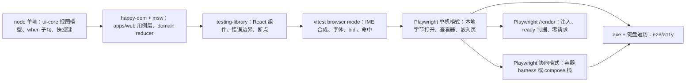

怎么读：从左到右越来越接近真实浏览器与真实部署，也越来越慢；前四个方框属 `test/unit` 步骤（Vitest），后四个属 e2e job 的各步骤（Playwright）。箭头表示「上层默认下层已绿」，不是执行依赖。

依据：[01](./01-strategy-and-layers.md) §2–§3；30/11 §1（iso 用 node、dom 用 happy-dom、真实布局用 browser mode、不用 jsdom）。

---

## 3. Playwright 工程

### 3.1 目录

浏览器 e2e 只放 `apps/web/e2e/`（[01](./01-strategy-and-layers.md) §4 规则 3）；原 `packages/ui-react/src/__tests__/e2e/` 的三个 spec 迁入本目录：`styleguide.a11y.spec.ts` 落 `a11y/`（归 `e2e/a11y`），`editor.visual.spec.ts` 与 `perf.spec.ts` 落 `ui/`（后者的体积断言降为信息性，决策 T-BUNDLE）。

```text
apps/web/e2e/
├── playwright.config.ts           projects（§3.2）、reporter、重试与产物（§3.4）
├── global-setup.ts                选择 TestEnv、准备 storageState 与基线文档（§4）
├── global-teardown.ts             收集容器日志与 Playwright 产物
├── support/
│   ├── env/                       TestEnv 三种实现：standalone-env.ts、harness-env.ts、compose-env.ts
│   ├── fixtures.ts                test.extend：env、asUser(role)、twoBrowsers、networkRecorder、cspRecorder、axe
│   ├── preview-server.ts          静态包 + index.html 模板渲染 + 生产 CSP 头 + /api 与 /collab 反代（§4.1）
│   ├── api-stub.ts                单机模式的最小 /api 桩（§4.2）
│   ├── network-recorder.ts        请求白名单与计数（§10.2），自动启用
│   ├── csp-recorder.ts            securitypolicyviolation 与 /telemetry/csp 报告收集（§10.1），自动启用
│   ├── render-harness.ts          /render 注入载荷构造与请求计数（§6）
│   ├── embed-host.ts              嵌入测试宿主页：与部署同站，按容器尺寸放 /embed/:id 的 iframe，记录父页收到的 cordex:* 消息（§5 第 61 行，2026-10-22）
│   ├── keyboard-walker.ts         焦点遍历、陷阱探测、目标尺寸与焦点遮挡检查（§7）
│   ├── ime.ts                     CDP Input.imeSetComposition 封装（§9）
│   └── heap.ts                    CDP 堆、DOM 计数、blob URL 计数（§11）
├── page-objects/                  每个界面一个类，只用 data-testid（§3.3）
├── open/ shell/ auth/ share/ editing/ plugins/ admin/ viewer/ collab/ comments/ history/ embed/ render/
├── security/ i18n/ ime/ resources/ ui/
└── a11y/                          → e2e/a11y 步骤
```

### 3.2 projects 与里程碑

| project | 浏览器与视口 | 启用 | 跑哪些 spec |
|---|---|---|---|
| `chromium` | Desktop Chrome，1440 × 900，`locale: 'zh-CN'`，`timezoneId: 'UTC'` | M1 | 全部 |
| `firefox` | Desktop Firefox，同上 | M2 | 除 `ime/`、`render/`、`resources/` 外全部（CDP 专属能力只在 Chromium） |
| `webkit` | Desktop Safari，同上 | M2 | 同 `firefox` |
| `chromium-pseudo` | Chromium，`locale` 分别为 `en-XA` 与 `ar-XB` 两个伪语言 | M2 | `i18n/` 与 `shell/`、编辑器主界面的布局用例（§8） |
| `chromium-forced-colors` | Chromium，`forcedColors: 'active'` | M2 报告、M3 阻断 | `a11y/forced-colors.spec.ts` 与关键控件截图 |
| `tablet-webkit` | iPad 视口，WebKit（`pointer: coarse`，编辑器进入仅查看形态，设计 03-02 §5a） | M3 | 只读评审：`viewer/`、`comments/` 与 `editing/narrow-forms.spec.ts` 中标 `@mobile` 的用例（评论只读、评论面板没有撰写区与「回复」，底部一行「平板上只能查看评论」，PRD NF-07，rulings §4.25 TB-49、DS-46；平板评论面板按方向落位——竖屏与当前页上下排开、横屏右侧整高侧栏，状态行写「仅查看 · 在电脑上编辑」，2026-10-22 按 rulings §4.25 DS-131、TB-125 断言位置，§5 第 68 行；project 另设一份横屏视口 1180 × 820）；另跑 `shell/home.spec.ts`、`shell/documents.spec.ts`、`shell/shortcuts-panel.spec.ts`、`shell/import.spec.ts` 与 `embed/embed-page.spec.ts` 中标 `@mobile` 的用例（平板的顶部提示行；左栏与卡片列数按窗口宽度——竖屏 820 宽收成抽屉、三列，横屏 1180 宽左栏常驻、四列；快捷键面板为桌面浮动面板且菜单项不写键位提示；直接打开 `/import` 照常显示导入对话框、触控下按钮写「选择文件…」（2026-10-23 按 rulings §4.25 TB-181 修订 TB-167）；嵌入里以触控原因为准，2026-10-22，rulings §4.25 TB-153、TB-154、TB-159、TB-164、TB-165、TB-167，§5 第 7、21、56、61、63 行） |
| `mobile-webkit`、`mobile-chromium` | iPhone、Pixel 视口（< 640，仅查看形态） | M3 | 查看与评论：同上，另含仅查看形态评论面板的发表与回复（有评论权限的角色才有撰写区，「解决」仍在更大窗口，rulings §4.25 DS-28、DS-46、TB-49；面板按已拍板样张 `comments.phone`、`comments.phone-reply`、`comments.phone-viewer`，§5 第 44 行）；另跑 `shell/home.spec.ts`、`shell/documents.spec.ts`、`shell/shortcuts-panel.spec.ts`、`shell/import.spec.ts` 中标 `@mobile` 的用例（快捷键面板为贴底的底部面板、菜单项不写键位提示，直接打开 `/import` 照常显示——手机上是贴底的底部面板（2026-10-23，rulings §4.25 TB-181，修订 TB-167），2026-10-22，rulings §4.25 TB-154、TB-164、TB-167，§5 第 21、63 行）；手机不论是否触控都按窗口窄写：状态行「仅查看 · 在更大窗口中编辑」、形态类不可用原因「在更大窗口中编辑」（TB-163） |

全部 project 的共同设置：`bypassCSP: false`（显式写出，生产 CSP 必须生效）、`serviceWorkers: 'block'`（M1–M4 不引入 Service Worker，决策 VERSION-DRIFT-SW）、`acceptDownloads: true`、`reducedMotion` 默认 `no-preference`（§7.5 单独切换）。

**图 6-2 Playwright projects 与里程碑**

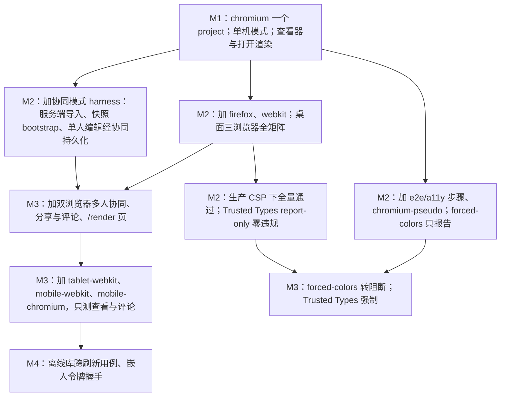

怎么读：自上而下是里程碑推进，每个方框写该里程碑新增的 project 或用例范围；箭头表示在前者基础上叠加，已启用的 project 不会在后续里程碑撤掉。协同模式用例自 M2 起运行（rulings §4.19 D-M2-CONTENT：M2 起服务端文档以协同快照为唯一事实源），M3 加入的是多人协同体验层。

依据：PRD 04 NF-07（M1 Chrome / Edge，M2 Firefox 与 Safari 全矩阵，M3 平板只读评审、手机查看与评论；屏幕矩阵 ≥ 1024 完整、640–1024 紧凑、< 640 仅查看为 M2，在 `chromium` project 内以视口覆盖测，§5 第 44 行）；rulings §4.25 DS-28（手机可以发表与回复评论）、TB-49（平板仍为只读评审）、DS-46（2026-10-15 第 2 批确认：手机发表与回复、平板只读评审）；PRD 04 NF-01 §1.5 材质与层次（forced-colors M3 门禁上线，rulings §4.12 U-08）；rulings §4.15 Q2（Trusted Types M2 report-only → M3 强制）、§4.16 Q20。

### 3.3 页面对象与选择器

- **只用 `data-testid`**：spec 与页面对象里只出现 `getByTestId`，不用文案、CSS 类名或 DOM 结构选择器（文案随语言变、类名随 shadcn 升级变）。`a11y/` 与 `i18n/` 下的用例例外：它们本来就要按角色、名称与文案检查。约束由 ESLint 对 `apps/web/e2e/**`（除上述两个目录）的 `no-restricted-syntax` 执行：`getByText`、`locator('text=…')`、`locator('css=…')` 与以 `.` 或 `#` 开头的选择器报错（`lint` job）。
- **命名**：`<区域>.<部件>[.<变体>]`，如 `toolbar.tool.shapes`、`inspector.section.shape.fill`、`editor.sync-status`、`banner.unsaved`、`share.link.copy`。由 ui 包在组件上稳定提供；页面对象是某个界面全部 testid 的唯一登记处。
- **编辑器 testid 对齐 v3 样张锚点**（2026-10-04，rulings §4.25 DS-1、DS-4）：与样张的 `data-v3-anchor`（`src/v3/kit/anchor.ts`）一一对应。只在一种视图出现的控件以所在区域为前缀：`rail.*`（`new-slide-plus`）、`canvas.*`（`slide`、`notes`）、`toolbar.tool.<id>`（`select` / `text` / `shapes` / `image` / `table` / `chart` / `comment` / `more`）、`inspector.*`（`tab.design`、`tab.comments`、`section.<分区 id>`，分区 id 原样作变体）、`grid.*`（`capsule.doc`、`capsule.share`）；单页与网格里的同一个控件用同一个 testid、以 `editor.` 为前缀（`editor.main-menu`、`editor.doc-menu`、`editor.sync-status`、`editor.view-toggle.single` / `.grid`、`editor.new-slide`、`editor.collaborators`、`editor.zoom`、`editor.present`、`editor.share`，以及左栏缩略图与网格页共用的 `editor.thumb`，按序取第 N 个），与样张「同一控件同名、同一时刻只渲染一种视图」的约定一致。原 `ribbon.*`、`app-bar.*`、`status-bar.*` 前缀作废。
- **第 1 批新增的区域前缀**（2026-10-07，rulings §4.25 DS-17、DS-21、DS-23）：评审条与浏览条仍在 `toolbar.*`（`toolbar.tool.browse`、`toolbar.tool.highlight`、`toolbar.review.{prev,next,mode,back-to-edit,hint}`、`toolbar.viewer.{prev,next,mode}`）；紧凑形态的外角开关与抽屉为 `editor.panel-toggle.{rail,inspector}`、`drawer.{rail,inspector}`（抽屉里就是桌面左栏 / 检查器本身，内部控件沿用 `editor.*`、`rail.*`、`inspector.*`）；仅查看形态为 `narrow.*`（`topbar`、`back`、`more`、`pager.{prev,page,next,comments}`、`sheet.{comments,slides,more}`）；分隔条为 `editor.resizer.{rail,inspector,notes}`；横幅为 `banner.<id>`（母版视图横幅 `banner.master`，其「关闭母版视图」为 `banner.master.close`）；数据面板为 `inspector.chart-data.{expand,collapse,close}`。具体清单仍以页面对象为唯一登记处。
- **第 2 批新增的区域前缀**（2026-10-15，rulings §4.25 DS-38…DS-62）：检查器整栏面板外框为 `inspector.takeover`（版本历史、保真报告、插件整页面板共用，内部控件再按功能前缀）；评论为 `comments.*`（筛选 `comments.filter.{all,page,unresolved,mine,detached}`、`comments.sort`、线程 `comments.thread`、折叠行 `comments.fold.resolved`、画布钉 `comments.pin`、浮动撰写框 `comments.composer`）；版本历史为 `history.*`（`history.row`、`history.fold`、`history.name-form`、`history.restore-confirm`、`history.deleted`）；分享沿用 `share.*`（`share.invite`、`share.member`、`share.link.{role,expiry,copy}`、`share.requests`，申请人一侧的留言弹层为 `share.request-access`）；个人插件面板与整页面板为 `plugins.*`；保真报告与页级提示条为 `fidelity.*`；阻断页为 `blockpage.*`（打开失败、访问被撤销、查看人数已满共用）；轻提示为 `toast.<id>`。样张里的 `data-v3-anchor` 带场景前缀（如 `version-history.restore`），testid 按产品区域命名、不带样张场景名。具体清单仍以页面对象为唯一登记处。
- **第 3 批新增的区域前缀**（2026-10-22，rulings §4.25 DS-79…DS-136）：应用壳为 `shell.*`（`shell.nav.{home,recent,mine,shared,trash}`、`shell.search`、`shell.search.dropdown`、`shell.help`、`shell.account`、`shell.nav-toggle`、`shell.drawer`）；文档卡片为 `doccard.*`（`doccard.link`、`doccard.more`、`doccard.restore`），回收站与永久删除确认为 `trash.*`；模板库为 `templates.*`；管理页沿用 `admin.*`（`admin.plugins.row`、`admin.plugins.detail`、`admin.plugins.savebar`）；导入对话框为 `import.*`（顶栏「导入 .pptx」为 `import.entry`，与样张锚点同名；2026-10-23 起导入在对话框里，rulings §4.25 DS-140），导出对话框为 `export.*`；放映为 `present.*`（`present.controls`、`present.more`、`present.jump`、`present.end`），跟随为 `follow.*`（`follow.bar`、`follow.stop`）；查看器为 `viewer.*`，嵌入的登录提示与打开失败为 `embed.*`；偏好设置为 `settings.*`，快捷键面板为 `shortcuts.*`，命令面板为 `palette.*`；登录、回调与错误页为 `auth.*` 与 `errorpage.*`；文档状态横幅沿用 `banner.<id>`（`banner.version-drift`、`banner.epoch`、`banner.over-ceiling`）。样张里的 `data-v3-anchor` 带场景名，testid 按产品区域命名、不带样张场景名；具体清单仍以页面对象为唯一登记处。
- **母版视图改版新增的区域前缀**（2026-11-04，rulings §4.25 DS-145…DS-153、TB-208）：上下文条（母版视图的模式横幅）沿用 `banner.master`，对象段、说明段为 `banner.master.object`、`banner.master.detail`，「关闭母版视图」仍是 `banner.master.close`；母版窗格、母版画布与母版检查器里的控件以 `master.*` 为前缀（窗格行、「新建版式 ▾」、就地改名框、占位符点选区、多选卡片、检查器顶行的「在母版中编辑」、「使用此版式」下的「在普通视图查看」等）；工具条的「占位符 ▾」为 `toolbar.tool.placeholder`；普通视图检查器的「编辑版式」与「转到版式」在 `inspector.*` 下。样张锚点带场景名（如 `master-view.*`、`layout-edit`），testid 按产品区域命名、不带样张场景名；具体清单仍以页面对象为唯一登记处。
- **同步状态行（原称「状态胶囊」）**：rulings §4.19 INC-09 原文所说的「状态胶囊」已被 DS-6 取代，指左栏文件名下方的同步状态行（设计 03-02 §3.1，`role=status`）；网格视图与紧凑形态里缺省的「已同步」不显示，非缺省状态以同一行的图标与文字跟在左上胶囊的文件名后（设计 03-02 §5.1，2026-10-07 第 1 批定稿），是同一个控件，testid 统一为 `editor.sync-status`（原 `rail.sync-status` 只指单页左栏一处，随之作废）。PRD 与 50/07 的现行文字已改称同步状态行，本文同样改称（不再沿用旧名），断言一律落在这一行上。
- **页面对象只表达用户动作与可观察状态**：`editor.insertShape('rect')`、`editor.syncStatus()`、`editor.setView('grid')`、`editor.setViewport('compact')`；不暴露内部模型。需要读模型状态的断言走 §3.5 的诊断接口。
- **页面对象不含断言**：断言写在 spec 里，页面对象返回 locator 或值。

### 3.4 登录复用、重试与产物

- **`storageState` 复用**：`global-setup.ts` 以 mock OIDC 为 §4.3 的每个测试用户完成一次真实登录回环，把 cookie 存为 `e2e/.auth/<user>.json`；用例经 `asUser('owner' | 'editor' | 'commenter' | 'viewer' | 'outsider')` 选用。会话 cookie 15 min 过期后由 `cordex_refresh` 续期（决策 SESSION），跑满一轮不需重新登录；专测登录回环的 `auth/` 用例从空状态开始，不用 `storageState`。
- **超时**：单用例 60 s，`expect` 10 s；协同与导入用例 120 s。等待只用 web-first 断言与事件，不写固定 `waitForTimeout`（lint 规则同上）。
- **重试**：本地 0 次；CI 1 次，重试后通过的用例标记 flaky（决策 T-CI；连续 3 次 flaky 自动建 issue 由 [12](./12-ci-gates-mapping.md) §11 执行）。浏览器 e2e 里没有「gated 不重试」类步骤：`csp-strict` 等浏览器冒烟条目按普通 e2e 重试一次；`/render` 两种模式零请求的冒烟在服务端 `renderer-egress`，属不重试的门禁判定类（12 §11）。
- **产物**：`trace: 'retain-on-failure'`、`video: 'retain-on-failure'`、`screenshot: 'only-on-failure'`；另存 network-recorder 与 csp-recorder 的 JSON、axe 报告（HTML + JSON）、协同模式的容器日志。保留期与上传方式以 [12](./12-ci-gates-mapping.md) §10 为准。

### 3.5 被测构建与诊断接口

- e2e 一律跑 `apps/web` 的**生产构建**（`vite build`），不跑 dev server：dev 与生产的 CSP、分包与 `auth.mode` 口径不同（[50/14](../50-frontend/14-client-security.md) §2.5）。
- 需要读取内部状态的断言（IME 期间有无 Store 写入、事务计数、`fiber.getEffects()`、`render/frame` 的 `pendingDirty`）经两条只读通道：① telemetry Provider 在测试模式下写入的 `performance.mark` 事件轨迹（30/11 §9；mark 命名以 [50/13](../50-frontend/13-performance-and-bundling.md) §2.2 为准）；② 诊断接口 `diagnostics.dump()`（[50/15](../50-frontend/15-events-errors-and-telemetry.md) §10；诊断包本身是 SDK 能力、apps/web 转调，rulings §4.25 TB-177，单测见 §2.2「诊断接口」「SDK 诊断包」两行；e2e 经页面全局 `window.__cordex.diagnostics` 以 `page.evaluate` 调用——这个全局只在测试部署挂出，生产部署的页面上没有，开关为假时同样没有）。二者由 RuntimeConfig 的测试开关 `diagnostics.e2eTrace` 打开（字段在 [50/02](../50-frontend/02-app-shell-routing-and-session.md) §3、用途在 50/15 §10；部署侧为 web 容器变量 `CORDEX_WEB_DIAGNOSTICS_E2E_TRACE`，只有 `CORDEX_WEB_ENV=test` 的 e2e 预览服务器与测试 compose 栈可设为真，生产部署配置拒绝其为真，[60/17](../60-backend/17-deployment-and-config.md) §5.15），与 `auth.mode: 'none'` 同类约束。
- 需要制造运行时渲染出错的用例另用一个测试部署专用的故障注入点（2026-10-22，rulings §4.25 TB-169，登记在 [50/15](../50-frontend/15-events-errors-and-telemetry.md) §10）：只在 `RuntimeConfig.env === 'test'` 的测试部署提供、随 `diagnostics.e2eTrace` 一同打开，两种注入，方法名以 50/15 §10 为准（接口在 apps/web `src/application/host/diagnostics.ts`，[40/11](../40-modules/11-preset-assembly-and-app-shell.md) §4.4 / §5.4；单测见 §2.2「诊断接口」行）——`diagnostics.faults.throwOnNextRender()` 让应用壳根部的下一次渲染抛错一次（由 `AppErrorBoundary` 接住，§5 第 66 行的根错误边界）、`diagnostics.faults.throwOnPageCompose(pageId)` 让指定页在合成时抛错一次（§5 第 37、59 行的运行时页级回退）；`/render` 页不读 RuntimeConfig、不设这个注入点，生产与测试部署行为相同——`render/render-page.spec.ts` 断言 `/render` 页上没有 `window.__cordex.diagnostics`（那里的 `window.__cordex` 只有 `inject` / `ready` / `error` / `state`），即使页面里带着测试部署的 RuntimeConfig（`env: 'test'`、`diagnostics.e2eTrace` 为真，50/15 §10、§11 V15）；§6.3 R8 合成时抛错的一半改由组件级用例里的 scene provider 桩制造，[07](./07-backend-integration-and-api-e2e.md) §11.3 的页级失败一律用 renderer 桩（2026-10-22，rulings §4.25 TB-174）；生产部署的 RuntimeConfig schema 不含这一项（[10](./10-security-testing.md) SEC-CL-07）。

---

## 4. e2e 编排：两种模式与 `TestEnv`

用例不直接依赖某个环境，只依赖 `TestEnv` 接口；同一个 spec 在 PR 上跑容器 harness，在 main 全量段跑 compose 栈（§12）。

| 成员 | 含义 | standalone | harness | compose |
|---|---|---|---|---|
| `baseURL` | 被测页面的源 | 预览服务器 | 预览服务器（反代到 apps/server） | web 容器 `https://app.<测试域>` |
| `users` | owner / editor / commenter / viewer / outsider 五个账号与各自 `storageState` | 桩账号 | oidc-provider mock 账号 | Casdoor 种子账号 |
| `createDocument(user, fixture)` | 以该用户身份经公开 API 导入或新建文档 | 不支持（改走本地打开） | ✓ | ✓ |
| `grant(doc, user, role)`、`createShareLink(doc, role, ttl)` | 经公开 REST 授权与建链接 | — | ✓ | ✓ |
| `revokeSessions(user)` | 吊销该用户全部会话但不停用账号（模拟登录过期，之后可重新登录） | — | 经 `user:{userId}:sessions` 索引删除其全部 `session:{sid}` 键（模板以 [60/14](../60-backend/14-valkey-object-storage-and-retention.md) 为准） | 同左，经 `docker compose exec valkey` |
| `faults.pg(down \| up)`、`faults.valkey(down \| up)` | 依赖故障注入 | — | Toxiproxy 断开（[07](./07-backend-integration-and-api-e2e.md) §2） | `docker compose pause` / `unpause` |

- **种子只走公开 API 与 IdP 账号**，两种服务端环境同一代码路径；直接写库的种子构建器（[11](./11-test-data-fixtures-and-determinism.md) §6）只给 [07](./07-backend-integration-and-api-e2e.md) 的服务端集成用。
- **浏览器 e2e 不控制服务端时钟**：需要到期的用例以短有效期创建（如分享链接 5 s 后到期、会话由 `revokeSessions` 直接吊销）；精确计时的断言放在 07（服务端 `CLOCK` 覆盖为 `FixedClock`）与 [05](./05-collab-simulation-and-property-tests.md)（客户端 `FixedClock`），规则见 [11](./11-test-data-fixtures-and-determinism.md) §3。客户端计时（30 s 离线、2 s 去抖）用 Playwright `page.clock` 快进。

### 4.1 预览服务器

`support/preview-server.ts` 在 standalone 与 harness 两种模式下替身 web 容器（compose 模式直接用真实 web 容器，二者差异由 [08](./08-deployment-and-environment-e2e.md) §4 与全量段兜底）：

- 从 `apps/web/dist` 提供静态文件；`index.html` 按 web 容器同一模板渲染：启动时把 RuntimeConfig 写入 `<script type="application/json" id="cordex-runtime-config">` 数据块，每个 HTML 响应生成新的 128 bit nonce 替换占位符 `__CSP_NONCE__`（[60/17](../60-backend/17-deployment-and-config.md) §3.2–§3.3；决策 CSP-NONCE、RUNTIME-CONFIG）。
- 按 [50/14](../50-frontend/14-client-security.md) §2.2 模板下发 CSP、CSP-Report-Only（M2）与 §2.6 的其余安全头；`index.html` 为 `no-store`，`/assets/*` 为 `immutable`。
- harness 模式把 `/api/*` 与 `/collab/*`（含 WS 升级）反代到 apps/server，`/internal/*`、`/metrics`、`/healthz`、`/readyz` 返回 404（与 web 容器相同分流，60/17 §3.1）。
- 以运行时生成的自签证书提供 HTTPS，使 `Secure` cookie 的行为与生产一致；harness 模式下 Playwright 设 `ignoreHTTPSErrors: true`，compose 模式改用测试 CA（08 §3）。

### 4.2 单机模式（standalone）

无服务端：preset 为 `preset-slide`（`store-memory`），文档从本地字节打开（`/import` 的本地打开，经 `setInputFiles` 选 `fixtures/pptx/*`；M1 的 `/documents/local:sample`）。`support/api-stub.ts` 以 `page.route('**/api/v1/**')` 只应答壳页面必需的最小集合（`/auth/me`、`/auth/config`、`/documents` 列表），响应体同样出自 protocol/testing 工厂并经 zod 校验；其余 `/api` 请求一律 `abort` 并让用例失败，防止单机用例意外依赖服务端。用于：M1 打开与渲染、查看器、SDK 嵌入测试页（`preset-slide` + `store-memory`，EM-02）、`/render` local 模式、国际化与 IME；M1 期间的编辑类开发用例。

**M2 起参考应用的编辑 e2e 走协同路径**（PRD 05 M2 验收 15、§0.3「装配」行）：`e2e:editing` 与导出族（§5 第 2、3 行，含冒烟 #3）在协同模式 harness 下运行——参考应用以 `preset-slide-collab`（不含 `comments`）+ 网关打开由服务端导入建档的文档，每条用例结束时断言同步状态行为「已同步」、全部 pending 获 db 确认。standalone 只保留 SDK 嵌入形态的编辑用例。另以 `preset-slide-collab` 的 `store-yjs` 本地变体（无服务端）把编辑族重跑一次，作为 `pluggable:m3`「M2 全部编辑 e2e 在 store-yjs 下重跑通过」的证据（M3 出口判定）；切换方式与白名单断言归 [02](./02-contract-suites-and-pluggability.md) §10。

### 4.3 协同模式（harness 与 compose）

harness 模式复用 [07](./07-backend-integration-and-api-e2e.md) §2 的容器 harness（同一套镜像、同一迁移与健康检查顺序），只多起一个预览服务器。测试用户固定五个：`owner`、`editor`、`commenter`、`viewer`（直接授权为查看者）、`outsider`（已登录但对基线文档无授权，用于分享链接与越权用例）。

**图 6-3 e2e 全局准备（harness 模式）**

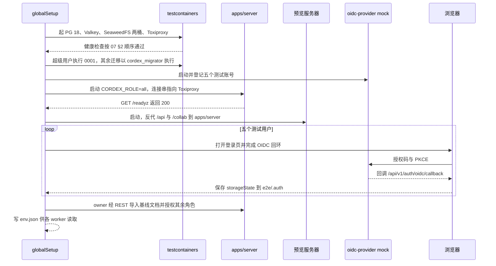

怎么读：自上而下是时间顺序；先起依赖、迁移、再起服务端与预览服务器，然后为每个测试用户做一次真实登录回环并保存 `storageState`，最后经公开 API 准备基线文档。compose 模式把前五步换成 `docker compose up --wait`（08 §3），其余相同。

依据：30/11 §10（apps/server + testcontainers + mock OIDC + apps/web 预览构建）；rulings §4.15 Q6（PR 层 Casdoor 容器 + oidc-provider mock）、Q10（PG 18 / Valkey / SeaweedFS）；决策 T-CI、T-IDP。

`login-casdoor` 用例（§5 表第 9 行）在 harness 模式下另起 Casdoor 容器，按 [08](./08-deployment-and-environment-e2e.md) §7 的种子方式初始化；其余用例只用 oidc-provider mock。

---

## 5. 用例族

每行一个 spec 目录或文件；「冒烟」列写 [12](./12-ci-gates-mapping.md) §4 的条目号，标 ✓ 的用例带 Playwright 标签 `@smoke`（`@smoke` 集合必须等于 12 §4 的浏览器条目，由 `test/conventions` 核对；二者不一致时以 12 为准）；「模式」列：S = 单机、C = 协同。

| # | 用例族（文件） | 断言要点 | 模式 | 里程碑 | 冒烟 | 依据 |
|---|---|---|---|---|---|---|
| 1 | 打开与渲染（`open/open-render.spec.ts`、`shell/home-to-editor.spec.ts`、`editing/open-*.spec.ts`） | 开始页 → 本地打开 D50 夹具 → 首批装载后可选中编辑（`unit/opened`）→ 返回开始页；`unit/loaded` 之前全文命令（全选、查找替换、导出、跨页重排）禁用或等待；`.ppt`、加密、损坏、超限、宏五类文件显示对应错误文案；本地打开 D200 后滚动左栏：同时挂载的缩略图不超过 12 个（overscan 缺省 6，以 [50/10](../50-frontend/10-editor-shell-and-interaction.md) §6 为准），其余页滚进视口才生成，生成超过 300 ms 才显示与缩略图同尺寸的中性块（不画转圈与文字），读屏名照常「第 N 页」、点它照常翻页（2026-10-22 按 rulings §4.25 TB-135 对齐 PRD OF-15；样张 `import.thumbs-virtualized`） | S | M1 | #1 ✓ | PRD OF-01 / OF-03 / OF-15；rulings §4.18 CO-12，§4.25 TB-135；[03](./03-fidelity-roundtrip-and-corpus.md) §7 P7、§8 |
| 2 | 编辑与撤销 `e2e:editing`（`editing/edit-undo-export.spec.ts`、`editing/ed-<编号>-*.spec.ts`） | 每条 P0 / P1 ED 需求 ≥ 1 个用例，文件名带需求编号、JSDoc 带 `@req PRD:ED-xx`（编号含 PRD 02 本轮新增的 ED-15a、ED-31、ED-32、ED-33、ED-35，如 `editing/ed-15a-*.spec.ts`，[13](./13-requirements-traceability.md) §5a 据此追溯；§4.21 起新写的用例在 `@req` 之外另写 `@cap <能力编号>`，能力编号取 [50/18](../50-frontend/18-editor-capabilities.md) 能力表）；撤销 / 重做走快捷键与主菜单「编辑」两条路径（取代原 Ribbon 路径，2026-10-04 按设计 03-02 §7.1）；放映（ED-21）含黑屏 / 白屏按同键、点击或翻页键只恢复当前页、Esc 直接退出（放映的完整断言见第 59 行）；命令不可用时提示原因；M2 起在协同路径上运行（§4.2），用例结束时全部 pending 获 db 确认 | C（SDK 嵌入变体为 S） | M2 | #3 ✓（插入文本框、键入、撤销重做、导出） | PRD 05 M2 验收 1；rulings §4.18 UX-07 |
| 3 | 导出（`editing/export-*.spec.ts`） | 下载 pptx → 用 Node 编解码按 [03](./03-fidelity-roundtrip-and-corpus.md) §4.2 判定零编辑一致（服务端文档以 import 快照的基线包为基线，03 §10）；编辑后导出只改脏部件；对话框的同步、生成、取消与完成各态见第 37 行（2026-10-22，rulings §4.25 DS-100、DS-101） | S / C | M2 / M3 | pptx 随 #3 ✓ | PRD OF-18；rulings §4.18 UX-05 |
| 4 | 查看器 `preset-slide-viewer`（`viewer/viewer-readonly.spec.ts`、`viewer/viewer.spec.ts`；2026-10-22 按第 3 批样张 `viewer` 改写，rulings §4.25 DS-110、DS-111、TB-114） | `/documents/:id/view`：**桌面**（容器 ≥ 640）顶部条为 上一页 · 下一页 · 页码输入「N / M」┊ 缩小 · 缩放读数 ▾ · 放大 ┊ 全屏 · 搜索 · ⓘ 保真摘要，没有标题、返回、左栏、检查器、评论、协同与插件面板入口；宿主没开的惰性可选件（缩略图条、备注、搜索、下载回调）不渲染入口、不留占位；`document.fullscreenEnabled` 为假时没有「全屏」；键盘 `←` / `→` / `PageUp` / `PageDown` 翻页、`Home` / `End` 首末页、`+` / `−` 缩放、`F` 全屏，不占 `Mod+F`（浏览器自己的查找照常）；缩放读数菜单含比例输入（夹到 10–400）、适应窗口与适应宽度；只有 1 页时上一页 / 下一页留在原位不可用并读出原因、缩略图条不显示。**打开中**：版式骨架 + 阶段与进度，工具条照常画出、全部不可用并写「文档打开后可用」，没有「取消」。**打开失败**：容器里只剩阻断页（通用兜底「无法打开该文档」，其余错误码按设计 03-13 只换图标与文案），只在宿主提供 `onDownloadOriginal` 时有「下载原文件」，没有「重试」「复制诊断信息」与「返回文档列表」（TB-114，诊断经 `error/raised` 事件）。**ⓘ 卡**（第 2 批定稿的卡片）：没有影响查看的差异时 ⓘ 留在原位、卡片写「未发现影响查看的差异」（TB-114）；文档里有缺插件元素时卡片第一行为警告色拼图图标 +「N 处内容需要插件「X」，以占位显示」，纸面上是缺插件占位，没有横幅、没有插件面板入口（DS-110）。**备注**（宿主开了备注时）：翻页跟着换成那一页的备注，没有备注时写「这一页没有演讲者备注」，与桌面编辑器只读态、仅查看形态的备注卡同一句（2026-10-22，rulings §4.25 DS-138）。**整页无法解析的页**是纸面内的页级占位「此页内容无法解析」，与编辑器、放映同一画法，查看器里不出页级提示条（TB-151）。**窄屏**（容器 < 640，DS-111）：没有顶部条，当前页全宽，底部浮动条「上一页 · N / M · 下一页 ┊ 更多」（按钮 ≥ 44 × 44、间距 8），左右轻扫翻页（双指放大时不翻）；「更多」底部面板只放 适应窗口 ·（允许时）全屏 ·（宿主开了时）搜索 · 保真摘要 ┊ 显示演讲者备注，条目不写键位提示（2026-10-22，rulings §4.25 TB-164），同一时刻只开一个底部面板；开了缩略图时页码是按钮、点开两列缩略图底部面板；备注是当前页下方的只读卡；保真摘要底部面板与桌面 ⓘ 卡同一份条目；搜索为顶部的窄屏查找条（没有替换）。只读两道保证在 e2e 侧的表现（无编辑入口、快捷键无效）；第 2 批 `fidelity.viewer-shell` 的外框随之换成本行的桌面壳，卡片断言不变 | S | M1（ⓘ 卡的缺插件一行随 PRD PM-12 在 M2） | #2 ✓ | [50/12](../50-frontend/12-viewer-embedding-and-render-page.md) §2–§4；ADR-0015；rulings §4.25 DS-110、DS-111、DS-138、TB-114、TB-134、TB-151、TB-164；PRD PM-12、OF-14、OF-16；设计 03-25；样张 `viewer.*`（含 `viewer.notes-empty`） |
| 5 | 查看者 = 编辑器只读变体（`collab/viewer-variant.spec.ts`） | `viewer` 打开 `/documents/:id` 得 `mode='view'`：底部是浏览条（上一处 / 下一处评论 ┊「只读浏览中」），无评论 / 高亮等创建类按钮，主菜单没有「视图 › 模式」一组（取代 2026-10-07 前的「模式下拉只有『只读浏览』与放映」，rulings §4.25 DS-23），放映经检查器顶行「放映」与 `F5`；文件名只是文本、没有文档菜单（2026-10-22，rulings §4.25 DS-82，原「文档菜单只有『创建副本』」作废；样张 `documents.reader-doc-name`、`main-states.viewer`），「文件 › 导出…」留在原位不可用、写「只有查看权限」（DS-105）；检查器两个页签顶部都有「只读 · 你只有查看权限」；实时看到他人修改与在场；计入查看者名额；该页出站 WebSocket 帧中 SYNC 只有 step1、没有 update 与 step2（服务端不向只读会话发 step1，60/16 §6；经 `page.on('websocket')` 解码帧类型统计） | C | M3 | M3 起并入 #2 ✓ | rulings §4.18 UX-19、§4.25 DS-15、DS-23、DS-82、DS-105；[50/12](../50-frontend/12-viewer-embedding-and-render-page.md) §12；设计 03-02 §6.2 |
| 6 | 母版视图与版式（`editing/master-view.spec.ts`、`editing/layout-apply.spec.ts`；2026-11-04 起本行只留入口、退出、可用性与视图内总则，母版视图里的其余断言在第 71–74 行） | **入口与退出**（2026-10-07 第 1 批定稿，rulings §4.25 DS-21；2026-11-04 按母版视图改版改写，DS-147、DS-150、DS-166、DS-174、TB-195、TB-205；设计 03-02 §2.4、03-26 §1.1，入口、原因与次序以 03-26 §1.1 为准）：进入入口五处、同一可用性与原因——主菜单「视图 › 母版视图 ⌥⌘M」（单页左栏、网格与紧凑胶囊里的主菜单是同一份）、`Mod+Alt+M` 与命令面板「母版视图」三者等价、不常驻；普通视图检查器另有两个上下文入口：无选中态「版式」节标题右侧的「编辑版式」（普通视图里唯一常驻的进入入口）与选中占位符形状时检查器顶行的「转到版式」（只在选中对象本身是占位符形状时出现，DS-174）；遍历可交互元素的 testid 断言：除这两处外，左栏、检查器、工具条与胶囊上没有母版视图按钮（原「入口只有三处」的断言按 DS-147 作废）；「编辑版式」进入后窗格选中本页所用的版式、焦点在该行，「转到版式」进入后窗格选中该版式、画布上同类型同索引的占位符被选中、焦点在它的点选区（找不到对应占位符时只选中版式，TB-205），正在编辑文字时点它先提交并退出文本编辑再进入（同文本编辑中按 `Mod+Alt+M`），退出母版视图后选区清空、不回到文本编辑；其余入口进入后焦点在窗格选中行（DS-166）。上下文条（母版视图的模式横幅，DS-145）右端的「关闭母版视图」（`banner.master.close`）是唯一的常驻退出入口，与主菜单同位的「关闭母版视图」、再按 `Mod+Alt+M`、画布无选区时 `Esc` 四者等价，退出后回到进入前的页、缩放与滚动位置、选区清空、焦点交给画布；焦点在母版窗格里时第一下 `Esc` 只把焦点交给画布外框（可程序聚焦、不画焦点环，DS-159），之后按画布的逐级链走（母版视图的 `Esc` 七级以 TB-195 为准）；检查器「在普通视图查看 ›」与窗格右键「在普通视图查看引用页」退出时不回进入前的页：当前页停在第一个引用页，左栏（或网格）选中这些引用页、换页即清（DS-150）；在母版视图中按 `F5` 或点检查器顶行「放映」，先退出并恢复位置、再从恢复后的当前页放映；上下文条与「关闭母版视图」在加载中、加载失败、被降权后的只读态与紧凑形态下都存在且可用。**可用性**：评审模式下 `Mod+Alt+M` 不切换；放映中不响应；主菜单与命令面板的「母版视图」项、检查器的「编辑版式」与「转到版式」留在原位不可用并写同一条原因（评审「评审模式下不可用」、查看者「只有查看权限」、非完整形态按原因写——窗口窄「在更大窗口中编辑」、触控设备（只指平板，手机不论是否触控都算窗口窄，TB-163）「在电脑上编辑」、嵌入「当前区域太窄，暂不可用」，2026-10-22，rulings §4.25 TB-136、TB-163、DS-112；降权「需要编辑权限」；2026-11-04 起另有版本历史开着「关闭版本历史后可用」、文档打开中「文档打开后可用」，DS-162、DS-164、TB-209），可聚焦并读出原因；不可进入时（放映中除外）按 `Mod+Alt+M` 只出一条轻提示「母版视图：〈原因〉」（DS-163），模态对话框或命令面板开着时不响应（DS-165），判定细则与先后见 §2.2「母版视图」行；非完整形态指 `breakpoint != 'desktop'` 或 `platform == 'mobile'`（视口 < 1024 或触控设备，宽 ≥ 1024 的平板同样不可进入；2026-10-08，rulings §4.25 TB-44，原因文案的变更见 §2.2「母版视图」行）；进入后切评审即退出并回到原页、原缩放、原滚动；降权不退出：上下文条换锁形图标与「只能查看母版与版式」、不再写影响页数，创建工具与「新建版式 ▾」不可用并写原因，检查器顶行「只读 · 需要编辑权限」、各节只读展示，窗格照常可浏览；视口缩到 640–1024 不退出（窗格与检查器收成抽屉，第 44 行），缩到 < 640（仅查看形态）即退出母版视图、回到普通视图（TB-16）。**视图内总则**：上下文条常驻在画布列顶部，同时成立的其他横幅（离线、降权等）按 03-12 的优先级排在它下方另占一条，至多两条（TB-14）；窗格选中即编辑对象——画布上方没有范围单选与图例（页面上不存在 `role=radiogroup`「编辑范围」，原范围条按 DS-146 作废），窗格选中母版即编辑母版、选中版式即编辑版式，上下文条与检查器随窗格选中即时更新（第 71、73 行）；主菜单「帮助」多一项「关于母版继承」（TB-15，PRD ML-01；经壳意图 `help-center`，TB-39），只在集成方配置了对应链接时出现、新标签页打开、带外链图标，测试配置有与无各一例（2026-10-22，rulings §4.25 TB-132）；主菜单「网格视图」「备注」不可用并写原因；工具条没有「评论」，检查器「评论」页签不可用（「母版与版式不支持评论」）；普通视图的其余入口与浮动层见第 74 行；进入 / 退出无历史项；换版式为一个事务，toast 撤销一步回原版式。**重置页**（PRD 05 M2 验收 10、ML-02；2026-10-08 按已拍板样张，rulings §4.25 DS-32，设计 03-27 §3）：版式画廊左下「重置为版式默认…」、主菜单「编辑 › 重置页…」与画布空白处右键「重置页…」打开同一个确认对话框（宽 360，标题「重置「〈版式名〉」占位符？」，带当前版式预览（一种细线画法的版式缩略，2026-11-04，rulings §4.25 DS-149），「取消」「确认重置」，打开时焦点进框），确认后只恢复占位符的位置与样式、文本与用户新增的对象不变，出可撤销轻提示「已重置占位符属性」带「撤销」（5 s），从画廊进入时关闭后焦点回到检查器「版式」字段 | S / C | M2（版式编辑与插入占位符 M3） | — | PRD 05 M2 验收 9 / 10；PRD ML-01、ML-02、ML-03；rulings §4.18 UX-11、UX-20，§4.25 DS-21、DS-32、DS-145…DS-147、DS-149、DS-150、DS-159、DS-162…DS-166、DS-174、TB-14、TB-15、TB-16、TB-39、TB-44、TB-132、TB-136、TB-163、TB-195、TB-205、TB-209；设计 [03-26](../20-design/03-screens/26-master-view-and-editing.md)、[03-27](../20-design/03-screens/27-layout-picker-and-reset.md) §3 |
| 7 | `shell:home`（`shell/home.spec.ts`；2026-10-22 按第 3 批样张 `home` 改写，rulings §4.25 DS-79、DS-81、DS-83、DS-86…DS-89、DS-92、DS-98、TB-107、TB-108、TB-127；2026-10-23 按第 3 批评审修改改导入入口与拖入落区，DS-140、TB-180） | 页面结构按 v3 首页（设计 [29](../20-design/03-screens/29-home-start-page.md) §2，应用壳组件级断言见 §2.2「应用壳布局」行）：左侧导航（首页、最近、我的文档、与我共享、回收站五项（DS-79），底部帮助与用户行；左栏没有「设置」项，rulings §4.25 DS-10）、顶栏（「导入 .pptx」「新建演示文稿」）、「从模板开始」模板行（第一张为「空白」，其后恰为 简约 / 商务 / 暗色 / 学术 / 活力 5 张，与编辑器主题画廊的 5 套内置主题同一套，PRD AS-03，rulings §4.25 DS-33；M2 行右端没有「更多模板 →」，M3 起出现并进模板库，第 58 行）与「最近」区；状态各 ≥ 1 例：已登录默认（网格）、列表显示（「显示方式」切到列表、两枚按钮 `aria-pressed` 跟随，排序菜单照常——它只管开始页这一段的本机视图偏好，不带到文档列表，TB-127；排序菜单选「最近编辑」时按与第二行同一个时间排——`contentUpdatedAt`，缺省取 `createdAt`，夹具里还没有快照的那份按创建时间排进去、不排到末尾（2026-10-22，rulings §4.25 TB-171）；网格 / 列表的显示方式与文档列表共用一份，在这里切到列表后打开文档列表同样是列表、刷新后保持，TB-131）、**加载中**（真实加载超过 300 ms 才出现：「最近」区居中一行「正在加载最近的文档…」（`role=status`），不画骨架卡，标题行的网格 / 列表与排序加载中不放，模板行、顶栏与左栏照常可用；DS-86 取代原「加载骨架」）、**最近为空**（「还没有最近打开的文档」+「从上方的模板开始，或新建一份空白演示文稿」，不放按钮、标题行不放网格 / 列表与排序，DS-88）、**加载失败**（没有本机缓存时「最近」区换成整块出错 +「重试」，模板行与新建不受影响）、**离线**（离线横幅在顶栏之下、只横跨主区、标题不跳，DS-92；正文「本次打开过的文档可以继续编辑；新建、模板与导入将在恢复连接后可用」）；左栏「最近 / 我的文档 / 与我共享 / 回收站」进 `/documents` 的对应视图（第 56 行）；「最近」的卡片与文档列表同一件（§2.2「文档卡片网格」行：链接语义、一个 `Tab` 停靠点与方向键、「⋯」菜单，TB-107、TB-108、DS-81）：固定的排在最前、标题后有图钉，第二行「编辑者 · 相对时间」（DS-83；缺编辑者或内容时间时的写法与列表显示时为空的「编辑者」一列按 §2.2「文档卡片网格」行，TB-171），「从最近移除」立即移走、轻提示「已从最近移除「X」」+「撤销」、5 s 到期才发请求，「分享…」M3 起在开始页上打开分享对话框（`/home?share=<id>`，TB-109，第 56 行），M2 留在原位不可用、右侧写「后续版本提供」（2026-10-22，rulings §4.25 DS-137）；「新建演示文稿」与模板行「空白」、其余模板卡、「导入 .pptx」三类入口分别进入编辑器或打开导入对话框（空白与模板由前端取内置模板字节走两步服务端导入生成 import 快照后进入编辑器，网络记录断言经 `POST /imports/uploads` → `POST /imports` → `GET /jobs/:id`；被点的模板卡名称换成转圈「正在创建…」、其余入口暂时不可用，建档失败时入口恢复、轻提示「无法新建演示文稿」+「重试」沿用同一 `Idempotency-Key`；「导入 .pptx」打开叠在开始页上的导入对话框、焦点落在「从电脑选择文件…」，DS-140，第 21 行）；把 `.pptx` 拖进主区时顶栏以下换成落区「松开以导入」·「只支持 .pptx，单个文件最大〈上限〉」——强调色虚线加强调色淡底，与导入对话框里的拖入悬停同一画法（2026-10-23，rulings §4.25 TB-180）——松开即打开导入对话框的上传态、焦点落在「取消」，拖出主区或 `Esc` 恢复（拖入落区照常保留，DS-140）；最近文档卡封面为导入处理器写的 embedded `__cover`，无封面（含空白文档）时为中性占位、不画骨架条（DS-2）；离线时三类入口与模板卡留在原位不可用、工具提示「离线时不可用」，本会话内仍保活的文档可打开、其余卡片不可打开并写「离线时只能打开本次打开过的文档」；**帮助菜单**按 §2.2「应用壳布局」行（DS-89，配置了与没配置帮助链接两例）；**窄屏**（DS-87）：1000 × 760 时左栏收为抽屉、顶栏左端「显示导航」，模板行六张一行、「最近」三列；390 × 844（手机）时不渲染「从模板开始」与顶栏两个按钮，顶部一行「在更大窗口中新建或导入演示文稿」，其下是搜索框（在主区、导航抽屉里不放），触控高 44、不写 ⌘K、下拉照常弹出且每行高 44（TB-130），「最近」单列、标题行不放网格 / 列表与排序、「⋯」常显，导航抽屉各行 44；平板（`tablet-webkit`，触控、≥ 640）同样不渲染这两处，这一行写「在电脑上新建或导入演示文稿」（2026-10-22，rulings §4.25 TB-153），左栏与「最近」的列数按窗口宽度取——竖屏 820 宽收成导航抽屉、三列，横屏 1180 宽左栏常驻、四列——命中区 44、「⋯」常显（TB-165），「最近」标题行的网格 / 列表与排序照常（两枚切换按钮与排序菜单的触发器命中区 ≥ 44）、搜索框随左栏（触控高 44、不写 ⌘K，2026-10-22，rulings §4.25 TB-170）；手机与平板上帮助菜单与账户菜单里的「键盘快捷键」「偏好设置…」照常在、不写任何键位提示（TB-154、TB-164），打开的快捷键面板手机为贴底的底部面板、平板为桌面浮动面板（TB-154，第 63 行）；**开始页作用域快捷键**（2026-10-05，rulings §4.25 DS-11；2026-10-22 补 DS-115）：`Mod+K`（macOS `Meta+K`、其余 `Control+K`）把焦点移到左侧导航搜索框（`aria-label="搜索文档"`），搜索框右侧提示按平台显示 ⌘K / Ctrl+K，`Mod+,` 打开偏好设置（叠在开始页上，第 62 行）、`Mod+/` 打开快捷键面板（浮在主区右上，第 63 行）；进入编辑器后同一和弦 `Mod+K` 打开命令面板而不再聚焦首页搜索（第 42 行）；搜索框的下拉见第 57 行 | S / C | M2 | — | PRD 05 M2 验收 11；AS-01 / AS-02 / AS-03 / AS-04 / AS-05；rulings §4.25 DS-33、DS-79、DS-81、DS-83、DS-86…DS-89、DS-92、DS-137、DS-140、TB-107…TB-109、TB-127、TB-130、TB-131、TB-153、TB-154、TB-164、TB-165、TB-170、TB-171、TB-180；样张 `home.*` |
| 8 | `shell:account-menu`（`shell/account-menu.spec.ts`；2026-10-22 按第 3 批样张 `account-menu` 改写，rulings §4.25 DS-89、DS-90、DS-91、TB-123） | 开始页左栏底部用户行、文档列表、编辑器三处打开同一 `UserMenu`（编辑器里由检查器顶行头像组中自己的头像打开，网格视图与紧凑形态在右上胶囊，取代原应用栏头像，rulings §4.25 DS-18，设计 03-02 §3.5、§7；头像触发器 `aria-haspopup=menu`、读屏名「账户：姓名（你）」，与他人头像可区分：排在头像组第一位、与他人间隔 4 px 不叠放、常驻 1.5 px 外圈，离线或重连中只剩自己时仍在；点他人的头像是「跟随」（第 60 行），不打开账户菜单；编辑器里菜单向下、与头像左缘对齐、最小宽 220，落在检查器一侧不盖画布，开始页里向上、左对齐）；三处菜单的条目相同、按 §2.2「账户菜单条目」行逐项断言次序（PRD AS-06）：头部 ┊ 主题 浅色 / 深色 / 跟随系统（单选三项，与偏好设置「外观 › 主题」读写同一个值、次序相同，选了菜单不关、立即换肤，出厂缺省「跟随系统」，DS-90，取代原「两项」）┊ 偏好设置… ⌘, · 键盘快捷键 ⌘/ · 帮助中心（配置了才出现、新标签页打开并带外链图标，没配置时这一项不出现也不占位，DS-89）┊ 退出登录，`platformRole='admin'` 时在「键盘快捷键」与「帮助中心」之间多「管理」、`member` 时没有（第 35 行）；**个人资料…**（DS-91）：M2 构建里没有「个人资料…」这一项与它下面的分隔线（菜单从头部直接到主题），M3 起出现在头部之后、可用，打开个人资料对话框（显示名可改、1–128 字，邮箱只读，头像只读、为身份色底 + 首字、没有更换头像的控件，TB-123、TB-137；保存经 `PATCH /users/me/profile`、请求体只有 `displayName`（TB-142），失败写在底栏、不关对话框，成功后关闭并轻提示「已更新个人资料」）；头像一律身份色首字，菜单头部与协作者头像都不请求 `avatarUrl`（网络记录无头像主机请求，TB-123）；主菜单有「返回首页」与「插件…」且账户菜单里没有这两项（DS-18）；偏好设置在界面上只有账户菜单一个常驻入口（遍历可点击元素的 testid 断言；`Mod+,` 与命令面板里的「偏好设置…」「阅读顺序…」是键盘与命令入口，不算常驻控件；首页左栏没有「设置」项，DS-10，设计 03-29 §2.1）；快捷键面板三个入口可达：主菜单「帮助 › 键盘快捷键 ⌘/」（2026-10-07 第 1 批定稿，取代原 Ribbon「?」，设计 03-02 §2.3）、账户菜单「键盘快捷键」、`Mod+/`；手机与触控形态（390 × 844 或 `pointer: coarse` 的开始页与文档列表，含 `mobile-*`、`tablet-webkit`）的账户菜单里「键盘快捷键」「偏好设置…」不写键位提示（2026-10-22，rulings §4.25 TB-154、TB-164，设计 03-29 §2.5）；**嵌入**（SDK 单人 preset）：集成方没有配置登出回调时「退出登录」留在原位不可用、原因「由宿主应用管理登录」（iframe 嵌入按 `cordex:init` 的 `intents` 是否声明 `sign-out` 判定，第 61 行，TB-145），集成方锁定主题时主题三项留在原位不可用、勾着宿主定的那一套，组顶一行「由宿主应用设置」；退出登录走 OIDC 登出，有未同步更改时的确认见第 66 行 | S / C | M2（个人资料 M3） | — | PRD 05 M2 验收 12；AS-06；rulings §4.25 DS-10、DS-18、DS-21、DS-89、DS-90、DS-91、TB-123、TB-137、TB-142、TB-145、TB-154、TB-164；样张 `account-menu.member`、`admin`、`profile-dialog`、`editor`、`embedded-logout`（未采纳的 `alt-theme-two`、`alt-profile-m2` 不进断言） |
| 9 | 登录与会话（`auth/login-oidc-mock.spec.ts`、`auth/login-casdoor.spec.ts`、`auth/logout.spec.ts`） | mock IdP 与 Casdoor 两条 OIDC 回环 → `/home`；`selfSignup` 关时登录页无注册入口、常显「没有账号？请联系管理员开通」，开时出现「注册」、不显示这句（2026-10-22，rulings §4.25 DS-119；这两态的页面断言：mock IdP 一侧在 `auth/login-page.spec.ts`（第 65 行，`selfSignup` 关、开两份测试配置），Casdoor 一侧在 `auth/login-casdoor.spec.ts`（开、关两套种子，[08](./08-deployment-and-environment-e2e.md) §7）；`auth/login-oidc-mock.spec.ts` 只测 OIDC 回环与登出，不含这两态；登录页与回调页的其余各态见第 65 行）；登出后本人 IndexedDB 分区、离线库、全部 `cordex.share.*`、面板尺寸记忆 `cordex.layout.*` 与保真提示已读标记 `cordex.fidelity.*` 为空，设备级的 `cordex.prefs`、插件分区展开状态 `cordex.inspector.pluginSections`、列表视图偏好 `cordex.listView` 与按账户记的诊断开关 `cordex.diagnostics.{userId}` 保留（后两个 2026-10-22 补，rulings §4.25 TB-118、TB-131）（按 [50/02](../50-frontend/02-app-shell-routing-and-session.md) §10 清理矩阵逐键断言；`cordex.layout.*` 2026-10-08 补，rulings §4.25 TB-41；后两个键 2026-10-15 补，TB-70），其它标签页同步回到登录页；TB-122 新增的两个会话存储键（重试保住的 `next` 即 `cordex.auth.next`、新窗口重新登录标记，键名以 50/02 §10.1 为准）登出与换人后为空；有未同步更改时登出先尝试同步，仍有未同步项才弹确认（第 66 行，rulings §4.25 TB-122）；离线登出后恢复联网，第一条请求是补发的 `POST /auth/logout`、之后 `/auth/me` 为 401；`/login?next=//evil.example` 登录后落 `/home` | C | M2 | #9、#10 ✓（两条登录） | rulings §4.15 Q6、§4.25 DS-119、TB-41、TB-70、TB-118、TB-122、TB-131；决策 INC-18；50/02 §4、§10 |
| 10 | 重新登录弹窗（`auth/reauth-popup.spec.ts`） | 编辑中 `revokeSessions(user)` → 横幅「登录已过期」不可关闭、队列保留、页面不跳转；点「重新登录」打开弹窗（`mode=popup`）→ `/auth/popup-callback` → `BroadcastChannel cordex-auth` 通知原页 → 同一用户重连并清空队列；以另一账号登录回来 → 只读、不重放，横幅只有「导出为本地副本」一个动作（与权限降级同一条、导出前不可关闭；没有「以原账号重新登录」「放弃这些更改」，50/02 §5 原三选一作废，2026-10-15，rulings §4.25 TB-69）；弹窗被拦截时退化为新标签链接（新标签里登录完成后停在「已重新登录」页、不放按钮，原页靠 `BroadcastChannel` 或重获焦点时探测 `/auth/me` 恢复）；新窗口回调带 `error` 时显示「登录没有完成」+ 按码的原因（`server.auth.invalid_token`、`server.auth.account_disabled`、`server.auth.idp_unavailable` 三码各一例）+「关闭此窗口」，`server.auth.account_disabled` 的原因后补「原来页面里未同步的更改，可在离开时导出为本地副本」，窗口关掉后原页横幅的「重新登录」恢复可点，原页横幅与频道协议不变（2026-10-22，rulings §4.25 DS-125）；state 失效被后端回到 `/auth/callback?error=…` 时，新窗口凭原页写下的标记直接显示同一失败页、不出现整页登录页（TB-122）；登录已过期期间写命令被拒的呈现（字段留在原位不可用、检查器顶部一行原因）、登录窗口打开中的按钮状态与换账号后的同步状态行见第 51 行（2026-10-15，rulings §4.25 DS-58） | C | M2 / M3 | — | rulings §4.18 UX-02，§4.25 DS-125、TB-69、TB-122；50/02 §5；设计 03-33 §6 |
| 11 | 分享链接落地（`share/share-link-landing.spec.ts`） | 未登录打开 `/documents/{id}#share={token}` → 登录页（与直接打开登录页完全相同：`selfSignup` 关时常显「没有账号？请联系管理员开通」，落地不另加提示，开时为「注册」，两态各测一次，2026-10-22，rulings §4.25 DS-119）→ OIDC 往返 → 回到文档并按链接角色打开；在登录页先制造一次登录失败（mock IdP 返回错误）再点主按钮重试，回调后照常回到这份文档（重试保住 `next`，TB-122）；加载后地址栏无片段、sessionStorage 有 `cordex.share.{docId}`；network-recorder 断言令牌只出现在该文档请求与 collab-ticket 请求的 `X-Cordex-Share-Token` 头中，任何 URL、query 与 `Referer` 都不含令牌；撤销或到期的链接 → 阻断页「链接已失效」（「这个分享链接已被撤销或已过期」+「申请访问」「返回文档列表」，设计 03-33 §7.3）且令牌被删除，没有 `details.reason` 的 403 仍是「你没有权限访问此文档」；所有者把链接改回「仅邀请」即撤销（2026-10-15，rulings §4.25 DS-47）：此后旧链接落地同样是「链接已失效」，再放宽后复制到的是新链接、旧链接仍失效；可查看 ↔ 可评审之间的切换不换链接，已发出的链接按新角色打开；另有直接授权时无提示；新标签页不继承令牌 | C | M3 | #7 ✓ | 决策 INC-25、INC-20；rulings §4.18 BE-02 / BE-05、§4.25 DS-47、DS-119、TB-122；PRD CO-15 |
| 12 | 双浏览器协同（`collab/collab-two-browsers.spec.ts` 及同目录分场景文件） | 两个浏览器上下文、两个用户：在场头像与远端光标；编辑互见；`context.setOffline` → 重连中 → `page.clock` 快进 30 s 进入离线 → 恢复后同步并回到已同步；owner 降权另一方 → 只读降级横幅（正文后半句「文档已重新载入服务端版本，撤销历史已清空」，2026-10-15，rulings §4.25 DS-58）；他人后写同键后撤销 → 轻提示「〈姓名〉之后修改了此处，已跳过」（左侧是对方头像）→ 「恢复我的值」生成新事务且可撤销；对方删除后撤销 → 整步跳过、警告色轻提示「无法撤销：此处已被〈姓名〉删除」→ 「恢复元素」以原 id 恢复（两个按钮保留，2026-10-07 rulings §4.25 TB-26；带按钮的提示停留 5 s、悬停暂停计时，设计 03-19 §4）；owner「彻底删除元素」后「恢复元素」禁用并提示「该内容已被彻底删除」（术语按 rulings §4.18 CO-07）；`faults.pg(down)` 后 B 持续编辑 → B（有本地未获 db 确认项的发起方）出现横幅「未保存到服务器 N 项」，A（无本地未确认项）只在同步状态行出现弱提示「服务器保存延迟」、无横幅，`faults.pg(up)` 后两者消失（rulings §4.19 INC-09）；A 放映期间 B 的编辑实时出现在放映画面，放映界面没有暂停远端更新的开关（rulings §4.20 FE-02） | C | M3 | #8 ✓（在场、编辑传播、断网重连、降权横幅、撤销跳过提示） | PRD CO-01 / CO-05 / CO-08；rulings §4.15 Q3、§4.18 CO-07 / CO-08 / UX-03、§4.25 TB-26、DS-58；决策 RESTORE-CMD |
| 13 | 离线恢复（`collab/offline.spec.ts`；2026-10-15 按第 2 批样张 `offline-conflict` 补，rulings §4.25 DS-41、DS-59） | 断网编辑 → 恢复后另一浏览器看到全部更改；**离线横幅**沿用第 1 批文案「更改已保存在本地，将在重新连接后同步」（DS-59：写明「关闭或刷新会丢失」的文案在 M4 启用本地持久化前再定，本行不断言它）；`navigator.onLine=false` 期间「立即重连」留在原位 `aria-disabled`、工具提示「网络恢复后可重连」，按钮文字计算颜色为次级文字色（与警告浅底对比 ≥ 4.5，DS-41），收到 `online` 事件立即重连；**已恢复**：重连并同步完成后横幅换成「已恢复协同并同步完成」（中性底 + 成功色对勾），`page.clock` 快进 3 s 后自动滑出、也可手动关闭，头像组与远端光标回来、同步状态行回到「已同步」；**长时间离线**（P1，DS-59，PRD CO-06）：离线超过 24 小时的队列重连合并后，同一条横幅追加「较长时间离线（超过 24 小时），合并后请检查」与可点的页码（点了切到该页），受影响页超过 3 页时只列前 3 页、其后写「等 N 页」（N 为受影响页总数），这一条换成中性信息图标、不自动滑出、看完手动关闭；离线时长的判定边界与受影响页的取法由 [05 §9](./05-collab-simulation-and-property-tests.md) `rs/long-offline-review` 确定性断言，本行在离线期间以 `page.clock` 快进超过 24 小时后恢复网络、只断言呈现；M3 内存队列：有 pending 时浏览器刷新或关闭标签页只触发 `beforeunload` 原生提示（不断言文案），应用内的离开与刷新先 flush 再确认（第 52 行）；被降权后「未同步更改」可导出（`collab:rejected-rollback` 的界面部分，第 51 行）；M4：断网编辑 → reload → 上线 → 另一浏览器看到（离线库）；同一用户第二个标签页提示「另一个标签页正在保存离线更改」 | C | M3 / M4 | — | ADR-0033「如何被机械验证」；PRD 05 M3 验收 5 / 13；PRD CO-06；决策 OFFLINE-TABS；rulings §4.25 DS-41、DS-59；样张 `offline-conflict.offline-no-network`、`recovered`、`long-offline` |
| 14 | 评论：面板、筛选与权限（`comments/comments-panel.spec.ts`、`comments/comment-permissions.spec.ts`；2026-10-15 按第 2 批样张 `comments` 改写，rulings §4.25 DS-40、DS-43、DS-53、DS-62；原通配 `comments/*.spec.ts` 拆为这两个文件与第 49 行的 `comments/comment-tool.spec.ts`） | **面板**：编辑模式打开检查器「评论」页签缺省停在「当前页」，列表与画布评论钉一一对应（钉数 = 本页未解决线程数，钉与列表都不编号）；「全部」不分页、按时间平铺、锚点说明前写页码，「未解决」跨全文档，「@我」只列提及自己的线程（本地计算）；排序「按页码」按页分组；一次删掉 3 个带评论的对象 → 出现临时筛选「已脱离锚点 3」，按下后每条锚点说明为「原对象已删除」（工具提示写谁何时删的）、没有画布钉、照常回复与解决，「⋯」里「重新锚定…」为 P1、不可用；删除方撤销或「恢复元素」→ 线程回原锚点；点画布评论钉 → 检查器自动切到「评论」页签（01 §2.3 唯一的自动切换）并定位：线程滚入视口、铺强调色淡底并描边淡出一次、展开回复，钉加外圈，锚点对象画 1px 强调色虚线、不画手柄；深链 `?comment=` 同此；另一浏览器 ≤ 1 s 看到新线程与回复（`CONTROL.event` 触发）。**已解决**：线程收进末尾「已解决 N」，点开列摘要（发起人 · 回复数 · 正文最多两行），再点展开完整对话，顶部「〈姓名〉 已解决 · 时间」，「解决」换成「重新打开」、没有回复框，重新打开后才能回复；标记已解决的同时另一端回复 → 回复保留、线程仍已解决，只在该线程处内联「解决之后又有新回复」，不出轻提示与横幅（场景 J，[05 §6](./05-collab-simulation-and-property-tests.md) `sc-18`）。**权限**：commenter 可建线程、回复、编辑与删除自己的评论，只能解决自己发起的线程（他人线程的「解决」留在原位不可用并写原因），editor 可解决任何线程；删除自己的回复先乐观隐藏、轻提示「已删除你的回复」+「撤销」（5 s 内可撤销，评论不入撤销栈），首条评论有回复时只留「此评论已删除」；**整条讨论串只有文档所有者能删**（DS-40）：owner 在线程「⋯」或钉右键「删除讨论串…」→ 模态确认「删除此讨论串？将同时删除 N 条回复，删除后无法恢复。」（危险色主按钮、初始焦点「取消」，取消或 `Esc` 后焦点回打开它的「⋯」或钉，删除后交给相邻线程的作者行，不可撤销），发起人、editor 与 commenter 的菜单里没有这一项；查看者只读：页签顶部「只读 · 你只有查看权限」，没有撰写框、回复框、「解决」与「⋯」，评论钉没有右键菜单（在钉上右键不拦截浏览器原生菜单，2026-10-15，rulings §4.25 TB-61）；钉菜单里也没有插件分组（装配向 `ui.contextMenu` 贡献条目的测试插件时 owner 的钉菜单条目不变，TB-61）；导入的批注只读（中性头像与钉、「来自原文件」），「导入为可编辑评论」（P1）之后可回复与解决。**评审模式**（第 1 批评审、commenter 与查看者画面的评论页签按 DS-62 换成本面板）：评审者打开即「评论」页签，首屏可交互前页签内一行「正在加载评论…」、筛选与排序和评审条都不可用（DS-53）；评审条「上一处 / 下一处评论」在未解决的线程间跳转（换页并定位）。**离线**：离线时照常发表、回复、解决，本端未同步的条目带「待同步」、重连同步后统一清除。**M2 未装评论包**：工具条主行七项，没有「评论」页签、评论钉、缩略图评论角标与主菜单「插入 › 评论」 | C | M3 | — | PRD CO-04、CO-05；ADR-0031；rulings §4.25 DS-40、DS-43、DS-53、DS-62、TB-61；设计 [03-06](../20-design/03-screens/06-comments-panel.md)、03-05 §2.5；[50/08](../50-frontend/08-comments-and-version-history.md) §5–§8；样张 `comments.*` |
| 15 | 版本历史（`history/version-history.spec.ts`、`history/version-restore.spec.ts`；2026-10-15 按第 2 批样张 `version-history` 改写，rulings §4.25 DS-38、DS-39、DS-40、DS-53、DS-57；原通配 `history/*.spec.ts` 拆为这两个文件） | **入口与权限**：唯一常驻入口是文档菜单「版本历史」（命令面板为第二入口），打开后检查器整栏换成版本列表（宽为检查器当前宽度（缺省 280）、画布宽度不变，开着时检查器分隔条照常可拖，2026-10-15，rulings §4.25 TB-60；协作行不动，标题行「版本历史 · 命名当前版本 · 关闭 Esc」），焦点落在「当前版本」，关闭（× 或 `Esc`）后焦点回文件名；网格视图里先回单页再打开；无 `history.read`（评论者、查看者）时文档菜单里没有「版本历史」、直达 `/documents/:id/history` 返回无权页；编辑模式降权时该项留在原位不可用并写「需要编辑权限」；版本历史开着（含正在预览旧版本）时「母版视图」不可用、原因「关闭版本历史后可用」，母版视图里文档菜单「版本历史」留在原位不可用、写「母版视图下不可用」（2026-11-04，rulings §4.25 DS-157、DS-162，第 6、74 行）；**面板开着时被降权**（2026-10-15，rulings §4.25 TB-63）：editor 打开面板（含正在预览某个版本）后以 `TestEnv.grant` 在会话内降为 commenter（失去 `history.read`）→ 面板随即关闭、画布与左栏回到当前版本，焦点交回文件名，文档菜单的「版本历史」留在原位不可用；所有者被降为 editor 时（夹具另有一位所有者）仍有 `history.read`，面板留着、改按编辑者呈现——顶部出「只有所有者可以命名或恢复版本」、命名与恢复不可用、「最近删除」不再显示，正展开的命名表单与恢复确认卡收起、焦点交给「当前版本」一行（设计 03-07 §7）；编辑者可浏览与预览，「恢复此版本」「命名当前版本」留在原位不可用、提示「需要所有者权限」，面板顶部一行「只有所有者可以命名或恢复版本」，没有「最近删除」。**列表**（DS-57）：按天分组，同一天里相邻两条及以上的自动版本收成折叠行「N 个自动版本 起–止」（点开逐条、新的在前、缩进一档；只有一条时单列），标「恢复前」的自动版本单列、不并进相邻的组；自动版本显示时刻与贡献者头像、姓名；命名版本以加粗名称 + 说明 + 作者与时刻区分（不出现 ● / ★）；按月折叠，缺省只展开最近一个月，30 天以前每天只留最后一个并标「当日最后版本」；末尾「加载更早版本」按游标翻页（点后焦点交给加载行、出数据后交给新出现的月份行），下面一句「较早的自动版本按天保留，命名版本永久保留」；加载中只有「当前版本」与一行转圈「正在加载版本历史…」、不画骨架；加载失败整块换成居中的「版本历史加载失败」「请检查网络连接后重试」+「重试」（次按钮，打开时焦点落在「重试」，点后回到加载中、焦点交给「当前版本」一行）；新文档为「当前版本」+ 今天的最早一条 + 一句「还没有其他版本。…」（服务端建档必写导入快照，DS-53）；**最早一条按来源写**（2026-10-15，rulings §4.25 DS-70）：四条建档路径各建一份新文档后打开版本历史——导入 .pptx（第 21 行）为「导入自『〈文件名〉.pptx』」，首页「新建演示文稿」与模板行「空白」（第 7 行）为「新建演示文稿」，其余模板卡（如「商务」）为「从模板『商务』新建」，文档菜单「创建副本」（第 24 行）为「创建自『〈原文档名〉』的副本」；文件名、模板名与原文档名按纯文本显示（文件名含 `<b>` 时原样显示、页面上不多出 `b` 元素）；源文档没有标题时副本这一条写「创建自『未命名演示文稿』的副本」（`originName` 为空串，按空标题的统一显示，[50/08](../50-frontend/08-comments-and-version-history.md) §9，rulings §4.25 TB-90）；**类别名**（2026-10-15 收口，rulings §4.25 TB-90，设计 03-07 §4.1、§6）：这一条的行上只显示标题、不出现类别名，读屏名带类别——导入的为「导入版本」（如「导入自『〈文件名〉.pptx』，导入版本，〈作者〉，〈时间〉」），新建空白、从模板新建与创建副本为「初始版本」（如「新建演示文稿，初始版本，〈作者〉，〈时间〉」）；以 `page.route` 改写 `GET …/snapshots` 的响应、把这一条的 `createdAt` 移到上个月（当月没有命名版本），这个月收成月份行，摘要同样按来源写：`origin = upload` 为「〈M〉 月 · 导入版本」，`blank`、`template`、`duplicate` 为「〈M〉 月 · 初始版本」；原文档之后改名、或把新文档改名，这一条都不变（前端只按 `origin` 选文案、不从文件名或文档名推断）；继续编辑、命名与恢复之后这一条仍在列表最末；文案取自这条 `import` 快照的 `origin` / `originName`（[60/15](../60-backend/15-rest-api-catalog.md) §3.8；新建空白与模板卡在两步导入的申请里带 `origin`、`templateName`，网络记录可见，60/15 §3.9；服务端断言见 [07 §8](./07-backend-integration-and-api-e2e.md) D17）；断言空态的夹具文档因此经两步导入建档——以 `POST /documents` 直接建的空文档（API 与测试用，界面上没有这个入口）在首次压缩前列表只有「当前版本」一行与同一句说明、没有日期小标题，另作一例断言（2026-10-15，rulings §4.25 TB-74，[07 §8](./07-backend-integration-and-api-e2e.md) D10）。**预览**（DS-39）：点某个版本 → 画布与左栏换成该版本的只读内容（左栏不提供新建）、底部创建工具条收起；画布顶部为模式横幅「正在查看〈时间〉的版本 ·「名称」· 仅你可见」+「返回当前版本」「恢复此版本」，恢复只在横幅上、列表行上没有；预览不广播、不影响当前会话与 awareness；`Esc` 先回到当前版本、再按关闭面板；快照较大时左栏与画布各一行「正在加载这个版本…」、「恢复此版本」不可用，换版本时取消上一个请求；离开预览后预览 Unit 已 dispose（`diagnostics.dump()` 的 effects 为空）；原「缩略图迷你条」不再出现。**命名**（需要 `doc.manage`）：「命名当前版本」在面板顶部原位展开表单（名称 ≤ 30 字、计数常显、说明可选；名称为空时「保存」不可用；说明 ≤ 200 字：计数平时不显示，写到 180 字起框内右下才出现「N/200」，写到 200 字后第 201 个字不进，服务端同样拒绝超过 200 字的说明，2026-10-15，rulings §4.25 TB-64，设计 03-07 §4.3，[07 §8](./07-backend-integration-and-api-e2e.md) D15），保存前先把本端未落库的更改 flush 再提交，完成后「今天」最前出现该命名版本并轻提示「已将当前版本命名为『X』」；第 201 个命名版本被拒时表单留着、名称不丢，轻提示「命名版本已达上限（每份文档 200 个）」（文案取 `server.snapshots.named_limit_reached` 的 `errors.<code>`，数字取响应的 `details.limit`），不在名称框下原位报错；名称输入到 30 字后第 31 个字不进、计数停在「30/30」（服务端同样拒绝 31 字，[07 §8](./07-backend-integration-and-api-e2e.md) D15）。**恢复**（DS-40）：点横幅「恢复此版本」→ 按钮下方弹出非模态确认卡「恢复到『X』？」+「将以这个版本的内容创建一个新版本，当前更改不会丢失。」（有协作者在线时加一行头像与「〈姓名〉正在编辑，他们的画布会自动更新为恢复后的内容」）+「取消 / 确认恢复」，打开时焦点落在「取消」，`Esc`、「取消」或点外面关闭、焦点回「恢复此版本」；页面上没有遮罩与 `alertdialog`；确认后画布回到当前版本（内容已是目标版本）、横幅消失、工具条回来，「今天」最前出现「恢复自『X』」与标「恢复前」的自动版本（单列，不并进下面的组），轻提示「已恢复到『X』」；恢复不加锁：协作者不断连且实时看到结果，恢复进行中协作者画布不转只读、不出现「文档正忙」（rulings §4.19 N1），其他在线协作者收到带恢复者头像的轻提示「〈姓名〉已将文档恢复到『X』」、发起方不重复提示；任何菜单里都没有「以此版本创建副本」（DS-57）。**最近删除**（只给所有者）：列表顶部折叠行「最近删除 N」缺省收起，列出保留期内被删除的元素（元素与所在页 · 删除者 · 删除时间与剩余保留时长），没有恢复按钮；「彻底删除」为中性次按钮，点后模态确认「彻底删除『X』？删除后无法恢复。…」（危险色主按钮、初始焦点「取消」），确认后该行消失、轻提示「已彻底删除 1 个元素」（不带撤销）。**离线**：没加载过时面板只有「当前版本」+ 顶部说明「离线 · 无法加载版本历史，只显示本地最新内容」、「命名当前版本」不可用、「彻底删除」不可用；加载过时显示缓存、整条时间轴置灰不可点、顶部「离线 · 可能不是最新」，预览中的「恢复此版本」不可用；预览横幅常驻在上、离线横幅在它下方另占一条（至多两条，DS-39） | C | M3 | — | PRD CO-07；rulings §4.19 N1，§4.25 DS-38、DS-39、DS-40、DS-53、DS-57、DS-70、DS-157、DS-162、TB-60、TB-63、TB-64、TB-74、TB-90；设计 [03-07](../20-design/03-screens/07-version-history.md)；[50/08](../50-frontend/08-comments-and-version-history.md) §9–§10；能力位以 protocol `permissions/actions.ts` 为准；样张 `version-history.*` |
| 16 | 插件启停（`plugins/plugin-toggle.spec.ts`、`plugins/plugin-qr-shape.spec.ts`） | `examples/plugin-qr-shape`：插入二维码元素、渲染、导出（图片回退 + `extLst`）、撤销；该插件是内容级（贡献 `slide.shapeKind`），停用只能经部署策略（rulings §4.23，个人面板不提供开关）：以策略夹具（`GET /users/me/plugins` 不含该插件，S 模式由 `TestEnv` 注入）重新打开后底部工具条「更多」中的「二维码」条目消失（rulings §4.25 DS-5：插件的创建入口一律进「更多」，主行不变）、带该插件 owner 标记的 DOM 节点数为 0 | S | M2 | #4 ✓（启停与无残留 DOM） | PRD 05 M2 可插拔证据 `pluggable:m2`；PRD PM-03 |
| 17 | `embed:multi`（`embed/multi.spec.ts`） | 同页 4 个编辑器实例；快捷键按焦点分派到对应实例；逐个销毁后无残留 DOM、`diagnostics.dump()` 的 effects 为空 | S | M2 | — | PRD 05 M2 验收 7 |
| 18 | `embed:framework-free`（`embed/vanilla.spec.ts`） | `examples/embed-vanilla` 以 `UiRenderer('vanilla')` 渲染底部工具条与检查器（取代 2026-10-04 前的 Ribbon），并完成一次编辑与撤销；该页加载的 chunk 不属于构建 manifest 中含 react / radix 的 chunk 集合 | S | M2 | — | PRD 05 M2 验收 13；rulings §4.15 Q2 |
| 19 | 深链与路由（`shell/deep-link.spec.ts`） | `/documents/:id?page=<slideId>&comment=<threadId>` 打开到该页与该线程；放映深链同名参数 `page`；`/d/<id>` 落路由兜底「找不到此页面」（第 66 行）；**壳页面的分享路由**（2026-10-22，rulings §4.25 TB-109）：`/documents?share=<id>` 与 `/home?share=<id>` 在列表之上打开分享对话框（非所有者为只读的「谁能访问…」），关闭后回到原列表与原滚动位置、焦点回到那张卡片，浏览器后退等于关闭，刷新该地址直接打开对话框；**视图参数**（2026-10-07，rulings §4.25 TB-30，[50/02](../50-frontend/02-app-shell-routing-and-session.md) §2）：`?view=grid` 打开即网格视图，其余取值按单页打开、不报错；切到网格后地址栏写入 `view=grid`、回单页去掉该参数，都用 `replaceState`（`history.length` 不变），`page`、`comment` 等其余参数原样保留；带 `view=grid` 刷新后仍是网格视图；放映路由不带该参数，退出放映回到进入前的视图；SDK 嵌入页切换视图不改宿主地址栏 | S / C | M2 / M3 | — | 决策 INC-35；rulings §4.25 TB-30、TB-109 |
| 20 | 版本漂移（`shell/version-drift.spec.ts`；2026-10-22 按第 3 批样张 `doc-banners.version-drift*` 补，rulings §4.25 DS-126） | **代码块漂移**：拦截一个惰性 chunk 返回 404（1 s 后重试一次仍失败）→ 横幅「发现新版本，刷新后继续」（警告浅底 + 刷新图标、不可关闭、唯一按钮「刷新」、`role=alert`）、编辑器不崩溃、会话还在、其余照常编辑，只有用到该 chunk 的元素保持占位「刷新后显示，内容已保留」；点「刷新」先同步（按钮转圈「正在保存更改…」、不可用），同步完成即刷新，仍有未同步项时弹「刷新将丢失 N 项未同步更改」确认（第 52 行）。**会话已关闭**（协同以 4426 / 4427 关闭，harness 重新部署内容插件或换协议版本驱动）：同一条横幅；编辑器转为暂时不能编辑——创建工具、左栏新建与检查器字段留在原位不可用、原因「刷新后可编辑」，检查器标题上方一行「暂不可编辑 · 发现新版本，刷新后恢复」，头像组只剩自己、没有远端光标，同步状态行「需要刷新 · N 项未同步」（没有未同步项时「需要刷新」）；点「刷新」时有未同步更改，因会话已关闭没法先同步，直接弹确认框（第一句「发现新版本，这些更改还没有提交到服务器。」，左下「导出为本地副本」，初始焦点「取消」），没有未同步更改时直接刷新；与「插件设置已更新」同时成立时只出这一条（第 34 行）；仅查看形态（手机与平板）里横幅在最顶上，「刷新」照常 44 高、与文案一行放不下时才换到下方独占一行（2026-10-22，rulings §4.25 TB-172），顶部条状态行换成「需要刷新 · N 项未同步」。本文件以 `test.use({ serviceWorkers: 'allow' })` 覆盖 §3.2 的 `block`，断言整轮导航后 `context.serviceWorkers()` 为空、`navigator.serviceWorker.getRegistrations()` 返回空数组（否则 `block` 会掩盖意外注册） | S / C | M2 | — | 决策 VERSION-DRIFT-SW；50/02 §12；50/07 §9；50/13 §14；rulings §4.25 DS-59、DS-126、TB-66、TB-172；设计 03-12 §8.6；样张 `doc-banners.version-drift`、`version-drift-refresh`、`version-drift-chunk`、`narrow-version-drift` |
| 21 | 服务端导入（`shell/import.spec.ts`；2026-10-22 按第 3 批样张 `import` 改写，rulings §4.25 DS-97、DS-98、DS-99、TB-129；2026-10-23 按第 3 批评审修改改为导入对话框，DS-140、DS-141、TB-179…TB-182，DS-97、DS-98 被 DS-140 取代，整屏导入页、过渡页与失败页的断言作废） | **导入对话框**（DS-140）：开始页与文档列表顶栏的「导入 .pptx」（`import.entry`，`aria-haspopup="dialog"`）在原页上打开「导入」对话框（`role=dialog`、`aria-modal`，`aria-labelledby` 指向标题「导入」）：地址换成 `/import`、背后照常是来路页面（左栏与顶栏节点都在、被遮罩盖住）；外框宽 560、高 406（设计 04 对话框尺寸表的导入专用一档，标题栏 40，DS-142），选文件、上传、解析到失败各阶段外框的 `getBoundingClientRect()` 宽高不变，视口窄于 592 时宽度收到视口减 32、矮于 470 时高度收到视口减 64，内容比正文高时正文滚动；落区为 1px 虚线，静止时计算颜色等于分隔线色（样张 `--v3-border`），不等于控件边界色（样张 `--v3-border-control`，DS-141）。**选文件**：落区正中「把 PowerPoint 演示文稿带进 Cordex」·「把 .pptx 文件拖到这里，单个文件最大〈上限〉」（上限读 RuntimeConfig 的 `limits.importMaxBytes`，与服务端拒收用的是同一个部署值，缺省 200 MB；测试部署改成 100 MB 时这一句与申请上传的 413 一起变，2026-10-22，rulings §4.25 TB-147，部署侧见 [08](./08-deployment-and-environment-e2e.md) §4 G14）· 主按钮「从电脑选择文件…」（`setInputFiles` 只收 .pptx、单选）；没有底栏、没有「返回文档列表」，×、`Esc` 与点遮罩关闭；由用户点「导入 .pptx」打开时焦点落在「从电脑选择文件…」，关闭后焦点回 `import.entry`（键盘细则见 §7.3「导入对话框」行）。**地址与历史**（TB-179）：`/import` 叠在来路之上，选文件、上传到失败都在同一个 `/import` 上、不新增浏览历史（`history.length` 不变）；关闭（×、`Esc`、点遮罩、「取消」、失败后的「关闭」）与浏览器后退都回到来路页；直接打开 `/import`（没有来路）时背后是文档列表「最近」、进来时先在它前面补一条「最近」的历史，关闭后留在列表；导入成功后对话框关闭、以替换方式把 `/import` 换成 `/documents/:id`，在编辑器里后退回到来路页（直接打开的回到文档列表「最近」），不回到空的导入对话框，进编辑器后焦点不被交还给已卸载的入口；回收站视图顶栏不放「导入 .pptx」、不接收拖入。**拖入**（TB-180）：拖着 .pptx 悬在对话框上（对话框外的遮罩上同样算）时落区换成强调色虚线（`--ring` 的计算值）加强调色淡底（样张 `--v3-accent-soft`），正中写「松开以导入」·「只支持 .pptx，单个文件最大〈上限〉」、「从电脑选择文件…」先收起，松开即原位进上传中，拖出窗口或 `Esc` 取消拖动即恢复原样；拖的不是 .pptx 时照样高亮、松开后在框里报「不支持的文件格式」；一次拖着两个文件时落区不高亮、写「一次只能导入一个文件」·「请只拖入一个 .pptx 文件」，松开不接收（网络记录里没有 `POST /imports/uploads`）；上传、解析与失败阶段不接收拖入（不高亮、不换文件，失败后要换文件先「关闭」）；对话框开着的所有阶段，拖到页面别处松开都不会把文件当网页打开、不离开页面；开始页与文档列表主区的拖入落区（第 7、56 行）松开后直接打开这个对话框的上传态、焦点落在「取消」。**上传与解析**：外框不变，底栏出现、落区收矮并留着；文件名一行（文件名前 20 px 的 .pptx 文件类型图标，`aria-hidden`，与导出对话框格式行同一套，TB-182；长名中间省略、保留扩展名与它前面 6 个字，完整名进 `title`、读屏念全名）·「· 大小」；上传为确定态进度「正在上传…」+ 百分比（按字节；进度条名称「上传进度」带 `aria-valuenow`），上传完成后同一位置换成转圈 + 作业阶段文案（按作业 `stage` 换，不显示百分比、排队时不写前面还有几个，DS-53），文件名一行与落区不动；换阶段时常驻 polite 播报区念一次（§7.6），百分比不逐条播报；底栏右侧「取消」，这两个阶段 × 的读屏名与工具提示为「取消导入」、点遮罩不关闭（TB-180）。「取消」、×、`Esc` 与浏览器后退是同一个动作——中止并关闭对话框、留在原页（开始页或文档列表；直接打开的留在文档列表「最近」），焦点回 `import.entry`：上传中中止直传、不留卡片也不留原件，解析中调 `POST /imports/:jobId/cancel`（UX-14；TB-179 修订 TB-129、TB-133）；上传中刷新回到选文件的初始态，解析中刷新作业照常完成、文档随后出现在列表里。**失败**原位换成整块状态（`role=alert`），落区不再出现；从上传、解析换到失败时底栏「取消」原位换成「关闭」、焦点在它上面时留在原位；×（这一阶段写「关闭」）、`Esc`、点遮罩与「关闭」关闭对话框（TB-179）。瞬时错误（上传中断与离线、超时、5xx、上传凭证失效）为「导入没有完成」+ 按原因的第二行 + 次按钮「重试」（在正文里，DS-53）+「文件名 · 大小」，底栏只有「关闭」：「重试」用手里的文件重走一遍完整导入（上传凭证失效时重新申请上传）、原位回到上传中、焦点落在「取消」，离线时「重试」留在原位不可用、写「恢复连接后可重试」。确定性错误没有「重试」：`format.pptx.invalid_package`「无法打开：文件不是有效的演示文稿」+ 建议句 +「技术详情」折叠行（一出现就展开时同样带 `aria-expanded`、`aria-controls`）+ 底栏「复制诊断信息」「关闭」，复制后底栏左侧写「已复制诊断信息」（关闭对话框前一直留着、播报一次、不出轻提示，DS-56）；`format.quota_exceeded`「文档超出规模上限，无法导入」+ 第一项的说明句 + 固定建议句 +「超出项 · 实际值 · 上限」小表（数值读部署配置），底栏只有「关闭」；`format.unsupported_binary`、`format.encrypted`、`format.macro_rejected`、`format.limit_exceeded`、`headless.task_timeout` / `headless.task_oom`（「文件过于复杂，无法完成导入」）与 `storage.quota_exceeded`（M3，按 `dimension` 写存储或文档数，数值读配置）同一画法、只换图标与文案，底栏只有「关闭」；文案以设计 03-13「导入对话框」与打开失败表为准；`.ppt` / `.pptm`、超过导入上限与存储已满在申请上传时就被拒（415 / 413 / 429），选完文件直接到对应失败态、网络记录里没有上传 `PUT`。**手机与平板**（`mobile-*`、`tablet-webkit`，标 `@mobile`；TB-181，修订 TB-167）：这些设备的开始页与文档列表不放「导入 .pptx」（DS-87），直接打开 `/import` 照常显示、不另拦，背后是文档列表的触控形态；手机（< 640）是贴底的底部面板（与偏好设置的手机形态同一个件：标题行 48、关闭 44），没有落区与「拖到这里」，主按钮「选择文件…」44 高、整宽，说明「只支持 .pptx，单个文件最大〈上限〉」，上传与解析中关闭按钮的读屏名为「取消导入」、点遮罩不关闭，对话框底栏的按钮在面板里竖排、整宽、44 高；平板是对话框、按钮写「选择文件…」、说明同手机；导入完成后按设备进编辑器的仅查看形态。**协同快照打开**（DS-99）：导入成功后进编辑器、或从列表打开服务端文档时，编辑器外壳照常画出、全部不可用（同步状态行「正在打开…」，工具条、检查器、左栏「新建幻灯片」与视图切换写「文档打开后可用」，头像组不出现，缩放读数「—」），超过 300 ms 才在画布中央出一行转圈「正在打开…」+「取消」，不画版式骨架；快照到达后直接出完整编辑器；「取消」回到文档列表。**覆盖导入**（带 `docId`）期间已打开该文档的编辑器收到锁定提示（同步状态行「文档正忙」、中性锁形图标，2026-10-15，rulings §4.25 TB-66）、写入暂停；导入完成后会话以 4428 断开并自动重新载入新纪元的快照，横幅「文档已替换为导入的文件」（画法见第 67 行，DS-127），锁定前未获 db 确认的更改可从「未同步更改」导出；导入失败或取消时解锁、恢复可写且内容不变 | C | M2（`storage.quota_exceeded` 与 `@mobile` 用例 M3） | — | rulings §4.18 UX-14、BE-10；§4.19 D-M2-CONTENT、N1；§4.25 DS-53、DS-56、DS-87、DS-99、DS-127、DS-140、DS-141、DS-142、TB-66、TB-129、TB-133、TB-147、TB-167、TB-179、TB-180、TB-181、TB-182（TB-129、TB-133、TB-167 已按 TB-179、TB-181 修订；DS-97、DS-98 于 2026-10-23 被 DS-140 取代）；PRD SV-01、OF-02；设计 03-13；[50/02](../50-frontend/02-app-shell-routing-and-session.md) §2、§9.3；样张 `import.dialog*`、`import.snapshot-opening` |
| 22 | 服务端文档的单人协同编辑（`collab/single-user-persist.spec.ts`） | 打开服务端文档 = `GET snapshots/latest`（记下 `X-Cordex-Epoch`）+ `POST collab-ticket` + WS，网络记录中无任何 pptx 字节下载与内容版本请求；编辑 → 同步状态行经「同步中」到「已保存」（全部获 db ack）→ 重新加载后内容保持；有在途未确认项时离开触发 `beforeunload`、归零后不触发（离开保护只看协同在途与离线队列）；`faults.pg(down)` 期间继续编辑 → 发起方横幅「未保存到服务器 N 项」，同一用户的第二个标签页（无本地未确认项）只在同步状态行见「服务器保存延迟」，`faults.pg(up)` 后二者消失且重新加载内容完整 | C | M2 | — | rulings §4.19 D-M2-CONTENT、INC-09；50/07 |
| 23 | 回收站与永久删除（`shell/trash.spec.ts`、`shell/purge.spec.ts`；2026-10-22 按第 3 批样张 `documents.trash*`、`purge-confirm`、`purging`、`trash-blocked` 改写，rulings §4.25 DS-85、DS-122、TB-107） | **移到回收站**：所有者在卡片「⋯」菜单选「移到回收站」——不弹确认，卡片淡出、焦点交给相邻卡片，主区底部轻提示「已将「X」移到回收站」+「撤销」（5 s，撤销即调恢复端点、卡片回到原位、焦点回到它）；另一浏览器里正在编辑这份文档的协作者会话随之结束、停止重连（4404），出导出前不可关闭的危险色横幅「文档已被删除」（「导出为本地副本」「返回文档列表」），有未同步更改时可导出，编辑器只读展示、同步状态行「文档已被删除」、「分享」不可用（横幅细节见第 51 行）。**回收站视图**（左栏「回收站」，只列本人拥有的）：顶栏只有标题、不放「导入」「新建」，列表头一行说明保留天数（天数取 `GET /auth/config` 的 `trashDays`：测试部署把 `retention.trashDays` 配成 7 时，说明行、卡片「N 天后永久删除」与阻断页里的天数都按 7 算，单条到期日为 `trashedAt` 加 `trashDays`，前端不另配，2026-10-22，rulings §4.25 TB-141）；按移入时间倒序；卡片封面变淡、第二行「N 天后永久删除」、右下常驻「恢复」，卡片不是链接（`Enter` 不打开，TB-107）、`⇧F10` / 右键菜单为「恢复 ┊ 永久删除…」；**M2** 只有移入与恢复：第二行写「N 天前移到回收站」，「永久删除…」留在原位不可用、标 M3、右侧写「后续版本提供」（与 M2 的「分享…」同一画法，DS-137）；恢复后文档在「我的文档」里回到原来的位置（次序按内容更新时间，移入与恢复都不改变，TB-144）；恢复失败（拦截 `POST /documents/:id/restore` 返回 5xx、或离线）时卡片留在回收站原位，轻提示「无法恢复「X」」+「重试」（`role=alert`，与永久删除失败同一画法），「重试」再发一次恢复请求（2026-10-22，rulings §4.25 TB-155）。**永久删除**（M3）只在回收站视图发起（卡片菜单「永久删除…」）：模态确认「永久删除「X」？」+「删除后无法恢复。」、危险主按钮「永久删除」、初始焦点「取消」，不要求输入文档名（DS-85，原「强确认（输入文档名）」与「从所有者的『⋯』发起」作废）；确认后卡片留在原位、第二行转为「正在永久删除…」（`role=status`），作业完成后卡片消失、轻提示「已永久删除「X」」，失败时轻提示 +「重试」；`purging` 的文档对其余路由一律 404。**打开回收站里的文档**（DS-85、DS-122，三类人，`TestEnv.grant` 先给 editor 直接授权再移入回收站）：所有者从旧链接打开 → 阻断页「此文档在回收站中」（文档名、「恢复后即可打开和编辑；N 天后将永久删除」、主按钮「恢复」、「返回文档列表」，恢复后照常打开；M2 只写「恢复后即可打开和编辑」）；恢复失败（同上拦截）时阻断页留着，主按钮上方一行危险色图标 +「无法恢复「X」，请稍后重试」（`role=alert`，出现时播报一次、不抢焦点，与登录页的内联错误同一画法），「恢复」恢复可用、再点即重试，成功后照常打开（TB-155）；有角色的非所有者（editor）→「找不到该文档」（第 66 行）；从未获授权的 outsider →「你没有权限访问此文档」+「申请访问」（M3 起可用，申请照常记下、不透露在回收站，rulings §4.25 TB-73；M2 构建里「申请访问」留在原位不可用、工具提示与读屏说明「申请访问 · 后续版本提供」，「返回文档列表」照常、说明句与 M3 相同，TB-156）；回收站为空时「回收站是空的」+ 说明（M2 为「移到回收站的文档可以在这里恢复」） | C | M2（移入与恢复、阻断页）/ M3（到期清理与永久删除） | — | rulings §4.18 BE-15 / CO-07，§4.25 DS-40、DS-58、DS-61、DS-62、DS-85、DS-122、DS-137、TB-73、TB-107、TB-141、TB-144、TB-155、TB-156；决策 INC-22；PRD CO-06、SV-11；PRD 07 G-64；[60/04](../60-backend/04-modules-documents-storage-media.md) §2；设计 03-01 §6、03-33 |
| 24 | 创建副本（`shell/duplicate.spec.ts`） | 文档菜单（左栏或网格左上胶囊的文件名 ▾）→「创建副本」（原应用栏「⋯」，设计 03-02 §2.3；开始页与文档列表的卡片菜单「创建副本」走同一流程：主区底部轻提示「正在创建「X」的副本…」、不生成占位卡，失败为「无法创建副本」+「重试」沿用同一 `Idempotency-Key`，2026-10-22，rulings §4.25 DS-81）→ `POST /documents/:id/duplicate`（带 `Idempotency-Key`，同一键重放不产生第二份）→ 轮询 `GET /jobs/:id` → 导航到新文档，并以 `snapshots/latest` + 票据 + WS 打开（网络记录中无 pptx 字节上传与下载）；原文档内容不变；评审者与查看者在编辑器与卡片菜单里都没有「创建副本」入口，以他们的身份直接调 `POST /documents/:id/duplicate` 得 403（按 rulings §4.12 U-09 要 `doc.export`，DS-82）；编辑中被降权后文档菜单的「创建副本」留在原位不可用、写「需要编辑权限」（2026-10-22，rulings §4.25 DS-139、TB-138，取代第 1 批的「降权时创建副本照常」，第 43 行） | C | M2 | — | rulings §4.10 Q20、§4.12 U-09、§4.19 D-M2-CONTENT、§4.25 DS-81、DS-82、DS-139、TB-138；[50/02](../50-frontend/02-app-shell-routing-and-session.md) §13.1；[60/15](../60-backend/15-rest-api-catalog.md) §3.3 |
| 25 | 删除被引用的版式与母版、应用主题（`editing/master-layout-delete.spec.ts`、`editing/theme-apply.spec.ts`） | 删除被引用的版式（母版窗格版式缩略图右键「删除版式」，或焦点在窗格行上按 `Delete` / `Backspace`，2026-11-04）：`AlertDialog` 标题「删除版式「X」？」、正文写出引用页数与页码、「改用默认版式」与「占位符里的内容会保留」并以「删除后可以撤销。」结尾（2026-10-07 按已拍板样张，设计 03-26 §8；PRD ML-03 的对话框文案随之按样张改，rulings §4.25 DS-32），初始焦点在「取消」，关闭后焦点回到该版式缩略图，文案不含「操作不可撤销」；确认后出现带「撤销」的 Toast，点「撤销」或 `Mod+Z` 一步恢复各页版式与被删版式（同一 id）；引用数为 0 的版式直接删除并给可撤销轻提示「已删除版式「X」」；**多选删除**（PRD ML-03）：合并判定、一次确认「删除 N 个版式？」（正文写其中仍被使用的版式数、页数与页码，以「删除后可以撤销。」结尾；打开时焦点在「取消」，关闭后回到窗格的行）、同一事务，所选都未使用时直接删除并给可撤销轻提示；**删除之后的选中与焦点**（2026-11-04，rulings §4.25 TB-197；文案以设计 03-26 §8 为准）：本地删除后选中同一母版里它前面的版式、没有就选中母版，被他人删除时选中它的母版并给轻提示「「〈名〉」已被 〈姓名〉 删除」；点轻提示「撤销」恢复选中、焦点交给画布，删除后 1 秒内与 1 秒后结果相同；删除被引用的母版：对话框正文「N 个页面将改用剩余母版「Y」中对应的版式，母版下的 K 个版式会一起删除。删除后可以撤销。」（写出目标母版名与一起删除的版式数）、不出现母版选择器，确认后各页版式 `type` 在目标母版有同类版式时不变，Toast 撤销同样一步恢复；只剩一个母版时「删除母版」留在原位不可用并写「至少保留一个母版」；应用主题（检查器无选中态「主题」节的主题卡展开 320 宽主题画廊：内置主题恰为 简约 / 商务 / 暗色 / 学术 / 活力 5 套，与开始页「从模板开始」的模板同一套（2026-10-08，rulings §4.25 DS-33），文档当前主题不在内置清单时以首位「当前」卡出现并选中、画廊打开期间不变、点它回到原主题，当前主题本身是内置主题时不另放（TB-53），分隔线下为当前主题的 3 个变体色条（DS-32，PRD ML-04）；「调整主题」打开主题颜色与字体（「颜色 / 字体」两页，编辑只在画布上预览，「取消」不改动、「应用」一个事务；2026-11-04 起弹层盖在检查器栏上，rulings §4.25 DS-155、TB-193，原位置作废：左缘 = 检查器左缘、右缘贴视口、顶 = 页签行下沿、下沿铺到视口下沿，宽 = 检查器宽（240 / 280 / 480 都排得下、不截断），检查器原有内容在弹层外一处都不露，开合时幻灯片矩形不变，`Esc` 关闭后焦点回到「调整主题」；普通视图与母版视图同一画法，紧凑形态的检查器抽屉同一规则，主题画廊的位置不变），设计 03-28 §1–§3）不弹确认框、直接执行并出 Toast「已应用主题「X」，影响 N 页 [撤销]」（N 为该母版引用页数），应用后画廊保持打开以便连续比较，`Esc` 或点外部收起、焦点回到主题卡；撤销后主题与 12 个色槽恢复原值；评审模式下主题卡只显示当前主题与字体、不能展开画廊、没有「调整主题」。命令层与协同层的确定性断言在 [05 §7.1](./05-collab-simulation-and-property-tests.md) | S / C | M3 | — | rulings §4.20 FE-05、FE-23、FE-07，§4.25 DS-21、DS-32、DS-33、DS-155、TB-53、TB-193、TB-197；[50/11](../50-frontend/11-masters-layouts-and-themes.md) §9–§10；PRD 07 ML-03 / ML-04；设计 03-26 §8、03-28 §1–§3 |
| 26 | 插入交互（`editing/insert-tools.spec.ts`、`editing/element-handles.spec.ts`、`editing/insert-upload.spec.ts`；§4.21；2026-10-07 按 design-language-v3 第 1 批改写，设计 [03-04](../20-design/03-screens/04-insert-menu.md)、[03-15](../20-design/03-screens/15-insert-menu-and-shape-library.md)、[03-18](../20-design/03-screens/18-image-editing.md)） | **入口次序**（rulings §4.25 DS-19、DS-21；设计 03-04 §3–§6）：工具条主行八项不变；「更多」自上而下四组——文本（页眉和页脚… · 日期和时间… · 幻灯片编号 · 符号… · 公式，公式标 M4+ 不可用）┊ 插图（图标… · 视频 · 音频，视频音频标 P2 不可用）┊ 链接…（右侧 ⇧⌘K / Ctrl+Shift+K）┊ 插件分组（标题「〈插件名〉 · 第三方」、不可选），没有「组件」；两种上下文各一例：未在编辑文字时「日期和时间…」「幻灯片编号…」右侧注「页眉和页脚」并打开页眉和页脚对话框、「符号…」不可用并写「先在文本框中放置光标」，插入符在文本里时「符号…」打开符号面板、「日期和时间…」打开格式选择器、「幻灯片编号」直接在插入符处插入页码字段；「图片 ▾」条目恰为 此设备…（「可多选」）· 来自 URL…（「下载后内嵌」）┊ 屏幕截图 · 相册（M4+ 不可用，「后续版本提供」）┊ 常驻说明行「也可以把图片拖到画布上，或直接粘贴。」（不可选）；主菜单「插入」按工具条顺序：文本框 · 形状库… · 图片 ▸ · 表格… · 图表… ┊ 图标… · 符号… · 公式 · 视频 · 音频 ┊ 页眉和页脚… · 日期和时间… · 幻灯片编号… ┊ 链接… · 评论 ┊ 插件分组；同一插入项在「更多」、主菜单与命令面板里的可用性与原因一致（同一命令 id）；评审模式与只读浏览下不出现创建工具与「更多」，主菜单「插入 ▸」整组不可用并写原因；降权时创建工具与「更多」留在原位不可用（工具提示「〈名称〉 · 需要编辑权限」）。**形状弹层与形状库的键盘**（设计 03-15 §1、§2.4，07 §1.2b）：焦点在「形状」上按 `Enter` / `Space` 打开时焦点进第一格「矩形」，指针打开时焦点留在「形状」；常用 4 × 3 整组一个 `Tab` 停靠点，`←` / `→` 逐格且首尾回绕，`↑` / `↓` 跨行并越过首末行回绕到同一列的另一端，`Home` / `End` 到第一 / 最后一格，`Tab` 移到「全部形状 72 ›」；`Esc` 关闭并把焦点还给「形状」；「全部形状 72 ›」在同一弹层、同一锚点原位换成形状库（`role=dialog`「形状库」）并把焦点移进第一格；形状库整库只占一个 `Tab` 停靠点，方向键左右连续移动、行尾接下一行行首并跨类、上下按行保持列位（rulings §4.25 TB-5）；格子上按 `Enter` 不经工具态插到视口中心并选中、弹层收起、焦点交给画布（设计 07 §2.2），连续插入同一形状依次错位 14.4 pt（0.2 in）；单键 `S` 在单页视图里选中「形状」并展开常用 4 × 3，焦点进第一格。**插入工具态**（[50/10](../50-frontend/10-editor-shell-and-interaction.md) §7.4）：指针点格子后画布光标为十字、「形状」按钮 `aria-pressed`；画布顶部提示条 `role=status`、读屏名「插入工具：〈名称〉」，写明「单击插入 72 × 72 pt，或拖出大小」与 Shift / Alt / Esc（取代原状态栏提示，设计 03-15 §3.1）；单击插入 72 × 72 pt（1 in × 1 in）、左上角在点击处；拖出按矩形，`Shift` 锁 1:1、`Alt` 中心；线条拖出 `Shift` 约束到 45° 倍数；`Esc` 取消、网络记录与撤销栈均无新增；插入后新元素被选中，文本框进入编辑、动作按钮弹出「操作设置」，`Mod+Z` 一次撤回插入。**插入落点**（50/10 §7.4、§12.1 V21，rulings §4.22 Q1）：在有两个空内容占位符的夹具页（「两栏内容」版式）上，从底部工具条「表格」（8 行 × 10 列网格与「插入表格…」对话框两条路径）、「图片」、「图表」（M3）插入，新元素占据阅读序第一个空占位符的框，网格与图表菜单开着时画布用悬停框标出将要填入的位置；经 §3.5 诊断接口断言该次事务是 `slide.fillPlaceholder`、新元素保留原占位符的 `type` 与 `idx`，被填占位符的图标条消失；先选中第二个空占位符再插入，填入的是被选中的那个；页上没有空内容占位符时，按默认落点居中于视口；图标（M3 P2）与音视频（P2）不按阅读序自动填入，页上只有未选中的空占位符时仍居中于视口、占位符保持为空（沿用 §7.4 原规则）；每次插入都能 `Mod+Z` 一次撤回，占位符恢复为空并重新出现图标条。**元素手柄**（§7.5）：拖强调色菱形调整手柄（强调色实心 + 1 px 白边，原黄色作废，rulings §4.25 DS-24）改圆角矩形圆角，一次撤销还原；拖线条端点改方向；端点拖到矩形连接点出现高亮并连接，再移动矩形时直线连接符跟随（M2）、肘形连接符重算路径（M3）；端点拖离即断开；图片裁剪模式拖裁剪手柄改变取景，`Esc` 或「取消」回到进入裁剪前的状态、Store 无新事务，「完成」（`Enter`）一个撤销步（TB-4）。**键盘等价**（WCAG 2.5.7）：只用键盘在「形状」弹层格子上按 `Enter` 插入到视口中心，再经检查器「位置与大小」分区（X / Y、W / H、旋转与翻转）、形状分区的调整值输入与连接符「连接」节的起点 / 终点下拉（形状 · 连接点，TB-21）完成与拖动相同的结果；调整值与连接下拉样张未画、随实现（设计 07 §1.2a），缺了即 ED-29 不通过；曲线绘制工具作为登记例外只断言替代路径存在。**上传占位与失败重试**（[50/05](../50-frontend/05-rendering-and-thumbnails.md) §8.3、设计 03-04 §7.5–§7.6、03-18 §4）：选择图片后画布对应位置先出上传占位框（确定态进度 +「取消上传」），插入不等上传，上传中不另发轻提示；「取消上传」去掉占位框、不插入图片并轻提示「已取消上传，未插入图片」；拦截 `PUT` 预签名 URL 返回 500 → 按 1 s、2 s、4 s 重试三次后占位框原位变为错误态（「图片上传失败」与原因，`role=alert`）并给「重试」「移除」，插入不回滚、不移动、不弹窗；点「重试」且放行后回到上传中并完成；「移除」去掉占位框并轻提示「已移除上传失败的图片」；超过 `maxBytes` 或类型不在白名单的文件在插入前被拒并出 Toast；「来自 URL…」只接受 `https:` 地址，`http:`、`data:`、`javascript:` 在对话框内联报错且网络记录无任何请求（rulings §4.25 TB-7，[50/14](../50-frontend/14-client-security.md) §5），插入后对话框关闭、焦点回到「图片」；协同模式下另一浏览器在 commit 前显示加载占位、commit 后显示图片。**多图拖入空占位符**（2026-10-03 补，rulings §4.22 D-23）：一次拖入 3 张图片放在空内容占位符上 → 指针下的占位符填第一张（`slide.fillPlaceholder`），其余两张在放下点普通插入、依次错位 14.4 pt（0.2 in），同页其它空占位符保持为空 | S / C | M2（肘形重算、图表填入 M3；图标与音视频的落点断言随各自条目启用） | — | PRD ED-05、ED-07、ED-10、ED-28、ED-29；R-d-62、R-d-66；rulings §4.22 Q1，§4.25 DS-19、DS-21、DS-24、TB-4、TB-5、TB-7、TB-21；50/10 §12.1 V21；[50/22](../50-frontend/22-elements-shapes-and-lines.md) §8 |
| 27 | 元素插入补充（`editing/symbol-panel.spec.ts`、`editing/hyperlink-activate.spec.ts`、`editing/media-playback.spec.ts`；2026-09-26 整合；2026-10-07 按 design-language-v3 第 1 批补链接对话框与悬停小卡） | **符号面板**（[50/20](../50-frontend/20-elements-text.md) §6）：锚在「更多」上方的非模态弹层、不抢文本光标；方向键、`Home` / `End`、`PageUp` / `PageDown` 移动，`Enter` 插入且面板保持打开、可连续插入，`Esc` 关闭并把焦点还给文本宿主、原选区不变（关闭后焦点回到文本插入符、文本编辑态不退出，2026-10-08，rulings §4.25 TB-52）；**链接对话框**（命令统一叫「链接…」，对话框标题「插入链接」，从悬停小卡打开时为「编辑链接」、主按钮「保存」；rulings §4.25 TB-6，设计 03-16 §5.1）：`Mod+Shift+K`、「更多 › 链接…」、主菜单「插入 › 链接…」与文字右键「链接…」打开同一对话框；地址为白名单外协议（`javascript:`、`data:` 等）时地址框换危险色边、下方内联报错「只支持 http、https、mailto 和 tel 链接」（`role=alert`），「插入」`aria-disabled`、可聚焦并复述原因，不提交；「本文稿中的页」未选目标页时「保存」不可用并写「先选择要链接到的页」；确认后一个撤销步；**悬停小卡**（设计 03-16 §5.2）：编辑态悬停已有链接浮出小卡（目标 +「⌘ 点击前往」┊「编辑链接」「移除链接」），`Esc` 一下即收起（焦点在卡里或卡外都一样）、移开指针同样收起；「移除链接」轻提示带「撤销」；链接目标页已被删除时链接画危险色虚线下划线、小卡写「目标页已被删除，请重新设置」；**超链接激活白名单**（50/20 §4、PRD ED-19）：编辑态 `Mod`+点击只打开 `http(s)`（新标签页，`noopener,noreferrer`）与页内跳转，`mailto:` / `tel:` 不激活、小卡显示目标与「复制」，`javascript:` 等协议在写入时即被拒；放映态按同一白名单激活；**编辑态临时播放**（[50/23](../50-frontend/23-elements-media.md) §7.2）：播放、暂停、拖进度都不写 Store（网络记录无 update、撤销栈不变），离开选中或切页即停止 | S | M2（符号面板 M3 P2、临时播放 P1，随各自条目启用） | — | 50/20 §4、§6；50/23 §7.2；PRD ED-19；rulings §4.25 DS-11、TB-6、TB-52；设计 03-16 §5 |
| 28 | 个人插件面板 `plugins:diagnose`（`plugins/personal-panel.spec.ts`；2026-10-01，§4.23；2026-10-03 按 rulings §4.24 AL-2 改写；2026-10-15 按第 2 批样张 `plugins` 改写，rulings §4.25 DS-38、DS-53、DS-55、DS-56） | 四个入口（主菜单顶层单项「插件…」（rulings §4.25 DS-18、DS-21：排在「排列 ▸」之后、「帮助 ▸」之前，上下各一条分隔线；评审、只读浏览与降权时照常可用；原应用栏「⋯ › 插件管理器」作废）、启动失败横幅的「查看详情」（取代原状态栏插件入口，rulings §4.25 DS-6；横幅标题一个失败时为「插件「X」未能启动」、多个时为「N 个插件启动失败」，DS-55）、快捷键面板冲突条目「在插件中查看」（2026-10-22 按第 3 批样张 `shortcuts.conflict` 与设计 03-24 改名）、缺插件横幅「查看详情」）打开同一个**对话框路由** `/documents/:id/plugins`：居中对话框（宽 640，各状态同一固定高度 720、视口不够时取视口高 − 64，加载、出错与数据到达时框体高度不变，DS-38）、编辑器仍在背后（父路由不卸载，经 §3.5 诊断接口断言 Unit 未 dispose），`Esc` 关闭后地址回到 `/documents/:id`、焦点回到触发入口；刷新该地址直接打开对话框；有失败时出现启动失败横幅，「查看详情」打开面板、失败行排在各自分组最前、第一条失败行展开详情（贡献、能力声明、错误码、阶段、traceId、「复制诊断信息」），不预筛「启动失败」；**组内次序**（2026-10-15，rulings §4.25 TB-78）：「我的界面插件」与「本部署统一启用」两组都按启动失败（含重试中）→ 版本不兼容 → 等待依赖排在组内最前（样张 `plugins.failed` 里界面级的「演示激光笔」是「我的界面插件」组的第一行，内容级的「现场投票」在「本部署统一启用」组最前、核心组件行之前），其余按部署声明顺序；`GET /users/me/plugins` 进行中内容区居中一行转圈「插件列表加载中…」（`role=status`，不画骨架条；原「5 行骨架」作废，DS-53），失败时内容区换成居中的整块状态（危险色图标、「插件列表加载失败」、「编辑器本身不受影响；已装配的插件照常运行」+「重试」次按钮，点后焦点交给列表区）且编辑器不受影响；以 `TestEnv` 注入激活时抛错的测试插件 → 面板「启动失败」行显示错误码 `kernel.plugin_failed`、阶段「启动」（`details.phase = activate`）、版本与 traceId，另一个贡献项渲染抛错的测试插件显示同一错误码与阶段「贡献」（`details.phase = contribution`，TB-77；架构 30/10 登记的码，不另设 plugin 域的码），「复制诊断信息」写入剪贴板的是四行 `plugin: <id>@<版本>`、`code: kernel.plugin_failed`、`phase: activate`（贡献失败为 `contribution`）、`traceId`（rulings §4.25 TB-96），「重试」进行中按钮为转圈「重试中…」、其余重试与开关临时不可用并写原因，成功后该行移入运行中（本会话 `fiber.restart()`，网络记录无任何策略写请求）、对话框底栏写「『X』已在本会话恢复运行」并 polite 播报；对话框的反馈一律写在底栏、页面上不出画布轻提示（DS-56）；等待依赖与版本不兼容行无「重试」；平台管理员整个对话框只有计数行右端一个「去管理 › 插件」（导航到 `/admin/plugins`），失败行与缺插件行行尾是深链图标「在管理页查看「X」」，点后导航到 `/admin/plugins?plugin=<pluginId>`、进页即打开该插件的详情（落地行为见第 30 行，2026-10-15，rulings §4.25 TB-76）。**M3 个人启停**：管理员把某界面级插件设为 `optional` 后，普通用户在「我的界面插件」关闭它（开关为安静样式的 `role="switch"`）→ 当前会话即时卸载（其工具条「更多」条目、检查器分区与命令贡献消失、owner 标记节点数为 0，无需刷新）、网络记录恰一次 `PUT /users/me/plugins/:pluginId`，行状态「已关闭」，底栏写反馈与「撤销」；保存失败（桩返回 500）时开关回弹、底栏写失败原因（危险色图标），再拨一次即重试；刷新与换一个浏览器上下文登录同一账号后仍为关闭（服务端按账号保存）；再打开即时装配；管理员改为 `forced` 后该开关变为只读、插件重新出现，改回 `optional` 后恢复用户原选择；快捷键冲突一方为 `optional` 时面板高亮行提供「为我关闭」（冲突态见第 35、54 行） | S / C | M2（只读、诊断、重试、冲突跳转）/ M3（个人启停、为我关闭） | — | PRD PM-08、PM-10、PM-11；PRD 05 M2 验收 19、M3 验收 20；rulings §4.23 O-1、O-2，§4.25 DS-38、DS-53、DS-55、DS-56、TB-76、TB-77、TB-78；样张 `plugins.default`、`failed`、`failed-admin`、`retrying`、`user-off`、`toggle-failed`、`loading`、`error` |
| 29 | 缺插件降级与横幅（`plugins/missing-plugin.spec.ts`；§4.23；2026-10-15 按第 2 批样张补，rulings §4.25 DS-41、DS-52） | 以带 `plugin-qr-shape` 足迹的夹具文档打开，四种情况各一例：管理员已停用 → 横幅「本文档用到了『二维码形状』，管理员已停用该插件：N 处内容以占位显示，内容已保留」；本部署未声明 → 横幅写插件 `id` 与「≥ 所需版本」；版本过旧 → 「需要 ≥ x，当前 y」；已启用但本会话启动失败 → 「插件「X」未能启动」并链到个人插件面板；同时缺 3 个插件 → 「本文档用到了 3 个当前不可用的插件」；横幅为中性底加警告色拼图图标（DS-41，取代警告浅底），文案与按钮不变。四种情况下元素以占位显示：虚线框 + 拼图图标 + 两行字（插件名 +「原因，内容已保留」，如「插件已停用，内容已保留」，与保真占位同一画法，左栏缩略图里同一页相同，DS-52）；可选中、移动、删除但不可进入内部编辑、**不能改大小**：选中只有 1px 选中框与尺寸角标、没有缩放手柄，检查器「位置与大小」的 W / H 留在原位不可用并在节末写原因（同页三个占位逐个点选，「位置与大小」的数随选中的那一个变）；检查器最上是对象说明（中性信息图标 +「插件「X」不可用」+ 一句原因 +「查看详情」带外链图标，不用警告色）；横幅的「查看详情」与检查器的「查看详情」去处相同（个人插件面板「本文档缺少的插件」分组置顶），选中占位时横幅不收起、两个入口都在；右键（或聚焦占位按 `Shift+F10`）菜单按 §2.2「降级对象」行，末组「查看详情」，「编辑替代文本…」不可用并写「插件不可用时不能修改」，菜单贴占位右缘展开、不压住尺寸角标，关闭菜单或关闭从它打开的面板后焦点回到该占位；评审、只读浏览与降权下在占位上右键或按 `Shift+F10` 照常出这份菜单：编辑类命令留在原位不可用、顶部说明行写原因，「复制」与「查看详情」可用，「添加评论 C」在有评论权限时可用（2026-10-15，rulings §4.25 DS-64，原「评审与只读浏览下不出菜单」作废；画法见 §2.2「降级对象」行）；编辑其它元素后导出，占位元素原数据与足迹字节不变（按 [03](./03-fidelity-roundtrip-and-corpus.md) §4.2 规范化比对）；横幅每文档每会话一次；「查看详情」打开「本文档缺少的插件」分组并列出受影响的页；管理员打开时横幅多一个「去管理 › 插件」；查看器 `/documents/:id/view` 只显示占位与一行说明 | S / C | M2（未安装、版本过旧、启动失败）/ M3（区分管理员已停用） | — | PRD PM-12；PRD 05 M2 验收 19；PRD OF-13；rulings §4.23 O-3，§4.25 DS-41、DS-52、DS-64；样张 `plugins.missing-selected`、`missing-menu`、`missing-detail` |
| 30 | 管理员插件页 `plugins:admin`（`admin/plugins.spec.ts`；§4.23） | 管理员经账户菜单「管理」进入 `/admin/plugins`；普通用户直访 → 回开始页并轻提示「需要管理员权限」（中性、只出一次），产品里没有「无权限」拦截页（2026-10-22，rulings §4.25 TB-101）；**页面**（2026-10-22 按第 3 批样张 `admin-plugins` 改写，rulings §4.25 DS-86、DS-92、DS-94、DS-96、TB-119…TB-121）：管理页左栏为管理导航、不放「帮助」，被拒横幅在顶栏之下、只横跨主区、不可关闭、`role=status`，只陈述事实、没有「只看被拒插件」按钮（DS-96，筛选「未通过部署校验」在下方）；非生产允许未签名（M4）时警示横幅为中性底 + 警告色盾牌、不可关闭，与被拒横幅同时成立时两条叠放、警示在上；清单加载超过 300 ms 才出一行「正在加载插件清单…」（表头照常、`aria-busy`，元信息与筛选留位不显示，DS-86）；表格最小宽 916、更窄时只在主区里横向滚动（TB-119）；行显示 cordis 插件 id（TB-121）；列表每行图标、名称、`id`、版本、来源、作用域徽标、必需性、三态控件、部署级状态、近 24 h 失败会话数；按状态分组筛选与名称 / `id` 搜索；内容级只有两态、必需项锁定；禁用被依赖者 → 确认卡列出将进入等待依赖的插件；启用缺依赖者 → 「一并启用」；互斥两项不能同时启用、保存按钮禁用并说明冲突对象；第三方首次启用 → 确认卡列出贡献与能力声明并写明「同源可信、无运行时沙箱」（M4）；一次保存多项变更合并为一张确认卡，失败时不部分生效；详情「最近 5 次策略变更」与审计一致，「最近错误码」为 `kernel.plugin_failed` 并写阶段（启动 / 贡献，2026-10-15，rulings §4.25 TB-77；阶段取清单行与详情里的 `lastErrorPhase`，TB-119）；**详情抽屉**（DS-94）：点行尾「›」打开右侧整高、宽 480、带遮罩的模态抽屉，打开时焦点在抽屉本身，这一行在遮罩后保留选中的强调色淡底，`Esc` / × / 点遮罩关闭、焦点回这一行的「›」，抽屉只读、没有「恢复部署默认」（TB-119）；被拒插件的详情照常可开。**深链**（2026-10-15，rulings §4.25 TB-76，地址登记在 [50/02](../50-frontend/02-app-shell-routing-and-session.md) §2，设计 03-32 §9）：直接打开 `/admin/plugins?plugin=<pluginId>` → 清单加载后打开该插件的详情抽屉，清单里这一行为选中态并滚进可视区（行的 `getBoundingClientRect()` 在列表可视区内）；被拒插件（`rejected_unsigned`、`incompatible`、`invalid` 各一例）同样打开详情；部署里没有这个 id 时不开抽屉，把 id 填进搜索框、清单按它过滤；从个人插件面板行尾的「在管理页查看「X」」进来（第 28 行）与直接打开地址的结果相同；非管理员带参数直访与不带参数相同（回开始页并 toast「需要管理员权限」）。**生效时机**（O-1）：另一浏览器中已打开文档的会话 ≤ 60 s 出现非阻断横幅「管理员更新了插件设置，重新加载后生效」，编辑不中断；点「重新加载」先把未确认更改 flush（网络记录中 pending 归零后才导航）再刷新，刷新后按新策略装配；保存后新打开的会话直接按新策略装配 | C | M3（第三方确认卡 M4） | — | PRD PM-01、PM-03、PM-06–PM-08；PRD 05 M3 验收 20；rulings §4.23 裁决 1、O-1、O-4，§4.25 DS-56、DS-86、DS-92、DS-94、DS-96、TB-76、TB-77、TB-101、TB-119…TB-121；设计 03-32；样张 `admin-plugins.*` |
| 31 | 协同一致性 `plugins:consistency`（`collab/plugins-consistency.spec.ts`；§4.23） | A、B 同一 Room：管理员启用内容插件 P → A 重新加载后插入 P 的元素 → B（未重新加载）见占位、B 的编辑不改动该元素数据；B 重新加载后正常显示；两端经 §3.5 诊断接口取模型哈希一致；界面级测试插件经命令执行写操作 → 被拒、Store 无事务、诊断事件 `plugin/scope-violation`；重新部署使内容插件版本变化（harness 替换声明文件并重启应用）→ 旧会话重连收到 4426（`collab.plugins_outdated`）→ 走版本漂移横幅，先 flush 再刷新，刷新前本地新写入不被服务端接受 | C | M3 | — | PRD PM-13；PRD 05 M3 验收 21；rulings §4.23 裁决 3、O-1 |
| 32 | 表格编辑（`editing/table-edit.spec.ts`、`editing/table-structure.spec.ts`；2026-10-03，设计 [03-30](../20-design/03-screens/30-table-editing.md)，rulings §4.22；2026-10-07 按已拍板的第 1 批样张改写，rulings §4.25 DS-22、TB-8…TB-10） | **插入**：工具条「表格」（`aria-haspopup="dialog"`）与空内容占位符的表格图标打开同一个网格弹层（Q2）：8 行 × 10 列，标题行右侧读数「R 行 × C 列」（指针移出复位为「移入选择尺寸」，TB-8），未选格的 1 px 内描边计算颜色等于控件边界色（样张 `--v3-border-control`，对弹层底与格底都 ≥ 3:1，WCAG 1.4.11），底色不变（2026-10-08，rulings §4.25 TB-35，设计 04 §2.6），`role=grid`、整组一个 `Tab` 停靠点，方向键移动高亮角、`Home` / `End` 到本行首尾、`Enter` / `Space` 插入，读数经 aria-live 播报；占位符的网格弹层下方放得下就向下展开，放不下时翻到上方（TB-10）；「插入表格…」先关网格再开对话框（宽 360）：说明行常显「行数、列数各 1–75」、不出现「上限待性能评估」，填 76 → 说明行就地变为内联错误「行数最多 75」（`role=alert`）、字段 `aria-invalid`、主按钮「插入」`aria-disabled` 且悬停复述错误（Q3，暂按 75 × 75；DF-10 定值后改断言）；插入后：填入空占位符时轻提示「已在占位符插入 R 行 × C 列表格，宽取占位符框宽」+ 第二行「填入是一个撤销步；删除内容后占位符恢复为空」，页上没有空占位符时「已插入 R 行 × C 列表格」（M2 另有第二行「M2 可编辑单元格文字；行列增删、合并与样式在 M3」），读屏播报「已插入 R 行 C 列表格」；进入首格编辑「单元格 · 第 1 行第 1 列」；取消或 `Esc` 后焦点回到触发按钮或图标。**不设迷你工具条**（DS-13、DS-22，取代 D-06 文本条与原 `toolbar.table` / `toolbar.table-cell` 两种对象条）：整表选中、单元格编辑、单格与多格选区在 M2、M3 下画布上都没有浮动工具条，单元格编辑时也不画按键提示签（样张演示件，TB-9）；字符格式只在检查器「文本」分区，`Mod+B` / `Mod+I` / `Mod+U` 照常；插删行列、合并拆分、删除表格在右键与命令面板，命令面板有同名表格命令（在上方 / 下方插入行、在左侧 / 右侧插入列、删除行、删除列、合并单元格、拆分单元格、删除表格），可用条件与不可用原因同右键。**M2**：右键菜单的「插入」小标题换成常驻说明行「[M3] 表格结构编辑将在后续版本提供；当前可编辑单元格文字与字符格式」，行列插删与合并拆分 `aria-disabled` 并以 `aria-describedby` 指向它，剪贴板项与「删除表格」可用，「删除表格」执行后一步撤销恢复（D-04）；检查器「单元格」「行高与列宽」分区带 M3 标记并锁定，字段 `aria-disabled`、读屏名含「（M3 提供）」（SF-07）；不出现悬停「+」与分隔线手柄（D-01）。**M3**：检查器「单元格」分区可用（填充、边框、边距、垂直对齐、文字方向）；边框预设恰为 10 个，次序与命令枚举 `none / all / outer / inner / innerH / innerV / top / bottom / left / right` 一一对应，每个预设一例、应用后经 §3.5 诊断接口读回边框（D-03）；普通单元格的「拆分单元格…」禁用、原因「只有合并过的单元格可以拆分」，合并格拆分恢复原格且不弹对话框（D-05）；「显示全部 74 种」展开为浅色 21、中等 28、深色 11、其它 14 四组并可「收起」；「文字方向」四项；悬停「+」在两行之间画插入位置虚线、点击插入一行。**只读**（无 `doc.write` 的评审与查看角色，D-10，DS-15）：不能进入单元格编辑，画布只留表格外框（无插入符、选区与手柄），空占位符不出图标条；右键菜单除「复制」外全部禁用（不隐藏），原因写在菜单顶部常驻说明行「需要编辑权限：评审模式下只能复制」，各项 `aria-describedby` 指向它（不再断言逐项 tooltip，rulings §4.25 TB-22），权限先于里程碑判断，此时「插入」小标题换回带 M3 标记；检查器固定为 `table`、只读展示当前值：位置与大小两行（按设置的单位显示）、样式名与已勾选的选项、文字与替代文本，没有样式库与禁用控件，面板顶部一行说明权限（设计 03-30 §9） | S / C | M2（插入、文字、删除表格、只读态）/ M3（结构、样式、边框、拆分、悬停「+」） | — | PRD ED-10；rulings §4.22 Q2、Q3、D-01、D-03–D-06、D-10、SF-05–SF-07，§4.25 DS-13、DS-15、DS-22、TB-8、TB-9、TB-10、TB-22、TB-35；[50/24](../50-frontend/24-elements-tables-and-charts.md) §2 |
| 33 | 图表编辑（`editing/chart-edit.spec.ts`、`editing/chart-data-grid.spec.ts`；2026-10-03，设计 [03-31](../20-design/03-screens/31-chart-editing.md)，rulings §4.22；2026-10-07 按已拍板的第 1 批样张改写，rulings §4.25 DS-22、DS-26、TB-11…TB-13） | **插入**：底部工具条「图表」（首行「五类 · 插入后展开数据」）、空内容占位符图标条的「图表」（首行「五类 · 填入占位符后展开数据」，下方放不下时上翻）与检查器「类型」字段（首行「更改类型 · 数据与标题保留」）三处打开同一个 `ChartTypeMenu`（六项 + 子类型 flyout，SF-13）；插入后轻提示标题「已插入〈子类型名〉」、说明「示例数据已写入，已展开数据」、带「撤销」（TB-12：「数据面板」只指 400 宽面板，菜单与轻提示都写「展开数据」），检查器展开「数据」分区、焦点在首个数值格；新插入图表导出后 `c:chart` 含 `c:dispBlanksAs val="gap"`，空值按缺口画（D-14，经 Node 解析导出包断言）。**不设迷你工具条**（DS-22，取代原迷你条「编辑数据」与「更改类型 ▾」）：选中图表时画布上没有浮动工具条；检查器「数据」分区内是紧凑网格（只显示前 8 × 4，超出时说明行「共 N 类别 × M 系列 · 此处显示前 8 × 4」，截断方向不出「+」）。**数据面板**（DS-26）：「数据」分区的「展开」把整栏换成完整数据网格（标题行「编辑数据」+ 子类型名 +「收起到检查器」+「关闭」），宽 max(400, 检查器当前宽度)——缺省 280 时由 280 加宽到 400，检查器已拖到 440 时仍是 440；开着时检查器分隔条不可拖，收起或关闭后回到打开前的检查器宽度（2026-10-15，rulings §4.25 TB-60）；画布相应收窄、图表始终可见；双击图表或聚焦时按 `Enter` 只展开「数据」分区、不打开面板（D-11）；`Esc` 逐层：行列右键菜单开着时只关菜单 → 焦点格有未提交输入时放弃输入、焦点留在格内 → 否则关闭面板；「收起到检查器」后焦点回「展开」，「关闭」或 `Esc` 后焦点回「数据」分区标题；面板开着时「类型」字段不在页面上；粘贴超出现有行列的块 → 自动新增类别与系列，与粘贴合为一条命令、`Mod+Z` 一步撤回（D-12），超过规模上限 → 整块拒绝并 toast、Store 无事务；数字按文档语言严格解析：图表部件 `c:lang` 为 en-US 时键入「1,5」判为非法、危险色格就地标出、不提交，网格下方错误行说明，「1,500」提交为 1500，`c:lang` 缺省时取演示文稿默认语言（D-13，numfmt）；类别格与系列表头右键菜单（上移、下移、删除 / 左移、右移、删除，首行是对象名），到边的项 `aria-disabled` 带原因，`Shift+F10` 可打开（SF-10…SF-12）；饼图第 2 列起表头与数值为次要文字色 `--muted-foreground`（样张 `--v3-text-2`）、色块 40% 不透明，不降整列不透明度（对比度仍 ≥ 4.5:1，DS-9），说明行「饼图只画第一个系列」。**紧凑形态**（`narrow.compact-chart-data`）：从检查器抽屉「数据」分区的「展开」打开时改为画布底部 Sheet（高 46vh、整宽、上沿圆角 12、不加遮罩），抽屉收起、底部工具条让位、图表在 Sheet 之上的区域里始终可见，标题行同桌面；「收起到检查器」重新打开检查器抽屉并把焦点回「展开」，「关闭」或 `Esc` 后焦点回右上角「显示检查器」。**更改类型**：只在检查器「类型」字段的下拉里切换（五类之间）；导入图表切到会丢内容的子类型时菜单不关、底部出确认段，文案「切换为〈子类型名〉将移除坐标轴与趋势线」，焦点落在「切换」，「取消」只收起确认段、`Esc` 关掉整个菜单等同取消（SF-09，合为下拉底部一种形态，TB-11，原「检查器内联」形态作废）；切换后轻提示「已更改为〈子类型名〉」带「撤销」，一个撤销步。**只读类型**（TB-13）：选中导入的非五类图表（如雷达图）检查器只有「此类型仅支持查看」说明卡与「保真详情」入口、位置与大小、替代文本，M2 起即如此；双击或 `Enter` → 轻提示「此类型仅支持查看：〈类型名〉」带「查看保真详情」，同一对象 10 s 内不重复弹；五类以外不出现在菜单里（D-18）。**M2**：工具条「图表」与占位符图标条的图表图标留在原位不可用并给原因（原因引用共用常量）；选中导入的五类图表时检查器只有「类型」（标 M3，只读一行类型与系列数，注「数据编辑 M3 提供」）、「位置与大小」「替代文本」三节，双击与 `Enter` 无动作。**软冲突表达**：另一浏览器删除正在编辑的类别 → 本端先退出格编辑，toast「该类别已被〈姓名〉删除」+「恢复该类别」，点击后以原 id 恢复且保留本端修改（系列同理「恢复该系列」，D-15；确定性语义见 [05 §6](./05-collab-simulation-and-property-tests.md) `sc-30`、`sc-31`）。**角色**：评审与查看角色不画手柄、双击不展开「数据」分区、不出数据面板；检查器只读展示当前值（类型、图表元素、只读数据表、位置与大小、替代文本，「坐标轴与格式」不出现），数据表没有「+」、「+ 新增类别」、行列菜单与「展开」 | S / C | M3（M2 断言工具条「图表」不可用、导入五类图表的三节只读形态与非五类说明卡） | — | PRD ED-15、ED-15a；rulings §4.22 D-11–D-15、D-17、D-18、SF-09–SF-13，§4.25 DS-15、DS-17、DS-22、DS-26、TB-11、TB-12、TB-13、TB-60；[50/24](../50-frontend/24-elements-tables-and-charts.md) §3 |
| 34 | 插件横幅与评论文档（`plugins/banner-priority.spec.ts`；2026-10-03，rulings §4.24；2026-10-04 按 rulings §4.25 DS-6 废弃状态栏入口；2026-10-15 按 DS-41、DS-54、DS-55 改写） | 同时触发「发现新版本」与「插件设置已更新」→ 只出现版本漂移横幅；先触发「登录已过期」再触发缺插件 → 缺插件横幅让位、登录横幅消失后出现一次；以 `TestEnv` 注入一个激活时抛错的测试插件 → 横幅标题「插件「〈名称〉」未能启动」、说明行只写「暂时不可用，其余功能照常」；注入两个 → 标题写数量「N 个插件启动失败」（此处 N 为 2）、说明行列出两个插件名（DS-55）；启动失败横幅为中性底加危险色图标（DS-41，原 `destructive` 危险浅底作废）、`role=status`、非阻断、不抢焦点，「查看详情」打开个人插件面板；**先后与重现**（DS-54）：缺少插件、启动失败、插件设置已更新同时成立时同一时刻只出一条，按「缺少插件 > 启动失败 > 设置已更新」取第一条没关过的——关掉缺少插件后出启动失败，再关后出设置已更新，本会话关过的不再出现；启动失败横幅关掉后再注入一个新失败的插件 → 横幅再出一次、只写新失败的那一个（「插件「〈新名称〉」未能启动」），之前失败的仍在个人插件面板里；不新增失败时不再出现；两者都不成立时页面上没有任何插件状态（无「插件正常」文字，无 `status-bar.*` 节点）；缺插件页的左栏缩略图警示计数与受影响元素数相等。**评论不算缺插件**（AL-6）：在 `collab` preset 写入评论线程的文档，以单人 preset（`slide`）与查看器 `/documents/:id/view` 打开 → 不出任何插件横幅、无占位；在单人 preset 中编辑其它元素后导出，再以 `collab` preset 打开，评论线程完整（数据原样保留，往返判定见 [03](./03-fidelity-roundtrip-and-corpus.md) §6 X7） | S / C | M2（横幅）/ M3（「插件设置已更新」合并、评论文档） | — | 50/10 §11 规则 10、§12.1 V22；PRD PM-12；rulings §4.24 AL-6、§4.25 DS-6、DS-41、DS-54、DS-55；设计 03-02 §6.2；ADR-0050 决策 1；样张 `plugins.banner-queue`、`failed-reshow`、`failed`、`panel-failed` |
| 35 | 快捷键冲突深链与账户菜单「管理」（`plugins/shortcut-conflict.spec.ts`、`shell/account-menu-admin.spec.ts`；2026-10-03，rulings §4.24） | 夹具插件与默认快捷键冲突：快捷键面板该条目下有「与插件「〈名〉」冲突，当前由「〈内置〉」生效」与「在插件中查看」（2026-10-22 按第 3 批样张 `shortcuts.conflict` 与设计 03-24 改名，插件组里那一条同样写明未生效）→ 导航到 `/documents/:id/plugins?state=conflict`，对话框顶部 `role=status` 说明块写明冲突键、双方与当前生效方，相关插件行高亮；冲突一方为 `optional` 界面级插件时有「为我关闭」，关闭即热卸载、该快捷键随之注销，背后的快捷键面板即时刷新——插件组那一条与两处冲突行一起消失，不必重开面板（设计 03-09 §4.4、03-24 §6）；关闭插件对话框后焦点回到「在插件中查看」，那颗按钮已随冲突行卸载时交给被占的内置条目（如「缩小」，只可被程序聚焦、不进 `Tab` 顺序），不掉到 `body`；双方都不可由用户关闭时写「请联系管理员」；直接访问带 `?state=conflict` 的地址同样进入冲突态。**账户菜单**：`platformRole='admin'` 时 `UserMenu` 在「键盘快捷键」与「帮助中心」之间有「管理」（右侧小字「插件」），点击进入 `/admin/plugins`；`member` 不渲染该项、不占位（遍历菜单项断言次序与数量）；嵌入场景宿主未提供平台角色时不显示 | S / C | M2（冲突跳转与说明）/ M3（「为我关闭」、「管理」入口） | — | PRD PM-01、PM-11、AS-06；50/10 §1、§10.2；设计 03-24、03-09 §4.4、03-32 §1 |
| 36 | 分享对话框与访问申请（`share/share-dialog.spec.ts`、`share/access-request.spec.ts`；2026-10-03，rulings §4.24 AL-1、AL-5；2026-10-15 按第 2 批样张 `share` 改写，rulings §4.25 DS-40、DS-47、DS-48、DS-53、DS-62） | **M2 不开放**（2026-10-22，rulings §4.25 DS-137）：分享随 PRD CO-15 在 M3 开放，M2 构建里编辑器「分享」按钮与卡片「⋯ › 分享…」留在原位不可用（第 40、56 行；编辑器那颗由 apps/web 传 `shareUnavailable: 'later'` 给出，M3 起改传 `onShare`，rulings §4.25 TB-161），申请人一侧阻断页「你没有权限访问此文档」上的「申请访问」同一规则——留在原位不可用、工具提示与读屏说明「申请访问 · 后续版本提供」，点了不弹留言弹层，阻断页的说明句与 M3 相同（TB-156，设计 03-08 §4.5），带 `?share=<id>` 打开壳页面时忽略参数、不报错，网络记录里没有分享与访问申请相关的请求；以下各条为 M3。**结构**：owner 打开「分享「〈文档名〉」」对话框：邀请协作者（帮助文字「输入同事的邮箱或姓名，默认权限为「可评审」」，角色缺省「可评审」，输入为空时「邀请」不可用并写原因）┊ 有权限的用户 N（自己排第一，所有者一行静态「所有者」；成员行的角色是行内变体下拉「可编辑 ⌄」：平时无框无底、右对齐，悬停、聚焦、展开时才铺底）┊ 通过链接分享；没有底栏，唯一的主按钮是「邀请」；对话框内没有「允许下载 / 打印」开关（以 testid 与可访问名两种方式断言不存在，AL-5）；`×` / `Esc` 关闭后焦点回到检查器顶行「分享」。**邀请**：联想只返回本部署已有账号的个人（≥ 2 个字符，联想行只有头像与姓名，已在列表里的注明「已有权限 · 〈角色〉」），`↑` / `↓` 选择、`Enter` 选定，`Esc` 先收起联想、不关对话框；邀请即写入权限，新成员立即出现在所有者之后，读屏播报「已邀请〈姓名〉（〈角色〉）」；账号不存在按 `auth.selfSignup` 关 / 开两种文案在输入行正下方内联报错（`role=alert`、输入框 `aria-invalid` 并 `aria-describedby` 指向它）；邮箱格式不对（「请输入有效的邮箱地址」）、已有此权限（「该用户已有此权限」）在前端拦下、网络记录无请求；邀请会降低已有角色时邀请前给一行警告色提示「该用户当前为〈角色〉，邀请后将变为〈角色〉」；网络或服务端失败时主按钮原位变为「重试」、输入内容保留；按人邀请可选「编辑者」，邀请后对方以 editor 打开。**成员**：角色下拉三项「可编辑 / 可评审 / 可查看」+ 隔线后的「移除」（危险色），每行只有这一个控件、没有行尾 ×；选「移除」→ 该行内嵌确认「移除〈姓名〉？对方将立即失去访问权限」+「取消 · 移除」，焦点先落在「取消」（确认句经组的 `aria-describedby` 一起念出），`Esc` 等同取消、不关对话框，确认后该行淡出（DS-40，不另开模态）；角色变更即时生效，对方 ≤ 2 s 收到；超过约 20 人时节标题下出现搜索框（按姓名或邮箱过滤，读屏播报「找到 N 位」），列表在节内滚动。**链接**（DS-47）：不显示链接地址，只有「链接权限」下拉 +「复制链接」一行；下拉三项「仅邀请的用户可访问」（缺省）/「登录用户凭链接可查看」/「登录用户凭链接可评审」，没有「可编辑」（AL-1），网络记录中创建链接请求的 `role ∈ {viewer, commenter}`；以 API 桩强行返回 `role:'editor'` 的链接条目时界面按「评论者」显示并记诊断（不信任越权数据）；只凭 commenter 链接进入的用户无任何编辑入口；放宽不需确认；链接授予角色时同一行多出「有效期」（永久有效 / 7 天 / 30 天，右侧写到期日），选了期限后说明行写「链接 M 月 D 日到期」，「仅邀请」时没有有效期；改回「仅邀请」→ 本节内行内确认「不在上面列表中、凭链接打开的人将立即失去访问权限。原链接将永久失效，再次放宽时会生成新链接。」，焦点落在「取消」（链接权限菜单关闭时不抢回下拉），「取消 / 更改」或 `Esc` 后焦点回「链接权限」，确认后旧链接失效（第 11 行）；**链接到期**（2026-10-15，rulings §4.25 DS-66，样张 `share.link-expired`）：经 `createShareLink(doc, 'viewer', 5 s)` 建一条短有效期链接、等它过期（§4「浏览器 e2e 不控制服务端时钟」）后所有者再打开对话框——链接权限下拉回到「仅邀请的用户可访问」、有效期一项不再出现，说明行在含义之后补一句到期日（「只有上面列出的人能打开此链接，原链接已于〈日期〉到期。打开链接需要先登录。」，日期取所有者读到的链接记录，设计 03-08 §4.3），没有确认、没有「续期」；再放宽 → 网络记录为 `POST …/share-links`（不是 `PATCH`）、得到一条新链接，说明行那一句随之消失，旧链接落地仍是「链接已失效」（第 11 行）；可评审 ↔ 可查看直接生效、不确认、链接不变；「复制链接」点后原位变为「已复制」1.5 s（两种文案同宽、这一行不跳），读屏播报「已复制链接」，仅邀请时复制的是文档地址、链接授予角色时是分享链接；关闭再重开对话框后「复制链接」照样得到同一条分享链接（owner 经 `GET /documents/:id/share-links` 取回令牌，[60/15](../60-backend/15-rest-api-catalog.md) §3.5）；网络记录：放宽为 `POST …/share-links`，可查看 ↔ 可评审与改有效期为 `PATCH …/share-links/:linkId`（令牌不变），改回「仅邀请」为 `DELETE …/share-links/:linkId`；**两处同时改链接**（2026-10-15 按跨组核对补，rulings §4.25 TB-72，[50/15](../50-frontend/15-events-errors-and-telemetry.md) §4.3）：同一所有者在两个标签页各开一次对话框（都显示「仅邀请」），A 放宽为「可查看」后 B 再放宽为「可评审」→ B 的 `POST` 得 409 `server.share_links.conflict`，界面不出提示、重新取链接设置后对同一条链接 `PATCH` 为「可评审」，两边「复制链接」得到同一条分享链接；只有改用 `PATCH` 仍失败时链接一节才出内联错误行；A 收紧（或链接到期）之后 B 对旧链接改角色 → `PATCH` 得 404 `server.share_links.not_found`，不出提示、重新取设置并按当前状态显示（已到期的写「原链接已于〈日期〉到期」）。**令牌暂时取不到**（2026-10-15 收口，rulings §4.25 TB-91，设计 03-08 §4.3）：以 `page.route` 去掉响应里的令牌（所有者 `GET …/share-links` 那一条的 `token`、非所有者 `GET …/permissions` 读者视图的 `link.token`，模拟服务端解密失败时只省略令牌，服务端一侧见 [07 §7.2](./07-backend-integration-and-api-e2e.md) S10、S12）后，所有者与非所有者各打开一次对话框——「复制链接」都留在原位、`aria-disabled`（仍可聚焦），工具提示与读屏名里的原因为「暂时无法取得分享链接，请稍后重试」，链接权限与说明行照常；点它剪贴板内容不变（不退而写入文档地址），不出「已复制」、不播报；撤掉改写、重新打开对话框后恢复可用。**加载与出错**（DS-53、DS-62）：加载中与加载失败同一结构——两节标题都在，「有权限的用户」下一行转圈「正在加载成员与链接设置…」（成员区按 3 行留高），「通过链接分享」一行「加载完成后可设置」，邀请输入框可用，加载完成时标题、邀请框与链接一节都不跳；失败时同一位置一行危险色图标 +「成员与链接设置加载失败，请稍后重试」+「重试」（次按钮，点后回到加载中、焦点交给加载行，加载完成后交给邀请输入框），链接一节同一位置写「暂时无法设置」；离线时对话框顶部一行中性说明「离线时无法邀请协作者或生成分享链接」（警告色只在横幅），邀请框、角色下拉、链接权限与「复制链接」留在原位不可用（工具提示「离线时不可用」、仍可聚焦），成员是离线前的缓存；文档已被删除时「分享」不可用。**非所有者**（DS-48）：编辑者、评审者、查看者与只凭链接的用户点「分享」打开只读的「谁能访问…」：顶部一行「只读 · 只有所有者可以更改分享设置」，成员只列姓名与角色（页面上搜索其他成员的邮箱 0 命中），没有邀请框、角色下拉与移除，没有「访问申请」一节；链接只读一行 +「复制链接」：仅邀请时这一行写「仅邀请的用户可访问」，「复制链接」复制文档地址（样张 `share.no-permission`）；**链接授予角色时**（2026-10-15，rulings §4.25 DS-69、TB-86，样张 `share.no-permission-link`）这一行写当前链接权限（如「登录用户凭链接可查看」），说明行与所有者看到的逐字相同（如「本部署的任何人凭链接即可查看。打开链接需要先登录。」），不写有效期与到期日（链接带 7 天有效期时也一样，TB-65）；「复制链接」复制的就是分享链接——剪贴板内容与所有者「复制链接」得到的逐字相同，第三个浏览器上下文里对该文档没有直接授权的账号打开它即按链接角色进入（第 11 行）；网络记录：非所有者打开对话框恰发一次 `GET /documents/:id/permissions`、不发 `GET …/share-links`（令牌取自读者视图的 `link.token`，[60/15](../60-backend/15-rest-api-catalog.md) §3.4）；所有者随后改回「仅邀请」→ 非所有者重新打开对话框时这一行回到「仅邀请的用户可访问」、复制文档地址，此前复制的分享链接落地为「链接已失效」（第 11 行）；链接已到期时与仅邀请相同（设计 03-08 §1.3）。**访问申请**（DS-48，PRD 07 G-56）：申请人（无访问权限的已登录用户）在「打开失败 · 没有访问权限」阻断页点「申请访问」→ 按钮下方非模态弹层：标题「申请访问」+「文档所有者批准后即可打开」+ 留言框（可选，≤ 200 字、计数常显，第 201 个字输入不进）+「取消 / 发送」，打开时焦点进留言框，`Esc` /「取消」关闭、焦点回按钮；发送后弹层收起，页上写「已发送申请，等待文档所有者批准」（常驻、polite 播报一次、不另出轻提示），「申请访问」留在原位不可用、工具提示「已发送申请，24 小时内不能重复申请」；会话中访问被撤销的阻断页用同一个弹层（第 51 行）；**被拒与再次打开**（2026-10-15，rulings §4.25 DS-68）：所有者拒绝后申请人重新打开文档，阻断页与第一次相同（页面文本与未申请时逐字一致，没有「已拒绝」「已处理」类字样，「申请访问」可用），也没有查询本人申请状态的入口（网络记录里没有读取本人申请的请求）；距上次提交不满 24 小时再发送 → 服务端返回原回执，页上照样写「已发送申请，等待文档所有者批准」、按钮不可用；满 24 小时后可再申请的判定由 [07 §7.2](./07-backend-integration-and-api-e2e.md) S13 以 `FixedClock` 断言；所有者端：编辑器里的「分享」按钮带强调色圆点、可读名「分享（N 个待处理的访问申请）」（§2.2「分享」按钮行），打开对话框后最上面是「访问申请 N」一节：逐条申请人、邮箱、时间与留言，选角色（缺省「可查看」）后「批准」（次按钮，等同按人邀请）或「拒绝」，「邀请」仍是唯一的主按钮；处理后焦点交给下一条申请（没有了交给新成员或邀请框），圆点随待处理数减少、清零即消失；同一所有者在两个标签页处理同一条申请：一边批准后另一边再点「批准」或「拒绝」→ 409 `server.access_requests.not_pending`，轻提示「该申请已被处理」，「访问申请 N」一节与「分享」圆点随即刷新；申请已不存在（404 `server.access_requests.not_found`）时不另提示、只刷新这一节与计数（[50/15](../50-frontend/15-events-errors-and-telemetry.md) §4.3）；非所有者看不到这一节与圆点；**计数的来源**（2026-10-15，rulings §4.25 TB-68）：打开编辑器时网络记录恰有一次带 `pendingAccessRequests` 的 `GET /documents/:id`、此后不轮询；另一浏览器新提交的申请不会实时出现在本端圆点上——打开分享对话框时以 `GET …/access-requests` 的结果为准回写（圆点与「访问申请 N」随即一致），或重新打开编辑器后才计入；本端批准或拒绝后圆点直接减一、不再请求详情；所有者的及时提醒由集成方凭 Webhook `access_request.created` 发出（DS-67，[07 §12.2](./07-backend-integration-and-api-e2e.md) H6），编辑器里不另发站内通知 | C | M3 | — | PRD CO-15、SV-06、SV-15；PRD 07 G-56、G-61；rulings §4.24 AL-1、AL-5，§4.25 DS-40、DS-47、DS-48、DS-53、DS-62、DS-66、DS-67、DS-68、DS-69、DS-137、TB-65、TB-68、TB-72、TB-86、TB-91、TB-156、TB-161；设计 [03-08](../20-design/03-screens/08-share-permissions-dialog.md)、03-12；60/15 §3.4、§3.5（非所有者成员列表与读者视图的链接摘要、`PATCH` 改链接角色、令牌取回、访问申请四条路由）；50/15 §4.3（新码的去向）；样张 `share.*`（含 `share.no-permission-link`） |
| 37 | 导出对话框与里程碑（`editing/export-dialog.spec.ts`；2026-10-03，rulings §4.24 AL-4、TA-10；2026-10-22 按第 3 批样张 `export` 改写，rulings §4.25 DS-78、DS-100…DS-105；2026-10-23 补格式行的文件类型图标，DS-143、TB-182） | **入口**：主菜单「文件 › 导出…」与 `Mod+Shift+E`（macOS `Meta+Shift+E`、其余 `Control+Shift+E`，DS-78；`Mod+E` 是居中对齐、不打开导出）打开对话框路由 `/documents/:id/export`（宽 480、顶部锚定，标题「导出「文档名」」）；查看者、评审者与编辑中被降权时入口留在原位不可用（第 43 行，DS-105）。**选项**：格式恰为 PowerPoint（.pptx）· PNG · SVG · PDF（M3 后半段前留在原位不可用、标 M3），没有 JPEG（JPEG 与质量参数只经 API 与自动化，DS-103）；格式行在单选圈与名称之间各有一枚 20 px 文件类型图标（2026-10-23，rulings §4.25 DS-143、TB-182）——Tabler Icons 的 `file-type-ppt` / `file-type-png` / `file-type-svg` / `file-type-pdf`，插件贡献的格式没有专属图标时为 Tabler 的通用 `file` 字形；图标 `aria-hidden`、不进 `Tab` 顺序，单选项的可访问名与没有图标时相同（格式名，不可用时带原因）；选中不改图标颜色——选中行与未选中行的图标计算颜色相同、都等于次要文字色（样张 `--v3-text-2`），不可用的行（M2 的 PDF）图标随文字降为三级文字色（样张 `--v3-text-3`）；只有「格式」一节带图标，「图片宽度」「字体」「范围」各节没有，行高仍是 28、对话框高度不因图标改变；pptx 时「范围」只有一行「全部 N 页 · PowerPoint 格式只导出整份文档」（DS-103）；PNG 多一节宽度 1280 / 1920 / 3840（缺省 1280），范围四项 全部页 · 当前页 · 选定页 · 自定义页码，文档有隐藏页时「全部页」写「N 页 · 不含 M 张隐藏页」且导出结果不含隐藏页、点名到隐藏页的范围照常导出（DS-103），多页时下一行「多页会打包成一个 .zip 文件。」；超出浏览器端页数上限时范围下一行写「一次最多导出 N 页图片。」、「导出」留在原位不可用并以同一句为工具提示——上限按所选宽度分档，先按初值 1280 px 200 页、1920 px 100 页、3840 px 25 页（50/13 §3，M2 位图实测后只收紧，2026-10-22，rulings §4.25 TB-148）：D200 的「全部页」在 1280 时可导，换成 1920 即出这句且 N = 100，换成 3840 时 N = 25（自定义页码「1-26」同样超出、「1-25」可导），改小宽度或缩小范围即恢复；上限只对 PNG、只对浏览器生成的范围判定（M3 起 PNG「全部页」走服务端）；SVG 不分档，只受每份文档的页数天花板——D200 选 SVG「全部页」照常可导、不出这句（2026-10-22，rulings §4.25 TB-152）；SVG 多「内嵌字体」勾选（缺省不勾）；左栏没多选时「选定页」不可用并写「先在左栏选中多页」；自定义页码校验（「1,3,x」报格式错、超出页数报「第 K 页不存在，共 N 页」，`aria-invalid` + `aria-describedby`，有误时「导出」不可用并写原因）；文档有无法显示的内容时底部说明行按格式写、右侧「查看保真报告」先关对话框再打开整栏报告；缺省 pptx + 全部页，之后记住上次的格式与范围（本机偏好）；主菜单「文件」里没有「打印…」（DS-104）。**同步**：本端有未获确认的更改时选项页顶部一行说明「有 N 项更改还没同步」，浏览器生成的格式底栏为「仍要导出」+「等待同步」，「等待同步」后为加载行「正在同步 N 项更改…」，归零自动开始生成；离线、重连中、登录已过期、协同已暂停时「等待同步」留在原位不可用、写对应原因，浏览器格式仍可「仍要导出」，服务端格式只剩「取消」。**生成中**（DS-101）：文件名（长名中间省略、保留扩展名）+ 阶段文案 + 确定态进度条，底栏只有「取消」；「取消」、`Esc` 与标题栏 ×（这一阶段 × 的读屏名与工具提示为「取消导出 Esc」）等同——浏览器格式停掉 Worker，服务端格式调导出取消端点（60/15 §3.9 登记）、作业转 `cancelled`、没有产物，回到选项页、焦点落在「导出」；取消请求到达时作业恰好已到终态（API 桩对取消返回 409 `server.export.job_terminal`）时同样回到选项页，不下载、不出错误提示（50/18 EXP-04）；点遮罩不取消这次导出；进入生成中 polite 播报一次「正在导出「文件名」」。**完成**（DS-100）：文件就绪即开始下载（Playwright `download` 事件）并关闭对话框，焦点回到打开前的位置，画布底部轻提示「已导出「文件名」」（中性、无图标，约 5 s 收起、悬停或聚焦时停住，自己是 `role=status`、只播报一次）；对话框里没有「导出完成」态，也不出现「1 小时内有效」一类的时效说明；服务端格式（M3）的轻提示多文字按钮「下载」，每点一次都重新 `GET /exports/:jobId` 取新签发的地址。**失败**：整块状态「导出没有完成」+ 按错误码的原因 +「重试」（用同样的格式与范围重来），底栏「关闭」，文档不受影响；原因句按错误码取自语言包、不把码名当原因写出（文案归 50/15 §4.3 常见码表）：因页面渲染出错失败（`render.page_failed`，面向用户、zh-CN 与 en-US 都有文案键，50/15 §4.2）时为「有一页暂时无法生成，请重试；文档本身不受影响」，浏览器生成与服务端作业同一句（2026-10-22，rulings §4.25 TB-173）；服务端作业因单页超时失败（`headless.render_timeout`，同样面向用户）时为「生成文件时超时，请重试；文档本身不受影响」（2026-10-22，rulings §4.25 TB-175）；其余失败（renderer 忙、注入超时、浏览器崩溃与网络、存储等基础设施失败）不另标面向用户，原因一行为通用文案 `errors.generic`、不写码名，也不出现「服务暂时不可用」一类按码另写的句子（2026-10-22，rulings §4.25 TB-176，50/15 §4.2；设计 03-22 §6 只列上面两句与通用文案）；浏览器生成的图片导出遇到运行时单页渲染出错（经 §3.5 的 `diagnostics.faults.throwOnPageCompose(pageId)` 让所选范围里的一页在合成时抛错一次，TB-169）→ 这次导出失败、进同一失败态（原因为上面 `render.page_failed` 那一句），没有下载、不把一时的出错写进产物，只含整页无法解析那一页的导出照常完成、这一页就是保真占位（2026-10-22，rulings §4.25 TB-166，判定方法以 50/18 EXP-03 为准）；服务端格式同一情形作业 `failed`、进同一失败态（TB-157）——作业怎样以这一页的码失败由 [07](./07-backend-integration-and-api-e2e.md) §11.3 的 renderer 桩断言（`/render` 不设故障注入点，TB-174），本用例（M3）以 `page.route` 拦下 `GET /jobs/:id`、回 `failed`，`error.code` 为 `render.page_failed`、`headless.render_timeout` 与一个其余码（`headless.renderer_busy`）各一例，断言前两例是对应的原因句、第三例的原因一行是通用文案、不写码名（TB-176），「重试」再发一次 `POST /documents/:id/export`。**里程碑**：M2 的 pptx、PNG（四种范围）与 SVG 都在浏览器生成（网络记录无 `POST /documents/:id/export`，DS-102）；M3 起 PNG「全部页」改由服务端生成并写「全部页由服务端生成，只含已同步的内容。」——选它与宽度 1920 → 恰一次 `POST /documents/:id/export {format:'png', width:1920}` → 轮询 `GET /jobs/:id` → 下载 zip，其余范围与 SVG 仍在浏览器；服务端格式有未同步更改时说明「需先同步 N 项更改」、没有「仍要导出」；M3 后半段 PDF 启用（图标随之为次要文字色；PDF 选中、插件格式同屏的画面见样张 `export.m3-pdf`）；插件贡献的导出格式（M3，PRD PS-14）追加在末尾、右侧写「来自「〈插件〉」」、行首为通用 `file` 字形（TB-182） | S / C | M2 / M3 | — | PRD OF-18、OF-19、PS-14、SV-02；PRD 05 M3 验收 6；50/02 §2、§8；50/15 §4.3；50/18 EXP-03；rulings §4.18 UX-05，§4.24 AL-4、TA-10，§4.25 DS-78、DS-100…DS-105、DS-143、TB-148、TB-152、TB-157、TB-166、TB-169、TB-173、TB-174、TB-175、TB-176、TB-182；50/18 EXP-04；[50/17](../50-frontend/17-reuse-and-dependency-catalog.md)（文件类型图标的来源与许可证）；设计 [03-22](../20-design/03-screens/22-export-dialog.md)；样张 `export.*` |
| 38 | 旧二进制与打开 URL（`open/unsupported-binary.spec.ts`、`embed/open-url.spec.ts`；2026-10-03，rulings §4.24） | **OF-02**：本地打开 `.ppt`（CFB 魔数）→ ≤ 100 ms 进入错误态（`unit/open-failed` 的 `code = format.unsupported_binary`，经 §3.5 事件轨迹取时间差），文案取设计 03-13 打开失败表这一码的一行（不写「已损坏」，2026-10-22 起本行不再抄录文案），不进入 zip 解析阶段、不创建 Unit；服务端导入同一文件在上传前被拒（415）。**OF-23**：`examples/embed-vanilla` 经 SDK 取字节助手打开测试服务器上的 URL：服务器支持 `Range` 时按块下载、进度并入 `unit/open-progress`；第 2 块注入失败 2 次后成功（重试 3 次、指数退避，`page.clock` 驱动）；下载中取消 → 请求中止、无 Unit；`Content-Length` 超 `fileSize` 上限 → 下载前拒绝，无 `Content-Length` 时累计超限即中止并报 `format.quota_exceeded` | S | M2（OF-23 为 P2，随条目启用） | — | PRD OF-02、OF-23；50/04 §1、§2；50/14 §7；50/15 §4 |
| 39 | 管理员插件页草稿、依赖与互斥（`admin/plugins-draft.spec.ts`；2026-10-03，rulings §4.24） | 点三段胶囊只写草稿、不发请求，草稿行名称前出现强调色圆点、版本与来源后接「· 未保存」、不铺底不画竖条（2026-10-22，rulings §4.25 DS-95），并播报「『名称』改为〈策略〉，尚未保存」；底部保存条「N 项未保存的变更 · 保存后新会话生效」；禁用被依赖的插件 → 点击当下弹模态确认（宽 480，初始焦点「取消」，主按钮为强调色「仍要禁用」、确认后只进草稿，TB-120）逐个列出受影响插件，关闭后焦点回到该三态胶囊（TA-2）；依赖被禁用的行显示「等待依赖：『X』已停用」与「一并启用『X』」；被内容级插件必需注入的界面级行（如 `ui-core`）「禁用 / 用户选择」不可选（TA-6）；互斥两项同时启用 → 两行红色说明、保存条「N 处互斥冲突」、「检查并保存…」`aria-disabled`；「检查并保存…」→ 变更确认卡合并列出影响 → 确认后恰一次 `PATCH /admin/plugins`；另一管理员先保存 → 412：确认卡不关、写「设置已被其他管理员更新，已重新载入」、变更列表按新原值重算，草稿保留；有草稿时点「返回首页」、从账户菜单跳走或浏览器后退先弹「离开将放弃 N 项未保存的变更」（「留下」为初始焦点、「仍要离开」），刷新与关闭标签页只经 `beforeunload` 原生提示；详情抽屉显示信任来源、最近 5 次策略变更（无记录写「暂无变更记录」）、能力声明（「仅展示，不做运行时限制」）、依赖与贡献点摘要、宿主兼容范围，M3 的配置区禁用而不隐藏；页头显示部署版本与宿主版本（取 `deploymentVersion`、`hostApiVersion`，TA-10）；加载中为表头下居中一行「正在加载插件清单…」（超过 300 ms 才出现，不画骨架行；原「7 行骨架」作废，2026-10-22，rulings §4.25 DS-86），失败为居中的整块状态「插件清单加载失败」+「重试」，筛选、表头与被拒横幅都不显示 | C | M3（第三方确认卡与配置 M4） | — | PRD PM-06、PM-07、PM-09、PS-13；50/03 §10.1；60/15 §3.15.1；rulings §4.25 DS-86、DS-95、TB-67、TB-120；设计 [03-32](../20-design/03-screens/32-admin-plugin-management.md) §5–§11 |
| 40 | 编辑器结构与入口去向（`editing/editor-shell.spec.ts`；2026-10-04，rulings §4.25 DS-1、DS-5、DS-6；2026-10-07 按第 1 批定稿补齐，DS-18、DS-21） | **四区、无旧壳**：编辑模式单页视图可见左栏、画布、备注、底部工具条、检查器，DOM 中 `ribbon.*`、`app-bar.*`、`status-bar.*` 节点数为 0；页面第一个可聚焦元素是「跳至画布」（只在聚焦时出现），按下后焦点进画布（画布 `tabIndex=-1`，不进 `Tab` 顺序、不画焦点环）。**工具条只含创建工具**：`role=toolbar`、可读名「创建工具」；遍历工具条内的可交互元素，testid 恰为 `toolbar.tool.{select,text,shapes,image,table,chart,comment,more}` 且次序固定（未装配评论包时无 `comment`，M2 参考应用为 7 个），「选择」不带 ▾，没有视图切换、备注开关与任何格式、编辑或导出命令；选一个工具后它 `aria-pressed=true`、其余为 false；「形状」弹层 `role=menu`、12 个 `menuitem` 各有可读名，其下一行「全部形状 72 ›」，点外部或 `Esc` 关闭；「图片」「图表」「更多」为菜单触发器（`aria-haspopup=menu`）、「表格」为 `aria-haspopup=dialog`，开着时 `aria-expanded=true`；「更多」不带工具提示，其余工具悬停或聚焦出工具提示（深色实底，网格视图里写「在第 N 页添加…」）；「更多」的条目与两种上下文按第 26 行（设计 03-04 §4），不含「组件」（rulings §4.25 DS-19），插件创建条目在内置项与分隔线之后（装配 `plugin-qr-shape` 时出现「二维码」，主行条目数不变）。**检查器随选中切换**：依次无选中、单击一个矩形、双击一个文本框进入编辑，面板标题依次为「幻灯片 N」「矩形」「文本」，`inspector.section.*` 集合依次等于设计 03-02 §4.1–§4.3 的分区（期望集取自 `ui.inspectorSection` 注册表，不手写）；连按 `Esc` 逐级回退时分区随之切回；检查器内的可交互元素只属 `inspector.tab.*`、`inspector.section.*`、`editor.collaborators`、`editor.present`、`editor.share` 与 `editor.zoom`。**原入口去向**：按设计 03-02 §7.1 表逐行一例——撤销 / 重做（主菜单「编辑」、`Mod+Z` / `Mod+Shift+Z`）；剪贴板（右键、主菜单「编辑」）；新建幻灯片（左栏「新建幻灯片 ▾」打开版式库、「+」与 `Mod+M` 按当前页版式在当前页后新建）；版式（检查器无选中态「版式」）；重置（主菜单「编辑 › 重置页…」与版式画廊左下「重置为版式默认…」）；字体与段落（检查器文本分区；编辑文字时画布上没有文字格式浮条，`Mod+B` / `Mod+I` / `Mod+U` 照常生效，rulings §4.25 DS-13）；填充、描边、阴影与对齐分布（检查器形状分区与对齐行）；快速样式（检查器形状「填充」节上方一行主题样式缩略图，点开后 42 格样式库在「快速样式」节里、缩略行下方原位展开：样式库落在检查器栏之内、与画布区域不相交，下方各节随之下移；点一格即应用、一个撤销步，样式库保持展开，节标题右侧「收起样式库」、再点缩略行或 `Esc` 收起并回缩略行；M2 P1，样张 `main-states.quick-styles`、`main-states.quick-styles-gallery`，随实现启用；原 Ribbon「绘图 › 快速样式 ▾」作废，rulings §4.25 DS-31；原「样式库弹层」按 DS-34 作废）；幻灯片大小（主菜单「文件 › 幻灯片大小…」，P2 前留在原位不可用并标 P2，DS-31）；层级与组合（右键、主菜单「排列」）；查找与替换（主菜单「编辑 › 查找… / 替换…」、`Mod+F` 与替换键，画布右上角浮动面板，第 47 行）；导出与保真报告（主菜单「文件 › 导出… ⇧⌘E / 保真报告」，DS-78）；重命名、创建副本、版本历史（文档菜单；菜单条目恰为这三项，没有「移动到…」，rulings §4.25 DS-19）；插件（主菜单顶层「插件…」）；返回首页（主菜单第一项「返回首页」）；模式（主菜单「视图 › 模式」，评审时评审条「返回编辑」，第 43 行）；在场头像与分享（检查器顶行，网格为右上胶囊；M2 的「分享」留在原位不可用、工具提示「分享 · 后续版本提供」，点了不开对话框也不发请求，M3 起打开分享对话框，2026-10-22，rulings §4.25 DS-137）；账户头像（头像组第一位自己的头像，第 8 行）；主题切换（账户菜单的主题三项「浅色 / 深色 / 跟随系统」，DS-90）；页码、选中对象与缩放（左栏与网格页码、检查器面板标题、检查器页签行的缩放）；同步、在线人数与插件状态（同步状态行、头像组、按需横幅；头像组可读名为「正在协作的人：N 人」，N 等于在线总数、含自己与折叠的 +N，50/10 §11）；快捷键面板（主菜单「帮助 › 键盘快捷键」、账户菜单「键盘快捷键」、`Mod+/`）；帮助中心（主菜单「帮助」，配置了才出现、带外链图标，DS-89）。**状态各一例**（设计 03-02 §6.2）：打开中（画布下方进度与「取消」、同步状态行「正在打开…」，工具条、检查器、新建与视图切换不可用且工具提示「文档打开后可用」，头像组不出现）；首屏可交互后同步状态行「其余页面加载中 N/M」；打开失败为阻断式全屏（不渲染左栏、检查器与工具条，返回入口只有按钮组里的「返回文档列表」，无访问权限时主操作为「申请访问」，M3 起点后打开留言弹层，第 36 行，2026-10-15，rulings §4.25 DS-48；M2 留在原位不可用、工具提示「申请访问 · 后续版本提供」，「返回文档列表」照常、说明句与 M3 相同，2026-10-22，TB-156）；同步中、重连中、离线三态的同步状态行与横幅（重连中与离线时头像组只剩自己、画布上没有远端光标）；轻提示在画布列底部居中、工具条上方 12，工具条弹出的弹层盖住轻提示 | S / C | M2 | — | PRD ED-06、ED-12、ED-22；rulings §4.25 DS-1、DS-5、DS-6、DS-13、DS-18、DS-19、DS-21、DS-31、DS-34、DS-78、DS-89、DS-90、DS-137、TB-2、TB-156；设计 03-02 §1、§3–§4、§6、§7.1，设计 06 §2.6、§2.12 |
| 41 | 网格视图联动（`editing/ed-22-grid-view.spec.ts`；2026-10-04，rulings §4.25 DS-3、DS-4） | **画法与语义**（2026-10-22，rulings §4.25 DS-133）：左栏顶行与网格胶囊的「单页 / 网格」改为分段画法（由 [04](./04-visual-oracle.md) §9 基线锁定），仍是 `role=group`「视图」里两个带 `aria-pressed` 的按钮，读屏名、工具提示与切换后的焦点交接不变；**三个入口同一状态**：从左栏「网格」、单页主菜单「视图 › 网格视图」各进一次网格，再从胶囊「单页」、网格主菜单「视图 › 单页视图」各回一次单页；每次切换后其余入口同步（另一处「单页 / 网格」按钮的 `aria-pressed`、主菜单单选项的勾选），任何一帧都不同时存在 `rail` 与 `grid` 区域；**地址栏**（2026-10-07，rulings §4.25 TB-30）：每次切换后地址栏的 `view` 参数随之写入或去掉、`history.length` 不变；参数、刷新与非法取值的完整断言在第 19 行 `shell/deep-link.spec.ts`（与 50/02 §13 同一用例）。**两栏收起**：网格中 `rail`、`inspector` 区域节点数为 0；左上胶囊（`role=group`、可读名「文档」：主菜单、文件名、新建幻灯片、单页 / 网格）与右上胶囊（「协作与分享」：头像组、缩放读数、放映、分享）都在画布内、距上沿与左 / 右沿 12 px；1440 × 900 视口下为 3 列；主菜单「视图 › 备注」置灰并写「网格视图下不显示」，回单页后备注按原开关值显示；进网格时形状弹层关闭、工具回到「选择」。**单击与打开**：单击某页只移动当前页（`aria-current`）、视图不变；双击或 `Enter` 回单页，左栏该页 `aria-current`、画布显示该页；方向键（`←` / `→` 前后一页、`↑` / `↓` 按实际列数上下一行、`Home` / `End` 首末页）只移动焦点、不改当前页，空格选中（2026-10-07 第 1 批定稿，设计 03-02 §5.3）；网格里多选拖动排序与左栏同一行为，右键菜单与左栏同一份（第 46 行）。**创建工具**：网格中工具提示为「在第 N 页添加…」；点「文本」→ 回单页、当前页为原选中页、「文本」`aria-pressed`，焦点仍在该按钮；点「选择」视图不变。**焦点转移**（设计 07 §2.2）：左栏「网格」与单页主菜单进入 → 焦点在胶囊「网格」；胶囊「单页」、网格主菜单、某页 `Enter` 或双击 → 焦点在左栏「单页」；全程 `document.activeElement` 不是 `body`；鼠标触发的转交不显示焦点环（`:focus-visible` 不匹配）、不弹工具提示。**网格焦点框**：`Tab` 到某页时幻灯片框外为 2 px 中性色 outline（计算颜色等于正文前景色 `--foreground`，样张 `--v3-text`，不等于强调色）、偏移 4 px、页码区无框，与当前页的 2 px 强调色环同时可辨（亮暗截图基线见 [04](./04-visual-oracle.md) §9） | S / C | M2 | — | PRD ED-22、ED-29；rulings §4.25 DS-3、DS-4、TB-30；设计 03-02 §2、§5，设计 07 §2.1–§2.2；样张 `src/v3/Editor.tsx` 的 `changeView` |
| 42 | 默认快捷键改键与工具单键（`editing/ed-16-shortcuts.spec.ts`；2026-10-05，rulings §4.25 DS-11、DS-16；2026-10-07 补 DS-29 与 TB-6、TB-19） | 按平台参数化（Windows / Linux 一组、macOS 一组）。**命令面板**：编辑器内 `Mod+K` 打开命令面板、焦点在搜索框；文本编辑态同样打开，关闭后光标回到原位；`Mod+Shift+P` 不再绑定（按下后命令面板不出现）；主菜单「帮助 › 命令面板…」与 `Mod+K` 打开同一面板。**链接**：选中文字或形状按 `Mod+Shift+K` 打开标题为「插入链接」的对话框（命令统一叫「链接…」，rulings §4.25 TB-6），光标在已有链接内时打开「编辑链接」；文本编辑态按 `Mod+K` 打开的是命令面板而不是链接对话框。**替换**：Windows / Linux 按 `Control+H`、macOS 按 `Meta+Shift+H` 打开查找面板并展开替换区；macOS 下 `Meta+H` 不绑定任何命令；评审、只读浏览与降权时替换键只打开查找、没有替换行（TB-28，第 47 行）。**文本格式键**（DS-29）：文本编辑态选中文字后 `Mod+Shift+X` 切换删除线、`Mod+Shift+=` 切换上标、`Mod+=` 切换下标，检查器「文本 › 字体」分区的「删除线」「上标 / 下标」随之显示为按下，各为一个撤销步；焦点在画布（非文本编辑态）时 `Mod+=` 执行放大（缩放读数增大），不改任何文字格式，`Mod+Shift+X` 无效果。**粘贴为纯文本**（DS-29、TB-19，P2）：「粘贴选项」上线前按 `Mod+Shift+V` 不执行任何粘贴命令（剪贴板内容不进文档、撤销栈不变），文本右键「粘贴为纯文本」与主菜单「编辑 › 粘贴选项 ▸」留在原位不可用、标 P2，右侧提示 ⇧⌘V / Ctrl+Shift+V。**工具单键**：焦点在画布（非文本编辑态）或底部工具条时，`V` / `T` / `S` / `C` 分别使「选择」「文本」「形状」「评论」`aria-pressed=true`，`S` 同时打开形状弹层且焦点进第一格；未装配评论包时按 `C` 无效果；母版视图里工具条没有「评论」，按 `C` 不进入评论工具（母版与版式不支持评论），`P` 打开「占位符 ▾」菜单（作用域同 §2.2「快捷键作用域」行），创建工具不可用时 `P` / `T` / `S` 都不响应，`Mod+M` 插入版式、焦点在母版窗格时 `Mod+D` 复制版式，普通视图里两键不变（2026-11-04，rulings §4.25 DS-150、DS-152、TB-196）；评审条只响应 `V`（浏览）与 `C`，查看者按这四个键都无效果；文本编辑态、IME 组合中（`isComposing`）以及备注、评论撰写框和任何输入框内按这四个键只输入字符、当前工具不变；图片、表格、图表、「更多」没有单键。**缩放键**（2026-10-22，rulings §4.25 TB-149）：`Mod+0` / `Mod+1` 分别执行无参的 Operation `slide.zoomToFit` / `slide.zoomTo100`（和弦表断言命令 id；执行后缩放读数为适应窗口 / 100%，撤销栈不变）。**提示一致**：工具提示与菜单项右侧的和弦按平台显示且与 ED-16 一致（三处「放映」按钮的工具提示为「从当前页放映 ⇧F5」，rulings §4.25 TB-103，从头放映仍是 `F5` 与命令面板；导出 `⇧⌘E` / `Ctrl+Shift+E`、居中对齐 `⌘E` / `Ctrl+E`，DS-78；链接 `⇧⌘K` / `Ctrl+Shift+K`，替换 `⇧⌘H` / `Ctrl+H`，删除线、上标、下标在「字体」分区的切换条工具提示里）；快捷键面板列出以上条目（第 63 行）；**导出与居中**（DS-78）：选中文字按 `Mod+E` 居中对齐、不打开导出对话框，`Mod+Shift+E` 打开导出对话框（第 37 行） | S | M2（粘贴为纯文本 P2，随「粘贴选项」启用） | — | PRD ED-16、ED-17、ED-19、ED-30，NF-05（WCAG 2.1.4）；rulings §4.25 DS-11、DS-16、DS-29、DS-78、DS-150、DS-152、TB-6、TB-19、TB-28、TB-103、TB-149、TB-196；[50/10](../50-frontend/10-editor-shell-and-interaction.md) §10.1、§10.4；设计 07 §1.3 |
| 43 | 评审模式、只读浏览与降权（`editing/review-mode.spec.ts`；2026-10-07，rulings §4.25 DS-15、DS-23、TB-1、TB-17、TB-22） | **进入与退出**：编辑模式经主菜单「视图 › 模式 › 评审」（单选）进入评审，底部创建工具条整条换成评审条（`aria-label="评审工具"`：浏览 · 评论 · 高亮 ┊ 上一处 / 下一处评论与「N 条评论」计数 ┊「评审模式」+「返回编辑」），「返回编辑」与主菜单「模式 › 编辑」都回到编辑模式、创建工具条恢复；没有进入评审的常驻按钮（遍历可交互元素断言）；`commenter` 打开即评审模式、评审条没有「返回编辑」，主菜单「模式 › 编辑」不可用并写「需要编辑权限」；M2 未装评论包时工具条位置只有 `role=status` 的「评审模式 · 只读」，没有评论钉、「评论」页签与缩略图评论计数，切回编辑只经主菜单。**画布与左栏只读**：无选中手柄与插入符，只有评论钉可点（点钉打开「评论」页签并定位线程，M3）；左栏不渲染「新建幻灯片」一行，缩略图不可拖拽排序与删除；备注只读，没有备注时写「这一页没有演讲者备注」、不出现「添加演讲者备注…」。**检查器**：有评论包时默认打开「评论」页签（第 2 批评论面板，第 14 行；第 1 批画面里的「第 N 页 · M 条评论」平铺列表按 rulings §4.25 DS-62 作废）；「设计」页签只读展示（§2.2「检查器分区」行），顶部「只读 · 评审模式下不可编辑」；无选中「版式」节标题右侧的「编辑版式」留在原位不可用，读屏名与工具提示带原因（评审「评审模式下不可用」、查看者「只有查看权限」、降权「需要编辑权限」），选中占位符形状时顶行的「转到版式」照画、动作不可用写同一原因（2026-11-04，rulings §4.25 DS-147，DS-15 的例外）；查看者两个页签顶部都有「只读 · 你只有查看权限」。**菜单**：主菜单不可用规则同 §2.2「主菜单与文档菜单」行；缩略图右键（左栏与网格同一份）里改文档的条目（新建、复制、更换版式…、隐藏、移动、删除）留在原位不可用，同一原因写在菜单顶部常驻说明行（TB-22）——评审「评审模式下不可用」（与主菜单同一口径，2026-10-08，rulings §4.25 TB-51）、查看者「只有查看权限」；断言说明行存在且文案对、各项 `aria-disabled` 并以 `aria-describedby` 指向说明行，条目文字不带原因、照常显示快捷键；「更换版式…」同样留在原位不可用（TB-17），「删除幻灯片」不再用危险色；画布右键同一规则（评审时说明行为「评审模式：编辑类命令需要编辑权限」，设计 03-05 §4），复制与「添加评论」（评审者有评论权限）照常；无法显示的对象与缺插件占位上同样照常出「能摆放」菜单，编辑类命令不可用、「查看保真详情 / 查看详情」照常可用（2026-10-15，rulings §4.25 DS-64，第 29、50 行）；有编辑权限的人切到评审后仍可从主菜单导出、从文档菜单打开版本历史，完成后回到评审模式；`commenter` 的「文件 › 导出…」留在原位不可用、写「需要编辑权限」，按 `Mod+Shift+E` 无效，「保真报告」照常，文件名只是文本、没有文档菜单（2026-10-22，rulings §4.25 DS-82、DS-105；原「`commenter` 的文档菜单只有『创建副本』」作废）。**编辑模式被降权**（`readonly-degraded`，M3，由 `TestEnv.grant` 在会话内降为 commenter）：危险色锁形横幅「你的权限已变更为「可评审」」+「N 项更改未被保存；文档已重新载入服务端版本，撤销历史已清空」（2026-10-15 按 rulings §4.25 DS-58 改，原后半句「导出后可另行申请编辑权限再重新应用」移到导出对话框与「已导出本地副本」提示里，第 51 行）+「导出为本地副本」，导出前不可关闭；降权时本端没有未同步更改则不出横幅，只有轻提示「你的权限已变更为「可评审」」与下面的只读外观（DS-58）；创建工具与「更多」留在原位不可用、工具提示「〈名称〉 · 需要编辑权限」（「选择」照常，降为可评审时「评论」仍可用）；左栏「新建幻灯片」与网格胶囊「+ 新建幻灯片」同样不可用；检查器只读展示、顶部「只读 · 需要编辑权限」；主菜单、文档菜单与缩略图右键按 §2.2 同一规则写「需要编辑权限」，其中「文件 › 导出…」与文档菜单的「重命名」「创建副本」「版本历史」同样留在原位不可用、写「需要编辑权限」（2026-10-22，rulings §4.25 DS-105、DS-139、TB-138，原「导出照常」与第 1 批的「降权时创建副本照常」作废；样张 `main-states.degraded-menu`、`version-history.degraded-menu`），未保存的更改仍经横幅「导出为本地副本」带走；同步状态行「只读 · 权限已变更」；不切换模式（仍是编辑模式外壳） | S / C | M2（评审外壳、无条目提示、只读检查器与菜单）/ M3（评论条目、`commenter`、查看者、降权） | — | PRD CO-04、CO-05、ED-12；rulings §4.18 UX-17、UX-19，§4.25 DS-15、DS-23、DS-58、DS-62、DS-64、DS-82、DS-105、DS-139、DS-147、TB-1、TB-17、TB-22、TB-51、TB-138；设计 03-02 §2.3、§6.2，03-05 §4 |
| 44 | 窄屏形态（`editing/narrow-forms.spec.ts`；2026-10-07，rulings §4.25 DS-17、DS-21、DS-28、TB-16） | 在 `chromium` project 内按视口覆盖切换形态（M2），触控设备另在 `tablet-webkit`、`mobile-*` 跑标 `@mobile` 的用例（M3）。**紧凑**（视口 1000 × 760 与 800 × 1000）：`rail`、`inspector` 区域默认不渲染，左上「文档」胶囊（显示幻灯片列表 · 主菜单 · 文件名 ▾ ┊ 单页 / 网格）与右上「协作与分享」胶囊（协作者 · 缩放 ┊ 放映 · 分享 · 显示检查器）与网格胶囊同一组件，切到网格时胶囊位置不变；两个外角开关 `aria-expanded`，展开一个抽屉时同侧胶囊让位，再展开另一个即先收起前一个（同一时刻至多一个）；抽屉内容即桌面左栏 / 检查器（左栏抽屉含主菜单、视图切换、文件名、同步状态、新建幻灯片与缩略图，检查器抽屉含协作行、页签、缩放与随选中切换的分区），宽固定、没有分隔条；抽屉盖住的部分不算可用区：展开检查器抽屉后选中对象中心点的 `elementFromPoint` 仍命中该对象，底部工具条在未遮挡区居中、八项不变；画布左右留白 24；`Esc` 先关抽屉里打开的菜单、再收起抽屉；焦点交接按 §2.2「抽屉与底部面板的焦点」行；主菜单「视图 › 母版视图」不可用并写「在更大窗口中编辑」（与仅查看形态的说明同一口径，2026-10-08，rulings §4.25 TB-44，见 §2.2「母版视图」行）；仅查看形态没有主菜单，外接键盘按 `Mod+Alt+M` 不进入母版视图并给轻提示，390 × 844 时写「在更大窗口中编辑」，`tablet-webkit` 上写「在电脑上编辑」（2026-10-22，rulings §4.25 TB-136）；已在母版视图中缩窄时不退出（窗格与检查器成抽屉，左上胶囊没有单页 / 网格；2026-11-04 按母版视图改版，rulings §4.25 DS-145、TB-187：上下文条整宽在最上、说明段放不下时换行，「关闭母版视图」照常，两胶囊排在上下文条下；母版画布与同一视口普通视图的紧凑画布同大、上沿下移横幅通道的高度，原先为范围行让出的高度按 DS-146 作废；检查器抽屉里「评论」页签不可用；样张 `narrow.compact-master`、`compact-master-pane`、`compact-master-inspector`）；网格视图与桌面网格相同（两胶囊 + 1–3 列网格），没有抽屉；普通视图紧凑形态里开着抽屉切到网格视图时抽屉一并收起，回到单页后仍收着（与进出母版视图、跨断点同一口径，2026-11-04，rulings §4.25 DS-170）；查找面板与图表数据 Sheet 见第 47、33 行；「评论」在检查器抽屉的「评论」页签（与桌面同一个第 2 批评论面板，新评论同样走评论工具，rulings §4.25 DS-62），画布同时标出评论钉，点钉时抽屉若收着先展开再定位（M3）。**仅查看**（视口 390 × 844）：不渲染左栏、检查器、创建工具条与网格（单页、网格视图呈现相同）；顶部条「返回首页」· 文档标题 + `role=status` 的「仅查看 · 在更大窗口中编辑」（`tablet-webkit` 这类平板写「仅查看 · 在电脑上编辑」；`mobile-*` 的手机不论是否触控都按窗口窄、仍写「仅查看 · 在更大窗口中编辑」，2026-10-22，rulings §4.25 TB-125、TB-163）·「更多」；当前页全宽、下方只读演讲者备注卡（没有备注时写「这一页没有演讲者备注」，与桌面只读态、查看器同一句，2026-10-22，rulings §4.25 DS-138；样张 `narrow.narrow` 随之改），「更多 › 显示演讲者备注」与主菜单「视图 › 备注」读写同一个值；底部 `role=toolbar`「翻页与评论」：上一页 · 页码「N / M」（打开幻灯片列表）· 下一页 ┊ 评论（带本页未解决的条数，与评论面板标题「第 N 页 · M 条未解决」、缩略图角标同一口径：夹具第 4 页 2 条未解决、1 条已解决时为 2，另一浏览器解决一条后随之变为 1；翻到只有已解决评论或没有评论的页时不带数字，读屏名为「评论（本页没有未解决的评论）」；有数字时读屏名为「评论（本页 2 条未解决）」（设计 07 §3、03-06 §9.5）；2026-10-15 收口，rulings §4.25 TB-89），全部按钮 ≥ 44 × 44、相邻间距 ≥ 8（§7.4），第一页 / 最后一页时上一页 / 下一页不可用并读出原因；**翻页**：外接键盘 `←` / `PageUp` 上一页、`→` / `PageDown` 下一页、`Home` / `End` 首末页，幻灯片列表或「更多」打开时、焦点在输入框里或带修饰键时不翻页；单指水平轻扫（位移 ≥ 48 px 且明显大于竖直位移）翻页，双指放大后轻扫不翻页（`mobile-chromium` 以 CDP `Input.dispatchTouchEvent` 合成触摸，`mobile-webkit` 以页面内派发的 `TouchEvent` 近似，与 §9.1 IME 的做法同理）；**底部面板**：「评论」「幻灯片」「更多」三者同一时刻只开一个，打开时底部翻页条让位；幻灯片列表为两列真实缩略图、当前页 `aria-current`，有未解决评论的页读作「第 N 页：〈标题〉，M 条未解决评论」（M 只计未解决的），没有未解决评论的页只读「第 N 页：〈标题〉」、不带后半段（TB-89，设计 03-02 §5a.2），点一页跳转并收起；「更多」只有 从当前页放映 · 从头放映 ┊ 适应窗口 · 显示演讲者备注（勾选），条目不写键位提示（2026-10-22，rulings §4.25 TB-164），没有编辑、插入、排列类命令；评论面板列出本页评论（未解决在前，已解决收在「已解决 N」一行里，2026-10-15 按 rulings §4.25 DS-46 取代原「按时间倒序」）、画布同时标出评论钉（点按区 44），翻页时换成新一页的评论，没有评论时写「第 N 页还没有评论」，面板外点按不收起；**手机评论**（M3，`mobile-*`，rulings §4.25 DS-28；2026-10-15 按已拍板样张 `comments.phone`、`phone-reply`、`phone-viewer`、`tablet` 补齐，DS-46）：有评论权限的角色在评论面板底部有常驻撰写区（文本框高 44 +「发送」44 × 44，`Enter` 换行、只用「发送」提交），撰写区上方一行「解决评论请在更大窗口中进行」，面板里没有「解决」；发表后另一浏览器 ≤ 1 s 看到；点某条的「回复」→ 那一条展开全部回复并铺选中底色，撰写区上方出现「回复 〈姓名〉 ×」，文本框读屏名「回复〈姓名〉」，发送后焦点留在面板里并 polite 播报「已回复〈姓名〉」；点画布评论钉 → 面板里那一条铺选中底色（内缩 8、圆角 6）、`aria-current`，并 polite 播报「已定位到第 N 页：…」；用户打开面板时焦点落在面板本身，`Esc` 关闭（框里有字时不关），关闭后焦点回到「评论」按钮；查看者没有撰写区与「回复」，底部一行「你只有查看权限，只能查看评论」（PRD CO-04）；`tablet-webkit`（触控、≥ 640）按 PRD NF-07 只读评审：没有撰写区与「回复」，底部一行「平板上只能查看评论」（TB-49、DS-46；平板评论面板按方向的落位见第 68 行，DS-131）。**仅查看形态的横幅**（2026-10-15，DS-60）：离线等横幅放在最顶上、顶部条排在它下面，文案与按钮一行放不下时按钮才换到文案下方独占一行、放得下时同在一行，触控高 44（左右各留 16）；手机与平板（`tablet-webkit`）的仅查看形态都如此（2026-10-22，rulings §4.25 TB-172）——`tablet-webkit` 上另断言横幅的 `top` 小于顶部条的 `top`，文案与按钮一行放得下的短横幅按钮不换行、与文案同在一行，按钮与 × 的命中区 44 × 44，横幅随之高于 40、一行放得下时为 55（上下内边距 5；DS-75 的 40 只对非触控形态，TB-172）；离线时顶部条的状态行换成与左栏同一个同步状态「离线 · N 项待同步」（警告色图标），恢复在线后回到「仅查看 · 在更大窗口中编辑」（平板回到「仅查看 · 在电脑上编辑」，TB-125；第 1 批在线画面不变）。**随窗口切换**（`responsive`）：拖动视口跨过 1024 与 640 时形态随之切换，打开中的抽屉与底部面板关闭，焦点若在被收起的区域内，先移到画布、再收起，全程不经过 `body`（2026-11-04，rulings §4.25 DS-168），面板宽度记忆保留、回到桌面后恢复；母版视图中缩到 < 640 即退出母版视图（TB-16）；全程权限、模式、视图状态与撤销栈不变（缩窄前的一步编辑在放宽后仍可 `Mod+Z` 撤回） | S / C | M2（屏幕矩阵）/ M3（触控设备、评论、手机发表评论） | — | PRD NF-07、NF-05、CO-04、ED-22；rulings §4.25 DS-17、DS-21、DS-28、DS-46、DS-60、DS-62、DS-131、DS-138、DS-145、DS-168、DS-170、TB-16、TB-44、TB-49、TB-89、TB-125、TB-136、TB-163、TB-164、TB-172、TB-187；设计 03-02 §5a、03-06 §9.5、07 §1.1–§1.2、§3、04 §5；样张 `comments.phone*`、`comments.tablet`、`comments.compact`、`offline-conflict.narrow-offline` |
| 45 | 选中、对齐、吸附与网格（`editing/ed-09-align-snap.spec.ts`；2026-10-07，rulings §4.25 DS-24、DS-27、TB-20、TB-21；设计 [03-17](../20-design/03-screens/17-selection-alignment-and-snapping.md)、03-20 §5） | **智能参考线**（DS-24）：拖动对象时与页面中心或边缘对齐画实线、与其他对象对齐画虚线、等间距在间距线中点放数值角标（如「29」），吸附阈值为屏幕上 4 px（随缩放不变）；参考线与选中框的计算描边色都等于强调色（`--ring` 的计算值，样张 `--v3-accent`），尺寸与数值角标为强调色派生的实底（样张 `--v3-accent-solid`）上的白字，页面上不出现第二种彩色（原品红参考线作废）；拖动中选中框不画手柄、角标换成位置「X … · Y …」；按住 `Alt` 拖动时参考线消失、不吸附，被拖对象上方出现画布提示签「吸附已临时关闭 · 松开 Alt 恢复」（取代原状态栏提示），松开即恢复；左栏缩略图在松手后才更新。**网格与参考线**（DS-27）：主菜单「视图 › 网格与参考线 ▸」与画布空白处右键「网格与参考线 ▸」是同一张清单——显示网格 · 显示参考线 ┊ 吸附到网格 · 智能参考线（吸附到对象）┊ 网格间距 6 / 12 / 18 pt 单选 ┊ 标尺、添加参考线（P2，不可用）；缺省为网格关、参考线开、吸附到网格关、智能参考线开、间距 12 pt（PRD ED-09）；打开「显示网格」后网格线为中性细线、相邻线距等于 12 pt 乘当前缩放（屏幕坐标测量），不进缩略图、放映与导出；改间距为 18 pt 后线距随之变化，三档以当前度量单位换算显示；这些开关是本机偏好：撤销栈不变，另一浏览器的同一文档不受影响。**对齐与分布**（ED-09，P1）：单选时检查器对齐行为六向对齐 + 横向分布、纵向分布，两个分布按钮不可用并读出原因（TB-20），对齐相对页面；多选两个对象时面板标题「2 个对象」、不一致字段显示「多个值」，对齐行带「对齐参照」分段（所选对象 / 页面，缺省所选对象），分布在不足 3 个对象时不可用；多选右键「对齐与分布 ▸」是同一组命令 + 「对齐参照」单选；命令面板（`Mod+K`）可执行同名命令；主菜单「排列」只有层级与组合、没有对齐；每次对齐或分布是一个撤销步。**选择模型**：空白处拖出框选（`--v3-accent-soft` 底的强调色虚线框），缺省完全包含才选中，按住 `Alt` 相交即选（提示签说明）；多选显示外扩 3 px 的虚线包围盒 + 8 个缩放手柄、无旋转手柄；标题 + 列表 + 形状的异类多选只显示位置与大小、不透明度两个分区，右键只留共有命令；双击组合内子对象进入组合编辑（组合外围浅色虚线框 +「组合编辑中」提示签），`Esc` 逐级退出；原文件锁定的对象四角换成锁形，拖动无效并提示「已锁定移动」，「位置与大小」不可用并写同一原因。**连接符**：用箭头线从形状连接点拉出，悬停目标形状显示 4 个连接点、靠近时高亮并吸附，已连接端为实心端点；检查器「连接」节写明起点 / 终点连到哪个形状的哪个连接点，拖离端点即断开、无需确认；键盘等价为「连接」节的起点 / 终点下拉（TB-21，随实现启用） | S / C | M2（智能参考线与吸附 P0、网格、选择模型；对齐分布 P1；肘形与曲线跟随 M3） | — | PRD ED-09、ED-05、ED-29；rulings §4.25 DS-24、DS-27、TB-20、TB-21 |
| 46 | 幻灯片管理与右键菜单（`editing/ed-11-slide-management.spec.ts`、`editing/ed-12-context-menu.spec.ts`；2026-10-07，rulings §4.25 DS-25、TB-17、TB-18、TB-19、TB-22、TB-23；设计 [03-14](../20-design/03-screens/14-slide-management-and-layouts.md)、[03-05](../20-design/03-screens/05-context-menu.md)） | **新建**：「新建幻灯片 ▾」贴左栏右缘展开版式库，缺省高亮「与当前页相同」（当前页是标题页时第一张换成「建议：标题和内容」），方向键在卡片间移动、`Enter` 新建、`Esc` 取消并把焦点还给「新建幻灯片 ▾」；「+」与 `Mod+M` 按缺省版式在当前页之后新建并选中新页；新页上的空占位符在画布显示提示文字、在缩略图里不显示。**隐藏幻灯片**（DS-25）：无选中检查器「放映」节勾选「放映时跳过此页」即隐藏当前页、取消即恢复；缩略图右键「隐藏幻灯片」是第二入口，已隐藏的页这一项换成「取消隐藏」；两处都是 `slide.setSlideHidden` 一个事务、一步撤销；隐藏页缩略图 60% 不透明、页码加斜线、下方斜线眼睛图标，工具提示「已隐藏，放映时跳过」，读屏名「第 N 页，已隐藏，放映时跳过」；当前页描边与评论计数不受影响；放映跳过隐藏页（ED-21）。**缩略图右键**（左栏与网格同一份）：条目恰为 新建幻灯片 ⌘M · 复制幻灯片 ⌘D ┊ 更换版式… · 隐藏幻灯片 · 移动 ▸（上移一页 ⇧⌘↑ · 下移一页 ⇧⌘↓ ┊ 移到开头 · 移到末尾）┊ 删除幻灯片 ⌫（危险色）；焦点在缩略图上按 `Shift+F10` / 菜单键在原位打开，同时切到该页，关闭后焦点回到那一页的缩略图；焦点在左栏缩略图或网格卡片上按 `Mod+D`（macOS `Meta+D`、其余 `Control+D`）与右键「复制幻灯片」同一命令：页数 +1、一步撤销，焦点在画布上时同一和弦复制选中对象（第 2 行），两处互不触发（2026-10-22，50/10 §10.4 第 3 行）；文档只剩 1 页时「删除幻灯片」留在原位不可用并写「文档至少保留 1 页」、不用危险色，「移动 ▸」不可用并写「只有 1 页」，`Delete` 无效；评审、只读浏览与降权下按第 43 行与 TB-17、TB-22、TB-51（说明行评审「评审模式下不可用」、查看者「只有查看权限」、降权「需要编辑权限」）。**删除与撤销**：多选两页删除立即生效、不弹确认，自动选中相邻页；画布底部 5 s 轻提示「已删除 2 页」带「撤销」（`role=status`、不抢焦点，「撤销」可 `Tab` 到达）。**拖动排序**：拖动、多选拖动与跨节拖动时插入处为 2 px 强调色指示线（跨节时写明目标节），松手是一个撤销步；键盘等价 `Mod+Shift+↑` / `↓`；网格里多选拖动同一行为。**节**（M2 只显示）：节标题行「▾ 节名 + 页数」点整行折叠 / 展开，折叠状态按本人本地偏好保存、不同步；节标题右键只有 展开此节（折叠此节）┊ 全部折叠 · 全部展开 ┊ 说明行「节的新增、重命名与排序将在后续版本提供」，菜单由 slide-ui 直接渲染，装配贡献右键条目的测试插件时这里也不出现插件分组（TB-23）。**画布与对象右键**（ED-12，条目与次序以设计 03-05 §3 表为准，每种目标一例）：形状为 剪切 · 复制 · 粘贴 · 原位复制 ┊ 排列 ▸ · 旋转 ▸ · 更改形状 ▸ · 组合 ┊ 链接… · 操作设置… · 编辑替代文本… · 添加评论 ┊ 删除 ┊ 插件分组（「更改形状 ▸」排在「旋转」之后、P1 未开放前不可用，「链接…」「操作设置…」「编辑替代文本…」同组，TB-18；单选时「组合」不可用并写原因；插件条目在末尾「插件」分组并注明来源；「编辑替代文本…」不开对话框，检查器切到该对象并把焦点移到「替代文本」节的描述框，形状的这一节在「操作」之后、与图片同一组件，2026-10-08，rulings §4.25 TB-32，设计 03-05 §6；样张未画，随实现）；文本为 剪切 · 复制 · 粘贴 · 粘贴为纯文本（P2，不可用，TB-19）┊ 链接… · 添加评论，没有「字体…」；画布空白处为 粘贴 · 粘贴选项 ▸（P2，不可用）· 全选 ┊ 网格与参考线 ▸ · 更换版式… · 重置页… ┊ 添加评论 C ┊ 插件分组（「添加评论 C」一组 2026-10-15 按 rulings §4.25 DS-44 加入：与按 C 相同、进入评论工具并在落点放页级临时钉，「粘贴选项」展开时同样排在「重置页…」之后；未装评论包时这一组不出现）；图片、媒体、连接符、组合与多选按 03-05 表（图片「另存为图片…」P2 不可用，连接符没有旋转、替代文本与插件分组，多选以「对齐与分布 ▸」开头）；菜单从落点向右下展开、放不下时翻转，在同一目标上再右键按新落点重开；关闭后焦点回到被右键的对象（画布对象交回画布），选了「更换版式…」「链接…」等之后焦点被新打开的弹层或对话框接走、不抢回；删除对象立即执行、不弹确认，轻提示「已删除 1 个对象」带「撤销」 | S / C | M2（节的增删改 M3） | — | PRD ED-11、ED-12、ED-21、ED-26；rulings §4.25 DS-25、TB-17、TB-18、TB-19、TB-22、TB-23、TB-32、TB-51 |
| 47 | 查找、缩放与面板、撤销、剪贴板与保存态（`editing/ed-13-find-replace.spec.ts`、`editing/ed-22-zoom-panels.spec.ts`、`editing/ed-14-undo-menu.spec.ts`、`editing/ed-17-clipboard.spec.ts`、`editing/ed-23-save-state.spec.ts`；2026-10-07，rulings §4.25 TB-24、TB-25、TB-27、TB-28；设计 [03-21](../20-design/03-screens/21-find-and-replace.md)、[03-20](../20-design/03-screens/20-view-zoom-and-navigation.md)、[03-19](../20-design/03-screens/19-undo-redo-clipboard-and-save-state.md)） | **查找**（ED-13）：`Mod+F` 或主菜单「编辑 › 查找…」在画布右上角打开非模态面板（`role=dialog`「查找和替换」，宽 400），焦点进查找框并全选原查询词；计数「i / n」经 aria-live 播报；`↵` / `⇧↵` 跳到下一 / 上一处，命中在别页时自动换页、左栏当前页同步；当前命中为浅强调色底 + 强调色框、本页其余命中只有框；命中所在页的左栏缩略图右下角出放大镜计数标记（读屏「本页 N 处匹配」），面板关闭即消失；无结果时计数「0 / 0」、上一个 / 下一个不可用（工具提示「没有匹配项」）、面板底部状态行「未找到匹配内容」（`role=status`），画布与缩略图不画任何标记；命中位于隐藏页时计数包含它，跳到该页时状态行写「该内容位于已隐藏的幻灯片」、不自动取消隐藏；检索超出 200 ms 时计数区显示「搜索中…」；`Esc`（焦点在面板里，或不在别的输入框里）或 × 关闭面板，命中高亮消失、焦点交回画布、画布选区保留，焦点在检查器字段里按 `Esc` 不关面板；M2 只查幻灯片内容：面板没有「含备注」类选项，只出现在演讲者备注里的词计数为 0（TB-27）；`unitLoaded` 为假时查找与替换不可用并写「正在载入其余页面…」。**替换**：替换键或 `›` 展开替换行；「替换」只换当前命中、一处一个撤销步；「全部替换」作用于全文档、一个事务、一步撤销，轻提示「已替换 N 处」带「撤销」；协同中目标已被他人改动的位置跳过，警告色轻提示「已替换 N 处（M 处因内容变化未替换）」仍是一步撤销；评审、只读浏览与降权时替换键只打开查找，面板不显示 `›` 与替换行，主菜单「替换…」不可用并写原因（TB-28）。**紧凑形态**（视口 1000 × 760）：面板宽 320、排在右上胶囊下方，只留查找框、计数、上一个 / 下一个、「⋯」（`aria-haspopup=menu`「更多查找选项」）与关闭；「⋯」里是 区分大小写 · 全字匹配 ┊ 替换… ⇧⌘H，勾上「替换…」才在下面展开替换行。**缩放**（ED-22）：检查器页签行右端的读数是实测比例（幻灯片显示宽 ÷ 页面 96 DPI 时的宽，1600 × 1000 视口「适应窗口」约 77%），按钮可读名含读数（「缩放 77%」）；菜单只放命令、不带勾选：比例输入框（10–400，`↵` 确认，越界夹到 10 或 400）┊ 放大 ⌘+ · 缩小 ⌘− ┊ 适应窗口 ⌘0 · 适应宽度 ┊ 50%–200%（100% ⌘1），主菜单「视图 › 缩放」与网格右上胶囊是同一份命令；`Mod+0` / `Mod+1` 生效（执行无参的 `slide.zoomToFit` / `slide.zoomTo100`，2026-10-22，rulings §4.25 TB-149，第 42 行）；放大超过适应窗口后画布出现原生滚动条、空格 + 拖动平移；缩放与平移不入撤销历史。**数字跳页**：画布聚焦、非文本编辑态敲数字 → 画布顶部提示条「转到第 N 页 · ↵ 跳转 · Esc 取消」（`role=status`），没有该页时「没有第 N 页 · 共 M 页」且 `↵` 不动；最多 3 位，`Backspace` 删一位，`Esc` 清空；带修饰键或焦点在输入框里时不响应。**面板尺寸**（TB-24、TB-25）：把检查器拖到上限后宽为 480，刷新同一文档后左栏、检查器与备注尺寸原样恢复，打开另一份文档为缺省尺寸；键盘规则同 §2.2「面板分隔条」行。**撤销与剪贴板**（ED-14、ED-17）：主菜单「编辑」里撤销项带步骤名（「撤销：〈步骤名〉」⌘Z），没有可撤销 / 可重做的步骤时不可用并写「没有可撤销的操作」/「没有可重做的操作」；未选中对象时剪切、复制、原位复制、删除不可用并写「未选中对象」；「粘贴选项 ▸」在 M2 留在原位不可用、标 P2、写「后续版本提供」；从网页粘贴 HTML → 新建文本框只含纯文本并轻提示「部分格式已被简化」，粘贴纯文本同样新建文本框但无提示；粘贴超过 25 MB → 拒绝并写明上限、画布不变；剪贴板权限被拒 → 退回编辑器内部剪贴板（本标签页内复制粘贴照常）并给警告色轻提示。**保存态**（ED-23，SDK 嵌入的回调式保存）：文件名下方的同步状态行依次呈现 已保存（中性）· 保存中…（小转圈、中性）· 未保存（「已保存」消失、行高保留，读屏「有未保存的更改」）· 保存失败 · 重试（危险色，「重试」是文字按钮，之后的编辑并入下一次重试、只保留一条失败提示）· 已在本地保存（警告色，保存回调不可达），`Mod+S` 完成时短暂为「已保存 · 刚刚」；保存期间继续编辑不阻塞，新编辑归入下一次保存 | S / C | M2 | — | PRD ED-13、ED-14、ED-17、ED-22、ED-23、OF-16；rulings §4.25 TB-24、TB-25、TB-27、TB-28、TB-149 |
| 48 | 文本格式与图片操作（`editing/ed-03-text-format.spec.ts`、`editing/ed-07-image-edit.spec.ts`；2026-10-07，rulings §4.25 DS-13…DS-15、TB-4；设计 [03-16](../20-design/03-screens/16-text-editing-and-formatting.md)、[03-18](../20-design/03-screens/18-image-editing.md)） | **文本编辑**（ED-03、ED-04）：双击文本框进入编辑，文本框为 1 px 强调色框、无手柄，插入符为强调色竖线、选中文字底为强调色的浅色派生（样张 `--v3-sel`）；画布上没有文字格式浮条（DS-13），格式只在检查器「文本」五个分区，字体分区西文、中文字体分开设置，字体列表可搜索、主题字体标「标题 / 正文」，受限的内嵌字体带锁形且不能用于新文字；选中两个文本框（非编辑态）时不一致的字段显示「多个值」，在其中改值即统一应用、一个事务；项目符号与编号下拉，`Tab` / `Shift+Tab` 升降级（1–9 级），列表段落时分区标题右侧写「第 N 级」；输入超出时按阶梯自动缩小，「文本框」分区写明缩小比例；`Esc` 回到选中、点空白退出并取消选择；评审、只读浏览与降权下不进入文本编辑，检查器只读展示（DS-15）。**空内容占位符**（ED-07，DS-14）：图标条 `role=toolbar`「插入内容到占位符」，多图标按钮 64 × 64、单图标 72 × 72、间距 8；占位符在屏幕上宽 ≥ 296 px、高 ≥ 80 px（单图标 88 × 88）时展开，否则折叠为「插入 ▾」，折叠菜单是同一组条目，未开放项挂 M3 / P2 标记并以 `aria-describedby` 指向菜单内说明行；图标条聚焦时占位符下方出画布提示签「← → 在图标间移动 · Enter 插入 · Esc 回到占位符」（取代原状态栏提示）；选中空内容占位符时检查器为 `placeholder-empty`，只有「占位符」与「位置与大小」两组，没有「插入到占位符」按钮组；评审模式下不出图标条，只留虚线框与提示文字、选中框不画手柄。**日期和时间**（ED-31，P2）：文本编辑态从「更多 › 日期和时间…」打开格式选择器（锚在「更多」上方），每种语言 13 种格式、缺省第一种；勾「自动更新」插入字段（`slide.insertField`），轻提示「已插入自动更新的日期「…」」带「撤销」，不勾插入同一串文字、轻提示「已插入日期「…」」；轻提示文案里不出现 `datetimeN` 这类格式编码；选择器插入、取消或 `Esc` 关闭后焦点回到文本插入符、文本编辑态不退出（2026-10-08，rulings §4.25 TB-52）。**页眉和页脚**（ED-31，P2；用例放 `editing/ed-31-*.spec.ts`，按第 2 行的文件名规则）：「更多 › 页眉和页脚…」对话框的「应用」作用于左栏所选的页（「所选 N 页」，当前页或缩略图多选），「全部应用」作用于全部页，各为一个事务、一个撤销步（DS-32，PRD ED-31）。**图片**（ED-07）：选中图片时画布上没有对象工具条，检查器为 图片（替换 / 裁剪 / 重置 / 压缩）· 不透明度 · 位置与大小（锁比例）· 替代文本；未填替代文本时画布角标（`role=img`）与检查器同时警示，描述 ≤ 250 字带计数，「标记为装饰性」与描述互斥（勾选后描述框不可用但保留原文），形状检查器「操作」之后的「替代文本」节是同一组件、同一组断言（TB-32）；**裁剪模式**（双击图片、检查器「裁剪」或右键「裁剪」进入）：框外遮罩、8 个裁剪手柄与三分线，框下浮条「取消 Esc / 完成 ↵」（`toolbar`「裁剪」）是唯一出口，底部创建工具条临时收起、位置保留，检查器只留「裁剪」节（面板标题「裁剪图片」）；`Enter` 或「完成」恰一次 `slide.crop`、轻提示「已裁剪图片」带「撤销」；`Esc` 或「取消」回到进入裁剪前的状态、Store 无新事务（TB-4）；焦点在「裁剪」数值框里按 `Enter` 只提交数值、不完成裁剪；插入长边 > 4096 px 的位图后出单独的压缩提示，「压缩」只作用于这张、一个撤销步，「保留原图」或超时不改字节；单色图标多一节「图形填充」，改色即时生效、一个撤销步，SVG 的「压缩」不可用并给原因 | S / C | M2（压缩 P1、图标改色 M3 P2、日期和时间与页眉和页脚 P2，随各自条目启用） | — | PRD ED-03、ED-04、ED-07、ED-24、ED-26、ED-31；rulings §4.25 DS-13、DS-14、DS-15、DS-32、TB-4、TB-32、TB-52 |
| 49 | 评论工具、撰写与键盘（`comments/comment-tool.spec.ts`；2026-10-15，第 2 批样张 `comments`，rulings §4.25 DS-44、DS-45） | **常驻入口唯一**（DS-45）：新评论的常驻入口只有工具条「评论」（C）；按下后画布顶部提示条「点选对象或空白处添加评论 · Esc 退出」（`role=status`），悬停对象出强调色细框；点对象 → 元素锚点、点空白处 → 页级锚点，落点放临时钉（自己的身份色 + 强调色外圈）并在钉旁出浮动撰写框（写明锚点，如「评论 · 图表 1」），检查器页签不切换（仍是「设计」）；面板里没有常驻撰写框。**发表**（DS-44）：桌面 `Enter` 发送、`Shift+Enter` 换行；发送后钉变为正式钉、线程进列表并描边一次、左栏角标 +1，读屏播报「已发表评论」一次，焦点交给画布；**发表后评论工具保持按下**（`aria-pressed=true`），再点画布接着落下一条；没有撰写框时按 `Esc` 或 `V` 回到「选择」（`Esc` 逐层：先关撰写框、再退工具）；没写内容时 `Esc` 或点外面只收起撰写框、工具照旧按下，写了内容时 `Esc` 与点外面都不关（点画布别处也不把草稿挪到新落点），只有「取消」放弃；没写内容时「发送」不可用并写原因。**换页时的草稿**（2026-10-15，rulings §4.25 DS-65，设计 02 F7 边界表）：在第 2 页的撰写框写一句并插入一个 @ 提及后，经左栏缩略图、翻页键与点「全部」筛选里别页的线程各换一次页 → 撰写框与临时钉随旧页收起、新页上没有撰写框；回到第 2 页 → 临时钉在原落点、撰写框原样恢复（文本与 @ 提及都在），接着「发送」得到一条完整的评论（提及照常写进线程）；第 2、3 页各写一份草稿时各自恢复、互不覆盖；没写内容时换页即收起，回来后没有撰写框；返回首页再打开这份文档后草稿不在（只在内存）。**恢复不抢焦点**（2026-10-15，rulings §4.25 TB-79）：经左栏缩略图回到第 2 页时焦点留在那张缩略图上，经翻页键回来时留在画布；在评审模式里用评审条的评论工具写了草稿、经「下一处评论」跳到别页再按「上一处评论」回来时，焦点留在「上一处评论」上——几种情形下撰写框都已恢复，但 `document.activeElement` 都不是撰写框的文本框；点临时钉、或在钉上按 `Tab` 或 `Enter` 才进文本框（光标在末尾），接着写或「发送」；在第 3 页按 `V` 回到「选择」后再回到第 2 页，工具仍是「选择」（`aria-pressed=false`），撰写框照样恢复，在它里面「发送」之后工具仍是「选择」（设计 03-06 §6.1）；撰写框随旧页收起与恢复时，以 `requestAnimationFrame` 逐帧采样的焦点都不落在 `body`（焦点还在框里时被收起、先交给画布的一支由 §2.2「评论工具」行的组件测试直接改当前页断言）；编辑文字时对选中文字发起的撰写框同样按页留草稿，回来恢复后文字编辑不随之恢复，发送或取消后焦点回画布、工具仍是「选择」（[50/08](../50-frontend/08-comments-and-version-history.md) §5.4）。**进网格视图与切到评审模式**（TB-84）：第 2 页的撰写框写了内容后切到网格视图 → 撰写框随单页收起、网格里没有撰写框，工具回到「选择」（设计 03-06 §2.2）；在网格里打开第 2 页回到单页 → 临时钉与撰写框原样恢复、焦点按视图切换的规则落位而不进撰写框（设计 07 §2.2），工具仍是「选择」；**切换模式时仍停在同一页**（2026-10-15 收口，rulings §4.25 TB-87）：第 2 页的撰写框写了内容后经主菜单「视图 › 模式 › 评审」切到评审模式，单页画布仍是第 2 页——撰写框当场原样恢复（不必先切回编辑），`document.activeElement` 不是撰写框的文本框、也不是 `body`，评审条「评论」的按下态与同样切换而没有草稿时相同；在评审模式里接着补写几个字，再翻到第 3 页用评审条「评论」另写一份草稿，点「返回编辑」——仍在第 3 页，第 3 页的撰写框当场恢复，回到第 2 页时那一份连同补写的字也在（草稿按页存、不按模式存）；只有关闭文档才丢弃。**又明确发起新评论**（TB-88）：第 2 页的撰写框恢复后，依次 ① 焦点移到工具条「评论」按 `Enter` ② 选中一个对象按 C ③ 右键另一个对象选「添加评论」④ 评论工具开着时点画布别处（每一步之前焦点都不在撰写框里）——每一步之后页上都只有这一个撰写框与一枚临时钉（锚点说明、落点与内容不变，草稿不挪到新落点），焦点进这个撰写框的文本框、光标在末尾，临时钉脉冲一次（`prefers-reduced-motion: reduce` 下不播放，§7.5）。**再次发起时的工具**（rulings §4.25 TB-97）：①②③ 各做之前都先翻到第 3 页按 `V` 回到「选择」、再回到第 2 页（撰写框恢复、工具条「评论」`aria-pressed=false`）——每一步之后「评论」都按下（`aria-pressed=true`），照各入口原有规则；④ 之前工具本来就开着，之后仍按下；接着在这个撰写框里「发送」，工具保持按下（DS-44）。编辑文字时的例外照旧：第 2 页另写一份草稿后同样翻页按 `V` 再回来，进入一个文本框的文字编辑、选中一段、右键「添加评论」——不另开撰写框、焦点进恢复的那个，工具仍是「选择」（`aria-pressed=false`）。**锚点不在了**（TB-92）：第 2 页对一个对象写了草稿（含 @ 提及）后换到第 3 页，协作者在另一浏览器删掉这个对象 → 回到第 2 页时撰写框恢复为页级锚点（临时钉与撰写框仍在原处），框顶「评论 · 整页」，文本与 @ 提及都在，「发送」后面板里这一条是页级评论；在第 3 页经左栏缩略图右键删掉写了草稿的第 2 页 → 草稿随页丢弃，页面上不出与草稿有关的轻提示或播报，之后翻遍各页都没有这份撰写框；接着 `Mod+Z` 撤销删页 → 第 2 页回来、内容与删除前相同，回到这一页时没有撰写框与临时钉——草稿不入撤销栈，撤销只恢复文档内容（rulings §4.25 TB-99）；文本范围退为元素锚点由 §2.2「评论工具」行以解析器桩断言。**第二入口**：右键（含 `Shift+F10` / 菜单键）菜单里的「添加评论 C」与按 C 相同、也进入评论工具；画布空白处右键在「更换版式… · 重置页…」一组与插件分组之间有一组「添加评论 C」（设计 03-05 §3）。**文本范围**：编辑文字时选中一段、右键「添加评论 C」→ 临时钉落在选区末尾，撰写框写引文「评论 · 「…」」，撰写期间工具仍是「选择」、检查器仍是「文本」，发表或取消（含 `Esc`）后回到文字编辑（选区与描边还在、焦点回画布）。**键盘等价**（PRD ED-29）：焦点在工具条「评论」上按 `Enter`（或评论工具开着、焦点在画布时按 `Enter`）在当前页放页级临时钉并打开撰写框（默认落点不盖住标题与已有的钉，撰写框离幻灯片文字行至少 8），网格视图里同一按键先带着评论工具回单页再放钉；有选中对象时按 C 落元素锚点（评论工具开着时按 `Enter` 同样落元素锚点）；没开评论工具时选中对象按 `Enter` 仍进入文字编辑、不出临时钉与撰写框（2026-10-15，rulings §4.25 TB-62，设计 03-06 §2.2）；键盘与菜单打开的撰写框因 `Esc` /「取消」关闭时焦点回到来源（「评论」、画布或被右键的对象），发送后交给画布。**@提及**：撰写框里输入 `@`（或点「@」）弹出候选——只列人：在场的排在最前，其余按最近协作，不标角色；`↑` / `↓` 选择、`Enter` 插入、`Esc` 只取消候选，焦点留在文本框（`aria-activedescendant`）；IME 组合未结束前不刷新过滤（§9.1）；没有用户目录回调时 `@` 按普通字符插入；撰写框与候选不盖住画布上的评论钉；离线时候选只来自本地在场缓存，底部写「离线时无法搜索其他用户」。**编辑自己的评论**：「⋯ › 编辑」原位换成编辑框（打开时焦点进框、光标在末尾，`Enter` 保存），保存后标「已编辑」，保存或取消后焦点回到这一条的「⋯」 | C | M3 | — | PRD CO-04、ED-29；rulings §4.25 DS-44、DS-45、DS-65、TB-62、TB-79、TB-84、TB-87、TB-88、TB-92、TB-97、TB-99；设计 [03-06](../20-design/03-screens/06-comments-panel.md)、03-05 §3、02 F7、05 §10、07 §2.2；[50/08](../50-frontend/08-comments-and-version-history.md) §5、§6；样张 `comments.tool`、`compose`、`compose-text`、`mention`、`edit-own`、`offline` |
| 50 | 保真报告与降级对象（`editing/fidelity-report.spec.ts`、`editing/degraded-object.spec.ts`；2026-10-15，第 2 批样张 `fidelity`，rulings §4.25 DS-38、DS-51、DS-52、DS-53） | **入口与打开后的提示**（DS-51）：常驻入口只有主菜单「文件 › 保真报告」（与「导出…」「幻灯片大小…」同组；完全保真与只读角色同样有），选它打开检查器整栏面板（宽为检查器当前宽度（缺省 280）、画布不跳动、开着时分隔条照常可拖，2026-10-15，rulings §4.25 TB-60；标题行「保真报告 · 导入自〈文件名〉」+ 关闭 `Esc`），关闭后焦点回主菜单按钮；网格视图里选它先回单页；母版视图里「文件 › 保真报告」留在原位不可用、写「母版视图下不可用」，开着报告进入母版视图再退出，报告重开并恢复到进入前的样子（「定位」的当前行与画布高亮都在，2026-11-04，rulings §4.25 DS-157、DS-162，第 74 行）；界面上没有其他常驻入口与角标（同步状态行后面没有保真计数）；以带差异的夹具打开、报告生成后出一次轻提示「N 项内容与原文件不同 · M 项以占位显示；内容都已原样保留 · 查看」（中性信息图标、计算颜色不含警告色），不出横幅；整页无法解析时轻提示改为「第 N 页内容无法解析」；看过报告或关掉提示即算已读，同一用户重开同一文档不再出、另一用户照常出，界面上没有「本次不再提醒」；完全保真时不出提示、缩略图无角标，面板写「未发现需要注意的差异 · 所有内容都已高保真还原，可以正常编辑」。**报告**：概要一行「N 项差异 · 涉及 M 页 · K 项以占位显示」+「内容都已原样保留，导出时一并写回」；范围「全部 · 本页」（本页没有差异时写「第 n 页没有差异」，换页时跟着当前页）；按类型分组、同类合并计数，受限字体并入「字体」分组，超过 5 页的条目收成「· 共 N 页 查看全部页码」；整页无法解析单独成组排在最前、条目图标为危险色、文字仍为正文色；「定位」跳到那一页并给对象画 2px 强调色外框（约 1 s 后淡出，减少动态效果时直接消失），不改选中，该行成为当前项（强调色淡底）；切换效果在幻灯片外一圈高亮，多处时行内「‹ 1 / 2 ›」逐处查看（第一处时「上一处」不可用并写原因）；报告开着时点画布评论钉先收起报告、再切到「评论」页签；生成中写「正在检查其余页面… x / N」+ 确定态进度条、先列出已发现的差异（DS-53），生成完、有差异才出打开后的轻提示，面板开着时不出。**缩略图角标**：按这一页最严重一条的级别着色——警告级为警告色，整页无法解析为危险浅底 + 危险色图标、读屏名「第 N 页，1 处内容无法解析」。**页级占位**（2026-10-22，rulings §4.25 TB-151）：整页无法解析的页在画布与左栏缩略图里都是纸面内的页级占位「此页内容无法解析」（虚线框 + 图标 + 标题 + 原因，母版页脚照常），占位节点属于渲染层的纸面（render-dom / slide-render 的页级回退），不是界面层在画布上另叠的一层；与放映单页渲染失败的占位同一画法（第 59 行），与服务端缩略图的比对见 [04](./04-visual-oracle.md) §8。**页级提示条**：本页有以占位显示的内容时画布顶部居中出浮动提示条「本页有 N 处内容无法完整显示 ┊ 查看详情」（中性图标；整页无法解析时为危险色「此页内容无法解析」），本会话里每页只在第一次进入时出现，`page.clock` 快进约 5 s 后消失（减少动态效果时到点直接隐藏），悬停或焦点在它上面时不消失、移开后重新计时，没有 ×；报告开着时不出；选中降级对象时让位、取消选中后不再补出；「查看详情」打开按本页过滤的报告，关上后焦点回到「查看详情」、不重复播报；出现时以 polite 播报一次。**降级对象**（DS-52，组件级断言见 §2.2「降级对象」行）：选中新式图表占位 → 8 个缩放手柄、没有旋转手柄，有尺寸角标；检查器面板标题「新式图表（占位）」，只有对象说明（中性信息图标 +「此元素当前无法显示」+ 一句原因 +「保真详情」带外链图标）· 位置与大小（不旋转、不翻转）· 替代文本（只读并注明在 PowerPoint 中修改）三节；双击只弹一次说明「此类图表暂不支持显示，已原样保留 · 查看保真详情」；「保真详情」打开的报告关闭后焦点回到这颗按钮；右键与 `Shift+F10` 在同一落点打开「能摆放」菜单，「查看保真详情」打开的报告关闭后焦点回到占位；评审、只读浏览与降权下同一份菜单照常出现：编辑类命令留在原位不可用、顶部说明行写原因，「复制」与「查看保真详情」照常可用，评审者的「添加评论 C」可用（2026-10-15，rulings §4.25 DS-64，原「评审与只读浏览没有这份菜单」作废）。**外部内容**（`externalResources = confirm`）：外部图片先显示占位「此图片来自外部网站 · 〈主机〉」+「加载」，页级提示条「本页包含来自外部网站的内容 ┊ 全部加载」（同一套停留规则、本次打开内有效），点「加载」或「全部加载」之前外链请求数为 0（§10.1），点完后提示条消失、焦点交给画布。**受限字体**（PRD OF-17）：从评审切回编辑时，文档含仅授权查看的字体则出一次轻提示「N 种字体仅授权查看，编辑时以替代字体显示 · 详情」（中性、不弹窗），「详情」打开报告并滚到「字体」分组；打开文档时的差异提示已含字体时不另出这一条。**角色与查看器**：查看者与评审者从主菜单打开的是同一份报告、同样可按页过滤与定位；`/documents/:id/view` 的 ⓘ 只给影响「看」的计数（暂不支持显示 · 动画与切换以静态画面显示 · 替代字体），不内嵌完整报告 | S / C | M2（报告、提示与降级对象；外部内容确认随 `externalResources` 档；查看器 ⓘ 的外壳 2026-10-22 起为查看器桌面壳，rulings §4.25 DS-110，第 4 行） | — | PRD OF-13、OF-17；rulings §4.25 DS-38、DS-51、DS-52、DS-53、DS-64、DS-157、DS-162、TB-60、TB-151；设计 [03-10](../20-design/03-screens/10-fidelity-report.md)、[03-13](../20-design/03-screens/13-import-progress-and-degraded-states.md)；样张 `fidelity.*` |
| 51 | 需要人工处理的横幅与阻断页（`collab/attention-banners.spec.ts`；2026-10-15，第 2 批样张 `offline-conflict`，rulings §4.25 DS-41、DS-50、DS-58、DS-60） | **不可关闭的五类横幅**（DS-58，组件级见 §2.2「横幅通道」行）各一例，横幅上没有 ×、`Esc` 不收起：**权限降级**见第 43 行；**导出为本地副本**：点横幅「导出为本地副本」打开对话框，列出未被保存的 N 项（命令名 + 所在页，点某项切到该页对照），格式可选演示文稿副本 .pptx（缺省）或更改摘要 .json（两行与导出对话框的格式行同一画法，单选圈与名称之间各有一枚 20 px 图标——.pptx 一行为 Tabler `file-type-ppt`、.json 一行为 lucide `FileBraces`，`aria-hidden`、选中不改图标颜色，2026-10-23，rulings §4.25 TB-182），「导出」后下载对应文件（Playwright `download` 事件：pptx 以 Node 编解码打开、json 以 schema 校验），导出进行中按钮为转圈「正在导出…」、不可用、工具提示「正在生成副本，完成后自动下载」，完成后横幅降级为可关闭的中性提示「已导出本地副本」；它的正文与导出对话框说明的第二句都按打开原因换（2026-10-22，rulings §4.25 DS-129；逐原因一例，期望值取设计 03-12 §7.2 的原因表）：权限降级与换账号写「获得编辑权限后…」那一句，换纪元与「有更改过大无法同步」写「可以对照重做」，「文档已被删除」写「可以另存为新文档」，从离线时的离开确认与退出登录确认打开时对话框写「恢复连接后可以对照重做」、导出后回到原处、不出「已导出本地副本」；表里没有点名的原因（登录已过期、协同已暂停、未保存到服务器时的离开或刷新、「文档正忙」等）一律用不提权限的中性句「导出的副本不会自动合并回文档，可以对照重做。」（TB-139）；这个对话框由 SDK 提供（ui-react 的 `ui.dialog` 模板 `export-local-copy`，横幅与第 52 行的离开 / 刷新确认框都经 `ui.openDialog('export-local-copy')` 打开同一个，2026-10-15，rulings §4.25 TB-85）：以 SDK 嵌入方式打开同一文档（不经参考应用外壳的嵌入示例页，接同一协同后端）并制造同一次权限降级，横幅「导出为本地副本」照样打开这个对话框并下载副本（嵌入形态也有这条兜底，PRD CO-05）；被降权、没有 `doc.export` 的用户同样能导出这份副本（PRD CO-05）；导出用的隔离临时 Unit 下载后已 dispose（`diagnostics.dump()` 里没有它的 effects，§3.5）；**登录已过期**（`revokeSessions`）：警告横幅（`role=alert`），「重新登录」在新窗口完成、原页不跳转、待同步队列保留；期间写命令被拒：创建工具、新建与检查器字段留在原位不可用、原因「重新登录后可编辑」，检查器标题上方一行「暂不可编辑 · 重新登录后恢复」；登录窗口打开期间「重新登录」转圈不可用（焦点留在原处，文字为次级文字色）、说明改为「请在新窗口中完成登录…」，窗口关闭而未完成时恢复可点；同一用户登录回来按「重连中 → 同步中 → 已恢复」回到协同；以另一账号登录回来 → 转为权限降级横幅（危险浅底锁形「登录账号已变更」，横幅上只有「导出为本地副本」一个动作、导出前不可关闭，没有「以原账号重新登录」「放弃这些更改」，2026-10-15，rulings §4.25 TB-69）、N 项更改移入「未同步更改」可导出、同步状态行「只读 · 登录账号已变更」；弹窗被拦截时退化为「在新标签页中登录」（与第 10 行同一流程）；**隔离态**（同一会话 10 分钟内 ≥ 5 次修复、关闭码 4409，PRD CO-12）：阻断式横幅（`role=alert`、始终不可关闭）只给「刷新」，写命令被拒的呈现同登录已过期（原因「协同已暂停，刷新后可编辑」），同步状态行「协同已暂停 · N 项未同步」，「刷新」先走第 52 行的确认；**文档已被删除**（4404）：会话结束、停止重连，危险色横幅「导出为本地副本」「返回文档列表」、导出前不可关闭，编辑器只读展示，同步状态行「文档已被删除」，「分享」不可用；**有更改过大无法同步**（离线差量 > 16 MiB、4413）：危险色横幅 + 追加行「文档已重新载入服务端版本…」+「导出为本地副本」，导出前不可关闭，之后可以继续编辑。**可关闭与只给轻提示的**：**软门禁修复**：轻提示「已自动修正 1 处结构问题」+「查看」（定位到受影响元素），不占横幅、撤销栈不清空（PRD CO-12）；**元素配额**（PRD SV-08、PRD 07 G-55；测试配置把软、硬上限调小驱动，界面数字读部署配置）：文档总元素跨过软上限时出一次轻提示「元素数量已接近上限（N / M）」+ 第二行「最近 24 小时内删除的元素仍计入，到期后自动释放」，非横幅、非阻断；触及硬上限时新增元素、粘贴、插入页被拒、不产生新对象，警告色轻提示「已达每份文档 M 个元素的上限」（`document.quota_exceeded`，连接保持，[07 §9](./07-backend-integration-and-api-e2e.md) W8）；**编辑者名额已满**：以只读加入，横幅为中性信息底、可关闭，画布写入与评论创建都收回（「评论」同样不可用），「重试以编辑身份加入」重新判定名额（释放一个名额后点它即可编辑；在线期间名额空出不自动提升），关闭后同步状态行保留「只读 · 名额已满」，头像组折叠为「+N」；**被提权**：轻提示「你现在可以编辑此文档」，工具条、检查器与画布立即解锁、无需刷新，已进入「未同步更改」区的内容不自动重放；**降权但本端没有未同步更改**：不出横幅，只有轻提示「你的权限已变更为「可评审」」与只读外观。**阻断页**：**会话中访问被撤销**（降为无任何角色、4403，DS-50）：整个工作区换成与「打开失败 · 没有访问权限」同一布局的阻断页——左栏、检查器、工具条与画布都不再渲染（页面文本里搜索文档正文 0 命中），主操作「申请访问」（留言弹层，第 36 行）·「返回文档列表」，没有「导出为本地副本」；经 §3.5 诊断接口断言 Unit 已关闭、pending 为 0；发送申请后页上写「已发送申请，等待文档所有者批准」（成功色对勾、polite 播报一次）、焦点留在已不可用的「申请访问」上，「返回文档列表」照常；**查看人数已满**（4503）：打开时阻断页「文档当前查看人数已达上限」+「有名额空出时会自动打开，保持此页即可」，只有「返回文档列表」；测试中调小 `maxViewers`、再释放一个名额后页面在退避重试的下一轮自动打开（`page.clock` 驱动） | C | M2（登录已过期、隔离态、软门禁修复）/ M3（降权与导出、换账号、文档已被删除、有更改过大无法同步、名额、访问撤销、查看人数；「文档已被删除」「有更改过大无法同步」两条横幅的里程碑跟 PRD CO-06，2026-10-15 按 rulings §4.25 TB-66 由 M2 改；4404 与 4413 的协议层关闭与停止重连随网关在 M2，见 [07](./07-backend-integration-and-api-e2e.md) §9 W8、W9 与 [05 §9](./05-collab-simulation-and-property-tests.md) `rs/step2-over-16mib`） | — | PRD CO-05、CO-06、CO-12、SV-05、SV-08；PRD 07 G-51、G-55、G-56；rulings §4.25 DS-41、DS-50、DS-58、DS-60、DS-129、TB-66、TB-69、TB-85、TB-139、TB-182；设计 [03-12](../20-design/03-screens/12-offline-conflict-banner.md)；[50/07](../50-frontend/07-collaboration-client.md) §8、§9；[50/09](../50-frontend/09-ui-system-and-theming.md) §6.1 `ui.dialog`；样张 `offline-conflict.auth-expired*`、`identity-changed`、`degraded-*`、`promoted`、`seats-full`、`access-*`、`viewers-full`、`quarantine`、`doc-deleted`、`too-large`、`repair-toast`、`quota-soft`、`quota-hard` |
| 52 | 同步状态行与应用内离开拦截（`collab/sync-status.spec.ts`、`collab/leave-guard.spec.ts`；2026-10-15，第 2 批样张 `offline-conflict`，rulings §4.25 DS-59、DS-61） | **同步状态行各态**（DS-61，组件级见 §2.2「同步状态行各态」行）：用夹具逐一进入、断言文件名下方同步状态行的文案与图标颜色——离线「离线 · N 项待同步」、发起方「未保存到服务器 N 项」、「登录已过期 · N 项待同步」、「协同已暂停 · N 项未同步」为警告色图标；其余协作者的「服务器保存延迟」、「只读 · 权限已变更」「只读 · 名额已满」「只读 · 登录账号已变更」「文档已被删除」、重连中与打开 / 加载 / 同步类进度提示为中性图标；2026-10-22 补「需要刷新 · N 项未同步」（警告色，没有未同步项时「需要刷新」为中性，DS-126）与「只读 · 文档已达元素上限」（中性锁形，DS-128）；「服务器保存延迟」悬停或聚焦出说明「服务器存储暂时不可用，你看到的他人修改可能尚未保存」；发起方关闭「未保存到服务器」横幅后状态行保留同一警告指示，直到全部获 db 确认后回到「已同步」（不另弹「已恢复」）；N 等于未获 db 确认的 pending 数（§3.5 诊断接口核对）；重连中、离线时由连接横幅承载「N 项待同步」，不叠加「未保存到服务器」；仅查看形态顶部条的切换见第 44 行。**应用内离开与刷新**（DS-59）：有未同步更改时，主菜单「返回首页」、隔离态横幅「刷新」、「插件设置已更新」的「重新加载」、「发现新版本」的「刷新」四个入口都先 flush（会话已以 4426 / 4427 关闭时没法先同步，「刷新」直接弹确认，第 20 行，rulings §4.25 DS-126）——`page.clock` 内 5 s 之内归零则直接离开或刷新、不弹框（网络记录中 pending 归零后才导航）；仍有未同步项时弹应用内模态确认：离开为「离开将丢失 N 项未同步更改」（第一句按原因换）+ 左下「导出为本地副本」（打开第 51 行同一个导出对话框，`ui.openDialog('export-local-copy')`，2026-10-15，rulings §4.25 TB-85）+ 右侧「留下」（安全项，初始焦点）与危险色「仍要离开」，刷新为「刷新将丢失 N 项未同步更改」+「导出为本地副本」+「取消」（安全项，初始焦点）与危险色「仍要刷新」；`Esc` 等同安全项，关闭后焦点回触发处（主菜单按钮或横幅「刷新」），之后再触发照样先弹；选「仍要离开 / 仍要刷新」后才导航；浏览器刷新与关闭标签页只经 `beforeunload` 原生提示（`page.on('dialog')` 断言类型为 `beforeunload`，不断言文案） | C | M2（离开保护与同步状态行；各状态随第 51 行各自里程碑） | — | PRD CO-05、CO-06；rulings §4.19 INC-09，§4.25 DS-59、DS-61、DS-126、DS-128、TB-85；设计 03-02 §3.1、03-12；[50/07](../50-frontend/07-collaboration-client.md) §11；样张 `offline-conflict.server-unsaved*`、`server-delay-peer`、`leave-confirm`、`refresh-confirm` |
| 53 | 同时编辑的提示（`collab/concurrent-hints.spec.ts`；2026-10-15，第 2 批样张 `offline-conflict`，rulings §4.25 DS-60） | 两个浏览器、两个用户。**同一文本框**：A、B 的插入点进入同一文本框 → 双方文本框上沿外侧出现中性提示签「● 〈对方姓名〉也在编辑此文本框」（色点为对方身份色）并画对方插入符，不加锁、不阻止输入；两人在同一位置键入时两段插入相邻并存、两端结果一致（顺序语义见 [05 §6](./05-collab-simulation-and-property-tests.md) `sc-09`）；对方退出编辑或断线后提示签消失。**同时更换同一页版式**：A、B 先后更换第 N 页的版式 → 后写者胜；被覆盖一方检查器「版式」字段外圈换成对方身份色，节末写「〈姓名〉同时把这一页改成了「X」，你选的「Y」没有生效」+「恢复我的值」（新事务、可撤销），不弹轻提示（轻提示计数为 0；与第 1 批「远端覆盖正在输入的字段」同一画法，`sc-12`）。**其余软冲突**沿用第 12 行口径：同一形状被并发移动 → 轻提示「〈姓名〉移动了该形状」+「恢复我的值」；正在编辑的元素被删 → 「你编辑的元素已被〈姓名〉删除」+「恢复元素（含我的编辑）」；正在添加内容的页被删 → 「你正在编辑的第 N 页已被〈姓名〉删除」+「恢复页」 | C | M3 | — | PRD CO-08、CO-10；rulings §4.25 DS-60；设计 03-12、[05](../20-design/05-collaboration-ux.md)；样张 `offline-conflict.conflict-*` |
| 54 | 插件收纳与整页面板（`plugins/plugin-overflow.spec.ts`、`plugins/plugin-panel.spec.ts`；2026-10-15，第 2 批样张 `plugins`，rulings §4.25 DS-38、DS-49、DS-56） | **「更多」与主菜单「插入」的收纳**（DS-49，取代 TB-31 的暂行规则）：装配三个插件、每个不超过三条时，「更多」在内置项与分隔线之后每个插件一组平铺（分组标题「〈插件名〉 · 第三方」+ 条目）；装配七个插件（或任一插件超过三条）时，插件区改为小标题「插件 · 7」+ 每个插件一行「〈插件名〉 ▸」（行首插件图标），条目进子菜单、子菜单顶部仍是归属标题，内置项的位置与条数不变；关掉后再从工具条打开是同一份条目、子菜单不自动展开；主菜单「插入」末尾的插件分组同一规则。**检查器插件分区**：同一选中对象的插件分区不超过 2 个时照常展开；超过 2 个时全部默认折叠为一行，点开的分区刷新页面后仍展开（按分区记在本机），内置分区的位置与长短不随插件数变化。**插件整页面板**（DS-38）：设置型插件（夹具「现场投票」）缺省在检查器插件分区（问题 + 一行状态汇总，节标题后 12px 归属标识，悬停「由「X」（供应商）提供」），分区条目声明了 `expandPanel`，宿主在分区右下画「展开」（夹具里另一个没有声明的插件分区没有「展开」，2026-10-15，rulings §4.25 TB-59），点了打开整页面板，宽 max(400, 检查器当前宽度)、开着时检查器分隔条不可拖、关闭后回到原宽（TB-60）：标题行「现场投票」+「第三方插件 · 〈供应商〉」+「收起到检查器」+「关闭」`Esc`，协作行不动；夹具插件登记的命令经 Operation `ui.openPanel{id}` 打开同一个面板（TB-59）；面板跟着触发它的选中对象，选中别的对象即收起；检查器页签行仍只有「设计 / 评论」，该插件的 `ui.panel{slot:'inspector'}` 条目不成为第三个页签（TB-59）；「收起到检查器」后焦点回「展开」；宿主插件在面板开着时进入 `FAILED` → 内容区换成「该面板不可用」+ 错误摘要 +「重试」（内容级另写「如持续失败，请联系管理员」），不整段消失，画布上该元素同时降级为占位（「现场投票」+「插件启动失败，内容已保留」）。**评审与只读**（DS-56）：面板顶部一行「只读 · 评审模式下不可编辑」，问题与参与方式只列当前值，「结束投票」等写操作不出现（页面上该按钮数为 0），没有覆盖整块的禁用蒙版；画布上选中插件元素只画 1px 强调色框，不画缩放手柄与尺寸角标。**归属与冲突**：插件分区、整页面板与「更多」里的归属标识计算尺寸统一 12px；快捷键冲突深链（第 35 行）打开时说明行吸顶（滚动列表后其 `getBoundingClientRect().top` 不变），并自动滚到冲突那一行（该行中心点在列表可视区内），冲突一方是内容级插件时说明行写「请联系管理员」、该行没有「为我关闭」 | S / C | M2（收纳与分区）/ M3（整页面板的评审态） | — | PRD PM-10、PM-11；rulings §4.25 DS-38、DS-49、DS-56、TB-59、TB-60；设计 [06](../20-design/06-extensibility-ux.md) §2.2、§2.6、§2.12，03-09；样张 `plugins.more-*`、`sections-*`、`panel*`、`conflict*` |
| 55 | 第 1 批随之改变的画面（回归断言改在各自既有用例里；2026-10-15，rulings §4.25 DS-41、DS-43、DS-44、DS-46、DS-48、DS-52、DS-55、DS-58、DS-62） | 第 2 批裁决改动了第 1 批已拍板的画面，对应的断言随之改：**评论钉**（DS-43）：编辑模式停在有评论的页时画布照常画评论钉——查找替换（第 47 行）、页眉和页脚（第 48 行）、幻灯片管理（第 46 行）与紧凑形态的查找（第 44 行）各补一例「钉数 = 本页未解决线程数」，放映与母版视图不画；**画布空白处右键**（DS-44）：在「更换版式… · 重置页…」一组与插件分组之间有一组「添加评论 C」，「粘贴选项」展开时同样在「重置页…」之后（第 46 行）；**仅查看形态评论面板**（DS-46）：按第 44 行的手机画法；**「申请访问」**（DS-48）：「打开失败 · 没有访问权限」页的「申请访问」M3 起打开留言弹层（第 36、40 行；M2 留在原位不可用、写「后续版本提供」，2026-10-22，rulings §4.25 TB-156）；**缺插件占位**（DS-52）：第 6 页三个占位为「插件名」+「原因，内容已保留」两行，左栏缩略图里同一页相同（第 29 行）；**插件横幅底色**（DS-41）：缺少插件三种原因与插件启动失败的横幅为中性底加状态色图标，文案与按钮不变，「插件设置已更新」本来就是中性底（第 34 行）；**单个插件失败**（DS-55）：标题「插件「X」未能启动」（第 34 行）；**降权横幅正文**（DS-58）：三个降权画面的后半句为「文档已重新载入服务端版本，撤销历史已清空」（第 43 行）；**评论页签**（DS-62）：评审、commenter、查看者与紧凑抽屉的「评论」页签为第 2 批评论面板（第 14 行），原「第 N 页 · M 条评论」平铺列表的断言作废；截图基线随之重拍（[04](./04-visual-oracle.md) §9） | S / C | 随各行 | — | rulings §4.25 DS-41、DS-43、DS-44、DS-46、DS-48、DS-52、DS-55、DS-58、DS-62；设计 03-02、03-05、03-13 |
| 56 | 文档列表（`shell/documents.spec.ts`；2026-10-22，第 3 批样张 `documents`，rulings §4.25 DS-79、DS-81…DS-88、DS-92、TB-107…TB-109、TB-127；2026-10-23 按第 3 批评审修改改导入入口与拖入落区，DS-140、TB-180） | **视图即左栏**（DS-79）：`/documents` 不带 `filter` 落「最近」，左栏「最近 / 我的文档 / 与我共享 / 回收站」各进对应视图（`filter=recent\|owned\|shared\|trashed`）、顶栏标题随之换，页面里没有页内筛选条（遍历 `role=tablist` 与分段控件为 0）；「全部」只用于搜索结果（第 57 行）；顶栏「导入 .pptx」「新建演示文稿」（回收站视图只有标题；「导入 .pptx」打开叠在列表上的导入对话框，第 21 行）。**列表头**只有网格 / 列表切换，不写数量、没有排序菜单（DS-80、DS-84）；显示方式与开始页「最近」共用一份本机视图偏好：在文档列表切到列表后回开始页，「最近」同样是列表，反之亦然，刷新后保持（2026-10-22，rulings §4.25 TB-131）；次序固定：「最近」按我打开的时间倒序、固定的在前，开始页按缺省「最近打开」排序时前 8 条与开始页那 8 条相同（TB-127），「我的文档」「与我共享」按内容更新时间倒序（与卡片第二行的时间同源；改名、移入回收站再恢复都不改变次序，编辑并压缩后排到最前，TB-144），回收站按移入时间倒序；列表显示的行与开始页列表同一画法、不画列名行。**卡片**按 §2.2「文档卡片网格」行：链接（`Meta` / `Control` 点按或中键在新标签页打开、新页面地址为该文档，TB-108）、网格一个 `Tab` 停靠点与方向键（桌面四列、紧凑三列，TB-107）、按角色打开（编辑 / 评审 / 只读浏览）、「⋯」菜单四种角色各一例（所有者、可编辑的共享文档、评审者、查看者，DS-81、DS-82）、第二行与头像（DS-83；缺编辑者或内容时间的三种夹具与列表显示时为空的「编辑者」一列按 §2.2「文档卡片网格」行，TB-171）；「重命名」内联（`Enter` 确认、`Esc` 取消、失焦保存，结束后焦点回卡片；保存失败回滚并给轻提示）；「分享…」M3 起在列表之上打开分享对话框（`/documents?share=<id>`，关闭后回到原滚动位置、焦点回卡片，非所有者为只读的「谁能访问…」，TB-109），M2 留在原位不可用、右侧写「后续版本提供」，选了不开对话框也不改地址栏，直接带 `?share=<id>` 打开时忽略参数、不报错（DS-137）；「创建副本」见第 24 行，「移到回收站」与回收站见第 23 行；别人收回了我的访问时那张卡片淡出、轻提示「「X」的访问权限已被更改」只出一次。**状态**：加载中（超过 300 ms 才出现「正在加载文档…」、不显示列表头、不画骨架卡，DS-86）、滚动翻页（游标分页，末尾追加一行「正在加载更多文档…」、不整页替换，新卡片接着进漫游网格）、空（「这里还没有任何文档」+「新建一份演示文稿，或导入已有的 .pptx 文件」、不放按钮、不显示列表头，DS-88；「与我共享」与回收站各有自己的空态句）、加载失败（整块出错 +「重试」）、离线（离线横幅在顶栏之下、只横跨主区、标题不跳，DS-92；顶栏两个按钮留在原位不可用、工具提示「离线时不可用」；本会话仍保活的文档可开，其余卡片不可打开，「⋯」里除「分享…」（M3 起打开离线形态的分享对话框；M2 时它本身就不可用，DS-137）外都不可用、顶部一行「离线时不可用」）。**拖入**：把 `.pptx` 拖进主区时顶栏以下换成落区「松开以导入」（强调色虚线加强调色淡底，与导入对话框里的拖入悬停同一画法，2026-10-23，rulings §4.25 TB-180），松开即打开导入对话框的上传态、焦点落在「取消」（第 21 行，DS-140），回收站视图不出现落区。**窄屏**（DS-87）：1000 × 760 左栏收为抽屉、网格三列；390 × 844（手机）时不渲染「导入 / 新建」，顶部一行「在更大窗口中新建或导入演示文稿」，其下是搜索框（在主区、导航抽屉里不放，触控高 44、不写 ⌘K），单列、列表头不放网格 / 列表切换、「⋯」常显；平板（`tablet-webkit`，触控、≥ 640）同样不渲染「导入 / 新建」，这一行写「在电脑上新建或导入演示文稿」（2026-10-22，rulings §4.25 TB-153），左栏与网格列数按窗口宽度取——竖屏 820 宽收成抽屉、三列，横屏 1180 宽左栏常驻、四列——命中区 44、「⋯」常显（TB-165），列表头的网格 / 列表切换照常（两枚按钮命中区 ≥ 44；文档列表本来不排序，平板上同样没有排序菜单，DS-84）、搜索框随左栏（触控高 44、不写 ⌘K，2026-10-22，rulings §4.25 TB-170）；手机与平板上帮助菜单与账户菜单的条目不写键位提示，同第 7、8 行（TB-164） | S / C | M2（回收站的到期与永久删除 M3） | — | PRD AS-01、AS-02、SV-04；rulings §4.25 DS-79…DS-88、DS-92、DS-137、DS-140、TB-107…TB-109、TB-127、TB-131、TB-144、TB-153、TB-164、TB-165、TB-170、TB-171、TB-180；设计 03-01；[50/02](../50-frontend/02-app-shell-routing-and-session.md) §9.2；样张 `documents.*` |
| 57 | 搜索框下拉与搜索结果（`shell/document-search.spec.ts`；2026-10-22，rulings §4.25 DS-80） | 开始页与文档列表的左栏搜索框同一行为（组件级见 §2.2「搜索框下拉」行）：输入后去抖 300 ms 发一次检索请求，框下方弹出前 5 条（小封面 · 标题 · 编辑者与时间——取法同卡片第二行，缺编辑者时只写时间、两项都缺按创建时间写，2026-10-22，rulings §4.25 TB-171）与末行「查看全部结果」，主区不变；点一行按我的角色打开那份文档；没有命中时下拉只有「没有匹配「X」的文档」；「查看全部结果」（或还没移动当前项时按 `Enter`）进 `/documents?filter=all&q=X`：顶栏「搜索「X」」、左栏没有当前项、结果用同一张卡片（菜单没有「从最近移除」；第二行与列表显示的「编辑者」一列同 §2.2「文档卡片网格」行，TB-171）、不含回收站里的文档，没有命中时为整块空态「没有匹配「X」的文档」+「检查拼写，或尝试其他关键词」；下拉、列表头与结果页都不写数量（搜索 DOM 里没有「N 个结果」一类的文字）；在结果页里改搜索词，下拉照常弹出、`Enter` 或「查看全部结果」按新词刷新本页（TB-130）；`Esc` 或 × 清空并回到搜索前的页面（从开始页搜的回开始页，直接打开结果页时落「最近」）；离线时只搜本机缓存的列表、不发请求；键盘（`↓` / `↑` 在 5 行与「查看全部结果」之间移动当前项，还没移动时 `Enter` 等于「查看全部结果」，`Esc` 先收起下拉、再按一次清空，点外面收起）与读屏（组合框、`aria-activedescendant`）按设计 03-01 §5（2026-10-22，rulings §4.25 TB-130）；`mobile-*` 与 `pointer: coarse` 下同用这个下拉、每行高 44（M3 起随移动 project） | S / C | M2 | — | PRD AS-01；rulings §4.25 DS-80、TB-130、TB-171；设计 03-01 §1.3、§5；样张 `documents.search-dropdown`、`search`、`search-empty` |
| 58 | 模板库（`shell/templates.spec.ts`；2026-10-22，第 3 批样张 `templates`，rulings §4.25 DS-72、DS-93、TB-110；模板源按 RuntimeConfig `templates.sources`，TB-160，50/02 §3） | 入口只有开始页模板行右端的「更多模板 →」（M3；M2 构建里没有这个入口，第 7 行）；`/templates` 在应用壳里，左栏「首页」为上级项（`aria-current="true"`），顶栏标题「模板」、不放「导入 .pptx」「新建演示文稿」，网格里没有「空白」（TB-110）；集成方配置了模板源时出现来源分段「全部 · 内置 · 〈来源名〉」，「全部」按来源分组、组标题不写数量，没有配置时不显示分段、不分组、只有内置 5 套（与开始页模板行、编辑器主题画廊同一套，DS-33）；没有分类与搜索（页面里没有搜索框与分类控件，DS-93）；键盘：`Tab` 到分段，再 `Tab` 进每组网格各停一次、方向键在组内移动、`Enter` 打开预览（TB-107）；**预览**：对话框宽 640、顶部锚定，标题是模板名、说明行写来源，正文为首页大图 · 主题色条（读屏念「N 种主题色」）· 字体 ·「版式 N」（按这套模板自己的母版画的版式缩略），底栏「关闭」·「使用此模板」，`Esc` / × / 关闭后焦点回到这张卡片；「使用此模板」后主按钮为不可用态加转圈「正在创建…」（`aria-busy`）、背后其余模板卡暂时不可用，作业成功后直接进入编辑器（首页为标题版式），版本历史最早一条「从模板『X』新建」（rulings §4.25 DS-70），不生成占位卡；关闭对话框不取消作业；失败时对话框留着、主按钮恢复、底栏左侧一行错误；**模板源**（2026-10-22，rulings §4.25 TB-160）：来源只来自 RuntimeConfig 的 `templates.sources: { id, name, manifestUrl }[]`（测试配置两个源，`manifestUrl` 取同源路径、清单 JSON 由测试路由应答；另一份测试配置让其中一源跨源：web 容器把这个源追加进 CSP `connect-src`（与 `embed.allowedHostOrigins` 同一份值两处渲染，50/14 §2.2 的模板源占位，2026-10-22，rulings §4.25 TB-168），页面照常取到它的清单、csp-recorder 违规为 0，network-recorder 的白名单随之放行这个源（§10.2）；50/02 §3），分段与组标题用 `name`；浏览器按各源的 `manifestUrl` 直接取清单，网络记录里每个源恰一次、没有发往应用服务端的模板请求（前端不依赖服务端模板端点，50/02 §13.3）；`templates.sources` 为空时不显示分段；某一源加载超过 300 ms 时它那一组只有一行加载行、内置模板与另一源照常可用，清单请求失败（测试路由返回 500）时只在它那一组内联报错「模板源加载失败，内置模板不受影响」+「重试」，另一源不受影响；**离线**：应用壳离线横幅，仍可预览，「使用此模板」留在原位不可用、写「离线时不可用」 | C | M3 | — | PRD AS-03、PRD 07 G-76；rulings §4.25 DS-33、DS-70、DS-72、DS-93、TB-107、TB-110、TB-160、TB-168；设计 03-29 §7；[50/02](../50-frontend/02-app-shell-routing-and-session.md) §2、§3；样张 `templates.*` |
| 59 | 放映（`editing/ed-21-present.spec.ts`；2026-10-22，第 3 批样张 `present`，rulings §4.25 DS-107、DS-108、DS-109、TB-102…TB-104、TB-111、TB-112） | 组件级断言见 §2.2「放映舞台与控制条」行。**进入**：检查器协作行、网格胶囊与紧凑胶囊三处「放映」与 `⇧F5` 从当前页开始，`F5` 从头开始；全屏在点击或按键的手势里同步请求，首屏渲染前舞台居中一行「正在进入放映…」、不白屏；刷新 `/documents/:id/present` 或没有手势时为窗口内舞台、不报错，「更多」多「全屏」（DS-108）；不允许全屏时（测试宿主页的 iframe 不授权全屏，或以 `addInitScript` 让 `document.fullscreenEnabled` 为假）窗口内舞台的「更多」里没有「全屏」（2026-10-22，rulings §4.25 TB-134）。**翻页与指针**（TB-111）：`→` / 空格 / `PageDown` 下一页、`←` / `PageUp` 上一页、`Home` / `End` 首末页，隐藏页跳过；鼠标单击画面是下一页，单击超链接与动作按钮不算翻页（http(s) 新窗口打开，ED-19）；`mobile-*` 上触控单击只显隐控制条、左右轻扫翻页；数字 + `Enter` 跳页（可跳到隐藏页并显示，TB-104），「更多 › 跳至页码…」打开同一提示条并把焦点放进输入；黑屏 `B` / 白屏 `W` 按同键、单击或任一翻页键只恢复当前页、不翻页，`Esc` 直接退出；鼠标静止 3 秒后控制条与指针一起隐藏（`page.clock`），`Tab` 进入控制条时浮现（DS-107）。**放映中按 `F5` / `⇧F5`** 页面不刷新、不重新进入（`page.on('load')` 计数不变，DS-108）。**结束与退出**：末页再前进进入结束页「放映结束，单击退出」，`←` 回到末页，在结束页单击、再前进或 `Esc` 都退出（TB-102）；从编辑模式与评审模式各进一次，退出后回到进入前的模式、停在放映里最后显示的那一页（`?page=` 与左栏 `aria-current` 都是那一页）、焦点回「放映」按钮（DS-109）。**内容与协同**：单页渲染失败只把这一页换成纸面内的页级占位「此页内容暂时无法显示」（由渲染层画，与保真「此页内容无法解析」同一画法，TB-151；用例经 §3.5 的 `diagnostics.faults.throwOnPageCompose(pageId)` 让这一页在合成时抛错一次，TB-169），可继续翻页；放映里没有远端光标、评论钉、横幅与轻提示，他人的修改照常实时出现（第 12 行，FE-02）；放映中被撤销访问立即退出并换成阻断页，被降权或文档被删除时照常放映、退出后按常规出横幅（TB-112）；放映里翻过的页回到编辑器后仍按「本会话第一次进入」出页级提示条（TB-112，第 50 行）；版本预览期间「放映」不可用、写「返回当前版本后可用」，全部页都隐藏时三处「放映」不可用、写「所有幻灯片都已设为放映时跳过」（TB-111）。**手机**（`mobile-*`）：竖屏按宽、横屏按高适应，控制条按钮 44 × 44、间距 8，「更多」的条目高 44、不写键位提示（「白屏」后没有 W、「跳至页码…」后没有「数字 ↵」，触控形态一律如此，2026-10-22，rulings §4.25 TB-164）；不支持元素全屏的浏览器舞台铺满窗口、不报错 | S / C | M2（窗口内舞台、手机 M3） | — | PRD ED-19、ED-21；PRD 07 §4 D3、D16、G-36、G-68；rulings §4.18 UX-07，§4.20 FE-02、FE-12，§4.25 DS-25、DS-51、DS-107、DS-108、DS-109、TB-102…TB-104、TB-111、TB-112、TB-134、TB-151、TB-164、TB-169；设计 03-11；[50/10](../50-frontend/10-editor-shell-and-interaction.md) §9；样张 `present.*` |
| 60 | 跟随（`collab/follow.spec.ts`；2026-10-22，第 3 批样张 `present.editor-following`、`following`、`follow-free`、`follow-lost`，rulings §4.25 DS-106、TB-113） | 双浏览器 A、B 打开同一文档（组件级见 §2.2「跟随」行）。**编辑器里**：A 点 B 的头像（按钮「跟随 B」）→ `aria-pressed=true`、头像外圈计算颜色等于 B 的身份色、画布列四周身份色外框、画布顶部跟随条「正在跟随 B ┊ 停止跟随」；B 翻页与滚动后 A 随之换到同一页与视口，A 的选中与编辑不受影响、仍可编辑；A 自己翻页、滚动、缩放或点「停止跟随」即退出，外框、外圈与跟随条一起消失、焦点交给画布；B 离开协同时 A 退出并收到轻提示；点自己的头像仍打开账户菜单；A 跟随中进入母版视图即停止跟随，跟随条、外框与外圈一起消失（2026-11-04，rulings §4.25 DS-167）；母版视图里 A 的检查器协作行上 B 的头像与「+N」在线列表里 B 那一行的「跟随」留在原位不可用——`aria-disabled`、读屏名「跟随 B（母版视图下不可用）」、工具提示写原因，头像外观与普通视图相同（身份色不变灰，只去掉悬停外圈），点了不跟随（DS-157、DS-177、TB-203）。**进入放映**：A 跟随中按 `F5`、`⇧F5` 或点「放映」，都从 B 当前页开始并保持跟随，B 在编辑器里翻页 A 的放映随之翻；跟随条与控制条一起显隐（`page.clock` 快进 3 s 后两者都不可见）；A 在放映里自己翻页 → 跟随条换成常驻的「已停止跟随 B ┊ 返回同步」，点「返回同步」跳到 B 当前页并重新跟随；A 断网 → 换成常驻、没有按钮的「与主讲人失去连接，正在显示最后同步的页面」，本地翻页照常，恢复连接后回到「正在跟随」并跳到 B 当前页。**主讲人一侧**：B 的页面上没有任何「被跟随」的标识，awareness 消息的字段集合与跟随前相同（不改协议，[07 §9](./07-backend-integration-and-api-e2e.md) W13 的字段白名单不变）；两处按钮都写「停止跟随」（TB-113） | C | M3 | — | PRD CO-03；ADR-0024；rulings §4.25 DS-62、DS-106、DS-157、DS-167、DS-177、TB-113、TB-203；设计 05 §4、03-11 |
| 61 | 嵌入形态 E（`embed/embed-page.spec.ts`；2026-10-22，第 3 批样张 `embed` 与隐藏场景 `embed-frame`，rulings §4.25 DS-73、DS-112、TB-115） | 测试宿主页（与部署同站）以 iframe 加载 `/embed/:id?mode=edit\|view`，容器取 1280 × 800、900 × 600、390 × 720：形态按容器宽度取完整 / 紧凑 / 仅查看，拖动容器宽度即切换（50/12 §6）；**出口**（DS-112）：主菜单首项是「文件 ▸」，没有「返回首页」与其后的分隔线，宿主在 `cordex:init` 的 `intents` 里声明了 `navigate-back` 才出现、点了向父页发 `cordex:intent{target:'navigate-back'}`；账户菜单「退出登录」同理：声明了 `sign-out` 才可用、点了发 `cordex:intent{target:'sign-out'}`、iframe 自己不调登出，没声明时留在原位不可用、原因「由宿主应用管理登录」（FE-06；两种声明的有与无组合各一例，2026-10-22，rulings §4.25 TB-145）；嵌入里的原因句来自 ui-core 只读宿主配置的嵌入标记（TB-150，§2.2「禁用而不隐藏」行）；紧凑形态「视图 › 母版视图」不可用的原因为「当前区域太窄，暂不可用」，仅查看形态（容器 390 × 720）外接键盘按 `Mod+Alt+M` 的轻提示同为这一句（设计 03-26 §1.1、03-20 §8.1）；仅查看形态顶部不渲染「‹ 返回首页」、状态行只写「仅查看」；测试宿主页跑在 `tablet-webkit` 上（嵌入且是平板）时：容器 1280 × 800 与 900 × 600 以触控为准——状态行写「仅查看 · 在电脑上编辑」，外接键盘按 `Mod+Alt+M` 的轻提示写「在电脑上编辑」，平板评论面板底部仍是「平板上只能查看评论」，嵌入只改写「在更大窗口中编辑」那一句（2026-10-22，rulings §4.25 TB-159，设计 03-02 §5a.4）；容器 390 × 720 时按子句次序先判窗口窄，状态行仍只写「仅查看」、轻提示写「当前区域太窄，暂不可用」（TB-163）；评论面板那一句为「当前区域太窄，暂不能解决评论」；同一文档在 apps/web 自身打开时这些出口与文案不变（对照断言）；`mode=view` 是编辑器的查看者变体（进协同房间、计入查看者名额）。**没有会话**（TB-115）：iframe 里不做顶层 OIDC 跳转，显示「请在新窗口登录」（钥匙图标、说明、主按钮「使用组织账号登录」，宽度规则同登录页），同时向父页发 `cordex:auth-required`；页面上没有「没有账号？请联系管理员开通」；点主按钮在手势里 `window.open`（`mode=popup`），同一颗按钮转为不可用加转圈、说明改为「请在新窗口中完成登录；登录后这里会自动刷新」并 polite 播报一次，窗口关掉而没登录完时按钮恢复可点；弹窗被拦截（`window.open` 返回空）时标题与说明改为「请在新标签页中登录」、按钮换成 `target=_blank` 的链接；登录完成后经 `BroadcastChannel` 收到通知、iframe 重新加载为对应形态。**打开失败**（TB-115）：阻断页只留「重试」与「复制诊断信息」（复制后原位变为「✓ 已复制」约 1.5 s），同时向父页发 `cordex:error`（码为 protocol 已登记的码），没有「返回文档列表」；没有访问权限与查看人数已满的阻断页在容器里复用、同样去掉「返回文档列表」。**来源**：宿主源不在嵌入允许清单里时浏览器按 `frame-ancestors` 拒绝显示（§10.3「点击劫持」行的嵌入变体） | C | M3（P2） | — | PRD EM-01、EM-03、EM-06；rulings §4.20 FE-06，§4.25 DS-17、DS-21、DS-73、DS-112、TB-115、TB-145、TB-150、TB-159、TB-163；[50/12](../50-frontend/12-viewer-embedding-and-render-page.md) §9；设计 03-33 §9、03-02 §5a |
| 62 | 偏好设置（`shell/settings.spec.ts`；2026-10-22，第 3 批样张 `settings`，rulings §4.25 DS-76、DS-113、DS-114、DS-116、TB-118） | 组件级断言见 §2.2「偏好设置对话框」行。**入口**：编辑器与开始页的账户菜单「偏好设置…」与 `Mod+,`；从开始页打开时 `/settings` 叠在开始页之上，关闭后回到开始页、焦点回用户行。**几何**：视口 1600 × 1000 时对话框宽 480、上沿 120、下沿离视口底至少 32；1000 × 760 时上沿 91；正文超出时在框内滚动、标题与说明不动。**取值**：主题三项选了立即换肤（根节点主题属性随之变），账户菜单里同一组读到同一个值；界面语言切到 English 时下拉不可用加转圈，完成后对话框文案即时换成英文、不刷新页面，框外 polite 区播报一次，焦点留在下拉上（切换时长的门禁在 [09](./09-performance-and-capacity.md) §8）；语言包加载失败（拦截语言包请求返回 500）时语言行下写「语言包加载失败，已保留当前语言」、下拉回到原值；度量单位改了之后检查器长度随之换算（字号与段距仍为 pt）；阅读顺序改了之后画布可访问树的次序随之变（§7.6）；通知组只有「协作者加入时提示」、缺省关；页面里没有「密度」一行（DS-76）；隐私与诊断：「发送错误报告」缺省开，关掉后零上报请求（SEC-CL-06），部署开了产品遥测出口（M3）时多「发送使用统计」、缺省关；在同一台设备上换另一个账号登录后，这两项回到部署默认、主题与语言等其余偏好保留，换回原账号后恢复原来的选择（TB-118）；「关于」的「复制」把诊断信息写入剪贴板（不含文档内容与令牌）、说明行换成「已复制诊断信息」约 4 s，剪贴板被拒时写失败原因；编辑器里有「本会话有 N 个插件在运行」+「查看」（打开个人插件面板），开始页没有这一行；开发构建或开了 `features.developerMenu` 才有「开发者面板」一行。**嵌入**（SDK 单人 preset，`preferences: { locked: ['theme', 'locale'] }`，TB-118）：主题与语言画成只读行「当前值 · 由宿主应用设置」，度量单位与阅读顺序照常可改；多「编辑 › 自动保存间隔」（15 秒 / 30 秒 / 1 分钟 / 关闭），没有通知与隐私两组；说明句不写「不影响协作者」。**手机**（390 × 844）：从开始页导航抽屉的用户行打开，为贴底的底部面板（上沿离视口顶 24，控件触控高 44，复选框整行可点），`Esc` / 关闭 / 点遮罩关闭 | S / C | M2（使用统计 M3） | — | PRD EM-06、EM-11、EM-12、NF-05、NF-06、NF-11、ED-23、AS-06；rulings §4.20 FE-15，§4.25 DS-27、DS-76、DS-90、DS-113、DS-114、DS-116、TB-33、TB-118；设计 03-23；[50/10](../50-frontend/10-editor-shell-and-interaction.md) §10.3；样张 `settings.*` |
| 63 | 快捷键面板（`shell/shortcuts-panel.spec.ts`；2026-10-22，第 3 批样张 `shortcuts`，rulings §4.25 DS-78、DS-115、TB-105、TB-116） | 组件级断言见 §2.2「快捷键面板」行。**入口与形态**：主菜单「帮助 › 键盘快捷键」、账户菜单「键盘快捷键」与 `Mod+/` 打开同一个浮动面板（三处打开后面板 testid 相同、同一时刻只有一个）；编辑器里在画布列右上、上沿让开横幅，网格视图与紧凑形态让到右上胶囊下方、展开检查器抽屉时让到抽屉左侧；开始页上浮在主区右上、最上一组「开始页」三条、没有插件组；**非模态**：面板开着时点画布照样能选中对象、按 `V` / `T` 照样切换工具，打开查找面板（`Mod+F`）即收起快捷键面板、反之亦然；**焦点与 `Esc`**：用户打开时焦点进搜索框，有搜索词时 `Esc` 先清空、再按一次关闭，焦点在 × 上按 `Esc` 直接关闭，输入法组合中不响应，关闭后焦点回打开它的地方，再按 `Mod+/` 收起；**内容**：分组与组内行序逐条对照 50/10 §10.4（表驱动；2026-11-04 起母版视图的三个键放进现有分组、作用域写在括号里——「全局」组「新建幻灯片 ⌘M」之后「插入版式（母版视图）⌘M」，「工具」组末尾「占位符（母版视图）P」，「左栏缩略图与网格」组「复制幻灯片 ⌘D」之后「复制版式（母版窗格）⌘D」，普通视图里与从开始页打开的静态表同样列出，搜「母版」得到这三行与「母版视图 ⌥⌘M」，rulings §4.25 TB-196，写法以设计 03-24 §4 为准），键位按平台写（macOS ⌃⌥⇧⌘ 连写，Windows / Linux 用「+」连接、按 Ctrl · Alt · Shift 的顺序），导出 `⇧⌘E` / `Ctrl+Shift+E`、居中 `⌘E` / `Ctrl+E`（DS-78）；参考应用不列 `⌘S`，SDK 单人 preset 的「全局」组列「保存 ⌘S」（TB-116）；**搜索**：输入即时过滤（功能名与关键词），空组连标题隐藏，输入停顿 300 ms 后 polite 区写一次「找到 N 个快捷键」，没有命中时只有「没有与「X」相关的快捷键」；**冲突**：夹具插件与内置键冲突时两侧都写明谁生效，「在插件中查看」打开个人插件面板的冲突态（第 35 行），在那里「为我关闭」后面板里的插件组与冲突行即时消失，关闭插件对话框后焦点交给被占的内置条目（如「缩小」），不掉到 `body`；**评审与只读浏览**：顶部一行写原因，改文档的条目留在原位、退为次要文字并附原因，复制、查找、缩放、放映、命令面板、翻页照常；**手机与平板**（开始页与文档列表，2026-10-22，rulings §4.25 TB-154，设计 03-24 §1.5）：390 × 844（M2 在 `chromium` 内以视口覆盖，M3 起另在 `mobile-*`）从导航抽屉里的帮助菜单或账户菜单打开——菜单项只写「键盘快捷键」、不写「⌘/」（触控形态的菜单项一律不写键位提示，账户菜单的「偏好设置…」也不写 ⌘,，TB-164），打开的是贴底的底部面板（带遮罩、焦点圈定，`Esc`、关闭与点遮罩都关闭，关闭后焦点回到打开前的元素，那里已不在时回到「显示导航」），打开时焦点在面板本身、不自动聚焦搜索框，内容同从开始页打开的静态表；`tablet-webkit` 上是桌面这块浮动面板（主区右上、宽 360，关闭与搜索框高 44），菜单项同样不写键位提示；两种形态的面板里键位照常列出（TB-164）；编辑器在触控设备上是仅查看形态、没有主菜单与账户入口，外接键盘按 `Mod+/` 不出面板 | S / C | M2（平板 M3） | — | PRD ED-16、AS-04、AS-06、PM-11；rulings §4.10 D12，§4.25 DS-11、DS-16、DS-78、DS-115、TB-105、TB-116、TB-154、TB-164、TB-196；设计 03-24；[50/10](../50-frontend/10-editor-shell-and-interaction.md) §10.2、§10.4；样张 `shortcuts.*` |
| 64 | 命令面板（`editing/ed-30-command-palette.spec.ts`；2026-10-22，第 3 批样张 `command-palette`，rulings §4.25 DS-116、DS-117、TB-106、TB-117） | 组件级断言见 §2.2「命令面板」行。`Mod+K` 与主菜单「帮助 › 命令面板…」打开（开始页上 `Mod+K` 仍是聚焦搜索框，没有命令面板，第 7 行）；面板背后没有遮罩、背后的编辑器照常可见，计算 `z-index` 等于 `--layer-command-palette`、高于对话框层；宽 480、上沿 max(64px, 12vh)；未输入时「常用」恰为 50/10 §10.1 登记的固定清单八条、次序与登记一致（不随使用记录变化：执行几条别的命令后重开，「常用」不变，TB-117）；输入即时搜索，标题以检索词开头的排前、其次标题包含、再次只有关键词命中；选中对象前「置于顶层」等留在原位置灰、右侧写「未选中对象」，按 `Enter` 不执行、只播报一次原因、面板不关；可用的命令按 `Enter` 先关面板、焦点交回打开前的元素，再执行（如「新建幻灯片」后左栏多一页）；第三方测试插件的命令另起一行「来自「〈插件〉」」；搜「帮助」时，测试配置配了帮助中心链接才有「帮助中心」（新标签页打开、带外链图标），没配置时没有这一条（2026-10-22，rulings §4.25 TB-132）；搜「缩放」时「适应窗口 ⌘0」「100% ⌘1」各一条，执行后缩放读数分别为适应窗口与 100%（`slide.zoomToFit`、`slide.zoomTo100`，TB-116、TB-149）；**壳意图**（2026-10-22，rulings §4.25 TB-162）：从「常用」执行「导出…」打开 `/documents/:id/export`、执行「版本历史」打开整栏版本历史，搜到的「保真报告」「插件…」分别打开整栏保真报告与个人插件面板——与主菜单、文档菜单同一路由，执行前先关命令面板；配置了帮助中心链接时「帮助中心」在新标签页打开；评审者打开时「导出…」置灰并写「需要编辑权限」（DS-105），按 `Enter` 只播报原因；「阅读顺序…」打开偏好设置、焦点落在「无障碍 › 阅读顺序」上（DS-116）；`Esc`、点外面、再按 `Mod+K` 都关闭；评审模式与只读浏览下编辑类命令置灰并写「评审模式下不可用」「只有查看权限」；**母版视图里**（2026-11-04，rulings §4.25 DS-161、DS-165、DS-172、TB-201、TB-203、TB-207）：面板在母版视图上原地打开，「母版视图」一条变为「关闭母版视图 ⌥⌘M」；只在母版视图里列「母版」一类——插入版式 ⌘M、复制所选版式 ⌘D、新建母版、从模板导入母版…、插入占位符… P、在普通视图查看引用页，可用性与原因同「新建版式 ▾」菜单、工具条「占位符 ▾」与窗格右键，其中「插入占位符…」「在普通视图查看引用页」各接一个无参 Operation（`slide.openPlaceholderMenu`、`slide.viewLayoutPages`，TB-207），「从模板导入母版…」的对话框随 M3（TB-201）；普通视图里一条「母版」类命令都不出现；「单页视图」「网格视图」与「幻灯片」一组（新建、复制、更换版式、隐藏、上移、下移）写「母版视图下不可用」，「备注」写「母版视图下不显示」，「评论」写「母版与版式不支持评论」，「版本历史」「保真报告」「插件…」「重置页…」写「母版视图下不可用」，按 `Enter` 只播报原因、面板不关；放映类照常（先退出母版视图再放映）；面板开着时按 `Mod+Alt+M` 不响应 | S / C | M2（P2） | — | PRD ED-30；rulings §4.25 DS-11、DS-105、DS-116、DS-117、DS-161、DS-165、DS-172、TB-106、TB-116、TB-117、TB-132、TB-149、TB-162、TB-201、TB-203、TB-207；设计 04 §4.2、06 §2.5、03-24 §8；[50/10](../50-frontend/10-editor-shell-and-interaction.md) §10.1；样张 `command-palette.default`、`search` |
| 65 | 登录页与回调页（`auth/login-page.spec.ts`、`auth/callback.spec.ts`；2026-10-22，第 3 批样张 `shell-pages`，rulings §4.25 DS-118…DS-121、DS-124、TB-122） | 组件级断言见 §2.2「登录页与回调页」行；OIDC 回环与登出见第 9 行。**登录页**：缺省态（`selfSignup` 关：常显「没有账号？请联系管理员开通」）与开放注册态（「注册」次按钮、点了同一标签页顶层导航到 IdP 注册页）各一例；开放注册而注册地址为空的配置起不来（2026-10-22，rulings §4.25 TB-143，[08](./08-deployment-and-environment-e2e.md) §2 RA12），页面上不会出现没去处的「注册」；页面不自动聚焦、不自动跳 IdP；点主按钮 → 按钮转为「正在跳转…」、不可用，顶层导航到 `GET /auth/oidc/login`（带 `next` 与 `mode=redirect`），发起前前端把校验过的 `next` 写进会话存储（TB-122）；从 IdP 后退回到本页（bfcache）时按钮恢复可点；已登录的人访问 `/login` 直接到 `next`；`/auth/config` 取失败时按缺省渲染；离线时点主按钮不跳转、主按钮上方内联「无法连接网络，请检查网络后重试」，`online` 后消失。**登录失败**（DS-120）：mock IdP 制造 state 不符、停用账号（夹具 sam）与令牌端点不可达三种失败，各自回到 `/login?error=<码>` 并显示对应的内联错误；回调页没有自己的失败画面（历史记录里后退不会回到回调页）；在 `server.auth.account_disabled` 上再点主按钮，网络记录里发起登录的请求带 `prompt=login`（DS-124）；`login-casdoor` 实测内置 Casdoor 不遵守 `prompt=login` 时，停用那条错误行整行为「你的账号已停用，请联系管理员；如需改用其他账号，请先在登录服务中退出」，遵守时没有后半句（TB-140；断言按 [60/02](../60-backend/02-auth-chain.md) §2 回写的实测结论取其一，mock IdP 恒为遵守）；mock IdP 的发现文档不可达时，发起登录同样被 302 回前端、显示「暂时无法连接登录服务，请稍后重试」，浏览器里不出现 503 的接口错误页（DS-121）；重试成功后回到之前要去的那一页（`next` 从会话存储取回、用完即删）。**回调页**：只有过渡态「正在登录…」（超过 300 ms 才出现）与网络失败页——拦截 `GET /auth/me` 失败时显示「暂时无法确认登录状态」+「重试」，点「重试」原地再调 `/auth/me`、不重走 IdP（网络记录没有新的授权请求），成功后到 `next`；带 `error` 且有新窗口登录标记时显示新窗口失败页（第 10 行）。**窄屏**：390 × 844 时主按钮占满列宽、高 44 | C | M2 | — | PRD EM-03、EM-17、SV-06、PRD 07 G-66；rulings §4.15 Q6，§4.25 DS-71、DS-118…DS-121、DS-124、TB-122、TB-140、TB-143；设计 03-33 §4–§5；样张 `shell-pages.login*`、`callback-*` |
| 66 | 错误页与退出登录确认（`shell/error-pages.spec.ts`、`auth/logout-confirm.spec.ts`；2026-10-22，第 3 批样张 `shell-pages`，rulings §4.25 DS-122、DS-85、TB-73、TB-122、DS-129） | **找不到此页面**：未登记的路径（如已废止的 `/d/<id>`、非测试部署里的 `/styleguide`）为阻断页「找不到此页面」+「返回首页」，不显示路径与错误码。**找不到该文档**（DS-122）：文档不存在（404 `server.documents.not_found`）、永久删除中，或有角色的非所有者打开回收站里的文档时为「找不到该文档」+「文档可能已被删除，或链接有误」，只有「返回文档列表」、不写文档名；与 403 的「你没有权限访问此文档」+「申请访问」分开（outsider 打开别人的文档、打开回收站里别人的文档各一例，申请照常记下、不透露在回收站，TB-73；M2 构建里「申请访问」留在原位不可用、工具提示与读屏说明「申请访问 · 后续版本提供」、点了不发请求，「返回文档列表」照常、说明句与 M3 相同，M3 起可用，2026-10-22，rulings §4.25 TB-156）；所有者打开回收站里的文档见第 23 行。**链接已失效**见第 11 行。**页面出错了**：经 §3.5 的 `diagnostics.faults.throwOnNextRender()` 让下一次渲染抛错一次（测试部署专用，2026-10-22，rulings §4.25 TB-169），根错误边界替换整个应用、不挂导航——「页面出错了」+「重新加载」+「复制诊断信息」，复制后按钮原位变为「已复制」约 1.5 s、polite 播报一次、不出轻提示，剪贴板内容含应用版本、不带查询与片段的路由、时间、错误名与消息、traceId，不含文档内容。**配置错误**：预览服务器下发校验不通过的 RuntimeConfig 时为静态页（零网络请求、不读偏好与语言包、中英两段、主题只跟随系统、写出出错的配置项与原因），没有按钮。**退出登录确认**（TB-122）：离线编辑后点账户菜单「退出登录」→ 先尝试同步，仍有未同步项才弹模态确认「退出登录将丢失 N 项未同步更改」（左下「导出为本地副本」、右侧「取消」为初始焦点 + 危险色「仍要退出」），没有未同步项时直接退出；「导出为本地副本」打开第 51 行同一个对话框（说明第二句为「恢复连接后可以对照重做」，DS-129），导出后回到编辑器、不自动退出，再点「退出登录」仍有未同步项时再弹一次；`Esc` / 取消后焦点回自己的头像；「仍要退出」才 `POST /auth/logout` 并按第 9 行清理 | S / C | M1（错误页）/ M2 | — | PRD AS-06、EM-12、CO-15；rulings §4.25 DS-85、DS-122、DS-129、TB-73、TB-122、TB-156、TB-169；设计 03-33 §7–§8；[50/02](../50-frontend/02-app-shell-routing-and-session.md) §2、§10.2；样张 `shell-pages.not-found-*`、`link-expired`、`app-error`、`config-error`、`logout-unsynced-confirm` |
| 67 | 换纪元与元素上限横幅（`collab/doc-state-banners.spec.ts`；2026-10-22，第 3 批样张 `doc-banners`，rulings §4.25 DS-127、DS-128、DS-129；「发现新版本」见第 20 行） | 组件级断言见 §2.2「横幅通道」行。**换纪元**（4428，DS-127）：覆盖导入（第 21 行）结束时，此前收到过导入锁定的会话出「文档已替换为导入的文件」，运维换纪元（[07 §9](./07-backend-integration-and-api-e2e.md) W10 的内部端点）时出「文档已由管理员重建」；没有未提交更改时为中性底 + 信息图标、可关闭，`page.clock` 快进 10 s 后仍在，正文「文档已重新载入，撤销历史已清空」，主菜单「编辑 › 撤销」留在原位不可用、写「没有可撤销的操作」，同步状态行回到「已同步」、可以继续编辑；4428 到达时本端有 N 项未获确认的更改 → 危险浅底 + 圆圈感叹号、正文追加「；N 项更改未提交」与「导出为本地副本」、导出前不可关闭，导出后降级为可关闭的「已导出本地副本」、第二句为「系统不会把副本自动合并回文档，可以对照重做」（DS-129）。**元素上限**（DS-128）：测试配置把部署的元素天花板调到低于夹具文档的元素数 → 打开时以只读加入（`auth.ok.reason = over_ceiling`），横幅「文档已达元素上限，只读打开」为中性底 + 锁形、可关闭、没有按钮，正文写出元素数与部署上限（两个数取 `auth.ok` 在 `reason: 'over_ceiling'` 时带的 `elementCount` 与 `maxElements`，与服务端准入判定同口径、墓碑计入；经 `page.on('websocket')` 解出这一帧，横幅里的数与帧里的相同，2026-10-22，rulings §4.25 TB-146）与「如需编辑，请联系管理员」；编辑器只读展示（检查器顶部「只读 · 文档已达元素上限」，创建工具与评论留在原位不可用、写同一原因），头像组与远端光标照常；同步状态行「只读 · 文档已达元素上限」，关掉横幅后只剩状态行与检查器顶部同一句，悬停或聚焦状态行出说明，本会话不再出现这条横幅；不会出现「重试以编辑身份加入」 | C | M2 | — | PRD CO-06、SV-08；rulings §4.18 CO-12，§4.19 N1，§4.25 DS-15、DS-58、DS-75、DS-127、DS-128、DS-129、TB-66、TB-146；设计 03-12 §8.6；[50/07](../50-frontend/07-collaboration-client.md) §8.1、§9；[60/05](../60-backend/05-modules-collab-and-snapshots.md) §4.1；样张 `doc-banners.epoch-*`、`over-ceiling*` |
| 68 | 紧凑形态的整栏面板与平板评论（`editing/narrow-review.spec.ts`；2026-10-22，第 3 批样张 `narrow-review`，rulings §4.25 DS-130、DS-131、TB-125） | **紧凑**（1000 × 760，DS-130）：文档菜单「版本历史」→ 右侧检查器抽屉打开、整栏换成版本历史（宽 280），画布在未遮挡区适应；面板的「关闭」（`Esc` 先关面板）回到常规检查器、抽屉还开着，抽屉的「收起检查器」收起抽屉、面板不关，再点「显示检查器」回到面板；面板开着时左上胶囊与主菜单的「单页 / 网格」不可用、写「关闭版本历史后可用」；点某个版本预览 → 预览横幅常驻在上、抽屉从横幅下沿开始，横幅上的「返回当前版本」「恢复此版本」照常可点；打开左上「显示幻灯片列表」时右抽屉收起（同一时刻一个抽屉），左抽屉里是所选版本的缩略图；「文件 › 保真报告」进同一抽屉，「定位」高亮的对象中心点 `elementFromPoint` 命中画布上的对象、不被抽屉挡住；插件分区「展开」→ 插件整页面板为画布底部 Sheet（高 46vh、整宽、无遮罩），选中的元素在 Sheet 之上仍可见，「收起到检查器」重新展开抽屉、焦点回「展开」，「关闭」后焦点交给「显示检查器」；640 × 800 时个人插件面板宽 608、高 720；母版视图紧凑态的抽屉同样从上下文条下沿开始（第 6、44 行）。**仅查看**（390 × 844）：缺插件横幅没有「查看详情」、只有 ×（触控 44）。**平板**（`tablet-webkit`，DS-131、TB-125）：竖屏 820 × 1180 打开评论 → 当前页仍全宽、下方保留只读备注卡，评论面板与当前页同宽、贴底补满其下全部高度（≥ 40dvh），没有把手与浮层阴影，面板外点按不收起，× 收起后底部翻页条回来、焦点回「评论」；横屏 1180 × 820 → 右侧整高侧栏（宽 360），当前页与备注卡在左侧，翻页条在面板打开时让位、左右轻扫与外接键盘照常翻页；两向都没有撰写区与「回复」、底部一行「平板上只能查看评论」，顶部条状态行写「仅查看 · 在电脑上编辑」 | S / C | M2（保真报告）/ M3（版本历史、插件整页面板、平板） | — | PRD NF-07、CO-04；rulings §4.22 D-17，§4.25 DS-38、DS-39、DS-46、DS-130、DS-131、TB-49、TB-125；设计 03-02 §5a、03-06 §9.5；样张 `narrow-review.*` |
| 69 | 同一账号的多个窗口（`collab/presence-scale.spec.ts`；2026-10-22，第 3 批样张 `presence-scale`，rulings §4.25 DS-132、TB-124） | 同一用户以同一 `storageState` 开两个浏览器上下文打开同一文档：头像组里仍只有一个自己的头像、编辑者名额只占一个（服务端名额计数不变，[09](./09-performance-and-capacity.md) A4 同一口径）；点「+N」打开的在线列表里自己那一行写「2 个窗口」（读屏名同写），列表按内容加宽、最窄仍是第 1 批的宽度；另一个窗口在画布上是独立的远端光标，身份色同自己的头像，名签「〈姓名〉（你 · 窗口 2）」（TB-124）；头像上没有窗口数角标；同色序号角标（第 13 位起复用颜色）由 §2.2「头像角标与多窗口」行的组件级用例覆盖（20 人在场的夹具以 presence 状态注入构造），本行不起 13 个真实账号 | C | M3 | — | PRD CO-01、CO-03；rulings §4.15 Q5，§4.25 DS-42、DS-132、TB-123、TB-124；设计 05 §1a、§9 |
| 70 | 第 1、2 批随之改变的画面（第 3 批；回归断言改在各自既有用例里；2026-10-22，rulings §4.25 DS-75、DS-78、DS-79、DS-82、DS-89…DS-91、DS-105、DS-106、DS-110、DS-112、DS-130、DS-131、DS-133、DS-134、DS-136、DS-137、DS-138、DS-139、TB-103、TB-125、TB-138、TB-156、TB-159、TB-163；2026-10-23 补第 3 批评审修改的 DS-142、TB-182） | 第 3 批裁决改动了第 1、2 批已拍板的画面，对应的断言随之改：**横幅高度**（DS-75）：所有单行横幅高 40，带按钮的横幅各矮 1 px、布局与文案不变（§2.2「横幅通道」行）；**开始页左栏五项**（DS-79，第 7 行）；**评审者与查看者的文件名**不再是菜单触发器、没有「创建副本」（DS-82，第 5、43 行与 §2.2）；**「帮助 › 帮助中心」**按配置出现、带外链图标（DS-89，§2.2「主菜单与文档菜单」行）；**编辑器里的账户菜单**：主题三项、M2 没有「个人资料…」（DS-90、DS-91，第 8 行）；**降权后「文件 › 导出…」**不可用、写「需要编辑权限」（DS-105，第 43 行；样张 `main-states.degraded-menu`）；**头像组里他人的头像**是「跟随」按钮（DS-106，第 60 行）；**查看器外壳**：第 2 批 `fidelity.viewer-shell` 的外框换成查看器桌面壳、ⓘ 卡不变（DS-110，第 4 行）；**嵌入**里的「返回首页」与「在更大窗口中编辑」类原因只在 `/embed` 里变，apps/web 不变（DS-112，第 61 行）；**平板状态行**「仅查看 · 在电脑上编辑」（TB-125；「触控设备」只指平板，手机仍写「仅查看 · 在更大窗口中编辑」，TB-163，第 44、68 行）；**紧凑形态的非模态抽屉**从横幅下沿开始，第 1 批母版视图紧凑态的抽屉不再盖上下文条（DS-130，§2.2「抽屉与底部面板的焦点」行、第 68 行）；**平板评论面板**按方向落位（DS-131，第 68 行）；**左栏与网格胶囊的视图切换**改分段画法、**备注区**改凹陷底、**锁定比例**未锁时为断开的链（DS-133、DS-134、DS-136，第 41 行与 §2.2「左栏视图切换与锁定比例」行；拖动把手不变，DS-135）；**「放映」的工具提示**「从当前页放映 ⇧F5」（TB-103，第 42 行）；**导出快捷键** `⇧⌘E`（DS-78，第 37、42 行）；**编辑器「分享」按钮**在 M2 留在原位不可用、工具提示「分享 · 后续版本提供」、不带待处理圆点（DS-137，第 40 行与 §2.2「「分享」按钮」行）；**仅查看形态的备注卡**没有备注时写「这一页没有演讲者备注」（DS-138，样张 `narrow.narrow`，第 44 行）；**降权后的文档菜单**「重命名」「创建副本」「版本历史」不可用、写「需要编辑权限」（DS-139、TB-138，取代第 1 批的「降权时创建副本照常」；样张 `main-states.degraded-menu`、`version-history.degraded-menu`，第 43 行）；**「打开失败 · 没有访问权限」的「申请访问」**在 M2 留在原位不可用、写「后续版本提供」（TB-156，样张 `main-states.open-failed-access`，第 40 行）；**嵌入且是平板**时状态行与形态类原因以触控为准、写「在电脑上编辑」（TB-159、TB-163，第 61 行）；**对话框画法**（2026-10-23，rulings §4.25 DS-142）：第 1–3 批全部 kit 对话框标题栏 40、圆角 12、× 用正文色（确认变体没有标题栏、只改圆角），kit 抽屉的标题行同为 40、× 正文色，手机底部面板不变；固定高 720 的个人插件对话框正文区随之加高 8、仍能滚到底；各对话框的行为断言不变，画法由 §11 平面规则 ⑥ 断言；**「导出本地副本」对话框**的格式行加文件类型图标（TB-182，第 51 行）；截图基线随之重拍（[04](./04-visual-oracle.md) §9） | S / C | 随各行 | — | rulings §4.25 DS-75、DS-78、DS-79、DS-82、DS-89…DS-91、DS-105、DS-106、DS-110、DS-112、DS-130、DS-131、DS-133…DS-139、DS-142、TB-103、TB-125、TB-138、TB-156、TB-159、TB-163、TB-182；设计 03-02、03-05、03-06、03-12、03-25、设计 04（对话框件） |
| 71 | 母版视图：上下文条与窗格（`editing/master-view.spec.ts`；2026-11-04，母版视图改版，rulings §4.25 DS-145、DS-146、DS-150、DS-160、DS-175） | **上下文条**（DS-145、DS-146、TB-208；组成、段落、字重与换行以设计 03-26 §6.3 为准）：上下文条（母版视图的模式横幅，`banner.master`）为「母版视图 ┊ 对象段 ┊ 说明段 …「关闭母版视图」」；对象段是纯文字、不可点——选中版式时「版式「〈名〉」· 继承自母版「〈名〉」」，选中母版时「母版「〈名〉」· N 个版式继承此母版」，多选、加载中与加载失败时不画（连同它后面的分隔一起不画，条上只有「母版视图 ┊ 说明」）；说明段按 03-26 §6.3 的先后取一条（加载中、失败、降权「只能查看母版与版式」、M2、多选「已选中 N 个版式」、有未提交改动「未保存改动 · 影响 N 页」、有引用「改动将影响 N 页（第 x–y 页）」、无引用），降权的说明不带「，可以切换范围」（原写法按 DS-146 作废）；放不下时说明段整段换到第二行、与对象段左缘对齐，任何一段都不截断（按画出来的 `offsetTop` 量）；N 等于窗格选中对象的引用页数（版式取用它的页，母版取其全部版式之和），与窗格行计数、检查器「使用此版式」是同一个数，随窗格选中即时更新，两种说明的 N 取同一计数（DS-32）；用例从进入前的普通视图自己数页数与页码，不读母版件算出的值。**窗格**（DS-150、DS-160、DS-175、TB-192；键位与读屏名以设计 03-26 §3、§9 为准）：版式名换行显示、不截断、不加省略号、不限行数（`scrollWidth ≤ clientWidth`，窗格没有横向滚动），计数在名称下一行；名称为空时显示「未命名版式 n」（n 是同一母版里空名版式的序号、从 1 起，名称一改就固定）；计数「N 页 / 未使用」与读屏名（如「版式：仅标题，4 页使用」，他人在场时补「，〈姓名〉正在编辑」）由文档算，上下文条、检查器与读屏名用同一个显示名；窗格是 `listbox`、整栏一个 `Tab` 停靠点，键盘细则见 §7.3「母版视图」行；他人正在编辑的版式行右端一枚身份色头像（协同模式）。**就地改名**（M3）：双击名称或右键「重命名」换成输入框并全选（读屏名「版式名称」/「母版名称」），`↵` 提交并同步检查器「名称」，`Esc` 取消，两者之后焦点都回到该行，失焦即提交；超过 64 字写「名称最多 64 个字」、同一母版里重名写「同一母版里已有「X」」，出现红字时 `↵` 不提交、焦点留在输入框里，失焦也不提交、还原原名；清空后提交还原原名；M2 与会话内降权不进入改名。**插入与复制**（M3，TB-196）：`Mod+M` 在所选版式之后插入「未命名版式 n」并选中（选中母版时插到这个母版末尾），焦点在窗格时 `Mod+D` 复制为「〈名〉 副本」并选中；选中母版时「复制所选版式」不可用、写「未选中版式」。**右键菜单**（TB-200）：版式行为 重命名 · 复制版式 ⌘D · 插入版式 ⌘M ┊ 在普通视图查看引用页（右侧写引用页的页码；没有页面使用时留在原位不可用，写「没有页面使用此版式」）┊ 删除版式 ⌫；母版行为 重命名 · 复制母版 · 插入母版 ┊ 保留母版 ┊ 删除母版 ⌫，「复制母版」不写键位，「保留母版」是勾选菜单项（`menuitemcheckbox`，`aria-checked` 随勾选变）、未勾时也画空的勾选框，与检查器（窗格选中母版时）的「保留母版」复选框是同一个值——菜单里切换后检查器随之变，在检查器改回后重开菜单也跟着变；选它只切换勾选、菜单不关，指针、`Enter` 与空格一样（以 03-26 §3 为准），只剩一个母版时「删除母版」留在原位不可用、写「至少保留一个母版」；多选时在已选中的行上右键打开多选形态：「重命名」「复制版式」「插入版式」写「多选版式时不能重命名」「多选版式时不能复制」「多选版式时不能插入」，「在普通视图查看引用页」取所选版式引用页的并集、并集为空时写「没有页面使用所选版式」，「删除版式」按集合合并判定（第 25 行）；降权时改文档的条目留在原位不可用、原因写在菜单顶部一行「需要编辑权限」，「在普通视图查看引用页」照常可用；M2 下窗格没有右键菜单。**拖拽重排**（M3）：只在所属母版内重排（目标处一条强调色插入线），拖到别的母版不画插入线、松手回弹，`Esc` 取消并回弹 | S / C | M2（上下文条、浏览与读屏名）/ M3（改名、插入、复制与重排） | — | PRD ML-01、ML-03；rulings §4.25 DS-32、DS-145、DS-146、DS-150、DS-160、DS-175、TB-192、TB-196、TB-200、TB-208；设计 03-26 §3、§6.3、§9；[50/11](../50-frontend/11-masters-layouts-and-themes.md) §4、§5 |
| 72 | 母版视图：画布、工具条、标注与多选（`editing/master-view.spec.ts`；2026-11-04，母版视图改版，rulings §4.25 DS-148、DS-150、DS-152、DS-153） | **画布几何**（TB-187）：幻灯片的大小与上沿按同一视口普通视图的缺省几何算，再整体下移横幅通道的高度（一条上下文条下移 40，第二条横幅出现时同样下移），不垂直居中；退出后普通视图几何复原（用例先在同一视口量普通视图的幻灯片矩形再比）。**标注**（DS-148、TB-188、TB-189；组件级断言见 §2.2「母版视图的占位符标注与缩略图」行，落位规则以设计 03-26 §4.2 为准）：本版式的占位符虚线、继承的页脚 / 日期 / 页码点线，都写类型名（继承项写「母版 · 〈类型〉」），没有图例与框外胶片；在 1600 × 1000、1280 × 720、1000 × 700 三档视口量画出的类型名与提示文字首行不相交、不出幻灯片；小画布上放不下的类型名不画，点线与虚线照样区分继承项与本版式（DS-148 子题）。**选中与编辑**（DS-148、DS-150、TB-194）：选中可编辑的占位符为 8 个手柄 + 尺寸角标（角标 = 检查器的宽 × 高），拖动中角标换成位置「X · Y」、上下文条换成「未保存改动 · 影响 N 页（第 x 页）」，提交后轻提示「已更新 N 页」；双击，或选中单个可编辑占位符后按 `Enter`，进入提示文本编辑（按 `Enter` 进入时插入符在文本末尾），插入符在哪一级，检查器「级别」与字段就换到哪一级，`Esc` 先退出文本编辑；M2、降权与继承项不进入，`Enter` 与双击给同一条原因，写进画布的读屏播报区；选中继承项为强调色虚线、无手柄；母版上的普通形状按普通对象选中（8 个手柄 + 尺寸角标，不写类型名，检查器同普通形状、面板标题如「矩形」）。**工具条与插入占位符**（DS-30、DS-152、TB-196、TB-200、TB-210）：母版视图里底部工具条的 testid 次序恰为 选择 ·「占位符 ▾」┊ 文本 · 形状 · 图片 · 表格 · 图表 · 更多（没有「评论」，「占位符 ▾」之后一道竖分隔）；「占位符 ▾」带 ▾ 与虚线框图标、工具提示「插入占位符 P」，`P` 打开同一菜单；菜单条目恰为 内容 / 文本 / 图片 / 表格 / 图表 / 媒体（P2，不可用、写「后续版本提供」）┊ 标题 / 页脚 / 日期 / 页码，没有 SmartArt 与「正文」，条目图标是虚线框变体，当前对象已有的标题 / 页脚 / 日期 / 页码项不可用并写「已包含」（M3）；选了类型后「占位符」保持按下，在画布上拖出或点击插入默认尺寸，`Esc` 回到「选择」，键盘插入见 §7.3「拖拽的键盘等价」行（TB-202）；竞态下仍超限时轻提示「该版式已包含〈类型〉占位符」；加载中与失败整条不可用（含「选择」，原因「母版信息加载后可用」），会话内降权与 M2 只有「选择」可用；多选版式时「占位符」写「多选版式时不能插入占位符」，其余创建工具写「多选版式时不能插入」。**多选**（DS-153、TB-198，M3）：`Mod` / `Shift` 多选同一母版里的版式时，画布按网格视图的画法排出所选版式的真实渲染（至多 3 列，卡下一行名称与用量），上下文条「已选中 N 个版式」、不画对象段；点卡片或在卡片上按 `Enter`（`Space` 同）回到单选、焦点交给画布外框；检查器与紧凑胶囊的缩放读数单选时为百分比，多选、加载中与失败写「—」 | S | M2（几何、标注、选中与工具条）/ M3（编辑、插入占位符与多选） | — | PRD ML-01、ML-03；rulings §4.25 DS-30、DS-148、DS-150、DS-152、DS-153、TB-187…TB-189、TB-194、TB-196、TB-198、TB-200、TB-202、TB-210；设计 03-26 §4.2、§4.3、§6.4、§7；[50/11](../50-frontend/11-masters-layouts-and-themes.md) §6 |
| 73 | 母版视图：检查器、M2 与加载（`editing/master-view.spec.ts`；2026-11-04，母版视图改版，rulings §4.25 DS-146、DS-151、DS-154、DS-156） | **检查器**（DS-146、DS-150、DS-151、TB-200、TB-205；组件级断言见 §2.2「检查器分区」行，文案以设计 03-26 §5 为准）：面板标题只写类型、第一节不写节标题，版式与母版同一节序 对象 → 占位符 → 主题（「随母版」）→ 背景；继承项（选中版式时的页脚、日期、页码）可以选中、不能改：检查器顶行「〈类型〉继承自母版「〈名〉」」+「在母版中编辑 ›」，点它窗格选中该母版、母版上同类型同索引的占位符被选中（M3 有手柄，M2 实线无手柄）、上下文条换成母版、焦点在那个占位符的点选区，母版上找不到对应占位符时只选中母版行（TB-205；原「切换到母版」作废，DS-146），字段留在原位不可用、原因「继承自母版，在母版中编辑」，继承项没有填充与描边；「使用此版式」下有引用页时显示「在普通视图查看 ›」（与右键「在普通视图查看引用页」同一条命令；降权的只读展示里照画且可用，M2 不画），没有引用时不画；字号覆盖为一行次级文字「字号已在此版式覆盖」+「↺ 重置为母版值」；检查器「占位符」节的勾选项与占位符菜单同名——版式为 标题、页脚，母版为 标题、文本、页脚、页码、日期，没有「正文」这个名字（TB-34；M2 留在原位不可用）；「主题」节与普通视图同一张卡片、同一对弹层，预览对象是当前母版，「主题颜色与字体」的位置见第 25 行。**M2 一组**（DS-156、TB-190、TB-200，样张 `master-view.m2-*`；M2 与 M3 的差别以设计 03-26 §4.4 为准）：可浏览、可选中母版与版式，不能改；上下文条说明「可以查看并选中占位符，版式编辑将在后续版本提供」，检查器顶行「版式编辑将在后续版本提供」（选中继承项时顶行只写继承那一行；文案与组合以 03-26 §5 为准），字段（含填充与描边）留在原位不可用；工具条只有「选择」可用，`P` / `T` / `S`、`Delete`、`Mod+M` / `Mod+D` 不响应；窗格没有右键菜单、不能就地改名与拖拽；选中框为实线、没有手柄，锁签「版式编辑将在后续版本提供」按 03-26 §4.2 的落位规则画、放不下时不画（1600 × 1000 及以上都画得下；原因仍在上下文条与顶行，DS-156 子题）；「在母版中编辑」照常可用（只换查看对象）；主题卡只展示，「调整主题」留在原位不可用、原因「当前版本暂未开放」。**加载与失败**（DS-154；设计 03-26 §6.1、§6.2，原「占位块」与主按钮「重试」的豁免作废）：数据超过 300 ms 未就绪才出现加载态——上下文条说明「正在加载母版与版式…」，窗格一行转圈「正在加载母版与版式…」（不画占位块），画布正中一个转圈（`role=status`、可读名「正在加载母版与版式…」，不画空白页框），检查器一行「正在加载母版信息…」，工具条整条不可用、原因「母版信息加载后可用」；加载失败时窗格一行「母版与版式未能加载」，画布整块状态（`role=alert`）里「重试」是次按钮、全页只此一个，检查器一行「母版信息未能加载，属性暂不可用」，重试成功后恢复到失败前的选中项；两种状态下上下文条与「关闭母版视图」照常可用、不画对象段，缩放读数写「—」 | S | M2（检查器浏览、M2 一组、加载与失败）/ M3（检查器编辑） | — | PRD ML-01、ML-03；rulings §4.25 DS-146、DS-150、DS-151、DS-154、DS-156、TB-34、TB-190、TB-200、TB-205；设计 03-26 §4.4、§5、§6.1、§6.2；[50/11](../50-frontend/11-masters-layouts-and-themes.md) §6 |
| 74 | 母版视图：进出时普通视图的浮层与入口（`editing/master-view.spec.ts`；2026-11-04，母版视图改版，rulings §4.25 DS-157、DS-158、DS-162、DS-169） | **普通视图的入口**（DS-157、DS-177、TB-200、TB-203）：母版视图里文档菜单「版本历史」、主菜单「文件 › 保真报告」「插件…」与「编辑 › 重置页…」留在原位不可用、写「母版视图下不可用」（同一文档菜单的「重命名」「创建副本」照常），命令面板里同名的「版本历史」「保真报告」「插件…」「重置页…」同一可用性（第 64 行）；检查器协作行他人的头像与「+N」在线列表各行的「跟随」同样不可用，外观不变（§2.2「跟随」行），点了不跟随，在线列表底部的说明在母版视图里写「母版视图下不能跟随协作者」（普通视图里是「点按协作者即可跟随其视图」，文案以 03-26 §1.1 为准）；母版视图里又被降权时这几项仍写「母版视图下不可用」；母版检查器没有历史与插件页签。**进入时收起的浮动层**（DS-158、TB-204）：分别从开着查找面板、键盘快捷键面板、跳页提示条、带「撤销」的轻提示与页级提示条的普通视图状态进入——这些浮动层随进入收起，母版视图里不画、点不到普通视图的「撤销」；母版视图里再按 `Mod+F` 打开的查找面板（以及再开的快捷键面板、敲数字出的跳页提示条）属于母版视图，`Esc` 先收面板、再按才交给下一级，退出母版视图时一并收起；退出后普通视图不再弹出进入前开着的这些浮动层；离开确认、导出等对话框在母版视图里照常可用（降权时上下文条下方横幅里的「导出为本地副本」照常打开）。**整栏面板与跟随**（DS-162、DS-167）：开着保真报告进入母版视图（报告收起）再退出，报告重开并恢复到进入前的样子（「定位」的当前行与画布高亮都在），焦点不被抢；开着图表数据面板进入再退出，选区清空、面板不恢复；版本历史开着时进不去（第 6 行）；跟随中进入即停止跟随（第 60 行）。**往返**（DS-169）：普通 ↔ 母版往返后，往返前开着的工具弹层（如「插入图表」）不再弹出，检查器顶行的在线列表回到缺省的开合状态，随检查器重新挂上时不抢焦点（DS-166） | S / C | M2（跟随与版本历史随各自的 M3） | — | PRD ML-01、CO-03；rulings §4.25 DS-157、DS-158、DS-162、DS-166、DS-167、DS-169、DS-177、TB-200、TB-203、TB-204；设计 03-26 §1.1；[50/11](../50-frontend/11-masters-layouts-and-themes.md) §2、§3 |

**图 6-5 插件管理的 e2e 覆盖（第 28–31 行）**

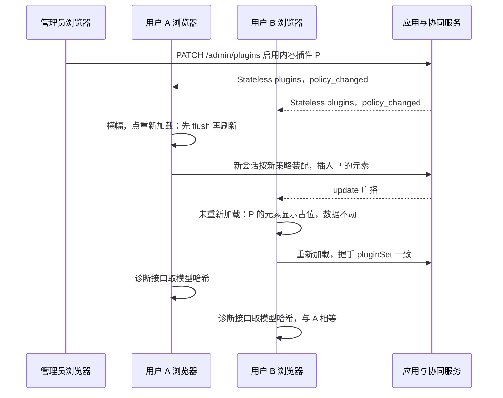

怎么读：纵线是三个浏览器与服务端，自上而下是第 30、31 行的执行顺序；管理员保存只触发横幅，不强制任何会话刷新，过渡期由 B 的占位与数据保留兜底，最后以两端模型哈希相等收尾。
依据：PRD 09 PM-08、PM-13 与图 3-2；rulings §4.23 O-1（已确认）。

**图 6-6 本轮新增 e2e 的覆盖面（第 32–39 行）**

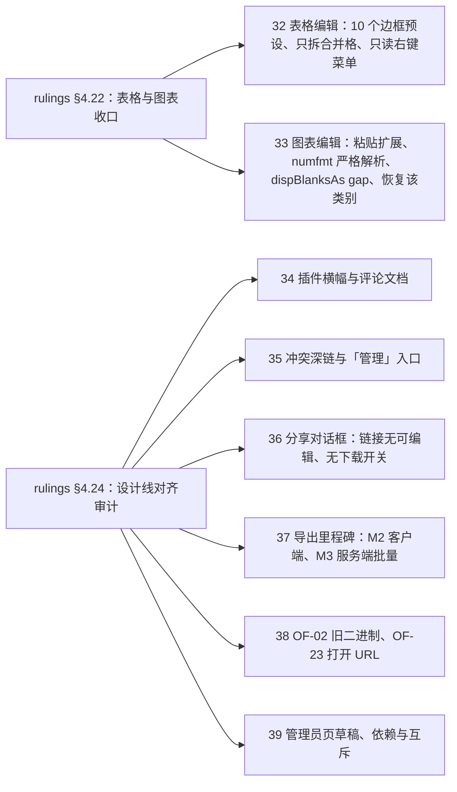

怎么读：左侧是两轮裁决，右侧是承接它们的用例行；图表的类别删除冲突另有确定性场景 [05](./05-collab-simulation-and-property-tests.md) §6 `sc-30`、`sc-31`，本表第 33 行只断言界面表达。
依据：rulings §4.22、§4.24；设计 03-08、03-22、03-30、03-31、03-32。

**图 6-7 v3 编辑器结构与网格视图的 e2e 覆盖（第 40、41 行）**

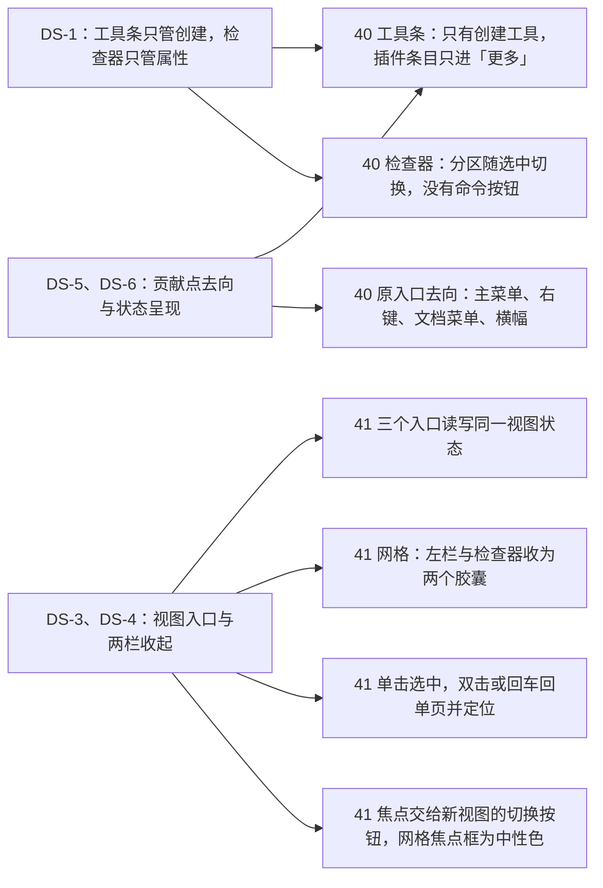

怎么读：左侧是三组裁决，右侧是承接它们的断言块，方框开头的数字是 §5 表的行号；一组裁决可分到多个断言块。组件级的同类断言见 §2.2「编辑器结构与创建工具条」「检查器分区」两行，键盘与焦点见 §7.3「视图切换与幻灯片网格」行，截图基线见 [04](./04-visual-oracle.md) §9。
依据：rulings §4.25 DS-1、DS-3…DS-6；设计 03-02 §2–§5、§7.1；设计 07 §2.2。

**图 6-8 design-language-v3 第 1 批的 e2e 覆盖（第 43–48 行与改写行）**

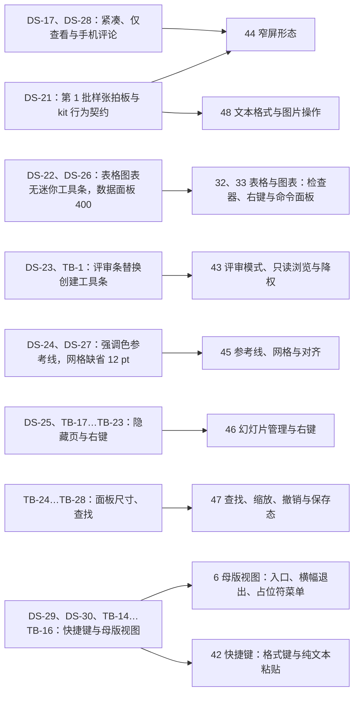

怎么读：左侧是第 1 批的裁决与总编排口径，右侧是承接它们的用例行，方框开头的数字是 §5 表的行号；DS-21 拍板的 kit 行为契约（焦点进入与归还、`Esc` 逐层、不可用不隐藏）分散在各行与 §2.2、§7.3，图中只画了以它为主的两行。组件级的同类断言见 §2.2 第 1 批新增各行，键盘与读屏见 §7.3、§7.7，截图基线见 [04](./04-visual-oracle.md) §9。
依据：rulings §4.25 DS-17、DS-21…DS-30、TB-1…TB-30；设计 03-02、03-04、03-05、03-14…03-21、03-26…03-28、03-30、03-31。

**图 6-9 design-language-v3 第 2 批的 e2e 覆盖（第 49–55 行与改写行）**

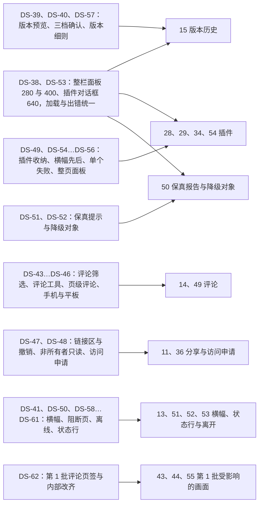

怎么读：左侧是第 2 批的裁决，右侧是承接它们的用例行，方框开头的数字是 §5 表的行号；DS-63（备选状态留在样张、标「未采纳」）没有测试要求，样张里的 `alt-*` 状态不进用例与截图基线。组件级的同类断言见 §2.2 第 2 批新增各行，键盘与读屏见 §7.3、§7.7，截图基线见 [04](./04-visual-oracle.md) §9，长时间离线与软冲突的确定性部分见 [05](./05-collab-simulation-and-property-tests.md) §6、§9，服务端口径见 [07](./07-backend-integration-and-api-e2e.md) §7.2、§8、§12.1。
依据：rulings §4.25 DS-38…DS-63；设计 03-06…03-10、03-12、03-13；playground 第 2 批六个场景。

**图 6-10 design-language-v3 第 3 批的 e2e 覆盖（第 56–70 行与改写行）**

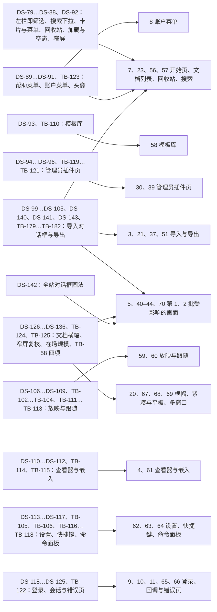

怎么读：左侧是第 3 批的裁决与总编排口径，右侧是承接它们的用例行，方框开头的数字是 §5 表的行号；一组裁决可分到多个用例行。DS-63 照用：样张里标「未采纳 · 」的 `alt-*` 状态不进用例与截图基线；用户采纳了原备选的五题（DS-80、DS-91、DS-96、DS-98、DS-123）以采纳的那一态为准（DS-98 采纳的那一态 2026-10-23 起随 DS-140 改为对话框）。2026-10-23 第 3 批评审修改的 DS-140…DS-143 与 TB-179…TB-182 并入同一张图：导入对话框与主区拖入落区落在第 7、21、56 行，格式图标落在第 21、37、51 行，全站对话框画法落在第 70 行与 §11 平面规则 ⑥。组件级的同类断言见 §2.2 第 3 批新增各行，键盘与读屏见 §7.3、§7.7，截图基线见 [04](./04-visual-oracle.md) §9，服务端口径（发起登录的 302 与 `prompt=login`、导出取消、`lastErrorPhase`、回收站里的文档按三类人返回）见 [07](./07-backend-integration-and-api-e2e.md) §6、§7.5、§8、§11.2，安全口径见 [10](./10-security-testing.md) SEC-AU-11、SEC-XS-03、SEC-XS-04。
依据：rulings §4.25 DS-71…DS-136、TB-101…TB-129、DS-140…DS-143、TB-179…TB-182；设计 03-01、03-11、03-13、03-22…03-25、03-29、03-32、03-33；playground 第 3 批十八个场景。

**图 6-11 design-language-v3 母版视图改版的 e2e 覆盖（第 6、71–74 行与改写行）**

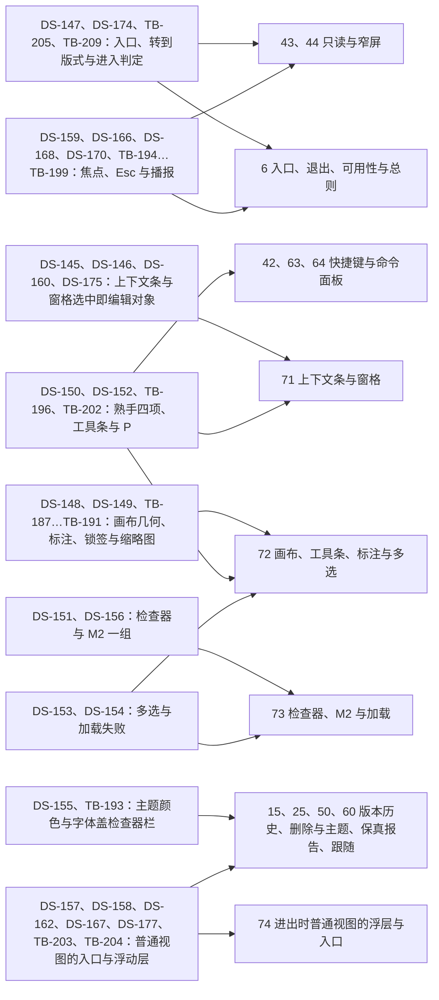

怎么读：左侧是母版视图改版按主题分组的用户裁决与总编排口径，右侧是承接它们的用例行，方框开头的数字是 §5 表的行号；一组裁决可分到多个用例行。组件级的同类断言见 §2.2「母版视图」「母版视图的占位符标注与缩略图」「检查器分区」「快捷键作用域」「浮层的焦点契约」「跟随」各行，键盘与读屏见 §7.3「母版视图」行、§7.6 与 §7.7「母版视图」行，截图基线见 [04](./04-visual-oracle.md) §9，窗格切换节点的性能场景见 [09](./09-performance-and-capacity.md) §3。DS-63 照用：拍板用的对比场景 `master-view-options` 留在样张里、没有采纳的状态标「未采纳 · 」（DS-173），不进用例与截图基线；DS-144（按标杆重新设计）是整组用例的来由，图中不单列；TB-201（「从模板导入母版」本轮不画）落在第 64 行的说明里。
依据：rulings §4.25 DS-144…DS-177、TB-186…TB-210；设计 03-02、03-03、03-24、03-26、03-27、03-28；playground `master-view` 场景与 `narrow`、`offline-conflict` 里的母版视图状态。

撤销与协同语义的**确定性**覆盖不在浏览器里做：撤销五用例与 `history-commands` 分节在 [02](./02-contract-suites-and-pluggability.md) §4，软冲突 12 场景与离线计时在 [05](./05-collab-simulation-and-property-tests.md) §6 / §9；本节第 12–13 行只验证这些语义在真实界面上的表达（提示条、按钮、横幅）。

**「未保存到服务器」的受众**（rulings §4.19 INC-09 定稿）：有本地未获 db 确认项的发起方显示横幅「未保存到服务器 N 项」；其余协作者只在文件名旁的同步状态行显示弱提示「服务器保存延迟」、不出横幅。第 22 行（M2，同一用户的两个标签页）同时断言两类受众（PRD 05 M2 验收 17），第 12 行（M3，双浏览器、两个用户）在多人场景下回归；判据三分支（`room.persist`、spill 确认、`unsavedWarnAfterMs`）的确定性覆盖在 [05](./05-collab-simulation-and-property-tests.md) §9 `rs/unsaved-indicator`。

---

## 6. `/render` 页

被测定义：`RenderPageState`、`window.__cordex.inject / ready / error`、ready 判据（FE-09 唯一源）与 `/render` 的 CSP 变体，见 [50/12](../50-frontend/12-viewer-embedding-and-render-page.md) §11 与 [50/14](../50-frontend/14-client-security.md) §2.3。renderer 容器的零出站、签名 RPC 与沙箱不在本节，见 [10](./10-security-testing.md) §9。

### 6.1 两种注入模式

| 模式 | 编排方 | 静态包来源 | 请求计数方式 | 文件与步骤 |
|---|---|---|---|---|
| local | 测试进程内的 Playwright：`page.goto('/render?renderId=…')` 后 `page.evaluate(p => window.__cordex.inject(p), payload)` | `context.route` 从 `apps/web/dist` 直接供给文档与 `/assets/*`，不经任何网络 | 见 §6.2 | `apps/web/e2e/render/render-page.spec.ts`（R1–R6 与 R8 里整页无法解析的一半，全量段；R7 的截图比对按 [04](./04-visual-oracle.md) §4 执行，R8 合成时抛错的一半是组件级用例，见 §6.3）；两种模式「请求数为 0」的冒烟由服务端 `renderer-egress`（12 §4 #12）承担 |
| remote | 测试进程扮演 worker：用测试 Ed25519 私钥签名（决策 SG-01）后 `POST /render` 到 renderer 容器 | renderer 镜像内置（固定内部源 `https://render.invalid`，经 `context.route` 从镜像文件应答） | RPC 响应 `result.blockedRequests`：被 `route` 拦下的清单外请求数（[60/06](../60-backend/06-modules-jobs-import-export-thumbnails.md) §10.4，protocol `render/sidecar.ts`）；另断言各页 `status = 'ok'` | `apps/server/test/e2e/smoke/renderer-egress.e2e-spec.ts` 中的页面级断言（[10](./10-security-testing.md) SEC-RS-01），→ `e2e/smoke` |

注入载荷由 `support/render-harness.ts` 从 `fixtures/pptx` 夹具构造：state 字节、字体与媒体注入清单、页集合，类型取 protocol `render/page.ts` 的 `RenderStateResponse`，不手写。

### 6.2 网络请求计数口径

- 计数窗口：从导航开始到 `ready` 或 `error` 信号为止。
- 不计入：`/render` 文档本身与静态包文件（local 模式由 `context.route` 从磁盘供给；remote 模式来自镜像内置文件）。
- 计入（每条计 1，且使用例失败）：其余任何请求，含 fetch、XHR、WebSocket、EventSource、`sendBeacon`、图片 / 媒体 / 字体 / 样式子资源、Worker 与其内部请求；`data:` 与 `blob:` URL 不是网络请求，不计。
- 双通道：`context.route('**/*')` 对静态包之外的请求一律 `abort` 并计数；CDP `Network.requestWillBeSent` 在页面与每个 Worker 目标上计数；两个计数都为 0 才通过。另外断言该页 `securitypolicyviolation` 事件为 0（`/render` 变体 `connect-src 'none'`，任何请求企图都会先被 CSP 拦下并留下违规记录）。
- 判定：两种模式的计数都为 0（rulings §4.18 BE-04）。

### 6.3 ready 判据与超时

**图 6-4 `/render` 页 ready 判据**

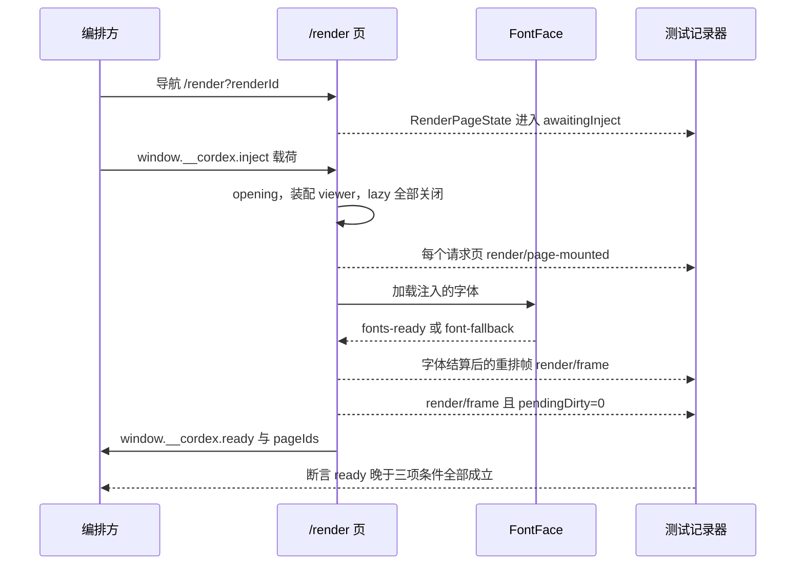

怎么读：自上而下是时间顺序。测试记录器经 `page.addInitScript` 注入，读取 §3.5 的 `performance.mark` 事件轨迹，记下每个事件的时间戳；最后一步断言 `ready` 的时间戳晚于「全部请求页已挂载」「字体全部结算」「此后出现一次 `pendingDirty=0` 的帧」三者中最晚的一个。

依据：rulings §4.18 FE-09、BE-04；ADR-0026 决策 6 与「如何被机械验证」；决策 INC-08（`render/frame` 为进程内事件，`pendingDirty` 字段属它，`perf/frame` 是遥测事件，二者并存）。

| # | 用例 | 断言 |
|---|---|---|
| R1 | 字体晚到 | `addInitScript` 把 `FontFace.prototype.load` 延迟 500 ms：`ready` 晚于字体结算后的重排帧，且截图与字体到齐后的参考截图像素一致 |
| R2 | 惰性加载关闭 | 含图表与多语言夹具：注入后不再加载任何 chunk（§6.2 计数已覆盖），图表已渲染 |
| R3 | 无字体需加载 | 视为已结算，`ready` 只等挂载与空帧 |
| R4 | 注入等待超时 | 不调用 `inject`，`page.clock` 快进过页面常量（默认 60 s）→ `error` 信号带注入超时码（码名以 50/12 §11 为准），注入超时计数 +1，每页渲染超时计数不变 |
| R5 | 每页 10 s 渲染超时 | 注入完成后由编排方逐页计时（60/06 §10.5），在 [07](./07-backend-integration-and-api-e2e.md) §11.3 的缩略图管线中以 `FixedClock` 驱动；本节只断言页面侧不把它计为注入超时 |
| R6 | 非法查询参数 | `renderId` 缺失或 `deviceScaleFactor` 越界 → `error('render.bad_query')`，无请求 |
| R7 | 与客户端截图一致 | 同一夹具在 `/render` 与编辑器画布的截图对比交给 [04](./04-visual-oracle.md)（像素差 ≤ 0.5%，ADR-0026） |
| R8 | 页级回退与诊断（2026-10-22，rulings §4.25 TB-151、TB-157、TB-174） | 分两处执行。**整页无法解析**（`render/render-page.spec.ts`，生产构建、真实夹具）：这一页画保真页级占位「此页内容无法解析」，`ready` 照常到达，`diagnostics` 里这一页不带错误码，请求数为 0。**合成时抛错**是组件级用例：`/render` 不读 RuntimeConfig、没有 §3.5 的故障注入点，生产构建上制造不出这种出错（rulings §4.25 TB-174），所以落在 apps/web 的既有单测 `apps/web/src/__tests__/application/render-page.usecase.test.ts`（40/11 §9 已登记）——以查看 preset 跑 `runRenderPage`，scene provider 在指定页合成时抛错（桩的位置同 slide-render `degrade.test.ts`，夹具见 [11](./11-test-data-fixtures-and-determinism.md) §9），断言 `ready` 只调用一次、这一页的 `diagnostics` 带 `failed{ code: 'render.page_failed' }`（字段形状以 50/12 §11.3 为准）、其余页不带，msw 记录的请求数为 0；这一页画成「此页内容暂时无法显示」、上报一次 `render.page_failed` 由 `degrade.test.ts` 断言（40/07 §9），`isRenderReady` 对这类页照常 ready 由 `domain/render-page-state.test.ts` 以固定事件序列断言（50/12 §12.1）。renderer 据此把这一页记为失败、不回传字节，重试与占位的服务端断言在 [07](./07-backend-integration-and-api-e2e.md) §11.3 |

---

## 7. 可访问性（唯一执行口径）

口径来自 PRD NF-05（WCAG 2.2 AA，M2 必达键盘可达 + 基本朗读，其余分阶段，rulings §4.16 Q20）；键盘模型与语义以 [50/16](../50-frontend/16-i18n-and-accessibility.md) 为准。全部用例放 `apps/web/e2e/a11y/`，归 `e2e/a11y` 步骤，M2 起每个 PR 运行并阻断。

### 7.1 axe 扫描

- 工具：`@axe-core/playwright`，规则标签 `wcag2a`、`wcag2aa`、`wcag21a`、`wcag21aa`、`wcag22aa`。
- 判定：`impact` 为 `critical` 或 `serious`（严重 / 重大）的违规数为 0；`moderate` / `minor` 与 `incomplete`（如图片或叠层上的文字无法计算对比度；v3 已去掉毛玻璃，rulings §4.25 DS-2）只进报告。对比度的阻断口径由 `design/__tests__/contrast.test.ts` 的静态配对校验承担（40/10 §9），axe 的 `color-contrast` 作为第二道。
- 例外：只能登记在 `apps/web/e2e/a11y/allowlist.json`，每条带 `{rule, target, issue, expires, reason}`，`expires` 距提交 ≤ 30 天，与 [01](./01-strategy-and-layers.md) §10 的临时降级同一口径；过期即失败。
- 亮、暗两个主题各扫一遍。

### 7.2 路由 × 状态矩阵

矩阵文件 `apps/web/e2e/a11y/matrix.ts`：行 = 路由（取自 `apps/web` `domain/routes.ts` 导出的路由表，[50/02](../50-frontend/02-app-shell-routing-and-session.md) §2 的代码形态），列 = 该路由下需要进入的状态。每个格子是一次「进入状态 → axe 扫描 → 键盘冒烟（§7.3 的 F6 循环与 Esc 归还）」，由 `a11y/matrix.a11y.spec.ts` 逐格执行（40/11 §9 已登记；原 e2e 根目录的 `a11y.spec.ts` 已并入：它的四个页面即下表的 `/home`、`/documents`、`/settings`、`/documents/:id/view` 行，两档断点由各行的紧凑与手机状态覆盖，断点截图归 [04](./04-visual-oracle.md) §9 的 UI 视觉基线，2026-10-22）。

| 路由 | 状态（每个都扫） |
|---|---|
| `/home` | 已登录默认、列表显示、加载中（2026-10-22 起取代「加载骨架」，rulings §4.25 DS-86）、最近为空、最近加载失败、离线、卡片「⋯」菜单、帮助菜单（配置了与没配置帮助链接）、拖入落区、紧凑（导航抽屉收起与展开）、手机（导航抽屉收起与展开）、M3「更多模板 →」（2026-10-22，第 3 批样张 `home`，DS-79、DS-87…DS-89）、手机与平板上打开的快捷键面板（贴底的底部面板与浮动面板，2026-10-22，rulings §4.25 TB-154）、平板（竖屏导航抽屉、横屏左栏常驻，TB-165） |
| `/documents` | 最近（缺省）、我的文档（含键盘焦点在卡片上）、与我共享、列表显示、卡片「⋯」菜单（所有者与查看者）、内联重命名、搜索框下拉、搜索结果与无结果、回收站（M2 与 M3）与回收站为空、永久删除确认与进行中、加载中、滚动翻页、我的文档与与我共享为空、加载失败、离线、拖入落区、从卡片打开的分享对话框（M3，`?share=<id>`，TB-109；M2 的「分享…」不可用态随卡片「⋯」菜单一并扫，DS-137）、紧凑、平板（竖横两向，TB-165）（2026-10-22 按第 3 批样张 `documents` 改写，原「筛选中」随页内筛选条取消而作废，DS-79…DS-88） |
| `/templates`（M3，2026-10-22，第 3 批样张 `templates`） | 默认（配置了模板源）、没有配置模板源、预览对话框、正在创建、模板源加载中、模板源加载失败、离线（DS-72、DS-93、TB-110） |
| `/documents/:id`（编辑） | 单页与网格两种视图（2026-10-04 起取代「每个 Ribbon 页签」，rulings §4.25 DS-1、DS-4）× 三种形态（桌面、紧凑 1000 × 760（含左栏抽屉与检查器抽屉各展开一次）、仅查看 390 × 844（含评论、幻灯片、更多三个底部面板各打开一次），2026-10-07，DS-17、DS-21）；检查器两个页签（设计、评论；「评论」页签随评论包出现，M3）× 选中态（无选中、选中形状、编辑文字、多个同类对象、异类多选、组合编辑中、锁定对象、连接符、图片与裁剪模式、表格与单元格、图表与 400 宽数据面板、空内容占位符，设计 03-02 §4.5）；底部工具条的「形状」弹层与形状库、「图片 ▾」「表格」网格、「图表」类型菜单与「更多」菜单；检查器形状分区「快速样式」节内原位展开的样式库（2026-10-08，rulings §4.25 DS-31；同日按 DS-34 由弹层改为节内原位展开，样张 `main-states.quick-styles-gallery`，随实现）；主菜单（含全部子菜单）与文档菜单；版式画廊与「新建幻灯片 ▾」版式库；主题画廊与主题颜色与字体；母版视图（2026-11-04 起含上下文条、「占位符 ▾」菜单、窗格右键（含「保留母版」勾选行）、就地改名、多选画布、加载中与加载失败、M2 浏览态、盖在检查器栏上的「主题颜色与字体」，以及删除版式、删除 N 个版式、删除母版与导出前提示未使用母版的对话框，rulings §4.25 DS-145…DS-156；普通视图检查器的「编辑版式」与「转到版式」随无选中、空内容占位符与编辑文字三种选中态覆盖）；查找面板（桌面与紧凑 320）；缩放菜单；画布、形状、文本、缩略图与节标题右键菜单；每个对话框（导出、分享、插入图片、来自 URL、插入表格、页眉和页脚、插入图标、操作设置、链接、快捷键面板、命令面板；导出、分享与个人插件面板为对话框路由，2026-10-03 rulings §4.24 AL-2）；占位符图标条（展开与折叠为「插入 ▾」）与占位符表格网格、表格只读右键菜单、图表数据网格行列菜单与类型确认段、个人插件面板冲突态（`?state=conflict`）；偏好设置对话框（2026-10-22 起取代「设置抽屉」，rulings §4.25 DS-113）；放映（第 3 批：控制条浮现、「更多」展开、跳页提示条与没有这一页、跳页输入、结束页、黑屏与白屏、单页渲染失败、观众跟随与自由浏览、失去连接，DS-106…DS-109）；评论面板；只读降级横幅；登录已过期横幅；离线横幅；个人插件面板（三分组展开、失败详情展开）；缺插件横幅；「插件设置已更新」横幅（2026-10-01，§4.23）；启动失败横幅（单个「插件「X」未能启动」与多个「N 个插件启动失败」各一，2026-10-04，DS-6；2026-10-15，DS-55）；打开中与打开失败两种整页状态；**第 2 批**（2026-10-15，rulings §4.25 DS-38…DS-62）：「评论」页签（当前页、全部、已解决展开、已脱离锚点、空态、加载中）、评论工具与浮动撰写框、@提及候选、评论钉悬停卡、聚合钉列表与钉右键、删除讨论串确认；保真报告整栏面板（全部、本页、生成中、无法解析、完全保真）、页级提示条、降级对象选中与右键；分享对话框（所有者、加载、加载失败、离线、移除成员的行内确认、链接收紧的行内确认、有效期、链接已到期（`share.link-expired`，2026-10-15，DS-66）、访问申请、非所有者只读（仅邀请与链接已开启两种：`share.no-permission`、`share.no-permission-link`，2026-10-15，DS-69））与「分享」待处理圆点、申请访问留言弹层；个人插件对话框（640：默认、启动失败展开、重试中、冲突、管理员、加载、出错）、插件整页面板（400，含评审态）、折叠的插件分区与「更多」里的插件子菜单；需要人工处理的横幅（降权、登录已过期、隔离态、文档已被删除、更改过大、名额已满、已导出本地副本）、已恢复与长时间离线、导出为本地副本对话框、应用内离开与刷新确认；会话中访问被撤销与查看人数已满两种阻断页；**第 3 批**（2026-10-22，rulings §4.25 DS-78…DS-136）：导出对话框（默认、PNG、SVG、自定义页码有误、未同步、等待同步、不能同步、生成中、失败、无法显示内容的说明、服务端排队与生成中（M3）、查看者与评审者的「文件」菜单不可用项）、快捷键面板（编辑器缺省、搜索、无结果、冲突与锁定冲突、评审模式、网格视图、紧凑）、命令面板（常用、搜索结果）、跟随中的头像组与跟随条、文档状态横幅（发现新版本两种来源与刷新确认、换纪元三态与已导出、元素上限与关掉之后）、协同快照打开中、紧凑形态里的版本历史与保真报告抽屉及插件整页面板底部 Sheet、平板竖横两向的评论面板、在线列表（同色序号角标与「2 个窗口」） |
| `/admin/plugins`（2026-10-01，§4.23，M3） | 列表、按状态筛选、状态说明弹层、详情抽屉（模态 480，含被拒插件与深链打开，DS-94）、草稿与保存条、互斥阻止保存、确认卡（禁用被依赖者、首次启用第三方（M4）、变更确认，及其保存失败、412 冲突与逐项报错，TB-120）、有草稿时离开确认、加载中（2026-10-22 起取代「加载骨架」，DS-86）、整区错误态、被拒横幅与非生产警示两条叠放（M4，DS-92、DS-96、TB-119）；普通成员直访时回到开始页的轻提示（TB-101） |
| `/documents/:id`（查看者变体、评审模式、编辑模式降权） | 默认（评审条 / 浏览条；M2 未装评论包时为「评审模式 · 只读」提示）、「设计」页签只读展示、评论面板（第 2 批：评审者与查看者只读各一，2026-10-15，DS-62）、插件整页面板的只读展示（DS-56）、无法显示的对象与缺插件占位的「能摆放」右键菜单（顶部说明行，2026-10-15，DS-64）、主菜单「视图 › 模式」展开（评审者「编辑」不可用）、主菜单与缩略图右键的不可用项（同一原因的顶部说明行）、降权横幅（2026-10-07 取代原「模式下拉展开」，rulings §4.25 DS-15、DS-23） |
| `/documents/:id/history` | 列表（今天的自动版本组展开、月份折叠）、命名表单、预览、预览中离线的两条横幅、恢复确认卡、恢复完成、最近删除与彻底删除确认、加载、出错、空态、离线（2026-10-15 按第 2 批改为检查器整栏面板，宽为检查器当前宽度（缺省 280），rulings §4.25 DS-38、DS-39、DS-40、DS-53、DS-57、TB-60；路由形态以 50/02 §2 为准） |
| `/documents/:id/fidelity` | 报告（全部、本页、生成中、无法解析、完全保真）、定位后的当前项（2026-10-15，检查器整栏面板，宽为检查器当前宽度（缺省 280），DS-38、DS-51、TB-60；路由形态以 50/02 §2 为准） |
| `/documents/:id/view` | 桌面默认、打开中、打开失败（有与没有下载回调、按错误码）、ⓘ 卡（有差异、没有差异、缺插件一行）、缩放读数菜单、搜索、缩略图条（含加载中与单页失败）、备注（有与没有）、只有 1 页、窄屏（默认、更多、备注、幻灯片、保真摘要、搜索）（2026-10-22 按第 3 批样张 `viewer` 改写，rulings §4.25 DS-110、DS-111、TB-114） |
| `/import`（2026-10-23 起为叠在来路之上的导入对话框，rulings §4.25 DS-140、TB-179） | 从开始页打开、从文档列表打开、直接打开（背后是文档列表「最近」）、拖入悬停、一次拖多个文件、上传中、服务端解析（含排队）、可重试的失败（含离线时「重试」不可用）、不是有效的演示文稿（含「技术详情」展开与已复制诊断信息）、超出规模上限、其余确定性错误各码与存储空间不足（M3）、开始页与文档列表主区拖入落区松开后的上传态（TB-180）、手机底部面板与平板（`@mobile`，M3，TB-181） |
| `/settings` | 缺省（编辑器上）、从开始页打开、手机底部面板、嵌入锁定、切换语言中、语言包加载失败、已复制诊断信息、M3 使用统计、开发构建、紧凑窗口（2026-10-22 按第 3 批样张 `settings` 改写，DS-113、DS-114、DS-116、TB-118） |
| `/login` | 缺省（`selfSignup` 关）、开放注册、正在跳转、三种登录失败的内联错误、离线时点主按钮、手机（2026-10-22 按第 3 批样张 `shell-pages` 改写，DS-118…DS-121、TB-122） |
| 错误页（`*` 与编辑器路由的失败态，2026-10-22，DS-71、DS-122） | 找不到此页面、找不到该文档、链接已失效（发送申请前后）、你没有权限访问此文档（含 M2 的「申请访问」不可用态，TB-156）、此文档在回收站中（含「恢复」失败的内联错误，DS-85、TB-155）、页面出错了、配置错误、退出登录的未同步确认 |
| `/embed/:id` | 完整、紧凑、仅查看三种容器尺寸（含两种主菜单展开）、`mode=view`、请在新窗口登录三态、嵌入里的打开失败（M3 P2；2026-10-22 按第 3 批样张 `embed` 改写，DS-73、DS-112、TB-115） |
| `/styleguide` | 全部组件状态（产品的组件全状态页，内容按 v3 kit：设计 04 §4.1、§4.1a 的原子组件与第 1 批共享件逐个状态，样张为 playground 的 `_kit` 场景 `#/v3/editor?state=_kit.<状态>`；a11y 门禁与 csp-strict 的对象始终是本路由，2026-10-07 rulings §4.25 TB-3 定稿，取代「接替路由随迁移定稿」的过渡写法；playground 旧版 `/styleguide` 样张（ribbon 版，已被 DS-1 取代）随 DS-7 删除，与本路由无关；50/09 V14、40/11 §9 `a11y/styleguide.a11y.spec.ts` 同口径）。提供方式（2026-10-08，rulings §4.25 TB-50）：apps/web 只在测试部署（`RuntimeConfig.env === 'test'`，web 容器按 `CORDEX_WEB_ENV` 渲染，e2e 预览服务器与测试 compose 栈为 `test`）注册本路由，内容为 ui-react 子路径 `./styleguide` 的组件全状态页，路由登记在 50/02 §2、§3，因此 a11y 与 csp-strict 在同一份生产包与生产 CSP 下覆盖它；其余部署不注册、该路径落到不存在页 |

完整性断言：路由表中每一条路由都在矩阵中出现，否则 `matrix.completeness.spec.ts` 失败；对话框与面板的列表取自 UI 贡献登记（编辑器视图、检查器页签、`ui.inspectorSection` 涉及的选中种类、工具条弹层与菜单、对话框 id；2026-10-04 起 Ribbon 页签已废弃），编辑器形态取自 `detectBreakpoint` 的取值（桌面、紧凑、仅查看，2026-10-07），新增一个未进矩阵即失败。`/render`、`/auth/callback`、`/auth/popup-callback` 登记为豁免行并写理由：`/render` 不是可交互页面；两个回调页的理由（2026-10-22 起，rulings §4.25 DS-120、TB-122）为「只有过渡态与网络失败页」——登录失败一律回到 `/login?error=<码>`、在登录页里扫描，回调页只剩「正在登录…」「正在完成登录…」两个过渡态与网络失败页、新窗口的「登录没有完成」「已重新登录」，它们与错误页同一个阻断页组件，由上面「错误页」一行覆盖。

### 7.3 键盘 e2e

| 区域 | 断言（每条一个用例） |
|---|---|
| F6 循环 | 单页视图 `F6` 依次经过 左栏 → 画布 → 备注（显示时）→ 底部创建工具条 → 检查器 → 回到左栏；网格视图为「文档」胶囊 →「协作与分享」胶囊 → 幻灯片网格 → 底部创建工具条 → 回到「文档」胶囊；`Shift+F6` 反向，`Ctrl+F6` 备用键同序；隐藏或缺席的区域被跳过；顺序 = 区域的 DOM 顺序，以 PRD ED-29 与设计 07 §1.1 为准（2026-10-04 按 rulings §4.25 DS-1、DS-4、DS-6 废弃 Ribbon 与状态栏，50/16 §6.1 同步）；紧凑形态为「文档」胶囊（左侧抽屉展开时换成抽屉 `region`「幻灯片列表」）→ 画布 → 备注 → 底部创建工具条 →「协作与分享」胶囊（右侧抽屉展开时换成抽屉 `region`「检查器」），仅查看形态为 顶部条 → 幻灯片与只读备注 → 底部「翻页与评论」，打开的底部面板排在最后；横幅属于画布区开头，`Tab` 先经过横幅上的按钮（2026-10-07，设计 07 §1.1 窄屏两种形态）；「跳至画布」是页面第一个可聚焦元素，只在聚焦时出现，按下后焦点进画布 |
| 底部创建工具条与评审条 | `role=toolbar`、单一 Tab 停靠点（roving tabindex）；方向键在工具间移动，`Enter` / `Space` 激活，当前工具 `aria-pressed`；「图片 ▾」「更多」是菜单（`Enter` / `Space` / `↓` 打开、焦点到第一项，`↑` / `↓` 移动、不可用项可停并读出原因），「图表」是类型菜单（`→` 打开子类型），「表格」是网格弹层；都向上弹出，`Esc` 关闭并把焦点还给触发按钮；「形状」弹层与形状库的键位见 §5 第 26 行（键盘打开焦点进第一格、整组一个停靠点、方向键首尾回绕，形状库同为一个停靠点，rulings §4.25 TB-5）；评审条与浏览条同一套键位（浏览 · 评论 · 高亮 ┊ 上一处 / 下一处评论 ┊「返回编辑」），只剩只读提示时没有可聚焦项（设计 07 §1.2、§1.2b、§2.2） |
| 左栏缩略图 | `↑` / `↓` 移动并同步画布；`Mod+Shift+↑/↓` 重排并播报新位置；`Shift+F10` / 菜单键在焦点页上打开缩略图菜单，关闭后焦点回到该页；「新建幻灯片 ▾」打开的版式库是 `listbox`，方向键按卡片实际位置移动、`Enter` 新建、`Esc` 关闭并回「新建幻灯片 ▾」 |
| 画布 | `Tab` 按 z 序循环选中对象；方向键 1 px、`Shift+方向键` 10 px 微调；`Enter` 进入文本编辑；`Esc` 逐层（设计 07 §4 分流图）：IME 组合中只交给输入法 → 关闭最上层的菜单、弹层、对话框或命令面板 → 收起抽屉、底部面板、数据面板（格内有未提交输入时先放弃输入）或查找面板 → 退出裁剪模式（等同「取消」）或插入工具态 → 文本编辑 → 选中子元素 → 选中组合 → 取消选择 →（母版视图中且无选区）退出母版视图；每按一次只退一层；母版视图里的完整七级以 rulings §4.25 TB-195 为准——其中拖动中先取消并回弹、占位符的绘制态先回到「选择」、焦点在母版窗格时第一下 `Esc` 只交给画布外框，是在 §4.18 UX-06 链上补的三级（2026-11-04）；焦点停在带工具提示的控件上时同一下 `Esc` 收起提示并关闭所在浮层 |
| 母版视图（窗格、画布与工具条；2026-11-04，rulings §4.25 DS-150、DS-159、DS-166、TB-194、TB-195、TB-196、TB-197、TB-198；键位与读屏名以设计 03-26 §3、§9 为准） | 窗格是 `listbox`、整栏一个 `Tab` 停靠点：`↑` / `↓` / `Home` / `End` 按视觉顺序移动并选中（选中跟随焦点），`Shift+↑/↓` 只在同一母版内扩多选，`Mod+Shift+↑/↓` 在本母版内重排（到边界不动），移动后播报这一版式在所属母版里的新位置（第几个版式，与左栏缩略图重排同一规则），`Delete` / `Backspace` 删除（被使用的弹确认、焦点在「取消」，未使用的直接删并给可撤销轻提示），`Mod+M` 插入版式、`Mod+D` 复制所选版式（焦点跟新的选中行），`Shift+F10` / 菜单键在焦点行上原位打开右键菜单，就地改名框里 `↵` 提交、`Esc` 取消，之后焦点都回到该行；`Enter` 与第一下 `Esc` 把焦点交给画布外框（可程序聚焦、不画焦点环，DS-159）；进入母版视图后焦点在窗格选中行（DS-166）；画布上占位符的点选区经 `Tab` 可达、读屏名「选择〈类型〉占位符」，选中单个可编辑占位符后 `Enter` 进入提示文本编辑（TB-194）；多选卡片上 `Enter` 回到单选、焦点交给画布外框（TB-198）；工具条「占位符 ▾」是菜单（`Enter` / `Space` / `↓` 打开、焦点到第一项），与其余创建工具同在工具条的单一 `Tab` 停靠点里；窗格菜单执行后与删除后点「撤销」的焦点按 §2.2「浮层的焦点契约」行（TB-197） |
| 检查器与备注 | 页签为 `tablist`，`←` / `→` / `Home` / `End` 在「设计」「评论」间移动；分区内 `Tab` 顺序遍历字段，分段与切换条的每一项是带 `aria-pressed` 的按钮；分区缺省不折叠（节标题是 `h3`），少数默认收起的分区（表格样式、行高与列宽、图表替代文本等）的标题是带 `aria-expanded` 的按钮、`Enter` / `Space` 展开收起（2026-10-07 按设计 07 §1.2）；不可用字段仍可聚焦、读屏名后附原因，校验错误的字段 `aria-invalid` 并经 `aria-describedby` 读出错误行；只读展示时每行是纯文本，顶部说明行 `role=note`；备注中 `Esc` 回到区域级焦点 |
| 查找和替换面板（2026-10-08 补，设计 07 §1.2、03-21 §2；rulings §4.25 TB-28） | `Mod+F` 或主菜单「编辑 › 查找…」打开时焦点进查找框并全选原查询词，面板已开着时再按同一快捷键回到查找框（替换键同时展开替换行）；`Tab` 顺序为 `›` → 查找框 → 区分大小写 → 全字匹配 → 上一个 → 下一个 → 关闭 →（展开时）替换框 →「替换」→「全部替换」；查找框里 `Enter` 下一个、`Shift+Enter` 上一个；`Esc`（焦点在面板里，或不在别的输入框里）或「关闭」收起面板，焦点交回画布并保留画布选区，焦点在检查器字段里按 `Esc` 不关面板；面板是非模态 `dialog`「查找和替换」、不陷阱；评审、只读浏览与降权时 `Tab` 序列里没有 `›` 与替换行，替换键只打开查找（TB-28）；紧凑形态宽 320，区分大小写、全字匹配与「替换…」在「⋯」（「更多查找选项」）菜单里（§5 第 47 行） |
| 紧凑抽屉与仅查看形态（2026-10-07，rulings §4.25 DS-17、DS-21） | 紧凑：外角开关 `Enter` 展开抽屉、焦点交给同一角的「收起…」，`Esc` 或「收起…」收起并把焦点交回胶囊上的「显示…」，抽屉里有菜单开着时第一下 `Esc` 只关菜单；抽屉内按桌面左栏 / 检查器的键位导航、不陷阱。仅查看：`←` / `PageUp`、`→` / `PageDown`、`Home` / `End` 翻页（面板开着时不翻页）；底部面板打开时焦点落在面板本身、`Esc` 收起并回到打开它的按钮；「更多」面板为 `menu`、「显示演讲者备注」是 `menuitemcheckbox`（设计 07 §1.2、§2.3）；M3 起手机上有评论权限时评论面板的撰写区与「回复」按 DOM 顺序 `Tab` 可达，撰写区 `Enter` 换行、只用「发送」提交（2026-10-15，DS-46），焦点在这些框里时翻页键放行给文字输入；面板里 `Esc` 关闭面板（框里有字时不关），关闭后焦点回「评论」按钮（rulings §4.25 DS-28、DS-46，设计 07 §1.2；平板只读评审、没有撰写区，TB-49） |
| 分隔条（2026-10-07，rulings §4.25 TB-24、TB-25；2026-10-15 补 TB-60） | 三条分隔条在 `Tab` 顺序里，`←` / `→`（备注 `↑` / `↓`）每次 8、`Shift` 32，`Home` / `End` 到最小 / 最大，`Enter` 回到缺省，`aria-valuenow` 随之更新；聚焦时那条线换成强调色；版本历史、保真报告开着时检查器分隔条照常可调；图表数据面板与插件整页面板开着时检查器分隔条仍可聚焦、读屏读出不可用（`aria-disabled`），方向键、`Home` / `End`、`Enter` 都不改变 `aria-valuenow`，关闭面板后恢复可调（设计 07 §1.2，§2.2「面板分隔条」行） |
| 视图切换与幻灯片网格（2026-10-04，rulings §4.25 DS-3、DS-4） | 视图切换为 `role=group`「视图」内两枚 `aria-pressed` 按钮，`Enter` / `Space` 激活；焦点去向按设计 07 §2.2 表逐行一例（§5 第 41 行同组断言的键盘版），切换后焦点不落在 `body`；网格中 `Tab` / `Shift+Tab` 逐页移动、`Enter` 打开该页，焦点页中心点的 `elementFromPoint` 命中该页（不被胶囊与工具条遮住，§7.4）；胶囊内按 DOM 顺序 `Tab`；网格中 `←` / `→` 前后一页、`↑` / `↓` 按实际列数上下一行、`Home` / `End` 首末页，只移动焦点、不改当前页，空格选中、`Enter` 打开，`Shift+F10` / 菜单键打开缩略图菜单（2026-10-07 第 1 批定稿，设计 03-02 §5.3） |
| 拖拽的键盘等价（WCAG 2.5.7） | [设计 07](../20-design/07-accessibility-and-i18n.md) §1.2a 表逐行一例：移动、缩放、裁剪、表格行高列宽、缩略图重排、文件导入的非拖拽路径（导入对话框的「从电脑选择文件…」，触控为「选择文件…」，2026-10-23，rulings §4.25 DS-140、TB-181）；2026-09-26 补（§4.21）：插入工具在底部工具条按钮或「形状」弹层格子上 `Enter` 插到视口中心、调整手柄的数值输入（检查器形状分区）、线条端点经检查器「位置与大小」分区的四个数值与翻转、连接符经检查器「连接」节的起点 / 终点下拉（形状 · 连接点，rulings §4.25 TB-21）；裁剪模式下只用检查器「裁剪」节的上 / 下 / 左 / 右数值完成裁剪，`Enter` 完成、`Esc` 取消（TB-4）；表格行高列宽经检查器「行高与列宽」分区（M3）；2026-10-07 按第 1 批分区定稿（设计 07 §1.2a），调整值与连接下拉样张未画，随实现启用；曲线绘制工具是登记的例外，只断言「从预设形状开始」的替代路径可达（[50/22](../50-frontend/22-elements-shapes-and-lines.md) §5）；2026-11-04 补母版视图：版式重排用 `Mod+Shift+↑/↓`（只在本母版内，移动后播报新位置，设计 03-26 §3、§9），插入占位符的非拖拽路径为焦点在「占位符 ▾」菜单的某一类型上按 `Enter`（`Space` 同）——按该类型的默认尺寸插到视口中心并选中、焦点交给画布，连续插入依次错位，同类上限、不可用与原因不变（rulings §4.25 TB-202） |
| 字符键快捷键（WCAG 2.1.4，2026-10-05，rulings §4.25 DS-11） | 工具单键 `V` / `T` / `S` / `C` 只在焦点位于画布或底部工具条时生效：焦点在左栏缩略图、检查器、备注、评论撰写框、对话框与任何输入框时按这四个键不切换工具（输入框内照常输入字符）；读屏开启时（画布容器为 `application`）在画布上按键仍生效（§5 第 42 行、PRD NF-05）；评审条只响应 `V`、`C`，查看者没有工具键；文本格式键删除线、上标、下标只在文本编辑态生效，文本编辑中 `Mod+=` 为下标、画布上为放大（2026-10-07，rulings §4.25 DS-29）；母版视图另有 `P`（打开「占位符 ▾」），同样只在焦点位于画布或底部工具条、不在文本编辑与输入时生效，焦点在母版窗格、检查器与输入框时不响应（2026-11-04，rulings §4.25 TB-196） |
| 插件管理（2026-10-01，§4.23，PM-16） | 管理员页：三态为 `radiogroup`，方向键在三项间移动、锁定项可聚焦并读出锁定原因；只用键盘完成一次「禁用被依赖者 → 确认卡 → 保存」（禁用被依赖者与首次启用第三方两张当下确认卡打开时初始焦点在「取消」，变更确认卡在首个操作，`Esc` 取消、关闭后焦点回到触发控件，2026-10-22，rulings §4.25 TB-120）；详情抽屉（模态，DS-94）打开时焦点在抽屉本身、`Tab` 在抽屉内循环，`Esc` / × / 点遮罩关闭后焦点回这一行的「›」；有草稿时离开的确认初始焦点在「留下」；个人插件对话框（640，2026-10-15，rulings §4.25 DS-38、DS-56）：打开时焦点按对话框契约落在正文第一个可操作控件，`Tab` 在框内循环；`Tab` 到开关（`role=switch`）、`Space` 切换，「重试」「为我关闭」可达，失败行的详情为带 `aria-expanded` 的按钮；冲突深链打开时说明行吸顶、冲突行滚入视区；开关、重试与保存失败的结果写在对话框底栏并 polite 播报（不出画布轻提示）；管理员页的保存成功与依赖恢复经 polite 区播报 |
| 占位符图标条、表格网格与图表数据网格（2026-10-03，rulings §4.22 SF-02、SF-05、SF-10…SF-12） | 图标条按 APG Toolbar：整条只占一个 `Tab` 停靠点，`←` / `→` 循环、`Home` / `End` 到两端，禁用项可聚焦并读出原因，聚焦时占位符下方出画布提示签「← → 在图标间移动 · Enter 插入 · Esc 回到占位符」（取代原状态栏提示，2026-10-07 第 1 批定稿，设计 03-16 §6）；到达路径为画布内 `Tab` 选中空内容占位符后再按 `Tab`；折叠为「插入 ▾」时整条就是这一个按钮，`Enter` / `Space` / `↓` 打开同一组条目的菜单，未开放项可停留并由说明行给原因；表格网格为 `role=grid`，方向键移动高亮角、`Home` / `End` 到本行首尾、`Enter` / `Space` 插入、读数经 aria-live 播报；图表数据网格每格是真实输入框，`Enter` 提交并下移、`Tab` 提交并右移，`Shift+F10` 打开行列右键菜单，到边项可聚焦并读出原因，`Esc` 逐层（菜单 → 格内输入 → 面板）；插入表格对话框与类型确认段关闭后焦点回到触发它的按钮或图标，数据面板「收起到检查器」后焦点回「展开」、「关闭」后回「数据」分区标题 |
| 形状快速样式（2026-10-08，rulings §4.25 DS-31、DS-34；设计 07 §1.2b、04 §4.1a；样张 `main-states.quick-styles`、`main-states.quick-styles-gallery`，随实现启用） | 缩略行整行一个 `Tab` 停靠点，是带 `aria-haspopup="listbox"` 与 `aria-expanded` 的按钮、读屏名带当前样式名；`Enter` / `Space` / `↓` 打开样式库（`listbox`「形状样式」），焦点落在当前样式、没有时落在第一格；样式库在「快速样式」节里、缩略行下方原位展开（DS-34，原「样式库弹层」作废），展开期间页面上没有新增的浮层；42 格整组一个 `Tab` 位，`←` / `→` 逐格、行尾接下一行行首，`↑` / `↓` 跨行并保持列位，`Home` / `End` 第一 / 最后一格，`aria-selected` 标当前样式；`Enter` / `Space` 或点按即应用（一个撤销步），样式库保持展开、焦点留在该格；节标题右侧「收起样式库」、再按缩略行或 `Esc` 收起，焦点回缩略行（原「`Enter` / `Space` 应用并收起」「`Esc` 不应用」两条作废，与设计 07 §1.2b 一致） |
| 菜单与浮层（2026-10-07，rulings §4.25 DS-21；设计 04 §4.1b、07 §2.3） | 主菜单、文档菜单、缩放菜单、账户菜单与右键菜单为标准 Menu 模式：`↑` / `↓` 移动、`→` 进子菜单、`←` 返回，不可用项留在原位、方向键可达并经 `aria-describedby` 读出原因（一组共用原因时指向顶部说明行），勾选与单选项为 `menuitemcheckbox` / `menuitemradio`；`Esc` 关闭并把焦点还给触发按钮（右键菜单回被右键的对象）；对话框打开时焦点在正文第一个可操作控件、`Tab` 在框内循环，危险确认先落在「取消」；画布浮动面板（查找）、抽屉与底部面板不陷阱；全程焦点不落在 `body` |
| 评论（2026-10-15，rulings §4.25 DS-43…DS-46；设计 07 §1.2a） | 筛选为一组 `aria-pressed` 按钮、排序为菜单；线程按 DOM 顺序 `Tab`，「已解决 N」折叠行 `Enter` / `Space` 展开并更新 `aria-expanded`；画布评论钉可聚焦，聚焦时出悬停卡（不抢焦点），`Enter` 定位线程，`Shift+F10` / 菜单键在钉右侧打开钉菜单、关闭后焦点回钉；工具条「评论」上按 `Enter` 放页级临时钉并打开浮动撰写框（焦点进文本框），评论工具开着、焦点在画布时按 `Enter` 同此，有选中对象时按 C 落元素锚点（评论工具开着时 `Enter` 同此），没开评论工具时选中对象按 `Enter` 进入文字编辑、不落钉（2026-10-15，rulings §4.25 TB-62），画布空白处 `Shift+F10` 菜单里有「添加评论 C」；撰写框 `Enter` 发送、`Shift+Enter` 换行（手机 `Enter` 换行、只用「发送」），IME 组合中的 `Enter` 不发送；@ 候选 `↑` / `↓` / `Enter`，`Esc` 只取消候选；撰写框 `Esc` 逐层（有内容时不关），关闭后焦点回到来源（「评论」、画布或被右键的对象），发送后交给画布；发表后工具保持按下，再按 `Esc` 或 `V` 回到「选择」；写了内容的撰写框随换页、进网格视图或切到评审模式收起，回到那一页时原样恢复，但焦点留在换页所用的元素上（缩略图、画布、评审条按钮）、不进撰写框，点临时钉或在钉上按 `Tab` / `Enter` 才进入，评论工具是否按下不因恢复而改变（2026-10-15，rulings §4.25 TB-79、TB-84）；切到评审模式或返回编辑后仍在同一页时撰写框当场恢复、同样不抢焦点（TB-87）；之后在「评论」上按 `Enter`、选中对象按 C 或从右键「添加评论」，焦点都进这个撰写框、光标在末尾，不另开一个（TB-88）（§5 第 14、49 行） |
| 版本历史（2026-10-15，rulings §4.25 DS-39、DS-40、DS-57） | 打开时焦点落在「当前版本」，关闭后回文件名；列表行与折叠行按 DOM 顺序 `Tab`，折叠行 `Enter` / `Space` 展开；在某个版本上 `Enter` 进入预览（焦点留在该行），预览中 `Esc` 先回到当前版本、再按关闭面板；预览横幅上的「返回当前版本」「恢复此版本」在画布区开头按 `Tab` 可达；「恢复此版本」打开的非模态确认卡焦点落在「取消」，`Esc` 或「取消」关闭、焦点回「恢复此版本」；「命名当前版本」展开表单时焦点进名称框，`Enter` 保存；彻底删除的模态确认初始焦点在「取消」；「返回当前版本」、命名的「保存 / 取消」、「重试」、「加载更早版本」都先把焦点交给等效位置（当前版本一行、标题行按钮、加载行、新出现的月份行）再改状态（§5 第 15 行）；面板开着时被降为可评审（失去 `history.read`）→ 面板关闭、回到当前版本，焦点交回文件名、不经过 `body`（2026-10-15，rulings §4.25 TB-63） |
| 分享对话框与申请访问（2026-10-15，rulings §4.25 DS-40、DS-47、DS-48） | 打开时焦点落在正文第一个可操作控件（有访问申请时为第一条申请的角色下拉，否则为邀请输入框）；联想列表 `↑` / `↓` / `Enter`，`Esc` 先收起联想、再按才关对话框；成员行的角色下拉是行内变体，`Enter` / `Space` / `↓` 打开，选「移除」后焦点到行内确认的「取消」，链接收紧确认同理，行内确认里 `Esc` 等同取消、不关对话框；批准 / 拒绝后焦点交给下一条申请；申请人一侧：「申请访问」打开的留言弹层焦点进留言框，`Esc` /「取消」关闭回按钮，发送后焦点留在已不可用的「申请访问」上（§5 第 36 行） |
| 横幅、阻断页与确认框（2026-10-15，rulings §4.25 DS-50、DS-58、DS-59、DS-60） | 处理前不可关闭的横幅没有 ×、`Esc` 不收起；横幅上的按钮在画布区开头按 `Tab` 可达，长时间离线横幅里的页码是可按的按钮、`Enter` 切到该页；阻断页（访问被撤销、查看人数已满、打开失败）打开时焦点落在页面主标题，`Tab` 第一个到达主操作；应用内离开与刷新确认、删除讨论串与彻底删除确认的初始焦点在安全项（「留下」「取消」），`Tab` 在框内循环、`Esc` 等同安全项，关闭后焦点回触发处；仅查看形态里竖排的横幅按钮（触控高 44）按 DOM 顺序在顶部条之前可达 |
| 文档卡片网格（2026-10-22，rulings §4.25 TB-107、TB-108；设计 07 §1.2b） | 开始页「最近」、文档列表、回收站、搜索结果与模板库（每个来源组）的网格各是一个 `Tab` 停靠点：第一次进入落在第一张、之后落在上次那张，`←` / `→` 前后一张、`↑` / `↓` 按实际列数上下一行（桌面四列、紧凑三列、模板库五列）、`Home` / `End` 首末张，`Enter` 打开（模板卡打开预览），`⇧F10` / 菜单键打开「⋯」菜单、关闭后焦点回卡片，再按一次 `Tab` 离开网格；「⋯」不进 `Tab` 顺序；回收站卡片 `Enter` 不打开、菜单首项为「恢复」；滚动翻页追加的卡片接着进同一网格；列表显示时 `↑` / `↓` 逐行 |
| 应用壳（2026-10-22，rulings §4.25 DS-80、DS-87、DS-89、TB-130） | 左栏 `Tab` 顺序为 搜索框 → 主导航五项 → 帮助 → 用户行；搜索框下拉按组合框（`↓` / `↑` 在 5 行与「查看全部结果」之间移动当前项，`Enter` 打开当前项、还没移动时等于「查看全部结果」，`Esc` 先收起再清空，点外面收起，TB-130）；「帮助」与用户行的菜单向上打开、`Esc` 关闭后焦点回触发处；紧凑与手机形态的「显示导航」打开抽屉后焦点在「收起导航」，`Esc` 收起后焦点回「显示导航」，抽屉不圈定焦点（非模态）；开始页上 `Mod+K` 聚焦搜索框、`Mod+,` 与 `Mod+/` 照常可用 |
| 偏好设置对话框（2026-10-22，rulings §4.25 DS-113） | 打开时焦点在对话框本身（读屏念标题与说明），`Tab` 在框内循环、首个停靠点是 ×；分段控件方向键改选项、立即生效；下拉打开后 `Esc` 先关下拉、再按一次关闭对话框；关闭后焦点回打开它的元素（编辑器头像、开始页用户行；状态一出现就打开的落在主区，不经过 `body`）；手机底部面板同一规则 |
| 快捷键面板（2026-10-22，rulings §4.25 DS-115） | 非模态、不圈定焦点：`Tab` 可以离开面板回到画布，`F6` 把它当作画布列里的一个区域；打开时焦点进搜索框，`Esc` 有搜索词先清空、再关闭；`Mod+/` 再按收起；关闭后焦点回打开它的地方；手机（< 640）的底部面板例外：带遮罩、焦点圈定，打开时焦点在面板本身、不进搜索框（平板的浮动面板同样不自动聚焦搜索框），`Esc` 关闭后焦点回到打开前的元素（2026-10-22，rulings §4.25 TB-154） |
| 命令面板（2026-10-22，rulings §4.25 DS-117、TB-106） | 打开时焦点在搜索框、焦点圈定在面板内；`↑` / `↓` 换当前项（`aria-activedescendant`），`Enter` 执行（不可用项只播报原因、面板不关），`Esc` 直接关闭、焦点回打开前的元素；执行会打开别的界面的命令时由那个界面接走焦点（如「阅读顺序…」落在偏好设置的阅读顺序控件上，DS-116） |
| 放映与跟随（2026-10-22，rulings §4.25 DS-106…DS-109、DS-132、TB-102、TB-104） | 放映中 `Tab` 进入控制条使其浮现、逐个到达按钮，「更多」菜单 `↑` / `↓` / `Home` / `End` 移动、`Enter` / 空格选、`Esc` 收起并交回「更多」；数字键直接打开跳页提示条、`Backspace` 删一位、`Enter` 跳转；`Esc` 退出放映（全屏下第一次由浏览器消费），退出后焦点回「放映」按钮；`F5` / `⇧F5` 不刷新；跟随条的「停止跟随」「返回同步」可经 `Tab` 到达，停止跟随后焦点交给画布；头像组里他人的头像是「跟随 〈姓名〉」按钮（`aria-pressed`），`Enter` / 空格开始与停止跟随，序号角标不单独读出（`aria-hidden`），头像读屏名带「同色第 N 位」（DS-106、DS-132，50/16 V17） |
| 导入对话框（2026-10-23，rulings §4.25 DS-140、TB-179…TB-181） | 由「导入 .pptx」打开时焦点落在「从电脑选择文件…」（读屏说明经 `aria-describedby` 带上落区的两行），`Tab` / `Shift+Tab` 只在 × 与它之间循环（焦点圈定），直接打开 `/import`（样张里状态一出现就打开）时焦点在对话框本身、不画焦点环；上传与解析中焦点在「取消」，`Tab` 只在 ×（「取消导入」）与「取消」之间，换阶段时焦点不经过 `body`，换到失败时「取消」原位换成「关闭」、焦点留在原位；失败态里「重试」与「技术详情」折叠行按 DOM 顺序可达，「重试」后焦点落在「取消」，折叠行 `Enter` / `Space` 展开并更新 `aria-expanded`；任何阶段 `Esc` 与 × 都关闭对话框（上传与解析中即取消导入），关闭后焦点回顶栏「导入 .pptx」；拖入悬停时焦点若在「从电脑选择文件…」先交给对话框本身、拖出后交回；主区拖入落区松开后焦点落在对话框的「取消」；导入成功进编辑器后焦点不被交还给已卸载的入口；手机底部面板打开时焦点在面板本身，关闭后回顶栏「显示导航」（与偏好设置的手机形态同一规则）；平板（不放「导入 .pptx」）关闭后回顶栏「显示导航」，左栏常驻时落在主区（设计 07 §2.3、50/16 §7） |
| 导出对话框（2026-10-22，rulings §4.25 DS-100、DS-101） | 打开时焦点在第一个格式；生成中只有「取消」可聚焦、`Esc` 等同「取消」并回到选项、焦点落在「导出」；完成后对话框关闭、焦点回到打开前的位置（从主菜单打开的回主菜单按钮，按 `Mod+Shift+E` 打开的回画布）；轻提示里的「下载」可经 `F6` 到达、不抢焦点 |
| 登录、回调与错误页（2026-10-22，rulings §4.25 DS-118、DS-120、DS-122） | 登录页不自动聚焦，第一个 `Tab` 停靠点是主按钮；内联错误出现后焦点留在主按钮；阻断页（错误页、回调网络失败页、新窗口失败页）由用户操作换来时焦点落在按钮行的第一颗，直接打开时不抢焦点、`Tab` 第一个到达主操作；退出登录的未同步确认初始焦点在「取消」、`Esc` 等同取消，关闭后焦点回自己的头像 |
| 无键盘陷阱（2.1.2） | `keyboard-walker` 从每个区域起按 `Tab` 200 次：焦点必须离开该区域并到达至少一个其它 landmark；每个浮层（菜单、对话框、Popover、命令面板）按 `Esc` 关闭且焦点回到打开它的元素，触发元素已被移除时回落到其所在区域；路由切换后焦点落在页面主标题（50/16 V8）；**焦点不经过 body**（2026-10-15，第 2 批定稿）：浮层关闭、点浮层外面关闭与会让触发元素卸载的操作（版本历史「返回当前版本」、命名表单的「保存 / 取消」、「重试」、外部图片的「加载」）全程以 `requestAnimationFrame` 逐帧采样 `document.activeElement`、并以 `focusin` / `focusout` 记录器兜底，断言没有一帧是 `body`（§2.2「浮层的焦点契约」行，50/16 V8）；2026-11-04 起另含进出母版视图、窗格 `Enter` / `Esc` 交给画布、窗格菜单执行后与删除后点「撤销」、多选卡片回到单选与跨断点收起抽屉（rulings §4.25 DS-166、DS-168、TB-197、TB-198） |

依据：PRD NF-05「每个页面 / 面板有键盘 e2e」与 ED-29；[设计 07](../20-design/07-accessibility-and-i18n.md) §1、§2、§4；设计 04 §4.1b；设计 03-21 §2；rulings §4.18 UX-06，§4.25 DS-17、DS-21、DS-28、DS-31、DS-34、DS-38…DS-60、DS-80、DS-87、DS-89、DS-94、DS-100、DS-101、DS-106…DS-109、DS-113、DS-115…DS-118、DS-120、DS-122、DS-140、TB-4、TB-5、TB-21、TB-28、TB-49、TB-62、TB-63、TB-102、TB-104、TB-106…TB-108、TB-120、TB-179…TB-181；2026-11-04 起另含 §4.25 DS-150、DS-159、DS-166、DS-168、TB-194…TB-198、TB-202。

### 7.4 目标尺寸、焦点可见与不被遮挡

- **目标尺寸 24 px（2.5.8）**：枚举可见的可交互元素（`button`、`link`、`menuitem`、`tab`、`checkbox`、`radio`、`switch`、`option`、带 `tabindex` 的元素），包围盒 ≥ 24 × 24 CSS px，或满足 WCAG 间距例外（以目标中心为圆心、直径 24 px 的圆不与其它目标及其圆相交）（v3 只有单档尺寸，原「紧凑密度同样执行」随 rulings §4.25 DS-76 作废）；自定义可点击元素单独核对：画布选中手柄视觉 8 px、命中区 ≥ 24 px，表格 M3 插入手柄「+」命中区 ≥ 24 px，分隔条命中宽 7 px 须满足间距例外（设计 07 §2）。**仅查看形态**（< 640 或 `pointer: coarse`，2026-10-07，rulings §4.25 DS-17）：顶部条、底部翻页条与底部面板里的主要控件 ≥ 44 × 44、相邻间距 ≥ 8，评论钉的点按区外扩到 44（视觉仍为 24）；手机评论撰写区的文本框高 44、「发送」44 × 44，横幅的按钮与 × 触控高 44——换不换到文案下方都是，横幅随之撑高、一行放得下时为 55，应用壳页面的横幅同此（2026-10-15，rulings §4.25 DS-46、DS-60；2026-10-22 按 TB-172 由「竖排横幅」扩到整个仅查看形态）；第 3 批（2026-10-22）：开始页与文档列表在 < 640 或触控时的「显示导航」开关、导航各行（抽屉，或平板宽 ≥ 1024 时常驻的左栏，TB-165）与搜索框高 44、间距 8（DS-87），平板上「最近」标题行与文档列表头的网格 / 列表切换、「最近」的排序菜单触发器命中区 44（TB-170），搜索框下拉的结果行同样高 44（TB-130），卡片「⋯」命中区 44；登录页与嵌入「请在新窗口登录」的主按钮触控高 44（TB-122）；放映控制条、查看器窄屏浮动条与偏好设置底部面板的控件 44（DS-111、TB-118）；M2 在 `chromium` 的 390 × 844 视口执行，M3 起移动与平板 project 同样执行。
- **焦点可见（2.4.7）**：对每个 Tab 停靠点，聚焦后计算样式存在可见指示（`outline-width > 0` 或焦点环 token 对应的 `box-shadow`），焦点环与相邻背景对比 ≥ 3:1。焦点环颜色为强调色（`--ring`，2 px、偏移 1 px），与画布选中框、参考线同色（rulings §4.25 DS-24）；字段类控件聚焦时为 1 px 强调色内描边、不叠外环；占位符图标条按钮为 2 px 强调色、偏移 2 px；不可用项聚焦时照常画焦点环；唯一例外是网格视图里的幻灯片与仅查看形态的幻灯片列表：2 px 中性色（`--foreground`）、偏移 4 px，断言其颜色不等于强调色，以免与当前页的强调色环混淆（设计 07 §2.1，2026-10-04 样张拍板时的取舍）。
- **选中与按下的非颜色线索（1.4.1）与控件边界（1.4.11）**（2026-10-08，rulings §4.25 DS-35、DS-36；配对与取值以设计 04 §2.6 为准）：数字与文本输入、下拉与选择触发器、分段控件与切换条、按下的开关与图标按钮、检查器页签不断言边界对比度——这类控件有可见标签或读屏名与当前值，靠底色、标签与当前值识别（DS-35 修订 DS-9 的「输入框加 1px 独立边界」，原「字段与选中块的 1px 控件边界 ≥ 3:1」不再断言）；改为断言状态不只靠颜色：分段与切换条的选中项、按下的开关（B / I / U / S、上下标、查找的 Aa 与 ab）、按下的图标按钮（如锁定比例：2026-10-22 起未锁与锁定另有图形区别——断开的链与相连的链，rulings §4.25 DS-136）与「设计 / 评论」页签的选中项，除 `aria-pressed` / `aria-selected` 外，带文字的计算 `font-weight` 为 500（未选为 400）、图标的描边 `stroke-width` 加粗一档（常规图标由 1.5 到 2），悬停只换底色或字色、不加粗，同一控件悬停态与按下态的计算样式可区分；这些控件聚焦时照上一条断言焦点环。仍断言 ≥ 3:1 的图形：复选框与单选圈的外框、插入表格网格未选格的边界（TB-35，§5 第 32 行）、焦点环与自己头像的外圈等（由 design `contrast.test.ts` 静态校验，§7.1）；文字对比度（1.4.3）不变。开关按下的强调色淡底（DS-36）、次按钮的透明底加细边（DS-37）、分段选中块贴边（TB-55）与分隔线色这类画法只由 [04](./04-visual-oracle.md) §9 的截图基线锁定。
- **焦点不被遮挡（2.4.11）**：聚焦元素中心点的 `elementFromPoint` 返回该元素或其后代，不被固定或粘性浮层整体盖住；有横幅时画布顶部的浮动件（胶囊、查找面板、提示条）随横幅高度下移、不压住横幅上的按钮，版本预览与母版视图两条横幅叠放时按两条的总高下移（2026-10-15，DS-39）；浮动撰写框、@ 候选与评论钉悬停卡不盖住画布上的评论钉，非模态确认卡（恢复版本）与留言弹层不盖住触发它的按钮（DS-40、DS-44、DS-48）；紧凑形态展开抽屉后，选中对象与正在编辑的字段不在抽屉下方；编辑器紧凑形态的非模态抽屉从横幅下沿开始，横幅上的按钮中心点不被抽屉盖住（2026-10-22，rulings §4.25 DS-130）；应用壳的横幅只横跨主区、不盖左栏，导航抽屉盖住的「显示导航」为 `inert`、不在 `Tab` 顺序里（DS-87、DS-92）；快捷键面板的上沿让开横幅 12、不盖横幅按钮（DS-115）。

### 7.5 媒体特性与退化

| 特性 | 设置方式 | 断言 | 里程碑 |
|---|---|---|---|
| `forced-colors: active` | project `chromium-forced-colors` | axe 通过；关键控件（按钮、输入框、选中框、焦点环）轮廓可见；截图基线 | M2 报告，M3 阻断（NF-01 §1.5 材质与层次，rulings §4.12 U-08） |
| `prefers-reduced-motion: reduce` | `page.emulateMedia({ reducedMotion: 'reduce' })` | UI 过渡与动画时长为 0（`document.getAnimations()` 中 UI 动画全部结束或不存在）；无每秒 3 次以上闪烁；第 2 批逐项一例（2026-10-15）：折叠行箭头直接换朝向、不转场，保真「定位」高亮与页级提示条到点直接消失、不淡出，「已恢复」横幅到点直接移除、不滑出，定位线程时的描边淡出与评论钉的脉冲不播放；第 3 批逐项一例（2026-10-22）：放映的控制条、指针与跟随条到点直接隐藏、不淡出，开始页的导航抽屉直接出现与收起，导出完成的轻提示到点直接移除，导入解析中与快照打开中的转圈不转（只留文字）；母版视图一例（2026-11-04，rulings §4.25 TB-188）：开与不开减少动态效果时，窗格换对象或点选后类型名与锁签的落位相同，不先按旧几何落位再跳 | M2 |
| `prefers-reduced-transparency: reduce` | CDP `Emulation.setEmulatedMedia` 的 features | v3 没有可退化的半透明材质（rulings §4.25 DS-2）：该特性下编辑器与首页的 UI 截图与默认态零差异、同屏 `backdrop-filter` 仍为 0（§11）；原「玻璃面板退化为不透明 `--card`」断言作废 | M2 |
| 200% 缩放与重排（1.4.4 / 1.4.10） | 视口宽 640 CSS px 近似 1280 宽度下的 200% 缩放 | 640 宽属于紧凑形态（2026-10-07 第 1 批定稿，rulings §4.25 DS-17）：底部工具条八项全部可见可达；检查器分区经「显示检查器」抽屉可达，左栏、主菜单与文档菜单经「显示幻灯片列表」抽屉与左上胶囊可达；全页无水平滚动，抽屉与胶囊不遮住选中对象；母版视图入口不可用并写「在更大窗口中编辑」（2026-10-08，rulings §4.25 TB-44，原「需要 ≥ 1024 宽度」作废；原「抽屉化后全部 Ribbon 命令可达」作废） | M2 |

### 7.6 状态消息与画布可访问树

- **状态消息（4.1.3）**：保存、同步状态、协作者加入、软冲突提示都有可读的状态消息；在第 12 行双浏览器用例中断言事件发生后对应的播报区文本更新。第 1 批的状态消息（2026-10-07，设计 07 §3）：横幅 `role=status`（需要立即处理的为 `alert`，如登录已过期、隔离态；插件启动失败横幅为中性底加危险色图标，仍是 `status`，设计 03-02 §6.2、rulings §4.25 DS-41）、画布提示条（插入工具态、数字跳页）`role=status`、仅查看形态顶部「仅查看 · 在更大窗口中编辑」（触控设备即平板为「仅查看 · 在电脑上编辑」，TB-125；手机不论是否触控都是前一句，TB-163）`role=status`、表格网格读数与查找计数 `aria-live="polite"`，全部不抢焦点。**轻提示的播报按第 2 批定稿**（2026-10-15，设计 07 §3、[50/16](../50-frontend/16-i18n-and-accessibility.md)）：每条轻提示自己是一个 `role=status`（错误为 `alert`）的 polite 播报区，内容在出现两帧之后才放进无障碍树——断言挂载帧该区域无文本、第二帧后才有，不再断言容器上的 `aria-live="polite"`（原写法作废）；画布页级提示条（保真页级提示条、插入工具与数字跳页）同一规则；对话框底栏的反馈（个人插件对话框）、加载行与同步状态行为 `role=status`；导入对话框里有一个常驻的 polite 播报区（从选文件起就挂着、初始为空），拖入悬停「松开以导入」、上传「正在上传「〈文件名〉」」、解析的阶段文案与「已复制诊断信息」只改它的文字、不随阶段新挂播报区（新挂上就带着字的播报区读屏常常不念），失败由整块状态的 `role=alert` 念出（2026-10-23，rulings §4.25 DS-140，样张 `import.dialog`）；同一件事只播报一次（「已发表评论」「已发送申请，等待文档所有者批准」不另出轻提示，「已恢复到『X』」只在发起方出现一次，§5 第 15、36、49 行）。第 3 批（2026-10-22）：搜索下拉、命令面板与快捷键面板的结果数量变化在输入停顿后由 polite 区播报一次（先清空、下一帧再写，同一句也会再念），语言切换完成、导出进入生成中、「已复制诊断信息」各播报一次，登录页的内联错误为 `alert`、「正在跳转」为 polite；页面一打开就成立的状态横幅（管理页的被拒与非生产警示、元素上限）为 `status`，会话中发生的错误（「发现新版本」）为 `alert`（rulings §4.25 TB-119）。母版视图（2026-11-04，rulings §4.25 DS-145、DS-154、TB-194、TB-199）：上下文条出现时以 `role=status` 念一次，之后对象段或说明段随用户操作改了不再整条重读（同一次提交里换成不播报的写法），重新进入母版视图再念一次；远端删除、降权等不是用户引起的变化各有自己的轻提示或横幅，不靠上下文条播报（用户操作与远端变化各一例）；画布加载中的转圈为 `role=status`、可读名「正在加载母版与版式…」，加载失败的整块状态为 `role=alert`；`Enter` 或双击进不了提示文本编辑时，原因写进画布的读屏播报区。
- **画布可访问树**（决策 A11Y-TREE）：当前页的 `role="document"` 有序列表包含该页全部元素（含视口外、被虚拟化裁剪的元素），每项有类型与名称；切换阅读顺序（z 序 / 占位符顺序）后列表顺序随之变化（常驻入口是偏好设置「无障碍 › 阅读顺序」，命令面板「阅读顺序…」是第二入口——选它打开偏好设置并把焦点放在这一控件上，检查器里没有入口；2026-10-22，rulings §4.25 DS-116，修订 TB-42 的「M2 只经命令面板」；取值是个人偏好 `Preferences.a11y.readingOrder`，50/16 §9.3）；缺失替代文本的图片出现提示。

### 7.7 屏幕阅读器（人工）

矩阵 NVDA + Chrome、VoiceOver + Safari（M2），JAWS + Edge（P1，M3）。证据按 [01](./01-strategy-and-layers.md) §8 放 `test/evidence/<里程碑>/a11y-screen-reader-<组合>.md`，文件头字段同 01 §8，正文为下表（场景 × 期望朗读 × 结果 × 备注）：

| 场景 | 期望 |
|---|---|
| 打开文档 | 朗读文档标题与当前页号 |
| 创建工具条与检查器（2026-10-04 起取代「Ribbon 导航」） | 朗读「创建工具」工具条、工具名与按下状态，「形状」「更多」的展开状态；检查器页签名与面板标题（选中对象名）；切换视图后朗读新视图里「单页 / 网格」按钮的名称与按下状态 |
| 评审条、只读检查器与窄屏形态（2026-10-07，rulings §4.25 DS-15、DS-17、DS-23） | 评审时朗读「评审工具」工具条、「评审模式」标识与「N 条评论」；检查器只读时先读顶部说明行再逐行读「标签 当前值」；紧凑形态朗读「显示检查器」等开关的展开状态与抽屉名；仅查看形态朗读「仅查看 · 在更大窗口中编辑」（平板读「仅查看 · 在电脑上编辑」，手机不论是否触控都读前一句，2026-10-22，rulings §4.25 TB-125、TB-163）、页码按钮「第 N 页，共 M 页，打开幻灯片列表」与底部面板名（「评论」「幻灯片」「更多」），底部条的「评论」读作「评论（本页 N 条未解决）」、没有未解决的读「评论（本页没有未解决的评论）」，幻灯片列表每页读「第 N 页：〈标题〉，M 条未解决评论」、没有未解决评论的页不带后半段（2026-10-15 收口，rulings §4.25 TB-89）；M3 手机评论（rulings §4.25 DS-28，设计 07 §3）：撰写框与回复框各有可读名称（如「添加评论」「回复〈姓名〉」），提交按钮在内容为空时 `aria-disabled` 并读出原因，发表或回复成功以 polite 播报（「已回复〈姓名〉」）、焦点留在面板里，面板以可读文字说明「解决评论请在更大窗口中进行」，点画布钉后读「已定位到第 N 页：…」，平板读「平板上只能查看评论」（2026-10-15 按第 2 批样张定稿，DS-46） |
| 缩略图与画布标记（2026-10-07；2026-10-15 补第 2 批） | 隐藏页读作「第 N 页，已隐藏，放映时跳过」；远端光标读作「〈姓名〉的光标」；评论钉读作「〈姓名〉的评论：正文」；缩略图评论角标的读屏名带计数（如「2 条未解决评论」，DS-62）；保真警示角标读作「第 N 页，M 处内容以占位显示」，整页无法解析的读作「第 N 页，1 处内容无法解析」（DS-51）；同时编辑提示签读作「〈姓名〉也在编辑此文本框」（DS-60）；选中框、手柄与参考线不被朗读（`aria-hidden`），选中状态从检查器面板标题读出 |
| 读取幻灯片内容 | 按阅读顺序朗读元素类型与名称 |
| 编辑文本 | 进入与退出编辑时朗读状态变化 |
| 协作者加入 | `aria-live` 朗读「X 加入」 |
| 评论 | 朗读线程锚点与回复数；分段筛选读出按下状态，「已解决 N」读出展开状态；评论工具按下后读出画布提示「点选对象或空白处添加评论」；撰写框读出锚点（如「评论 · 图表 1」），发表后读「已发表评论」一次；@ 候选经 `aria-activedescendant` 读出当前项（2026-10-15，DS-43、DS-44） |
| 版本历史（2026-10-15，DS-39、DS-40、DS-57；同日收口补 TB-90） | 打开时读「当前版本」；最早一条读出标题与类别（如「导入自『〈文件名〉』，导入版本，…」「新建演示文稿，初始版本，…」）；自动版本组行读出条数、起止时刻与展开状态；预览时读横幅「正在查看〈时间〉的版本」；确认卡打开后读出标题与「当前更改不会丢失」；恢复完成读「已恢复到『X』」一次；协作者读「〈姓名〉已将文档恢复到『X』」 |
| 分享与访问申请（2026-10-15，DS-47、DS-48；同日收口补 TB-91） | 「分享」按钮读作「分享（N 个待处理的访问申请）」；行内确认的确认句随「取消」一起读出；「复制链接」后读「已复制链接」，令牌暂时取不到时读出不可用与原因「暂时无法取得分享链接，请稍后重试」；非所有者先读「只读 · 只有所有者可以更改分享设置」；申请人发送后读「已发送申请，等待文档所有者批准」一次 |
| 横幅与阻断页（2026-10-15，DS-50、DS-58、DS-59） | 登录已过期、隔离态以 `alert` 读出一次，之后改说明不整条重读；登录窗口打开期间「重新登录」的按钮名不加后缀、由常驻 polite 区读「登录窗口已打开，完成后自动恢复」一次；阻断页读页面主标题（「访问权限已变更」「文档当前查看人数已达上限」）；长时间离线读「较长时间离线（超过 24 小时），合并后请检查」与页码 |
| 插件管理（§4.23） | 个人面板开关读出「个人设置，只影响你」与开关状态；管理员页锁定项读出锁定原因；缺插件横幅以 `role=status` 朗读、不打断当前朗读；管理页的草稿改动读「『名称』改为〈策略〉，尚未保存」、被拒横幅以 `status` 读出（2026-10-22，DS-95、TB-119） |
| 开始页与文档列表（2026-10-22，rulings §4.25 DS-81…DS-85、TB-107、TB-108、TB-171） | 卡片读作链接「〈标题〉」并带角色徽标（「可评论」「仅查看」）与第二行（「编辑者 X，时间」；缺最近编辑者的卡片没有「编辑者 X」这一段，TB-171）；别人共享的卡片读出「所有者 〈姓名〉」；回收站卡片读「〈标题〉，在回收站中，N 天后永久删除」（M2 读「N 天前移到回收站」）；离线时不能打开的卡片读出原因「离线时只能打开本次打开过的文档」；搜索框下拉读出「「〈检索词〉」的即时结果」与当前项，每条结果的读屏名同卡片（缺最近编辑者时没有「编辑者 X」这一段）；导航抽屉读作区域「导航」 |
| 命令面板、快捷键面板与偏好设置（2026-10-22，DS-113、DS-115、DS-117） | 命令面板的搜索框读作组合框、当前项读出标题 · 分类 · 快捷键，不可用项读出原因，输入停顿后读一次「找到 N 条命令」；快捷键面板读出组标题与「功能名，键位」，搜索后读一次「找到 N 个快捷键」；偏好设置打开时读标题与说明，复选框读出说明（`aria-describedby`），切换语言后读一次「Language changed to English」 |
| 放映与跟随（2026-10-22，DS-106…DS-109、TB-102） | 进入放映读「正在进入放映」一次；跳页提示条以 `status` 读「转到第 N 页」；结束页读「放映结束，单击退出」；他人头像读作按钮「跟随 〈姓名〉」与按下状态，跟随条读「正在跟随 〈姓名〉」 |
| 登录与错误页（2026-10-22，DS-118…DS-122） | 登录页读 h1「登录 Cordex」、说明与主按钮；内联错误以 `alert` 读出一次；点主按钮后由 polite 区读「正在跳转到登录服务」一次；错误页读页面主标题（「找不到此页面」「找不到该文档」「链接已失效」「页面出错了」）；「复制诊断信息」后读「已复制诊断信息」一次 |
| 在场规模（2026-10-22，DS-132、TB-124） | 复用颜色的头像读「〈姓名〉，同色第 N 位」；在线列表里自己那一行读出「N 个窗口」；画布名签读「〈姓名〉（你 · 窗口 N）」 |
| 导入与导出对话框（2026-10-23，DS-140、DS-143、TB-180、TB-182） | 「导入」对话框打开时读「导入 对话框」与「从电脑选择文件…」及其说明（落区的两行）；拖入悬停读「松开以导入」一次；上传读「正在上传「〈文件名〉」」一次、百分比不逐条读；解析的阶段文案各读一次；失败的整块状态以 `alert` 读出一次；复制后读「已复制诊断信息」一次；上传与解析中 × 读作「取消导入」；手机底部面板打开时读标题「导入」；导出对话框与「导出本地副本」对话框格式行的文件类型图标不被朗读，单选项只读格式名（不可用时带原因） |
| 母版视图（2026-11-04，rulings §4.25 DS-145、DS-177、TB-199；读屏名以设计 03-26 §9 为准） | 进入时读一次上下文条：段与段之间的竖分隔不念，按「母版视图，版式「X」，继承自母版「Y」，改动将影响 1 页」分句念；窗格行读「版式：〈名〉，N 页使用」（没有页面使用时「版式：〈名〉，未使用」，他人在场时补「，〈姓名〉正在编辑」），母版行读「母版：〈名〉，N 个版式」；占位符点选区读「选择〈类型〉占位符」，标注与锁签不念；「保留母版」在右键菜单与检查器里都读出勾选状态、两处同值；用 `Mod+Shift+↑/↓` 重排版式后念出它在所属母版里的新位置；M2 与继承项的字段读出原因；多选后各选中行读出已选中、检查器面板标题读「N 个版式」，上下文条上的「已选中 N 个版式」移过去读得到、不自动重读（TB-199）；他人的头像读「跟随 〈姓名〉（母版视图下不可用）」，「+N」在线列表各行在原读屏名后加同一个括注（如「跟随 王小明（编辑者，第 2 页）（母版视图下不可用）」）；就地改名的输入框读「版式名称」/「母版名称」 |

矩阵中标 `manual` 并单独统计（[13](./13-requirements-traceability.md) §8）。

---

## 8. 国际化

| 断言 | 方式 | 执行点 | 依据 |
|---|---|---|---|
| 各 locale 键集合一致；`protocol` 中 `user:true` 的错误码在 zh-CN 与 en-US 都有 `errors.<code>.title` 与 `.action` | 扫描器子规则 | `scanners/scan-contributions`（规则 f） | 决策 ERR-COPY；rulings §4.18 GV-15 |
| 错误提示取到的是文案而非码名 | §2.2 最后一行的组件用例 | `test/unit` | ERR-COPY |
| 伪本地化 ×1.5 不破版 | `chromium-pseudo` 的 `en-XA`（由 zh-CN / en-US 源在构建期生成：长度 ×1.5、加变音符与括号标记）：有文字的元素 `scrollWidth ≤ clientWidth + 1`，除非带省略号与 tooltip 标记；底部工具条、检查器、左栏与网格胶囊内的控件包围盒两两不重叠（2026-10-04 起取代 Ribbon 控件；2026-10-07 起另含评审条、紧凑形态的胶囊与抽屉、仅查看形态的顶部条与翻页条，菜单右侧的不可用原因与快捷键不与标签重叠；2026-10-15 起另含第 2 批的检查器整栏面板（280 与 400）、分享对话框与个人插件对话框（640）、评论筛选分段与撰写框、横幅（含仅查看形态的竖排），状态行与横幅文案放不下时换行而不截断；2026-10-22 起另含第 3 批的应用壳（左栏五项、顶栏两个按钮、搜索框下拉、卡片第二行与「⋯」菜单）、导入对话框（2026-10-23 起取代导入页与过渡页，含手机底部面板）、导出对话框、偏好设置、快捷键面板与命令面板、放映控制条与跟随条、登录与错误页、管理页的表格与详情抽屉，文件名与文档名长时中间省略、保留扩展名；2026-11-04 起另含母版视图：上下文条放不下时说明段整段换到第二行、各段不截断、「」里的名称不断行（以设计 03-26 §6.3 为准）、窗格版式名换行不截断、类型名不与提示文字首行相交、检查器顶行与多选卡片名称不截断）；页面上不出现缺键标记 | `i18n/pseudo-*.spec.ts`，e2e 全量段 | PRD NF-06 |
| RTL 伪语言不破版 | 同上，`ar-XB`（从右到左的伪语言）；只断言不重叠、不溢出与不缺键，UI 镜像是 M4（P2） | 同上 | NF-06 |
| 语言包切换 ≤ 200 ms | 场景 `locale-switch`：切换语言到新文案渲染完成的 `performance.mark` 对；测量与判定按 [09](./09-performance-and-capacity.md) §8 / §10，gate 取 NF-06 | `perf/perf-client` | NF-06 |
| 无 host 页面与编辑器语言一致 | 在开始页切 en-US → 打开文档 → 编辑器为 en-US，且语言包只加载一次 | `i18n/nohost-handoff.spec.ts` | 决策 NOHOST-I18N |
| 缺 key 运行时回退 zh-CN 并上报 | 单测 | `test/unit` | NF-06 |

---

## 9. IME

被测机制：隐藏 textarea 承接输入 + 自绘插入符（ADR-0028），IME 规则见 [设计 07](../20-design/07-accessibility-and-i18n.md) §4 与 [50/06](../50-frontend/06-text-editing-and-ime.md)。

### 9.1 自动化部分

| 层 | 输入方式 | 覆盖 |
|---|---|---|
| vitest browser mode（`render-dom/__tests__/ime-composition.test.ts`） | 合成 `compositionstart` / `compositionupdate` / `compositionend` 事件序列 | 组合期间 Store 零写入、`compositionend` 恰一次事务；`beforeinput insertText` 每字一次事务且被合并为一个撤销步（ADR-0028） |
| Playwright Chromium（`ime/*.spec.ts`） | CDP `Input.imeSetComposition` 逐步更新组合串，`Input.insertText` 提交 | 真实浏览器事件链上的同一组断言 |
| Playwright WebKit（`ime/*.spec.ts` 的 WebKit 分支） | 在隐藏 textarea 上派发合成的 `CompositionEvent` 与 `InputEvent`（WebKit 无 IME 协议，属近似） | 同上；真实 Safari 行为以 §9.2 手测为准 |

场景矩阵：中文拼音（多次 update 后提交）、日文（假名 → 汉字转换，update 替换整段）、韩文（每个字母更新组合、下一字符到来时提交）× Chrome、Safari（WebKit 近似）。每个场景断言：

1. 组合期间 Store 事务计数不变（§3.5 诊断接口），`compositionend` 后恰 +1；
2. 隐藏 textarea 的位置与插入符矩形偏差 ≤ 4 CSS px（候选框定位的前提）；
3. 组合中按 `Esc` 只取消组合、不退出文本编辑；
4. 组合中按 `Enter` 不提交命令面板、不触发全局快捷键；
5. `@提及` 候选在组合结束前不重新过滤；
6. 键入延迟与 IME 组合更新延迟的数值由 [09](./09-performance-and-capacity.md) 的 `type-latency` 与 `ime-latency` 场景判定（NF-01 §1.2），本节不测时间。

### 9.2 真机手测清单格式

文件 `test/evidence/<里程碑>/ime-<系统>-<浏览器>.md`，文件头同 [01](./01-strategy-and-layers.md) §8，正文表格：

| 输入法 | 场景 | 期望 | 结果 | 截图 |
|---|---|---|---|---|
| 系统拼音 / 微软拼音 | 连续输入两句、中途改候选 | 候选框贴合插入符、不被浮层遮挡；提交后一次撤销撤回整句 | pass / fail | 链接 |
| 日文 IME | 转换、再转换、部分确定 | 同上 | | |
| 韩文 IME | 连续音节、退格拆字 | 同上；退格只删最后一个字母 | | |
| 任一 | 在评论输入框中输入并 `@` 提及 | 候选不打架 | | |

平台：macOS（Safari、Chrome）、Windows（Chrome、Edge）；M3 起加 iPadOS Safari（评论输入）。M2 出口一次（R-M2-1 IME spike 之后），此后每个里程碑出口一次。

---

## 10. 前端安全 e2e

与 [10](./10-security-testing.md) 的分工：10 持有威胁 → 测试总表、SEC id 与报告 / 阻断时间线；本节写浏览器侧用例的执行方式，10 的对应行链接到这里，不重复描述。测试标题以 SEC id 开头（10 §0）：§10.1 → SEC-CL-01、CL-02、CT-05；§10.2 → SEC-CL-03；§10.3 → SEC-XS-01、XS-04、CL-04、CL-06；§5 第 9、11 行 → SEC-CL-07、XS-03；§6 → SEC-RS-01（页面级）。

### 10.1 `csp:strict` 与 Trusted Types

- **全部 e2e 在生产 CSP 下运行**（§4.1 预览服务器与 compose 的 web 容器都下发生产头；`bypassCSP: false`），这本身就是 PRD 05 M2 验收 8「编辑器全部 e2e 在 `script-src 'self'` + nonce 下通过」的执行方式。另有专项 `security/csp-strict.spec.ts`（`@smoke`）：按 50/14 V2 逐一进入 `/home`、`/documents`、`/templates`（M3）、`/import`、`/admin/plugins`（M3）、`/login` 与错误页、`/documents/:id/present`、`/embed/:id`（M3 P2；这几条 2026-10-22 随第 3 批补）、`/documents/:id`（编辑、评审、查看者变体；桌面、紧凑与仅查看三种形态）、`/documents/:id/view`、`/styleguide`（产品的组件全状态页，内容按 v3 kit，rulings §4.25 TB-3；只在 `RuntimeConfig.env === 'test'` 的测试部署注册，与其余路由同一份生产包、同一生产 CSP，TB-50，见 §7.2）的全部面板与状态，断言 `script-src` / `style-src` / `img-src` / `connect-src` / `worker-src` 违规为 0。
- **违规收集**（`support/csp-recorder.ts`，自动启用）：`addInitScript` 登记 `securitypolicyviolation` 监听；`page.route` 截获发往 `/api/v1/telemetry/csp` 的报告。任一用例结束时强制头与 Report-Only 头的违规都必须为 0。重点页面（`/styleguide`、`/documents/:id` 编辑与查看者变体、放映、全部对话框）的 `style-src` 违规为 0，用于兜住遗漏的运行时样式注入点（[50/14](../50-frontend/14-client-security.md) §3 第 6 条）。
- **nonce 在浏览器侧的消费**：同一页面两次导航得到的 `<meta name="cordex-nonce">` 值不同，且与该响应 CSP 头中的 nonce 相同；每响应生成与缓存头的服务端断言在 [08](./08-deployment-and-environment-e2e.md) §4。
- **Trusted Types**（策略口径按 rulings §4.20 FE-18+TX-06：`trusted-types cordex-default default`，名为 `default` 的策略只对登记的两段 Radix 固定样式文本逐字放行，其余 `createHTML` 一律返回 `null`；[50/14](../50-frontend/14-client-security.md) §4）：M2 以 Report-Only 运行全量 e2e，TT 违规报告为 0；M3 起强制。负向用例 `page.evaluate` 对普通元素执行 `el.innerHTML = '<b>x</b>'`——这段文本未登记，被 `default` 策略拒绝：M2 产生一条 TT 报告（证明 report-only 与 `default` 策略都在工作），M3 起抛 `TypeError`（证明强制生效）；另对 `<style>` 元素赋入「登记常量末尾多一个空格」的文本，结果同上（证明是逐字比对，不是前缀或包含）。
- **第三方运行时样式零违规**（FE-18+TX-06；`security/csp-strict.spec.ts` 追加段）：依次触发 Toast（sonner：样式改为静态引入 `sonner/dist/styles.css`，`import` 时的运行时注入经 pnpm patch 删除）、滚动检查器的 ScrollArea、展开 Select、拖拽 react-resizable-panels 分栏（4.x 用 `adoptedStyleSheets`，不经 `style-src`）之后，TT 违规与 `style-src` 违规都为 0；Toast 容器与 ScrollArea 视口的计算样式（登记属性：定位、尺寸、`z-index`、滚动条宽度与隐藏方式等，清单与基线值在 `apps/web/e2e/security/fixtures/third-party-styles.json`）与基线逐项相同——零违规不能靠「注入被拦只产生报告、外观不变」的退路换来。依赖升级时由同一用例复核。
- **§4.21 新依赖与字符串求值**（2026-09-26 整合，[50/14](../50-frontend/14-client-security.md) §13 V2、V15；`security/csp-strict.spec.ts` 追加段）：V2 组——打开颜色选择器与渐变编辑器（react-colorful 经 patch 后，色盘计算样式与基线一致）、左栏缩略图滚动与拖拽重排、表单对话框、首次粘贴 HTML（htmlparser2 惰性 chunk）、插入图标面板（预览只经 ``）全程零违规；V15 组——zod 首次解析不产生 `script-src` 违规（组合根已设 `jitless`）；默认部署的策略不含 `'wasm-unsafe-eval'`，启用复杂文种 shaping 的变体策略含 `'wasm-unsafe-eval'`、不含 `'unsafe-eval'`（M4 变体随 RTL 立项启用，此前只断言默认策略）。
- **`externalResources` 三档**（`security/external-resources.spec.ts`，夹具含 `https://` 外链图片，外部主机由 `page.route` 桩应答）：`auto` 自动加载且外链 `<image>` 带 `referrerpolicy="no-referrer"`；`confirm` 确认前外链请求数为 0、确认后加载；`never` 显示「外部资源已阻止」占位、外链请求数为 0 且 CSP 不含 `https:`；头像在三档下都不发请求（界面一律身份色底 + 首字、不加载 `avatarUrl`，2026-10-22，rulings §4.25 TB-123；原「`confirm` / `never` 下头像不发请求」随之放宽为三档）；三档下 CSP `img-src` / `media-src` 与 50/14 §2.2 一致（50/14 V5；`never` 档随 csp-strict 进 `e2e/smoke`）。

### 10.2 网络白名单（零外呼）

`support/network-recorder.ts` 对每个用例自动启用：每个请求的源必须属于 {页面同源（含 `/api/v1`、`/assets/`、`/fonts/`）、`wsBase` 的源、`storage.s3.publicEndpoint` 的源}，配置了跨源模板源时另加各 `templates.sources[].manifestUrl` 的源（M3，与 CSP `connect-src` 同一份值，2026-10-22，rulings §4.25 TB-168）；`externalResources` 用例额外允许桩主机。命中白名单之外即失败并在产物中列出 URL。浏览器端的字体、脚本、图标一律同源自托管（决策 FONTS）。

### 10.3 其它浏览器侧用例

| 用例 | 断言 | 冒烟 | 依据 |
|---|---|---|---|
| CSRF（`security/csrf.spec.ts`） | 从另一源的页面 `fetch` POST 到 `apiBase` → 403 `server.auth.csrf_rejected`；同源但不带 `X-Cordex-Request` 的 POST → 403；从另一源页面 `new WebSocket(wsBase…)` → 升级被拒 | —（冒烟由服务端 12 §4 #6 `csrf-origin` 承担） | 决策 INC-24；与 [10](./10-security-testing.md) §6 同一用例 |
| 分享令牌不进 URL | 见 §5 第 11 行 | #7 ✓ | INC-25 |
| 点击劫持 | 另一源页面以 iframe 嵌入 `/documents/:id` 被 `frame-ancestors 'none'` 拦截 | — | 50/14 §2.1 |
| 开放重定向 | 见 §5 第 9、65 行：登录失败后重试保住的 `next` 从会话存储读回时同样经 `nextAfterLogin` 白名单——测试里把这个键改写成 `//evil.example` 后完成回调，落 `/home`（2026-10-22，rulings §4.25 TB-122）；发起登录只透传 `prompt=login` 这一个值（DS-124，[10](./10-security-testing.md) SEC-AU-11） | — | 50/02 §4；rulings §4.25 TB-122、DS-124 |
| 遥测不含内容与身份 | 夹具文本含唯一标记串；截获 `/telemetry/errors` 请求体，断言不含该标记、邮箱与显示名；默认不产生 `/telemetry/otlp` 请求（产品遥测默认关），错误上报默认开；登录前不发任何上报请求 | — | 决策 TELEMETRY-DEFAULT；PRD NF-04 隐私行；50/15 V11 |

---

## 11. 资源断言

| 断言 | 方法 | 阈值 | 文件与步骤 |
|---|---|---|---|
| 打开 / 关闭 20 次堆增长 | 夹具文档在 `/documents/:id` 与 `/home` 之间往返 20 次；每次关闭后 CDP `HeapProfiler.collectGarbage` 再 `Runtime.getHeapUsage`；以第 1 次关闭后的值为基准 | 第 20 次相对基准增长 ≤ 5%（决策 T-PERF-GATE；PRD NF-01 §1.3） | `resources/open-close-heap.spec.ts`，e2e 全量段；D50 / D200 参考文稿与参考机上的同一程序由 [09](./09-performance-and-capacity.md) §3 执行并按 `budgets.json` 判定 |
| DOM 节点与监听器 | CDP `Memory.getDOMCounters`，同上往返 | 只报告 | 同上 |
| `fiber.getEffects()` 为空 | 关闭文档后读 §3.5 诊断接口 | 空 | 同上 |
| blob URL 泄漏 | `addInitScript` 包装 `URL.createObjectURL` / `revokeObjectURL`，记录存活集合 | 关闭文档后存活数 = 0（NF-01 §1.3） | 同上 |
| 同屏 `backdrop-filter` 元素数 | 在 `/documents/:id`（单页与网格两种视图）、`/home`、第 3 批的应用壳页面（`/documents`、`/templates`、`/admin/plugins`）、导入对话框、登录与错误页、放映舞台与每个对话框、菜单、弹层状态下统计计算样式 `backdrop-filter` 或 `-webkit-backdrop-filter` 非 `none` 的元素 | = 0（rulings §4.25 DS-2 去掉毛玻璃，设计 09 S-08；原 NF-01 §1.5「≤ 4」与「交互期间面板不透明（`data-interacting`）」两条随材质层作废，50/09 §4） | `ui/perf.spec.ts`（计数部分阻断，体积部分信息性） |
| 嵌入样式隔离 | SDK 嵌入测试页（EM-02）在挂载编辑器前、挂载后、卸载后三次读取宿主 `html`、`body` 的全部计算样式与 `:root` 上的自定义属性（`getComputedStyle` 全量属性，含 `--*`） | 三次逐项相同；`:root` 无新增自定义属性（样式只作用在 `[data-cordex-root]` 内） | `embed/style-isolation.spec.ts`，`e2e/full-compose`（rulings §4.20 FE-16；[50/09](../50-frontend/09-ui-system-and-theming.md) §13） |
| v3 平面规则（2026-10-04，rulings §4.25 DS-2；取代原「玻璃退化」行；2026-10-07 按第 1 批补 ⑤ 与浮层清单，DS-21、DS-24；2026-10-23 按第 3 批评审修改补 ⑥，DS-142） | 与上一行同样的页面与状态（另含第 1 批的紧凑与仅查看形态、评审模式与 §7.2 编辑器行列出的各弹层），遍历 UI 节点（不含幻灯片纸面、缩略图、网格页、模板与文档封面、渐变编辑器色带预览与背景「渐变」填充的预览色块等内容层）：① 计算样式 `background-image` 不含 `gradient(`（字体列表的滚动渐隐遮罩是登记例外）；② 按钮、分段、输入框、页签不是药丸形（`border-radius` 小于元素高度的一半，头像、圆点、手柄、单选框、滑块圆钮与视频播放钮除外，设计 09 S-10）；③ 模糊半径 > 0 的 `box-shadow` 只出现在浮层（底部工具条与评审条、网格与紧凑形态的胶囊、紧凑抽屉、仅查看形态的翻页条与底部面板、菜单、弹层、对话框、画布浮动面板与提示条、轻提示；2026-10-15 起另含第 2 批的浮动撰写框、@ 候选、评论钉悬停卡与聚合钉列表、恢复版本的非模态确认卡、申请访问留言弹层与保真页级提示条；2026-10-22 起另含第 3 批的命令面板、快捷键面板、偏好设置对话框、开始页的导航抽屉与搜索框下拉、管理页的详情抽屉与保存条、放映控制条与跟随条）上，横幅、检查器整栏面板与平板评论面板（竖屏贴底、横屏侧栏，rulings §4.25 DS-131）不带阴影；④ 含中文的文本节点 `font-size ≥ 12px`（设计 04 §2 Q7）；⑤ 画布标记只用一种彩色（DS-24，画法以设计 04 §2.3a 为准）：选中框、缩放与旋转手柄、智能参考线、文件参考线、框选、连接点与插入位置线的计算描边色等于强调色（`--ring` 的计算值），调整手柄与已连接端点的填充为强调色，框选与查找命中的浅底、尺寸与数值角标的实底只取强调色的派生色（样张 `--v3-accent-soft`、`--v3-sel`、`--v3-accent-solid`）；协作者的远端光标与选区用身份色、网格线为中性色，不出现其他彩色（原品红参考线作废）；第 2 批（2026-10-15，DS-42、DS-43、DS-51、DS-56、DS-60）：评论钉与同时编辑提示签的色点取作者身份色（12 色之一，按用户哈希、同场撞色顺延），导入的批注为中性钉，聚合钉为中性底，保真「定位」高亮为 2px 强调色外框，评论锚点对象为 1px 强调色虚线，插件元素在评审与只读下的选中只有 1px 强调色框；⑥ 对话框画法（2026-10-23，rulings §4.25 DS-142，以设计 04 对话框件为准）：kit 对话框（ui-react 的模态 `Dialog`，含确认变体）外框计算 `border-radius` 为 12 px；有标题栏的，标题栏高 40（含 1px 分隔线），关闭 ×（24 的图标按钮）的计算颜色等于正文色（`--foreground`，样张 `--v3-text`），悬停底与图标按钮相同；kit 抽屉（如管理页的详情抽屉）的标题行同为 40、× 同为正文色，抽屉贴边、不加圆角；手机底部面板（标题行是触控画法：48 高、44 的关闭）与命令面板、快捷键面板（不是 kit 对话框）不在此列 | 六项违规数都为 0，亮暗两套主题各跑一遍 | `ui/design-rules.spec.ts`（新增），`e2e/full-compose`；截图基线另见 [04](./04-visual-oracle.md) §9 |
| 浮层层级（2026-10-07，rulings §4.25 TB-2；设计 04 §2.11） | 紧凑形态的抽屉、画布浮动面板（查找替换）、仅查看形态的底部面板与图表数据 Sheet 的计算 `z-index` 等于 `--layer-panel`（30），高于常驻外壳 `--layer-chrome`（20）、低于下拉与弹层（100 起）；轻提示在常驻外壳之下，工具条弹出的形状弹层打开时 `elementFromPoint` 在重叠处命中弹层而不是轻提示；横幅在画布列文档流里、不占层级；快捷键面板同在 `--layer-panel`（2026-10-22，rulings §4.25 DS-115），命令面板为 `--layer-command-palette`、高于对话框层且背后没有遮罩节点（DS-117） | 层级与样例全部相符 | `ui/design-rules.spec.ts`，`e2e/full-compose` |

---

## 12. PR 冒烟子集的前端部分与全量段

依据：决策 T-CI（e2e smoke = 30/11 T4 默认 8 条 + security-rls + renderer-egress + login-oidc-mock + login-casdoor + oracle-gated，分片后 ≤ 15 min；其余 e2e 最多重试 1 次并标记 flaky）；rulings §4.18 GV-14、GV-16。清单的定稿在 [12](./12-ci-gates-mapping.md) §4（条目 1–12），本节只写其中浏览器条目与本文用例的对应，不另立编号。

**浏览器冒烟条目**（`@smoke` 标签集合必须恰为下表，由 `test/conventions` 核对）：

| 12 §4 | 条目 | 本文对应 | 模式 | 启用 |
|---|---|---|---|---|
| #1 | open-render | §5 第 1 行 | S | M1 |
| #2 | viewer-readonly | §5 第 4 行；M3 起追加第 5 行查看者变体 | S / C | M1 / M3 |
| #3 | edit-undo-export | §5 第 2、3 行的核心路径（插入文本框、键入、撤销重做、导出只改脏部件），经网关与协同快照（PRD 05 M2 验收 15） | C | M2 |
| #4 | plugin-toggle | §5 第 16 行的启停与无残留 DOM | S | M2 |
| #5 | csp-strict | §10.1 专项（含 `externalResources=never` 档） | S | M2 |
| #7 | share-link-landing | §5 第 11 行 | C | M3 |
| #8 | collab-two-browsers | §5 第 12 行的在场、编辑传播、断网重连、降权横幅、撤销跳过提示 | C | M3 |
| #9、#10 | login-oidc-mock、login-casdoor | §5 第 9 行的两条登录回环 | C | M2 |

服务端条目 #6 `csrf-origin`、#11 `security-rls`、#12 `renderer-egress`（含 `/render` 两种模式零请求）见 [07](./07-backend-integration-and-api-e2e.md) §5 与 [10](./10-security-testing.md) §6、§9，`oracle-gated` 见 [04](./04-visual-oracle.md)。重新登录、登出清理、深链、版本漂移与浏览器侧 CSRF 不在 12 §4，进全量段（与 50/02 §13 的步骤标注不一致处登记在 §14）。CSP 零违规与网络白名单另由自动启用的 recorder 在全部用例中同时检查。

**分段**：

| 触发段 | CI 步骤 | 前端内容 | projects | 被测环境 |
|---|---|---|---|---|
| PR | `e2e/smoke` | 上表浏览器条目 | `chromium` | S 用例用 standalone；C 用例用容器 harness |
| PR | `e2e/a11y` | `apps/web/e2e/a11y/**`（M2 起） | `chromium`；`chromium-forced-colors`（M2 报告、M3 阻断） | 同上 |
| main | `e2e/full-compose` | 先跑 [08](./08-deployment-and-environment-e2e.md) §3 的 compose 冒烟，再以该栈为被测环境跑 `apps/web/e2e/**` 中 `@smoke` 以外的全部用例（12 §2） | `chromium`、`firefox`、`webkit`、`chromium-pseudo`；M3 起加平板与手机 | compose 栈 |
| nightly | 同名步骤，`CORDEX_SUITE=nightly` | main 的内容 + Keycloak 登录（08 §7） | 同 main | compose 栈 |

改动部署相关路径的 PR 也会追加 `e2e/full-compose`（12 §3）。

---

## 13. 机械验证

本线自身基础设施的断言：

| 断言 | 执行点 |
|---|---|
| 每条 P0 与 P1 的 ED 需求至少有一个带 `@req PRD:ED-xx` 的 Playwright 用例（PRD 05 M2 验收 1；P0 缺失由矩阵判定失败，P1 缺失由同一步骤按本条单独判定） | `test/requirement-matrix`（[13](./13-requirements-traceability.md)） |
| a11y 矩阵覆盖路由表全部路由与编辑器两种视图、三种形态（桌面、紧凑、仅查看）、全部检查器页签与选中种类、工具条弹层与菜单、对话框（2026-10-22 起含第 3 批的应用壳页面、导入对话框（2026-10-23 起，DS-140）、登录与错误页、嵌入，以及偏好设置、快捷键面板与命令面板；两个回调页按「只有过渡态与网络失败页」豁免）；`allowlist.json` 无过期条目 | `a11y/matrix.completeness.spec.ts`，`e2e/a11y` |
| axe 严重 / 重大违规为 0；键盘 e2e 全部通过 | `e2e/a11y` |
| e2e 选择器只用 `data-testid`（`a11y/`、`i18n/` 除外）；不出现 `waitForTimeout`；spec 只从 `support/fixtures.ts` 导入 `test`（保证 network-recorder 与 csp-recorder 对每个用例生效） | ESLint `apps/web/e2e/**` 覆盖配置，`lint` job |
| Playwright 配置：`bypassCSP` 为 `false`、`serviceWorkers` 为 `block`、CI 重试 1 次；projects 与 §3.2 表一致 | `test/conventions/playwright-config.test.ts`，`test/unit` |
| 带 `@smoke` 标签的前端用例集合与 12 §4 清单一致 | 同上（读取 `playwright test --list --grep @smoke` 的 JSON 输出） |
| `/render` 两种注入模式网络请求数为 0（local：双通道计数；remote：`result.blockedRequests = 0`） | `e2e/smoke`（`renderer-egress`） |
| `/render` ready 判据 R1–R6、页级回退与诊断 R8 里整页无法解析的一半，以及页面侧请求计数与页面上没有 `window.__cordex.diagnostics` | `e2e/full-compose`（`render/render-page.spec.ts`）；R8 合成时抛错的一半在 `test/unit`（`application/render-page.usecase.test.ts`） |
| 全部 e2e 在生产 CSP 下 0 违规；TT 负向用例（未登记文本、登记常量多一个空格）M2 产生报告、M3 抛错；sonner、Radix ScrollArea / Select、react-resizable-panels 触发后 TT 与 `style-src` 违规为 0 且计算样式与基线一致；网络请求全部在白名单内 | 各 e2e 步骤（recorder 自动断言）；`e2e/smoke`（`csp-strict`） |
| 嵌入挂载前后宿主 `html`、`body` 计算样式不变、`:root` 无新增自定义属性 | `e2e/full-compose`（`embed/style-isolation.spec.ts`） |
| 打开 / 关闭 20 次堆增长 ≤ 5%、blob URL 存活 0、effects 为空、同屏 `backdrop-filter` 为 0、v3 平面规则五项违规为 0、浮层层级与 `--layer-*` 刻度相符 | e2e 全量段 |
| 每个 `user:true` 错误码渲染出 `errors.<code>` 文案；各 locale 键集合一致 | `test/unit`；`scanners/scan-contributions`（规则 f） |
| 本文全部 Mermaid 图 0 invalid | `node docs/_tools/mermaid-check.cjs docs/70-testing/06-frontend-component-and-e2e.md` |

---

## 14. 未决与回写

| 项 | 状态 | 处理 |
|---|---|---|
| INC-09「未保存到服务器」的受众与呈现通道 | 已定（rulings §4.19）：发起方横幅、其余协作者同步状态行弱提示 | §5 第 12、22 行 |
| Trusted Types 与第三方运行时样式（FE-18+TX-06） | 已定（rulings §4.20）：`default` 策略只放行登记的两段 Radix 常量；sonner 静态样式 + pnpm patch；react-resizable-panels 无需处理 | §10.1 两条；安全目录侧见 [10](./10-security-testing.md) SEC-CL-02 |
| 删除被引用版式 / 母版可撤销、删除母版的目标版式、应用主题直接执行（FE-05、FE-23、FE-07） | 已定（rulings §4.20） | §5 第 25 行；命令层与协同层见 [05 §7.1](./05-collab-simulation-and-property-tests.md) |
| `enablement` 与 `can.*` 键族（FE-06）；放映始终实时应用远端更新（FE-02）；嵌入样式隔离（FE-16） | 已定（rulings §4.20） | §2.2「禁用而不隐藏」行；§5 第 12 行；§11「嵌入样式隔离」行 |
| D-M2-CONTENT M2 内容持久化 | 已定（rulings §4.19）：协同后端提前到 M2，无 pptx 内容版本端点 | 原第 22 行 content-version 用例删除，改为协同快照单人持久化用例；§5 第 21 行服务端导入与协同模式 harness 提前到 M2 |
| e2e 诊断通道（`performance.mark` 事件轨迹与 `diagnostics.dump()` 的测试开关） | 已定：键名 `diagnostics.e2eTrace`（50/02 §3、50/15 §10），部署变量与「生产部署配置拒绝其为真」规则登记在 [60/17](../60-backend/17-deployment-and-config.md) §3.6、§5.15 | §3.5、§6.3、§9.1、§11 按此实现 |
| 预览服务器与 web 容器共用 `index.html` 模板 | 已由 [60/17](../60-backend/17-deployment-and-config.md) §3.2（`__CSP_NONCE__`）与 §3.3（`cordex-runtime-config` 数据块）定义，无需另行登记 | §4.1 按该定义实现；60/17 增删占位符时本文同步 |
| 50 线机械验证的步骤标注与 12 §4 不一致 | [50/02](../50-frontend/02-app-shell-routing-and-session.md) §13 把重新登录、登出清理、版本漂移、浏览器侧 CSRF 标为 `e2e/smoke`，[50/12](../50-frontend/12-viewer-embedding-and-render-page.md) §12 把 `/render` 页标为 `e2e/smoke`；[12](./12-ci-gates-mapping.md) §4 定稿未含这些条目 | 本文按 12 §4 写（这些用例进全量段；`/render` 零请求冒烟由 `renderer-egress` 承担）；请总编排在 50/02、50/12 的步骤列回写，或由 12 §4 增补条目 |
| 插入交互 e2e（§4.21：插入工具态、元素手柄、键盘等价、上传占位与失败重试） | 已定（rulings §4.21 R-d-62、R-d-66、R-d-72；50/10 §7.4、§7.5） | §2.2 两行、§5 第 26 行、§7.3「拖拽的键盘等价」行；单元级用例登记在 [40/10 §9](../40-modules/10-ui-shell-and-slide-ui.md)（`insert-tool`、`handles`、`crop-mode`、`shape-gallery`） |
| 插入落点：表格、图表、图片先填空内容占位符（rulings §4.22 Q1） | 已定（2026-09-30；已选中的空占位符优先，图标与音视频沿用原规则） | §5 第 26 行「插入落点」；单元级为 50/10 §12.1 V21 的 `slide-ui/__tests__/insert-tool.test.ts` |
| 插件管理 e2e 与 a11y（rulings §4.23；O-1…O-4 于 2026-10-01 确认按推荐） | 已定 | §2.2 三行、§5 第 16 行改写与第 28–31 行、§7.2 `/admin/plugins` 行、§7.3「插件管理」行、§7.7；路由与守卫以 [50/02](../50-frontend/02-app-shell-routing-and-session.md) §2 为准，组件文件落点以 [40/11](../40-modules/11-preset-assembly-and-app-shell.md) 回写为准；界面外观待设计 03-09（重写）与 03-32（新建）样张定稿后按其更新选择器与文案 |
| rulings §4.24 设计线对齐审计与 §4.22 表格 / 图表收口的 e2e | 已定（2026-10-03） | §2.2 两行；§3.1 `admin/`；§5 第 28 行改写与第 32–39 行、图 6-6；§7.2 矩阵；表格上限断言随 DF-10 定值改写；图表外观校准随 DF-05 在 [04](./04-visual-oracle.md) |
| design-language-v3 第 0 批（rulings §4.25 DS-1…DS-7，2026-10-04 样张拍板） | 已定；本线按设计 03-02、07、09、03-29 的 v3 改写 | §2.2「编辑器结构与创建工具条」「检查器分区」两行与插件横幅行；§3.3 testid 与同步状态行（原称「状态胶囊」）的位置；§5 第 2、6、7、8、16、18、24、25、26、28、33、34 行改写，新增第 40、41 行与图 6-7；§7.2–§7.7；§8；§11 平面规则；§13 |
| design-language-v3 第 0 批外壳类细化（rulings §4.25 DS-10、DS-13…DS-15、DS-17…DS-20，2026-10-05） | 已定 | §2.2「编辑器结构与创建工具条」行（主题切换进账户菜单，DS-18）、「检查器分区」行（「背景」合并、占位符无插入按钮组、评审 / 只读浏览 / 降权统一只读展示，DS-14、DS-15、DS-20）；§5 第 7 行（首页左栏无「设置」，DS-10）、第 8 行（编辑器账户菜单由自己的头像打开，DS-18）、第 28 行（主菜单「插件…」，DS-18）、第 32 行（单元格文本条取消、只读检查器，DS-13、DS-15）、第 40 行（无文字格式浮条，DS-13；「更多」无「组件」，DS-19）；窄屏形态（DS-17）已于 2026-10-07 把 §2.2 原断点行改为「三种形态」行 |
| design-language-v3 第 0 批的跨线回写与后续批次 | ①–④ 已回写（2026-10-04 复验）；⑤ 第 1 批部分已补齐（2026-10-07），第 2 批部分已补齐（2026-10-15，见下文第 2 批行），第 3 批部分已补齐（2026-10-22，见下文第 3 批行） | ① 40/10 §9：`ribbon-model`、`ribbon-host`、`ribbon-spec` 三个测试文件（随 ribbon 作废）已改为 `toolbar-model.test.ts`、`creation-toolbar.test.tsx`、`toolbar-spec.test.ts`，本文 §2.2 同步（原拟名 `toolbar-host.test.tsx` 作废）；② 40/11 §9：已登记 `apps/web/e2e/editing/editor-shell.spec.ts`、`editing/ed-22-grid-view.spec.ts`、`ui/design-rules.spec.ts`（rulings §4.25 DP-8）；③ PRD 04 NF-01 §1.5 材质与层次表，PRD 05 M2 验收 6、9、12 与 `pluggable:m2` 中的 Ribbon、应用栏、状态栏措辞（产品线已回写）；④ 50/16 §6.1 的 F6 顺序与 50/09 V12、50/10 V15 的平面断言（前端线已回写）；⑤ 本文标「随 design-language-v3 第 N 批定稿 / 补齐」的断言：第 1 批的部分（模式切换、母版视图入口与退出、主题切换、窄屏形态、网格方向键、同步状态在网格中的呈现、表格与图表弹层、占位符提示的位置、主菜单「插件…」与「帮助」子项）已于 2026-10-07 按已拍板样张补齐（下一行）；评论、版本历史、分享、个人插件面板等协作族界面的视觉断言已随第 2 批补齐（2026-10-15），首页其余状态、查看器、导出、设置与快捷键面板已随第 3 批补齐（2026-10-22） |
| design-language-v3 第 1 批（编辑器族 + 窄屏，rulings §4.25 DS-21…DS-30、TB-1…TB-30，2026-10-07 样张拍板） | 已定；本线按已拍板样张与设计 03-02、03-04、03-05、03-14…03-21、03-26…03-28、03-30、03-31、04、07 的第 1 批改写 | §2.2 新增评审条、三种形态、抽屉与底部面板焦点、主菜单与文档菜单、浮层焦点契约、长度单位与网格间距、快捷键作用域、面板分隔条八行，改写查看者、检查器分区、编辑器结构、母版视图、禁用而不隐藏、裁剪、插件横幅各行；§3.2 平板与手机 project（DS-28）；§3.3 testid（`editor.sync-status` 与第 1 批区域前缀）；§5 第 5、6、8、12、19、25–28、32、33、40–42 行改写，新增第 43–48 行与图 6-8；§7.2 矩阵（形态、选中态、只读形态，`/styleguide` 按 TB-3）；§7.3 键盘（形态区域顺序、工具条与评审条、`Esc` 分流、抽屉与仅查看、分隔条、菜单与浮层）；§7.4 44 × 44；§7.5、§7.6、§7.7；§8；§10.1；§11 平面规则 ⑤ 与浮层层级；§13。待跨线回写见下一行 |
| design-language-v3 第 1 批的跨线回写（由各线或总编排执行） | 已回写（2026-10-08 核对：40/11 §9 已登记下列 12 个 e2e 并改写四个 spec 的注释，含 `ui/design-rules.spec.ts` 的 ⑤ 与浮层层级；40/10 §9 七个测试的说明已按本文 §2.2 改写，其中 `shortcuts.test.ts` 写明 `Mod+Shift+V` 不在和弦表内、由 ui-core 剪贴板管线处理） | ① 40/11 §9：登记本文新增的 e2e 文件 `editing/review-mode.spec.ts`、`editing/narrow-forms.spec.ts`、`editing/ed-09-align-snap.spec.ts`、`editing/ed-11-slide-management.spec.ts`、`editing/ed-12-context-menu.spec.ts`、`editing/ed-13-find-replace.spec.ts`、`editing/ed-22-zoom-panels.spec.ts`、`editing/ed-14-undo-menu.spec.ts`、`editing/ed-17-clipboard.spec.ts`、`editing/ed-23-save-state.spec.ts`、`editing/ed-03-text-format.spec.ts`、`editing/ed-07-image-edit.spec.ts`（rulings §4.25 DP-8），`ui/design-rules.spec.ts` 的注释补 ⑤ 与浮层层级；② 40/10 §9：`editor-shell.test.tsx`（三种形态、抽屉与底部面板焦点、分隔条范围 240–480）、`creation-toolbar.test.tsx`（评审条固定项内置、`reviewBar` 只承载评论等条目）、`chrome.test.tsx`（主菜单与文档菜单的不可用规则）、`inspector-spec.test.ts`（无选中 4 节、文本 5 节、其余选中态）、`crop.test.ts`（只有「完成」写一次 `slide.crop`，取代「每次松手一次」）、`hosts.test.tsx`（删去 `ToolbarHost` 的对象条锚定断言，TB-29）、`shortcuts.test.ts`（DS-29 的三个文本格式键与 `Mod+Shift+V`）的注释按本文 §2.2 改写 |
| design-language-v3 第 1 批收口（rulings §4.25 DS-31…DS-33、TB-31…TB-52 与 TB-1 的更正，2026-10-08） | 已定；本线按裁决与设计 03-02、03-04、03-05、03-21、03-26…03-28、04、07 的收口改写 | §2.2 编辑器结构（「选择」由 slide-ui 贡献 TB-38、插件条目多时的暂行收纳 TB-31）、检查器分区（快速样式 DS-31、形状替代文本 TB-32、不透明度 TB-47、P2 项 TB-43）、主菜单（幻灯片大小 DS-31、`help-center` TB-39、开发者面板 TB-40）、母版视图（进入判定 TB-44）、禁用而不隐藏（说明行文案 TB-51）、浮层焦点（TB-52）、长度单位（TB-33、TB-37）、快捷键作用域（剪贴板管线）、分隔条（TB-41、DS-32）各行；§3.2（TB-49）；§5 第 6、7、9、25、26、27、32、40、43、44、46、48 行；§7.2（快速样式库、`/styleguide` 的提供方式 TB-50）；§7.3 新增查找面板与快速样式两行、补仅查看形态的评论撰写；§7.5、§7.6（TB-42）、§7.7；§10.1。快速样式与幻灯片大小的样张状态、主题画廊的 5 套主题由设计线按 DS-31、DS-33 补画并经用户评审确认，确认后本线只补外观断言，行为断言不变；手机评论与平板口径随第 2 批样张一并确认（TB-49） |
| design-language-v3 第 1 批评审修改（rulings §4.25 DS-34…DS-37 用户裁决与 TB-55…TB-58 技术口径，2026-10-08；同日补登收口第二轮的 TB-53、TB-54） | 已定；本线按裁决改写，设计 03-02 §4.2、04 §2.6 / §4.1a、07 §1.2b / §8 的同步回写以设计线为准 | §2.2「检查器分区」行（快速样式原位展开 DS-34，形状缺替代文本的计入口径 TB-54）；§5 第 25 行（「当前」卡 TB-53）、第 40 行（快速样式原位展开）；§7.2（样式库为节内原位展开）；§7.3「形状快速样式」行（应用后保持展开，收起按钮、再按缩略行或 `Esc` 收起）；§7.4 新增「选中与按下的非颜色线索与控件边界」条（DS-35、DS-36：字段、下拉、分段与按下态不再断言边界 ≥ 3:1，改断言字重与图标描边，复选框、单选圈、插入表格网格、焦点环与自己头像外圈仍断言）。DS-37、TB-55、TB-56 只改外观，由 04 §9 截图基线随之重拍；TB-57 无测试要求，TB-58 所列界面随后续批次复核改定后再补断言（第 3 批已改定并补断言：DS-74、DS-133…DS-136，§2.2「左栏视图切换与锁定比例」行）；对比度静态门禁 `contrast.test.ts` 的配对随设计 04 §2.6 改写（测试文件登记在 40/10 §9，2026-10-08 核对其注释已由模块线同步，13 §11） |
| 回写 40/10 §9、40/11 §9、30/11 §10（由总编排执行） | 已回写（2026-10-08 核对；2026-10-22 再核对） | 40/10：`ui-react/src/__tests__/e2e/` 三个 spec 迁到 `apps/web/e2e/{a11y,ui}/`——已迁，改登记在 40/11 §9 的 `a11y/styleguide.a11y.spec.ts`、`ui/editor.visual.spec.ts`、`ui/perf.spec.ts`；30/11 §10 改为摘要并链接本文——已于 2026-09-25 完成；40/11 §9 `apps/web/e2e/` 的条目已逐个注明本文 §5 的行（rulings §4.25 DP-8 之后按文件登记）；40/11 §9 `apps/web/e2e/` 根目录的 `a11y.spec.ts` 已并入 `a11y/` 矩阵，改登记为 `a11y/matrix.a11y.spec.ts`（矩阵的逐格执行者，本文 §7.2；2026-10-22 核对） |
| design-language-v3 第 2 批（协作族，rulings §4.25 DS-38…DS-63，2026-10-15 样张拍板） | 已定；本线按已拍板样张（`src/v3/scenarios/` 下 `comments`、`version-history`、`share`、`plugins`、`fidelity`、`offline-conflict` 六个场景）与裁决改写，设计 03-06…03-10、03-12、03-13 的整篇改写以设计线为准 | §1 边界（第 2 批样张路由；DS-63 的「未采纳」状态与样张停住的计时不是被测行为）；§2.2 新增评论面板与评论钉、评论工具、检查器整栏面板、列表的折叠 / 加载 / 出错与空态、轻提示播报、同步状态行各态、「分享」待处理圆点、降级对象、横幅通道九行，改写编辑器结构与检查器分区（插件收纳 DS-49）、三种形态（DS-60）、浮层焦点契约（焦点不经过 body）、个人插件面板、缺插件横幅、插件横幅各行；§3.2、§3.3；§5 第 10–15、23、28、29、34、36、40、43、44、46 行改写，新增第 49–55 行与图 6-9；§7.2–§7.7；§8；§11。删去的旧断言：个人插件面板「5 行骨架」与「M2 不渲染开关」、启动失败横幅 `destructive` 浅底与一律「N 个插件启动失败」、多类插件横幅只断言「先缺插件」、仅查看形态评论面板「按时间倒序」与「面板布局与文案随第 2 批」、降权横幅后半句「导出后可另行申请编辑权限再重新应用」、永久删除后「被关闭并看到『文档已被永久删除』」、`aria-live` 容器播报、插件条目多时「检查器内容区纵向滚动」的暂行规则。同日按 rulings §4.25 DS-64…DS-68、TB-59…TB-74 补齐（见状态头同日第二条）：降级对象在评审、只读浏览与降权下照常出「能摆放」菜单（DS-64，删去「评审与只读浏览没有这份菜单」）；撰写框换页按页保留草稿（DS-65）；链接到期等同收紧（DS-66）；申请被拒不告知、再打开与第一次相同（DS-68）；访问申请的 Webhook 投递只在 [07](./07-backend-integration-and-api-e2e.md) §12.2 H6 断言（DS-67）；整栏面板两档宽度与分隔条、插件整页面板经 `expandPanel` 与 `ui.openPanel{id}` 打开、第三方条目不进页签行（TB-59、TB-60）；钉菜单不经 `ui.contextMenu`（TB-61）；`Enter` 落钉的前提（TB-62）；版本历史面板开着时被降权（TB-63）；说明 ≤ 200 字（TB-64）；非所有者的链接只读一行不写到期（TB-65）；「文档正忙」中性锁形与两条横幅的里程碑（TB-66）；加载骨架与阅读顺序入口注明随第 3 批复核（TB-67；第 3 批已定：加载行 DS-86、阅读顺序常驻入口在偏好设置 DS-116、导入详情高亮开关删去 DS-114）；圆点的数据来源（TB-68）；换账号横幅只留导出（TB-69）；登出清理的两个新键（TB-70）；API 直接建的空文档（TB-74）。TB-71…TB-73 只有服务端断言（07、10、11），TB-75 无本线改动。同日再按 rulings §4.25 DS-69、DS-70、TB-76…TB-79、TB-84…TB-86 补（见状态头同日第三条）：非所有者在链接授予角色时「复制链接」复制分享链接、说明行与所有者相同，只发一次 `GET …/permissions`（DS-69、TB-86，§5 第 36 行，样张 `share.no-permission-link`）；版本历史最早一条按四种来源写（DS-70，§5 第 15 行）；管理员深链 `/admin/plugins?plugin=<pluginId>`（TB-76，§5 第 28、30 行）；插件失败详情的码与阶段（TB-77）；两组失败行都在组内最前（TB-78）；恢复的撰写框不抢焦点、不改工具状态，进网格与切评审同换页（TB-79、TB-84，§2.2「评论工具」「浮层的焦点契约」两行、§5 第 49 行、§7.3）；导出本地副本对话框由 SDK 提供、嵌入形态同样可用（TB-85，§5 第 51、52 行）；并按跨组核对补分隔条不可拖时 `aria-disabled` 且留在 `Tab` 顺序（TB-60）、分享对话框两处同时改链接的 409 改用 `PATCH` 与 `not_found` / `not_pending` 的去向（TB-72，50/15 §4.3）。TB-80、TB-81（规格写规则不写示例数，本线断言本来就按规则写）与 TB-82、TB-83（样张底座）无本线改动。同日又按 rulings §4.25 TB-87…TB-92 与别组报来的跨组项补（见状态头同日第四条）：切到评审或返回编辑后仍在同一页时撰写框当场恢复（TB-87），又明确发起新评论时焦点进恢复的撰写框（TB-88），草稿留着期间锚点不在了（TB-92），并补在临时钉上按 `Enter` 进撰写框、恢复的撰写框发表后工具仍是「选择」（§2.2「评论工具」「浮层的焦点契约」两行、§5 第 49 行、§7.3）；仅查看形态「评论」的计数与幻灯片列表读屏名（TB-89，§5 第 44 行、§7.7）；版本历史最早一条与月份行的类别名（TB-90，§5 第 15 行、§7.7）；令牌取不到时「复制链接」不可用（TB-91，§5 第 36 行、§7.7）；同日再按 rulings §4.25 TB-97、TB-99 补（见状态头同日第四条末）：再次发起评论时评论工具照各入口原有规则按下、编辑文字时的例外照旧（TB-97，§2.2「评论工具」行、§5 第 49 行），整页被删、草稿已丢弃后撤销删页草稿不回来（TB-99，§5 第 49 行）；TB-93…TB-95 不涉及本文（TB-94、TB-95 的服务端断言在 [07](./07-backend-integration-and-api-e2e.md) §7.2 S12、§8 D17）。待跨线回写见下一行；需要用户或总编排定的口径见本线回写记录 |
| design-language-v3 第 2 批的跨线回写（由各线或总编排执行） | 已回写（2026-10-15 核对：40/11 §9 已登记下列 15 个 e2e 并改写 `ui/editor.visual.spec.ts` 的注释（第 2 批代表状态 × 亮暗、`alt-*` 不进基线），§4.4 / §5.4 的 `VersionHistoryPage.tsx`、`FidelityReportPage.tsx` 已改为检查器整栏面板；40/10 §9 已登记 `comments-panel.test.tsx`、`comment-pins.test.tsx`、`comment-tool.test.ts`、`list-states.test.tsx`，第②条所列注释与第④条的 `inspector`、`editor-shell`、`comment-pins`、`comment-tool`、`chrome`、`toolbar-spec`、`hosts` 注释都已改；其后按 DS-69、DS-70 与 TB-76…TB-99 补的新断言都落在既有测试文件里，没有新增测试文件） | ① 40/11 §9 登记本文新增的 e2e 文件：`comments/comments-panel.spec.ts`、`comments/comment-permissions.spec.ts`、`comments/comment-tool.spec.ts`、`history/version-history.spec.ts`、`history/version-restore.spec.ts`、`share/share-dialog.spec.ts`（若未登记）、`share/access-request.spec.ts`、`editing/fidelity-report.spec.ts`、`editing/degraded-object.spec.ts`、`collab/attention-banners.spec.ts`、`collab/sync-status.spec.ts`、`collab/leave-guard.spec.ts`、`collab/concurrent-hints.spec.ts`、`plugins/plugin-overflow.spec.ts`、`plugins/plugin-panel.spec.ts`（rulings §4.25 DP-8；原通配 `comments/*.spec.ts`、`history/*.spec.ts` 随之作废）；② 40/10 §4 / §5 / §9 登记 `slide-ui/__tests__/comments-panel.test.tsx`、`comment-pins.test.tsx`、`comment-tool.test.ts` 与 `ui-react/__tests__/list-states.test.tsx`，并按本文 §2.2 改写 `inspector.test.tsx`（整栏面板 280 / 400、插件分区折叠）、`banner-priority.test.tsx`（插件横幅先后与重现、单个失败标题、中性底、五类不可关闭、版本预览两条、窄屏竖排）、`chrome.test.tsx`（同步状态行各态、「分享」圆点）、`hosts.test.tsx`（轻提示两帧后播报、焦点不经过 body）、`selection-kind.test.ts` / `inspector-sections.test.tsx` / `toolbar-spec.test.ts`（降级对象的分区与「能摆放」菜单）的注释；③ 40/11 §4.4 / §5.4 的 `history/VersionHistoryPage.tsx`（「抽屉页 · 恢复用 AlertDialog」→ 检查器整栏面板、非模态确认卡）与 `fidelity/FidelityReportPage.tsx`（「抽屉页」→ 检查器整栏面板）的职责说明按 DS-38、DS-40 改写；④（2026-10-15 补）40/10 §9 再按本文 §2.2 改注释：`inspector.test.tsx`（分区条目有 `expandPanel` 才画「展开」、`ui.openPanel{id}`、第三方 `ui.panel{slot:'inspector'}` 不进页签行、两档宽度，TB-59、TB-60）、`editor-shell.test.tsx`（整栏面板开着时分隔条可拖与不可拖，TB-60）、`comment-pins.test.tsx`（钉菜单不经 `ui.contextMenu`、查看者右键不拦截，TB-61）、`comment-tool.test.ts`（`Enter` 落钉的前提与换页草稿，TB-62、DS-65）、`chrome.test.tsx`（「文档正忙」中性锁形、`ShareButton` 只从属性取数，TB-66、TB-68）、`toolbar-spec.test.ts` 与 `hosts.test.tsx`（降级对象菜单在评审、只读浏览与降权下照常出现，DS-64） |
| design-language-v3 第 3 批（应用壳族，rulings §4.25 DS-71…DS-136、TB-101…TB-129，2026-10-21 至 10-22 样张拍板） | 已定；本线按已拍板样张（`src/v3/scenarios/` 下十八个场景，嵌入里的页面是隐藏场景 `embed-frame`）与裁决改写，设计 03-01、03-11、03-13、03-22…03-25、03-29、03-32 的整篇改写与新建的 03-33 以设计线为准 | §1 边界（第 3 批页面级宿主路由；嵌入外框与示例数据不是被测行为；采纳了原备选的五题以采纳态为准）；§2.2 新增应用壳布局、文档卡片网格、搜索框下拉、账户菜单条目、偏好设置对话框、快捷键面板、命令面板、放映舞台与控制条、跟随、头像角标与多窗口、登录页与回调页、左栏视图切换与锁定比例十二行，改写查看者变体（DS-82、DS-105）、三种形态（TB-125、DS-112）、抽屉焦点（DS-130）、新窗口重新登录（DS-125、TB-122）、编辑器结构（DS-90）、主菜单与文档菜单（DS-78、DS-82、DS-89、DS-104、DS-105）、个人插件面板（TB-121）、管理员三态与草稿（DS-95、TB-119…TB-121）、缺插件横幅（DS-110）、检查器整栏面板（DS-130）、列表加载（DS-86）、同步状态行（DS-126、DS-128）、横幅通道（DS-75、DS-126…DS-129、TB-119）各行；§3.2 平板评论面板断言位置（DS-131）；§3.3 第 3 批区域前缀；§5 第 2–5、7–11、19–21、23、24、30、35、37–44、51、52 行改写，新增第 56–70 行与图 6-10；§7.2 矩阵补第 3 批路由与状态、回调页的豁免理由改为「只有过渡态与网络失败页」（DS-120、TB-122）；§7.3 新增文档卡片网格、应用壳、偏好设置、快捷键面板、命令面板、放映与跟随、导出对话框、登录与错误页八行并改写插件管理行（DS-94、TB-120）；§7.4 删去「紧凑密度」（DS-76）、补触控 44 与抽屉从横幅下沿开始；§7.5、§7.6（阅读顺序入口改为偏好设置，DS-116）、§7.7；§8；§10.1、§10.3；§11；§13。删去或改写的旧断言：开始页与管理员清单的「加载骨架」「7 行骨架」（DS-86）；账户菜单「主题 浅色 / 深色」两项与「个人资料…随 AS-06 待决结论再补」（DS-90、DS-91）；查看者、评审者的文档菜单「只有『创建副本』」（DS-82）；评审与降权下「文件」整组照常、降权后「创建副本」照常（DS-105、DS-139）；「放映」工具提示 `F5`（TB-103）；文档列表的「筛选中」状态（DS-79）；导入解析阶段的不确定态进度与「取消后回到列表」（DS-53、TB-129）；导出对话框的「JPEG 质量缺省 85、可调」与「离线时按钮禁用」（DS-103、第 37 行）；查看器 preset「只渲染一行说明」（改为 ⓘ 卡第一行，DS-110）；平板评论面板「不断言位置」（DS-131）；横幅「只断言至少 40」（DS-75）；阅读顺序「M2 只经命令面板」（DS-116）；「回收站中永久删除时另一浏览器的会话才结束」（会话在移入回收站时就结束，DS-85）；「紧凑密度同样执行」（DS-76）；登出前「先出现导出提示」（先同步、仍有未同步项才确认，TB-122）；管理页 412 的「设置已被他人修改」、确认卡用 `alertdialog` 与「离开页面与刷新各弹一次」（TB-120、第 39 行）；OF-02 抄录的旧文案（改指设计 03-13）。需要用户或总编排定的口径见本线回写记录；落点在 §2.2、§3、§5、§7、§8、§10、§11、§13 各处，新增 e2e 与单测文件的登记见下一行 |
| design-language-v3 第 3 批的跨线回写（由各线或总编排执行） | 已回写（2026-10-22 核对：40/11 §9 已登记下列 17 个 e2e、支撑文件 `support/embed-host.ts`、3 个新单测并改写存量注释，`options-schema.test.ts` 补了 `preferences`；40/10 §9 已登记下列五个 ui-react 组件测试并改写第③条所列注释；第 3 批回写新增的断言另见下一行） | ① 40/11 §9 登记本文新增的 e2e 文件：`shell/documents.spec.ts`、`shell/document-search.spec.ts`、`shell/trash.spec.ts`、`shell/templates.spec.ts`、`shell/settings.spec.ts`、`shell/shortcuts-panel.spec.ts`、`shell/error-pages.spec.ts`、`editing/ed-21-present.spec.ts`、`editing/ed-30-command-palette.spec.ts`、`editing/narrow-review.spec.ts`、`collab/follow.spec.ts`、`collab/doc-state-banners.spec.ts`、`collab/presence-scale.spec.ts`、`embed/embed-page.spec.ts`、`auth/login-page.spec.ts`、`auth/callback.spec.ts`、`auth/logout-confirm.spec.ts` 与支撑文件 `support/embed-host.ts`（rulings §4.25 DP-8），并改写既有条目的注释：`shell/account-menu.spec.ts`（主题三项、M2 不显示「个人资料…」、帮助中心按配置出现，DS-89…DS-91）、`editor-intents.spec.ts`（导出为 `Mod+Shift+E`，DS-78）、`documents-crud.spec.ts`（筛选随左栏、不设页内筛选条，DS-79）、`ui/editor.visual.spec.ts`（第 3 批代表状态与第 1、2 批重拍，以 [04](./04-visual-oracle.md) §9 为准）；② 40/11 登记新增的单测 `apps/web/src/__tests__/app/shell-layout.test.tsx`、`pages/CallbackPage.test.tsx`、`pages/PopupCallbackPage.test.tsx`，改写 `pages/{HomePage,DocumentsPage,SettingsPage,LoginPage,AdminPluginsPage}.test.tsx` 与 `domain/plugins/policy-draft.test.ts` 的注释（§2.2 对应各行），`RecentSection` 的「Skeleton × 4」改为加载行（DS-86）；③ 40/10 登记新增的 `ui-react/__tests__/{user-menu,settings-dialog,shortcuts-panel,command-palette,presence-stack}.test.tsx`（组件名以模块线回写为准，如 `SettingsDrawer` 改为对话框），改写 `chrome.test.tsx`（评审者与查看者的文件名不是菜单触发器、「文件 › 导出…」按权限置灰、帮助中心按配置出现，DS-82、DS-89、DS-105）、`editor-shell.test.tsx`（ViewToggle 分段画法与紧凑抽屉从横幅下沿开始，DS-130、DS-133）、`inspector.test.tsx`（紧凑形态的整栏面板落位，DS-130）、`banner-priority.test.tsx`（横幅高 40 与三条文档状态横幅，DS-75、DS-126…DS-129）、`list-states.test.tsx`（应用壳的加载行，DS-86）、slide-ui `present.test.ts`（DS-107…DS-109、TB-102…TB-104、TB-111、TB-112）、`inspector-sections.test.tsx`（锁定比例图标，DS-136）、`shortcuts.test.ts`（导出 `Mod+Shift+E`、「保存 ⌘S」只在单人 preset，DS-78、TB-116）、ui-core `menu-models.test.ts`（命令面板「常用」固定清单，TB-117）、design `contrast.test.ts`（备注区底色与占位字的新配对，DS-134）的注释；④ 40/11 `preset-slide/__tests__/options-schema.test.ts` 补 `preferences: { locked?, values? }`（TB-118，选项登记在 40/10 §2.5） |
| design-language-v3 第 3 批回写续（rulings §4.25 DS-137、DS-138 与 TB-130…TB-151，2026-10-22） | 已定；本线按裁决补断言，设计、前端与后端各文档的同步回写以各线为准 | §1（`account-menu.alt-profile-m2` 为未采纳的备选）；§2.2「母版视图」「禁用而不隐藏」「主菜单与文档菜单」「管理员三态控件」「管理员页草稿与派生态」「「分享」按钮」「横幅通道」「文档卡片网格」「搜索框下拉」「账户菜单条目」「快捷键面板」「命令面板」「放映舞台与控制条」「登录页与回调页」各行；§5 第 1、4–10、21、23、24、36、37、40、42–44、47、50、51、56、57、59、61、62、64、65、67、70 行；§7.2 `/documents` 行；§7.3「应用壳」「放映与跟随」两行；§7.4。跨线回写（模块线，2026-10-22 核对）：已回写——40/10 §9 `when-clause.test.ts`、`shortcuts.test.ts`、`present.test.ts`、`chrome.test.tsx`、`user-menu.test.tsx`、`command-palette.test.tsx`、`thumbnails.test.tsx`、`master-view.test.ts` 的注释，40/05 §9 `session-scripts.test.ts`（TB-146），40/11 §9 `shell/import.spec.ts` 的注释（TB-133）与按 rulings §4.25 DP-8 补登的第 3 批改到断言的存量 e2e 15 个（`shell/{deep-link,version-drift,import,purge,duplicate}`、`viewer/viewer-readonly`、`auth/reauth-popup`、`share/share-link-landing`、`collab/viewer-variant`、`editing/{master-view,export-dialog}`、`plugins/shortcut-conflict`、`admin/plugins-draft`、`security/external-resources`、`a11y/matrix.completeness`）与单测 `infrastructure/post-message-bridge.test.ts`（§2.2「嵌入桥」行），`viewer.spec.ts` 按 §3.1 移到 `viewer/`（40/11 测试 123 → 139）；随后也已回写（2026-10-22 核对）——40/11 §9 `shell/home.spec.ts`、`shell/documents.spec.ts`、`shell/trash.spec.ts`、`open/open-render.spec.ts`、`share/share-dialog.spec.ts`、`embed/embed-page.spec.ts`、`auth/login-page.spec.ts`、`collab/doc-state-banners.spec.ts`、`editing/ed-21-present.spec.ts`、`editing/ed-30-command-palette.spec.ts` 的注释（DS-137、TB-131、TB-132、TB-134、TB-135、TB-140、TB-141、TB-143…TB-146、TB-149、TB-151） |
| design-language-v3 第 3 批回写续，同日再补（rulings §4.25 TB-152…TB-162，2026-10-22；复核时补 DS-139、TB-163…TB-178） | 已定；本线按裁决与别组提来的修改补断言，设计、前端、后端与模块各文档的同步回写以各线为准；没有新增测试文件 | §2.2「三种形态」「母版视图」「禁用而不隐藏」（TB-159）、「快捷键作用域」（`Mod+D` 的两个作用域）、「「分享」按钮」（TB-161）、「应用壳布局」「账户菜单条目」「快捷键面板」（TB-154）、「命令面板」（TB-162）各行，新增「嵌入桥」一行；§3.2；§5 第 7、8、9、21、23、35、36、37、40、46、55、56、58、61、63、64、66、70 行；§6.3 R8（TB-157）；§7.2 `/home` 与错误页两行；§7.3「快捷键面板」行。跨线回写（模块线，2026-10-22 核对）：已回写——40/10 §9 `chrome.test.tsx`（`shareUnavailable` 与 `onShare` 都不传时不渲染，TB-161）、`shortcuts-panel.test.tsx` 与 `user-menu.test.tsx`（TB-154）、`when-clause.test.ts` 与 `master-view.test.ts`（TB-159）、`command-palette.test.tsx`（TB-162）的注释，40/11 §9 `shell-glue.test.ts`（TB-162），40/12 §9 `e2e/thumbnails-pipeline.e2e-spec.ts`（页级回退与页级失败，TB-157，[07](./07-backend-integration-and-api-e2e.md) §11.3）；随后也已回写（2026-10-22 核对）——40/11 §9 的 e2e 注释：`render/render-page.spec.ts`（R8，TB-157）、`shell/templates.spec.ts`（`templates.sources`，TB-160）、`shell/shortcuts-panel.spec.ts`（TB-154）、`shell/trash.spec.ts`（恢复失败两种写法与 M2 的「申请访问」，TB-155、TB-156）、`shell/error-pages.spec.ts`（TB-156）、`shell/home.spec.ts` 与 `shell/documents.spec.ts`（平板提示行，TB-153）、`editing/export-dialog.spec.ts`（SVG 不分档、取消遇 409，TB-152）、`editing/ed-30-command-palette.spec.ts`（壳意图五条，TB-162）、`embed/embed-page.spec.ts`（嵌入且触控，TB-159）；40/11 §9 另按 rulings §4.25 DP-8 补登了三个改到断言的存量 `open/open-render.spec.ts`、`auth/login-casdoor.spec.ts`、`auth/logout.spec.ts`，`render-page.spec.ts` 按 §3.1 移到 `render/`，40/11 测试 139 → 142。复核时补的 DS-139 与 TB-163…TB-169 只在既有文件里补断言（§2.2、§3.2、§3.5、§5、§6.3、§7、§10.2），没有新增测试文件；模块线跟着改的注释已回写（2026-10-22 核对）——40/10 §9 `when-clause.test.ts` 的形态子句次序（TB-163）与 `user-menu.test.tsx` 的触控菜单不写键位，40/11 §9 `shell/import.spec.ts`（TB-167）、`shell/home.spec.ts`（TB-164、TB-165）、`shell/documents.spec.ts`（TB-165）、`editing/export-dialog.spec.ts`（TB-166、TB-169）、`shell/error-pages.spec.ts` 与 `render/render-page.spec.ts`（TB-169）、`shell/templates.spec.ts`（TB-168）。复核期间又按别的复核者报来的修改补了导入页的到达焦点（§5 第 21 行）与触控形态「更多」不写键位（§2.2「放映舞台与控制条」行，§5 第 4、44、59 行，TB-164），并落实 rulings 再追加的 TB-170…TB-174（§2.2「横幅通道」「应用壳布局」「文档卡片网格」三行，§3.5，§5 第 7、20、37、44、56 行，§6.3 R8），同样没有新增测试文件；要跟着改的注释里，40/10 §9 `banner-priority.test.tsx`（TB-172）与 40/11 §9 `shell/home.spec.ts`、`shell/documents.spec.ts`（TB-170）、`render/render-page.spec.ts`（TB-174）已回写（2026-10-22 核对），其余（40/10 §9 `present.test.ts`，40/11 §9 `app/shell-layout.test.tsx`、`pages/{HomePage,DocumentsPage,LoginPage}.test.tsx`、`shell/import.spec.ts`、`shell/version-drift.spec.ts`、`viewer/viewer.spec.ts`、`editing/narrow-forms.spec.ts`、`editing/ed-21-present.spec.ts`、`editing/export-dialog.spec.ts`）随后也已回写（2026-10-22 核对）。其后 rulings 再追加 TB-175，TB-171 扩到列表形态、搜索与排序，TB-172、TB-173 各补一句，本线同样只在既有文件里补断言（§2.2「横幅通道」「应用壳布局」「文档卡片网格」「搜索框下拉」与 `user:true` 错误码文案各行，新增「诊断接口」一行——它的单测 `application/host/diagnostics.test.ts` 已在 40/11 §9 登记；§3.5；§5 第 7、20、37、44、56、57 行；§6.1、§6.3 R8；§7.4、§7.7；§13），没有新增测试文件；§6.3 R8 合成时抛错的一半由 `render/render-page.spec.ts` 改落到既有单测 `application/render-page.usecase.test.ts`（生产构建上制造不出合成时抛错，TB-174），40/11 §9 这两个文件的注释与 40/07 §12、50/15 §10 指向它的地方已随之改指（2026-10-22 核对）；§2.2「每个 `user:true` 错误码…」一行的单测 `infrastructure/error-copy.test.ts` 已按 DP-8 登记进 40/11 §9（40/11 测试 143 → 144）。其后 rulings 再追加 TB-176…TB-178、TB-172 再补一句，本线在既有文件里补断言（§2.2「横幅通道」「应用壳布局」「诊断接口」三行，§3.5，§5 第 37、44 行，§7.4），另按 TB-177 新增 §2.2「SDK 诊断包」一行——它的单测 `packages/kernel/src/__tests__/diagnostics-bundle.test.ts` 由模块线登记在 40/02 §9（2026-10-22 核对）；TB-178 的诊断 → 页级结果映射单测 `server-headless` `__tests__/page-results.test.ts` 由模块线登记在 40/09 §4.5 / §5.5，[07](./07-backend-integration-and-api-e2e.md) §11.3 引用 |
| design-language-v3 第 3 批评审修改（rulings §4.25 DS-140…DS-143 用户裁决与 TB-179…TB-183 技术口径，2026-10-23 拍板） | 已定；本线按转正后的样张（`import` 18 态、`export` 23 态与底座的对话框、抽屉、底部面板、文件类型图标件）与裁决改写，设计 03-13、03-01、03-29、03-22、03-12 §7.2 与 04 的同步回写以设计线为准；没有新增测试文件 | §1 边界（DS-98 采纳的 `import.drop-page` 随 DS-140 删去，第 3 批评审修改的状态以转正为准）；§2.2「应用壳布局」行（顶栏「导入 .pptx」打开对话框）；§3.2 平板与手机直接打开 `/import`（TB-181）；§3.3 `import.*` 改指导入对话框、补 `import.entry`；§5 第 21 行改写为导入对话框，第 7、56 行改导入入口与主区拖入落区（TB-180），第 37 行补格式行的文件类型图标与 `export.m3-pdf`（DS-143、TB-182），第 51 行补「导出本地副本」两行的图标，第 70 行补对话框新画法（DS-142）；图 6-10；§7.2 `/import` 行；§7.3 新增「导入对话框」行、补导入的非拖拽路径；§7.6；§7.7 新增「导入与导出对话框」行；§8、§13；§11 平面规则补 ⑥。删去或改写的旧断言：整屏导入页（「导入 PowerPoint 演示文稿」·「返回文档列表」）与全屏不带应用壳的过渡页、失败页（DS-97、DS-98 被 DS-140 取代）；「取消」等同浏览器后退、落回发起导入的那一页（改为中止并关闭、留在原页，TB-179 修订 TB-129、TB-133）；瞬时错误的「重试」是主按钮、失败页带「返回文档列表」（改为正文里的次按钮、底栏只有「关闭」，TB-179）；复制诊断信息后按钮原位变为「✓ 已复制」约 1.5 s（改为底栏左侧一直留着的「已复制诊断信息」，TB-179、DS-56）；由用户操作换到过渡页或失败页时焦点落在按钮行第一颗（改为换阶段焦点落在「取消」、换到失败时留在原位换字的「关闭」上）；主区拖入松开即进导入过渡页（改为打开对话框的上传态，TB-180）；手机与平板直接打开 `/import` 照常显示导入页（改为底部面板与对话框，TB-181）。TB-183（样张里不保留授权不明的彩色图标）没有本线断言。跨线回写（模块线）：40/11 §9 `shell/import.spec.ts`、`shell/home.spec.ts`、`shell/documents.spec.ts`、`editing/export-dialog.spec.ts`、`collab/attention-banners.spec.ts`、`ui/design-rules.spec.ts`（⑥）、`ui/editor.visual.spec.ts`、`a11y/matrix.a11y.spec.ts` 的注释按本次改写，文件不增减（已回写，2026-10-23：40/11 §9 另补了 `a11y/matrix.completeness.spec.ts` 与 `documents-crud.spec.ts`，40/10 §9 design `contrast.test.ts` 的注释按设计 04 §2.6 补计入项） |
| design-language-v3 母版视图改版（rulings §4.25 DS-144…DS-177 用户裁决与 TB-186…TB-210 技术口径，2026-11-02 至 11-04） | 已定；本线按转正后的样张（`master-view` 场景与 `narrow`、`offline-conflict` 里的母版视图状态）与裁决改写，设计 03-26 整篇与 03-02、03-03、03-24、03-27、03-28 的同步回写以设计线为准；没有新增测试文件 | §1 边界（母版视图改版的状态与演示种子；对比场景 `master-view-options` 照 DS-63 保留、不是被测行为，DS-173）；§2.2「母版视图」「检查器分区」「主菜单与文档菜单」「浮层的焦点契约」「快捷键作用域」「跟随」各行，新增「母版视图的占位符标注与缩略图」一行；§3.3 母版视图改版的区域前缀；§5 第 6 行改写，新增第 71–74 行与图 6-11，第 15、25、42、43、44、50、60、63、64 行补断言；§7.2；§7.3 新增「母版视图」行，改「画布」「拖拽的键盘等价」「字符键快捷键」「无键盘陷阱」四行；§7.5、§7.6；§7.7 新增「母版视图」行；§8 |
| design-language-v3 母版视图改版的跨线回写（由各线或总编排执行） | 已回写（2026-11-04 按 40/07、40/10、40/11 现文核对，其后再核） | ① 40/10 §9：`master-view.test.ts`（另外两种不能进入与原因先后、不能进入时给一次轻提示且同一原因不另出、浮层开着时的 `Mod+Alt+M`、进入时收起的浮动层与整栏面板的恢复、进入后焦点、Esc 七级、「在普通视图查看」）、`toolbar-spec.test.ts`（「占位符 ▾」与「选择」同组、其后一道竖分隔，原「母版视图『占位符』取代『评论』」已注作废；命令面板的「母版」一类）、`inspector-spec.test.ts`（母版矩阵与节序、「转到版式」顶行）与 `inspector-sections.test.tsx`（普通视图无选中「版式」节的「编辑版式」、母版视图面板标题只写类型）、`edit-target.test.ts`（编辑对象跟窗格选中、母版的影响页数取其全部版式之和）、`thumbnails.test.tsx`（名称换行、计数、读屏名、键盘与缩略画法）、`shortcuts.test.ts`（母版视图的三个键），`master-view.test.ts` 另有进入时以启用入参 `MasterAnnotationsOptions` 启用占位符标注覆盖层、退出时停用（本文 §2.2「母版视图」行），ui-react `presence-stack.test.tsx` 有桥接器给出「跟随」不可用时头像与在线列表各行的写法（本文 §2.2「跟随」行）；② 40/07 §9：`master-view.test.ts` 改为占位符标注覆盖层 `master-annotations`，落位纯函数的规则逐分支单列 `__tests__/master-annotation-plan.test.ts`，已在 §4、§5 登记，§2.5 写出启用入参 `MasterAnnotationsOptions`（`labels`、`m2Locked`），§5.1 覆盖层一行写明框线、类型名与 M2 锁签对读屏隐藏（本文 §2.2「母版视图的占位符标注与缩略图」行照此断言）；③ 40/11 §9：`editing/master-view.spec.ts` 的注释写明本文第 6、71–74 行，`ui/editor.visual.spec.ts` 的注释补母版视图改版的代表状态与有意重拍（判定与基线治理见 [04](./04-visual-oracle.md) §9）；④ 不涉及：第 71–74 行没有拆出新的 e2e 文件，也没有另加组件测试文件——以后要拆或要加时，先在 40/10、40/11 §9 登记再改本文；⑤ 40/10 §5 已登记多母版变体 `fixtureSlideUnit({ variant: 'multi-master' })`，§9 末段的夹具来源与 §5 统一为 `@cordexjs/slide-ui/testing`（[11](./11-test-data-fixtures-and-determinism.md) §4） |
