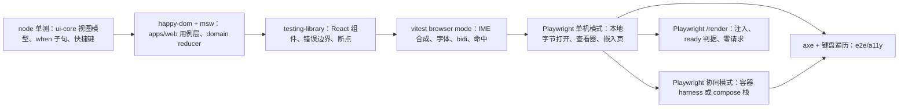
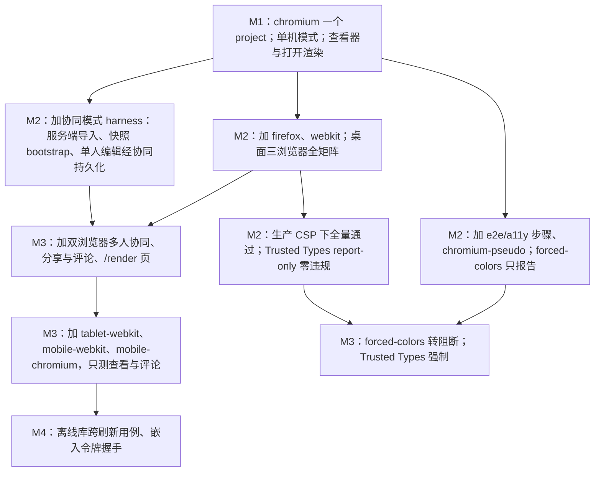
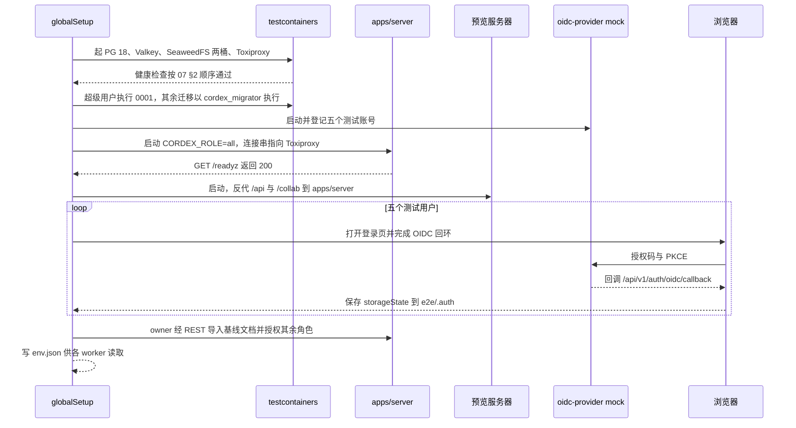
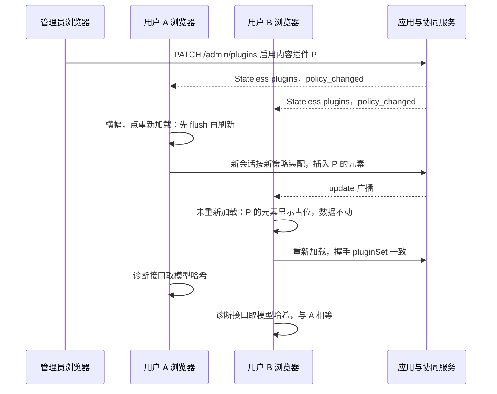
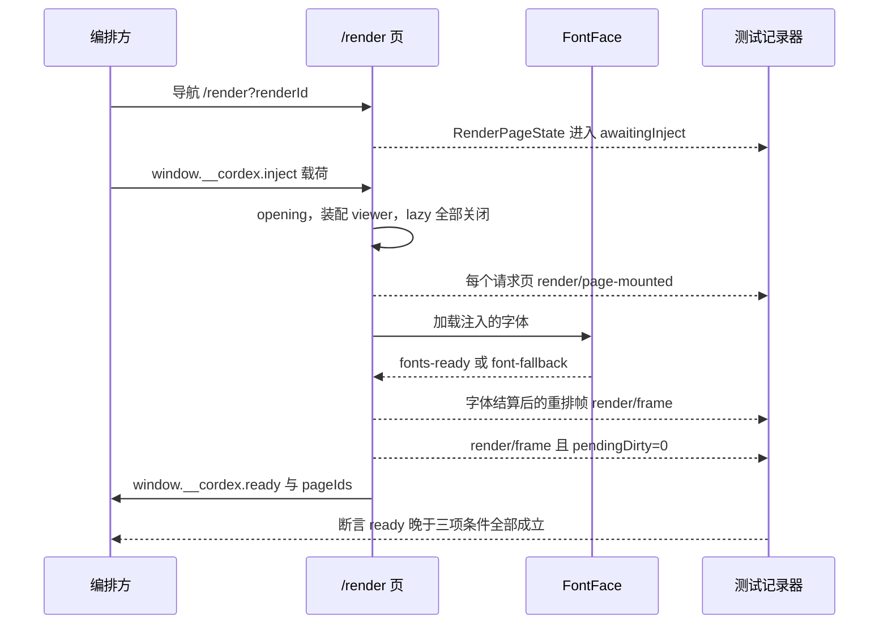

# 06 前端组件测试、浏览器 e2e 与可访问性
> 状态：v0.1 | 负责：测试设计线 | 更新：2026-09-25；2026-09-25（§4.19）；2026-09-25（§4.19 N1）；2026-09-26（§4.20）；2026-09-26（§4.20 FE-08）；2026-09-26（§4.21：插入交互 e2e——插入工具态、元素手柄、键盘等价、上传占位与失败重试）；2026-09-26（§4.21 整合：§2.2 补文本输入宿主一致、单击插入文本框不输入即退出、单元格导航、图片裁剪三路径等价；§5 第 2 行登记 ED-15a / ED-31–ED-35 与 @cap；新增第 27 行（符号面板、超链接激活白名单、编辑态临时播放）；§10.1 补 50/14 V2、V15 断言组）；2026-09-30（§4.22 设计待决收口：§5 第 26 行补插入落点 e2e（50/10 §12.1 V21，Q1）——插入页签插入表格、图表、图片先填空内容占位符，已选中的优先，图标与音视频不自动填入；§14 同步）；2026-10-01（§4.23 插件管理：§2.2 个人插件面板、管理员三态控件与缺插件横幅组件断言；§5 第 16 行改由策略停用，新增第 28–31 行（个人插件面板、缺插件横幅、管理员插件页与「插件设置已更新」横幅、协同一致性）；§7 a11y 矩阵加 `/admin/plugins` 与插件面板、键盘与读屏；图 6-5） | 依赖：rulings §4.22 Q1-insert-placement、rulings §4.21（R-d-62、R-d-66、R-d-72）、[50/10](../50-frontend/10-editor-shell-and-interaction.md) §7.4、§7.5、§10.4、§12.1 V21、[50/22](../50-frontend/22-elements-shapes-and-lines.md)、[50/05](../50-frontend/05-rendering-and-thumbnails.md) §8.3、设计 03-04 / 03-15 / 03-17、rulings §4.20 FE-02 / FE-05 / FE-06 / FE-07 / FE-16 / FE-18+TX-06 / FE-23、rulings §4.19 D-M2-CONTENT / INC-09、[01](./01-strategy-and-layers.md)、[30/11](../30-architecture/11-testing-strategy.md) §1 / §10 / §17、[40/10 §9](../40-modules/10-ui-shell-and-slide-ui.md)、[40/11 §9](../40-modules/11-preset-assembly-and-app-shell.md)、[40/06 §9.3](../40-modules/06-layout-and-render-engine.md)、[40/07 §9](../40-modules/07-slide-rendering.md)、PRD 04 NF-01 / NF-04–NF-07、PRD 05 M2 验收 1 / 6–9 / 11–13 与 M3 验收 5 / 13、[设计 07](../20-design/07-accessibility-and-i18n.md) §1 / §4 / §9、ADR-0017 / 0026 / 0028 / 0033、rulings §4.15 Q2、§4.16 Q20、§4.18 BE-01 / BE-04 / FE-09 / UX-02 / UX-11 / UX-19 / UX-20

本文是浏览器侧测试的唯一事实源：组件与单测层的约定、Playwright 工程（目录、projects、页面对象、登录复用、产物）、e2e 的两种编排模式、浏览器用例族、`/render` 页的测法、可访问性的唯一执行口径、国际化与 IME 的自动化、前端安全 e2e、资源断言，以及前端用例在 PR 冒烟子集与全量段之间的划分。

读者：`apps/web`、`ui-*`、`slide-ui`、`render-dom`、各 preset 的实现者；搭 Playwright 基础设施的工程师；CI 维护者。

边界：被测行为（路由、会话状态机、协同 UI 态、撤销提示、只读变体、`/render` ready 判据、CSP 正文）以 [50-frontend](../50-frontend/README.md) 为准，界面外观以 20-design 与 playground 为准；包内测试文件清单在 40 各模块 §9；服务端容器 harness 在 [07](./07-backend-integration-and-api-e2e.md) §2；安全威胁总表在 [10](./10-security-testing.md)；性能场景与判定在 [09](./09-performance-and-capacity.md)；画布保真与 UI 视觉基线在 [04](./04-visual-oracle.md)；CI 步骤名与冒烟清单以 [12](./12-ci-gates-mapping.md) 为准。文件命名与落点规则见 [01](./01-strategy-and-layers.md) §4，本文只做前端侧的细化。

---

## 1. 范围与边界

| 本文拥有 | 本文引用（不复述） |
|---|---|
| 前端测试层次、工具与环境选择的前端细则 | 环境选择总规则：[01](./01-strategy-and-layers.md) §3 |
| Playwright 工程：目录、projects、页面对象、`data-testid` 约定、`storageState`、重试与产物 | 冒烟清单与分片、重试与 flaky 治理：[12](./12-ci-gates-mapping.md) §4 / §8 / §11 |
| e2e 两种编排模式与 `TestEnv` 接口 | 容器 harness 本体：[07](./07-backend-integration-and-api-e2e.md) §2；compose 栈：[08](./08-deployment-and-environment-e2e.md) §3 |
| 浏览器用例族清单与断言要点 | 被测行为：[50/02](../50-frontend/02-app-shell-routing-and-session.md)、[50/04](../50-frontend/04-document-commands-and-undo.md)、[50/07](../50-frontend/07-collaboration-client.md)、[50/08](../50-frontend/08-comments-and-version-history.md)、[50/10](../50-frontend/10-editor-shell-and-interaction.md)、[50/11](../50-frontend/11-masters-layouts-and-themes.md)、[50/12](../50-frontend/12-viewer-embedding-and-render-page.md) |
| `/render` 页的网络计数与 ready 判据测法 | ready 判据定义：[50/12](../50-frontend/12-viewer-embedding-and-render-page.md) §11；renderer 零出站与签名 RPC：[10](./10-security-testing.md) §9 |
| 可访问性执行口径（axe、键盘、目标尺寸、焦点、媒体特性、屏幕阅读器清单格式） | 口径定义：PRD NF-05；键盘模型与语义：[50/16](../50-frontend/16-i18n-and-accessibility.md)；对比度静态门禁：`design/__tests__/contrast.test.ts`（40/10 §9） |
| 国际化与 IME 的自动化部分、真机手测清单格式 | 键集合一致性扫描：`scan-contributions` 规则 (f)（[50/15](../50-frontend/15-events-errors-and-telemetry.md) §4、[50/16](../50-frontend/16-i18n-and-accessibility.md)） |
| 前端安全 e2e 的执行方式 | CSP 正文与 nonce 链：[50/14](../50-frontend/14-client-security.md) §2–§4；威胁总表与时间线：[10](./10-security-testing.md) |
| 资源断言（堆、blob URL、effects、材质层） | 预算数值：PRD NF-01 §1.3 / §1.5 材质层；D50 / D200 内存预算判定：[09](./09-performance-and-capacity.md) |

本文只写「怎么测、放哪、何时跑」。每条用例都带需求标签（`@req PRD:<id>`、`@ruling <节>/<id>` 或 `@adr <编号>/<决策号>`，写法见 [13](./13-requirements-traceability.md) §1）。

---

## 2. 组件与单测层

### 2.1 工具与环境

| 被测对象 | 环境 | 工具 | 例子（文件清单以 40 §9 为准） |
|---|---|---|---|
| `ui-core` 视图模型、when 子句、快捷键解析、上下文键 | node（不渲染组件） | Vitest；fast-check 做往返性质 | `when-clause.test.ts`、`ribbon-model.test.ts`、`shortcuts.service.test.ts` |
| `apps/web` 的 domain 与 application 层 | happy-dom | msw + 假端口；DTO 取自 `@cordexjs/protocol/testing` | `session.usecase.test.ts`、`reauth-in-window.usecase.test.ts`、`import-pptx.usecase.test.ts` |
| React 组件（`ui-react`、`slide-ui`、`apps/web/pages`） | happy-dom | @testing-library/react + user-event；需要网络时加 msw | `editor-host.test.tsx`、`contribution-renderer.test.tsx`、`HomePage.test.tsx` |
| 依赖真实几何、字体、IME、观察器、Canvas 的用例 | vitest browser mode（Chromium） | 同上 + `mountTestSurface()`（render-dom/testing） | `render-dom` 的 `ime-composition`、`font-fallback`、`text-lines-bidi`、`hit-test` |

- **msw 不放过未登记请求**：`onUnhandledRequest: 'error'`，任何没有 handler 的请求让用例失败。handler 的响应体一律由 `@cordexjs/protocol/testing` 的 DTO 工厂生成并经 zod `parse`，错误响应一律是 problem+json（`errors/http-map.ts` 的映射），不手写 JSON 字面量。
- **计时**：`apps/web` 用例与组件内的去抖、节流优先经注入的 `Clock` 取时间并注入 `FixedClock`；`vi.useFakeTimers()` 只用于无法注入的第三方库内部定时器，且必须以 `toFake` 显式列出被伪造的 API、用例结束恢复真实计时器，不与 `FixedClock` 在同一用例混用；规则见 [11](./11-test-data-fixtures-and-determinism.md) §3。
- **查询方式**：组件用例优先 `getByRole` + 可访问名称（顺带验证 WCAG 4.1.2 名称 / 角色 / 值），其次 `getByLabelText`，最后 `getByTestId`；文案断言用 i18n 键在 `en-XA` 伪语言下的渲染结果，不写中文字面量（伪语言见 §8）。e2e 的选择器规则不同，见 §3.3。
- **卸载即干净**：挂载宿主的组件用例在 `afterEach` 卸载并调用 `assertNoLiveEffects`（kernel/testing）；涉及媒体的组件另断言 `URL.createObjectURL` 与 `revokeObjectURL` 次数相等（§11 的单测版）。

### 2.2 必须覆盖的组件级断言

| 断言 | 落点 | 出处 |
|---|---|---|
| 贡献项渲染抛错 → 该项显示占位、发出 `plugin/failed`，兄弟项与宿主不受影响 | `ui-react/__tests__/contribution-renderer.test.tsx` | 50/15 §5 错误边界拓扑；PRD NF-03「插件失败不影响其它功能」 |
| 路由级错误 → `AppErrorBoundary` 显示错误页，其余路由可导航 | `apps/web/src/__tests__/pages/*.test.tsx` | 50/15 §5 |
| `mode` 为 `view` 时无任何创建类控件（评论、高亮、插入），模式下拉只有「只读浏览」与放映 | `ui-react/__tests__/editor-host.test.tsx` | rulings §4.18 UX-19 |
| 三断点（1280 / 800 / 480）布局切换；< 640 仅查看提示 | `editor-shell.breakpoints.test.tsx` | PRD NF-07 屏幕行 |
| 会话：刷新 401 直接 `expired`、网络错误不改登录态、`csrf_rejected` 不跳登录；有 pending 时不跳转 | `session.usecase.test.ts`、`domain/session.test.ts` | rulings §4.18 UX-02；50/02 §4 |
| 新窗口重新登录：同一用户重连并保留队列；不同用户只读、不重放 | `reauth-in-window.usecase.test.ts` | UX-02；50/02 §5 |
| 导入两步：客户端从不提交对象键，只提交 `uploadId` | `import-pptx.usecase.test.ts` | rulings §4.18 BE-10 |
| REST 客户端：非安全方法带 `X-Cordex-Request: 1`；分享令牌头只随同一 `docId`；预签名直传 `PUT` 不带 `X-Cordex-*` 与 cookie | `infrastructure/http.test.ts` | 决策 INC-24、INC-25；50/02 §7 |
| 母版视图：切评审即退出并恢复会话记忆；降权不退出、保持只读母版态；缩窄不退出 | `slide-ui/__tests__/master-view.test.ts` | rulings §4.18 UX-20、UX-11 |
| 禁用而不隐藏：贡献条目的 `enablement` 为假或所需 `can.<capability>` 未授予时，控件留在原位、`aria-disabled="true"`、不从 DOM 移除，tooltip 与 `aria-describedby` 给出 `explainWhen` 的原因；`ui.shortcut` 的 `enablement` 为假时按键不执行命令；`can.*` 键集合等于 protocol `permissions/actions.ts` 能力位全集，权限变化后 ≤ 1 帧重算；slide-ui 的评论按钮 `when` 为 `slide.hasComments`，图表与全文命令用 `enablement`（`slide.hasChartEditor`、`unitLoaded`） | `ui-react/__tests__/ribbon-host.test.tsx`、`slide-ui/__tests__/ribbon-spec.test.ts`；`enablement` 子句语法、`can.<x>` 属于能力位、第三方不得登记 `can.` 前缀三条由扫描器 `scan-contributions` 规则 (e) 的负向夹具证明（TD-089） | rulings §4.20 FE-06、FE-11；PRD ED-30；50/09 §6、50/10 §2 |
| 尾部区常驻（FE-08）：编辑、评审（有 / 无条目）、只读浏览三种模式下，主题切换与「?」恰好各一个且都在 `[data-slot=ribbon-trailing]` 内，模式切换时横向位置不变；评审与只读浏览下没有「普通 \| 母版」视图分段；尾部区不是 `ui.toolbar` 条目、第三方贡献无法移除 | `ui-react/__tests__/ribbon-host.test.tsx`（[40/10 §9](../40-modules/10-ui-shell-and-slide-ui.md)、[50/10](../50-frontend/10-editor-shell-and-interaction.md) §12.1 V3） | rulings §4.20 FE-08；50/10 §1、§3.2 |
| 插入工具态（§4.21）：位移 ≤ 4 px 视为单击、按默认尺寸插入；拖出按矩形，`Shift` 锁比例、`Alt` 中心，线条 `Shift` 约束到 45° 倍数；`Esc`、切换页签、切页零命令；工具按钮与形状库条目上 `Enter` 插到视口中心、连续插入错位 0.2 in；插入后恰一个撤销步、选中新元素并进入对应子编辑态 | `slide-ui/__tests__/insert-tool.test.ts`（[40/10 §9](../40-modules/10-ui-shell-and-slide-ui.md)） | [50/10](../50-frontend/10-editor-shell-and-interaction.md) §7.4 V16；R-d-62 |
| 元素手柄（§4.21）：调整、端点、裁剪手柄拖动 N 帧只发一次对应命令；端点落在连接点（≤ 8 px）发 `slide.connectEnds`、否则 `slide.setLineEnds`；命中优先级端点 > 调整 > 旋转 > 缩放；锁定时对应手柄隐藏或显示锁形；形状库 72 项数据与缩略图生成物一致 | `slide-ui/__tests__/{handles,crop-mode,shape-gallery}.test.ts` | [50/10](../50-frontend/10-editor-shell-and-interaction.md) §7.5 V17；[50/22](../50-frontend/22-elements-shapes-and-lines.md) §8 V1、V4 |
| 文本输入宿主一致（2026-09-26 整合）：三个 `TextInputHost` 实现（`hidden-textarea`、`contenteditable-mirror`、`edit-context`）对同一段合成事件序列产出相同的编辑意图序列；`edit-context` 在不支持 EditContext 的环境中跳过 | `render-dom/__tests__/text-input-host.test.ts`（browser mode） | [50/06](../50-frontend/06-text-editing-and-ime.md) §1 |
| 单击插入的文本框不输入即退出：Store 无该形状、撤销栈长度不变（2026-09-26 整合） | `slide-ui/__tests__/insert-tool.test.ts` | [50/20](../50-frontend/20-elements-text.md) §2 |
| 表格单元格导航（2026-09-26 整合）：Tab / Shift+Tab 按行主序跳过被合并覆盖的格；M2 末格 Tab 不产生事务、光标留在末格并经 live region 播报「已是最后一个单元格」；方向键在首末行或首末字符处越界到相邻格；文本目标为 `{shapeId, cell:{rowId, colId}}` | `slide-ui/__tests__/text-editing.test.ts` | 50/06 §9.2；[50/24](../50-frontend/24-elements-tables-and-charts.md) §2.6 |
| 图片裁剪三路径等价（2026-09-26 整合，50/23 §2.3）：拖裁剪手柄、检查器数值输入、「填充 / 适合」三条路径得到相同 `sourceRect` 时，写出的 `slide.crop` 参数与撤销结果相同；每条路径确认时恰一次 `slide.crop`、一个撤销步 | `slide-ui/__tests__/crop.test.ts` | [50/23](../50-frontend/23-elements-media.md) §2.3 |
| 个人插件面板（2026-10-01，§4.23）：按 `GET /users/me/plugins` 夹具（msw）分三组「本部署统一启用 / 我的界面插件 / 本文档缺少的插件」，空分组连标题一起隐藏；内容级与强制启用项无开关、徽标「由管理员统一」；`optional` 项为 `role="switch"`，可访问名含「个人设置，只影响你」；没有任何 `optional` 项时显示「可选插件由管理员设置」；只读访问者无任何会写文档的动作；`FAILED` 行有「重试」，`incompatible` 与 `pending_dependency` 无「重试」；M2 构建下开关不渲染 | `apps/web/src/__tests__/pages/PluginManagerPage.test.tsx`（`pages/plugins/PluginManagerPage.tsx`） | PRD PM-10、PM-16；[50/03](../50-frontend/03-preset-assembly-and-plugins.md) §10 |
| 管理员三态控件（§4.23）：内容级插件只有「强制启用 / 禁用」两个 `radio`，「允许用户选择」不渲染为可选项并带 tooltip；内核必需与契约必需项、声明文件 `lockPolicy` 项为 `aria-disabled` 的锁定态、可聚焦并读出锁定原因；被拒三类（`rejected_unsigned`、`incompatible`、`invalid`）无控件、无重试；保存时组装的 `PATCH /admin/plugins` 请求体只含变更项并带 `If-Match`，412 时提示「设置已被他人修改」并重新拉取 | `apps/web/src/__tests__/pages/AdminPluginsPage.test.tsx`（`pages/admin/AdminPluginsPage.tsx`、`PluginChangeConfirm.tsx`） | PM-03、PM-06、PM-16 |
| 缺插件横幅（§4.23）：`comparePluginFootprint` 结果的四种 `reason`（`disabled`、`absent`、`outdated`、`failed`）各渲染对应文案（插件名或 `id`、所需版本与当前版本）；`role="status"`、不抢焦点；同一文档同一会话只出现一次；管理员多一个「去管理 › 插件」；查看器 preset 只渲染一行说明、无面板入口 | `apps/web/src/__tests__/pages/footprint-banner.test.tsx`（`pages/editor/footprint-banner.tsx`、`application/plugins/footprint-check.usecase.ts`） | PM-12、PM-16 |
| 每个 `user:true` 错误码渲染时取到 `errors.<code>.title` 与 `.action`，不显示原始码名 | `apps/web/src/__tests__/infrastructure/error-copy.test.ts`（msw 逐码返回 problem+json） | 决策 ERR-COPY |

**图 6-1 前端测试层次与工具**



怎么读：从左到右越来越接近真实浏览器与真实部署，也越来越慢；前四个方框属 `test/unit` 步骤（Vitest），后四个属 e2e job 的各步骤（Playwright）。箭头表示「上层默认下层已绿」，不是执行依赖。

依据：[01](./01-strategy-and-layers.md) §2–§3；30/11 §1（iso 用 node、dom 用 happy-dom、真实布局用 browser mode、不用 jsdom）。

---

## 3. Playwright 工程

### 3.1 目录

浏览器 e2e 只放 `apps/web/e2e/`（[01](./01-strategy-and-layers.md) §4 规则 3）；原 `packages/ui-react/src/__tests__/e2e/` 的三个 spec 迁入本目录：`styleguide.a11y.spec.ts` 落 `a11y/`（归 `e2e/a11y`），`editor.visual.spec.ts` 与 `perf.spec.ts` 落 `ui/`（后者的体积断言降为信息性，决策 T-BUNDLE）。

```text
apps/web/e2e/
├── playwright.config.ts           projects（§3.2）、reporter、重试与产物（§3.4）
├── global-setup.ts                选择 TestEnv、准备 storageState 与基线文档（§4）
├── global-teardown.ts             收集容器日志与 Playwright 产物
├── support/
│   ├── env/                       TestEnv 三种实现：standalone-env.ts、harness-env.ts、compose-env.ts
│   ├── fixtures.ts                test.extend：env、asUser(role)、twoBrowsers、networkRecorder、cspRecorder、axe
│   ├── preview-server.ts          静态包 + index.html 模板渲染 + 生产 CSP 头 + /api 与 /collab 反代（§4.1）
│   ├── api-stub.ts                单机模式的最小 /api 桩（§4.2）
│   ├── network-recorder.ts        请求白名单与计数（§10.2），自动启用
│   ├── csp-recorder.ts            securitypolicyviolation 与 /telemetry/csp 报告收集（§10.1），自动启用
│   ├── render-harness.ts          /render 注入载荷构造与请求计数（§6）
│   ├── keyboard-walker.ts         焦点遍历、陷阱探测、目标尺寸与焦点遮挡检查（§7）
│   ├── ime.ts                     CDP Input.imeSetComposition 封装（§9）
│   └── heap.ts                    CDP 堆、DOM 计数、blob URL 计数（§11）
├── page-objects/                  每个界面一个类，只用 data-testid（§3.3）
├── open/ shell/ auth/ share/ editing/ plugins/ viewer/ collab/ comments/ history/ embed/ render/
├── security/ i18n/ ime/ resources/ ui/
└── a11y/                          → e2e/a11y 步骤
```

### 3.2 projects 与里程碑

| project | 浏览器与视口 | 启用 | 跑哪些 spec |
|---|---|---|---|
| `chromium` | Desktop Chrome，1440 × 900，`locale: 'zh-CN'`，`timezoneId: 'UTC'` | M1 | 全部 |
| `firefox` | Desktop Firefox，同上 | M2 | 除 `ime/`、`render/`、`resources/` 外全部（CDP 专属能力只在 Chromium） |
| `webkit` | Desktop Safari，同上 | M2 | 同 `firefox` |
| `chromium-pseudo` | Chromium，`locale` 分别为 `en-XA` 与 `ar-XB` 两个伪语言 | M2 | `i18n/` 与 `shell/`、编辑器主界面的布局用例（§8） |
| `chromium-forced-colors` | Chromium，`forcedColors: 'active'` | M2 报告、M3 阻断 | `a11y/forced-colors.spec.ts` 与关键控件截图 |
| `tablet-webkit` | iPad 视口，WebKit | M3 | 只读评审：`viewer/`、`comments/` 中标 `@mobile` 的用例 |
| `mobile-webkit`、`mobile-chromium` | iPhone、Pixel 视口 | M3 | 查看与评论：同上 |

全部 project 的共同设置：`bypassCSP: false`（显式写出，生产 CSP 必须生效）、`serviceWorkers: 'block'`（M1–M4 不引入 Service Worker，决策 VERSION-DRIFT-SW）、`acceptDownloads: true`、`reducedMotion` 默认 `no-preference`（§7.5 单独切换）。

**图 6-2 Playwright projects 与里程碑**



怎么读：自上而下是里程碑推进，每个方框写该里程碑新增的 project 或用例范围；箭头表示在前者基础上叠加，已启用的 project 不会在后续里程碑撤掉。协同模式用例自 M2 起运行（rulings §4.19 D-M2-CONTENT：M2 起服务端文档以协同快照为唯一事实源），M3 加入的是多人协同体验层。

依据：PRD 04 NF-07（M1 Chrome / Edge，M2 Firefox 与 Safari 全矩阵，M3 平板只读评审、手机查看与评论）；PRD 04 NF-01 §1.5 材质层（forced-colors M3 门禁上线，rulings §4.12 U-08）；rulings §4.15 Q2（Trusted Types M2 report-only → M3 强制）、§4.16 Q20。

### 3.3 页面对象与选择器

- **只用 `data-testid`**：spec 与页面对象里只出现 `getByTestId`，不用文案、CSS 类名或 DOM 结构选择器（文案随语言变、类名随 shadcn 升级变）。`a11y/` 与 `i18n/` 下的用例例外：它们本来就要按角色、名称与文案检查。约束由 ESLint 对 `apps/web/e2e/**`（除上述两个目录）的 `no-restricted-syntax` 执行：`getByText`、`locator('text=…')`、`locator('css=…')` 与以 `.` 或 `#` 开头的选择器报错（`lint` job）。
- **命名**：`<区域>.<部件>[.<变体>]`，如 `ribbon.tab.insert`、`thumbnail-rail.item`、`banner.unsaved`、`share.link.copy`。由 ui 包在组件上稳定提供；页面对象是某个界面全部 testid 的唯一登记处。
- **页面对象只表达用户动作与可观察状态**：`editor.insertShape('rect')`、`editor.statusPill()`；不暴露内部模型。需要读模型状态的断言走 §3.5 的诊断接口。
- **页面对象不含断言**：断言写在 spec 里，页面对象返回 locator 或值。

### 3.4 登录复用、重试与产物

- **`storageState` 复用**：`global-setup.ts` 以 mock OIDC 为 §4.3 的每个测试用户完成一次真实登录回环，把 cookie 存为 `e2e/.auth/<user>.json`；用例经 `asUser('owner' | 'editor' | 'commenter' | 'viewer' | 'outsider')` 选用。会话 cookie 15 min 过期后由 `cordex_refresh` 续期（决策 SESSION），跑满一轮不需重新登录；专测登录回环的 `auth/` 用例从空状态开始，不用 `storageState`。
- **超时**：单用例 60 s，`expect` 10 s；协同与导入用例 120 s。等待只用 web-first 断言与事件，不写固定 `waitForTimeout`（lint 规则同上）。
- **重试**：本地 0 次；CI 1 次，重试后通过的用例标记 flaky（决策 T-CI；连续 3 次 flaky 自动建 issue 由 [12](./12-ci-gates-mapping.md) §11 执行）。浏览器 e2e 里没有「gated 不重试」类步骤：`csp-strict` 等浏览器冒烟条目按普通 e2e 重试一次；`/render` 两种模式零请求的冒烟在服务端 `renderer-egress`，属不重试的门禁判定类（12 §11）。
- **产物**：`trace: 'retain-on-failure'`、`video: 'retain-on-failure'`、`screenshot: 'only-on-failure'`；另存 network-recorder 与 csp-recorder 的 JSON、axe 报告（HTML + JSON）、协同模式的容器日志。保留期与上传方式以 [12](./12-ci-gates-mapping.md) §10 为准。

### 3.5 被测构建与诊断接口

- e2e 一律跑 `apps/web` 的**生产构建**（`vite build`），不跑 dev server：dev 与生产的 CSP、分包与 `auth.mode` 口径不同（[50/14](../50-frontend/14-client-security.md) §2.5）。
- 需要读取内部状态的断言（IME 期间有无 Store 写入、事务计数、`fiber.getEffects()`、`render/frame` 的 `pendingDirty`）经两条只读通道：① telemetry Provider 在测试模式下写入的 `performance.mark` 事件轨迹（30/11 §9；mark 命名以 [50/13](../50-frontend/13-performance-and-bundling.md) §2.2 为准）；② 开发者诊断接口 `diagnostics.dump()`（[50/15](../50-frontend/15-events-errors-and-telemetry.md) §10）。二者由 RuntimeConfig 的测试开关 `diagnostics.e2eTrace` 打开（字段在 [50/02](../50-frontend/02-app-shell-routing-and-session.md) §3、用途在 50/15 §10；部署侧为 web 容器变量 `CORDEX_WEB_DIAGNOSTICS_E2E_TRACE`，只有 `CORDEX_WEB_ENV=test` 的 e2e 预览服务器与测试 compose 栈可设为真，生产部署配置拒绝其为真，[60/17](../60-backend/17-deployment-and-config.md) §5.15），与 `auth.mode: 'none'` 同类约束。

---

## 4. e2e 编排：两种模式与 `TestEnv`

用例不直接依赖某个环境，只依赖 `TestEnv` 接口；同一个 spec 在 PR 上跑容器 harness，在 main 全量段跑 compose 栈（§12）。

| 成员 | 含义 | standalone | harness | compose |
|---|---|---|---|---|
| `baseURL` | 被测页面的源 | 预览服务器 | 预览服务器（反代到 apps/server） | web 容器 `https://app.<测试域>` |
| `users` | owner / editor / commenter / viewer / outsider 五个账号与各自 `storageState` | 桩账号 | oidc-provider mock 账号 | Casdoor 种子账号 |
| `createDocument(user, fixture)` | 以该用户身份经公开 API 导入或新建文档 | 不支持（改走本地打开） | ✓ | ✓ |
| `grant(doc, user, role)`、`createShareLink(doc, role, ttl)` | 经公开 REST 授权与建链接 | — | ✓ | ✓ |
| `revokeSessions(user)` | 吊销该用户全部会话但不停用账号（模拟登录过期，之后可重新登录） | — | 经 `user:{userId}:sessions` 索引删除其全部 `session:{sid}` 键（模板以 [60/14](../60-backend/14-valkey-object-storage-and-retention.md) 为准） | 同左，经 `docker compose exec valkey` |
| `faults.pg(down \| up)`、`faults.valkey(down \| up)` | 依赖故障注入 | — | Toxiproxy 断开（[07](./07-backend-integration-and-api-e2e.md) §2） | `docker compose pause` / `unpause` |

- **种子只走公开 API 与 IdP 账号**，两种服务端环境同一代码路径；直接写库的种子构建器（[11](./11-test-data-fixtures-and-determinism.md) §6）只给 [07](./07-backend-integration-and-api-e2e.md) 的服务端集成用。
- **浏览器 e2e 不控制服务端时钟**：需要到期的用例以短有效期创建（如分享链接 5 s 后到期、会话由 `revokeSessions` 直接吊销）；精确计时的断言放在 07（服务端 `CLOCK` 覆盖为 `FixedClock`）与 [05](./05-collab-simulation-and-property-tests.md)（客户端 `FixedClock`），规则见 [11](./11-test-data-fixtures-and-determinism.md) §3。客户端计时（30 s 离线、2 s 去抖）用 Playwright `page.clock` 快进。

### 4.1 预览服务器

`support/preview-server.ts` 在 standalone 与 harness 两种模式下替身 web 容器（compose 模式直接用真实 web 容器，二者差异由 [08](./08-deployment-and-environment-e2e.md) §4 与全量段兜底）：

- 从 `apps/web/dist` 提供静态文件；`index.html` 按 web 容器同一模板渲染：启动时把 RuntimeConfig 写入 `<script type="application/json" id="cordex-runtime-config">` 数据块，每个 HTML 响应生成新的 128 bit nonce 替换占位符 `__CSP_NONCE__`（[60/17](../60-backend/17-deployment-and-config.md) §3.2–§3.3；决策 CSP-NONCE、RUNTIME-CONFIG）。
- 按 [50/14](../50-frontend/14-client-security.md) §2.2 模板下发 CSP、CSP-Report-Only（M2）与 §2.6 的其余安全头；`index.html` 为 `no-store`，`/assets/*` 为 `immutable`。
- harness 模式把 `/api/*` 与 `/collab/*`（含 WS 升级）反代到 apps/server，`/internal/*`、`/metrics`、`/healthz`、`/readyz` 返回 404（与 web 容器相同分流，60/17 §3.1）。
- 以运行时生成的自签证书提供 HTTPS，使 `Secure` cookie 的行为与生产一致；harness 模式下 Playwright 设 `ignoreHTTPSErrors: true`，compose 模式改用测试 CA（08 §3）。

### 4.2 单机模式（standalone）

无服务端：preset 为 `preset-slide`（`store-memory`），文档从本地字节打开（`/import` 的本地打开，经 `setInputFiles` 选 `fixtures/pptx/*`；M1 的 `/documents/local:sample`）。`support/api-stub.ts` 以 `page.route('**/api/v1/**')` 只应答壳页面必需的最小集合（`/auth/me`、`/auth/config`、`/documents` 列表），响应体同样出自 protocol/testing 工厂并经 zod 校验；其余 `/api` 请求一律 `abort` 并让用例失败，防止单机用例意外依赖服务端。用于：M1 打开与渲染、查看器、SDK 嵌入测试页（`preset-slide` + `store-memory`，EM-02）、`/render` local 模式、国际化与 IME；M1 期间的编辑类开发用例。

**M2 起参考应用的编辑 e2e 走协同路径**（PRD 05 M2 验收 15、§0.3「装配」行）：`e2e:editing` 与导出族（§5 第 2、3 行，含冒烟 #3）在协同模式 harness 下运行——参考应用以 `preset-slide-collab`（不含 `comments`）+ 网关打开由服务端导入建档的文档，每条用例结束时断言状态胶囊为「已同步」、全部 pending 获 db 确认。standalone 只保留 SDK 嵌入形态的编辑用例。另以 `preset-slide-collab` 的 `store-yjs` 本地变体（无服务端）把编辑族重跑一次，作为 `pluggable:m3`「M2 全部编辑 e2e 在 store-yjs 下重跑通过」的证据（M3 出口判定）；切换方式与白名单断言归 [02](./02-contract-suites-and-pluggability.md) §10。

### 4.3 协同模式（harness 与 compose）

harness 模式复用 [07](./07-backend-integration-and-api-e2e.md) §2 的容器 harness（同一套镜像、同一迁移与健康检查顺序），只多起一个预览服务器。测试用户固定五个：`owner`、`editor`、`commenter`、`viewer`（直接授权为查看者）、`outsider`（已登录但对基线文档无授权，用于分享链接与越权用例）。

**图 6-3 e2e 全局准备（harness 模式）**



怎么读：自上而下是时间顺序；先起依赖、迁移、再起服务端与预览服务器，然后为每个测试用户做一次真实登录回环并保存 `storageState`，最后经公开 API 准备基线文档。compose 模式把前五步换成 `docker compose up --wait`（08 §3），其余相同。

依据：30/11 §10（apps/server + testcontainers + mock OIDC + apps/web 预览构建）；rulings §4.15 Q6（PR 层 Casdoor 容器 + oidc-provider mock）、Q10（PG 18 / Valkey / SeaweedFS）；决策 T-CI、T-IDP。

`login-casdoor` 用例（§5 表第 9 行）在 harness 模式下另起 Casdoor 容器，按 [08](./08-deployment-and-environment-e2e.md) §7 的种子方式初始化；其余用例只用 oidc-provider mock。

---

## 5. 用例族

每行一个 spec 目录或文件；「冒烟」列写 [12](./12-ci-gates-mapping.md) §4 的条目号，标 ✓ 的用例带 Playwright 标签 `@smoke`（`@smoke` 集合必须等于 12 §4 的浏览器条目，由 `test/conventions` 核对；二者不一致时以 12 为准）；「模式」列：S = 单机、C = 协同。

| # | 用例族（文件） | 断言要点 | 模式 | 里程碑 | 冒烟 | 依据 |
|---|---|---|---|---|---|---|
| 1 | 打开与渲染（`open/open-render.spec.ts`、`shell/home-to-editor.spec.ts`、`editing/open-*.spec.ts`） | 开始页 → 本地打开 D50 夹具 → 首批装载后可选中编辑（`unit/opened`）→ 返回开始页；`unit/loaded` 之前全文命令（全选、查找替换、导出、跨页重排）禁用或等待；`.ppt`、加密、损坏、超限、宏五类文件显示对应错误文案 | S | M1 | #1 ✓ | PRD OF-01 / OF-03；rulings §4.18 CO-12；[03](./03-fidelity-roundtrip-and-corpus.md) §7 P7、§8 |
| 2 | 编辑与撤销 `e2e:editing`（`editing/edit-undo-export.spec.ts`、`editing/ed-<编号>-*.spec.ts`） | 每条 P0 / P1 ED 需求 ≥ 1 个用例，文件名带需求编号、JSDoc 带 `@req PRD:ED-xx`（编号含 PRD 02 本轮新增的 ED-15a、ED-31、ED-32、ED-33、ED-35，如 `editing/ed-15a-*.spec.ts`，[13](./13-requirements-traceability.md) §5a 据此追溯；§4.21 起新写的用例在 `@req` 之外另写 `@cap <能力编号>`，能力编号取 [50/18](../50-frontend/18-editor-capabilities.md) 能力表）；撤销 / 重做走快捷键与 Ribbon 两条路径；放映（ED-21）含黑屏 / 白屏按同键、点击或翻页键只恢复当前页、Esc 直接退出；命令不可用时提示原因；M2 起在协同路径上运行（§4.2），用例结束时全部 pending 获 db 确认 | C（SDK 嵌入变体为 S） | M2 | #3 ✓（插入文本框、键入、撤销重做、导出） | PRD 05 M2 验收 1；rulings §4.18 UX-07 |
| 3 | 导出（`editing/export-*.spec.ts`） | 下载 pptx → 用 Node 编解码按 [03](./03-fidelity-roundtrip-and-corpus.md) §4.2 判定零编辑一致（服务端文档以 import 快照的基线包为基线，03 §10）；编辑后导出只改脏部件；协同中导出的「等待同步」停在该态显示「正在同步 N 项…」、归零自动生成（M2），离线时按钮禁用（M3） | S / C | M2 / M3 | pptx 随 #3 ✓ | PRD OF-18；rulings §4.18 UX-05 |
| 4 | 查看器 `preset-slide-viewer`（`viewer/viewer-readonly.spec.ts`、`viewer/viewer.spec.ts`） | `/documents/:id/view`：翻页、缩放、全屏、缩略图与备注开关、< 640 折叠、加载与失败态；只读两道保证在 e2e 侧的表现（无编辑入口、快捷键无效） | S | M1 | #2 ✓ | [50/12](../50-frontend/12-viewer-embedding-and-render-page.md) §2–§4；ADR-0015 |
| 5 | 查看者 = 编辑器只读变体（`collab/viewer-variant.spec.ts`） | `viewer` 打开 `/documents/:id` 得 `mode='view'`：无评论 / 高亮等创建类按钮，模式下拉只有「只读浏览」与放映；实时看到他人修改与在场；计入查看者名额；该页出站 WebSocket 帧中 SYNC 只有 step1、没有 update 与 step2（服务端不向只读会话发 step1，60/16 §6；经 `page.on('websocket')` 解码帧类型统计） | C | M3 | M3 起并入 #2 ✓ | rulings §4.18 UX-19；[50/12](../50-frontend/12-viewer-embedding-and-render-page.md) §12 |
| 6 | 母版视图与版式（`editing/master-view.spec.ts`、`editing/layout-apply.spec.ts`） | 入口可见性：评审与放映模式无「视图」页签、`Mod+Alt+M` 无效；无 `doc.write` 或视口 < 1024 时按钮禁用带 tooltip；进入后切评审即退出并回到原页、原缩放、原滚动；降权不退出、编辑类禁用；进入 / 退出无历史项；换版式为一个事务，toast 撤销一步回原版式 | S / C | M2 | — | PRD 05 M2 验收 9 / 10；rulings §4.18 UX-11、UX-20 |
| 7 | `shell:home`（`shell/home.spec.ts`） | 四态各 ≥ 1 例：已登录默认、加载骨架、最近为空、离线；空白 / 模板 / 导入三类入口分别进入编辑器或导入流程（空白与模板由前端取内置模板字节走两步服务端导入生成 import 快照后进入编辑器，网络记录断言经 `POST /imports/uploads` → `POST /imports` → `GET /jobs/:id`）；列表卡片封面为导入处理器写的 embedded `__cover`，空白文档为占位；离线时三类入口禁用且 tooltip 正确、已缓存的最近文档可打开 | S / C | M2 | — | PRD 05 M2 验收 11；AS-01 / AS-02 |
| 8 | `shell:account-menu`（`shell/account-menu.spec.ts`） | 开始页侧栏、文档列表、编辑器应用栏三处打开同一 `UserMenu`；设置（`Mod+,`）、快捷键（`Mod+/`）、帮助、退出登录各一例；设置抽屉只有账户菜单一个入口（遍历可点击元素的 testid 断言）；快捷键面板三个入口可达 | S / C | M2 | — | PRD 05 M2 验收 12；AS-06 |
| 9 | 登录与会话（`auth/login-oidc-mock.spec.ts`、`auth/login-casdoor.spec.ts`、`auth/logout.spec.ts`） | mock IdP 与 Casdoor 两条 OIDC 回环 → `/home`；`selfSignup` 关时登录页无注册入口、开时出现；登出后本人 IndexedDB 分区、离线库与全部 `cordex.share.*` 为空（按 [50/02](../50-frontend/02-app-shell-routing-and-session.md) §10 清理矩阵逐键断言），其它标签页同步回到登录页；有未同步更改时登出前先出现导出提示；离线登出后恢复联网，第一条请求是补发的 `POST /auth/logout`、之后 `/auth/me` 为 401；`/login?next=//evil.example` 登录后落 `/home` | C | M2 | #9、#10 ✓（两条登录） | rulings §4.15 Q6；决策 INC-18；50/02 §4、§10 |
| 10 | 重新登录弹窗（`auth/reauth-popup.spec.ts`） | 编辑中 `revokeSessions(user)` → 横幅「登录已过期」不可关闭、队列保留、页面不跳转；点「重新登录」打开弹窗（`mode=popup`）→ `/auth/popup-callback` → `BroadcastChannel cordex-auth` 通知原页 → 同一用户重连并清空队列；以另一账号登录回来 → 只读、不重放、提供导出本地副本；弹窗被拦截时退化为新标签链接 | C | M2 / M3 | — | rulings §4.18 UX-02；50/02 §5 |
| 11 | 分享链接落地（`share/share-link-landing.spec.ts`） | 未登录打开 `/documents/{id}#share={token}` → 登录页（`selfSignup` 关时提示联系管理员）→ OIDC 往返 → 回到文档并按链接角色打开；加载后地址栏无片段、sessionStorage 有 `cordex.share.{docId}`；network-recorder 断言令牌只出现在该文档请求与 collab-ticket 请求的 `X-Cordex-Share-Token` 头中，任何 URL、query 与 `Referer` 都不含令牌；撤销或到期的链接 → 「链接已失效」且令牌被删除；另有直接授权时无提示；新标签页不继承令牌 | C | M3 | #7 ✓ | 决策 INC-25、INC-20；rulings §4.18 BE-02 / BE-05 |
| 12 | 双浏览器协同（`collab/collab-two-browsers.spec.ts` 及同目录分场景文件） | 两个浏览器上下文、两个用户：在场头像与远端光标；编辑互见；`context.setOffline` → 重连中 → `page.clock` 快进 30 s 进入离线 → 恢复后同步并回到已同步；owner 降权另一方 → 只读降级横幅；他人后写同键后撤销 → 跳过提示条 → 「恢复我的值」生成新事务且可撤销；对方删除后撤销 → 整步跳过 → 「恢复元素」以原 id 恢复；owner「彻底删除元素」后「恢复元素」禁用并提示「该内容已被彻底删除」（术语按 rulings §4.18 CO-07）；`faults.pg(down)` 后 B 持续编辑 → B（有本地未获 db 确认项的发起方）出现横幅「未保存到服务器 N 项」，A（无本地未确认项）只在状态胶囊出现弱提示「服务器保存延迟」、无横幅，`faults.pg(up)` 后两者消失（rulings §4.19 INC-09）；A 放映期间 B 的编辑实时出现在放映画面，放映界面没有暂停远端更新的开关（rulings §4.20 FE-02） | C | M3 | #8 ✓（在场、编辑传播、断网重连、降权横幅、撤销跳过提示） | PRD CO-01 / CO-05 / CO-08；rulings §4.15 Q3、§4.18 CO-07 / CO-08 / UX-03；决策 RESTORE-CMD |
| 13 | 离线恢复（`collab/offline.spec.ts`） | 断网编辑 → 恢复后另一浏览器看到全部更改；M3 内存队列：有 pending 时刷新触发 `beforeunload` 提示；被降权后「未同步更改」可导出（`collab:rejected-rollback` 的界面部分）；M4：断网编辑 → reload → 上线 → 另一浏览器看到（离线库）；同一用户第二个标签页提示「另一个标签页正在保存离线更改」 | C | M3 / M4 | — | ADR-0033「如何被机械验证」；PRD 05 M3 验收 5 / 13；决策 OFFLINE-TABS |
| 14 | 评论（`comments/*.spec.ts`） | commenter 可建线程与回复、不可编辑或删除他人的，只能解决自己创建的线程，editor 可解决任何线程；删除锚点形状 → 线程进「已分离」；删除方撤销或「恢复元素」→ 线程回原锚点；@提及候选在 IME 组合未结束前不刷新过滤；四个筛选；另一浏览器 ≤ 1 s 看到更新（`CONTROL.event` 触发）；查看者只读；深链 `?comment=` 定位线程 | C | M3 | — | ADR-0031；[50/08](../50-frontend/08-comments-and-version-history.md) §5–§8 |
| 15 | 版本历史（`history/*.spec.ts`） | 无 `history.read` 时 `/documents/:id/history` 无入口且直达返回无权页；命名版本需 `doc.manage`；恢复只对有 `history.restore` 的角色可用，恢复后协作者不断连且实时看到结果，恢复进行中协作者画布不转只读、不出现「文档正忙」（恢复不加锁，rulings §4.19 N1）；预览不影响当前会话与 awareness，离开历史页后预览 Unit 已 dispose（`diagnostics.dump()` 的 effects 为空）；版本说明与贡献者显示 | C | M3 | — | [50/08](../50-frontend/08-comments-and-version-history.md) §9–§10；能力位以 protocol `permissions/actions.ts` 为准 |
| 16 | 插件启停（`plugins/plugin-toggle.spec.ts`、`plugins/plugin-qr-shape.spec.ts`） | `examples/plugin-qr-shape`：插入二维码元素、渲染、导出（图片回退 + `extLst`）、撤销；该插件是内容级（贡献 `slide.shapeKind`），停用只能经部署策略（rulings §4.23，个人面板不提供开关）：以策略夹具（`GET /users/me/plugins` 不含该插件，S 模式由 `TestEnv` 注入）重新打开后 Ribbon 按钮消失、带该插件 owner 标记的 DOM 节点数为 0 | S | M2 | #4 ✓（启停与无残留 DOM） | PRD 05 M2 可插拔证据 `pluggable:m2`；PRD PM-03 |
| 17 | `embed:multi`（`embed/multi.spec.ts`） | 同页 4 个编辑器实例；快捷键按焦点分派到对应实例；逐个销毁后无残留 DOM、`diagnostics.dump()` 的 effects 为空 | S | M2 | — | PRD 05 M2 验收 7 |
| 18 | `embed:framework-free`（`embed/vanilla.spec.ts`） | `examples/embed-vanilla` 以 `UiRenderer('vanilla')` 渲染 Ribbon 并完成一次编辑与撤销；该页加载的 chunk 不属于构建 manifest 中含 react / radix 的 chunk 集合 | S | M2 | — | PRD 05 M2 验收 13；rulings §4.15 Q2 |
| 19 | 深链与路由（`shell/deep-link.spec.ts`） | `/documents/:id?page=<slideId>&comment=<threadId>` 打开到该页与该线程；放映深链同名参数 `page`；`/d/<id>` 为不存在页 | S / C | M2 / M3 | — | 决策 INC-35 |
| 20 | 版本漂移（`shell/version-drift.spec.ts`） | 拦截一个惰性 chunk 返回 404 → 横幅「发现新版本」、编辑器不崩溃、元素保持占位；本文件以 `test.use({ serviceWorkers: 'allow' })` 覆盖 §3.2 的 `block`，断言整轮导航后 `context.serviceWorkers()` 为空、`navigator.serviceWorker.getRegistrations()` 返回空数组（否则 `block` 会掩盖意外注册） | S | M2 | — | 决策 VERSION-DRIFT-SW；50/02 §12；50/13 §14 |
| 21 | 服务端导入（`shell/import.spec.ts`） | 上传中（确定态进度 + 取消）→ 服务端解析（不确定态 + 取消）→ 打开编辑器；取消后回到列表、不留卡片；确定性错误只给「返回列表」，瞬时错误给「重试」；覆盖导入（带 `docId`）期间已打开该文档的编辑器收到锁定提示（状态胶囊「文档正忙」）、写入暂停；导入完成后会话以 4428 断开并自动重新载入新纪元的快照，横幅「文档已替换为导入的文件」，锁定前未获 db 确认的更改可从「未同步更改」导出；导入失败或取消时解锁、恢复可写且内容不变 | C | M2 | — | rulings §4.18 UX-14、BE-10；§4.19 D-M2-CONTENT、N1 |
| 22 | 服务端文档的单人协同编辑（`collab/single-user-persist.spec.ts`） | 打开服务端文档 = `GET snapshots/latest`（记下 `X-Cordex-Epoch`）+ `POST collab-ticket` + WS，网络记录中无任何 pptx 字节下载与内容版本请求；编辑 → 状态胶囊经「同步中」到「已保存」（全部获 db ack）→ 重新加载后内容保持；有在途未确认项时离开触发 `beforeunload`、归零后不触发（离开保护只看协同在途与离线队列）；`faults.pg(down)` 期间继续编辑 → 发起方横幅「未保存到服务器 N 项」，同一用户的第二个标签页（无本地未确认项）只在状态胶囊见「服务器保存延迟」，`faults.pg(up)` 后二者消失且重新加载内容完整 | C | M2 | — | rulings §4.19 D-M2-CONTENT、INC-09；50/07 |
| 23 | 永久删除文档（`shell/purge.spec.ts`） | 回收站中永久删除 → 列表消失；另一浏览器中正在编辑的协作者被关闭并看到「文档已被永久删除」 | C | M3 | — | rulings §4.18 BE-15 / CO-07；决策 INC-22 |
| 24 | 创建副本（`shell/duplicate.spec.ts`） | 应用栏「⋯」→「创建副本」→ `POST /documents/:id/duplicate`（带 `Idempotency-Key`，同一键重放不产生第二份）→ 轮询 `GET /jobs/:id` → 导航到新文档，并以 `snapshots/latest` + 票据 + WS 打开（网络记录中无 pptx 字节上传与下载）；原文档内容不变 | C | M2 | — | rulings §4.10 Q20、§4.19 D-M2-CONTENT；[50/02](../50-frontend/02-app-shell-routing-and-session.md) §13.1；[60/15](../60-backend/15-rest-api-catalog.md) §3.3 |
| 25 | 删除被引用的版式与母版、应用主题（`editing/master-layout-delete.spec.ts`、`editing/theme-apply.spec.ts`） | 删除被引用的版式：`AlertDialog` 显示引用页数、初始焦点在「取消」、文案不含「操作不可撤销」；确认后出现带「撤销」的 Toast，点「撤销」或 `Mod+Z` 一步恢复各页版式与被删版式（同一 id）；删除被引用的母版：对话框文案为「N 个页面将改用剩余母版中对应的版式」、不出现母版选择器，确认后各页版式 `type` 在目标母版有同类版式时不变，Toast 撤销同样一步恢复；应用主题（主题卡、变体色块、主题面板「应用」）不弹确认框、直接执行并出 Toast「已应用主题『X』，影响 N 页 [撤销]」（N 为该母版引用页数），撤销后主题与 12 个色槽恢复原值。命令层与协同层的确定性断言在 [05 §7.1](./05-collab-simulation-and-property-tests.md) | S / C | M3 | — | rulings §4.20 FE-05、FE-23、FE-07；[50/11](../50-frontend/11-masters-layouts-and-themes.md) §9–§10；PRD 07 ML-03 / ML-04 |
| 26 | 插入交互（`editing/insert-tools.spec.ts`、`editing/element-handles.spec.ts`、`editing/insert-upload.spec.ts`；§4.21） | **插入工具态**（[50/10](../50-frontend/10-editor-shell-and-interaction.md) §7.4）：插入页签七组次序与设计 03-04 一致；点形状库条目后画布光标为十字、按钮 `aria-pressed`；单击插入 1 in × 1 in、左上角在点击处；拖出按矩形，`Shift` 锁 1:1、`Alt` 中心；线条拖出 `Shift` 约束到 45° 倍数；`Esc` 取消、网络记录与撤销栈均无新增；插入后新元素被选中，文本框进入编辑、动作按钮弹出「操作设置」，`Mod+Z` 一次撤回插入。**插入落点**（50/10 §7.4、§12.1 V21，rulings §4.22 Q1）：在有两个空内容占位符的夹具页（「两栏内容」版式）上，从插入页签插入表格（网格与「插入表格…」对话框两条路径）、图片、图表（M3），新元素占据阅读序第一个空占位符的框；经 §3.5 诊断接口断言该次事务是 `slide.fillPlaceholder`、新元素保留原占位符的 `type` 与 `idx`，被填占位符的图标条消失；先选中第二个空占位符再插入，填入的是被选中的那个；页上没有空内容占位符时，按默认落点居中于视口；图标（M3 P2）与音视频（P2）不按阅读序自动填入，页上只有未选中的空占位符时仍居中于视口、占位符保持为空（沿用 §7.4 原规则）；每次插入都能 `Mod+Z` 一次撤回，占位符恢复为空并重新出现图标条。**元素手柄**（§7.5）：拖黄色调整手柄改圆角矩形圆角，一次撤销还原；拖线条端点改方向；端点拖到矩形连接点出现高亮并连接，再移动矩形时直线连接符跟随（M2）、肘形连接符重算路径（M3）；端点拖离即断开；图片裁剪模式拖裁剪手柄改变取景，`Esc` 退出不回滚。**键盘等价**（WCAG 2.5.7）：只用键盘在形状库条目上按 `Enter` 插入到视口中心，再经检查器「位置与大小」「形状」调整值与连接符「连接到…」完成与拖动相同的结果；曲线绘制工具作为登记例外只断言替代路径存在。**上传占位与失败重试**（[50/05](../50-frontend/05-rendering-and-thumbnails.md) §8.3、设计 03-04）：选择图片后画布先出现临时占位、插入不等上传；拦截 `PUT` 预签名 URL 返回 500 → 按 1 s、2 s、4 s 重试三次后形状显示「上传失败 · 重试」徽标且插入不回滚；点「重试」且放行后徽标消失；「移除」即删除该图片、可撤销；超过 `maxBytes` 或类型不在白名单的文件在插入前被拒并出 Toast；协同模式下另一浏览器在 commit 前显示加载占位、commit 后显示图片 | S / C | M2（肘形重算、图表填入 M3；图标与音视频的落点断言随各自条目启用） | — | PRD ED-05、ED-07、ED-10、ED-28、ED-29；R-d-62、R-d-66；rulings §4.22 Q1；50/10 §12.1 V21；[50/22](../50-frontend/22-elements-shapes-and-lines.md) §8 |
| 27 | 元素插入补充（`editing/symbol-panel.spec.ts`、`editing/hyperlink-activate.spec.ts`、`editing/media-playback.spec.ts`；2026-09-26 整合） | **符号面板**（[50/20](../50-frontend/20-elements-text.md) §6）：方向键、`Home` / `End`、`PageUp` / `PageDown` 移动，`Enter` 插入且面板保持打开、可连续插入，`Esc` 关闭并把焦点还给文本宿主、原选区不变；**超链接激活白名单**（50/20 §4、PRD ED-19）：编辑态 `Mod`+点击只打开 `http(s)`（新标签页，`noopener,noreferrer`）与页内跳转，`mailto:` / `tel:` 不激活、小卡显示目标与「复制」，`javascript:` 等协议在写入时即被拒；放映态按同一白名单激活；**编辑态临时播放**（[50/23](../50-frontend/23-elements-media.md) §7.2）：播放、暂停、拖进度都不写 Store（网络记录无 update、撤销栈不变），离开选中或切页即停止 | S | M2（符号面板 M3 P2、临时播放 P1，随各自条目启用） | — | 50/20 §4、§6；50/23 §7.2 |
| 28 | 个人插件面板 `plugins:diagnose`（`plugins/personal-panel.spec.ts`；2026-10-01，§4.23） | 四个入口（应用栏「⋯ › 插件管理器」、状态栏插件图标、快捷键面板冲突条目「查看插件管理器」、缺插件横幅「查看详情」）打开同一面板；状态栏图标在有失败时带角标并预筛选「启动失败」；以 `TestEnv` 注入激活时抛错的测试插件 → 面板「启动失败」行显示错误码、版本、traceId，「复制诊断信息」写入剪贴板，「重试」成功后该行移入运行中（本会话 `fiber.restart()`，网络记录无任何策略写请求）；等待依赖与版本不兼容行无「重试」。**M3 个人启停**：管理员把某界面级插件设为 `optional` 后，普通用户在「我的界面插件」关闭它 → 当前会话即时卸载（其 Ribbon 与状态栏贡献消失、owner 标记节点数为 0，无需刷新）、网络记录恰一次 `PUT /users/me/plugins/:pluginId`；刷新与换一个浏览器上下文登录同一账号后仍为关闭（服务端按账号保存）；再打开即时装配；管理员改为 `forced` 后该开关变为只读、插件重新出现，改回 `optional` 后恢复用户原选择；快捷键冲突一方为 `optional` 时面板高亮行提供「为我关闭」 | S / C | M2（只读、诊断、重试、冲突跳转）/ M3（个人启停、为我关闭） | — | PRD PM-08、PM-10、PM-11；PRD 05 M2 验收 19、M3 验收 20；rulings §4.23 O-1、O-2 |
| 29 | 缺插件降级与横幅（`plugins/missing-plugin.spec.ts`；§4.23） | 以带 `plugin-qr-shape` 足迹的夹具文档打开，四种情况各一例：管理员已停用 → 横幅「本文档用到了『二维码形状』，管理员已停用该插件：N 处内容以占位显示，内容已保留」；本部署未声明 → 横幅写插件 `id` 与「≥ 所需版本」；版本过旧 → 「需要 ≥ x，当前 y」；已启用但本会话启动失败 → 「插件『X』未能启动」并链到个人插件面板。四种情况下元素以占位显示、可选中、移动、删除但不可进入内部编辑；编辑其它元素后导出，占位元素原数据与足迹字节不变（按 [03](./03-fidelity-roundtrip-and-corpus.md) §4.2 规范化比对）；横幅每文档每会话一次；「查看详情」打开「本文档缺少的插件」分组并列出受影响的页；管理员打开时多一个「去管理 › 插件」；查看器 `/documents/:id/view` 只显示占位与一行说明 | S / C | M2（未安装、版本过旧、启动失败）/ M3（区分管理员已停用） | — | PRD PM-12；PRD 05 M2 验收 19；OF-13；rulings §4.23 O-3 |
| 30 | 管理员插件页 `plugins:admin`（`admin/plugins.spec.ts`；§4.23） | 管理员经账户菜单「管理」进入 `/admin/plugins`；普通用户直访 → 回开始页并 toast「需要管理员权限」；列表每行图标、名称、`id`、版本、来源、作用域徽标、必需性、三态控件、部署级状态、近 24 h 失败会话数；按状态分组筛选与名称 / `id` 搜索；内容级只有两态、必需项锁定；禁用被依赖者 → 确认卡列出将进入等待依赖的插件；启用缺依赖者 → 「一并启用」；互斥两项不能同时启用、保存按钮禁用并说明冲突对象；第三方首次启用 → 确认卡列出贡献与能力声明并写明「同源可信、无运行时沙箱」（M4）；一次保存多项变更合并为一张确认卡，失败时不部分生效；详情「最近 5 次策略变更」与审计一致。**生效时机**（O-1）：另一浏览器中已打开文档的会话 ≤ 60 s 出现非阻断横幅「管理员更新了插件设置，重新加载后生效」，编辑不中断；点「重新加载」先把未确认更改 flush（网络记录中 pending 归零后才导航）再刷新，刷新后按新策略装配；保存后新打开的会话直接按新策略装配 | C | M3（第三方确认卡 M4） | — | PRD PM-01、PM-03、PM-06–PM-08；PRD 05 M3 验收 20；rulings §4.23 裁决 1、O-1、O-4 |
| 31 | 协同一致性 `plugins:consistency`（`collab/plugins-consistency.spec.ts`；§4.23） | A、B 同一 Room：管理员启用内容插件 P → A 重新加载后插入 P 的元素 → B（未重新加载）见占位、B 的编辑不改动该元素数据；B 重新加载后正常显示；两端经 §3.5 诊断接口取模型哈希一致；界面级测试插件经命令执行写操作 → 被拒、Store 无事务、诊断事件 `plugin/scope-violation`；重新部署使内容插件版本变化（harness 替换声明文件并重启应用）→ 旧会话重连收到 4426（`collab.plugins_outdated`）→ 走版本漂移横幅，先 flush 再刷新，刷新前本地新写入不被服务端接受 | C | M3 | — | PRD PM-13；PRD 05 M3 验收 21；rulings §4.23 裁决 3、O-1 |

**图 6-5 插件管理的 e2e 覆盖（第 28–31 行）**



怎么读：纵线是三个浏览器与服务端，自上而下是第 30、31 行的执行顺序；管理员保存只触发横幅，不强制任何会话刷新，过渡期由 B 的占位与数据保留兜底，最后以两端模型哈希相等收尾。
依据：PRD 09 PM-08、PM-13 与图 3-2；rulings §4.23 O-1（已确认）。

撤销与协同语义的**确定性**覆盖不在浏览器里做：撤销五用例与 `history-commands` 分节在 [02](./02-contract-suites-and-pluggability.md) §4，软冲突 12 场景与离线计时在 [05](./05-collab-simulation-and-property-tests.md) §6 / §9；本节第 12–13 行只验证这些语义在真实界面上的表达（提示条、按钮、横幅）。

**「未保存到服务器」的受众**（rulings §4.19 INC-09 定稿）：有本地未获 db 确认项的发起方显示横幅「未保存到服务器 N 项」；其余协作者只在状态胶囊显示弱提示「服务器保存延迟」、不出横幅。第 22 行（M2，同一用户的两个标签页）同时断言两类受众（PRD 05 M2 验收 17），第 12 行（M3，双浏览器、两个用户）在多人场景下回归；判据三分支（`room.persist`、spill 确认、`unsavedWarnAfterMs`）的确定性覆盖在 [05](./05-collab-simulation-and-property-tests.md) §9 `rs/unsaved-indicator`。

---

## 6. `/render` 页

被测定义：`RenderPageState`、`window.__cordex.inject / ready / error`、ready 判据（FE-09 唯一源）与 `/render` 的 CSP 变体，见 [50/12](../50-frontend/12-viewer-embedding-and-render-page.md) §11 与 [50/14](../50-frontend/14-client-security.md) §2.3。renderer 容器的零出站、签名 RPC 与沙箱不在本节，见 [10](./10-security-testing.md) §9。

### 6.1 两种注入模式

| 模式 | 编排方 | 静态包来源 | 请求计数方式 | 文件与步骤 |
|---|---|---|---|---|
| local | 测试进程内的 Playwright：`page.goto('/render?renderId=…')` 后 `page.evaluate(p => window.__cordex.inject(p), payload)` | `context.route` 从 `apps/web/dist` 直接供给文档与 `/assets/*`，不经任何网络 | 见 §6.2 | `apps/web/e2e/render/render-page.spec.ts`（R1–R7，全量段）；两种模式「请求数为 0」的冒烟由服务端 `renderer-egress`（12 §4 #12）承担 |
| remote | 测试进程扮演 worker：用测试 Ed25519 私钥签名（决策 SG-01）后 `POST /render` 到 renderer 容器 | renderer 镜像内置（固定内部源 `https://render.invalid`，经 `context.route` 从镜像文件应答） | RPC 响应 `result.blockedRequests`：被 `route` 拦下的清单外请求数（[60/06](../60-backend/06-modules-jobs-import-export-thumbnails.md) §10.4，protocol `render/sidecar.ts`）；另断言各页 `status = 'ok'` | `apps/server/test/e2e/smoke/renderer-egress.e2e-spec.ts` 中的页面级断言（[10](./10-security-testing.md) SEC-RS-01），→ `e2e/smoke` |

注入载荷由 `support/render-harness.ts` 从 `fixtures/pptx` 夹具构造：state 字节、字体与媒体注入清单、页集合，类型取 protocol `render/page.ts` 的 `RenderStateResponse`，不手写。

### 6.2 网络请求计数口径

- 计数窗口：从导航开始到 `ready` 或 `error` 信号为止。
- 不计入：`/render` 文档本身与静态包文件（local 模式由 `context.route` 从磁盘供给；remote 模式来自镜像内置文件）。
- 计入（每条计 1，且使用例失败）：其余任何请求，含 fetch、XHR、WebSocket、EventSource、`sendBeacon`、图片 / 媒体 / 字体 / 样式子资源、Worker 与其内部请求；`data:` 与 `blob:` URL 不是网络请求，不计。
- 双通道：`context.route('**/*')` 对静态包之外的请求一律 `abort` 并计数；CDP `Network.requestWillBeSent` 在页面与每个 Worker 目标上计数；两个计数都为 0 才通过。另外断言该页 `securitypolicyviolation` 事件为 0（`/render` 变体 `connect-src 'none'`，任何请求企图都会先被 CSP 拦下并留下违规记录）。
- 判定：两种模式的计数都为 0（rulings §4.18 BE-04）。

### 6.3 ready 判据与超时

**图 6-4 `/render` 页 ready 判据**



怎么读：自上而下是时间顺序。测试记录器经 `page.addInitScript` 注入，读取 §3.5 的 `performance.mark` 事件轨迹，记下每个事件的时间戳；最后一步断言 `ready` 的时间戳晚于「全部请求页已挂载」「字体全部结算」「此后出现一次 `pendingDirty=0` 的帧」三者中最晚的一个。

依据：rulings §4.18 FE-09、BE-04；ADR-0026 决策 6 与「如何被机械验证」；决策 INC-08（`render/frame` 为进程内事件，`pendingDirty` 字段属它，`perf/frame` 是遥测事件，二者并存）。

| # | 用例 | 断言 |
|---|---|---|
| R1 | 字体晚到 | `addInitScript` 把 `FontFace.prototype.load` 延迟 500 ms：`ready` 晚于字体结算后的重排帧，且截图与字体到齐后的参考截图像素一致 |
| R2 | 惰性加载关闭 | 含图表与多语言夹具：注入后不再加载任何 chunk（§6.2 计数已覆盖），图表已渲染 |
| R3 | 无字体需加载 | 视为已结算，`ready` 只等挂载与空帧 |
| R4 | 注入等待超时 | 不调用 `inject`，`page.clock` 快进过页面常量（默认 60 s）→ `error` 信号带注入超时码（码名以 50/12 §11 为准），注入超时计数 +1，每页渲染超时计数不变 |
| R5 | 每页 10 s 渲染超时 | 注入完成后由编排方逐页计时（60/06 §10.5），在 [07](./07-backend-integration-and-api-e2e.md) §11.3 的缩略图管线中以 `FixedClock` 驱动；本节只断言页面侧不把它计为注入超时 |
| R6 | 非法查询参数 | `renderId` 缺失或 `deviceScaleFactor` 越界 → `error('render.bad_query')`，无请求 |
| R7 | 与客户端截图一致 | 同一夹具在 `/render` 与编辑器画布的截图对比交给 [04](./04-visual-oracle.md)（像素差 ≤ 0.5%，ADR-0026） |

---

## 7. 可访问性（唯一执行口径）

口径来自 PRD NF-05（WCAG 2.2 AA，M2 必达键盘可达 + 基本朗读，其余分阶段，rulings §4.16 Q20）；键盘模型与语义以 [50/16](../50-frontend/16-i18n-and-accessibility.md) 为准。全部用例放 `apps/web/e2e/a11y/`，归 `e2e/a11y` 步骤，M2 起每个 PR 运行并阻断。

### 7.1 axe 扫描

- 工具：`@axe-core/playwright`，规则标签 `wcag2a`、`wcag2aa`、`wcag21a`、`wcag21aa`、`wcag22aa`。
- 判定：`impact` 为 `critical` 或 `serious`（严重 / 重大）的违规数为 0；`moderate` / `minor` 与 `incomplete`（如玻璃面板上无法计算对比度）只进报告。对比度的阻断口径由 `design/__tests__/contrast.test.ts` 的静态配对校验承担（40/10 §9），axe 的 `color-contrast` 作为第二道。
- 例外：只能登记在 `apps/web/e2e/a11y/allowlist.json`，每条带 `{rule, target, issue, expires, reason}`，`expires` 距提交 ≤ 30 天，与 [01](./01-strategy-and-layers.md) §10 的临时降级同一口径；过期即失败。
- 亮、暗两个主题各扫一遍。

### 7.2 路由 × 状态矩阵

矩阵文件 `apps/web/e2e/a11y/matrix.ts`：行 = 路由（取自 `apps/web` `domain/routes.ts` 导出的路由表，[50/02](../50-frontend/02-app-shell-routing-and-session.md) §2 的代码形态），列 = 该路由下需要进入的状态。每个格子是一次「进入状态 → axe 扫描 → 键盘冒烟（§7.3 的 F6 循环与 Esc 归还）」。

| 路由 | 状态（每个都扫） |
|---|---|
| `/home` | 已登录默认、加载骨架、最近为空、离线 |
| `/documents` | 列表、空列表、筛选中、回收站 |
| `/documents/:id`（编辑） | 每个 Ribbon 页签；每个检查器页签；每个对话框（导出、分享、插入图片、快捷键面板、命令面板）；设置抽屉；右键菜单；母版视图；放映；评论面板；只读降级横幅；登录已过期横幅；个人插件面板（三分组展开、失败详情展开）；缺插件横幅；「插件设置已更新」横幅（2026-10-01，§4.23） |
| `/admin/plugins`（2026-10-01，§4.23，M3） | 列表、按状态筛选、详情展开、确认卡（禁用被依赖者、多项合并）、加载骨架、整区错误态、「允许未签名」警示条（非生产） |
| `/documents/:id`（查看者变体、评审模式） | 默认、评论面板、模式下拉展开 |
| `/documents/:id/history` | 列表、预览、恢复确认 |
| `/documents/:id/view` | 默认、缩略图开、备注开、失败态、< 640 折叠 |
| `/import` | 上传中、解析中、确定性错误、瞬时错误 |
| `/settings`、`/login` | 默认；`/login` 另测 `selfSignup` 开与关 |
| `/embed/:id` | 默认（M3 P2） |
| `/styleguide` | 全部组件状态（40/10 §9 的视觉与 a11y 基准路由） |

完整性断言：路由表中每一条路由都在矩阵中出现，否则 `matrix.completeness.spec.ts` 失败；对话框与面板的列表取自 UI 贡献登记（Ribbon 页签、检查器页签、对话框 id），新增一个未进矩阵即失败。`/render`、`/auth/callback`、`/auth/popup-callback` 不是可交互页面，登记为豁免行并写理由。

### 7.3 键盘 e2e

| 区域 | 断言（每条一个用例） |
|---|---|
| F6 循环 | `F6` 依次经过 Ribbon → 缩略图栏 → 画布 → 属性面板 → 备注 → 状态栏 → 回到 Ribbon；`Shift+F6` 反向，`Ctrl+F6` 备用键同序；折叠或缺席的区域被跳过（顺序以 50/16 §6.1 为准）；「跳至画布」Skip Link 送达画布 |
| Ribbon | 单一 Tab 停靠点；方向键在按钮间移动；`Enter` / `Space` 激活；`↓` 展开 flyout；页签为 `tablist`，`Home` / `End` 可用 |
| 缩略图栏 | `↑` / `↓` 移动并同步画布；`Mod+Shift+↑/↓` 重排 |
| 画布 | `Tab` 按 z 序循环选中对象；方向键 1 px、`Shift+方向键` 10 px 微调；`Enter` 进入文本编辑；`Esc` 逐级：文本编辑 → 选中子元素 → 选中组合 → 取消选择 →（母版视图中且无选区）退出母版视图 |
| 属性面板与备注 | `Tab` 顺序遍历字段；分区标题 `Enter` / `Space` 折叠；备注中 `Esc` 回到区域级焦点 |
| 拖拽的键盘等价（WCAG 2.5.7） | [设计 07](../20-design/07-accessibility-and-i18n.md) §1.2a 表逐行一例：移动、缩放、裁剪、表格行高列宽、缩略图重排、文件导入的非拖拽路径；2026-09-26 补（§4.21）：插入工具在按钮或形状库条目上 `Enter` 插到视口中心、调整手柄的数值输入、线条端点经「位置与大小」与翻转、连接符的「连接到…」选择器；曲线绘制工具是登记的例外，只断言「从预设形状开始」的替代路径可达（[50/22](../50-frontend/22-elements-shapes-and-lines.md) §5） |
| 插件管理（2026-10-01，§4.23，PM-16） | 管理员页：三态为 `radiogroup`，方向键在三项间移动、锁定项可聚焦并读出锁定原因；只用键盘完成一次「禁用被依赖者 → 确认卡 → 保存」（确认卡打开时焦点落在首个操作、`Esc` 取消、关闭后焦点回到触发控件）；个人面板：`Tab` 到开关、`Space` 切换，「重试」「为我关闭」可达；保存成功、重试成功、依赖恢复经 `aria-live="polite"` 播报 |
| 无键盘陷阱（2.1.2） | `keyboard-walker` 从每个区域起按 `Tab` 200 次：焦点必须离开该区域并到达至少一个其它 landmark；每个浮层（菜单、对话框、Popover、命令面板）按 `Esc` 关闭且焦点回到打开它的元素，触发元素已被移除时回落到其所在区域；路由切换后焦点落在页面主标题（50/16 V8） |

依据：PRD NF-05「每个页面 / 面板有键盘 e2e」与 ED-29；[设计 07](../20-design/07-accessibility-and-i18n.md) §1；rulings §4.18 UX-06。

### 7.4 目标尺寸、焦点可见与不被遮挡

- **目标尺寸 24 px（2.5.8）**：枚举可见的可交互元素（`button`、`link`、`menuitem`、`tab`、`checkbox`、`radio`、`switch`、`option`、带 `tabindex` 的元素），包围盒 ≥ 24 × 24 CSS px，或满足 WCAG 间距例外（以目标中心为圆心、直径 24 px 的圆不与其它目标及其圆相交）；紧凑密度同样执行；M3 起移动 project 按 44 px。
- **焦点可见（2.4.7）**：对每个 Tab 停靠点，聚焦后计算样式存在可见指示（`outline-width > 0` 或焦点环 token 对应的 `box-shadow`），焦点环与相邻背景对比 ≥ 3:1。
- **焦点不被遮挡（2.4.11）**：聚焦元素中心点的 `elementFromPoint` 返回该元素或其后代，不被固定或粘性浮层整体盖住。

### 7.5 媒体特性与退化

| 特性 | 设置方式 | 断言 | 里程碑 |
|---|---|---|---|
| `forced-colors: active` | project `chromium-forced-colors` | axe 通过；关键控件（按钮、输入框、选中框、焦点环）轮廓可见；截图基线 | M2 报告，M3 阻断（NF-01 §1.5 材质层，rulings §4.12 U-08） |
| `prefers-reduced-motion: reduce` | `page.emulateMedia({ reducedMotion: 'reduce' })` | UI 过渡与动画时长为 0（`document.getAnimations()` 中 UI 动画全部结束或不存在）；无每秒 3 次以上闪烁 | M2 |
| `prefers-reduced-transparency: reduce` | CDP `Emulation.setEmulatedMedia` 的 features | 玻璃面板退化为不透明 `--card`，文字对比不变（断言细则见 §11） | M2 |
| 200% 缩放与重排（1.4.4 / 1.4.10） | 视口宽 640 CSS px 近似 1280 宽度下的 200% 缩放 | 抽屉化后全部 Ribbon 命令仍可达（经溢出菜单） | M2 |

### 7.6 状态消息与画布可访问树

- **`aria-live`（4.1.3）**：保存、同步状态、协作者加入、软冲突提示写入 `aria-live="polite"` 区域；在第 12 行双浏览器用例中断言事件发生后该区域文本更新。
- **画布可访问树**（决策 A11Y-TREE）：当前页的 `role="document"` 有序列表包含该页全部元素（含视口外、被虚拟化裁剪的元素），每项有类型与名称；切换阅读顺序（z 序 / 占位符顺序）后列表顺序随之变化；缺失替代文本的图片出现提示。

### 7.7 屏幕阅读器（人工）

矩阵 NVDA + Chrome、VoiceOver + Safari（M2），JAWS + Edge（P1，M3）。证据按 [01](./01-strategy-and-layers.md) §8 放 `test/evidence/<里程碑>/a11y-screen-reader-<组合>.md`，文件头字段同 01 §8，正文为下表（场景 × 期望朗读 × 结果 × 备注）：

| 场景 | 期望 |
|---|---|
| 打开文档 | 朗读文档标题与当前页号 |
| Ribbon 导航 | 朗读页签名、按钮名与状态（按下 / 展开） |
| 读取幻灯片内容 | 按阅读顺序朗读元素类型与名称 |
| 编辑文本 | 进入与退出编辑时朗读状态变化 |
| 协作者加入 | `aria-live` 朗读「X 加入」 |
| 评论 | 朗读线程锚点与回复数 |
| 插件管理（§4.23） | 个人面板开关读出「个人设置，只影响你」与开关状态；管理员页锁定项读出锁定原因；缺插件横幅以 `role=status` 朗读、不打断当前朗读 |

矩阵中标 `manual` 并单独统计（[13](./13-requirements-traceability.md) §8）。

---

## 8. 国际化

| 断言 | 方式 | 执行点 | 依据 |
|---|---|---|---|
| 各 locale 键集合一致；`protocol` 中 `user:true` 的错误码在 zh-CN 与 en-US 都有 `errors.<code>.title` 与 `.action` | 扫描器子规则 | `scanners/scan-contributions`（规则 f） | 决策 ERR-COPY；rulings §4.18 GV-15 |
| 错误提示取到的是文案而非码名 | §2.2 最后一行的组件用例 | `test/unit` | ERR-COPY |
| 伪本地化 ×1.5 不破版 | `chromium-pseudo` 的 `en-XA`（由 zh-CN / en-US 源在构建期生成：长度 ×1.5、加变音符与括号标记）：有文字的元素 `scrollWidth ≤ clientWidth + 1`，除非带省略号与 tooltip 标记；Ribbon 控件包围盒两两不重叠；页面上不出现缺键标记 | `i18n/pseudo-*.spec.ts`，e2e 全量段 | PRD NF-06 |
| RTL 伪语言不破版 | 同上，`ar-XB`（从右到左的伪语言）；只断言不重叠、不溢出与不缺键，UI 镜像是 M4（P2） | 同上 | NF-06 |
| 语言包切换 ≤ 200 ms | 场景 `locale-switch`：切换语言到新文案渲染完成的 `performance.mark` 对；测量与判定按 [09](./09-performance-and-capacity.md) §8 / §10，gate 取 NF-06 | `perf/perf-client` | NF-06 |
| 无 host 页面与编辑器语言一致 | 在开始页切 en-US → 打开文档 → 编辑器为 en-US，且语言包只加载一次 | `i18n/nohost-handoff.spec.ts` | 决策 NOHOST-I18N |
| 缺 key 运行时回退 zh-CN 并上报 | 单测 | `test/unit` | NF-06 |

---

## 9. IME

被测机制：隐藏 textarea 承接输入 + 自绘插入符（ADR-0028），IME 规则见 [设计 07](../20-design/07-accessibility-and-i18n.md) §4 与 [50/06](../50-frontend/06-text-editing-and-ime.md)。

### 9.1 自动化部分

| 层 | 输入方式 | 覆盖 |
|---|---|---|
| vitest browser mode（`render-dom/__tests__/ime-composition.test.ts`） | 合成 `compositionstart` / `compositionupdate` / `compositionend` 事件序列 | 组合期间 Store 零写入、`compositionend` 恰一次事务；`beforeinput insertText` 每字一次事务且被合并为一个撤销步（ADR-0028） |
| Playwright Chromium（`ime/*.spec.ts`） | CDP `Input.imeSetComposition` 逐步更新组合串，`Input.insertText` 提交 | 真实浏览器事件链上的同一组断言 |
| Playwright WebKit（`ime/*.spec.ts` 的 WebKit 分支） | 在隐藏 textarea 上派发合成的 `CompositionEvent` 与 `InputEvent`（WebKit 无 IME 协议，属近似） | 同上；真实 Safari 行为以 §9.2 手测为准 |

场景矩阵：中文拼音（多次 update 后提交）、日文（假名 → 汉字转换，update 替换整段）、韩文（每个字母更新组合、下一字符到来时提交）× Chrome、Safari（WebKit 近似）。每个场景断言：

1. 组合期间 Store 事务计数不变（§3.5 诊断接口），`compositionend` 后恰 +1；
2. 隐藏 textarea 的位置与插入符矩形偏差 ≤ 4 CSS px（候选框定位的前提）；
3. 组合中按 `Esc` 只取消组合、不退出文本编辑；
4. 组合中按 `Enter` 不提交命令面板、不触发全局快捷键；
5. `@提及` 候选在组合结束前不重新过滤；
6. 键入延迟与 IME 组合更新延迟的数值由 [09](./09-performance-and-capacity.md) 的 `type-latency` 与 `ime-latency` 场景判定（NF-01 §1.2），本节不测时间。

### 9.2 真机手测清单格式

文件 `test/evidence/<里程碑>/ime-<系统>-<浏览器>.md`，文件头同 [01](./01-strategy-and-layers.md) §8，正文表格：

| 输入法 | 场景 | 期望 | 结果 | 截图 |
|---|---|---|---|---|
| 系统拼音 / 微软拼音 | 连续输入两句、中途改候选 | 候选框贴合插入符、不被浮层遮挡；提交后一次撤销撤回整句 | pass / fail | 链接 |
| 日文 IME | 转换、再转换、部分确定 | 同上 | | |
| 韩文 IME | 连续音节、退格拆字 | 同上；退格只删最后一个字母 | | |
| 任一 | 在评论输入框中输入并 `@` 提及 | 候选不打架 | | |

平台：macOS（Safari、Chrome）、Windows（Chrome、Edge）；M3 起加 iPadOS Safari（评论输入）。M2 出口一次（R-M2-1 IME spike 之后），此后每个里程碑出口一次。

---

## 10. 前端安全 e2e

与 [10](./10-security-testing.md) 的分工：10 持有威胁 → 测试总表、SEC id 与报告 / 阻断时间线；本节写浏览器侧用例的执行方式，10 的对应行链接到这里，不重复描述。测试标题以 SEC id 开头（10 §0）：§10.1 → SEC-CL-01、CL-02、CT-05；§10.2 → SEC-CL-03；§10.3 → SEC-XS-01、XS-04、CL-04、CL-06；§5 第 9、11 行 → SEC-CL-07、XS-03；§6 → SEC-RS-01（页面级）。

### 10.1 `csp:strict` 与 Trusted Types

- **全部 e2e 在生产 CSP 下运行**（§4.1 预览服务器与 compose 的 web 容器都下发生产头；`bypassCSP: false`），这本身就是 PRD 05 M2 验收 8「编辑器全部 e2e 在 `script-src 'self'` + nonce 下通过」的执行方式。另有专项 `security/csp-strict.spec.ts`（`@smoke`）：按 50/14 V2 逐一进入 `/home`、`/documents`、`/documents/:id`（编辑、评审、查看者变体）、`/documents/:id/view`、`/styleguide` 的全部面板与状态，断言 `script-src` / `style-src` / `img-src` / `connect-src` / `worker-src` 违规为 0。
- **违规收集**（`support/csp-recorder.ts`，自动启用）：`addInitScript` 登记 `securitypolicyviolation` 监听；`page.route` 截获发往 `/api/v1/telemetry/csp` 的报告。任一用例结束时强制头与 Report-Only 头的违规都必须为 0。重点页面（`/styleguide`、`/documents/:id` 编辑与查看者变体、放映、全部对话框）的 `style-src` 违规为 0，用于兜住遗漏的运行时样式注入点（[50/14](../50-frontend/14-client-security.md) §3 第 6 条）。
- **nonce 在浏览器侧的消费**：同一页面两次导航得到的 `<meta name="cordex-nonce">` 值不同，且与该响应 CSP 头中的 nonce 相同；每响应生成与缓存头的服务端断言在 [08](./08-deployment-and-environment-e2e.md) §4。
- **Trusted Types**（策略口径按 rulings §4.20 FE-18+TX-06：`trusted-types cordex-default default`，名为 `default` 的策略只对登记的两段 Radix 固定样式文本逐字放行，其余 `createHTML` 一律返回 `null`；[50/14](../50-frontend/14-client-security.md) §4）：M2 以 Report-Only 运行全量 e2e，TT 违规报告为 0；M3 起强制。负向用例 `page.evaluate` 对普通元素执行 `el.innerHTML = '<b>x</b>'`——这段文本未登记，被 `default` 策略拒绝：M2 产生一条 TT 报告（证明 report-only 与 `default` 策略都在工作），M3 起抛 `TypeError`（证明强制生效）；另对 `<style>` 元素赋入「登记常量末尾多一个空格」的文本，结果同上（证明是逐字比对，不是前缀或包含）。
- **第三方运行时样式零违规**（FE-18+TX-06；`security/csp-strict.spec.ts` 追加段）：依次触发 Toast（sonner：样式改为静态引入 `sonner/dist/styles.css`，`import` 时的运行时注入经 pnpm patch 删除）、滚动检查器的 ScrollArea、展开 Select、拖拽 react-resizable-panels 分栏（4.x 用 `adoptedStyleSheets`，不经 `style-src`）之后，TT 违规与 `style-src` 违规都为 0；Toast 容器与 ScrollArea 视口的计算样式（登记属性：定位、尺寸、`z-index`、滚动条宽度与隐藏方式等，清单与基线值在 `apps/web/e2e/security/fixtures/third-party-styles.json`）与基线逐项相同——零违规不能靠「注入被拦只产生报告、外观不变」的退路换来。依赖升级时由同一用例复核。
- **§4.21 新依赖与字符串求值**（2026-09-26 整合，[50/14](../50-frontend/14-client-security.md) §13 V2、V15；`security/csp-strict.spec.ts` 追加段）：V2 组——打开颜色选择器与渐变编辑器（react-colorful 经 patch 后，色盘计算样式与基线一致）、缩略图栏滚动与拖拽重排、表单对话框、首次粘贴 HTML（htmlparser2 惰性 chunk）、插入图标面板（预览只经 ``）全程零违规；V15 组——zod 首次解析不产生 `script-src` 违规（组合根已设 `jitless`）；默认部署的策略不含 `'wasm-unsafe-eval'`，启用复杂文种 shaping 的变体策略含 `'wasm-unsafe-eval'`、不含 `'unsafe-eval'`（M4 变体随 RTL 立项启用，此前只断言默认策略）。
- **`externalResources` 三档**（`security/external-resources.spec.ts`，夹具含 `https://` 外链图片，外部主机由 `page.route` 桩应答）：`auto` 自动加载且外链 `<image>` 带 `referrerpolicy="no-referrer"`；`confirm` 确认前外链请求数为 0、确认后加载；`never` 显示「外部资源已阻止」占位、外链请求数为 0 且 CSP 不含 `https:`；`confirm` / `never` 下头像不发请求；三档下 CSP `img-src` / `media-src` 与 50/14 §2.2 一致（50/14 V5；`never` 档随 csp-strict 进 `e2e/smoke`）。

### 10.2 网络白名单（零外呼）

`support/network-recorder.ts` 对每个用例自动启用：每个请求的源必须属于 {页面同源（含 `/api/v1`、`/assets/`、`/fonts/`）、`wsBase` 的源、`storage.s3.publicEndpoint` 的源}；`externalResources` 用例额外允许桩主机。命中白名单之外即失败并在产物中列出 URL。浏览器端的字体、脚本、图标一律同源自托管（决策 FONTS）。

### 10.3 其它浏览器侧用例

| 用例 | 断言 | 冒烟 | 依据 |
|---|---|---|---|
| CSRF（`security/csrf.spec.ts`） | 从另一源的页面 `fetch` POST 到 `apiBase` → 403 `server.auth.csrf_rejected`；同源但不带 `X-Cordex-Request` 的 POST → 403；从另一源页面 `new WebSocket(wsBase…)` → 升级被拒 | —（冒烟由服务端 12 §4 #6 `csrf-origin` 承担） | 决策 INC-24；与 [10](./10-security-testing.md) §6 同一用例 |
| 分享令牌不进 URL | 见 §5 第 11 行 | #7 ✓ | INC-25 |
| 点击劫持 | 另一源页面以 iframe 嵌入 `/documents/:id` 被 `frame-ancestors 'none'` 拦截 | — | 50/14 §2.1 |
| 开放重定向 | 见 §5 第 9 行 | — | 50/02 §4 |
| 遥测不含内容与身份 | 夹具文本含唯一标记串；截获 `/telemetry/errors` 请求体，断言不含该标记、邮箱与显示名；默认不产生 `/telemetry/otlp` 请求（产品遥测默认关），错误上报默认开；登录前不发任何上报请求 | — | 决策 TELEMETRY-DEFAULT；PRD NF-04 隐私行；50/15 V11 |

---

## 11. 资源断言

| 断言 | 方法 | 阈值 | 文件与步骤 |
|---|---|---|---|
| 打开 / 关闭 20 次堆增长 | 夹具文档在 `/documents/:id` 与 `/home` 之间往返 20 次；每次关闭后 CDP `HeapProfiler.collectGarbage` 再 `Runtime.getHeapUsage`；以第 1 次关闭后的值为基准 | 第 20 次相对基准增长 ≤ 5%（决策 T-PERF-GATE；PRD NF-01 §1.3） | `resources/open-close-heap.spec.ts`，e2e 全量段；D50 / D200 参考文稿与参考机上的同一程序由 [09](./09-performance-and-capacity.md) §3 执行并按 `budgets.json` 判定 |
| DOM 节点与监听器 | CDP `Memory.getDOMCounters`，同上往返 | 只报告 | 同上 |
| `fiber.getEffects()` 为空 | 关闭文档后读 §3.5 诊断接口 | 空 | 同上 |
| blob URL 泄漏 | `addInitScript` 包装 `URL.createObjectURL` / `revokeObjectURL`，记录存活集合 | 关闭文档后存活数 = 0（NF-01 §1.3） | 同上 |
| 同屏 `backdrop-filter` 元素数 | 在 `/documents/:id`、`/styleguide` 与每个对话框状态下统计计算样式 `backdrop-filter` 或 `-webkit-backdrop-filter` 非 `none` 的元素 | ≤ 4（NF-01 §1.5 材质层） | `ui/perf.spec.ts`（计数部分阻断，体积部分信息性） |
| 交互期间面板不透明 | 拖拽分栏或缩放画布时根节点带 `data-interacting`，玻璃面板的 `backdrop-filter` 为 `none` | 断言成立 | 同上 |
| 嵌入样式隔离 | SDK 嵌入测试页（EM-02）在挂载编辑器前、挂载后、卸载后三次读取宿主 `html`、`body` 的全部计算样式与 `:root` 上的自定义属性（`getComputedStyle` 全量属性，含 `--*`） | 三次逐项相同；`:root` 无新增自定义属性（样式只作用在 `[data-cordex-root]` 内） | `embed/style-isolation.spec.ts`，`e2e/full-compose`（rulings §4.20 FE-16；[50/09](../50-frontend/09-ui-system-and-theming.md) §13） |
| 玻璃退化 | `prefers-reduced-transparency: reduce` 或以 `@supports` 不支持为条件的样式下，面板背景为不透明 `--card`，前景 / 背景对比与正常态相同 | 断言成立并截图 | `ui/editor.visual.spec.ts`（截图基线的审批见 [04](./04-visual-oracle.md) §9） |

---

## 12. PR 冒烟子集的前端部分与全量段

依据：决策 T-CI（e2e smoke = 30/11 T4 默认 8 条 + security-rls + renderer-egress + login-oidc-mock + login-casdoor + oracle-gated，分片后 ≤ 15 min；其余 e2e 最多重试 1 次并标记 flaky）；rulings §4.18 GV-14、GV-16。清单的定稿在 [12](./12-ci-gates-mapping.md) §4（条目 1–12），本节只写其中浏览器条目与本文用例的对应，不另立编号。

**浏览器冒烟条目**（`@smoke` 标签集合必须恰为下表，由 `test/conventions` 核对）：

| 12 §4 | 条目 | 本文对应 | 模式 | 启用 |
|---|---|---|---|---|
| #1 | open-render | §5 第 1 行 | S | M1 |
| #2 | viewer-readonly | §5 第 4 行；M3 起追加第 5 行查看者变体 | S / C | M1 / M3 |
| #3 | edit-undo-export | §5 第 2、3 行的核心路径（插入文本框、键入、撤销重做、导出只改脏部件），经网关与协同快照（PRD 05 M2 验收 15） | C | M2 |
| #4 | plugin-toggle | §5 第 16 行的启停与无残留 DOM | S | M2 |
| #5 | csp-strict | §10.1 专项（含 `externalResources=never` 档） | S | M2 |
| #7 | share-link-landing | §5 第 11 行 | C | M3 |
| #8 | collab-two-browsers | §5 第 12 行的在场、编辑传播、断网重连、降权横幅、撤销跳过提示 | C | M3 |
| #9、#10 | login-oidc-mock、login-casdoor | §5 第 9 行的两条登录回环 | C | M2 |

服务端条目 #6 `csrf-origin`、#11 `security-rls`、#12 `renderer-egress`（含 `/render` 两种模式零请求）见 [07](./07-backend-integration-and-api-e2e.md) §5 与 [10](./10-security-testing.md) §6、§9，`oracle-gated` 见 [04](./04-visual-oracle.md)。重新登录、登出清理、深链、版本漂移与浏览器侧 CSRF 不在 12 §4，进全量段（与 50/02 §13 的步骤标注不一致处登记在 §14）。CSP 零违规与网络白名单另由自动启用的 recorder 在全部用例中同时检查。

**分段**：

| 触发段 | CI 步骤 | 前端内容 | projects | 被测环境 |
|---|---|---|---|---|
| PR | `e2e/smoke` | 上表浏览器条目 | `chromium` | S 用例用 standalone；C 用例用容器 harness |
| PR | `e2e/a11y` | `apps/web/e2e/a11y/**`（M2 起） | `chromium`；`chromium-forced-colors`（M2 报告、M3 阻断） | 同上 |
| main | `e2e/full-compose` | 先跑 [08](./08-deployment-and-environment-e2e.md) §3 的 compose 冒烟，再以该栈为被测环境跑 `apps/web/e2e/**` 中 `@smoke` 以外的全部用例（12 §2） | `chromium`、`firefox`、`webkit`、`chromium-pseudo`；M3 起加平板与手机 | compose 栈 |
| nightly | 同名步骤，`CORDEX_SUITE=nightly` | main 的内容 + Keycloak 登录（08 §7） | 同 main | compose 栈 |

改动部署相关路径的 PR 也会追加 `e2e/full-compose`（12 §3）。

---

## 13. 机械验证

本线自身基础设施的断言：

| 断言 | 执行点 |
|---|---|
| 每条 P0 与 P1 的 ED 需求至少有一个带 `@req PRD:ED-xx` 的 Playwright 用例（PRD 05 M2 验收 1；P0 缺失由矩阵判定失败，P1 缺失由同一步骤按本条单独判定） | `test/requirement-matrix`（[13](./13-requirements-traceability.md)） |
| a11y 矩阵覆盖路由表全部路由与全部 Ribbon 页签、检查器页签、对话框；`allowlist.json` 无过期条目 | `a11y/matrix.completeness.spec.ts`，`e2e/a11y` |
| axe 严重 / 重大违规为 0；键盘 e2e 全部通过 | `e2e/a11y` |
| e2e 选择器只用 `data-testid`（`a11y/`、`i18n/` 除外）；不出现 `waitForTimeout`；spec 只从 `support/fixtures.ts` 导入 `test`（保证 network-recorder 与 csp-recorder 对每个用例生效） | ESLint `apps/web/e2e/**` 覆盖配置，`lint` job |
| Playwright 配置：`bypassCSP` 为 `false`、`serviceWorkers` 为 `block`、CI 重试 1 次；projects 与 §3.2 表一致 | `test/conventions/playwright-config.test.ts`，`test/unit` |
| 带 `@smoke` 标签的前端用例集合与 12 §4 清单一致 | 同上（读取 `playwright test --list --grep @smoke` 的 JSON 输出） |
| `/render` 两种注入模式网络请求数为 0（local：双通道计数；remote：`result.blockedRequests = 0`） | `e2e/smoke`（`renderer-egress`） |
| `/render` ready 判据 R1–R6 与页面侧请求计数 | `e2e/full-compose`（`render/render-page.spec.ts`） |
| 全部 e2e 在生产 CSP 下 0 违规；TT 负向用例（未登记文本、登记常量多一个空格）M2 产生报告、M3 抛错；sonner、Radix ScrollArea / Select、react-resizable-panels 触发后 TT 与 `style-src` 违规为 0 且计算样式与基线一致；网络请求全部在白名单内 | 各 e2e 步骤（recorder 自动断言）；`e2e/smoke`（`csp-strict`） |
| 嵌入挂载前后宿主 `html`、`body` 计算样式不变、`:root` 无新增自定义属性 | `e2e/full-compose`（`embed/style-isolation.spec.ts`） |
| 打开 / 关闭 20 次堆增长 ≤ 5%、blob URL 存活 0、effects 为空、同屏 `backdrop-filter` ≤ 4 | e2e 全量段 |
| 每个 `user:true` 错误码渲染出 `errors.<code>` 文案；各 locale 键集合一致 | `test/unit`；`scanners/scan-contributions`（规则 f） |
| 本文全部 Mermaid 图 0 invalid | `node docs/_tools/mermaid-check.cjs docs/70-testing/06-frontend-component-and-e2e.md` |

---

## 14. 未决与回写

| 项 | 状态 | 处理 |
|---|---|---|
| INC-09「未保存到服务器」的受众与呈现通道 | 已定（rulings §4.19）：发起方横幅、其余协作者状态胶囊弱提示 | §5 第 12、22 行 |
| Trusted Types 与第三方运行时样式（FE-18+TX-06） | 已定（rulings §4.20）：`default` 策略只放行登记的两段 Radix 常量；sonner 静态样式 + pnpm patch；react-resizable-panels 无需处理 | §10.1 两条；安全目录侧见 [10](./10-security-testing.md) SEC-CL-02 |
| 删除被引用版式 / 母版可撤销、删除母版的目标版式、应用主题直接执行（FE-05、FE-23、FE-07） | 已定（rulings §4.20） | §5 第 25 行；命令层与协同层见 [05 §7.1](./05-collab-simulation-and-property-tests.md) |
| `enablement` 与 `can.*` 键族（FE-06）；放映始终实时应用远端更新（FE-02）；嵌入样式隔离（FE-16） | 已定（rulings §4.20） | §2.2「禁用而不隐藏」行；§5 第 12 行；§11「嵌入样式隔离」行 |
| D-M2-CONTENT M2 内容持久化 | 已定（rulings §4.19）：协同后端提前到 M2，无 pptx 内容版本端点 | 原第 22 行 content-version 用例删除，改为协同快照单人持久化用例；§5 第 21 行服务端导入与协同模式 harness 提前到 M2 |
| e2e 诊断通道（`performance.mark` 事件轨迹与 `diagnostics.dump()` 的测试开关） | 已定：键名 `diagnostics.e2eTrace`（50/02 §3、50/15 §10），部署变量与「生产部署配置拒绝其为真」规则登记在 [60/17](../60-backend/17-deployment-and-config.md) §3.6、§5.15 | §3.5、§6.3、§9.1、§11 按此实现 |
| 预览服务器与 web 容器共用 `index.html` 模板 | 已由 [60/17](../60-backend/17-deployment-and-config.md) §3.2（`__CSP_NONCE__`）与 §3.3（`cordex-runtime-config` 数据块）定义，无需另行登记 | §4.1 按该定义实现；60/17 增删占位符时本文同步 |
| 50 线机械验证的步骤标注与 12 §4 不一致 | [50/02](../50-frontend/02-app-shell-routing-and-session.md) §13 把重新登录、登出清理、版本漂移、浏览器侧 CSRF 标为 `e2e/smoke`，[50/12](../50-frontend/12-viewer-embedding-and-render-page.md) §12 把 `/render` 页标为 `e2e/smoke`；[12](./12-ci-gates-mapping.md) §4 定稿未含这些条目 | 本文按 12 §4 写（这些用例进全量段；`/render` 零请求冒烟由 `renderer-egress` 承担）；请总编排在 50/02、50/12 的步骤列回写，或由 12 §4 增补条目 |
| 插入交互 e2e（§4.21：插入工具态、元素手柄、键盘等价、上传占位与失败重试） | 已定（rulings §4.21 R-d-62、R-d-66、R-d-72；50/10 §7.4、§7.5） | §2.2 两行、§5 第 26 行、§7.3「拖拽的键盘等价」行；单元级用例登记在 [40/10 §9](../40-modules/10-ui-shell-and-slide-ui.md)（`insert-tool`、`handles`、`crop-mode`、`shape-gallery`） |
| 插入落点：表格、图表、图片先填空内容占位符（rulings §4.22 Q1） | 已定（2026-09-30；已选中的空占位符优先，图标与音视频沿用原规则） | §5 第 26 行「插入落点」；单元级为 50/10 §12.1 V21 的 `slide-ui/__tests__/insert-tool.test.ts` |
| 插件管理 e2e 与 a11y（rulings §4.23；O-1…O-4 于 2026-10-01 确认按推荐） | 已定 | §2.2 三行、§5 第 16 行改写与第 28–31 行、§7.2 `/admin/plugins` 行、§7.3「插件管理」行、§7.7；路由与守卫以 [50/02](../50-frontend/02-app-shell-routing-and-session.md) §2 为准，组件文件落点以 [40/11](../40-modules/11-preset-assembly-and-app-shell.md) 回写为准；界面外观待设计 03-09（重写）与 03-32（新建）样张定稿后按其更新选择器与文案 |
| 回写 40/10 §9、40/11 §9、30/11 §10（由总编排执行） | 待回写 | 40/10：`ui-react/src/__tests__/e2e/` 三个 spec 迁到 `apps/web/e2e/{a11y,ui}/`；40/11：`apps/web/e2e/` 清单改为引用本文 §5，`a11y.spec.ts` 并入 `a11y/` 矩阵；30/11 §10 改为摘要并链接本文 |
