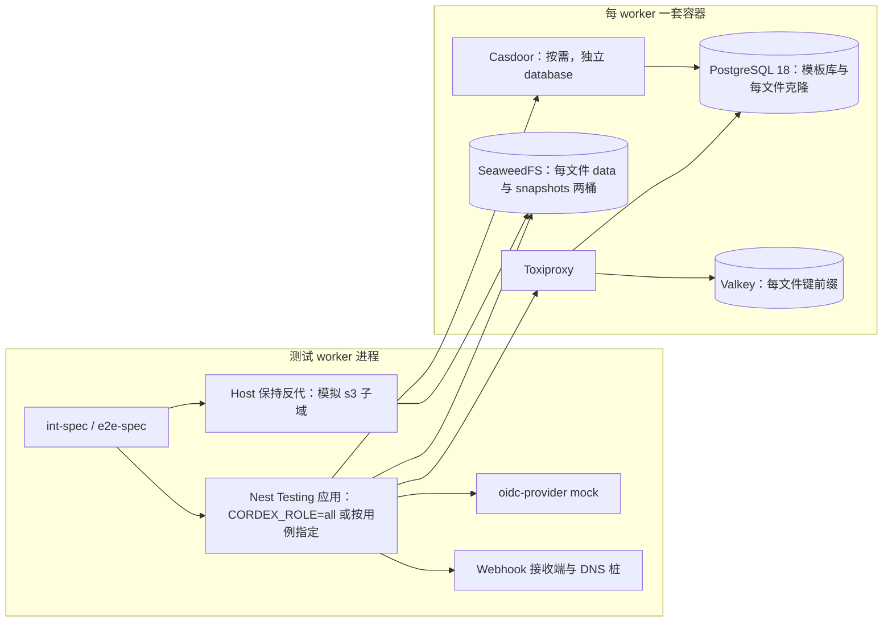
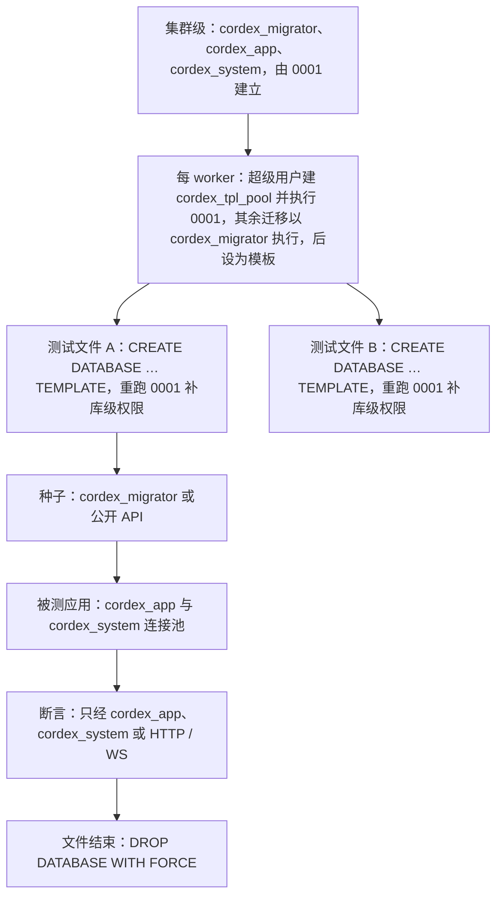
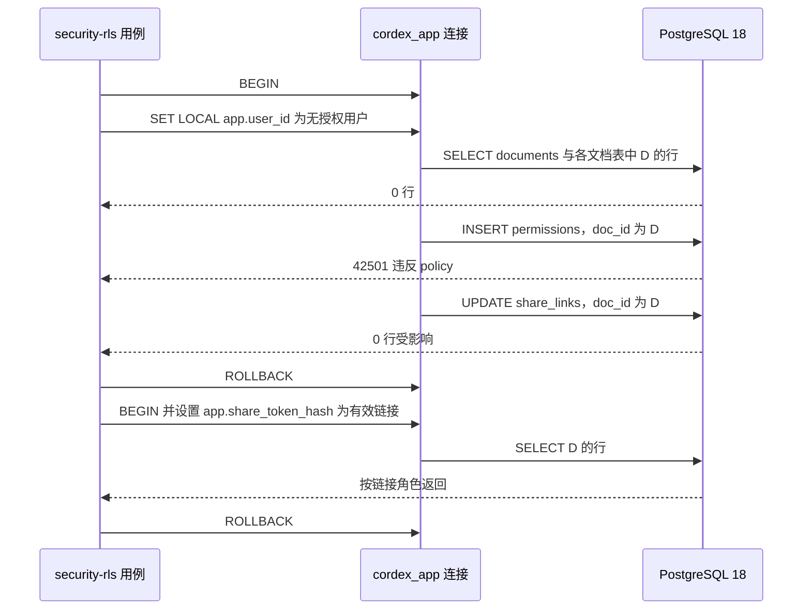
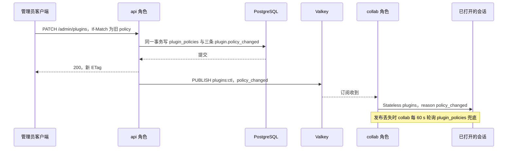
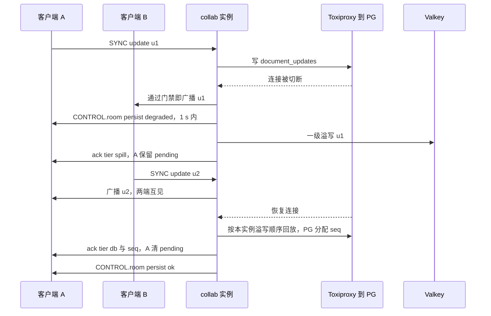
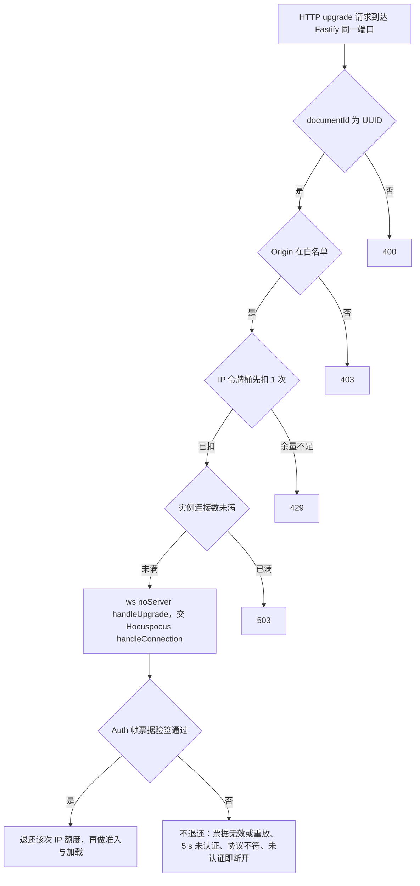
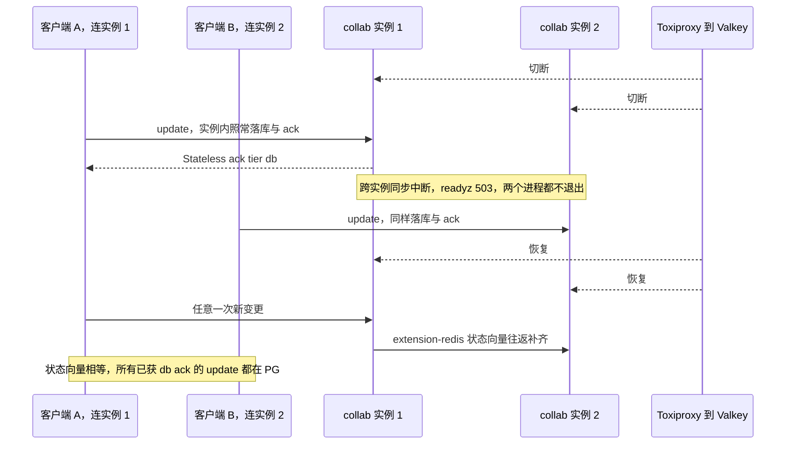
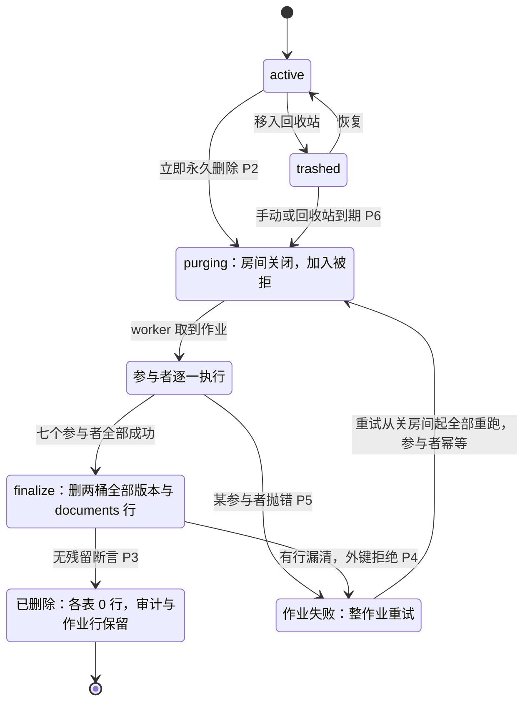
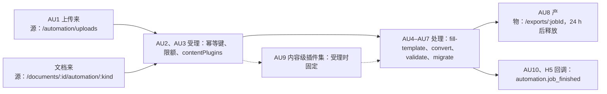

# 07 后端集成测试与 API / WS e2e
> 状态：v0.1 | 负责：测试设计线 | 更新：2026-09-25；2026-09-25（§4.19）；2026-09-25（§4.19 N1）；2026-09-26（§4.20）；2026-09-26（§4.21：漂移检查直查 pg_catalog；Webhook 签名改 Standard Webhooks；WS 升级入口改为嵌入 Fastify 同端口、先扣后退；协同集成改跑 Hocuspocus，加 Valkey 宕机与重启、存储失败不丢）；2026-09-26（§4.21 整合：§9 W19 登记 hp-redis-extension.int-spec.ts（M3））；2026-09-26（§4.21 Remap：原 30/08 引用按 60-backend/README §6.1 改指新位置，30/08 已删除）；2026-10-01（§4.23 插件管理：§4 MG5 / MG7 表集合改 19 张（加 `plugin_policies`、`user_plugin_prefs`，迁移 0012 / 0013，两表在 RLS 例外清单）；新增 §7.5 插件策略 REST、If-Match、审计与个人选择 PL1–PL9；§9 新增 W21 / W22 插件集指纹握手与在线通知；图 7-7）；2026-10-03（§4.24 设计线对齐审计：AL-1 §5.1 X3 与 §7.1 角色集合删去「链接 editor」、新增 §7.2 S8；§4 新增 MG9（迁移 0063、0074）；§6 新增 A14 个人资料；§7.5 新增 PL10 `AdminPluginDetail` 字段契约与页头版本、PL11 失败会话数按小时桶 HyperLogLog（TA-4、TA-10）；§8 新增 D12 文档列表所有者与协作者摘要、D13 配额用量、D14 快照 diff（P2 占位）；§9 新增 W23 握手顺序（TA-9）；§11.2 新增 J8 位图导出 `width` / `quality`（TA-10）；新增 §11.6 Headless 自动化作业 AU1–AU10（AL-7）；§12.2 新增 H5 `automation.job_finished`；§12.3 补审计导出；图 7-8）；2026-10-04（design-language-v3 第 0 批：复验修正——原「状态胶囊」改称文件名旁的同步状态行（rulings §4.25 DS-6），带作废标记的历史陈述统一措辞）；2026-10-15（design-language-v3 第 2 批：按 rulings §4.25 DS-40、DS-47、DS-48、DS-57、DS-58 补服务端口径——§7.2 新增 S9 改链接角色与有效期、S10 令牌取回、S11 收紧即撤销、S12 非所有者成员列表、S13 访问申请；§8 新增 D15 命名版本上限、D16 恢复前自动版本；§9 W7 补以只读加入后不自动提升、重连重新判定；§12.1 补删除整条讨论串只给 owner；§4 MG5 / MG6 / MG7 表集合 20 张（加 `access_requests`）、§5.2 RLS 表 12 张；§15、§17 同步；路由、字段、错误码与审计 action 按 60-backend 同日的登记写）；2026-10-15（design-language-v3 第 2 批回写：按 rulings §4.25 DS-66…DS-68、TB-64、TB-65、TB-71…TB-74 补——§4 新增 MG10 Webhook 事件过滤增 `access_request.created` 的 expand 迁移（DS-67）；§5.1 X3、X4、X6 与 §7.1 角色矩阵的两种链接角色按「每份文档至多一条未撤销的链接」（`uq_share_links_doc_unrevoked`，TB-72）把 viewer 链接与过期链接分到别的文档（种子见 11 §6）；§7.2 S10 补 KEK 信封口径（TB-71），S12 改为只给链接角色、两道裁剪（查询投影不取 `email` / `token_enc` + DTO schema，TB-65），S13 补被拒后的回执不变与没有查询本人申请的路由（DS-68）、201 才投递 Webhook（DS-67）、回收站与删除中的文档（TB-73），新增 S14 链接到期后的所有者视图（DS-66）；§8 D10 补 `POST /documents` 直接建的空文档（TB-74），D15 注明说明的上限由服务端校验（TB-64）；§12.2 新增 H6 访问申请事件的投递（DS-67）；§15、§17 同步）；2026-10-15（design-language-v3 第 2 批回写：按 rulings §4.25 DS-69、DS-70、TB-86 与别组报来的跨组项补——§7.2 S12 的链接摘要改为链接授予角色时带 `token`（与 owner 取回的同一令牌，不含 `linkId` 与有效期，仅邀请、撤销与到期时为 `null`），两道裁剪的链接投影取 `id`（只作 AAD）、`role` 与 `token_enc`，注入多出字段时请求失败，S10 改为非 owner 调 `GET …/share-links` 403（原「其他角色只得角色与到期」作废），S11 补收紧后非所有者手里的令牌一并作废，S14 补非所有者 `link` 为 `null`（DS-69、TB-86，修订 TB-65）；§8 新增 D17 四条建档路径的最早一条 `import` 快照带 `origin` / `originName`（DS-70，按 60/15 §3.8、§3.9 与 60/11 §2 的登记），含入参校验与库内 CHECK 兜底，§15 同步；§4 MG10 写明迁移 `0075_webhook_access_request_event` 与元素数 1–5，MG6 补 `webhook_deliveries` 对 `cordex_app` 的七列 INSERT，§12.2 H6 写明载荷键集合与 `event_id`、依据改指 60/13 §5.2；§17 同步）；2026-10-15（design-language-v3 第 2 批回写：按 rulings §4.25 TB-91、TB-94、TB-95 与别组报来的跨组项补——§7.2 S10 补令牌解密失败时响应照常、只省略 `token` 并记 `warn`，界面「复制链接」随之不可用（TB-91），S12 同补，并在链接投影的三列处注明 TB-94；§8 D17 的入参校验补 `fileName` 为空或只有空白、去首尾空白后 256 字 → 400，恰 255 字 → 201（TB-95），库内兜底补 `origin_name` 超过 512 字 → `23514`（`ck_document_snapshots_origin_name_len`，60/11 §2）；§17 同步）；2026-10-22（design-language-v3 第 3 批：按 rulings §4.25 DS-83…DS-85、DS-101…DS-103、DS-120…DS-122、DS-124、TB-73、TB-119、TB-122、TB-123 与后端设计线同日的登记——§6 A6 补发起端在发现文档不可达时也 302 回前端，新增 A15（回调的三个失败出口）、A16（`prompt=login` 只透传 `login`，Casdoor 实测），A14 注明头像不在界面显示；§7.5 新增 PL12（`lastErrorPhase`）；§8 D8 补回收站里的文档按三类人返回，新增 D18（`lastEditor`、`contentUpdatedAt`、`createdAt`、`trashedAt` 与固定次序）；§11.2 J8 注明 JPEG 与 `quality` 只经 API，新增 J9（导出取消）、J10（隐藏页缺省不含、pptx 只导整份）；§17 登记）；2026-10-22（design-language-v3 第 3 批回写续：按 rulings §4.25 TB-119、TB-137、TB-141…TB-144、TB-146 与后端设计线同日的登记补服务端集成用例——§6 A3 补 `selfSignup` 为真时 `signupUrl` 必有与 `trashDays`，A14 改为只收 `displayName`、带 `avatarUrl` 得 400、`avatar_url` 只随 IdP 登录刷新；§7.5 新增 PL13 清单不返回 `declared`；§8 D7 的 M-09 列补 `content_updated_by`，D8 补所有者对回收站里的文档取协同票据也 404，D18 补 `shared` 与回收站进出不改变次序、未登记的查询参数 400、库层的生成列与外键（60/10 DDL10-12）；§9 W7 补超天花板加入带 `elementCount` 与 `maxElements`；§11.2 J9 写明 `server.export.job_terminal` 与注入取消的时点；§17 删去「待登记」并新增一行；同日再补：按 rulings §4.25 TB-157 与后端 60/06 §10.4、§10.5、§11.3、§14 第 25 条——§11.3 新增「页级回退与页级失败」一条：整页无法解析的页照常 `ok` 回传、写缩略图行，`/render` 在诊断里报了 `render.page_failed` 的页记 `failed`、只重试这一页 1 次，仍失败时不写新行（已有旧行的保留旧图，没有行的按 404 显示占位）、`render-export` 作业失败；§17 新增一行；别组提来的 A3、A14、PL13、D7、D18、W7、J9 与 §17 的修改此前已按此写、核对无改动；2026-10-22 复核修正：§8 D18 的未登记查询参数写成码名 `server.documents.validation_failed`（30/10 §1.1a 已登记）；§11.3 补已有旧行时 `GET` 仍返回旧图，这一页的失败一律由 renderer 桩制造（`/render` 不设故障注入点，rulings §4.25 TB-174；早先按 TB-169 写的「接真实 renderer 时用测试部署的故障注入点」随之删去），`render-export` 作业的 `error_code` 取该页的码 `render.page_failed`（TB-173）；§8 D18 补没有可归属用户的建档（系统作业建档）只省略 `lastEditor`、照常带 `contentUpdatedAt`（60/15 §3.3，界面写法 TB-171）；§6 A3 补未配置 `auth.oidc.displayName` 时不带 `idpDisplayName`（60/17 §5.5 缺省改为空）；§17 两条早先写「待回写」的条目（40/08、40/09、40/12 §9 的改名，30/11 §10、§12 改为摘要）核对为已回写，RLS 测试矩阵一行改正 10 SEC-DA-01 现写的落点（同为 `fixtures/`），第 3 批回写两行的标签改为「回写续 / 回写续，同日再补」，D18 码名一句去掉「登记后改」，核对日期去掉「复核」字样；状态头的回写轮次字样改为「回写续 / 同日再补」；§11.3 按 rulings §4.25 TB-175 补单页超时的页在 `render-export` 里重试后仍超时时作业以 `headless.render_timeout` 失败，两种页级失败都按 terminal 结束、不做作业级重试（60/06 §5.2）；§8 D18 补省略的项服务端不补值（不拿 `owner` 填 `lastEditor`）、两份列表的次序等于按 `contentUpdatedAt ?? createdAt` 倒序（TB-171、TB-144）；60/08 §6.8 已登记 RLS 矩阵机器副本的文件名，§5.2 与 §17 那一条随之核对为已定；§5 开头的测试矩阵改为 R1–R15、§5.1 末段注明 R15 落在 `access_requests` 的格里（60/08 §6.8）；§8 D18 写明用例落在 40/08 §9 既有的 `e2e/documents-permissions.e2e-spec.ts`；§11.3 按 rulings §4.25 TB-178 补自动化作业 `convert`（pdf / png）与 `fill-template`（pdf）的页级失败同 render-export（60/06 §7.4）、renderer 把 `ready` 诊断映射成 RPC 页级失败的纯函数 `toPageResults` 由 40/09 登记的单测 `page-results.test.ts` 覆盖，两种页级失败的作业 `attempts = 1`；§17 同步） | 依赖：rulings §4.25 TB-178、rulings §4.25 TB-171、TB-173、TB-174、TB-175、rulings §4.25 TB-169、rulings §4.25 TB-151、TB-157、rulings §4.25 TB-119、TB-137、TB-141…TB-144、TB-146、rulings §4.25 DS-83…DS-85、DS-101…DS-103、DS-120…DS-122、DS-124、TB-119、TB-122、TB-123、rulings §4.25 DS-40、DS-47、DS-48、DS-57、DS-58、DS-66、DS-67、DS-68、DS-69、DS-70、TB-64、TB-65、TB-71…TB-74、TB-86、TB-91、TB-94、TB-95、rulings §4.24 AL-1 / AL-3 / AL-7 / TA-4 / TA-9 / TA-10、[60/15](../60-backend/15-rest-api-catalog.md) §3.15.1 / §3.16 / §3.17、[60/06](../60-backend/06-modules-jobs-import-export-thumbnails.md) §7.4、[60/12](../60-backend/12-ddl-jobs-and-thumbnails.md) §2.1、[60/13](../60-backend/13-ddl-comments-webhooks-audit.md) §5.1 / §5.2 / §6.3、rulings §4.21 q-db-access / q-webhook-sig / q-ws-gateway / H:q-hp-persist-ack / H:q-hp-fanout、[ADR-0039](../30-architecture/adr/0039-collab-server-hocuspocus.md)、证据 `00-charter/_evidence/hocuspocus-adoption-2026-09-26.json`（TS-01、d-01、d-11、d-16、d-19、d-21、d-22，核实 exp1、exp2、vE）、rulings §4.20 BE-01+TX-03 / BE-04 / BE-05+TX-22 / TX-10、rulings §4.19 D-M2-CONTENT / INC-09 / C-06 / N1、[01](./01-strategy-and-layers.md)、[02](./02-contract-suites-and-pluggability.md)、[11](./11-test-data-fixtures-and-determinism.md)、[30/11](../30-architecture/11-testing-strategy.md) §10 / §12、[60/01](../60-backend/01-service-overview-and-roles.md) §12、[60/02](../60-backend/02-auth-chain.md)、[60/06](../60-backend/06-modules-jobs-import-export-thumbnails.md) §1–§7、[60/08](../60-backend/08-db-conventions-roles-rls-migrations.md)–13（原 30/08 §5–§7 / §9 / §12 / §16）、[40/08 §9](../40-modules/08-server-identity-documents-and-storage.md)、[40/09 §9](../40-modules/09-server-collab-gateway-and-headless-host.md)、[40/12 §9](../40-modules/12-server-jobs-comments-and-ops.md)、[40/19](../40-modules/19-atlas-backend-and-data.md) §5–§6、ADR-0022 / 0025 / 0029 / 0031 / 0034 / 0035、PRD 04 NF-03 / NF-04、PRD 05 M3 验收 4 / 6 / 6a / 7 / 8 / 12 / 16 / 17、rulings §4.15 T-0 / Q6 / Q10、§4.17 D1、§4.18

本文是服务端集成测试与 API / WS e2e 的唯一事实源：容器 harness、数据库隔离、迁移测试、文档级 RLS 绕过测试、身份与会话、权限与分享、文档媒体与存储、协同服务集成、墓碑与擦除、作业、评论 / Webhook / 审计 / 遥测、路由鉴权覆盖与契约快照——每一类写 harness、用例族、矩阵的生成方式与运行时机。

读者：`apps/server` 各 Nest 模块与三个 `server-*` 包的实现者；搭服务端测试基础设施的工程师；CI 维护者。

边界：被测对象以 [60-backend](../60-backend/README.md) 为准——DDL 与 RLS policy 在 60/08–13，RLS 测试矩阵在 [60/08](../60-backend/08-db-conventions-roles-rls-migrations.md) §6，路由目录在 [60/15](../60-backend/15-rest-api-catalog.md)，WS 服务端处理在 [60/16](../60-backend/16-ws-protocol-server-view.md)，Valkey 键与对象键、保留期在 [60/14](../60-backend/14-valkey-object-storage-and-retention.md)，审计 action 登记在 [60/07](../60-backend/07-modules-comments-webhooks-audit.md) §9，指标名在 [60/18](../60-backend/18-observability-and-ops-endpoints.md) §4。本文不复述字段与数值，只写怎么验证。适配器级契约套件（七套 + `collabServer`）在 [02](./02-contract-suites-and-pluggability.md) §5，协同模拟在 [05](./05-collab-simulation-and-property-tests.md)，保真往返的服务端路径在 [03](./03-fidelity-roundtrip-and-corpus.md)，安全威胁总表在 [10](./10-security-testing.md)，角色装配与部署环境在 [08](./08-deployment-and-environment-e2e.md)。

---

## 1. 范围

| 层 | 目录（[01](./01-strategy-and-layers.md) §4） | 入口 | CI 步骤 |
|---|---|---|---|
| 服务端集成 | `apps/server/test/integration/**/*.int-spec.ts` | 直接调用 Nest 模块、仓储、处理器、`server-*` 真实适配器、组合根（`preset-server`） | `test/server-integration` |
| API / WS e2e | `apps/server/test/e2e/**/*.e2e-spec.ts` | 经 HTTP（Fastify inject 或真实端口）与 WS 客户端 | `test/server-integration` |
| 服务端冒烟 | `apps/server/test/e2e/smoke/**/*.e2e-spec.ts` | 同上 | `e2e/smoke`（[12](./12-ci-gates-mapping.md) §4 的 #6 `csrf-origin`、#11 `security-rls`、#12 `renderer-egress`） |
| 共用件 | `apps/server/test/helpers/`（容器、应用启动、WS 客户端、故障注入、断言工具）、`apps/server/test/fixtures/`（快照文件、种子数据、语料子集引用） | — | — |

- Nest 模块的纯逻辑（用例、守卫、状态机、映射）在 `src/**/__tests__/*.test.ts`，仓储端口注入内存假实现、Clock 注入 `FixedClock`，归 `test/unit`，不在本文。
- 服务端 Clock 端口（`apps/server` `shared/clock.ts` 的 `CLOCK` 令牌）在集成测试中一律以 `overrideProvider(CLOCK).useValue(new FixedClock(S0))` 覆盖（`@cordexjs/shared/testing`，服务端不另建假时钟类）：票据 60 s、链接到期、会话吊销缓存、保留期作业、幂等键一律经它推进，不写真实等待；数据库 `now()` 与 Valkey 键 TTL 不受它控制，处理规则见 [11](./11-test-data-fixtures-and-determinism.md) §3（决策 T-DETERMINISM）。
- 每个文件带需求标签（`@req` / `@ruling` / `@adr`，[13](./13-requirements-traceability.md) §1）。
- 安全类用例的编号与阻断时间线只在 [10](./10-security-testing.md) 登记；本文与之重叠的用例以 SEC id 开头命名测试标题（10 §0），对照：§5 → SEC-DA-01；§4 MG5 → SEC-DA-04；§6 A2 / A4 / A6 / A7 / A8 / A9 / A10 / A11 / A12 / A13 → SEC-AU-08 / AU-03 / AU-01 / AU-05、AU-06 / AU-07 / AU-09 / AZ-05 / XS-01 / XS-02 / AZ-12；§7.1 → SEC-AZ-02；§7.2 S1 / S2 / S3 → SEC-AZ-09 / XS-03 / AZ-09；§7.3 → SEC-AZ-14、AZ-15、AZ-07；§8 D2 / D3 / D5 / D6 / D8 → SEC-AZ-10 / AZ-11 / IN-09 / RL-06 / AZ-08；§9 W7 / W8 → SEC-RL-04 / AZ-06、RL-03；§10.2 → SEC-DA-06；§10.3 → SEC-DA-07；§12.2 H1 / H4 → SEC-EG-02 / EG-01；§12.3 → SEC-DA-05；§12.4 → SEC-RL-01、RL-02、RS-04；§13 → SEC-AZ-01。断言两处须一致，不一致时以 60 的被测定义为准同时修正两处。

---

## 2. 容器 harness

依据：决策 T-CI（服务端集成进 `test` job 的 `server-integration` 步骤，托管 runner 自带 Docker，Docker 不可用即失败不跳过）；rulings §4.15 Q6（PR 层 Casdoor 容器 + oidc-provider mock）、Q10（PG 18 / Valkey / SeaweedFS）；决策 C-08/OBJ（两个桶）、VALKEY-DEPLOY、T-IDP。

| 依赖 | 形态 | 配置要点 |
|---|---|---|
| PostgreSQL 18 | 容器 | 容器超级用户执行 0001（与 `cordex-ops db:bootstrap` 同一份 SQL）建三个集群级角色，其余迁移 `SET ROLE cordex_migrator` 后执行（与 ddl-check 同一口径，60/08 §10.2、§11）；每个 worker 一个模板库（§3）；另建独立 database `casdoor` 与登录角色 `casdoor` 供 Casdoor 使用（60/08 §4.4，决策 DB-ROLES） |
| Valkey | 容器 | `maxmemory-policy noeviction`、`appendonly yes`、`appendfsync everysec`（决策 VALKEY-DEPLOY）；每个测试文件用独立 `valkey.keyPrefix`（`cordex:t<文件哈希>:`）与 BullMQ 前缀 |
| SeaweedFS | 容器（S3 网关） | 每个测试文件建一对桶 `data-<文件 id>`（不开版本化）与 `snapshots-<文件 id>`（开版本化 + 非当前版本过期规则），使「无残留」断言可以精确到桶 |
| Toxiproxy | 容器 | 应用到 PG 与 Valkey 的连接串都指向代理，用于断开、延迟与恢复（§9、[06](./06-frontend-component-and-e2e.md) §4 的 `faults`） |
| oidc-provider mock | 测试进程内（Node 库，随机端口） | 账号与 claims 取自 [11](./11-test-data-fixtures-and-determinism.md) §7；支持同一邮箱不同 issuer 的两套账号（§6） |
| Casdoor | 容器，按需启动 | 只给 `login-casdoor` 与 `selfSignup` 两态用例；`init_data` 种子（组织、应用、client、用户）同 [08](./08-deployment-and-environment-e2e.md) §7 |
| 反向代理 | 测试进程内的最小 HTTP 代理 | 模拟 `s3.<域名>` 子域：保持 Host 头转发到 SeaweedFS，`storage.s3.publicEndpoint` 指向它（rulings §4.18 BE-01） |
| HTTP 接收端与 DNS 桩 | 测试进程内 | Webhook 投递目标；egress-guard 的解析器端口注入 DNS 桩，用于 SSRF 与 DNS 重绑定用例（§12） |

- **镜像钉死**：全部镜像引用集中在 `apps/server/test/helpers/images.ts`，一律 `name@sha256:…`；`test/conventions` 断言该文件中不存在无 digest 的引用（与生产镜像的 `check-image-policy` 同一口径）。镜像预拉与缓存见 [12](./12-ci-gates-mapping.md) §9。
- **每个 Vitest worker 一套容器**：`globalSetup` 只检查 Docker 可用性（不可用即抛错，步骤失败）；各 worker 的 setup 文件按 `VITEST_POOL_ID` 懒启动容器并在 worker 退出时停止。同一 worker 内的测试文件共享容器，靠 §3 的库克隆、独立键前缀与独立桶隔离。
- **健康检查顺序**：PG 以超级用户可连接 → 建模板库并执行 0001 → 以 `cordex_migrator` 执行其余迁移（0096 自检随之通过）→ Valkey `PING` 且 `CONFIG GET maxmemory-policy` 为 `noeviction` → SeaweedFS `ListBuckets` 成功 → 建桶并读回版本化状态 → Toxiproxy 代理就绪 → oidc-provider 发现文档可取 → （需要时）Casdoor 健康端点 → 启动 Nest 应用 → `/readyz` 200。任一步超时即失败并留下容器日志作为产物。
- **renderer**：`test/server-integration` 不启动 renderer 容器；缩略图管线用 `headless.mode='local'`（worker 进程内 Chromium 池）；RPC 签名、只接受注入与 renderer 启动断言（[10](./10-security-testing.md) SEC-RS-02 / 03 / 05）以子进程启动 `CORDEX_ROLE=renderer`（与 [08](./08-deployment-and-environment-e2e.md) §2 同一子进程方式）。remote 模式与容器零出站在 `e2e/smoke` 的 `renderer-egress`（[10](./10-security-testing.md) §9）与 compose 栈（[08](./08-deployment-and-environment-e2e.md)）中覆盖。

**图 7-1 后端集成容器拓扑**

怎么读：左框是测试进程内的部件，右框是每个 Vitest worker 独占的一套容器；应用到 PG 与 Valkey 的连接一律经 Toxiproxy，以便故障注入；浏览器侧的预签名直传用例经左框的 Host 保持反代访问 SeaweedFS。

依据：30/11 §10、§12；rulings §4.15 Q6 / Q10、§4.18 BE-01；决策 T-CI、C-08/OBJ。

---

## 3. 数据库隔离

依据：决策 T-DB-ISOLATION（authority：RLS 依赖会话变量与非属主角色，ADR-0022 修订 2026-09-24），needsUser=false。

1. **模板库**：每个 worker 启动时以容器超级用户建库 `cordex_tpl_<pool>`（`cordex_migrator` 为 `NOCREATEDB`，60/08 §12.1），在其中以超级用户执行 0001、再 `SET ROLE cordex_migrator` 按 [60/08](../60-backend/08-db-conventions-roles-rls-migrations.md) §9 的编号顺序执行其余迁移，然后 `ALTER DATABASE … WITH IS_TEMPLATE true ALLOW_CONNECTIONS false`。三个数据库角色是集群级对象，第一次执行 0001 时建立；表级与列级 GRANT、RLS、函数与 schema 权限随模板被克隆。
2. **每个测试文件一份克隆**：`CREATE DATABASE cordex_t_<文件 id> TEMPLATE cordex_tpl_<pool>` 后，以超级用户在克隆库上再执行一次 0001（可重复执行）：库级 ACL（`REVOKE ALL ON DATABASE … FROM PUBLIC` 与 `GRANT CONNECT`）不随模板复制，不重跑则克隆库对 PUBLIC 开放连接，GRANT 快照（§4 MG6）与生产不一致。文件结束时 `DROP DATABASE … WITH (FORCE)`。同一文件内的用例共享该库，靠各自创建的文档与用户（UUIDv7，固定前缀便于排查，[11](./11-test-data-fixtures-and-determinism.md) §6）互不干扰。
3. **连接角色**：被测应用只以 `cordex_app`（api、collab、worker 的 app 池）与 `cordex_system`（collab / worker 的 system 池）连接，与生产同一连接池配置（60/08 §5）。超级用户只用于建库、删库与执行 0001，`cordex_migrator` 只用于其余迁移与写种子；**断言读取一律经 `cordex_app` / `cordex_system` 或经 HTTP / WS 入口**，不以属主或超级用户读数据下结论。
4. **不用事务回滚式隔离**：把用例包在一个外层事务里再回滚，会让 `SET LOCAL` 的作用域、RLS 的会话上下文、`pg_advisory_xact_lock`、提交后才发出的 `PUBLISH perm:doc:{docId}` 与 Outbox 全部失真，恰好掩盖本文要测的东西。

**图 7-2 数据库测试隔离**

怎么读：自上而下；角色建一次，模板每个 worker 建一次，每个测试文件克隆一份独立库并重跑可重复执行的 0001（库级 ACL 不随模板复制，PG 18 实测）；种子可以用属主写，被测应用与断言只用非属主角色，文件结束即丢弃整库。

---

## 4. 迁移测试

文件：`apps/server/test/integration/migrations/*.int-spec.ts`，步骤 `test/server-integration`。迁移编号的分配与纪律以 [60/08](../60-backend/08-db-conventions-roles-rls-migrations.md) §9–§10 为准。

| # | 用例 | 断言 |
|---|---|---|
| MG1 | 空库全量 | 按编号顺序执行全部迁移成功；`pg_dump --schema-only` 规范化后（去注释、排序、去 OID）与入库快照 `apps/server/test/fixtures/schema.snapshot.sql` 逐字一致；快照变化必须在同一 PR 显式更新，并经 60 线 CODEOWNERS 审批 |
| MG2 | 上一版本库增量 | 基线冻结（首个对外发布、M3 出口，60/08 §10.4）后启用：取上一个发布标签的迁移目录（`git show <tag>:…`）建库 → 写入 [11](./11-test-data-fixtures-and-determinism.md) §6 的标准种子 → 执行本分支新增迁移 → schema 快照与 MG1 相同，种子数据可经 `cordex_app` 读回（ADR-0022「空库与上一版本库都可执行」）。冻结前基线段 0001–0099 允许改写、M1–M2 内部环境不承诺库内升级，本例不适用（激活时间登记在 [12](./12-ci-gates-mapping.md) §7，不以跳过代替） |
| MG3 | 编号与只追加 | 任何时候：编号唯一、四位、文件名与 `-- migrate:` 首行一致；冻结前新文件落在 60/08 §9 分给该域的号段内。冻结后：相对 merge-base，已存在的迁移文件内容哈希不变（台账校验和一致，60/08 §10.2），新文件编号 ≥ 0100 且按时间取下一个空号、不插号（60/08 §10.4） |
| MG4 | 回滚一步 = 应用回滚 | 不提供 down 迁移（60/08 §10.2）；在 MG2 得到的新 schema 上启动上一发布标签的应用构建，跑其登录、列表、打开、协同持久化冒烟全部通过（60/08 §10.3「回滚一步 = 应用回滚、数据库不回滚」；与 [08](./08-deployment-and-environment-e2e.md) §8 R3 同一激活时间）；另断言本分支新增迁移只含 expand 类语句（无 `DROP COLUMN`、`RENAME`、收紧约束，收缩须晚一个版本） |
| MG5 | 负向断言 | 业务表集合恰为 60/08 §1 的 20 张（2026-10-01 按 rulings §4.23 加 `plugin_policies`、`user_plugin_prefs`，迁移 0012 / 0013；2026-10-15 按 rulings §4.25 DS-48 加 `access_requests`，迁移 0036）+ 台账 `cordex_schema_migrations`；两张插件表在 `policy/rls-exceptions.json` 中且未启用 RLS、无 `doc_id` 列；`access_requests` 启用并强制 RLS、有 `doc_id` 列（60/09 §15）；`information_schema.columns` 中没有名为 `tenant_id` / `tenant` / `tid` 的列（rulings §4.15 T-0）；没有 `tenants`、`groups`、`pending_invitations`（§4.17 D1）、`api_keys` 表；`documents` 没有 `folder_id` 列（决策 DDL-COLS）；M1–M3 没有 `collab_sessions` 表（§4.18 BE-31）；`users` 没有 `email_hash` 列（决策 C-01） |
| MG6 | GRANT 与 RLS 快照 | 读取 `information_schema.role_table_grants` 与 `column_privileges`、`pg_class.relrowsecurity` / `relforcerowsecurity`、`pg_proc` 的 `prosecdef` / `proconfig` / ACL、`pg_database.datacl`，规范化为 `apps/server/test/fixtures/grants.snapshot.json` 并与 60/08 §4.2 矩阵比对；另逐条断言：只有 `cordex_migrator` 带 `BYPASSRLS`；`cordex_app` 与 `cordex_system` 无任何 DDL 权限；`documents` 的 M-09 列只对 `cordex_system` 有 UPDATE（列级授予）；`audit_log` 对二者只有 `INSERT` 与 `SELECT`；`plugin_policies` 对 `cordex_app` 为 S I D 加按列 U（`state, default_on, config, revision, batch_id, updated_by, updated_at`）、对 `cordex_system` 只有 S，`user_plugin_prefs` 对 `cordex_app` 为 S I D 加按列 U（`enabled, updated_at`）、对 `cordex_system` 无任何权限（§4.23）；`access_requests` 的授予按 60/08 §4.2 矩阵（2026-10-15，DS-48；申请人与文档两列不可改）；`share_links` 新增的 `token_enc` 随行授予、撤销时与 `revoked_at` 同一语句置空（`ck_share_links_token_enc_live`，60/09 §6）；`webhook_deliveries` 对 `cordex_app` 为 S D 加七列的列级 INSERT（`id, subscription_id, event, event_id, payload, payload_hash, next_attempt_at`；2026-10-15，rulings §4.25 DS-67：访问申请受理在申请人的请求事务里写投递行，60/08 §4.2、60/13 §6.3，由 0095 授予）——以 `cordex_app` 插入时带 `status` 或 `attempt` 列、或 UPDATE 已有投递行 → `42501`，只写这七列时得到的行为 `status = 'pending'`、`attempt = 0`；分区子表对应用角色无任何权限；`PUBLIC` 无任何表、函数与库连接权限；每个 `SECURITY DEFINER` 函数的 `search_path` 为 `pg_catalog, pg_temp` 且 `PUBLIC` 无 `EXECUTE`（决策 DB-ROLES；60/08 DB-06） |
| MG7 | 与 drizzle schema 一致（§4.21 改写） | 漂移检查 DB-03：空库执行全部迁移后**直查 `pg_catalog`**——普通表取 relkind `r`，分区表只取 relkind `p` 的父表（`document_updates`、`audit_log`），`relispartition` 为真的叶子分区与台账表排除——得到的表、列（名称与顺序）、类型（`format_type`）、可空性与默认值表达式，与手写 drizzle `schema/*.ts` 经 `getTableConfig()` 导出的清单逐列相等，表集合恰为 60/08 §1 的 20 张（2026-10-15 起含 `access_requests`）；负向夹具：镜像删掉 `document_updates` 或 `audit_log` 的一列即失败。不用 drizzle-kit 内省（它只选 relkind r / v / m，整张丢掉分区父表），原「drizzle schema 生成的表与库一致」口径作废（60/08 §10.1，rulings §4.21 q-db-access） |
| MG8 | 快照预迁移 | `server-headless` 的 migrate 任务对 [03](./03-fidelity-roundtrip-and-corpus.md) §11 的历史快照样本批量执行，结果通过 `validateSnapshot` |
| MG9 | 只改 CHECK 的 expand 迁移（2026-10-03，rulings §4.24 AL-7、AL-1） | `0063_job_runs_automation_kinds` 之后：`job_runs.kind` 接受 `fill-template`、`convert`、`validate`、`migrate`，`kind='unknown'` 报 `23514`；`doc_id IS NULL` 只对 `convert` / `validate` / `migrate` 成立，`fill-template` 与原四种 kind 写 `NULL` 报 `23514`（`ck_job_runs_doc_scoped`）；`0074_webhook_automation_event` 之后：`event_filter` 可含 `automation.job_finished`、元素数 1–4，含未登记事件或空数组报 `23514`，`webhook_deliveries.event` 同理；`share_links.role='editor'` 或 `'owner'` 被 `ck_share_links_role` 拒绝（以 `cordex_migrator` 直插，绕过应用层）。两条迁移都不加列、不改 GRANT 与 RLS（MG6 快照不变）、不触碰既有行（迁移前后行数与 `md5` 汇总相等），只含 expand 类语句（MG4 规则）；文件名与 `-- migrate:` 首行一致（MG3），两条迁移都不增减表（表集合以 MG5 为准） |
| MG10 | Webhook 事件过滤增 `access_request.created`（2026-10-15，rulings §4.25 DS-67） | `0075_webhook_access_request_event`（只改两条 CHECK 的 expand 迁移，60/13 §5.2；编号在 60/08 §9 分给 60/13 的号段 0070–0079 内）之后：`webhook_subscriptions.event_filter` 可含 `access_request.created`、元素数 1–5（`ck_webhook_subscriptions_events`），`webhook_deliveries.event` 同理（`ck_webhook_deliveries_event`）；含这五种以外的事件名或空数组仍报 `23514`；与 MG9 同样不加列、不改 GRANT 与 RLS（MG6 快照不变；`cordex_app` 写投递行的七列 INSERT 由 60/08 的 0095 授予，断言在 MG6）、不触碰既有行（迁移前后行数与 `md5` 汇总相等）、只含 expand 类语句、不增减表；§12.2 H6 的订阅种子依赖它（[11](./11-test-data-fixtures-and-determinism.md) §6） |

文档里的 DDL 围栏由 `docs/_tools/ddl-check` 在 PG 18 容器中按编号执行（60/08 §11，总编排实现），与本节的代码迁移测试互补：前者保证文档可执行，后者保证代码迁移与快照一致。

---

## 5. 文档级 RLS（`security-rls`）

文件：`apps/server/test/e2e/smoke/security-rls.e2e-spec.ts`，步骤 `e2e/smoke`，每个 PR 运行，M3 起阻断、此前为报告（rulings §4.18 GV-16）。被测 policy 以 [60/08](../60-backend/08-db-conventions-roles-rls-migrations.md) §6.3–§6.5 与 60/09–13 各表的 policy 小表为准，测试矩阵 R1–R15 以 60/08 §6.8 为准（R15 为 `access_requests` 里本人的申请行：本人可读、可插入，他人 0 行，有角色者插入被拒；它的期望落在 `access_requests` 的格里，§5.2）；GUC 名与辅助函数见决策 RLS-GUC。

### 5.1 会话上下文集合

| 代号 | 连接角色 | 会话变量 | 含义 | 60/08 §6.8 |
|---|---|---|---|---|
| X0 | `cordex_app` | `app.user_id` = 文档 D 的 owner / editor / commenter / viewer 各一 | 直接授权，按该表最低读 / 写角色判定 | R3、R4、R5 |
| X1 | `cordex_app` | `app.user_id` = 对 D 无任何授权的用户 | 无授权用户 | R2 |
| X2 | `cordex_app` | `app.user_id` = D 的 owner，访问对象换成另一文档 D2 的行 | 他文档 id | R2 |
| X3 | `cordex_app` | X1 的用户 + `app.share_token_hash` = 有效链接：commenter 一组用 D 的链接，viewer 一组用 D2 的链接、以 D2 为被访问文档（每份文档至多一条未撤销的链接，`uq_share_links_doc_unrevoked`，2026-10-15 rulings §4.25 TB-72，种子见 11 §6；链接不能是 editor，`ck_share_links_role` 使该种子无法写入，2026-10-03 rulings §4.24 AL-1）；另测与直接授权并存时取高 | 链接角色 | R6 |
| X4 | `cordex_app` | X1 的用户 + 已过期、未撤销的链接，被访问文档为该链接所在的 D3（D 已有一条未撤销的有效链接，过期链接只能放在别的文档；`expires_at` 由数据库 `now()` 比较，种子取「构建时刻 − 1 d」，11 §3） | 过期链接 | R7 |
| X5 | `cordex_app` | 同 X3，链接已撤销 | 撤销链接 | R7 |
| X6 | `cordex_app` | 同 X3，被访问文档为 D、令牌是 D2 的有效链接 | 令牌与文档不匹配 | R7 |
| X7 | `cordex_app` | 未设置 `app.user_id` | 漏设上下文 | R1 |
| X8 | `cordex_system` | 未设置 `app.system_job`；同一连接上一个事务设过（连接池复用） | 系统角色漏设作业名 | R8 |
| X9 | `cordex_system` | `app.system_job` = 合法作业名 | 系统作业正向对照 | R9 |
| X10 | `cordex_app` | X1 的用户 + `app.share_token_hash` 为非法 hex | 期望报错而非放行 | R7 |

矩阵之外的专项（同一文件，逐条一例）：R10 以应用角色直连分区子表（`document_updates_p00`、`audit_log_y…`）→ `permission denied`；R11 `cordex_app` 更新 `documents` 的 M-09 列 → `permission denied`；R12 建档事务（`documents` → 首条 owner `permissions` → `document_perm_versions`）成功且 `RETURNING` 可见，他人冒充 owner 写首条授权行被拒；R13 `document_user_marks` 读他人行 0 行；R14 `job_runs` 的 `created_by` 为本人、已无文档授权 → 仍可读本人作业行。R15 不是专项，见 §5.2 矩阵里 `access_requests` 的格。

### 5.2 用例生成

- **矩阵来源**：60/08 §6.8 的 R1–R9 与 R15 × 12 张 RLS 表（R10–R14 是同一用例文件里的逐条专项；2026-10-15 起含 `access_requests`；同日 `permissions`、`share_links` 的 SELECT 放宽到 viewer 及以上，rulings §4.25 DS-48，60/09 §8.1，非所有者看不到邮箱与令牌由应用层裁剪、见 §7.2 S12），「最低读 / 写角色」取自各表所在 DDL 文件的 policy 小表；机器副本 `apps/server/test/fixtures/rls-matrix.json`（表 × {X0…X10} × {SELECT, INSERT, UPDATE, DELETE} → 期望），与 60/08 §6.8 及各 policy 小表在同一 PR 中修改（文件名已由 60/08 §6.8 登记，2026-10-22）。期望取四类之一：可见 / 受影响行数、0 行、policy 拒绝（`new row violates row-level security policy`）、GRANT 拒绝（`permission denied`；没有 GRANT 的操作不建 policy，60/08 §6.3）——后两类同为 SQLSTATE `42501`，按错误消息区分。
- **完整性**：从 `pg_class` 读出全部启用 RLS 的表，每张表在矩阵中都必须有 {X0…X10} × 四种操作的全部格子，缺一格即失败——新表加了 RLS 却没补矩阵，测试先失败。
- **执行方式**：以对应数据库角色直连 PG（绕过应用层），每格一个事务：`BEGIN` → `set_config('app.…', 值, true)`（等价 `SET LOCAL`，60/08 §6.1）→ 执行语句 → 断言 → `ROLLBACK`（这里的回滚只用于清理单条语句的副作用，会话变量与 policy 已在事务内真实生效，与 §3 第 4 条不冲突）。X8 在同一连接上紧接 X9 执行，覆盖「连接复用、上一事务设过作业名」的情形。
- **例外表对账**：没有启用 RLS 的表集合必须与 `policy/rls-exceptions.json` 完全相等（内容以 60/08 为准，决策 C-21）；启用 RLS 的表全部带 `FORCE`。与 `scanners` job 的 `check-rls-coverage` 是同一规则的运行时与静态两道。

**图 7-3 RLS 绕过测试**

怎么读：自上而下是一格一事务；前半段是无授权用户的读、写、改全部被 policy 挡住（读为 0 行、写入报 `42501`、更新影响 0 行；图中选 `cordex_app` 有 INSERT / UPDATE 授权的表，没有授权的表如 `comments` 的写入直接 `permission denied`），后半段是带有效链接令牌时按链接角色放行。其余上下文按 §5.1 表同样展开。

依据：rulings §4.15 Q6（文档级 RLS）、§4.18 GV-16、BE-02（链接角色 = max(直接授权, 有效链接)）；ADR-0022 与 ADR-0029「如何被机械验证」；决策 RLS-GUC、C-21、DB-ROLES。

### 5.3 应用层故障注入

同一文件另跑一组：以 Nest 测试模块覆盖 `RoleResolverService` 为「一律放行」（模拟应用层漏写权限条件），再经 HTTP 以无授权用户请求 `GET /api/v1/documents/:id`、快照列表与评论列表——仍取不到 D 的任何数据（RLS 返回 0 行，响应为 404 或空列表）；再以同一用户发 `PATCH /documents/:id`、`PUT /documents/:id/permissions`、`POST /documents/:id/share-links` → 响应非 2xx，且以 `cordex_system` 读回 D 的相关行无任何变化。这是 ADR-0022 / 0029 要求的「应用层漏写权限条件时 RLS 仍拒绝跨文档读取」的直接证据；代码层的另一道防线是扫描器 `scan-doc-access-via-permission`（rulings §4.17 D3）。

---

## 6. 身份与会话

被测设计：[60/02](../60-backend/02-auth-chain.md) §2–§5、§8–§9。文件 `apps/server/test/e2e/auth/*.e2e-spec.ts`。

| # | 用例 | 断言 | 依据 |
|---|---|---|---|
| A1 | 首次登录 JIT | mock IdP 登录一次 → `users` 与 `user_identities` 各一行且在同一事务中出现（中途注入失败时两表都无行）；重复登录不新增行；同一 `(issuer, subject)` 并发 10 次首次登录只建一个用户 | rulings §4.15 Q6；60/02 §3 |
| A2 | 跨 issuer 同邮箱 | 两个 issuer 下邮箱相同的两个身份各自登录 → 两个不同的用户，不自动关联 | 决策 OIDC-LINK |
| A3 | `selfSignup` 两态与 `/auth/config` 的其余项 | `GET /auth/config` 如实返回开关；`selfSignup` 为真时带非空 `signupUrl`（取 `auth.signupUrl`；为空的配置在启动时被拒，[08](./08-deployment-and-environment-e2e.md) §2 RA12，2026-10-22，rulings §4.25 TB-143）；`trashDays` 等于配置的 `retention.trashDays`（缺省 30，测试配置成 7 时为 7，TB-141）；未配置 `auth.oidc.displayName`（缺省为空）时响应里不带 `idpDisplayName`，配置后带同值（60/17 §5.5，设计 03-33 §4.1 的登录页说明句，rulings §4.25 DS-118 的样张）；Casdoor 注册页只在开启时可达（Casdoor 容器，两套种子） | rulings §4.15 Q6，§4.25 DS-118、TB-141、TB-143；60/15 §3.1、§10 R16；60/17 §5.5 |
| A4 | M1–M3 拒绝集成方凭据 | `Authorization: Bearer <JWT>` 与 API Key 头访问任意受保护路由 → 401；WS 首帧用 JWT 代替 collab ticket → 4401 | ADR-0029；rulings §4.15 Q6 |
| A5 | 生产无免鉴权路径 | 服务端没有 `auth.mode` 之类的免鉴权开关：环境中出现 `CORDEX_AUTH_MODE` 等未登记变量 → 退出码 78（60/17 §6）；production 下既无外部 `auth.oidc.issuer` 又无 `idp` profile 配置 → 退出码 78（60/01 §6 A3）；前端 `auth.mode: 'none'` 只存在于 dev 构建，web 容器启动脚本拒绝该值（60/17 §3.3）。三条的进程级断言与退出码在 [08](./08-deployment-and-environment-e2e.md) §2 RA11 / RA12 与 §4 执行，本文不重复 | ADR-0029 |
| A6 | OIDC state 与发起端的出口 | `GET /api/v1/auth/oidc/login?next=&mode=` 返回 302，Valkey 出现 `oidc:state:{state}` 且 TTL 约 10 min（键模板以 60/14 为准）；state 重放或过期 → 回调拒绝；`mode=popup` 的回调最终落 `/auth/popup-callback`；**发现文档取不到**（Toxiproxy 切断 mock IdP，2026-10-22，rulings §4.25 DS-121）：发起端同样 302 回前端回调页——`mode=redirect` 时 `Location` 为 `/auth/callback?error=server.auth.idp_unavailable`，`mode=popup` 时为 `/auth/popup-callback?error=server.auth.idp_unavailable`，不写 `oidc:state:*`、不下发绑定 cookie，响应不是 problem+json 的错误页 | 决策 INC-18、KEYS；rulings §4.25 DS-121；60/02 §2；60/15 §3.1 |
| A15 | 回调的失败出口（2026-10-22，rulings §4.25 DS-120） | 三个失败码都 302 回前端回调页、只带 `?error=<码>`：state 不符或已消费、绑定 cookie 不符、换码或 `id_token` 校验失败 → `server.auth.invalid_token`；用户 `status='suspended'`（夹具 sam）→ `server.auth.account_disabled` 且不建会话、Valkey 没有新的 `session:*`；令牌端点不可达 → `server.auth.idp_unavailable`；`Location` 里只有码、不带 IdP 原始错误描述与 `next`（`next` 由前端保住，TB-122，后端不改），细分原因只写进审计 `auth.login_failed{reason}`；`mode=popup` 的失败回到 `/auth/popup-callback?error=<码>` | rulings §4.25 DS-120、DS-125、TB-122；60/02 §2；60/15 §3.1 |
| A16 | `prompt=login` 透传（2026-10-22，rulings §4.25 DS-124） | `GET /api/v1/auth/oidc/login?…&prompt=login` → 302 到 IdP 授权端点的地址里带 `prompt=login`；`prompt` 取其他值（`none`、`consent`、`select_account`、任意串）时被丢弃——授权地址里没有 `prompt`、照常 302、不报错；oidc-provider mock 在已有 IdP 会话时：不带 `prompt` 静默登回，带 `prompt=login` 要求重新输入账号；login-casdoor 同一用例实测内置 Casdoor 是否遵守（结论回写 60/02 §2；不遵守时按 DS-124 退为登录页错误行补一句文案，本条随之改断言） | rulings §4.25 DS-124；60/02 §2、§15 AC-04；60/15 §3.1 |
| A7 | cookie 属性 | 线上名 `__Host-cordex_session`：`HttpOnly`、`Secure`、`SameSite=Lax`、`Path=/`、无 `Domain`；`__Secure-cordex_refresh`：`HttpOnly`、`Secure`、`SameSite=Strict`、`Path=/api/v1/auth`；`__Secure-cordex_oidc` 回调即清除（60/02 §4.1）；refresh 每次轮换，旧 refresh 再用 → 401 并吊销该 `sid`（同一浏览器 10 s 内并发刷新除外，60/15 §3.1）；库与 Valkey 中只有哈希 | 决策 SESSION |
| A8 | 吊销 ≤ 5 s | 登出后旧 cookie：`FixedClock` 推进 5 s 内（进程内缓存窗口）之后的请求一律 401；停用用户与擦除用户 → 其全部 `session:{sid}` 被删，全部 WS 经各 collab 实例每 `auth.session.revocationCacheMs`（5000 ms）一次的批量会话复核以 4401 关闭（两个实例上的连接都被关闭，不依赖按房间点名踢人，60/02 §9.5） | SESSION；rulings §4.18 UX-02 |
| A9 | JWKS 轮换 | 轮换签名密钥后，旧密钥签发、尚未过期的会话仍可用；过了最长令牌寿命后不可用 | SESSION |
| A10 | collab ticket | 60 s 且单次：同一票据第二次使用 → 4401；`FixedClock` 推进 60 s + 验签容差 5 s + 1 s 后使用 → 4401，推进到容差内（60 s + 5 s）仍被接受（[11](./11-test-data-fixtures-and-determinism.md) §3 时间规则）；票据的 `doc` 与 URL 的文档不一致 → 4403（`collab.forbidden`，60/16 §10）；`perm_ver` 落后于库 → 以库为准重算角色；`auth.refresh` 携新票据（`doc`、`sid` 与当前会话一致）→ 通过、重新绑定角色与链接字段、不回应答帧且不延长会话期限（M1–M3 期限绑定登录会话，60/16 §3：之后吊销 `sid`，该连接仍在下一轮复核被关闭），`doc` 或 `sid` 不一致 → 4401 | ADR-0029；决策 INC-27 |
| A11 | CSRF | 非安全方法：`Origin` 不在 `security.allowedOrigins` → 403 `server.auth.csrf_rejected`；缺 `X-Cordex-Request: 1` → 同上；缺 `Origin` 时 `Sec-Fetch-Site: same-origin` 且带头 → 通过，两者都缺 → 403；安全方法不受影响；`@Public` 的 `/telemetry/csp` 不要求该头（60/15 §4） | 决策 INC-24；PRD SV-12 |
| A12 | WS Origin | 升级请求 `Origin` 不在白名单 → 403 `server.auth.origin_rejected`，拒绝计数指标 +1（指标名以 60/18 §4 为准） | INC-24 |
| A13 | 用户搜索 | `GET /users?query=` 少于 2 个字符 → 400；结果 ≤ 20 条且每条只有 `id`、`displayName`、`avatarUrl`；邮箱只精确匹配且响应中不出现邮箱；超出用户令牌桶 → 429 | 决策 SG-05 |
| A14 | 个人资料（M3，2026-10-03 补；2026-10-22 按 rulings §4.25 TB-137、TB-142 改写） | `PATCH /users/me/profile {displayName}` → 200 返回 `User`，`GET /auth/me` 读回新值，审计 `user.profile_updated` 的 details 只含字段名（不含新旧值）；`displayName` 去首尾空白后 128 字 → 200，129 字或空串 → 400 `server.users.validation_failed` 且不写库；请求体带 `avatarUrl`（或其他未登记字段）→ 400 `server.users.validation_failed`、库内 `avatar_url` 不变（入参只收 `displayName`，TB-142）；之后以带另一个 `picture` 的 IdP 身份再登录一次，`avatar_url` 随之刷新（只随 IdP 登录刷新、只存不显示）；服务端从不抓取头像地址（harness 的出站桩零请求）；路径不含用户 id，无法改他人资料；之后 `GET /users?query=`、文档列表的 `owner.displayName` 与协作者摘要（D12）取到新名；界面一律显示身份色首字、不加载头像地址（TB-123），M3 的个人资料对话框只改显示名（TB-137，[06 §5](./06-frontend-component-and-e2e.md) 第 8 行） | 60/03 `UpdateOwnProfileUseCase`；60/15 §3.2、§10 R16；决策 MECH-INC；rulings §4.25 TB-123、TB-137、TB-142 |

---

## 7. 权限与分享

被测设计：[60/02](../60-backend/02-auth-chain.md) §6–§7、§11，[60/03](../60-backend/03-modules-identity-and-access.md)，路由与能力位以 [60/15](../60-backend/15-rest-api-catalog.md) 为准。

### 7.1 角色 × 能力位 × 路由矩阵

- **生成方式**：启动 `CORDEX_ROLE=all` 的应用，从 Nest 路由表枚举全部 HTTP 路由，并读取每条路由上守卫的元数据（`Public`、`Session`、`+Link`、`DocRole(cap)`、`Admin`、`Creator`，写法见 60/15 §2）；角色集合为 {owner, editor, commenter, viewer, 链接 viewer, 链接 commenter, 无授权用户, 平台管理员}（2026-10-03 按 rulings §4.24 AL-1 删去「链接 editor」：链接只授予 viewer / commenter，链接角色最高叠加到 commenter；每份文档至多一条未撤销的链接，2026-10-15 rulings §4.25 TB-72，因此「链接 commenter」一组以 docA 的链接、「链接 viewer」一组以 docB 的链接为被测文档，种子见 [11](./11-test-data-fixtures-and-determinism.md) §6）；某角色是否拥有某能力位只取 protocol `permissions/actions.ts`（与 `runPermissionPolicyConformance` 同一源，决策 T-KITS）。对每条 `DocRole(cap)` 路由 × 每个角色生成一例：期望「放行」的，响应不得是 401 / 403；期望「拒绝」的，响应为 403 `permission.denied`（错误码取 60/15 该行的错误码列）；另对每条 `DocRole` 路由以不存在的文档 id 与处于 `purging` 的文档各请求一次 → 404 `server.documents.not_found`（60/15 §10 R2）。请求体由 `@cordexjs/protocol/testing` 的 DTO 工厂生成最小合法值。
- 能力位 `history.read` 与 `history.restore` 显式出现在矩阵中（快照列表、详情、恢复三条路由），查看者与 editor 的期望按 actions.ts。
- **fail-closed**：注入 `RoleResolverService` 抛错、权限缓存不可用、`permVersion` 读取失败三种故障 → 一律拒绝，不回退到放行。
- **生成器自检**：矩阵用例数 = `DocRole` 路由数 × 角色数；任一 `DocRole` 路由在 actions.ts 中找不到能力位即失败。

### 7.2 分享链接

| # | 用例 | 断言 | 依据 |
|---|---|---|---|
| S1 | 要求登录 | 无会话、只带 `X-Cordex-Share-Token` → 401，不产出匿名主体 | rulings §4.13 S-1、§4.15 Q6 |
| S2 | 只收请求头 | 令牌放在 query（`?share=`、`?token=`）→ 被忽略，按无授权处理（403）；日志与 trace 中该头被脱敏（抓取 pino 输出断言） | 决策 INC-25 |
| S3 | 只有链接的用户 | 无直接授权、带有效令牌 → `GET /api/v1/documents/:id` 200 且角色为链接角色；`POST …/collab-ticket` 200 且票据含 `lnk` | rulings §4.18 BE-02 / BE-05 |
| S4 | 守卫与解析一致 | 对同一令牌的有效、过期、撤销、错文档四种状态，`ShareLinkGuard` 叠加的角色与 `RoleResolverService` 的解析结果相同（两者都经 PermissionsModule 的 `ResolveShareLinkUseCase`） | BE-02 |
| S5 | 无效令牌 | 过期或撤销的令牌直通不叠加：无直接授权 → 403 `permission.denied`，problem details 的 `details.reason` 为 `share_link.expired` 或 `share_link.revoked`（60/02 §7.4）；另有直接授权时 → 200、无错误 | 决策 INC-20 |
| S6 | 访问审计 | 有效访问写 `share_link.accessed`；同一 (链接, 用户) 24 h 内只写一条，去重标记键的 `PTTL` ≤ 86 400 000 ms；删除该标记（模拟 24 h 窗口结束，Valkey TTL 不受 `FixedClock` 控制，11 §3）后再访问 → 再写一条；标记丢失只会多写、不会漏写 | 60/02 §7.5；键模板以 60/14 §3.2 为准；审计 action 以 60/07 §9 为准 |
| S7 | WS 侧重算 | 只凭链接加入的会话：他人的直接授权变更（`perm:doc` 推送）后不被踢、角色不变；撤销链接后 ≤ 1 s 收到降权；`FixedClock` 推进到 `linkExpiresAt` 后主动降权 | BE-02；ADR-0029 |
| S8 | 链接不授予 editor（2026-10-03） | `POST /documents/:id/share-links` 带 `role='editor'` 或 `'owner'` → 400 `server.share_links.validation_failed`，`share_links` 无新行、无 `share_link.created`；`role ∈ {viewer, commenter}` → 201；以 `cordex_migrator` 直插 `role='editor'` → `23514`（`ck_share_links_role`，MG9）；只有链接、无直接授权的用户经 `+Link` 路由与 `POST …/collab-ticket` 得到的角色至多 commenter，`doc.write` 路由 → 403、WS 写入在 L2 被拒；编辑权只经 `PUT /documents/:id/permissions` 按人授予 | rulings §4.24 AL-1；60/03 M-09；60/15 §3.5、§10 R11 |
| S9 | 改链接角色与有效期（2026-10-15） | `PATCH /documents/:id/share-links/:linkId`（`{ role?, expiresAt? }`，60/15 §3.5）把「可查看」改为「可评审」（及反向）、或改有效期 → 200 `ShareLink`：同一行改写，`linkId` 与令牌都不变（`token_hash` 不变，已发出的地址照常可用），`updated_at` 刷新，`perm_version` 恰好 +1、提交后广播；凭该链接在线的会话 ≤ 1 s 按新角色重算（升为 commenter 后评论写入被接受，降为 viewer 后评论写入在 L2 被拒，W15 计数口径）；`expiresAt` 改为 7 天 / 30 天后的时刻，`expiresAt: null` 为永久，`FixedClock` 推进过新的到期时刻后按 S7 主动降权；`role ∉ {viewer, commenter}` → 400 `server.share_links.validation_failed`、无写入（同 S8）；链接不存在、属于别的文档、已撤销或已过期 → 404 `server.share_links.not_found`；非 owner → 403（§7.1 矩阵）；审计 `share_link.updated`（details 含改前与改后的角色与到期，60/07 §9）。**至多一条**：已有未撤销且未过期的链接时再 `POST …/share-links` → 409 `server.share_links.conflict`、无新行；旧链接过期后 `POST` 成功，同一事务把旧行撤销（部分唯一索引 `uq_share_links_doc_unrevoked`，60/09 §6） | rulings §4.25 DS-47；60/15 §3.5、§10 R12；PRD SV-06、PRD 07 G-61 |
| S10 | 令牌取回（2026-10-15） | owner 关闭并重开分享对话框后经 `GET /documents/:id/share-links` 拿到同一条有效链接的令牌明文（库里另存 KEK 信封加密的 `token_enc`：AES-256-GCM，与 Webhook 签名密钥同一 KEK，AAD 绑定行 id 与 `doc_id`，只在 api 进程解密，60/09 §6，rulings §4.25 TB-71；不用 HMAC 派生，换密钥不会让全部链接同时失效）：两次读取得到相同令牌、且等于创建时返回的令牌（列表里只有 `state = 'active'` 的那一条带 `token`，60/15 §3.5）；非 owner 调本路由 → 403（`GET …/share-links` 只给 `doc.manage`，§7.1 矩阵；2026-10-15 按 rulings §4.25 TB-86：非所有者在链接授予角色时经 `GET …/permissions` 读者视图的 `link.token` 拿到同一令牌，见 S12；原「其他角色经同一路由只得到角色与到期」作废）；响应为 JSON 默认的 `Cache-Control: no-store`（60/15 §1）；令牌明文不出现在日志、trace 与审计 details 中（金丝雀，[10](./10-security-testing.md) §11）；以 `cordex_migrator` 把一行的 `token_enc` 拷到另一行 → 读取时解密失败（AAD 不符）：响应仍为 200，这一行照常在列表里、只省略 `token`，并记一条 `warn`（抓取 pino 输出断言，日志里没有令牌明文）；界面上「复制链接」因此留在原位不可用（2026-10-15 收口，rulings §4.25 TB-91，[06 §5](./06-frontend-component-and-e2e.md) 第 36 行）；取回不使已发出的令牌失效——此前分享出去的链接照常按链接角色打开，直到链接被撤销（S11）或到期（S5） | rulings §4.25 DS-47、TB-91；60/15 §3.5；决策 INC-25 |
| S11 | 收紧即撤销（2026-10-15） | 链接改回「仅邀请」= `DELETE /documents/:id/share-links/:linkId`：`revoked_at` 置位、同一语句清空 `token_enc`（`ck_share_links_token_enc_live`），`perm_version` +1；旧令牌此后 → 403、`details.reason = share_link.revoked`（S5），凭它在线的会话 ≤ 1 s 降权或失去访问（S7）；非所有者读者视图的 `link` 随即为 `null`；非所有者此前经读者视图拿到并转发出去的同一令牌，对没有直接授权的人同样 403 `share_link.revoked`，对有直接授权的人直通不叠加（S5；2026-10-15，rulings §4.25 DS-69：「所有者改回仅邀请时令牌照样作废」，S12）；对已撤销的链接再 `DELETE` → 204、幂等、不递增；再放宽 → `POST` 新建一行与新令牌，旧令牌仍 403；旧行保留（列表可见、撤销不可逆，60/09 §8.1），审计 `share_link.revoked` | rulings §4.25 DS-47；60/02 §7；60/15 §3.5 |
| S12 | 非所有者的成员列表与链接摘要（2026-10-15；同日按 rulings §4.25 DS-69、TB-86 改链接摘要） | editor、commenter、viewer 与只凭链接的用户 `GET /documents/:id/permissions`（2026-10-15 由 `doc.manage` 放宽为 `+Link` → `DocRole(doc.read)`，60/15 §3.4）→ 200 读者视图，只列未过期的授权，每项只有 `principalId`、`role` 与 `{ id, displayName, avatarUrl }`（响应体中搜索任何成员的邮箱 0 命中，字段集合由 §14 契约快照锁定）；**链接摘要**（DS-69、TB-86，修订 TB-65 的「不含令牌」）：读者视图的 `link` 在链接授予角色时为 `ShareLinkSummary{ role, token }`——种子 docA 上 bob、carol、dave 与只凭链接的 lena 读到的 `role` 为 commenter、`token` 都等于 owner 经 `GET …/share-links` 取回的同一令牌（[11](./11-test-data-fixtures-and-determinism.md) §6 的 `linkComment`，S10），一个对 docA 没有直接授权的已登录用户以它作 `X-Cordex-Share-Token` 按链接角色打开（S3）；`link` 不含 `linkId`、有效期与 `state`（先经 `PATCH` 给这条链接设 7 天有效期，响应体中搜索链接 id 与到期时刻仍 0 命中）；链接为「仅邀请」、已撤销或已到期时 `link` 为 `null`、响应体中没有任何令牌（S11、S14）；非所有者调 `GET …/share-links` 仍 403（S10；TB-86：非所有者只发这一个请求，链接摘要只有这一处）；owner 得到完整行（含已过期的授权、`expiresAt`、`grantedBy`，用户摘要含邮箱）；无授权用户 → 403；`PUT` / `DELETE` 仍只给 `doc.manage`（§7.1 矩阵）；**两道裁剪**（TB-65，TB-86 照旧）：`permissions`、`share_links` 的 SELECT 在库里已放宽到 viewer 及以上（60/09 §8.1），第一道是应用层对非所有者走独立的查询投影——记录非所有者这次请求发出的 SQL（同 §8 D7 记录仓储 SQL 的做法）：成员投影的 SELECT 列表里没有 `users.email`、`permissions.expires_at` 与 `granted_by`；链接投影的 SELECT 列表恰为 `id`、`role`、`token_enc`（`id` 只作解密的 AAD、不出参，令牌在 api 进程解密，60/09 §10 ⑩，rulings §4.25 TB-94），没有 `token_hash` 与 `expires_at`；`token_enc` 解密失败时读者视图只省略 `token`、`role` 照给并记 `warn`（同 S10 的 AAD 用例，60/15 §3.5；界面与所有者同一处理，「复制链接」不可用、不退而复制文档地址，2026-10-15 收口，rulings §4.25 TB-91）；第二道是读者视图的严格 DTO schema——以 Nest 测试模块向用例注入多出 `email`、`expiresAt` 或 `linkId` 的结果时请求以 500 结束、响应体不含被注入的值（[10](./10-security-testing.md) SEC-AZ-20）；令牌明文不出现在这次请求的日志、trace 与审计 details 中（金丝雀，同 S10）；界面上非所有者的「复制链接」在链接授予角色时复制的就是这条分享链接、仅邀请时复制文档地址（DS-69，[06 §5](./06-frontend-component-and-e2e.md) 第 36 行）；文档列表 `GET /documents` 的协作者摘要不随之放宽、仍只给 owner（§8 D12，rulings §4.24 TA-10） | rulings §4.25 DS-48、DS-69、TB-65、TB-86、TB-91、TB-94；设计 03-08「权限不足」、§1.3；60/15 §3.4、§3.5；60/09 §8.1、§10 ⑩；60/03 |
| S13 | 访问申请（2026-10-15） | 对文档没有任何角色的已登录用户 `POST /documents/:id/access-requests`（`{ message? }`，留言 1–200 字，60/15 §3.4）→ 201 `AccessRequestReceipt{ requestId, requestedAt, nextRequestAt }`（`nextRequestAt` = `requestedAt` + 24 h），审计 `access_request.created`（details 不含留言）；24 小时内重复提交 → 200、照原样返回（`requestedAt` 不变、留言不改写、无第二条、不写审计），`FixedClock` 推进满 24 h 后再提交 → 改回待处理并刷新留言；**被拒之后**（rulings §4.25 DS-68）：`reject` 之后、距上次提交不满 24 小时，同一申请人再提交 → 200、照原样返回（回执的字段集合与取值和待处理时相同，不暴露已被拒绝），不改回待处理、不写审计；自上次提交满 24 h 后 → 201、改回待处理并刷新时间与留言；`reject` 不向申请人发任何通知（无 Webhook 投递、无 `CONTROL` 推送；除把申请标记为已拒绝、清空留言与审计 `access_request.rejected` 外没有别的写入）；没有申请人查询本人申请状态的路由（§13 第 4 条的路由目录快照中 `access-requests` 下恰为 60/15 §3.4 登记的四条，多出一条即失败）；**Webhook**（DS-67）：只有 201（新记下，或满 24 h 后改回待处理）为订阅了 `access_request.created` 的 Webhook 写一行投递，200 不写（§12.2 H6）；留言 201 字 → 400、无写入；调用者已有角色（含仍有效的链接角色）→ 409 `server.access_requests.already_granted`；文档不存在 → 404 `server.documents.not_found`；**回收站与删除中的文档**（rulings §4.25 TB-73）：对 `trashed` 的文档提交 → 201 照常记下，响应与 `active` 文档相同（不向无权限的人泄露文档在回收站），所有者恢复文档后在待处理列表里看到这条；对 `purging` 的文档提交 → 404 `server.documents.not_found`（60/15 §3.3 通则）；以 Nest 测试模块在写入前删除文档行、模拟受理途中被永久删除 → 外键失败映射为 404 `server.documents.not_found`、不是 500（仓储归属：访问申请并入 `PermissionRepository` 的访问申请段，扫描豁免以架构 30/09/06 §18 为准，TB-73）；`GET /documents/:id/access-requests` 只给 `doc.manage`，只列待处理的、新的在前，条目含申请人（含邮箱）、留言与时间；`GET /documents/:id` 对持 `doc.manage` 的调用者带 `pendingAccessRequests`、其他角色不带（「分享」按钮的圆点据此显示）；`POST …/:requestId/approve`（`{ role }`）→ 200 `Grant`：同一事务写授权、标记已批准并清空留言、`perm_version` +1，审计 `access_request.approved` 与 `permission.granted`，申请人随即可以按该角色打开文档；重复批准或批准已拒绝的 → 409 `server.access_requests.not_pending`；申请人已停用或擦除 → 404 `permission.principal_not_found`；`POST …/reject` → 204、清空留言、审计 `access_request.rejected`，申请人满 24 小时后可再申请；申请不存在或属于别的文档 → 404 `server.access_requests.not_found`；留言按纯文本保存与返回 | rulings §4.25 DS-48、DS-67、DS-68、TB-73；60/15 §3.4、§10 R12；60/09 §15；PRD CO-15、PRD 07 G-56 |
| S14 | 链接到期后的所有者视图（2026-10-15） | 种子 docC 上已过期、未撤销的 `linkExpired`（`expires_at = B − 1 d`，[11](./11-test-data-fixtures-and-determinism.md) §6）：owner `GET /documents/:id/share-links` → 这一行仍在列表里，`revokedAt` 为空、`expiresAt` 早于当前时刻、不带 `token`——所有者据此读到到期日，界面上链接权限回到「仅邀请的用户可访问」、说明行写「原链接已于〈日期〉到期」（rulings §4.25 DS-66；到期的表示以 60/15 §3.5 为准）；非所有者读者视图的 `link` 为 `null`——不给到期日，也不给这条已到期链接的令牌（S12，rulings §4.25 DS-69 只在链接授予角色时给令牌）；`PATCH` 这一行 → 404 `server.share_links.not_found`（到期不能续期，要再分享只能重新放宽）；再放宽 = `POST` → 201 新行与新令牌，同一事务把这条已到期的旧行撤销（`revoked_at` 置位、`token_enc` 清空，部分唯一索引 `uq_share_links_doc_unrevoked` 不冲突，TB-72），旧令牌此后仍 403、新令牌按新角色打开；凭旧链接在线的会话在到期时已按 S7 降权，与这次放宽无关 | rulings §4.25 DS-66、TB-72；60/15 §3.5；60/09 §6；设计 03-08 §4.3 |

### 7.3 授权写入

- **授权只对已存在账号**：授权以 `principalId` 指定（候选来自 `GET /users?query=`，邮箱只精确匹配），对不存在或非 `active` 的 `principalId` 执行 `PUT /documents/:id/permissions` → 404 `permission.principal_not_found`（前端提示联系管理员建号），且任何表都没有新行、schema 中无待接受记录的表（rulings §4.17 D1；60/15 §3.4）。
- **最后一个 owner / 平台管理员**：两个 owner 并发把对方降为 editor，重复 20 轮，每轮结束文档至少保留一个 owner、失败方得 409 `permission.last_owner`；平台管理员的并发降级与停用同理（409 `server.users.last_admin`）。
- **传播**：`permVersion` 递增与权限写入在同一事务（`bumpPermVersion(tx)` 是唯一写入点，决策 MECH-C 之 C-28），提交后 `PUBLISH perm:doc:{docId}`；在线会话 ≤ 1 s 收到 `permission` 帧（ADR-0029）。事务回滚时不发布。

### 7.4 唯一 owner 空窗与运维转移（M3）

被测设计：rulings §4.20 BE-05+TX-22「加运维转移命令」。命令语义以 [60/17](../60-backend/17-deployment-and-config.md) §9 为准，`ReassignOwnerUseCase` 与擦除、停用响应中的 `soleOwnerDocCount` 以 [60/03](../60-backend/03-modules-identity-and-access.md) 与 [60/15](../60-backend/15-rest-api-catalog.md) §3.2 为准，入口文件 `apps/server/src/ops/cli.ts` 以 [40/12](../40-modules/12-server-jobs-comments-and-ops.md) §4.13 为准，审计 action 以 60/07 §9 为准。文件 `apps/server/test/integration/ops/reassign-owner.int-spec.ts`：命令以子进程执行、连接 §2 的容器 harness，不经 HTTP / WS 入口，按 [01](./01-strategy-and-layers.md) §4 属集成层。

| # | 用例 | 断言 |
|---|---|---|
| O1 | 空窗提示 | 用户 u 是文档 D1、D2 的唯一 owner、D3 的 owner 之一：平台管理员擦除 u → 响应 `soleOwnerDocCount = 2`，审计 `user.erased` 的 details 带同一计数；另一例停用 u（`PATCH /users/:id`）→ 响应与审计同样带 `soleOwnerDocCount = 2`；u 不是任何文档的唯一 owner 时计数为 0 |
| O2 | 运维转移 | 子进程执行 `cordex-ops documents:reassign-owner --doc D1 --to v`（v 为 `active` 用户）→ 退出码 0；同一事务写入 v 的 owner 授权并把 D1 的 `perm_version` 恰好加 1，u 的授权行与 `documents.owner_id` 保持原值（60/03 §4.2）；同一命令重复执行幂等（退出码 0、不再递增、不再审计）；审计 `admin.owner_reassigned` 一行（details 含文档 id、原 owner 与新 owner 的 id）；命令以系统上下文调用 PermissionsModule 导出的用例，运行期间 api 端口无请求记录 |
| O3 | 在线会话重算 | O2 执行时 D1 上有在线会话（含只凭 u 创建的分享链接加入的会话）：每个会话自事务提交起 ≤ 1 s 收到 `CONTROL.permission`（真实 Valkey 发布订阅、真实时钟），角色按库重算，会话不断连 |
| O4 | 新 owner 可管 | v 以自己的会话撤销 u 创建的分享链接 → 只凭该链接的在线会话 ≤ 1 s 降权（与 SEC-AZ-07 同一断言）；授予第三人 editor；永久删除 D1（进入 `purging`）——三项都成功 |
| O5 | 负向 | `--to` 为不存在、已擦除或已停用的用户 → 退出码 67（EX_NOUSER），且无任何行变化、无审计；`--doc` 不存在 → 退出码 66（EX_NOINPUT）、处于 `purging` → 退出码 65（EX_DATAERR），均无写入（码值以 60/17 §9 为准） |

M4 管理面板复用同一用例，届时只加 REST 入口的鉴权用例（§7.1 矩阵自动覆盖），本节断言不变。依据：rulings §4.20 BE-05+TX-22；PRD SV-11、SV-14。

### 7.5 插件策略与个人选择（2026-10-01，rulings §4.23）

被测设计：[60/03](../60-backend/03-modules-identity-and-access.md) §12 `PluginsModule`（其机械验证 M-PL-01…05 的集成侧由本节承担）、[60/15](../60-backend/15-rest-api-catalog.md) §3.15 plugins、[60/09](../60-backend/09-ddl-identity-and-access.md) §14 的 `plugin_policies` 与 `user_plugin_prefs`（迁移 0012、0013，D-09…D-12）、[60/07](../60-backend/07-modules-comments-webhooks-audit.md) §9.5 三个审计 action；需求 [PRD 09](../10-prd/03-features/09-plugin-manager.md) PM-01、PM-03、PM-07–PM-10、PM-14。文件 `apps/server/test/e2e/plugins/*.e2e-spec.ts`，步骤 `test/server-integration`。声明文件夹具：内置第一方插件若干 + 一个测试用内容级插件 `test:content-p` + 一个界面级插件 `test:ui-q`（`initial.state='optional'`、`defaultOn=true`）+ 两个互斥插件（争用同一 Provider 座），由 harness 挂载为 `plugins.catalogFile`。检查名 M3 `plugins:admin`（[13 §3.4](./13-requirements-traceability.md)）。

| # | 用例 | 断言 | 起始 |
|---|---|---|---|
| PL1 | 只读生效集合 | `GET /users/me/plugins`（`Session`）→ `fingerprint:{catalog, policy}` 各为 43 字符 base64url；`plugins[]` 每项有 `id, version, scope, source, state, enabled`，`optional` 项另有 `defaultOn`；未登录 → 401；无声明文件时只含镜像内置插件、结果与 M2 preset 默认组成一致 | M2 |
| PL2 | 管理员读 | 平台管理员 `GET /admin/plugins` → 全部已声明插件（含被拒的三类）与八种部署级状态之一、策略、近 24 h 客户端失败会话数，响应 `ETag` 等于当前 `policy` 摘要；`GET /admin/plugins/:pluginId` 含依赖、被谁依赖、贡献计数、能力声明、信任来源、最近 5 次策略变更（与 `audit_log` 查询一致）；不存在的 `pluginId` → 404 `server.plugins.not_found`；`member` 调任一 `/admin/plugins*` → 403 `server.auth.forbidden`，库与审计无变化（§7.1 矩阵同时覆盖） | M3 |
| PL3 | 批量保存与审计 | `PATCH /admin/plugins` 带 `If-Match`（当前 `policy`）一次改三项 → 200、返回新清单与新 `ETag`；`plugin_policies` 三行在同一事务写入、共享同一 `batch_id`、`revision` 各加 1、`updated_by` 为管理员；同事务写三条 `plugin.policy_changed`（主体 user，details 含 `pluginId, version, scope, from{state,defaultOn}, to{state,defaultOn}, batchId`）；此后 `GET /users/me/plugins` 的 `policy` 变化、`catalog` 不变 | M3 |
| PL4 | If-Match | 缺 `If-Match` → 400 `server.plugins.validation_failed`、不写库（60/15 §3.15）；`If-Match` 过期（另一管理员先保存）→ 412 `server.plugins.revision_conflict`，库与审计无变化 | M3 |
| PL5 | 非法策略整批回滚 | 同一批中一项合法、一项非法：内容级设 `optional`、锁定项（内核必需、契约必需、`lockPolicy`）、被拒项各一例 → 422 `server.plugins.policy_invalid`；两个互斥插件同时启用 → 409 `server.plugins.conflict`；均整批不生效（合法项也不写）、无审计 | M3 |
| PL6 | 个人选择 | 管理员把 `test:ui-q` 设为 `optional` 后，用户 u `PUT /users/me/plugins/test:ui-q {enabled:false}` → 200，`user_plugin_prefs` 一行；再次 `GET /users/me/plugins` 该项 `enabled=false`；`DELETE` 同路径 → 回到管理员默认值、行删除；对内容级或 `forced` 项 `PUT` → 409 `server.plugins.not_optional`；个人选择**不写审计**（`audit_log` 行数不变）；u 的请求不能读写 v 的选择（路径中无用户 id，响应只含本人行，SEC-AZ-16）；用户擦除时 `user_plugin_prefs` 行不删除（60/09 §14） | M3 |
| PL7 | 管理员覆盖个人选择 | u 已关闭 `test:ui-q` 后管理员改为 `forced` → u 的生效集合中该项 `enabled=true` 且不可 `PUT`（409），`user_plugin_prefs` 行保留；改回 `optional` → u 的 `enabled=false` 恢复 | M3 |
| PL8 | 插件配置（M4） | `PUT /admin/plugins/:pluginId/config` 通过 Config schema → 200，写 `plugin.config_changed`，details 只含字段路径 `paths[]`、不含任何值（在审计行中搜索配置值为 0 命中）；schema 校验失败 → 422 `server.plugins.config_invalid` 且逐字段报错、不写库；机密字段只写不读，`GET` 回显为 `***` | M4 |
| PL9 | 保存后在线通知 | PL3 提交后 api 向 Valkey 频道 `plugins:ctl`（带 `valkey.keyPrefix`）恰发布一条 `{type:'policy_changed', policy}`；频道名匹配 [60/14](../60-backend/14-valkey-object-storage-and-retention.md) §3.2 登记模板（§11.5）；发布失败只记计数 `cordex_plugin_policy_notify_total{result="error"}`、保存照常成功（在线会话由 §9 W22 的轮询兜底） | M3 |
| PL10 | `AdminPluginDetail` 字段契约与页头版本（2026-10-03，rulings §4.24 TA-10 与收尾） | `GET /admin/plugins` 顶层含 `deploymentVersion`（与 `/metrics` 的 `cordex_build_info.version` 相等）与 `hostApiVersion`；每行含 `requires[]{service, providers[]}`、`requiredBy[]`、`conflictsWith[]{pluginId, kind ∈ provider \| shapeKind, key}`：互斥双向各列一次，可选注入不进 `requires`，被拒插件不出现在任何依赖图字段，也不算提供者；`GET /admin/plugins/:pluginId` 的 `AdminPluginDetail` 逐字段过 protocol `rest/plugins.ts` 的 zod schema（字段以 [60/15](../60-backend/15-rest-api-catalog.md) §3.15.1 为准，进 §14 契约快照）：`hostCompat.current` 等于列表的 `hostApiVersion`；`injects[].providers[].state` 为对方已保存的策略；`trust.kind` 四种各一个夹具（镜像内置、签名带 `publicKeyFingerprint`、审核记录带 `reviewer` / `date` / `sha256`、非生产 `allowUnsigned` 放行）；`recentPolicyChanges` 新到旧至多 5 条，与 `audit_log` 中该插件的 `plugin.policy_changed` 一致，无记录为空数组；`permissions` 原样取清单；M3 响应无 `config` 字段，M4 的 `config.values` 不含机密字段路径、`secrets[]` 只有 `path` 与 `usesDeploymentValue`（在响应体中搜索机密值 0 命中，SEC-DA-08）；行内依赖图与详情的 `requiredByDetail` / `conflictsDetail` 在同一 `catalog` 摘要下同源一致；PL5 互斥 409 的 `details.with` 是 `conflictsWith` 中的一项 | M3（`config` M4） |
| PL12 | 最近一次失败的阶段（2026-10-22，rulings §4.25 TB-119） | 带插件 id 的 `kernel.plugin_failed` 经 `POST /telemetry/errors` 上报（`details.phase` 分别取 `activate` 与 `contribution` 各一例）之后，`GET /admin/plugins` 该行与 `GET /admin/plugins/:pluginId` 的 `lastErrorPhase` 等于最近一次上报的 `details.phase`，没有失败的行不带这一项；`PATCH /admin/plugins` 的 `reset` 照常可用（运维脚本用，界面不提供，[06 §5](./06-frontend-component-and-e2e.md) 第 30 行断言界面上没有「恢复部署默认」） | M3 |
| PL11 | 近 24 h 失败会话数（2026-10-03，rulings §4.24 TA-4） | 同一会话 id 经两个 api 实例各上报 3 次插件 `FAILED`（`POST /telemetry/errors`）→ `failedSessions24h = 1`；三个不同会话 → 3；重启全部 api 进程后数值不变（不取进程内 counter）；键 `plugins:fail:{pluginId}:{yyyyMMddHH}` 为 HyperLogLog，首次写入后 TTL ≤ 90 000 s，此后的 `PFADD` 不续期；预先写入 25 个小时前的桶（Valkey TTL 不受 `FixedClock` 控制，以桶名模拟时间推进，[11](./11-test-data-fixtures-and-determinism.md) §3）→ 不计入最近 24 桶；`plugin` 不在声明文件与镜像内置清单中的上报不写桶；`lastErrorCode` 取最近一次上报 | M3 |
| PL13 | 清单不返回 `declared`（2026-10-22，rulings §4.25 TB-119；60/15 §3.15、§10 R16） | 声明文件里同时有被拒项（`rejected_unsigned`、`incompatible`、`invalid` 各一）与正常项时，进程就绪后 `GET /admin/plugins` 每行与 `GET /admin/plugins/:pluginId` 的 `deployState` 都是部署时校验完成后的结果、没有 `declared`（校验在主端口开始监听前一次做完，60/03 §12.2）；protocol 枚举仍保留这个值，界面按只读画法兜底（[06 §2.2](./06-frontend-component-and-e2e.md)「管理员三态控件」行） | M3 |

**图 7-7 插件策略保存与在线通知的集成断言**

怎么读：纵线是参与方，自上而下是 PL3、PL9 与 §9 W22 的断言顺序；审计与策略同一事务，发布在提交之后且失败不影响保存，最后一跳由 W22 断言 ≤ 60 s 到达。
依据：PRD 09 PM-08、PM-14 与图 3-2；rulings §4.23 O-1、O-2、O-4（已确认）；60/15 §3.15、60/07 §9.5。

---

## 8. 文档、媒体与存储

被测设计：[60/04](../60-backend/04-modules-documents-storage-media.md)，对象键与保留期以 [60/14](../60-backend/14-valkey-object-storage-and-retention.md) 为准。

| # | 用例 | 断言 | 依据 |
|---|---|---|---|
| D1 | 反代后的预签名 | `storage.s3.publicEndpoint` 指向 §2 的 Host 保持反代：导入原件与媒体的预签名 `PUT`、`GET` 经反代成功，分片上传收尾能读到 `ETag`（适配器级同一断言是 `runBlobStoreConformance` 的 `server/presign-behind-host-proxy`，[02](./02-contract-suites-and-pluggability.md) §5.1） | rulings §4.18 BE-01 |
| D2 | 上传归属 | 用他人或已过期的 `uploadId` 调 `POST /imports` → 403 `server.import.upload_forbidden`（不存在、过期、非本人三者响应不可区分）；调 `…/media/commit` → 403 `permission.denied`；请求体里夹带对象键 → 被拒（60/15 §10 R6），且对象存储上不发生以该键为源的读取或复制（客户端从不提交对象键） | rulings §4.18 BE-10；60/06 §14 #3 |
| D3 | 媒体的文档作用域 | 图片只关联到文档 A：以 A 的查看者与只凭分享链接的查看者 `GET /documents/A/media/:sha256` → 200 JSON `{url, expiresAt}`（不是 3xx，60/15 §3.6）、`url` 为 1 h 预签名且以不带凭据与自定义头的请求可取回原字节；`GET /documents/B/media/:sha256`（B 上有权限但无关联）→ 404 `server.media.not_found`；无权用户只凭哈希读取失败 | 决策 INC-21；60/04 DOC-08 / DOC-09 |
| D4 | 去重 | 同一字节提交到两份文档 → `media_blobs` 一行、`document_media` 两行；对象只存一份 | 60/04 §7 |
| D5 | 内容校验 | 提交时 sha256 不符 → 422；申报 `image/png` 实为 HTML → 415；SVG 消毒黄金样本（`<script>`、`onload` 等事件属性、外链 `href`、`foreignObject` 被移除）后返回新 sha256；像素超限 → 413；响应不含去重命中信息；未提交的 `uploads/tmp/*` 由周期作业清理（§11.4） | 60/04 §7、DOC-11；决策 MECH-C 之 G-16 |
| D6 | 存储配额 | owner 名下两份文档接近上限：再提交媒体越界 → `storage.quota_exceeded`；同一 owner 范围内相同 sha256 不重复计数；导入受理时同样检查 | 决策 G-09；rulings §4.17 D2 |
| D7 | 列级写方 | 只执行 M-08 的用例（新建、改名、移入回收站、恢复、固定）并记录其仓储发出的 SQL：`INSERT` / `UPDATE` 语句不触及 `head_seq`、`epoch`、`latest_snapshot_id`、`schema_version`、`element_count`、`slide_count`、`size_bytes`、`content_updated_at`、`content_updated_by`（后者 2026-10-22 随 rulings §4.25 DS-83 增列，60/10 §9 的 M-09 列由八个增为九个）；入参类型的白名单（`DocumentMetaPatch`）由 `*.type-test.ts` 在 `test-typecheck` 断言；数据库层的同一约束见 §5 专项 R11；M2 起不存在任何由 M-08 写这些列的例外（rulings §4.19 D-M2-CONTENT 取消了内容版本提交） | 决策 C-03 |
| D8 | 文档状态机 | `active → trashed → active`；60/04 表 2-2 每一格一条 API 断言（如 `trashed` 对 editor 404、对 owner 可见）；**回收站里的文档按三类人**（2026-10-22，rulings §4.25 DS-85、DS-122，守卫顺序 `DocumentRoleGuard` 在前、`DocumentStateGuard` 在后，60/02 §6）：所有者 `GET /documents/:id` 200 且带 `trashedAt`、内容读（`snapshots/latest`）与 `POST /documents/:id/collab-ticket` 都 404、加入房间 4404（60/04 DOC-23），有角色的非所有者 `GET /documents/:id` 404 `server.documents.not_found`，从未授权的用户 403 `permission.denied`，且这时发起的访问申请照常 201、响应不透露在回收站（rulings §4.25 TB-73）；移入回收站时在线会话以 4404 关闭（60/04 表 2-1）；`locked` 下 REST 写（含改名、移入回收站、永久删除）→ 409 `server.documents.locked`，在线会话收到 `CONTROL.room{locked:{reason, until}}`、新加入者以只读加入、写入在 L2 被拒（W14）；`locked` 不能直接进入 `trashed` 或 `purging`；`active → purging` 与 `trashed → purging` 允许，`purging` 下全部 REST 路由 404、加入房间被拒（4404） | 60/04 §2；rulings §4.18 BE-15 |
| D18 | 文档列表的第二行与次序（2026-10-22，rulings §4.25 DS-83、DS-84、DS-85；同日按 TB-144 补；用例落在 40/08 §9 既有的 `apps/server/test/e2e/documents-permissions.e2e-spec.ts`） | `GET /documents` 每条带 `createdAt`；用户编辑后触发压缩，该文档的 `lastEditor` 是这名用户、`contentUpdatedAt` 是其最后一条更新的落库时刻，只含墓碑清扫等服务端事务的压缩不改变这两项，尚无快照时两项都省略，没有可归属用户的建档（系统作业建档，`content_updated_by` 为空）只省略 `lastEditor`、照常带 `contentUpdatedAt`；省略的项服务端不补值——不拿 `owner` 填 `lastEditor`，也不拿 `createdAt` 填 `contentUpdatedAt`（60/15 §3.3；界面上的写法见 [06](./06-frontend-component-and-e2e.md) §2.2「文档卡片网格」行，rulings §4.25 TB-171）；`owned` 与 `shared` 按内容更新时间倒序（与第二行的时间同源；尚无快照的文档按 `createdAt` 参与排序，即两份列表的次序都等于按 `contentUpdatedAt ?? createdAt` 倒序，开始页「最近编辑」的本机排序取同一个时间，TB-171）：改名、移入回收站再恢复之后，文档在两份列表里的位置都不变，编辑并压缩后排到最前（TB-144）；各筛选次序固定、没有排序参数——带 `sort` 等未登记的查询参数 → 400 `server.documents.validation_failed`（查询串只认登记参数，60/15 §3.3；码登记在 30/10 §1.1a）；`filter=trashed` 按 `deleted_at` 倒序且每条带 `trashedAt`，不含 `purging` 的文档；`recent` 一页取完、按本人 `last_opened_at` 倒序；库层（60/10 DDL10-12）：`documents.last_activity_at` 恒等于 `coalesce(content_updated_at, created_at)`，只改 `title`、`status`、`deleted_at` 或 `updated_at` 时不变，`content_updated_by` 指向不存在的用户被外键拒绝（`cordex_app` 写这一列被拒见 §5 专项 R11） | rulings §4.25 DS-83、DS-84、DS-85、TB-144、TB-171；60/15 §3.3、§10 R15、R16；60/04 §3.1、DOC-23；60/10 DDL10-12 |
| D9 | 列表与记账 | `GET /documents` 只列出有授权的文档（RLS 兜底，§5.3 同理）；`document_user_marks` 只返回本人行；固定与最近互不影响 | rulings §4.18 BE-31 |
| D10 | 快照 bootstrap，无内容版本端点（M2） | `GET /documents/:id/snapshots/latest`（`doc.read`，含只凭链接的角色）直接返回快照字节（> 1 MiB 从 snapshots 桶流式代理，不回预签名 URL）并带响应头 `X-Cordex-Epoch`，其值等于 `documents.epoch`；无快照的新文档在两步导入完成前 → 404；`POST /documents` 直接建的空文档（API 与测试用）在首次压缩前 `GET …/snapshots` 为空页、`latest` → 404，首次压缩后才出现第一个 `auto` 快照（60/05 §3.2 不改；用户可见的建档路径都先写 `import` 快照，界面上只有前者显示「当前版本」一行与说明，[06 §5](./06-frontend-component-and-e2e.md) 第 15 行，rulings §4.25 TB-74）；路由目录快照（§13）中不存在任何 `/documents/:id/content*` 路由与 pptx 内容版本对象键（`docs/{docId}/content/`） | rulings §4.19 D-M2-CONTENT；决策 MECH-INC 之 INC-14 |
| D11 | GC 竞态 | `media-gc` 选中某行后、删对象前发起同 sha256 的提交 → 结束后「`media_blobs` 行存在 ⇒ 对象存在」恒成立 | 60/04 DOC-12 |
| D12 | 文档列表的所有者与协作者摘要（M2，2026-10-03，rulings §4.24 TA-10） | `GET /documents` 每条含 `owner{id, displayName, avatarUrl}`；调用者是 owner 的条目含 `collaborators{count, preview}`，`count` = 除本人外的直接授权人数，`preview` 至多 3 人；调用者是 editor、commenter、viewer 或只凭链接的条目**不含** `collaborators` 字段（省略而非 0，[60/15](../60-backend/15-rest-api-catalog.md) §10 R11，SEC-AZ-18）；一页 100 个 owner 文档时协作者只发一次批量查询（记录 SQL 条数，无逐行子查询）；A14 改名后列表读到新名 | rulings §4.24 TA-10；60/15 §3.3；设计 03-01 |
| D13 | 配额用量（M3，2026-10-03，rulings §4.24 TA-10） | `GET /users/me/quota`：`storage.ownerBytes` 与以同一会话无参调用 `cordex_storage_usage()` 的 `owner_bytes` 相等，`documents.count` = 本人为 owner 且非 `purging` 的文档数；`quota.*` 未配置时 `limitBytes` / `limit` 省略；提交一张新图后 `ownerBytes` 增加、同 sha256 再提交不变（D4、D6）；`GET /admin/quota`：平台管理员 200，`storage.totalBytes` 与函数返回的部署总量相等，`scale.envelopeExceeded` 与 `/readyz` 的 `scaleEnvelopeExceeded` 相同；`member` → 403 `server.auth.forbidden`；两条响应都不含逐用户明细 | rulings §4.24 TA-10；PRD SV-08；60/15 §3.17 |
| D14 | 快照 diff（P2，未排期占位） | 排期前：路由目录快照（§13、§14）中没有 `GET /documents/:id/snapshots/:a/diff/:b`，出现即失败（须先改 60/15）；排期后启用：守卫为 `history.read`（§7.1 矩阵自动覆盖）；两份快照各载入临时 Unit 经模型级 diff 生成预览，请求前后 `snapshots`、`document_updates` 行数与 Room 状态不变；任一快照不存在或属于另一文档 → 404 `server.snapshots.not_found` | 60/15 §3.8；60/05 `DiffSnapshotsQuery` |
| D15 | 命名版本：入参与上限（M3，2026-10-15） | `POST /documents/:id/snapshots`：名称去首尾空白后 1–30 字、说明 ≤ 200 字 → 201 与 `snapshot.created`；名称 31 字、全空白或说明 201 字 → 400、无新行（60/15 §3.8；说明的上限由服务端在建快照时校验，前端到上限不再接收输入，rulings §4.25 TB-64）；达到上限后再命名 → 409 `server.snapshots.named_limit_reached`（业务上限，不是 `*.quota_exceeded`），`details.limit` 等于本部署的上限，`kind='named'` 行数不变、无 `snapshot.created`、Room 状态不变；上限读 `quota.namedSnapshotsPerDoc`（测试配置调小为 3 驱动，nightly 以缺省 200 再跑一次）；该码在 protocol 中为 `user:true`、带 `errors.<code>` 文案（界面「表单留着、错误走轻提示」，[06](./06-frontend-component-and-e2e.md) §5 第 15 行）；非 owner → 403（§7.1 矩阵）；PG 降级期 → 503 `server.snapshots.persist_degraded`、无新行 | rulings §4.19 C-06，§4.25 DS-57、TB-64；60/15 §3.8、§10 R12；60/05 §10；PRD CO-07、PRD 07 G-60 |
| D16 | 恢复前自动版本（M3，2026-10-15） | `POST …/snapshots/:snapshotId/restore` 成功后，`GET …/snapshots` 最前两条依次是 `kind='restore'`（`restoredFrom = { snapshotId, name? }` 指向目标）与 `kind='auto'`、`preRestore = true` 的「恢复前」版本（60/05 §10 第 2 步）：恢复前自上一个检查点以来没有新的 update 时也照写（每次恢复必写一条）；载入两份快照比较模型哈希——「恢复前」等于恢复请求前在线客户端读到的状态，`restore` 等于目标版本应用后的状态；普通自动版本的 `preRestore` 为假，前端据此单列、不并进相邻的自动版本组；「恢复前」按 auto 口径保留、不另设保护（§11.4 `snapshots-retention`）；以 `cordex_migrator` 直插 `kind='named'` 且 `pre_restore = true` → `23514`（`ck_document_snapshots_pre_restore`，60/11 §2）；恢复被拒（409 `server.documents.locked`、503 `server.snapshots.persist_degraded`）时不产生 `restore` 快照；服务端不提供「以此版本创建副本」（`POST /documents/:id/duplicate` 只复制当前状态，60/15 §3.3） | rulings §4.19 N1，§4.25 DS-40、DS-57；60/05 §10；60/11 §2；60/15 §10 R12；PRD CO-07 |
| D17 | 版本列表最早一条的来源（M3，2026-10-15，rulings §4.25 DS-70） | 用户可见的四条建档路径各建一份新文档（都先写 `import` 快照，TB-74）：两步导入上传的 `2026 年 Q2 业绩汇报.pptx`（`POST /imports/uploads` 不带 `origin`，缺省 `upload`）、以内置空白模板的字节建档（`origin: 'blank'`）、以内置模板「商务」的字节建档（`origin: 'template'`、`templateName: '商务'`）、`POST /documents/:id/duplicate` 复制种子 docA → 各自 `GET …/snapshots` 里最早那一条都是 `kind='import'`，`origin` / `originName` 依次为 `upload` + `2026 年 Q2 业绩汇报.pptx`（含扩展名）、`blank` + 不带、`template` + `商务`、`duplicate` + docA 受理时的标题（源文档标题为空时为空串；60/15 §3.8、§3.9，写入方为导入与副本作业，60/06 §6.4、§6.6），前端据此写「导入自『…』」「新建演示文稿」「从模板『…』新建」「创建自『…』的副本」（界面断言见 [06 §5](./06-frontend-component-and-e2e.md) 第 15 行）；docA 此后改名，副本里这一条不变（显示名在受理时记进作业、建档时写进快照）；之后产生的 `auto`、`named`、`restore` 等版本都不带这两项；覆盖导入（换纪元）写的 `import` 行同样是 `upload` + 文件名；`originName` 按纯文本保存与返回（文件名含 `<`、`"`、`&` 时原样回到 JSON 里，不转成实体）；**入参校验**（60/15 §10 R14）：`origin: 'template'` 缺 `templateName` 或模板名超过 100 字、`origin` 不是 `upload` 时带 `docId`、`fileName` 为空串、只有空白或去首尾空白后 256 字 → 400，不预分配作业、Valkey 里没有 `upload:{uploadId}`；去首尾空白后恰 255 字（首尾另带空白）→ 201（按去首尾空白后的码位计，60/15 §1「字数」口径；在入口校验，2026-10-15 收口，rulings §4.25 TB-95）；**库内兜底**：以 `cordex_migrator` 直插 `kind='import'` 而 `origin` 为空、`kind='auto'` 带 `origin`、`origin = 'other'`、`origin='blank'` 带 `origin_name` 或 `origin='upload'` 缺 `origin_name` → `23514`（`ck_document_snapshots_origin`、`ck_document_snapshots_origin_value`、`ck_document_snapshots_origin_name`，60/11 §2）；直插 `origin_name` 513 字 → `23514`（`ck_document_snapshots_origin_name_len`：库内 ≤ 512 只作兜底，入口已把文件名限在 255 字，TB-95）；`POST /documents` 直接建的空文档没有这条（首次压缩前列表为空，D10）；只有这一个 `import` 快照的文档，这一条不因保留期被删、一直在列表末尾（§11.4 `snapshots-retention`：每文档最新一个 `import` 快照不论年龄都保留） | rulings §4.25 DS-70、TB-74、TB-95，§4.19 D-M2-CONTENT；60/15 §3.3、§3.8、§3.9、§10 R14；60/11 §2；60/06 §6.4、§6.6；PRD CO-07、AS-03 |

---

## 9. 协同服务集成

被测设计：[60/05](../60-backend/05-modules-collab-and-snapshots.md)、[60/16](../60-backend/16-ws-protocol-server-view.md)、[ADR-0039](../30-architecture/adr/0039-collab-server-hocuspocus.md)（§4.21 起协同服务端是嵌入 Nest（Fastify）的 Hocuspocus 4.7.0 加自有扩展）。适配器级的契约用例（step2 空 diff 回 db ack、准入 Lua 原子性、链接会话三场景、`purging` 拒绝加入、连接污染、钩子异常与 Valkey 宕机不杀进程等）已在 [02](./02-contract-suites-and-pluggability.md) §5 对真实适配器实例化；本节是跨进程、跨实例、带故障注入的集成层。

**里程碑**（以 [PRD 05 §0.3](../10-prd/05-milestones-and-scope.md) 为准）：协同网关、Room（单实例）、update 持久化与快照随 rulings §4.19 D-M2-CONTENT 提前到 M2，本节单实例用例（含 PG 故障两级溢写与降级期广播、按权重准入、换纪元与管理动作）自 M2 起阻断；多实例（扇出、跨实例认领）、容量验收与名额按用户计、在场与版本恢复随 M3。下表「起始」列逐行登记。

- **集群形态**：`createServerCluster(n)` 在测试进程内起 n 个 collab 实例（每个是一个嵌入 Nest（Fastify）HTTP server 的 Hocuspocus 实例，共享同一套容器，各自 `instanceId`；M3 形态装 `@hocuspocus/extension-redis` 接 Valkey 容器、独立前缀）；需要进程级崩溃的用例改用子进程实例（`helpers/collab-process.ts`），以便 `SIGKILL`。
- **WS 客户端**：`helpers/ws-client.ts` 包装官方 `@hocuspocus/provider` 4.7.0（Node 内建 `WebSocket` 经计量垫片），发真实的 Hocuspocus 帧（Auth、Sync、Awareness，CONTROL 作 Stateless 载荷），记录收到的每一帧与原始关闭码，供 ack 与关闭码断言；需要构造畸形帧的用例另用裸 `ws` 客户端（与 [09](./09-performance-and-capacity.md) 的负载驱动同源，决策 T-IDP）。

| # | 用例 | 断言 | 运行 / 起始 | 依据 |
|---|---|---|---|---|
| W1 | 两实例扇出（§4.21 改写） | 按文档哈希分流：同一文档的连接落在同一实例、另一实例不加载该文档；随机分布变体（绕过哈希，直连两实例）：连在实例 A 的客户端编辑 → 连在实例 B 的客户端经 extension-redis 状态向量往返收到，跨实例传播 ≤ 50 ms（实测 2.6–7.1 ms 量级，PRD 04 §1.7）；每实例只持久化自己客户端的 update（跨实例来的更新不经 `beforeSync`、不触发存储），库中无重复行；两实例同时触发压缩只执行一次（租约）；权限、锁定、close 与 epoch 经自有 Valkey 控制频道到达两个实例 | PR；M3 | ADR-0035（修订见 ADR-0039）；rulings §4.21 H:q-hp-fanout |
| W2 | 崩溃重放 | 单实例：进程崩溃重启后客户端重连、状态一致（M2）；两实例：实例 B 崩溃 → 其客户端重连到 A 后状态一致（M3）；`ack` 前被杀：客户端重发的 update 被幂等应用；`ack(db)` 后被杀：重启后状态包含该 update | PR；M2 / M3 | ADR-0025 |
| W3 | `kill -9` 混沌 | 驱动持续发送 update，按固定种子在随机时刻 `SIGKILL` 实例并重启；结束后每个收到过 `ack{tier:'db'}` 的 update 都在 PG 中（按 seq 与状态向量核对），零丢失 | PR 5 轮；nightly 与里程碑出口 50 轮；M2 | PRD `server:durability`；NF-03 |
| W4 | 优雅停机 | `SIGTERM` → 自写 `drainAll` 顺序：`/readyz` 立即 503 → 停止接受 upgrade → 推 `room{draining}` → 写入器 flush 并补发 db ack（PG 不可达则写一级溢写）→ 对原始 WS `ws.close(1012)` → 等文档卸载 → 调 Hocuspocus `onDestroy` 钩子（Hocuspocus 类没有 `destroy()`，`closeConnections` 不能代替 1012，证据 d-21）→ 30 s 内退出（`FixedClock` 不适用，用真实计时并留余量）；重启后零 update 丢失；PG 不可达时先把内存档写入一级溢写再退出（单实例溢写随 M2；跨实例重连随 M3）；**同一出口 IP 集体重连**（M3，两实例）：30 个不同用户的已认证连接全部来自同一源地址、都连在实例 A 上，对 A 发 `SIGTERM` → 各客户端收到 1012 后首轮立即重连（每人换新票据）→ 自 1012 起 ≤ 5 s 内 30 个连接全部在实例 B 上收到 `auth.ok`（真实计时）；被 IP 令牌桶拒绝的升级只表现为 1006 并按常规退避重试，约分 3 波完成，没有连接落入分钟级退避；测试保持 `limits.ws.connectPerIpPerMin` 默认值，证明「先扣后退」下已认证连接不占 IP 额度 | PR；M2 / M3 | 60-backend/16 §1、§13；rulings §4.18 CO-16、§4.20 BE-01+TX-03；PRD SV-05 |
| W5a | PG 写失败，溢写前重试窗口内（M2） | 单实例：经 Toxiproxy 切断 PG 后，入站 update 不回 `ack{tier:'db'}`，发起方 pending 保留；≤ 1 s 内全部会话收到 `CONTROL.room{persist:'degraded'}`；恢复后客户端补发（或经 step2）得到 db ack，`document_updates` 无重复行、seq 连续，随后推 `persist:'ok'`；受众分级在客户端（[06](./06-frontend-component-and-e2e.md) §5 第 22 行） | PR；M2 | PRD 05 M2 验收 17；rulings §4.19 INC-09 |
| W5 | PG 断开期照常广播（溢写档） | 见图 7-4；`CONTROL.room{persist}` 推给该 Room 的全部会话（其余协作者的同步状态行见 [06](./06-frontend-component-and-e2e.md) §5 第 12 行） | PR；M2（单实例）/ M3（跨实例扇出） | rulings §4.18 CO-08；S-3a；§4.19 INC-09；PRD 05 M2 验收 17、M3 验收 7 |
| W6 | 两级溢写与认领回放 | 以缩小的阈值驱动一级溢写 → 超过后分块写入二级（data 桶 `spill/{docId}/…`）；回放后 `pendingStructs` 为空；两实例同时在线各自只回放本实例的行、无重复；实例心跳过期后，下一个加载该文档的实例持 `lock:spill:{docId}` 认领其遗留行并回放 | PR；M2（单实例两级溢写与回放）/ M3（两实例各自回放与遗留行认领） | CO-16；决策 SPILL、KEYS |
| W7 | 准入与名额 | 实例内存预算按注入的 `constrainedMemory()` 计算；预算不足时先按 LRU 结束空闲（draining）房间且不向任何客户端发 1012，仍不足才驱逐 active 房间；两实例并发 30 个编辑者加入同一文档 → 恰好 20 个成为编辑者，其余 10 个只读加入（`auth.ok.reason='capacity'`，M3）；部署调低天花板后超出新天花板的文档 → `auth.ok{role:'viewer', reason:'over_ceiling'}`，与 `capacity` 区分，并带 `elementCount`（等于该文档的 `element_count`，含墓碑）与 `maxElements`（等于配置的 `scale.maxElementsPerDoc`），`capacity` 与正常加入时不带这两项（2026-10-22，rulings §4.25 TB-146，60/16 §3、§15）；把 `collab.room.maxViewers` 调小使查看者也满 → 4503 `collab.room_full`；同一用户多标签页只占 1 个名额；owner 不占编辑者名额；commenter 计入查看者；`ts` 超过 60 s 的实例字段在判定时被剔除；以 `capacity` 只读加入的会话在名额空出后不被自动提升（不收到提升角色的 `permission` 帧），重连（界面「重试以编辑身份加入」，rulings §4.25 DS-58）时按当时名额重新判定、有空位即以 editor 加入（60/05 §4.2） | PR；M2（按权重准入、空闲房间回收、`over_ceiling`）/ M3（名额按用户计、满员只读与 4503，PRD 05 §0.3） | 决策 C-11；rulings §4.15 Q5、§4.18 CO-14；ADR-0035 |
| W8 | 门禁 L1–L4 | 超 `maxUpdateBytes` 的 update 帧 → 4413；重连 step2 超 16 MiB → 4413、不超则一帧落库（rulings §4.21 H:q-hp-step2-cap）；超速率 → 4429；畸形帧（帧地址不等于 URL 所指文档、客户端发 `BroadcastStateless`、CONTROL 载荷 zod 失败）→ 4400；viewer 发 update → `error` 且连接保持，第 3 次 → 4403；锁定文档拒写；L3 结构数超 50,000 → 4400，应用后元素总数超天花板 → `error{document.quota_exceeded}`、不关闭、不 ack，且此后该连接的写入帧一律不落库、不 ack 直到重连（连接污染，证据 d-09）；非法结构（环、悬空引用、越权路径）走软门禁修复并写审计（ADR-0034）；客户端直接删除实体键（绕过墓碑）→ 不修复，`report-only` 计数并写审计 `collab.hard_delete_bypass`（60/05 §5、60/07 §9） | PR；M2 | 60/16 §4；决策 INC-07；ADR-0039 |
| W9 | 关闭码全表 | 60/16 §10 表中的每个关闭码至少由一个用例真实触发一次（含 1011、4205、4408、4426、4427、4428、4404、4409），客户端在 provider 构造配置的 `onClose` 里收到原码（业务关闭一律对原始 WS 调 `ws.close`，ADR-0039）；码值与客户端行为的逐码单测是 `close-policy.test`（原 `heartbeat-and-close-codes.test`，`test/unit`） | PR；M2（4404 的永久删除触发 M3） | 决策 INC-06 |
| W10 | epoch 变更 | `POST /internal/admin/documents/:id/epoch`（运维令牌）→ 所有实例上该文档的会话收到 4428，审计 `admin.epoch_forced`；之后 `snapshots/latest` 的 `X-Cordex-Epoch` 递增，携旧纪元 `auth{epoch}` 重连 → `auth.denied{collab.epoch_changed}` 与 4428 | PR；M2（换纪元与管理动作随 `InternalModule`，PRD 05 §0.3；[60/01](../60-backend/01-service-overview-and-roles.md) §3；契约侧见 [02 §5.2](./02-contract-suites-and-pluggability.md) `epoch/*`）；两实例变体 M3 | INC-06；决策 INC-26 |
| W11 | 软门禁组合根 | `apps/server/test/integration/soft-gate-repair.int-spec.ts`：组合根同时装 `server-collab` 与 `model-slide` 的不变量，注入非法 update 后所有端最终一致且合法；`server-collab` 自身只用 fixture 文档类型 | PR；M2 | rulings §4.18 FE-01；ADR-0034 |
| W12 | 加入与离开审计 | `collab.join` / `collab.leave` 与拒绝事件写入 `audit_log` | PR；M2 | ADR-0029 |
| W13 | awareness | 只读会话的状态在转发前只保留 `v`、`user`、`client`、`view`、`idle`、`ts`，其余字段被剥掉；clientID 或 `user.id` 与会话不符、单状态超 2 KiB 或 schema 不合法 → 丢弃该状态并计数、不关闭连接（`beforeHandleAwareness` 只就地删改、从不抛错，证据 d-17）；满员房间（≥ 20 人）按 100 ms 合并下发 awareness，由包装出站发送实现、只合并 awareness 帧，同时断言文档更新的房间内广播 p50 不因此升高（rulings §4.21 H:q-hp-awareness-tick；核实 vF：若改调文档级 flushDelay，p50 会从 1.5 ms 升到约 103 ms） | PR；M3 | 60/16 §7 |
| W14 | 锁定信号 | 覆盖导入（带 `docId` 的两步导入，`reason:'import'`）与迁移窗口（`reason:'migration'`）使文档进入 `locked`：在线会话 ≤ 1 s 收到 `CONTROL.room{locked:{reason, until}}`（不借用 `CONTROL.permission{reason:'changed'}`，会话角色不变）；锁定期间写入帧回 `error{collab.forbidden}`；以导入失败或取消、迁移结束解锁时收到不含 `locked` 的 `room` 帧、写入恢复（导入成功的收尾见 W17）；锁经 `perm:doc:{docId}` 的 `lockChanged` 通知到两个实例上的会话（M3 两实例变体）；审计 `document.locked.reason` 只出现 `import`、`migration` | PR；M2 | 30/06 §6.3；60/16 §8；60/04 §2；rulings §4.19 N1 |
| W15 | L2 计数起点 | 客户端持续发送 update 期间 owner 把它降为 viewer：服务端发出降权 `CONTROL.permission` 之前已到达、之后才被处理的在途帧只回 `error{collab.forbidden}`、不计数；降权帧发出后 2 s 内到达的写入帧仍视为在途、不计数，2 s 之后到达的才计入，第 3 帧 → 4403（60/16 §4）；锁定（W14）同理，以 `room{locked}` 发出时刻为起点 | PR；M3（降权）/ M2（锁定） | ADR-0029 决策 3；60/16 §4 |
| W16 | 版本恢复事件与不加锁 | 恢复到命名快照提交后，两个实例上该文档的全部会话各收到一次 `CONTROL.event{name:'version.restored', payload:{snapshotId, name?, by}}`，会话不断连、状态收敛为目标快照；恢复执行期间 `documents.status` 保持 `active`、无 `document.locked` 审计、任何会话都收不到 `room{locked}`，另一客户端在恢复期间持续发送的 update 全部获 `tier:'db'` 并出现在最终状态中；覆盖导入锁定期间发起恢复 → 409 `server.documents.locked` | PR；M3 | 30/06 §6.3；60/05 §10；rulings §4.19 N1 |
| W17 | 覆盖导入换纪元 | 两个实例上各有编辑者在线时对该文档发起覆盖导入：锁定后会话只读（W14）；作业 `succeeded` 后 `documents.epoch = E + 1`、`latest_snapshot_id` 指向 `kind='import'`、`epoch = E + 1`、`seq_upto = H` 的快照且文档回到 `active`；两个实例上的会话都以 4428 关闭，重连时 `snapshots/latest` 的 `X-Cordex-Epoch = E + 1`、以新纪元 `auth{epoch}` 加入成功，内容等于导入文件；携旧纪元重连 → 4428；用 Toxiproxy 屏蔽其中一个实例的 Valkey 订阅，该实例旧纪元 Room 的下一次取号插入 0 行并自行 4428、`document_updates` 无旧纪元新行；导入在 `persist` 前失败或被取消 → 纪元与指针不变、会话收到解锁 `room` 帧后恢复可写；worker 进程内无对 collab 的 HTTP 或 RPC 调用（请求记录为空） | PR；M2（单实例）/ M3（两实例） | rulings §4.19 N1；60/06 §6.5 与 §14 #18；60/05 §9.2；决策 INC-06 |
| W18 | 升级入口：嵌入 Fastify 同端口、先扣后退（§4.21） | HTTP API 与 `/collab/v1/rooms/:documentId` 的 WS 在同一端口（Hocuspocus 类经 Fastify 底层 server 的 `upgrade` 事件接入，不用 Nest `WsAdapter`，也不用 Hocuspocus 的 `Server` 类——它自建 http.Server、无法共端口）；`upgrade` 处理在 `listen` 之前挂好；升级前依次校验 documentId 为 UUID（400）→ Origin 白名单（缺 Origin 也拒，403）→ IP 令牌桶**先扣** 1 次（429）→ 实例连接数上限（503），任一失败只回 HTTP 状态、不升级；Auth 帧里的票据验签通过即**退还**该次 IP 额度（之后因满员、文档不可用被拒也已退还），票据无效或重放、5 s 内未认证、协议不符、升级后未认证就断开的不退还；请求头里的 cookie 一律不参与鉴权；以 `FixedClock` 固定令牌桶时刻逐条断言桶余量（键模板以 60/14 为准；与 [10](./10-security-testing.md) SEC-RL-03 的逐条断言互补） | PR；M2 | rulings §4.21 q-ws-gateway；§4.20 BE-01+TX-03；证据 TX-01、d-01、d-16；核实 exp1 |
| W19 | Valkey 宕机与重启（§4.21，核实 vE） | 文件 `apps/server/test/integration/collab/hp-redis-extension.int-spec.ts`（M3，`HardenedRedis` 加固子类的集成用例，2026-09-26 整合登记）。两实例 + extension-redis：经 Toxiproxy 切断 Valkey 30 s 后恢复，另一变体 `docker restart` Valkey。断言：两个 collab 进程都不退出（extension-redis 保留离线队列并限 `maxRetriesPerRequest`；继承 Redis 类覆写 `beforeBroadcastStateless` 与 `onStoreDocument` 加 catch；进程级 `unhandledRejection` 只记录与计数）；宕机期间实例内编辑照常互见、跨实例同步中断、`/readyz` 503；恢复后任意一次变更即把两实例补齐、状态向量相等；宕机期间新加载的文档在恢复后能正常加载（不得设 `enableOfflineQueue:false`，否则所有文档加载永久失败）；redlock 连不上不被误报为「另一实例在存储」；所有已获 db ack 的 update 都在 PG | PR；M3 | 证据 d-19、d-22、K16-A；ADR-0035 决策 8 |
| W20 | 存储失败不丢（§4.21，exp2 反例） | 单实例：经 Toxiproxy 切断 PG → 客户端编辑（得 spill ack 或暂无 ack）→ 另一客户端无修改地连入再断开、原客户端也断开（房间无连接）→ 文档**不卸载**（有内存档或未回放的溢写时 `beforeUnloadDocument` 抛错钉住，证据 d-11）→ PG 恢复、回放、补发 db ack 后才卸载 → 新客户端打开看到全部编辑。反例对照：夹具改用 Hocuspocus 原生 `onStoreDocument` 持久化时同一剧本丢数据（新客户端看到 `{}`），本用例以此证明不用 `onStoreDocument` 持久化（证据 d-12） | PR；M2 | rulings §4.21 H:q-hp-persist-ack；核实 exp2 |
| W21 | 插件集指纹：`catalog` 不符（§4.23） | 以旧声明文件启动 → 客户端取得 `pluginSet`；harness 替换声明文件中 `test:content-p` 的版本并重启 collab（重新部署）→ 客户端带旧 `pluginSet` 重连：Auth 阶段以原始 `ws.close(4426)` 关闭、reason `collab.plugins_outdated`（provider 侧收到原码而非 1000），不回放任何排队帧、不落库；带新 `catalog` 的新会话正常加入；只改 `policy` 不触发 4426 | PR；M3 | PRD PM-08、PM-13；60/16 §12 第 4 项；rulings §4.23 O-1 |
| W22 | 插件集指纹：`policy` 不符与在线通知（§4.23） | 带旧 `policy`、新 `catalog` 加入 → 照常准入，`connected` 后立即收到 Stateless `{type:'plugins', reason:'policy_changed', policy}`；已在线会话：管理员保存后经 `plugins:ctl` ≤ 1 s 收到同一消息（两个 collab 实例上的连接都收到，M3 两实例）；以 Toxiproxy 丢弃该次 PUBLISH → 由 `plugins.policyPollSeconds`（测试设为 5 s，并以默认 60 s 做一次长窗口变体）轮询兜底，≤ 轮询周期 + 1 s 收到；`policy` 一致的连接不收到；消息不中断编辑（此后 update 照常获 db ack） | PR；M3（长窗口变体 nightly） | PRD PM-08；60/16 §3、§12；rulings §4.23 O-1 |
| W23 | 握手顺序（2026-10-03，rulings §4.24 TA-9） | 同一连接内服务端发出的 Stateless 顺序恒为 `auth.ok` →（`policy` 不符时）`plugins` → `room`；插件指纹比对在 `onAuthenticate` 中位于纪元与 schema 判定之后、名额与权重准入之前：`catalog` 不符被 4426 拒绝时不占名额（`room:{docId}:members` 无该连接）、不触发 bootstrap 与审计 `collab.join` | PR；M3 | rulings §4.24 TA-9；60/05 §3.1；60/16 §12 |

**图 7-4 PG 断开期照常广播**

怎么读：自上而下是时间顺序。断开后 update 通过门禁就在本实例广播、跨实例扇出，不等持久化；发起方先收到 `spill` 级 ack、保留 pending，回放落库后才收到 `db` 级 ack。断言：B 在断开期间收到 u1、A 收到 u2；`cordex_collab_broadcast_before_persist_total` 递增；`persist` 在断开后 1 s 内变为 `degraded`、回放完成且无溢写后变回 `ok`；恢复后 `document_updates` 的 seq 连续、无重复、不丢，服务端 Y.Doc 无 `pendingStructs`。

依据：rulings §4.18 CO-08、§4.15 S-3a、§4.19 INC-09（服务端信号 `persist`；受众分级在客户端断言）；PRD NF-03；ADR-0025「如何被机械验证」。

**图 7-5 W18 升级入口：先扣后退**

怎么读：上半是升级前的四道 HTTP 校验，任一失败只回状态码、不建立 WS；IP 额度在第三道先扣、到票据验签通过才退还，所以它实际只约束未认证的升级，同一出口的多人集体重连不被它拖慢（W4）。
依据：rulings §4.21 q-ws-gateway、§4.20 BE-01+TX-03；ADR-0039；证据 TX-01、d-01、d-16。

**图 7-6 W19 Valkey 宕机与重启**

怎么读：纵向是时间；宕机期间每个实例内部仍是完整的协同服务，只有跨实例同步停下；恢复后不需要重启进程，下一次变更触发的状态向量往返就把两边补齐。断言重点是「进程不退出」与「已 ack 不丢」。
依据：证据 d-19、d-22、K16-A；核实 vE；ADR-0035 决策 8。

---

## 10. 墓碑与擦除

被测设计：墓碑 TTL 与元素彻底删除在 [60/05](../60-backend/05-modules-collab-and-snapshots.md) §8，文档永久删除编排在 [60/04](../60-backend/04-modules-documents-storage-media.md) §4（唯一源），用户擦除的数据面在 [60/14](../60-backend/14-valkey-object-storage-and-retention.md) §9。

### 10.1 墓碑与元素彻底删除

| # | 用例 | 断言 |
|---|---|---|
| T1 | 单写者 | 两个实例同时持有同一文档的房间：`tombstone-sweeper` 只有持 `lock:tombstone:{docId}` 的一方执行，fencing token 单调 |
| T2 | TTL 到期 | 判定为 `_deleted.at + ttl < now`（严格小于，11 §3）：`FixedClock` 推进恰好 `tombstone.ttlHours` 时运行 sweeper 不删，再推进 1 ms 运行 → 墓碑实体被硬删除，之后压缩出的快照中无残留；未打开的文档在下次加载时顺带执行 |
| T3 | 彻底删除元素 | `POST /documents/:id/elements/purge{ids}`：非 owner → 403；目标含非墓碑态 id → 整批拒绝 409 `server.documents.element_not_tombstoned`（60/15 §3.7；`ids` ≤ 1,000）；owner 对墓碑态元素执行 → 当前 Y 状态无该实体、审计 `document.element_purged`、在线客户端收到对应更新；该请求被反代到 collab 角色 |
| T4 | 历史不受影响 | 彻底删除后历史快照与 `document_updates` 仍按保留期存在；以 `FixedClock` 走完引用链：快照写入置 `detached_at` → 保留作业推进后删关联 → `unreferenced_since` 置位 → 满 30 天 `media-gc` 删除 blob 与对象；仍被命名快照引用的图不被删除（60/04 DOC-13） |

撤销侧的语义（删除方随后撤销该步得到 `wholeStep:true`）由 [02](./02-contract-suites-and-pluggability.md) §4 与 [05](./05-collab-simulation-and-property-tests.md) §7 断言。依据：rulings §4.15 Q3、§4.18 CO-07；ADR-0025；决策 C-25。

### 10.2 文档永久删除

文件 `apps/server/test/e2e/document-purge.e2e-spec.ts`（40/08 §9 已登记）。

| # | 用例 | 断言 |
|---|---|---|
| P1 | 参与者集合 | worker 角色启动后，`DiscoveryService` 收集到的 `@PurgeParticipant` 集合恰为 {permissions, share-links, media, collab, thumbnails, comments, user-marks}（启动断言本身在 [08](./08-deployment-and-environment-e2e.md) §2，这里断言运行时实际被调用的集合与之相同） |
| P2 | 在线编辑中删除 | 并发 10 次 `POST /documents/:id/purge` 只生成一个 `job_runs` 行、全部返回同一 `jobId`（60/04 DOC-05）；两个客户端持续编辑时 owner 调 `POST /documents/:id/purge`：同一事务内状态变为 `purging` 并写 `job_runs(kind='document-purge')`；两个客户端被关闭（4404）；此后新的加入请求被拒；置 `purging` 之后到达的 update 因取号语句带状态条件返回 0 行而不落库（60/04 §4.2）；作业完成后该文档在全部文档作用域表中 0 行、`documents` 行被删 |
| P3 | 无残留 | 两个桶 `docs/{docId}/` 前缀下 `ListObjectVersions` 为空（含删除标记、基线与快照的全部历史版本）；data 桶 `spill/{docId}/` 为空；Valkey 中 `spill:{docId}:*` 与 `perm:ver:{docId}` 立即不存在；`room:{docId}:members` 与 `lock:*:{docId}` 按 TTL 自然过期，只断言其 `PTTL` ≤ 120 000 ms（60/14 §7 第 2–3 条） |
| P4 | 漏清即失败 | 以测试模块让某个参与者「假装成功但不删行」→ finalize 删除 `documents` 行时因外键 `ON DELETE RESTRICT` 失败并抛 `server.documents.purge_incomplete`，作业进入重试而不是静默完成（60/04 §4.4；决策 FK-POLICY） |
| P5 | 中途失败重试 | 让第 k 个参与者第一次调用抛错 → 整作业重试，且重试从关房间一步起重新调用全部参与者（不按 `result` 跳过已完成者，60/04 §4.5）→ 最终状态与一次成功的运行相同；`job_runs.result` 只作观测（`step`、`done[]`、`attempt`） |
| P6 | 回收站到期 | `FixedClock` 推进超过 `retention.trashDays` → maintenance 的 `trash-expiry` 走同一 `schedule-purge` 用例，后续同 P2–P3 |
| P7 | 审计 | `document.purge_scheduled` 与 `document.purged`（details 含各参与者计数与 `objectVersionsDeleted`）存在；`audit_log` 与 `job_runs` 中该文档的行在删除后保留（二者不设指向 `documents` 的外键） |
| P8 | 媒体不随删 | 被另一文档共享引用的图片仍可读；只被本文档引用的图片其 `media_blobs.unreferenced_since` 被置位，满 `retention.mediaUnreferencedDays` 后由 `media-gc` 删除 |

依据：rulings §4.18 BE-15、CO-07；决策 INC-22、FK-POLICY、C-08/OBJ、C-25；[03](./03-fidelity-roundtrip-and-corpus.md) §10 B5。

**图 7-5 擦除测试覆盖的状态**

怎么读：方框是文档与删除作业的状态，转移标签后的 P 编号是覆盖该转移的用例；两条进入「作业失败」的边分别由参与者抛错和外键拒绝触发；重试不按进度跳过，从关房间一步起全部重跑，最终必须回到同一终态。

依据：60/04 §2 与 §4；rulings §4.18 BE-15。

### 10.3 用户擦除

`POST /users/:id/erasure`（平台管理员，M3 P1）后：`users.status='erased'`、`display_name='deleted-user'`、`email`、`avatar_url` 与 `last_seen_at` 为空（CHECK `ck_users_erased_scrubbed` 保证）；指向该用户的外键与其名下文档不动、不进入永久删除编排；该用户全部 `user_identities` 行被删；全部会话键被删、在线 WS 以 4401 关闭；`audit_log` 行不变且哈希链校验通过；其评论作者显示为 deleted-user，正文按 `retention.erasure.commentBody`（默认 `keep`）保留，`redact` 为 M4；审计 `user.erased`；同一 IdP 身份再次登录 JIT 建出新用户、旧账号不复活。非平台管理员调用 → 403 `server.auth.forbidden`；擦除最后一名平台管理员 → 409 `server.users.last_admin`；被擦除者名下有唯一 owner 的文档时响应与审计附 `soleOwnerDocCount`，这些文档的转移见 §7.4。依据：决策 C-24、INC-22；PRD SV-11；60/14 §9；rulings §4.20 BE-05+TX-22。

---

## 11. 作业

被测设计：[60/06](../60-backend/06-modules-jobs-import-export-thumbnails.md)。处理器一律接真实 PG 与 Valkey（BullMQ），文件 `apps/server/test/integration/jobs/*.int-spec.ts` 与 `apps/server/test/e2e/import-export-roundtrip.e2e-spec.ts`、`thumbnails-pipeline.e2e-spec.ts`（40/12 §9 已登记）。

### 11.1 幂等与状态机

- 同一幂等键命中 `queued` / `running` / `succeeded` 的行 → 返回既有行；命中 `failed` / `cancelled` → 新建一行，`attempt_of` 指向旧行；同一幂等键并发 100 次请求 → 只有一行非终态失败行（部分唯一索引），其余拿回同一 `jobId`（60/06 §14 #1）；`exports-cleanup` 释放键后同一状态再导出新建作业（60/06 §2.3）。依据：rulings §4.18 BE-18、UX-14。
- `GET /jobs/:id` 只对作业创建者或对文档有授权者（含有效分享链接角色）可见（RLS 与应用层），看不见一律 404 `server.jobs.not_found`、不区分不存在与无权；响应从不含 `payload`；导入、导出、render-export、document-purge 与自动化四种 kind（§11.6，2026-10-03）共用（决策 SG-08）；无文档作用域的自动化作业只对创建者可见。

### 11.2 导入与导出

| # | 用例 | 断言 | 依据 |
|---|---|---|---|
| J1 | 两步导入（M2） | `POST /imports/uploads` 预分配 `jobId` 与 `docId`、返回 1 h 的 `uploadId` → 浏览器直传隔离区 `uploads/tmp/{uploadId}`（预签名 PUT 有效期等于 `uploadId` 寿命 1 h）→ `POST /imports{uploadId}` 校验归属并 `HEAD` 确认对象 → 服务端复制到 `docs/{docId}/imports/{jobId}/source.pptx` → 入队 → 完成后写 import 快照、基线与 embedded 封面，可经 `snapshots/latest` 打开；`upload:{uploadId}` 不 `GETDEL`，同一 `uploadId` 重放 `POST /imports` 得到同一作业（200）；申请后从不提交的隔离区对象由 `uploads-tmp-cleanup` 清理；带 `docId` 的覆盖导入期间文档为 `locked`（W14），成功后换纪元（W17、J7） | rulings §4.18 BE-10；§4.19 D-M2-CONTENT；60/06 §6.1（UPLOAD-QUARANTINE 已定稿） |
| J2 | 取消（M2） | 在上传阶段与解析阶段分别取消 → 作业 `cancelled`，导入原件、基线与产物都不存在 | rulings §4.18 UX-14；[03](./03-fidelity-roundtrip-and-corpus.md) §10 B4 |
| J3 | 基线与原件清理 | [03](./03-fidelity-roundtrip-and-corpus.md) §10 的 B1、B2、B6（M2，保留期清理作业随 M2）在本 harness 执行：基线对象 sha256 = 源文件；`imports-cleanup` 删原件后导出不受影响；覆盖导入后最新 import 快照的基线保留 | 决策 C-07；rulings §4.19 C-06 |
| J4 | 错误码语料 | [03](./03-fidelity-roundtrip-and-corpus.md) §8 的每类样本经服务端导入：处理器阶段的拒绝（`format.encrypted`、`format.macro_rejected`、超天花板的 `format.quota_exceeded`、`format.limit_exceeded`、`format.pptx.invalid_package`）不走 HTTP，作业 `failed` 且 `GET /jobs/:id` 的 `error.code` 为规定码、不建文档（60/15 §3.9）；只有 `POST /imports/uploads` 申报超 `scale.maxFileBytes` 时同步返回 413 `format.quota_exceeded{dimension:'fileSize'}`（M2） | rulings §4.16 Q15、§4.18 UX-13；键名以 60/17 为准 |
| J5 | 导出确定性（M3，服务端导出） | `pptx-roundtrip.int-spec.ts`：经 `preset-server` 插件清单驱动 `server-headless`，与 Node 导出 sha256 相等（[03](./03-fidelity-roundtrip-and-corpus.md) §6 X4） | PRD SV-02；rulings §4.18 FE-01 |
| J6 | 下载 URL（M3） | `GET /exports/:jobId` 每次返回新签发、1 h 有效的 URL；作业未成功 → 409 `server.export.not_ready`；`FixedClock` 推进 `retention.exportHours` 后运行 `exports-cleanup` 删除对象，再取 → 410 `server.export.expired` | 决策 SG-08、MECH-INC 之 INC-40；60/06 §12.2 |
| J7 | 覆盖导入的作业侧（M2） | 带 `docId` 受理：文档已 `locked` → 409 `server.documents.locked`；开工时文档被迁移锁定 → 本次尝试 retryable、退避后重试成功；`purging` 或 `trashed` → 作业 `failed`（`server.documents.not_found`）且不写快照；成功时 `result` 含 `{docId, snapshotId, epoch}`，审计依次为 `document.locked{reason:'import'}`、`import.completed`、`document.unlocked`；`FixedClock` 下杀掉持锁 worker，`trash-expiry` 在 `locked_until` 之后释放锁；导入前最近的检查点快照行仍在（M3 起可在版本列表中预览与恢复，恢复为模型级 diff、不受纪元限制） | rulings §4.19 N1；60/06 §6.5 |
| J8 | 位图导出参数（M3，2026-10-03，rulings §4.24 TA-10） | `POST /documents/:id/export {format:'png', width:1920}` → 每页 PNG 宽 1920 px（多页 zip）；缺省 `width` → 1280；`width` 不在 {1280, 1920, 3840} → 400（`validation_failed`）；`format:'jpeg'` 缺省 `quality` 为 85，`quality` 为 0 或 101 → 400（JPEG 与 `quality` 只经 API 与自动化，导出对话框不放，2026-10-22，rulings §4.25 DS-103）；PNG 携带 `quality` 被忽略；两次请求只差 `width` 或 `quality` → 两个作业（进入 `optsDigest`，60/06 §2.3），参数相同 → 命中同一作业；renderer 桩记录的 RPC `output.width` / `output.quality` 与请求一致 | rulings §4.24 TA-10，§4.25 DS-103；60/06 §7.2、§10.3；60/15 §3.9；PRD SV-02、SV-13 |
| J9 | 导出取消（M3，2026-10-22，rulings §4.25 DS-101） | `POST /exports/:jobId/cancel`：对 `queued` 的导出作业 200、队列里不再有它；对 `running` 的 `render-export` 作业 200，处理器在下一次 RPC 返回后的检查点中止，终态为 `cancelled`、对象存储里没有 `docs/{docId}/exports/{jobId}.*`、`GET /exports/:jobId` 得 409（导出未成功，`server.export.not_ready`，不返回下载地址）；在「写出产物」与「置 succeeded」之间注入取消，结束时同样不留产物；对已终态的作业 409 `server.export.job_terminal`（与 `server.import.job_terminal` 对称，30/10 §1.1a 登记）；对导入或自动化作业 404 `server.jobs.not_found`；看得见作业的非创建者 403；取消后同参数再导出新建一行、`attempt_of` 指向被取消的那一行（§11.1）；审计 `export.cancelled` | rulings §4.25 DS-101；PRD 05 M3 验收 6；60/06 §7.5、§14 第 23 条；60/15 §3.9、§10 R15 |
| J10 | 导出的范围口径（M3，2026-10-22，rulings §4.25 DS-102、DS-103） | `slides` 省略的 PDF 与 PNG 导出不含隐藏页（夹具第 5 页隐藏：多页 zip 里没有它、PDF 页数少一页），`slides` 点名到隐藏页时照常导出；pptx 只导整份（`slides` 只对 pdf / png / jpeg 有效，带 `slides` 的 pptx 请求产物仍是整份、页数等于文档页数）；PNG「全部页」由服务端生成时只含已同步的内容（导出时刻的 `seq` 之后的 update 不在产物里） | rulings §4.25 DS-102、DS-103；60/15 §3.9 |

### 11.3 缩略图管线

- M2（服务端导入随 rulings §4.19 D-M2-CONTENT 提前）：导入处理器从源文件的 `docProps/thumbnail.jpeg` 写 embedded 封面 `__cover`（`source=embedded`），`GET /documents/:id/thumbnails/__cover` 可取；源文件无内嵌缩略图（含多数新建空白与模板）→ 不设封面、列表显示占位。响应头带 `X-Content-Type-Options: nosniff` 与 CSP `sandbox`；超尺寸、超体积、非 JPEG 文件头 → 不设封面、回到占位（ADR-0026；60/06 §11.2）。不存在由内容提交触发的封面作业。
- M3（`headless.mode='local'`）：导入后首页缩略图生成（时间 gate 由 [09](./09-performance-and-capacity.md) 判定，这里只断言最终出现）；只改一页 → 压缩后只有该页按内容哈希重新入队；改 `layoutAlgoVersion` 或字体 profile → 全部重生成；`size=1280` 按需生成且只存对象、不入表，封面用保留 id `__cover`（决策 SG-10）。
- 每页 10 s 渲染超时在注入完成后逐页计时（local 模式由 worker 内的编排方、remote 模式由 renderer 入口，60/06 §10.5）：以 `FixedClock` 驱动一个永不 ready 的页面，断言该页 `errorCode = headless.render_timeout`、其余页照常产出，且不计入注入超时（与 [06](./06-frontend-component-and-e2e.md) §6.3 R4–R5 分工）。
- **页级回退与页级失败**（M3，2026-10-22，rulings §4.25 TB-151、TB-157、TB-173、TB-174、TB-175、TB-178；60/06 §5.2、§7.4、§10.4、§10.5、§11.3、§14 第 25 条）：夹具文档一页整页无法解析、另一页在 `/render` 合成时抛错（服务端集成里一律由 renderer 桩回这一页 `failed` 与 `render.page_failed`——`/render` 不设故障注入点、生产与测试部署行为相同，真实合成一侧的诊断由 [06](./06-frontend-component-and-e2e.md) §6.3 R8 的 scene provider 桩覆盖，rulings §4.25 TB-174）——前一页 `status = 'ok'`、没有 `errorCode`，缩略图行照常写入，画的是保真页级占位「此页内容无法解析」（与编辑器同一画法，[04](./04-visual-oracle.md) §8）；后一页 `status = 'failed'`、`errorCode = render.page_failed`、没有字节部件，worker 在新请求里只重试这一页 1 次，仍失败时不写新行（已有旧行的保留旧行，`GET` 仍返回旧图）、`cordex_thumbnails_page_failures_total` 加 1，没有行的页 `GET /documents/:id/thumbnails/:slideId` 得 404 `server.thumbnails.not_found`（客户端按 404 显示占位）；同一页出现在 `render-export` 里时作业 `failed`、`error_code` 取这一页的 `errorCode`（这里是 `render.page_failed`，经 `GET /jobs/:id` 的 `error.code` 给出，界面据此写「有一页暂时无法生成，请重试；文档本身不受影响」，rulings §4.25 TB-173，60/06 §11.3）、对象存储里没有产物，产物里不会出现「此页内容暂时无法显示」的占位页；renderer 桩改回这一页 `failed` 与 `headless.render_timeout`（单页超时；计时本身见上一条）时同样只重试这一页 1 次，仍超时即作业 `failed`、`GET /jobs/:id` 的 `error.code` 为 `headless.render_timeout`、没有产物，界面据此写「生成文件时超时，请重试；文档本身不受影响」（2026-10-22，rulings §4.25 TB-175，60/06 §11.3）；两种码都按 terminal 结束、不做作业级重试（作业 `attempts = 1`）——renderer 桩对这一页只收到原请求与 1 次页级重试，不按 render-export 的作业级重试再跑（60/06 §1、§5.2）；只含整页无法解析那一页的导出照常 `succeeded`，产物里这一页就是保真占位。自动化作业 `convert`（`to = 'pdf'` 或 `'png'`）与 `fill-template`（`format = 'pdf'`）走同一个 renderer RPC，页级失败同 render-export（2026-10-22，rulings §4.25 TB-178，60/06 §7.4）：在 §11.6 的 `apps/server/test/e2e/automation/` 用例里以同一个 renderer 桩回某页 `failed` 与 `render.page_failed`（另一例 `headless.render_timeout`），这一页在新请求里只重试 1 次（`pdf` 有页失败时整份不回传、重试按整份打印，60/06 §10.4），仍失败即作业 `failed`、`attempts = 1`、不写产物，`GET /jobs/:id` 的 `error.code` 与 `automation.job_finished` 投递载荷的 `errorCode` 都是这一页的码；`markdown` 与 `fill-template` 的 `pptx` 不经 renderer，不做这一例。renderer 一侧把 `ready` 诊断里带 `failed{ code }` 的页映射成 RPC 响应里这一页 `status = 'failed'`、`errorCode` 取该码、不回传字节，这一段是纯函数 `toPageResults`（`packages/server-headless/src/infrastructure/thumbnails/page-results.ts`，local 模式的 `thumbnail-renderer.ts` 与 remote 模式的 renderer 入口共用），由 40/09 §4.5 / §5.5 登记的一条不起 Chromium 的单测 `packages/server-headless/src/__tests__/page-results.test.ts` 覆盖：以固定的 `ready` 载荷驱动，带 `failed{ code: 'render.page_failed' }` 的页得 `status = 'failed'`、`errorCode` 为该码、没有字节部件，其余页与整页解析失败的保真占位页照常 `ok` 带字节——本节的集成用例因此只用 renderer 桩、不接真实 Chromium（TB-174、TB-178）。

### 11.4 周期作业

每个周期作业一例：造出跨越保留边界的行与对象（一部分刚好过期、一部分刚好未过期），`FixedClock` 推进，手动触发作业一次，断言**恰好**删除过期集合、未过期的一个不少。作业清单与配置键以决策 RETENTION 与 [60/06](../60-backend/06-modules-jobs-import-export-thumbnails.md) §4、[60/14](../60-backend/14-valkey-object-storage-and-retention.md) §8 为准；周期作业只在 worker 注册的断言在 [08](./08-deployment-and-environment-e2e.md) §2。里程碑以 [60/06](../60-backend/06-modules-jobs-import-export-thumbnails.md) §4 的里程碑列为准：`reconciliation`、`snapshots-retention`（含 C-06 的按天稀疏化）、`updates-prune`、`media-gc`、`imports-cleanup`、`uploads-tmp-cleanup`、`job-runs-prune` 与 `trash-expiry` 的锁到期释放随协同后端在 M2（[PRD 05 §0.3](../10-prd/05-milestones-and-scope.md)「持久化与快照」行）；`audit-seal`、`exports-cleanup`、`thumbs-orphan-cleanup`、`webhook-deliveries-prune` 与回收站到期永久删除在 M3。

| 作业 | 关键断言 |
|---|---|
| `reconciliation` | 超过 2 倍处理器超时仍为 `queued` / `running` 且 BullMQ 无对应作业的孤儿行被重投（jobId = 行 id，重复入队被去重）；行龄超过 `jobs.reconciliation.giveUpHours` → `failed`、`error_code = server.jobs.orphaned`；`FLUSHALL` 模拟 Valkey 数据丢失后，未完成的作业由 `job_runs` 补投、Job Scheduler 由注册器补注册（决策 VALKEY-DEPLOY；60/06 §3） |
| `audit-seal` | 每日写一行 `audit.sealed`，details 含日期、首末 id、末行 hash |
| `trash-expiry` | 见 §10.2 P6 |
| `snapshots-retention` | rulings §4.19 C-06（定稿；边界做法见 [11](./11-test-data-fixtures-and-determinism.md) §3）：30 天内 auto 快照全保留；30 天后每个 UTC 日只留最后一个（seq 最大），保留至 `retention.autoSnapshotDailyDays`（默认 365，`0` = 永久，两档各一例）；import / migration / restore / epoch 快照按 auto 口径，但每文档最新一个 import 快照（及其基线对象）与 `latest_snapshot_id` 所指快照永不清理（60/14 §8.1、RT-01）；被删 import 快照的 `baseline/` 对象一并删除；named 永久、作业不删，且每文档上限 200：第 201 个命名快照创建被拒（错误码以 60/15 为准，M3 随版本历史）；同时按 `detached_at` 规则清理 `document_media` 关联（决策 C-25） |
| `updates-prune` | 只删 `seq ≤ documents.latest_snapshot_id 所指快照的 seq_upto`（检查点指针，60/11 §8 e5）且超过 `retention.updatesDays` 的 `document_updates`；指针之后的行一条不删，指针因恢复、迁移或换纪元前移后按新指针裁剪 |
| `media-gc` | 删除 `unreferenced_since` 早于 `retention.mediaUnreferencedDays` 的 `media_blobs` 行与对象；新关联出现时 `unreferenced_since` 被清空 |
| `imports-cleanup`、`exports-cleanup`、`uploads-tmp-cleanup` | 分别按 `retention.importOriginalDays`、`exportHours`、`uploadTmpHours` 删除对象；基线不受影响；`imports-cleanup` 置 `result.sourceDeleted`，`exports-cleanup` 置 `result.expired` 并释放幂等键；`uploads-tmp-cleanup` 同时对超时的未完成分片上传执行 `AbortMultipartUpload` |
| `thumbs-orphan-cleanup` | 删除不被当前 `thumbnails` 行引用且超过宽限期的缩略图对象；当前哈希的 640 与 `@1280` 两档、embedded 封面保留（宽限期配置键以 60/06 §4 为准） |
| `job-runs-prune`、`webhook-deliveries-prune` | 按 `retention.jobRunsDays`、`webhookDeliveriesDays` 只删终态行；未结束的作业行与 `pending` 投递不删；导出行须已 `expired`、导入行须已 `sourceDeleted` 才删；`document-purge` 作业行按同一规则 |

墓碑清扫不是周期作业（LeaseLock 例外，§10.1）；审计分区轮换走 ops 命令（§12.3）。

### 11.5 键与对象的形状断言

在 §6–§12 的场景跑完后（每个测试文件的 `afterAll`）：

- **Valkey**：`SCAN` 本文件前缀下的全部键，每个键都必须匹配代码中 `redis-keys.ts` / `keys.ts` 导出的某个模板（60/14 §3 是其登记表，二者在同一 PR 中修改）；带 TTL 的模板其 TTL 落在规定区间（如 `ticket:jti:{jti}` 60 s、`oidc:state:{state}` 10 min、`upload:{uploadId}` 1 h、`instance:{instanceId}:alive` 60 s，数值以 60/14 为准）；无 TTL 的键只能是 60/14 标为「无 TTL」的模板。无模板匹配的键即失败。
- **对象存储**：列出本文件的两个桶，每个对象键匹配 60/14 §6 的某个模板且落在规定的桶里；data 桶未开版本化、snapshots 桶已开（决策 C-08/OBJ）。

### 11.6 Headless 自动化作业（2026-10-03，rulings §4.24 AL-7）

被测设计：[60/06](../60-backend/06-modules-jobs-import-export-thumbnails.md) §7.4、[60/15](../60-backend/15-rest-api-catalog.md) §3.16、[60/12](../60-backend/12-ddl-jobs-and-thumbnails.md) §2.1（迁移 0063）、[60/13](../60-backend/13-ddl-comments-webhooks-audit.md) §5.1（迁移 0074）、[60/07](../60-backend/07-modules-comments-webhooks-audit.md) §9.3 `automation.created`；需求 PRD SV-13（M3，用户 2026-10-03 选择，覆盖 §4.12 U-13 的「M4 一起定」）。文件 `apps/server/test/e2e/automation/*.e2e-spec.ts`，步骤 `test/server-integration`。种子：模板文档 T（标题、正文、图片、表格占位符各一，图片 sha256 已与 T 关联）与 `test/fixtures/automation/` 的数据集（[11](./11-test-data-fixtures-and-determinism.md) §6）；批量 100 份 D50 的时长门限在 [09](./09-performance-and-capacity.md) §6 `template-fill-100`，这里只断言行为。

| # | 用例 | 断言 | 依据 |
|---|---|---|---|
| AU1 | 上传来源 | `POST /automation/uploads {fileName, byteSize, sha256}` → 201 `{uploadId, upload}`；`upload:{uploadId}` 的 `kind='automation'`、无 `docId`、TTL 1 h；预签名 PUT 落 `uploads/tmp/{uploadId}`；申报超 `scale.maxFileBytes` → 413 `format.quota_exceeded{dimension:'fileSize'}`；扩展名 `.ppt` → 415 `format.unsupported_binary`，`.pptm` → 415 `format.macro_rejected`（按扩展名提前拒绝，处理器仍按内容复核，SEC-IN-11）；不预分配文档与作业（`documents`、`job_runs` 行数不变） | 60/15 §3.16；60/06 §7.4 |
| AU2 | `fill-template` 受理与幂等 | `POST /documents/T/automation/fill-template` 带 3 项（其中 1 项与另一项完全相同）→ 202 `{batchId, jobs[]}`，`job_runs` 只有 2 行、共享 `batchId`，`payload.contentPlugins = {policy, ids}` 与受理时刻的部署策略一致；同一模板、同一 `snapshotId`、同一数据、同一格式重提 → 200 返回既有 `jobId`；审计 `automation.created` 每批一条，details `{kind, batchId, count}`，在审计行中搜索填充数据 0 命中 | 60/06 §2.3、§7.4 |
| AU3 | 受理时拒绝 | 101 项 → 400 `server.automation.validation_failed`、无行；请求体超 1 MiB → 413 `server.http.payload_too_large`；图片值的 sha256 未与 T 关联 → 422 `server.automation.media_not_found`，harness 出站桩零请求（不抓取外部 URL）；只有 T 的 viewer 角色（无 `doc.export`）→ 403 `permission.denied`；每次请求在 `job` 限流档只计 1 次（一批至多 100 项） | 60/15 §3.16、§8、§10 R11 |
| AU4 | `fill-template` 处理 | 作业 `succeeded`，产物经 `GET /exports/:jobId` 取得；产物 pptx 重新导入后，各占位符的文字、图片 sha256、表格单元格与该项数据相同；数据里有、模板里没有的名字列入 `result.unmatched` 且不算失败；给文本占位符传图片值 → `failed`、`error.code = server.automation.placeholder_type_mismatch`（terminal，不重试）；模板文档 T 自身的 `head_seq` 与快照不变；产物的 `core.pluginFootprint` 由命令管线维护并写入 `p:extLst`（[03](./03-fidelity-roundtrip-and-corpus.md) §6 X9）；`format='pdf'` 经 renderer `mode:'print'`（M3 后半段） | 60/06 §7.4 |
| AU5 | `convert` | 文档来源 `to='png', width=1920` → 多页 zip、每张宽 1920 px；`to='pdf'` 成功；`to='markdown'` → 每页标题、正文文本、表格为 GFM 表、图片只留替代文字、无样式；上传来源 `POST /automation/convert {uploadId, to}` → `job_runs.doc_id IS NULL`，原件复制到 `automation/{jobId}/source.pptx` 且作业终态后被删除，产物在 `automation/{jobId}/output.{ext}`；他人、过期或不存在的 `uploadId` → 403 `server.import.upload_forbidden`（三者不可区分）；隔离区对象已被清理 → 409 `server.import.source_missing` | 60/06 §7.4；60/14 §6 |
| AU6 | `validate` | 合法文档 → `result.report.ok = true`；注入不变量违规的快照（[05](./05-collab-simulation-and-property-tests.md) §8 的注入夹具）→ `ok = false`，`errors` 指明不变量 id；上传来源另带 `fidelityCounts`；报告经 `GET /exports/:jobId` 取得 `report.json` 的下载地址 | 60/06 §7.4 |
| AU7 | `migrate` 不写回 | 上传旧 schema 的 `snapshot-json` → `output.json` 通过 `validateSnapshot`，`result.toSchemaVersion` 为当前版本；文档来源时该文档的 `schema_version`、`latest_snapshot_id`、`snapshots` 行数前后不变，作业期间不持 `lock:migrate:{docId}`、不产生 `migration` 快照、不发 `CONTROL.room{locked}`；`targetSchemaVersion` 低于来源版本 → 400 | 60/06 §7.4；60/05 §9.1 |
| AU8 | 可见性与保留 | 上传来源的作业：创建者 `GET /jobs/:id` 200；其他用户（含平台管理员的普通会话）`GET /jobs/:id` 与 `GET /exports/:jobId` 均 404（RLS 的 `created_by` 分支，60/12 §5）；文档来源的作业对 T 上有 `doc.export` 的其他用户可取产物；`FixedClock` 推进 `retention.exportHours` 后 `exports-cleanup` 删除 `automation/{jobId}/` 下的对象、置 `result.expired` 并释放幂等键（§11.4），再取 → 410 `server.export.expired` | 60/06 §7.4、§4；60/15 §10 R11 |
| AU9 | 受理时的内容级插件集 | 受理后管理员禁用某内容级插件：已受理作业的重试仍用受理时的 `payload.contentPlugins`；此后受理的作业不含该插件；需渲染时 renderer 桩收到的 RPC `contentPlugins` 与作业 `payload.contentPlugins` 相等（AL-3，与 [03](./03-fidelity-roundtrip-and-corpus.md) §6 X8 同口径） | rulings §4.24 AL-3、TA-9；60/06 §7.1、§8.1 |
| AU10 | 终态与回调同事务 | 注入终态事务提交失败 → `job_runs` 未进入终态且没有 `automation.job_finished` 投递行；重试成功后两者同时出现且投递只有一行（§12.2 H5）；M3 不提供自动化作业的取消，`POST /imports/:jobId/cancel` 对自动化 `jobId` → 404 `server.jobs.not_found` | 60/06 §7.4「结果回调」「取消」 |

**图 7-8 自动化作业的集成断言落点**

怎么读：左侧两种来源都先经受理（幂等、限额与插件集固定），再由处理器按 kind 产出；实线是数据去向，虚线是受理时写入、处理时读取的插件集合。每个方框的编号即本表行号。
依据：rulings §4.24 AL-7；60/06 §7.4；60/15 §3.16。

---

## 12. 评论、Webhook、审计、遥测

### 12.1 评论镜像

- 客户端经 WS 写评论（Y 文档中的 `comments.threads`）→ `comments` 表 ≤ 1 s 内收敛（以 1 s 超时轮询断言）→ REST 列表与详情一致；`mentions` 列为抽取出的用户 id；其它在线客户端收到 `CONTROL.event{name:'comments.changed'}`。依据：ADR-0031；决策 SG-03、INC-39、DDL-COLS。
- REST 只读：除 `POST /documents/:id/comments/import`（经服务端事务写 CRDT、再由镜像落表，M3 P1）外，对评论资源的写方法 → 404 / 405；`comments` 表的唯一写入口是 collab 角色上的 `CommentMirrorObserver`（api 角色不注册，[08](./08-deployment-and-environment-e2e.md) §2；`cordex_app` 对该表只有 SELECT，60/08 §4.2）。
- 跨文档「@我」`GET /comments/mentions` 只返回有权限文档中的提及。
- **删除整条讨论串只给 owner**（2026-10-15，rulings §4.25 DS-40；规则以 60/07 §2 与 ADR-0034 修订 2026-10-15 为准）：commenter（含线程发起人）与 editor 的会话经 WS 让线程实体从 `threads` 表消失（连同其回复）→ 软门禁用事件里的旧值还原该线程与回复（审计 `collab.repaired`，来源会话收到 Stateless `repair`、计入隔离阈值），镜像中该线程与回复的 `deleted_at` 仍为空、不触发 Webhook 与 `comments.changed`；owner 删除 → 镜像置 `deleted_at`、审计 `comment.deleted`、其它在线客户端收到 `comments.changed`；发起人删除自己的回复照常、删除他人的回复仍只给 owner（60/07 §2 的作者规则）；确定性变体见 [05 §8](./05-collab-simulation-and-property-tests.md) `inject/thread-delete-non-owner`。

### 12.2 Webhook

| # | 用例 | 断言 | 依据 |
|---|---|---|---|
| H1 | 密钥存储与轮换 | 创建订阅时明文密钥（`whsec_` 前缀）只在响应中出现一次；库中 `signing_secret_enc` 不含明文字节；轮换宽限期内每次投递的 `webhook-signature` 带新旧两个 `v1,…` 签名（空格分隔、新密钥在前），只持新密钥或只持旧密钥的接收端都验签通过；宽限期过后只带新签名 | 决策 C-16/INC-30；60/07 §4.3 |
| H2 | 签名（§4.21 改为 Standard Webhooks） | 评论事件触发投递 → 请求带 `webhook-id`（投递行 id，重试不变）、`webhook-timestamp`（每次尝试重新取值的 unix 秒）、`webhook-signature: v1,<base64>`，签名为 `HMAC-SHA256(key, webhook-id + "." + webhook-timestamp + "." + body)`，`key` 为 `whsec_` 之后部分的 base64 解码；接收端按 Standard Webhooks 规范验签通过（用 60/07 §5.2 的 `verifySignature` 与规范公布的测试向量双重核对，不引 `standardwebhooks` 包）；篡改 body、`webhook-id` 或时间戳任一处 → 验签失败；时间戳超出容差（60/07 §5.2）→ 拒绝；重试时 `webhook-id` 不变、时间戳与签名重算；请求中不再出现旧头 `X-Cordex-Signature` 与 `X-Cordex-Delivery`（负向断言，原头已废止、由 `webhook-signature` 与 `webhook-id` 取代）；payload schema 带版本；事件名为 `comment.added` / `comment.mentioned` / `comment.resolved` | PRD SV-15；rulings §4.21 q-webhook-sig；决策 INC-31/INC-29；60/07 §5.2 |
| H3 | 重试与死信 | 接收端返回 500、超时或连接失败 → 仍为 `pending`、`attempt + 1`，按 `min(30 s × 2^(n-1), 6 h)` ±20% 退避（断言计算出的序列，不等 BullMQ 延迟），第 8 次仍失败 → `dead_lettered`；429 或 408 → 可重试（429 带 `Retry-After` 取较大值）；3xx 不跟随、其它 4xx → `failed` 不再重试；订阅停用后事件不入队 | rulings §4.18 BE-19；60/07 §5.3 |
| H4 | SSRF | 目标地址解析到私网、回环、链路本地、云元数据地址（IPv4 与 IPv6 各一）→ 创建与更新时 422 `server.webhooks.egress_blocked`；投递前再次校验，拒绝时该投递记 `failed`（`last_error = 'egress_blocked'`）且不发出任何请求，接收端收不到任何连接；DNS 桩第一次返回公网、第二次返回私网（重绑定）→ 投递时锁定的 IP 仍被校验并拒绝；部署级白名单中的地址可投递（本 harness 的接收端即经白名单放行） | rulings §4.13 S-4；60/07 §6 |
| H5 | 自动化作业完成事件（2026-10-03，rulings §4.24 AL-7） | `event_filter` 含 `automation.job_finished` 的订阅：自动化作业进入 `succeeded` / `failed` 时在同一事务写一行 `pending` 投递，`event_id = automation.job_finished:{jobId}`；作业重试与 `reconciliation` 补投不产生第二行；载荷 `data` 的键集合恰为 `{jobId, kind, status, batchId?, clientRef?, docId?, createdBy, errorCode?, finishedAt, downloadPath}`，`downloadPath = /api/v1/exports/{jobId}`，不含预签名 URL、文档标题与填充数据（在请求体中搜索 0 命中）；签名、SSRF 守卫、退避与死信同 H2–H4；未订阅该事件的订阅不投递；`event_filter` 含未登记事件 → 422 `server.webhooks.invalid_event_filter` | rulings §4.24 AL-7；60/07 §5.1；60/13 §5.1（迁移 0074） |
| H6 | 访问申请事件（2026-10-15，rulings §4.25 DS-67） | `event_filter` 含 `access_request.created` 的订阅（种子见 [11](./11-test-data-fixtures-and-determinism.md) §6）：`POST /documents/:id/access-requests` 返回 201（新记下，或满 24 h 后改回待处理）时在同一事务写一行 `pending` 投递；24 小时内重复提交的 200 不写投递（与审计 `access_request.created` 同一口径，§7.2 S13）；`approve` 与 `reject` 不产生本事件；`event_id = access_request.created:{requestId}:{requestedAt 毫秒}`——同一申请人满 24 h 后再提交（201）产生第二个事件、`event_id` 不同，同一事件被重复观察只落一行；载荷 `data` 的键集合恰为 `{docId, requestId, requesterId, requestedAt, hasMessage, link}`（以 60/07 §5.1 登记为准；`link` 指向文档的分享对话框路由，所有者打开即见「访问申请 N」），不含留言正文与文档标题（以金丝雀留言与金丝雀标题提交，投递请求体中搜索 0 命中）；投递行由受理用例以 `cordex_app` 在申请人的请求事务里只写七列（MG6），注入提交失败后申请行与投递行都不在；签名、SSRF 守卫、退避与死信同 H2–H4（同一套投递处理器，PRD SV-15）；未订阅该事件的订阅不投递；`event_filter` 含未登记事件 → 422 `server.webhooks.invalid_event_filter`；事件过滤约束的迁移见 §4 MG10 | rulings §4.25 DS-67；PRD SV-15、PRD 07 G-56；60/07 §4.2、§5.1；60/13 §5.2（迁移 0075）、§6.3 |

### 12.3 审计

- **只追加**：以 `cordex_app` 与 `cordex_system` 对 `audit_log` 执行 `UPDATE`、`DELETE`、`TRUNCATE` → 权限拒绝（`audit.repository.append-only` 用例迁入本层，[01](./01-strategy-and-layers.md) §4）。
- **哈希链**：并发 50 个写入事务 → 链校验通过（`pg_advisory_xact_lock` 串行化）；以 `cordex_migrator` 篡改一行 → CLI 与 `/internal/admin/audit/verify` 都在该行报错。
- **轮换**：ops 命令 `audit-rotate`（`cordex_migrator` 凭据）DETACH 并 DROP 最老的整月分区、预建未来 3 个月分区 → 校验从最早保留分区之前的 `audit.sealed` 行续验通过（决策 C-20/G-13/G-14）。
- **审计导出**（M3，2026-10-03 补）：平台管理员 `GET /audit/export?format=csv` 与 `format=json` → 200 流式输出、带 `Content-Disposition: attachment`，行集合与同一过滤条件下 `GET /audit` 翻页的结果逐行相等（列与表列一一对应，`bytea` 列为十六进制）；流结束时写 `audit.exported`（details `from, to, filters, rows`，`rows` 等于实际导出行数）；区间超过 366 天 → 400 `server.audit.range_too_large`；超过单次行数上限（测试配置把上限调小驱动）→ 422 `server.audit.export_too_large` 且不写 `audit.exported`；`member` → 403；计入 `job` 限流档（60/07 §9.4、60/15 §3.13）。
- **自动化 action**（§4.24 AL-7）：`automation.created` 由 §11.6 AU2 产生，每批一条，details 不含填充数据。
- **插件 action**（§4.23）：`plugin.policy_changed`、`plugin.config_changed` 由 §7.5 PL3、PL8 产生；`plugin.rejected` 由 [08](./08-deployment-and-environment-e2e.md) §3 C9 的被拒插件启动产生（主体 `system`，同一部署版本内重启不重复写），action 覆盖统计把 08 的该用例并入本步骤的汇总。
- **action 覆盖**：`test/server-integration` 全部文件运行期间收集写入的 action 名；60/07 §9 登记表中的每个 action 至少被一个用例产生，登记表之外的 action 名出现即失败（执行见 §16）。

### 12.4 遥测、探针与内部端点

| 用例 | 断言 | 依据 |
|---|---|---|
| `/telemetry/errors` | 未登录 → 401；请求体 > 64 KiB → 413；超令牌桶 → 429；正常 → 204 | rulings §4.18 BE-30 |
| `/telemetry/otlp` | 需登录；> 512 KiB → 413；只转发 traces，metrics / logs 或非 protobuf 载荷 → 415 `server.http.unsupported_media_type` | BE-30 |
| `/telemetry/csp` | `@Public`；> 16 KiB → 413；严格令牌桶；落库或日志只含指令名与被拦主机名 | 决策 TT-CSP-REPORT |
| `/readyz` | 经 Toxiproxy 断开 PG、断开 Valkey、令 data 或 snapshots 桶不可达、迁移未应用、draining 五种情况各返回 503 且带原因；`/healthz` 保持 200 | 60/18 §6；PRD 05 M3 验收 10 |
| 内部端点 | 公网端口上 `/internal/*` → 404；内部端口 9464 上 `/internal/*` 无运维令牌或令牌错误 → 401，未配置令牌文件时同样 401（fail-closed，60/15 §5）；`/metrics` 只在内部端口 | 决策 INC-26；rulings §4.18 BE-11 |
| 指标名 | 场景跑完后 `/metrics` 暴露的每个指标名都在 60/18 §4 统一名表中且符合 `cordex_<subsystem>_<name>_<unit>` | 决策 METRICS |
| 限流与请求体上限 | 60/15 §8 每个限流档（default、upload、job、ticket、search、telemetry、public、csp）以 `FixedClock` 固定令牌桶时刻后超限 → 429 `server.http.rate_limited` 且带 `Retry-After`；每条上限超 1 字节 → 413 `server.http.payload_too_large`（表由 60/15 §8 生成，不手写，各档数值按 rulings §4.20 BE-02 定稿）；按 IP 计的档（public、csp）的主体恒为 `clientIp()`，伪造 `X-Forwarded-For` 首跳不换桶（SEC-RL-01，rulings §4.20 BE-04） | 60/15 §10 R7 |

经反向代理访问内部端口不可达、内部端口不对 edge 网络暴露，在真实 web 容器与 compose 网络中断言（[08](./08-deployment-and-environment-e2e.md) §4）。

---

## 13. 路由鉴权覆盖（route-auth-coverage）

文件 `apps/server/test/e2e/route-auth-coverage.e2e-spec.ts`，步骤 `test/server-integration`（决策 T-CI）。依据：rulings §4.18 BE-06、BE-11；60/15 §4、§10。

1. 以 `CORDEX_ROLE=all` 启动应用，从 Fastify 路由表枚举公网端口上的全部 `(method, path)`。
2. **`@Public` 快照**：带 `@Public()` 元数据的路由集合必须等于 `apps/server/test/fixtures/public-routes.snapshot.json`——BE-06 的六项（`/auth/oidc/login`、`/auth/oidc/callback`、`/auth/config`、`/auth/.well-known/jwks.json`、`/healthz`、`/readyz`）加 `/telemetry/csp`（60/15 §4 写明理由）。快照变化必须在同一 PR 显式更新并经 60 线 CODEOWNERS 审批。
3. **无会话一律 401**：对快照之外的每条路由，路径参数填随机 UUID、请求体填最小合法 DTO，不带 cookie 发请求 → 必须是 401（不能是 404、403 或 500——那说明守卫顺序或全局注册有误）；快照内的路由不得返回 401。
4. **路由目录快照**：全部路由（方法、路径、守卫与能力位、所在角色）导出为 `apps/server/test/fixtures/routes.snapshot.json`，与 60/15 §3 的目录同一 PR 更新；按角色分别启动 api 与 collab，断言快照与元素彻底删除路由只在 collab 上存在、api 上不存在（rulings §4.18 BE-03）。
5. **内部端口**：9464 上的路由不经 `SessionGuard`；`/internal/*` 全部要求运维令牌（§12.4）。

---

## 14. 契约快照

| 快照 | 生成方式 | 落点 | 步骤 |
|---|---|---|---|
| protocol 全部 zod schema（`rest/*`、`ws/*`、`collab/*`、`render/*`、`embed/*`）的 JSON Schema | `zod` → JSON Schema，按文件与导出名排序 | `packages/protocol/src/__tests__/__snapshots__/` | `test/unit` |
| CONTROL 判别联合（判别键 `type`）与关闭码表 | 同上，另加 `close-codes.ts` 的码 → 行为映射表 | 同上 | `test/unit` |
| OpenAPI 3.1 文档 | Nest + zod 生成 | `apps/server/test/fixtures/openapi.snapshot.json` | `test/server-integration` |
| 错误码与 HTTP / WS 映射 | `errors/codes.ts` 与 `errors/http-map.ts` 导出 | `packages/protocol/src/__tests__/__snapshots__/` | `test/unit` |

- 快照变化需要显式更新（`vitest -u` 的结果随 PR 提交），protocol 目录的 CODEOWNERS 审批；PR 注释附快照 diff。
- **向后兼容一个次版本**：`@cordexjs/protocol/testing` 按版本保存示例消息（`examples/<次版本>/…`）；当前 schema 必须接受上一个次版本的全部示例（字段只增不删、枚举只增不减），否则失败。跨版本的端到端演练见 [08](./08-deployment-and-environment-e2e.md) §8。依据：决策 INC-02、INC-03/04/05、INC-06、INC-11/INC-13（protocol 文件落点以 40/02 为准）。

---

## 15. 运行时机

| 内容 | 步骤 | 触发段 | 阻断 |
|---|---|---|---|
| §4–§14 除下两行外的全部用例 | `test/server-integration` | PR（含 draft）、main、nightly | 随各功能的交付里程碑启用即阻断，里程碑以 [PRD 05 §0.3](../10-prd/05-milestones-and-scope.md) 为准。M2（协同后端与服务端导入随 rulings §4.19 D-M2-CONTENT 提前）：§4、§6、§7.5 PL1、§8、§9 中起始列为 M2 的行、§11.1、§11.2 的 J1–J4、J3 的 B1、§11.3 的 M2 部分、§11.4 中 60/06 §4 标为 M2 的周期作业、§11.5、§12.4 的 `/telemetry/errors` 与 `/telemetry/csp`、§13；M3：其余（多实例与跨实例认领、extension-redis 两实例扇出（W1）与 Valkey 宕机与重启（W19）、容量验收与名额、同一出口 IP 集体重连（W4）、在场、评论（含 §12.1 删除整条讨论串只给 owner）、分享与权限细化（含 §7.2 S9–S14 改链接角色、令牌取回、收紧即撤销、非所有者成员列表、访问申请与链接到期后的所有者视图，2026-10-15）、命名版本上限、恢复前自动版本与最早一条的来源（§8 D15、D16、D17）、唯一 owner 运维转移（§7.4）、彻底删除元素、永久删除与擦除、服务端导出与缩略图及其清理作业、Webhook（含 §12.2 H6 访问申请事件与 §4 MG10，2026-10-15）、审计封存与轮换、插件策略与个人选择 §7.5 PL2–PL7 与 PL9、插件集指纹 W21–W22）；M4：§7.5 PL8；MG2、MG4 自基线冻结起 |
| `security-rls`（§5）；`csrf-origin`（§6 A11 / A12 的冒烟副本） | `e2e/smoke` | 每个 PR | `security-rls` M3 起阻断、此前报告（GV-16），不重试（决策 T-CI；12 §11）；`csrf-origin` 激活时间以 12 §4 为准 |
| W3 `kill -9` 50 轮、W5 / W6 的长窗口变体 | `test/server-integration`，`CORDEX_SUITE=nightly` | nightly（M2 起）、M2 与 M3 出口 | nightly 失败自动建 issue 并阻断下一次发布打标签（T-CI） |

时长预算与分片（按测试文件哈希分到多个 runner，每个 runner 的 worker 数 = CPU 核数的一半，以控制容器内存）见 [12](./12-ci-gates-mapping.md) §8。

---

## 16. 机械验证

| 断言 | 执行点 |
|---|---|
| Docker 不可用时步骤失败而不是跳过；`helpers/images.ts` 中全部镜像带 digest | `test/server-integration` 的 `globalSetup`；`test/conventions`（`test/unit`） |
| 需要容器的用例只在 `apps/server/test/{integration,e2e}/`，`src/**/__tests__/` 不 import testcontainers | `test/conventions/test-layout.test.ts`（[01](./01-strategy-and-layers.md) §13） |
| 断言代码不以 `cordex_migrator` 读数据（`helpers/db.ts` 只向种子与建库代码暴露属主连接，ESLint `no-restricted-imports` 限定其导入方） | `lint` |
| RLS 矩阵覆盖全部启用 RLS 的表 × 十一种会话上下文（X0–X10）× 四种操作，另有 60/08 §6.8 R10–R14 专项各一例；未启用 RLS 的表集合 = `policy/rls-exceptions.json` | `e2e/smoke`（`security-rls`）；静态侧 `scanners/check-rls-coverage` |
| schema、GRANT、`@Public`、路由目录、OpenAPI、protocol schema 六类快照与代码一致，变化必须显式更新 | `test/server-integration`、`test/unit` |
| 60/07 §9 登记的每个审计 action 至少被一个用例产生，未登记的 action 不出现 | `test/server-integration` 的 `globalTeardown` 汇总（读取各文件写出的 action 集合） |
| Valkey 键与对象键全部匹配登记模板 | 各测试文件 `afterAll`（§11.5） |
| `/metrics` 指标名全部在统一名表内 | `test/server-integration` |
| Webhook 请求头只含 Standard Webhooks 三头与 `X-Cordex-Event`，不出现已废止的旧签名头（§12.2 H2） | `test/server-integration` |
| collab 进程在钩子异常与 Valkey 宕机时不退出（W19；[02 §5.2](./02-contract-suites-and-pluggability.md) `hooks/*`、`redis/*`） | `test/server-integration` |
| 本文全部 Mermaid 图 0 invalid | `node docs/_tools/mermaid-check.cjs docs/70-testing/07-backend-integration-and-api-e2e.md` |

---

## 17. 未决与回写

| 项 | 状态 | 处理 |
|---|---|---|
| RLS 测试矩阵的机器副本文件名与落点（本文 §5.2 与 [10](./10-security-testing.md) SEC-DA-01 都写 `apps/server/test/fixtures/rls-matrix.json`，与本文 §1 的 `fixtures/` 约定一致；10 早先写的 `support/` 已改，2026-10-22 核对） | 已定（2026-10-22 核对：[60/08](../60-backend/08-db-conventions-roles-rls-migrations.md) §6.8 已登记同一文件名，并写明 R1–R9 与 R15 按格展开、R10–R14 为同一用例文件里的专项） | 本文 §5.2 与 10 SEC-DA-01 不用改 |
| rulings §4.20 BE-01+TX-03、BE-04、BE-05+TX-22、TX-10 | 已定（2026-09-26） | §9 W4 加同一出口 IP 集体重连 ≤ 5 s；§12.4 限流行注明 `clientIp()`（升级限流与每用户上限的逐条断言在 [10](./10-security-testing.md) SEC-RL-03、[02 §5.2](./02-contract-suites-and-pluggability.md) `admission/per-user-connection-cap-4429`）；新增 §7.4 唯一 owner 运维转移 O1–O5、§10.3 注明 `soleOwnerDocCount`；§11.2 J7 的「FakeClock」统一为 `FixedClock` |
| N1（恢复不锁、覆盖导入换纪元） | 已定（rulings §4.19 表末行，用户裁决） | §9 W14 删去恢复锁定、W16 断言恢复不加锁、新增 W17；§11.2 J1 改写、新增 J7 |
| INC-09、C-06、D-M2-CONTENT、UPLOAD-QUARANTINE | 已定（rulings §4.19；UPLOAD-QUARANTINE 由总编排按 BE-10 细化定稿） | §9 W5 断言服务端 `persist` 信号、受众在 [06](./06-frontend-component-and-e2e.md) §5；§11.4 `snapshots-retention` 按 C-06；§8 D10 改为快照 bootstrap、§9 与 §11.2 导入提前到 M2；§11.2 J1 直传落点为 `uploads/tmp/{uploadId}` |
| 回写 40/08 §9、40/09 §9、40/12 §9（由总编排执行） | 已回写（2026-10-22 核对：40/08 §9 登记 `e2e/smoke/security-rls.e2e-spec.ts`，40/09 §9 登记 `e2e/smoke/renderer-egress.e2e-spec.ts`，40/12 §9 的处理器与审计测试已在 `apps/server/test/integration/**/*.int-spec.ts`） | `document-rls.e2e-spec.ts` → `smoke/security-rls.e2e-spec.ts`；`render-zero-egress.e2e-spec.ts` → `smoke/renderer-egress.e2e-spec.ts`；接真实 PG / Valkey 的 `*.processor.spec.ts` 与 `audit.repository.append-only.spec.ts` → `apps/server/test/integration/**/*.int-spec.ts`；各 §9 的场景与断言改为引用本文对应小节 |
| 回写 30/11 §10 与 §12 的服务端部分 | 已回写（2026-10-22 核对：30/11 §10、§12 已改为摘要并链接 70） | 改为摘要并链接本文 |
| rulings §4.23 插件管理（O-1…O-4 于 2026-10-01 确认按推荐） | 已定 | §4 MG5 / MG7 表集合 19 张、MG6 两表 GRANT；§7.5 PL1–PL9；§9 W21、W22；§12.3 插件 action；端点、错误码、表与迁移号以 60/15 §3.15、60/09（0012、0013）、60/07 §9.5 为准，本文随其定稿同步 |
| rulings §4.24 设计线对齐审计（AL-1、AL-3、AL-7、TA-4、TA-9、TA-10） | 已定（2026-10-03） | §5.1 X3 与 §7.1 删链接 editor、§7.2 S8；§4 MG9（0063、0074）；§6 A14；§7.5 PL10、PL11；§8 D12–D14；§9 W23；§11.2 J8；§11.6 AU1–AU10；§12.2 H5；§12.3 审计导出与 `automation.created`；字段与错误码以 60/15 §3.15.1、§3.16、§3.17 为准，本文随其定稿同步 |
| rulings §4.25 design-language-v3 第 2 批（DS-40、DS-47、DS-48、DS-57、DS-58，2026-10-15） | 已定；路由、字段、错误码与审计 action 按后端设计线同日的登记写（60/15 §3.4、§3.5、§3.8、§7、§10 R12，60/09 §6、§8.1、§15，60/11 §2，60/05 §10，60/07 §2、§9） | §4 MG5 / MG6 / MG7（表集合 20 张，新增 `access_requests` 与 `share_links.token_enc`）；§5.2（RLS 表 12 张，`permissions`、`share_links` 的 SELECT 放宽）；§7.2 S9–S13（`PATCH` 改链接角色与有效期、至多一条与 409 `server.share_links.conflict`、owner 取回令牌、`DELETE` 即收紧、非所有者成员列表与链接摘要、访问申请四条路由）；§8 D15（命名入参与上限）、D16（`preRestore` 恢复前版本）；§9 W7（只读加入后不自动提升）；§12.1（删除整条讨论串只给 owner）；同日按 DS-66…DS-68、TB-64、TB-65、TB-71…TB-74 补 §4 MG10、§5.1 X3 / X4 / X6、§7.1 链接角色的被测文档、§7.2 S10、S12、S13 与新增 S14、§8 D10、D15、§12.2 H6；后端登记若再改动，本文随之同步（与 [10](./10-security-testing.md) SEC-AZ-20、SEC-AZ-21 一起；MG10 的迁移编号、H6 的载荷键集合与 S12、S14 的字段位置以 60/08 §9、60/07 §5.1、60/15 §3.4–§3.5 的定稿为准）；同日再补：按 DS-69、TB-86 改 §7.2 S10（非 owner 调 `GET …/share-links` 403）、S11（收紧后非所有者手里的令牌一并作废）、S12（读者视图的 `link` 在链接授予角色时带 `token`，不含 `linkId` 与有效期，链接投影取 `id`（只作 AAD）、`role` 与 `token_enc`）、S14，按 DS-70 新增 §8 D17（最早一条 `import` 快照带 `origin` / `originName`，`POST /imports/uploads` 的 `origin`、`templateName` 校验与 `ck_document_snapshots_origin*` 兜底，按 60/15 §3.8、§3.9、§10 R14 与 60/11 §2 的登记写）并同步 §15；按 60/13 §5.2、§6.3 与 60/07 §5.1 的定稿把 MG10 写明为迁移 0075、元素数 1–5，H6 写明载荷键集合与 `event_id`，MG6 补 `webhook_deliveries` 对 `cordex_app` 的七列 INSERT；同日又补：按 TB-91 补 §7.2 S10、S12（解密失败只省略 `token`、记 `warn`，界面「复制链接」不可用），按 TB-94 在 S12 的链接投影处注明，按 TB-95 补 §8 D17 的 `fileName` 边界与 `ck_document_snapshots_origin_name_len` 兜底 |
| rulings §4.25 design-language-v3 第 3 批（DS-83…DS-85、DS-101…DS-103、DS-120、DS-121、DS-122、DS-124、TB-73、TB-119、TB-122、TB-123，2026-10-22） | 已定；路由、字段与审计 action 按后端设计线同日的登记写（60/02 §2、§6、§15 AC-04，60/04 §2、§3.1，60/06 §7.5，60/15 §3.1、§3.3、§3.9、§3.14、§3.15、§10 R15） | §6 A6 补发现文档不可达时也 302 回前端（DS-121），新增 A15 回调的三个失败出口（DS-120）与 A16 `prompt=login` 透传（DS-124），A14 注明头像不在界面显示（TB-123）；§7.5 新增 PL12 `lastErrorPhase`（TB-119）；§8 D8 补回收站里的文档按三类人（DS-85、DS-122、TB-73），新增 D18 文档列表的最近编辑者、`createdAt`、`trashedAt` 与固定次序（DS-83…DS-85）；§11.2 J8 注明 JPEG 只经 API（DS-103），新增 J9 导出取消（DS-101）与 J10 隐藏页与 pptx 整份（DS-102、DS-103）；导出取消在已终态时的 409 码已登记为 `server.export.job_terminal`（30/10 §1.1a），J9 写明码名 |
| rulings §4.25 design-language-v3 第 3 批回写续（TB-119、TB-141…TB-144、TB-146，2026-10-22） | 已定；按后端设计线同日的登记写（60/15 §3.1、§3.2、§3.3、§3.15、§10 R16，60/16 §3、§15，60/04 DOC-23，60/10 DDL10-12，60/06 §14 第 23、24 条） | §6 A3 补 `signupUrl` 必有与 `trashDays`（TB-141、TB-143），A14 改为只收 `displayName`、带 `avatarUrl` 得 400、`avatar_url` 随 IdP 登录刷新（TB-137、TB-142）；§7.5 新增 PL13 清单不返回 `declared`（TB-119）；§8 D7 的 M-09 列补 `content_updated_by`，D8 补所有者对回收站里的文档取协同票据也 404，D18 补 `shared` 与回收站进出不改变次序、未登记的查询参数 400、库层的生成列与外键（TB-144，DDL10-12）；§9 W7 补超天花板加入带 `elementCount` 与 `maxElements`（TB-146）；§11.2 J9 写明 `server.export.job_terminal` 与注入取消的时点 |
| rulings §4.25 design-language-v3 第 3 批回写续，同日再补（TB-157，2026-10-22；复核时补 TB-169、TB-171、TB-173、TB-174、TB-175、TB-178） | 已定；按后端设计线同日的登记写（60/06 §7.4、§10.4、§10.5、§11.3、§14 第 25 条；`render.page_failed` 登记在 30/10 §1.1a） | §11.3 新增「页级回退与页级失败」：整页无法解析的页照常 `ok` 回传、写缩略图行；运行时单页渲染出错的页记 `failed`、只重试这一页 1 次，仍失败时不写新行（已有旧行的保留旧图，没有行的按 404 显示占位）、`render-export` 作业失败；这一页的失败一律由 renderer 桩制造（`/render` 不设故障注入点，TB-174；TB-169 的注入点只在 apps/web 页面里，[06](./06-frontend-component-and-e2e.md) §3.5），页面侧的诊断在 06 §6.3 R8；`render-export` 作业的 `error_code` 取该页的码（TB-173）；§8 D18 的未登记查询参数写码名 `server.documents.validation_failed`（码已登记在 30/10 §1.1a），并补没有可归属用户的建档只省略 `lastEditor`（60/15 §3.3，界面写法 TB-171）；其后按 TB-175 补单页超时在 `render-export` 里的作业失败码 `headless.render_timeout`，两种页级失败都按 terminal 结束、不做作业级重试（60/06 §5.2、§11.3）；D18 补省略的项服务端不补值、两份列表的次序等于按 `contentUpdatedAt ?? createdAt` 倒序（TB-171）；再按 TB-178 补自动化作业 `convert`（pdf / png）与 `fill-template`（pdf）的页级失败同 render-export、renderer 诊断映射的纯函数单测（40/09 `page-results.test.ts`），两种页级失败的作业 `attempts = 1`（§11.3） |
| rulings §4.21 q-db-access、q-webhook-sig、q-ws-gateway、H:q-hp-persist-ack、H:q-hp-fanout | 已定（2026-09-26） | §4 MG7 改为直查 `pg_catalog`（含 relkind `p` 分区父表，60/08 §10.1 DB-03）；§12.2 H1、H2 改为 Standard Webhooks（60/07 §5.2）；§9 集群改为嵌入 Fastify 的 Hocuspocus，W1 按文档哈希与 extension-redis 改写，W4 写明自写 `drainAll` 顺序，W8、W9、W13 按 ADR-0039 改写，新增 W18 升级入口同端口与先扣后退、W19 Valkey 宕机与重启、W20 存储失败不丢（exp2 反例），图 7-5、图 7-6 |
