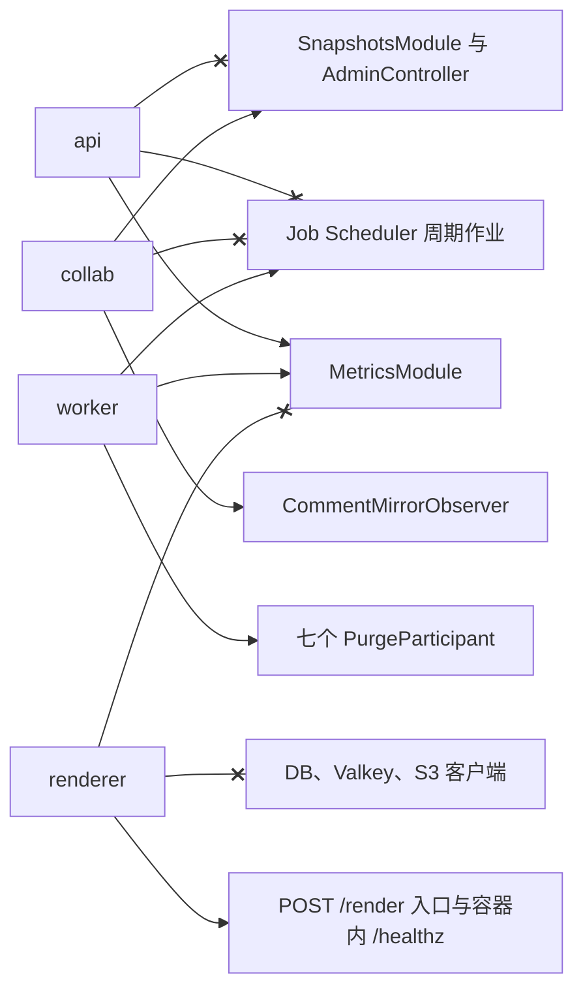
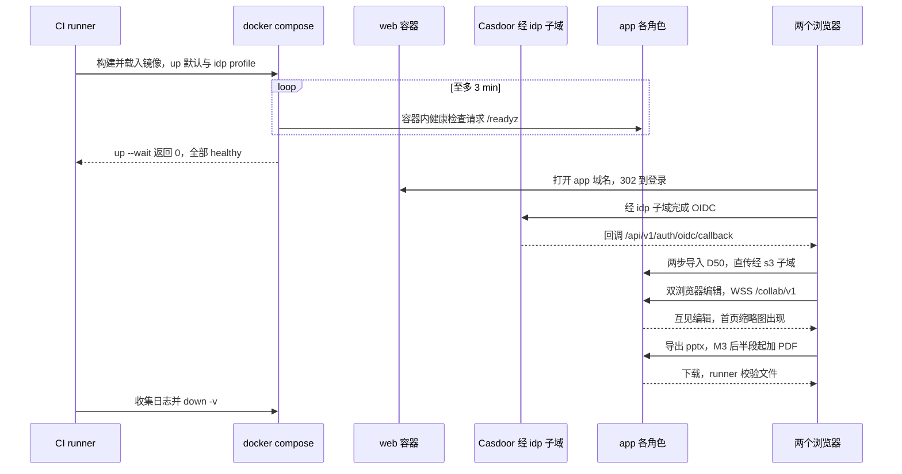
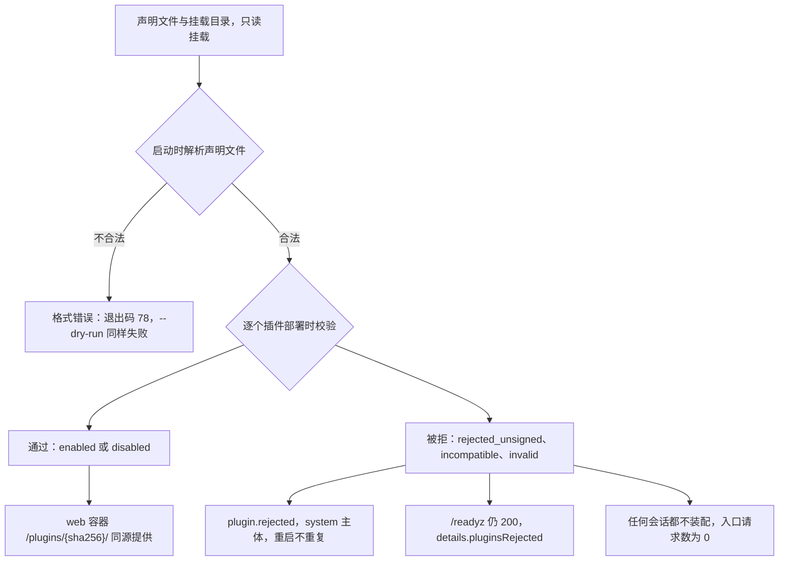
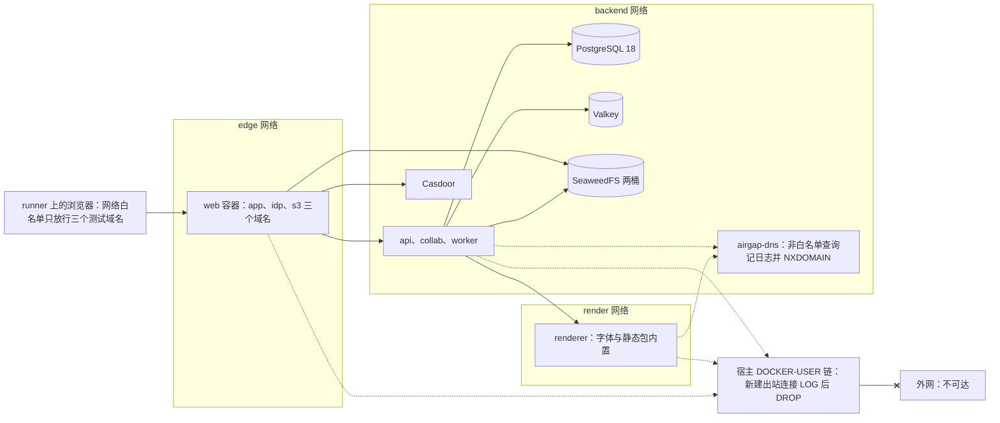
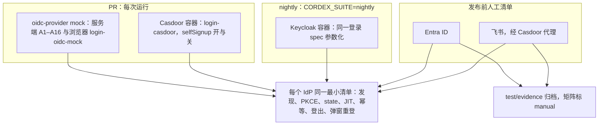

# 08 部署拓扑与环境 e2e
> 状态：v0.1 | 负责：测试设计线 | 更新：2026-09-25；2026-09-25（§4.19）；2026-09-26（§4.20）；2026-09-26（§4.21 整合：§3 新增 C7（CFG-05 配置交叉校验与镜像入口）、C8（ops-cron 只跑 audit-rotate）；§8 新增 R5（DEP-07 按文档哈希亲和））；2026-09-26（§4.21 Remap：原 30/08 引用按 60-backend/README §6.1 改指新位置，30/08 已删除）；2026-10-01（§4.23 插件管理：§2 新增 RA13（声明文件与签名开关的启动断言）；§3 新增 C9（挂载目录、签名与审核校验、被拒插件不进任何会话、`/readyz` 的 `pluginsRejected`）；§4 新增 G13（web 容器 `/plugins/{sha256}/` 同源静态路径与 CSP）；图 8-5）；2026-10-03（§4.24 AL-3：RA13 改为 renderer 不装 PluginsModule，内容级集合经 RPC contentPlugins 下发）；2026-10-22（design-language-v3 第 3 批：按 rulings §4.25 DS-119…DS-121、DS-124——§4 G8 的 `/auth/config` 可变项补注册地址；§7 IdP 矩阵的 mock 行改为 07 §6 A1–A16、Casdoor 行补登录页两态的文案与 `prompt=login` 实测）；2026-10-22（design-language-v3 第 3 批回写续：§2 RA12 补 `auth.selfSignup` 为真而 `auth.signupUrl` 为空拒绝启动（rulings §4.25 TB-143，60/17 CFG-02）；§4 G8 补 `trashDays` 只来自 `GET /auth/config`（TB-141），新增 G14 导入上限一处取值（TB-147，60/17 DEP-08）；§7 Casdoor 行补不遵守 `prompt=login` 时的错误行退路（TB-140）；§12 同步；同日再补：§4 G14 补 web 容器读的是应用容器同名的 `CORDEX_SCALE_MAX_FILE_BYTES`（`CORDEX_WEB_` 前缀规则的唯一例外，rulings §4.25 TB-158，60/17 §3.6）与值不合法时拒绝启动；G8 补 M3 模板源 `templates.sources` 经 `CORDEX_WEB_RUNTIME_CONFIG_FILE` 渲染、形状不合时拒绝启动（TB-160）；§12 同步；别组提来的 G14、RA12 与 Casdoor 行的修改此前已按此写；2026-10-22 复核修正：§4 G8 补模板源跨源时 web 容器把各 `manifestUrl` 的源追加进 CSP `connect-src`（rulings §4.25 TB-168）、非测试部署的 RuntimeConfig 里没有故障注入项（TB-169），§12 同步；§13 早先写「待回写」的一条（40/12 §9 的 `role-assembly`、30/11 §10）核对为已回写，「断网用例落点」「CSP 模式口径」两条核对为 10 SEC-EG-03 已同步、60/17 §3.2 已对齐，核对日期去掉「复核」字样；状态头的回写轮次字样改为「回写续 / 同日再补」）；2026-10-23（design-language-v3 第 3 批评审修改：§4 G14 的「导入页」改为导入对话框的说明句（rulings §4.25 DS-140）；断言与步骤不变） | 依赖：rulings §4.25 DS-140、rulings §4.25 TB-168、TB-169、rulings §4.25 TB-158、TB-160、rulings §4.25 TB-140、TB-141、TB-143、TB-147、rulings §4.25 DS-119…DS-121、DS-124、rulings §4.20 BE-04、rulings §4.19 D-M2-CONTENT / C-06 / D-TEST-INFRA、[01](./01-strategy-and-layers.md)、[06](./06-frontend-component-and-e2e.md)、[07](./07-backend-integration-and-api-e2e.md)、[60/17](../60-backend/17-deployment-and-config.md) §2 / §3 / §8（原 30/08 §10 / §10.1）、[ADR-0037](../30-architecture/adr/0037-deployment-topology-and-packaging.md)、[ADR-0035](../30-architecture/adr/0035-gateway-horizontal-scaling.md)、[ADR-0029](../30-architecture/adr/0029-gateway-authorization.md)、[40/12](../40-modules/12-server-jobs-comments-and-ops.md) §7.1 / §9、[40/19](../40-modules/19-atlas-backend-and-data.md) §3 / §4 / §8、PRD 04 NF-03 / NF-04、PRD 05 M3 验收 10 与 M4 SV-09、rulings §4.15 Q6 / Q10、§4.18 BE-01 / BE-03 / BE-13 / BE-14 / BE-19 / GV-14 / GV-16

本文是部署与环境层测试的唯一事实源：进程角色装配、compose 洁净栈冒烟、web 容器与反代子域、断网环境、镜像门禁的运行时部分、IdP 兼容矩阵、发布演练、备份恢复演练与 M4 的离线包 / 多架构 / Helm 冒烟——每一类写环境怎么搭、断言什么、何时跑。

读者：`apps/server` 与部署文件的实现者、运维、CI 维护者。

边界：部署拓扑、compose 服务与网络、web 容器配置、配置 schema、角色矩阵以 [60/17](../60-backend/17-deployment-and-config.md) 与 [60/01](../60-backend/01-service-overview-and-roles.md) 为准，本文不复述配置值；renderer 的零出站、沙箱与签名 RPC 等安全用例归 [10](./10-security-testing.md) §9；浏览器用例本身在 [06](./06-frontend-component-and-e2e.md)，服务端集成 harness 在 [07](./07-backend-integration-and-api-e2e.md) §2；CI 步骤名与激活时间线以 [12](./12-ci-gates-mapping.md) 为准。与 10 重叠的用例以其 SEC id 开头命名测试标题（10 §0）：§2 RA8 / RA9 → SEC-RS-05；§4 G4 → SEC-RS-04，G5 → SEC-CL-01；§5 → SEC-EG-03、SEC-CT-06；§6 → SEC-SC-06；§7 → SEC-AU-02。

---

## 1. 范围

| 类别 | 被测对象（事实源） | 本文小节 | CI 步骤 |
|---|---|---|---|
| 角色装配 | `CORDEX_ROLE` 语义、「模块 × 角色 × 部件」矩阵与启动断言（[60/01](../60-backend/01-service-overview-and-roles.md) §4–§6） | §2 | `test/server-integration` |
| compose 冒烟 | compose 服务、profiles、网络（60/17 §2） | §3 | `e2e/full-compose` |
| web 容器与子域 | 路径分流、`idp.` 与 `s3.` 子域、nonce 与缓存头（60/17 §3；CSP 正文 [50/14](../50-frontend/14-client-security.md) §2） | §4 | `e2e/full-compose` |
| 断网 | 静态包与字体内置、零出站（ADR-0037） | §5 | `e2e/full-airgap` |
| 镜像门禁 | digest 钉死、SBOM、许可白名单、renderer 与 worker 锁步（60/17 §4） | §6 | `scanners/check-image-policy`（静态）；`e2e/full-compose`（运行时） |
| IdP 兼容 | OIDC RP（[60/02](../60-backend/02-auth-chain.md) §2–§3） | §7 | `e2e/smoke`（PR）；nightly |
| 发布与恢复演练 | 滚动发布、协议兼容、备份恢复（60/17 §9–§10；ADR-0035） | §8–§9 | `e2e/full-compose`（main / nightly） |
| M4 交付物 | 离线包、多架构、Helm | §10 | nightly（M4 起） |

目录：部署层用例放根 `test/deploy/`（[01](./01-strategy-and-layers.md) §5），角色装配放 `apps/server/test/integration/boot/role-assembly.int-spec.ts`（按 [01](./01-strategy-and-layers.md) §4 判定树：它直接编译 Nest 模块、以子进程启动，不经 HTTP / WS 入口，属集成层；40/12 §9 原登记的 `role-assembly.e2e-spec.ts` 由回写改名，决策 T-NAMING）。

```text
test/deploy/
├── compose/
│   ├── compose.test.yml         叠加在 60/17 的 compose 文件之上：测试 CA 证书、三个测试域名、Casdoor 种子、日志采集
│   ├── compose.airgap.yml       断网覆盖：日志型 DNS、网络设置与出站记录（§5）
│   └── casdoor-init/            init_data：组织、应用、client、测试用户（§7）
├── specs/                        compose-smoke、web-container、airgap、idp-keycloak、rolling-restart、valkey-outage、
│                                 protocol-compat、backup-restore 各一个 spec（Playwright project `deploy`）
├── scripts/                      egress-report.ts（汇总出站记录）、sbom-check.ts、restore-drill.ts
└── m4/                           offline-bundle、multiarch-thumbs、helm-kind（M4 起）
```

浏览器侧沿用 [06](./06-frontend-component-and-e2e.md) §4 的 `TestEnv` 接口，compose 实现只有一份（`apps/web/e2e/support/env/compose-env.ts`），`test/deploy` 与 `apps/web/e2e` 共用。

---

## 2. 角色装配（role-assembly）

依据：rulings §4.18 BE-13（矩阵）、BE-03（api 不装快照与管理动作）、BE-14（renderer 精简）、BE-15（参与者集合）、BE-19（周期作业只在 worker）；ADR-0037「如何被机械验证」；决策 T-CI（role-assembly 在 `test/server-integration`）、INC-26。

**装配来源**：期望矩阵只来自 `config/roles.ts`（60/01 §5 矩阵的代码形态）；另把 `roles.ts` 导出为 `apps/server/test/fixtures/role-matrix.snapshot.json`，与 60/01 §5 在同一 PR 中修改并经 60 线 CODEOWNERS 审批，防止代码与文档各改各的。

**执行方式**：装配类断言在测试进程内以 `AppModule.forRole(role)` 编译 Nest 测试模块、读取 `ModulesContainer` 与各模块的 provider / controller 表；退出码与进程级断言（非法角色、凭据环境变量、网络连接）以子进程启动，连接 [07](./07-backend-integration-and-api-e2e.md) §2 的容器 harness。

| # | 用例 | 断言 |
|---|---|---|
| RA1 | 五个合法角色都能启动 | `all`、`api`、`collab`、`worker`、`renderer` 各自 `assertRoleAssembly` 与 `assertRoleConsistency` 通过；实际装配的模块与部件逐项等于 `roles.ts` |
| RA2 | 非法角色 | `CORDEX_ROLE` 为空、`foo`、大小写错误 → 退出码 78（EX_CONFIG，60/01 §6 A2）并输出合法值列表 |
| RA3 | 装错即失败 | 以测试覆盖把 `SnapshotsModule` 或 `ElementPurgeController` 加进 api、把 `MetricsModule` 加进 renderer、从 worker 去掉或多登记一个参与者、在 api 注册一个 Job Scheduler → 各自退出码 70（EX_SOFTWARE，A4b / A5 / A6 / A7 / A9），证明启动断言不是空实现 |
| RA4 | api 的边界 | 无 `SnapshotsModule`、无 `AdminController`；路由表中没有 `/api/v1/documents/:id/snapshots*` 与 `…/elements/purge` |
| RA5 | collab 的边界 | 装 `SnapshotsModule`、`AdminController`、`CommentMirrorObserver`，激活 `collabServer` |
| RA6 | worker 的边界 | `@PurgeParticipant` 集合 = {permissions, share-links, media, collab, thumbnails, comments, user-marks}；collab 参与者存在但 `collabServer` 未激活 |
| RA7 | 周期作业只在 worker | 对同一 Valkey 依次只启动 api、只启动 collab → `maintenance` 队列没有任何 Job Scheduler 条目；再启动 worker → 条目集合等于 60/06 §4 的周期作业清单 |
| RA8 | renderer 精简 | 进程内无 DB、Valkey、S3 客户端 provider，无 `CordisHostModule`、`MetricsModule`、`AuditModule`；只监听 render 网络上的 RPC 端口（`POST /render`），`/healthz` 仅容器内可达，不启动内部端口 9464（60/01 §4、§6 A10）；子进程运行期间 `/proc/<pid>/net/tcp` 中没有到 PG、Valkey、S3 端口的连接（Linux runner） |
| RA9 | renderer 拒绝凭据 | 60/17 §6「角色 × 机密矩阵」中 renderer 列为「禁止」的每一项（三个 DB 口令、Valkey 口令、S3 密钥、OIDC client secret、JWT 签名私钥、KEK、运维令牌、审计盐、renderer 签名私钥）逐项注入一次 → 各自退出码 78；只给验签公钥时正常启动（与 [10](./10-security-testing.md) SEC-RS-05 同一断言，测试标题带该 id） |
| RA10 | `all` 的并集 | `all` 的装配 = api ∪ collab ∪ worker |
| RA11 | 生产鉴权配置 | production 下既无外部 issuer 又未启用 `idp` profile 对应的配置 → 退出码 78（A3；compose 层的同一断言见 §3 C3） |
| RA12 | 其余启动断言各一条负向用例 | 以 60/01 §6 为清单逐条：未登记或已废止的 `CORDEX_*` 变量（如 `CORDEX_AUTH_MODE`）、机密文件权限宽于 0400 → 78（A1，60/17 §6）；内部端口等于对外端口或 production 下内部监听为通配地址 → 78（A10）；DB 池以 `cordex_migrator` 登录或 `rolbypassrls = true` → 78（A11）；api 进程配置了 `db.system.passwordFile` → 78（60/08 DB-09）；关键插件停在 `PENDING` → 70（A12）；production 下 snapshots 桶未开版本化或 data 桶开过版本化 → 拒绝启动（60/04 DOC-15）；`auth.selfSignup = true` 而 `auth.signupUrl` 为空 → 78（启动交叉断言，2026-10-22，rulings §4.25 TB-143，60/17 §5.5、§12 CFG-02；登录页因此不会出现没去处的「注册」）。清单比对：60/01 §6 每个断言编号至少被一个负向用例引用，否则本文件失败（60/01 V1） |
| RA13 | 插件声明文件与签名开关（2026-10-01，§4.23，60/17 §5.16） | api、collab、worker 三个角色装配 `PluginsModule` 并在启动时按同一份声明文件完成部署时校验；renderer 不装 `PluginsModule`、不读声明文件、不连库，`/render` 页的内容级集合只来自 worker 的 RPC 字段 `contentPlugins`（2026-10-03 rulings §4.24 AL-3，60/01 §5、60/06 §10.3；断言：renderer 进程内无 `PluginCatalog` provider，与 RA8 同法检查）；`plugins.catalogFile` 已配置但文件不存在、不是合法 JSON、`schemaVersion` 未知或违反 schema（缺 `id`、`initial.state` 取值非法、`source` 为绝对路径）→ 各自退出码 78，`cordex-server --dry-run` 对同样四例同样以 78 失败且不连接任何外部依赖；`NODE_ENV=production` 且 `plugins.allowUnsigned=true` → 78；`plugins.trustedKeysFile` 不可解析 → 78；未配置 `plugins.catalogFile` → 正常启动、只含镜像内置插件（PM-04）；**单个**插件校验失败不影响启动（该插件被拒，C9） |

**图 8-1 角色与模块装配断言**



怎么读：实线箭头表示该角色必须装配此模块或部件，带叉的线表示必须不装配（装了即启动失败）；`all` 是前三个角色的并集，图中不单列。图只画 RA4–RA8 的关键边，完整矩阵以 60/01 §5 为准。

依据：rulings §4.18 BE-03、BE-13、BE-14、BE-15、BE-19；ADR-0037 决策 1。

---

## 3. compose 冒烟（`ops:compose`）

依据：PRD 05 M3 验收 10；rulings §4.15 Q10、§4.18 BE-01 / BE-11；ADR-0037 决策 2–3。步骤 `e2e/full-compose`（main 全量段，M3 出口起阻断）。

**环境搭建**：

1. 用当前提交构建 `cordex-server`、web、renderer 三个镜像并 `docker load`；其余镜像按 digest 预拉（缓存见 [12](./12-ci-gates-mapping.md) §9）。
2. compose 文件 = 60/17 §2 的部署文件 + `test/deploy/compose/compose.test.yml`；启用默认 profile 与 `idp` profile（Casdoor）。
3. 测试 CA 在运行时生成，web 容器用它签发 `app.<测试域>`、`idp.<测试域>`、`s3.<测试域>` 三个名字的证书；runner 上的 Chromium 以 `--host-resolver-rules` 把三个名字解析到本机、以 `--ignore-certificate-errors-spki-list` 只信任该证书（不全局关闭证书校验）。
4. Casdoor 以 `casdoor-init/` 的 `init_data` 种子启动（§7）。

**断言**：

| # | 用例 | 断言 |
|---|---|---|
| C1 | 就绪时限 | 自 `docker compose up --wait` 开始计时，各应用容器的健康检查（容器内请求 `/readyz`，探针不经反代，60/17 §3.1）在 3 min 内全部 healthy、`up --wait` 以 0 返回；`https://app.<测试域>/readyz` 经反代为 404（§4 G4） |
| C2 | 主链路 | 见图 8-2：经 `idp.` 子域登录 → 导入 D50 → 双浏览器编辑互见 → 文档列表出现首页缩略图 → 导出 pptx（下载后以 Node 编解码打开并通过 XSD 校验）→ M3 后半段起导出 PDF → 登出 |
| C3 | 生产鉴权配置 | 另起一次：production 配置、不启用 `idp` profile、也不配外部 issuer → 应用容器以退出码 78 退出，`up --wait` 失败且日志含配置错误（ADR-0037；60/01 §6 A3） |
| C4 | 拆分部署 | 同一 compose 以 api、collab、worker 三个服务替代 `all` 再跑一遍 C2：快照与元素彻底删除路由由反代转给 collab 后可用（若分流错误，api 会返回 404） |
| C5 | 清理 | `docker compose down -v` 后无残留容器与卷；全部容器日志作为产物上传 |
| C6 | 告警规则单测 | 在同一栈内对 `deploy/observability/prometheus/rules/cordex.rules.yml` 运行 `promtool test rules`，并断言规则只引用 60/18 §4 名表中的指标（60/18 §5.3） |
| C7 | 配置交叉校验与镜像入口（60/17 §12 CFG-05，2026-09-26 整合登记） | 另起若干次：`collab.hocuspocus.timeoutMs` 小于 `limits.idleTimeoutMs`、`limits.ws.step2MaxBytes` 小于 `limits.maxUpdateBytes`、`limits.ws.idleCheckIntervalMs` 不小于 `limits.idleTimeoutMs`、出现旧键 `limits.xml.maxTextNodeBytes`，各自使应用容器以退出码 78 退出且日志指明键名（旧键提示新键 `limits.xml.maxTextLength`）；`docker inspect cordex-server` 的入口含 `--import ./dist/observability/otel.js` |
| C8 | `ops-cron` 常驻服务（60/17 §2、§9，2026-09-26 整合登记） | `ops-cron` 以 `cordex-ops cron` 常驻、无监听端口、只读根文件系统；内置时刻表只含 `audit-rotate` 一项：以测试钩子把时钟推到 03:00 后恰执行一次 `audit-rotate`（未来 3 个月审计分区存在），上一次未结束时不重入；收到 SIGTERM 等当前任务结束后以退出码 0 退出 |

| C9 | 插件部署时校验 `plugins:trust`（2026-10-01，§4.23，M4；镜像内置部分 M3） | `compose.test.yml` 把 `test/deploy/compose/plugins/` 以只读方式挂到 `plugins.mountDir`，并挂入声明文件与受信公钥文件。挂载目录放六个插件包：① 签名有效（公钥在受信文件中）；② 无签名但声明文件有审核记录并钉住 SHA-256；③ 无签名且无审核记录；④ 声明的 `sha256` 与包不符；⑤ `hostApi` 不覆盖当前宿主；⑥ 声明 `scope:'ui'` 却贡献 `slide.shapeKind`。断言：①② 为 `enabled` 或按 `initial` 为 `disabled`；③ `rejected_unsigned`、④ `invalid`（原因 `digest_mismatch`）、⑤ `incompatible`、⑥ `invalid`（原因 `scope_downgrade`）；`GET /admin/plugins` 与 `cordex-ops plugins:check`（只读，60/17）输出的状态与原因码逐项一致；每个被拒插件恰一条 `plugin.rejected`（主体 `system`），`docker compose restart` 后不重复写；被拒插件在任何会话都不出现：`GET /users/me/plugins` 不含、浏览器侧对其 `/plugins/{sha256}/` 入口的请求数为 0、服务端 headless 导出不装配；③ 的初始状态写为 `forced` 时容器内 `/readyz` 仍为 200 且 `details.pluginsRejected` 列出 `{id, version, reason}`，指标 `cordex_plugins_rejected{reason="unsigned"}` 为 1，告警规则 `CordexPluginsRejected` 在 `promtool` 单测中触发；界面上不存在任何上传或安装插件的入口（遍历 `/admin/plugins` 与编辑器可点击元素的 testid 与可访问名，无「上传」「安装」「从 URL 添加」） |

C2 通过后，同一个栈继续作为 [06](./06-frontend-component-and-e2e.md) §12 浏览器全量用例的被测环境。

**图 8-2 compose 冒烟全流程**



怎么读：自上而下是时间顺序；就绪由 compose 健康检查在容器内探测 `/readyz`（不经反代）；浏览器只和 web 容器打交道，登录与直传分别经 `idp.` 与 `s3.` 子域，由 web 容器保持 Host 头转发。「app 各角色」在默认部署是一个 `CORDEX_ROLE=all` 容器，C4 中是三个服务。

依据：60-backend/17 §2；ADR-0037；rulings §4.18 BE-01、BE-11。

---

## 4. web 容器与子域

步骤 `e2e/full-compose`，文件 `test/deploy/specs/web-container.spec.ts`。被测配置以 60/17 §3 为准，CSP 正文以 [50/14](../50-frontend/14-client-security.md) §2 为准。

| # | 断言 | 依据 |
|---|---|---|
| G1 | 浏览器的 OIDC 往返经 `idp.<测试域>` 完成，issuer 为对外 URL | rulings §4.18 BE-01 |
| G2 | 预签名直传经 `s3.<测试域>`，Host 头原样到达 SeaweedFS（签名校验依赖 Host，改写即失败）；分片上传收尾成功；web 容器 s3 访问日志只记路径、不含 query（query 里有预签名签名） | BE-01；60/17 §3.1、DEP-03 |
| G3 | Casdoor 与 SeaweedFS 没有宿主端口：`docker compose ps --format json` 中二者 `Publishers` 为空，且从 runner 连接其默认端口失败 | BE-01；ADR-0037 |
| G4 | 经反代访问 `/internal/*`、`/metrics`、`/healthz`、`/readyz` → 404；一个只挂 edge 网络的探针容器连接 app 的内部端口 9464 → 失败（内部端口只绑 backend 网络） | rulings §4.18 BE-11；决策 INC-26；60/01 V4；[10](./10-security-testing.md) SEC-RS-04 |
| G5 | `index.html` 连续请求两次：两次的 nonce 不同；每次 CSP 头中的 nonce 与 `<meta name="cordex-nonce">`、`<script nonce>` 相同 | 决策 CSP-NONCE |
| G6 | `index.html` 为 `Cache-Control: no-store`；`/assets/*` 与 `/fonts/*` 带内容哈希（字体路径带 fontProfile 版本）且 `public, max-age=31536000, immutable`；静态资源响应不带 CSP 头 | CSP-NONCE；决策 VERSION-DRIFT-SW；60/17 §3.1 |
| G7 | 其余安全头与 50/14 §2.6 一致（`Referrer-Policy`、`X-Content-Type-Options`、`Permissions-Policy`、`Cross-Origin-Opener-Policy`）；M2 带 `Content-Security-Policy-Report-Only`，M3 起 TT 指令并入强制头 | 50/14 §2；rulings §4.15 Q2 |
| G8 | RuntimeConfig 由容器启动时从环境变量渲染：改一个静态部署项后重启容器，页面读到新值；可变开关（`selfSignup`、IdP 显示名与注册地址，后者 2026-10-22 随 rulings §4.25 DS-119 登记）与回收站保留天数 `trashDays`（同日，TB-141）只来自 `GET /auth/config`，RuntimeConfig 里没有这几项；M3 模板库的集成方模板源 `templates.sources`（`{ id, name, manifestUrl }[]`，2026-10-22，rulings §4.25 TB-160）由 `CORDEX_WEB_RUNTIME_CONFIG_FILE` 提供、随 RuntimeConfig 整体校验——配置两个源时页面读到的列表与文件一致，条目缺 `manifestUrl` 时 web 容器拒绝启动、非零退出；生产镜像以 `auth.mode=none` 启动 web 容器被启动脚本拒绝、容器非零退出（60/17 §3.3）；配了跨源的模板源时，`index.html` 响应的 CSP `connect-src` 恰好追加这些 `manifestUrl` 的源（与 `embed.allowedHostOrigins` 同一份值两处渲染：RuntimeConfig 与 CSP 头，50/14 §2.2 的模板源占位、60/17 §3.2，2026-10-22，rulings §4.25 TB-168），没配时 `connect-src` 不多出源；非测试部署（`CORDEX_WEB_ENV` 不是 `test`）渲染出的 RuntimeConfig 里没有测试部署专用的故障注入项（TB-169，50/15 §10） | 决策 RUNTIME-CONFIG；60/17 §3.2、§3.3、§3.6；rulings §4.25 TB-160、TB-168、TB-169 |
| G9 | 路径分流：`/api/*` → api、快照与元素彻底删除 → collab、`/collab/*`（WS 升级）→ collab；WS 读超时不小于 3600 s（读取容器内生效配置断言，不做一小时等待） | 60-backend/17 §3.1；BE-03 |
| G10 | 证书 SAN 覆盖三个名字 | 60-backend/17 §3.1 |
| G11 | `storage:init` 之后读回：data 桶未开版本化、无生命周期规则；snapshots 桶已开版本化且只有一条非当前版本过期规则；两桶 CORS 符合 60/14 §5；再执行一次 `storage:init` 幂等 | 60/14 §5、OB-03 |
| G12 | 客户端 IP 不可伪造（与 [10](./10-security-testing.md) SEC-RL-01 / RL-03 (f) 同一断言的部署层版本）：浏览器侧与测试客户端经 web 容器发请求时带伪造的 `X-Forwarded-For` 首跳（每次换值），应用收到的 `X-Forwarded-For` 被 web 容器以 `$remote_addr` 覆盖而非追加；`@Public` 端点的限流主体、WS 升级扣的 IP 桶与审计 `ip_hash` 都不随伪造值变化。**upstream 模式**另起一次：`CORDEX_WEB_TLS_MODE=upstream`，前置一个测试 LB 容器（网段登记在 `CORDEX_WEB_TRUSTED_LB_CIDRS`），web 容器只信任该网段一跳（realip），同一组断言成立，且 `$remote_addr`、`X-Forwarded-For` 与 Casdoor 看到的来源地址三者一致；`CORDEX_WEB_TRUSTED_LB_CIDRS` 为空时 web 容器拒绝启动（非零退出） | rulings §4.20 BE-04；60/17 §3.1、DEP-03 |
| G13 | 插件静态路径（2026-10-01，§4.23，M4）：C9 中通过校验的插件浏览器产物经 `https://app.<测试域>/plugins/{sha256}/…` 同源提供，带 `public, max-age=31536000, immutable`、正确的 `Content-Type`、不带 CSP 头；未通过校验或未声明的 `{sha256}` → 404；`/plugins/../`、编码后的 `%2e%2e`、指向挂载目录外的符号链接 → 404 且不泄露目录列表；页面 CSP 仍为 `script-src 'self' 'nonce-…'`，加载插件后 csp-recorder 违规为 0（不因插件放宽 CSP） | 60/17 §3.1、§5.16；[50/14](../50-frontend/14-client-security.md) §2；PRD PM-04 |
| G14 | 导入上限一处取值（2026-10-22，rulings §4.25 TB-147）：只在项目 `.env` 里设 `CORDEX_SCALE_MAX_FILE_BYTES=104857600` 时，web 容器渲染的 RuntimeConfig `limits.importMaxBytes` 与应用的 `scale.maxFileBytes` 都是 104857600，导入对话框的说明一行写「把 .pptx 文件拖到这里，单个文件最大 100 MB」（2026-10-23 起导入在叠在原页上的对话框里，rulings §4.25 DS-140），`POST /imports/uploads` 申报 104857601 字节得 413 `format.quota_exceeded`（`dimension: 'fileSize'`）；不设时两边都是 209715200；web 容器读的就是应用容器同名的 `CORDEX_SCALE_MAX_FILE_BYTES`——`CORDEX_WEB_` 前缀规则的唯一例外，不另设 `CORDEX_WEB_*` 变量（2026-10-22，rulings §4.25 TB-158）：`docker compose config` 读回 web 与 app 两个服务的这一项都取自项目 `.env` 的同一行，值不合法（如 `abc`、`0`）时 web 容器随 RuntimeConfig 整体校验拒绝启动、非零退出 | 60/17 §3.3、§3.6、§5.9、§5.15、§12 DEP-08；rulings §4.25 TB-147、TB-158、DS-140；[06 §5](./06-frontend-component-and-e2e.md) 第 21 行 |

**图 8-5 插件从声明文件到会话的部署层断言**



怎么读：自上而下是一次部署启动；声明文件整体不合法是部署错误、直接拒绝启动（RA13），单个插件不合法只拒绝该插件、部署照常就绪（C9）；通过校验的浏览器产物才会出现在 web 容器的同源静态路径上（G13）。
依据：PRD 09 PM-04、PM-05 与图 3-1；60/17 §5.16、§6；PRD 05 M4 验收 7。

---

## 5. 断网 e2e（`ops:airgap`）

依据：PRD 05 M3 验收 10；rulings §4.15 Q10；ADR-0037；决策 FONTS（字体同源自托管、renderer 字体内置）。步骤 `e2e/full-airgap`（main 全量段，M3 出口起阻断）。

### 5.1 环境

- 全部镜像事先 `docker load`，compose 以 `--pull never` 启动；运行期间订阅 `docker events --filter type=image`，出现任何 `pull` 事件即失败。
- `compose.airgap.yml` 做三件事：
  1. **日志型 DNS**：给 `airgap-dns`（CoreDNS）分配固定 IP，全部服务的 `dns:` 指向该 IP。compose 服务名由 Docker 内置 DNS 解析，其余查询被转发到 `airgap-dns`；它只应答三个测试域名（指向 web 容器），其余一律 NXDOMAIN 并记日志。
  2. **出站记录与阻断**：宿主 `DOCKER-USER` 链先放行已建立连接的回包，再对来自本次 compose 各网桥、目的地址不在 compose 子网内的新建连接 `LOG`（前缀 `CORDEX-EGRESS`）后 `DROP`。为使每个容器的出站企图都经过这条链、可被记录，覆盖文件把 backend 与 render 网络的 `internal` 改为 `false`；隔离仍然是完全的（全部 `DROP`），而生产配置的 `internal: true` 由 §4 G4 与 [10](./10-security-testing.md) §9 在未改动的拓扑上验证。
  3. 应用解析 `idp.<测试域>` 时经网络别名指向 web 容器，OIDC 发现与 JWKS 拉取留在栈内。
- 浏览器在 runner 上运行，它的请求由 [06](./06-frontend-component-and-e2e.md) §10.2 的网络白名单约束（只允许三个测试域名）。

### 5.2 流程与判定

跑 §3 的主链路（登录 → 导入 → 编辑 → 缩略图 → 导出 pptx 与 PDF），另加一条：断网栈以 `externalResources=never` 部署，导入并打开含外链图片的夹具 → 显示「外部资源已阻止」占位，浏览器与服务端都没有对外请求（服务端永不加载外链，rulings §4.15 Q7；缩略图与 PDF 中同样是占位）。结束后 `scripts/egress-report.ts` 汇总：

| 来源 | 通过条件 |
|---|---|
| 内核日志中前缀 `CORDEX-EGRESS` 的行 | 0 |
| `airgap-dns` 的非白名单查询 | 0 |
| `docker events` 中的镜像拉取 | 0 |
| 浏览器网络白名单之外的请求 | 0 |
| 主链路各步 | 全部成功（字体、静态包、渲染代码都来自镜像内） |

任一不为 0 即失败，报告列出源容器、目的地址或查询名与时间，作为产物上传。

**图 8-3 断网 compose e2e 拓扑**



怎么读：实线是栈内的正常访问；虚线是「如果有出站企图会走到哪里」——名字解析落到日志型 DNS，直连 IP 落到宿主 `DOCKER-USER` 链，二者都会留下记录；带叉的边表示到外网一律被丢弃。判定只看记录是否为 0，不依赖应用是否报错。

依据：ADR-0037 决策 2–3 与「如何被机械验证」；rulings §4.15 Q10；60-backend/17 §2。

---

## 6. 镜像门禁（`ops:image-licenses`）

依据：PRD 04 NF-04「镜像」行；rulings §4.15 Q10、§4.18 GV-16；ADR-0037。

| 部分 | 断言 | 执行点 |
|---|---|---|
| 静态 | compose 文件、Dockerfile、发布清单中全部镜像按 digest 钉死；默认 profile 镜像主组件许可落在 `policy/image-license-allowlist.json`；renderer 镜像的 Chromium 版本与 `server-headless` 声明的版本锁一致；renderer 非 root、不挂凭据、启动参数不含 `--no-sandbox` | `scanners/check-image-policy`（PR，40/01 TD-084） |
| 运行时 | 对本次 compose 实际运行的每个镜像生成 SBOM（SPDX JSON），以镜像 digest 命名并作为产物；SBOM 中的主组件许可在白名单内；`observability-agpl` profile 的镜像不在默认 profile 中出现 | `e2e/full-compose`（main） |
| 锁步 | renderer 与 worker 报告同一应用版本（镜像标签 `org.opencontainers.image.version` 与各自 `/healthz` 返回的版本相同）；`cordex-server`、web、renderer 三个镜像内置字体文件的 sha256 清单一致（60/17 DEP-04） | `e2e/full-compose` |

高危漏洞阻断与 npm 供应链检查归 [10](./10-security-testing.md) §13。

---

## 7. IdP 兼容矩阵

依据：决策 T-IDP（authority：rulings §4.15 Q6 CI 分层认证 + 不过度设计），needsUser=false；ADR-0029「如何被机械验证」。

| 层 | IdP | 环境 | 触发 | 用例 |
|---|---|---|---|---|
| PR | oidc-provider mock | 测试进程内（[07](./07-backend-integration-and-api-e2e.md) §2） | 每个 PR | 服务端：07 §6 A1–A16（2026-10-22 起含发现文档不可达时也 302 回前端、回调的三个失败出口与 `prompt=login` 透传，rulings §4.25 DS-120、DS-121、DS-124）；浏览器：`login-oidc-mock`（[06](./06-frontend-component-and-e2e.md) §5 第 9 行），登录页其余各态在第 65 行 |
| PR | Casdoor 容器 | 同一 PG 实例内独立 database，`init_data` 种子；`selfSignup` 开、关两套种子 | 每个 PR | `login-casdoor`；注册入口两态（`selfSignup` 关时登录页常显「没有账号？请联系管理员开通」、开时为「注册」，DS-119）；实测内置 Casdoor 是否遵守 `prompt=login`（已有 IdP 会话时带它重新发起要求重新输入账号，DS-124，结论回写 [60/02](../60-backend/02-auth-chain.md) §2；不遵守时登录页停用那条错误行补「如需改用其他账号，请先在登录服务中退出」，TB-140，[06 §5](./06-frontend-component-and-e2e.md) 第 65 行按结论断言） |
| nightly | Keycloak 容器 | realm 导出文件作为夹具（[11](./11-test-data-fixtures-and-determinism.md) §7） | `CORDEX_SUITE=nightly` | 同一登录 spec 以 `CORDEX_IDP=keycloak` 参数化运行 |
| 人工 | Entra ID；飞书（经 Casdoor 代理） | 发布前在临时租户上执行 | 每次发布候选 | 下文清单 |

**每个 IdP 都跑的最小清单**：发现文档可取；授权码 + PKCE（S256）；state 往返与重放拒绝；首次登录 JIT 建用户与身份行；再次登录不新增行；缺 `email` claim 时显示名回退正常；登出（有无 `end_session_endpoint` 两种）；弹窗重新登录（`mode=popup`）落到 `/auth/popup-callback`。

**测试账号与密钥**：mock、Casdoor、Keycloak 的账号与 client secret 每次运行随机生成、只存在于该次运行的环境中，仓库只存不含秘密的种子模板；Entra 与飞书不进 CI，因此 CI 中没有任何真实 IdP 的密钥；人工清单使用的临时租户凭据存放在团队密码管理器，结果按 [01](./01-strategy-and-layers.md) §8 归档为 `test/evidence/<版本>/idp-<名称>.md`（逐项 pass / fail、执行人、日期、截图链接）。

**图 8-4 IdP 兼容矩阵**



怎么读：三个分组是三个运行层级，越往下越少运行、越接近真实部署；所有 IdP 共用同一份最小清单，人工层的结果以证据文件进入追溯矩阵（[13](./13-requirements-traceability.md) §8）。

依据：rulings §4.15 Q6；决策 T-IDP、T-COVERAGE-EVIDENCE。

---

## 8. 发布演练

步骤 `e2e/full-compose`，使用 §3 C4 的拆分部署，collab 起两个副本。

| # | 演练 | 做法 | 通过条件 | 触发 |
|---|---|---|---|---|
| R1 | 滚动重启 | 两个浏览器按固定节奏持续编辑（每次编辑带唯一标记），依次对两个 collab 副本发 `SIGTERM` 并重建 | 客户端收到 1012 后连到另一副本；结束时每个标记都出现在两个浏览器与服务端最新快照中；没有「未保存到服务器」提示残留；全部 pending 获 `ack{tier:'db'}` | main |
| R2 | Valkey 断开 30 s | `docker compose pause valkey` 30 s 后恢复，期间两个浏览器连在不同副本上继续编辑 | 断开期间各 app 实例 `/readyz` 为 503（容器内探测，探针不经反代）；恢复后两端状态向量相同、内容一致 | nightly |
| R3 | 发布时迁移 | 以上一个发布的镜像起栈并写入数据 → 执行新版本迁移作业 → 旧版本 api 仍能完成登录、列表、打开（expand 阶段兼容）→ 再滚动升级到新版本 | 全程无 5xx；升级后数据完整 | main（首个带标签的发布之后启用） |
| R4 | 协议向后兼容一个次版本 | 上一个次版本的 web 镜像作为客户端连接新版本服务端，跑 [06](./06-frontend-component-and-e2e.md) §12 的 F1、F2、F7 | 通过；消息级兼容由 [07](./07-backend-integration-and-api-e2e.md) §14 的示例消息快照保证 | main（同上） |
| R5 | 按文档哈希的亲和（60/17 §12 DEP-07，M3，2026-09-26 整合登记） | 两个 collab 副本，web 容器的 collab upstream 为 `hash $cordex_doc_id consistent`；对同一 `documentId` 先后发起 WS 升级与 `GET snapshots/latest`，再 `docker compose stop` 承载该文档的副本 | WS 升级与快照 REST 落到同一副本（按副本日志或响应头里的 `instanceId` 判定）；停掉后客户端重连到另一副本并继续编辑，全部 pending 获 `ack{tier:'db'}`（亲和不是正确性前提） | main |

依据：ADR-0035「如何被机械验证」（滚动重启期间双浏览器编辑不丢、Redis 断开 30 s 后恢复一致且期间 `/readyz` 为 503）；60/17 §9（迁移先于新版本、协议向后兼容一个次版本）。R3、R4 在第一个发布标签之前没有「上一版本」可用，在 [12](./12-ci-gates-mapping.md) §7 的激活表中登记启用时间，不以跳过代替。

---

## 9. 备份恢复演练（M3）

依据：PRD 04 NF-03「灾难恢复 RPO ≤ 1 min（含 DB）、RTO ≤ 15 min」；PRD 05 M3 验收 10「备份恢复演练脚本通过」；备份方式与恢复步骤以 60/17 §10 为准，本节只定义测量与判定。文件 `test/deploy/specs/backup-restore.spec.ts` 驱动 `scripts/restore-drill.ts`。

1. **加载**：§3 的栈按 60/17 §10 开启 PG 基础备份与 WAL 归档（`archive_timeout = 60s`）、snapshots 桶版本化、data 桶副本（演练用连续复制到第二存储；若只做每小时增量同步，恢复点受 data 桶约束，RPO 必然超标，演练直接判失败）；驱动脚本以固定节奏向 3 份文档写入编辑，每次编辑带单调递增标记并记录客户端收到 `ack{tier:'db'}` 的时刻；另从不参与写入的文档中随机抽 3 份，故障前导出 pptx 并记 sha256。
2. **故障**：在 `T_fail` 同时销毁 PG 数据卷与两个桶（模拟整机丢失），停止写入。
3. **恢复**：执行 60/17 §10 的恢复脚本（运维手册的同一脚本，不另写测试专用版本）：先恢复对象存储到 T₀，再 PG PITR 到 T₁ ≤ T₀，清空 Valkey 后启动；直到各应用容器健康检查（容器内 `/readyz`）通过且能打开文档，记该时刻为 `T_ready`。
4. **测量**：
   - RPO = `T_fail` − 恢复后库中最后一个已确认编辑的确认时刻（按标记在 `document_updates` 与快照中查找）；
   - RTO = `T_ready` − `T_fail`。
5. **判定**：RPO ≤ 1 min 且 RTO ≤ 15 min；脚本记录的 T₁ ≤ T₀（对象恢复点不早于 PG，60/14 §11）；恢复后 `documents.latest_snapshot_id` 指向的快照对象都在 snapshots 桶中、每个 `document_snapshots.baseline_key` 对象存在；审计哈希链校验通过；步骤 1 抽取的文档再次导出，sha256 与故障前相同（60/17 DEP-06）；恢复后立即对演练文档运行一次 `snapshots-retention`，`latest_snapshot_id` 所指快照、命名快照与每文档最新 import 快照及其基线全部保留（rulings §4.19 C-06），不因恢复后的时间跳变误删检查点。
6. **运行**：M3 出口一次，此后每周一次（nightly 套件按星期判定），每次发布候选一次；结果（两项测量值、各步耗时、脚本版本）自动写入 `test/evidence/<里程碑或版本>/backup-restore.md`。

---

## 10. M4

| # | 用例 | 做法 | 通过条件 | 依据 |
|---|---|---|---|---|
| M4-1 | 离线安装包 | 在没有 registry 访问的 runner 上（DNS 与出站按 §5.1 的方式阻断）`docker load` 离线包 → `ops:compose` | §3 全部断言通过；无镜像拉取事件 | PRD 05 M4 SV-09；ADR-0037 |
| M4-2 | 多架构缩略图一致 | 同一批语料在 arm64 与 amd64 runner 上由 renderer 生成缩略图 | 逐页像素差 ≤ 0.5%（比较方法同 [04](./04-visual-oracle.md)） | ADR-0037 |
| M4-3 | Helm 冒烟 | kind 集群安装 chart → `/readyz` → mock OIDC 登录 → 打开文档 → WS 经 Ingress 同步 → renderer 的 NetworkPolicy 禁止一切出站（从 renderer Pod 发起出站连接失败） | 全部通过 | 60-backend/17 §8；ADR-0037 |

三者在 M4 起进入 nightly，发布候选前各跑一次。

---

## 11. 运行时机

依据：决策 T-CI（role-assembly 与 route-auth-coverage 在 `test/server-integration`；nightly = schedule 触发同一工作流、`CORDEX_SUITE=nightly`、复用 13 个 job 名；nightly 失败自动建 issue 并阻断下一次发布打标签）；rulings §4.18 GV-14、GV-16。

| 内容 | 步骤 | 触发段 | 启用与阻断 |
|---|---|---|---|
| §2 角色装配 | `test/server-integration` | 每个 PR | M2（`all`，已含协同网关、快照与导入处理器，rulings §4.19 D-M2-CONTENT）起阻断；拆分角色随 M3 交付加入 |
| §3 compose 冒烟、§4 web 容器、§6 运行时部分、§8 R1 / R3 / R4 | `e2e/full-compose` | main；PR 改动部署相关路径时追加（[12](./12-ci-gates-mapping.md) §3） | M3 出口起阻断；此前在 main 以报告模式运行，M2 起 C2 主链路跑其 M2 子集（登录 → 导入 → 单人编辑 → 重新加载后内容保持 → 客户端导出） |
| §5 断网 | `e2e/full-airgap` | main | M3 出口起阻断 |
| §6 静态部分 | `scanners/check-image-policy` | 每个 PR | 随 compose 文件入库即阻断 |
| §7 mock 与 Casdoor 登录 | `e2e/smoke` | 每个 PR | M2 起阻断 |
| §7 Keycloak、§8 R2、§9（每周） | 同名步骤，`CORDEX_SUITE=nightly` | nightly | 失败建 issue 并阻断下一次发布打标签 |
| §7 Entra / 飞书、§9（发布候选） | 人工 / 半机械 | 发布候选 | 证据齐全方可发布 |
| §10 | nightly | M4 起 | 同 nightly |
| §2 RA13、§3 C9、§4 G13（§4.23） | RA13 随 §2 在 `test/server-integration`；C9、G13 随 `e2e/full-compose` | 同所在小节 | RA13 的声明文件格式与生产开关自 M3（镜像内置插件的声明文件）起阻断；C9 的镜像内置部分（manifest 与 `hostApi` 校验、`/readyz`）M3，挂载目录、签名与审核、G13 自 M4 起阻断（PRD 05 M4 验收 7 `plugins:trust`） |

---

## 12. 机械验证

| 断言 | 执行点 |
|---|---|
| 五个合法角色装配与 `roles.ts` 逐项一致；60/01 §6 A1–A12 每条至少一个负向用例并以规定退出码（78 / 70）失败；`role-matrix.snapshot.json` 与 `roles.ts` 一致 | `test/server-integration`（`apps/server/test/integration/boot/role-assembly.int-spec.ts`） |
| compose 从 `up --wait` 到全部容器健康检查通过 ≤ 3 min；主链路通过；缺鉴权配置的 production 以退出码 78 启动失败；告警规则单测通过 | `e2e/full-compose` |
| 插件声明文件格式错误与生产环境允许未签名均以退出码 78 失败（RA13）；六类插件包的部署级状态与原因码、`plugins:check` 输出、`plugin.rejected` 与 `/readyz` 的 `pluginsRejected` 一致（C9）；`/plugins/{sha256}/` 只提供通过校验的产物且 CSP 不放宽（G13） | `test/server-integration`；`e2e/full-compose` |
| web 容器 G1–G12 与 G14（导入上限一处取值、web 容器读同名变量的例外与非法值拒绝启动，TB-158；G8 含模板源的渲染与校验、跨源时追加进 CSP `connect-src`、非测试部署没有故障注入项，TB-160、TB-168、TB-169；含 `/internal/*`、`/metrics`、`/healthz`、`/readyz` 经反代 404，`storage:init` 读回，`terminate` 与 `upstream` 两种模式下伪造 `X-Forwarded-For` 首跳不改变限流主体与 `ip_hash`） | `e2e/full-compose` |
| 断网运行期间出站记录、非白名单 DNS 查询、镜像拉取、浏览器越界请求全部为 0 | `e2e/full-airgap` |
| 运行中镜像全部有以 digest 命名的 SBOM，主组件许可在白名单内；renderer 与 worker 版本一致；三个镜像字体 sha256 一致 | `e2e/full-compose`；静态侧 `scanners/check-image-policy` |
| 每个 IdP 跑同一最小清单；CI 中不存在真实 IdP 密钥 | `e2e/smoke`、nightly；`test/conventions` 检查 CI 配置未引用 Entra / 飞书凭据 |
| RPO ≤ 1 min、RTO ≤ 15 min、T₁ ≤ T₀、恢复后抽样导出 sha256 不变，证据文件自动生成且字段齐全 | nightly；`test/requirement-matrix` 读取证据时校验 |
| 本文全部 Mermaid 图 0 invalid | `node docs/_tools/mermaid-check.cjs docs/70-testing/08-deployment-and-environment-e2e.md` |

---

## 13. 未决与回写

| 项 | 状态 | 处理 |
|---|---|---|
| compose 部署文件与恢复脚本的落点 | 以 [60/17](../60-backend/17-deployment-and-config.md) §2、§10 为准 | 本文只引用；`test/deploy/compose/*.yml` 叠加其上 |
| 客户端 IP 与 `X-Forwarded-For`（rulings §4.20 BE-04） | 已定：HTTP 与 WS 升级共用 `clientIp()`（`http.trustProxy` 跳数自右向左取），web 容器覆盖写入 `X-Forwarded-For`，`upstream` 模式以 realip 只信任 `CORDEX_WEB_TRUSTED_LB_CIDRS` 一跳 | §4 G12（60/17 DEP-03 的 upstream 断言在此执行）；应用层同一断言见 [10](./10-security-testing.md) SEC-RL-01 / RL-03 |
| 运行时的「角色装配报告」 | 本文用 `AppModule.forRole(role)` 在测试进程内读取装配结果，不依赖额外端点 | 若 60/01 §6 另定启动日志格式，RA1 可改为读取该日志，断言不变 |
| `DOCKER-USER` 链需要 runner 具备 root 与 iptables | 托管 Linux runner 满足；自托管 runner 需同样条件 | 已由 [12](./12-ci-gates-mapping.md) §8 登记为 `e2e/full-airgap` 的 runner 前提；性能 runner 按 rulings §4.19 D-TEST-INFRA 定稿（M1 GitHub larger runner，自托管专用 runner M2 前落地，见 [09](./09-performance-and-capacity.md) §9） |
| 断网用例落点 | 已同步（2026-10-22 核对：[10](./10-security-testing.md) SEC-EG-03 已改写为 `test/deploy/specs/airgap.spec.ts`，与本文 §1 目录 `test/deploy/specs/airgap.spec.ts` + `compose/compose.airgap.yml` 一致） | `test/deploy/` 布局以本文为准 |
| CSP 模式口径 | 已对齐（2026-10-22 核对：[60/17](../60-backend/17-deployment-and-config.md) §3.2 已写 CSP 自 M2 起始终以强制头下发、`CORDEX_WEB_CSP_MODE` 只决定 Trusted Types 两条指令在不在 Report-Only 头，与 [50/14](../50-frontend/14-client-security.md) §2.2 / §4.5 一致） | 本文 §4 G7 按 50/14（CSP 正文唯一源）断言 |
| 插件部署层用例（rulings §4.23；O-1…O-4 于 2026-10-01 确认按推荐） | 已定 | RA13、C9、G13 与图 8-5；配置键、声明文件格式与原因码以 [60/17](../60-backend/17-deployment-and-config.md) §5.16 为准，ops 命令 `cordex-ops plugins:check` 以 60/17 为准；插件夹具包放 `test/deploy/compose/plugins/`，签名用测试密钥对在运行时生成、不入库私钥 |
| 回写 40/12 §9 与 30/11 §10 | 已回写（2026-10-22 核对：40/12 §9 已登记 `apps/server/test/integration/boot/role-assembly.int-spec.ts`，30/11 §10 已改为摘要并链接 70） | 40/12 §9 的 `role-assembly.e2e-spec.ts` 改名为 `apps/server/test/integration/boot/role-assembly.int-spec.ts`，断言清单改为引用本文 §2；30/11 §10 的 M3 出口段改为摘要并链接本文 |
