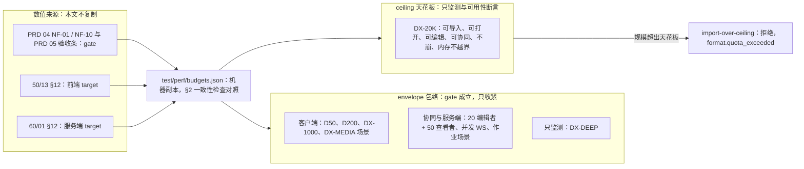
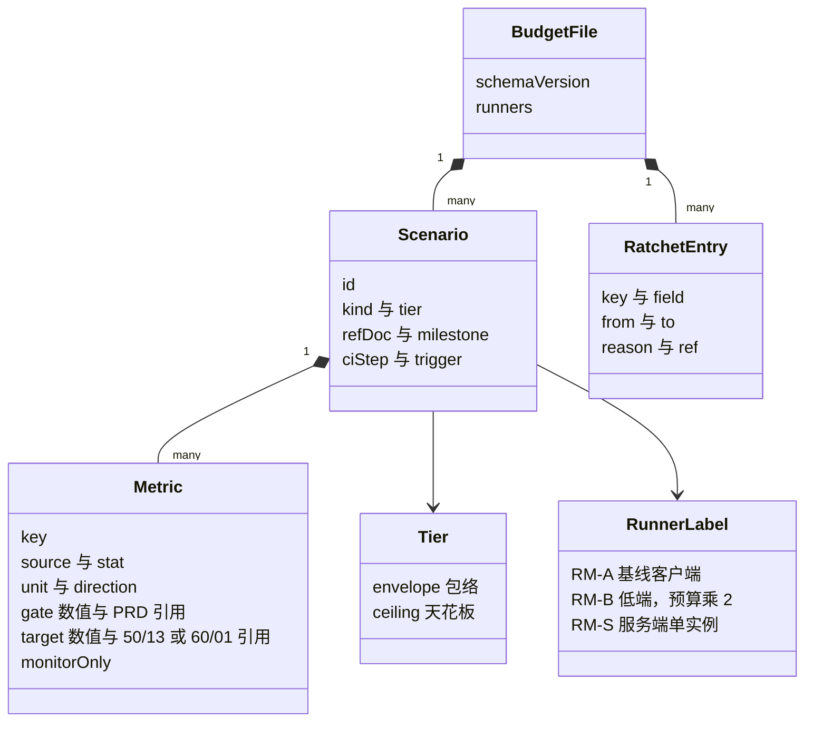
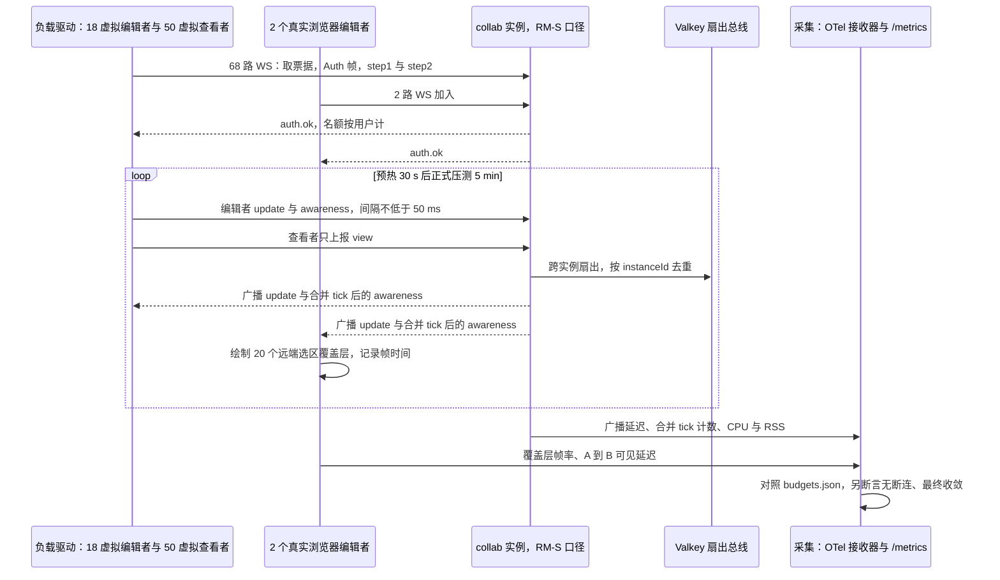
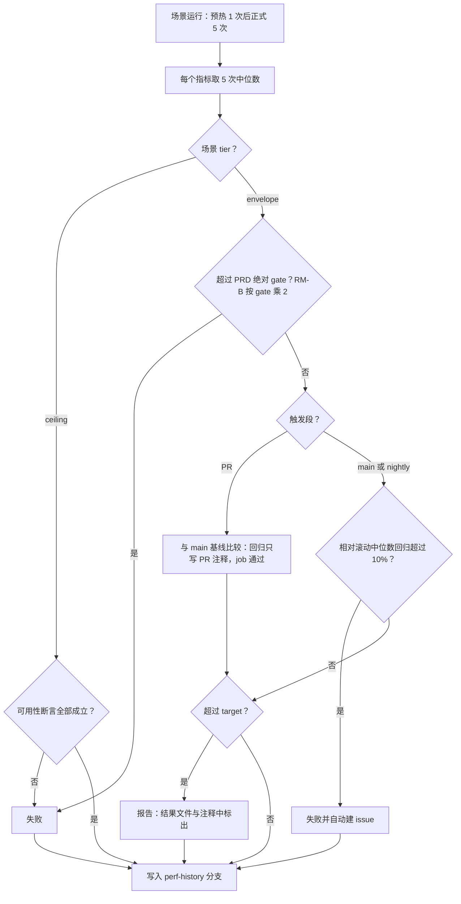

# 09 性能与容量测试
> 状态：v0.1 | 负责：测试设计线 | 更新：2026-09-25；2026-09-25（§4.19）；2026-09-26（§4.20）；2026-09-26（§4.21 整合：负载驱动与时序图的 CONTROL.auth 改为 Auth 帧）；2026-09-26（§4.21 Remap：原 30/08 与 30/07 迁出节的引用改指新位置，30/08 已删除） | 依赖：rulings §4.20 BE-01+TX-03 / BE-07+TX-05、rulings §4.19 D-M2-CONTENT / D-TEST-INFRA、rulings §4.12 U-13、[PRD 04](../10-prd/04-non-functional-requirements.md) §0 / NF-01 / NF-03 / NF-09 / NF-10、[PRD 05](../10-prd/05-milestones-and-scope.md) M1–M3 验收、[50/13](../50-frontend/13-performance-and-bundling.md)、[60/01](../60-backend/01-service-overview-and-roles.md) §12、[30/11](../30-architecture/11-testing-strategy.md) §9 / §17、[30/07](../30-architecture/07-rendering.md) §9 / §14、[30/06](../30-architecture/06-collaboration.md) §9 / §14 / §18.5、[60/01](../60-backend/01-service-overview-and-roles.md) §12、[60/05](../60-backend/05-modules-collab-and-snapshots.md) §4（原 30/08 §12 / §16.5）、[09-06](../30-architecture/09-type-discipline/06-scanners.md) §14 / §15、ADR-0010 / 0021 / 0025 / 0035、rulings §4.15 Q5

本文是性能与容量测试的测试侧唯一事实源：数字从哪里来、`test/perf/budgets.json` 长什么样、有哪些场景、怎么测、噪声怎么控、门禁怎么判、体积预算的唯一阻断点、预算怎么校准。

读者：性能相关包（`engine-*`、`render-dom`、`slide-render`、`collab-*`、`server-*`、`apps/*`）的实现者、CI 与 runner 维护者。

边界：本文**不复制任何预算数字**。gate（门禁值）取 PRD 04 NF-01 / NF-10 与 PRD 05 各验收条；target（内部目标与分解）取 [50/13](../50-frontend/13-performance-and-bundling.md) §12（前端）与 [60/01](../60-backend/01-service-overview-and-roles.md) §12（服务端）；本文只定义测量、场景与判定。服务端功能正确性（准入的原子性、溢写回放等）在 [07](./07-backend-integration-and-api-e2e.md)，本文只测它们在负载下的表现。

---

## 1. 口径来源与两层口径

| 数字 | 事实源 | 在本文中的角色 |
|---|---|---|
| gate | PRD 04 NF-01（§1.1–§1.7）、NF-10；PRD 05 各验收条中的时限（如母版视图、开始页、主题编辑） | 超出即失败（§10） |
| target | 50/13 §12 预算总表（「键名」列）、60/01 §12 服务端预算总览（「budgets.json 键」列） | 超出只报告 |
| 参考机与参考文稿 | PRD 04 §0.1、§0.2 | 场景的 `runners` 与 `refDoc` |
| 两层口径 | rulings §4.15 Q5；PRD 04 §0.2 | 场景的 `tier` |

- **包络**（`envelope`）：D50、D200、DX-1000、DX-MEDIA 与「20 编辑者 + 50 查看者」、200 MB。gate 只在包络内成立，只收紧不放宽。
- **天花板**（`ceiling`）：DX-20K（200 页 / 单页 1,000 / 文档总元素 20,000，墓碑计入）。只断言可用性（能导入、打开、编辑、协同、不崩、内存不越界），不设帧率与延迟门禁。超出天花板即拒绝导入（SV-08）。
- DX-DEEP 不在两层口径的列举中（PRD 04 §0.2 图注），作为包络内的只监测场景。

**图 1-1 两层口径与场景归属**



怎么读：左侧三类来源汇成一份机器副本，再按两层口径分发到场景；包络内的场景受 gate 约束，天花板场景只做可用性断言与监测，天花板之外的输入只验证被正确拒绝。
依据：PRD 04 §0.2 两层口径与图 0-1；rulings §4.15 Q5；决策 T-PERF-GATE。

---

## 2. `test/perf/budgets.json`

M1 建立。它是 PRD 与 50/13、60/01 预算表的**机器副本**，数字只在上游修改，本文件跟随；与上游不一致由 §2.2 的检查拦下。

### 2.1 结构

```ts
type BudgetFile = {
  schemaVersion: 1;
  runners: Record<RunnerLabel, { spec: string; cpuThrottle?: number; budgetMultiplier: number }>;  // RM-B 的 budgetMultiplier = 2
  scenarios: Scenario[];
  ratchet: RatchetEntry[];
};
type RunnerLabel = 'RM-A' | 'RM-B' | 'RM-S';
type Scenario = {
  id: string;                              // 如 'open-d50'（§3、§5、§6、§7）
  kind: 'client' | 'collab' | 'server';
  tier: 'envelope' | 'ceiling';
  refDoc?: 'D50' | 'D200' | 'DX-1000' | 'DX-DEEP' | 'DX-MEDIA' | 'DX-20K';   // 语料 manifest 的 perf.refDoc（03 §2）
  runners: RunnerLabel[];
  milestone: 'M1' | 'M2' | 'M3' | 'M4';    // gate 生效的里程碑；之前只报告
  ciStep: 'perf-client' | 'perf-collab' | 'perf-server';
  trigger: ('pr' | 'main' | 'nightly')[];
  metrics: Metric[];
};
type Metric = {
  key: string;                             // 与 50/13 §12、60/01 §12 表中的键名列一致
  source: { kind: 'mark' | 'event' | 'span' | 'metric' | 'cdp' | 'longtask' | 'event-timing'; name: string };
  stat: 'p50' | 'p75' | 'p95' | 'p99' | 'mean' | 'max' | 'ratio';
  unit: 'ms' | 's' | 'fps' | 'MB' | 'pct' | 'count';
  direction: 'lower-is-better' | 'higher-is-better';
  gate?: { value: number; ref: string };   // ref 指向 PRD 表中的一格，如 'PRD04:NF-01/1.1/首页可见/D50'
  target?: { value: number; ref: string }; // ref 指向 50/13 §12 或 60/01 §12 的键
  monitorOnly?: true;                      // 天花板场景，或尚无 gate 的指标
};
type RatchetEntry = { key: string; field: 'gate' | 'target'; from: number; to: number; date: string; reason: string; ref: string };
```

**图 2-1 budgets.json 数据模型**



怎么读：一份文件包含全部场景与收紧记录；每个场景属于一个层、可在多个参考机上跑，下挂多个指标；指标的 gate 与 target 都带回指上游表格的引用，收紧记录按指标键追溯每次改动。
依据：30/11 §9、§17「预算来源单一化」；PRD 04 §0；决策 T-PERF-GATE。

### 2.2 一致性检查

`test/perf/scripts/check-budgets.ts`，作为三个 perf 步骤的共同前置，M1 起执行：

| # | 断言 |
|---|---|
| C1 | 每个 `gate.ref` 能在 PRD 04 / 05 的表格中定位到一格，且数值相等（解析 Markdown 表） |
| C2 | 每个 `target.ref` 能在 50/13 §12 或 60/01 §12 的表中按键名列定位，且数值相等；反向：两张表中出现的每个键（标「不进 budgets.json」的除外）都在 budgets.json 中出现 |
| C3 | target 不比 gate 宽松（按 `direction` 判断） |
| C4 | 与 `origin/main` 相比，gate 与 target 只能收紧；放宽必须同时新增一条 `RatchetEntry`，其 `ref` 指向 `cordex-allow` 例外与 issue（PRD 04 开头的 ratchet 规则） |
| C5 | 每个 `envelope` 场景至少有一个带 gate 的指标（或显式 `monitorOnly`，如 DX-DEEP）；`ceiling` 场景的指标全部 `monitorOnly`，唯一例外是 NF-01 §1.3 回填后的 DX-20K 堆上限，它作为「内存不越界」可用性断言带 `gate`（§5） |
| C6 | 每个 `refDoc` 在语料 manifest 中以 `perf.refDoc` 恰好登记一次（03 §2 V6） |

与另外两份预算文件的区分：`tooling/policy/budgets.json` 只存类型逃逸类 ratchet（ADR-0040，09-06 §15）；体积预算在各 preset 的 `config/bundle-budget.json`（§11）。三者互不引用。

---

## 3. 客户端场景（`perf/perf-client`）

测量口径：客户端预算默认字节已在内存（不含下载，PRD 04 §0.1），场景以 `ArrayBuffer` 直接交给 `units.open`；视口 1920 × 1080 @1x。`performance.mark` 的命名规范唯一在 50/13 §2，下表只写事件与测量方式。

| 场景族 | 参考文稿 | 操作 | 指标（gate 行 → 数值见上游） | 测量来源 | gate 生效 |
|---|---|---|---|---|---|
| `open-d50`、`open-d200` | D50、D200 | `units.open(bytes)` 到 `unit/loaded` | 首页可见、首页可交互、视口缩略图就绪、全部缩略图就绪、后台全部解析、主线程最长任务（NF-01 §1.1） | `render/first-paint`、`unit/opened` 后首个命令被接受、`unit/loaded`、longtask 观察器 | M1 |
| `open-dx1000`、`open-dxmedia` | DX-1000、DX-MEDIA | 同上 | 首页可见（NF-01 §1.1） | 同上 | M1 |
| `open-dxdeep` | DX-DEEP | 同上 | 全部指标只监测 | 同上 | — |
| `nav-unparsed`、`nav-parsed-unloaded`、`nav-parsed` | D200 | 打开后在后台解析进行中跳到未解析页 / 已解析未装载页 / 已装载页 | 跳转可见（NF-01 §1.1；rulings §4.18 CO-11） | `view/page-changed` → 该页 `render/page-mounted` 后首个 `render/frame` | M1 |
| `type-latency`、`ime-update` | D50 | 在文本框中连续键入 200 字符；CDP `Input.imeSetComposition` 驱动组合 | 键入延迟、IME 组合更新（NF-01 §1.2） | Event Timing（`keydown` / `beforeinput` 的 duration），交叉核对 `beforeinput` → 下一帧 `render/frame` 结束 | M2 |
| `drag-fps`、`zoom-fps`、`pan-fps`、`drag-fps-dx1000` | ≤ 300 元素页、DX-1000 | `page.mouse` 分步拖动 / 缩放 / 平移 5 s | 平均帧率与 p95 帧时间（NF-01 §1.2） | CDP Tracing 帧事件 | M2 |
| `command-exec`、`batch-align-100`、`undo-redo` | D50 | 常见单元素命令、对齐 100 个元素、撤销重做 | NF-01 §1.2 对应行 | 页内 mark 包住 `commands.execute` / `history.undo` | M2 |
| `hit-test`、`snap-guides` | 300 元素页 | 随机 1,000 个点命中测试；拖动时吸附计算 | NF-01 §1.2 对应行 | 页内 mark | M2 |
| `render-local-change` | 300 元素页 | 改一个元素的单个属性；切换一页的版式 | NF-01 §1.2「局部变更重绘范围」：`render/frame` 的 `elementsUpdated` 只含受影响元素与覆盖层（断言，规避 Univer A28）；耗时对照 50/13 §12 target | `render/frame` 载荷 + 页内 mark | M2 |
| `thumb-update`、`thumb-scroll-200` | D50、D200 | 编辑后等缩略图刷新；滚动 200 页缩略图栏 | NF-01 §1.2 对应行 | 缩略图刷新 mark；Tracing 帧事件 | M2 |
| `search-d200`、`replace-all-d200`、`theme-switch` | D200、D50 | 全文搜索、全部替换（一个事务）、切换主题 | NF-01 §1.2 对应行 | 页内 mark | M2 |
| `export-pptx-d50`、`export-pptx-d200` | D50、D200 | Worker 导出；导出期间执行一条编辑命令 | 导出时长、导出期间 UI 可编辑（NF-01 §1.4） | mark；命令在导出进行中被接受 | M2（M1 起报告） |
| `export-png-single`、`export-png-all` | D50、D200 | 主线程 `toImage` | NF-01 §1.4，按 50-frontend/13 §1、§12（原 30/07 §14.6）修正：M2 位图 spike 结论前只对「单页、无 Web 字体依赖」门禁；全量 PNG 自 M3 起走服务端 | mark | M2 |
| `master-view-enter`、`master-range-switch` | D50 | 进入母版视图；切换「编辑版式 / 母版」范围 | PRD 05 M2 验收 9 | mark | M2 |
| `master-edit-propagate`、`theme-edit-recalc` | D50（D200 只监测） | 母版编辑后引用页与缩略图更新；改 12 主题色与主题字体后全文重算 | PRD 05 M3 验收 14、15 | mark | M3 |
| `new-blank`、`shell-home-interactive`、`locale-switch` | — | 新建空白文稿；开始页可交互（已登录、列表 ≤ 50 条）；切换语言包 | PRD 01 OF-22、PRD 05 M2 验收 11、NF-06 | mark | M2 |
| `glass-interacting` | 编辑器 | 拖拽分栏与画布缩放动画 | PRD 04 §1.5 材质层帧时间 | Tracing 帧事件 | M2 |
| `a11y-tree-d50`、`a11y-tree-d200` | D50、D200 | 打开到可访问树建完；之后编辑一个元素 | 可访问树分片、全树就绪、增量更新与树 DOM 内存（只有 target：50/13 §12 的 `client.a11y.treeSlice`、`client.a11y.treeReady.{d50,d200}`、`client.a11y.update`、`client.mem.a11yTree.d200`；主线程阻塞仍受 `client.main.longTask` 约束） | mark `cordex:a11y:tree-ready`（`unit:loaded` → `a11y:tree-ready`，50/13 §3）；longtask 观察器；CDP 堆快照 | M2（报告，50/13 §13） |
| `memory-editor`、`memory-viewer`、`memory-peak` | D50、D200 | 打开后稳态、打开峰值、查看器稳态 | NF-01 §1.3 | CDP `HeapProfiler.collectGarbage` 后 `Runtime.getHeapUsage` + 诊断接口报告的可回收资源（MediaCache 等） | M1 |
| `memory-open-close-20` | D50、D200 | 打开 / 关闭同一文件 20 次 | 堆增长比例；关闭后 `fiber.getEffects()` 为空；blob URL 泄漏为 0（NF-01 §1.3） | CDP 堆；诊断接口 | M1 |

RM-B：同一组场景在 nightly 以 RM-B 标签重跑，gate 乘以 `budgetMultiplier`（NF-01 §0.1「预算 × 2 仍须满足」）。`memory-open-close-20` 与 [06 §11](./06-frontend-component-and-e2e.md) 的 e2e 资源断言用同一实现；判定 NF-01 §1.3 的门禁以本文场景为准。

---

## 4. 打开管线断言

`open-*` 场景除 §3 的数值指标外，每次运行都断言下列时序（事件定义见 30/10 §11.1，管线见 50-frontend/04 §2；结构正确性——首批内容、批次合并等价、零脏部件——在 [03 §7](./03-fidelity-roundtrip-and-corpus.md)）：

| # | 断言 | 依据 |
|---|---|---|
| O1 | `unit/open-progress` 的阶段按 `unzip` → `parse-presentation` → `parse-slide` → `decode-media` → `render-first` 顺序出现，相邻两次上报的间隔满足 OF-01（按时间或按进度百分比） | PRD 01 OF-01 |
| O2 | `unit/opened` 在首批装载后发出，早于 `unit/loaded`；`render/first-paint` 与「首个命令被接受」分别计入首页可见与首页可交互 | rulings §4.18 CO-12 |
| O3 | `unit/loaded` 在全部批次到齐后发出，计入「后台全部解析完成」 | CO-12 |
| O4 | 从 `open()` 到 `unit/loaded` 期间 `PerformanceObserver('longtask')` 无超过 NF-01 主线程阻塞 gate 的任务 | NF-01 §1.1；50-frontend/04 §2 |
| O5 | 后台解析进行中跳到未解析页：观察到主线程向 Worker 发出 `prioritize` 消息，且该页可见时间满足 gate；跳到已解析未装载页满足另一档 gate | CO-11 |
| O6 | 打开进行中经 `AbortSignal` 取消，在 OF-01 规定时限内 `fiber.getEffects()` 为空、无半打开的 `Unit` | PRD 01 OF-01 |

---

## 5. DX-20K 天花板

| 场景 | 断言 | 里程碑 |
|---|---|---|
| `open-dx20k`（客户端） | 打开到 `unit/loaded`；执行 10 条混合命令（插入文本、移动、删除、撤销）全部成功；全程无 `severity=fatal` 的 `error/raised`、无页面崩溃（Playwright `crash` 事件）；稳态堆记录在案 | M1 |
| `import-dx20k`（服务端） | 导入作业成功，`documents.element_count` 与样本一致 | M2（服务端导入随 rulings §4.19 D-M2-CONTENT 提前） |
| `collab-dx20k` | 两个客户端加入同一房间，各做 20 次编辑后状态向量相等；房间权重与 Y 堆记录在案 | M2 |
| `import-over-ceiling` | 03 §8 的「上限 + 1」样本在客户端与服务端均返回 `format.quota_exceeded`，且在任何批次回传或页解析之前拒绝；拒绝耗时只监测 | M1（客户端）/ M2（服务端） |

- 「内存不越界」：PRD 04 NF-01 §1.3 规定 DX-20K 的稳态堆与协同 Y.Doc 堆「M1 以 T3 实测回填；不越界即通过」。回填前只断言无崩溃与无 OOM；回填后（§12）该值写入 PRD 与 budgets.json，作为 `open-dx20k` / `collab-dx20k` 的「内存不越界」可用性断言（§2.2 C5 的唯一例外，不是包络 gate，不参与相对回归）。
- 天花板场景不设帧率、延迟门禁（30/07 §9：天花板内只保证能打开、能编辑、不崩）。
- 软警告（150 页、15,000 元素，SV-08）的出现由 [07](./07-backend-integration-and-api-e2e.md) 与 [06](./06-frontend-component-and-e2e.md) 做功能断言，本文不重复。

---

## 6. 协同与服务端场景

协同场景在 `perf/perf-collab`（客户端视角，需要真实浏览器或负载驱动），服务端场景在 `perf/perf-server`（RM-S 单实例口径）。span 与指标名以 [60/18](../60-backend/18-observability-and-ops-endpoints.md) 的统一名表为准，下表只写测量对象。协同网关、Room（单实例）、update 持久化与快照、服务端导入随 rulings §4.19 D-M2-CONTENT 提前到 M2（PRD 05 M2 验收 14、15），相应场景（含单实例 PG 故障溢写与回放）自 M2 起 gate 生效、在 M2 前落地的自托管专用 runner 上运行（§9）；多人协同体验层（多人延迟、在场、权限变更、离线重连）与服务端导出、缩略图、多实例与容量场景仍 M3 起（[PRD 05 §0.3](../10-prd/05-milestones-and-scope.md)）。

| 场景 | 内容 | 指标（gate 行 → 数值见上游） | 测量 | 步骤 | gate 生效 |
|---|---|---|---|---|---|
| `collab-roundtrip-2clients` | 两个 Chromium 页面同一文档，A 连续编辑 | 本地回显；A 提交 → B 可见 p50 / p95；presence 传播（NF-01 §1.6） | 两页 `performance.timeOrigin + performance.now()`（同机同钟）；本地回显取 transact 返回到 observe | `perf-collab` | M3 |
| `collab-latency-20` | 20 个编辑者（2 个真实浏览器 + 18 个虚拟客户端） | 同上，PRD 05 M3 验收 3 | 同上 | `perf-collab` | M3 |
| `collab-bootstrap-d50`、`collab-bootstrap-d200` | `GET snapshots/latest` 加加入房间到 `collab/synced`（M2 起即服务端文档的打开路径）；另设 10 Mbps 带宽的 D200 变体 | 初始同步（NF-01 §1.6）；time-to-synced（target）；协同打开首页可见 `client.collab.firstPaint.{d50,d200}`（50/13 §12） | span `collab.bootstrap`；mark `collab:bootstrap-start` → `render:first-paint` | `perf-collab` | M2 |
| `collab-reconnect` | 断网期间累计 5,000 个待同步 update 后恢复 | 重连重同步（NF-01 §1.6） | 恢复连接到 `live` | `perf-collab` | M3 |
| `collab-permission` | 服务端撤销编辑权限 | 权限变更生效（NF-01 §1.6） | 审计时间戳到客户端 `permission/changed` 事件 | `perf-collab` | M3 |
| `server-update` | 持续 update 负载 | update 处理 p95、软门禁 p95（target 见 60/01 §12） | 对应 span | `perf-server` | M2 |
| `room-bootstrap` | 加载 8 MB 状态的 Room | Room bootstrap p95（target） | 对应 span | `perf-server` | M2 |
| `persist-lag` | 持续 update 负载 | update 接收 → `ack{tier:'db'}` p99（NF-01 §1.7）；持久化延迟 p95（target） | 指标 `cordex_collab_persist_latency_seconds` + 客户端收到 db ack 的时间 | `perf-server` | M2 |
| `compaction-10k` | 10,000 个 update 后触发压缩 | 快照压缩时长（NF-01 §1.7）；压缩后 update 日志与快照大小之比（NF-10） | 压缩 span；压缩后查询日志与快照字节数 | `perf-server` | M2 |
| `ws-capacity` | 单实例逐步加连接到 NF-01 §1.7 并发 WS 值。负载驱动在单台压测机（同一源 IP）上按「先扣后退」爬升（rulings §4.20 BE-01+TX-03）：每个连接都持有效票据，验签通过即退还 IP 令牌，同时处于「已升级、未认证」状态的连接不超过 IP 桶容量，因此不放宽 `limits.ws.connectPerIpPerMin`；连接按 `limits.ws.maxConnectionsPerUser`（默认 32）分摊到足够多的测试用户（2,000 连接至少 63 人），票据经 ticket 档（每用户 120 / min）取得。爬升全程无 429 与 4429 即为前提成立，否则场景判失败 | 连接数达到 gate 时 CPU 低于 gate | 容器 CPU 采样 + `/metrics` | `perf-server` | M3 |
| `cross-instance` | 两个 collab 实例，编辑者分处两侧 | 跨实例传播（NF-01 §1.7） | 服务端时间戳差：实例 A 接收 update → 实例 B 向本地客户端发出（同机同钟，不含客户端链路） | `perf-server` | M3 |
| `import-d50`、`import-d200`、`import-50mb` | 两步导入作业端到端 | NF-01 §1.7 对应行（50 MB 项只有 target） | 作业 span（入队到完成） | `perf-server` | M2 |
| `export-pptx-server-d50`、`export-pptx-server-d200`、`export-pdf-d50`、`export-png-all-d200` | 服务端导出作业端到端 | NF-01 §1.7 对应行；PDF 自 M3 后半段；PNG 全量 D200 取 PRD SV-02 | 作业 span（入队到完成；PNG 为 `job.render-export`） | `perf-server` | M3 |
| `thumbs-first-page`、`thumbs-d200-full` | 导入后首页缩略图；D200 全量缩略图 | NF-01 §1.7；PRD 05 M3 验收 6a | 导入完成到缩略图对象写入 | `perf-server` | M3 |
| `template-fill-100` | 4 个 worker 做 100 × D50 模板填充 + 导出 | NF-01 §1.7 | 批次总时长 | `perf-server` | M4（rulings §4.12 U-13；60/01 S15） |
| `graceful-shutdown` | 负载中 `SIGTERM` | 停机时长（NF-01 §1.7）；已 `ack{tier:'db'}` 的 update 零丢失 | 进程退出时间；重启后逐条核对 | `perf-server` | M3（PRD 04 NF-01 §1.7 里程碑段；M2 起报告，零丢失的功能断言在 07 §9 W4） |
| `spill-replay` | 负载中断开 PG N 秒后恢复 | 回放耗时 p95（target 见 60/01 §12）；断开期间房间内广播 p95 仍满足 NF-01 §1.7（降级期照常广播，rulings §4.18 CO-08；功能正确性在 07）；溢写房间数取 `cordex_collab_spill_rooms` | 回放 span；广播双端时间戳 | `perf-server` | M2（单实例 PG 故障溢写，PRD 05 §0.3「Postgres 故障」行） |
| `rest-read` | REST 只读端点混合负载 | REST p95（target） | HTTP span | `perf-server` | M2 |
| `scale-out-3x` | 3 个 collab 实例各承载单实例负载 | 跨实例传播仍达 gate；各实例指标与单实例的对比、NF-10 全系统容量（按线性外推）只记录报告，不另设阈值 | 同上 | `perf-server`（nightly） | M3 |
| `host-footprint` | ADR-0037 决策 5「最低主机规格须实测」的测量场景（rulings §4.20 BE-07+TX-05）：compose 部署在自托管 runner 上承载 RM-S 负载（`server-update` + `persist-lag` + 导入 + 缩略图与导出作业并行），分 core（默认 profile）与 core+idp（加 `idp` profile 的 Casdoor）两档各跑一遍 | 各容器的峰值内存与 CPU（`docker stats` 采样）及合计；只出报告、不设 gate，不进 `budgets.json` | `docker stats` 采样 1 s 一次，取峰值；产物 `test/perf/results/host-footprint.json`（每档每容器一行，含提交、runner 标签、负载参数） | `perf-server`（nightly，自托管 runner） | M3（renderer 与 worker 落地、`ops:compose` 全绿后起运行；M3 出口前产出供回填的那一份） |

`perf-collab` 的全部场景与 §7 满员房间经 toxiproxy 在客户端与网关之间注入单向 20 ms 时延（RTT 40 ms，落在 PRD 04 NF-01 §1.6「同区域 RTT ≤ 50 ms」口径内）；本机回环时延近零，不注入会让协同预算失去意义。`perf-server` 中以服务端 span 计量的指标不经客户端链路，不注入。

**服务端场景 → budgets.json 键**（键名唯一源为 [60/01 §12](../60-backend/01-service-overview-and-roles.md) 的「budgets.json 键」列，本表只登记场景与行的对应，供 §2.2 C2 反向核对；指标名用 60/18 统一名，旧名只作别名）：

| 场景 | 60/01 §12 行 | budgets.json 键 |
|---|---|---|
| `rest-read` | S1 | `server.rest.readP95Ms` |
| `room-bootstrap` | S2 | `server.collab.roomBootstrapP95Ms` |
| `server-update` | S3、S4 | `server.collab.updateHandleP95Ms`、`server.collab.softGateP95Ms` |
| `persist-lag` | S5（`cordex_collab_persist_latency_seconds`） | `server.collab.persistP95Ms`、`server.collab.persistLagP99Ms` |
| §7.1 `room-full-fanout` | S6 | `server.collab.broadcastP95Ms` |
| `cross-instance` | S7 | `server.collab.crossInstanceMs` |
| `collab-permission` | S8 | `server.auth.permPropagationP95Ms` |
| `spill-replay` | S9（溢写房间数 `cordex_collab_spill_rooms` 只记录） | `server.collab.replayP95Ms` |
| `import-d50`、`import-d200`、`import-50mb` | S10 | `server.jobs.importD50P95Ms`、`server.jobs.importD200P95Ms`、`server.jobs.import50MbP95Ms` |
| `export-pptx-server-d50`、`export-pptx-server-d200` | S11 | `server.jobs.exportPptxD50P95Ms`、`server.jobs.exportPptxD200P95Ms` |
| `export-pdf-d50` | S12 | `server.jobs.exportPdfD50P95Ms` |
| `export-png-all-d200` | S22（PNG 全量 D200 ≤ 90 s，PRD SV-02） | `server.jobs.exportPngD200Ms` |
| `thumbs-first-page`、`thumbs-d200-full` | S13 | `server.thumbnails.firstPageMs`、`server.thumbnails.d200AllMs`、`server.thumbnails.perPageP95Ms` |
| `compaction-10k` | S14 | `server.collab.compact10kMs` |
| `template-fill-100` | S15 | `server.jobs.fillTemplate100Ms` |
| `graceful-shutdown` | S16 | `server.process.shutdownMs` |
| `ws-capacity` | S17 | `server.collab.wsPerInstance` |
| §7.2 A1 | S18（`cordex_collab_room_weight_bytes`） | `server.collab.roomWeightD200Bytes` |
| `scale-out-3x` | S19 | `server.capacity.*` |

S20（SLO）与 S21（溢写阈值配置）不进 budgets.json。`host-footprint` 不对应 60/01 §12 的任何行，同样不进 budgets.json：它的结果只供后端设计线按「峰值合计 × 1.3」回填 [60/17](../60-backend/17-deployment-and-config.md) §11 的最低主机规格（M3 出口前，rulings §4.20 推迟项 BE-07+TX-05），回填由后端设计线执行，架构线把 ADR-0037 决策 5 的表改为只留口径并链接 60/17 §11。

---

## 7. 满员房间

### 7.1 `room-full-fanout`

依据：rulings §4.15 Q5（新增满员房间扇出压测，含服务端 awareness 合并 tick）；30/06 §14、§18.5；ADR-0035「如何被机械验证」。

- **负载**：一个 D50 文档、一个 collab 实例（RM-S）；20 个编辑者（2 个真实 Chromium + 18 个虚拟客户端）与 50 个虚拟查看者。编辑者按键入节奏发 update，并以不低于 50 ms 的间隔发 awareness；查看者只上报 view（30/06 §14）。
- **时长**：全部加入后预热 30 s，正式压测 5 min。
- **断言**：房间内广播 p95 满足 NF-01 §1.7；真实浏览器中 20 个远端选区覆盖层的帧率满足 NF-01 §1.6；每个查看者每秒收到的 awareness 帧数不超过合并 tick 频率（证明合并生效）；全程无连接被关闭；结束后全部端状态向量相等；CPU 与 RSS 记录在案。
- nightly 运行；M3 起 gate 生效。

**图 7-1 满员房间扇出压测**



怎么读：从上到下是一次压测；负载驱动与真实浏览器共同凑满 20 + 50 名额，循环体是压测期间的稳态流量，服务端把 awareness 合并后按 tick 下发；最后两类测量汇到采集端，按预算与附加断言判定。
依据：rulings §4.15 Q5；30/06 §14 房间容量行；ADR-0024、ADR-0035。

### 7.2 `room-weight-admission`

依据：决策 C-11（`room:{docId}:members` + Lua 脚本原子判定，不依赖 HEXPIRE）；rulings §4.15 Q5、§4.18 CO-14 / BE-29；ADR-0035。准入的逻辑正确性在 [07](./07-backend-integration-and-api-e2e.md) 以小规模 PR 用例覆盖，本节是负载下的版本（A2–A4 nightly，M3 起；A1 另有 M1 版本）：

| # | 场景 | 断言 |
|---|---|---|
| A1 | 权重校准：M1 以 Node 脚本把 D50、D200、DX-20K（后者含墓碑变体）的快照写入 Y.Doc 实测堆增量（供 §12 M1 回填）；M2 起（Room 与 RM-S 随 rulings §4.19 提前）在 RM-S 上加载真实 Room 随 nightly 复测 | 实测堆增量与「每元素权重 × `element_count`（墓碑计入）」的比值记录在案；墓碑变体的权重高于无墓碑版本 |
| A2 | 实例装满：混合规模的房间依次打开，直到准入拒绝 | 被拒的加入收到 `collab.room_full`（关闭码 4503）；拒绝之前先按 LRU 结束空闲的 draining 房间，全程没有任何客户端收到 1012 |
| A3 | 并发编辑者：两个实例上 30 个不同编辑者同时加入同一文档 | 恰好 20 个以编辑者加入，其余以 `auth.ok{role:'viewer', reason:'capacity'}` 只读加入 |
| A4 | 名额按用户计 | 同一用户 3 个标签页只占 1 个名额；owner 不占编辑者名额；commenter 计入查看者；第 51 个查看者被拒 |

---

## 8. 工具

- **浏览器侧**：Playwright + trace；telemetry Provider 在测试模式下写 `performance.mark`（30/11 §9，命名规范见 50/13 §2）；`PerformanceObserver('longtask')` 与 Event Timing；CDP 的 `HeapProfiler`、`Runtime.getHeapUsage`、`Tracing`（帧）、`Emulation.setCPUThrottlingRate`（RM-B）、`Input.imeSetComposition`（IME）。
- **负载驱动**（决策 T-IDP：自写 Node WS 客户端，发送真实 y-protocols 帧，不用 k6）：经 oidc-provider mock 登录 → REST 取协同票据 → WS 连接 → Auth 帧（token JSON）→ step1 / step2 → update 生成器（在 Node 中以 `store-yjs` 执行 `model-slide` 的 `randomCommand(seed)`，得到真实形状的 update）→ awareness 生成器；每个虚拟客户端记录发送与接收时间戳。落点 `test/perf/load-driver/`（根 `test/` 布局以 [01 §5](./01-strategy-and-layers.md) 为准）。
- **服务端测量**：harness 内置 OTLP 接收器收 span；抓取内部端口上的 `/metrics`；名称以 60/18 统一名表为准。
- **网络**：toxiproxy 注入时延与带宽（§6）。
- **结果**：每次运行写 `test/perf/results/<runId>.json`（提交、runner 标签、场景、指标、5 次样本、中位数、gate、target、判定）。

---

## 9. 噪声控制与 runner

- 每个场景先跑 1 次预热（丢弃），再正式跑 5 次；每个指标取 5 次结果的中位数参与判定。
- 固定随机种子与样本；浏览器启动参数关闭后台节流（`--disable-background-timer-throttling`、`--disable-renderer-backgrounding`）；内存测量前强制 GC。
- runner 独占：perf 步骤所在 runner 不并行其它 job；自托管 runner 的 CPU 调频固定为 performance。
- 结果只与同一 runner 标签的历史比较。

**runner（rulings §4.19 D-TEST-INFRA 定稿）**：性能 M1 用 GitHub larger runner（4 核）；协同与服务端压测所需的自托管专用 runner 在 M2 前落地（原计划「M3 前」随 D-M2-CONTENT 提前），承载 gated 的 `perf-collab` 与 `perf-server`，RM-S 场景自 M2 起；低配机型以 CDP CPU 4× 节流近似；视觉 oracle 基线机不进 CI（[04 §2](./04-visual-oracle.md)）。

| 标签 | M1 | M2 起 |
|---|---|---|
| RM-A | GitHub larger runner（4 核），视为 RM-A 近似；承载 `perf-client` | `perf-client` 仍在 larger runner；`perf-collab` 的真实浏览器与负载驱动在自托管专用 runner 上运行 |
| RM-B | 在 RM-A runner 上以 CDP CPU 4× 节流近似，gate × 2 | 同左 |
| RM-S | —（M1 无服务端场景） | 自托管专用 runner 上以容器限额 `--cpus=2 --memory=4g` 运行 collab；PG、Valkey、SeaweedFS 在限额容器之外 |

runner 变更（含 M2 起 `perf-collab` 迁到自托管 runner）按 [11](./11-test-data-fixtures-and-determinism.md) §11 重建基线，相对回归从新基线起算。`tooling/ci/steps.json` 以 runner 标签表达（[12](./12-ci-gates-mapping.md) §8），改变选择只改标签与预算，不改步骤名。

---

## 10. 门禁规则

依据：决策 T-PERF-GATE（PRD NF-01 / NF-09 的 gate 数值与更严口径 + 09-07 §3 pass / fail 治理 + 阈值只收紧）。

| 触发段 | 跑哪些场景 | 超 PRD gate | 相对回归 | 超 target |
|---|---|---|---|---|
| PR | `perf-client` 的 D50 关键指标：`open-d50` 首页可见、`type-latency`（M2 起）、`export-pptx-d50`（M2 起）；M2 起另加 `server-update` 与 `persist-lag`（RM-S，自托管 runner）；M3 起另加 `collab-roundtrip-2clients` | 失败 | 与 main 基线比较，只写 PR 注释（job 通过 = 报告） | 报告 |
| 合入 main | 全部 `envelope` 场景（RM-A 与 RM-S） | 失败 | 相对滚动中位数（同标签最近 10 次 main 结果）回归超过 10% → 失败并自动建 issue | 报告 |
| nightly（`CORDEX_SUITE=nightly`） | main 的全部 + RM-B 重跑 + `ceiling` 场景 + §7 满员房间 + `ws-capacity`、`scale-out-3x`；M3 起加 `host-footprint`（只报告）；M4 起加 `template-fill-100` | 失败 | 同 main | 报告 |

- `memory-open-close-20` 的堆增长比例是 gate（NF-01 §1.3），取代 30/11 §10 旧写的 10%。
- NF-09「每 PR 跑 D50 关键指标，超预算 5% 失败」按更严口径执行为「超 gate 即失败」；5% 容差只保留在体积预算（§11）。
- 「报告」的唯一含义：job 通过，同时产出结果文件或 PR 注释（与 09-07「不存在 warn 级别」相容）。
- perf 步骤不自动重试（噪声由 §9 的 5 次中位数吸收）；nightly 失败自动建 issue 并阻断下一次发布打标签，不阻断合并（决策 T-CI）。
- 全部结果追加到 `perf-history` 分支（JSON Lines），供滚动中位数与长期趋势使用。

**图 10-1 性能门禁判定**



怎么读：自上而下，天花板场景只看可用性断言；包络场景先过绝对 gate（任何触发段超 gate 都失败），再按触发段分流——PR 上的相对回归只写注释，main 与 nightly 上超过 10% 即失败并建 issue；target 只影响报告；所有结果最终都写入历史分支。
依据：决策 T-PERF-GATE；PRD 04 NF-01、NF-09；30/11 §9。

---

## 11. 体积预算

依据：决策 T-BUNDLE（PRD NF-01 §1.5 / EM-07 + 09-06 §14）。

- **唯一阻断点**：`scanners` job 的 `scan-bundle-budget` 步骤（扫描器定义见 09-06 §14，实现归 [40/01](../40-modules/01-tooling-and-governance.md)），读取各 preset 包的 `config/bundle-budget.json`（`preset-slide-viewer`、`preset-slide`、`preset-slide-collab`，以及 `apps/web` 路由 chunk）；预算值 = PRD NF-01 §1.5，`tolerancePct: 5` 显式登记，只收紧。
- **测量口径**：生产构建的 Rollup / Vite stats；初始加载 = 入口 chunk 及其静态 import 闭包的 JS 与 CSS，逐文件 gzip（zlib 级别 9）后求和；不含字体与 peer 依赖（编辑器不含 React 本体）；惰性 chunk（图表渲染器、语言包、查看器可选件、放映 / 母版视图 / 版本历史 UI、EMF 栅格化 Worker）各自对照自己的预算；协同增量 = `preset-slide-collab` 初始加载 − `preset-slide` 初始加载。
- **判定**：超出「预算 × (1 + tolerancePct)」即失败；在预算与容差之间只报告（PR 注释列出各 chunk 相对 main 的变化）。
- **信息性断言**：`preset-*/__tests__/bundle-budget.test.ts` 与 `ui-react` 的 `perf.spec.ts` 只打印体积，不失败。
- chunk 地图、惰性边界与触发条件唯一在 [50/13 §6–§7](../50-frontend/13-performance-and-bundling.md)；EMF 栅格化 chunk 的预算在 M2 spike 后回填（PRD NF-01 §1.5）。
- 负向夹具：扫描器自带一个超预算的夹具构建，证明它能失败（lessons A17）。

---

## 12. 校准

- **节奏**：每个里程碑中期在参考 runner 上跑一次 nightly 全套，以实测提出新值；只能收紧（PRD 04 开头、PRD 05 §6）。gate 的修改走 PRD 表格，target 的修改走 50/13 / 60/01 表格，budgets.json 同一 PR 跟随并追加 `RatchetEntry`，§2.2 的 C1–C4 保证四处一致。
- **M1 回填**：DX-20K 的稳态堆与协同 Y.Doc 堆（NF-01 §1.3）；活跃房间分档——由 §7.2 A1 得到各规模文档的实测房间权重，按「实例内存预算 ÷ 权重」得到各档房间数，回填 PRD NF-01 §1.7 与 60/01 §12。
- **M2 回填**：EMF 栅格化 chunk 预算；客户端位图导出的门禁范围（50-frontend/13 §1、§12）。
- **溢写阈值校准**（M2，随单实例两级溢写交付；在 M2 前落地的自托管专用 runner 上执行，与 [60/01](../60-backend/01-service-overview-and-roles.md) §12 S21、[60/05](../60-backend/05-modules-collab-and-snapshots.md) §6.2 一致；决策 SPILL「压测校准，只收紧」不变，校准时点随 PRD 05 §0.3 与 rulings §4.19 D-TEST-INFRA 由 M3 提前；默认值本身见 [60/17](../60-backend/17-deployment-and-config.md) 的 `spill.*`）：`spill-calibration` 场景在满员房间负载与多房间并存下注入 PG 断开 N 秒，记录内存增长、溢写档位切换（none → valkey → blob）与回放耗时；据此只能收紧 `spill.*` 默认值。
- 每次校准写 `test/evidence/<里程碑>/perf-calibration.md`（runner、提交、原值与新值、依据的结果文件）。

---

## 13. 机械验证

| 断言 | PRD 检查名 / 依据 | 执行处 | 形态 |
|---|---|---|---|
| budgets.json 与 PRD、50/13、60/01 一致且只收紧（C1–C6） | 30/11 §17；PRD 04 ratchet | 三个 perf 步骤的前置 | 机械 |
| 打开类场景达到 gate，时序断言 O1–O6 成立 | `perf:open`（M1 验收 4） | `perf/perf-client` | 机械 |
| 交互类场景达到 gate | `perf:interact`（M2 验收 4）、`master:view`（M2 验收 9）、`shell:home`（M2 验收 11） | `perf/perf-client` | 机械 |
| 内存稳态、峰值、20 次开关增长、effects 为空、blob URL 零泄漏 | NF-01 §1.3 | `perf/perf-client` | 机械 |
| 协同延迟、初始同步、重连、权限生效 | `collab:latency`（M3 验收 3）、NF-01 §1.6 | `perf/perf-collab` | 机械 |
| 服务端导入时长；快照引导初始同步、持久化滞后、压缩；单实例溢写回放 | `server:import`（M2 验收 14）、`collab:persist`（M2 验收 15）、`collab:degraded`（M2 验收 17）、NF-01 §1.6 / §1.7 | `perf/perf-server`、`perf/perf-collab` | 机械 |
| 服务端导出、缩略图、PDF、并发 WS、跨实例 | `server:jobs`、`server:thumbnails`、`server:pdf`、`server:scale`（M3 验收 6 / 6a / 6b / 8）、NF-01 §1.7 | `perf/perf-server` | 机械 |
| `ws-capacity` 在默认 `limits.ws.connectPerIpPerMin` 下爬升到 gate 且全程无 429 / 4429（先扣后退与每用户上限的容量侧证据） | rulings §4.20 BE-01+TX-03 | `perf/perf-server`（nightly） | 机械 |
| `host-footprint.json` 两档（core、core+idp）齐全，供 60/17 §11 回填 | ADR-0037 决策 5；rulings §4.20 BE-07+TX-05 | `perf/perf-server`（nightly，只报告） | 机械产出，回填人工 |
| 满员房间扇出与按权重准入 | rulings §4.15 Q5；决策 C-11；ADR-0035 | `perf/perf-collab`（nightly） | 机械 |
| DX-20K 可用性与超天花板拒绝 | rulings §4.15 Q5；UX-13 | `perf/perf-client`、`perf/perf-server` | 机械 |
| 体积预算 | `size:budget`（M2 验收 5）、`viewer:preset`（M1 验收 9 的体积部分）、EM-07 | `scanners/scan-bundle-budget` | 机械 |
| 母版编辑与主题编辑的时限 | `master:edit`、`theme:edit`（M3 验收 14、15） | `perf/perf-client` | 机械 |

---

## 14. 已定裁决与回写

**rulings §4.19 已定稿**：D-TEST-INFRA——§9 的 runner 安排（M1 GitHub larger runner、自托管专用 runner M2 前落地并承载 gated 协同与 RM-S 服务端压测、RM-B 以 CPU 4× 节流近似、RM-S 以容器限额模拟）；D-M2-CONTENT——§5、§6 中协同网关、持久化、快照与服务端导入相关场景自 M2 起；`template-fill-100` 按 rulings §4.12 U-13 定为 M4（与 60/01 S15 一致）。

**rulings §4.20 已定稿**（2026-09-26）：BE-01+TX-03——`ws-capacity` 按「先扣后退」在默认限额下从单台压测机爬升，不再需要为压测放宽 `limits.ws.connectPerIpPerMin`，连接按每用户上限分摊到多名测试用户（§6）；BE-07+TX-05——`host-footprint` 场景登记在 §6，只出报告，数值由后端设计线在 M3 出口前按「峰值合计 × 1.3」回填 60/17 §11，溢写阈值仍由 §12 的 `spill-calibration` 校准、无需新动作。

**回写清单（由总编排执行）**：

- 30/11 §0 门禁表「性能：PR 上仅告警」与门禁流 ①、② 改为引用本文 §10（PR 超 gate 即失败，相对回归只报告）；§9 的场景、预算两档与门禁规则改为「摘要 + 链接本文」；§9「k6 或自写压测」改为自写负载驱动（决策 T-IDP）；§10 内存增长「> 10%」改为 5%（决策 T-PERF-GATE）。
- 09-06 §14 / §15 与 40/01 中 `tooling/policy/budgets.json` 的 `<package>:bundle-size-bytes` 键：体积预算事实源改为各 preset 的 `config/bundle-budget.json`（决策 T-BUNDLE）。
- 40/11 §10「基线超 5% 失败、超 0–5% 警告」改为「超 0–5% 报告」；40/10 §9 `perf.spec.ts` 与 40/11 §9 `bundle-budget.test.ts` 标注为信息性断言。
- 40/06 §9、40/09 §9、40/12 §9 的「性能预算见架构 11 / 08 §12」改为引用本文与 50/13、60/01。（2026-09-26 随 rulings §4.20 TX-10 第 ⑤ 项同轮回写：40/03、40/07、40/13、40/01、40/06 的覆盖率与性能预算改指 [01 §8](./01-strategy-and-layers.md) 与本文，40/06 另指 50/13；40/09、40/12 的原 30/08 篇 §12 改指 60/01 §12 与本文）
- PRD 04 NF-09「超预算 5% 失败」旁注「PR 上按超 gate 即失败执行（70/09 §10）」，由产品线确认措辞。
- 30/07 §14.6 末句「`test/perf/budgets.json` 以本表为源」与 30/11 §17「预算来源单一化」（target 取 07 §14.6 / 06 §18.5 / 08 §16.5）：target 事实源改为 50/13 §12 与 60/01 §12，结构与一致性检查链接本文 §2。
- 50/13 §12 `client.mem.dx20k` 行「只监测」：补「M1 回填后作为『内存不越界』可用性断言」（本文 §5、§2.2 C5；PRD NF-01 §1.3「不越界即通过」）。**已完成**：50/13 §12 该行已写「不越界即通过」；同表新增的 `client.collab.firstPaint.*`、`client.a11y.*`、`client.mem.a11yTree.d200` 与 mark `cordex:a11y:tree-ready` 已收入 §3、§6 场景（C2 反向检查）。
