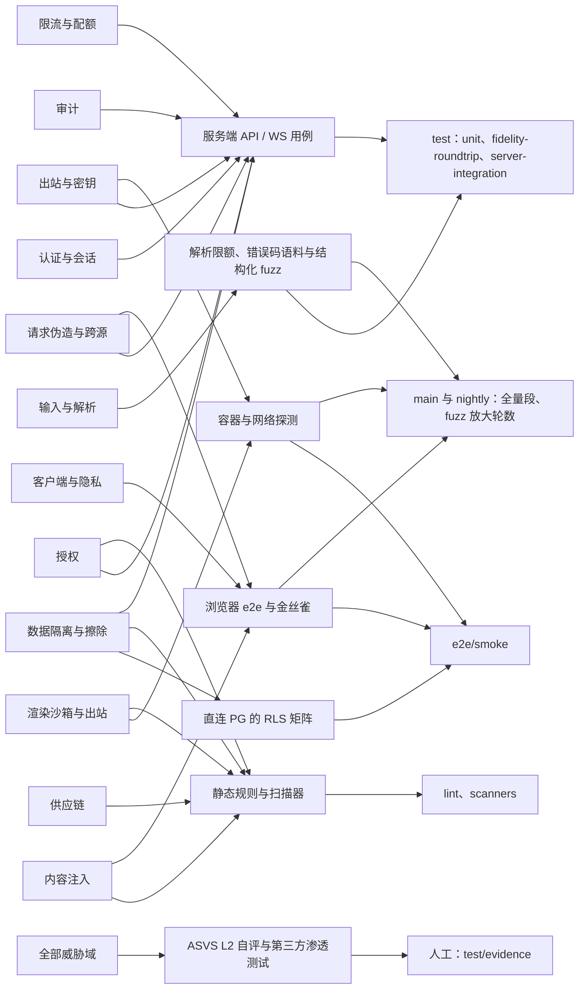
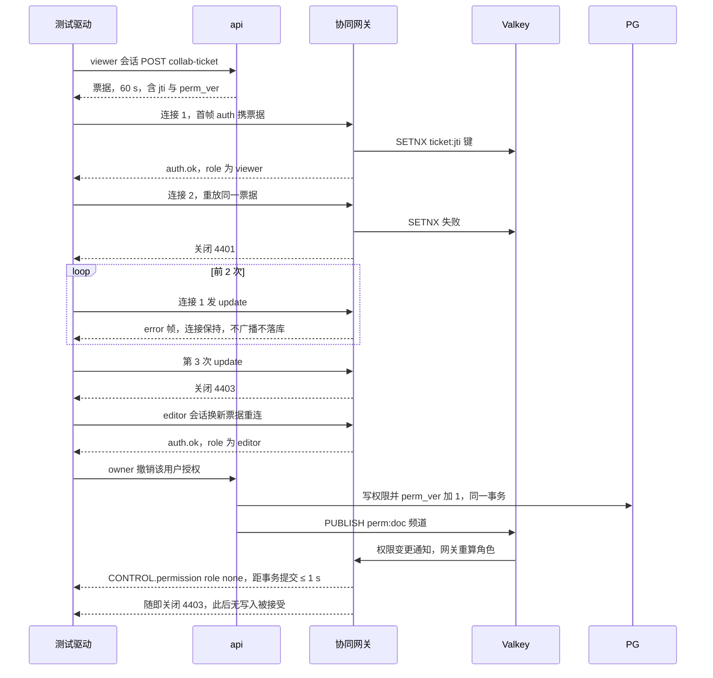
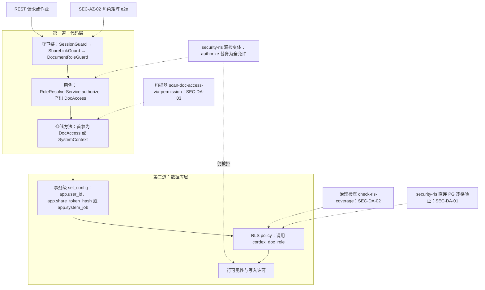
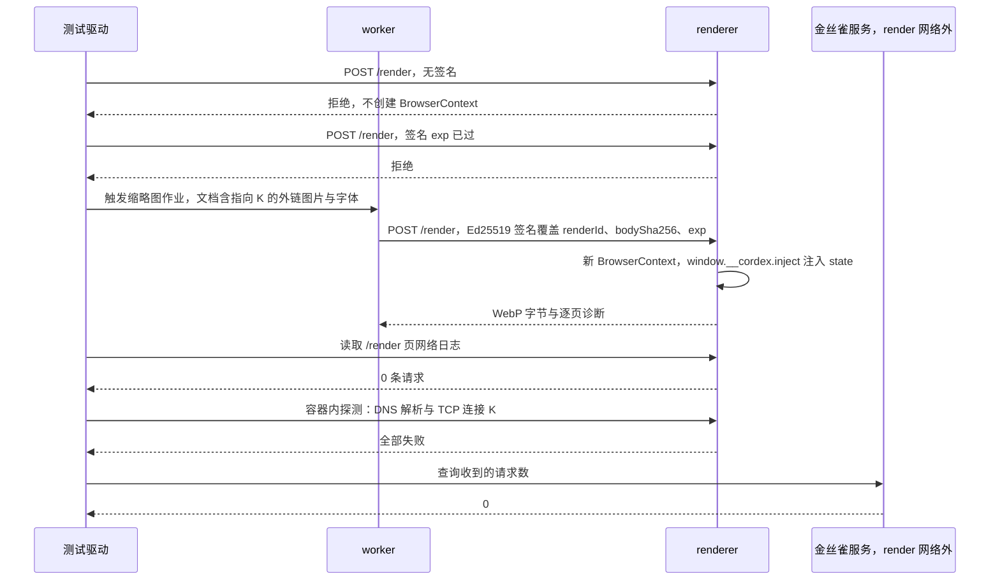
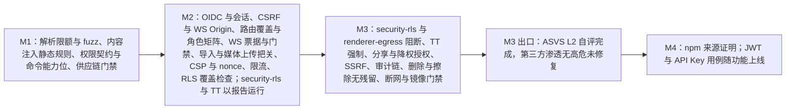

# 10 安全测试

> 状态：v0.1 | 负责：测试设计线 | 更新：2026-09-25；2026-09-25（§4.19） | 依赖：rulings §4.19 D-M2-CONTENT / C-06、PRD 04 NF-04 / NF-11、PRD 03/01 OF-24、PRD 05 M2 验收 8 与 M3 验收 4 / 6a / 9 / 16、[30/11 §10](../30-architecture/11-testing-strategy.md)、[30/08 §9](../30-architecture/08-backend-nestjs.md)、ADR-0020 / 0021 / 0026 / 0029 / 0034 / 0037、[09-06 §11 / §18](../30-architecture/09-type-discipline/06-scanners.md)、[09-08 TD-081 / 083 / 084 / 085](../30-architecture/09-type-discipline/08-policy-enforcement-matrix.md)、rulings §4.15 Q2 / Q6 / Q9 / Q10、§4.17 D1 / D3、§4.18 BE-02 / BE-04 / BE-05 / BE-06 / BE-10 / BE-30 / GV-16、[60/02](../60-backend/02-auth-chain.md)、[60/06](../60-backend/06-modules-jobs-import-export-thumbnails.md)、[60/07](../60-backend/07-modules-comments-webhooks-audit.md)、[60/08](../60-backend/08-db-conventions-roles-rls-migrations.md)、[50/14](../50-frontend/14-client-security.md)

## 0. 定位与分工

本文是安全测试的唯一事实源：安全用例目录（`SEC-<域>-<序号>`）、每条用例对应的威胁与断言、落在哪个测试文件与 CI 步骤、从哪个里程碑起阻断，以及 ASVS 自评、渗透测试与证据归档。

防线本身怎么设计不在本文：鉴权链、CSRF、票据、分享链接与 RLS 上下文见 [60/02](../60-backend/02-auth-chain.md)；renderer 信任区与签名 RPC 见 [60/06](../60-backend/06-modules-jobs-import-export-thumbnails.md) §9–§11；Webhook 出站守卫与审计哈希链见 [60/07](../60-backend/07-modules-comments-webhooks-audit.md)；RLS 框架、数据库角色与 GRANT 见 [60/08](../60-backend/08-db-conventions-roles-rls-migrations.md)（各表 policy 在 60/09–13）；WS 门禁见 [60/16](../60-backend/16-ws-protocol-server-view.md)；web 容器与安全响应头见 [60/17](../60-backend/17-deployment-and-config.md)；浏览器侧见 [50/14](../50-frontend/14-client-security.md)。静态规则（禁文档内容 HTML 注入、RLS 覆盖、镜像策略、仓储经权限服务）的规格与负向夹具在 09-type-discipline（TD-081 / 083 / 084 / 085），本文只把它们挂进同一张威胁地图。

**本文拥有 / 引用**

| 本文拥有 | 引用（以对方为准） |
|---|---|
| SEC 用例目录（id、威胁、断言、落点、步骤、阻断里程碑）及其机器副本 `test/security/catalog.json`；fuzz、金丝雀与网络探测的测试设计；ASVS L2 映射；渗透测试与复测流程；安全证据清单 | 防线设计：60/02、60/06、60/07、60/08–13、60/16、60/17、50/14；静态规则：09-06、09-08；容器 harness、种子与数据库隔离：[07](./07-backend-integration-and-api-e2e.md)；浏览器 e2e 工程与夹具：[06](./06-frontend-component-and-e2e.md)；部署与断网环境：[08](./08-deployment-and-environment-e2e.md)；CI 步骤名与触发段：[12](./12-ci-gates-mapping.md)；追溯标签：[13](./13-requirements-traceability.md) |

同一条安全用例只在本文登记一次；70/06、70/07、70/08 与 50 / 60 的「机械验证」小节以 SEC id 引用，不另起编号。测试标题以 SEC id 开头（如 `it('SEC-AZ-06 viewer 发 update 第 3 次关闭 4403', …)`），并按 [13](./13-requirements-traceability.md) 的规则加 `@req` / `@ruling` / `@adr` 标签。

---

## 1. 原则

1. **安全宁可提前**。每条用例随它保护的代码在同一 PR 入库，先以「报告」模式运行（[01 §10](./01-strategy-and-layers.md)：job 通过 + 产物），满足 01 §10 的升级条件即转 gated。PRD 或裁决指定了阻断里程碑的到期强制升级：`security-rls` 与 `renderer-egress` M3 起阻断（rulings §4.18 GV-16），Trusted Types 强制在 M3（rulings §4.15 Q2）。其余用例最迟与它保护的功能同一里程碑阻断，例如 M2 引入 cookie 会话，CSRF 与会话用例就在 M2 阻断。
2. **三处分工，互相引用、不重复描述**：60 与 50 写防线（守卫链、GUC、签名格式、CSP 指令）；09-type-discipline 写静态规则及其负向夹具；本文写运行时证据并把静态规则登记进同一张地图，使「每个威胁域至少一道 gated 的自动化证据」可以机械核对（§16）。
3. **负向优先**：每道防线至少有一个「攻击得逞即失败」的用例——越权请求拿到 2xx、金丝雀服务收到请求、令牌出现在日志里。只测正向路径不算覆盖。
4. **绕过应用层验证数据库层**：RLS 用例直接以 `cordex_app` / `cordex_system` 登录 PG 发 SQL，另在「应用层权限检查被替身为全允许」的变体中复验（§8）；两道防线必须各自独立成立。
5. **金丝雀而不是抽查**：隐私与脱敏类用例把唯一金丝雀串（`CANARY-` 加 12 位随机字符，每次运行重新生成）写进文档正文、文件名、令牌、请求头与用户资料，跑完后在日志、trace、遥测载荷、错误上报、指标标签中全文检索，命中即失败（§11）。
6. **时间一律可注入**：票据 60 s、链接到期、会话吊销缓存 5 s 等经服务端 `FixedClock` 推进（[11 §3](./11-test-data-fixtures-and-determinism.md)），不 `sleep`；Valkey 键 TTL 只断言 `PTTL` 并以删键模拟过期；以子进程运行的 renderer 用构造的过期 `exp` 验证签名时效；只有跨进程传播时延（降权 ≤ 1 s）用真实时钟度量。

依据：PRD 04 NF-04「评估」行；rulings §4.15 Q2 / Q6、§4.18 GV-16；决策 T-CI、T-PERF-GATE（「报告」定义，均 needsUser=false）。

**图 10-1 安全测试地图**

怎么读：左列是威胁域，中列是测试族，右列是执行点（`job/步骤` 名以 [12](./12-ci-gates-mapping.md) 为准）；一个威胁域可以由多个测试族覆盖，每个测试族落到一个或多个执行点。「全部威胁域」一格表示 ASVS 自评与渗透测试横跨全部领域。

依据：本文 §2–§14；rulings §4.18 GV-16（security-rls 与 renderer-egress 进 PR 冒烟子集）。

---

## 2. 威胁 → 测试 → 执行点总表

| 域 | 威胁 | 用例 | 主要执行点 | 阻断起点 | 细则 |
|---|---|---|---|---|---|
| 输入 | zip 炸弹、XXE 与实体扩展、深嵌套、畸形 OPC、EMF / WMF 资源耗尽、伪装与超大上传、畸形请求体与帧 | SEC-IN-01…09 | `test/unit`、`test/fidelity-roundtrip`、`test/server-integration`、`test/contract`；nightly 放大 fuzz | M1（客户端解析）；M2（EMF、REST、服务端导入与媒体上传、WS，rulings §4.19 D-M2-CONTENT） | §3 |
| 内容 | 文档内容经 HTML sink 执行；SVG 内脚本；危险超链接协议；粘贴注入；外链资源泄露查看者；服务端抓取外链 | SEC-CT-01…06 | `lint`（TD-081）、`test/unit`（browser mode）、`e2e/smoke`、`test/server-integration` | M1；粘贴与服务端导入 M2；缩略图、PDF 与服务端导出 M3 | §4 |
| 认证 | OIDC state 伪造与重放、令牌伪造、未上线的凭据模式被接受、生产无鉴权启动、cookie 属性缺失、refresh 重放、吊销不及时、跨 IdP 账号接管 | SEC-AU-01…10 | `test/server-integration`、`e2e/smoke`（login-oidc-mock、login-casdoor） | M2（含 WS） | §5 |
| 请求伪造与跨源 | CSRF、跨源 WS 劫持、令牌经 URL 与日志泄露、开放重定向、CORS 放宽 | SEC-XS-01…05 | `e2e/smoke`（csrf-origin、share-link-landing）、`test/server-integration`、`test/unit` | M2（含 WS Origin）；分享 M3 | §6 |
| 授权 | 漏挂守卫、角色越权、票据重放、只读者写入、降权不及时、锁定文档被写、链接越权、上传与媒体跨文档、用户枚举、邀请越界 | SEC-AZ-01…15 | `test/server-integration`、`test/contract`、`scanners`、`test/collab-sim` | M1（契约与扫描器）；M2（REST、WS 票据与锁定、上传与媒体）；M3（分享、降权与只读者写入、权限细化） | §7 |
| 数据 | 应用层漏检时跨文档读写、RLS 覆盖缺失、仓储绕过权限服务、租户残留、审计被改、永久删除与用户擦除残留 | SEC-DA-01…07 | `e2e/smoke`（security-rls）、`scanners`、`test/server-integration`、`test-typecheck` | 覆盖检查 M2；RLS 运行时与擦除 M3 | §8 |
| 渲染沙箱 | renderer 出站、拉取式状态端点复活、未签名 RPC、内部端点外露、容器提权与带凭据、缩略图被当作可执行内容、封面解码漏洞面 | SEC-RS-01…07 | `e2e/smoke`（renderer-egress）、`scanners/check-image-policy`、`test/server-integration`、`e2e/full-compose` | 封面 M2；其余 M3 | §9 |
| 出站与密钥 | Webhook SSRF 与 DNS 重绑定、签名密钥明文落库、服务端意外外呼 | SEC-EG-01…03 | `test/server-integration`、`e2e/full-airgap` | M3 | §10 |
| 客户端与隐私 | CSP / nonce 失效、TT 违规、未登记的网络目标、遥测带内容或明文身份、日志带凭据、遥测默认开启 | SEC-CL-01…07 | `e2e/smoke`（csp-strict）、全部 e2e 步骤的安全夹具、`e2e/full-compose`、`test/server-integration`、`test/unit` | M2；TT 强制 M3 | §11 |
| 限流与配额 | 暴力请求、超大请求体、WS 洪泛、房间挤占、超天花板导入、存储超额 | SEC-RL-01…06 | `test/server-integration`、`test/contract`、`test/fidelity-roundtrip` | M2（REST、WS 洪泛、导入天花板、存储配额、按权重准入）；M3（房间容量与名额按用户计，PRD 05 §0.3） | §12 |
| 供应链 | 许可违规、高危漏洞、lockfile 投毒、依赖混淆、yjs 漂移、镜像 tag 漂移、发布无来源证明、运行时加载第三方资源 | SEC-SC-01…08 | `scanners/*`、`e2e/full-compose`、发布流程 | M0 / M1；镜像 M2–M3；发布 M4 | §13 |
| 审计 | 安全事件未入审计、审计被改或删 | SEC-DA-05；各授权与认证用例的审计断言 | `test/server-integration` | M3 | §7、§8 |

**机器副本**：本表与 §3–§13 的逐条目录同步到 `test/security/catalog.json`，每条 `{ id, area, threat, level: 'gated' | 'report' | 'manual', since, gatedSince, steps[], files[] }`。`test/requirement-matrix` 步骤读取它并断言：每个 id 至少有一个测试标题以该 id 开头（`manual` 类改为要求证据文件存在）；每个 `area` 至少一条 `level: 'gated'` 的自动化用例；`gated` 条目降级必须带 [01 §10](./01-strategy-and-layers.md) 规定的 `allow`（§16）。

---

## 3. 输入与解析

限额数值以 PRD 03/01 OF-24 与 [30/08 §9.2](../30-architecture/08-backend-nestjs.md) 为准，用例从配置读取、不写死；错误码与 HTTP 映射以 30/10 §1 为准。

| id | 断言 | 落点 | CI 步骤 | 阻断 |
|---|---|---|---|---|
| SEC-IN-01 | ZIP 限额：条目数、单条目解压、总解压、压缩比 > 100:1、媒体总量各有一对样本——恰在上限通过、上限 + 1 拒绝，码 `format.limit_exceeded{limit, actual}`（HTTP 413）；拒绝发生在该条目解压完成之前（解压字节计数 ≤ 限额 + 一个读块）；样本由 `package-builder` 确定性生成，炸弹类不入库 | `packages/ooxml-core/src/opc/__tests__/zip-limits.test.ts`；语料侧 [03 §8](./03-fidelity-roundtrip-and-corpus.md)；服务端 `apps/server/test/integration/import/import-limits.int-spec.ts` | `test/unit`、`test/fidelity-roundtrip`、`test/server-integration` | M1（服务端 M2） |
| SEC-IN-02 | XML：含 DTD、外部实体（`file:///etc/passwd`、指向金丝雀 HTTP 服务的 URL）、参数实体、指数展开实体（billion laughs）的部件被拒或按禁用处理；金丝雀收到请求数 = 0；解析堆增量 < 64 MiB | `packages/ooxml-core/src/xml/__tests__/xml-hardening.test.ts` | `test/unit` | M1 |
| SEC-IN-03 | 结构限额：嵌套深度 257、单元素属性 1,025、文本节点 > 16 MiB、图表每序列 > 10,000 点、位图预览 > 16,777,216 px 各一例 → `format.limit_exceeded`；恰在上限的样本通过；限额配置可收紧、放宽超过 2 倍被配置 schema 拒绝 | 同上文件 + [03 §8](./03-fidelity-roundtrip-and-corpus.md) 的错误码语料 | `test/unit`、`test/fidelity-roundtrip` | M1 |
| SEC-IN-04 | 畸形 OPC 结构化变异 fuzz（设计见下） | `packages/ooxml-core/src/opc/__tests__/opc-mutation.property.test.ts`；服务端导入路径 `apps/server/test/integration/import/import-fuzz.int-spec.ts` | `test/unit`（PR 档）；nightly 放大档 | M1（放大档先报告） |
| SEC-IN-05 | EMF / WMF 栅格化 Worker：记录数、输出像素、单文件耗时三项超限（初始值由 M2 spike 回填 OF-24）→ Worker 被中止、该元素回到占位、主线程无 > 50 ms 长任务、同页其它元素照常渲染 | 栅格化 Worker 所在包的 `__tests__/emf-limits.browser.test.ts`（包归属以 40/07 为准） | `test/unit`（browser mode） | M2 |
| SEC-IN-06 | 上传伪装与超大：服务端导入只接受魔数 `PK\x03\x04` 且含 `[Content_Types].xml`；媒体声明 MIME 与嗅探不符以嗅探为准、不可识别即拒；大小三处把关（[60/06 §6.1](../60-backend/06-modules-jobs-import-export-thumbnails.md)、[60/04](../60-backend/04-modules-documents-storage-media.md) §7）——申请时 `byteSize` 超 `scale.maxFileBytes`（导入）或 `limits.media.maxBytes`（媒体）→ 413；预签名 PUT 签入 `Content-Length`，实传字节与申报不符被存储拒绝；受理 / commit 时 `HEAD` 大小与申报不符 → 拒绝（码以 60/06、60/04 为准）；两步导入（含带 `docId` 的覆盖导入、新建空白 / 模板所走的同一路径）的每一步都执行上述把关 | `apps/server/test/integration/import/upload-validation.int-spec.ts`、`media/media-commit.int-spec.ts` | `test/server-integration` | M2（服务端导入两步上传与媒体上传随 rulings §4.19 D-M2-CONTENT 进 M2） |
| SEC-IN-07 | 宏与加密：`.pptm` / macroEnabled 主内容类型 / 含 `vbaProject.bin` → `format.macro_rejected`（415）；加密 → `format.encrypted`；均不创建文档、不保留宏部件 | 语料 [03 §8](./03-fidelity-roundtrip-and-corpus.md)；服务端状态码 [07](./07-backend-integration-and-api-e2e.md) | `test/fidelity-roundtrip`、`test/server-integration` | M1（服务端 M2） |
| SEC-IN-08 | 请求体与帧：遍历 60/15 路由表，对每个带请求体的路由发「缺必填、类型错、多余字段、超长字符串」四种变异 → 400 且错误码已登记、无 500；WS L1 坏帧 4400、超 `maxUpdateBytes` 4413、超 `msgRateHz` / `msgBurst` 4429，未知 CONTROL 类型丢弃并计数 | `apps/server/test/e2e/api/dto-fuzz.e2e-spec.ts`；WS 部分为 [02 §5.2](./02-contract-suites-and-pluggability.md) `runCollabServerConformance` 的门禁分节 | `test/server-integration`、`test/contract` | M2（含 WS） |
| SEC-IN-09 | SVG 媒体消毒：含 `<script>`、`on*` 属性、`<foreignObject>`、外链 `href`、`javascript:` URL 的 SVG 经服务端消毒后与黄金输出一致；消毒产物在客户端仍只以图像上下文渲染（SEC-CT-02） | `apps/server/src/modules/media/**/__tests__/svg-sanitize.test.ts` | `test/unit` | M2（媒体上传随服务端文档进 M2） |

**SEC-IN-04 结构化变异 fuzz 的设计**

- **生成器**：以 T1 小样本为种子，用 fast-check 变异算子作用在 OPC 结构上，而不是随机翻字节：
  - 部件名：重复、仅大小写不同、`../` 越界、绝对 URI、超长、非法百分号编码；
  - `[Content_Types].xml`：缺失、重复 Override、未知内容类型；
  - `.rels`：目标缺失、自引用环与互引用环、`TargetMode="External"` 指向 `file:` / `javascript:`、数万个 `rId`；
  - XML 层：截断、非法 UTF-8、BOM 混用、超深嵌套、巨量属性；
  - zip 层：中央目录与本地头不一致、声明大小与实际不符、zip64 字段异常、条目数据区重叠。
- **每个输入的断言**：`import` 返回成功或已登记错误码之一，不抛未捕获异常；单样本耗时 ≤ 2 s（Worker 可中止）；解压字节与堆增量受限额约束；从不访问包外路径；若成功，模型通过 `bodySchema` 与不变量检查，且立即导出再导入不抛错。
- **轮数**：PR 为固定种子 20 个 × 每种子 50 例（约 1 min）；nightly（`CORDEX_SUITE=nightly`）放大到 20,000 例，服务端导入路径（worker_threads 宿主）只跑 nightly 档。
- **失败处理**：记录种子与 fast-check 收缩后的最小样本，写入 `packages/ooxml-core/src/opc/__tests__/fuzz-repros/<seed>.json`，作为确定性回归用例入库（与 [05 §5](./05-collab-simulation-and-property-tests.md) 的 repro 流程同一格式）。

依据：PRD 03/01 OF-24；PRD 04 NF-04「输入」行；rulings §4.16 Q15（宏拒绝）、§4.15 Q5（天花板）。

---

## 4. 内容注入

| id | 断言 | 落点 | CI 步骤 | 阻断 |
|---|---|---|---|---|
| SEC-CT-01 | 文档内容不经 HTML sink：渲染包与 `*-ui` 中出现 `innerHTML`、`outerHTML`、`insertAdjacentHTML`、`DOMParser`、`document.write` 即失败；规则与负向夹具见 TD-081，作用范围扩到 `apps/web` 的回写见 50/14 §13 | `tooling/eslint-config/rules/dom-injection.ts` 的负向夹具 | `lint` | M1 |
| SEC-CT-02 | SVG 只以图像上下文渲染：`asvg:svgBlip` 与 SVG 媒体在 DOM 中只以 `<image>` / `` 出现（`blob:` URL），页面中不出现来自文档的 `<svg>` 子树；渲染带 `<script>`、`onload`、`<animate onbegin>` 的 SVG 后，页面全局哨兵变量未被改写 | `packages/render-dom/src/__tests__/svg-image-only.browser.test.ts` | `test/unit`（browser mode） | M1 |
| SEC-CT-03 | 超链接协议：导入的 `javascript:`、`vbscript:`、`data:`、`file:`、`mailto:` 与自定义协议关系全部原样保留（零编辑往返 `.rels` 字节相同），渲染与点击都不激活，只有 `http(s)` 可激活；命令层对白名单外协议返回拒绝（性质测试，50/14 V11） | 渲染侧 `slide-render` 的 `hyperlink-activation.browser.test.ts`；往返 [03 §9](./03-fidelity-roundtrip-and-corpus.md) | `test/unit`、`test/fidelity-roundtrip` | M1 |
| SEC-CT-04 | 粘贴清洗（M2 口径，与 [50/14 §5](../50-frontend/14-client-security.md) 一致）：剪贴板 HTML 含 `<script>`、`on*`、`style` 中的 `url(javascript:…)`、外链 ``、`<iframe>` → 进入模型的只有纯文本（取同一剪贴板项的 `text/plain`，没有时由不经 DOM 的文本提取器剥离标签），页面无脚本执行（全局哨兵不变），外链图片不被请求（由 SEC-CL-03 的网络夹具断言）；白名单富格式清洗随 P2 另加断言（rulings §4.15 Q4） | `slide-ui` 粘贴模块的 `paste-sanitize.browser.test.ts`；`apps/web/e2e/editing/paste.spec.ts` | `test/unit`；`e2e/full-compose` | M2 |
| SEC-CT-05 | 外链资源三档 `auto` / `confirm` / `never` 下的请求数与 CSP 收紧（50/14 V5）；`never` 档外链请求数为 0 | [06 §10](./06-frontend-component-and-e2e.md) | `e2e/full-compose`；`never` 档随 csp-strict 进 `e2e/smoke` | M1（查看器）/ M2 |
| SEC-CT-06 | 服务端永不抓取外链：导入含外链图片、字体、视频关系的样本，全部指向 render 网络外的金丝雀 HTTP / DNS 服务；导入 → 缩略图 → PDF → 导出全流程后金丝雀收到请求数 = 0 | `apps/server/test/integration/import/no-external-fetch.int-spec.ts`；renderer 部分与 SEC-RS-01 共用金丝雀 | `test/server-integration`、`e2e/smoke` | M2（导入段）/ M3（缩略图、PDF、导出段） |

依据：PRD 05 EM-14；PRD 04 NF-04「内容」行；rulings §4.15 Q4（禁 innerHTML 注入）、Q7（外部关系全部保留、仅 http(s) 可激活、服务端永不加载）；ADR-0021、ADR-0008「如何被机械验证」。

---

## 5. 认证与会话

依据：决策 SESSION（用户偏好「安全宁可提前」+ PRD SV-06 / SV-12，needsUser=false）、INC-18（浏览器顶层导航语义）、OIDC-LINK（安全宁可提前）；rulings §4.15 Q6、§4.18 BE-09、UX-02；ADR-0029「如何被机械验证」。会话与 cookie 的设计以 [60/02](../60-backend/02-auth-chain.md) §2–§4 为准；本节的服务端用例都在 [07](./07-backend-integration-and-api-e2e.md) §2 的容器 harness（oidc-provider mock、Casdoor、PG、Valkey）中运行。

| id | 断言 | 落点 | CI 步骤 | 阻断 |
|---|---|---|---|---|
| SEC-AU-01 | OIDC 授权码 + PKCE：`state` 缺失、不匹配、重放（`oidc:state:{state}` 已被消费）→ 拒绝并写审计；`nonce` 不符、`id_token` 签名错、`iss` 或 `aud` 不符、已过期 → 拒绝；`code_verifier` 与 IdP 令牌不出现在任何浏览器可见的响应、URL 与存储中（服务端换码，BE-09）；`next` 与 `mode` 只从 state 记录取回，不信任回调 query | `apps/server/test/e2e/auth/oidc-flow.e2e-spec.ts` | `test/server-integration` | M2 |
| SEC-AU-02 | 真实登录路径：oidc-provider mock 与 Casdoor 容器各一条浏览器登录，`/auth/me` 为同一用户；Casdoor `selfSignup` 关 / 开两态（关时 IdP 注册入口不可用）；服务端配置 `auth.selfSignup` 缺省值为 `false`（配置 schema 快照） | `apps/web/e2e/auth/login-oidc-mock.spec.ts`、`login-casdoor.spec.ts`（`@smoke`） | `e2e/smoke` | M2 |
| SEC-AU-03 | M1–M3 拒绝集成方凭据：`Authorization: Bearer <任意 JWT>`、`X-Api-Key` 访问任意受保护路由 → 401（码以 60/02 为准）；WS 首帧以 JWT 代替票据 → 4401。M4 引入集成方 JWT 与 API Key 时本条改写为「按 M4 规则接受，其余拒绝」 | `apps/server/test/e2e/auth/credential-modes.e2e-spec.ts` | `test/server-integration` | M2（含 WS） |
| SEC-AU-04 | 生产不许无鉴权：服务端没有免鉴权开关——出现 `CORDEX_AUTH_MODE` 等未登记变量、或 production 下缺 OIDC issuer 配置 → 退出码 78 且未监听端口（[08 §2](./08-deployment-and-environment-e2e.md) RA11 / RA12，60/17 §6）；生产 web 镜像以 `auth.mode=none` 启动被启动脚本拒绝、容器非零退出（[08 §4](./08-deployment-and-environment-e2e.md) G8，60/17 §3.3）；apps/web 生产构建的 RuntimeConfig schema 拒绝 `auth.mode:'none'`（50/02 §3，构建产物断言） | 08 §2 role-assembly、§4；`apps/web/src/__tests__/build-flags.test.ts` | `test/server-integration`、`e2e/full-compose`、`test/unit` | M2（web 容器部分随 08 §11 在 M3 出口） |
| SEC-AU-05 | cookie 属性（以 60/02 §4.1 为准）：`__Host-cordex_session` 为 `HttpOnly; Secure; SameSite=Lax; Path=/`、无 `Domain`；`__Secure-cordex_refresh` 为 `HttpOnly; Secure; SameSite=Strict; Path=/api/v1/auth`；`__Secure-cordex_oidc` 回调即清除；各 cookie 的值不出现在任何响应体与其它响应头中 | `apps/server/test/e2e/auth/session-cookies.e2e-spec.ts` | `test/server-integration` | M2 |
| SEC-AU-06 | refresh 轮换与重放：每次刷新下发新 refresh、旧值失效；旧 refresh 重放 → 401，重放之后的会话处置按 60/02 §4 断言；服务端只存哈希（扫描 `session:{sid}` 的值，找不到明文） | `apps/server/test/e2e/auth/refresh-rotation.e2e-spec.ts` | `test/server-integration` | M2 |
| SEC-AU-07 | 吊销 ≤ 5 s：登出后同一 cookie 在进程内缓存过期（`FixedClock` 推进 5 s）后 401；平台管理员停用用户或擦除用户 → 该用户全部 `sid` 失效，在线 WS 经各 collab 实例 ≤ 5 s（`auth.session.revocationCacheMs`）一次的批量会话复核以 4401 关闭（60/02 §9.5，不按房间点名踢人）；`auth.refresh` 不延长会话寿命，吊销后已 rebind 的连接同样被关闭 | `apps/server/test/e2e/auth/session-revocation.e2e-spec.ts`；WS 部分 `apps/server/test/e2e/collab/ws-authz.e2e-spec.ts` | `test/server-integration` | M2（含 WS；停用与擦除 M3） |
| SEC-AU-08 | 跨 issuer 不自动关联：issuer A 已有用户 u1（邮箱 x），issuer B 以同一邮箱首次登录 → 新建 u2 ≠ u1，u1 的授权对 u2 不可见 | `apps/server/test/e2e/auth/jit-provisioning.e2e-spec.ts` | `test/server-integration` | M2 |
| SEC-AU-09 | JWKS 轮换：换签名密钥后旧公钥保留到最长令牌寿命，期间旧令牌有效、之后 401；未知 `kid` → 401 | `apps/server/test/e2e/auth/jwks-rotation.e2e-spec.ts` | `test/server-integration` | M2 |
| SEC-AU-10 | 换人不重放：重新登录回来的用户 id 与原会话不同 → 不重放离线队列、会话只读、可导出本地副本（rulings §4.18 UX-02） | 执行见 [05 §9](./05-collab-simulation-and-property-tests.md)、[06 §5](./06-frontend-component-and-e2e.md) | `test/collab-sim`、`e2e/full-compose` | M2（在途队列）/ M3（离线队列） |

---

## 6. 请求伪造与跨源

依据：决策 INC-24（PRD SV-12 P0 验收 + 安全宁可提前）、INC-25（ADR-0029 否决 API 上的 URL 令牌 + rulings §4.18 UX-19 / BE-02）、INC-18，均 needsUser=false。请求头名 `X-Cordex-Request`、`X-Cordex-Share-Token` 由 [60/02](../60-backend/02-auth-chain.md) §5、§7 定义；浏览器侧用法见 [50/14](../50-frontend/14-client-security.md) §8。

| id | 断言 | 落点 | CI 步骤 | 阻断 |
|---|---|---|---|---|
| SEC-XS-01 | CSRF：遍历路由表中全部非安全方法（POST / PUT / PATCH / DELETE），带有效会话 cookie，分三种变异——`Origin: https://evil.example`；同源但缺 `X-Cordex-Request: 1`；缺 Origin 且 `Sec-Fetch-Site: cross-site` → 一律 403 `server.auth.csrf_rejected`，数据库与对象存储无变化；正确的同源请求成功。豁免只允许快照清单中的路由（清单以 60/02 §5 为准；目前预期只有 `/api/v1/telemetry/csp`：Reporting API 无法附自定义头，且该端点不读会话、不写业务数据），清单变化须同时改快照 | `apps/server/test/e2e/smoke/csrf-origin.e2e-spec.ts` | `e2e/smoke`（csrf-origin） | M2 |
| SEC-XS-02 | WS Origin：升级请求的 Origin 不在 `security.allowedOrigins` → 403 `server.auth.origin_rejected`、拒绝计数指标 + 1、不分配房间资源；缺 Origin 的处置按 60/16 §1 断言；白名单内 Origin 正常升级 | 同上文件的 WS 段 | `e2e/smoke`（csrf-origin） | M2（协同网关随 rulings §4.19 D-M2-CONTENT 进 M2） |
| SEC-XS-03 | 分享令牌不经 URL：API 只认 `X-Cordex-Share-Token` 头，`?shareToken=`、`?share=`、`?token=` 等 query 一律忽略（仅凭 query 的非授权用户得 403）；浏览器落地 `/documents/{id}#share=…` 后地址栏无片段，任何请求 URL 与 Referer 中无令牌，全站响应带 `Referrer-Policy: strict-origin-when-cross-origin`；web 容器访问日志、服务端日志与 trace 中检索不到令牌（金丝雀，§11） | 浏览器 `apps/web/e2e/share/share-link-landing.spec.ts`（`@smoke`）；API `apps/server/test/e2e/share/share-token-transport.e2e-spec.ts` | `e2e/smoke`（share-link-landing）、`test/server-integration` | M3 |
| SEC-XS-04 | 开放重定向：`GET /api/v1/auth/oidc/login?next=` 的服务端校验与客户端 `nextAfterLogin`（50/14 V8）对同一组 fast-check 输入（`//evil`、`/\evil`、`https://evil`、`%2F%2Fevil`、`/%5Cevil`、混入制表符与换行、全角斜杠等）只产生站内相对路径；不合法时服务端回落 `/`、客户端回落 `/home`（`/` 本身重定向 `/home`，两者等价，规则全文以 50/02 §4 与 60/02 §2 为准）；两端共用 `@cordexjs/protocol/testing` 导出的样本集，共享样本只断言「输出是站内相对路径」这一公共性质，各端的回落值分别断言 | 服务端 `apps/server/src/modules/auth/**/__tests__/next-param.test.ts`；客户端见 50/14 V8 | `test/unit` | M2 |
| SEC-XS-05 | CORS 不放宽：对 API 发带第三方 Origin 的预检与简单请求，响应不回显该 Origin、不带 `Access-Control-Allow-Credentials: true` | `apps/server/test/e2e/api/cors.e2e-spec.ts` | `test/server-integration` | M2 |

---

## 7. 授权

依据：rulings §4.18 BE-02 / BE-05 / BE-06 / BE-10；决策 T-KITS（40/06 §2.5 + 用户偏好「安全宁可提前」）、INC-20（ADR-0029 已接受）、INC-21（rulings D12 fail-closed + 安全宁可提前）、SG-05（安全宁可提前）、INC-27（与 rulings UX-02 一致），均 needsUser=false；ADR-0012、ADR-0029「如何被机械验证」。守卫链与票据设计以 [60/02](../60-backend/02-auth-chain.md) §6–§9 为准，路由、守卫与能力位列以 [60/15](../60-backend/15-rest-api-catalog.md) §3–§4 为准。

| id | 断言 | 落点 | CI 步骤 | 阻断 |
|---|---|---|---|---|
| SEC-AZ-01 | 路由鉴权覆盖：遍历 Nest 路由表，除 `@Public` 快照（BE-06 六项 + `/telemetry/csp`，以 60/15 §4 为准）外，无会话请求一律 401；快照与路由表双向比对（多或少都失败）；`/telemetry/csp` 另断言令牌桶 429 与 16 KiB 上限 413 | `apps/server/test/e2e/route-auth-coverage.e2e-spec.ts`（[07 §13](./07-backend-integration-and-api-e2e.md)） | `test/server-integration` | M2 |
| SEC-AZ-02 | 角色 × 能力位 × 路由矩阵：用例由 60/15 路由表的守卫与能力位列生成（不手写）——每条带 `DocRole(cap)` 的路由 × 主体 {owner、editor、commenter、viewer、无授权、仅链接 viewer、仅链接 editor、非成员的平台管理员} → 期望 2xx 或 403；能力位全集以 protocol `permissions/actions.ts` 为准，含 `history.read` / `history.restore`；查看者是编辑器只读变体，viewer 对全部写路由 403、读路由 2xx；`PlatformAdminGuard` 路由对非管理员 403 | `apps/server/test/e2e/authz/authz-matrix.e2e-spec.ts`（参数表由 `apps/server/test/helpers/route-table.ts` 读取运行时路由元数据生成；目录约定见 [07 §1](./07-backend-integration-and-api-e2e.md)） | `test/server-integration` | M2（含 `snapshots/latest`、collab-ticket、导入与媒体路由）；版本列表、命名与恢复路由 M3 |
| SEC-AZ-03 | 权限策略契约 `runPermissionPolicyConformance`：零策略全拒、`evaluate` 抛错或返回非法值即拒、能力位全集 | [02 §3 #13](./02-contract-suites-and-pluggability.md) | `test/contract` | M1 |
| SEC-AZ-04 | 贡献的每个命令声明非空且合法的能力位：扫描器 `scan-command-capabilities` 规则 (a)(b)（09-06 §11） | 负向夹具随扫描器 | `scanners` | M1 |
| SEC-AZ-05 | WS 票据：有效期 60 s（`FixedClock` 推进 60 s + 验签容差 + 1 s 后首帧 → 4401，容差内仍接受，[11 §3](./11-test-data-fixtures-and-determinism.md)）；单次（同一 `jti` 再用 → 4401）；绑定文档（A 的票据用于 B → 4403 `collab.forbidden`，关闭码以 60/16 §10 为准）；`perm_ver` 落后时以库为准；`sid` 已吊销 → 4401；首帧 5 s 内未到 → 4408；`auth.refresh` 只接受验签、`jti`、`sid` 一致的新票据，通过后只重新绑定角色与链接字段、不延长会话寿命（INC-27；02 §5.2 `session/auth-refresh-rebinds`）；WS URL 与日志中无票据以外的凭据 | `runCollabServerConformance` 票据分节（[02 §5.2](./02-contract-suites-and-pluggability.md)）+ `apps/server/test/e2e/collab/ws-authz.e2e-spec.ts` | `test/contract`、`test/server-integration` | M2 |
| SEC-AZ-06 | 只读者写入：viewer 连接发 update → `error` 帧、连接保持、该 update 不广播、不落库；第 3 次 → 4403；审计有对应拒绝记录。L2 计数起点：降权瞬间仍在途的写入帧只回 `error`、不计数，服务端发出降权 `CONTROL.permission` 或 `CONTROL.room{locked}` 后 2 s 内到达的帧仍视为在途、不计数，只统计此后到达的写入帧（60/16 §4；[07 §9](./07-backend-integration-and-api-e2e.md) W15） | 同上 | 同上 | M3（锁定起点 M2） |
| SEC-AZ-07 | 降权 ≤ 1 s：撤销直接授权或撤销分享链接 → 在线会话自写库事务提交起 ≤ 1 s 收到 `CONTROL.permission`（真实 Valkey 发布订阅）；降为 `none` 时随即 4403 关闭，降为只读角色时之后的 update 被拒（60/16 §8）；他人授权变化不踢出、不改变仅凭链接的会话；链接到期按 `linkExpiresAt` 主动降权（`FixedClock`）；`ShareLinkGuard` 与 `RoleResolverService` 对同一令牌解析出同一角色 | `ws-authz.e2e-spec.ts`、`apps/server/test/e2e/share/share-link-ws.e2e-spec.ts` | `test/server-integration`（2 s 门禁另在 `perf/perf-collab`） | M3 |
| SEC-AZ-08 | 锁定与清除中的文档：锁定文档的 REST 写路由与 WS update 被拒（码以 60/15、60/16 为准），在线会话先收到 `CONTROL.room{locked:{reason, until}}` 而不是 `permission{reason:'changed'}`；`purging` 状态拒绝加入房间 | `apps/server/test/e2e/authz/locked-document.e2e-spec.ts` | `test/server-integration` | M2（锁定：覆盖导入窗口）/ M3（`purging`） |
| SEC-AZ-09 | 分享链接要求登录：未登录 + 令牌 → 401，不产生匿名主体；仅有链接的已登录用户 `GET /documents/:id` 与 `POST …/collab-ticket` → 200 且票据含 `lnk`；过期或已撤销令牌 → 403，problem details 的 `details.reason` 为 `share_link.expired` 或 `share_link.revoked`（不是顶层扩展字段，ErrorEnvelope 只含 `details?`）；每次成功叠加链接角色都计入审计 `share_link.accessed`（1 s 窗口合并为一行，`count` 等于访问次数，60/02 §7.5） | `apps/server/test/e2e/share/share-links.e2e-spec.ts` | `test/server-integration` | M3 |
| SEC-AZ-10 | 上传归属：提交他人的 `uploadId` 或自拟对象键 → 403；`upload:{uploadId}` 的 `PTTL` ≤ 1 h，删除该键模拟过期后提交 → 403（Valkey TTL 不等真实过期，[11 §3](./11-test-data-fixtures-and-determinism.md)）；客户端 DTO 中不存在对象键字段（类型测试，50/14 V10） | `apps/server/test/e2e/import/upload-ownership.e2e-spec.ts`、`media/media-upload.e2e-spec.ts` | `test/server-integration`、`test-typecheck` | M2（两步导入含带 `docId` 的覆盖导入，覆盖导入另要求对该文档 `doc.write`；随 rulings §4.19 D-M2-CONTENT 进 M2） |
| SEC-AZ-11 | 媒体文档作用域：`GET /documents/A/media/{sha256}`，该媒体只关联文档 B → 404（不泄露存在性）；A 的 viewer 可读 A 的媒体（200 JSON `{url, expiresAt}`、不是 3xx，`url` 为 1 h 预签名，60/15 §3.6）；无文档作用域的 `/media/*` 路由不存在（路由快照） | `apps/server/test/e2e/media/media-scope.e2e-spec.ts` | `test/server-integration` | M2（仅链接查看者的一例 M3） |
| SEC-AZ-12 | 用户枚举：`query` 少于 2 个字符 → 400；结果 ≤ 20 条；响应只含 `id`、`displayName`、`avatarUrl`（schema 快照）；邮箱只做精确匹配且不回显；超出令牌桶 → 429 | `apps/server/test/e2e/users/user-search.e2e-spec.ts` | `test/server-integration` | M3 |
| SEC-AZ-13 | 评论与路径级权限：commenter 写非评论路径被软门禁回退、不能删他人评论（ADR-0031、ADR-0034） | [05 §8](./05-collab-simulation-and-property-tests.md)、[07 §12](./07-backend-integration-and-api-e2e.md) | `test/collab-sim`、`test/server-integration` | M3 |
| SEC-AZ-14 | 邀请只对已存在账号生效：对不存在的邮箱授予 → 明确错误，不落任何待接受记录；schema 中无 `pending_invitations` 表（[07 §4](./07-backend-integration-and-api-e2e.md)） | `apps/server/test/e2e/permissions/grant.e2e-spec.ts` | `test/server-integration` | M3 |
| SEC-AZ-15 | 最后一个 owner 与最后一名平台管理员：并发撤销不会留下零 owner 或零 admin | [07 §7](./07-backend-integration-and-api-e2e.md) | `test/server-integration` | M3 |

**图 10-2 WS 票据与降权测试**

怎么读：自上而下是 SEC-AZ-05、AZ-06、AZ-07 在同一用例文件里的执行顺序（降为只读角色而非 none 的分支见 SEC-AZ-07 正文）；票据重放与只读写入两段用 `FixedClock` 控制时间，降权一段用真实时钟度量「事务提交 → 收到 permission 帧」的时延。

依据：ADR-0029「如何被机械验证」；rulings §4.18 BE-02；决策 INC-27。

---

## 8. 数据隔离

依据：决策 RLS-GUC（rulings §4.18 BE-02 + §4.17 D3 + ADR-0022 修订 2026-09-24）、DB-ROLES、C-21（check-rls-coverage 规则文本 + 安全宁可提前）、C-20/G-13/G-14（PRD SV-07）、C-24（PRD SV-11）、FK-POLICY（rulings §4.18 BE-15），均 needsUser=false；rulings §4.15 Q6、§4.18 GV-16；ADR-0022、ADR-0029「如何被机械验证」。RLS 框架、GUC、角色与 GRANT、测试矩阵的定义以 [60/08](../60-backend/08-db-conventions-roles-rls-migrations.md) §4、§6 为准，各表 policy 本体在 60/09–13；数据库隔离方式（每文件克隆 template 库、非属主角色连接）见 [07 §3](./07-backend-integration-and-api-e2e.md)。

| id | 断言 | 落点 | CI 步骤 | 阻断 |
|---|---|---|---|---|
| SEC-DA-01 | security-rls：用例由 60/08 §6.8 的 RLS 测试矩阵 R1–R14 生成——每张 ENABLE + FORCE RLS 的表 × 会话上下文（上下文集合 X0–X10 以 [07 §5](./07-backend-integration-and-api-e2e.md) 为准：未设 GUC；`app.user_id` 为无授权用户、他文档 owner、本文档各直接角色；`app.share_token_hash` 为有效、过期、已撤销、他文档的链接；`cordex_system` 未设 / 已设 `app.system_job`；直连分区子表等）× {SELECT、INSERT、UPDATE、DELETE} → 可见行数、受影响行数或 `permission denied`，与矩阵逐格比较。连接直接以 `cordex_app` / `cordex_system` 登录 PG，不经 Nest。另跑「应用层漏检」变体：测试 DI 把 `RoleResolverService.authorize` 替身为全允许，经 REST 读写他人文档，断言仍 403 / 404 且数据无变化 | `apps/server/test/e2e/smoke/security-rls.e2e-spec.ts`；矩阵机器副本 `apps/server/test/fixtures/rls-matrix.json`（由 60/08 表导出，一致性见 [07 §5](./07-backend-integration-and-api-e2e.md)） | `e2e/smoke`（security-rls） | 报告：首个 RLS 迁移入库（M2）；gated：M3 |
| SEC-DA-02 | RLS 覆盖：治理检查脚本 `check-rls-coverage`（TD-083）——凡带 `doc_id` 的表 ENABLE + FORCE 且有 policy，例外只在 `policy/rls-exceptions.json` 登记并写理由；security-rls 实际覆盖的表集合 = 覆盖清单 − 例外清单（用例开头对账，多一张或少一张都失败） | TD-083 负向夹具；对账在 SEC-DA-01 文件内 | `scanners/check-rls-coverage`、`e2e/smoke` | M2 |
| SEC-DA-03 | 仓储经权限服务：扫描器 `scan-doc-access-via-permission`（TD-085，09-06 §18）——以 `docId` 为键的仓储公共方法首参必须是 `DocAccess` 或 `SystemContext` | 负向夹具随扫描器 | `scanners` | M2 |
| SEC-DA-04 | 无租户残留：迁移后的 schema 快照不含 `tenant_id` / `tenant` 列、无 `pending_invitations` 表、无 `documents.folder_id`（[07 §4](./07-backend-integration-and-api-e2e.md)）；票据线上 claims 为 60/02 §8 表所列的封闭集合 `{iss, aud, sub, doc, role, perm_ver, sid, lnk, jti, iat, exp}`，无任何 tenant 类键（protocol `ticket-claims.type-test.ts` 断言 `CollabTicketClaims` 键集合）；仓储签名不出现 `tenantId`（登记为 `scan-doc-access-via-permission` 的子检查，见 §17 回写） | 见左 | `test/server-integration`、`test-typecheck`、`scanners` | M2 |
| SEC-DA-05 | 审计只追加与哈希链：以 `cordex_app`、`cordex_system` 对 `audit_log` 执行 UPDATE、DELETE、TRUNCATE → `permission denied`；50 个并发事务写审计后链校验通过；以 `cordex_migrator` 篡改一行后校验恰在该行报错；`audit-rotate` DROP 最老分区后从 `audit.sealed` 封存行续验通过；来源 IP 与 UA 只以加盐哈希存储 | `apps/server/test/integration/audit/audit-hash-chain.int-spec.ts` | `test/server-integration` | M3 |
| SEC-DA-06 | 永久删除无残留：对一个「在线编辑中、含媒体、评论、缩略图、快照、溢写数据」的文档执行永久删除后——全部 `@PurgeParticipant` 所属表中该 `doc_id` 行数 = 0；两个桶在 `docs/{docId}/` 下的对象版本数 = 0（ListObjectVersions），`spill/{docId}/` 为空；Valkey 中 `perm:ver:{docId}`、`spill:{docId}:instances` 与各 `spill:{docId}:{instanceId}` 不存在，`room:{docId}:members` 与 `lock:*:{docId}` 只剩 ≤ 120 s 的 `PTTL` 且无人续租（60/14 §7 第 2–3 条）；在线会话以 4404 关闭、之后加入被拒；审计行保留；中途注入失败后重试结果一致 | `apps/server/test/integration/purge/document-purge-remanence.int-spec.ts`（编排断言见 [07 §10](./07-backend-integration-and-api-e2e.md)） | `test/server-integration` | M3 |
| SEC-DA-07 | 用户擦除：`user_identities` 行数 = 0；`users` 原地脱敏（`display_name='deleted-user'`，邮箱与头像为空，`status='erased'`）；全部会话键删除、在线 WS 4401；评论正文按 `retention.erasure.commentBody`（默认 `keep`）；审计保留；同一 `(issuer, subject)` 再次登录建新用户，不复活旧行 | `apps/server/test/integration/users/user-erasure.int-spec.ts` | `test/server-integration` | M3 |

**图 10-3 文档数据访问的两道防线及其测试**

怎么读：实线是一次文档数据访问经过的环节，两个分组分别是代码层与数据库层防线；虚线从测试指向它验证的环节。「漏检变体」把第一道防线整段短路，用来证明第二道防线单独成立。

依据：rulings §4.17 D3（两道防线）、§4.18 GV-16；ADR-0022 修订 2026-09-24；决策 RLS-GUC。

---

## 9. renderer sidecar

依据：决策 SG-01（rulings §4.18 BE-04 / BE-14 + ADR-0026 + 安全宁可提前）、INC-26（rulings §4.18 BE-03 / BE-11 + 安全宁可提前），均 needsUser=false；rulings §4.15 Q8、§4.18 GV-16；ADR-0026、ADR-0037「如何被机械验证」。信任区、RPC 字段与签名格式以 [60/06](../60-backend/06-modules-jobs-import-export-thumbnails.md) §9–§11 为准，`/render` 页行为与 ready 判据以 [50/12](../50-frontend/12-viewer-embedding-and-render-page.md) 为准。

| id | 断言 | 落点 | CI 步骤 | 阻断 |
|---|---|---|---|---|
| SEC-RS-01 | 零出站：renderer 容器只接入 `render` 网络；渲染一份含外链图片、外链字体与外链超链接的文档，`local` 与 `remote` 两种模式各一次——(1) `/render` 页的 Playwright 请求日志为 0 条（state 只经 `window.__cordex.inject` 注入）；(2) 容器内探测（DNS 解析、对金丝雀 IP 发 TCP 连接、页面内 `fetch` 外部地址）全部失败；(3) render 网络外的金丝雀 HTTP / DNS 服务收到请求数 = 0 | `apps/server/test/e2e/smoke/renderer-egress.e2e-spec.ts` | `e2e/smoke`（renderer-egress） | 报告：renderer 入库（M3 前半段）；gated：M3 |
| SEC-RS-02 | 只接受注入：路由快照中不存在 `/internal/render/:token/state` 或任何取状态的 GET 端点；Nest 依赖图中不存在 `RenderStateTokenStore` 提供者；未注入时页面停在 `awaitingInject`、按页面常量超时（页面行为的断言在 [06 §6](./06-frontend-component-and-e2e.md)） | `apps/server/test/integration/renderer/inject-only.int-spec.ts` | `test/server-integration` | M3 |
| SEC-RS-03 | 签名 RPC：对 renderer `POST /render` 发送——无 `X-Cordex-Render-Signature`；错误密钥签名；`exp` 已过（签名时取 `exp` = 当前时间 − 6 s，超出 5 s 时钟容差；renderer 以子进程运行，不注入假时钟）；`exp − now` 超出 30 s 上限；请求体改动一个字节（`bodySha256` 不符）；签名中的 `renderId` 与体内不符 → 一律拒绝（`headless.*` 码以 60/06 §10 为准）且不创建 BrowserContext；同一签名请求重放的处置按 60/06 §10 断言；worker 以正确私钥签名的请求成功 | `apps/server/test/integration/renderer/rpc-signature.int-spec.ts` | `test/server-integration` | M3 |
| SEC-RS-04 | 内部端点：经反代访问 `/internal/*` → 404；内部端口 9464 从 edge 网络不可达（容器间探测）；直连内部端口的 `/internal/diagnostics/*`、`/internal/admin/*` 缺运维令牌或令牌错误 → 401；令牌比较走常量时间实现（单测以 spy 断言调用 `timingSafeEqual`）；admin 动作写审计 `admin.*` | `apps/server/test/e2e/ops/internal-endpoints.e2e-spec.ts`；反代与网络部分见 [08 §4](./08-deployment-and-environment-e2e.md) | `test/server-integration`、`e2e/full-compose` | M3 |
| SEC-RS-05 | 容器姿态：静态由治理检查脚本 `check-image-policy`（TD-084：非 root、不挂凭据、Chromium 无 `--no-sandbox`、digest 钉死、与 worker 版本锁一致）；运行时在 renderer-egress 用例中追加——容器内 `id -u` ≠ 0；Chromium 进程命令行不含 `--no-sandbox`；容器检查结果显示 seccomp 配置生效、未使用 `--ipc=host`、非特权；进程环境变量中无 DB、S3、IdP 凭据与签名私钥（只允许验签公钥）；`CORDEX_ROLE=renderer` 时注入任一凭据类环境变量 → 拒绝启动 | `renderer-egress.e2e-spec.ts` 追加段；启动断言即 [08 §2](./08-deployment-and-environment-e2e.md) RA9（`apps/server/test/integration/boot/role-assembly.int-spec.ts`，标题带本 id） | `scanners/check-image-policy`、`e2e/smoke`、`test/server-integration` | M3 |
| SEC-RS-06 | 缩略图响应头：缩略图与封面响应带 `X-Content-Type-Options: nosniff`、`Content-Security-Policy: sandbox`（其余指令以 60/06 §11 为准）与正确的图片 `Content-Type`；把 HTML 直接写成缩略图对象后经该端点下载，Playwright 打开该 URL 无脚本执行 | `apps/server/test/e2e/thumbnails/thumbnail-headers.e2e-spec.ts` | `test/server-integration` | M2（封面）/ M3 |
| SEC-RS-07 | 封面只校验头、不解码：包内 `docProps/thumbnail.jpeg` 为非 JPEG 魔数、超尺寸、超体积 → 拒绝使用、回到占位；服务端依赖树中无 `sharp`、`@img/sharp-libvips`（许可扫描步骤的禁用清单） | `apps/server/test/integration/thumbnails/embedded-cover.int-spec.ts` | `test/server-integration`、`scanners/license-allowlist` | M2 |

**图 10-4 renderer 零出站与签名 RPC 测试**

怎么读：前两组往返是 SEC-RS-03 的负向用例（未签名、过期签名）；中段是 worker 正常签名的一次渲染；后三组往返是 SEC-RS-01 的三重零出站证据——页面网络日志、容器内探测与外部金丝雀计数。

依据：ADR-0026「如何被机械验证」；rulings §4.18 BE-04、GV-16；决策 SG-01。

---

## 10. 出站与密钥

依据：决策 C-16/INC-30（PRD SV-15 HMAC 签名 + 加密存储优于明文）、INC-10/SG-04（`server.webhooks.egress_blocked`），均 needsUser=false；出站守卫与密钥设计以 [60/07](../60-backend/07-modules-comments-webhooks-audit.md) §4–§6 为准。

| id | 断言 | 落点 | CI 步骤 | 阻断 |
|---|---|---|---|---|
| SEC-EG-01 | Webhook SSRF：订阅创建、更新与每次投递前的地址校验对以下目标一律拒绝，返回 `server.webhooks.egress_blocked`，投递状态 `failed`、不重试——RFC 1918 三段、`127.0.0.0/8`、`::1`、`0.0.0.0`、`169.254.0.0/16`（含 `169.254.169.254`）、`fe80::/10`、`fc00::/7`、`100.64.0.0/10`、IPv4 映射 IPv6（`::ffff:127.0.0.1`）、十进制 / 八进制 / 十六进制写法的回环地址、云元数据主机名；目标返回 3xx（含指向上述地址）时不跟随、投递记 `failed`（60/07 §5.2–§5.3）；**DNS 重绑定**：注入的解析器第一次返回公网地址、第二次返回 `127.0.0.1`，断言实际建连的对端 = 校验时锁定的 IP，本机金丝雀收到请求数 = 0；部署级显式白名单内的私网地址可投递 | `apps/server/test/integration/webhooks/ssrf-guard.int-spec.ts`（解析器与连接器经端口注入） | `test/server-integration` | M3 |
| SEC-EG-02 | 签名密钥：明文只在创建订阅的响应中出现一次，之后任何接口不再返回；对全库数据段做字节检索，找不到明文及其 base64 / hex 形式；`X-Cordex-Signature: t=…, v1=…` 用固定测试向量验签；轮换期内的验签行为按 60/07 §4 断言（接收端用新旧密钥之一可验，轮换结束后旧密钥不可验）；生产环境缺 `CORDEX_SECRETS_KEK_FILE` → 拒绝启动 | `apps/server/test/integration/webhooks/webhook-secret.int-spec.ts` | `test/server-integration` | M3 |
| SEC-EG-03 | 服务端出站白名单：除 IdP 发现与 JWKS（经反代网络别名）、对象存储内网 endpoint 与已登记的 Webhook 目标外，各角色无出站；由断网 compose e2e 的出站尝试记录证明（[08 §5](./08-deployment-and-environment-e2e.md)），记录到任何未登记出站即失败 | `test/deploy/specs/airgap.spec.ts`（布局以 08 §1 为准） | `e2e/full-airgap` | M3 |

---

## 11. 客户端

依据：决策 CSP-NONCE（rulings §4.15 Q2 + §4.18 BE-11）、TT-CSP-REPORT（rulings §4.15 Q2 + §4.18 BE-30）、TELEMETRY-DEFAULT（30/10 §5 与 PRD NF-11 / PD-10 分属两类）、INC-25，均 needsUser=false；PRD 05 M2 验收 8（`csp:strict`）；PRD 04 NF-04「CSP」「隐私」行、NF-11。策略正文与 sink 清单以 [50/14](../50-frontend/14-client-security.md) §2–§4 为准，断言清单与本节的对应见 50/14 §13 V1–V14。

**安全夹具**：即 [06 §10](./06-frontend-component-and-e2e.md) 的 `apps/web/e2e/support/csp-recorder.ts` 与 `network-recorder.ts`，经 `support/fixtures.ts` 自动挂在每个浏览器 e2e 用例上（`e2e/smoke`、`e2e/a11y`、`e2e/full-compose` 都经过它）：收集 `securitypolicyviolation` 事件与发往 `/api/v1/telemetry/csp` 的报告；记录全部网络请求并按白名单判定；两份记录作为 Playwright 产物。任一违规令该用例失败（M2 起），不靠单独的安全用例覆盖；夹具的实现与落点归 06，本文只登记它承载的 SEC id。

| id | 断言 | 落点 | CI 步骤 | 阻断 |
|---|---|---|---|---|
| SEC-CL-01 | CSP 与 nonce：以 50/14 §2.2 的生产策略起 apps/web，在各路由、面板与状态下 CSP 违规数为 0（csp-strict，50/14 V2）；连续 20 次请求 `index.html` 的 nonce 两两不同且 ≥ 128 bit，CSP 头中的 nonce 与 `<meta name="cordex-nonce">` 同值，`index.html` 为 `no-store`（50/14 V3） | `apps/web/e2e/security/csp-strict.spec.ts`（`@smoke`）；nonce 部分 `test/deploy/specs/web-container.spec.ts`（[08 §4](./08-deployment-and-environment-e2e.md)） | `e2e/smoke`（csp-strict）、`e2e/full-compose` | M2（web 容器部分随 08 §11 在 M3 出口） |
| SEC-CL-02 | Trusted Types：M2 以 Report-Only 运行，安全夹具统计全部 e2e 的 TT 报告数，连续满足 50/14 §4.5 的切换条件（报告数为 0）才允许切强制；M3 起强制头存在，策略 `cordex-default` 的 `createScriptURL` 对 `blob:`、跨源、非 `/assets/` 路径返回 `null`，且不提供 `createHTML` | 夹具同上；策略单测 `apps/web/src/infrastructure/security/__tests__/trusted-types.test.ts` | 全部浏览器 e2e 步骤、`test/unit` | 报告 M2 → gated M3 |
| SEC-CL-03 | 网络白名单：每个 e2e 用例的请求目标只允许同源、`wsBase`、存储源（`s3.` 子域）与 `/fonts/`；`/render` 页两种注入模式下请求数为 0（50/14 V6） | 安全夹具 | 全部浏览器 e2e 步骤 | M1（查看器）/ M2 |
| SEC-CL-04 | 遥测与日志不含内容和明文身份：种子文档的标题、正文、备注、文件名与评论写入金丝雀串，测试用户的邮箱与显示名也是金丝雀；跑完后在捕获的 `/telemetry/errors`、`/telemetry/otlp` 载荷、服务端日志、Collector 导出的 trace 与 Prometheus 标签中检索金丝雀，命中数 = 0；用户标识只以不透明 id 出现 | `apps/web/e2e/privacy/telemetry-canary.spec.ts`；服务端 `apps/server/test/e2e/observability/log-canary.e2e-spec.ts` | `e2e/full-compose`、`test/server-integration` | M2 |
| SEC-CL-05 | 日志脱敏：向 API 发送带金丝雀值的 `X-Cordex-Share-Token`、`Cookie`、`Authorization`、`X-Cordex-Render-Signature`、`X-Cordex-Signature` 头与票据首帧，捕获 pino 输出与 span 属性，金丝雀命中数 = 0（规则本体 30/10 §2.3，头清单以 60/18 §2 为准） | `apps/server/test/e2e/observability/log-redaction.e2e-spec.ts` | `test/server-integration` | M2 |
| SEC-CL-06 | 遥测默认值：全新浏览器档案下 SDK 为 no-op，无 `telemetry.event` 与 `perf/*` 上报请求；apps/web 客户端错误上报默认开、可在设置关闭，关闭后零请求 | `apps/web/e2e/privacy/telemetry-defaults.spec.ts` | `e2e/full-compose` | M2 |
| SEC-CL-07 | 浏览器侧其余规则：上传直传不带凭据与 `X-Cordex-*` 头（50/14 V10）、登出清理本地数据（V12）、postMessage 来源校验（V13） | 执行见 [06](./06-frontend-component-and-e2e.md) | `test/unit`、`e2e/full-compose` | M2 / M3 |

---

## 12. 限流与配额

依据：决策 INC-07（rulings §4.18 CO-10 原文）、C-11（ADR-0022 + rulings Q5 + ADR-0035）、G-09（PRD SV-08 + rulings §4.17 D2）、SG-05，均 needsUser=false；数值以 [60/15](../60-backend/15-rest-api-catalog.md) §8、[60/16](../60-backend/16-ws-protocol-server-view.md) §13 与 [60/17](../60-backend/17-deployment-and-config.md) 配置 schema 为准，用例读取配置，不写死。

| id | 断言 | 落点 | CI 步骤 | 阻断 |
|---|---|---|---|---|
| SEC-RL-01 | REST 令牌桶：每用户通用、上传、导入导出三档超限 → 429 且带 `Retry-After`；桶键 `rl:{bucket}:{subject}` 带 TTL（键模板以 60/14 为准）；`FixedClock` 推进后恢复；`@Public` 端点按 IP 限流 | `apps/server/test/e2e/api/rate-limits.e2e-spec.ts` | `test/server-integration` | M2 |
| SEC-RL-02 | 请求体上限：`/telemetry/errors` > 64 KiB、`/telemetry/otlp` > 512 KiB、`/telemetry/csp` > 16 KiB → 413；OTLP 代理只转发 traces；未登录访问 errors 与 otlp → 401（BE-30） | `apps/server/test/e2e/observability/telemetry-endpoints.e2e-spec.ts` | `test/server-integration` | M2 |
| SEC-RL-03 | WS 洪泛：同一 IP 超出每分钟升级次数被拒；单帧 payload 超 `maxUpdateBytes`（1 MiB，不含 1 字节类型头）→ 4413；超 `msgRateHz` / `msgBurst` → 4429；awareness 超 2 KiB 或 schema 非法 → 丢弃并计数、不断开 | `runCollabServerConformance` 门禁分节；`apps/server/test/e2e/collab/ws-limits.e2e-spec.ts` | `test/contract`、`test/server-integration` | M2 |
| SEC-RL-04 | 房间准入：同一用户多标签占 1 个名额；owner 不占编辑者名额；commenter 计查看者；第 21 个编辑者只读加入（`auth.ok` 带 `reason: 'capacity'`）；查看者超 50 → 4503 `collab.room_full`；两实例对同一房间并发准入 100 轮，编辑者与查看者计数从不超额（准入 Lua 原子执行） | [02 §5.2](./02-contract-suites-and-pluggability.md) 准入用例；`apps/server/test/integration/collab/admission-race.int-spec.ts`；容量见 [09 §7](./09-performance-and-capacity.md) | `test/contract`、`test/server-integration` | M3（容量与按权重准入、名额按用户计，PRD 05 §0.3） |
| SEC-RL-05 | 导入天花板：页数、单页元素、总元素超限 → `format.quota_exceeded`，在解析任何页之前触发（[03 §8](./03-fidelity-roundtrip-and-corpus.md)）；文件超 `scale.maxFileBytes`（默认 200 MB）在申请上传 `POST /imports/uploads` 时 413 `format.quota_exceeded{dimension:'fileSize'}`（60/06 §6.1） | 03 §8；`apps/server/test/integration/import/import-ceiling.int-spec.ts` | `test/fidelity-roundtrip`、`test/server-integration` | M1（服务端 M2） |
| SEC-RL-06 | 存储配额：`storage.quota_exceeded` 按文档 owner 汇总（该 owner 全部文档的 `size_bytes` + 经 `document_media` 关联、按 sha256 去重的媒体字节），在媒体 commit 与导入受理时检查；同一媒体在同一 owner 的两份文档中只计一次 | `apps/server/test/integration/media/storage-quota.int-spec.ts` | `test/server-integration` | M2 |

---

## 13. 供应链

依据：PRD 04 NF-04「供应链」「镜像」行、PRD 05 EM-14；rulings §4.15 Q1 / Q3 / Q9 / Q10；09-08 TD-050、TD-079、TD-080、TD-084；ADR-0020、ADR-0026、ADR-0037「如何被机械验证」。

| id | 断言 | 执行 | CI 步骤 | 阻断 |
|---|---|---|---|---|
| SEC-SC-01 | 依赖许可：全部依赖的许可 ∈ `tooling/policy/license-allowlist.json`，缺 license 字段即失败（TD-050）；同一步骤检查禁用依赖清单（`sharp`、`@img/sharp-libvips`，ADR-0026） | TD-050 的许可扫描工具 | `scanners/license-allowlist` | M1 |
| SEC-SC-02 | 高危漏洞：对 `pnpm-lock.yaml` 运行 `pnpm audit --audit-level high` 与 OSV 扫描，high / critical 即失败；例外只能按 [01 §10](./01-strategy-and-layers.md) 的 `allow` 口径（issue 链接 + 到期日 ≤ 30 天）登记在 `tooling/policy/vuln-allow.json` | 同左 | `scanners/vuln-audit` | M1 |
| SEC-SC-03 | lockfile 与包管理器：`lockfile-guard`（TD-079）在 pre-commit 与 CI 双执行；CI 安装一律 `pnpm install --frozen-lockfile` | 治理检查脚本 | `scanners/lockfile-guard` | M0 |
| SEC-SC-04 | 依赖混淆：内部依赖只用 `workspace:` 协议（TD-080，治理检查脚本 `check-workspace-protocol`）；包名 scope 与发布属性由扫描器 `scan-manifest` 规则 (g) 检查 | 同左 | `scanners/check-workspace-protocol`、`scanners/scan-manifest` | M0 |
| SEC-SC-05 | yjs 版本锁：lockfile 中 `yjs` 为精确的 13.6.x 版本，catalog 不得使用 dist-tag 或 `@y/y` 的 rc 标签（`lockfile-guard` 附加断言，ADR-0020） | 同左 | `scanners/lockfile-guard` | M1 |
| SEC-SC-06 | 镜像：compose 与 Dockerfile 中镜像全部按 digest 钉死、主组件许可 ∈ `policy/image-license-allowlist.json`、renderer 与 worker 版本锁一致（TD-084 `check-image-policy`）；构建出的镜像生成 SBOM 且与 digest 对应、镜像许可门禁通过（`ops:image-licenses`，[08 §6](./08-deployment-and-environment-e2e.md)） | 静态 + 构建后检查 | `scanners/check-image-policy`；`e2e/full-compose` | 静态自首个 Dockerfile 起（M2）；`ops:image-licenses` 为 M3 出口 |
| SEC-SC-07 | 发布来源：`release.yml` 只走 npm OIDC trusted publishing 并附 provenance，仓库与工作流不引用长期 `NPM_TOKEN`；发布后 `npm audit signatures` 校验通过；包 SBOM（CycloneDX）随发布生成（EM-14，P1） | 发布流程（不属 13 个门禁 job）；首次公开发布的记录归档 `test/evidence/M4/npm-provenance.md` | — | M4 |
| SEC-SC-08 | 不加载第三方运行时资源：SDK 与 apps/web 不从 CDN 取脚本、样式与字体，由 CSP `'self'` 与 SEC-CL-03 的网络白名单证明 | 安全夹具 | 全部浏览器 e2e 步骤 | M1 |

---

## 14. 人工与半机械

依据：决策 T-COVERAGE-EVIDENCE（30/11 §1 + 09-07 coverage-patch 机制，needsUser=false）；PRD 04 NF-04「评估」行、PRD 05 M3 验收 9（`security:pentest`）、PRD 03/06 SV-12。

**OWASP ASVS L2 自评**

- 版本取自评开始时的最新正式版（写作时为 5.0），版本号写进证据文件，升级版本视为重新自评。
- 机器副本 `test/security/asvs-l2.json`：该版本每条 L2 要求恰一行 `{ asvs, status: 'automated' | 'manual' | 'n/a', sec: [SEC id], evidence?, reason? }`。`automated` 必须引用至少一个在 `catalog.json` 中为 gated 的 SEC id；`manual` 必须指向 `test/evidence/M3/security-asvs/<要求编号>.md`；`n/a` 必须写理由（如插件运行时沙箱不做，章程 §2.3）。完整性与引用可解析由 `test/requirement-matrix` 校验。
- 章级映射（逐条映射以机器副本为准）：

| ASVS 章（5.0） | 主要自动化证据 | 通常需人工补证的部分 |
|---|---|---|
| V1 编码与净化 | SEC-CT-01…04、SEC-IN-09 | — |
| V2 校验与业务逻辑 | SEC-IN-08、SEC-RL-01…06、SEC-AZ-15 | 业务滥用场景评审 |
| V3 Web 前端安全 | SEC-CL-01…03、SEC-XS-03 | 嵌入形态的宿主配置（EM-18 清单） |
| V4 API 与 Web 服务 | SEC-XS-01、SEC-XS-05、SEC-IN-08、SEC-AZ-01 | — |
| V5 文件处理 | SEC-IN-01…07、SEC-RS-06、SEC-RS-07、SEC-AZ-10、SEC-AZ-11 | — |
| V6 认证 | SEC-AU-01…04、SEC-AU-08 | IdP 侧口令与 MFA 策略（外置 IdP 的配置核对） |
| V7 会话管理 | SEC-AU-05…07、SEC-AU-09 | — |
| V8 授权 | SEC-AZ-01…15、SEC-DA-01…03 | — |
| V9 自包含令牌 | SEC-AZ-05、SEC-AU-09 | — |
| V10 OAuth 与 OIDC | SEC-AU-01、SEC-AU-02、SEC-XS-04 | Entra / 飞书等外部 IdP 的人工登录清单（[08 §7](./08-deployment-and-environment-e2e.md)） |
| V11 密码学 | SEC-EG-02、SEC-RS-03 | 密钥轮换与 KEK 保管流程 |
| V12 安全通信 | web 容器 TLS 与安全头（[08 §4](./08-deployment-and-environment-e2e.md)） | 内部 mTLS（可选）与证书管理 |
| V13 配置 | SEC-AU-04、SEC-RS-04、SEC-RS-05、SEC-SC-01…06 | 生产部署检查清单 |
| V14 数据保护 | SEC-CL-04、SEC-CL-05、SEC-DA-05…07 | 数据处理清单（NF-11 DPIA 输入）、备份残留声明（60/14 §11） |
| V15 安全编码与架构 | SEC-SC-01…08；TD-081、TD-083…085 | 威胁模型评审 |
| V16 日志与错误处理 | SEC-CL-05、SEC-DA-05、各用例的审计断言 | 告警与响应流程 |
| V17 WebRTC | 不适用（不使用 WebRTC） | — |

**第三方渗透测试**（M3 出口，结论须为「无高危未修复」）

- 前置条件：ASVS 自评完成；`catalog.json` 中全部 M3 及更早的条目为 gated 且在 main 上连续通过。
- 范围：apps/web、REST、WS、分享链接、导入管线（恶意文件上传）、renderer RPC（从 worker 所在网络发起）、compose 默认部署（`idp.` 与 `s3.` 子域、内部端口 9464）、Webhook 出站。
- 环境：与 `e2e/full-compose` 同一版本的 compose 洁净栈 + 测试 IdP 账号（种子见 [11 §7](./11-test-data-fixtures-and-determinism.md)），不接触真实用户数据。

**复测流程**：每个高危与中危发现 → 建 issue → 修复 PR 必须附一个复现该发现的自动化用例（新 SEC id 追加进本文与 `catalog.json`，负向优先）→ 渗透方复测 → 证据文件改为 `result: pass`。低危可在证据文件的发现清单中逐条登记为接受风险（理由 + 复审日期 ≤ 下一个里程碑出口），不改变文件级 `result`：`security:pentest` 只要求无高危未修复，文件级 `result` 不得为 `waived`（[13 §8](./13-requirements-traceability.md)）。

**安全证据清单**（文件头字段见 [01 §8](./01-strategy-and-layers.md)；报告原件放对象存储、文件内写 sha256；矩阵中标 `manual` 单独统计，见 [13 §8](./13-requirements-traceability.md)）

| 证据 | 路径 | 里程碑 | 形态 |
|---|---|---|---|
| ASVS L2 自评结论与逐条人工证据 | `test/evidence/M3/security-asvs.md`、`test/evidence/M3/security-asvs/*.md` | M3 | 半机械 |
| 渗透测试报告、发现清单与复测 | `test/evidence/M3/security-pentest.md` | M3 | 人工 |
| 数据处理清单（DPIA 输入，NF-11） | `test/evidence/M3/privacy-dpia.md` | M3 | 人工 |
| 外部 IdP 人工登录清单 | `test/evidence/M3/idp-manual-login.md`（执行见 [08 §7](./08-deployment-and-environment-e2e.md)） | M3 发布前 | 人工 |
| 首次 npm 公开发布的来源证明 | `test/evidence/M4/npm-provenance.md` | M4 | 半机械 |

---

## 15. 里程碑时间线

阻断起点取「所保护的功能上线的里程碑」与「PRD / 裁决指定的里程碑」中较早者；表中「先报告」的条目在入库时即运行，按 [01 §10](./01-strategy-and-layers.md) 升级。步骤激活的总表见 [12 §7](./12-ci-gates-mapping.md)。

| 里程碑 | 新增 gated | 先以报告运行 | 出口证据（PRD 检查名） |
|---|---|---|---|
| M1 | SEC-IN-01…04（PR 档）、IN-07、CT-01…03、CT-05（查看器档）、AZ-03、AZ-04、RL-05（客户端）、SC-01、SC-02、SC-05、SC-08、CL-03（查看器）；SC-03、SC-04 自 M0 起 | SEC-IN-04 nightly 放大档 | `errors:codes` 的安全类样本、供应链步骤全绿 |
| M2 | 协同网关、Room、持久化与快照、服务端导入与媒体随 rulings §4.19 D-M2-CONTENT 提前，相应条目一并提前：SEC-IN-01 / IN-07 / RL-05 的服务端部分、IN-05、IN-06、IN-08（REST 与 WS）、IN-09、CT-04、CT-06（导入段）、AU-01…09（含 WS；AU-07 的停用与擦除除外）、AU-10（在途队列）、XS-01、XS-02、XS-04、XS-05、AZ-01、AZ-02（文档目录、记账、`snapshots/latest`、collab-ticket、导入与媒体路由）、AZ-05、AZ-08（锁定）、AZ-10、AZ-11（直接授权）、DA-02…04、RS-06（封面）、RS-07、CL-01、CL-03…06、RL-01、RL-02、RL-03、RL-06、SC-06（静态） | SEC-DA-01 security-rls（首个 RLS 迁移入库起）、SEC-CL-02 TT Report-Only | `csp:strict` |
| M3 | SEC-DA-01、RS-01（均为 rulings §4.18 GV-16 指定）、CL-02 强制、AU-07 的停用与擦除部分、AU-04 / CL-01 的 web 容器部分（M3 出口，08 §11）、XS-03、AZ-02 其余路由（版本历史、分享、权限、评论、Webhook、审计）、AZ-06、AZ-07、AZ-08（`purging`）、AZ-09、AZ-11（仅链接查看者）、AZ-12…15、DA-05…07、RS-02…05、RS-06（服务端缩略图）、EG-01…03、CT-06（缩略图、PDF、导出段）、RL-04、SC-06（`ops:image-licenses`）、AU-10（离线队列）、CL-07 其余部分 | —（M3 出口时不允许仍有报告态的 SEC 条目） | `security:rls`、`perm:fail-closed`、`server:thumbnails` 的安全项、`ops:airgap`、`ops:image-licenses`、`security:pentest` |
| M4 | SEC-SC-07；集成方 JWT 与 API Key 上线时改写 SEC-AU-03 并补对应用例 | — | 首次公开发布证据 |

**图 10-5 安全测试的里程碑时间线**

怎么读：从左到右是里程碑顺序，每个节点只列该里程碑新转为阻断的用例族；报告态在节点内单独注明。WS 票据、门禁与导入上传类条目随协同后端提前到 M2（rulings §4.19 D-M2-CONTENT），`security-rls` 与 `renderer-egress` 的阻断仍按 GV-16 在 M3。M3 出口节点是人工与半机械证据的汇合点。

依据：本节上表；rulings §4.15 Q2、§4.18 GV-16；PRD 05 M2 验收 8、M3 验收 4 / 6a / 9 / 10 / 16。

---

## 16. 机械验证

| 断言 | 执行点 |
|---|---|
| 本文每个 SEC id 在 `test/security/catalog.json` 恰有一条；每条非 `manual` 的条目至少有一个测试标题以该 id 开头，且该测试文件被某个已激活的 CI 步骤收集；`manual` 条目有证据文件 | `test/requirement-matrix` |
| 每个威胁域（`area`）至少一条 gated 的自动化条目；M3 出口时 `catalog.json` 中不存在 `since ≤ M3` 仍为 `report` 的条目 | `test/requirement-matrix` |
| `catalog.json` 中 gated 条目降级必须带未过期的 `allow` | `test/requirement-matrix`（[01 §10](./01-strategy-and-layers.md) 规则） |
| security-rls 覆盖的表集合 = `check-rls-coverage` 清单 − `policy/rls-exceptions.json` | `e2e/smoke`（SEC-DA-02 对账） |
| `@Public` 快照、CSRF 豁免快照与路由表双向一致 | `test/server-integration`、`e2e/smoke` |
| `asvs-l2.json` 覆盖所选版本全部 L2 要求，每行引用可解析 | `test/requirement-matrix` |
| 安全用例带需求标签（通常 `@req PRD:NF-04`、`@req PRD:SV-12`、`@req PRD:EM-14`，或对应的 `@ruling` / `@adr`） | 扫描器 `scan-requirement-tags`；判定见 [13](./13-requirements-traceability.md) |
| TD-081 / 083 / 084 / 085 的负向夹具存在且非空 | `policy-check`（`scan-policy` 规则 (1) 的「负向测试路径」列检查；规则与扫描器自身的夹具另由规则 (3) 核对） |
| fuzz 失败种子已入库为回归用例（repro 目录中的每个文件都被 `test/unit` 收集） | `test/unit`（[01 §13](./01-strategy-and-layers.md) 的布局自检） |

---

## 17. 已定裁决与回写

**rulings §4.19 D-M2-CONTENT（已定稿）**：协同后端提前到 M2，不设 pptx 内容版本端点，因此不存在「内容版本上传」这条攻击面；SEC-IN-06（魔数、MIME、大小）与 SEC-AZ-10（上传归属）的 M2 段覆盖服务端导入两步上传（含覆盖导入与新建空白 / 模板所走的同一路径）与媒体上传，WS 票据、门禁、Origin 与导入类条目随之提前到 M2（§15）。rulings §4.19 C-06 的保留期断言在 [07 §11.4](./07-backend-integration-and-api-e2e.md)，本文不另设 SEC 条目。

回写清单（由总编排执行，本组不改其它文档）：

1. [09-06 §18](../30-architecture/09-type-discipline/06-scanners.md)：扫描器 `scan-doc-access-via-permission` 增子检查「仓储方法签名不出现 `tenantId`」（SEC-DA-04），取代 ADR-0022、ADR-0029 中「扫描器：不出现 tenant」的无主写法；不增加扫描器数量。
2. [09-08](../30-architecture/09-type-discipline/08-policy-enforcement-matrix.md) TD-050 与 [40/01 §5.7–§5.8](../40-modules/01-tooling-and-governance.md)：许可扫描在 CI 的步骤名定为 `scanners/license-allowlist`，并增依赖禁用清单（`sharp`、`@img/sharp-libvips`）；新增步骤 `scanners/vuln-audit` 与 `tooling/policy/vuln-allow.json`（PRD NF-04「高危阻断」与 SV-12 此前无执行点）。
3. [30/11 §10](../30-architecture/11-testing-strategy.md)「安全用例的运行时机」「鉴权与越权用例」两段改为摘要 + 链接本文。
4. [50/14 §13](../50-frontend/14-client-security.md) V12（登出清理）的执行点由 `e2e/smoke` 改为 `e2e/full-compose`（不在 [12 §4](./12-ci-gates-mapping.md) 冒烟清单内）；V2 的「csp-recorder」即本文 §11 的安全夹具。
5. [40/02](../40-modules/02-kernel-protocol-and-document-core.md) 登记 `@cordexjs/protocol/testing` 的重定向样本集（SEC-XS-04）与 `ticket-claims.type-test.ts`（SEC-DA-04）；[01 §5](./01-strategy-and-layers.md) 根 `test/` 目录树补 `security/`（`catalog.json`、`asvs-l2.json`）。
6. ADR-0022、0026、0029、0037 的「如何被机械验证」安全条目在各自末尾追加「执行：70/10 SEC-…」对照，不改原文措辞。
