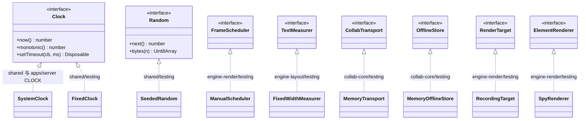
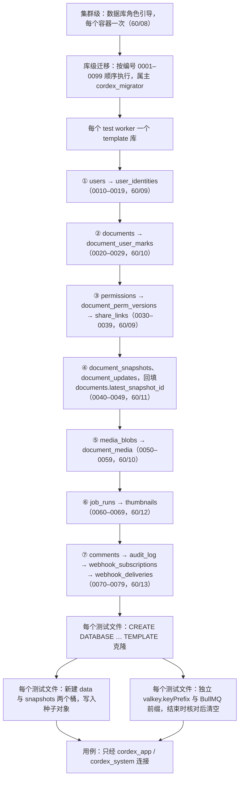
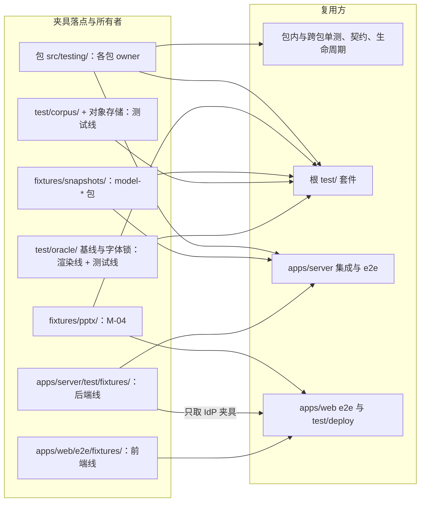

# 11 测试数据、夹具与确定性工具
> 状态：v0.1 | 负责：测试设计线 | 更新：2026-09-25；2026-09-25（§4.19）；2026-09-26（§4.20） | 依赖：rulings §4.20（TX-08、TX-10、TX-16）、rulings §4.19（INC-09、C-06、D-M2-CONTENT）、[01](./01-strategy-and-layers.md)、[30-architecture/11](../30-architecture/11-testing-strategy.md) §1 / §11、[30/02](../30-architecture/02-layering-and-packages.md) §4.0.2、40/02–13 各 §9、[60/08](../60-backend/08-db-conventions-roles-rls-migrations.md)、[60/14](../60-backend/14-valkey-object-storage-and-retention.md)、ADR-0009 / 0016 / 0023、60/02 / 05 / 06 / 13（到期规则与审计分区）、[03](./03-fidelity-roundtrip-and-corpus.md) / [04](./04-visual-oracle.md) / [05](./05-collab-simulation-and-property-tests.md) / [06](./06-frontend-component-and-e2e.md)

本文定义测试用的数据与工具从哪来、归谁、怎么保持可复现：确定性工具（时钟、随机数、调度、度量、传输替身）的所属包与用法，假时钟的统一规则，文档与模型夹具，语料与快照样本的落点，服务端种子构建器，IdP 夹具，字体 profile，大文件存储，以及这些东西的变更流程。

边界：语料清单的字段与样本生命周期归 [03](./03-fidelity-roundtrip-and-corpus.md)；视觉基线的生成归 [04](./04-visual-oracle.md)；协同模拟种子与 repro 的格式归 [05 §5](./05-collab-simulation-and-property-tests.md)；容器 harness 与数据库隔离的执行流程归 [07 §2–§3](./07-backend-integration-and-api-e2e.md)；表结构、RLS、Valkey 键与对象键的定义归 60（08–14）。本文只引用这些定义，不复制。

---

## 1. 原则

1. **时间、随机数、id 一律可注入**。生产代码经 `Clock` 与 `Random` 端口取得时间与随机数，测试注入 `FixedClock` 与 `SeededRandom`；直接调用 `Date.now()`、`Math.random()` 只允许出现在默认系统实现（`SystemClock`、`SystemRandom`）里。`@cordexjs/shared` 的 `newNodeId()`（UUIDv7）与 `order.ts` 的随机后缀同样接受注入，否则协同模拟的失败无法按种子重放。机械约束是 lint 规则 TD-110（rulings §4.20 TX-08，`tooling/eslint-config/rules/determinism.ts` 的第二个 override）：生产源码 `packages/*/src/**`、`apps/*/src/**` 禁 `Date.now`、`Math.random` 与无参 `new Date()`（`packages/shared/src/{clock,random}.ts` 与 `apps/server/src/shared/clock.ts` 除外）；测试代码（各包 `__tests__/**`、`apps/server/test/**`、`apps/web/e2e/**`、根 `test/**`，`test/perf/**` 豁免）另禁 `performance.now`；`crypto.getRandomValues`、`randomUUID` 与 `node:crypto` 不禁；其余例外只能走带 issue 的 `cordex-allow`（§12）。依据：决策 T-DETERMINISM（30/11 §1 确定性原则）。
2. **每个夹具有唯一所有者**（§9 表）。复用方只 import 或按 sha256 引用，不复制。
3. **`./testing` 子路径只供测试**：生产代码不得 import 任何 `./testing`（depcruise `no-testing-in-prod`）；`testing/` 内可 import vitest 类型，但不得 import 测试运行器实现（30/02 §4.0.2）。
4. **种子与断言分离**（服务端）：种子可经特权连接写入；被测代码与断言只经非属主数据库角色（`cordex_app`、`cordex_system`），否则会掩盖 RLS 与 `SET LOCAL` 问题。依据：决策 T-DB-ISOLATION。
5. **随机必可复现**：一切随机化测试（fast-check、协同模拟、fuzz）失败时打印种子；复现只需「种子 + 生成器版本」，或直接重放最小化后的显式操作序列。
6. **大文件不入 git、不用 Git LFS**（§10，决策 T-CORPUS）。

---

## 2. 确定性工具目录

依据：决策 T-DETERMINISM，needsUser=false。工具的文件落点以 40 各模块 §4 / §5 为准；本表只在 40 缺登记处标「新增」，由总编排回写。

| 工具 | 实现的端口 | 包 / 子路径 | 文件 | 用途 | 主要使用者 |
|---|---|---|---|---|---|
| `FixedClock` | `Clock` | `@cordexjs/shared/testing` | `testing/clock.ts`（新增） | 手动推进的时钟：`now`、`monotonic`、定时器 | 重连与离线判据、服务端到期判定、UI 去抖 |
| `SeededRandom` | `Random` | `@cordexjs/shared/testing` | `testing/random.ts`（新增） | 种子化伪随机数；`fork(label)` 派生互不干扰的子流 | 协同模拟生成器、退避抖动、DTO 工厂、UUIDv7 随机段 |
| fast-check arbitraries（ids、units、JsonValue、Path） | — | `@cordexjs/shared/testing` | `testing/index.ts` | 性质测试输入 | model-*、ooxml-core、ui-core |
| 固定 Yjs `clientID` | — | `@cordexjs/store-yjs/testing` | `createYjsStore(body, { clientID })`、`twoDocsInSync()` | 可复现的 CRDT 合并顺序 | store-yjs、collab-yjs、协同模拟 |
| `ManualScheduler` | `FrameScheduler` | `@cordexjs/engine-render/testing` | `testing/index.ts` | 手动步进帧，替代 rAF 计时 | engine-render、render-dom、slide-render |
| `RecordingTarget`、`fakeScene()` | `RenderTarget` | `@cordexjs/engine-render/testing` | `testing/index.ts` | 记录 paint 与 dirty；最小 Scene | 脏区反制单测（A28） |
| `SpyRenderer(kind)` | `ElementRenderer` | `@cordexjs/engine-render/testing` | `testing/index.ts` | 统计 mount / update，可配置为抛错 | A28、A11 错误隔离 |
| `FixedWidthMeasurer` | `TextMeasurer` | `@cordexjs/engine-layout/testing` | `testing/index.ts` | 每字符固定宽度，排版黄金用例不受字体影响 | engine-layout（30/02 旧名 `FixedMetricsMeasurer` 统一为此名） |
| `mountTestSurface()`、`mountInHappyDom()`、`FakeFontFace` | — | `@cordexjs/render-dom/testing` | `testing/index.ts` | DOM 挂载与字体加载替身 | render-dom、slide-render |
| `fixedLocale()` | i18n Provider | `@cordexjs/i18n/testing` | `testing/index.ts` | 固定语言包 | UI 快照、文案断言 |
| `createTestHost()`、`defineLifecycleSuite()` | — | `@cordexjs/kernel/testing` | `testing/{create-test-host,lifecycle-suite}.ts` | 真实 cordis 宿主（记录型 sink）；生命周期套件 | 全部插件测试 |
| `RecordingErrors`、`RecordingTelemetry` | errors / telemetry 服务 | `@cordexjs/kernel/testing` | `testing/fakes.ts` | 断言错误与遥测事件 | 全部 |
| `createCommandHarness()` | — | `@cordexjs/model-core/testing` | `testing/command-harness.ts` | 断言 ops、事件、审计、权限调用 | model-*、slide-ui |
| `allowAllPolicy`、`denyAllPolicy`、`recordingPolicy` | `PermissionPolicy` | `@cordexjs/model-core/testing` | `testing/permission-fakes.ts` | 权限替身 | 命令层测试 |
| `MemoryTransport`、`MemoryOfflineStore`、`FakeTicketIssuer`；场景脚本 | `CollabTransport`、`OfflineStore` | `@cordexjs/collab-core/testing` | `testing/{fakes,scenarios}.ts` | 可注入延迟、乱序、丢包、断线 | collab-*、apps/web |
| `createCollabCluster()`、`NetworkModel` | — | 根 `test/collab-sim/`（`@cordexjs/test-suite`，不发布；决策 T-NAMING：模拟同时装 `server-collab` 与 `model-slide`，水平层包的 `testing/` 装不下；30/06 §4 与 40/05 的旧写法由回写删除） | `test/collab-sim/{cluster,network-model}.ts` | 内存服务端 + 多客户端 | 协同模拟（05） |
| 内存 WS 对 | — | `@cordexjs/collab-transport-ws/testing` | `testing/index.ts` | 服务端替身 | collab-transport-ws |
| fake-indexeddb 环境助手 | — | `@cordexjs/collab-offline-idb/testing` | `testing/index.ts` | IndexedDB 替身 | collab-offline-idb |
| DTO 工厂 | — | `@cordexjs/protocol/testing` | `testing/index.ts` | 以 `SeededRandom` 生成确定性 DTO | apps/web（msw）、apps/server e2e |
| `CLOCK` 注入令牌、`SystemClock` | `Clock` | apps/server | `src/shared/clock.ts`（新增） | Nest provider；测试以 `FixedClock` 覆盖 | 全部服务端模块（§3） |
| `page.clock` | — | Playwright 内建 | — | 浏览器侧假时钟 | apps/web e2e |

说明：计划草稿把 `createCommandHarness` 与 `permission-fakes` 归在 kernel/testing，40/02 §5 的文件表把它们放在 model-core/testing，以 40/02 为准。服务端不另建 `FakeServerClock` 类，与客户端共用 `FixedClock`；60 各文档与本线其它文件原写的「FakeClock」已于 2026-09-26 统一为 `FixedClock`（rulings §4.20 TX-10 第 ③ 项），旧名登记在 `docs/_tools/terms.json`，由 `check-terms.py` 防止回流（TX-02）。

最小签名（本线对 `@cordexjs/shared` 的要求；文件与导出由 40/02 登记）：

```ts
// @cordexjs/shared（生产入口）
export interface Clock {
  now(): number                                       // 墙钟，Unix 毫秒
  monotonic(): number                                 // 单调毫秒：超时、退避、时长
  setTimeout(cb: () => void, ms: number): Disposable  // 定时器也经 Clock，FixedClock 可推进
}
export interface Random {
  next(): number                                      // [0, 1)
  bytes(n: number): Uint8Array                        // UUIDv7 随机段、FracKey 后缀
}
// @cordexjs/shared/testing
export declare class FixedClock implements Clock { constructor(startMs: number); advance(ms: number): void; set(ms: number): void }
export declare class SeededRandom implements Random { constructor(seed: number); fork(label: string): SeededRandom }
```

**图 11-1 确定性工具与所属包**



怎么读：上半部是生产代码依赖的端口（接口），虚线空心箭头指向实现它的类，箭头上的文字是实现所在的包与子路径；除 `SystemClock` 外都是只供测试的替身。

依据：决策 T-DETERMINISM；40/02 §5、40/05 §5、40/06 §9。

---

## 3. 假时钟统一规则

**选用优先级**（同一用例只用一种）：

1. **注入 `Clock`（首选）**：代码经构造参数、cordis 服务或 Nest provider 取得 `Clock`；测试注入 `FixedClock(起点)`（起点见下文）并用 `advance()` 推进，已登记的定时器按到期顺序同步触发。
2. **`vi.useFakeTimers()`（次选）**：只用于无法注入的第三方库内部定时器；必须用 `toFake` 显式列出被伪造的 API，用例结束恢复 `vi.useRealTimers()`；不得与 `FixedClock` 在同一用例混用。
3. **浏览器 e2e**：Playwright `page.clock`（`install` 后 `fastForward` / `runFor` / `setFixedTime`），用于 30 s 离线判据、横幅去抖、会话过期横幅等；它只控制页面进程，服务端时间不受影响。
4. **服务端**：apps/server 的 `src/shared/clock.ts` 导出注入令牌 `CLOCK` 与 `SystemClock`（实现 shared 的 `Clock`），server-* 包经构造参数接收同一实例；测试以 `Test.createTestingModule(…).overrideProvider(CLOCK).useValue(new FixedClock(起点))` 覆盖，起点见下文。

**起点**：

- 客户端、纯逻辑与不接真实数据库的服务端用例：固定 `T0 = 2026-01-01T00:00:00Z`（Unix 毫秒 `1767225600000`），时间戳一律写成 `T0 ± 偏移`，避免依赖运行当天。
- 接真实 PG 的服务端用例（`*.int-spec.ts`、`*.e2e-spec.ts`）：列默认值 `now()`、`audit_log.created_at` 的 `clock_timestamp()`（[60/13 §3](../60-backend/13-ddl-comments-webhooks-audit.md)）等由数据库取时间，固定的 `T0` 会让应用写入的行落在 `FixedClock` 的「未来」。因此起点取 `S0` = 该测试文件开始时的数据库时间（`SELECT date_trunc('second', now())`），两条时间轴对齐；断言只比较相对时间，报告里不出现绝对日期。template 种子的时间戳写成「template 构建时刻 `B` ± 偏移」，只用于天级保留期边界与「已过期 / 不过期」两态；秒级边界由用例在本文件内按 `S0` 显式写入。

**三个不受 `FixedClock` 控制的边界**：

| 边界 | 规则 |
|---|---|
| 数据库时间（`now()`、列默认值、函数与 policy 内的到期比较） | 不 mock PG 时间，靠上文 `S0` 对齐；被数据库以 `now()` 比较的列（如 `share_links.expires_at`，RLS 函数 `cordex_doc_role` 读它）在种子里只取 NULL 或「`B` − 1 d」，不取未来值，避免应用层（`FixedClock`）与数据库层对同一行给出不同结论；判定语义以 60/08–13 的定义为准 |
| Valkey 键 TTL | 不等待真实过期；断言键名符合 [60/14](../60-backend/14-valkey-object-storage-and-retention.md) 模板且 `PTTL` 在预期上限内（如 `ticket:jti:{jti}` ≤ 60 000 ms）；业务上的到期判定（票据 `exp`、会话 `expiresAt`、链接 `linkExpiresAt`）一律以 `Clock.now()` 与存储值比较，因此可用 `FixedClock` 断言 |
| BullMQ 调度 | 周期作业「何时触发」由 BullMQ Job Scheduler 决定；测试不等调度，直接调用处理器入口并用 `FixedClock` 决定「现在」；调度登记本身（只在 worker 注册）由 role-assembly 断言（[08 §2](./08-deployment-and-environment-e2e.md)） |

可测性前提（已由 60 采纳）：房间名额 Lua 脚本以 `ARGV` 接收调用方传入的 `nowMs`（取自 `Clock`）剔除过期字段，不读 Valkey `TIME`（[60/05 §4.2](../60-backend/05-modules-collab-and-snapshots.md)）；周期作业「早于保留期」的比较一律经 Clock 取 `now`，不在 SQL 里调用 `now()`（[60/06 §4](../60-backend/06-modules-jobs-import-export-thumbnails.md)）。新增到期逻辑沿用这两条，否则无法确定性测试。

**服务端注入点**（设计出处列是被测规则的唯一定义处；本表只规定测试做法）：

| 注入点 | 设计出处 | 测试做法 |
|---|---|---|
| 会话 JWT 15 min、刷新窗口 7 天滑动与 30 天封顶、轮换 | [60/02 §4](../60-backend/02-auth-chain.md)（决策 SESSION） | 推进 15 min + 验签容差（≤ 5 s）+ 1 s → 访问返回 401 `server.auth.expired` → refresh 成功并轮换；7 天未刷新 → 必须重新登录；持续刷新满 30 天 → 刷新 401 |
| 会话吊销的进程内缓存 ≤ 5 s | 60/02 | 删除会话后推进 5 s → 401；WS 被 4401 关闭 |
| collab ticket 60 s、`jti` 单次有效 | 60/02 §9.3、60/14 | 推进 60 s + 验签容差 + 1 s → 首帧被拒（4401）；容差内仍被接受；同一 `jti` 重放被拒；断言 `jti` 键 `PTTL` |
| OIDC `state` 10 min | 60/02 §2（决策 INC-18） | 推进 10 min + 1 s 后回调被拒（以存储的 `createdAt` 与 `Clock.now()` 比较，不等键真实过期） |
| 分享链接到期后主动降权 | 60/02 §9.6、60/05（rulings §4.18 BE-02） | 链接会话建立后推进越过 `linkExpiresAt` → 收到 `CONTROL.permission` 降权；只凭链接的会话降为 `none` 后以 4403 关闭 |
| 上传凭证 `uploadId` 1 h | [60/04 §7](../60-backend/04-modules-documents-storage-media.md)（媒体）、60/06 §6.1（导入，BE-10；M2 起） | 推进 1 h + 1 s 后提交被拒（导入 403 `server.import.upload_forbidden`，媒体 404 `storage.upload_not_found`） |
| 幂等键释放 | [60/06 §2.3](../60-backend/06-modules-jobs-import-export-thumbnails.md)（BE-18） | 命中规则与时间无关（同键命中 queued / running / succeeded 返回既有行，命中 failed / cancelled 新建行）；与时间有关的只有导出产物到期：推进 `retention.exportHours` 后调用 exports-cleanup → 键释放，同状态再导出新建作业 |
| 墓碑 TTL（默认 24 h） | [60/05 §8](../60-backend/05-modules-collab-and-snapshots.md) | 判定为 `_deleted.at + ttl < now`（严格小于）：推进 24 h 整时运行 tombstone-sweeper 不删，再推进 1 ms 后运行 → 硬删除 |
| 保留期作业（`retention.*`） | [60/14](../60-backend/14-valkey-object-storage-and-retention.md)、60/06 §4 | 种子写入不同年龄的行与对象，固定「现在」后直接调用作业，断言删与留的边界 |
| 自动快照保留（rulings §4.19 C-06） | [60/11 §8](../60-backend/11-ddl-collab-updates-and-snapshots.md)、60/06 §4 `snapshots-retention` | 种子在同一文档写多档年龄的 `auto` / `import` / `migration` 快照：年龄 30 d − 1 ms 的全留、30 d + 1 ms 起每个 UTC 日只留 seq 最大的一个；年龄 `autoSnapshotDailyDays` − 1 ms 留、+ 1 ms 删；`autoSnapshotDailyDays = 0` 时 30 天外的日桶永久保留；`latest_snapshot_id` 所指行、`named` 快照、每文档最新一个 `import` 快照（及其基线对象）不论年龄都不删 |
| 实例存活 60 s、名额刷新 15 s、空闲房间回收 | 60/05（决策 C-11） | 推进 61 s → 下一次准入剔除过期实例字段 |
| Webhook 重试退避 | [60/07](../60-backend/07-modules-comments-webhooks-audit.md)（BE-19） | 断言计算出的退避序列，不等待 BullMQ 延迟 |
| 审计每日封存 | 60/07 §8.3 | 审计行时间取数据库 `clock_timestamp()`，不受 `FixedClock` 控制：`FixedClock` 置于 `S0` 次日 00:10 UTC 调用 audit-seal，断言封存 `S0` 当日的行（`rows`、`lastHash`、链锚点）；再调用一次断言幂等 |

注意：JWT 与票据校验库自带「当前时间」，实现时必须把 `Clock.now()` 显式传入（如 jose 的 `currentDate` 选项），否则 `FixedClock` 对到期判定无效；这一点由上表前三行的用例直接暴露。

**客户端注入点**（被测规则归 [50/07](../50-frontend/07-collaboration-client.md)）：重连退避 1 s → 30 s 与 ±20% 抖动（抖动取自 `SeededRandom`）、累计 30 s 离线判据、离线后每 30 s 周期重连、`unsavedWarnAfterMs`（默认 15 000，rulings §4.19 INC-09；14.9 s 不出现、15 s 出现）、心跳判死、横幅去抖 2 s。用例写法：`FixedClock` + `SeededRandom` + `MemoryTransport`，断言形如「29.9 s 未离线、30 s 离线」（rulings §4.18 UX-03）。

---

## 4. 文档与模型夹具

| 夹具 | 所属（子路径） | 内容 | 使用者 |
|---|---|---|---|
| `fixture` 文档类型 | `@cordexjs/model-core/testing`（`testing/fixtures/fixture/`） | 键值树 + 文本块；含 Mutation、Command、FormatCodec、ResourceHook、Migration、SceneProvider、ElementRenderer、UI 贡献 | 水平层包的全部测试、`test/preset-blind`、server-collab |
| `fixture-grid` 文档类型 | 同上（`testing/fixtures/fixture-grid/`） | 网格键空间，模拟 sheet | 同上；与 `fixture` 同页共存 |
| `fixtureSlideUnit()` 及 `selectShapes`、`enterMasterView`、`renderSlideEditor` | `@cordexjs/slide-ui/testing`（`testing/index.ts`，40/10 §5） | 三页、两版式、一母版的 slide Unit 与编辑器挂载助手 | slide-ui、preset、`command-bindings` |
| 链式构造器 | `@cordexjs/model-slide/testing`（`builders.ts`） | `presentation().slide().shape(…).text(…).build()` | model-slide 性质测试、M-04、M-07 |
| 四类典型 body | `@cordexjs/model-slide/testing`（`fixtures.ts`） | `singleTextSlideBody`、`inheritedMasterBody`、`groupedShapesBody`、`tableBody` | M-04、M-07、M-10、M-13 |
| `randomCommand(seed)` 与不变量检查器 | `@cordexjs/model-slide/testing` | 随机命令生成；无环、无孤儿、order 合法、id 唯一 | 协同模拟（05） |
| 最小 Scene | `@cordexjs/engine-render/testing`（`fakeScene()`） | 空场景与少量图元 | 渲染反制单测 |
| 每种 kind 的最小 `ComposedSlide`；母版继承样例；`renderSlideToSvgString()` | `@cordexjs/slide-render/testing` | 规范化 SVG 快照 | M-07、M-10、M-11 |
| 图表最小夹具 | `@cordexjs/slide-render-chart/testing` | 五类图表各一 | 图表渲染与数据往返 |
| 最小 OPC 包、XML 片段、`diffPackage` | `@cordexjs/ooxml-core/testing` | `buildMinimalPackage`、`xmlFragment`、包级差异 | ooxml-*、`test/roundtrip` |

规则：

- **水平层只用夹具类型**：水平层包的 `__tests__` 不得 import `@cordexjs/model-slide*`、`ooxml-pptx`、`slide-*`（depcruise `horizontal-tests-use-fixture-only`，ADR-0016）；需要真实 slide 束的服务端测试放 apps/server 组合根集成测试（rulings §4.18 FE-01）。
- **夹具只读**：测试对夹具返回值做修改前先拷贝（夹具工厂每次返回新对象；`store-memory` 在测试中开启 `freezeInDev`）。
- **不在测试里手写大段 body JSON**：用构造器或典型 body；手写 JSON 只允许在快照历史样本（§5）。

---

## 5. 语料与快照样本

| 数据 | 落点 | 规则 | 细则 |
|---|---|---|---|
| T1 规范语料（≤ 2 MB、可入 git） | 仓库根 `fixtures/pptx/{minimal,features}/` | 同时登记在 `test/corpus/manifest.json`（`tier: 'T1'`） | [03 §1–§3](./03-fidelity-roundtrip-and-corpus.md) |
| T2 真实语料、T3 压力语料 | 只登记在 `test/corpus/manifest.json`，文件按 sha256 存对象存储 | 原 `fixtures/pptx/wild/` 并入 T2 | 本文 §10；03 |
| 快照历史样本 | `fixtures/snapshots/<documentType>/v<N>/*.json` | 每个 `schemaVersion` 至少一个样本；**已入库的文件不可修改**，只追加：同目录 `SHA256SUMS` 记录每个文件哈希 | ADR-0009；[03 §11](./03-fidelity-roundtrip-and-corpus.md) |
| schema 锁 | `fixtures/snapshots/<documentType>/schema-lock.json` | `bodySchema` 规范化哈希 + `schemaVersion`；哈希变而版本未增、版本增而无 Migration 或无上一版本样本 → 失败 | ADR-0009 §4 |
| 冻结锁 | `fixtures/horizontal-freeze.lock` | M5 起 PR 必需 | ADR-0016 |
| 协同模拟种子与回归用例 | `test/collab-sim/seeds.json`、`test/collab-sim/repros/<seed>.json` | repro 以显式操作轨迹存储，只增不删；命令 schema 变化导致回放失败时在同一 PR 迁移该 repro，不得删除 | [05 §5](./05-collab-simulation-and-property-tests.md) |
| 视觉基线索引 | `test/oracle/baselines.json`（PNG 按 sha256 存对象存储） | 重建须评审签字 | [04 §2](./04-visual-oracle.md) |
| 性能基线 | `perf-history` 分支 | runner 变更即重建 | [09 §9](./09-performance-and-capacity.md) |

---

## 6. 服务端种子构建器

落点：`apps/server/test/fixtures/seed/`（构建器）、`apps/server/test/fixtures/ids.ts`（固定 id）、`apps/server/test/helpers/db.ts`（会话上下文 helper）。apps/web e2e 的数据只经公开 API 与 IdP 账号准备，不用本构建器（[06 §4](./06-frontend-component-and-e2e.md)）；`test/deploy` 若需直接写库，以子进程调用 `pnpm --filter ./apps/server seed:test`，不跨 app import 源码。容器拓扑与每 worker / 每文件的隔离流程归 [07 §2–§3](./07-backend-integration-and-api-e2e.md)，本节只定数据。

**构建顺序**：严格跟随 [60/08](../60-backend/08-db-conventions-roles-rls-migrations.md) 的迁移编号——构建器内部维护「表 → 所属迁移号」映射并按迁移号排序写入，因此新增迁移时顺序自动正确；外键都不延迟校验，顺序错了在插入时立即失败而不是静默通过。

**图 11-2 服务端种子构建顺序**



怎么读：自上而下执行；①–⑦ 是写入 template 库的基础种子，括号里是该组表所属的迁移号段与表结构定义文档；克隆之后三件事按测试文件各做一次，最后用例只以非属主角色访问数据。

依据：决策 T-DB-ISOLATION、DB-ROLES、FK-POLICY；计划的迁移编号分配（60/08 占 0001–0009 与 0095–0099，其余号段见各 DDL 文档）。

补充规则：

- `audit_log` 按月分区：迁移 0071 已按真实当前时间预建当月与未来 3 个月（[60/13 §3](../60-backend/13-ddl-comments-webhooks-audit.md)）；60/13 不建默认分区、也不建防改写触发器（只追加由 0095 的 GRANT 与 0096 自检保证），落到未建月份的写入直接失败。种子时间戳覆盖到过去月份时，构建器以 `cordex_migrator` 按 60/13 同一命名规则先补建对应月分区再写入。种子审计行按 `chainHash`（60/07 §8）逐行计算 `prev_hash` / `hash`，否则链校验用例会误报。
- `document_updates` 按 `hash(doc_id)` 分区，种子无特殊处理。
- 对象按 [60/14](../60-backend/14-valkey-object-storage-and-retention.md) 的键模板写入：快照进 snapshots 桶（开版本化），其余进 data 桶（决策 C-08/OBJ）；桶名按测试文件唯一（`t<worker>-<文件短哈希>-data` / `-snapshots`），文件结束即删除，避免同一 worker 内先后运行的文件因克隆出相同的文档 id 而互相看到对象。
- Valkey 不预置种子；每个 worker 独占一套容器、文件串行执行（07 §2）。每个测试文件设独立 `valkey.keyPrefix`（默认值 `cordex:` 被替换为 `cordex:t<worker>:<文件短哈希>:`）与独立 BullMQ 前缀；文件结束时先 `SCAN` 全库，出现任何不在这两个前缀下的键即失败——顺带证明全部键模板都遵守 `keyPrefix`（决策 KEYS）——随后 `FLUSHDB`，下一个文件从空库开始。

**固定 id**：`fixtureId(kind, n)` 生成 `0000000K-0000-7000-8000-NNNNNNNNNNNN`（`K` 为实体类别，`N` 为 12 位十六进制序号）。版本位 7、变体位 8，是格式合法的 UUIDv7；时间段接近 0，因此在日志里一眼可辨，且排序总在运行时生成的 id 之前。类别：`1` 用户、`2` 文档、`3` 分享链接、`4` 快照、`5` 作业、`6` 评论线程、`7` Webhook 订阅、`9` 其它。id 一经分配不复用。

**基础种子里的人物与数据**：

| 人物 | id | 状态 | 在 docA 的角色 | 主要用途 |
|---|---|---|---|---|
| alice | `fixtureId(1, 1)` | active | owner | 主角；docTrash、docPurging 的 owner |
| bob | `fixtureId(1, 2)` | active | editor（直接授权） | 协同编辑、降权 |
| carol | `fixtureId(1, 3)` | active | commenter | 评论；计入查看者名额 |
| dave | `fixtureId(1, 4)` | active | viewer | 查看者 = 编辑器只读变体 |
| erin | `fixtureId(1, 5)` | active | 无 | 无授权 403、跨用户隔离；docB 的 owner |
| lena | `fixtureId(1, 6)` | active | 无直接授权 | 只凭分享链接进入 |
| root | `fixtureId(1, 7)` | active | 无 | 平台管理员（`platform_role = 'admin'`，不隐含文档角色，[60/03](../60-backend/03-modules-identity-and-access.md)）；满足「至少一名 admin」 |
| sam | `fixtureId(1, 8)` | suspended | 无 | 停用后会话失效；登录回调返回 `server.auth.account_disabled` |
| zed | `fixtureId(1, 9)` | erased | 无 | 擦除后脱敏：`display_name = 'deleted-user'`、邮箱与头像为空、无 `user_identities` 行（决策 C-24） |

文档：`docA`（active，owner alice）、`docB`（active，owner erin）、`docTrash`（trashed，`deleted_at = B − 1 d`，`B` 为 template 构建时刻，§3）、`docPurging`（purging，另带一行 `job_runs(kind = 'document-purge', status = 'queued')`，与 BE-15「同一事务置 purging 并写作业行」一致）；每个文档的 owner 都有 `permissions` 的 owner 行（60/10 `owner_id` 不变量）。docA 上的分享链接：`linkEdit`（editor，`expires_at` 为 NULL）、`linkExpired`（`expires_at = B − 1 d`）、`linkRevoked`（已撤销）；明文令牌是符合生产格式的常量（32 字节 base64url，由 `fixtureToken('a-edit')` = base64url(sha256(标签)) 生成），库里只存 `sha256(令牌)`（60/02 §7）。docA 另有一个 `auto` 快照（`state_inline`）与若干 update：`head_seq` 等于 updates 的最大 seq，`seq_upto ≤ head_seq`，`latest_snapshot_id` 不指向 named 快照（60/11 §2 跨表不变量），使协同用例可直接 bootstrap。

**会话上下文 helper**（GUC 名依据决策 RLS-GUC）：

```ts
// apps/server/test/helpers/db.ts —— 用例只能拿到这两个入口
db.asUser(userId, fn, { shareToken? })  // cordex_app；事务内 set_config('app.user_id', …, true)，有令牌时再设 app.share_token_hash
db.asSystem(jobName, fn)                // cordex_system；事务内 set_config('app.system_job', jobName, true)
// 种子构建器持有 cordex_migrator 连接，只在 harness 内部使用，不导出给用例
```

两个 helper 都在事务内设置（等价 `SET LOCAL`），事务结束自动失效；helper 自检断言连接归还连接池后，下一次借出时 `current_setting('app.user_id', true)` 为空串或 NULL（设过一次后读到空串，60/02 §10；二者都被 `cordex_current_user()` 视为无用户）。

---

## 7. IdP 夹具（T-IDP）

依据：决策 T-IDP（rulings §4.15 Q6 CI 分层认证 + 不过度设计），needsUser=false。

| IdP | 运行段 | 夹具 | 内容 |
|---|---|---|---|
| oidc-provider mock | PR | `apps/server/test/fixtures/idp/oidc-mock/accounts.ts` | §6 人物的账号与 claims（`sub`、`email`、`email_verified`、`name`、`picture`）；另一 issuer 下与 alice 同邮箱的账号，用于验证不自动关联（决策 OIDC-LINK）；客户端强制 PKCE。apps/web e2e 的五个角色账号（[06 §4.3](./06-frontend-component-and-e2e.md)：owner、editor、commenter、viewer、outsider）依次取 alice、bob、carol、dave、erin |
| Casdoor 容器 | PR | `apps/server/test/fixtures/idp/casdoor/init_data.json` | 组织、应用（client id / secret 为测试常量，回调 `/api/v1/auth/oidc/callback`）、§6 人物；Cordex `auth.selfSignup` 开 / 关两态各跑一次；Casdoor 用同一 PG 容器内独立 database 与凭据，不进应用迁移（决策 DB-ROLES） |
| Keycloak 容器 | nightly | `apps/server/test/fixtures/idp/keycloak/realm-cordex.json` | realm 导出，人物同上 |
| Entra、飞书（经 Casdoor） | 发布前人工 | `test/evidence/<里程碑>/idp-entra.md`、`idp-feishu.md` | 人工清单，不进 CI |

- 夹具里的密钥都是只供测试的常量，不得出现在任何部署配置中；仓库若启用密钥扫描，把 `apps/server/test/fixtures/idp/` 登记进允许清单。
- 压测负载驱动用自写 Node WS 客户端（真实 y-protocols 帧），登录经 oidc-provider mock 取会话，不用 k6（[09 §8](./09-performance-and-capacity.md)）。
- 部署 e2e 中 IdP 经 `idp.` 子域访问的配置归 [08 §4](./08-deployment-and-environment-e2e.md)。

---

## 8. 字体 profile

- **产品字体清单**：浏览器（apps/web 同源自托管 `/fonts/`）与 renderer 镜像共用同一份 fontProfile 清单（家族、版本、文件 sha256、unicode-range 子集、回退表），定义归 [50/05](../50-frontend/05-rendering-and-thumbnails.md)，镜像打包归 [60/17](../60-backend/17-deployment-and-config.md)（决策 FONTS）。
- **测试字体锁**：`test/oracle/fonts/corpus-fonts-v1.lock`，条目字段以 [04 §3](./04-visual-oracle.md) 为准（`family, style, file, version, sha256, license`），本文另要求 `source` 与 `inProduct`（是否属产品字体包）两个字段，供下文一致性检查使用（回写见 README §8）；内容等于「产品字体清单」∪「语料专用字体」（语料样本需要、但产品不分发的字体，如部分内嵌字体的原版）。
- **一致性**：`inProduct: true` 的条目必须与产品清单逐字节一致（sha256 相同）；运行 oracle、render-dom 浏览器用例与 renderer 的 CI 容器只安装锁内文件；PowerPoint 基线机安装同一集合，基线记录 fontProfile 版本（[04 §3](./04-visual-oracle.md)）。
- **变更**：锁的任何变化都是新版本（`corpus-fonts-v2`），按 §11 连带重建基线。语料专用字体文件按 sha256 存对象存储（§10）。

---

## 9. 夹具落点与所有者

| 落点 | 内容 | 所有者 | 复用方 |
|---|---|---|---|
| 包的 `src/testing/`（`./testing` 子路径） | kit、替身、构造器、确定性工具（§2、§4） | 该包 owner（40 对应模块） | 包内外单测、契约、根 `test/` 套件、apps 测试 |
| 仓库根 `fixtures/pptx/{minimal,features}/` | T1 语料 | M-04 | ooxml-pptx 测试、`test/roundtrip`、`test/oracle`、`test/perf`、apps/web e2e |
| 仓库根 `fixtures/snapshots/<documentType>/` | 快照历史样本、`SHA256SUMS`、`schema-lock.json` | 对应 model-* 包 | `test/snapshot-migration`、服务端集成 |
| 仓库根 `fixtures/horizontal-freeze.lock` | 冻结锁 | M-13 生成，M-01 提供脚本 | `scanners` |
| `test/corpus/` | 语料清单、规范化白名单、生成器、取回脚本 | 测试线 + M-04 | 保真往返、oracle、perf |
| `test/oracle/{baselines.json,fonts/}` | 基线索引、字体锁 | 渲染线 + 测试线 | oracle、render-dom 浏览器用例、renderer 镜像校验 |
| `test/collab-sim/{seeds.json,repros/}` | 种子与回归用例 | 协同线 + 测试线 | 协同模拟 |
| `test/perf/budgets.json` | 预算的机器副本 | 测试线 + 产品 | perf（[09 §2](./09-performance-and-capacity.md)） |
| `apps/server/test/fixtures/` | 种子构建器、固定 id、IdP 夹具 | 后端设计线 | 种子与固定 id：apps/server 集成与 e2e（`test/deploy` 需要时经 `seed:test` 子进程）；IdP 夹具另供 apps/web e2e 与 `test/deploy` 登录 |
| `apps/web/e2e/fixtures/` | page objects、`storageState`、上传用小文件（引用根 `fixtures/pptx/`） | 前端设计线 | apps/web e2e |
| `tooling/**/__fixtures__/`、`{ok,violation}/` | 规则负向夹具 | 类型治理 | `lint`、`depcruise`、`scanners` |

**图 11-3 夹具所有者与复用关系**



怎么读：左侧每个方框是一处夹具落点，冒号后是唯一所有者；箭头指向复用它的测试类别。复用只能沿箭头 import 或按 sha256 引用，不能复制；apps/web e2e 的数据只经公开 API 准备，从服务端夹具只取 IdP 账号；`test/deploy` 需要直接写库时只经 `seed:test` 子进程，不跨 app import 源码。

---

## 10. 大文件（T-CORPUS）

依据：决策 T-CORPUS（30/11 §14 T1 的推荐默认 + 40/04 fixtures 口径），needsUser=false。

- **分界**：单个文件 ≤ 2 MB 且许可允许入库的 pptx 样本放 `fixtures/pptx/{minimal,features}`（即 T1）；其余一律不入 git——T2 / T3 语料、oracle 基线 PNG、语料专用字体按 sha256 存对象存储。
- **存储**：语料存储（CI 专用 S3 兼容桶，与产品部署的 `data` / `snapshots` 两个桶无关），键布局以 [03 §1](./03-fidelity-roundtrip-and-corpus.md) 为准：样本 `corpus/<sha256>`、视觉基线 `oracle/<sha256>`；语料专用字体按同一口径放 `fonts/<sha256>`（本文登记）；CI 持只读凭据，维护者持写凭据；`test/corpus/manifest.json`、`test/oracle/baselines.json`、字体锁只存 sha256 与元数据。
- **访问配置**（rulings §4.20 TX-16，沿 60/17 的 `CORDEX_` 前缀惯例与 [12 §3](./12-ci-gates-mapping.md) 的 `CORDEX_SUITE` 先例）：普通变量 `CORDEX_CORPUS_S3_ENDPOINT`（语料桶的 S3 兼容端点）与 `CORDEX_CORPUS_BUCKET`（桶名）；CI secrets `CORDEX_CORPUS_ACCESS_KEY_ID` 与 `CORDEX_CORPUS_SECRET_ACCESS_KEY`，CI 中只配只读凭据，维护者在本地以同名变量放写凭据；其余 S3 参数（区域、路径风格、重试）取 SDK 默认值，不另设变量。`fetch-corpus.ts` 与 oracle 基线拉取在任一变量缺失时报错退出（指明缺哪个变量），不静默跳过、不回落到只跑 T1；来自 fork 的 PR 按 [12 §3](./12-ci-gates-mapping.md) 的批准规则取得这些 secrets。
- **取回与缓存**：`test/corpus/scripts/fetch-corpus.ts`（03 §1）按清单取回到本地缓存目录，下载后重算 sha256，不一致即失败；CI 缓存键 = 三份清单内容的哈希。PR 只取所需子集（gated 样本与 PR 抽样），nightly 取全量。
- **不用 Git LFS**：LFS 的配额与 fork 体验差（30/11 §14 T1）；仓库不出现 `filter=lfs`。
- **许可与脱敏**：入库前的授权与脱敏流程归 [03 §3](./03-fidelity-roundtrip-and-corpus.md)。

---

## 11. 变更流程

| 变更 | 审批（CODEOWNERS） | 连带动作 |
|---|---|---|
| 新增 T1 样本 | M-04 + 测试线 | manifest 登记 `tier: 'T1'`；标 gated 前先跑通一次往返 |
| 新增 T2 / T3 样本 | 测试线（许可与脱敏核对） | 上传对象存储并登记 sha256；带 `perf.refDoc` 的样本（[03 §2](./03-fidelity-roundtrip-and-corpus.md)）变更须重建相关性能基线 |
| 修改或删除已入库样本 | 测试线 + 相关检查的 owner | 不原地修改：以新 id 替换，旧条目按 [03](./03-fidelity-roundtrip-and-corpus.md) 的生命周期退役 |
| 快照历史样本 | 对应 model-* 包 | 只追加；改动已有文件 → `test/snapshot-migration-corpus` 失败 |
| 字体锁（新 profile 版本） | 渲染线 + 测试线 + 设计线 | 重建全部 oracle 基线（[04 §12](./04-visual-oracle.md)）；重建打开与排版类性能基线；同步 50/05 清单与 60/17 镜像 |
| PowerPoint 版本升级 | 渲染线签字 | 重建 oracle 基线（04 §12） |
| perf runner 变更 | 测试线 | 重建性能基线，相对回归从新基线起算（[09 §9](./09-performance-and-capacity.md)） |
| 协同模拟生成器（操作分布、权重） | 协同线 + 测试线 | 生成器版本号 +1；repros 以显式操作存储不受影响；`seeds.json` 全部种子重跑一次 |
| 种子构建器、人物表、固定 id | 后端线 + 测试线 | 同一 PR 修正全部受影响用例；已分配的 `fixtureId` 不复用 |
| IdP 夹具 | 后端线 | Keycloak realm 变更合入后观察下一次 nightly |
| 新增迁移（60 各 DDL 文档） | 对应 60 设计线 | 构建器「表 → 迁移号」映射同 PR 补齐（§12 自检） |

---

## 12. 机械验证

| 断言 | 执行点 |
|---|---|
| 生产代码不 import `./testing`；水平层测试只用夹具文档类型 | `depcruise`（`no-testing-in-prod`、`horizontal-tests-use-fixture-only`） |
| 快照历史样本只追加（`SHA256SUMS` 已有条目不变） | `test/snapshot-migration-corpus` 前置校验 |
| `schema-lock.json` 与 `bodySchema`、`schemaVersion`、Migration、上一版本样本一致 | `scanners` 的 `schema-lock` 步骤（ADR-0009） |
| 无 LFS、`fixtures/` 与 `test/` 下无超过 2 MB 的已跟踪文件 | `test/conventions/test-layout.test.ts`（`test/unit`，见 [01 §13](./01-strategy-and-layers.md#13-机械验证)） |
| 对象存储取回文件的 sha256 与清单一致 | `test/corpus/scripts/fetch-corpus.ts`（各消费步骤的前置） |
| 字体锁中 `inProduct` 条目与产品 fontProfile 清单逐字节一致 | `test/oracle/fonts/fonts-lock.test.ts`（`test/unit`） |
| 种子构建器的「表 → 迁移号」映射覆盖迁移后 `public` schema 的全部表，且写入顺序与迁移编号一致；种子里被数据库以 `now()` 比较的列（如 `share_links.expires_at`）不含未来值；`audit_log` 的分区全部为按月命名分区、不存在默认分区 | `apps/server/test/integration/seed/seed-coverage.int-spec.ts`（`test/server-integration`） |
| 用例拿不到 `cordex_migrator` 连接；`SET LOCAL` 上下文不泄漏到连接池的下一次借出 | 同目录 `db-helpers.int-spec.ts` |
| 每个测试文件结束时 Valkey 中没有前缀之外的键 | 服务端集成 harness 的文件级收尾检查 |
| 服务端到期判定都经 `CLOCK`：只推进 `FixedClock` 就能触发票据、会话、链接、墓碑的到期 | §3 注入点表对应的 [07](./07-backend-integration-and-api-e2e.md) 用例 |
| 生产代码与测试代码不直接调用 `Math.random`、`Date.now`、无参 `new Date()`（`SystemClock` / `SystemRandom` 所在文件放行）；测试代码另不调用 `performance.now`（`test/perf/**` 豁免） | `lint`：TD-110（已采纳，rulings §4.20 TX-08；09-08 §12c 登记，负向夹具四例：测试文件调 `Date.now`、apps/web 组件调 `Math.random`、`SystemClock` 文件放行、生产代码 `performance.now` 放行）；`ooxml-*` 的 TD-097 预算恒为 0 不变 |
| 语料桶四个变量缺失时 `fetch-corpus.ts` 与 oracle 基线拉取报错退出、不跳过 | `test/fidelity-roundtrip`、`e2e/oracle-gated` 的前置（§10） |
