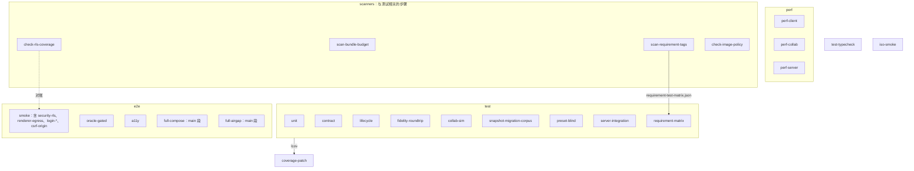
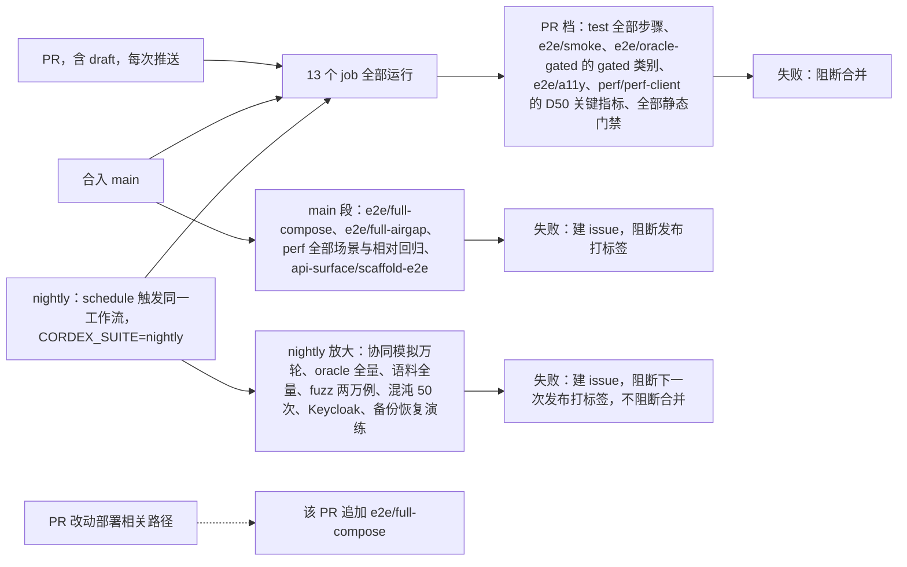
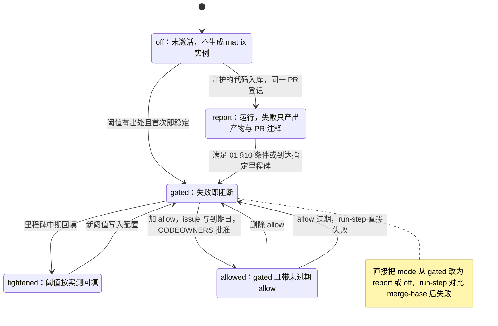
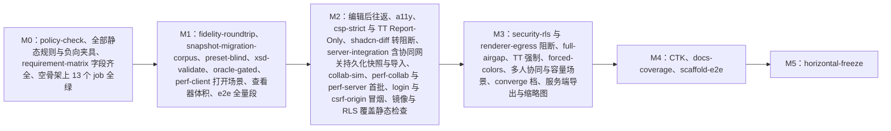

# 12 CI 门禁映射

> 状态：v0.1 | 负责：测试设计线 | 更新：2026-09-25；2026-09-25（§4.19） | 依赖：rulings §4.19 D-M2-CONTENT / D-TEST-INFRA、[09-07 §2.3 / §3 / §5 / §6](../30-architecture/09-type-discipline/07-hooks-and-ci.md)、[40/01 §5.9 / §9](../40-modules/01-tooling-and-governance.md)、[30/11 §0 / §9 / §10 / §12 / §14](../30-architecture/11-testing-strategy.md)、[PRD 05](../10-prd/05-milestones-and-scope.md) §0 图 0-3 与 M0–M5 验收检查名、§6、[PRD 04](../10-prd/04-non-functional-requirements.md) NF-09、ADR-0003 / 0009 / 0016 / 0017 / 0037、rulings §4.15 Q6 / Q9、§4.18 GV-14 / GV-16、[01](./01-strategy-and-layers.md)

本文是 CI 步骤的唯一事实源：13 个 job 各含哪些测试步骤、步骤名、三个触发段各跑什么、PR 冒烟子集、必需检查、每个步骤从哪个里程碑起运行与阻断、时长预算与分片、缓存、产物、失败与 flaky 策略，以及每个步骤的本地复现命令。步骤名在本文定稿，与总计划的工作名一致；其它文档（50 / 60 / 70 的「机械验证」小节）写步骤时一律用本文的 `job/步骤` 写法。

---

## 1. 权威关系

| 事项 | 事实源 |
|---|---|
| job 名的封闭集合（13 个）与四条治理：必须存在、每个 PR 触发、error 级阻断、不可跳过 | [09-07 §3](../30-architecture/09-type-discipline/07-hooks-and-ci.md) |
| 每个 job 内的步骤、步骤名、触发段、形态（gated / 报告）、激活里程碑、时长、缓存、产物、重试 | 本文 |
| gated 与报告的定义、升级与临时降级规则 | [01 §10](./01-strategy-and-layers.md) |
| 阈值数值 | PRD（NF 与各里程碑验收）；性能 `budgets.json` 结构见 [09](./09-performance-and-capacity.md)；oracle 类别见 [04](./04-visual-oracle.md) |
| PRD 检查名 → 测试 → 步骤的映射 | [13 §3](./13-requirements-traceability.md)（本文 §6 只给按步骤的索引） |
| 扫描器与治理检查脚本的规格 | [09-06](../30-architecture/09-type-discipline/06-scanners.md)、[40/01 §5.7](../40-modules/01-tooling-and-governance.md) |
| 工作流文件与脚本的文件落点 | [40/01 §4–§5](../40-modules/01-tooling-and-governance.md) |

**步骤名写法**：`<job>/<步骤>`；只有一个步骤的 job，步骤名就是 job 名（如 `typecheck`）。扫描器与治理检查脚本的步骤名取脚本名（`scanners/scan-manifest`、`scanners/check-rls-coverage`）。步骤名是 PRD 检查名（如 `fidelity:roundtrip`）的执行位置，二者不是同一个名字空间：检查名描述「验收什么」，步骤名描述「在哪儿跑」。

**机器副本**：本文 §2、§3、§7、§8、§11 的内容以 `tooling/ci/steps.json` 为机器副本，每个步骤一条：

```ts
// tooling/ci/steps.json 的条目形状（草案）
interface CiStep {
  id: string                       // 'test/fidelity-roundtrip'；与本文 §2 一致
  job: CiJob                       // 13 个 job 名之一
  command: string                  // 本地与 CI 共用：pnpm ci:step <id> 最终执行的命令
  triggers: Array<'pr' | 'main' | 'nightly'>
  prPaths?: string[]               // 仅 main / nightly 的步骤，在 PR 改动这些路径时追加运行
  mode: 'off' | 'report' | 'gated' // 当前形态（01 §10）
  since: Milestone                 // 首次运行
  gatedSince?: Milestone | string  // 转 gated 的里程碑或日期
  shards: number
  timeoutMin: number               // 硬超时 = 时长预算 × 2
  retries: 0 | 1                   // 只有 §11 第 2 条列出的浏览器流程步骤可为 1
  artifacts: string[]              // §10 的产物名
  allow?: { issue: string; expires: string; reason: string }  // 临时降级（01 §10）
}
```

工作流按 `steps.json` 生成各 job 的 matrix；`pnpm ci:step <id>`（`tooling/ci/run-step.ts`）是本地与 CI 唯一的步骤入口，负责分片、形态判定（`report` 失败只产出产物与 PR 注释）、`allow` 到期检查与「gated 相对 merge-base 被改为非 gated 却无 `allow`」检查。

---

## 2. 13 个 job × 步骤总表

「触发段」列：PR = 每个 PR（含 draft）的每次推送；main = 合入 main 后；nightly = 定时触发的同一工作流（§3）。「形态」为该步骤进入稳定期后的形态，逐步激活见 §7。

| job | 步骤 | 内容 | 触发段 | 形态 | 细则 |
|---|---|---|---|---|---|
| `lint` | `lint` | ESLint 全量（类型感知、`--max-warnings 0`）；自定义规则的 rule-tester 正负用例 | PR · main · nightly | gated | 09-02、40/01 §9 |
| `typecheck` | `typecheck` | `tsc --build` 全量 | 同上 | gated | 09-01 |
| `test` | `test/unit` | 同位单测、组件、性质测试（PR 默认轮数）、browser mode、`test/conventions` | 同上；nightly 放大性质测试与 fuzz 轮数 | gated | [01 §2–§4](./01-strategy-and-layers.md) |
| `test` | `test/contract` | `run<Definition>Conformance` 的内存与浏览器 Provider 实例化、kit 自测；M4 起 `test/plugin-compat/**`（CTK） | 同上 | gated | [02](./02-contract-suites-and-pluggability.md)（CTK 见 §12） |
| `test` | `test/lifecycle` | `lifecycle.test.ts`（`defineLifecycleSuite`）；preset 的 `order-independence`、`pluggable`、`readonly`、`manifest-diff` 按 [01 §4](./01-strategy-and-layers.md) 的前缀规则归 `test/unit` | 同上 | gated | [02 §9](./02-contract-suites-and-pluggability.md) |
| `test` | `test/fidelity-roundtrip` | 语料清单校验、零编辑与编辑后往返、导出确定性、渐进打开、错误码语料 | PR · main：T1 子集 + 全部 gated 样本；nightly：T1 + T2 全量 | gated | [03 §13](./03-fidelity-roundtrip-and-corpus.md) |
| `test` | `test/collab-sim` | 固定种子 50 + 随机 200 轮；确定性软冲突、撤销与重连脚本 | PR · main；nightly 10,000 轮与 `collab:converge` 规模档 | gated | [05](./05-collab-simulation-and-property-tests.md) |
| `test` | `test/snapshot-migration-corpus` | `fixtures/snapshots/**` 全量迁移并校验 | PR · main · nightly | gated | [03 §11](./03-fidelity-roundtrip-and-corpus.md) |
| `test` | `test/preset-blind` | 文档类型盲运行时层、`boot:empty`、`coexist` | 同上 | gated | [02 §11](./02-contract-suites-and-pluggability.md) |
| `test` | `test/server-integration` | `apps/server/test/{integration,e2e}/**`（`e2e/smoke/` 除外）接 testcontainers；角色装配、路由鉴权覆盖、服务端 kit 的真实 Provider | 同上；nightly 放大混沌轮数 | gated | [07](./07-backend-integration-and-api-e2e.md)、[08 §2](./08-deployment-and-environment-e2e.md) |
| `test` | `test/requirement-matrix` | `gen-requirements --check`、需求标签矩阵判定、SEC 目录与 ASVS 映射完整性、证据文件头 | 同上 | gated | [13](./13-requirements-traceability.md)、[10 §16](./10-security-testing.md) |
| `test-typecheck` | `test-typecheck` | `vitest --typecheck`（`*.type-test.ts`） | 同上 | gated | [01 §7](./01-strategy-and-layers.md) |
| `iso-smoke` | `iso-smoke` | 按 `iso-smoke-manifest.json` 逐包在 Node 与浏览器加载 | 同上 | gated | [01 §6](./01-strategy-and-layers.md) |
| `depcruise` | `depcruise` | 全部依赖规则与夹具（含 `depcruise:blind`、`pluggable:m2` 的公开入口） | 同上 | gated | 09-03 |
| `api-surface` | `api-surface` | api-extractor diff、publint、attw、changeset 存在性 | 同上 | gated | 09-04 |
| `api-surface` | `api-surface/docs-coverage` | 公开 API、贡献点、错误码的文档覆盖率 100%，文档示例代码全部编译（M4） | 同上 | gated | PRD 05 M4 验收 1 |
| `api-surface` | `api-surface/scaffold-e2e` | 脚手架模板各生成一次，以打包后的公开包执行 install / test / build（M4） | main · nightly；PR 改动 `packages/create-plugin/**` 时追加 | gated | PRD 05 M4 验收 4 |
| `scanners` | `scanners/lockfile-guard` | 治理检查脚本全量模式（TD-079；含 yjs 精确版本断言） | PR · main · nightly | gated | 40/01 §5.7 |
| `scanners` | `scanners/scan-<名>` | 09-06 的 13 个扫描器（`scan-policy` 在 `policy-check`）；`scan-bundle-budget` 排在构建之后 | 同上 | gated | 09-06 |
| `scanners` | `scanners/check-workspace-protocol`、`scanners/check-rls-coverage`、`scanners/check-image-policy` | 治理检查脚本（TD-080、TD-083、TD-084） | 同上 | gated | 40/01 §5.7 |
| `scanners` | `scanners/license-allowlist`、`scanners/vuln-audit` | 依赖许可白名单与禁用清单（TD-050）；高危漏洞阻断 | 同上 | gated | [10 §13](./10-security-testing.md) |
| `scanners` | `scanners/scan-manifest --check` | `manifest.ts` 重新生成无 diff（ADR-0003） | 同上 | gated | 09-06 §6 |
| `scanners` | `scanners/schema-lock` | body schema 哈希锁（ADR-0009） | 同上 | gated | [03 §11](./03-fidelity-roundtrip-and-corpus.md) |
| `scanners` | `scanners/shadcn-diff` | shadcn 复制件与上游 diff（ADR-0017） | 同上 | 报告 → M2 稳定后 gated | TD-091 |
| `scanners` | `scanners/horizontal-freeze` | 水平层文件哈希冻结（ADR-0016） | 同上 | M5 起 gated | [02 §11](./02-contract-suites-and-pluggability.md) |
| `policy-check` | `policy-check` | `scan-policy`：矩阵自校验、覆盖率、规则与扫描器负向测试完整性、工作流与 `steps.json` 一致 | 同上 | gated | 09-06 §9 |
| `xsd-validate` | `xsd-validate` | 重生成部件与编辑脚本产物的 XSD 校验 | PR · main：gated 脚本；nightly：全部脚本 | gated | [03 §13](./03-fidelity-roundtrip-and-corpus.md) |
| `coverage-patch` | `coverage-patch` | 合并 `test` 各步骤的 lcov；改动行 ≥ 80%、分支 ≥ 70%、包级总覆盖率不下降 | PR · main | gated | [01 §8](./01-strategy-and-layers.md) |
| `e2e` | `e2e/smoke` | PR 冒烟子集的浏览器与服务端部分（§4） | PR · main · nightly | gated（条目逐个激活） | [06](./06-frontend-component-and-e2e.md)、[10](./10-security-testing.md) |
| `e2e` | `e2e/oracle-gated` | 视觉 oracle 的 gated 类别；nightly 追加全部类别与 1920 px（非 gated 部分为报告） | PR · main；nightly 全量 | gated | [04 §11](./04-visual-oracle.md) |
| `e2e` | `e2e/a11y` | axe 零严重与重大违规、键盘 e2e；M3 起 forced-colors | PR · main · nightly | gated | [06 §7](./06-frontend-component-and-e2e.md) |
| `e2e` | `e2e/full-compose` | 全量浏览器 e2e（`@smoke` 以外全部 spec）、`ops:compose`、nonce 与 web 容器检查、UI 视觉基线、`ops:image-licenses`；nightly 追加备份恢复演练与 Keycloak | main · nightly；PR 改动部署相关路径时追加 | gated（main 段语义见 §3） | [06](./06-frontend-component-and-e2e.md)、[08](./08-deployment-and-environment-e2e.md) |
| `e2e` | `e2e/full-airgap` | egress-deny 网络中的端到端旅程（`ops:airgap`） | main · nightly | M3 起 gated | [08 §5](./08-deployment-and-environment-e2e.md) |
| `perf` | `perf/perf-client` | PR：D50 关键指标（首屏、键入延迟、导出）对 PRD 绝对 gate；main · nightly：全部客户端场景 + 相对回归 | PR · main · nightly | gated（PR 上相对回归为报告） | [09](./09-performance-and-capacity.md) |
| `perf` | `perf/perf-collab` | 协同延迟、presence、初始同步、满员房间扇出、准入 | main · nightly | gated | 同上 |
| `perf` | `perf/perf-server` | 导入导出、缩略图与 PDF、压缩、2,000 WS、持久化滞后、模板填充 | main · nightly | gated | 同上 |

**`test` 各步骤的收集范围**（两两不相交，并集覆盖全部 Vitest 用例；由 `test/conventions/test-layout.test.ts` 核对，[01 §13](./01-strategy-and-layers.md)）：`test/contract` 收 `**/__tests__/conformance*.test.ts` 与 `test/plugin-compat/**`；`test/lifecycle` 收 `**/__tests__/lifecycle.test.ts`；`test/server-integration` 收 `apps/server/test/integration/**`、`apps/server/test/e2e/**`（`smoke/` 除外）；`test/fidelity-roundtrip` 收 `test/roundtrip/**`，`test/snapshot-migration-corpus` 收 `test/snapshot-migration/**`，`test/collab-sim` 与 `test/preset-blind` 收根 `test/` 下同名目录；`test/iso-smoke/**` 归 `iso-smoke` job；其余 `*.test.ts(x)` 与 `*.browser.test.ts(x)`（含 preset 的 `order-independence`、`pluggable`、`readonly`、`manifest-diff`）归 `test/unit`。与 [01 §4–§5](./01-strategy-and-layers.md) 的前缀规则与套件表一致。

**图 12-1 13 个 job 中的测试步骤**



怎么读：方框分组是 job，组内节点是该 job 的步骤；三个单独节点是只有一个步骤的测试类 job。实线标出跨 job 的数据依赖（`coverage-patch` 读 `test` 的覆盖率，`requirement-matrix` 读扫描器产出的矩阵），虚线是安全对账（security-rls 覆盖的表须等于 `check-rls-coverage` 清单减例外）。`lint`、`typecheck`、`depcruise`、`api-surface`、`policy-check`、`xsd-validate` 六个 job 与其余扫描器步骤未画出。

依据：09-07 §3；rulings §4.18 GV-14 / GV-16；决策 T-CI（needsUser=false，rulings §4.18 GV-14 / GV-16 + 09-07 §3 封闭集合 + 30/11 §14 T4）。

---

## 3. 三个触发段

依据：决策 T-CI（needsUser=false：nightly = schedule 触发同一工作流、`CORDEX_SUITE=nightly`、复用 13 个 job 名，失败自动建 issue 并阻断下一次发布打标签、不阻断合并）；09-07 §3（全部 job 在每个 PR 触发、无分支白名单）。

| 触发段 | 何时 | 运行什么 | 失败的后果 |
|---|---|---|---|
| PR | 每个 PR（含 draft）的每次推送 | 13 个 job 全部运行；执行 `triggers` 含 `pr` 的步骤；改动 `prPaths` 所列路径时追加对应的 main 段步骤（如改动 `deploy/**`、`Dockerfile*`、web 容器配置、`apps/server/src/config/**` 时追加 `e2e/full-compose`） | gated 步骤失败即阻断合并 |
| main | 每次合入 main | PR 段全部步骤 + main 段步骤（`e2e/full-compose`、`e2e/full-airgap`、`perf/*` 全部场景与相对回归、`api-surface/scaffold-e2e`） | 自动建 issue（标签 `ci:main-red`，按步骤去重，指派该次合入的作者）；在转绿前阻断发布打标签 |
| nightly | 每日一次（UTC 19:00），`schedule` 触发同一工作流、跑 main 的最新提交，环境变量 `CORDEX_SUITE=nightly` | 同一组步骤、放大规模：协同模拟 10,000 轮与 `collab:converge` 档、oracle 全量类别与 1920 px 报告、语料 T1 + T2 全量、OPC fuzz 20,000 例、混沌 kill -9 × 50、Keycloak IdP 兼容、LibreOffice 互操作（报告）、备份恢复演练（M3 起） | 自动建 issue（标签 `ci:nightly-red`，按步骤去重）；阻断下一次发布打标签；不阻断合并 |

- **不新增 job 名**：nightly 只改变步骤内的规模与范围，由 `run-step.ts` 读取 `CORDEX_SUITE` 决定；13 个 job 名与 PR 段完全相同。
- **发布打标签的前置**：`release.yml` 在打标签前查询目标提交最近一次 main 段与 nightly 的结论，任一为红即拒绝。
- **来自 fork 的 PR**：需要只读凭据的步骤（按 sha256 拉取语料与 oracle 基线）在维护者批准后运行；未批准时这些步骤保持 pending、不以「跳过」形式通过。
- **main 段的「gated」**：合入后才运行的步骤无法阻断已经发生的合并，其 gated 含义是「失败即阻断发布打标签与里程碑出口」；为缩短发现时间，改动部署相关路径的 PR 会提前跑 `e2e/full-compose`。

**图 12-2 三个触发段与各自的步骤集合**



怎么读：三个触发源都先运行同一组 13 个 job，再各自追加本段特有的步骤集合；右列是该段失败的后果。虚线表示按改动路径追加的步骤，只增不减。

依据：决策 T-CI；09-07 §3；30/11 §0 门禁流 ① ②。

---

## 4. PR 冒烟子集清单

依据：决策 T-CI（e2e smoke = 30/11 T4 默认 8 条 + security-rls + renderer-egress + login-oidc-mock + login-casdoor + oracle-gated，分片后 ≤ 15 min）；rulings §4.18 GV-16。30/11 T4 只给了「默认 8 条」的条数，没有列举，下表 1–8 为本文定稿。

| # | 条目 | 断言要点 | 落点 | 激活 |
|---|---|---|---|---|
| 1 | open-render | 打开 T1 样本，首页与缩略图栏渲染，无控制台错误 | `apps/web/e2e/open/open-render.spec.ts` | M1 |
| 2 | viewer-readonly | `preset-slide-viewer` 打开成功、无编辑命令；M3 起追加查看者 = 编辑器只读变体（`mode='view'`） | `apps/web/e2e/viewer/viewer-readonly.spec.ts` | M1 |
| 3 | edit-undo-export | 插入文本框、键入、撤销与重做、导出 pptx 后经 `diffPackage` 只有脏部件变化 | `apps/web/e2e/editing/edit-undo-export.spec.ts` | M2 |
| 4 | plugin-toggle | 示例插件启停：ribbon 按钮出现与消失，卸载后无残留 DOM | `apps/web/e2e/plugins/plugin-toggle.spec.ts` | M2 |
| 5 | csp-strict | 生产 CSP 下关键路由与面板零违规（SEC-CL-01） | `apps/web/e2e/security/csp-strict.spec.ts` | M2 |
| 6 | csrf-origin | 跨源与缺头的非安全请求 403、跨源 WS 升级被拒（SEC-XS-01 / 02） | `apps/server/test/e2e/smoke/csrf-origin.e2e-spec.ts` | M2（含 WS 段：协同网关随 rulings §4.19 D-M2-CONTENT 进 M2） |
| 7 | share-link-landing | 片段令牌 → 登录往返 → 只经请求头携带，URL 与日志无令牌（SEC-XS-03） | `apps/web/e2e/share/share-link-landing.spec.ts` | M3 |
| 8 | collab-two-browsers | 双浏览器 presence 可见、编辑传播、断网重连后一致、降权横幅、撤销跳过提示 | `apps/web/e2e/collab/collab-two-browsers.spec.ts` | M3 |
| 9 | login-oidc-mock | oidc-provider mock 浏览器登录（SEC-AU-02） | `apps/web/e2e/auth/login-oidc-mock.spec.ts` | M2 |
| 10 | login-casdoor | Casdoor 容器登录，`selfSignup` 关 / 开两态（SEC-AU-02） | `apps/web/e2e/auth/login-casdoor.spec.ts` | M2 |
| 11 | security-rls | 直连 PG 的 RLS 矩阵与应用层漏检变体（SEC-DA-01） | `apps/server/test/e2e/smoke/security-rls.e2e-spec.ts` | 报告：首个 RLS 迁移（M2）；gated：M3 |
| 12 | renderer-egress | renderer 零出站与容器姿态（SEC-RS-01 / 05） | `apps/server/test/e2e/smoke/renderer-egress.e2e-spec.ts` | 报告：renderer 入库；gated：M3 |
| + | `e2e/oracle-gated` | gated 类别（独立步骤，属于 PR 冒烟子集） | `test/oracle/**` | M1 |

- **归属规则**：浏览器条目以 Playwright 标签 `@smoke` 进入 `e2e/smoke`，服务端条目以目录 `apps/server/test/e2e/smoke/` 进入（[01 §4](./01-strategy-and-layers.md)）。`@smoke` 标签集合与服务端 smoke 目录的文件集合之并必须是本表 1–12 的子集，且「激活」列里程碑已到 `active` 及之后状态的条目必须存在（`test/conventions` 读 `milestones.json` 核对，M3 起即恰为 1–12）；增删条目须在同一 PR 改本表与 `steps.json`。
- **时长**：`e2e/smoke` 分 5 个 matrix 实例——浏览器条目 4 个 Playwright 分片 + 服务端条目 1 个实例，墙钟 ≤ 15 min；`e2e/oracle-gated` 另按类别分片并行，墙钟 ≤ 15 min。
- **编排**：M1 条目在 apps/web 预览构建 + `store-memory` 下运行；M2 起按 [06 §4](./06-frontend-component-and-e2e.md) 的协同模式 harness（迁移 → 种子 → apps/server → apps/web 预览）运行。

---

## 5. 必需检查（分支保护）

- **13 个 job 名全部为必需检查**。job 内用 matrix 分步骤、分片时，每个 matrix 实例的检查名（GitHub 生成为 `job (值)`）都登记为必需；登记清单由 `pnpm ci:required-checks` 从 `steps.json`（`mode ≠ 'off'` 的步骤 × 分片）生成，维护者在合入改动 `steps.json` 的 PR 时同步下发规则集。nightly 的 `policy-check` 以只读令牌比对仓库规则集与生成清单，不一致即失败并建 issue。
- **缺席等于未通过**：必需检查未上报时保持 pending，不会放行；因此 fork 未批准、runner 丢失等情况都表现为阻断，而不是静默通过。
- **「报告」的统一定义**：步骤运行、job 通过，同时产出产物或 PR 注释（`tooling/ci/report-comment.ts` 汇总，一次 PR 一条置顶注释）。不存在 warn 级别的 job（09-07 §3）。当前属于报告的项目：

| 报告项 | 所在步骤 | 何时转 gated |
|---|---|---|
| PR 上性能相对 main 基线的回归 | `perf/perf-client` | 不转（main / nightly 上相对滚动中位数回归 > 10% 即失败，决策 T-PERF-GATE） |
| 非 gated 的 oracle 类别、1920 px 结果 | `e2e/oracle-gated`（nightly） | 按 [04 §7](./04-visual-oracle.md) 的类别激活表 |
| `shadcn-diff` | `scanners/shadcn-diff` | M2 稳定后（日期登记在 `steps.json.gatedSince`） |
| security-rls、renderer-egress（M3 之前） | `e2e/smoke` | M3（rulings §4.18 GV-16） |
| compose 冒烟、web 容器检查、`ops:image-licenses` 运行时部分、发布演练（[08 §11](./08-deployment-and-environment-e2e.md)） | `e2e/full-compose` | M3 出口（其余浏览器全量用例自 M1 起 gated） |
| Trusted Types Report-Only 违规计数 | 全部浏览器 e2e 步骤的安全夹具 | M3（rulings §4.15 Q2） |
| OPC fuzz 放大档、服务端导入 fuzz | `test/unit`、`test/server-integration`（nightly） | 连续 10 次无误报（01 §10） |
| 当前处于 active 的里程碑中缺测试的 P0、以及 P1 缺口；新测试文件无需求标签 | `test/requirement-matrix` | 里程碑进入出口评审时（[13 §1](./13-requirements-traceability.md)） |
| LibreOffice 互操作 | `test/fidelity-roundtrip`（nightly） | 不转（NF-08 只要求不崩溃并记录差异） |

---

## 6. PRD 检查名 → CI 步骤（按步骤索引）

检查名到测试文件、步骤、里程碑与形态的完整映射只在 [13 §3](./13-requirements-traceability.md)；下表是它按步骤反查的索引，便于 CI 维护者知道一个步骤红了会卡住哪些验收。两表的一致性由 `test/requirement-matrix` 核对（机器副本 `test/traceability/check-names.json` 同时生成两种视图）。未命名的验收条目用 `<里程碑>#<序号>` 表示（如 `M1#7`）。

| 步骤 | 承载的 PRD 检查名（全部或部分断言） |
|---|---|
| `test/unit` | `degrade:isolate`、`M1#8`、`viewer:preset`（`readonly.test.ts`）、`pluggable:m1`、`history:property`、`collab:gate` 与 `collab:softgate`（修复规则黄金用例）、`collab:degraded`（客户端判据）、`pluggable:m3`（`manifest-diff.test.ts`、`pluggable.test.ts`）、`manifest:ci`、`version:policy` |
| `test/contract` | `embed:framework-free`、`collab:gate`（`runCollabServerConformance` 门禁与会话分节）、`perm:fail-closed`、`offline:queue`、`collab:undo`、`ctk:self` |
| `test/lifecycle` | 无 PRD 检查名（承载 NF-01 §1.3 卸载后 effects 为空、NF-03 插件失败隔离，见 [13 §4](./13-requirements-traceability.md)） |
| `test/fidelity-roundtrip` | `fidelity:roundtrip`、`errors:codes`、`fidelity:objects`、`fidelity:edit-roundtrip`、`layout:apply`、`master:edit`、`theme:edit`、`comments:roundtrip`（结构部分）、`roundtrip:docx-xlsx` |
| `test/collab-sim` | `collab:persist`（同一用户多客户端互见）、`collab:gate`、`collab:converge`、`collab:soft-conflict`、`offline:queue`、`collab:softgate`、`collab:rejected-rollback`、`collab:undo`、`master:edit`（ML-03 冲突表） |
| `test/snapshot-migration-corpus` | ADR-0009 的迁移证据（无 PRD 检查名） |
| `test/preset-blind` | `boot:empty`、`coexist` |
| `test/server-integration` | `server:import`、`collab:persist`、`collab:gate`、`collab:degraded`（单实例溢写、`persist` 信号与回放补确认）、`perm:fail-closed`、`server:jobs`、`server:thumbnails`、`server:pdf`、`server:durability`、`collab:softgate`（审计）、`collab:undo`（墓碑清扫与元素彻底删除）、`security:rls`（登录与分享链接用例） |
| `test/requirement-matrix` | `M0#3`、`e2e:editing`（每条 P0 / P1 ED 需求有 Playwright 用例）、NF-09「需求可追溯」 |
| `lint` | `csp:strict`（文档内容注入规则，TD-081） |
| `depcruise` | `viewer:preset`（查看器不含编辑链）、`pluggable:m2`（公开入口）、`embed:framework-free`、`depcruise:blind` |
| `api-surface/docs-coverage` | `docs:coverage` |
| `api-surface/scaffold-e2e` | `scaffold:e2e` |
| `scanners/scan-bundle-budget` | `viewer:preset`（≤ 350 KB）、`size:budget` |
| `scanners/scan-command-capabilities` | `perm:fail-closed`（未声明能力位的命令进不了代码库） |
| `scanners/scan-deprecations`、`scanners/scan-manifest --check` | `version:policy`、`manifest:ci` |
| `scanners/check-rls-coverage` | `security:rls`（覆盖部分） |
| `scanners/check-image-policy` | `server:thumbnails`（非 root、无凭据、沙箱）、`ops:image-licenses`（静态部分） |
| `scanners/horizontal-freeze` | `diff:horizontal` |
| `policy-check` | `M0#4` |
| `xsd-validate` | `fidelity:edit-roundtrip`（E3）、NF-02「重生成部件 XSD 有效」 |
| `e2e/smoke` | `csp:strict`、`security:rls`、`server:thumbnails`（零出站）、`offline:queue`（双浏览器重连） |
| `e2e/oracle-gated` | `fidelity:visual`、`M1#7`、`fidelity:objects`、`master:view`、`layout:apply`、`server:thumbnails`（服务端与客户端像素一致）、`server:pdf`、`master:edit`、`theme:edit` |
| `e2e/a11y` | `a11y:axe` |
| `e2e/full-compose` | `e2e:editing`（M2 起经网关，`collab:persist` 的应用路径）、`server:import`（导入过渡页）、`collab:degraded`（发起方横幅与其余会话状态胶囊）、`M1#8`、`embed:multi`、`master:view`、`layout:apply`、`shell:home`、`shell:account-menu`、`pluggable:m2`、`pluggable:m3`、`collab:rejected-rollback`、`ops:compose`、`ops:image-licenses` |
| `e2e/full-airgap` | `ops:airgap` |
| `perf/perf-client` | `perf:open`、`perf:interact`、`master:view`、`shell:home`、`master:edit`、`theme:edit` |
| `perf/perf-collab` | `collab:persist`（初始同步）、`collab:latency`、`perm:fail-closed`（撤销 ≤ 2 s）、`offline:queue`（重连 ≤ 3 s）、`server:scale` |
| `perf/perf-server` | `server:import`、`collab:persist`（持久化滞后、压缩）、`server:jobs`、`server:thumbnails`、`server:pdf`、`server:scale` |
| 人工 / 半机械（`test/evidence/`） | `M0#1`、`M0#5`、`fidelity:interop`、`comments:roundtrip`（PowerPoint 抽样）、`security:pentest`、`pilot:external` |
| 文档工具（`docs/_tools`，不属 13 个 job） | `M0#2` |

---

## 7. 里程碑激活时间线

规则：步骤在它守护的代码首次入库时进入 `report`（或直接 `gated`），按 [01 §10](./01-strategy-and-layers.md) 的条件升级；PRD 或裁决指定了阻断里程碑的，到期即升级。`steps.json` 的 `since` / `gatedSince` 是下表的机器副本。

| 步骤 | 首次运行 | 转 gated | 此后扩展 |
|---|---|---|---|
| `lint`、`typecheck`、`test-typecheck`、`iso-smoke`、`depcruise`、`api-surface`、`policy-check`、`coverage-patch`、`test/unit`、`test/contract`、`test/lifecycle`、`test/requirement-matrix`、`scanners/lockfile-guard`、`scanners/scan-*`（`scan-bundle-budget` 除外）、`scanners/check-workspace-protocol`、`scanners/license-allowlist`、`scanners/vuln-audit`、`scanners/scan-manifest --check` | M0（空骨架） | M0：空骨架上全绿，负向夹具必须失败（PRD 05 M0 验收 4） | 随代码增长自动扩大范围 |
| `test/fidelity-roundtrip` | M1 | M1（零编辑） | M2 编辑后往返、双 store 一致与基线包（服务端导入随 rulings §4.19 提前）；M3 服务端导出一致；M5 docx / xlsx |
| `xsd-validate` | M1 | M1（解析后强制重生成专项） | M2 编辑脚本产物 |
| `test/snapshot-migration-corpus`、`scanners/schema-lock` | M1 | M1 | 每次 schema 升版 |
| `test/preset-blind` | M1 | M1 | M5 `boot:empty`、`coexist` 进出口 |
| `scanners/scan-bundle-budget` | M1 | M1（查看器 ≤ 350 KB） | M2 编辑器 ≤ 900 KB 与惰性 chunk |
| `e2e/smoke` | M1 | M1（open-render、viewer-readonly） | 条目按 §4 逐个激活 |
| `e2e/oracle-gated` | M1 | M1（几何、西文、图片、表格、图表、SmartArt、OLE） | M2 CJK；M3 服务端缩略图与 PDF 通道 |
| `e2e/full-compose` | M1（预览构建上的全量段） | M1 | M2 起跑在 compose 栈；M3 追加 `ops:compose`、`ops:image-licenses`、nightly 备份恢复演练 |
| `perf/perf-client` | M1（打开场景） | M1 | M2 交互、导出、母版视图、开始页 |
| `scanners/check-image-policy` | 首个 Dockerfile（M2） | 同时 | M3 renderer 三项静态规则 |
| `scanners/check-rls-coverage` | 首个带 `doc_id` 的迁移（M2） | 同时 | 每张新表 |
| `test/server-integration` | M2 | M2（身份、文档目录与记账、CSRF、路由鉴权覆盖、角色装配；协同网关单实例、Room、硬门禁与软门禁、update 持久化与快照、快照 bootstrap、按权重准入、单实例 PG 故障两级溢写与降级期广播、`persist` 信号、换纪元与管理动作、服务端导入与媒体、60/06 §4 标为 M2 的周期作业；rulings §4.19 D-M2-CONTENT，边界以 PRD 05 §0.3 为准） | M3 多实例与跨实例溢写认领、容量验收与名额、在场、评论、分享与权限细化、Webhook、审计封存与轮换、永久删除与擦除、服务端导出与缩略图 |
| `e2e/a11y` | M2 | M2 | M3 forced-colors 转 gated（NF-01 材质层表、rulings §4.12 U-08） |
| `scanners/shadcn-diff` | M2（报告） | M2 稳定后 | — |
| 安全夹具中的 Trusted Types 计数 | M2（Report-Only） | M3（强制） | — |
| `test/collab-sim` | M2（协同后端随 rulings §4.19 D-M2-CONTENT 入库；原「M3 前置技术切片」作废；单实例） | M2（含单实例 PG 故障溢写叠加） | M3 加入两实例轮次、降权、评论、离线队列场景与 `converge` 档（20 客户端、两实例）；nightly 规模档 |
| `e2e/smoke` 的 security-rls | 首个 RLS 迁移（M2，报告） | M3（GV-16） | 每张新 RLS 表自动进入矩阵 |
| `e2e/smoke` 的 renderer-egress | renderer 入库（M3 前半段，报告） | M3（GV-16） | — |
| `e2e/full-airgap` | M3 前半段（报告） | M3 出口 | M4 离线包导入 |
| `perf/perf-collab`、`perf/perf-server` | M2（快照 bootstrap、持久化滞后、压缩、服务端导入、单实例溢写回放；优雅停机先报告；RM-S 在 M2 前落地的自托管专用 runner 上） | M2 | M3 多人延迟、在场、权限变更、离线重连、容量与多实例、优雅停机、服务端导出与缩略图；M4 模板填充、多架构像素一致 |
| `test/contract` 的 CTK（`test/plugin-compat/**`）、`api-surface/docs-coverage`、`api-surface/scaffold-e2e` | M4 | M4 | — |
| `scanners/horizontal-freeze` | M5 | M5（标记 `doc-type:new` 的 PR 必需） | — |

**图 12-3 门禁步骤的生命周期（`steps.json` 的 `mode`）**



怎么读：一个步骤从左上进入，只能向「更严」的方向走；阻断之后唯一的回退是带 issue 与到期日的 `allowed`，到期即回到阻断。注释框写明了被禁止的边：直接改 `mode` 降级会被 `run-step.ts` 识别并失败。规则本体见 [01 §10](./01-strategy-and-layers.md)，本图只描述它在 `steps.json` 上的机械执行。

依据：01 §10；09-07 §3（无 warn 级别）；决策 T-PERF-GATE、T-CI。

**图 12-4 里程碑门禁激活时间线**



怎么读：从左到右是里程碑顺序，每个节点只列该里程碑新转为阻断的步骤或条目；已激活的步骤在后续里程碑继续运行并扩大范围（见上表「此后扩展」列）。协同网关、Room、持久化与快照、服务端导入随 rulings §4.19 D-M2-CONTENT 提前到 M2，相关步骤（`test/collab-sim`、`test/server-integration` 的协同与导入分节、`perf/perf-collab`、`perf/perf-server` 的 RM-S 场景）自 M2 激活；M3 保留多人协同体验层与服务端导出、缩略图。

依据：PRD 05 各里程碑验收与可插拔证据；rulings §4.15 Q2、§4.18 GV-14 / GV-16、§4.19 D-M2-CONTENT；ADR-0016、ADR-0017。

---

## 8. 时长预算与分片

目标是 PR 上最慢 job 的墙钟 p90 ≤ 25 min。预算是分片设计的依据，不是门禁：每个步骤的硬超时 `timeoutMin` = 预算 × 2，超时即失败；main 上连续 3 次超过预算 120% 自动建 issue 要求拆分或优化。依据：PRD 04 NF-09（语料回归每 PR ≤ 10 min）；决策 T-CI（PR 冒烟分片后 ≤ 15 min）；09-07 §2.3（测试不进本地 hook，CI 强制）。

| 步骤 | 墙钟预算 | 分片方式 |
|---|---|---|
| `lint` / `typecheck` / `test-typecheck` | ≤ 8 / 6 / 6 min | Turborepo 按包缓存（§9），不分片 |
| `iso-smoke` / `depcruise` / `policy-check` | ≤ 3 / 3 / 2 min | 包级并行 |
| `api-surface` / `scanners` / `xsd-validate` | ≤ 8 / 10 / 8 min | `scan-bundle-budget` 复用同一次构建；XSD 按部件并行 |
| `coverage-patch` | ≤ 3 min（在 `test` 之后） | 以 `needs: test` 串行、`if: always()` 运行，`test` 任一实例失败则本 job 失败 |
| `test/unit` | ≤ 8 min | `vitest --shard` 4 片；browser mode 单独 1 片 |
| `test/contract` / `test/lifecycle` | ≤ 6 / 4 min | 按包并行 |
| `test/fidelity-roundtrip` | ≤ 10 min | 按样本 sha256 取模 4 片；仍超时按 [03 §13](./03-fidelity-roundtrip-and-corpus.md) 的确定性抽样规则 |
| `test/collab-sim` | PR ≈ 2–4 min | 4 个 worker 并行跑固定种子与随机轮；nightly 万轮拆 20 个实例 |
| `test/snapshot-migration-corpus` / `test/preset-blind` / `test/requirement-matrix` | ≤ 3 / 3 / 2 min | 不分片 |
| `test/server-integration` | ≤ 12 min | 按文件哈希 4 片，每片一套容器，片内每 worker 一个 template 库（[07 §3](./07-backend-integration-and-api-e2e.md)） |
| `e2e/smoke` | ≤ 15 min | 浏览器 4 个 Playwright 分片 + 服务端 1 个实例 |
| `e2e/oracle-gated` | ≤ 15 min | 按 oracle 类别分片 |
| `e2e/a11y` | ≤ 10 min | 按路由分 2 片 |
| `perf/perf-client`（PR） | ≤ 15 min | 不分片；专用 runner，5 次取中位数、含预热（[09 §9](./09-performance-and-capacity.md)） |
| `e2e/full-compose` / `e2e/full-airgap`（main） | ≤ 45 / 30 min | Playwright 按 spec 分 6 片，共用一套 compose 栈 |
| `perf/*`（main 全量） | ≤ 60 min | 按场景分实例，每实例独占 runner |
| nightly 整体 | ≤ 4 h | 各放大档按上面的分片方式扩大实例数 |

**runner（rulings §4.19 D-TEST-INFRA 定稿）**：性能 M1 用 GitHub larger runner（4 核，标签 `perf-larger`，承载 `perf/perf-client`）；协同与服务端压测所需的自托管专用 runner（标签 `perf-selfhosted`）在 M2 前落地（原计划「M3 前」随 D-M2-CONTENT 提前），承载 gated 的 `perf/perf-collab` 与 `perf/perf-server`，RM-S 场景自 M2 起；低配机型 RM-B 以 CDP CPU 4× 节流近似。`steps.json` 以 runner 标签表达，改变选择只改标签与预算，不改步骤名；runner 变更按 [09 §9](./09-performance-and-capacity.md) 重建基线。视觉 oracle 基线用一台 Windows + PowerPoint 365 维护机，不进 CI，macOS 基线 M2 加入（[04 §2](./04-visual-oracle.md)）。

**`e2e/full-airgap` 的 runner 前提**（登记于此，`steps.json` 以 runner 标签 `airgap-capable` 表达）：断网用 Docker 网络隔离实现（compose 内部网络 + `DOCKER-USER` 链拦截出站，[08 §5](./08-deployment-and-environment-e2e.md)），runner 须满足——Linux 内核、Docker Engine 可用且测试进程能管理 Docker 网络；需要写 iptables（`DOCKER-USER` 链）时须以 root 运行或具备 `CAP_NET_ADMIN`（`NET_ADMIN`）；不满足即步骤失败而不是跳过（§11 第 5 条）。托管 Linux runner 满足；自托管 runner 须同样条件，并在 runner 注册文档中写明。

---

## 9. 缓存

原则：纯函数型步骤可以缓存「结果」；带随机种子、容器、网络、真实浏览器或计时的步骤只缓存「输入」，每次重新判定。

| 缓存对象 | 键 | 适用步骤 | 规则 |
|---|---|---|---|
| pnpm store | `pnpm-lock.yaml` 的哈希 | 全部 | 安装一律 `--frozen-lockfile` |
| Turborepo 远端缓存（结果） | 包的输入：源文件、测试文件、依赖包的构建产物、相关 `tooling/*` 配置 | `lint`、`typecheck`、`depcruise`、`scanners` 的静态扫描（09-07 §5）；`test/unit`（browser mode 分片除外）、`test/contract`（浏览器 Provider 实例除外）、`test/lifecycle`、`test-typecheck` 按包 | 失效边界沿用 09-07 §5，另加 `tooling/vitest-config/**` 与根 `test/**` 支撑代码任一变更使全部测试缓存失效 |
| 不缓存结果 | — | `iso-smoke`（09-07 §5）、`test/fidelity-roundtrip`、`test/collab-sim`、`test/server-integration`、`test/requirement-matrix`、`coverage-patch`、`xsd-validate`、`e2e/*`、`perf/*` | 只缓存下列输入 |
| Playwright 浏览器 | 锁定的 Playwright 版本 | `e2e/*`、`perf/perf-client`、browser mode 用例 | Chromium 随 Playwright 版本走，不单独升级 |
| 容器镜像 | `check-image-policy` 钉死的 digest 清单的哈希 | `test/server-integration`、`e2e/*`、`perf/perf-collab`、`perf/perf-server` | 按 digest 预拉；拉取失败即步骤失败，不跳过（决策 T-CI） |
| 语料与 oracle 基线 | `test/corpus/manifest.json`、`test/oracle/baselines.json` 的哈希 | `test/fidelity-roundtrip`、`e2e/oracle-gated`、`perf/*` | 存为 `.cache/corpus/<sha256>`，每次读取重算 sha256，不符即失败（[03 §1](./03-fidelity-roundtrip-and-corpus.md)） |
| 字体 profile | `corpus-fonts-v1.lock` 的哈希 | 同上 | 基线与被测必须同一 profile（[11 §8](./11-test-data-fixtures-and-determinism.md)） |

- 缓存中不得含凭据；来自 fork 的 PR 只读缓存、不写缓存。
- 性能测量从不缓存；`perf-history` 分支保存的是结果历史，不是缓存。

---

## 10. 产物

| 产物 | 产出步骤 | 内容 | 上传时机 | 保留 |
|---|---|---|---|---|
| `oracle-report` | `e2e/oracle-gated` | HTML 并排图、差异图、分数，按矩阵行聚合 | 每次 | 14 天；nightly 30 天 |
| `roundtrip-diff-report` | `test/fidelity-roundtrip` | HTML + JSON：失败样本、部件路径、首个差异偏移、规范化差异片段、脏集合对比 | 每次 | 14 天 |
| `xsd-report` | `xsd-validate` | 失败部件与 XSD 错误位置 | 失败时 | 14 天 |
| `perf-results` | `perf/*` | 对照 `budgets.json` 的结果 JSON、5 次原始值与中位数、trace；main 的结果另写入 `perf-history` 分支 | 每次 | 30 天；`perf-history` 永久 |
| `repro-seeds` | `test/collab-sim`、`test/unit`（fuzz） | 失败种子与最小化 repro（须随修复 PR 入库，[05 §5](./05-collab-simulation-and-property-tests.md)） | 失败时 | 30 天 |
| `requirement-matrix` | `test/requirement-matrix` | 扫描器产物 `dist/requirement-test-matrix.json` 与判定报告 `dist/traceability-report.{json,html}` | 每次 | 30 天 |
| `coverage` | `test/*` → `coverage-patch` | 合并 lcov、patch 覆盖报告 | 每次 | 14 天 |
| `playwright-trace` | `e2e/*` | trace、视频、截图、安全夹具记录的违规与请求清单 | 失败或重试时 | 14 天 |
| `container-logs` | `test/server-integration`、`e2e/*` | PG、Valkey、SeaweedFS、apps/server、renderer 日志 | 失败时 | 14 天 |
| `security-report` | `e2e/smoke`（security-rls、renderer-egress） | RLS 矩阵逐格结果、出站探测与金丝雀计数 | 每次 | 30 天 |
| `scanner-reports` | `scanners/*`、`policy-check` | 各扫描器 JSON 报告 | 每次 | 14 天 |
| `flaky-ledger` | `e2e/*` | `dist/flaky.json`：本次重试后通过的用例 | 每次 | 90 天（跨运行统计用） |
| `sbom` | `e2e/full-compose`（镜像）、发布流程（包） | CycloneDX | main 每次；每次发布 | 随发布永久 |

---

## 11. 失败与 flaky 策略

依据：决策 T-CI（needsUser=false：gated 步骤不重试；其余 e2e 最多重试 1 次并标记 flaky，连续 3 次 flaky 自动建 issue；nightly 失败自动建 issue 并阻断下一次发布打标签、不阻断合并）。

1. **门禁判定类步骤不重试、不隔离**（T-CI 所称「gated 步骤」即此类）：全部 `test/*`、`test-typecheck`、`iso-smoke`、全部静态门禁、`xsd-validate`、`coverage-patch`、`e2e/oracle-gated`、`e2e/smoke` 中的 security-rls 与 renderer-egress、`perf/*`（5 次取中位数是测量方法，不是重试）。Vitest 的 `retry` 在 `tooling/vitest-config` 中锁为 0；这些步骤一次失败即失败。
2. **浏览器流程用例最多重试 1 次**：`e2e/smoke` 的其余条目、`e2e/a11y` 的键盘流程、`e2e/full-compose`、`e2e/full-airgap` 的 Playwright `retries: 1`。重试后通过记为 flaky（Playwright 注解 + `flaky-ledger`），job 通过。
3. **连续 3 次 flaky 自动建 issue**：同一用例（按文件 + 标题）在 main 或 nightly 上连续 3 次运行都被记为 flaky，`tooling/ci/flaky-report.ts` 建 issue（标签 `flaky`，按 CODEOWNERS 指派），附 3 次的 trace。
4. **不设隔离清单**：想暂时停用某个用例，只能走 [01 §10](./01-strategy-and-layers.md) 的临时降级（`allow`：issue + 到期日 ≤ 30 天）；`it.skip` / `test.skip` / `test.fixme` 由 lint（`vitest/no-disabled-tests`、`playwright/no-skipped-test` 设为 error）拦截，例外只接受带 issue 的 `cordex-allow` 注释。
5. **基础设施失败**：runner 丢失、镜像或语料拉取失败、Docker 不可用都记为失败，不自动放行；可以手动重跑整个 job，但不设自动重跑。脚本自身故障（退出码 2，09-06 §1 约定）在报告里与「被测对象失败」分开标注，便于归因。
6. **main 与 nightly 变红**：按 §3 建 issue 并阻断发布打标签；同一步骤的后续失败追加到同一 issue，转绿后自动关闭。

---

## 12. 本地复现对照表

每个步骤都能在本地以同一入口复现：`pnpm ci:step <步骤名> [--shard i/n] [--suite nightly]`（`tooling/ci/run-step.ts`，读取 `steps.json` 中的 `command`）。下表给出常用的等价命令与前置条件；日常开发的「按改动跑」命令见 [01 §9](./01-strategy-and-layers.md)。

| 步骤 | 等价命令 | 前置 | 复现单个失败 |
|---|---|---|---|
| `lint` / `typecheck` | `pnpm lint` / `pnpm typecheck` | — | `pnpm lint -- <文件>` |
| `test/unit` | `pnpm test:unit` | browser mode 需已安装 Playwright 浏览器 | `pnpm --filter <包名> test -- <文件> -t "<标题>"` |
| `test/contract` / `test/lifecycle` | `pnpm test:contract` / `pnpm test:lifecycle` | — | 同上 |
| `test/fidelity-roundtrip` | `pnpm --filter @cordexjs/test-suite roundtrip` | 语料读取凭据（T2 / T3）；`--tier T1 --gated-only` 可离线 | `… roundtrip -- --sample <id>`；从产物下载 `roundtrip-diff-report` 对照 |
| `test/collab-sim` | `pnpm --filter @cordexjs/test-suite collab-sim` | — | `… collab-sim -- --seed <种子>` 或 `--repro test/collab-sim/repros/<种子>.json` |
| `test/snapshot-migration-corpus` | `pnpm --filter @cordexjs/test-suite snapshot-migration` | — | `… -- --sample <路径>` |
| `test/preset-blind` | `pnpm --filter @cordexjs/test-suite preset-blind` | — | — |
| `test/server-integration` | `pnpm --filter ./apps/server test:int` | Docker；镜像按 digest 预拉（`pnpm ci:pull-images`） | `… test:int -- <文件>`；失败时查看产物 `container-logs` |
| `test/requirement-matrix` | `pnpm req:matrix` | — | `pnpm req:matrix -- --explain <需求 id 或检查名>` |
| `test-typecheck` | `pnpm test:types` | — | — |
| `iso-smoke` | `pnpm iso-smoke` | 先构建（`pnpm build`） | `pnpm iso-smoke -- --package <包名>` |
| `depcruise` / `api-surface` / `policy-check` | `pnpm depcruise` / `pnpm api:check` / `pnpm policy:check` | `api-surface` 需先构建 | — |
| `scanners/<脚本名>` | `pnpm scan <脚本名>`（如 `pnpm scan scan-manifest --check`） | `scan-bundle-budget` 需先构建 | 各脚本的 JSON 报告即定位信息 |
| `xsd-validate` | `pnpm xsd:validate` | — | `… -- --script <编辑脚本 id>` |
| `coverage-patch` | `pnpm coverage:patch -- --base origin/main` | 先跑产生 lcov 的测试步骤 | — |
| `e2e/smoke` | `pnpm --filter ./apps/web e2e -- --grep @smoke` 与 `pnpm --filter ./apps/server test:e2e:smoke` | Docker（M2 起）；Playwright 浏览器 | `… e2e -- <spec> --trace on`；打开产物中的 trace |
| `e2e/oracle-gated` | `pnpm --filter @cordexjs/test-suite oracle -- --gated` | 基线与字体 profile（按 sha256 拉取） | `… oracle -- --sample <id>` |
| `e2e/a11y` | `pnpm --filter ./apps/web e2e:a11y` | 同 `e2e/smoke` | — |
| `e2e/full-compose` / `e2e/full-airgap` | `pnpm deploy:e2e compose` / `pnpm deploy:e2e airgap` | Docker Compose；本地构建镜像 | `… -- --spec <spec>` |
| `perf/perf-client` 等 | `pnpm --filter @cordexjs/test-suite perf -- --scenario <场景> --runs 5` | 本地结果只作参考；门禁数字以专用 runner 为准 | 产物 `perf-results` 中的 trace |

---

## 13. 机械验证

| 断言 | 执行点 |
|---|---|
| 工作流里出现的 job 名 ⊆ 13 个 job 的封闭集合 | `policy-check`（`scan-policy` 规则 (1) 的封闭性检查扩到工作流文件，见 §14 回写 3） |
| 工作流 matrix 实例与 `steps.json` 中 `mode ≠ 'off'` 的步骤 × 分片一一对应；每个步骤名匹配本文 §2 的写法且属于其 `job` | `policy-check`（`scan-policy` 规则 (1) 的子检查，见 §14 回写） |
| gated 步骤相对 merge-base 被改为 `report` / `off` 时必须带未过期的 `allow` | `run-step.ts`（每个步骤开头） |
| `@smoke` 标签集合与 `apps/server/test/e2e/smoke/` 文件集合之并 ⊆ §4 的 12 条，已激活条目全部存在 | `test/unit`（`test/conventions`） |
| Vitest `retry` = 0；Playwright `retries` 只在允许的项目中为 1 | `test/unit`（`test/conventions` 读取配置） |
| 每个 PRD 检查名映射到的步骤都存在于 `steps.json`，且在该检查所属里程碑前已激活 | `test/requirement-matrix` |
| 仓库分支保护规则集与 `pnpm ci:required-checks` 生成的清单一致 | `policy-check`（nightly） |
| 发布打标签前 main 段与 nightly 为绿 | `release.yml` 前置检查 |

---

## 14. 已定裁决与回写

**rulings §4.19 已定稿**：D-TEST-INFRA——见 §8（runner 标签 `perf-larger` / `perf-selfhosted`，自托管专用 runner M2 前落地）；D-M2-CONTENT——§7 激活表中协同网关、持久化、快照、服务端导入相关步骤由「M3 前置技术切片」改为 M2 激活；二者都不影响步骤名。

**新增步骤名（总计划工作名之外，请总编排知悉）**：`scanners/lockfile-guard`、`scanners/license-allowlist`、`scanners/vuln-audit`（许可、漏洞与 lockfile 三个安全门禁此前没有步骤名）；`api-surface/docs-coverage`、`api-surface/scaffold-e2e`（PRD 05 M4 验收 1、4 此前没有执行点）。其余步骤名与总计划的工作名完全一致。

回写清单（由总编排执行，本组不改其它文档）：

1. [09-07 §3](../30-architecture/09-type-discipline/07-hooks-and-ci.md) 表中 `test`、`e2e`、`perf` 三行的步骤列改为引用本文 §2；`perf` 行明确「每个 PR 运行 D50 关键指标的绝对 gate」。（2026-09-25 §4.19 轮已完成）
2. [40/01 §5.9](../40-modules/01-tooling-and-governance.md) CI job 矩阵中 `perf` 的触发「main 分支（PR 仅告警）」改为「每个 PR：D50 关键指标绝对 gate；main / nightly：全量与相对回归」（决策 T-PERF-GATE）；§4 目录树登记 `tooling/ci/{steps.json, run-step.ts, required-checks.ts, report-comment.ts, flaky-report.ts}`。（2026-09-25 §4.19 轮已完成）
3. [09-06 §9](../30-architecture/09-type-discipline/06-scanners.md) `scan-policy` 规则 (1) 增子检查「工作流中的 job 名 ⊆ 13 个封闭集合」「工作流 matrix 与 `steps.json` 一致」与 nightly 的规则集比对；不增加扫描器数量。（2026-09-25 §4.19 轮已完成）
4. 09-02 登记 lint 配置行 `vitest/no-disabled-tests`、`playwright/no-skipped-test`（error，例外须 `cordex-allow` 带 issue）。（2026-09-25 §4.19 轮已完成）
5. [30/11 §0、§12](../30-architecture/11-testing-strategy.md) 的门禁表与门禁流改为摘要 + 链接本文；§14 T4 标注「已由 70/12 §4 定稿」。（2026-09-25 §4.19 轮已完成）
6. ~~[README §5](./README.md) 的 CI 步骤工作名表补 `scanners` 的 `license-allowlist`、`vuln-audit` 与 `api-surface` 的 `docs-coverage`、`scaffold-e2e`~~（2026-09-25 §4.19 轮已完成）。
7. ~~[01 §10](./01-strategy-and-layers.md) 图 1-4 补「未激活 → gated」边~~（2026-09-25 §4.19 轮已完成）。
