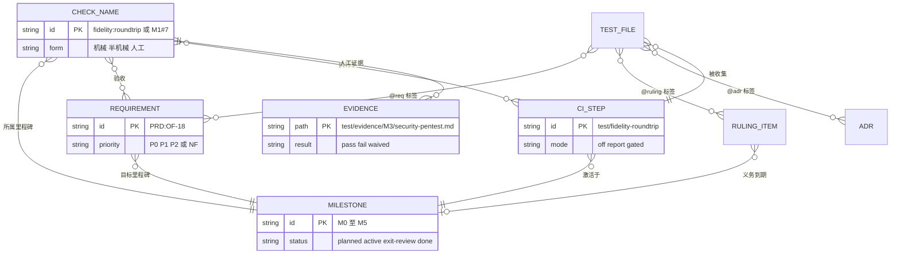
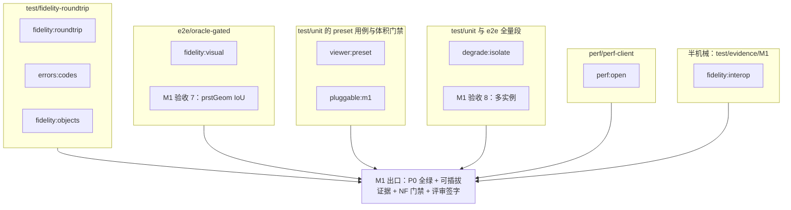
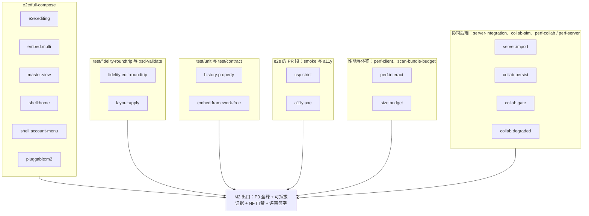
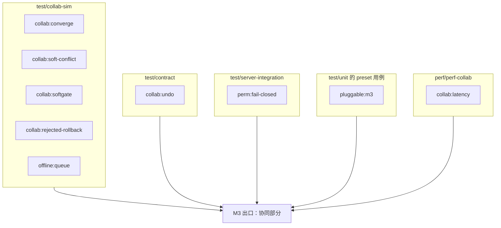
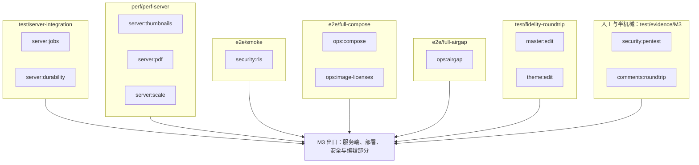

# 13 需求 → 测试可追溯矩阵

> 状态：v0.1 | 负责：测试设计线 | 更新：2026-09-25；2026-09-25（§4.19）；2026-09-25（§4.19 N1） | 依赖：rulings §4.19（含末句所指 `_evidence/design-tracks-plan-2026-09-25.json` 的 `leftoverDecisions`）、[30/11 §17](../30-architecture/11-testing-strategy.md)、[09-06 §12](../30-architecture/09-type-discipline/06-scanners.md)、[09-07 §2.1](../30-architecture/09-type-discipline/07-hooks-and-ci.md)、[PRD 04](../10-prd/04-non-functional-requirements.md) NF-09、[PRD 05](../10-prd/05-milestones-and-scope.md) §0.2 / M0 验收 3 / M0–M5 验收与可插拔证据 / §6、[PRD README](../10-prd/README.md) §1.3、[PRD 03/03](../10-prd/03-features/03-collaboration.md) CO-01–CO-15、30-architecture/adr 各 ADR「如何被机械验证」、rulings §4.15 / §4.17 / §4.18、[40/14 §5](../40-modules/14-cross-module-review.md)

本文是需求追溯的唯一事实源：测试上的三类追溯标签怎么写、需求与检查名清单从哪里生成、矩阵怎么产出和判定、PRD 检查名目录、NFR / 裁决 / ADR 到测试的映射、人工与半机械项、维护流程。标签的格式与存在性检查、矩阵产出由扫描器 `scan-requirement-tags`（09-06 §12）执行；完整性判定在 `test/requirement-matrix` 步骤（[12](./12-ci-gates-mapping.md)）；扫描器本身不判定完整性（09-06 §12 的职责边界）。

**本文拥有 / 引用**

| 本文拥有 | 引用（以对方为准） |
|---|---|
| 标签语法与位置；`requirements.json` 等清单的生成口径；判定规则 R1–R10；PRD 检查名 → 测试 → 步骤 → 形态的目录；NFR、裁决、ADR 的映射与义务清单；人工项的统计口径；维护流程 | 需求本身：PRD；验收阈值与检查名定义：PRD 05；扫描器规格：09-06 §12；CI 步骤名与激活：[12](./12-ci-gates-mapping.md)；证据文件头格式：[01 §8](./01-strategy-and-layers.md)；安全用例目录：[10](./10-security-testing.md) |

---

## 1. 机制

依据：决策 T-REQ（needsUser=false；authority：PRD NF-09 + 09-06 §12「扫描器不判定完整性」+ rulings §4.18 条目编号与 PRD 同形）。

### 1.1 三类标签

| 标签 | 语法（正则） | 例 | 指向 | 存在性校验来源 |
|---|---|---|---|---|
| `@req` | `PRD:(OF\|ED\|CO\|PS\|EM\|SV\|ML\|AS\|NF)-\d{2}` | `@req PRD:SV-05` | PRD 需求 id（PRD 03 八个功能域 + PRD 04 的 NF；PRD 06 的 MT 指标不是需求，不作标签） | `tooling/policy/requirements.json` |
| `@ruling` | `4\.\d{1,2}/[A-Z][A-Z0-9]*(-[0-9A-Za-z]+)*` | `@ruling 4.18/CO-08`、`@ruling 4.15/Q3`、`@ruling 4.17/D4`、`@ruling 4.19/SESSION` | rulings 各节的条目 id（表格第一列；§4.18 另含「规格空白默认值」列表与「机械修正」清单的 id，§2）；组合 id（如 `INC-03/04/05`、`C-20/G-13/G-14`）拆成单个 id 各写一次 | `tooling/policy/rulings.json` |
| `@adr` | `\d{4}/\d{1,2}` | `@adr 0029/3`、`@adr 0025/8` | ADR「决策」节的条目序号（决策只有一段时记为 1） | `tooling/policy/adrs.json` |

- **为什么要前缀**：rulings §4.18 的条目编号（`CO-08`、`BE-02`、`UX-03`…）与 PRD 需求编号同形，`CO-08` 单独出现时无法判断指 PRD「冲突语义」还是裁决「故障期广播」。`PRD:` 与 `<节>/` 前缀使两者不会混淆。
- **`4.19`**：§4.19 的条目集合 = 该节表格第一列的 5 项用户裁决（D-M2-CONTENT、INC-09、C-06、D-COMMENTS-PKG、D-TEST-INFRA）+ 表末单独一行的补完阶段用户裁决 `N1-IMPORT-OVERWRITE-RESTORE-LOCK`（2026-09-25 追加）+ 按 §4.19 末句读取 `00-charter/_evidence/design-tracks-plan-2026-09-25.json` 的 `leftoverDecisions[].id`（共 81 条，含上述 5 项，其余 76 项为 INC-*、SESSION、C-*、T-* 等；组合 id 拆开，省略前缀的段继承前一段前缀，如 `INC-03/04/05` → `INC-03`、`INC-04`、`INC-05`，`C-20/G-13/G-14` → `C-20`、`G-13`、`G-14`）。两部分取并集，都由生成脚本写入 `rulings.json`（§2），`@ruling 4.19/<id>` 与其它节一样做存在性检查：`@ruling 4.19/SESSION`、`@ruling 4.19/T-CI` 等标签只有在读取 evidence 后才能通过，不另设「只查格式」的过渡口径。
- **旧写法作废**：30/11 §17 的文件顶部 `// @req CO-08` 与 09-06 §12 规则 (a) 的正则 `^[A-Z]{2,3}-\d{2,3}$` 按本节改写（回写见 §11）；旧写法由规则 (a) 报错并提示新写法。

### 1.2 写在哪里

- 写在 `describe` / `it` / `test` 正上方的 JSDoc 里；一个 JSDoc 可以有多个标签，同一标签后可跟多个以空格分隔的 id。`describe` 上的标签作用于其内全部用例。
- **文件级**：文件中第一个 JSDoc 块（位于任何 `import` 之前）视为文件级，作用于该文件全部用例。Vitest、Playwright、`*.int-spec.ts`、`*.e2e-spec.ts`、`*.type-test.ts` 同一写法。
- **人工证据**：`test/evidence/<里程碑>/<检查名>.md` 的文件头（YAML）用同名字段 `req`、`ruling`、`adr` 列出 id，语法同上；`check` 字段写 PRD 检查名（字段全集见 [01 §8](./01-strategy-and-layers.md)）。

```ts
/**
 * @req PRD:SV-05 PRD:NF-03
 * @ruling 4.18/CO-08
 * @ruling 4.19/INC-09
 */
describe('PG 断开期间照常广播', () => {
  /** @adr 0025/1 */
  it('两客户端互见编辑，PG 恢复后 seq 连续', async () => { /* … */ })

  /** @adr 0025/8 */
  it('溢写期只回 tier spill 的 ack，客户端 pending 不清', async () => { /* … */ })
})
```

### 1.3 产出与判定

- **扫描器 `scan-requirement-tags`**（`scanners` job 与 pre-commit，09-07 §2.1）：规则 (a) 语法；(b) id 存在于对应清单；(c) 产出 `dist/requirement-test-matrix.json`，条目扩展为 `{ tag: 'req' | 'ruling' | 'adr', id, tests: [{ file, title, line, scope: 'file' | 'describe' | 'test' }] }[]`（回写 09-06 §12，§11）。
- **判定器 `test/traceability/judge.ts`**（`test/requirement-matrix` 步骤）：读矩阵、`requirements.json`、`check-names.json`、`obligations.json`（本文 §4、§6、§7 的机器副本）、`tooling/ci/steps.json`、`tooling/policy/milestones.json`、证据文件头、`test/security/*.json`，产出 `dist/traceability-report.{json,html}` 与一条 PR 注释。
- **里程碑状态**：`milestones.json` 为每个里程碑记录 `status ∈ {planned, active, exit-review, done}`（在既有「完成日期」字段之外新增，回写见 §11）。

| 规则 | 内容 | 失败还是报告 |
|---|---|---|
| R1 | P0 需求：所属里程碑为 `exit-review` 或 `done` 时，至少一个带 `@req PRD:<id>` 的测试被某个已激活步骤（`mode ≠ off`）收集；清单中标为人工的需求改为要求 `result: pass` 的证据文件 | 失败 |
| R2 | 同上，但所属里程碑为 `active`：列出缺口 | 报告 |
| R3 | 覆盖只增不减：main 上已有覆盖的 id（任一标签），PR 后失去全部覆盖即失败；需求已从 PRD 删除（不在新 `requirements.json` 中）除外 | 失败 |
| R4 | PRD 检查名：`exit-review` / `done` 里程碑的每个检查名在 `check-names.json` 中映射到的步骤都已激活、测试文件模式非空、人工项有证据 | 失败（`active` 时报告） |
| R5 | `e2e:editing`：M2 进入 `exit-review` 起，每条 P0 / P1 的 ED 需求至少一个标签位于 `apps/web/e2e/**` | 失败 |
| R6 | 义务：`obligations.json` 中里程碑已到 `exit-review` / `done` 的裁决与 ADR 义务都有对应 `@ruling` / `@adr` 标签 | 失败（`active` 时报告） |
| R7 | 本 PR 新增、却没有任何追溯标签的测试文件 | 报告（PR 注释提示） |
| R8 | 安全用例目录与 ASVS 映射完整（[10 §16](./10-security-testing.md)） | 失败 |
| R9 | 证据文件头字段齐全、`result` 取值合法 | 失败 |
| R10 | `gen-requirements --check`：PRD 或 rulings 改动后未重新生成清单 | 失败 |

**图 13-1 追溯矩阵的生成与门禁**


怎么读：左侧三类输入分别生成清单与矩阵；清单同时喂给扫描器（做存在性检查）与判定器；判定器结合步骤激活表与里程碑状态得出「失败」或「报告」，报告供出口评审使用。

依据：决策 T-REQ；09-06 §12；PRD 04 NF-09；PRD 05 §6（范围变更须更新矩阵）。

**图 13-2 追溯数据模型**



怎么读：实体是判定器读入的七类数据加人工证据；连线上的文字是关系来源。测试文件与需求、裁决条目、ADR 是多对多（经标签）；每个测试文件恰被一个 CI 步骤收集（[12 §2](./12-ci-gates-mapping.md) 的收集范围两两不相交）。

依据：本节 §1.1–§1.3；[12 §2](./12-ci-gates-mapping.md)。

---

## 2. 清单从哪里来

依据：决策 T-REQ（requirements.json 由 tooling 脚本从 PRD 03 / 04 生成，与 M0 验收 3 同一脚本）。

- **生成脚本** `tooling/scripts/gen-requirements.ts`（工具脚本，不计入 14 个扫描器）。生成物入库、文件头标 `generated`；`--check` 模式重新生成并与入库文件比对，有 diff 即失败（R10，与 `scan-manifest --check` 同一模式）。
- **输入与解析口径**：

| 来源 | 解析 | 生成物 |
|---|---|---|
| `10-prd/03-features/*.md` | `### <ID> <标题>` 及其后的「- 优先级：Px \| 目标里程碑：My …」行；多里程碑写法（如「M3（会话内队列）/ M4（…）」）取第一个为主里程碑，全部记入 `milestones[]`；有无「验收标准」段记为 `acceptance` | `tooling/policy/requirements.json` 的 `requirements[]`：`{ id, domain, title, priority, milestone, milestones[], acceptance, source }` |
| `10-prd/04-non-functional-requirements.md` | `## NF-xx` 标题；优先级记为 `NF`，里程碑取该节各表「里程碑」列的并集 | 同上（`priority: 'NF'`，完整性按 §4 的义务判定，不走 R1） |
| `10-prd/05-milestones-and-scope.md` | 各里程碑「验收标准」编号条目**开头**（首个冒号之前）以反引号包裹的 `域:名`，可多个以 `+` 相连（如 M3 验收 10 的三项）；条目正文中其它反引号内容（如 `dsp:drawing`、`doc-type:new`）不算；无名条目记为 `<里程碑>#<序号>`（如 `M1#7`）；「可插拔证据」段「CI 检查」后的 `pluggable:mN`；「发布前检查」等非验收列表不解析 | 同一文件的 `checks[]`：`{ id, milestone, text }` |
| `00-charter/rulings-2026-09-14.md` | 各节表格第一列的条目 id 与所在节号；§4.18「规格空白默认值」各列表项开头加粗的 id（如 **CO-10**）；§4.18「机械修正」按正文所指读取 `00-charter/_evidence/contradiction-plan-2026-09-25.json` 的 `plan.mechanical[].id`（如 `UX-13`、`CO-11`）；§4.19 表格第一列 5 项与表末 `N1-IMPORT-OVERWRITE-RESTORE-LOCK` 行，另按 §4.19 末句读取 `00-charter/_evidence/design-tracks-plan-2026-09-25.json` 的 `leftoverDecisions[].id`（与 §4.18 机械修正读取 evidence 同一先例）；组合 id 一律拆开 | `tooling/policy/rulings.json` |
| `30-architecture/adr/*.md` | 「决策」节的编号条目与 ADR 状态 | `tooling/policy/adrs.json` |

- **M0 验收 3「字段齐全」**：同一脚本对每条 P0 需求检查 id 唯一、优先级、目标里程碑、验收标准四项齐全，缺一即列出并失败。
- **人工维护、生成脚本不碰的两份映射**：`test/traceability/check-names.json`（§3 的机器副本：检查名 → 测试文件模式、步骤、形态）与 `test/traceability/obligations.json`（§4、§6、§7 的机器副本：NF / 裁决 / ADR 义务 → 里程碑、步骤、文件模式）。判定器断言 `check-names.json` 的键集合 = 生成的 `checks[]`（多一个或少一个都失败）。
- 需求清单的消费者：扫描器 `scan-requirement-tags` 规则 (b) 读 `requirements.json` 做存在性检查（09-06 §12 的「若清单存在」前提自 M0 起成立）。

---

## 3. PRD 检查名目录

每行给出检查名、断言摘要、测试落点、CI 步骤与形态；阈值原文以 PRD 05 为准，本表只写能定位用例的摘要。「形态」：机械 = 全自动判定；半机械 = 自动执行 + 人工复核失败项；人工 = 证据归档（§8）。按步骤反查的索引见 [12 §6](./12-ci-gates-mapping.md)。

### 3.1 M0

| 检查 | 断言摘要 | 落点 | 步骤 | 形态 |
|---|---|---|---|---|
| `M0#1` | 三条线 README 的待决事项都有决策人、对章程的异议都有裁决记录 | `test/evidence/M0/docs-review.md` | — | 人工 |
| `M0#2` | `docs/` 中未定义术语数 = 0 | 术语扫描脚本（`docs/_tools`，评审时运行） | 文档工具，不属 13 个 job | 机械 |
| `M0#3` | 每条 P0 需求字段齐全 | `gen-requirements --check` | `test/requirement-matrix` | 机械 |
| `M0#4` | 规范 ↔ 执行矩阵 CI 校验通过；各门禁在空骨架上跑通且负向夹具失败 | `scan-policy`；13 个 job | `policy-check` 与全部 job | 机械 |
| `M0#5` | ADR-0001 声明合并 spike 有结论 | `test/evidence/M0/adr-0001-spike.md` | — | 人工 |

### 3.2 M1

| 检查 | 断言摘要 | 落点 | 步骤 | 形态 |
|---|---|---|---|---|
| `fidelity:roundtrip` | T1 + T2 零编辑往返部件级零差异 | `test/roundtrip/**`（[03 §4](./03-fidelity-roundtrip-and-corpus.md)） | `test/fidelity-roundtrip`（nightly 全量为出口证据） | 机械 |
| `fidelity:visual` | SSIM 中位数与 P10、各矩阵行阈值、文本行数一致率 | `test/oracle/**`（[04 §6](./04-visual-oracle.md)） | `e2e/oracle-gated` | 机械 |
| `fidelity:interop` | PowerPoint 365 Windows 打开无修复（macOS 基线与 Mac 抽检自 M2 起，rulings §4.19 D-TEST-INFRA） | 维护机脚本 + 人工复核（[03 §12](./03-fidelity-roundtrip-and-corpus.md)） | — | 半机械 |
| `perf:open` | D50 / D200 首页可见、内存稳态、20 次开关无泄漏 | `test/perf/scenarios/open-*`（[09 §3](./09-performance-and-capacity.md)） | `perf/perf-client` | 机械 |
| `errors:codes` | `.ppt`、加密、损坏、超限各类样本返回正确错误码 | `test/roundtrip/error-corpus.test.ts`（[03 §8](./03-fidelity-roundtrip-and-corpus.md)） | `test/fidelity-roundtrip` | 机械 |
| `degrade:isolate` | 注入抛错的 `ElementRenderer`，同页其它元素渲染、`render/element-failed` 触发 | engine-render `error-isolation.test.ts` | `test/unit` | 机械 |
| `M1#7` | 187 种 `prstGeom` IoU ≥ 0.95 | `test/oracle/**`（[04 §5](./04-visual-oracle.md)） | `e2e/oracle-gated` | 机械 |
| `M1#8` | 同页 4 个 Unit 各自渲染正确，关闭一个不影响其它 | model-core `unit-scope.test.ts`；`apps/web/e2e/viewer/multi-instance.spec.ts` | `test/unit`、`e2e/full-compose` | 机械 |
| `viewer:preset` | 查看器打开 T1 全部成功、初始加载 ≤ 350 KB gzip、无编辑命令 | `preset-slide-viewer` 的 `readonly.test.ts`；体积 | `test/unit`、`scanners/scan-bundle-budget`、`depcruise` | 机械 |
| `fidelity:objects` | 表格、图表、SmartArt gated；OLE 预览；chartex 与未知对象占位；外部关系保留 | [03 §9](./03-fidelity-roundtrip-and-corpus.md)、[04 §7](./04-visual-oracle.md) | `test/fidelity-roundtrip`、`e2e/oracle-gated` | 机械 |
| `pluggable:m1` | store 与 render.target 换 no-op 仍能启动；无图表渲染器时占位 | `preset-slide` 的 `pluggable.test.ts`（[02 §10](./02-contract-suites-and-pluggability.md)） | `test/unit` | 机械 |

**图 13-3 M1 出口与检查名**



怎么读：每个分组是承载这些检查的主要 CI 步骤，组内是 PRD 05 的检查名；全部分组汇入出口节点。跨多个步骤的检查放在主要步骤下，完整的步骤列表见上表。

依据：PRD 05 M1 验收与可插拔证据、图 0-2。

### 3.3 M2

| 检查 | 断言摘要 | 落点 | 步骤 | 形态 |
|---|---|---|---|---|
| `e2e:editing` | 每条 P0 / P1 ED 需求至少一个 Playwright 用例且全部通过 | `apps/web/e2e/editing/**` | `e2e/full-compose`；覆盖由 `test/requirement-matrix`（R5） | 机械 |
| `fidelity:edit-roundtrip` | 编辑脚本语料：未触碰部件字节相同、脏部件 XSD 有效、diff 只在被编辑子树 | `test/roundtrip/edit-scripts/**`（[03 §5](./03-fidelity-roundtrip-and-corpus.md)）；PowerPoint 打开无修复部分见 `fidelity:interop` | `test/fidelity-roundtrip`、`xsd-validate` | 机械 |
| `history:property` | 1,000 步随机命令全撤销回初始、全重做回终态（100 个种子） | model-slide 性质测试（[05 §10](./05-collab-simulation-and-property-tests.md)） | `test/unit`（nightly 放大） | 机械 |
| `perf:interact` | 键入 p95、拖动帧率、撤销、导出 D50 | `test/perf/scenarios/*` | `perf/perf-client` | 机械 |
| `size:budget` | 查看器 ≤ 350 KB、编辑器 ≤ 900 KB gzip | `config/bundle-budget.json` | `scanners/scan-bundle-budget` | 机械 |
| `a11y:axe` | 全部面板零严重 / 重大违规；键盘 e2e 覆盖主要区域 | `apps/web/e2e/a11y/**`（[06 §7](./06-frontend-component-and-e2e.md)） | `e2e/a11y` | 机械 |
| `embed:multi` | 同页 4 个编辑器实例、快捷键按焦点分派、销毁无残留 | `apps/web/e2e/embed/multi-instance.spec.ts` | `e2e/full-compose` | 机械 |
| `csp:strict` | 严格 CSP + nonce 下 e2e 全部通过；TT Report-Only 零报告；`externalResources` 三档收紧；注入扫描零命中 | SEC-CL-01 / 02、SEC-CT-01 / 05（[10](./10-security-testing.md)） | `e2e/smoke`、全部浏览器 e2e 的安全夹具、`lint` | 机械 |
| `master:view` | 进入 ≤ 300 ms、缩略图与引用数、SSIM ≥ 0.90、入口可见性规则 | `apps/web/e2e/master/**`；oracle 抽样 | `e2e/full-compose`、`e2e/oracle-gated`、`perf/perf-client` | 机械 |
| `layout:apply` | 版式重匹配与规则表一致、跨母版一步撤销、重置 SSIM ≥ 0.98 | 编辑脚本语料的版式分节（[03 §5](./03-fidelity-roundtrip-and-corpus.md)）；oracle | `test/fidelity-roundtrip`、`e2e/oracle-gated`、`e2e/full-compose` | 机械（PowerPoint 打开部分半机械） |
| `shell:home` | 开始页四态、可交互 ≤ 1.0 s、三类入口、离线禁用 | `apps/web/e2e/shell/home.spec.ts` | `e2e/full-compose`、`perf/perf-client` | 机械 |
| `shell:account-menu` | 三处入口打开同一菜单；设置、快捷键、帮助、退出登录各有用例 | `apps/web/e2e/shell/account-menu.spec.ts` | `e2e/full-compose` | 机械 |
| `embed:framework-free` | `UiRenderer('vanilla')` 过 UI 渲染契约；形态 B 产物无 react / radix | `runUiRendererConformance`（[02 §7.3](./02-contract-suites-and-pluggability.md)）；依赖规则 | `test/contract`、`depcruise` | 机械 |
| `pluggable:m2` | 示例插件只用公开入口；插入、渲染、导出、撤销；内核六包零 diff | [02 §10](./02-contract-suites-and-pluggability.md) | `depcruise`、`e2e/full-compose`；零 diff 为证据文件 | 机械 + 证据 |
| `server:import` | 两步导入 D50 / D200 时长；超天花板拒绝、包络外可导入；上传与解析阶段可取消且不留原件与产物；新建空白 / 模板走同一作业、导入即有包内封面 | [07 §11.2–§11.3](./07-backend-integration-and-api-e2e.md) J1–J4；[03 §10](./03-fidelity-roundtrip-and-corpus.md) B1、B3、B4；[09 §6](./09-performance-and-capacity.md) `import-*`；[06 §5](./06-frontend-component-and-e2e.md) 第 7、21 行 | `test/server-integration`、`perf/perf-server`、`e2e/full-compose` | 机械 |
| `collab:persist` | 快照引导打开与初始同步；落库后才回 db ack、持久化滞后；≥ 500 update 触发压缩、压缩 10k update 时长；kill -9 零丢失 50 次；关闭重开哈希一致；同一用户两标签页互见；编辑 e2e 走网关路径 | [07 §8](./07-backend-integration-and-api-e2e.md) D10、§9 W2–W4；[02 §5](./02-contract-suites-and-pluggability.md) `durability/*`、`ack/*`；[05](./05-collab-simulation-and-property-tests.md) M2 档；[09 §6](./09-performance-and-capacity.md) `collab-bootstrap-*`、`persist-lag`、`compaction-10k`；[06 §5](./06-frontend-component-and-e2e.md) 第 2、22 行 | `test/server-integration`、`test/contract`、`test/collab-sim`、`perf/perf-collab`、`perf/perf-server`、`e2e/full-compose` | 机械 |
| `collab:gate` | Ticket 握手与六种失败码；硬门禁拒绝即不广播不落库；5% 非法 update 最终全部合法；修复规则黄金用例；修复与拒绝入审计；媒体只经资源通道 | [02 §5.2](./02-contract-suites-and-pluggability.md) `gate/*`、`session/*`；[05 §8](./05-collab-simulation-and-property-tests.md)；[07 §6](./07-backend-integration-and-api-e2e.md) A10、§9 W8、W11 | `test/contract`、`test/collab-sim`、`test/unit`、`test/server-integration` | 机械 |
| `collab:degraded` | 单实例 PG 写失败下不拒新编辑，超阈值依次溢写 Valkey → 对象存储、溢写期只回 spill ack 且 pending 保留；恢复后回放补 db ack、seq 连续且不重复落库；降级期两客户端仍互见；`persist` 信号 ≤ 1 s；发起方横幅与其余会话状态胶囊按三分支判据出现、恢复后消失；有未确认更改时离开保护 | [02 §5.2](./02-contract-suites-and-pluggability.md) `durability/pg-down-db-ack-withheld`、`degraded/*`；[07 §9](./07-backend-integration-and-api-e2e.md) W5a、W5、W6（单实例）；[05 §9](./05-collab-simulation-and-property-tests.md) `rs/unsaved-indicator`；[06 §5](./06-frontend-component-and-e2e.md) 第 22 行 | `test/server-integration`、`test/contract`、`test/unit`、`e2e/full-compose` | 机械 |

**图 13-4 M2 出口与检查名**



怎么读：同图 13-3；M2 的大部分检查落在 main 段的全量浏览器 e2e 上，因此 M2 出口评审读取 main 与 nightly 的结果，而不只是 PR 结果。协同后端四项（`server:import`、`collab:persist`、`collab:gate`、`collab:degraded`）是 PRD 05 按 rulings §4.19 D-M2-CONTENT 新增的 M2 验收 14–17。

依据：PRD 05 M2 验收与可插拔证据。

**rulings §4.19 D-M2-CONTENT 对检查名的影响**（PRD 05 已按裁决修订，M2 / M3 边界以 PRD 05 §0.3 为准）：协同网关、Room（单实例）、update 持久化与快照、服务端导入提前到 M2，新增 M2 验收 14–17（上表 `server:import`、`collab:persist`、`collab:gate`、`collab:degraded`）；原 M3 的 `collab:softgate` 主体提前为 `collab:gate`，`server:jobs` 只剩服务端导出，`server:durability` 只剩多实例部分（含跨实例溢写认领；单实例溢写与两级 ack 在 M2 `collab:degraded`）（§3.4）。`check-names.json` 与本节同一 PR 更新（§9 第 2 条）。

### 3.4 M3

| 检查 | 断言摘要 | 落点 | 步骤 | 形态 |
|---|---|---|---|---|
| `collab:converge` | 20 客户端 × 1,000 命令 × 100 种子收敛、导出 XSD 有效 | `test/collab-sim/**`（[05 §4](./05-collab-simulation-and-property-tests.md)） | `test/collab-sim`（nightly 规模档为出口证据） | 机械 |
| `collab:soft-conflict` | CO-08 表每行确定性用例，收敛与提示 100% 相符 | [05 §6](./05-collab-simulation-and-property-tests.md) | `test/collab-sim` | 机械 |
| `collab:latency` | A → B p50 / p95、presence | `test/perf/scenarios/collab-*` | `perf/perf-collab` | 机械 |
| `perm:fail-closed` | 无写权限构造 update 被拒并断开；撤销 ≤ 2 s 生效；未声明能力位的命令进不了代码库 | SEC-AZ-03 / 04 / 06 / 07（[10 §7](./10-security-testing.md)） | `test/server-integration`、`test/contract`、`scanners/scan-command-capabilities`；2 s 在 `perf/perf-collab` | 机械 |
| `offline:queue` | 断网编辑后重连合并；5 MiB 离线更改无超限断连；30 s 离线判据；≤ 36 s 自动回连 | [05 §9](./05-collab-simulation-and-property-tests.md)；传输与离线 kit；双浏览器冒烟 | `test/collab-sim`、`test/contract`、`e2e/smoke`、`perf/perf-collab` | 机械 |
| `server:jobs` | 服务端导出 pptx 时长（与客户端导出规范化一致）；导出可取消、下载链接 1 h；导入条目已提前为 M2 `server:import`，M3 在多实例部署下回归 | [07 §11.2](./07-backend-integration-and-api-e2e.md) J5、J6；[09 §6](./09-performance-and-capacity.md) `export-*` | `test/server-integration`、`perf/perf-server` | 机械 |
| `server:thumbnails` | 首页 ≤ 10 s、D200 ≤ 90 s；按页哈希失效；renderer 安全测试 | [07 §11](./07-backend-integration-and-api-e2e.md)；SEC-RS-01…07 | `perf/perf-server`、`test/server-integration`、`e2e/smoke`、`scanners/check-image-policy`、`e2e/oracle-gated` | 机械 |
| `server:pdf` | PDF D50 ≤ 10 s、SSIM ≥ 0.85；与缩略图分队列 | 性能场景；oracle PDF 通道（[04 §1](./04-visual-oracle.md)） | `perf/perf-server`、`e2e/oracle-gated`、`test/server-integration` | 机械 |
| `server:durability` | 多实例：kill -9 任一实例后重连到其它实例、已 ack(db) 零丢失；PG 故障期间跨实例扇出仍互见、恢复后 seq 连续；只回放本实例溢写、遗留行由下一个加载实例认领；未发起更改的协作者只见状态胶囊弱提示（单实例部分已在 M2 `collab:persist`、`collab:degraded`） | [07 §9](./07-backend-integration-and-api-e2e.md) W1、W2、W5、W6；[02 §5.2](./02-contract-suites-and-pluggability.md) `degraded/*`、`replay/*`；[06 §5](./06-frontend-component-and-e2e.md) 第 12 行 | `test/server-integration`（PR 5 次，nightly 50 次）、`test/contract`、`e2e/full-compose` | 机械 |
| `server:scale` | 单实例 2,000 WS、按权重准入、广播与跨实例时延、名额按用户计 | [09 §6–§7](./09-performance-and-capacity.md) | `perf/perf-server`、`perf/perf-collab` | 机械 |
| `security:pentest` | ASVS L2 自评 + 第三方渗透无高危未修复 | [10 §14](./10-security-testing.md) | — | 人工 |
| `ops:compose` | compose 洁净栈到 `/readyz` 200 ≤ 3 min | [08 §3](./08-deployment-and-environment-e2e.md) | `e2e/full-compose` | 机械 |
| `ops:airgap` | 断网环境 compose e2e 通过、无出站 | [08 §5](./08-deployment-and-environment-e2e.md) | `e2e/full-airgap` | 机械 |
| `ops:image-licenses` | digest 钉死、SBOM、镜像许可门禁；备份恢复演练脚本通过 | [08 §6、§9](./08-deployment-and-environment-e2e.md) | `scanners/check-image-policy`、`e2e/full-compose`（演练在 nightly） | 机械 |
| `comments:roundtrip` | 评论导出为现代评论部件，PowerPoint 365 可见且作者与时间正确（抽样 20） | 结构断言 [03 §9](./03-fidelity-roundtrip-and-corpus.md)；抽样证据 | `test/fidelity-roundtrip`；证据 `test/evidence/M3/comments-roundtrip.md` | 半机械 |
| `collab:softgate` | 主体已随网关提前为 M2 `collab:gate`；M3 在多实例与多客户端下重跑，并补 commenter 触及评论以外路径、修改他人评论两条修复规则的黄金用例 | [05 §8](./05-collab-simulation-and-property-tests.md) `inject/unauthorized-path`、`inject/foreign-author` 的 commenter 变体；审计集成 | `test/collab-sim`、`test/unit`、`test/server-integration` | 机械 |
| `collab:rejected-rollback` | 降权后被拒的 pending → 导出后重载，状态一致、未同步更改可导出 | [05 §9](./05-collab-simulation-and-property-tests.md)；`apps/web/e2e/collab/**` | `test/collab-sim`、`e2e/full-compose` | 机械 |
| `master:edit` | 母版与版式编辑脚本语料、引用页 ≤ 500 ms 更新、删除被引用版式规则、ML-03 冲突表 | 编辑脚本语料；性能；oracle；[05 §6](./05-collab-simulation-and-property-tests.md) | `test/fidelity-roundtrip`、`perf/perf-client`、`e2e/oracle-gated`、`test/collab-sim` | 机械 |
| `theme:edit`（P1） | 主题重算 ≤ 300 ms、显式颜色像素不变、`theme*.xml` 重生成与字节保留 | 编辑脚本语料；性能；oracle | `test/fidelity-roundtrip`、`perf/perf-client`、`e2e/oracle-gated` | 机械 |
| `security:rls` | 绕过应用层直连 PG 越权被 RLS 拒绝；OIDC 登录、`selfSignup` 默认关、分享链接要求登录各有 e2e | SEC-DA-01 / 02、SEC-AU-02、SEC-AZ-09 | `e2e/smoke`、`scanners/check-rls-coverage`、`test/server-integration` | 机械 |
| `collab:undo` | 同键跳过、整步不连撤、墓碑与恢复、TTL 与永久删除不等 TTL、彻底删除元素后整步跳过；两个 store 同一套件 | `runDocumentStoreConformance` 中性撤销分节（[02 §4](./02-contract-suites-and-pluggability.md)）；[05 §7](./05-collab-simulation-and-property-tests.md)；[07 §10](./07-backend-integration-and-api-e2e.md) | `test/contract`、`test/collab-sim`、`test/server-integration` | 机械 |
| `pluggable:m3` | 两个 preset 的 Manifest 差异恰为白名单 `{−store-memory, +store-yjs, −collab-core#local-presence, +collab-yjs, +collab-transport-ws, +comments}`；M2 编辑 e2e 在 store-yjs 下重跑；移除 collab 仍能启动 | [02 §10](./02-contract-suites-and-pluggability.md)（白名单按 rulings §4.19 D-COMMENTS-PKG 定稿；`manifest-diff.test.ts` 自 M2 起运行、M2 期间不含 `+comments`） | `test/unit`、`e2e/full-compose` | 机械 |

**图 13-5 M3 出口与检查名（协同与权限）**



怎么读：同图 13-3；M3 检查较多，按「协同与权限」与「服务端、部署、安全与编辑」拆成两张图，两张图的出口节点合起来才是 M3 出口。

**图 13-6 M3 出口与检查名（服务端、部署、安全与编辑）**



怎么读：同图 13-5；`ops:*` 三项与 `server:durability` 的 nightly 档都在合入后才运行，M3 出口评审读取 main 与 nightly 的结果。

依据：PRD 05 M3 验收与可插拔证据；rulings §4.15 Q10、§4.18 GV-16。

### 3.5 M4

| 检查 | 断言摘要 | 落点 | 步骤 | 形态 |
|---|---|---|---|---|
| `docs:coverage` | 公开 API、贡献点、错误码文档覆盖率 100%；文档示例代码全部编译 | 文档站构建脚本 | `api-surface/docs-coverage` | 机械 |
| `ctk:self` | 官方插件与示例全部通过 CTK；负向样例各自在对应检查上失败 | `test/plugin-compat/self.test.ts`（[02 §12](./02-contract-suites-and-pluggability.md)） | `test/contract` | 机械 |
| `manifest:ci` | `cordex-manifest.json` 与运行时一致；`hostApi` 范围外宿主拒绝加载 | `scan-manifest --check`；kernel `manifest-verify.test.ts` | `scanners/scan-manifest --check`、`test/unit` | 机械 |
| `scaffold:e2e` | 脚手架 8 个模板各生成一次，install / test / build 通过 ≤ 5 min | `packages/create-plugin` 的模板冒烟 | `api-surface/scaffold-e2e` | 机械 |
| `pilot:external` | 内部非核心成员仅凭公开文档完成插件 ≤ 2 人日、CTK 通过、提问 ≤ 3 次 | `test/evidence/M4/pilot-external.md` | — | 半机械 |
| `version:policy` | 弃用 API 带移除版本；到期扫描器失败用例 | 扫描器 `scan-deprecations` 的负向夹具 | `scanners/scan-deprecations`、`test/unit` | 机械 |

### 3.6 M5

| 检查 | 断言摘要 | 落点 | 步骤 | 形态 |
|---|---|---|---|---|
| `depcruise:blind` | 非组合根水平层对垂直束 import = 0；组合根豁免与反例 | depcruise 规则与夹具（[02 §11](./02-contract-suites-and-pluggability.md)） | `depcruise` | 机械 |
| `diff:horizontal` | 新增 doc / sheet 骨架的 PR 对冻结范围 diff = 0 行 | `fixtures/horizontal-freeze.lock` | `scanners/horizontal-freeze` | 机械 |
| `boot:empty` | 不加载任何 DocumentType 时宿主启动，打开文件返回 `format.no_document_type` | `test/preset-blind/preset-blind.test.ts` 的 `boot/empty` 用例（[02 §11](./02-contract-suites-and-pluggability.md)） | `test/preset-blind` | 机械 |
| `coexist` | 同页 slide + doc + sheet 三个 Unit 互不影响 | `test/preset-blind/preset-coexist.test.ts` | `test/preset-blind` | 机械 |
| `roundtrip:docx-xlsx`（P1） | docx 与 xlsx 零编辑往返各 ≥ 20 个样本零差异 | [03 §14](./03-fidelity-roundtrip-and-corpus.md) | `test/fidelity-roundtrip` | 机械 |

---

## 4. NFR 映射

NF 条目没有 P0 / P1，按下表作为义务登记进 `obligations.json`（`kind: 'nf'`），在所列里程碑进入出口评审时适用 R6。数值只引用 PRD 04。

| NF | 范围 | 场景或测试 | 步骤 | 里程碑 |
|---|---|---|---|---|
| NF-01 §1.1 | 打开与首屏、跳页、主线程长任务 | `open-*`、跳转已解析 / 未解析页、longtask 观察（[09 §3–§4](./09-performance-and-capacity.md)） | `perf/perf-client` | M1 |
| NF-01 §1.2 / §1.4 | 交互与渲染、导出 | 键入、IME、拖拽与缩放帧率、撤销、命中测试、吸附、搜索与替换、主题切换、导出 | `perf/perf-client` | M2 |
| NF-01 §1.3 | 内存 | 稳态与峰值、20 次开关堆增长 ≤ 5%（[06 §11](./06-frontend-component-and-e2e.md)）、卸载后 effects 为空、blob URL 泄漏为 0 | `perf/perf-client`、`e2e/full-compose`、`test/lifecycle` | M1 |
| NF-01 §1.5 | 体积 | 唯一阻断点 `scan-bundle-budget`（决策 T-BUNDLE） | `scanners/scan-bundle-budget` | M1 / M2 |
| NF-01 §1.6 / §1.7 | 协同、服务端 | [09 §6–§7](./09-performance-and-capacity.md)（快照 bootstrap、持久化滞后、压缩、导入、单实例溢写回放 M2 起；多人延迟、在场、容量、优雅停机、导出与缩略图 M3） | `perf/perf-collab`、`perf/perf-server` | M2 / M3 |
| NF-01 材质层 | 同屏玻璃面板数、降级为不透明、对比度；forced-colors | 浏览器断言与 design 对比度测试；forced-colors 用例 | `e2e/full-compose`、`test/unit`、`e2e/a11y`（M3） | M2 / M3 |
| NF-02 | 保真门禁 | 往返、XSD、oracle 两层阈值与「中位数下降 > 0.01 即失败」（决策 T-ORACLE） | `test/fidelity-roundtrip`、`xsd-validate`、`e2e/oracle-gated` | M1–M3 |
| NF-03 | 可用性与数据安全 | 已 ack(db) 零丢失与 PG 故障连续性（[07 §9](./07-backend-integration-and-api-e2e.md)）；插件失败隔离；导出失败可重试不损坏源；灾备演练（[08 §9](./08-deployment-and-environment-e2e.md)）；崩溃自由会话率为线上指标，出口评审读取试运行数据 | `test/server-integration`、`test/lifecycle`、`test/unit`、`e2e/full-compose`（nightly）；线上指标为人工 | M2 / M3 |
| NF-04 | 安全 | [10](./10-security-testing.md) 全部 SEC 条目、ASVS 与渗透 | 见 10 §2 | M1–M3 |
| NF-05 | 可访问性 | axe、键盘、目标尺寸、焦点、对比度（[06 §7](./06-frontend-component-and-e2e.md)）；屏幕阅读器矩阵与 VPAT 为人工 | `e2e/a11y`；人工 | M2 / M3 / M4 |
| NF-06 | 国际化 | 各语言键集合一致（`scan-contributions` 规则 (f)）、缺键编译失败、伪本地化与 RTL 伪语言、语言包 ≤ 30 KB、切换 ≤ 200 ms（[06 §8](./06-frontend-component-and-e2e.md)） | `scanners/scan-contributions`、`typecheck`、`e2e/full-compose`、`scanners/scan-bundle-budget`、`perf/perf-client` | M1 / M2 |
| NF-07 | 浏览器与运行时矩阵 | Playwright 工程按里程碑扩展（[06 §3](./06-frontend-component-and-e2e.md)）；Node 26 基线（`lockfile-guard`） | 全部浏览器 e2e 步骤、`scanners/lockfile-guard` | M1 / M2 / M3 |
| NF-08 | 互操作 | PowerPoint 打开无修复（半机械）；LibreOffice 不崩溃（nightly 报告）；多生产方输入打开 100%（T2 语料） | 证据；`test/fidelity-roundtrip` | M1 / M2 |
| NF-09 | 可维护性与质量门禁 | 本文 R1–R10；patch 覆盖率；语料 PR ≤ 10 min；PR 性能 D50；类型逃逸预算 | `test/requirement-matrix`、`coverage-patch`、`test/fidelity-roundtrip`、`perf/perf-client`、`scanners` | M0 起 |
| NF-10 | 容量 | 2,000 WS、按权重准入、单文档 update 日志 ≤ 10 × 快照、每实例 4 并发作业 | `perf/perf-server`、`perf/perf-collab`、`test/server-integration` | M3 |
| NF-11 | 隐私与合规 | SEC-CL-04…06、SEC-DA-07；数据处理清单 | `e2e/full-compose`、`test/server-integration`；证据 | M2 / M3 |
| NF-12 | 文档与支持 | `docs:coverage`（M4）；错误码手册由登记表生成、每个码有文案键（`scan-observability-identifiers`、决策 ERR-COPY 的 `scan-contributions` 子规则）；其余为交付物清单 | `api-surface/docs-coverage`、`scanners` | M1 / M4 |

---

## 5. 按功能域摘要

逐条需求 → 测试文件的明细由生成的 `dist/traceability-report.html` 承载（每条需求列出全部带标签的用例、所在步骤与最近一次结果），本节只给各域的测试文件族，供写新测试时判断放哪里、打什么标签。

| 域 | 主要测试文件族 | 主要步骤 | 细则 |
|---|---|---|---|
| OF 打开 / 保真 | `packages/ooxml-*/src/**/__tests__/`、渲染包同位测试、`test/roundtrip/`、`test/oracle/`、`apps/web/e2e/{open,viewer}/**` | `test/unit`、`test/fidelity-roundtrip`、`e2e/oracle-gated`、`perf/perf-client` | [03](./03-fidelity-roundtrip-and-corpus.md)、[04](./04-visual-oracle.md) |
| ED 编辑 | `packages/model-slide`、`packages/slide-ui` 同位测试；编辑脚本语料；`apps/web/e2e/editing/**` | `test/unit`、`test/fidelity-roundtrip`、`e2e/full-compose`、`e2e/a11y` | [03 §5](./03-fidelity-roundtrip-and-corpus.md)、[06 §5](./06-frontend-component-and-e2e.md) |
| ML 母版 / 版式 / 主题 | model-slide 版式与继承测试、slide-render 母版继承、编辑脚本语料的版式分节、`apps/web/e2e/master/**` | `test/unit`、`test/fidelity-roundtrip`、`e2e/oracle-gated`、`e2e/full-compose` | 同上 |
| AS 应用壳 | `apps/web/src/**/__tests__/`（domain 与 application，msw）、`apps/web/e2e/shell/**` | `test/unit`、`e2e/full-compose`、`perf/perf-client` | [06](./06-frontend-component-and-e2e.md) |
| CO 协同 | `packages/{collab-*,store-yjs}` 同位测试、`test/collab-sim/`、`apps/server/test/{integration,e2e}/collab/**`、`apps/web/e2e/collab/**` | `test/contract`、`test/collab-sim`、`test/server-integration`、`e2e/smoke`、`perf/perf-collab` | [02](./02-contract-suites-and-pluggability.md)、[05](./05-collab-simulation-and-property-tests.md)、[07](./07-backend-integration-and-api-e2e.md) |
| PS 插件 SDK | `packages/kernel` 同位测试、各包 `lifecycle.test.ts`、`test/plugin-compat/`、`examples/**` | `test/lifecycle`、`test/contract`、`test-typecheck`、`api-surface` | [02](./02-contract-suites-and-pluggability.md) |
| EM 嵌入集成 | `packages/preset-*/src/__tests__/`、`examples/embed-*`、`apps/web/e2e/embed/**` | `test/lifecycle`、`test/unit`、`e2e/full-compose`、`scanners/scan-bundle-budget` | [02 §10](./02-contract-suites-and-pluggability.md)、[06](./06-frontend-component-and-e2e.md) |
| SV 服务端运维 | `apps/server/src/**/__tests__/`、`apps/server/test/{integration,e2e}/**`、`test/deploy/` | `test/server-integration`、`e2e/smoke`、`e2e/full-compose`、`e2e/full-airgap`、`perf/perf-server` | [07](./07-backend-integration-and-api-e2e.md)、[08](./08-deployment-and-environment-e2e.md)、[10](./10-security-testing.md) |

---

## 6. 裁决项映射

本节是 `obligations.json` 中 `kind: 'ruling'` 的人工正本：每行一个带测试要求的裁决条目，测试须带对应的 `@ruling` 标签。只列有测试要求的条目；纯文档口径或命名修正的条目（如 GV-04、GV-05、GV-08、GV-24）不列。

### 6.1 §4.15–§4.17

| 标签 | 测试要求 | 测试 | 步骤 | 到期 |
|---|---|---|---|---|
| `4.15/T-0` | 单组织，无租户字段 | SEC-DA-04 | `test/server-integration`、`test-typecheck`、`scanners` | M2 |
| `4.15/Q1` | 包名 scope、`workspace:` 协议 | `scan-manifest` 规则 (g)、`check-workspace-protocol` | `scanners` | M0 |
| `4.15/Q2` | UI 核心框架无关；CSP nonce M2；TT M2 Report-Only → M3 强制 | TD-082 依赖规则、`embed:framework-free`、SEC-CL-01 / 02 | `depcruise`、`test/contract`、`e2e/smoke` | M2 / M3 |
| `4.15/Q3` | 同键跳过、整步不连撤、软删除墓碑 + TTL | `runDocumentStoreConformance` 中性撤销分节；协同模拟撤销断言 | `test/contract`、`test/collab-sim` | M3 |
| `4.15/S-3a` | 两级 ack：spill 不清 pending、db 才清；回放后无 pendingStructs | `runCollabServerConformance`、`batcher.test`、PG 故障注入集成 | `test/contract`、`test/unit`、`test/server-integration` | M2（单实例：db ack、spill 档与 pending 保留）/ M3（多实例，PRD 05 §0.3） |
| `4.15/Q4` | DOM / SVG 单实现、禁 innerHTML 注入；M3 末最小 canvas Provider 过 RenderTarget 契约 | SEC-CT-01 / 02；`canvas-target-contract.test.ts` | `lint`、`test/unit`、`test/contract` | M1 / M3 |
| `4.15/Q5` | 两层口径、按权重准入、名额按用户计、超天花板拒绝 | `open-dx20k`、`room-full-fanout`、`room-weight-admission`、`import-over-ceiling`；SEC-RL-04 / 05 | `perf/*`、`test/contract`、`test/fidelity-roundtrip` | M1 / M2 / M3 |
| `4.15/Q6` | 外置 OIDC、`selfSignup` 默认关、文档级 RLS、CI 分层认证 | SEC-AU-01 / 02、SEC-DA-01；login-* 冒烟；Keycloak nightly | `e2e/smoke`、`test/server-integration` | M2 / M3 |
| `4.15/Q7` | SmartArt、OLE 预览、chartex 占位、外部关系全部保留 | `fidelity:objects` | `test/fidelity-roundtrip`、`e2e/oracle-gated` | M1 |
| `4.15/Q8` | 缩略图时长、页哈希失效、renderer 沙箱与零出站 | `server:thumbnails`；SEC-RS-* | `perf/perf-server`、`e2e/smoke` | M3 |
| `4.15/Q9` | pnpm 11 双锁、Node 26 | `lockfile-guard` | `scanners/lockfile-guard` | M0 |
| `4.15/Q10` | 洁净栈：断网 compose、digest 钉死、SBOM、镜像许可 | `ops:*` | `e2e/full-compose`、`e2e/full-airgap`、`scanners/check-image-policy` | M3 |
| `4.16/Q15` | 加密与 `.pptm` 拒绝 | 错误码语料、SEC-IN-07 | `test/fidelity-roundtrip` | M1 |
| `4.16/Q17` | 保留期默认值全部可配 | 周期作业与配置 schema 断言（[07 §11](./07-backend-integration-and-api-e2e.md)） | `test/server-integration` | M3 |
| `4.17/D1` | 无待接受邀请表；不存在的账号返回明确错误 | SEC-AZ-14 | `test/server-integration` | M3 |
| `4.17/D2` | 编辑期超上限 `document.quota_exceeded`（409，不关连接） | model-slide 命令守卫单测 | `test/unit` | M2 |
| `4.17/D3` | 第 14 个扫描器 | SEC-DA-03 | `scanners` | M2 |
| `4.17/D4` | 撤销不复活他人删除的元素 | `delete-vs-edit-undo` | `test/contract`、`test/collab-sim` | M3 |
| `4.17/D5` | `store/undo-skipped` 单独统计 | 遥测事件单测 | `test/unit` | M3 |

### 6.2 §4.18

| 标签 | 测试要求 | 测试 | 步骤 | 到期 |
|---|---|---|---|---|
| `4.18/BE-01` | 预签名经保持 Host 的反代可用；OIDC 经 `idp.` 子域；宿主端口不开放 | `runBlobStoreConformance` 反代用例；compose 断言（[08 §4](./08-deployment-and-environment-e2e.md)） | `test/server-integration`、`e2e/full-compose` | M2（预签名直传随导入与媒体进 M2）/ M3（compose） |
| `4.18/BE-02` | 链接解析归权限模块；WS 重算、撤销 ≤ 1 s 降权、到期降权 | SEC-AZ-07 / 09 | `test/server-integration` | M3 |
| `4.18/BE-03` | 快照与管理动作只在 collab 装配 | 角色装配（[08 §2](./08-deployment-and-environment-e2e.md)） | `test/server-integration` | M3 |
| `4.18/BE-04` | 取消拉取端点，两种模式 `/render` 请求数为 0 | SEC-RS-01 / 02；`render-page.spec.ts`（[06 §6](./06-frontend-component-and-e2e.md)） | `e2e/smoke`、`test/server-integration` | M3 |
| `4.18/BE-06` | 全局 SessionGuard 与 `@Public` 快照 | SEC-AZ-01 | `test/server-integration` | M2 |
| `4.18/BE-10` | 两步上传，他人对象键或 uploadId 403 | SEC-AZ-10 | `test/server-integration` | M2 |
| `4.18/BE-11` | `/api/v1` 前缀、`/internal` 不经反代 | 路由快照；SEC-RS-04 | `test/server-integration` | M2 / M3 |
| `4.18/BE-13` | 模块 × 角色装配矩阵与启动断言 | 角色装配 | `test/server-integration` | M2 |
| `4.18/BE-15` | 永久删除单作业与参与者，无残留、重试一致 | SEC-DA-06 | `test/server-integration` | M3 |
| `4.18/BE-18` | 幂等键：并发同键一行、失败后同键新行 | [07 §11](./07-backend-integration-and-api-e2e.md) | `test/server-integration` | M2 |
| `4.18/BE-19` | Webhook 队列、周期作业与投递状态 | [07 §11–§12](./07-backend-integration-and-api-e2e.md) | `test/server-integration` | M2（`reconciliation`、上传隔离区清理）/ M3（保留期清理、Webhook） |
| `4.18/BE-30` | 浏览器遥测端点 401 / 413 / 429、只转发 traces | SEC-RL-02 | `test/server-integration` | M2 |
| `4.18/BE-31` | 最近 / 固定只返回本人行、纳入 purge 参与者 | RLS 矩阵；SEC-DA-06 | `e2e/smoke`、`test/server-integration` | M2 / M3 |
| `4.18/FE-01` | 组合根豁免与反例；soft-gate-repair 在组合根；M5 `server-*` 零 diff | 依赖规则五例；`soft-gate-repair.int-spec.ts`；冻结 | `depcruise`、`test/server-integration`、`scanners/horizontal-freeze` | M1 / M2 / M5 |
| `4.18/FE-02` | 内部依赖 ⊆ 上限 ∪ 隐式 L0 | `scan-manifest` 规则 (i) | `scanners` | M0 |
| `4.18/FE-09` | `/render` ready 判据与两类超时分别计数 | `render-page.spec.ts` | 见 [06 §6](./06-frontend-component-and-e2e.md) | M3 |
| `4.18/FE-21` | 包元数据封闭八键 | `scan-policy` 全局不变式（TD-102） | `policy-check` | M0 |
| `4.18/CO-03` | offline 后每 30 s 自动重连、服务端恢复后 ≤ 36 s 回连 | 传输 kit（FixedClock） | `test/contract` | M3 |
| `4.18/CO-07` | 彻底删除元素：只墓碑态、限 owner、审计、之后撤销整步跳过 | 中性撤销分节硬删除分支；集成 | `test/contract`、`test/server-integration` | M3 |
| `4.18/CO-08` | 降级期照常广播、指标递增、恢复后 seq 连续 | PG 断开集成用例 | `test/server-integration` | M3 |
| `4.18/CO-10` | step2 恰一帧 db ack、超限按 localSeq 拆分、5 MiB 离线无 4413 | `batcher.test`；[05 §9](./05-collab-simulation-and-property-tests.md) | `test/unit`、`test/collab-sim` | M2（step2 应答）/ M3（离线 5 MiB） |
| `4.18/CO-11` | 跳转已解析未装载页 ≤ 100 ms | 打开管线场景 | `perf/perf-client`、`test/fidelity-roundtrip` | M1 |
| `4.18/CO-12` | 首批装载即 `unit/opened`、到齐 `unit/loaded`、追加批次不标脏 | 渐进打开 P1–P7（[03 §7](./03-fidelity-roundtrip-and-corpus.md)） | `test/fidelity-roundtrip` | M1 |
| `4.18/CO-14` | 先回收空闲房间再驱逐活跃房间 | 准入单测与集群用例 | `test/contract`、`test/server-integration` | M2（单实例准入）/ M3（集群用例） |
| `4.18/CO-16` | 各实例只回放本实例溢写；遗留溢写由新实例认领；SIGTERM 且 PG 不可达先写一级溢写 | `spill-and-replay` | `test/server-integration` | M3 |
| `4.18/UX-02` | 刷新遇 401 直接「登录已过期」；换人不重放队列 | SEC-AU-10；传输 kit | `test/collab-sim`、`test/contract`、`e2e/full-compose` | M2 / M3 |
| `4.18/UX-03` | 累计 29.9 s 未离线、30 s 离线 | 传输 kit（FixedClock） | `test/contract` | M3 |
| `4.18/UX-05` | 导出「等待同步」态与服务端格式的提示 | 导出对话框 e2e | `e2e/full-compose` | M2（等待同步）/ M3（离线禁用、服务端格式） |
| `4.18/UX-11` | 评审、放映、无写权限或窄屏时母版视图无入口 | `master:view` 入口用例 | `e2e/full-compose` | M2 |
| `4.18/UX-13` | 超天花板拒绝、包络外天花板内可导入 | 错误码语料边界样本 | `test/fidelity-roundtrip`、`test/server-integration` | M1 / M2 |
| `4.18/UX-14` | 导入可在上传或解析阶段取消，不留原件与产物 | `server:jobs` 取消用例 | `test/server-integration` | M2 |
| `4.18/UX-19` | 查看者是编辑器只读变体，计入查看者名额 | viewer-readonly 冒烟 M3 段；SEC-AZ-02 | `e2e/smoke`、`test/server-integration` | M3 |
| `4.18/UX-20` | 切评审即退出母版视图；降权不退出 | `master-view.test`；母版 e2e | `test/unit`、`e2e/full-compose` | M2 |
| `4.18/GV-14` | 只用 13 个 job 名 | `scan-policy` 规则 (1) | `policy-check` | M0 |
| `4.18/GV-15` | 文档中的扫描器名可在 06 或 08 §11 查到 | `docs/_tools/check-scanner-names.py` | 文档工具 | M0 |
| `4.18/GV-16` | security-rls 与 renderer-egress 进 PR 冒烟，M3 起阻断 | [12 §4](./12-ci-gates-mapping.md) | `e2e/smoke` | M3 |

### 6.3 §4.19（三线拆分：5 项用户裁决、补完阶段的 N1 与 76 项遗留口径）

标签写 `@ruling 4.19/<决策 id>`；id 集合按 §1.1 生成（表格第一列 5 项 + 表末 N1 行 + evidence 的 `leftoverDecisions[].id`），与其它节一样做存在性检查。

| 标签 | 测试要求 | 测试 | 步骤 | 到期 |
|---|---|---|---|---|
| `4.19/INC-09` | PG 写失败 ≤ 1 s 内推 `room.persist='degraded'`，回放完成且无溢写后推 `ok`；客户端判据三分支（`persist`、仅获 spill 确认、最老在途 ≥ `unsavedWarnAfterMs` 15,000 ms）；受众分级：有本地未获 db 确认项的发起方横幅「未保存到服务器 N 项」，其余协作者状态胶囊弱提示「服务器保存延迟」 | 02 §5.2 `degraded/room-persist-signal`；07 §9 W5；[05 §9](./05-collab-simulation-and-property-tests.md) `rs/unsaved-indicator`；06 §5 第 12、22 行 | `test/contract`、`test/server-integration`、`test/unit`、`e2e/full-compose` | M2（服务端信号、三分支判据与两类受众，PRD 05 M2 验收 17）/ M3（多人与多实例回归） |
| `4.19/INC-24` | CSRF 与 WS Origin | SEC-XS-01 / 02 | `e2e/smoke` | M2 |
| `4.19/SESSION` | cookie 属性、refresh 轮换、吊销 ≤ 5 s、停用与擦除踢出 WS | SEC-AU-05…07 | `test/server-integration` | M2 / M3 |
| `4.19/C-11` | 准入 Lua 原子、按用户去重、并发不超额 | SEC-RL-04 | `test/contract`、`test/server-integration` | M3 |
| `4.19/C-25` | 媒体 `detached_at` 置位与清空；最老保留快照晚于 `detached_at` 后删关联；`unreferenced_since` 超保留期后删行与对象；被命名快照引用则保留 | 媒体 GC 集成用例（[07 §11](./07-backend-integration-and-api-e2e.md)） | `test/server-integration` | M2（压缩时置位 `detached_at`、`snapshots-retention` 删关联与 `media-gc`，[60/06](../60-backend/06-modules-jobs-import-export-thumbnails.md) §4）/ M3（被命名快照引用而保留的分支，随命名版本） |
| `4.19/INC-06` | 关闭码全表（含 1011、4427、4428）的客户端行为 | `heartbeat-and-close-codes.test`；传输 kit | `test/unit`、`test/contract` | M2 |
| `4.19/N1-IMPORT-OVERWRITE-RESTORE-LOCK` | 恢复不锁、覆盖导入换纪元：恢复期间无 `room{locked}`、协作者写入照常获 db ack、在线不断连；覆盖导入期间 `locked`（`reason:'import'`），成功后 `documents.epoch` 加一、指针指向新纪元 `import` 快照，在线会话 4428 后重新 bootstrap，未获 db 确认项移入 `rejected` 可导出；漏收通知由纪元栅栏兜底；锁原因只有 `import` / `migration` | [02 §5.2](./02-contract-suites-and-pluggability.md) `lock/room-locked-signal`、`epoch/external-epoch-control-closes-4428`、`restore/no-lock`、`put/import-bumps-epoch`；[07 §9](./07-backend-integration-and-api-e2e.md) W14、W16、W17 与 §11.2 J7；[05 §9](./05-collab-simulation-and-property-tests.md) `rs/import-overwrite`；[06 §5](./06-frontend-component-and-e2e.md) 第 15、21 行 | `test/contract`、`test/server-integration`、`test/unit`、`e2e/full-compose` | M2（覆盖导入）/ M3（恢复、两实例变体） |
| `4.19/INC-07` | `maxUpdateBytes` 不含类型头、超限 4413；速率字段 | SEC-RL-03 | `test/contract`、`test/server-integration` | M2 |
| `4.19/INC-20`、`4.19/INC-21`、`4.19/INC-25`、`4.19/INC-27` | 无效令牌 403 带 `details.reason`；媒体文档作用域；令牌只经请求头；`auth.refresh` 校验后重新绑定、不延长会话寿命 | SEC-AZ-09、SEC-AZ-11、SEC-XS-03、SEC-AZ-05 | `test/server-integration`、`e2e/smoke` | M2（INC-21、INC-27）/ M3（INC-20、INC-25） |
| `4.19/OIDC-LINK` | 跨 issuer 不自动关联 | SEC-AU-08 | `test/server-integration` | M2 |
| `4.19/SG-01`、`4.19/INC-26` | renderer 签名 RPC；内部端点与运维令牌 | SEC-RS-03、SEC-RS-04 | `test/server-integration`、`e2e/full-compose` | M3 |
| `4.19/CSP-NONCE`、`4.19/TT-CSP-REPORT` | nonce 每响应不同；TT 与违规上报端点 | SEC-CL-01 / 02、SEC-RL-02 | `e2e/smoke`、`e2e/full-compose`、`test/server-integration` | M2 / M3 |
| `4.19/C-16` | Webhook 密钥加密存储与验签 | SEC-EG-02 | `test/server-integration` | M3 |
| `4.19/C-20` | 审计只追加、哈希链、封存与分区轮换后续验 | SEC-DA-05 | `test/server-integration` | M3 |
| `4.19/C-24` | 用户擦除原地脱敏、身份行删除、会话吊销 | SEC-DA-07 | `test/server-integration` | M3 |
| `4.19/RLS-GUC`、`4.19/DB-ROLES`、`4.19/C-21` | RLS 上下文、角色与 GRANT、启用 RLS 的表清单 | SEC-DA-01 / 02；GRANT 快照（[07 §4](./07-backend-integration-and-api-e2e.md)） | `e2e/smoke`、`scanners/check-rls-coverage`、`test/server-integration` | M2 / M3 |
| `4.19/C-03` | M-08 仓储 SQL 不写 M-09 列 | [07 §8](./07-backend-integration-and-api-e2e.md) | `test/server-integration` | M2 |
| `4.19/C-07` | 导入原件复制为基线，30 天清理原件不影响导出 | 基线包 B1–B6（[03 §10](./03-fidelity-roundtrip-and-corpus.md)） | `test/server-integration` | M2（B1–B4、B6）/ M3（B5 永久删除；B3 的服务端导出段） |
| `4.19/G-09`、`4.19/SG-05` | 存储配额按 owner；用户搜索枚举面 | SEC-RL-06、SEC-AZ-12 | `test/server-integration` | M2（G-09）/ M3（SG-05） |
| `4.19/KEYS` | Valkey 键名只经键模板生成且与 60/14 一致 | 键名与 TTL 断言（[07 §11](./07-backend-integration-and-api-e2e.md)） | `test/server-integration` | M2 |
| `4.19/RESTORE-CMD` | 「恢复我的值」为新事务；「恢复元素」仅墓碑态可用 | [05 §7](./05-collab-simulation-and-property-tests.md) | `test/collab-sim`、`test/unit` | M3 |
| `4.19/VERSION-DRIFT-SW` | 惰性 chunk 加载失败或 4426 / 4427 → 「发现新版本」横幅，协同中先 flush 再刷新 | 版本漂移 e2e | `e2e/full-compose` | M2 |
| `4.19/TELEMETRY-DEFAULT`、`4.19/ERR-COPY` | 遥测默认值；`user:true` 错误码必须有中英文案键 | SEC-CL-06；`scan-contributions` 子规则 | `e2e/full-compose`、`scanners` | M2 |
| `4.19/D-M2-CONTENT` | M2 协同后端：服务端导入与快照 bootstrap——服务端文档经 `GET snapshots/latest`（带 `X-Cordex-Epoch`）+ collab-ticket + WS 打开，单人编辑经协同持久化；新建空白 / 模板与 .pptx 导入都走两步服务端导入并写 import 快照、基线与 embedded 封面；不存在任何 pptx 内容版本路由与对象键；两步上传的归属、魔数与大小把关 | [07](./07-backend-integration-and-api-e2e.md) §8 D10、§9（起始 M2 的行）、§11.2 J1–J4、§11.3；[03 §10](./03-fidelity-roundtrip-and-corpus.md) B1、B3、B4；[06 §5](./06-frontend-component-and-e2e.md) 第 21、22 行；SEC-IN-06、SEC-AZ-10 的 M2 段 | `test/server-integration`、`test/fidelity-roundtrip`、`e2e/full-compose` | M2 |
| `4.19/C-06` | 30 天内 auto 快照全量保留、此后每个 UTC 日留最后一个至 `retention.autoSnapshotDailyDays`（默认 365，0 = 永久）；import / migration / restore / epoch 按 auto 口径但每文档最新 import 快照与 `latest_snapshot_id` 所指快照不删；named 永久、每文档上限 200 | [07 §11.4](./07-backend-integration-and-api-e2e.md) `snapshots-retention`；边界做法 [11 §3](./11-test-data-fixtures-and-determinism.md) | `test/server-integration` | M2（`snapshots-retention` 随协同后端，PRD 05 §0.3「持久化与快照」行）/ M3（named 上限随命名版本） |
| `4.19/D-COMMENTS-PKG` | `pluggable:m3` 白名单 `{−store-memory, +store-yjs, −collab-core#local-presence, +collab-yjs, +collab-transport-ws, +comments}`；`@cordexjs/comments` 文档类型盲 | `manifest-diff.test.ts`（[02 §10](./02-contract-suites-and-pluggability.md)）；水平层依赖规则 | `test/unit`、`depcruise` | M3（`manifest-diff.test.ts` M2 起运行，不含 `+comments`） |
| `4.19/D-TEST-INFRA` | `perf/perf-client` 的 runner 标签为 `perf-larger`（M1 起），`perf/perf-collab` 与 `perf/perf-server` 为 `perf-selfhosted`（M2 起）；视觉基线条目带维护机 profile（`win365`，M2 起另有 `mac365`）与评审签字 | `test/conventions` 读取 `tooling/ci/steps.json` 的 runner 标签；`test/oracle` 基线清单校验 `signedOffBy` 与 profile（[04 §2](./04-visual-oracle.md)） | `test/unit`、`e2e/oracle-gated` | M1 / M2 |

---

## 7. ADR 映射

本节是 `obligations.json` 中 `kind: 'adr'` 的人工正本：逐个 ADR 把「如何被机械验证」落到执行点。标签写 `@adr <编号>/<决策号>`；只有扫描器、lint 或类型检查承载的条目不需要测试标签，由对应规则的负向夹具证明（09-08 的 TD 行）。

| ADR | 机械验证要点 | 执行点 |
|---|---|---|
| 0001 声明合并 | 非 kernel 不 import cordis；`declare module` 只在 `*.contribution.ts`；类型测试 | `depcruise`、`lint`、`test-typecheck`、`api-surface` |
| 0002 版本策略 | fixed 组生成一致；peer 依赖；版本不匹配 FAILED；弃用到期 | `api-surface`、`scanners/scan-manifest`、`test/unit`、`scanners/scan-deprecations` |
| 0003 清单生成 | `manifest.ts` 重新生成无 diff；声明与实现不一致 FAILED | `scanners/scan-manifest --check`、`test/unit` |
| 0004 monorepo 工具链 | frozen lockfile；publint 与 attw；references 一致；lockfile 唯一；Node 版本一致 | 全部 job 的安装步骤、`api-surface`、`scanners/lockfile-guard` |
| 0005 UnitScope | 两 Unit 隔离、关闭无残留；Unit 事件首参 `unitId` | `test/unit`、`test/lifecycle`、`lint`、`test-typecheck` |
| 0006 贡献点唯一注册表 | 禁 register 方法与模块级可变状态；贡献可追溯；重复键拒绝并诊断 | `lint`、`scanners/scan-contributions`、`test/unit` |
| 0007 DocumentStore 与派生撤销 | 两个 Provider 过同一 kit；逆操作性质；body 深只读 | `test/contract`、`test/unit`、`test-typecheck` |
| 0008 不透明保留 | 零编辑与编辑后往返、元素级保留、外部关系、Strict、zip 限额 | `test/fidelity-roundtrip`、`xsd-validate`、`test/unit`、`test-typecheck` |
| 0009 快照版本与迁移 | schema 哈希锁；历史样本全部迁移；缺链与乱序报错 | `scanners/schema-lock`、`test/snapshot-migration-corpus`、`test/unit` |
| 0010 preset 与 loader | exclude 矩阵、顺序无关、惰性加载；体积 | `test/lifecycle`、`test/unit`、`scanners/scan-bundle-budget`、`depcruise` |
| 0011 errors / telemetry 为 L0 服务 | 无裸 throw 与 console；错误码登记唯一且有消费者；sink 降级 | `lint`、`scanners/scan-observability-identifiers`、`test/unit` |
| 0012 权限 fail-closed 位置 | 命令声明能力位；零策略全拒；viewer 的 WS update 被拒 | `lint`、`test/unit`、`test/contract`、`test/server-integration`（SEC-AZ-06） |
| 0013 Mutation 降级 | Mutation 无下标字段；逆操作性质；降级确定性；并发 order 收敛 | `lint`、`test/unit`、`test/contract` |
| 0014 稳定 id | 往返 id 不变、新 id 唯一；实体键为 NodeId 品牌 | `test/unit`、`test-typecheck` |
| 0015 单一执行入口 | `transact` 只在两处；执行选项封闭；查看器只读 | `lint`、`test-typecheck`、`test/lifecycle`、`test/unit` |
| 0016 文档类型盲 | R3 / R4、字面量禁用、运行时 fixture、M5 冻结 | `depcruise`、`lint`、`test/preset-blind`、`scanners/horizontal-freeze` |
| 0017 shadcn 复制模型 | 单点引入与目录私有；复制件与主题变量契约；上游 diff；axe；体积 | `depcruise`、`test/unit`、`scanners/shadcn-diff`、`e2e/a11y`、`scanners/scan-bundle-budget` |
| 0020 CRDT | yjs 只在三包；公共 API 无 Y 类型；两 store 同契约；模拟收敛；yjs 精确版本；撤销语义 | `depcruise`、`api-surface`、`test/contract`、`test/collab-sim`、`scanners/lockfile-guard` |
| 0021 渲染介质 | oracle；帧率与打开预算；RenderTarget 契约；禁 waterfall 与 HTML 注入 | `e2e/oracle-gated`、`perf/perf-client`、`test/contract`、`lint` |
| 0022 服务端存储 | 七套服务端 kit；RLS 覆盖与绕过测试；无租户；仓储经权限服务；崩溃重放；迁移向前兼容一版 | `test/contract`、`test/server-integration`、`scanners`、`e2e/smoke` |
| 0023 传输与协议 | 传输与离线 kit（FixedClock）；y-websocket 互操作；CONTROL schema 快照；protocol 无 yjs | `test/contract`、`test/server-integration`、`test/unit`、`depcruise` |
| 0024 presence | 节流与超时；加入 1 s 内拿到全量；远端光标跟随 | `test/unit`、`test/contract`、`e2e/full-compose` |
| 0025 持久化与压缩 | 压缩触发与租约；bootstrap 等价；崩溃前后 ack；恢复；两级 ack；墓碑；降级期广播；溢写认领；彻底删除元素 | `test/unit`、`test/contract`、`test/server-integration` |
| 0026 headless 缩略图 | 服务端与客户端像素差 ≤ 0.5%；页哈希；封面响应头；renderer 安全；无 sharp；`/render` 零请求与 ready 判据 | `e2e/oracle-gated`、`test/server-integration`、`e2e/smoke`、`scanners/license-allowlist` |
| 0027 文本度量 | 两个度量 Provider 过 kit 且 advance 误差 ≤ 1%；断行黄金用例；竖排与 RTL；受限字体 | `test/contract`、`e2e/oracle-gated`、`test/unit` |
| 0028 文本编辑宿主 | 组合事件一次事务；IME e2e；编辑中与失焦截图一致；axe | `test/unit`、`e2e/full-compose`、`e2e/a11y` |
| 0029 网关鉴权 | 票据、只读写入、降权、锁定、分享链接、凭据模式、路由覆盖、邀请 | SEC-AZ-*、SEC-AU-03 / 04、SEC-DA-01：`test/server-integration`、`e2e/smoke` |
| 0030 可观测栈 | 名称登记与消费者；client-telemetry 限制；no-op 降级；单一 trace 贯穿 | `scanners`、`test/server-integration`、`test/unit`、`e2e/full-compose` |
| 0031 评论与锚点 | commenter 权限；锚点分离与恢复；镜像 ≤ 1 s | `e2e/full-compose`、`test/unit`、`test/server-integration` |
| 0032 分数索引 | 键性质与长度；并发移动收敛；rekey 顺序不变 | `test/unit`、`test/contract`、`test/collab-sim` |
| 0033 离线持久化（M4） | 离线 kit 用 IDB 替身；断网刷新后同步；collab-yjs 不用 indexedDB | `test/contract`、`e2e/full-compose`、`scanners/scan-isomorphic` |
| 0034 服务端校验与修复 | 硬门禁拒绝用例；修复黄金用例；5% 非法注入；软门禁 p95 ≤ 5 ms；审计 | `test/unit`、`test/collab-sim`、`perf/perf-server`、`test/server-integration` |
| 0035 水平扩展 | 两实例扇出与崩溃；Valkey 断开 30 s；滚动发布演练；准入与内存预算；天花板 | `test/server-integration`、`e2e/full-compose`、`perf/*` |
| 0037 部署拓扑 | 启动断言与装配矩阵；镜像策略；断网；renderer 安全；反代预签名；SBOM；M4 多架构 | `test/server-integration`、`scanners/check-image-policy`、`e2e/full-airgap`、`e2e/smoke`、`e2e/full-compose` |
| 0040 / 0041 类型预算与断言策略 | 逃逸计数与预算只减不增 | `scanners/scan-type-escapes`、`lint` |
| 0042 / 0043 无 enum、Result 与异常 | lint 与编译选项 | `lint`、`typecheck` |
| 0044 ESLint 与 Biome 分工 | 配置无重叠规则 | `policy-check` |
| 0045 isolatedDeclarations | 编译器强制 | `typecheck` |
| 0046 原生 TS 编译器评估 | 决策为「不采用」，无正向断言；CI 编译器版本固化 | `policy-check`（工具版本断言，待类型治理线补矩阵行） |
| 0047 品牌类型 | 禁 `as` / `!` 间接闭合；类型测试 | `lint`、`test-typecheck` |
| 0048 类型测试工具 | `test-typecheck` 在每个 PR 运行；负例带说明 | `test-typecheck`、`lint` |

---

## 8. 人工与半机械项

依据：决策 T-COVERAGE-EVIDENCE（needsUser=false：人工证据放 `test/evidence/<里程碑>/<检查名>.md`，大文件放对象存储，矩阵中标 manual 并单独统计）。证据文件头字段见 [01 §8](./01-strategy-and-layers.md)。

| 项目 | 对应检查名或需求 | 执行方式 | 证据 | 频率 |
|---|---|---|---|---|
| PowerPoint 互操作 | `fidelity:interop`；`layout:apply`、`master:edit`、`fidelity:edit-roundtrip` 的「PowerPoint 打开无修复」部分；NF-08 | 维护机脚本自动打开并截图，人工复核失败项（[03 §12](./03-fidelity-roundtrip-and-corpus.md)） | `test/evidence/M1/fidelity-interop.md`（M2、M3 各一份） | 每周与里程碑出口前 |
| 评论互操作抽样 | `comments:roundtrip` | 20 个样本在 PowerPoint 365 中核对作者与时间 | `test/evidence/M3/comments-roundtrip.md` | 里程碑出口前 |
| 屏幕阅读器矩阵 | NF-05（NVDA + Chrome、VoiceOver + Safari、JAWS + Edge，P1） | 按清单逐项朗读核对 | `test/evidence/M2/a11y-screen-readers.md`、`test/evidence/M3/…` | 里程碑出口前 |
| IME 真机手测 | ED-02、ADR-0028 | 中、日、韩输入法 × Chrome、Safari 的手测清单（[06 §9](./06-frontend-component-and-e2e.md)） | `test/evidence/M2/ime-manual.md` | 里程碑出口前 |
| ASVS L2 自评 | NF-04、SV-12 | 映射完整性机械校验，结论人工（[10 §14](./10-security-testing.md)） | `test/evidence/M3/security-asvs.md` | M3 出口 |
| 第三方渗透测试 | `security:pentest` | 第三方执行与复测 | `test/evidence/M3/security-pentest.md` | M3 出口 |
| 外部 IdP 登录清单 | SV-06（Entra、飞书经 Casdoor；决策 T-IDP） | 发布前人工登录（[08 §7](./08-deployment-and-environment-e2e.md)） | `test/evidence/M3/idp-manual-login.md` | 每次发布前 |
| 外部试点 | `pilot:external` | 内部非核心成员或全新 AI agent 会话按旅程完成插件 | `test/evidence/M4/pilot-external.md` | M4 出口 |
| 可插拔证据的零 diff 记录 | `pluggable:m2` | 引入示例插件的 PR 的 `git diff --stat` 归档（[02 §10](./02-contract-suites-and-pluggability.md)） | `test/evidence/M2/pluggable-m2.md` | 一次性 |
| 崩溃自由会话率 | NF-03 | 试运行期间的线上指标 | `test/evidence/M2/crash-free-sessions.md` | M2 出口 |
| 数据处理清单 | NF-11 | 人工编写（DPIA 输入） | `test/evidence/M3/privacy-dpia.md` | M3 出口 |
| M0 评审与 spike | `M0#1`、`M0#5` | 评审纪要、spike 报告 | `test/evidence/M0/*.md` | M0 出口 |

**统计与判定**：矩阵把上述项目标为 `manual`，在 `traceability-report` 中单独成表（每个里程碑的 manual 项数、`pass` / `fail` / `waived` 分布），不混入自动化覆盖率。出口评审要求本里程碑全部 manual 项为 `pass`，或为带审批人与理由的 `waived`；P0 检查名对应的人工项不允许 `waived`。证据日期不得早于该里程碑进入 `exit-review` 之前 30 天（R9 的一部分），避免拿旧证据过出口。

---

## 9. 维护流程

1. **新增或修改需求**：改 PRD 的同一 PR 运行 `gen-requirements` 更新清单（否则 R10 失败）。需求所属里程碑为 `active` 时，缺测试只在报告中列出（R2）；实现该需求的 PR 同时加入带 `@req` 的测试。
2. **范围变更**（PRD 05 §6：提案 → 待决登记 → 决策 → 修订 PRD 05 → 更新矩阵）：修订 PRD 05 的 PR 同时更新 `test/traceability/check-names.json` 与本文 §3；检查名增删而映射未改时 R4 失败，因此「更新需求 ↔ 测试矩阵」这一步是机械强制的。
3. **新增裁决或 ADR 验证条目**：rulings 新增带测试要求的条目、ADR 新增「如何被机械验证」时，在本文 §6 / §7 加行并同步 `obligations.json`；本文表格与机器副本的一致性由 `test/traceability/doc-sync.test.ts`（解析本文表格，`test/unit`）核对。
4. **里程碑出口评审**：在出口评审 PR 中把 `milestones.json` 的状态改为 `exit-review` → R1 / R4 / R6 由报告转为失败 → 补齐缺口 → 评审读取 `traceability-report`、main 与 nightly 结果和 `test/evidence/` → 签字后改为 `done`（之后 R3 防止覆盖倒退）。
5. **删除或改名测试**：若使某个 id 失去全部覆盖，R3 失败；须在同一 PR 给出替代测试，或证明该需求已从 PRD 删除。

---

## 10. 机械验证

| 断言 | 执行点 |
|---|---|
| 标签语法合法、引用的 id 存在（`4.19/*` 的 id 集合按 §1.1 从 rulings §4.19 表格与 evidence `leftoverDecisions` 生成） | 扫描器 `scan-requirement-tags` 规则 (a)(b)（`scanners`、pre-commit） |
| 产出 `dist/requirement-test-matrix.json` | 扫描器 `scan-requirement-tags` 规则 (c) |
| R1–R10 | `test/requirement-matrix` |
| `check-names.json` 的键集合 = 生成的 `checks[]`；每个检查映射的步骤存在于 `tooling/ci/steps.json` 且在该里程碑前已激活 | `test/requirement-matrix` |
| 本文 §3、§4、§6、§7 的表格与 `check-names.json`、`obligations.json` 一致；[12 §6](./12-ci-gates-mapping.md) 的按步骤索引可由 `check-names.json` 重新生成 | `test/unit`（`test/traceability/doc-sync.test.ts`） |
| 证据文件头字段齐全、日期新鲜、P0 人工项未被 `waived` | `test/requirement-matrix`（R9） |
| 需求清单是最新生成物 | `test/requirement-matrix`（R10） |

---

## 11. 已定裁决与回写

rulings §4.19 已裁定 INC-09、D-M2-CONTENT、C-06、D-COMMENTS-PKG、D-TEST-INFRA，§6.3 对应行已定稿；PRD 05 已按 D-M2-CONTENT 修订（新增 M2 验收 14–17，§0.3 为 M2 / M3 边界），§3.3 / §3.4 已同步，`check-names.json` 随实现入库时按本文生成。

回写清单（由总编排执行，本组不改其它文档）：

1. [09-06 §12](../30-architecture/09-type-discipline/06-scanners.md)：规则 (a) 的正则改为本文 §1.1 的三类语法（标签位置改为 JSDoc，不再是 `// @req` 注释）；规则 (b) 的存在性来源增加 `rulings.json`、`adrs.json`；规则 (c) 的产物格式按 §1.3 扩展。均为既有扫描器的子规则，不增加扫描器数量。（2026-09-25 §4.19 轮已完成）
2. [30/11 §17](../30-architecture/11-testing-strategy.md)「需求追溯」一条改为链接本文，旧写法 `// @req CO-08`、`test.meta({ req })` 作废。（2026-09-25 §4.19 轮已完成）
3. [40/01 §5.7–§5.8](../40-modules/01-tooling-and-governance.md)：登记工具脚本 `tooling/scripts/gen-requirements.ts`；`tooling/policy/{requirements,rulings,adrs}.json` 改为生成物（`requirements.json` 不再「可选」）；`milestones.json` 增 `status` 字段（`scan-deprecations` 使用的完成日期保留，二者相容）。（2026-09-25 §4.19 轮已完成）
4. ~~rulings：总编排登记 §4.19~~（已完成：§4.19 表格 5 项 + 末句指向 evidence 的 `leftoverDecisions`，生成口径见 §1.1、§2）。
5. PRD 05：建议为未命名的验收条目（M0 验收 1–5、M1 验收 7、M1 验收 8）补检查名；补名前以 `M0#1`、`M1#7` 等作键。
6. `docs/_tools`：M0 验收 2 的术语扫描脚本尚不存在，由总编排实现；本文 §3.1 已按「文档工具、评审时运行」登记。
7. ~~[01 §5](./01-strategy-and-layers.md) 根 `test/` 目录树补 `traceability/`~~（2026-09-25 §4.19 轮已完成）。
8. ~~[01 §8](./01-strategy-and-layers.md) 证据文件头字段补 `req`、`ruling`、`adr`、`reason`、`approver`~~（2026-09-25 §4.19 轮已完成）。
