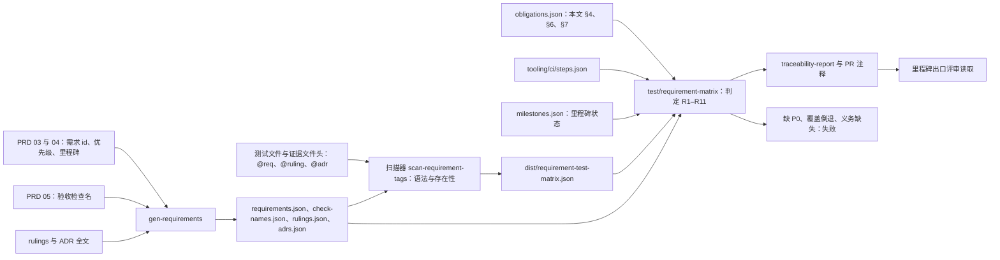
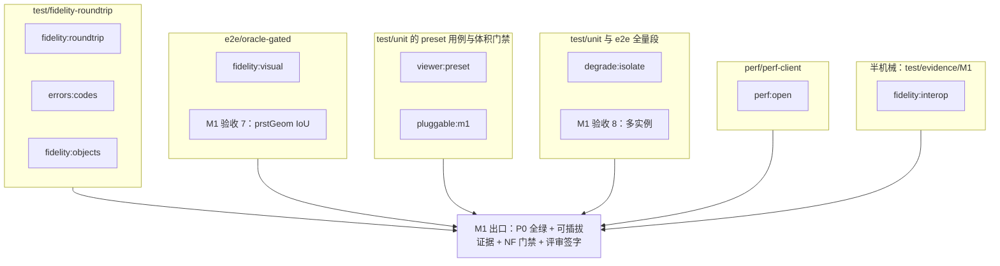
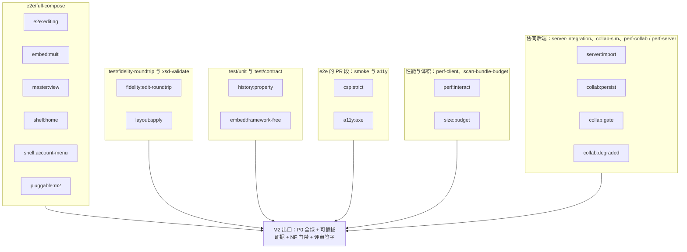
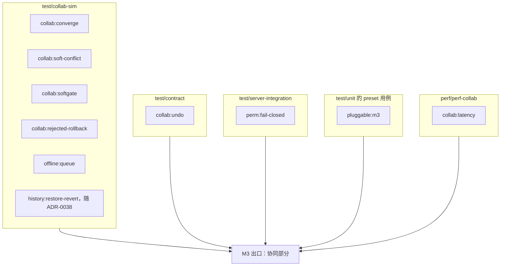
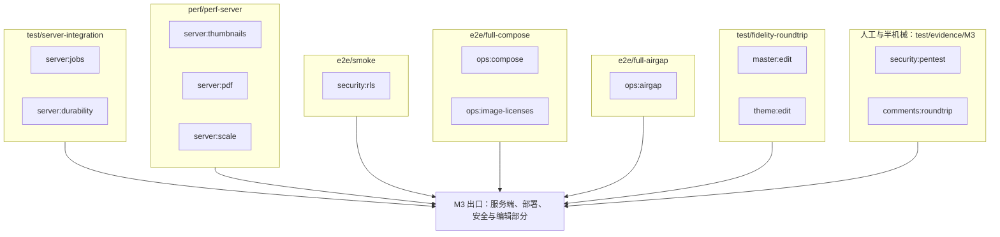
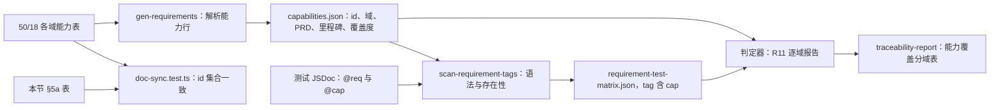
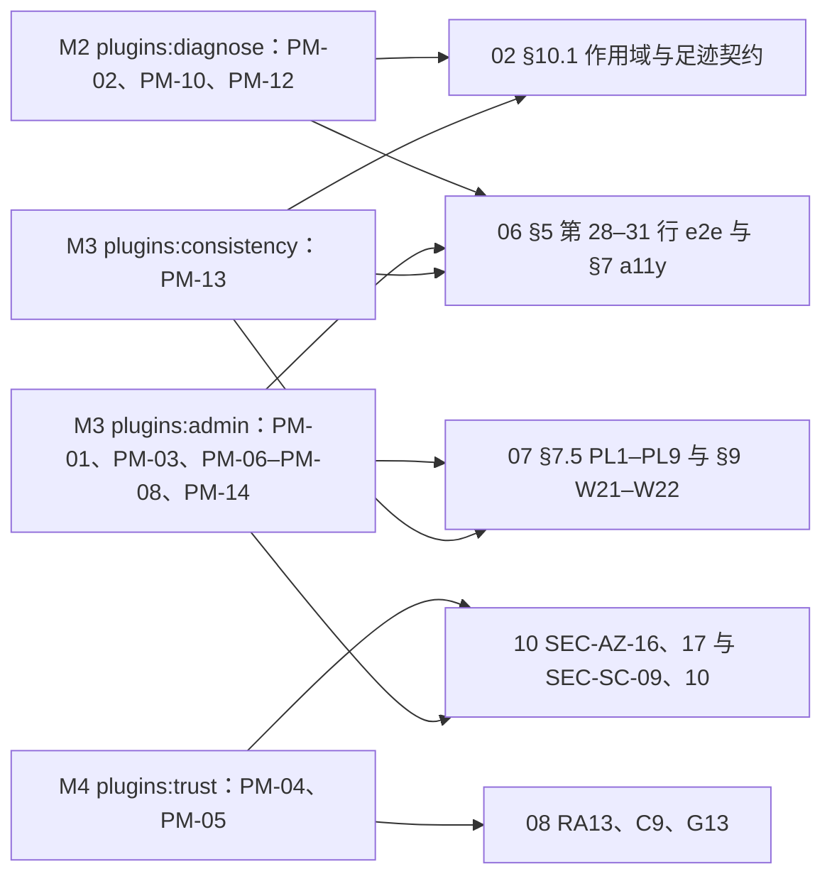
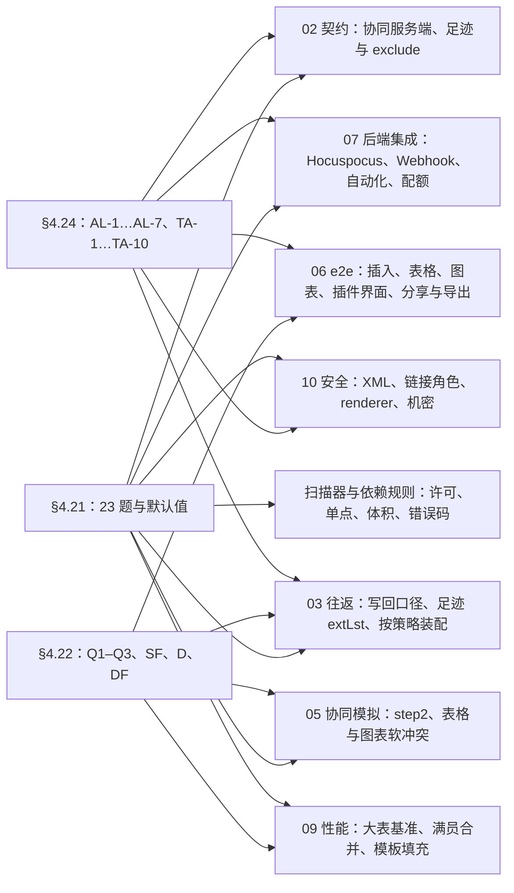

# 13 需求 → 测试可追溯矩阵

> 状态：v0.1 | 负责：测试设计线 | 更新：2026-09-25；2026-09-25（§4.19）；2026-09-25（§4.19 N1）；2026-09-26（§4.20）；2026-09-26（§4.21：新增能力 id 追溯——`@cap` 标签、`capabilities.json`、R11 与 §5a 能力 id → 测试用例表）；2026-09-26（§4.21 整合：§3.3 / §3.4 登记 PRD 05 M2 验收 18、M3 验收 19 为既有检查子集（ED-15a、ED-31–ED-35；图表编辑往返判定）；§6 CO-10 行改 step2 单设 16 MiB；§7 0023 行改 provider v3/v4 互连，新增 0039 行；关闭码测试名改 close-policy.test）；2026-09-26（§4.21 复核：能力数改 165，补 INS-20 行）；2026-10-01（§4.23 插件管理：`@req` 前缀加 `PM`、§1.1 登记 `4.23` 的 id 生成口径；§3 新增 `plugins:diagnose`（M2）、`plugins:admin` 与 `plugins:consistency`（M3）、`plugins:trust`（M4）；§5 加 PM 域；新增 §6.5 §4.23 裁决映射与 PM-01…PM-16 → 测试表；`@cap` 前缀加 `PLG`、§5a 加 PLG-01…PLG-07 行，计数改 26 域 172 项）；2026-10-03（§4.24 设计线对齐审计：§1.1、§2 登记 `4.21`、`4.22`、`4.24` 的 id 生成口径；§6 新增 §6.6 §4.21（23 题与有测试要求的默认值）、§6.7 §4.22（Q1–Q3、SF、D、DF 中有测试要求的条目）、§6.8 §4.24（AL-1…AL-7、TA-1…TA-10），图 13-9；§7 新增 ADR 0018、0019、0036、0049、0050 五行；§3 插件四个检查名与§5a TBL / CHT 行补本轮新增测试；§11 登记）；2026-10-04（rulings §4.25 TP-1：§9 加第 7 条文档侧覆盖与 R1–R11 的分工，§10 加 `scanners/process-req-coverage` 行）；2026-10-04（design-language-v3 第 0 批：§1.1 与 §2 加 `4.25` 的 id 生成口径；新增 §6.9 DS-1…DS-6 的测试落点与图 13-10；§4 NF-01 材质层行按 DS-2 改为平面规则；§5a UI-01–05 行 `ribbon-spec.test.ts` 改为 `toolbar-spec.test.ts`、VIEW 行补单页 / 网格视图用例；§6.7 Q1、Q2 两行的插入页签改为底部工具条；§11 登记）；2026-10-04（design-language-v3 第 0 批：术语残留清理：ribbon / 状态栏 / `ui.ribbon` / `ui.statusBar` 的历史陈述改用 check-terms 认可的标记措辞（废弃、作废、取代、原名））；2026-10-04（design-language-v3 第 0 批：复验修正——原「状态胶囊」改称文件名旁的同步状态行（rulings §4.25 DS-6），带作废标记的历史陈述统一措辞；VIEW-01–05 行的单测文件名对齐 40/10 §9（`editor-shell.test.tsx`））；2026-10-05（design-language-v3 第 0 批修正：§1.1「`4.25`」的条目集合按 rulings §4.25 现行裁决表扩为 `DS-1`…`DS-20`；§6.9 补 DS-9…DS-16、DS-18…DS-20 的被测要点与落点（DS-17 与 DS-7、DS-8 同为迁移安排，不列），图 13-10 同步；§5a TXT-10 按 DS-13 标「取消」并改追溯检查器文本分区与「无文字格式浮条」，与 TXT-09 拆成两行；§6.7 `4.22/D-06` 行改为与 06 §5 第 32 行一致（M2 单元格选区不出文本条））；2026-10-07（design-language-v3 第 1 批：按 rulings §4.25 DS-17、DS-21…DS-30、TB-1…TB-30 与 06 的第 1 批改写——§1.1「`4.25`」条目集合扩为 DS-1…DS-30 并加 TB-1…TB-30，「`4.22`」注明 SR-3、SR-4 已由 TB-10、DS-27 结案；§2 rulings 解析口径加 TB 表；§3.3 `e2e:editing`、`a11y:axe`、`master:view` 的断言摘要与落点（`master:view` 落点由 `apps/web/e2e/master/**` 改正为 06 第 6 行的 `editing/master-view.spec.ts`）；§4 NF-01 材质层、NF-05、NF-07 行补画布标记强调色、浮层层级、44 × 44、三种形态与 M3 手机评论（DS-28）；§5 ML 行落点；§5a ALN、INS-03/04、TXT-04–08、PIC、CHT-03/04、SLD、VIEW、FND、CLP、UND、CMT、KEY、UI 各行改指 06 §5 第 26、42–48 行的具体文件；§6.7 Q2、Q3、SF-09…SF-13、D-01 / D-06、D-10、D-11 / D-12 行按 TB-8、TB-10、TB-11、TB-22、DS-22、DS-26 改写；§6.9 补 DS-17、DS-21…DS-30 与 TB-1…TB-30 的落点，改写 DS-1、DS-15、DS-18…DS-20 行与图 13-10；§11 登记；需求编号、优先级与里程碑不变）；2026-10-08（design-language-v3 第 1 批收口：按 rulings §4.25 DS-31…DS-33、TB-31…TB-52 与 TB-1 的更正——§1.1「`4.25`」条目集合扩为 DS-1…DS-33、TB-1…TB-52；§3.3 `a11y:axe`（紧凑胶囊与抽屉、`/styleguide` 在测试环境 TB-50）、`master:view`（横幅两种说明同一计数 DS-32、进入原因 TB-44）、`layout:apply`（重置页确认对话框 DS-32）与 §3.4 `theme:edit`（5 套内置主题与 3 个变体 DS-32、DS-33）、M3 验收 19（插入图表后展开「数据」分区 TB-12）的摘要；§4 NF-05、NF-07 补 TB-35、TB-49；§5a INS-13（链接对话框，TB-6）、ARR、FMT（快速样式 DS-31、不透明度 TB-47）、TXT-04–08（TB-33）、INS-14 / INS-17（DS-32、TB-52）、ML（TB-34、TB-44、TB-45、TB-46、DS-32、DS-33）、SLD（幻灯片大小 DS-31）、VIEW（TB-41）、CLP（剪贴板管线）、CMT（TB-49）、UI（TB-51）、A11Y（TB-42）行补落点；§6.9 补 DS-31…DS-33 与 TB-31…TB-52 的落点（按主题合并，TB-36、TB-48 无独立测试要求不列），改写 TB-1、TB-3、TB-14…TB-16、TB-17 / TB-22、TB-24 / TB-25、DS-28、DS-29、DS-30 行与图 13-10；§11 登记，`gen-requirements.ts` 读 TB 表与新增 e2e 登记两项待回写已核对为已回写；需求编号、优先级与里程碑不变）；2026-10-08（design-language-v3 第 1 批评审修改：按 rulings §4.25 DS-34…DS-37、TB-55…TB-58——§1.1「`4.25`」与 §2 的条目集合扩到 `DS-37`、`TB-58`；§4 NF-05 行改为控件边界只对复选框、单选圈、插入表格网格、焦点环与自己头像外圈断言 ≥ 3:1，数字与文本输入、下拉、分段与按下态改断言非颜色线索（DS-35）；§5a FMT-04–11 行的样式库改为节内原位展开（DS-34）；§6.9 标题与引言、DS-9、DS-31、TB-35 行改写，新增 `4.25/DS-34`（并 TB-56）与 `4.25/DS-35`…`DS-37`（并 TB-55）两行，补登收口第二轮的 TB-53、TB-54（并入 DS-33、TB-32 两行），TB-57、TB-58 无独立测试要求不列，图 13-10 同步；§11 登记，40/10 §9 的两处测试注释核对为已由模块线同步；需求编号、优先级与里程碑不变）；2026-10-15（design-language-v3 第 2 批：按 rulings §4.25 DS-38…DS-63——§1.1 `4.25` 的条目集合扩为 `DS-63`；§6.9 新增 DS-38…DS-62 共 24 行（DS-54、DS-55 合一行），DS-63 无测试要求，DS-28 / TB-49、TB-31 两行注明随第 2 批确认或被取代，图 13-10 补 05、07、10 的落点；§3.3 `plugins:diagnose`、§3.4 `offline:queue` 摘要与落点；§5、§5a、§6.5 补第 2 批测试文件与落点；§11 登记；需求编号、优先级与里程碑不变）；2026-10-15（design-language-v3 第 2 批回写：按 rulings §4.25 DS-64…DS-68 与第 2 批回写的总编排口径 TB-59…TB-75——§1.1 `4.25` 的条目集合扩为 `DS-68` 并加入第二张总编排裁定表 `TB-59`…`TB-75`，§2 的解析口径同步；§6.9 新增 DS-64…DS-68 五行与 TB-59…TB-74 的落点（按主题合并为九行），TB-67、TB-75 没有本批测试要求、不列，DS-26、DS-38、TB-42 与 §6.7 `4.22/D-11` 四行按 TB-60、TB-67 注明，图 13-10 同步；§11 登记；需求编号、优先级与里程碑不变）；2026-10-15（design-language-v3 第 2 批回写：按 rulings §4.25 DS-69、DS-70 与 TB-76…TB-86——§1.1 `4.25` 的条目集合扩为 `DS-70`、第二张总编排裁定表到 `TB-86`，§2 同步；§6.9 新增 `4.25/DS-69`（并 TB-86）、`4.25/DS-70` 两行与 TB-76…TB-79、TB-84、TB-85 的落点（合并为三行），TB-80…TB-83 没有本批测试要求、不列，TB-65 行注明被 DS-69 修订，TB-59 / TB-60、DS-67、TB-71…TB-73 三行补落点，图 13-10 同步；§11 登记本轮，DS-64…DS-68 那一条的 40/01 待回写项核对为已回写；需求编号、优先级与里程碑不变）；2026-10-15（design-language-v3 第 2 批回写：按 rulings §4.25 TB-87…TB-95——§1.1 `4.25` 的第二张总编排裁定表到 `TB-95`，§2 同步；§6.9 新增 TB-87、TB-88、TB-92 合并的一行与 `4.25/TB-89`、`4.25/TB-90`、`4.25/TB-91`（并 TB-94）、`4.25/TB-95` 四行，TB-93 无本线断言变化、不列，图 13-10 同步；§11 登记本轮；需求编号、优先级与里程碑不变）；同日再补：§1.1「`4.25`」第二张总编排裁定表扩到 `TB-100`（§2 同步），§6.9 增 `4.25/TB-96` 与 `4.25/TB-97`（并 TB-99）两行，TB-98、TB-100 没有本线断言、不列，图 13-10 同步（rulings §4.25 TB-96…TB-100）；2026-10-22（design-language-v3 第 3 批（应用壳族）：按 rulings §4.25 DS-71…DS-136 与第 3 批的两张总编排裁定表 TB-101…TB-106、TB-107…TB-129——§1.1「`4.25`」的条目集合扩为 `DS-136` 并加入第三、第四张裁定表，§2 同步；§3.3 `a11y:axe`、`shell:home`、`shell:account-menu` 与 §3.4 `server:jobs` 的摘要与落点；§4 NF-05、NF-07、NF-11；§5 AS、EM、CO 行与 §5a VIEW、CMT-01、SHW、EXP、COL、KEY、UI、A11Y-01 行补第 3 批测试文件；§6.9 新增二十三行（DS-77、TB-126 不列），DS-10、DS-12、DS-18、DS-42、DS-46、DS-53、DS-58、DS-62、TB-39、TB-42、TB-85 十一行注明被第 3 批收紧或修订，图 13-10 同步；§11 登记；需求编号、优先级与里程碑不变）；2026-10-22（design-language-v3 第 3 批回写续：按 rulings §4.25 DS-137、DS-138 与第五张裁定表 TB-130…TB-151——§1.1「`4.25`」的条目集合扩为 `DS-138` 并加入第五张表，§2 同步；§3.3 `shell:home`、`shell:account-menu`、`master:view`；§4 NF-07、NF-11；§5a ML、SLD、VIEW、SHW、EXP、KEY 行；§6.9 新增 `4.25/DS-137`、`4.25/DS-138`、`4.25/TB-135`、`4.25/TB-151` 四行，其余并入第 3 批同主题的十行，`4.25/DS-42` 行补序号角标的断言，`4.25/TB-44` 行注明被 TB-136 细化，管理员插件页行补清单不返回 `declared`，图 13-10 补 08、09 两个落点；§6.8 `4.24/TA-10` 行注明被 DS-103 修订；§11 登记；需求编号、优先级与里程碑不变；同日再补：第五张裁定表扩到 TB-162——§1.1「`4.25`」与 §2 的条目集合同步；§3.3 `shell:home`、`shell:account-menu` 补平板提示行与触控形态的快捷键面板（TB-153、TB-154）；§5a EXP、KEY、UI 三行补 SVG 不分档、取消遇 409、`Mod+D` 两个作用域、手机底部面板与壳意图进命令面板；§6.9 把 TB-152…TB-162 并入同主题的九行（导出、文档列表与开始页、快捷键面板、DS-137、TB-151、导入、紧凑与平板、模板库、命令面板），TB-151 行的页级回退单测改指 slide-render `degrade.test.ts`；图 13-10 与 §11 同步；需求编号、优先级与里程碑不变；2026-10-22 复核修正：第五张裁定表扩到 TB-169、§1.1「`4.25`」扩到 DS-139（§2 同步）；§3.3 `master:view`、`shell:home`、`shell:account-menu`，§4 NF-07，§5a ML、EXP、KEY 行补 TB-163…TB-167；§6.9 标题与表前说明补 DS-139、TB-163…TB-169 的并入去处，导出、文档列表与开始页、快捷键面板、导入、紧凑与平板、模板库、`4.25/TB-151` 七行补断言，`4.25/TB-14` 一行注明 TB-163；图 13-10 与 §11 同步；§11 第 3 批那条的「待回写」核对为已回写；复核期间 rulings 追加的 TB-170…TB-174 并入 §6.9 同主题的四行（文档列表与开始页、紧凑与平板、导出、`4.25/TB-151`），§1.1、§2、§3.3 `shell:home`、§5a EXP、`4.25/DS-60` 行、图 13-10 与「怎么读」同步，图 13-10 的排除表补上本来就不列的 TB-98、TB-100；登录、会话与错误页一行补登录页说明句的两种写法（`idpDisplayName` 缺省为空）；§11 第 2 批与 §4.23、§4.24 三条的「待回写」核对为已回写，第 3 批三条的标签与核对日期去掉轮次与「复核」字样；状态头的回写轮次字样改为「回写续 / 同日再补」；rulings 第五张表再追加到 TB-175，§1.1、§2、§6.9 标题与表前说明、图 13-10 与依据同步，TB-175 并入导出一行；TB-171 扩到的列表形态、搜索与排序并入文档列表与开始页一行与 §3.3 `shell:home`，TB-172、TB-173 的补句并入紧凑与平板、导出两行，`4.25/DS-60` 行的需求摘要按 TB-172 改写，§5a EXP 行补单页超时的原因句，`4.25/TB-151` 行补 R8 合成时抛错的一半所在的单测与诊断接口的单测；rulings 第五张表再追加到 TB-178，§1.1、§2、§6.9 标题与表前说明、图 13-10、「怎么读」与依据同步，TB-176 并入导出一行与 §5a EXP（其余失败显示通用文案），TB-177、TB-178 并入 `4.25/TB-151` 一行（诊断包归 SDK、只在测试部署挂出的页面全局，自动化作业的页级失败与 renderer 诊断映射的纯函数单测），TB-172 的补句（一行放得下时 55、应用壳页面同此）并入紧凑与平板一行）；2026-10-23（design-language-v3 第 3 批评审修改：按 rulings §4.25 DS-140…DS-143、TB-179…TB-183——§1.1「`4.25`」与 §2 的条目集合扩为 `DS-143` 与 `TB-183`；§3.3 `a11y:axe`、`shell:home`、`server:import` 按导入对话框改写；§4 NF-07 改引 TB-181；§5a EXP 行补格式图标；§6.9 标题与表前说明补本次的并入去处，导入一行改写（DS-97、DS-98 被 DS-140 取代、不再列），导出一行并入 DS-143、TB-182，新增 `4.25/DS-142` 一行；图 13-10、「怎么读」、依据与 §11 同步；需求编号、优先级与里程碑不变；§6.9 `4.25/DS-142` 与导入一行的落点补 design `contrast.test.ts`（40/10 §9）、CI 步骤补 `test/unit`；§11 的模块线回写注明已回写）；2026-11-04（design-language-v3 母版视图改版：按 rulings §4.25 DS-144…DS-177 与第六张裁定表 TB-186…TB-210，并补计第五张表的 TB-184、TB-185——§1.1「`4.25`」与 §2 的条目集合扩为 `DS-177`、第五张表到 `TB-185`、加入第六张表；§3.3 `master:view` 的摘要与落点；§4 NF-05；§5 ML 行与 §5a ML 两行；§6.9 标题与表前说明补本次的并入去处与不列的理由，新增按主题合并的十一行，`4.25/DS-15`、`4.25/DS-17` 与 `4.25/DS-21`、`4.25/DS-53`、`4.25/TB-135`、`4.25/DS-142` 与导入几行注明修订或并入；图 13-10、「怎么读」、依据与 §11 同步；同日再补：§3.3 `master:view` 首次出现的「上下文条」带提示「母版视图的模式横幅」（TB-208），`master:view` 的入口规则补「放映中不响应」（与 PRD 05 M2 验收 9 同步）；§5a「ML-01–03、ML-09」一行与 §6.9 `4.25/DS-148` 一行的单测落点补 `inspector-sections.test.tsx`、`master-annotation-plan.test.ts`，§6.9 `4.25/TB-195`、`4.25/TB-199` 一行的落点补 06 §2.2「母版视图」「快捷键作用域」两行；再补：§3.3 `master:view` 的入口分类同设计 03-26 §1.1（主菜单「视图」、`Mod+Alt+M` 与命令面板三者，普通视图检查器另有「编辑版式」「转到版式」两个上下文入口，其中「编辑版式」是普通视图里唯一常驻的进入入口）；§6.9 `4.25/DS-148` 一行补标注层对读屏隐藏、启用入参与退出时停用，落点补 06 §2.2「母版视图」行与 slide-ui `master-view.test.ts`；§6.9 `4.25/DS-145` 一行补加载中时不画对象段（同设计 03-26 §6.3）；需求编号、优先级与里程碑不变） | 依赖：rulings §4.25 DS-144…DS-177、TB-184…TB-210、rulings §4.25 DS-140…DS-143、TB-179…TB-183、rulings §4.25 TB-170…TB-178、rulings §4.25 DS-139、TB-163…TB-169、rulings §4.25 TB-152…TB-162、rulings §4.25 DS-137、DS-138、TB-130…TB-151、rulings §4.25 DS-71…DS-136、TB-101…TB-129、rulings §4.25 DS-38…DS-70、TB-59…TB-95、rulings §4.25 DS-1…DS-37、TB-1…TB-58、[50/18](../50-frontend/18-editor-capabilities.md) §1.3、§2–§26（rulings §4.21）、rulings §4.20（含来源所指 `_evidence/leftovers-plan-2026-09-26.json` 的 `plan.mechanical`、`plan.deferred`）、rulings §4.19（含末句所指 `_evidence/design-tracks-plan-2026-09-25.json` 的 `leftoverDecisions`）、[30/11 §17](../30-architecture/11-testing-strategy.md)、[09-06 §12](../30-architecture/09-type-discipline/06-scanners.md)、[09-07 §2.1](../30-architecture/09-type-discipline/07-hooks-and-ci.md)、[PRD 04](../10-prd/04-non-functional-requirements.md) NF-09、[PRD 05](../10-prd/05-milestones-and-scope.md) §0.2 / M0 验收 3 / M0–M5 验收与可插拔证据 / §6、[PRD README](../10-prd/README.md) §1.3、[PRD 03/03](../10-prd/03-features/03-collaboration.md) CO-01–CO-15、30-architecture/adr 各 ADR「如何被机械验证」、rulings §4.15 / §4.17 / §4.18、[40/14 §5](../40-modules/14-cross-module-review.md)

本文是需求追溯的唯一事实源：测试上的三类追溯标签怎么写、需求与检查名清单从哪里生成、矩阵怎么产出和判定、PRD 检查名目录、NFR / 裁决 / ADR 到测试的映射、人工与半机械项、维护流程。标签的格式与存在性检查、矩阵产出由扫描器 `scan-requirement-tags`（09-06 §12）执行；完整性判定在 `test/requirement-matrix` 步骤（[12](./12-ci-gates-mapping.md)）；扫描器本身不判定完整性（09-06 §12 的职责边界）。

**本文拥有 / 引用**

| 本文拥有 | 引用（以对方为准） |
|---|---|
| 标签语法与位置；`requirements.json`、`capabilities.json` 等清单的生成口径；判定规则 R1–R11；能力 id → 测试用例的追溯表（§5a）；PRD 检查名 → 测试 → 步骤 → 形态的目录；NFR、裁决、ADR 的映射与义务清单；人工项的统计口径；维护流程 | 需求本身：PRD；能力 id、所属域与里程碑：[50/18](../50-frontend/18-editor-capabilities.md)；验收阈值与检查名定义：PRD 05；扫描器规格：09-06 §12；CI 步骤名与激活：[12](./12-ci-gates-mapping.md)；证据文件头格式：[01 §8](./01-strategy-and-layers.md)；安全用例目录：[10](./10-security-testing.md) |

---

## 1. 机制

依据：决策 T-REQ（needsUser=false；authority：PRD NF-09 + 09-06 §12「扫描器不判定完整性」+ rulings §4.18 条目编号与 PRD 同形）。

### 1.1 三类标签

| 标签 | 语法（正则） | 例 | 指向 | 存在性校验来源 |
|---|---|---|---|---|
| `@req` | `PRD:(OF\|ED\|CO\|PS\|EM\|SV\|ML\|AS\|PM\|NF)-\d{2}` | `@req PRD:SV-05` | PRD 需求 id（PRD 03 九个功能域（2026-10-01 加 PM，rulings §4.23） + PRD 04 的 NF；PRD 06 的 MT 指标不是需求，不作标签） | `tooling/policy/requirements.json` |
| `@ruling` | `4\.\d{1,2}/[A-Z][A-Z0-9]*(-[0-9A-Za-z]+)*` | `@ruling 4.18/CO-08`、`@ruling 4.15/Q3`、`@ruling 4.17/D4`、`@ruling 4.19/SESSION` | rulings 各节的条目 id（表格第一列；§4.18 另含「规格空白默认值」列表与「机械修正」清单的 id，§2）；组合 id（如 `INC-03/04/05`、`C-20/G-13/G-14`）拆成单个 id 各写一次 | `tooling/policy/rulings.json` |
| `@adr` | `\d{4}/\d{1,2}` | `@adr 0029/3`、`@adr 0025/8` | ADR「决策」节的条目序号（决策只有一段时记为 1） | `tooling/policy/adrs.json` |
| `@cap`（2026-09-26 追加） | `(SEL\|ALN\|ARR\|INS\|TXT\|FMT\|PIC\|MED\|TBL\|CHT\|ML\|SLD\|VIEW\|FND\|CLP\|UND\|CMT\|SHW\|EXP\|COL\|OFF\|KEY\|UI\|A11Y\|I18N\|DOC\|PLG)-\d{2}` | `@cap SEL-10`、`@cap INS-13`、`@cap PLG-02` | 编辑器能力 id（[50/18](../50-frontend/18-editor-capabilities.md) 各域能力表首列，26 域 172 项；2026-10-01 加插件管理域 `PLG`，§26a） | `tooling/policy/capabilities.json` |

- **为什么要前缀**：rulings §4.18 的条目编号（`CO-08`、`BE-02`、`UX-03`…）与 PRD 需求编号同形，`CO-08` 单独出现时无法判断指 PRD「冲突语义」还是裁决「故障期广播」。`PRD:` 与 `<节>/` 前缀使两者不会混淆。
- **`4.19`**：§4.19 的条目集合 = 该节表格第一列的 5 项用户裁决（D-M2-CONTENT、INC-09、C-06、D-COMMENTS-PKG、D-TEST-INFRA）+ 表末单独一行的补完阶段用户裁决 `N1-IMPORT-OVERWRITE-RESTORE-LOCK`（2026-09-25 追加）+ 按 §4.19 末句读取 `00-charter/_evidence/design-tracks-plan-2026-09-25.json` 的 `leftoverDecisions[].id`（共 81 条，含上述 5 项，其余 76 项为 INC-*、SESSION、C-*、T-* 等；组合 id 拆开，省略前缀的段继承前一段前缀，如 `INC-03/04/05` → `INC-03`、`INC-04`、`INC-05`，`C-20/G-13/G-14` → `C-20`、`G-13`、`G-14`）。两部分取并集，都由生成脚本写入 `rulings.json`（§2），`@ruling 4.19/<id>` 与其它节一样做存在性检查：`@ruling 4.19/SESSION`、`@ruling 4.19/T-CI` 等标签只有在读取 evidence 后才能通过，不另设「只查格式」的过渡口径。
- **`4.20`**（2026-09-26 追加）：§4.20 的条目集合 = 该节表格第一列 15 项（3 项用户决策 + 12 项默认值）+ 按 §4.20 来源所指读取 `00-charter/_evidence/leftovers-plan-2026-09-26.json` 的 `plan.mechanical[].id`（25 条）与 `plan.deferred[].id`（5 条）。组合 id 按 `+` 拆开（`BE-01+TX-03` → `BE-01`、`TX-03`）；`·` 之后的后缀先去掉再拆（`BE-07+TX-05·登记` → `BE-07`、`TX-05`，`FE-09·正文` → `FE-09`）；拆出的重复 id 合并。例：`@ruling 4.20/BE-01`、`@ruling 4.20/TX-22`、`@ruling 4.20/FE-04`。
- **`4.23`**（2026-10-01 追加）：§4.23 的条目集合 = 裁决表的三题（第一列为纯数字，生成脚本记为 `Q1`、`Q2`、`Q3`）+ 开放问题表 `O-1`…`O-4`（2026-10-01 用户确认按推荐）。§4.23「本节新增编号」中的 PM-01…PM-16 是 PRD 需求 id，走 `@req PRD:PM-xx`，G-84…G-87 是设计缺口、无测试要求，均不进 `rulings.json`。例：`@ruling 4.23/Q3`、`@ruling 4.23/O-1`。
- **`4.21`**（2026-10-03 追加，rulings §4.24 要求补登）：§4.21 的条目集合 = 裁决表第一列 23 项 + 「默认值」各簇列出的 `R-d-01`…`R-d-78`、`H-d-01`…`H-d-32`。裁决表的 id 是小写并可带证据前缀，不满足 `@ruling` 正则，生成脚本按固定规则改写：冒号换连字符、整体转大写（`q-table-depth` → `Q-TABLE-DEPTH`，`H:q-hp-step2-cap` → `H-Q-HP-STEP2-CAP`，`X:q-xml-lexer` → `X-Q-XML-LEXER`）；R 与 X 都有 `q-xml-lexer`，分别为 `Q-XML-LEXER` 与 `X-Q-XML-LEXER`，两行口径一致，标签写哪一个都可。默认值 id 原样保留（`R-d-65`、`H-d-08` 本身满足正则）；「`R-d-61、R-d-62`」「`H-d-01…H-d-03`」这类并列与区间写法拆成单个 id（区间按序号展开）。例：`@ruling 4.21/Q-TABLE-DEPTH`、`@ruling 4.21/H-Q-HP-PERSIST-ACK`、`@ruling 4.21/R-d-65`。
- **`4.22`**（2026-10-03 追加）：§4.22 的条目集合 = 裁决表三题（`Q1-insert-placement`、`Q2-placeholder-table-icon`、`Q3-table-row-limit`，原样，满足正则）+ 「默认值」与「推迟项」中的 `SF-01`…`SF-14`、`D-01`…`D-25`、`DF-01`…`DF-10`；「`D-04、D-05`」「`SF-10…SF-12`」「`D-19、D-20`」等并列与区间写法拆开。§4.22 的 `D-xx` 与 §4.17 的 `D1`…`D5` 靠节号前缀区分（`4.22/D-03` 与 `4.17/D3` 不同形）。「待用户确认的样张取舍」`SR-1`…`SR-5` 不是裁决条目、不进 `rulings.json`；其中 SR-3、SR-4 已于 2026-10-07 由 §4.25 TB-10、DS-27 结案，相关测试的标签写 `@ruling 4.25/TB-10`、`@ruling 4.25/DS-27`。例：`@ruling 4.22/Q1-insert-placement`、`@ruling 4.22/D-13`、`@ruling 4.22/DF-10`。
- **`4.24`**（2026-10-03 追加）：§4.24 的条目集合 = 用户裁决表 `AL-1`…`AL-7` + 总编排裁定表 `TA-1`…`TA-10`，原样（满足正则）；「需要下游落地的清单」按线分行、无 id，不进 `rulings.json`。例：`@ruling 4.24/AL-3`、`@ruling 4.24/TA-9`。
- **`4.25`**（2026-10-04 追加；2026-10-05 随 §4.25 增 DS-9…DS-20 扩为 `DS-20`；2026-10-07 第 1 批回写时扩为 `DS-30` 并加 `TB`；2026-10-08 第 1 批收口时扩为 `DS-33`、`TB-52`，同日第 1 批评审修改时扩为 `DS-37`、`TB-58`，含收口第二轮补的 `TB-53`、`TB-54`；2026-10-15 第 2 批回写时扩为 `DS-63`，同日再扩为 `DS-68` 并加入第二张裁定表 `TB-59`…`TB-75`，又扩为 `DS-70`、第二张表到 `TB-86`，第二张表再到 `TB-95`，又到 `TB-100`；2026-10-22 第 3 批回写时扩为 `DS-136`，并加入第三、第四张裁定表 `TB-101`…`TB-106`、`TB-107`…`TB-129`，同日再扩为 `DS-138` 并加入第五张裁定表 `TB-130`…`TB-151`，第五张表随后扩到 `TB-162`，复核时再扩为 `DS-139` 与 `TB-169`，复核期间第五张表又先后追加到 `TB-175`、`TB-178`；2026-10-23 第 3 批评审修改再扩为 `DS-143`，第五张表追加到 `TB-183`；2026-11-04 母版视图改版再扩为 `DS-177`，第五张表补计到 `TB-185`（TB-184、TB-185 于 2026-10-23 追加，本次一并计入），并加入第六张表 `TB-186`…`TB-210`）：§4.25 的条目集合 = 裁决表 `DP-1`…`DP-8`、`DS-1`…`DS-177` + 总编排提议表 `TP-1`…`TP-5` + 「总编排裁定的技术口径（design-language-v3 第 1 批回写，2026-10-07）」表 `TB-1`…`TB-58` + 「总编排裁定的技术口径（design-language-v3 第 2 批回写，2026-10-15）」表 `TB-59`…`TB-100` + 「总编排裁定的技术口径（design-language-v3 第 3 批样张，2026-10-16）」表 `TB-101`…`TB-106` + 「总编排裁定的技术口径（design-language-v3 第 3 批样张复验，2026-10-21）」表 `TB-107`…`TB-129` + 「总编排裁定的技术口径（design-language-v3 第 3 批回写，2026-10-22）」表 `TB-130`…`TB-185` + 「总编排裁定的技术口径（design-language-v3 母版视图改版，2026-11-04）」表 `TB-186`…`TB-210`，原样（满足正则；六张 TB 表编号连续、不重号）；「被修订的既有口径」表无 id，不进 `rulings.json`。例：`@ruling 4.25/DS-4`、`@ruling 4.25/DS-15`、`@ruling 4.25/TB-28`、`@ruling 4.25/TB-44`、`@ruling 4.25/TP-1`。
- **`@cap`**（2026-09-26 追加，rulings §4.21）：能力 id 比 PRD 需求 id 细一级（例如 PRD ED-05 下分出 SEL-10 调整手柄、SEL-11 翻转、INS-03 形状库），用来回答「编辑器的每一项能力有没有测试」。它不替代 `@req`：同一个测试通常同时带 `@req PRD:ED-05` 与 `@cap SEL-11`，P0 / P1 的门禁仍由 `@req` 经 R1、R5 执行，`@cap` 只进 R11 报告。能力 id 前缀没有冒号前缀，因为它们与 PRD（`PRD:`）和裁决（`4.xx/`）的编号都不同形。
- **旧写法作废**：30/11 §17 的文件顶部 `// @req CO-08` 与 09-06 §12 规则 (a) 的正则 `^[A-Z]{2,3}-\d{2,3}$` 按本节改写（回写见 §11）；旧写法由规则 (a) 报错并提示新写法。

### 1.2 写在哪里

- 写在 `describe` / `it` / `test` 正上方的 JSDoc 里；一个 JSDoc 可以有多个标签，同一标签后可跟多个以空格分隔的 id。`describe` 上的标签作用于其内全部用例。
- **文件级**：文件中第一个 JSDoc 块（位于任何 `import` 之前）视为文件级，作用于该文件全部用例。Vitest、Playwright、`*.int-spec.ts`、`*.e2e-spec.ts`、`*.type-test.ts` 同一写法。
- **人工证据**：`test/evidence/<里程碑>/<检查名>.md` 的文件头（YAML）用同名字段 `req`、`ruling`、`adr` 列出 id，语法同上；`check` 字段写 PRD 检查名（字段全集见 [01 §8](./01-strategy-and-layers.md)）。

```ts
/**
 * @req PRD:SV-05 PRD:NF-03
 * @ruling 4.18/CO-08
 * @ruling 4.19/INC-09
 */
describe('PG 断开期间照常广播', () => {
  /** @adr 0025/1 */
  it('两客户端互见编辑，PG 恢复后 seq 连续', async () => { /* … */ })

  /** @adr 0025/8 */
  it('溢写期只回 tier spill 的 ack，客户端 pending 不清', async () => { /* … */ })
})
```

### 1.3 产出与判定

- **扫描器 `scan-requirement-tags`**（`scanners` job 与 pre-commit，09-07 §2.1）：规则 (a) 语法；(b) id 存在于对应清单；(c) 产出 `dist/requirement-test-matrix.json`，条目扩展为 `{ tag: 'req' | 'ruling' | 'adr' | 'cap', id, tests: [{ file, title, line, scope: 'file' | 'describe' | 'test' }] }[]`（回写 09-06 §12，§11）。
- **判定器 `test/traceability/judge.ts`**（`test/requirement-matrix` 步骤）：读矩阵、`requirements.json`、`check-names.json`、`obligations.json`（本文 §4、§6、§7 的机器副本）、`tooling/ci/steps.json`、`tooling/policy/milestones.json`、证据文件头、`test/security/*.json`，产出 `dist/traceability-report.{json,html}` 与一条 PR 注释。
- **里程碑状态**：`milestones.json` 为每个里程碑记录 `status ∈ {planned, active, exit-review, done}`（在既有「完成日期」字段之外新增，回写见 §11）。

| 规则 | 内容 | 失败还是报告 |
|---|---|---|
| R1 | P0 需求：所属里程碑为 `exit-review` 或 `done` 时，至少一个带 `@req PRD:<id>` 的测试被某个已激活步骤（`mode ≠ off`）收集；清单中标为人工的需求改为要求 `result: pass` 的证据文件 | 失败 |
| R2 | 同上，但所属里程碑为 `active`：列出缺口 | 报告 |
| R3 | 覆盖只增不减：main 上已有覆盖的 id（任一标签），PR 后失去全部覆盖即失败；需求已从 PRD 删除（不在新 `requirements.json` 中）除外 | 失败 |
| R4 | PRD 检查名：`exit-review` / `done` 里程碑的每个检查名在 `check-names.json` 中映射到的步骤都已激活、测试文件模式非空、人工项有证据 | 失败（`active` 时报告） |
| R5 | `e2e:editing`：M2 进入 `exit-review` 起，每条 P0 / P1 的 ED 需求至少一个标签位于 `apps/web/e2e/**` | 失败 |
| R6 | 义务：`obligations.json` 中里程碑已到 `exit-review` / `done` 的裁决与 ADR 义务都有对应 `@ruling` / `@adr` 标签 | 失败（`active` 时报告） |
| R7 | 本 PR 新增、却没有任何追溯标签的测试文件 | 报告（PR 注释提示） |
| R8 | 安全用例目录与 ASVS 映射完整（[10 §16](./10-security-testing.md)） | 失败 |
| R9 | 证据文件头字段齐全、`result` 取值合法 | 失败 |
| R10 | `gen-requirements --check`：PRD、rulings 或 50/18 改动后未重新生成清单 | 失败 |
| R11 | 能力 id（2026-09-26 追加）：`capabilities.json` 中主里程碑为 `exit-review` / `done`、本轮后覆盖度为「已写清」或「补齐」的能力，没有任何带 `@cap` 的测试被已激活步骤收集；逐域列出缺口（§5a） | 报告 |

**图 13-1 追溯矩阵的生成与门禁**



怎么读：左侧三类输入分别生成清单与矩阵；清单同时喂给扫描器（做存在性检查）与判定器；判定器结合步骤激活表与里程碑状态得出「失败」或「报告」，报告供出口评审使用。

依据：决策 T-REQ；09-06 §12；PRD 04 NF-09；PRD 05 §6（范围变更须更新矩阵）。

**图 13-2 追溯数据模型**


怎么读：实体是判定器读入的七类数据加人工证据；连线上的文字是关系来源。测试文件与需求、裁决条目、ADR 是多对多（经标签）；每个测试文件恰被一个 CI 步骤收集（[12 §2](./12-ci-gates-mapping.md) 的收集范围两两不相交）。

依据：本节 §1.1–§1.3；[12 §2](./12-ci-gates-mapping.md)。

---

## 2. 清单从哪里来

依据：决策 T-REQ（requirements.json 由 tooling 脚本从 PRD 03 / 04 生成，与 M0 验收 3 同一脚本）。

- **生成脚本** `tooling/scripts/gen-requirements.ts`（工具脚本，不计入 14 个扫描器）。生成物入库、文件头标 `generated`；`--check` 模式重新生成并与入库文件比对，有 diff 即失败（R10，与 `scan-manifest --check` 同一模式）。
- **输入与解析口径**：

| 来源 | 解析 | 生成物 |
|---|---|---|
| `10-prd/03-features/*.md` | `### <ID> <标题>` 及其后的「- 优先级：Px \| 目标里程碑：My …」行；多里程碑写法（如「M3（会话内队列）/ M4（…）」）取第一个为主里程碑，全部记入 `milestones[]`；有无「验收标准」段记为 `acceptance` | `tooling/policy/requirements.json` 的 `requirements[]`：`{ id, domain, title, priority, milestone, milestones[], acceptance, source }` |
| `10-prd/04-non-functional-requirements.md` | `## NF-xx` 标题；优先级记为 `NF`，里程碑取该节各表「里程碑」列的并集 | 同上（`priority: 'NF'`，完整性按 §4 的义务判定，不走 R1） |
| `10-prd/05-milestones-and-scope.md` | 各里程碑「验收标准」编号条目**开头**（首个冒号之前）以反引号包裹的 `域:名`，可多个以 `+` 相连（如 M3 验收 10 的三项）；条目正文中其它反引号内容（如 `dsp:drawing`、`doc-type:new`）不算；无名条目记为 `<里程碑>#<序号>`（如 `M1#7`）；「可插拔证据」段「CI 检查」后的 `pluggable:mN`；「发布前检查」等非验收列表不解析 | 同一文件的 `checks[]`：`{ id, milestone, text }` |
| `00-charter/rulings-2026-09-14.md` | 各节表格第一列的条目 id 与所在节号；§4.18「规格空白默认值」各列表项开头加粗的 id（如 **CO-10**）；§4.18「机械修正」按正文所指读取 `00-charter/_evidence/contradiction-plan-2026-09-25.json` 的 `plan.mechanical[].id`（如 `UX-13`、`CO-11`）；§4.19 表格第一列 5 项与表末 `N1-IMPORT-OVERWRITE-RESTORE-LOCK` 行，另按 §4.19 末句读取 `00-charter/_evidence/design-tracks-plan-2026-09-25.json` 的 `leftoverDecisions[].id`（与 §4.18 机械修正读取 evidence 同一先例）；§4.20 表格第一列 15 项，另读取 `00-charter/_evidence/leftovers-plan-2026-09-26.json` 的 `plan.mechanical[].id` 与 `plan.deferred[].id`（拆法见 §1.1）；§4.21 裁决表 23 项（按 §1.1 改写为大写连字符形）与默认值各簇行首加粗的 `R-d-*`、`H-d-*`；§4.22 裁决表三题与默认值、推迟项各条行首加粗的 `SF-*`、`D-*`、`DF-*`；§4.23 见 §1.1；§4.24 两张表第一列（2026-10-03 追加）；§4.25 裁决表与总编排提议表的第一列（2026-10-04 追加），以及各张「总编排裁定的技术口径」表的第一列（`TB-*`：第 1 批回写表 2026-10-07 追加，2026-10-08 起到 `TB-52`，同日第 1 批评审修改后到 `TB-58`；第 2 批回写表 2026-10-15 追加，`TB-59`…`TB-75`，同日先后扩到 `TB-86`、`TB-95`、`TB-100`；第 3 批样张表 `TB-101`…`TB-106` 与第 3 批样张复验表 `TB-107`…`TB-129` 于 2026-10-22 追加，同日再追加第 3 批回写表 `TB-130`…`TB-151`、随后先后扩到 `TB-169`、`TB-174`、`TB-175`、`TB-178`，2026-10-23 第 3 批评审修改再扩到 `TB-183`、其后补计同日追加的 `TB-184`、`TB-185`；母版视图改版表 `TB-186`…`TB-210` 于 2026-11-04 追加；六张表的标题都按「总编排裁定的技术口径（」前缀匹配，读法不变）；组合 id 一律拆开 | `tooling/policy/rulings.json` |
| `30-architecture/adr/*.md` | 「决策」节的编号条目与 ADR 状态 | `tooling/policy/adrs.json` |
| `50-frontend/18-editor-capabilities.md`（2026-09-26 追加） | 各域能力表中首列匹配 `@cap` 语法的行：id、所在节、「出处」列里的 PRD id、「里程碑」列的主里程碑（取最先出现的 `Mn`）、「覆盖度」列箭头后的值 | `tooling/policy/capabilities.json`：`{ id, domain, section, prd[], milestone, coverage }[]` |

- **M0 验收 3「字段齐全」**：同一脚本对每条 P0 需求检查 id 唯一、优先级、目标里程碑、验收标准四项齐全，缺一即列出并失败。
- **人工维护、生成脚本不碰的两份映射**：`test/traceability/check-names.json`（§3 的机器副本：检查名 → 测试文件模式、步骤、形态）与 `test/traceability/obligations.json`（§4、§6、§7 的机器副本：NF / 裁决 / ADR 义务 → 里程碑、步骤、文件模式）。判定器断言 `check-names.json` 的键集合 = 生成的 `checks[]`（多一个或少一个都失败）。
- 需求清单的消费者：扫描器 `scan-requirement-tags` 规则 (b) 读 `requirements.json` 做存在性检查（09-06 §12 的「若清单存在」前提自 M0 起成立）。

---

## 3. PRD 检查名目录

每行给出检查名、断言摘要、测试落点、CI 步骤与形态；阈值原文以 PRD 05 为准，本表只写能定位用例的摘要。「形态」：机械 = 全自动判定；半机械 = 自动执行 + 人工复核失败项；人工 = 证据归档（§8）。按步骤反查的索引见 [12 §6](./12-ci-gates-mapping.md)。

### 3.1 M0

| 检查 | 断言摘要 | 落点 | 步骤 | 形态 |
|---|---|---|---|---|
| `M0#1` | 三条线 README 的待决事项都有决策人、对章程的异议都有裁决记录 | `test/evidence/M0/docs-review.md` | — | 人工 |
| `M0#2` | 术语表登记的旧名在正文中残留 0 处（PRD 05 验收 2 按 rulings §4.20 TX-02 改写）：`docs/_tools/terms.json` 登记已裁定更名的内部标识符（首批 `FakeClock` / `FakeServerClock` → `FixedClock`、`FixedMetricsMeasurer` → `FixedWidthMeasurer`、`*.test-d.ts` → `*.type-test.ts`、`render/error` → `render/element-failed`、`collab/permission-changed` → `permission/changed`、`ui.statusbar` → `ui.statusBar`、`@oce` / `oce-` → `@cordexjs` / `cordex`），跳过 rulings、`_evidence/` 与 `adr/`，放行状态头行、同行含正名或更名标注的行与各条的 `allowIn` 文件 | `docs/_tools/check-terms.py`（只用标准库、只读，有残留退出码 1；改文档后与评审时运行） | 文档工具，不属 13 个 job | 机械 |
| `M0#3` | 每条 P0 需求字段齐全 | `gen-requirements --check` | `test/requirement-matrix` | 机械 |
| `M0#4` | 规范 ↔ 执行矩阵 CI 校验通过；各门禁在空骨架上跑通且负向夹具失败 | `scan-policy`；13 个 job | `policy-check` 与全部 job | 机械 |
| `M0#5` | ADR-0001 声明合并 spike 有结论 | `test/evidence/M0/adr-0001-spike.md` | — | 人工 |

### 3.2 M1

| 检查 | 断言摘要 | 落点 | 步骤 | 形态 |
|---|---|---|---|---|
| `fidelity:roundtrip` | T1 + T2 零编辑往返部件级零差异 | `test/roundtrip/**`（[03 §4](./03-fidelity-roundtrip-and-corpus.md)） | `test/fidelity-roundtrip`（nightly 全量为出口证据） | 机械 |
| `fidelity:visual` | SSIM 中位数与 P10、各矩阵行阈值、文本行数一致率 | `test/oracle/**`（[04 §6](./04-visual-oracle.md)） | `e2e/oracle-gated` | 机械 |
| `fidelity:interop` | PowerPoint 365 Windows 打开无修复（macOS 基线与 Mac 抽检自 M2 起，rulings §4.19 D-TEST-INFRA） | 维护机脚本 + 人工复核（[03 §12](./03-fidelity-roundtrip-and-corpus.md)） | — | 半机械 |
| `perf:open` | D50 / D200 首页可见、内存稳态、20 次开关无泄漏 | `test/perf/scenarios/open-*`（[09 §3](./09-performance-and-capacity.md)） | `perf/perf-client` | 机械 |
| `errors:codes` | `.ppt`、加密、损坏、超限各类样本返回正确错误码 | `test/roundtrip/error-corpus.test.ts`（[03 §8](./03-fidelity-roundtrip-and-corpus.md)） | `test/fidelity-roundtrip` | 机械 |
| `degrade:isolate` | 注入抛错的 `ElementRenderer`，同页其它元素渲染、`render/element-failed` 触发 | engine-render `error-isolation.test.ts` | `test/unit` | 机械 |
| `M1#7` | 187 种 `prstGeom` IoU ≥ 0.95 | `test/oracle/**`（[04 §5](./04-visual-oracle.md)） | `e2e/oracle-gated` | 机械 |
| `M1#8` | 同页 4 个 Unit 各自渲染正确，关闭一个不影响其它 | model-core `unit-scope.test.ts`；`apps/web/e2e/viewer/multi-instance.spec.ts` | `test/unit`、`e2e/full-compose` | 机械 |
| `viewer:preset` | 查看器打开 T1 全部成功、初始加载 ≤ 350 KB gzip、无编辑命令 | `preset-slide-viewer` 的 `readonly.test.ts`；体积 | `test/unit`、`scanners/scan-bundle-budget`、`depcruise` | 机械 |
| `fidelity:objects` | 表格、图表、SmartArt gated；OLE 预览；chartex 与未知对象占位；外部关系保留 | [03 §9](./03-fidelity-roundtrip-and-corpus.md)、[04 §7](./04-visual-oracle.md) | `test/fidelity-roundtrip`、`e2e/oracle-gated` | 机械 |
| `pluggable:m1` | store 与 render.target 换 no-op 仍能启动；无图表渲染器时占位 | `preset-slide` 的 `pluggable.test.ts`（[02 §10](./02-contract-suites-and-pluggability.md)） | `test/unit` | 机械 |

**图 13-3 M1 出口与检查名**



怎么读：每个分组是承载这些检查的主要 CI 步骤，组内是 PRD 05 的检查名；全部分组汇入出口节点。跨多个步骤的检查放在主要步骤下，完整的步骤列表见上表。

依据：PRD 05 M1 验收与可插拔证据、图 0-2。

### 3.3 M2

| 检查 | 断言摘要 | 落点 | 步骤 | 形态 |
|---|---|---|---|---|
| `e2e:editing` | 每条 P0 / P1 ED 需求至少一个 Playwright 用例且全部通过 | `apps/web/e2e/editing/**`（[06 §5](./06-frontend-component-and-e2e.md) 第 2、26、27、32、33、40–48 行；2026-10-07 第 1 批新增第 43–48 行） | `e2e/full-compose`；覆盖由 `test/requirement-matrix`（R5） | 机械 |
| `fidelity:edit-roundtrip` | 编辑脚本语料：未触碰部件字节相同、脏部件 XSD 有效、diff 只在被编辑子树 | `test/roundtrip/edit-scripts/**`（[03 §5](./03-fidelity-roundtrip-and-corpus.md)）；PowerPoint 打开无修复部分见 `fidelity:interop` | `test/fidelity-roundtrip`、`xsd-validate` | 机械 |
| `history:property` | 1,000 步随机命令全撤销回初始、全重做回终态（100 个种子） | model-slide 性质测试（[05 §10](./05-collab-simulation-and-property-tests.md)） | `test/unit`（nightly 放大） | 机械 |
| `perf:interact` | 键入 p95、拖动帧率、撤销、导出 D50 | `test/perf/scenarios/*` | `perf/perf-client` | 机械 |
| `size:budget` | 查看器 ≤ 350 KB、编辑器 ≤ 900 KB gzip | `config/bundle-budget.json` | `scanners/scan-bundle-budget` | 机械 |
| `a11y:axe` | 全部面板零严重 / 重大违规；键盘 e2e 覆盖主要区域（含编辑器三种形态与紧凑窗口的两个胶囊和抽屉（PRD 05 M2 验收 6）、评审模式与只读展示、产品 `/styleguide` 组件全状态页——rulings §4.25 TB-3，只在 `CORDEX_WEB_ENV=test` 的测试环境挂出，TB-50；2026-10-22 起含第 3 批的应用壳页面与文档卡片网格（TB-107）、导入对话框（2026-10-23 起，含手机底部面板，DS-140、TB-181）、登录与错误页、偏好设置、快捷键面板、命令面板、放映与嵌入，两个回调页按「只有过渡态与网络失败页」豁免，DS-120、TB-122） | `apps/web/e2e/a11y/**`（[06 §7](./06-frontend-component-and-e2e.md)） | `e2e/a11y` | 机械 |
| `embed:multi` | 同页 4 个编辑器实例、快捷键按焦点分派、销毁无残留 | `apps/web/e2e/embed/multi-instance.spec.ts` | `e2e/full-compose` | 机械 |
| `csp:strict` | 严格 CSP + nonce 下 e2e 全部通过；TT Report-Only 零报告；`externalResources` 三档收紧；注入扫描零命中 | SEC-CL-01 / 02、SEC-CT-01 / 05（[10](./10-security-testing.md)） | `e2e/smoke`、全部浏览器 e2e 的安全夹具、`lint` | 机械 |
| `master:view` | 进入 ≤ 300 ms、缩略图与引用数、SSIM ≥ 0.90（被测合成不含占位符标注层，2026-11-04，rulings §4.25 TB-188，[04 §8](./04-visual-oracle.md)）、入口可见性规则（进入入口是主菜单「视图」、`Mod+Alt+M` 与命令面板三者，普通视图检查器另有两个上下文入口：「版式」节的「编辑版式」（普通视图里唯一常驻的进入入口）与选中占位符形状时顶行的「转到版式」——2026-11-04 起由 rulings §4.25 DS-147 修订 DS-21 的入口半句、DS-174 定适用面；上下文条（母版视图的模式横幅，PRD 称母版视图横幅）的「关闭母版视图」是唯一常驻退出入口，DS-21；非完整形态不可进入、原因「在更大窗口中编辑」，TB-44，2026-10-22 起触控设备（只指平板，手机按窗口窄，TB-163）写「在电脑上编辑」、嵌入写「当前区域太窄，暂不可用」，TB-136；不可进入时按 `Mod+Alt+M` 不切换、给一次轻提示「母版视图：〈原因〉」，放映中不响应，DS-163；缩到 < 640 即退出，TB-16）；上下文条的「改动将影响 N 页」与「未保存改动 · 影响 N 页」二选一、取同一计数（DS-32），N 随窗格选中更新（DS-146：编辑范围单选撤销，原范围切换的一句作废）；数据未就绪时为转圈与一句说明、加载失败为次按钮「重试」（DS-154） | `apps/web/e2e/editing/master-view.spec.ts`（[06 §5](./06-frontend-component-and-e2e.md) 第 6、71–74 行；原登记的 `apps/web/e2e/master/**` 与 06 不一致，2026-10-07 改正）；oracle 抽样 | `e2e/full-compose`、`e2e/oracle-gated`、`perf/perf-client` | 机械 |
| `layout:apply` | 版式重匹配与规则表一致、跨母版一步撤销、重置 SSIM ≥ 0.98；重置页走确认对话框 + 可撤销轻提示（rulings §4.25 DS-32，PRD 05 M2 验收 10） | 编辑脚本语料的版式分节（[03 §5](./03-fidelity-roundtrip-and-corpus.md)）；oracle；[06 §5](./06-frontend-component-and-e2e.md) 第 6 行「重置页」 | `test/fidelity-roundtrip`、`e2e/oracle-gated`、`e2e/full-compose` | 机械（PowerPoint 打开部分半机械） |
| `shell:home` | 开始页四态（已登录默认 / 加载中——超过 300 ms 才出现一行加载行、不画骨架，rulings §4.25 DS-86 / 最近为空——只留引导句、不放按钮，DS-88 / 离线——横幅在顶栏之下，DS-92）、可交互 ≤ 1.0 s、三类入口（「导入 .pptx」打开叠在开始页上的导入对话框，DS-140；主区拖入落区松开即打开它的上传态，TB-180）、离线禁用；左栏五项含回收站（DS-79）、帮助菜单按配置（DS-89）、窄屏抽屉与手机不新建（DS-87）、卡片链接与一个 `Tab` 停靠点（TB-107、TB-108）、M2 的卡片「分享…」不可用（DS-137）、网格 / 列表与文档列表共用一份（TB-131）、搜索下拉按组合框（TB-130）、平板的顶部提示行写「在电脑上新建或导入演示文稿」（TB-153）、平板上的左栏与列数按窗口宽度（TB-165）、手机与平板上的快捷键面板与不写键位提示的菜单项（TB-154、TB-164）、平板保留网格 / 列表与排序且搜索框随左栏（TB-170）、卡片第二行缺编辑者或内容时间时的写法、列表显示时「编辑者」一列为空、「最近编辑」排序缺内容时间时取创建时间（TB-171） | `apps/web/e2e/shell/home.spec.ts`（[06 §5](./06-frontend-component-and-e2e.md) 第 7 行；文档列表与搜索见第 56、57 行） | `e2e/full-compose`、`perf/perf-client` | 机械 |
| `shell:account-menu` | 三处入口打开同一菜单；设置、快捷键、帮助、退出登录各有用例；主题三项与偏好设置同一个值（rulings §4.25 DS-90），M2 不显示「个人资料…」（DS-91），帮助中心配置了才出现（DS-89），嵌入未配置登出回调时「退出登录」不可用（iframe 嵌入按 `cordex:init` 是否声明 `sign-out`，TB-145）；M3 的「个人资料…」只改显示名（TB-137、TB-142）；触控形态的菜单项一律不写键位提示（TB-154、TB-164） | `apps/web/e2e/shell/account-menu.spec.ts`（[06 §5](./06-frontend-component-and-e2e.md) 第 8 行） | `e2e/full-compose` | 机械 |
| `embed:framework-free` | `UiRenderer('vanilla')` 过 UI 渲染契约；形态 B 产物无 react / radix | `runUiRendererConformance`（[02 §7.3](./02-contract-suites-and-pluggability.md)）；依赖规则 | `test/contract`、`depcruise` | 机械 |
| `pluggable:m2` | 示例插件只用公开入口；插入、渲染、导出、撤销；内核六包零 diff | [02 §10](./02-contract-suites-and-pluggability.md) | `depcruise`、`e2e/full-compose`；零 diff 为证据文件 | 机械 + 证据 |
| `server:import` | 两步导入 D50 / D200 时长；超天花板拒绝、包络外可导入；上传与解析阶段可取消且不留原件与产物（界面上在导入对话框里，「取消」、×、`Esc` 与浏览器后退等同，DS-140、TB-179）；新建空白 / 模板走同一作业、导入即有包内封面 | [07 §11.2–§11.3](./07-backend-integration-and-api-e2e.md) J1–J4；[03 §10](./03-fidelity-roundtrip-and-corpus.md) B1、B3、B4；[09 §6](./09-performance-and-capacity.md) `import-*`；[06 §5](./06-frontend-component-and-e2e.md) 第 7、21 行 | `test/server-integration`、`perf/perf-server`、`e2e/full-compose` | 机械 |
| `collab:persist` | 快照引导打开与初始同步；落库后才回 db ack、持久化滞后；≥ 500 update 触发压缩、压缩 10k update 时长；kill -9 零丢失 50 次；关闭重开哈希一致；同一用户两标签页互见；编辑 e2e 走网关路径 | [07 §8](./07-backend-integration-and-api-e2e.md) D10、§9 W2–W4；[02 §5](./02-contract-suites-and-pluggability.md) `durability/*`、`ack/*`；[05](./05-collab-simulation-and-property-tests.md) M2 档；[09 §6](./09-performance-and-capacity.md) `collab-bootstrap-*`、`persist-lag`、`compaction-10k`；[06 §5](./06-frontend-component-and-e2e.md) 第 2、22 行 | `test/server-integration`、`test/contract`、`test/collab-sim`、`perf/perf-collab`、`perf/perf-server`、`e2e/full-compose` | 机械 |
| `collab:gate` | Ticket 握手与六种失败码；硬门禁拒绝即不广播不落库；5% 非法 update 最终全部合法；修复规则黄金用例；修复与拒绝入审计；媒体只经资源通道 | [02 §5.2](./02-contract-suites-and-pluggability.md) `gate/*`、`session/*`；[05 §8](./05-collab-simulation-and-property-tests.md)；[07 §6](./07-backend-integration-and-api-e2e.md) A10、§9 W8、W11 | `test/contract`、`test/collab-sim`、`test/unit`、`test/server-integration` | 机械 |
| `collab:degraded` | 单实例 PG 写失败下不拒新编辑，超阈值依次溢写 Valkey → 对象存储、溢写期只回 spill ack 且 pending 保留；恢复后回放补 db ack、seq 连续且不重复落库；降级期两客户端仍互见；`persist` 信号 ≤ 1 s；发起方横幅与其余会话同步状态行弱提示按三分支判据出现、恢复后消失；有未确认更改时离开保护 | [02 §5.2](./02-contract-suites-and-pluggability.md) `durability/pg-down-db-ack-withheld`、`degraded/*`；[07 §9](./07-backend-integration-and-api-e2e.md) W5a、W5、W6（单实例）；[05 §9](./05-collab-simulation-and-property-tests.md) `rs/unsaved-indicator`；[06 §5](./06-frontend-component-and-e2e.md) 第 22 行 | `test/server-integration`、`test/contract`、`test/unit`、`e2e/full-compose` | 机械 |
| `plugins:diagnose`（§4.23） | 个人插件面板（2026-10-15 起为 640 居中对话框，加载为一行转圈、出错为居中的整块状态，反馈写在底栏，rulings §4.25 DS-38、DS-53、DS-56）的分组与空分组隐藏；激活抛错的插件显示错误码、版本、traceId 与复制诊断信息，本会话重试成功后移入运行中，等待依赖与版本不兼容无重试；启动失败横幅一个失败时写「插件「X」未能启动」、多个时写数量，多类插件横幅按「缺少插件 > 启动失败 > 设置已更新」逐条出现（DS-54、DS-55）；带 `plugin-qr-shape` 足迹的文档在未装配该插件时占位（两行字、不能改大小，DS-52）、横幅写明 `id` 与所需版本、导出原数据字节不变；第一方 manifest 的 `scope` 与判定表一致 | [06 §5](./06-frontend-component-and-e2e.md) 第 28、29、34、54 行、§2.2 插件三行与插件横幅行、「降级对象」行；[02 §10.1](./02-contract-suites-and-pluggability.md) `scope/*`、`footprint/*`、`exclude/*`；[07 §7.5](./07-backend-integration-and-api-e2e.md) PL1 | `e2e/full-compose`、`test/unit`、`test/fidelity-roundtrip`、`test/server-integration` | 机械 |

**图 13-4 M2 出口与检查名**



怎么读：同图 13-3；M2 的大部分检查落在 main 段的全量浏览器 e2e 上，因此 M2 出口评审读取 main 与 nightly 的结果，而不只是 PR 结果。协同后端四项（`server:import`、`collab:persist`、`collab:gate`、`collab:degraded`）是 PRD 05 按 rulings §4.19 D-M2-CONTENT 新增的 M2 验收 14–17。

依据：PRD 05 M2 验收与可插拔证据。

**rulings §4.19 D-M2-CONTENT 对检查名的影响**（PRD 05 已按裁决修订，M2 / M3 边界以 PRD 05 §0.3 为准）：协同网关、Room（单实例）、update 持久化与快照、服务端导入提前到 M2，新增 M2 验收 14–17（上表 `server:import`、`collab:persist`、`collab:gate`、`collab:degraded`）；原 M3 的 `collab:softgate` 主体提前为 `collab:gate`，`server:jobs` 只剩服务端导出，`server:durability` 只剩多实例部分（含跨实例溢写认领；单实例溢写与两级 ack 在 M2 `collab:degraded`）（§3.4）。`check-names.json` 与本节同一 PR 更新（§9 第 2 条）。

**rulings §4.21 插入元素**（2026-09-26 整合登记）：PRD 05 M2 验收 18「插入元素」是既有检查 `e2e:editing` 与 `fidelity:edit-roundtrip` 的子集，不新增检查名；PRD 02 本轮新增的需求编号 ED-15a、ED-31、ED-32、ED-33、ED-34、ED-35 照常以 `@req PRD:ED-xx` 进入需求矩阵（用例文件 `editing/ed-<编号>-*.spec.ts`，[06 §5](./06-frontend-component-and-e2e.md) 第 2 行），其中到 M2 的条目计入 `e2e:editing` 的 R5 覆盖，其余按各自里程碑激活。

### 3.4 M3

| 检查 | 断言摘要 | 落点 | 步骤 | 形态 |
|---|---|---|---|---|
| `collab:converge` | 20 客户端 × 1,000 命令 × 100 种子收敛、导出 XSD 有效 | `test/collab-sim/**`（[05 §4](./05-collab-simulation-and-property-tests.md)） | `test/collab-sim`（nightly 规模档为出口证据） | 机械 |
| `collab:soft-conflict` | CO-08 表每行确定性用例，收敛与提示 100% 相符 | [05 §6](./05-collab-simulation-and-property-tests.md) | `test/collab-sim` | 机械 |
| `collab:latency` | A → B p50 / p95、presence | `test/perf/scenarios/collab-*` | `perf/perf-collab` | 机械 |
| `perm:fail-closed` | 无写权限构造 update 被拒并断开；撤销 ≤ 2 s 生效；未声明能力位的命令进不了代码库 | SEC-AZ-03 / 04 / 06 / 07（[10 §7](./10-security-testing.md)） | `test/server-integration`、`test/contract`、`scanners/scan-command-capabilities`；2 s 在 `perf/perf-collab` | 机械 |
| `offline:queue` | 断网编辑后重连合并；5 MiB 离线更改无超限断连；30 s 离线判据；≤ 36 s 自动回连；离线超过 24 h 重连后提示「较长时间离线，合并后请检查」并列出受影响页（PRD CO-06 P1，2026-10-15 按 rulings §4.25 DS-59 补呈现：前 3 页 +「等 N 页」、中性图标、不自动滑出）；应用内离开与刷新先 flush 再确认（DS-59） | [05 §9](./05-collab-simulation-and-property-tests.md)（含 `rs/long-offline-review`）；传输与离线 kit；双浏览器冒烟；[06 §5](./06-frontend-component-and-e2e.md) 第 13、52 行 | `test/collab-sim`、`test/contract`、`e2e/smoke`、`perf/perf-collab` | 机械 |
| `server:jobs` | 服务端导出 pptx 时长（与客户端导出规范化一致）；导出可取消（排队与生成中两步都只有「取消」、调导出取消端点、作业 `cancelled` 且不留产物，rulings §4.25 DS-101）、下载链接 1 h（每次现签，产物保留期内可再取，DS-100）；导入条目已提前为 M2 `server:import`，M3 在多实例部署下回归 | [07 §11.2](./07-backend-integration-and-api-e2e.md) J5、J6、J9；[06 §5](./06-frontend-component-and-e2e.md) 第 37 行；[09 §6](./09-performance-and-capacity.md) `export-*` | `test/server-integration`、`perf/perf-server` | 机械 |
| `server:thumbnails` | 首页 ≤ 10 s、D200 ≤ 90 s；按页哈希失效；renderer 安全测试 | [07 §11](./07-backend-integration-and-api-e2e.md)；SEC-RS-01…07 | `perf/perf-server`、`test/server-integration`、`e2e/smoke`、`scanners/check-image-policy`、`e2e/oracle-gated` | 机械 |
| `server:pdf` | PDF D50 ≤ 10 s、SSIM ≥ 0.85；与缩略图分队列 | 性能场景；oracle PDF 通道（[04 §1](./04-visual-oracle.md)） | `perf/perf-server`、`e2e/oracle-gated`、`test/server-integration` | 机械 |
| `server:durability` | 多实例：kill -9 任一实例后重连到其它实例、已 ack(db) 零丢失；PG 故障期间跨实例扇出仍互见、恢复后 seq 连续；只回放本实例溢写、遗留行由下一个加载实例认领；未发起更改的协作者只见同步状态行弱提示（单实例部分已在 M2 `collab:persist`、`collab:degraded`） | [07 §9](./07-backend-integration-and-api-e2e.md) W1、W2、W5、W6；[02 §5.2](./02-contract-suites-and-pluggability.md) `degraded/*`、`replay/*`；[06 §5](./06-frontend-component-and-e2e.md) 第 12 行 | `test/server-integration`（PR 5 次，nightly 50 次）、`test/contract`、`e2e/full-compose` | 机械 |
| `server:scale` | 单实例 2,000 WS、按权重准入、广播与跨实例时延、名额按用户计 | [09 §6–§7](./09-performance-and-capacity.md) | `perf/perf-server`、`perf/perf-collab` | 机械 |
| `security:pentest` | ASVS L2 自评 + 第三方渗透无高危未修复 | [10 §14](./10-security-testing.md) | — | 人工 |
| `ops:compose` | compose 洁净栈到 `/readyz` 200 ≤ 3 min | [08 §3](./08-deployment-and-environment-e2e.md) | `e2e/full-compose` | 机械 |
| `ops:airgap` | 断网环境 compose e2e 通过、无出站 | [08 §5](./08-deployment-and-environment-e2e.md) | `e2e/full-airgap` | 机械 |
| `ops:image-licenses` | digest 钉死、SBOM、镜像许可门禁；备份恢复演练脚本通过 | [08 §6、§9](./08-deployment-and-environment-e2e.md) | `scanners/check-image-policy`、`e2e/full-compose`（演练在 nightly） | 机械 |
| `comments:roundtrip` | 评论导出为现代评论部件，PowerPoint 365 可见且作者与时间正确（抽样 20） | 结构断言 [03 §9](./03-fidelity-roundtrip-and-corpus.md)；抽样证据 | `test/fidelity-roundtrip`；证据 `test/evidence/M3/comments-roundtrip.md` | 半机械 |
| `collab:softgate` | 主体已随网关提前为 M2 `collab:gate`；M3 在多实例与多客户端下重跑，并补 commenter 触及评论以外路径、修改他人评论两条修复规则的黄金用例 | [05 §8](./05-collab-simulation-and-property-tests.md) `inject/unauthorized-path`、`inject/foreign-author` 的 commenter 变体；审计集成 | `test/collab-sim`、`test/unit`、`test/server-integration` | 机械 |
| `collab:rejected-rollback` | 降权后被拒的 pending → 导出后重载，状态一致、未同步更改可导出 | [05 §9](./05-collab-simulation-and-property-tests.md)；`apps/web/e2e/collab/**` | `test/collab-sim`、`e2e/full-compose` | 机械 |
| `master:edit` | 母版与版式编辑脚本语料、引用页 ≤ 500 ms 更新、删除被引用版式与母版规则（确认后可撤销、删除母版按目标母版同 `type` 选版式，rulings §4.20 FE-05、FE-23）、ML-03 冲突表 | 编辑脚本语料；性能；oracle；[05 §6、§7.1](./05-collab-simulation-and-property-tests.md)；[06 §5](./06-frontend-component-and-e2e.md) 第 25 行 | `test/fidelity-roundtrip`、`perf/perf-client`、`e2e/oracle-gated`、`test/collab-sim`、`test/unit`、`e2e/full-compose` | 机械 |
| `theme:edit`（P1） | 主题重算 ≤ 300 ms、显式颜色像素不变、`theme*.xml` 重生成与字节保留；应用主题直接执行并给可撤销 Toast（rulings §4.20 FE-07）；主题画廊内置 简约 / 商务 / 暗色 / 学术 / 活力 5 套（与开始页模板同一套）、每个主题 3 个变体（rulings §4.25 DS-33、DS-32） | 编辑脚本语料；性能；oracle；[06 §5](./06-frontend-component-and-e2e.md) 第 25 行 | `test/fidelity-roundtrip`、`perf/perf-client`、`e2e/oracle-gated`、`e2e/full-compose` | 机械 |
| `history:restore-revert` | 版本恢复可撤销（U-07，ADR-0038 version-restore-undo）：撤销只回退恢复事务改写且其后未被写过的键（按恢复事务的 struct 范围判定，不按值相等）、恢复时删除的元素以原 id 复活、全部被跳过则整步不提交、墓碑 TTL 已过的元素不复活；「谁能撤销」「可撤销时效」随 ADR 定稿补断言 | [05 §7.2](./05-collab-simulation-and-property-tests.md) `rs/restore-revert-*`（占位）；路由、能力位与审计的集成用例随 ADR 定稿登记在 [07 §9](./07-backend-integration-and-api-e2e.md) | `test/collab-sim`、`test/server-integration` | 机械 |
| `security:rls` | 绕过应用层直连 PG 越权被 RLS 拒绝；OIDC 登录、`selfSignup` 默认关、分享链接要求登录各有 e2e | SEC-DA-01 / 02、SEC-AU-02、SEC-AZ-09 | `e2e/smoke`、`scanners/check-rls-coverage`、`test/server-integration` | 机械 |
| `collab:undo` | 同键跳过、整步不连撤、墓碑与恢复、TTL 与永久删除不等 TTL、彻底删除元素后整步跳过；两个 store 同一套件 | `runDocumentStoreConformance` 中性撤销分节（[02 §4](./02-contract-suites-and-pluggability.md)）；[05 §7](./05-collab-simulation-and-property-tests.md)；[07 §10](./07-backend-integration-and-api-e2e.md) | `test/contract`、`test/collab-sim`、`test/server-integration` | 机械 |
| `pluggable:m3` | 两个 preset 的 Manifest 差异恰为白名单 `{−store-memory, +store-yjs, −collab-core#local-presence, +collab-yjs, +collab-transport-ws, +comments}`；M2 编辑 e2e 在 store-yjs 下重跑；移除 collab 仍能启动 | [02 §10](./02-contract-suites-and-pluggability.md)（白名单按 rulings §4.19 D-COMMENTS-PKG 定稿；`manifest-diff.test.ts` 自 M2 起运行、M2 期间不含 `+comments`） | `test/unit`、`e2e/full-compose` | 机械 |
| `plugins:admin`（§4.23，P1） | `member` 调策略写接口 403；内容级只有两态、必需项锁定；禁用被依赖者出确认卡且依赖方等待依赖；互斥不能同时启用；保存后新会话按新策略装配、在线会话 ≤ 60 s 出现重新加载横幅且不中断编辑；每次保存写 `plugin.policy_changed`；个人启停即时生效、刷新后保持、不写审计 | [07 §7.5](./07-backend-integration-and-api-e2e.md) PL2–PL7、PL9–PL11，§9 W22；[06 §5](./06-frontend-component-and-e2e.md) 第 28、30、35、39 行与 §2.2 管理员页草稿行；SEC-AZ-16 | `test/server-integration`、`e2e/full-compose`、`e2e/a11y` | 机械 |
| `plugins:consistency`（§4.23，P0） | A、B 同 Room 启用内容插件 P 后 B 未重新加载见占位、不改动 P 元素数据、两端模型哈希一致；界面级插件写命令被拒并记 `plugin/scope-violation`；服务端与客户端导出用同一内容级集合；内容插件版本变化后旧会话 4426 `collab.plugins_outdated`、先 flush 再刷新、刷新前写入被拒 | [06 §5](./06-frontend-component-and-e2e.md) 第 31 行；[07 §9](./07-backend-integration-and-api-e2e.md) W21、W22；[02 §10.1](./02-contract-suites-and-pluggability.md) `scope/ui-write-command-denied`；SEC-AZ-17、SEC-RS-08；服务端导出一致沿用 `server:jobs` 的规范化比对，按策略装配与 renderer 取集合见 [03 §6](./03-fidelity-roundtrip-and-corpus.md) X6–X8、[07 §9](./07-backend-integration-and-api-e2e.md) W23（2026-10-03，rulings §4.24） | `e2e/full-compose`、`test/server-integration`、`test/unit` | 机械 |

**rulings §4.21 插入图表与表格结构**（2026-09-26 整合登记）：PRD 05 M3 验收 19 同样是 `e2e:editing`（M3 子集）与 `fidelity:edit-roundtrip` 的子集，不新增检查名；其中「插入后检查器『数据』分区自动展开、焦点在首个数值格」（rulings §4.25 TB-12）的界面断言在 [06 §5](./06-frontend-component-and-e2e.md) 第 33 行。其中图表编辑往返（ED-15 / ED-15a）的判定为：编辑后导出由维护机打开无修复、「编辑数据」可打开内嵌工作簿（半机械，归 `fidelity:interop`，[03 §5.3](./03-fidelity-roundtrip-and-corpus.md)）；导出 PNG 按 `chart` 类别达标（[04 §8.1](./04-visual-oracle.md)，`e2e/oracle-gated`）。

**图 13-5 M3 出口与检查名（协同与权限）**



怎么读：同图 13-3；M3 检查较多，按「协同与权限」与「服务端、部署、安全与编辑」拆成两张图，两张图的出口节点合起来才是 M3 出口。

**图 13-6 M3 出口与检查名（服务端、部署、安全与编辑）**



怎么读：同图 13-5；`ops:*` 三项与 `server:durability` 的 nightly 档都在合入后才运行，M3 出口评审读取 main 与 nightly 的结果。

依据：PRD 05 M3 验收与可插拔证据；rulings §4.15 Q10、§4.18 GV-16。

**rulings §4.20 对检查名的影响**：TX-01+BE-10 在 PRD 05 的 M3 验收加检查名 `history:restore-revert`（上表末行，图 13-5 `test/collab-sim` 组），它的用例随 ADR-0038 定稿入库，ADR 未定稿则 M3 的版本恢复不开工，该检查名随之不进入 M3 出口；`check-names.json` 与 PRD 05 同一 PR 更新（§9 第 2 条）。BE-07+TX-05 的 `host-footprint`（[09 §6](./09-performance-and-capacity.md)）不是 PRD 检查名、只出报告；PRD 05 M3 验收 10（`ops:compose`）目前不引用它，若日后把最低主机规格写进该验收，在 `ops:compose` 行登记这份产物。

### 3.5 M4

| 检查 | 断言摘要 | 落点 | 步骤 | 形态 |
|---|---|---|---|---|
| `docs:coverage` | 公开 API、贡献点、错误码文档覆盖率 100%；文档示例代码全部编译 | 文档站构建脚本 | `api-surface/docs-coverage` | 机械 |
| `ctk:self` | 官方插件与示例全部通过 CTK；负向样例各自在对应检查上失败 | `test/plugin-compat/self.test.ts`（[02 §12](./02-contract-suites-and-pluggability.md)） | `test/contract` | 机械 |
| `manifest:ci` | `cordex-manifest.json` 与运行时一致；`hostApi` 范围外宿主拒绝加载 | `scan-manifest --check`；kernel `manifest-verify.test.ts` | `scanners/scan-manifest --check`、`test/unit` | 机械 |
| `scaffold:e2e` | 脚手架 8 个模板各生成一次，install / test / build 通过 ≤ 5 min | `packages/create-plugin` 的模板冒烟 | `api-surface/scaffold-e2e` | 机械 |
| `pilot:external` | 内部非核心成员仅凭公开文档完成插件 ≤ 2 人日、CTK 通过、提问 ≤ 3 次 | `test/evidence/M4/pilot-external.md` | — | 半机械 |
| `version:policy` | 弃用 API 带移除版本；到期扫描器失败用例 | 扫描器 `scan-deprecations` 的负向夹具 | `scanners/scan-deprecations`、`test/unit` | 机械 |
| `plugins:trust`（§4.23，P0） | 声明文件格式错误退出码 78（`--dry-run` 同）；无签名且无审核记录的插件被拒、不进任何会话；摘要不符、`hostApi` 不覆盖、作用域声明低于推出结果各被拒并在管理员界面显示原因；强制启用插件被拒时 `/readyz` 附 `pluginsRejected`；生产拒绝允许未签名；界面无上传或安装入口 | [08](./08-deployment-and-environment-e2e.md) §2 RA13、§3 C9、§4 G13；SEC-SC-09、SEC-SC-10 | `test/server-integration`、`e2e/full-compose` | 机械 |

### 3.6 M5

| 检查 | 断言摘要 | 落点 | 步骤 | 形态 |
|---|---|---|---|---|
| `depcruise:blind` | 非组合根水平层对垂直束 import = 0；组合根豁免与反例 | depcruise 规则与夹具（[02 §11](./02-contract-suites-and-pluggability.md)） | `depcruise` | 机械 |
| `diff:horizontal` | 新增 doc / sheet 骨架的 PR 对冻结范围 diff = 0 行 | `fixtures/horizontal-freeze.lock` | `scanners/horizontal-freeze` | 机械 |
| `boot:empty` | 不加载任何 DocumentType 时宿主启动，打开文件返回 `format.no_document_type` | `test/preset-blind/preset-blind.test.ts` 的 `boot/empty` 用例（[02 §11](./02-contract-suites-and-pluggability.md)） | `test/preset-blind` | 机械 |
| `coexist` | 同页 slide + doc + sheet 三个 Unit 互不影响 | `test/preset-blind/preset-coexist.test.ts` | `test/preset-blind` | 机械 |
| `roundtrip:docx-xlsx`（P1） | docx 与 xlsx 零编辑往返各 ≥ 20 个样本零差异 | [03 §14](./03-fidelity-roundtrip-and-corpus.md) | `test/fidelity-roundtrip` | 机械 |

---

## 4. NFR 映射

NF 条目没有 P0 / P1，按下表作为义务登记进 `obligations.json`（`kind: 'nf'`），在所列里程碑进入出口评审时适用 R6。数值只引用 PRD 04。

| NF | 范围 | 场景或测试 | 步骤 | 里程碑 |
|---|---|---|---|---|
| NF-01 §1.1 | 打开与首屏、跳页、主线程长任务 | `open-*`、跳转已解析 / 未解析页、longtask 观察（[09 §3–§4](./09-performance-and-capacity.md)） | `perf/perf-client` | M1 |
| NF-01 §1.2 / §1.4 | 交互与渲染、导出 | 键入、IME、拖拽与缩放帧率、撤销、命中测试、吸附、搜索与替换、主题切换、导出 | `perf/perf-client` | M2 |
| NF-01 §1.3 | 内存 | 稳态与峰值、20 次开关堆增长 ≤ 5%（[06 §11](./06-frontend-component-and-e2e.md)）、卸载后 effects 为空、blob URL 泄漏为 0 | `perf/perf-client`、`e2e/full-compose`、`test/lifecycle` | M1 |
| NF-01 §1.5 | 体积 | 唯一阻断点 `scan-bundle-budget`（决策 T-BUNDLE） | `scanners/scan-bundle-budget` | M1 / M2 |
| NF-01 §1.6 / §1.7 | 协同、服务端 | [09 §6–§7](./09-performance-and-capacity.md)（快照 bootstrap、持久化滞后、压缩、导入、单实例溢写回放 M2 起；多人延迟、在场、容量、优雅停机、导出与缩略图 M3） | `perf/perf-collab`、`perf/perf-server` | M2 / M3 |
| NF-01 材质层（2026-10-04 起按 rulings §4.25 DS-2 改为 v3 平面规则） | 同屏 `backdrop-filter` 为 0、UI 无渐变背景与药丸形、模糊阴影只在浮层、含中文文本 ≥ 12 px、画布标记只用强调色（2026-10-07 补，DS-24）、浮层层级与 `--layer-panel` 刻度相符（TB-2）（原玻璃面板数与降级为不透明两项作废）；对比度；forced-colors | 浏览器断言（[06 §11](./06-frontend-component-and-e2e.md)）与 design 对比度测试；forced-colors 用例 | `e2e/full-compose`、`test/unit`、`e2e/a11y`（M3） | M2 / M3 |
| NF-02 | 保真门禁 | 往返、XSD、oracle 两层阈值与「中位数下降 > 0.01 即失败」（决策 T-ORACLE） | `test/fidelity-roundtrip`、`xsd-validate`、`e2e/oracle-gated` | M1–M3 |
| NF-03 | 可用性与数据安全 | 已 ack(db) 零丢失与 PG 故障连续性（[07 §9](./07-backend-integration-and-api-e2e.md)）；插件失败隔离；导出失败可重试不损坏源；灾备演练（[08 §9](./08-deployment-and-environment-e2e.md)）；崩溃自由会话率为线上指标，出口评审读取试运行数据 | `test/server-integration`、`test/lifecycle`、`test/unit`、`e2e/full-compose`（nightly）；线上指标为人工 | M2 / M3 |
| NF-04 | 安全 | [10](./10-security-testing.md) 全部 SEC 条目、ASVS 与渗透 | 见 10 §2 | M1–M3 |
| NF-05 | 可访问性 | axe、键盘、目标尺寸（含仅查看形态 44 × 44、间距 8）、焦点、对比度（[06 §7](./06-frontend-component-and-e2e.md)；表格插入网格未选格的边界 ≥ 3:1，rulings §4.25 TB-35，06 §5 第 32 行；2026-10-08 起控件边界按 DS-35 只对复选框与单选圈的外框、插入表格网格、焦点环与自己头像外圈断言 ≥ 3:1，数字与文本输入、下拉、分段与按下态改断言选中与按下的非颜色线索，06 §7.4）；第 3 批（2026-10-22）：文档卡片网格一个 `Tab` 停靠点与方向键（rulings §4.25 TB-107）、命令面板的组合框与焦点圈定（DS-117）、偏好设置对话框打开时焦点在框本身（DS-113）、跟随按钮的 `aria-pressed`（DS-106）、锁定比例未锁与锁定的图形区别（DS-136）、开始页与登录页的触控 44（DS-87、TB-122），两个回调页按「只有过渡态与网络失败页」豁免（DS-120、TB-122）；母版视图（2026-11-04）：窗格 `listbox` 的单一 `Tab` 停靠点与键盘、焦点在窗格时 `Esc` 先交给画布外框（rulings §4.25 TB-195）、插入占位符的键盘等价（TB-202）、上下文条出现时播报一次（TB-199）；屏幕阅读器矩阵与 VPAT 为人工 | `e2e/a11y`；人工 | M2 / M3 / M4 |
| NF-06 | 国际化 | 各语言键集合一致（`scan-contributions` 规则 (f)）、缺键编译失败、伪本地化与 RTL 伪语言、语言包 ≤ 30 KB、切换 ≤ 200 ms（[06 §8](./06-frontend-component-and-e2e.md)） | `scanners/scan-contributions`、`typecheck`、`e2e/full-compose`、`scanners/scan-bundle-budget`、`perf/perf-client` | M1 / M2 |
| NF-07 | 浏览器与运行时矩阵 | Playwright 工程按里程碑扩展（[06 §3](./06-frontend-component-and-e2e.md)）；屏幕矩阵的桌面、紧凑与仅查看三种形态（[06 §5](./06-frontend-component-and-e2e.md) 第 44 行，M2）；平板只读评审、手机查看与评论（M3，手机的仅查看形态可发表与回复评论，rulings §4.25 DS-28；平板在仅查看形态仍为只读评审，TB-49；2026-10-22 起平板状态行写「仅查看 · 在电脑上编辑」、评论面板按方向落位，TB-125、DS-131，06 §5 第 68 行；开始页与文档列表在 < 640 或触控时不提供新建与导入，DS-87，平板上左栏与列数按窗口宽度，TB-165，手机与平板直接打开 `/import` 照常显示——手机为底部面板、平板为对话框，TB-181（修订 TB-167）；查看器窄屏向仅查看形态靠齐，DS-111；触控设备（只指平板，手机按窗口窄）上的不可用原因一律「在电脑上编辑」，TB-136、TB-163，06 §5 第 6、44 行）；Node 26 基线（`lockfile-guard`） | 全部浏览器 e2e 步骤、`scanners/lockfile-guard` | M1 / M2 / M3 |
| NF-08 | 互操作 | PowerPoint 打开无修复（半机械）；LibreOffice 不崩溃（nightly 报告）；多生产方输入打开 100%（T2 语料） | 证据；`test/fidelity-roundtrip` | M1 / M2 |
| NF-09 | 可维护性与质量门禁 | 本文 R1–R11；patch 覆盖率；语料 PR ≤ 10 min；PR 性能 D50；类型逃逸预算 | `test/requirement-matrix`、`coverage-patch`、`test/fidelity-roundtrip`、`perf/perf-client`、`scanners` | M0 起 |
| NF-10 | 容量 | 2,000 WS、按权重准入、单文档 update 日志 ≤ 10 × 快照、每实例 4 并发作业 | `perf/perf-server`、`perf/perf-collab`、`test/server-integration` | M3 |
| NF-11 | 隐私与合规 | SEC-CL-04…06、SEC-DA-07；数据处理清单；诊断与遥测两项同意按账户记、换人回到部署默认（rulings §4.25 TB-118，[06 §5](./06-frontend-component-and-e2e.md) 第 62 行）；头像一律身份色首字、不加载 `avatarUrl`（TB-123，06 §10.1）；个人资料只收显示名、`PATCH /users/me/profile` 不收 `avatarUrl`（TB-142，[07 §6](./07-backend-integration-and-api-e2e.md) A14） | `e2e/full-compose`、`test/server-integration`；证据 | M2 / M3 |
| NF-12 | 文档与支持 | `docs:coverage`（M4）；错误码手册由登记表生成、每个码有文案键（`scan-observability-identifiers`、决策 ERR-COPY 的 `scan-contributions` 子规则）；其余为交付物清单 | `api-surface/docs-coverage`、`scanners` | M1 / M4 |

---

## 5. 按功能域摘要

逐条需求 → 测试文件的明细由生成的 `dist/traceability-report.html` 承载（每条需求列出全部带标签的用例、所在步骤与最近一次结果），本节只给各域的测试文件族，供写新测试时判断放哪里、打什么标签。

| 域 | 主要测试文件族 | 主要步骤 | 细则 |
|---|---|---|---|
| OF 打开 / 保真 | `packages/ooxml-*/src/**/__tests__/`、渲染包同位测试、`test/roundtrip/`、`test/oracle/`、`apps/web/e2e/{open,viewer}/**`、`apps/web/e2e/editing/{fidelity-report,degraded-object}.spec.ts`（保真报告、页级提示条与降级对象，2026-10-15，[06 §5](./06-frontend-component-and-e2e.md) 第 50 行） | `test/unit`、`test/fidelity-roundtrip`、`e2e/oracle-gated`、`perf/perf-client` | [03](./03-fidelity-roundtrip-and-corpus.md)、[04](./04-visual-oracle.md) |
| ED 编辑 | `packages/model-slide`、`packages/slide-ui` 同位测试；编辑脚本语料；`apps/web/e2e/editing/**` | `test/unit`、`test/fidelity-roundtrip`、`e2e/full-compose`、`e2e/a11y` | [03 §5](./03-fidelity-roundtrip-and-corpus.md)、[06 §5](./06-frontend-component-and-e2e.md) |
| ML 母版 / 版式 / 主题 | model-slide 版式与继承测试、slide-render 母版合成与占位符标注层（覆盖层 `master-annotations`，2026-11-04，rulings §4.25 TB-188）、编辑脚本语料的版式分节、`apps/web/e2e/editing/{master-view,layout-apply,master-layout-delete,theme-apply}.spec.ts`（[06 §5](./06-frontend-component-and-e2e.md) 第 6、25、71–74 行；原登记的 `apps/web/e2e/master/**` 与 06 不一致，2026-10-07 改正） | `test/unit`、`test/fidelity-roundtrip`、`e2e/oracle-gated`、`e2e/full-compose` | 同上 |
| AS 应用壳 | `apps/web/src/**/__tests__/`（domain 与 application，msw；2026-10-22 起含 `app/shell-layout.test.tsx` 与回调页单测）、`apps/web/e2e/shell/**`、`apps/web/e2e/auth/**`（登录页、回调与退出登录确认，2026-10-22 第 3 批）；ui-react `user-menu`、`settings-dialog`、`shortcuts-panel` 单测 | `test/unit`、`e2e/full-compose`、`e2e/a11y`、`perf/perf-client` | [06 §5](./06-frontend-component-and-e2e.md) 第 7、8、56–58、62、63、65、66 行 |
| CO 协同 | `packages/{collab-*,store-yjs}` 同位测试、`test/collab-sim/`、`apps/server/test/{integration,e2e}/collab/**`、`apps/web/e2e/collab/**`；评论、版本历史与分享（2026-10-15 第 2 批）：slide-ui 的评论面板、评论钉与评论工具单测，`apps/web/e2e/{comments,history,share}/**`，`apps/server/test/e2e/{share,permissions}/**`；跟随、多窗口与文档状态横幅（2026-10-22 第 3 批）：ui-react `presence-stack.test.tsx`，`apps/web/e2e/collab/{follow,presence-scale,doc-state-banners}.spec.ts` | `test/contract`、`test/collab-sim`、`test/server-integration`、`e2e/smoke`、`e2e/full-compose`、`e2e/a11y`、`perf/perf-collab` | [02](./02-contract-suites-and-pluggability.md)、[05](./05-collab-simulation-and-property-tests.md)、[06 §5](./06-frontend-component-and-e2e.md) 第 11–15、36、49–53 行、[07](./07-backend-integration-and-api-e2e.md) |
| PS 插件 SDK | `packages/kernel` 同位测试、各包 `lifecycle.test.ts`、`test/plugin-compat/`、`examples/**` | `test/lifecycle`、`test/contract`、`test-typecheck`、`api-surface` | [02](./02-contract-suites-and-pluggability.md) |
| EM 嵌入集成 | `packages/preset-*/src/__tests__/`（2026-10-22 起 `options-schema.test.ts` 含 `preferences` 锁定选项，rulings §4.25 TB-118）、`examples/embed-*`、`apps/web/e2e/embed/**`（2026-10-22 起含 `embed-page.spec.ts`：形态 E 的出口、登录提示与打开失败，DS-112、TB-115，06 §5 第 61 行） | `test/lifecycle`、`test/unit`、`e2e/full-compose`、`scanners/scan-bundle-budget` | [02 §10](./02-contract-suites-and-pluggability.md)、[06](./06-frontend-component-and-e2e.md) |
| SV 服务端运维 | `apps/server/src/**/__tests__/`、`apps/server/test/{integration,e2e}/**`、`test/deploy/` | `test/server-integration`、`e2e/smoke`、`e2e/full-compose`、`e2e/full-airgap`、`perf/perf-server` | [07](./07-backend-integration-and-api-e2e.md)、[08](./08-deployment-and-environment-e2e.md)、[10](./10-security-testing.md) |
| PM 插件管理（2026-10-01，§4.23） | `apps/web/src/{domain,application}/plugins/` 与 `__tests__/pages/` 的插件页面测试、`apps/web/e2e/{plugins,admin}/**`、`packages/kernel` 的足迹与越权测试、`test/plugin-scope/`、`apps/server/test/e2e/plugins/**`、`test/deploy/compose/plugins/` | `test/unit`、`test/server-integration`、`e2e/full-compose`、`e2e/a11y`、`test/fidelity-roundtrip` | [02 §10.1](./02-contract-suites-and-pluggability.md)、[06 §5](./06-frontend-component-and-e2e.md) 第 28–31、34、54 行（第 34、54 行为 2026-10-15 第 2 批的横幅先后与收纳、整页面板）、[07 §7.5](./07-backend-integration-and-api-e2e.md)、[08](./08-deployment-and-environment-e2e.md) RA13 / C9 / G13、本文 §6.5 |

---

## 5a. 能力 id 追溯（2026-09-26 追加，rulings §4.21）

[50/18](../50-frontend/18-editor-capabilities.md) 把编辑器拆成 26 个域、172 项能力（§1.3 统计；2026-09-26 复核从 INS-16 拆出 INS-20；2026-10-01 按 rulings §4.23 新增插件管理域 PLG-01…PLG-07），每项有能力 id（`SEL-`、`INS-`、`TXT-`…）。本节回答「每项能力由哪些测试覆盖」：测试在 JSDoc 里写 `@cap <能力 id>`（§1.1），扫描器把它并入追溯矩阵，判定器按 R11 逐域报告缺口。下表是人工正本，列出每项能力**应当**落在哪些测试文件与步骤；带「新增」的测试文件由本轮能力补齐引入，文件登记随 40-modules 各篇的测试布局（§9）回写。区间写法 `SEL-01–04` 表示 SEL-01、SEL-02、SEL-03、SEL-04，`doc-sync.test.ts` 展开后与 50/18 的能力 id 集合比对（§10）。

**图 13-7 能力 id 进入追溯矩阵**



怎么读：能力表是唯一来源，生成物与本节表格都从它派生；`@cap` 只进报告（R11），门禁仍由 `@req` 承担（R1、R5），所以一个能力缺测试不会单独挡住合并，但会出现在里程碑出口评审读取的报告里。

依据：rulings §4.21；50/18 §1.3、§30；本文 §1.1、§1.3。

| 能力 id | 单元与组件测试（包内 `src/__tests__/` 或同位） | 浏览器 e2e（`apps/web/e2e/`） | 步骤 | 主里程碑 |
|---|---|---|---|---|
| SEL-01–04 | slide-ui `canvas-interaction.test.ts`（点选、框选、Tab 循环）、`selection-kind.test.ts`；engine-render 命中测试同位单测；ui-core `shortcuts.service.test.ts`（Esc 链） | `editing/ed-01-*.spec.ts` | `test/unit`、`e2e/full-compose` | M2 |
| SEL-05、SEL-15 | slide-ui `handles.test.ts`（锁定时手柄隐藏或显示锁形）；model-slide `shape-commands` 同位单测（`setLocks`，新增） | `editing/element-handles.spec.ts` | `test/unit`、`e2e/full-compose` | M2 |
| SEL-06 | slide-ui `selection-pane.test.tsx`（新增，P2） | — | `test/unit` | M2 P2 |
| SEL-07–09 | slide-ui `canvas-interaction.test.ts`（N 帧一次命令、Esc 零命令）；engine-layout `affine.test.ts` | `editing/ed-05-*.spec.ts` | `test/unit`、`e2e/full-compose`、`perf/perf-client`（拖动帧率） | M2 |
| SEL-10、SEL-11 | slide-ui `handles.test.ts`（调整手柄反解与一次命令）；model-slide `flipShapes` 同位单测（旋转角取反、文字不镜像） | `editing/element-handles.spec.ts` | `test/unit`、`e2e/full-compose`、`e2e/oracle-gated`（翻转样例） | M2 |
| SEL-12、SEL-13、SEL-16 | slide-ui `inspector-sections.test.tsx`（数值与单位换算）、`shortcuts.test.ts`（微移与 `Shift+Alt+方向键`） | `a11y/**` 键盘用例（[06 §7.3](./06-frontend-component-and-e2e.md)「拖拽的键盘等价」行） | `test/unit`、`e2e/a11y` | M2 |
| SEL-14 | slide-ui `shortcuts.test.ts`（`Mod+D` 偏移 14.4 pt（0.2 in）、连按等距）、`canvas-interaction.test.ts`（`Mod` 拖动） | `editing/ed-08-*.spec.ts` | `test/unit`、`e2e/full-compose` | M2 |
| ALN-01 | slide-ui `guides` 同位单测（候选与 4 px 阈值、Alt 关闭） | `editing/ed-09-align-snap.spec.ts`（[06 §5](./06-frontend-component-and-e2e.md) 第 45 行：页面对齐实线、对象对齐虚线、等间距数值角标，统一用强调色，rulings §4.25 DS-24；2026-10-07） | `test/unit`、`perf/perf-client`（吸附 p95） | M2 |
| ALN-02–04 | model-slide `alignShapes` / `distributeShapes` 同位单测（`relativeTo`）；render-dom 网格覆盖层单测（新增）；`setGuides`（P2） | `editing/ed-09-align-snap.spec.ts`（第 45 行：对齐行与「对齐参照」、单选时分布不可用 TB-20，网格 6 / 12 / 18 pt、缺省 12 pt DS-27） | `test/unit`、`e2e/full-compose` | M2 |
| ARR-01–05 | model-slide `shape-commands` 同位单测（`bringToFront` / `sendToBack` 只改 `order`、取消组合折算、`renameShape`、`setAltText` 与 `decorative`）；`mutations-property.test.ts` | `editing/ed-08-*.spec.ts`、`editing/ed-26-*.spec.ts`（形状检查器「操作」之后的「替代文本」节与右键「编辑替代文本…」，rulings §4.25 TB-32；[06 §5](./06-frontend-component-and-e2e.md) 第 46、48 行，2026-10-08） | `test/unit`、`e2e/full-compose`、`test/fidelity-roundtrip`（`adec:decorative` 往返） | M2 |
| INS-01、INS-02 | slide-ui `insert-tool.test.ts`（工具态、Esc 零命令、空文本框与插入合并） | `editing/insert-tools.spec.ts` | `test/unit`、`e2e/full-compose` | M2 |
| INS-03、INS-04 | slide-ui `shape-gallery.test.ts`（72 项数据与缩略图一致）、`handles.test.ts`（端点与连接点）；engine-layout `connector-routing.test.ts` | `editing/insert-tools.spec.ts`（形状弹层与形状库各占一个 `Tab` 停靠点、方向键漫游，rulings §4.25 TB-5）、`editing/element-handles.spec.ts`（强调色菱形调整手柄，DS-24） | `test/unit`、`e2e/full-compose`、`e2e/oracle-gated`（形状库快照） | M2 |
| INS-05 | model-slide `insertFreeform` 同位单测（新增，P2） | — | `test/unit` | M2 P2 |
| INS-06–08 | render-dom `image-preprocess.test.ts`（尺寸与 DPI、SVG 回退、压缩）；apps/web 上传队列单测 | `editing/insert-upload.spec.ts` | `test/unit`、`e2e/full-compose` | M2 |
| INS-09 | model-slide `table-commands` 同位单测（默认样式与尺寸） | `editing/ed-10-*.spec.ts` | `test/unit`、`e2e/full-compose` | M2 |
| INS-10 | slide-render-chart `chart-data-roundtrip.test.ts`（插入后导出） | `editing/ed-15a-*.spec.ts` | `test/unit`、`test/fidelity-roundtrip` | M3 |
| INS-11、INS-12、INS-15 | model-slide `media-commands` 同位单测（`insertMedia` 不写 `p:timing`、`insertIcons`）；slide-ui 符号面板单测（新增） | `editing/ed-35-*.spec.ts`、`editing/ed-32-*.spec.ts`、`editing/ed-33-*.spec.ts` | `test/unit`、`e2e/full-compose` | M2 P2 / M3 |
| INS-13 | slide-ui 链接对话框（「插入链接」，命令「链接…」，原称超链接对话框，rulings §4.25 TB-6）单测（新增，协议白名单）；ui-core `openExternal` 单测 | `editing/ed-19-*.spec.ts` | `test/unit`、`e2e/full-compose`、`e2e/smoke`（`javascript:` 拒写，[10](./10-security-testing.md)） | M2 |
| INS-14、INS-17 | model-slide `header-footer-commands`、`fill-placeholder-commands` 同位单测 | `editing/ed-31-*.spec.ts`（「应用」作用于左栏所选的页、「全部应用」作用于全部页，各一个撤销步，rulings §4.25 DS-32；日期和时间选择器关闭后焦点回文本插入符，TB-52；[06 §5](./06-frontend-component-and-e2e.md) 第 48 行）、`editing/insert-upload.spec.ts`（空占位符填入） | `test/unit`、`e2e/full-compose` | M2 |
| INS-16 | ooxml-pptx 往返语料（只读对象可移动删除、原样写回） | — | `test/fidelity-roundtrip` | 非目标 |
| INS-20 | 公式 OMML 往返语料（M1–M3 只读原样写回）；M4+ 立项时补 OMML↔MathML 转换单测 | — | `test/fidelity-roundtrip` | M4+ |
| INS-18、INS-19 | `preset-slide` 的 `pluggable.test.ts`；model-slide `slide-commands` 同位单测 | `plugins/plugin-qr-shape.spec.ts`、`editing/ed-11-*.spec.ts` | `test/unit`、`e2e/full-compose` | M2 |
| TXT-01–03 | slide-ui `text-editing.test.ts`；render-dom `ime-composition.test.ts`（vitest browser） | `ime/*.spec.ts`、`editing/ed-02-*.spec.ts` | `test/unit`、`e2e/full-compose`；真机手测见 §8 | M2 |
| TXT-04–08 | model-slide `text-commands` 同位单测（`setFontFamily{script}`、`setBaseline`、`setCaps`、`setParagraphSpacing`、`setIndent`、`setBullet` 预设、`setBodyProperties`）；slide-ui `command-bindings.test.ts`（字号阶梯） | `editing/ed-03-text-format.spec.ts`（[06 §5](./06-frontend-component-and-e2e.md) 第 48 行：格式只在检查器「文本」五个分区、只读展示，DS-13、DS-15；2026-10-07）、`editing/ed-04-*.spec.ts`；段前、段后与固定行距始终以 pt 显示、不随度量单位换算（rulings §4.25 TB-33，06 §2.2「长度单位与网格间距」行，`inspector-sections.test.tsx`） | `test/unit`、`e2e/full-compose`、`test/fidelity-roundtrip`（编辑脚本语料） | M2 |
| TXT-09 | engine-layout autofit 收敛单测；slide-render `elements.render.test.ts` | `editing/ed-24-*.spec.ts` | `test/unit`、`e2e/full-compose` | M2 |
| TXT-10 | 取消（rulings §4.25 DS-13，[50/18](../50-frontend/18-editor-capabilities.md) TXT-10「不实现」）：改追溯「编辑文字与单元格选区时画布上没有文字格式浮条，文字格式只在检查器文本分区」——slide-ui `inspector-spec.test.ts`、ui-react `inspector.test.tsx`；原 `hosts.test.tsx` 的迷你工具条锚定断言作废（2026-10-05 由与 TXT-09 合并的一行拆出） | `editing/editor-shell.spec.ts`（[06 §5](./06-frontend-component-and-e2e.md) 第 40 行）、`editing/table-edit.spec.ts`（第 32 行） | `test/unit`、`e2e/full-compose` | M2 |
| TXT-11–15、TXT-18 | 各自落地时的同位单测（P2 与 M4+） | — | `test/unit` | M2 P2 / M4+ |
| TXT-16 | slide-ui `table-selection.test.ts`（新增，跨格导航） | `editing/ed-10-*.spec.ts` | `test/unit`、`e2e/full-compose` | M2 |
| TXT-17 | slide-ui 备注栏文本宿主单测 | `editing/ed-18-*.spec.ts` | `test/unit`、`e2e/full-compose` | M3 |
| FMT-01–03 | ui-react 颜色选择器单测（主题格 → `schemeClr` + 明暗修饰）；slide-ui 渐变编辑器单测（新增） | `editing/ed-06-*.spec.ts` | `test/unit`、`e2e/full-compose`、`test/fidelity-roundtrip` | M2 |
| FMT-04–11 | model-slide `setShapeStyle`（不烤显式值）、`changeShape`、效果预设同位单测；`setShapeOpacity` 同位单测（同时改填充与描边颜色的 alpha、一步撤销，rulings §4.25 TB-47）；ui-react `MixedValueField` 单测；slide-ui `inspector-sections.test.tsx`（快速样式缩略行与节内原位展开的 42 格样式库，DS-31、DS-34；图片填充与内阴影 P2 不可用，TB-43） | `editing/ed-06-*.spec.ts`；`editing/editor-shell.spec.ts`（快速样式入口在检查器形状「填充」节上方，[06 §5](./06-frontend-component-and-e2e.md) 第 40 行，2026-10-08） | `test/unit`、`e2e/full-compose`、`e2e/oracle-gated`（箭头与阴影快照） | M2 |
| PIC-01–06 | slide-ui `crop.test.ts`（裁剪模式只有「完成」写一次命令、取消回到进入前的状态且零命令、`srcRect` 单位，rulings §4.25 TB-4）；model-slide `picture-commands` 同位单测（重置、透明度、填充 / 适合） | `editing/ed-07-image-edit.spec.ts`（[06 §5](./06-frontend-component-and-e2e.md) 第 48 行，2026-10-07）、`editing/element-handles.spec.ts` | `test/unit`、`e2e/full-compose`、`test/fidelity-roundtrip` | M2 |
| PIC-07–10 | slide-render `emf-rasterizer` 与 `degrade.test.ts`；render-dom `image-preprocess.test.ts`（GIF 首帧）；外链策略单测 | `open/open-render.spec.ts`、`editing/insert-upload.spec.ts`（占位与重试） | `test/unit`、`e2e/full-compose`、`e2e/oracle-gated` | M1 / M2 |
| MED-01–04 | render-dom `media-playback.test.ts`（不写 Store、翻页即停）；slide-ui `present.test.ts` | `editing/ed-21-*.spec.ts`、`resources/**`（播放元素不泄漏，[06 §11](./06-frontend-component-and-e2e.md)） | `test/unit`、`e2e/full-compose` | M1 / M2 |
| TBL-01 | slide-ui `table-selection.test.ts`（新增，状态机） | `editing/ed-10-*.spec.ts`、`editing/table-edit.spec.ts`（[06 §5](./06-frontend-component-and-e2e.md) 第 32 行，2026-10-03） | `test/unit`、`e2e/full-compose` | M2 |
| TBL-02–06 | model-slide `table-commands` 同位单测；不变量 I-TBL1 / I-TBL2 性质测试；协同插行插列并发收敛 | `editing/ed-10-*.spec.ts`（M3 段）、`editing/table-structure.spec.ts`（06 §5 第 32 行，10 个边框预设与只拆合并格） | `test/unit`、`test/collab-sim`（[05](./05-collab-simulation-and-property-tests.md)）、`test/fidelity-roundtrip`、`e2e/oracle-gated`（表格 SSIM） | M3 |
| CHT-01、CHT-02、CHT-05 | slide-render-chart `renderers.test.ts`（SSIM 与墨迹 IoU）；slide-render `degrade.test.ts`（占位） | `open/open-render.spec.ts` | `test/unit`、`e2e/oracle-gated` | M1 |
| CHT-03、CHT-04 | slide-render-chart `chart-data-roundtrip.test.ts`；slide-ui 数据网格单测（新增） | `editing/ed-15-*.spec.ts`、`editing/chart-edit.spec.ts`、`editing/chart-data-grid.spec.ts`（[06 §5](./06-frontend-component-and-e2e.md) 第 33 行，2026-10-03；2026-10-07 按 DS-22、DS-26 改为检查器「数据」分区「展开」→ 400 宽数据面板，紧凑形态为底部 Sheet）；软冲突 [05 §6](./05-collab-simulation-and-property-tests.md) `sc-30`、`sc-31` | `test/unit`、`test/fidelity-roundtrip`、`e2e/full-compose` | M3 |
| ML-01–03、ML-09 | slide-ui `master-view.test.ts`（非完整形态不可进入，原因按窗口窄「在更大窗口中编辑」、触控「在电脑上编辑」、嵌入「当前区域太窄，暂不可用」分写、子句先窗口窄再触控再桌面，rulings §4.25 TB-44、TB-136、TB-163；「关于母版继承」只在配置了链接时出现，TB-132）、`layout-actions.test.ts`；model-slide `setSlideBackground` 与 `setMasterBackground` 同位单测（背景「应用到全部」写所属母版的背景、不逐页复制，TB-45）；2026-11-04 起（母版视图改版，rulings §4.25 DS-146、DS-147、DS-151、DS-162…DS-166、TB-188、TB-209）另含 `master-view.test.ts` 的另外两种不能进入与原因先后、不可进入时的轻提示、进入时收起的浮动层与整栏面板的恢复、进入后焦点，`edit-target.test.ts` 的编辑目标跟窗格选中（编辑范围单选按 DS-146 作废），`inspector-spec.test.ts` 的母版矩阵、`inspector-sections.test.tsx` 的普通视图「编辑版式」「转到版式」（40/10 §9），slide-render `master-view.test.ts` 的占位符标注层与 `master-annotation-plan.test.ts` 的落位规则（40/07 §9） | `editing/master-view.spec.ts`（上下文条两种说明同一计数 DS-32、母版检查器占位符勾选项「文本」TB-34；2026-11-04 起另含上下文条与窗格选中即编辑对象、两处新入口、就地改名、⌘M / ⌘D、级别跟随、多选网格、加载与失败、M2 一组与普通视图入口的不可用，06 §5 第 6、71–74 行，rulings §4.25 DS-145…DS-177）、`editing/layout-apply.spec.ts`（重置页确认对话框 + 可撤销轻提示，DS-32；[06 §5](./06-frontend-component-and-e2e.md) 第 6 行，2026-10-08）、`editing/ed-20-*.spec.ts`（背景「应用到全部」后轻提示「已应用到母版，影响 N 页」，带单独背景的页保持原值并可「也清除它们」，TB-45，50/18 ML-09） | `test/unit`、`e2e/full-compose`、`e2e/oracle-gated` | M2 |
| ML-04–08 | 同上；model-slide 命令层集成（删除确认后可撤销）；`renameMaster` 同位单测（`master.setProperties` 的薄命令、一步撤销，rulings §4.25 TB-46） | `editing/master-layout-delete.spec.ts`、`editing/theme-apply.spec.ts`（内置主题 5 套、每个主题 3 个变体，DS-33、DS-32；[06 §5](./06-frontend-component-and-e2e.md) 第 25 行，2026-10-08；2026-11-04 起另含窗格 `Delete` 键与多选删除、删除后的选中与点「撤销」的焦点（TB-197）、「主题颜色与字体」盖检查器栏（DS-155、TB-193）） | `test/unit`、`e2e/full-compose`、`test/collab-sim` | M3 |
| ML-10 | 落地时补 | — | — | M4 |
| SLD-01–04、SLD-08 | slide-ui `thumbnails.test.tsx`（虚拟化——同时挂载 ≤ 12、overscan 6，以 50/10 §6 为准，rulings §4.25 TB-135；拖拽与键盘等价、节标题行）；model-slide `element-limits` 单测 | `editing/ed-11-slide-management.spec.ts`（[06 §5](./06-frontend-component-and-e2e.md) 第 46 行：隐藏页的检查器与右键两个入口 DS-25、只剩 1 页时删除与移动不可用、节标题右键不开放贡献 TB-23；2026-10-07） | `test/unit`、`e2e/full-compose` | M2 |
| SLD-05–07 | model-slide 节命令与 `pasteSlides` 同位单测（新增）；幻灯片大小（SLD-07，P2）的入口为主菜单「文件 › 幻灯片大小…」，P2 前留在原位不可用并标 P2（rulings §4.25 DS-31，ui-react `chrome.test.tsx`） | `editing/ed-11-*.spec.ts`（M3 段）；`editing/editor-shell.spec.ts`（入口去向，[06 §5](./06-frontend-component-and-e2e.md) 第 40 行） | `test/unit`、`e2e/full-compose` | M3 / M2 P2 |
| VIEW-01–05 | engine-render 视口单测；ui-react `editor-shell.test.tsx`（原名 `editor-shell.breakpoints.test.tsx`，40/10 §9） | `editing/ed-22-*.spec.ts`（含 2026-10-04 起的单页 / 网格视图 `ed-22-grid-view.spec.ts`，rulings §4.25 DS-3、DS-4）、`editing/ed-22-zoom-panels.spec.ts`（缩放读数与菜单、数字跳页、面板尺寸按文档记忆，TB-24、TB-25；本机键 `cordex.layout.{rememberKey}`、登出清除，TB-41）、`editing/narrow-forms.spec.ts`（紧凑与仅查看形态，DS-17；[06 §5](./06-frontend-component-and-e2e.md) 第 44、47 行，2026-10-07）、`viewer/viewer.spec.ts`（2026-10-22 按第 3 批查看器桌面壳与窄屏，rulings §4.25 DS-110、DS-111，第 4 行）；2026-10-22：单页 / 网格切换改分段画法、语义不变（DS-133，第 41 行），紧凑形态里整栏面板的落位（DS-130，`editing/narrow-review.spec.ts`，第 68 行）；`Mod+0` / `Mod+1` 与命令面板两条缩放命令执行无参的 `slide.zoomToFit` / `slide.zoomTo100`（TB-149，第 42、47、64 行） | `test/unit`、`e2e/full-compose` | M2（VIEW-04 待决、VIEW-05 M4） |
| FND-01–04 | model-slide `text-search` 同位单测（新增，跨 run 命中、全字）；`replaceAll` 一个事务 | `editing/ed-13-find-replace.spec.ts`（[06 §5](./06-frontend-component-and-e2e.md) 第 47 行：M2 只查幻灯片内容 TB-27，评审 / 只读 / 降权下无替换行 TB-28；2026-10-07）、`viewer/viewer.spec.ts`（查看器搜索） | `test/unit`、`e2e/full-compose`、`perf/perf-client`（`client.search.d200`） | M2 |
| CLP-01–04 | ui-core `input-pipelines.test.ts`（MIME 优先级、HTML 取文本；`Mod+Shift+V` 由剪贴板管线处理、「粘贴选项」上线前不执行，50/10 §10.4 第 27 行） | `editing/ed-17-clipboard.spec.ts`（[06 §5](./06-frontend-component-and-e2e.md) 第 47 行；「粘贴选项」与粘贴为纯文本 `Mod+Shift+V` 为 P2，rulings §4.25 DS-29、TB-19） | `test/unit`、`e2e/full-compose`、`e2e/smoke`（粘贴零外呼） | M2 / M3 |
| UND-01–03 | `runDocumentStoreConformance` 撤销分节（[02 §4](./02-contract-suites-and-pluggability.md)）；`history:property` | `editing/edit-undo-export.spec.ts`、`editing/ed-14-undo-menu.spec.ts`（主菜单「编辑」撤销项带步骤名与不可用原因，06 §5 第 47 行）、`collab/collab-two-browsers.spec.ts`（「恢复我的值」「恢复元素」保留，TB-26） | `test/unit`、`test/contract`、`test/collab-sim`、`e2e/full-compose` | M2 / M3 |
| CMT-01 | `@cordexjs/comments` 同位单测；slide-ui 锚点 resolver 单测；slide-ui `comments-panel.test.tsx`、`comment-pins.test.tsx`、`comment-tool.test.ts`（2026-10-15 新增，[06 §2.2](./06-frontend-component-and-e2e.md)） | `comments/comments-panel.spec.ts`、`comments/comment-permissions.spec.ts`、`comments/comment-tool.spec.ts`（2026-10-15 由原通配 `comments/*.spec.ts` 拆出，第 2 批评论面板、筛选、权限、评论工具与键盘，rulings §4.25 DS-40、DS-43…DS-45，[06 §5](./06-frontend-component-and-e2e.md) 第 14、49 行）；`editing/narrow-forms.spec.ts`（仅查看形态评论面板，M3 手机可发表与回复，rulings §4.25 DS-28、DS-46；平板只读评审，TB-49；第 44 行）；`editing/narrow-review.spec.ts`（平板评论面板按方向落位：竖屏上下排开、横屏右侧侧栏，rulings §4.25 DS-131、TB-125，第 68 行，2026-10-22） | `test/unit`、`e2e/full-compose`、`e2e/a11y` | M3 |
| SHW-01–06 | slide-ui `present.test.ts`（动词清单、黑白屏、全屏目标；2026-10-22 补指针与页码、结束页、跳页、吞 F5 与窗口内「全屏」、退出停在最后显示的页，rulings §4.25 DS-107…DS-109、TB-102、TB-104、TB-111、TB-112；不允许全屏时没有「全屏」、单页渲染失败的页级占位由渲染层画，TB-134、TB-151） | `editing/ed-21-*.spec.ts`（2026-10-22 起含 `ed-21-present.spec.ts`，[06 §5](./06-frontend-component-and-e2e.md) 第 59 行）、`collab/follow.spec.ts`（跟随进入放映，DS-106，第 60 行） | `test/unit`、`e2e/full-compose` | M2（跟随 M3） |
| EXP-01–06 | ooxml-pptx 往返与 `determinism.test.ts`；slide-render `thumbnails.test.ts`（`exportImage` 含 `svg`）；apps/web 导出作业状态机单测 | `editing/export-*.spec.ts`（2026-10-22 起 `export-dialog.spec.ts` 按第 3 批改写：`Mod+Shift+E`、pptx 只导整份、隐藏页缺省不含、不放 JPEG、生成中只能取消、完成即关闭并给轻提示、M3 起 PNG 全部页走服务端，rulings §4.25 DS-78、DS-100…DS-105，[06 §5](./06-frontend-component-and-e2e.md) 第 37 行；浏览器图片页数上限按宽度分档，TB-148，[09 §3](./09-performance-and-capacity.md)；分档只对 PNG、SVG 只受文档页数天花板，TB-152；取消遇 409 `server.export.job_terminal` 时不下载、不报错，EXP-04；浏览器图片导出遇运行时单页渲染出错即失败、整页无法解析的保真占位照常导出，TB-166，EXP-03；这时的原因句「有一页暂时无法生成，请重试；文档本身不受影响」与服务端作业同一句，TB-173；服务端作业因单页超时失败时原因句为「生成文件时超时，请重试；文档本身不受影响」，TB-175；其余失败不另标面向用户、原因为通用文案 `errors.generic`，TB-176；2026-10-23 起格式行在单选圈与名称之间带 20 px 文件类型图标——Tabler `file-type-*`，插件格式没有专属图标时为通用 `file` 字形，图标 `aria-hidden`、选中不变色、不可用随文字降色，DS-143、TB-182） | `test/unit`、`test/fidelity-roundtrip`、`e2e/full-compose`、`perf/perf-server` | M2 / M3 |
| COL-01–03 | ui-core `collab-ui-state` 单测；ui-react `banner-priority.test.tsx`、`chrome.test.tsx`（`SyncStatus` 各态，2026-10-15）；协同契约与模拟 | `collab/collab-two-browsers.spec.ts`、`collab/single-user-persist.spec.ts`；2026-10-15 第 2 批：`collab/attention-banners.spec.ts`、`collab/sync-status.spec.ts`（COL-01：需要人工处理的横幅、阻断页与状态行各态，rulings §4.25 DS-50、DS-58、DS-61）、`collab/concurrent-hints.spec.ts`（COL-02、COL-03：同一文本框的提示签与版式冲突写在字段处，DS-60）（[06 §5](./06-frontend-component-and-e2e.md) 第 51–53 行）；2026-10-22 第 3 批：`collab/doc-state-banners.spec.ts`（COL-01：换纪元与元素上限横幅，rulings §4.25 DS-127、DS-128，第 67 行）、`shell/version-drift.spec.ts`（「发现新版本」会话已关闭后的写入不可用，DS-126，第 20 行）、`collab/follow.spec.ts`、`collab/presence-scale.spec.ts`（COL-02：跟随与同一账号多窗口，DS-106、DS-132、TB-124，第 60、69 行） | `test/contract`、`test/collab-sim`、`e2e/full-compose` | M2 / M3 |
| OFF-01–03 | 离线计时与 step2 上限（[05 §9](./05-collab-simulation-and-property-tests.md)；2026-10-15 补 `rs/long-offline-review`） | `collab/offline.spec.ts`（含已恢复与长时间离线，DS-59）、`collab/leave-guard.spec.ts`（应用内离开与刷新先同步再确认，DS-59；[06 §5](./06-frontend-component-and-e2e.md) 第 13、52 行） | `test/collab-sim`、`e2e/full-compose` | M2 / M3 / M4 |
| KEY-01–03 | slide-ui `shortcuts.test.ts`（默认表无冲突、逐条对齐 ED-16；删除线、上标、下标只在文本编辑作用域，DS-29）；ui-core `chord.test.ts` | `a11y/**` 键盘用例、`editing/ed-16-shortcuts.spec.ts`（[06 §5](./06-frontend-component-and-e2e.md) 第 42 行；2026-10-22 补导出 `Mod+Shift+E` 与「放映」工具提示，DS-78、TB-103；同日补 `Mod+0` / `Mod+1` 改绑 `slide.zoomToFit` / `slide.zoomTo100`，TB-149，以及 `Mod+D` 在左栏缩略图与网格里是「复制幻灯片」，第 46 行）、`shell/shortcuts-panel.spec.ts`（快捷键面板，DS-115、TB-105、TB-116；手机为贴底的底部面板、平板为浮动面板、触控形态的菜单项一律不写键位提示，TB-154、TB-164，第 63 行） | `test/unit`、`e2e/a11y` | M2 |
| UI-01–05 | slide-ui `selection-kind.test.ts`、`inspector-spec.test.ts`、`toolbar-spec.test.ts`（命令已注册；2026-10-04 起取代 `ribbon-spec.test.ts`，文件名以 40/10 §9 回写为准）、`contributions.test.ts`；ui-react `contribution-renderer.test.tsx`（禁用带原因） | `editing/ed-12-*.spec.ts`、`editing/ed-30-*.spec.ts`（2026-10-22 起含 `ed-30-command-palette.spec.ts`：不加遮罩、固定「常用」、不可用命令写原因，rulings §4.25 DS-117、TB-106、TB-117，[06 §5](./06-frontend-component-and-e2e.md) 第 64 行；壳意图经 shell-glue 的五个无参 Operation 各一条，单测在 `shell-glue.test.ts`，TB-162）、`editing/editor-shell.spec.ts`（2026-10-04，工具条只含创建工具、检查器分区随选中切换，[06 §5](./06-frontend-component-and-e2e.md) 第 40 行）、`editing/review-mode.spec.ts`（评审条、只读展示与菜单不可用规则，第 43 行）、`editing/ed-12-context-menu.spec.ts`（右键条目与同一原因说明行，第 46 行；2026-10-07；说明行文案按 rulings §4.25 TB-51，断言查说明行、不查条目文字，2026-10-08）；UI-04（保真诊断面板）：`editing/fidelity-report.spec.ts`、`editing/degraded-object.spec.ts`（检查器整栏面板 280、打开后的轻提示与页级提示条、降级对象的分区与右键，rulings §4.25 DS-38、DS-51、DS-52，第 50 行，2026-10-15） | `test/unit`、`e2e/full-compose` | M2 |
| A11Y-01 | slide-render `a11y-descriptor` 单测（装饰性不进树） | `a11y/**`（阅读顺序的常驻入口在偏好设置「无障碍」、命令面板为第二入口，2026-10-22 起按 rulings §4.25 DS-116 修订 TB-42，[06 §7.6](./06-frontend-component-and-e2e.md)、§5 第 62、64 行） | `test/unit`、`e2e/a11y` | M1 / M2 |
| I18N-01、I18N-02 | i18n 缺 key 回退单测；`scan-contributions` 规则 (f) | `i18n/pseudo-*.spec.ts`、`i18n/nohost-handoff.spec.ts`（[06 §8](./06-frontend-component-and-e2e.md)） | `test/unit`、`e2e/full-compose`、`perf/perf-client`（`locale-switch`） | M1 / M2 |
| DOC-01、DOC-02 | ooxml-pptx `import-admission.test.ts`、`import-envelope.test.ts` | `open/open-render.spec.ts`、`shell/home.spec.ts` | `test/unit`、`test/fidelity-roundtrip`、`e2e/full-compose` | M1 / M2 |
| PLG-01…PLG-07（2026-10-01，§4.23） | `apps/web/src/__tests__/pages/{PluginManagerPage,AdminPluginsPage,footprint-banner}.test.tsx`、`domain/plugins/compute-exclude.test.ts`、`application/plugins/toggle.usecase.test.ts`；kernel `plugin-footprint.test.ts`（PLG-03） | `plugins/personal-panel.spec.ts`（PLG-01、PLG-02）、`plugins/missing-plugin.spec.ts`（PLG-03）、`admin/plugins.spec.ts`（PLG-04、PLG-05、PLG-06；PLG-07 为 M4 追加）（[06 §5](./06-frontend-component-and-e2e.md) 第 28–30 行）；2026-10-15 第 2 批：`plugins/banner-priority.spec.ts`（插件横幅的先后、重现与单个失败标题，PLG-01、PLG-03、PLG-06，第 34 行）、`plugins/plugin-overflow.spec.ts`、`plugins/plugin-panel.spec.ts`（「更多」与检查器分区的收纳、插件整页面板，rulings §4.25 DS-49、DS-56，第 54 行） | `test/unit`、`e2e/full-compose`、`e2e/a11y` | M2（PLG-01、PLG-03）/ M3（PLG-02、PLG-04–PLG-06）/ M4（PLG-07） |

- **与 §3、§5 的关系**：`e2e:editing` 的「每条 P0 / P1 ED 需求至少一个用例」不变（R5，文件名 `ed-<编号>-*.spec.ts`）；本表把同一批 spec 细分到能力，新测试在 `@req` 之外加写 `@cap`。表中 `editing/insert-tools.spec.ts`、`element-handles.spec.ts`、`insert-upload.spec.ts` 见 [06 §5](./06-frontend-component-and-e2e.md) 第 26 行。
- **缺口口径**：50/18 中覆盖度为「后置」「非目标」「待决」的能力不计入 R11；「补齐」的能力在其主里程碑进入 `exit-review` 前必须补上表中的测试，否则出现在报告的「能力缺口」分域表里。

---

## 6. 裁决项映射

本节是 `obligations.json` 中 `kind: 'ruling'` 的人工正本：每行一个带测试要求的裁决条目，测试须带对应的 `@ruling` 标签。只列有测试要求的条目；纯文档口径或命名修正的条目（如 GV-04、GV-05、GV-08、GV-24）不列。

### 6.1 §4.15–§4.17

| 标签 | 测试要求 | 测试 | 步骤 | 到期 |
|---|---|---|---|---|
| `4.15/T-0` | 单组织，无租户字段 | SEC-DA-04 | `test/server-integration`、`test-typecheck`、`scanners` | M2 |
| `4.15/Q1` | 包名 scope、`workspace:` 协议 | `scan-manifest` 规则 (g)、`check-workspace-protocol` | `scanners` | M0 |
| `4.15/Q2` | UI 核心框架无关；CSP nonce M2；TT M2 Report-Only → M3 强制 | TD-082 依赖规则、`embed:framework-free`、SEC-CL-01 / 02 | `depcruise`、`test/contract`、`e2e/smoke` | M2 / M3 |
| `4.15/Q3` | 同键跳过、整步不连撤、软删除墓碑 + TTL | `runDocumentStoreConformance` 中性撤销分节；协同模拟撤销断言 | `test/contract`、`test/collab-sim` | M3 |
| `4.15/S-3a` | 两级 ack：spill 不清 pending、db 才清；回放后无 pendingStructs | `runCollabServerConformance`、`batcher.test`、PG 故障注入集成 | `test/contract`、`test/unit`、`test/server-integration` | M2（单实例：db ack、spill 档与 pending 保留）/ M3（多实例，PRD 05 §0.3） |
| `4.15/Q4` | DOM / SVG 单实现、禁 innerHTML 注入；M3 末最小 canvas Provider 过 RenderTarget 契约 | SEC-CT-01 / 02；`canvas-target-contract.test.ts` | `lint`、`test/unit`、`test/contract` | M1 / M3 |
| `4.15/Q5` | 两层口径、按权重准入、名额按用户计、超天花板拒绝 | `open-dx20k`、`room-full-fanout`、`room-weight-admission`、`import-over-ceiling`；SEC-RL-04 / 05 | `perf/*`、`test/contract`、`test/fidelity-roundtrip` | M1 / M2 / M3 |
| `4.15/Q6` | 外置 OIDC、`selfSignup` 默认关、文档级 RLS、CI 分层认证 | SEC-AU-01 / 02、SEC-DA-01；login-* 冒烟；Keycloak nightly | `e2e/smoke`、`test/server-integration` | M2 / M3 |
| `4.15/Q7` | SmartArt、OLE 预览、chartex 占位、外部关系全部保留 | `fidelity:objects` | `test/fidelity-roundtrip`、`e2e/oracle-gated` | M1 |
| `4.15/Q8` | 缩略图时长、页哈希失效、renderer 沙箱与零出站 | `server:thumbnails`；SEC-RS-* | `perf/perf-server`、`e2e/smoke` | M3 |
| `4.15/Q9` | pnpm 11 双锁、Node 26 | `lockfile-guard` | `scanners/lockfile-guard` | M0 |
| `4.15/Q10` | 洁净栈：断网 compose、digest 钉死、SBOM、镜像许可 | `ops:*` | `e2e/full-compose`、`e2e/full-airgap`、`scanners/check-image-policy` | M3 |
| `4.16/Q15` | 加密与 `.pptm` 拒绝 | 错误码语料、SEC-IN-07 | `test/fidelity-roundtrip` | M1 |
| `4.16/Q17` | 保留期默认值全部可配 | 周期作业与配置 schema 断言（[07 §11](./07-backend-integration-and-api-e2e.md)） | `test/server-integration` | M3 |
| `4.17/D1` | 无待接受邀请表；不存在的账号返回明确错误 | SEC-AZ-14 | `test/server-integration` | M3 |
| `4.17/D2` | 编辑期超上限 `document.quota_exceeded`（409，不关连接） | model-slide 命令守卫单测 | `test/unit` | M2 |
| `4.17/D3` | 第 14 个扫描器 | SEC-DA-03 | `scanners` | M2 |
| `4.17/D4` | 撤销不复活他人删除的元素 | `delete-vs-edit-undo` | `test/contract`、`test/collab-sim` | M3 |
| `4.17/D5` | `store/undo-skipped` 单独统计 | 遥测事件单测 | `test/unit` | M3 |

### 6.2 §4.18

| 标签 | 测试要求 | 测试 | 步骤 | 到期 |
|---|---|---|---|---|
| `4.18/BE-01` | 预签名经保持 Host 的反代可用；OIDC 经 `idp.` 子域；宿主端口不开放 | `runBlobStoreConformance` 反代用例；compose 断言（[08 §4](./08-deployment-and-environment-e2e.md)） | `test/server-integration`、`e2e/full-compose` | M2（预签名直传随导入与媒体进 M2）/ M3（compose） |
| `4.18/BE-02` | 链接解析归权限模块；WS 重算、撤销 ≤ 1 s 降权、到期降权 | SEC-AZ-07 / 09 | `test/server-integration` | M3 |
| `4.18/BE-03` | 快照与管理动作只在 collab 装配 | 角色装配（[08 §2](./08-deployment-and-environment-e2e.md)） | `test/server-integration` | M3 |
| `4.18/BE-04` | 取消拉取端点，两种模式 `/render` 请求数为 0 | SEC-RS-01 / 02；`render-page.spec.ts`（[06 §6](./06-frontend-component-and-e2e.md)） | `e2e/smoke`、`test/server-integration` | M3 |
| `4.18/BE-06` | 全局 SessionGuard 与 `@Public` 快照 | SEC-AZ-01 | `test/server-integration` | M2 |
| `4.18/BE-10` | 两步上传，他人对象键或 uploadId 403 | SEC-AZ-10 | `test/server-integration` | M2 |
| `4.18/BE-11` | `/api/v1` 前缀、`/internal` 不经反代 | 路由快照；SEC-RS-04 | `test/server-integration` | M2 / M3 |
| `4.18/BE-13` | 模块 × 角色装配矩阵与启动断言 | 角色装配 | `test/server-integration` | M2 |
| `4.18/BE-15` | 永久删除单作业与参与者，无残留、重试一致 | SEC-DA-06 | `test/server-integration` | M3 |
| `4.18/BE-18` | 幂等键：并发同键一行、失败后同键新行 | [07 §11](./07-backend-integration-and-api-e2e.md) | `test/server-integration` | M2 |
| `4.18/BE-19` | Webhook 队列、周期作业与投递状态 | [07 §11–§12](./07-backend-integration-and-api-e2e.md) | `test/server-integration` | M2（`reconciliation`、上传隔离区清理）/ M3（保留期清理、Webhook） |
| `4.18/BE-30` | 浏览器遥测端点 401 / 413 / 429、只转发 traces | SEC-RL-02 | `test/server-integration` | M2 |
| `4.18/BE-31` | 最近 / 固定只返回本人行、纳入 purge 参与者 | RLS 矩阵；SEC-DA-06 | `e2e/smoke`、`test/server-integration` | M2 / M3 |
| `4.18/FE-01` | 组合根豁免与反例；soft-gate-repair 在组合根；M5 `server-*` 零 diff | 依赖规则五例；`soft-gate-repair.int-spec.ts`；冻结 | `depcruise`、`test/server-integration`、`scanners/horizontal-freeze` | M1 / M2 / M5 |
| `4.18/FE-02` | 内部依赖 ⊆ 上限 ∪ 隐式 L0 | `scan-manifest` 规则 (i) | `scanners` | M0 |
| `4.18/FE-09` | `/render` ready 判据与两类超时分别计数 | `render-page.spec.ts` | 见 [06 §6](./06-frontend-component-and-e2e.md) | M3 |
| `4.18/FE-21` | 包元数据封闭八键 | `scan-policy` 全局不变式（TD-102） | `policy-check` | M0 |
| `4.18/CO-03` | offline 后每 30 s 自动重连、服务端恢复后 ≤ 36 s 回连 | 传输 kit（FixedClock） | `test/contract` | M3 |
| `4.18/CO-07` | 彻底删除元素：只墓碑态、限 owner、审计、之后撤销整步跳过 | 中性撤销分节硬删除分支；集成 | `test/contract`、`test/server-integration` | M3 |
| `4.18/CO-08` | 降级期照常广播、指标递增、恢复后 seq 连续 | PG 断开集成用例 | `test/server-integration` | M3 |
| `4.18/CO-10` | step2 恰一帧 db ack；step2 不切块、单设 16 MiB 上限，超限 4413（`rs/step2-over-16mib`，§4.21 H:q-hp-step2-cap 改写原「按 localSeq 拆分」）；5 MiB 离线无 4413（`rs/offline-5mib-single-step2`） | `batcher.test`；[05 §9](./05-collab-simulation-and-property-tests.md)；[02 §5.2](./02-contract-suites-and-pluggability.md) `gate/step2-over-16mib-4413` | `test/unit`、`test/collab-sim` | M2（step2 应答）/ M3（离线 5 MiB） |
| `4.18/CO-11` | 跳转已解析未装载页 ≤ 100 ms | 打开管线场景 | `perf/perf-client`、`test/fidelity-roundtrip` | M1 |
| `4.18/CO-12` | 首批装载即 `unit/opened`、到齐 `unit/loaded`、追加批次不标脏 | 渐进打开 P1–P7（[03 §7](./03-fidelity-roundtrip-and-corpus.md)） | `test/fidelity-roundtrip` | M1 |
| `4.18/CO-14` | 先回收空闲房间再驱逐活跃房间 | 准入单测与集群用例 | `test/contract`、`test/server-integration` | M2（单实例准入）/ M3（集群用例） |
| `4.18/CO-16` | 各实例只回放本实例溢写；遗留溢写由新实例认领；SIGTERM 且 PG 不可达先写一级溢写 | `spill-and-replay` | `test/server-integration` | M3 |
| `4.18/UX-02` | 刷新遇 401 直接「登录已过期」；换人不重放队列 | SEC-AU-10；传输 kit | `test/collab-sim`、`test/contract`、`e2e/full-compose` | M2 / M3 |
| `4.18/UX-03` | 累计 29.9 s 未离线、30 s 离线 | 传输 kit（FixedClock） | `test/contract` | M3 |
| `4.18/UX-05` | 导出「等待同步」态与服务端格式的提示 | 导出对话框 e2e | `e2e/full-compose` | M2（等待同步）/ M3（离线禁用、服务端格式） |
| `4.18/UX-11` | 评审、放映、无写权限或窄屏时母版视图无入口 | `master:view` 入口用例 | `e2e/full-compose` | M2 |
| `4.18/UX-13` | 超天花板拒绝、包络外天花板内可导入 | 错误码语料边界样本 | `test/fidelity-roundtrip`、`test/server-integration` | M1 / M2 |
| `4.18/UX-14` | 导入可在上传或解析阶段取消，不留原件与产物 | `server:jobs` 取消用例 | `test/server-integration` | M2 |
| `4.18/UX-19` | 查看者是编辑器只读变体，计入查看者名额 | viewer-readonly 冒烟 M3 段；SEC-AZ-02 | `e2e/smoke`、`test/server-integration` | M3 |
| `4.18/UX-20` | 切评审即退出母版视图；降权不退出 | `master-view.test`；母版 e2e | `test/unit`、`e2e/full-compose` | M2 |
| `4.18/GV-14` | 只用 13 个 job 名 | `scan-policy` 规则 (1) | `policy-check` | M0 |
| `4.18/GV-15` | 文档中的扫描器名可在 06 或 08 §11 查到 | `docs/_tools/check-scanner-names.py` | 文档工具 | M0 |
| `4.18/GV-16` | security-rls 与 renderer-egress 进 PR 冒烟，M3 起阻断 | [12 §4](./12-ci-gates-mapping.md) | `e2e/smoke` | M3 |

### 6.3 §4.19（三线拆分：5 项用户裁决、补完阶段的 N1 与 76 项遗留口径）

标签写 `@ruling 4.19/<决策 id>`；id 集合按 §1.1 生成（表格第一列 5 项 + 表末 N1 行 + evidence 的 `leftoverDecisions[].id`），与其它节一样做存在性检查。

| 标签 | 测试要求 | 测试 | 步骤 | 到期 |
|---|---|---|---|---|
| `4.19/INC-09` | PG 写失败 ≤ 1 s 内推 `room.persist='degraded'`，回放完成且无溢写后推 `ok`；客户端判据三分支（`persist`、仅获 spill 确认、最老在途 ≥ `unsavedWarnAfterMs` 15,000 ms）；受众分级：有本地未获 db 确认项的发起方横幅「未保存到服务器 N 项」，其余协作者同步状态行弱提示「服务器保存延迟」 | 02 §5.2 `degraded/room-persist-signal`；07 §9 W5；[05 §9](./05-collab-simulation-and-property-tests.md) `rs/unsaved-indicator`；06 §5 第 12、22 行 | `test/contract`、`test/server-integration`、`test/unit`、`e2e/full-compose` | M2（服务端信号、三分支判据与两类受众，PRD 05 M2 验收 17）/ M3（多人与多实例回归） |
| `4.19/INC-24` | CSRF 与 WS Origin | SEC-XS-01 / 02 | `e2e/smoke` | M2 |
| `4.19/SESSION` | cookie 属性、refresh 轮换、吊销 ≤ 5 s、停用与擦除踢出 WS | SEC-AU-05…07 | `test/server-integration` | M2 / M3 |
| `4.19/C-11` | 准入 Lua 原子、按用户去重、并发不超额 | SEC-RL-04 | `test/contract`、`test/server-integration` | M3 |
| `4.19/C-25` | 媒体 `detached_at` 置位与清空；最老保留快照晚于 `detached_at` 后删关联；`unreferenced_since` 超保留期后删行与对象；被命名快照引用则保留 | 媒体 GC 集成用例（[07 §11](./07-backend-integration-and-api-e2e.md)） | `test/server-integration` | M2（压缩时置位 `detached_at`、`snapshots-retention` 删关联与 `media-gc`，[60/06](../60-backend/06-modules-jobs-import-export-thumbnails.md) §4）/ M3（被命名快照引用而保留的分支，随命名版本） |
| `4.19/INC-06` | 关闭码全表（含 1011、4427、4428）的客户端行为 | `close-policy.test`；传输 kit | `test/unit`、`test/contract` | M2 |
| `4.19/N1-IMPORT-OVERWRITE-RESTORE-LOCK` | 恢复不锁、覆盖导入换纪元：恢复期间无 `room{locked}`、协作者写入照常获 db ack、在线不断连；覆盖导入期间 `locked`（`reason:'import'`），成功后 `documents.epoch` 加一、指针指向新纪元 `import` 快照，在线会话 4428 后重新 bootstrap，未获 db 确认项移入 `rejected` 可导出；漏收通知由纪元栅栏兜底；锁原因只有 `import` / `migration` | [02 §5.2](./02-contract-suites-and-pluggability.md) `lock/room-locked-signal`、`epoch/external-epoch-control-closes-4428`、`restore/no-lock`、`put/import-bumps-epoch`；[07 §9](./07-backend-integration-and-api-e2e.md) W14、W16、W17 与 §11.2 J7；[05 §9](./05-collab-simulation-and-property-tests.md) `rs/import-overwrite`；[06 §5](./06-frontend-component-and-e2e.md) 第 15、21 行 | `test/contract`、`test/server-integration`、`test/unit`、`e2e/full-compose` | M2（覆盖导入）/ M3（恢复、两实例变体） |
| `4.19/INC-07` | `maxUpdateBytes` 不含类型头、超限 4413；速率字段 | SEC-RL-03 | `test/contract`、`test/server-integration` | M2 |
| `4.19/INC-20`、`4.19/INC-21`、`4.19/INC-25`、`4.19/INC-27` | 无效令牌 403 带 `details.reason`；媒体文档作用域；令牌只经请求头；`auth.refresh` 校验后重新绑定、不延长会话寿命 | SEC-AZ-09、SEC-AZ-11、SEC-XS-03、SEC-AZ-05 | `test/server-integration`、`e2e/smoke` | M2（INC-21、INC-27）/ M3（INC-20、INC-25） |
| `4.19/OIDC-LINK` | 跨 issuer 不自动关联 | SEC-AU-08 | `test/server-integration` | M2 |
| `4.19/SG-01`、`4.19/INC-26` | renderer 签名 RPC；内部端点与运维令牌 | SEC-RS-03、SEC-RS-04 | `test/server-integration`、`e2e/full-compose` | M3 |
| `4.19/CSP-NONCE`、`4.19/TT-CSP-REPORT` | nonce 每响应不同；TT 与违规上报端点 | SEC-CL-01 / 02、SEC-RL-02 | `e2e/smoke`、`e2e/full-compose`、`test/server-integration` | M2 / M3 |
| `4.19/C-16` | Webhook 密钥加密存储与验签 | SEC-EG-02 | `test/server-integration` | M3 |
| `4.19/C-20` | 审计只追加、哈希链、封存与分区轮换后续验 | SEC-DA-05 | `test/server-integration` | M3 |
| `4.19/C-24` | 用户擦除原地脱敏、身份行删除、会话吊销 | SEC-DA-07 | `test/server-integration` | M3 |
| `4.19/RLS-GUC`、`4.19/DB-ROLES`、`4.19/C-21` | RLS 上下文、角色与 GRANT、启用 RLS 的表清单 | SEC-DA-01 / 02；GRANT 快照（[07 §4](./07-backend-integration-and-api-e2e.md)） | `e2e/smoke`、`scanners/check-rls-coverage`、`test/server-integration` | M2 / M3 |
| `4.19/C-03` | M-08 仓储 SQL 不写 M-09 列 | [07 §8](./07-backend-integration-and-api-e2e.md) | `test/server-integration` | M2 |
| `4.19/C-07` | 导入原件复制为基线，30 天清理原件不影响导出 | 基线包 B1–B6（[03 §10](./03-fidelity-roundtrip-and-corpus.md)） | `test/server-integration` | M2（B1–B4、B6）/ M3（B5 永久删除；B3 的服务端导出段） |
| `4.19/G-09`、`4.19/SG-05` | 存储配额按 owner；用户搜索枚举面 | SEC-RL-06、SEC-AZ-12 | `test/server-integration` | M2（G-09）/ M3（SG-05） |
| `4.19/KEYS` | Valkey 键名只经键模板生成且与 60/14 一致 | 键名与 TTL 断言（[07 §11](./07-backend-integration-and-api-e2e.md)） | `test/server-integration` | M2 |
| `4.19/RESTORE-CMD` | 「恢复我的值」为新事务；「恢复元素」仅墓碑态可用 | [05 §7](./05-collab-simulation-and-property-tests.md) | `test/collab-sim`、`test/unit` | M3 |
| `4.19/VERSION-DRIFT-SW` | 惰性 chunk 加载失败或 4426 / 4427 → 「发现新版本」横幅，协同中先 flush 再刷新 | 版本漂移 e2e | `e2e/full-compose` | M2 |
| `4.19/TELEMETRY-DEFAULT`、`4.19/ERR-COPY` | 遥测默认值；`user:true` 错误码必须有中英文案键 | SEC-CL-06；`scan-contributions` 子规则 | `e2e/full-compose`、`scanners` | M2 |
| `4.19/D-M2-CONTENT` | M2 协同后端：服务端导入与快照 bootstrap——服务端文档经 `GET snapshots/latest`（带 `X-Cordex-Epoch`）+ collab-ticket + WS 打开，单人编辑经协同持久化；新建空白 / 模板与 .pptx 导入都走两步服务端导入并写 import 快照、基线与 embedded 封面；不存在任何 pptx 内容版本路由与对象键；两步上传的归属、魔数与大小把关 | [07](./07-backend-integration-and-api-e2e.md) §8 D10、§9（起始 M2 的行）、§11.2 J1–J4、§11.3；[03 §10](./03-fidelity-roundtrip-and-corpus.md) B1、B3、B4；[06 §5](./06-frontend-component-and-e2e.md) 第 21、22 行；SEC-IN-06、SEC-AZ-10 的 M2 段 | `test/server-integration`、`test/fidelity-roundtrip`、`e2e/full-compose` | M2 |
| `4.19/C-06` | 30 天内 auto 快照全量保留、此后每个 UTC 日留最后一个至 `retention.autoSnapshotDailyDays`（默认 365，0 = 永久）；import / migration / restore / epoch 按 auto 口径但每文档最新 import 快照与 `latest_snapshot_id` 所指快照不删；named 永久、每文档上限 200 | [07 §11.4](./07-backend-integration-and-api-e2e.md) `snapshots-retention`；边界做法 [11 §3](./11-test-data-fixtures-and-determinism.md) | `test/server-integration` | M2（`snapshots-retention` 随协同后端，PRD 05 §0.3「持久化与快照」行）/ M3（named 上限随命名版本） |
| `4.19/D-COMMENTS-PKG` | `pluggable:m3` 白名单 `{−store-memory, +store-yjs, −collab-core#local-presence, +collab-yjs, +collab-transport-ws, +comments}`；`@cordexjs/comments` 文档类型盲 | `manifest-diff.test.ts`（[02 §10](./02-contract-suites-and-pluggability.md)）；水平层依赖规则 | `test/unit`、`depcruise` | M3（`manifest-diff.test.ts` M2 起运行，不含 `+comments`） |
| `4.19/D-TEST-INFRA` | `perf/perf-client` 的 runner 标签为 `perf-larger`（M1 起），`perf/perf-collab` 与 `perf/perf-server` 为 `perf-selfhosted`（M2 起）；视觉基线条目带维护机 profile（`win365`，M2 起另有 `mac365`）与评审签字 | `test/conventions` 读取 `tooling/ci/steps.json` 的 runner 标签；`test/oracle` 基线清单校验 `signedOffBy` 与 profile（[04 §2](./04-visual-oracle.md)） | `test/unit`、`e2e/oracle-gated` | M1 / M2 |

### 6.4 §4.20（遗留小项收口：3 项决策、12 项默认值、25 项机械修正）

标签写 `@ruling 4.20/<id>`；id 集合按 §1.1 生成（表格第一列 15 项 + evidence 的 `plan.mechanical[].id`、`plan.deferred[].id`，组合 id 拆开）。只列有测试要求的条目；纯文档口径的条目（如 FE-10、FE-13、FE-14、FE-17、TX-11、TX-23、BE-11、TX-12）不列。

| 标签 | 测试要求 | 测试 | 步骤 | 到期 |
|---|---|---|---|---|
| `4.20/BE-01`、`4.20/TX-03` | WS 升级先扣后退：验签通过即退还，4401、票据文档不符的 4403、4408、4427 与升级后未认证即断开的不退；每用户单实例并发上限（默认 32）超出 → `auth.denied{collab.rate_limited}` + 4429；同一出口 IP 30 人 1012 后 ≤ 5 s 重连完；`ws-capacity` 在默认限额下爬升无 429 | SEC-RL-03 (a)–(e)；[02 §5.2](./02-contract-suites-and-pluggability.md) `admission/per-user-connection-cap-4429`；[07 §9](./07-backend-integration-and-api-e2e.md) W4；[09 §6](./09-performance-and-capacity.md) `ws-capacity` | `test/contract`、`test/server-integration`、`perf/perf-server` | M2（升级限流与每用户上限）/ M3（两实例集体重连、`ws-capacity`） |
| `4.20/BE-04` | 限流与审计的客户端 IP 统一取 `clientIp()`：伪造 `X-Forwarded-For` 首跳不改变限流主体与 `ip_hash`（REST、WS 升级各一例；web 容器 `terminate` 与 `upstream` 两种模式） | SEC-RL-01、SEC-RL-03 (f)；[08 §4](./08-deployment-and-environment-e2e.md) G12 | `test/server-integration`、`e2e/full-compose` | M2 / M3（web 容器随 08 §11 在 M3 出口） |
| `4.20/BE-05`、`4.20/TX-22` | 擦除与停用响应附 `soleOwnerDocCount`；`cordex-ops documents:reassign-owner` 写 owner 授权、`perm_version` 加 1、审计 `admin.owner_reassigned`、在线会话 ≤ 1 s 重算；新 owner 可撤链接、授权、永久删除；非法目标无写入 | [07 §7.4](./07-backend-integration-and-api-e2e.md) O1–O5；SEC-DA-07 | `test/server-integration` | M3 |
| `4.20/BE-03`、`4.20/TX-14` | 迁移目录与 DDL 围栏逐字一致（DB-13） | `scanners/check-migrations-sync`（[12 §7](./12-ci-gates-mapping.md)） | `scanners` | M1（首批迁移入库的 PR） |
| `4.20/BE-07`、`4.20/TX-05` | 主机规格测量场景产出 core 与 core+idp 两档 `host-footprint.json` | [09 §6](./09-performance-and-capacity.md) `host-footprint` | `perf/perf-server`（nightly，报告） | M3 出口前 |
| `4.20/TX-01`、`4.20/BE-10` | 版本恢复可撤销（ADR-0038 定稿后）：只回退恢复事务改写且其后未被写过的键（按 struct 范围判定）、恢复时删除的元素以原 id 复活、整步跳过不提交、墓碑 TTL 已过不复活 | [05 §7.2](./05-collab-simulation-and-property-tests.md) `rs/restore-revert-*`（占位）；检查名 `history:restore-revert`（§3.4） | `test/collab-sim`、`test/server-integration` | M3（ADR-0038 于 M2 出口评审前定稿） |
| `4.20/FE-01` | UnitScope 默认 Provider 登记表：重复登记被拒并记诊断、只影响之后打开的 Unit、dispose 后无残留；model-core 只登记 history、selection | [02 §9.1](./02-contract-suites-and-pluggability.md) `units/*` | `test/unit` | M1 |
| `4.20/FE-02` | 放映中远端更新始终实时应用、无暂停开关 | [06 §5](./06-frontend-component-and-e2e.md) 第 12 行 | `e2e/full-compose` | M3 |
| `4.20/FE-03` | `defaultLayoutOf` 三级回退、跳过墓碑与 `exclude`，slide-ui 调用同一导出符号；`deleteLayout(reassignTo)` 与 I-ML2 修复一致；软门禁的悬空版式按 I-ML2 链修复 | [05 §7.1](./05-collab-simulation-and-property-tests.md) `ml/default-layout-of-chain`、§10 删除版式性质、§8 `inject/dangling-layout` | `test/unit`、`test/collab-sim` | M2（软门禁）/ M3 |
| `4.20/FE-04` | 版式成墓碑后的并发引用：墓碑期读时容错、撤销即恢复、硬删时同事务修复且只写一次、导出引用存活版式 | [05 §6](./05-collab-simulation-and-property-tests.md) `sc-20` 变体 a / b | `test/collab-sim` | M3 |
| `4.20/FE-05` | 删除被引用版式 / 母版确认后可撤销：一个事务、撤销栈加 1、一步恢复引用与原 id；协同下他人后写的页按 Q3 跳过并提示；对话框无「操作不可撤销」、Toast 带「撤销」 | [05 §7.1](./05-collab-simulation-and-property-tests.md) `ml/delete-layout-undo-one-step`、`ml/delete-master-undo-one-step`、`undo/delete-layout-revert-skips-later-writes`；[06 §5](./06-frontend-component-and-e2e.md) 第 25 行 | `test/unit`、`test/collab-sim`、`e2e/full-compose` | M3 |
| `4.20/FE-06` | `enablement` 为假或 `can.*` 未授予时控件 `aria-disabled`、不隐藏、给原因；`can.` 前缀保留与 `enablement` 子句校验 | [06 §2.2](./06-frontend-component-and-e2e.md)「禁用而不隐藏」；`scan-contributions` 规则 (e) 三条负向夹具（TD-089） | `test/unit`、`scanners` | M2 |
| `4.20/FE-07` | 应用主题直接执行，Toast 含影响页数 N，撤销后主题与 12 个色槽复原 | [06 §5](./06-frontend-component-and-e2e.md) 第 25 行 | `e2e/full-compose` | M3 |
| `4.20/FE-16` | 嵌入挂载前后宿主 `html`、`body` 计算样式不变，`:root` 无新增自定义属性 | [06 §11](./06-frontend-component-and-e2e.md)「嵌入样式隔离」 | `e2e/full-compose` | M2 |
| `4.20/FE-18`、`4.20/TX-06` | TT `default` 策略只逐字放行登记的两段 Radix 常量、其余拒绝；sonner、Radix、react-resizable-panels 触发后 TT 与 `style-src` 违规为 0，计算样式与基线一致 | SEC-CL-02；[06 §10.1](./06-frontend-component-and-e2e.md) | `e2e/smoke`（csp-strict）、`test/unit` | M2（报告）/ M3（强制） |
| `4.20/FE-23` | 删除母版的 `reassignTo` 是目标母版：同 `type` 保持、无同 `type` 落首个、单事务；UI 默认取按 `order` 首个剩余母版 | [05 §7.1](./05-collab-simulation-and-property-tests.md) `ml/delete-master-*`、§10 性质；[06 §5](./06-frontend-component-and-e2e.md) 第 25 行 | `test/unit`、`e2e/full-compose` | M3 |
| `4.20/TX-02`、`4.20/TX-04` | 术语旧名残留 0 处；文档链接锚点与带目录前缀的章节引用全部可解析、不做相近改指 | `docs/_tools/check-terms.py`、`docs/_tools/check-links.py` | 文档工具 | M0 |
| `4.20/TX-08` | 生产与测试代码禁 `Date.now`、`Math.random`、无参 `new Date()`，测试另禁 `performance.now` | TD-110 负向夹具四例（[11 §12](./11-test-data-fixtures-and-determinism.md)） | `lint` | M0 |
| `4.20/TX-09` | 每个 Definition 至少一个 `*.type-test.ts` 以标识符引用它 | `scan-manifest` 规则 (e3)（TD-111）负向夹具两例 | `scanners` | M0 |
| `4.20/TX-13` | typescript、yjs、y-protocols 版本钉 | SEC-SC-05（TD-079 负向夹具三例） | `scanners/lockfile-guard` | M1 |
| `4.20/TX-16` | 语料桶四个变量缺失即失败、不跳过 | [11 §10](./11-test-data-fixtures-and-determinism.md)；[12 §3](./12-ci-gates-mapping.md) | `test/fidelity-roundtrip`、`e2e/oracle-gated` | M1 |

### 6.5 §4.23（插件管理：3 题用户裁决与 O-1…O-4，2026-10-01）

标签写 `@ruling 4.23/<id>`，id 集合按 §1.1「`4.23`」一条生成。O-1…O-4 已于 2026-10-01 由用户确认按推荐，测试要求按推荐答案写。

| 标签 | 测试要求 | 测试 | 步骤 | 到期 |
|---|---|---|---|---|
| `4.23/Q1` | 两级管理：只有 `platformRole='admin'` 能改策略；普通用户只能在 `optional` 范围内个人启停 | [07 §7.5](./07-backend-integration-and-api-e2e.md) PL2、PL6；SEC-AZ-16；[06 §5](./06-frontend-component-and-e2e.md) 第 30 行 | `test/server-integration`、`e2e/full-compose` | M3 |
| `4.23/Q2` | 只认部署预置：插件只经声明文件加入；无签名且无审核记录被拒；界面无上传、安装入口 | [08](./08-deployment-and-environment-e2e.md) RA13、C9、G13；SEC-SC-09、SEC-SC-10 | `test/server-integration`、`e2e/full-compose` | M4（镜像内置部分 M3） |
| `4.23/Q3` | 内容级按部署统一、界面级个人启停；缺插件照常打开、降级并提示 | [02 §10.1](./02-contract-suites-and-pluggability.md) `scope/*`、`footprint/*`；[06 §5](./06-frontend-component-and-e2e.md) 第 29、31 行；SEC-AZ-17 | `test/unit`、`e2e/full-compose` | M2（作用域与足迹）/ M3（一致性） |
| `4.23/O-1` | 管理员变更新会话生效，已开会话 ≤ 60 s 横幅「重新加载」且先 flush；内容插件版本变化走 4426 `collab.plugins_outdated`；个人启停即时热切换 | [07 §9](./07-backend-integration-and-api-e2e.md) W21、W22；[06 §5](./06-frontend-component-and-e2e.md) 第 28、30、31 行 | `test/server-integration`、`e2e/full-compose` | M3 |
| `4.23/O-2` | 个人选择服务端按账号保存：换浏览器上下文登录后保持；管理员改 `forced` 后记录保留、改回恢复 | [07 §7.5](./07-backend-integration-and-api-e2e.md) PL6、PL7；[06 §5](./06-frontend-component-and-e2e.md) 第 28 行 | `test/server-integration`、`e2e/full-compose` | M3 |
| `4.23/O-3` | 文档记录内容插件足迹（`id`、最低版本、负责的元素类型），同事务维护、只增不减；导出 pptx 保留、导入读回 | [02 §10.1](./02-contract-suites-and-pluggability.md) `footprint/first-write-same-tx`、`footprint/monotonic`、`footprint/pptx-roundtrip` | `test/unit`、`test/fidelity-roundtrip` | M2 |
| `4.23/O-4` | 管理员插件页 M3 能看能改，审计与生效时机同时交付 | [07 §7.5](./07-backend-integration-and-api-e2e.md) PL3；[06 §5](./06-frontend-component-and-e2e.md) 第 30 行；检查名 `plugins:admin` | `test/server-integration`、`e2e/full-compose` | M3 |

**PM 需求 → 测试**（`@req PRD:PM-xx` 的人工正本；逐条结果以生成的报告为准，R1 / R5 照常对 P0 / P1 判定）：

| 需求 | 优先级与里程碑 | 测试 |
|---|---|---|
| PM-01 角色与权限 | P0；M2 / M3 | [07 §7.5](./07-backend-integration-and-api-e2e.md) PL2、PL6；SEC-AZ-16；[06 §5](./06-frontend-component-and-e2e.md) 第 30 行（普通用户直访回开始页） |
| PM-02 作用域声明与校验 | P0；M2 / M4 | [02 §10.1](./02-contract-suites-and-pluggability.md) `scope/*`、§12 `ctk/scope`；[08](./08-deployment-and-environment-e2e.md) C9 ⑥ |
| PM-03 管控三态 | P1；M3 | [07 §7.5](./07-backend-integration-and-api-e2e.md) PL3、PL5、PL7；[06 §2.2](./06-frontend-component-and-e2e.md) 管理员三态控件 |
| PM-04 部署预置与声明文件 | P1 / P0；M3 / M4 | [08](./08-deployment-and-environment-e2e.md) RA13、C9、G13；SEC-SC-10 |
| PM-05 签名、审核与部署时校验 | P0；M4 | [08](./08-deployment-and-environment-e2e.md) C9；SEC-SC-09 |
| PM-06 管理员界面：清单与状态 | P1；M3 | [06 §5](./06-frontend-component-and-e2e.md) 第 30 行；[07 §7.5](./07-backend-integration-and-api-e2e.md) PL2 |
| PM-07 依赖、冲突与变更影响提示 | P1；M3 | [06 §5](./06-frontend-component-and-e2e.md) 第 30 行；[07 §7.5](./07-backend-integration-and-api-e2e.md) PL5 |
| PM-08 生效时机 | P1；M3 | [07 §9](./07-backend-integration-and-api-e2e.md) W21、W22，§7.5 PL9；[06 §5](./06-frontend-component-and-e2e.md) 第 28、30 行 |
| PM-09 插件配置 | P1；M4 | [07 §7.5](./07-backend-integration-and-api-e2e.md) PL8 |
| PM-10 个人插件面板 | P0 / P1；M2 / M3 | [06 §2.2](./06-frontend-component-and-e2e.md) 个人插件面板、§5 第 28 行（2026-10-15 起为 640 居中对话框、加载转圈、整块出错、底栏反馈，rulings §4.25 DS-38、DS-53、DS-56）、第 54 行（「更多」与检查器分区的收纳、插件整页面板，DS-49）；[07 §7.5](./07-backend-integration-and-api-e2e.md) PL1、PL6 |
| PM-11 快捷键冲突入口 | P1；M2 / M3 | [06 §5](./06-frontend-component-and-e2e.md) 第 28 行（冲突跳转、为我关闭）、第 54 行（说明行吸顶、自动滚到冲突行，DS-56） |
| PM-12 缺插件降级与提示 | P1；M2 / M3 | [02 §10.1](./02-contract-suites-and-pluggability.md) `footprint/compare-reasons`、`footprint/unknown-preserved`；[06 §2.2](./06-frontend-component-and-e2e.md) 缺插件横幅、插件横幅、降级对象三行，§5 第 29、34 行（2026-10-15：中性底横幅、单个失败写名字、横幅先后与重现、占位两行字且不能改大小，rulings §4.25 DS-41、DS-52、DS-54、DS-55） |
| PM-13 协同一致性规则 | P0；M3 | [06 §5](./06-frontend-component-and-e2e.md) 第 31 行；[07 §9](./07-backend-integration-and-api-e2e.md) W21；SEC-AZ-17 |
| PM-14 审计 | P1；M3 | [07 §7.5](./07-backend-integration-and-api-e2e.md) PL3、PL6（不写审计）、PL8，§12.3 插件 action；[08](./08-deployment-and-environment-e2e.md) C9（`plugin.rejected`） |
| PM-15 可观测 | P1；M2 / M3 | [07 §7.5](./07-backend-integration-and-api-e2e.md) PL2（失败会话数）、PL9（通知计数）、§12.4 指标名；[08](./08-deployment-and-environment-e2e.md) C9（`cordex_plugins_rejected` 与告警） |
| PM-16 无障碍 | P0；M2 / M3 | [06 §7](./06-frontend-component-and-e2e.md) §7.2 `/admin/plugins` 与插件面板、§7.3「插件管理」、§7.7 |

**图 13-8 PM 需求、检查名与测试文件的对应**



怎么读：左列是 PRD 05 的四个插件检查名与其覆盖的 PM 需求，右列是承载它们的测试小节；一条检查可以落到多个文件，同一文件也服务多条检查。PM-09 与 PM-15、PM-16 不单列检查名，分别由 `plugins:trust` 的 M4 批次、`plugins:admin` 与 `a11y:axe` 承担。
依据：PRD 05 M2 验收 19、M3 验收 20 与 21、M4 验收 7；PRD 09 §4；rulings §4.23。

### 6.6 §4.21（复用优先、架构三件套与编辑器元素：23 题与默认值，2026-09-26）

标签写 `@ruling 4.21/<id>`，id 按 §1.1「`4.21`」一条改写。只列有测试要求的条目；纯文档或组织口径的条目（`Q-ARCH-REORG`、R-d-01…R-d-09 的文档重组）、尚未立项的 M4+ 条目（`Q-SMARTART`、`Q-EQUATION`，立项时补行）不列。依赖选型类条目的测试要求是「选型被锁住、替代品进不来」，由扫描器与依赖规则承担。

| 标签 | 测试要求 | 测试 | 步骤 | 到期 |
|---|---|---|---|---|
| `4.21/Q-LICENSE-TIERS` | 许可按 ADR-0049 分级判定，传递依赖、字体资产、数据文件与内置源码同扫；逐包例外附证据 | `scanners/license-allowlist`（TD-050，负向夹具九例，§7 ADR-0049 行）；[12 §7](./12-ci-gates-mapping.md) | `scanners` | M0 |
| `4.21/Q-TABLE-DEPTH` | M2 插入表格并编辑单元格文字；M3 结构与样式；归一化模型与 I-TBL1 / I-TBL2 | [06 §5](./06-frontend-component-and-e2e.md) 第 26、32 行；[03 §5.3](./03-fidelity-roundtrip-and-corpus.md) 表格往返；[05 §6](./05-collab-simulation-and-property-tests.md) `sc-25`、`sc-26`；§5a TBL 行 | `e2e/full-compose`、`test/fidelity-roundtrip`、`test/collab-sim`、`test/unit` | M2 / M3 |
| `4.21/Q-CHART-ROUTE` | M1 只读渲染 SSIM ≥ 0.80、惰性子路径；M3 五类编辑、数据网格、内嵌 xlsx 与 numfmt | [04 §8.1](./04-visual-oracle.md) 图表语料；[06 §5](./06-frontend-component-and-e2e.md) 第 33 行；§7 ADR-0036 行；`scanners/scan-bundle-budget`（图表 chunk ≤ 400 KB） | `e2e/oracle-gated`、`e2e/full-compose`、`test/unit`、`scanners` | M1 / M3 |
| `4.21/Q-DB-ACCESS` | 漂移检查直查 `pg_catalog`，含 relkind `p` 的分区父表 | [07 §4](./07-backend-integration-and-api-e2e.md) MG7 | `test/server-integration` | M2 |
| `4.21/Q-WS-GATEWAY` | Hocuspocus 4 嵌入 Fastify 同端口、不用 Server 类与 WsAdapter；协同契约直接跑 Hocuspocus 实例 | [07 §9](./07-backend-integration-and-api-e2e.md) W18；[02 §5.2](./02-contract-suites-and-pluggability.md) `runCollabServerConformance`；§7 ADR-0039 行 | `test/server-integration`、`test/contract` | M2 |
| `4.21/Q-XML-LEXER`、`4.21/X-Q-XML-LEXER` | 自研词法与保真树：W3C 合规子集、21 条边界探针、与 saxes / libxml2-wasm 差分一致；DOCTYPE 一律拒绝 | SEC-IN-02、SEC-IN-03、SEC-IN-10；[05 §10](./05-collab-simulation-and-property-tests.md) XML 往返与差分性质；§7 ADR-0019 行 | `test/unit`、`test/fidelity-roundtrip` | M1 |
| `4.21/Q-NEST-MAJOR` | Nest 12 纯 ESM：五个角色经 `node --import` 预加载启动、`/readyz` 转 200 | [12 §4](./12-ci-gates-mapping.md) 第 13 条 `server-esm-start`；步骤 `iso-smoke/server-esm` | `e2e/smoke`、`iso-smoke` | M1 |
| `4.21/Q-MEDIA-INSERT` | 插入音视频不写 `p:timing`，导出后点击控件播放 | [03 §5.3](./03-fidelity-roundtrip-and-corpus.md) 音视频往返 | `test/fidelity-roundtrip` | P2（随条目启用） |
| `4.21/Q-FRACKEY` | rocicorp 键格式：整数头 + 随机后缀、后缀不以 '0' 结尾、连续追加键不增长 | [05 §10](./05-collab-simulation-and-property-tests.md) 分数索引性质（`order.test.ts`）；§7 ADR-0032 行 | `test/unit`、`test/collab-sim` | M1 |
| `4.21/Q-WEBHOOK-SIG` | Standard Webhooks 三头与测试向量；已废止的旧签名头不再出现 | [07 §12.2](./07-backend-integration-and-api-e2e.md) H1、H2；SEC-EG-02 | `test/server-integration` | M3 |
| `4.21/Q-EXTRA-INSERTS` | 图标与符号插入（M3 P2）：符号面板键盘、图标经 `` 预览、零外呼 | [06 §5](./06-frontend-component-and-e2e.md) 第 27 行；[12 §4](./12-ci-gates-mapping.md) 第 5 条 csp-strict（插入图标面板） | `e2e/full-compose`、`e2e/smoke` | M3 |
| `4.21/H-Q-HP-PERSIST-ACK` | 逐帧落库后才放行广播，`ack{tier,seq}` 经 Stateless 下发；存储失败不丢（exp2 反例） | [07 §9](./07-backend-integration-and-api-e2e.md) W3、W5a、W20；[02 §5.2](./02-contract-suites-and-pluggability.md) 两级 ack 分节 | `test/server-integration`、`test/contract` | M2 |
| `4.21/H-Q-HP-FANOUT` | extension-redis + 文档哈希偏好亲和；Valkey 宕机不杀进程 | [07 §9](./07-backend-integration-and-api-e2e.md) W1、W19 | `test/server-integration` | M3 |
| `4.21/H-Q-HP-PROVIDER` | 官方 provider：`autoConnect:false`、自有调度器重连、FIFO 垫片；v3 / v4 互连 | [05 §9](./05-collab-simulation-and-property-tests.md) `rs/*` 脚本、§11 provider 互连 | `test/unit`、`test/server-integration` | M2 |
| `4.21/H-Q-HP-SERVER-TX` | 版本恢复、彻底删除、墓碑清扫先在临时 Unit 上执行并落库再广播；软门禁修复仍先广播 | [07 §9](./07-backend-integration-and-api-e2e.md) W16；§10.1 墓碑与彻底删除 | `test/server-integration` | M2 / M3 |
| `4.21/H-Q-HP-AWARENESS-TICK` | 只对 awareness 帧按连接 100 ms 合并，文档更新不受影响；满员广播 p95 ≤ 100 ms | [07 §9](./07-backend-integration-and-api-e2e.md) W13；[09 §7.1](./09-performance-and-capacity.md) `room-full-fanout` | `test/server-integration`、`perf/perf-server` | M3 |
| `4.21/H-Q-HP-STEP2-CAP` | update ≤ 1 MiB；step2 单设 16 MiB，超限 4413；离线累计 5 MiB 重连一帧落库 | [07 §9](./07-backend-integration-and-api-e2e.md) W8；[02 §5.2](./02-contract-suites-and-pluggability.md) `gate/step2-over-16mib-4413`；[05 §9](./05-collab-simulation-and-property-tests.md) `rs/step2-over-16mib`、`rs/offline-5mib-single-step2` | `test/server-integration`、`test/contract`、`test/collab-sim` | M2 |
| `4.21/X-Q-CONTENT-TYPES` | `[Content_Types].xml` 与 `.rels` 结构不变即原样写回，变了才重生成且 c14n 等价 | [03 §4.2](./03-fidelity-roundtrip-and-corpus.md)、§5.2 E7 | `test/fidelity-roundtrip` | M1 |
| `4.21/X-Q-XML-PACKAGE` | `@cordexjs/xml` 零运行时依赖、格式盲、不抛异常 | §7 ADR-0019 行（depcruise 零依赖、lint 格式盲与禁 `throw`） | `depcruise`、`lint` | M0 |
| `4.21/R-d-62`、`4.21/R-d-66` | 插入工具态（十字光标、4 px 阈值、Esc 取消、插入后选中）；形状库首批 72 项可插入 | [06 §5](./06-frontend-component-and-e2e.md) 第 26 行 | `e2e/full-compose` | M2 |
| `4.21/R-d-64`、`4.21/R-d-65` | 新元素只写 `p:style` 引用、线条落 `p:cxnSp`；空文本框退出即删除且与插入同一撤销步 | [03 §5.3](./03-fidelity-roundtrip-and-corpus.md)；[06 §2.2](./06-frontend-component-and-e2e.md)「单击插入的文本框不输入即退出」 | `test/fidelity-roundtrip`、`test/unit` | M2 |
| `4.21/R-d-67`、`4.21/R-d-68` | 超链接 M2 P1 与激活白名单；视频编辑态临时播放不写 Store | [06 §5](./06-frontend-component-and-e2e.md) 第 27 行 | `e2e/full-compose` | M2 |
| `4.21/H-d-08`、`4.21/H-d-09` | 连接污染：丢过写入帧的连接之后不落库、不回 ack，权限升级后 1012 重建 | [02 §5.2](./02-contract-suites-and-pluggability.md) `gate/no-ack-after-drop`；[05 §8](./05-collab-simulation-and-property-tests.md) `inject/rejected-then-dependent` | `test/contract`、`test/collab-sim` | M2 |
| `4.21/H-d-19`、`4.21/H-d-20`、`4.21/H-d-21`、`4.21/H-d-22` | 钩子自包 try/catch、未预期异常 1011、关闭码 4205 与扩展的 4408、自写 `drainAll` 停机顺序 | [07 §9](./07-backend-integration-and-api-e2e.md) W4、W9、W19；`close-policy.test` | `test/server-integration`、`test/unit` | M2 |

### 6.7 §4.22（设计待决收口：3 题、SF、D 与 DF，2026-09-30）

标签写 `@ruling 4.22/<id>`，id 按 §1.1「`4.22`」一条生成。只列有测试要求的条目；只改样张或文档措辞的条目（SF-01、SF-03、SF-04、SF-08、SF-14、D-02、D-07–D-09、D-16、D-17、D-19–D-22、D-24、D-25）不列，样张自审由设计线的截图登记承担；DF 只列测试线负责出语料、对照或基准的项，触发条件到了才转为门禁。

| 标签 | 测试要求 | 测试 | 步骤 | 到期 |
|---|---|---|---|---|
| `4.22/Q1-insert-placement` | 从底部工具条（原插入页签，rulings §4.25 DS-1）插表格、图表、图片时先填空内容占位符（已选中的优先），保留 `p:ph`、走 `slide.fillPlaceholder`；没有才居中；图标与音视频沿用原规则 | [06 §5](./06-frontend-component-and-e2e.md) 第 26 行「插入落点」；50/10 §12.1 V21 `insert-tool.test.ts` | `e2e/full-compose`、`test/unit` | M2（图表填入 M3） |
| `4.22/Q2-placeholder-table-icon` | 空内容占位符的表格图标弹与底部工具条「表格」同一个 8 行 × 10 列网格弹层（原插入页签；2026-10-07 第 1 批定稿：读数「R 行 × C 列」，下方放不下时翻到上方，rulings §4.25 TB-8、TB-10） | [06 §5](./06-frontend-component-and-e2e.md) 第 32 行 | `e2e/full-compose` | M2 |
| `4.22/Q3-table-row-limit`、`4.22/DF-10` | 网格悬停 8 行 × 10 列；对话框说明行写「行数、列数各 1–75」（暂定，界面不写「上限待性能评估」）、主按钮「插入」，越界内联报错且「插入」不可用（rulings §4.25 TB-8）；上限由大表插入基准定值 | [06 §5](./06-frontend-component-and-e2e.md) 第 32 行；[09 §3.1](./09-performance-and-capacity.md) 大表插入基准 | `e2e/full-compose`、`perf/perf-client` | M2 表格插入开工前（基准）/ M2（对话框） |
| `4.22/SF-02` | 占位符图标条：只看 `enabledKinds`、放不下折叠为「插入 ▾」、APG Toolbar 键盘（一个 Tab 停靠点、←/→ 循环、禁用项可聚焦并给原因） | [06 §7.3](./06-frontend-component-and-e2e.md) 键盘 e2e；[06 §5](./06-frontend-component-and-e2e.md) 第 26 行（图标条消失与恢复） | `e2e/a11y`、`e2e/full-compose` | M2 |
| `4.22/SF-05`、`4.22/SF-06`、`4.22/SF-07` | 表格网格读数与 toast、插入表格对话框、M2 锁定态 tooltip「M3 提供」、只读不画插入符与手柄 | [06 §5](./06-frontend-component-and-e2e.md) 第 32 行 | `e2e/full-compose` | M2 / M3 |
| `4.22/SF-09`、`4.22/SF-10`、`4.22/SF-11`、`4.22/SF-12`、`4.22/SF-13` | 更改类型确认（2026-10-07 起合为「类型」下拉底部一种形态、焦点在「切换」，rulings §4.25 TB-11）、只读类型 toast 10 s 去重、数据网格右键菜单与到边禁用、`ChartTypeMenu` 三处共用（工具条「图表」、占位符图标条、检查器「类型」字段） | [06 §5](./06-frontend-component-and-e2e.md) 第 33 行 | `e2e/full-compose` | M3 |
| `4.22/D-01`、`4.22/D-06` | M2 无悬停「+」与分隔线手柄；D-06 的单元格选区文本条已按 rulings §4.25 DS-13 取消（2026-10-05），表格的对象工具条按 DS-22 全部取消（2026-10-07），改断言任何表格状态画布上都没有浮动工具条、单元格文字格式只在检查器 `table-cell` 的「文本」分区；原条尾禁用入口「表格结构 M3」随之作废，同一提示改由右键菜单常驻说明行与检查器「单元格」「行高与列宽」的 M3 标记承担（设计 03-30 §4） | [06 §5](./06-frontend-component-and-e2e.md) 第 32 行 | `e2e/full-compose` | M2 |
| `4.22/D-03` | 边框预设恰为 10 个，与命令枚举一一对应 | [06 §5](./06-frontend-component-and-e2e.md) 第 32 行；model-slide `table-commands` 同位单测（枚举快照） | `e2e/full-compose`、`test/unit` | M3 |
| `4.22/D-04`、`4.22/D-05` | M2「删除表格」可用、一步撤销；M3 只拆合并过的单元格，普通格「拆分单元格…」禁用并给原因 | [06 §5](./06-frontend-component-and-e2e.md) 第 32 行 | `e2e/full-compose` | M2 / M3 |
| `4.22/D-10` | 无编辑权限时右键菜单编辑类项禁用（不隐藏），原因写在菜单顶部常驻说明行「需要编辑权限：评审模式下只能复制」、各项 `aria-describedby` 指向它（2026-10-07 按 rulings §4.25 TB-22 取代逐项 tooltip） | [06 §5](./06-frontend-component-and-e2e.md) 第 32 行；§6.4 `4.20/FE-06` 的「禁用而不隐藏」 | `e2e/full-compose`、`test/unit` | M2 |
| `4.22/D-11`、`4.22/D-12` | 数据面板入口为检查器「数据」分区的「展开」（检查器栏 280 → 400，2026-10-15 起宽 max(400, 检查器当前宽度)、开着时分隔条不可拖，rulings §4.25 TB-60；迷你条「编辑数据」随 DS-22 作废），双击图表或聚焦时按 `Enter` 只展开「数据」分区（2026-10-07，rulings §4.25 DS-26）；粘贴超出现有行列自动扩展且一步撤销，超规模整块拒绝 | [06 §5](./06-frontend-component-and-e2e.md) 第 33 行 | `e2e/full-compose` | M3 |
| `4.22/D-13` | 按 `c:lang`（缺省取演示文稿默认语言）解析；numfmt 严格解析，千分位不合规判非法、不提交 | [06 §5](./06-frontend-component-and-e2e.md) 第 33 行；slide-ui 数据网格单测（numfmt 解析表驱动） | `e2e/full-compose`、`test/unit` | M3 |
| `4.22/D-14` | 新插入图表导出写 `c:dispBlanksAs val="gap"`，空值画缺口 | [06 §5](./06-frontend-component-and-e2e.md) 第 33 行；slide-render-chart `chart-data-roundtrip.test.ts` | `e2e/full-compose`、`test/unit` | M3 |
| `4.22/D-15` | 他人删类别 / 系列：先退出格编辑，toast 与「恢复该类别（系列）」，以原 id 复活且含本端修改 | [05 §6](./05-collab-simulation-and-property-tests.md) `sc-30`、`sc-31`；[06 §5](./06-frontend-component-and-e2e.md) 第 33 行 | `test/collab-sim`、`e2e/full-compose` | M3 |
| `4.22/D-18` | 五类以外的图表不进菜单；导入的非五类图表双击或 Enter 时 toast「此类型仅支持查看」 | [06 §5](./06-frontend-component-and-e2e.md) 第 33 行 | `e2e/full-compose` | M3 |
| `4.22/D-23` | 多张图片拖入空占位符：指针下的占位符填第一张，其余在放下点错位 14.4 pt（0.2 in） 普通插入 | [06 §5](./06-frontend-component-and-e2e.md) 第 26 行（上传与拖入段） | `e2e/full-compose` | M2 |
| `4.22/DF-03`、`4.22/DF-08`、`4.22/DF-09` | 测试线在维护机上交付 PowerPoint 对照与语料：列分隔线拖动语义、三语 `datetime1`…`datetime13`、`obj` 占位符填图的 `xfrm` 与 `srcRect` | [03 §12.1](./03-fidelity-roundtrip-and-corpus.md) | 半机械（`test/evidence/`） | 各自触发条件（M2 P1 / M2 P2 / M3 开工前） |
| `4.22/DF-05` | 图表真实外观按图表语料校准（SSIM ≥ 0.80、数据墨迹 IoU ≥ 0.85） | [04 §8.1](./04-visual-oracle.md) | `e2e/oracle-gated` | slide-render-chart 实现后 |

### 6.8 §4.24（设计线对齐审计：AL-1…AL-7 与 TA-1…TA-10，2026-10-03）

标签写 `@ruling 4.24/<id>`，id 按 §1.1「`4.24`」一条生成。TA-3（ADR-0038 状态按 ADR 文件为准）只改文档引用、无测试要求，不列。

| 标签 | 测试要求 | 测试 | 步骤 | 到期 |
|---|---|---|---|---|
| `4.24/AL-1` | 分享链接只授予 viewer / commenter：API 400、库内 CHECK 兜底、只凭链接者至多 commenter；对话框无「可编辑」 | [07 §7.2](./07-backend-integration-and-api-e2e.md) S8、§4 MG9、§5.1 X3；SEC-AZ-19；[06 §5](./06-frontend-component-and-e2e.md) 第 36 行 | `test/server-integration`、`e2e/smoke`（security-rls）、`e2e/full-compose` | M3 |
| `4.24/AL-2` | 个人插件面板为对话框路由：父路由不卸载、支持 `?state=conflict` 深链与刷新直达 | [06 §5](./06-frontend-component-and-e2e.md) 第 28、35 行 | `e2e/full-compose` | M2 |
| `4.24/AL-3` | renderer 不读库、无凭据；内容级集合只来自 worker → renderer RPC `contentPlugins` | SEC-RS-08；[03 §6](./03-fidelity-roundtrip-and-corpus.md) X8；[07 §11.6](./07-backend-integration-and-api-e2e.md) AU9 | `test/server-integration`、`e2e/smoke`（renderer-egress）、`test/fidelity-roundtrip` | M3 |
| `4.24/AL-4` | 导出里程碑：M2 pptx + 客户端 PNG / SVG（无服务端请求）；M3 服务端批量 PNG / JPEG，M3 后半段 PDF | [06 §5](./06-frontend-component-and-e2e.md) 第 37 行 | `e2e/full-compose` | M2 / M3 |
| `4.24/AL-5` | 分享对话框没有「允许下载 / 打印」开关，后端无对应字段 | [06 §5](./06-frontend-component-and-e2e.md) 第 36 行；[07 §14](./07-backend-integration-and-api-e2e.md) 契约快照（DTO 无该字段） | `e2e/full-compose`、`test/server-integration` | M3 |
| `4.24/AL-6` | 评论不进足迹；单人 preset 与查看器打开带评论的文档不弹缺插件横幅，评论原样往返 | [02 §10.1](./02-contract-suites-and-pluggability.md) `footprint/comments-excluded`；[03 §6](./03-fidelity-roundtrip-and-corpus.md) X7；[06 §5](./06-frontend-component-and-e2e.md) 第 34 行；[05 §10](./05-collab-simulation-and-property-tests.md) 缺插件会话足迹性质 | `test/unit`、`test/fidelity-roundtrip`、`e2e/full-compose`、`test/collab-sim` | M3 |
| `4.24/AL-7` | SV-13 四种作业 M3：受理、幂等、限额、处理、产物与可见性、`automation.job_finished` 同事务回调；迁移 0063 / 0074；不可信输入；批量 100 × D50 ≤ 60 s | [07 §11.6](./07-backend-integration-and-api-e2e.md) AU1–AU10、§12.2 H5、§4 MG9；SEC-IN-11；[09 §6](./09-performance-and-capacity.md) `template-fill-100`；[03 §6](./03-fidelity-roundtrip-and-corpus.md) X9 | `test/server-integration`、`perf/perf-server`、`test/fidelity-roundtrip` | M3 |
| `4.24/TA-1` | 画布评论钉由 slide-ui `CommentPins` 绘制；render-dom 的 `render.overlay` 恰为 3 个条目 | `scanners/scan-manifest --check`（render-dom 清单快照不含 `comment-pins`）；[06 §5](./06-frontend-component-and-e2e.md) 第 14 行（钉点击定位线程） | `scanners`、`e2e/full-compose` | M3 |
| `4.24/TA-2` | 管理员确认卡关闭后焦点回到触发它的三态胶囊 | [06 §5](./06-frontend-component-and-e2e.md) 第 39 行；§7.3 键盘 e2e「插件管理」 | `e2e/full-compose`、`e2e/a11y` | M3 |
| `4.24/TA-4` | 近 24 h 失败会话数取 Valkey 小时桶 HyperLogLog：按会话去重、多实例与重启后一致 | [07 §7.5](./07-backend-integration-and-api-e2e.md) PL11 | `test/server-integration` | M3 |
| `4.24/TA-5` | 服务端与指纹一律用 cordis 插件 id；`computeExclude` 按对应表换算、对应不上的记诊断并忽略 | [02 §10.1](./02-contract-suites-and-pluggability.md) `exclude/dependency-closure`；[07 §7.5](./07-backend-integration-and-api-e2e.md) PL1（响应 `id` 为插件 id） | `test/unit`、`test/server-integration` | M2 |
| `4.24/TA-6` | 被内容级插件必需注入的界面级插件视同强制、不进 `exclude`；管理员页对其「禁用 / 用户选择」不可选 | [02 §10.1](./02-contract-suites-and-pluggability.md) `exclude/dependency-closure`；[06 §2.2](./06-frontend-component-and-e2e.md) 管理员页草稿行、§5 第 39 行 | `test/unit`、`e2e/full-compose` | M2 / M3 |
| `4.24/TA-7` | `server.plugins.*`、`collab.plugins_outdated` 登记且有消费者；缺 `If-Match` 等入参错误 400 `server.plugins.validation_failed` | `scanners/scan-observability-identifiers`（错误码登记唯一且有消费者，§7 ADR-0011 行）；[07 §7.5](./07-backend-integration-and-api-e2e.md) PL4；§9 W21（4426） | `scanners`、`test/server-integration` | M3 |
| `4.24/TA-8` | react-table 只在 ui-react 的 `DataGrid`，不进图表惰性 chunk | depcruise `cordex-third-party-single-entry`（§7 ADR-0036、ADR-0049 行）；`scanners/scan-bundle-budget`（图表 chunk 清单不含 react-table） | `depcruise`、`scanners` | M3 |
| `4.24/TA-9` | 服务端导出写足迹 `p:extLst`、导入读回；headless 按受理时策略取内容级集合；握手先比对插件指纹再准入 | [03 §6](./03-fidelity-roundtrip-and-corpus.md) X6、X8；[07 §9](./07-backend-integration-and-api-e2e.md) W23、§11.6 AU9 | `test/fidelity-roundtrip`、`test/server-integration` | M3 |
| `4.24/TA-10` | 配额用量端点、位图导出 `width` / `quality`（2026-10-22 按 rulings §4.25 DS-103 修订：JPEG 与 `quality` 只经 API 与自动化，导出对话框不放 JPEG，见 `4.25/DS-100`…`DS-105` 行）、文档列表所有者与协作者摘要（仅 owner）、管理员页头部署与宿主版本 | [07](./07-backend-integration-and-api-e2e.md) §8 D12、D13，§11.2 J8，§7.5 PL10；SEC-AZ-18；[06 §5](./06-frontend-component-and-e2e.md) 第 37、39 行 | `test/server-integration`、`e2e/full-compose` | M2（列表摘要）/ M3 |

**图 13-9 §4.21、§4.22、§4.24 的义务落点**



怎么读：左列是三节裁决，右列是承接其测试义务的文件或机制；一节裁决通常分散到多个文件。§4.21 偏协同服务端与依赖治理，§4.22 偏表格与图表的界面与基准，§4.24 偏插件链路、后端新端点与安全面。逐条以上面三张表为准。
依据：rulings §4.21、§4.22、§4.24；本节三张表。

### 6.9 §4.25（设计语言 v3：DS-1…DS-177 与 TB-1…TB-210，2026-10-04；2026-10-05 补 DS-9…DS-20；2026-10-07 补 DS-21…DS-30、TB-1…TB-30；2026-10-08 补 DS-31…DS-37、TB-31…TB-58；2026-10-15 补第 2 批 DS-38…DS-63，同日再补 DS-64…DS-68、TB-59…TB-75，DS-69、DS-70、TB-76…TB-86、TB-87…TB-95 与 TB-96…TB-100；2026-10-22 补第 3 批 DS-71…DS-136 与 TB-101…TB-129，同日再补 DS-137、DS-138 与 TB-130…TB-151，又补 TB-152…TB-162，复核时补 DS-139 与 TB-163…TB-178；2026-10-23 补第 3 批评审修改 DS-140…DS-143 与 TB-179…TB-183；2026-11-04 补母版视图改版 DS-144…DS-177 与 TB-186…TB-210，同时补计 TB-184、TB-185）

标签写 `@ruling 4.25/<id>`，id 按 §1.1「`4.25`」一条生成。只列有测试要求的 DS 与 TB 条目：DS-7（旧版在全量迁移后删除）与 DS-8（迁移分三批）是迁移安排，对本线的影响是 UI 截图基线与 a11y 基准路由随迁移切换（[04 §9](./04-visual-oracle.md)、[06 §7.2](./06-frontend-component-and-e2e.md)），无独立测试要求，不列；DS-17（紧凑与仅查看形态补进第 1 批）随 DS-21 拍板后有了测试要求，与 DS-21 同列一行（2026-10-07）；TB-1…TB-58 是总编排按既有裁决裁定的技术口径，有测试要求的都落到具体断言，按主题合并成行；TB-36（视图与检查器页签切换不另设遥测事件，只用已有的 `command/executed{source}` 与 `ui/panel-toggled`）没有独立测试要求，TB-48（既有测试文件在 G6 落地前由模块线一次性迁入 40 §4 / §5）是流程口径，由 [12](./12-ci-gates-mapping.md) §2 的 `scanners/process-module-tree`（G6）检查、落点规则见 [01 §4](./01-strategy-and-layers.md)，两者不列（2026-10-08）；TB-57（可以为空的字段本次不加框内标识）与 TB-58（DS-35 未覆盖的界面列入后续批次复核）没有独立测试要求，不列，TB-58 所列界面复核改定后再补断言；收口第二轮补的 TB-53、TB-54 并入 DS-33、TB-32 两行（2026-10-08 第 1 批评审修改时补登）；第 2 批（2026-10-15）的 DS-38…DS-62 都有测试要求，按主题合并成行；DS-62 里「横幅高度推迟到第 3 批」与「通用导出对话框的样张随第 3 批」两项没有本批测试要求（横幅只断言「至少 40 高」；第 3 批已定：横幅统一 40，见 `4.25/DS-75` 行，导出对话框随第 3 批样张，见导出一行），DS-63（拍板时的备选状态留在样张里、标「未采纳」）是样张的处理办法，对本线的影响只是 `alt-*` 状态不进用例与截图基线（[04 §9](./04-visual-oracle.md)、[06 §1](./06-frontend-component-and-e2e.md)），不列；第 2 批回写中（2026-10-15）再裁的 DS-64…DS-68 都有测试要求、各列一行；第二张裁定表的 TB-59…TB-74 有测试要求的按主题合并成行，TB-67（推迟到第 3 批复核的加载画法、阅读顺序入口与导入详情高亮开关）没有本批测试要求——相关断言维持现状并注明随第 3 批复核（[06 §5](./06-frontend-component-and-e2e.md) 第 7、39 行，§7.2、§7.6；2026-10-22 第 3 批的复核结果为加载行 DS-86、阅读顺序常驻入口在偏好设置 DS-116、导入详情高亮开关删去 DS-114，见下表第 3 批各行），TB-75（设计 03-03 两处旧写法与样张对齐）不改本线，两条不列；同日又定的 DS-69（与定下令牌出处的 TB-86 合为一行）、DS-70 各列一行，TB-76…TB-79、TB-84、TB-85 有测试要求的按主题合并成三行，TB-80（三条文档状态横幅的画法并入第 3 批横幅样张）、TB-81（规格写规则、不写示例里的评论数，本线断言本来就按规则写）与 TB-82、TB-83（样张底座的缺省与第 1 批评论钉随第 3 批）没有本批测试要求，不列；收口时再定的 TB-87、TB-88、TB-92（评论草稿在切换模式后的当场恢复、再次发起与锚点不在了）合为一行，TB-89、TB-90、TB-95 各列一行，TB-91 与 TB-94（令牌取不到时的处理与读者投影的列）合为一行，TB-93（`ShareLinkTokenCipher` 归 PermissionsModule、只在 api 装配）是模块归属口径、本线断言不变，不列；TB-96 一行，TB-97 与 TB-99（再次发起评论时的工具状态、撤销删页不带回草稿）合为一行，TB-98、TB-100 只关乎月份行摘要取哪条的类别名，本线没有断言、不列。第 3 批（2026-10-22，应用壳族）的 DS-71…DS-136 与 TB-101…TB-129 有测试要求的按主题合并成行：DS-71、DS-72、DS-73、DS-74 是第 3 批开工前的范围安排，分别并入登录与错误页、模板库、嵌入、TB-58 四项四行；DS-77（标杆对照怎么做）只影响 docs-sync 的偏差记录，没有测试要求，不列；DS-123 与 TB-128（画布底上主按钮的不可用与进行中保持 kit 主按钮不可用态、次按钮一律 outline）只改外观，由 [04 §9](./04-visual-oracle.md) 截图基线锁定，合为一行；DS-135（拖动把手维持现值）没有新断言，并入 TB-58 四项一行（把手仍按 ≥ 3:1 配对）；TB-126（样张里评审 / 只读浏览起步的状态由谁画评论钉）是样张底座的安排、产品行为不变，不列；其余 TB-101…TB-129 都落到具体断言。第 3 批回写中定的 DS-137、DS-138 与 TB-130…TB-151（2026-10-22）都有测试要求：DS-137（M2 的分享入口）、DS-138（备注空态）、TB-135（缩略图虚拟化）、TB-151（页级占位由渲染层画）各成一行，其余并入第 3 批同主题的行——TB-130、TB-131、TB-141、TB-144 并入文档列表与开始页，TB-132、TB-137、TB-142 并入帮助与账户菜单，TB-133、TB-147 并入导入，TB-138、TB-148 并入导出，TB-134 并入放映，TB-136 并入紧凑与平板，TB-139、TB-146 并入文档状态横幅，TB-140、TB-143 并入登录与错误页，TB-145、TB-150 并入嵌入，TB-149 并入命令面板；TB-119 那一行另补清单接口不返回 `declared`（[07 §7.5](./07-backend-integration-and-api-e2e.md) PL13）。同日再定的 TB-152…TB-162 都有测试要求，全部并入同主题的行：TB-152 并入导出，TB-153、TB-155 并入文档列表与开始页，TB-154 并入快捷键面板，TB-156、TB-161 并入 `4.25/DS-137`（M2 的分享与访问申请入口），TB-157 并入 `4.25/TB-151`，TB-158 并入导入，TB-159 并入紧凑与平板，TB-160 并入模板库，TB-162 并入命令面板。其后又定的 DS-139（降权时文档菜单的「创建副本」改为不可用，取代第 1 批的「照常」）与 TB-138 同一断言，并入导出一行；TB-163…TB-169 都有测试要求，也并入同主题的行：TB-163 并入紧凑与平板，TB-164 并入快捷键面板，TB-165 并入文档列表与开始页，TB-166 并入导出，TB-167 并入导入，TB-168 并入模板库，TB-169 并入 `4.25/TB-151`（测试部署的故障注入点）。复核期间 rulings 再追加的 TB-170…TB-178 都有测试要求，也并入同主题的行：TB-170、TB-171 并入文档列表与开始页（TB-171 其后扩到列表形态、搜索与排序，仍在这一行），TB-172 并入紧凑与平板（`4.25/DS-60` 一行的需求摘要按它改写），TB-173、TB-175 与 TB-176 并入导出，TB-174、TB-177 与 TB-178 并入 `4.25/TB-151`（`/render` 不设故障注入点、诊断包归 SDK、页级失败的其余落点）。第 3 批文档评审时（2026-10-23）用户提出的修改 DS-140…DS-143 与总编排口径 TB-179…TB-183：DS-140（导入全程在对话框里）取代 DS-97、DS-98，这两条不再列、测试不再带这两个标签，导入一行改为 DS-140、DS-141 与 TB-179…TB-181（TB-129、TB-133、TB-167 已按 TB-179、TB-181 修订，仍在这一行）；DS-143 与 TB-182（文件类型图标，含导入上传行与「导出本地副本」）并入导出一行；DS-142（全站对话框画法）只改外观，单列一行，由截图基线与 06 §11 平面规则 ⑥ 锁定；TB-183（样张里不保留授权不明的彩色图标）是样张的处理办法，没有测试要求，不列。母版视图改版（2026-11-04）的 DS-144…DS-177 与第六张表的 TB-186…TB-210 有测试要求的按主题合并成行：DS-145…DS-172 本身是按主题合并的条目（子题、规则冲突与同一件事的题并入同一条，DS 行里保留每题的原题号与原答案），映射时按 DS 行逐题对，被测要点把合并进来的子题与规则文字逐项写出（如 DS-147 的只读展示、DS-148 与 DS-156 的小画布、DS-146 与 DS-154 的规则文字、DS-162、DS-163、DS-165 与 DS-169 并入的几题）；DS-144（按标杆重新设计）是改版的范围安排，测试要求落在其后各条，不列；DS-173（拍板用的对比场景照 DS-63 保留）与 DS-63 同是样张的处理办法，对本线的影响只是对比场景不进用例与截图基线（[04 §9](./04-visual-oracle.md)、[06 §1](./06-frontend-component-and-e2e.md)），不列；DS-176（03-13 虚拟化缩略图的逐项占位画法不变）并入 `4.25/TB-135` 一行；TB-201（「从模板导入母版」本轮不画）是样张安排、对话框流程随 M3，TB-208（母版视图横幅在设计、前端、模块与测试文档里称上下文条，标识符不变）是叫法口径，两条不列；其余 TB-186…TB-210 都落到具体断言。同日补计的 TB-184（DS-142 的范围：模态抽屉同此、手机底部面板不改）并入 `4.25/DS-142` 一行，TB-185（拖入落区的淡底先垫面板色）并入导入一行。DP-1…DP-8 与 TP-1…TP-5 的机械检查由 `dev-process` 变更登记在 [12](./12-ci-gates-mapping.md) §2 的 `scanners/process-*` 与本文 §9 第 7 条、§10，本表不重复。

| 裁决 id | 被测要点 | 测试落点 | CI 步骤 | 里程碑 |
|---|---|---|---|---|
| `4.25/DS-1` | 编辑器的 Ribbon、应用栏与状态栏已废弃；底部工具条只含创建工具；检查器只放当前选中对象的属性、随选中切换；其余命令走主菜单、右键、命令面板与快捷键（原入口按设计 03-02 §7.1 逐行可达） | [06 §2.2](./06-frontend-component-and-e2e.md)「编辑器结构与创建工具条」「检查器分区」两行；§5 第 40 行；§7.3 F6 与底部创建工具条两行 | `test/unit`、`e2e/full-compose`、`e2e/a11y` | M2 |
| `4.25/DS-2` | 中性平面：同屏 `backdrop-filter` 为 0、UI 无渐变背景与药丸形、模糊阴影只在浮层、含中文文本 ≥ 12 px；UI 截图基线按 v3 状态矩阵、强调色只取品牌蓝 | [06 §11](./06-frontend-component-and-e2e.md) `ui/perf.spec.ts` 与 `ui/design-rules.spec.ts`；[04 §9](./04-visual-oracle.md) `ui/editor.visual.spec.ts` | `e2e/full-compose` | M2 |
| `4.25/DS-3` | 单页 / 网格切换：左栏顶部与网格左上胶囊各一个常驻入口，主菜单「视图」为次入口（含备注开关，网格中置灰）；工具条不放视图开关 | [06 §5](./06-frontend-component-and-e2e.md) 第 40、41 行；§7.3「视图切换与幻灯片网格」行 | `e2e/full-compose`、`e2e/a11y` | M2 |
| `4.25/DS-4` | 网格时左栏与检查器收为「文档」「协作与分享」两个胶囊；三个入口读写同一视图状态；双击或回车回单页并定位；焦点交给新视图的切换按钮；网格焦点框为中性色 | [06 §5](./06-frontend-component-and-e2e.md) 第 41 行；§7.3、§7.4；[04 §9](./04-visual-oracle.md) 网格焦点态截图 | `e2e/full-compose`、`e2e/a11y` | M2 |
| `4.25/DS-5` | `ui.ribbon` 作废：插件创建入口只进工具条「更多」（slot `create.more`），第三方不能进主行；格式类走 `ui.inspectorSection`（第三方 `order ≥ 100` 排在内置之后，所属插件失败不留空节）；向 `ui.ribbon` 贡献报未登记的贡献点 | [06 §2.2](./06-frontend-component-and-e2e.md) 两行、§5 第 16、40 行；[02 §10](./02-contract-suites-and-pluggability.md) `pluggable:m2`；[02 §12](./02-contract-suites-and-pluggability.md) `ctk/contribution-schema` 的 `retired-point` | `test/unit`、`e2e/full-compose`、`e2e/smoke`（plugin-toggle）、`test/contract`（CTK，M4） | M2 / M4 |
| `4.25/DS-6` | `ui.statusBar` 作废：同步状态在文件名下方、在线人数并入头像组、插件异常只走按需横幅（「N 个插件启动失败」），界面上没有常驻的「插件正常」；向 `ui.statusBar` 贡献报未登记的贡献点 | [06 §2.2](./06-frontend-component-and-e2e.md) 插件横幅行、§3.3 同步状态行（原称「状态胶囊」）的位置、§5 第 28、34、40 行；[02 §12](./02-contract-suites-and-pluggability.md) `retired-point` | `test/unit`、`e2e/full-compose`、`test/contract`（CTK，M4） | M2 / M4 |
| `4.25/DS-9` | 对比度达 WCAG AA：可读文字只用 `text` / `text-2` 且 ≥ 4.5:1，带文字的强调色实底为 `accent-solid`，身份色上白字 ≥ 4.5:1；`text-3` 只给占位与不可用项（≥ 3:1）；原「字段与选中块的 1px 控件边界 ≥ 3:1」于 2026-10-08 被 DS-35 修订、不再断言（见 `4.25/DS-35` 行）；配对清单与基线以设计 04 §2.6 为准 | design `contrast.test.ts`（[40/10 §9](../40-modules/10-ui-shell-and-slide-ui.md)，[06 §1](./06-frontend-component-and-e2e.md) 对比度静态门禁）；[06 §7.1](./06-frontend-component-and-e2e.md) axe `color-contrast` 为第二道 | `test/unit`、`e2e/a11y` | M2 |
| `4.25/DS-10` | 开始页左侧导航没有「设置」项，偏好设置在界面上只有账户菜单一个常驻入口（2026-10-22 起为居中对话框而非抽屉，见 `4.25/DS-113` 行；左栏五项含回收站，见 `4.25/DS-79` 行） | [06 §5](./06-frontend-component-and-e2e.md) 第 7、8 行 | `e2e/full-compose` | M2 |
| `4.25/DS-11` | 编辑器内 `Mod+K` 打开命令面板、`Mod+Shift+P` 不再绑定，链接（命令「链接…」，TB-6）为 `Mod+Shift+K`；工具单键 `V` / `T` / `S` / `C` 只在焦点位于画布或底部工具条、且不在文本编辑态时生效（WCAG 2.1.4）；开始页 `Mod+K` 把焦点移到搜索框 | [06 §5](./06-frontend-component-and-e2e.md) 第 7、42 行；§7.3「字符键快捷键」行 | `e2e/full-compose`、`e2e/a11y` | M2 |
| `4.25/DS-12` | 开始页按已拍板的 v3 首页：左侧导航、顶栏两个按钮、「从模板开始」一行（首张为空白）与「最近」区（网格可切列表），不显示问候语（2026-10-22 起左栏多「回收站」、加载中为加载行、空态不放按钮，见 `4.25/DS-79`…`DS-88` 行） | [06 §5](./06-frontend-component-and-e2e.md) 第 7 行 | `e2e/full-compose` | M2 |
| `4.25/DS-13` | 不设文字迷你工具条：编辑文字与表格单元格选区时画布上没有文字格式浮条，文字格式只在检查器「文本」分区，`Mod+B` / `Mod+I` / `Mod+U` 照常 | [06 §5](./06-frontend-component-and-e2e.md) 第 32、40 行；§2.2「检查器分区」行 | `test/unit`、`e2e/full-compose` | M2 |
| `4.25/DS-14` | 空内容占位符的检查器分区没有「插入到占位符」按钮组；往占位符插入走画布图标条（整条一个 `Tab` 停靠点、方向键移动）与底部工具条 | [06 §2.2](./06-frontend-component-and-e2e.md)「检查器分区」行；§7.3「占位符图标条、表格网格与图表数据网格」行；§5 第 26 行（插入落点） | `test/unit`、`e2e/full-compose`、`e2e/a11y` | M2 |
| `4.25/DS-15` | 评审模式、只读浏览与编辑模式被降权时，检查器全部分区（含表格、图表与插件分区）只读展示当前值：分区内 `aria-disabled` 的表单控件数为 0，面板顶部一行说明权限（2026-11-04 起由 DS-147 开一个例外：普通视图无选中「版式」节标题右侧的「编辑版式」在只读展示里留在原位不可用、写原因，分区里只有它一个 `aria-disabled` 的控件；顶行的「转到版式」同此，见 `4.25/DS-147` 行） | [06 §2.2](./06-frontend-component-and-e2e.md)「检查器分区」行；§5 第 32、33 行「只读」与「角色」、第 43 行（评审、查看者与降权三种只读形态） | `test/unit`、`e2e/full-compose` | M2 |
| `4.25/DS-16` | 替换：Windows / Linux `Ctrl+H`、macOS `⇧⌘H`；macOS 下 `⌘H` 不绑定任何命令 | [06 §5](./06-frontend-component-and-e2e.md) 第 42 行 | `e2e/full-compose` | M2 |
| `4.25/DS-18` | 编辑器账户菜单由检查器协作行（网格视图与紧凑形态为右上胶囊）里自己的头像打开，与开始页、文档列表同一个 `UserMenu`（条目以 PRD AS-06 为准）；自己的头像排在头像组第一位、与他人隔开并带常驻外圈，读屏名「账户：姓名（你）」；亮暗主题在账户菜单（2026-10-22 起为「浅色 / 深色 / 跟随系统」三项，见 `4.25/DS-89`…`DS-91` 行）；主菜单有「返回首页」（第一项）与顶层单项「插件…」（「排列 ▸」与「帮助 ▸」之间），账户菜单里没有这两项 | [06 §5](./06-frontend-component-and-e2e.md) 第 8、28 行；§2.2「编辑器结构与创建工具条」行 | `test/unit`、`e2e/full-compose` | M2 |
| `4.25/DS-19` | 工具条「更多」不含「组件」（内置条目按设计 03-04 §4 的四组，2026-10-07 第 1 批定稿）；文档菜单没有「移动到…」（能编辑时恰为 重命名 · 创建副本 ┊ 版本历史） | [06 §5](./06-frontend-component-and-e2e.md) 第 26、40 行；§2.2「主菜单与文档菜单」行 | `test/unit`、`e2e/full-compose` | M2 |
| `4.25/DS-20` | 无选中时检查器的「页面颜色」并入「背景」（先选填充方式再选颜色）；2026-10-07 第 1 批起无选中为版式、主题、背景、放映四节（「放映」节见 DS-25） | [06 §2.2](./06-frontend-component-and-e2e.md)「检查器分区」行；§5 第 40 行 | `test/unit`、`e2e/full-compose` | M2 |
| `4.25/DS-17`、`4.25/DS-21` | 第 1 批（编辑器族 + 窄屏）样张拍板：kit 行为契约（焦点进入与归还、`Esc` 逐层、不可用不隐藏、漫游网格、菜单触发器不带工具提示，设计 04 §4.1b）；桌面、紧凑（640–1024）、仅查看（< 640 或触控）三种形态与抽屉、底部面板的焦点；主菜单与文档菜单的定稿条目与不可用规则；母版视图入口只在主菜单「视图」、`Mod+Alt+M` 与命令面板（2026-11-04 起入口半句由 DS-147 修订：普通视图检查器另有「编辑版式」与「转到版式」，见 `4.25/DS-147` 行），上下文条的「关闭母版视图」是唯一常驻退出入口（退出半句不变） | [06 §2.2](./06-frontend-component-and-e2e.md)「三种形态」「抽屉与底部面板的焦点」「主菜单与文档菜单」「浮层的焦点契约」各行；§5 第 6、40、44 行；§7.2–§7.4；[04 §9](./04-visual-oracle.md) 第 1 批截图基线 | `test/unit`、`e2e/full-compose`、`e2e/a11y` | M2（触控设备 M3） |
| `4.25/DS-22` | 表格与图表不设迷你工具条：任何表格、图表状态画布上都没有浮动工具条；表格字符格式在检查器「文本」、填充边框等在「单元格」，插删行列、合并拆分、删除表格走右键与命令面板（同名命令、同样的可用条件与原因）；图表「编辑数据」并入「数据」分区的「展开」，「更改类型」是「类型」字段的下拉 | [06 §2.2](./06-frontend-component-and-e2e.md)「编辑器结构与创建工具条」行；§5 第 32、33 行 | `test/unit`、`e2e/full-compose` | M2（表格）/ M3（图表、表格结构） |
| `4.25/DS-23`、`4.25/TB-1`、`4.25/TB-38` | 评审条替换底部创建工具条（浏览 · 评论 · 高亮 ┊ 上一处 / 下一处评论 ┊「评审模式」+ 有编辑权限时「返回编辑」），没有条目时只剩 `role=status` 的「评审模式 · 只读」；进入评审在主菜单「视图 › 模式」；检查器默认「评论」页签、「设计」页签只读展示；「浏览」「评审模式」「返回编辑」与「只读浏览中」由外壳内置，`reviewBar` 只承载评论、高亮与上一处 / 下一处条目；创建工具条的「选择」仍是 slide-ui 贡献的内置条目、不由外壳渲染（TB-38，TB-1 括注 2026-10-08 更正） | [06 §2.2](./06-frontend-component-and-e2e.md)「评审条」、查看者变体与「编辑器结构与创建工具条」三行；§5 第 5、43 行；§7.3 | `test/unit`、`e2e/full-compose`、`e2e/a11y` | M2（无条目提示）/ M3（评论条目、`commenter`、查看者） |
| `4.25/DS-24` | 选中框、手柄、智能参考线与文件参考线统一用强调色，页面对齐实线、对象对齐虚线、等间距数值角标；调整手柄为强调色菱形；界面不出现第二种彩色 | [06 §5](./06-frontend-component-and-e2e.md) 第 26、45 行；§11 平面规则 ⑤；[04 §9](./04-visual-oracle.md) 参考线与手柄基线 | `e2e/full-compose` | M2 |
| `4.25/DS-25` | 隐藏幻灯片：无选中检查器「放映」节的「放映时跳过此页」为常驻入口，缩略图右键「隐藏幻灯片 / 取消隐藏」为第二入口，同一命令、一个撤销步；隐藏页缩略图变淡、页码加斜线、斜线眼睛图标，读屏名含「已隐藏，放映时跳过」 | [06 §2.2](./06-frontend-component-and-e2e.md)「检查器分区」行；§5 第 46 行；§7.7 | `test/unit`、`e2e/full-compose` | M2 |
| `4.25/DS-26` | 图表数据面板临时替换检查器栏（280 → 400，2026-10-15 起宽 max(400, 检查器当前宽度)，TB-60；标题行「收起到检查器」「关闭」），`Esc` 逐层、非法输入就地标出不提交、焦点去向；紧凑形态改为画布底部 Sheet | [06 §5](./06-frontend-component-and-e2e.md) 第 33 行；§7.3 | `e2e/full-compose`、`e2e/a11y` | M3 |
| `4.25/DS-27` | 用例按 pt / EMU 书写期望值，界面按设置的度量单位显示（zh-CN 缺省 cm、en-US 缺省 in），往返无漂移；网格间距 6 / 12 / 18 pt、缺省 12 pt（PRD ED-09） | [06 §2.2](./06-frontend-component-and-e2e.md)「长度单位与网格间距」行；§5 第 45 行 | `test/unit`、`e2e/full-compose` | M2 |
| `4.25/DS-28`、`4.25/TB-49` | M3 起手机（< 640 的仅查看形态）的评论面板可发表与回复（有评论权限的角色才有撰写框），「解决」在更大窗口中进行；平板（触控、≥ 640）在仅查看形态仍按 PRD NF-07 只读评审、没有撰写框（TB-49）；撰写框与回复框的键盘与读屏按设计 07 §1.2、§3；面板外观与平板口径已于 2026-10-15 随第 2 批确认（见 `4.25/DS-46` 行） | [06 §3.2](./06-frontend-component-and-e2e.md) 移动 project；§5 第 44 行；§7.3「紧凑抽屉与仅查看形态」行；§7.7 | `e2e/full-compose`（`mobile-*`、`tablet-webkit`）、`e2e/a11y` | M3 |
| `4.25/DS-29`、`4.25/TB-19` | 删除线 `Mod+Shift+X`、上标 `Mod+Shift+=`、下标 `Mod+=` 只在文本编辑作用域，文本编辑中 `Mod+=` 为下标、画布上为放大；粘贴为纯文本 `Mod+Shift+V` 与右键「粘贴为纯文本」同为 P2，上线前留在原位不可用、按键不执行（`Mod+Shift+V` 不登记 `ui.shortcut`，由 ui-core 剪贴板管线处理，50/10 §10.4 第 27 行） | [06 §2.2](./06-frontend-component-and-e2e.md)「快捷键作用域」行；§5 第 42、46 行；§7.3「字符键快捷键」行 | `test/unit`、`e2e/full-compose`、`e2e/a11y` | M2（纯文本粘贴 P2） |
| `4.25/DS-30`、`4.25/TB-34` | 母版视图「占位符」菜单类型恰为 内容 / 文本 / 图片 / 表格 / 图表 / 媒体（P2）┊ 标题 / 页脚 / 日期 / 页码，没有 SmartArt 与「正文」，已包含的项不可用；母版检查器「占位符」节的勾选项同样写「文本」（标题、文本、页脚、页码、日期），同一个占位符不出现两个名字（TB-34） | [06 §5](./06-frontend-component-and-e2e.md) 第 6 行 | `e2e/full-compose` | M3（勾选项的名称 M2 起可见，M2 留在原位不可用） |
| `4.25/DS-31` | 形状快速样式在检查器形状「填充」节上方：一行主题样式缩略图，点开后为 7 × 6 共 42 格的样式库（2026-10-08 按 DS-34 改为节内原位展开，原「样式库弹层」作废，见 `4.25/DS-34` 行），点一格发 `slide.setShapeStyle`、一个撤销步，键盘按设计 07 §1.2b；幻灯片大小在主菜单「文件 › 幻灯片大小…」，P2 前留在原位不可用、写「后续版本提供」并标 P2；两处样张状态补画后经用户评审确认 | [06 §2.2](./06-frontend-component-and-e2e.md)「检查器分区」「主菜单与文档菜单」两行；§5 第 40 行；§7.2、§7.3「形状快速样式」行；本文 §5a FMT-04–11、SLD-05–07 | `test/unit`、`e2e/full-compose`、`e2e/a11y` | M2（快速样式 P1；幻灯片大小 P2 前只断言不可用） |
| `4.25/DS-32` | PRD 细节以已拍板样张为准：版式「重置」走确认对话框 + 可撤销轻提示（ML-02）；母版横幅「改动将影响 N 页」「未保存改动 · 影响 N 页」二选一、取同一计数（ML-01）；检查器不设折叠、只能拖宽 240–480（ED-12）；页眉和页脚「应用」作用于左栏所选的页（ED-31）；删除版式 / 母版的对话框文案按样张（ML-03）；主题色板变体为 3 个（ML-04） | [06 §2.2](./06-frontend-component-and-e2e.md)「面板分隔条」行；§5 第 6、25、48 行；本文 §3.3 `master:view`、`layout:apply` | `test/unit`、`e2e/full-compose` | M2 / M3（删除对话框与主题变体 M3；页眉和页脚 P2） |
| `4.25/DS-33`、`4.25/TB-53` | 编辑器主题画廊的内置主题恰为 简约 / 商务 / 暗色 / 学术 / 活力 5 套，与开始页「从模板开始」的模板同一套（原 Office / 极简灰 / 暖色商务 / 深色科技 4 套作废）；文档当前主题不在内置清单时以首位「当前」卡出现并选中、画廊打开期间不变、点它回到原主题，当前主题本身是内置主题时不另放（TB-53） | [06 §5](./06-frontend-component-and-e2e.md) 第 7、25 行；本文 §3.4 `theme:edit` | `e2e/full-compose` | M2（开始页模板行）/ M3（主题画廊，P1） |
| `4.25/DS-34`、`4.25/TB-56` | 形状快速样式的 42 格样式库在检查器「快速样式」节里、缩略行下方原位展开（修订 DS-31，原「贴检查器左缘展开的样式库弹层」作废）：样式库落在检查器栏之内、与画布区域不相交，下方各节下移，节标题右侧出现「收起样式库」；缩略行点按或 `Enter` / `Space` / `↓` 打开，`Enter` / `Space` 或点按即应用（一个撤销步），样式库保持展开、焦点留在该格，收起按钮、再按缩略行或 `Esc` 收起并把焦点交回缩略行；缩略图不带白衬底、外圈为色块轮廓线（TB-56，只由截图基线锁定） | [06 §2.2](./06-frontend-component-and-e2e.md)「检查器分区」行；§5 第 40 行；§7.2、§7.3「形状快速样式」行；[04 §9](./04-visual-oracle.md)（两态样张随第 1 批评审确认后进基线） | `test/unit`、`e2e/full-compose`、`e2e/a11y` | M2（P1） |
| `4.25/DS-35`、`4.25/DS-36`、`4.25/DS-37`、`4.25/TB-55` | 检查器控件改为安静样式（修订 DS-9 的「输入框加 1px 独立边界」与设计 04 §2.6 的控件边界 ≥ 3:1）：对比度静态门禁不再含数字与文本输入、下拉、分段选中块与按下态的边界配对，复选框与单选圈的外框、插入表格网格未选格的边界（TB-35）、焦点环与自己头像外圈仍 ≥ 3:1，文字对比度不变；这几类控件改断言状态的非颜色线索与焦点环：选中与按下项除 `aria-pressed` / `aria-selected` 外，带文字的字重 500、图标描边加粗，悬停态不加粗、可与按下态区分；开关按下的强调色淡底（DS-36）、次按钮透明底加细边（DS-37）、分段选中块贴边（TB-55）与分隔线暗 #444 / 亮 #E5E5E5 只由 UI 截图基线锁定，基线随之重拍 | design `contrast.test.ts`（[40/10 §9](../40-modules/10-ui-shell-and-slide-ui.md)，配对以设计 04 §2.6 为准）；[06 §7.4](./06-frontend-component-and-e2e.md)「选中与按下的非颜色线索与控件边界」「焦点可见」两条；[04 §9](./04-visual-oracle.md)「控件画法与基线重拍」 | `test/unit`、`e2e/a11y`、`e2e/full-compose` | M2 |
| `4.25/DS-38` | 整栏面板分宽度：版本历史与保真报告为检查器整栏 280（画布不跳动），图表编辑数据与插件整页面板为 400（2026-10-15 按 TB-60 读作「沿用检查器宽度（缺省 280）」与「max(400, 检查器当前宽度)」，见 `4.25/TB-59`、`4.25/TB-60` 行），设置型插件缺省在检查器插件分区、「展开」才进 400 整栏；个人插件面板为居中对话框 640（各状态固定高度）；原「版本历史打开时检查器加宽到 560」作废 | [06 §2.2](./06-frontend-component-and-e2e.md)「检查器整栏面板」「个人插件面板」两行；§5 第 15、28、50、54 行；§7.2 | `test/unit`、`e2e/full-compose`、`e2e/a11y` | M2（保真报告、个人插件面板）/ M3（版本历史、整页面板） |
| `4.25/DS-39` | 版本预览时画布与左栏换成所选版本的只读内容、工具条收起；预览横幅常驻在上，带唯一的「恢复此版本 / 返回当前版本」，离线等横幅在它下方另占一条（最多两条，TB-14 的例外扩到版本预览），原缩略图迷你条作废 | [06 §2.2](./06-frontend-component-and-e2e.md)「插件横幅」「横幅通道」两行；§5 第 15 行；§7.4 | `test/unit`、`e2e/full-compose` | M3 |
| `4.25/DS-40` | 三档确认：恢复版本为锚在按钮下的非模态确认卡（无遮罩、无 `alertdialog`）；移除成员（入口在角色下拉里）与把链接收紧到「仅邀请」为行内确认（焦点先落「取消」、`Esc` 等同取消）；彻底删除元素、删除整条讨论串、应用内离开或刷新为模态确认、初始焦点在安全项；整条讨论串只有文档所有者能删（服务端软门禁还原非 owner 的删除） | [06 §5](./06-frontend-component-and-e2e.md) 第 14、15、36、52 行；§7.3；[05 §8](./05-collab-simulation-and-property-tests.md) `inject/thread-delete-non-owner`；[07](./07-backend-integration-and-api-e2e.md) §8 D16、§12.1 | `e2e/full-compose`、`e2e/a11y`、`test/collab-sim`、`test/server-integration` | M3 |
| `4.25/DS-41` | 状态色与浅底不改；浅底横幅上不可用或进行中的按钮文字为次级文字色（对比度 ≥ 4.5）；缺少插件与启动失败横幅改为中性底加状态色图标；「已恢复」为中性底加成功色对勾；状态色只给图标与必要文字、正常态不着色；颜色变量契约名（`--destructive-solid`、`--destructive-solid-hover`、`--scrim`）以设计 04 §8 登记为准 | [06 §2.2](./06-frontend-component-and-e2e.md)「横幅通道」「缺插件横幅」「插件横幅」三行；§5 第 13、29、34 行；design `contrast.test.ts` 的浅底与次级文字色配对（以设计 04 §2.5、§2.6 为准，[40/10 §9](../40-modules/10-ui-shell-and-slide-ui.md)）；[04 §9](./04-visual-oracle.md) | `test/unit`、`e2e/full-compose` | M2 |
| `4.25/DS-42` | 协作者身份色补足到 12 色：新增 7 色与已定 5 色同一对比度口径（白字 ≥ 4.60，暗色画布 ≥ 3.59，亮色画布 ≥ 4.22，白纸面 ≥ 4.60），按用户哈希取色、同一场撞色顺延到下一色；第 13 位起复用并叠序号角标：同色第 2 位起（即第 13 位加入起）写序号、第一位不画，头像组里挂在头像下沿中线、在线列表里在右下（24 配 14、20 配 12），读屏名带「同色第 N 位」，同一账号的多个会话只占一枚头像、在线列表那一行写「N 个窗口」（2026-10-22，rulings §4.25 DS-132、TB-124；细则见 `4.25/DS-132` 行） | design `contrast.test.ts` 的身份色配对（以设计 04 §2.4 为准）；[06 §11](./06-frontend-component-and-e2e.md) 平面规则 ⑤；06 §2.2「头像角标与多窗口」行、§5 第 69 行；取色与撞色顺延的单测随实现登记在 40 对应模块 | `test/unit`、`e2e/full-compose` | M3 |
| `4.25/DS-43` | 评论筛选为分段控件「全部 / 当前页 / 未解决 / @我」、缺省「当前页」，「已脱离锚点」作临时筛选；钉与列表不编号，选中线程铺强调色淡底、钉加外圈；@提及与作者名字重 500、链接加下划线、都不用强调色；导入的批注为中性头像与中性钉，每条「来自原文件」并带「导入为可编辑评论」（P1）；编辑模式照常显示评论钉（第 1 批编辑模式停在有评论页的 12 个画面补钉） | [06 §2.2](./06-frontend-component-and-e2e.md)「评论面板与评论钉」行；§5 第 14、55 行；§7.3、§7.7；[04 §9](./04-visual-oracle.md) | `test/unit`、`e2e/full-compose`、`e2e/a11y` | M3 |
| `4.25/DS-44` | 评论工具点选后在落点旁出浮动撰写框、不自动切页签；发表后评论工具保持按下，没有撰写框时 `Esc` 或 `V` 回到「选择」，编辑文字时对选中文字发起评论是例外；桌面 ↵ 发送、⇧↵ 换行，手机 ↵ 换行、只用「发送」；已解决的线程先「重新打开」才能回复；键盘等价（「评论」上或画布上 ↵、C、⇧F10 菜单「添加评论 C」），画布空白处右键加「添加评论 C」 | [06 §2.2](./06-frontend-component-and-e2e.md)「评论工具」行；§5 第 14、44、49、55 行；§7.3 | `test/unit`、`e2e/full-compose`、`e2e/a11y` | M3 |
| `4.25/DS-45` | 面板不常驻撰写框；常驻入口只有评论工具（点对象落元素锚点、点空白处或 ↵ 落页级锚点），右键 / ⇧F10「添加评论」为不常驻的第二入口；空态提示用评论工具 | [06 §2.2](./06-frontend-component-and-e2e.md)「评论面板与评论钉」「评论工具」两行；§5 第 49 行 | `test/unit`、`e2e/full-compose` | M3 |
| `4.25/DS-46` | 手机（< 640）评论面板可发表与回复（↵ 换行、只用「发送」，「解决评论请在更大窗口中进行」）；平板（触控、≥ 640）只读评审（「平板上只能查看评论」），平板面板按方向落位（2026-10-22，见 `4.25/DS-130`、`DS-131` 行）；第 1 批仅查看形态评论面板改为手机画法 | [06 §3.2](./06-frontend-component-and-e2e.md)；§5 第 44 行；§7.3、§7.4、§7.7 | `e2e/full-compose`（`mobile-*`、`tablet-webkit`）、`e2e/a11y` | M3 |
| `4.25/DS-47` | 链接区不显示地址、只留权限下拉与「复制链接」；有效期（永久 / 7 天 / 30 天）只在链接授予角色时出现；改回「仅邀请」即撤销（换新令牌、旧链接永久失效，行内确认写明）；服务端令牌可取回（或复制时生成），补「改链接角色」 | [06 §5](./06-frontend-component-and-e2e.md) 第 11、36 行；[07 §7.2](./07-backend-integration-and-api-e2e.md) S9–S11；[10](./10-security-testing.md) SEC-AZ-09、SEC-AZ-19 | `e2e/full-compose`、`e2e/smoke`（#7 share-link-landing）、`test/server-integration` | M3 |
| `4.25/DS-48` | 非所有者点「分享」打开只读的「谁能访问…」、不显示邮箱，后端成员列表接口随之放宽；所有者端「访问申请 N」一节选角色后批准 / 拒绝；有待处理申请时「分享」带强调色圆点（读屏名带计数、不用红色）；申请人留言弹层（≤ 200 字、24 小时内不能重复），第 1 批打开失败页的「申请访问」接同一弹层 | [06 §2.2](./06-frontend-component-and-e2e.md)「「分享」按钮与待处理的访问申请」行；§5 第 36、40、51 行；[07 §7.2](./07-backend-integration-and-api-e2e.md) S12、S13；[10](./10-security-testing.md) SEC-AZ-20、SEC-AZ-21 | `test/unit`、`e2e/full-compose`、`test/server-integration` | M3 |
| `4.25/DS-49` | 「更多」与主菜单「插入」：插件 ≤ 3 个且每个 ≤ 3 条时平铺，否则「插件 · N」小标题 + 每个插件一行、条目进子菜单；检查器插件分区超过 2 个时全部默认折叠、展开状态按分区记在本机（取代 TB-31 的暂行规则） | [06 §2.2](./06-frontend-component-and-e2e.md)「编辑器结构与创建工具条」「检查器分区」两行；§5 第 54 行 | `test/unit`、`e2e/full-compose` | M2 |
| `4.25/DS-50` | 会话中访问被撤销 → 整个工作区换成与「打开失败 · 没有访问权限」同一布局的阻断页（「申请访问」「返回文档列表」），内存文档与待同步更改清空、不提供导出 | [06 §5](./06-frontend-component-and-e2e.md) 第 51 行；§7.3、§7.7 | `e2e/full-compose`、`e2e/a11y` | M3 |
| `4.25/DS-51` | 保真报告常驻入口只有主菜单「文件 › 保真报告」；打开后有差异时一次中性轻提示（看过或关掉即已读，没有「本次不再提醒」）；缩略图角标按这一页最严重的级别着色（整页无法解析为危险色、读屏「无法解析」）；页级提示条每页首次进入时出现、约 5 s 淡出、悬停或聚焦停住、没有 ×、报告开着不出、选中降级对象时让位；「定位」跳页并短暂高亮、不改选中；同类合并计数、受限字体并入「字体」分组；查看器 ⓘ 只给影响「看」的计数 | [06 §2.2](./06-frontend-component-and-e2e.md)「轻提示与页级提示条的播报」行；§5 第 50 行；§7.5、§7.7；[04 §9](./04-visual-oracle.md) | `test/unit`、`e2e/full-compose`、`e2e/a11y` | M2 |
| `4.25/DS-52` | 无法显示的对象与缺插件元素共用降级对象的选中类型与分区（对象说明在最上，中性图标、不用警告色）；「能摆放」右键菜单，改不了的「编辑替代文本」留在原位写原因；缺插件占位不能改大小（没有缩放手柄）、保真占位可缩放；横幅与检查器两个「查看详情」都留；纸面占位统一为两行字（第 1 批 3 个缺插件画面随之改） | [06 §2.2](./06-frontend-component-and-e2e.md)「降级对象」行；§5 第 29、50、55 行 | `test/unit`、`e2e/full-compose` | M2 |
| `4.25/DS-53` | 列表加载统一为「转圈 + 一句文字」、不画骨架行（评论加载时筛选与排序随整栏不可用；2026-10-22 起开始页、文档列表与管理员插件清单同此，见 `4.25/DS-79`…`DS-88` 行的 DS-86）；面板整块出错统一为居中的整块状态（分享对话框保留内联错误行、链接一节写「暂时无法设置」）；评论不设面板级加载失败；版本历史空态为导入快照 + 说明；保真报告生成中为确定进度条、先列已发现的差异；2026-11-04 起 DS-53 末句对母版视图的豁免（加载占位块与主按钮「重试」）由 DS-154 取消、原豁免作废，母版视图的加载与失败同此统一画法，见 `4.25/DS-154` 行 | [06 §2.2](./06-frontend-component-and-e2e.md)「列表的折叠、加载、出错与空态」「个人插件面板」两行；§5 第 14、15、28、36、50、73 行 | `test/unit`、`e2e/full-compose` | M2 / M3 |
| `4.25/DS-54`、`4.25/DS-55` | 插件横幅同一时刻只放一条，按「缺少插件 > 启动失败 > 设置已更新」取第一条没关过的，本会话关过的不再出现；启动失败横幅关掉后只在有新失败时再出一次、只写新失败的插件（DS-54）；单个失败写「插件「X」未能启动」+「暂时不可用，其余功能照常」，多个写「N 个插件启动失败」+ 说明行列出插件名（DS-55，PRD PM-12 与设计 03-02 §6.2 统一） | [06 §2.2](./06-frontend-component-and-e2e.md)「插件横幅」行；§5 第 28、34 行 | `test/unit`、`e2e/full-compose` | M2 / M3 |
| `4.25/DS-56` | 个人插件面板（对话框）的反馈写在底栏、开关为安静样式；插件整页面板在评审 / 只读下顶部一行权限说明、写操作不出现、不加禁用蒙版，画布选中只画 1px 强调色框；归属标识统一 12px；整页面板标题行「第三方插件 · 供应商」；「本文档缺少的插件」行尾给管理员入口；快捷键冲突说明行吸顶并自动滚到冲突行 | [06 §2.2](./06-frontend-component-and-e2e.md)「个人插件面板」行；§5 第 28、54 行；§7.3 | `test/unit`、`e2e/full-compose`、`e2e/a11y` | M2 / M3 |
| `4.25/DS-57` | 版本历史：命名在面板顶部原位展开（名称 ≤ 30 字）；同一天相邻两条及以上的自动版本收成「N 个自动版本」，标「恢复前」的单列；按月折叠、30 天以前每天只留最后一个并标「当日最后版本」；命名版本加粗区分；「最近删除」只给所有者、缺省收起，「彻底删除」为中性次按钮；恢复后出现「恢复自『X』」与「恢复前」；命名达上限时表单留着、错误走轻提示；不做「以此版本创建副本」 | [06 §5](./06-frontend-component-and-e2e.md) 第 15 行；[07](./07-backend-integration-and-api-e2e.md) §8 D15、D16 | `e2e/full-compose`、`test/server-integration` | M3 |
| `4.25/DS-58` | 处理前不可关闭的扩为六类（另加「文档已被删除」「有更改过大无法同步」，访问权限已变更改为阻断页），导出后降级为可关闭的「已导出本地副本」（第二句 2026-10-22 起按原因换，见 `4.25/DS-126`…`DS-129` 行）；导出对话框列出未保存的更改、可选 .pptx 或 .json；登录已过期、协同已暂停期间字段留在原位不可用并在检查器顶部写原因；名额已满为中性底加「重试以编辑身份加入」、不自动提升；被提权给轻提示，降权但没有未同步更改时不出横幅；降权横幅正文后半句改为「文档已重新载入服务端版本，撤销历史已清空」 | [06 §2.2](./06-frontend-component-and-e2e.md)「横幅通道」行；§5 第 12、43、51、55 行；[05](./05-collab-simulation-and-property-tests.md) §6 `sc-15`、§9；[07 §9](./07-backend-integration-and-api-e2e.md) W7 | `test/unit`、`e2e/full-compose`、`e2e/smoke`（#8 降权横幅）、`test/collab-sim`、`test/server-integration` | M2 / M3 |
| `4.25/DS-59` | 离线横幅文案不改；离线超过 24 小时重连后在「已恢复」上追加检查清单与可点页码（前 3 页 +「等 N 页」），换中性信息图标、不自动滑出（P1）；应用内离开与刷新先 flush，仍有未同步项时弹应用内确认（初始焦点在「留下」/「取消」），浏览器刷新与关闭只走原生提示 | [06 §5](./06-frontend-component-and-e2e.md) 第 13、52 行；§7.3；[05 §9](./05-collab-simulation-and-property-tests.md) `rs/long-offline-review`；本文 §3.4 `offline:queue` | `test/collab-sim`、`e2e/full-compose`、`e2e/a11y` | M2（离开保护）/ M3（长时间离线 P1） |
| `4.25/DS-60` | 仅查看形态（手机与平板）里横幅都放在最顶上，按钮只在一行放不下时才换到文案下方，按钮与 × 触控高 44、横幅随之撑高（2026-10-22 按 TB-172 由「宽度 < 640 时按钮独占一行」改写，TB-172 列在紧凑与平板一行）；仅查看形态顶部条在同步异常时换成同步状态；同一文本框同时编辑出提示签与对方插入符、不加锁；同时更换同一页版式写在字段处并给「恢复我的值」、不弹轻提示；查看人数已满的阻断页写明会自动打开 | [06 §2.2](./06-frontend-component-and-e2e.md)「三种形态」「同步状态行各态」「横幅通道」三行；§5 第 20、44、51、53 行（第 44 行含 `tablet-webkit` 的平板断言）；§7.4；[05 §6](./05-collab-simulation-and-property-tests.md) `sc-09`、`sc-12` | `test/unit`、`e2e/full-compose`（含 `tablet-webkit`） | M2（窄屏横幅与状态行）/ M3（同时编辑提示、查看人数） |
| `4.25/DS-61` | 同步状态行补齐各态文案：带待同步计数的离线、登录已过期、协同已暂停、未保存到服务器用警告色图标；只读 · 名额已满、只读 · 登录账号已变更、文档已被删除与服务器保存延迟用中性图标；第 1 批已定各态不变 | [06 §2.2](./06-frontend-component-and-e2e.md)「同步状态行各态」行；§5 第 52 行 | `test/unit`、`e2e/full-compose` | M2 / M3 |
| `4.25/DS-62` | 第 2 批内部改齐（整块出错统一、分享离线说明为中性说明行、节标题计数 12px、对话框说明句末加句号、分享加载失败文案、文档已被删除时「分享」不可用、缩略图评论角标读屏名带计数）；第 1 批评审、commenter、查看者与紧凑抽屉的评论页签换成第 2 批评论面板；横幅高度 2026-10-22 起按 DS-75 统一为 40（见 `4.25/DS-75` 行，原「只断言至少 40 高」随之收紧） | [06 §2.2](./06-frontend-component-and-e2e.md)「列表的折叠、加载、出错与空态」「「分享」按钮与待处理的访问申请」「横幅通道」三行；§5 第 14、36、43、44、55 行；§7.7；[04 §9](./04-visual-oracle.md) | `test/unit`、`e2e/full-compose`、`e2e/a11y` | M2 / M3 |
| `4.25/DS-64` | 评审、只读浏览与降权下，无法显示的对象与缺插件元素照常出「能摆放」右键菜单（§4.22 D-10 禁用而不隐藏）：编辑类命令留在原位不可用、菜单顶部一行写原因，「复制」、有评论权限时的「添加评论」与「查看保真详情 / 查看详情」照常可用；原「评审、只读浏览没有这份菜单」作废 | [06 §2.2](./06-frontend-component-and-e2e.md)「降级对象」行；§5 第 29、43、50 行；§7.2 | `test/unit`、`e2e/full-compose`、`e2e/a11y` | M2 |
| `4.25/DS-65` | 写了内容的浮动撰写框遇到换页：撰写框随旧页收起、草稿按页留在内存，回到那一页时临时钉与撰写框原样恢复（内容与 @ 提及都在），没写内容的不留，关闭文档即丢弃 | [06 §2.2](./06-frontend-component-and-e2e.md)「评论工具」行；§5 第 49 行 | `test/unit`、`e2e/full-compose` | M3 |
| `4.25/DS-66` | 分享链接到期等同收紧：所有者再打开对话框时链接权限回到「仅邀请的用户可访问」、说明行补「原链接已于〈日期〉到期」，再放宽生成新链接；服务端列表保留已到期未撤销的那条（无令牌、读得到到期时间），再放宽的 `POST` 在同一事务里把它撤销 | [06 §5](./06-frontend-component-and-e2e.md) 第 36 行、§7.2；[07 §7.2](./07-backend-integration-and-api-e2e.md) S14 | `e2e/full-compose`、`test/server-integration` | M3 |
| `4.25/DS-67` | 访问申请的 Webhook 事件 `access_request.created`：与评论事件同一套签名、重试与死信，申请 201 时同一事务写一行投递、24 小时内重复提交的 200 不投递，载荷带文档、申请与申请人的标识、申请时间与是否附留言，不含留言正文；事件过滤约束的 expand 迁移 | [07](./07-backend-integration-and-api-e2e.md) §12.2 H6、§4 MG10（迁移 0075）、MG6（`cordex_app` 写投递行的七列 INSERT）、§7.2 S13；[10](./10-security-testing.md) SEC-AZ-21；[11 §6](./11-test-data-fixtures-and-determinism.md) 订阅种子 | `test/server-integration` | M3 |
| `4.25/DS-68` | 申请被拒不告知申请人：再打开时阻断页与第一次相同，24 小时内再发送只返回原回执、满 24 小时可再申请；没有申请人查询本人申请状态的路由 | [06 §5](./06-frontend-component-and-e2e.md) 第 36 行；[07 §7.2](./07-backend-integration-and-api-e2e.md) S13、§13 路由目录快照；[10](./10-security-testing.md) SEC-AZ-21 | `e2e/full-compose`、`test/server-integration` | M3 |
| `4.25/DS-69`、`4.25/TB-86` | 链接授予角色时非所有者在只读的「谁能访问…」里「复制链接」复制分享链接，说明行与所有者相同，仅邀请时复制文档地址；令牌并入 `GET /documents/:id/permissions` 读者视图的 `link`（`{ role, token }`，只在链接授予角色时出现，不含有效期与链接 id，仅邀请、撤销与到期时为 `null`），`GET …/share-links` 仍只给 `doc.manage`、前端只发一次请求；所有者改回「仅邀请」时这枚令牌照样作废；读者投影取 `id`（只作解密的 AAD、不出参）、`role` 与 `token_enc`，独立投影与严格 schema 兜底照旧（修订 TB-65 的「非所有者拿不到令牌」） | [06 §5](./06-frontend-component-and-e2e.md) 第 36 行、§7.2；[07 §7.2](./07-backend-integration-and-api-e2e.md) S10–S12、S14；[10](./10-security-testing.md) SEC-AZ-09、SEC-AZ-20 | `e2e/full-compose`、`test/server-integration` | M3 |
| `4.25/DS-70` | 版本历史最早一条按来源写：导入「导入自『文件名.pptx』」、新建空白「新建演示文稿」、从模板新建「从模板『〈模板名〉』新建」、创建副本「创建自『〈原文档名〉』的副本」；服务端在这条 `import` 快照里带 `origin`（`upload` / `blank` / `template` / `duplicate`）与 `originName`（60/15 §3.8；新建空白与从模板新建在 `POST /imports/uploads` 里以 `origin`、`templateName` 声明，§3.9），显示名在受理时记下、按纯文本返回，之后的版本不带这两项，库内四条 CHECK 兜底（60/11 §2） | [06 §5](./06-frontend-component-and-e2e.md) 第 15 行；[07 §8](./07-backend-integration-and-api-e2e.md) D17 | `e2e/full-compose`、`test/server-integration` | M3 |
| `4.25/TB-2` | 紧凑抽屉、查找面板、仅查看底部面板与图表数据 Sheet 落在 `--layer-panel`（30），轻提示在常驻外壳之下、被工具条弹层盖住 | [06 §11](./06-frontend-component-and-e2e.md)「浮层层级」行 | `e2e/full-compose` | M2 |
| `4.25/TB-3`、`4.25/TB-50` | a11y 与 csp-strict 门禁的对象是产品的 `/styleguide` 组件全状态页（内容按 v3 kit，样张为 playground `_kit` 场景）；apps/web 只在测试环境（`CORDEX_WEB_ENV=test`）挂出它，内容为 ui-react 的组件全状态页，与其余路由同一份生产包、同一生产 CSP（TB-50；由 `RuntimeConfig.env === 'test'` 决定是否注册，50/02 §2、§3），其余部署不注册 | [06 §7.2](./06-frontend-component-and-e2e.md) `/styleguide` 行、§10.1；[12](./12-ci-gates-mapping.md) §2 `e2e/a11y` 行、§4 第 5 条 | `e2e/a11y`、`e2e/smoke`（csp-strict） | M2 |
| `4.25/TB-4` | 图片裁剪「取消」回到进入裁剪前的状态（零事务），只有「完成」写一次 `slide.crop`、一个撤销步 | [06 §2.2](./06-frontend-component-and-e2e.md)「图片裁剪三路径等价」行；§5 第 26、48 行；§7.3 | `test/unit`、`e2e/full-compose` | M2 |
| `4.25/TB-5`、`4.25/TB-21` | 形状库整库一个 `Tab` 停靠点、方向键漫游（与形状弹层、表格网格、占位符图标条同一模式）；连接符「连接」节的起点 / 终点下拉是拖动的键盘等价 | [06 §5](./06-frontend-component-and-e2e.md) 第 26、45 行；§7.3「底部创建工具条与评审条」「拖拽的键盘等价」两行 | `e2e/full-compose`、`e2e/a11y` | M2（连接下拉 M2 P1，随实现） |
| `4.25/TB-6`、`4.25/TB-7` | 链接命令统一叫「链接…」、对话框标题「插入链接」；「来自 URL」插入图片只接受 `https:`，其余协议内联报错且不发请求 | [06 §5](./06-frontend-component-and-e2e.md) 第 26、27、42、46 行 | `e2e/full-compose` | M2 |
| `4.25/TB-8`、`4.25/TB-9`、`4.25/TB-10` | 表格网格读数「R 行 × C 列」、对话框只写「行数、列数各 1–75」、主按钮「插入」、宽 360；单元格编辑时画布不画按键提示签；占位符表格网格放不下时翻到上方 | [06 §5](./06-frontend-component-and-e2e.md) 第 32 行；本文 §6.7 `4.22/Q2`、`4.22/Q3` 行 | `e2e/full-compose` | M2 |
| `4.25/TB-11`、`4.25/TB-12`、`4.25/TB-13` | 图表类型切换的确认合为「类型」下拉底部一种；插入后的轻提示与菜单首行写「展开数据」；M2 起导入的非五类图表显示「此类型仅支持查看」说明卡，五类图表在 M2 为只读「类型」节（标 M3） | [06 §5](./06-frontend-component-and-e2e.md) 第 33 行 | `e2e/full-compose` | M2（TB-13）/ M3 |
| `4.25/TB-14`、`4.25/TB-15`、`4.25/TB-16`、`4.25/TB-44` | 母版视图中母版横幅常驻在上、其余横幅在它下方另占一条（至多两条）；母版视图中主菜单「帮助」多「关于母版继承」；进入仅查看形态（< 640）即退出母版视图，640–1024 不退出；不是完整形态（`breakpoint != 'desktop'` 或 `platform == 'mobile'`）即不可进入，菜单与命令面板写「在更大窗口中编辑」（TB-44，原「需要 ≥ 1024 宽度」作废；2026-10-22 被 TB-136 细化：触控设备写「在电脑上编辑」、嵌入写「当前区域太窄，暂不可用」，TB-163 又把触控设备限定为平板、手机按窗口窄写，见 `4.25/DS-130` 行） | [06 §2.2](./06-frontend-component-and-e2e.md) 母版视图、插件横幅、「主菜单与文档菜单」三行；§5 第 6、44 行；§7.5 | `test/unit`、`e2e/full-compose`、`e2e/a11y` | M2 |
| `4.25/TB-17`、`4.25/TB-22`、`4.25/TB-51` | 一组项原因相同时用菜单顶部常驻说明行（`aria-describedby` 指向它），评审时缩略图右键的「更换版式…」同样留在原位不可用并写原因；缩略图右键的说明行评审为「评审模式下不可用」（与主菜单同一口径，TB-51）、只读浏览「只有查看权限」、降权「需要编辑权限」；断言查说明行与 `aria-describedby`，不要求条目文字带原因 | [06 §2.2](./06-frontend-component-and-e2e.md)「禁用而不隐藏」行；§5 第 32、43、46 行 | `test/unit`、`e2e/full-compose` | M2 / M3 |
| `4.25/TB-18`、`4.25/TB-23` | 形状右键「链接…」「操作设置…」「编辑替代文本…」一组、「更改形状 ▸」在「旋转」之后（P1，未开放前不可用）；左栏节标题右键由 slide-ui 渲染、不出现插件分组 | [06 §5](./06-frontend-component-and-e2e.md) 第 46 行 | `e2e/full-compose` | M2 |
| `4.25/TB-20` | 单选时检查器对齐行为六向对齐 + 横向 / 纵向分布（分布不可用），与多选、右键同一组命令 | [06 §2.2](./06-frontend-component-and-e2e.md)「检查器分区」行；§5 第 45 行 | `test/unit`、`e2e/full-compose` | M2 |
| `4.25/TB-24`、`4.25/TB-25`、`4.25/TB-41` | 面板尺寸按文档记在本机，本机键 `cordex.layout.{rememberKey}`（apps/web 传 `documentId`），登出与换人时删除（TB-41）；检查器拖宽 240–480（样张原 720 上限作废），左栏 160–420、备注 64–320 | [06 §2.2](./06-frontend-component-and-e2e.md)「面板分隔条」行；§5 第 9、47 行；§7.3「分隔条」行 | `test/unit`、`e2e/full-compose`、`e2e/a11y` | M2 |
| `4.25/TB-26` | 撤销被跳过时的轻提示保留「恢复我的值」「恢复元素」（新事务、可撤销） | [06 §5](./06-frontend-component-and-e2e.md) 第 12 行；[05 §6](./05-collab-simulation-and-property-tests.md) | `e2e/full-compose`、`test/collab-sim` | M3 |
| `4.25/TB-27`、`4.25/TB-28` | M2 查找只查幻灯片内容、面板不加「含备注」选项；评审、只读浏览与降权下查找面板没有替换行与展开按钮，替换键只打开查找 | [06 §5](./06-frontend-component-and-e2e.md) 第 42、47 行 | `e2e/full-compose` | M2 |
| `4.25/TB-29` | `ui.toolbar` 删除对象上下文槽位 `toolbar.<selectionKind>`，只留 `create`、`create.more`、`reviewBar`；任何选中态都没有浮动的对象工具条 | [06 §2.2](./06-frontend-component-and-e2e.md)「编辑器结构与创建工具条」行 | `test/unit`、`e2e/full-compose` | M2 |
| `4.25/TB-30` | 参考应用把视图同步到查询参数 `view`（缺省单页不写、replace 不增历史、刷新保持），嵌入场景不改宿主地址栏 | [06 §5](./06-frontend-component-and-e2e.md) 第 19、41 行 | `e2e/full-compose` | M2 |
| `4.25/TB-31` | 插件条目很多时按暂行规则：「更多」每个插件一组、排在内置项之后（设计 06 §2.6），检查器内容区纵向滚动（06 §2.12）；2026-10-15 被 DS-49 取代（见 `4.25/DS-49` 行），本行只保留「插件条目排在内置项与分隔线之后、带归属标识」一条 | [06 §2.2](./06-frontend-component-and-e2e.md)「编辑器结构与创建工具条」「检查器分区」两行 | `test/unit` | M2 |
| `4.25/TB-32`、`4.25/TB-43`、`4.25/TB-47`、`4.25/TB-54` | 形状检查器「操作」之后有「替代文本」节（与图片同一组件：描述框、标记为装饰性、缺失警示），右键「编辑替代文本…」不开对话框、把焦点移到它的描述框；缺失警示与画布角标只计不含文字的预设形状与任意多边形，含文字的形状与文本框不计入（TB-54）；「填充」的「图片」与「阴影」的「内阴影」为 P2，留在原位、标 P2、不可用；「不透明度」以 `slide.setShapeOpacity{shapeIds; alpha}` 同时改填充与描边颜色的 alpha、一步撤销 | [06 §2.2](./06-frontend-component-and-e2e.md)「检查器分区」行；§5 第 46、48 行；[03 §5.1](./03-fidelity-roundtrip-and-corpus.md) 编辑脚本覆盖面；本文 §5a ARR-01–05、FMT-04–11 | `test/unit`、`e2e/full-compose`、`test/fidelity-roundtrip` | M2（替代文本 P1；图片填充与内阴影 P2 前只断言不可用） |
| `4.25/TB-33`、`4.25/TB-37` | 字号与段前、段后、固定行距始终以 pt 显示、不随度量单位换算；DS-27 只管界面显示值，PRD 引用的 OOXML / PowerPoint 默认值（形状 1 in、错位 0.2 in、行高 0.41 in）保留原单位，用例按其 EMU 等价值断言 | [06 §2.2](./06-frontend-component-and-e2e.md)「长度单位与网格间距」行；本文 §5a TXT-04–08 | `test/unit` | M2 |
| `4.25/TB-35` | 表格插入网格未选格的 1 px 内描边为控件边界色（对弹层底与格底 ≥ 3:1，WCAG 1.4.11），底色不变；DS-35 之后仍按 ≥ 3:1 断言（2026-10-08） | [06 §5](./06-frontend-component-and-e2e.md) 第 32 行；design `contrast.test.ts` 的配对以设计 04 §2.6 为准 | `e2e/full-compose`、`test/unit` | M2 |
| `4.25/TB-39`、`4.25/TB-40` | 「帮助中心」与母版视图的「关于母版继承」走壳意图 `help-center`（`moreMenu.helpCenter` 为假时两项都不出现；2026-10-22 起帮助中心带外链图标、在新标签页打开，开始页帮助菜单与账户菜单同一规则，见 `4.25/DS-89`…`DS-91` 行）；开发者面板只在开发构建或 `features.developerMenu` 打开时出现在「帮助」最后一组，生产构建没有这一项 | [06 §2.2](./06-frontend-component-and-e2e.md)「主菜单与文档菜单」行；§5 第 6 行；50/03 §13 `shell-glue.test.ts` | `test/unit`、`e2e/full-compose` | M2 |
| `4.25/TB-42` | 检查器里没有「阅读顺序」入口；2026-10-22 被 DS-116 修订——常驻入口在偏好设置「无障碍 › 阅读顺序」，命令面板「阅读顺序…」为第二入口、打开偏好设置并聚焦这一控件（原「M2 只经命令面板」作废，见 `4.25/DS-113` 行） | [06 §7.6](./06-frontend-component-and-e2e.md) | `e2e/a11y` | M2 |
| `4.25/TB-45`、`4.25/TB-46` | 背景「应用到全部」按 PRD ED-20 写所属母版的背景（`slide.setMasterBackground`），不逐页复制，带单独背景的页保持原值；母版改名登记为 `slide.renameMaster{masterId; name}`（`master.setProperties` 的薄命令，与 `slide.renameLayout` 对称），一步撤销 | [03 §5.1](./03-fidelity-roundtrip-and-corpus.md) 编辑脚本覆盖面；本文 §5a ML-01–03、ML-09 与 ML-04–08 行 | `test/fidelity-roundtrip`、`test/unit`、`e2e/full-compose` | M2（背景，P1）/ M3（母版改名） |
| `4.25/TB-52` | 文本编辑中从「更多」打开的日期和时间格式选择器与符号面板，插入、取消、关闭或 `Esc` 后焦点回到文本插入符、文本编辑态不退出 | [06 §2.2](./06-frontend-component-and-e2e.md)「浮层的焦点契约」行；§5 第 27、48 行 | `test/unit`、`e2e/full-compose` | 随各自条目（日期和时间 P2、符号 M3 P2） |
| `4.25/TB-59`、`4.25/TB-60` | 插件分区声明 `expandPanel` 时宿主才画「展开」，整页面板跟着触发它的选中对象、选中别的即收起，命令经 `ui.openPanel{id}` 打开；检查器页签只由内置包贡献，第三方 `ui.panel{slot:'inspector'}` 只作整栏面板；整栏面板宽度：列表与报告类沿用检查器当前宽度（缺省 280）、开着时分隔条照常可拖，编辑与整页类宽 max(400, 检查器当前宽度)、开着时分隔条不可拖（仍在 `Tab` 顺序里、`aria-disabled`，2026-10-15 按设计 07 §1.2 补）、关闭后回到原宽 | [06 §2.2](./06-frontend-component-and-e2e.md)「检查器分区」「检查器整栏面板」「面板分隔条」三行；§5 第 15、33、50、54 行；§7.2；§7.3「分隔条」行；[04 §9](./04-visual-oracle.md) | `test/unit`、`e2e/full-compose` | M2（保真报告、数据面板、分区收纳）/ M3（版本历史、插件整页面板） |
| `4.25/TB-61`、`4.25/TB-62` | 评论钉右键菜单由 slide-ui `CommentPins` 直接渲染、不经 `ui.contextMenu`、没有插件分组，查看者在钉上右键不拦截浏览器菜单；`Enter` 只在评论工具开着或焦点在工具条「评论」上时落钉，没开评论工具时选中对象按 `Enter` 仍进入文字编辑 | [06 §2.2](./06-frontend-component-and-e2e.md)「评论面板与评论钉」「评论工具」两行；§5 第 14、49 行；§7.3「评论」行 | `test/unit`、`e2e/full-compose`、`e2e/a11y` | M3 |
| `4.25/TB-63`、`4.25/TB-64` | 版本历史面板打开期间失去 `history.read` 即关闭、回到当前版本、焦点交回文件名（所有者降为编辑者时面板留着、改按编辑者呈现）；命名版本的说明 ≤ 200 字：前端到上限不再接收输入、180 字起才显示计数，服务端建快照时同样校验 | [06 §5](./06-frontend-component-and-e2e.md) 第 15 行；§7.3「版本历史」行；[07 §8](./07-backend-integration-and-api-e2e.md) D15 | `e2e/full-compose`、`e2e/a11y`、`test/server-integration` | M3 |
| `4.25/TB-65` | 非所有者读成员列表只得姓名与角色（无邮箱）与当前有效链接的角色（无令牌、无有效期、不列已撤销与已过期的）；应用层对非所有者用不取 `email`、`token_enc` 列的独立查询投影，DTO schema 断言兜底；非所有者「复制链接」复制文档地址；文档列表的协作者摘要不随之放宽（2026-10-15 被 DS-69 修订：链接授予角色时非所有者也拿到当前有效链接的令牌、「复制链接」复制分享链接，读者投影取 `id`、`role` 与 `token_enc`，见 `4.25/DS-69` 行；去邮箱、不含有效期与严格 schema 兜底不变） | [07 §7.2](./07-backend-integration-and-api-e2e.md) S12；[10](./10-security-testing.md) SEC-AZ-20、SEC-AZ-18；[06 §5](./06-frontend-component-and-e2e.md) 第 36 行 | `test/server-integration`、`e2e/full-compose` | M3 |
| `4.25/TB-66` | 「文档正忙」的同步状态行为中性锁形图标，换纪元后的「文档已替换 / 已重建」等归横幅通道「权限 / 文档状态」档；「发现新版本」与「插件设置已更新」同时成立只出版本漂移一条；「文档已被删除」「有更改过大无法同步」两条横幅随 PRD CO-06 在 M3 断言，4404 / 4413 的协议层关闭与停止重连在 M2 | [06 §2.2](./06-frontend-component-and-e2e.md)「同步状态行各态」行；§5 第 21、34、51 行；[07 §9](./07-backend-integration-and-api-e2e.md) W8、W9 | `test/unit`、`e2e/full-compose`、`test/server-integration` | M2 / M3 |
| `4.25/TB-68` | 「分享」圆点的数值由宿主经 EditorHost 属性传给 `ShareButton`：打开编辑器时随文档详情取一次 `pendingAccessRequests`（只给所有者）、打开分享对话框以申请列表为准回写、本端批准或拒绝后减一、不做实时推送 | [06 §2.2](./06-frontend-component-and-e2e.md)「「分享」按钮与待处理的访问申请」行；§5 第 36 行 | `test/unit`、`e2e/full-compose` | M3 |
| `4.25/TB-69`、`4.25/TB-70` | 换账号重新登录后的横幅只留「导出为本地副本」（与权限降级同一条、导出前不可关闭，50/02 §5 原三选一作废）；本机键 `cordex.inspector.pluginSections` 登出与换人时保留、`cordex.fidelity.{documentId}` 登出与换人时删除 | [06 §2.2](./06-frontend-component-and-e2e.md)「新窗口重新登录」行；§5 第 9、10、51 行 | `test/unit`、`e2e/full-compose` | M2 / M3 |
| `4.25/TB-71`、`4.25/TB-72`、`4.25/TB-73` | 分享令牌 KEK 信封存储（AES-256-GCM、AAD = id ‖ doc_id、撤销时清空密文）；每份文档至多一条未撤销的链接，已过期未撤销的旧行在 `POST` 的同一事务里撤销，仍有效时 409 `server.share_links.conflict`；访问申请并入 `PermissionRepository`，回收站中的文档照常收申请且不泄露是否在回收站，删除中的文档 404 `server.documents.not_found` | [07 §7.2](./07-backend-integration-and-api-e2e.md) S9–S11、S13、S14，§5.1 X3、X4、X6；[10](./10-security-testing.md) SEC-AZ-09、SEC-AZ-21；[11 §6](./11-test-data-fixtures-and-determinism.md) 种子链接；[06 §5](./06-frontend-component-and-e2e.md) 第 36 行（两处同时改链接时 409 改用 `PATCH`，2026-10-15） | `test/server-integration`、`e2e/smoke`（`security-rls`）、`e2e/full-compose` | M3 |
| `4.25/TB-74` | 用户可见的建文档路径都先写 `import` 快照、版本历史空态为导入版本加说明；`POST /documents` 直接建的空文档首次压缩前只有「当前版本」一行与同一说明，`latest` 为 404 | [06 §5](./06-frontend-component-and-e2e.md) 第 15 行；[07 §8](./07-backend-integration-and-api-e2e.md) D10 | `e2e/full-compose`、`test/server-integration` | M2 / M3 |
| `4.25/TB-76`、`4.25/TB-77`、`4.25/TB-78` | 管理员深链 `/admin/plugins?plugin=<pluginId>`：进页打开该插件的详情抽屉、在清单里选中并滚进可视区，被拒插件同样可开，部署里没有这个 id 时填进搜索框，个人插件面板行尾的深链图标指向它；插件启动与贡献失败的错误码为架构 30/10 登记的 `kernel.plugin_failed`（不另设 plugin 域的两个码），失败详情与管理员页的「最近错误码」另写阶段（`details.phase` 取 `activate` / `contribution`，`plugin/failed` 事件带同值的 `phase`）；个人插件面板「我的界面插件」「本部署统一启用」两组都把启动失败 → 版本不兼容 → 等待依赖排在组内最前 | [06 §2.2](./06-frontend-component-and-e2e.md)「个人插件面板」行与第一行（贡献项渲染抛错）；§5 第 28、30 行 | `test/unit`、`e2e/full-compose` | M2（失败详情与组内次序）/ M3（管理员深链与管理员页的错误码） |
| `4.25/TB-79`、`4.25/TB-84` | 换页、进网格视图或切到评审模式后回来时恢复的评论撰写框不抢焦点（焦点留在换页所用的元素上，点临时钉或在钉上按 `Tab` 进入），也不改变评论工具是否按下；撰写框随旧页收起时焦点若在框里，先交给画布、不经过 `body`；进网格视图与切到评审模式与换页同样按页保留草稿，只有关闭文档才丢弃 | [06 §2.2](./06-frontend-component-and-e2e.md)「评论工具」「浮层的焦点契约」两行；§5 第 49 行；§7.3「评论」行 | `test/unit`、`e2e/full-compose`、`e2e/a11y` | M3 |
| `4.25/TB-85` | 「导出本地副本」对话框是 ui-react 的 `ui.dialog` 模板 `export-local-copy`（说明的第二句 2026-10-22 起按原因换，DS-129）：横幅与参考应用的离开 / 刷新确认框都经 `ui.openDialog` 打开同一个，SDK 嵌入形态同样能导出；降权后没有 `doc.export` 也能导出；导出用的临时 Unit 下载后释放 | [06 §5](./06-frontend-component-and-e2e.md) 第 51、52 行 | `e2e/full-compose` | M2（离开与刷新确认）/ M3（降权与嵌入形态） |
| `4.25/TB-87`、`4.25/TB-88`、`4.25/TB-92` | 草稿按页存、不按模式存：切到评审模式或从评审返回编辑后仍停在同一页的单页画布时，撰写框当场原样恢复（不抢焦点、不改评论工具）；有恢复的撰写框时用户又明确发起新评论（工具条「评论」上 `Enter`、有选中对象时按 C、右键「添加评论」、开着评论工具点画布别处）不另开撰写框，焦点进这个撰写框、光标在末尾，临时钉脉冲一次；草稿留着期间锚点对象被删除 → 回到那一页时为同一页的页级锚点（框顶「评论 · 整页」，内容与 @ 提及不丢），文本范围解析不到而元素还在 → 退为元素锚点，整页被删除 → 草稿随页丢弃、不另提示 | [06 §2.2](./06-frontend-component-and-e2e.md)「评论工具」「浮层的焦点契约」两行；§5 第 49 行；§7.3「评论」行 | `test/unit`、`e2e/full-compose`、`e2e/a11y` | M3 |
| `4.25/TB-89` | 仅查看形态底部翻页条「评论」的计数取本页未解决数（与评论面板标题、缩略图角标同一口径），有未解决的读作「评论（本页 N 条未解决）」，没有未解决的不带数字、读屏名为「评论（本页没有未解决的评论）」；幻灯片列表每页读作「第 N 页：〈标题〉，M 条未解决评论」，没有未解决评论的页不带后半段 | [06 §5](./06-frontend-component-and-e2e.md) 第 44 行；§7.7 | `e2e/full-compose`（`mobile-*`） | M3 |
| `4.25/TB-90` | 版本历史最早一条的类别名：导入的写「导入版本」，新建空白、从模板新建、创建副本写「初始版本」，月份行摘要与读屏名同此；源文档未命名的副本写「创建自『未命名演示文稿』的副本」 | [06 §5](./06-frontend-component-and-e2e.md) 第 15 行；§7.7 | `e2e/full-compose` | M3 |
| `4.25/TB-91`、`4.25/TB-94` | 分享令牌解密失败时服务端只省略 `token`、记 `warn`，「复制链接」留在原位不可用并写原因「暂时无法取得分享链接，请稍后重试」，所有者与非所有者同一处理、不退而复制文档地址；非所有者的链接投影恰取 `id`（只作 AAD、不出参）、`role`、`token_enc` | [07 §7.2](./07-backend-integration-and-api-e2e.md) S10、S12；[06 §5](./06-frontend-component-and-e2e.md) 第 36 行；§7.7；[10](./10-security-testing.md) SEC-AZ-20（读者投影） | `test/server-integration`、`e2e/full-compose` | M3 |
| `4.25/TB-95` | `POST /imports/uploads` 的 `fileName` 去首尾空白后 1–255 字、在入口校验（为空或只有空白、256 字 → 400，恰 255 字 → 201）；库内 `origin_name` ≤ 512 只作兜底（`ck_document_snapshots_origin_name_len`） | [07 §8](./07-backend-integration-and-api-e2e.md) D17 | `test/server-integration` | M3 |
| `4.25/TB-96` | 个人插件面板失败详情的「复制诊断信息」写入剪贴板四行：`plugin: <id>@<版本>`、`code: kernel.plugin_failed`、`phase: activate`（贡献失败为 `contribution`）、`traceId`，不含文档内容；详情里显示阶段 | [06 §5](./06-frontend-component-and-e2e.md) 第 28 行 | `e2e/full-compose` | M3 |
| `4.25/TB-97`、`4.25/TB-99` | 有恢复的撰写框时再次发起评论（工具条「评论」上 `Enter`、有选中对象时按 C、右键「添加评论」），评论工具照各入口原有规则按下、焦点进恢复的撰写框，编辑文字时对选中文字发起评论的例外照旧；整页被删、草稿已丢弃后撤销删页，草稿不回来 | [06 §2.2](./06-frontend-component-and-e2e.md)「评论工具」行与 §5 第 49 行 | `e2e/full-compose` | M3 |
| `4.25/DS-71`、`4.25/DS-118`、`4.25/DS-119`、`4.25/DS-120`、`4.25/DS-121`、`4.25/DS-124`、`4.25/DS-125`、`4.25/TB-122`、`4.25/TB-140`、`4.25/TB-143` | 登录、会话与错误页（第 3 批新增的页面，设计 03-33）：登录页与阻断页同一画法、不加卡片，主按钮高 28（触控 44）、不自动聚焦与跳转；`selfSignup` 关时常显「没有账号？请联系管理员开通」、开时为「注册」且不显示这句，分享链接落地不另加；登录失败回到 `/login?error=<码>`，主按钮上方一行内联错误（三个码各一句，不回显 IdP 原始错误）；发起端取不到 IdP 发现文档时也 302 回前端回调页、带 `server.auth.idp_unavailable`，不出现 503 的接口错误页；在 `server.auth.account_disabled` 上重新发起登录带 `prompt=login`，发起端只透传这一个取值；新窗口重新登录失败页按码写原因，停用那句补「原来页面里未同步的更改，可在离开时导出为本地副本」，原页横幅与频道协议不变；重试保住 `next`（前端会话存储新键，读回仍过白名单，登出与换人时清掉）、回调页只有过渡态与网络失败页（`/auth/me` 网络失败原地重试、不重走 IdP），带 `error` 且有新窗口标记时直接显示新窗口失败页；退出登录先尝试同步、仍有未同步项才确认，导出后回到编辑器、不自动退出；内置 Casdoor 不遵守 `prompt=login` 时停用那条错误行补「如需改用其他账号，请先在登录服务中退出」、遵守时不补（TB-140，按 60/02 §2 的实测结论取其一）；`auth.selfSignup` 为真而 `auth.signupUrl` 为空时部署拒绝启动、退出码 78，登录页不会出现没去处的「注册」（TB-143）；登录页的说明句写 `GET /auth/config` 的 `idpDisplayName`，部署没配显示名（`auth.oidc.displayName` 缺省为空、接口不带这一项）时用「将跳转到组织的登录服务，完成后自动返回」（设计 03-33 §4.1） | [06 §2.2](./06-frontend-component-and-e2e.md)「登录页与回调页」「新窗口重新登录」两行；§5 第 9–11、65、66 行；§7.2（回调页的豁免理由改为「只有过渡态与网络失败页」）、§7.3；[07 §6](./07-backend-integration-and-api-e2e.md) A3、A6、A15、A16；[10](./10-security-testing.md) SEC-AU-11、SEC-XS-04；[08](./08-deployment-and-environment-e2e.md) §2 RA12、§7 | `test/unit`、`e2e/full-compose`、`e2e/smoke`（login-oidc-mock、login-casdoor）、`e2e/a11y`、`test/server-integration` | M2 |
| `4.25/DS-122` | 文档不存在（404）用单独的阻断页「找不到该文档」、只有「返回文档列表」、不写文档名，与 403「你没有权限访问此文档」+「申请访问」分开；回收站里的文档按三类人：所有者为「此文档在回收站中」+「恢复」，有角色的非所有者得 404、看到「找不到该文档」，从未授权的人得 403、看到「申请访问」且申请照常记下、不透露在回收站（TB-73） | [06 §5](./06-frontend-component-and-e2e.md) 第 23、66 行；[07 §8](./07-backend-integration-and-api-e2e.md) D8 | `e2e/full-compose`、`test/server-integration` | M2 |
| `4.25/DS-72`、`4.25/DS-93`、`4.25/TB-110`、`4.25/TB-160`、`4.25/TB-168` | 模板库（M3）只做来源分段与预览：入口只有开始页「更多模板 →」，顶栏不放「导入 .pptx」「新建演示文稿」、网格不含「空白」，来源分段只在集成方配置了模板源时出现，没有分类与搜索；预览对话框（大图、主题色条、字体、版式缩略）+「使用此模板」以模板字节建档、最早一条「从模板『X』新建」；模板源加载中与加载失败只影响它那一组；模板源只来自 RuntimeConfig `templates.sources: { id, name, manifestUrl }[]`，浏览器按 `manifestUrl` 直接取各源清单、不经服务端模板端点，条目不合形状时 web 容器拒绝启动（TB-160）；模板源跨源时 web 容器把各 `manifestUrl` 的源追加进 CSP `connect-src`（与 `embed.allowedHostOrigins` 同一份值两处渲染），网络白名单随之放行（TB-168） | [06 §5](./06-frontend-component-and-e2e.md) 第 7、58 行；§7.2、§7.3、§10.2；[08 §4](./08-deployment-and-environment-e2e.md) G8；[10](./10-security-testing.md) SEC-CL-01、SEC-CL-03 | `e2e/full-compose`、`e2e/a11y` | M3 |
| `4.25/DS-73`、`4.25/DS-112`、`4.25/TB-115`、`4.25/TB-145`、`4.25/TB-150` | 嵌入形态 E：按容器宽度取完整 / 紧凑 / 仅查看三种形态；嵌入里不渲染「返回首页」（宿主经 `cordex:init` 声明能处理时才出现），仅查看状态行只写「仅查看」，母版视图不可用的原因「当前区域太窄，暂不可用」，评论面板「当前区域太窄，暂不能解决评论」，apps/web 自身不变（嵌入里又是触控设备时以触控原因为准，见 `4.25/TB-159` 所在的紧凑与平板一行）；没有会话时「请在新窗口登录」三态（未登录、登录窗口已打开、弹窗被拦截）、不加登录页的弱提示；打开失败只留「重试」「复制诊断信息」并向父页发 `cordex:error`；`cordex:init` 的 `intents` 声明了 `navigate-back` 才渲染「返回首页」、声明了 `sign-out`「退出登录」才可用并向父页发 `cordex:intent`，没声明时「退出登录」留在原位不可用（TB-145）；嵌入标记经 ui-core 的只读宿主配置 `UiCoreConfig.host.embedded` 传入，`explainWhen` 读配置，不新增上下文键（TB-150） | [06 §5](./06-frontend-component-and-e2e.md) 第 8、61 行；§2.2「三种形态」「禁用而不隐藏」「账户菜单条目」三行；§7.2；[10](./10-security-testing.md) SEC-CL-07 | `test/unit`、`e2e/full-compose`、`e2e/a11y` | M3（P2） |
| `4.25/DS-74`、`4.25/DS-133`、`4.25/DS-134`、`4.25/DS-135`、`4.25/DS-136` | TB-58 留下的四项：左栏与网格胶囊的视图切换改分段画法、语义（`role=group` 里两个 `aria-pressed` 按钮）与焦点交接不变；备注区改凹陷底、亮色占位字提到 text-2，对比度配对按设计 04 新增的备注区底色 token 校验；拖动把手维持 `--v3-border-control`、仍按 ≥ 3:1 配对；锁定比例未锁时为断开的链、锁定时为相连的链加按下态；暗色珊瑚一项结案、无测试（DS-74）；画法由截图基线锁定，第 1、2 批露出这几处的基线按有意改动重拍 | [06 §2.2](./06-frontend-component-and-e2e.md)「左栏视图切换与锁定比例」行；§5 第 41、70 行；§7.4；design `contrast.test.ts`（[40/10 §9](../40-modules/10-ui-shell-and-slide-ui.md)）；[04 §9](./04-visual-oracle.md) | `test/unit`、`e2e/full-compose`、`e2e/a11y` | M2 |
| `4.25/DS-75` | 横幅统一高 40（含 1px 底边；带按钮的上下内边距 5、按钮 28 垂直居中），多行照常撑高；应用壳的横幅同此；第 1、2 批带按钮的横幅各矮 1 px、布局与文案不变 | [06 §2.2](./06-frontend-component-and-e2e.md)「横幅通道」「应用壳布局」两行；§5 第 70 行；[04 §9](./04-visual-oracle.md) | `test/unit`、`e2e/full-compose` | M2 |
| `4.25/DS-76` | 只留单档尺寸：偏好设置里没有「密度」一行，根节点没有 `data-cordex-density` 一类的密度属性，目标尺寸断言不再按密度分档 | [06 §2.2](./06-frontend-component-and-e2e.md)「偏好设置对话框」行；§5 第 62 行；§7.4 | `test/unit`、`e2e/full-compose`、`e2e/a11y` | M2 |
| `4.25/DS-78`、`4.25/TB-103` | 主菜单「文件 › 导出…」为 `Mod+Shift+E`（macOS ⇧⌘E），`Mod+E` 留给居中对齐、不打开导出；三处「放映」按钮的工具提示为「从当前页放映 ⇧F5」，按钮行为不变；快捷键面板与菜单、命令面板同一写法 | [06 §5](./06-frontend-component-and-e2e.md) 第 37、40、42、63 行；§2.2「主菜单与文档菜单」「快捷键面板」两行；slide-ui `shortcuts.test.ts`（[40/10 §9](../40-modules/10-ui-shell-and-slide-ui.md)） | `test/unit`、`e2e/full-compose` | M2 |
| `4.25/DS-79`…`4.25/DS-88`、`4.25/DS-92`、`4.25/TB-107`、`4.25/TB-108`、`4.25/TB-109`、`4.25/TB-127`、`4.25/TB-130`、`4.25/TB-131`、`4.25/TB-141`、`4.25/TB-144`、`4.25/TB-153`、`4.25/TB-155`、`4.25/TB-165`、`4.25/TB-170`、`4.25/TB-171` | 文档列表与开始页：左栏五项即筛选（含回收站）、没有页内筛选条、`/documents` 不带 `filter` 落「最近」；搜索为搜索框下拉（前 5 条 +「查看全部结果」），列表头、下拉与结果页都不写数量；开始页「最近」与文档列表同一张卡片、同一份「⋯」菜单（按视图与角色增减、「移到回收站」危险色末组），评审者与查看者没有「创建副本」（编辑器里他们的文件名不是菜单触发器）；第二行「编辑者 · 相对时间」、共享头像按所有者 / 别人共享两种；文档列表不排序、各视图次序固定，开始页的排序菜单只管那一段（前 8 条与「最近」视图一致）；回收站只在回收站视图永久删除（模态确认、不输文档名）、回收站里的文档不能打开；加载为加载行（超过 300 ms）、翻页追加一行；窄屏抽屉、手机不新建；空态不放按钮；应用壳横幅在顶栏之下；卡片是链接、网格一个 `Tab` 停靠点，「分享…」路由叠在壳页面上（`?share=<id>`，M3 起；M2 见 `4.25/DS-137` 行）；搜索下拉按组合框——`↓` / `↑` 在 5 行与「查看全部结果」之间移动、还没移动时 `Enter` 等于「查看全部结果」、`Esc` 先收起再清空、点外面收起，手机与触控同用下拉、行高 44（TB-130）；网格 / 列表的显示方式开始页与文档列表共用一份（TB-131）；回收站的天数取 `GET /auth/config` 的 `trashDays`、前端不另配（TB-141）；「我的文档」「与我共享」按内容更新时间倒序，改名、移入与恢复回收站不改变次序（TB-144）；手机（< 640）顶部提示行「在更大窗口中新建或导入演示文稿」、平板（触控、≥ 640）「在电脑上新建或导入演示文稿」（TB-153）；「恢复」失败时阻断页留着、主按钮上方一行 `role=alert` 的「无法恢复「X」，请稍后重试」、按钮恢复可用，回收站卡片上为轻提示「无法恢复「X」」+「重试」、卡片留在原位（TB-155）；平板（触控、≥ 640）上左栏与卡片列数按窗口宽度取——≥ 1024 左栏常驻、四列，640–1024 收成抽屉、三列，其余照触控形态：不提供新建与导入、命中区 44、「⋯」常显（TB-165）；平板上开始页「最近」的网格 / 列表与排序、文档列表头的网格 / 列表切换照常保留（命中区 44），只有手机不放，平板的搜索框随左栏、命中区 44、不写 ⌘K，手机的搜索框在主区、提示行之下（TB-170）；卡片第二行缺 `lastEditor`（系统作业建的文档）时只写相对时间，`lastEditor` 与 `contentUpdatedAt` 都缺（还没有快照）时按 `createdAt` 写相对时间、不写编辑者，不拿所有者顶替；列表显示时「编辑者」一列为空、「时间」一列同一取法，搜索下拉与搜索结果页每一行同此，读屏名缺编辑者时没有「编辑者 X」这一段；开始页「最近编辑」排序取同一个时间——`contentUpdatedAt`，缺省取 `createdAt`，与「我的文档」的服务端次序同口径（TB-144）（TB-171） | [06 §2.2](./06-frontend-component-and-e2e.md)「应用壳布局」「文档卡片网格」「搜索框下拉」三行；§3.2；§5 第 7、19、23、24、56、57 行；§7.2–§7.4、§7.7；[07 §6](./07-backend-integration-and-api-e2e.md) A3，§8 D8、D18 | `test/unit`、`e2e/full-compose`、`e2e/a11y`、`test/server-integration` | M2（回收站的到期清理与永久删除 M3） |
| `4.25/DS-89`、`4.25/DS-90`、`4.25/DS-91`、`4.25/TB-123`、`4.25/TB-132`、`4.25/TB-137`、`4.25/TB-142` | 帮助菜单与账户菜单：只列配置了链接的帮助条目（新标签页、外链图标），「键盘快捷键 ⌘/」始终在，编辑器主菜单「帮助 › 帮助中心」同一规则；账户菜单主题三项「浅色 / 深色 / 跟随系统」与偏好设置同一偏好，M2 不显示「个人资料…」、M3 出现并打开个人资料对话框——只改显示名（去首尾空白后 1–128 字）、邮箱与头像只读（TB-137），`PATCH /users/me/profile` 只收 `displayName`、带 `avatarUrl` 等未登记字段得 400（TB-142）；头像一律身份色首字、不加载 `avatarUrl`；命令面板的「帮助中心」与母版视图「帮助 › 关于母版继承」同一规则，只在配置了对应链接时出现（TB-132） | [06 §2.2](./06-frontend-component-and-e2e.md)「应用壳布局」「账户菜单条目」「主菜单与文档菜单」三行；§5 第 6–8、64 行；§10.1；[07 §6](./07-backend-integration-and-api-e2e.md) A14 | `test/unit`、`e2e/full-compose`、`e2e/smoke`（csp-strict 的 `externalResources` 档） | M2（个人资料 M3） |
| `4.25/DS-94`、`4.25/DS-95`、`4.25/DS-96`、`4.25/TB-101`、`4.25/TB-119`、`4.25/TB-120`、`4.25/TB-121` | 管理员插件页：详情为右侧整高、宽 480 的模态抽屉（关闭后焦点回这一行的「›」，没有「恢复部署默认」）；草稿行为名称前圆点 +「· 未保存」、不铺底；被拒横幅只陈述事实、没有「只看被拒插件」、`role=status`；普通成员直访回开始页并给轻提示、没有拦截页；清单与详情显示 `lastErrorPhase`，表格最小宽 916、更窄时主区内横向滚动，「已声明」行只读，左栏不放「帮助」，非生产警示为中性底 + 警告色盾牌；两张当下确认卡为模态 480、初始焦点「取消」、主按钮强调色，界面级改为禁用的追加句；界面与深链一律显示 cordis 插件 id，`model-slide` 按核心组件锁定；清单与详情只返回部署时校验完成后的结果，`deployState` 不会是 `declared`（「已声明」行只读的画法是兜底） | [06 §2.2](./06-frontend-component-and-e2e.md)「管理员三态控件」「管理员页草稿与派生态」「个人插件面板」三行；§5 第 28、30、39 行；§7.2、§7.3；[07 §7.5](./07-backend-integration-and-api-e2e.md) PL10、PL12、PL13 | `test/unit`、`e2e/full-compose`、`e2e/a11y`、`test/server-integration` | M3（非生产警示与首次启用第三方 M4） |
| `4.25/DS-140`、`4.25/DS-141`、`4.25/DS-99`、`4.25/TB-129`、`4.25/TB-133`、`4.25/TB-147`、`4.25/TB-158`、`4.25/TB-167`、`4.25/TB-179`、`4.25/TB-180`、`4.25/TB-181`、`4.25/TB-185` | 导入（2026-10-23 按 DS-140 改写：原先进整屏导入页、选好文件进全屏过渡页的 DS-97、DS-98 不再列）：开始页与文档列表顶栏的「导入 .pptx」打开叠在原页上的「导入」对话框（宽 560、各阶段同一高度，手机为贴底的底部面板、平板为对话框），选文件、拖入、上传、服务端解析与失败都在框里原位换，成功后关闭对话框、用 replace 导航换成编辑器地址（不留 `/import` 这一条历史）；落区静止时为与分隔线同档的安静虚线，拖入悬停为强调色虚线加淡底，开始页与文档列表主区的拖入落区同一画法、松开即打开对话框的上传态（DS-141、TB-180），主区落区的淡底先垫一层面板色、再叠强调色淡底，与对话框里的拖入悬停同色（TB-185，2026-10-23 追加、2026-11-04 补计）；只有选文件阶段接收拖入，失败态与一次拖多个文件不接收；上传与解析中「取消」、×、`Esc` 与浏览器后退都是中止并关闭、留在原页，这两个阶段 × 读作「取消导入」、点遮罩不关（TB-179 修订 TB-129、TB-133，TB-180）；`/import` 叠在来路之上、选文件到失败不新增浏览历史，直接打开时背后是文档列表「最近」、先补一条历史（TB-179）；失败后「重试」是正文里的次按钮、底栏只有「关闭」（包损坏另有「复制诊断信息」），复制的反馈写在底栏（TB-179）；失败按错误码给出口（含「文件过于复杂」与「存储空间不足」两类）；协同快照打开时编辑器外壳照常、全部不可用，超过 300 ms 才在画布中央出转圈「正在打开…」+「取消」、不画版式骨架（DS-99）；对话框写的单文件上限读 RuntimeConfig `limits.importMaxBytes`，与服务端拒收用同一个部署值（TB-147）；web 容器读的是应用容器同名的 `CORDEX_SCALE_MAX_FILE_BYTES`，是 `CORDEX_WEB_` 前缀规则的唯一例外，值不合法时拒绝启动（TB-158）；手机与平板的开始页、文档列表不放导入入口，直接打开 `/import` 照常显示、触控下按钮写「选择文件…」，导入完成后按设备进编辑器的仅查看形态（TB-181 修订 TB-167） | [06 §5](./06-frontend-component-and-e2e.md) 第 7、21、56 行；§3.2；§7.2、§7.3、§7.6、§7.7；[04 §9](./04-visual-oracle.md)；[08 §4](./08-deployment-and-environment-e2e.md) G14；design `contrast.test.ts`（拖入悬停淡底上的说明行与「松开以导入」≥ 4.5:1，静止虚线只作参考，配对以设计 04 §2.6「第 3 批评审修改的核算」为准，40/10 §9） | `e2e/full-compose`、`e2e/a11y`、`test/unit` | M2（存储空间不足与手机、平板 M3） |
| `4.25/DS-100`…`4.25/DS-105`、`4.25/DS-139`、`4.25/DS-143`、`4.25/TB-138`、`4.25/TB-148`、`4.25/TB-152`、`4.25/TB-166`、`4.25/TB-173`、`4.25/TB-175`、`4.25/TB-176`、`4.25/TB-182` | 导出：文件就绪即下载并关闭对话框、画布底部轻提示「已导出「X」」（服务端格式多「下载」），不设完成态、不写链接时效；生成中只有「取消」（`Esc`、× 等同，× 名为「取消导出」），服务端格式调导出取消端点、不做后台继续；M2 的 PNG 四种范围都在浏览器、多页打 .zip，M3 起「全部页」走服务端；pptx 只导整份、图片与 PDF「全部页」缺省不含隐藏页、对话框不放 JPEG；不加打印入口；评审者、查看者与编辑中被降权时「文件 › 导出…」不可用（「需要编辑权限」/「只有查看权限」），未保存的更改仍走横幅「导出为本地副本」；同一规则下降权时文档菜单的「重命名」「创建副本」「版本历史」也不可用、写「需要编辑权限」（TB-138；DS-139 取代第 1 批的「降权时创建副本照常」）；浏览器一次导出图片的页数上限按宽度分档，初值 1280 px 200 页、1920 px 100 页、3840 px 25 页，M2 实测后只收紧，超出时写「一次最多导出 N 页图片。」、「导出」不可用（TB-148）；分档只对 PNG，SVG 只受每份文档的页数天花板（TB-152）；服务端格式取消时作业恰好已到终态（409 `server.export.job_terminal`）照常回到选项页、不下载、不报错；浏览器生成的图片导出遇到运行时单页渲染出错（某一页走了运行时页级回退）时这次导出失败、进失败态（「导出没有完成」+ 按错误码的原因 +「重试」），不把一时的出错写进文件，整页无法解析的保真占位照常导出（TB-166，判定方法以 50/18 EXP-03 为准）；因页面渲染出错失败时，浏览器生成与服务端作业的原因句同为「有一页暂时无法生成，请重试；文档本身不受影响」，码 `render.page_failed`（面向用户，zh-CN 与 en-US 都有文案键），服务端作业的 `error_code` 取该页诊断里的码（TB-173）；服务端作业因单页超时失败时 `error_code` 为 `headless.render_timeout`（同样面向用户）、原因句「生成文件时超时，请重试；文档本身不受影响」（TB-175）；其余失败（renderer 忙、注入超时、浏览器崩溃、网络与存储）不另标面向用户，原因为通用文案 `errors.generic`、不写码名（TB-176）；两种页级失败都按 terminal 结束、不做作业级重试（60/06 §5.2）；格式行在单选圈与名称之间放 20 px 文件类型图标，取 Tabler Icons 的 `file-type-ppt` / `png` / `svg` / `pdf`，插件格式没有专属图标时用通用 `file` 字形，图标只作装饰（`aria-hidden`、读屏名不变）、选中不变色、不可用的行随文字降色；同一套图标用于导入对话框上传行文件名前（.pptx）与「导出本地副本」对话框的 .pptx 一行（.json 一行用 lucide `FileBraces`）；这几个 SVG 复制进 ui-react、写明出处与许可证，不新增运行时依赖（DS-143、TB-182） | [06 §5](./06-frontend-component-and-e2e.md) 第 3、5、21、24、37、43、51 行；§3.5；§2.2「主菜单与文档菜单」「查看者变体」两行与 `user:true` 错误码文案一行；§7.7；[07 §11.2](./07-backend-integration-and-api-e2e.md) J8、J9、J10，§11.3；[09](./09-performance-and-capacity.md) §3 `export-png-all`、§12；[04 §9](./04-visual-oracle.md)；[10](./10-security-testing.md) SEC-SC-01（内置源码） | `test/unit`、`e2e/full-compose`、`e2e/a11y`、`test/server-integration`、`perf/perf-client`、`scanners/license-allowlist` | M2 / M3（服务端格式与取消端点） |
| `4.25/DS-106`、`4.25/TB-113` | 跟随：头像组里他人的头像是「跟随」按钮（`aria-pressed`），跟随中外圈换成对方身份色、画布列身份色外框、跟随条「正在跟随 X ┊ 停止跟随」；先跟随再进放映即从对方当前页开始并保持跟随，主讲人一侧与协议都不变；放映里跟随条随控制条显隐，自由浏览与失去连接时常驻；两处按钮都写「停止跟随」 | [06 §2.2](./06-frontend-component-and-e2e.md)「跟随」行；§5 第 60 行；§7.3、§7.7 | `test/unit`、`e2e/full-compose` | M3 |
| `4.25/DS-107`、`4.25/DS-108`、`4.25/DS-109`、`4.25/TB-102`、`4.25/TB-104`、`4.25/TB-111`、`4.25/TB-112`、`4.25/TB-134` | 放映：指针随控制条静止 3 秒隐藏、没有键盘提示浮层与「显示 / 隐藏光标」；放映中吞掉 `F5` / `⇧F5`，窗口内舞台时「更多」多「全屏」，浏览器或容器不允许全屏时不出这一项（TB-134）；末页之后为结束页「放映结束，单击退出」；退出回到进入前的模式、停在放映里最后显示的那一页；跳页提示条「转到第 N 页 · ↵ 跳转」与「没有第 N 页 · 共 M 页」；鼠标单击为下一页、触控单击只显隐控制条、轻扫翻页，页码按实际页号、可跳到隐藏页，全部隐藏时「放映」不可用；放映中访问被撤销即退出换阻断页，版本预览中「放映」不可用，放映里翻过的页不算「本会话第一次进入」 | [06 §2.2](./06-frontend-component-and-e2e.md)「放映舞台与控制条」行；§5 第 2、59 行；§7.3、§7.5；slide-ui `present.test.ts` | `test/unit`、`e2e/full-compose`、`e2e/a11y` | M2（手机 M3） |
| `4.25/DS-110`、`4.25/DS-111`、`4.25/TB-114` | 查看器：缺插件的「一行说明」放进 ⓘ 卡第一行（不加横幅、没有面板入口）；窄屏（< 640）向仅查看形态靠齐——底部浮动翻页条、「更多」与缩略图为底部面板、备注为下方只读卡；没有影响查看的差异时 ⓘ 留在原位、写「未发现影响查看的差异」；打开失败只在宿主提供下载回调时有「下载原文件」，没有「重试」「复制诊断信息」；第 2 批 `fidelity.viewer-shell` 的外框换成查看器桌面壳 | [06 §5](./06-frontend-component-and-e2e.md) 第 4、70 行；§2.2「缺插件横幅」行；§7.2 | `e2e/full-compose`、`e2e/smoke`（#2 viewer-readonly）、`e2e/a11y` | M1（缺插件一行 M2） |
| `4.25/DS-113`、`4.25/DS-114`、`4.25/DS-116`、`4.25/TB-118` | 偏好设置：居中模态对话框（宽 480、上沿 max(64px, 12vh)、下沿离视口底至少 32），改了即生效、没有保存按钮；通知组只留「协作者加入时提示」（缺省关）；「无障碍 › 阅读顺序」是常驻入口、命令面板「阅读顺序…」打开偏好设置并聚焦这一控件，检查器不设入口；诊断两项按账户记、换人回到部署默认，集成方经 `preferences: { locked?, values? }` 锁定的项为只读行，SDK 里的组为 外观 · 语言与单位 · 编辑（仅单人 preset）· 无障碍 · 关于，手机为贴底底部面板 | [06 §2.2](./06-frontend-component-and-e2e.md)「偏好设置对话框」行；§5 第 62、64 行；§7.2、§7.3、§7.6；`preset-slide/__tests__/options-schema.test.ts` | `test/unit`、`e2e/full-compose`、`e2e/a11y` | M2（使用统计 M3） |
| `4.25/DS-115`、`4.25/TB-105`、`4.25/TB-116`、`4.25/TB-154`、`4.25/TB-164` | 快捷键面板：画布浮动面板（非模态、宽约 360、与查找和替换同一位置、同一时刻只开一个），开始页上浮在主区右上；分组按作用域另加「工具」，从开始页打开时最上一组「开始页」三条；参考应用不列 `⌘S`、单人 preset 列「保存 ⌘S」；功能名与菜单、命令面板同一份；「左栏缩略图与网格」组补网格的两行；开始页与文档列表在手机（< 640）上为贴底的底部面板（带遮罩、焦点圈定，打开时焦点在面板本身）、平板（触控、≥ 640）为桌面浮动面板，入口照常、触控形态（手机与平板）的菜单项一律不写键位提示——「键盘快捷键」的 ⌘/ 与「偏好设置…」的 ⌘, 都不写，面板里的键位照常列出（TB-154、TB-164） | [06 §2.2](./06-frontend-component-and-e2e.md)「快捷键面板」「应用壳布局」「账户菜单条目」三行；§3.2；§5 第 7、8、35、63 行；§7.2、§7.3 | `test/unit`、`e2e/full-compose`、`e2e/a11y` | M2 |
| `4.25/DS-117`、`4.25/TB-106`、`4.25/TB-117`、`4.25/TB-149`、`4.25/TB-162` | 命令面板：不加遮罩、层级高于对话框、宽 480、顶部锚定、焦点圈定；打开态为搜索框 +「常用」（产品固定的一份、不记个人使用），搜索结果行为 图标 · 标题 · 分类 · 快捷键，第三方另起一行「来自「〈插件〉」」，不可用的置灰写原因、执行时只播报原因；搜索框为淡底字段、不加清除按钮；「适应窗口」「100%」各一条，与 `Mod+0` / `Mod+1` 同绑无参的 `slide.zoomToFit` / `slide.zoomTo100`（只转调 `slide.setZoom`、不入撤销历史，TB-149）；导出…、版本历史、保真报告、插件…、帮助中心五个壳意图各一条，执行的是 shell-glue 注册的无参 Operation（`shell.openExport` 等，各配一条 `ui.command`），效果与菜单里同名条目相同、不可用原因也相同，`Mod+Shift+E` 绑 `shell.openExport`，帮助中心只在配置了链接时注册（TB-162） | [06 §2.2](./06-frontend-component-and-e2e.md)「命令面板」「快捷键面板」两行；§5 第 42、47、64 行；§7.3；§11「浮层层级」行；ui-core `menu-models.test.ts`；slide-ui `shortcuts.test.ts`；preset-slide `shell-glue.test.ts` | `test/unit`、`e2e/full-compose`、`e2e/a11y` | M2（P2） |
| `4.25/DS-123`、`4.25/TB-128` | 画布底上的主按钮不可用与进行中保持 kit 主按钮不可用态（与第 2 批一致），画布底上的次按钮一律 outline：只改外观，由截图基线锁定，行为断言（不可用、`aria-busy`、宽度不跳）随各页 | [04 §9](./04-visual-oracle.md)；[06 §5](./06-frontend-component-and-e2e.md) 第 7、56、58、65 行 | `e2e/full-compose` | M2 |
| `4.25/DS-126`、`4.25/DS-127`、`4.25/DS-128`、`4.25/DS-129`、`4.25/TB-139`、`4.25/TB-146` | 文档状态横幅：「发现新版本，刷新后继续」为警告浅底 + 刷新图标、不可关闭、只有「刷新」，会话已以 4426 / 4427 关闭时转为写入不可用、同步状态行「需要刷新」；换纪元没有未提交更改时中性底、可关闭、不自动消失、正文写明撤销历史已清空，有未提交更改时同「有更改过大无法同步」；「文档已达元素上限，只读打开」同「编辑者名额已满」（中性底 + 锁形、可关闭、无按钮、正文带数字与出路），同步状态行「只读 · 文档已达元素上限」；「导出本地副本」说明与「已导出本地副本」的第二句按原因换，原因表里没有点名的（登录已过期、协同已暂停、未保存到服务器时的离开或刷新、「文档正忙」等）用不提权限的中性句（TB-139）；元素上限横幅里的两个数取 `auth.ok` 在 `reason: 'over_ceiling'` 时带的 `elementCount`、`maxElements`（与准入判定同口径、墓碑计入），其余情形不带（TB-146） | [06 §2.2](./06-frontend-component-and-e2e.md)「横幅通道」「同步状态行各态」两行；§5 第 20、21、51、52、67 行；[05 §9](./05-collab-simulation-and-property-tests.md) `rs/epoch-4428`、`rs/import-overwrite`、`rs/over-ceiling-readonly`、`rs/version-drift-closed`；[04 §9](./04-visual-oracle.md)；[02 §5.2](./02-contract-suites-and-pluggability.md) `admission/over-ceiling-readonly-join`；[07 §9](./07-backend-integration-and-api-e2e.md) W7 | `test/unit`、`e2e/full-compose`、`test/collab-sim`、`test/contract`、`test/server-integration` | M2 / M3（「文档已被删除」等随 PRD CO-06） |
| `4.25/DS-130`、`4.25/DS-131`、`4.25/TB-125`、`4.25/TB-136`、`4.25/TB-159`、`4.25/TB-163`、`4.25/TB-172` | 紧凑形态（640–1024）：版本历史与保真报告进右侧检查器抽屉（宽 280），插件整页面板改画布底部 Sheet，编辑器紧凑形态的非模态抽屉从横幅下沿开始（第 1 批母版视图紧凑态随之变）；平板只读评论面板竖屏与当前页上下排开（有空间时保留备注卡）、横屏右侧整高侧栏；触控设备的仅查看状态行写「仅查看 · 在电脑上编辑」，窗口窄的仍写「在更大窗口中编辑」；不可用原因与状态行同一口径——触控设备一律「在电脑上编辑」（含仅查看形态外接键盘按 `Mod+Alt+M` 的轻提示），窄窗口「在更大窗口中编辑」，嵌入「当前区域太窄，暂不可用」（TB-136）；嵌入里又是触控设备时按原因定先后、触控优先：状态行仍是「仅查看 · 在电脑上编辑」、形态类不可用原因仍是「在电脑上编辑」，嵌入只改写「在更大窗口中编辑」那一句（TB-159）；「触控设备」只指平板（触控、宽 ≥ 640），手机（< 640）不论是否触控都按窗口窄写——状态行「仅查看 · 在更大窗口中编辑」、原因「在更大窗口中编辑」、嵌入里「当前区域太窄，暂不可用」——形态子句按「先窗口窄、再触控、再桌面」判断（TB-163）；仅查看形态（手机与平板）里横幅都放在最顶上，按钮只在一行放不下时才换到文案下方；触控形态的按钮与 × 照常 44、横幅随之撑高（一行放得下时 55），单行高 40 只对非触控形态，应用壳页面的横幅同此（TB-172，细化 `4.25/DS-60` 与 DS-75） | [06 §2.2](./06-frontend-component-and-e2e.md)「检查器整栏面板」「抽屉与底部面板的焦点」「三种形态」「母版视图」「禁用而不隐藏」「横幅通道」「应用壳布局」七行；§3.2；§5 第 6、20、44、61、68、70 行；§7.4、§7.6、§7.7；ui-core `when-clause.test.ts`；slide-ui `master-view.test.ts`；ui-react `banner-priority.test.tsx` | `test/unit`、`e2e/full-compose`（含 `tablet-webkit`）、`e2e/a11y` | M2（保真报告）/ M3 |
| `4.25/DS-132`、`4.25/TB-124` | 头像角标：同色第 2 位起（第 13 位加入起）写序号，头像组里挂在下沿中线、在线列表里在右下（24 配 14、20 配 12），第一位不画，读屏名「〈姓名〉，同色第 N 位」；会话数不上头像，在线列表行写「N 个窗口」，画布名签「（你 · 窗口 N）」；名签不加序号 | [06 §2.2](./06-frontend-component-and-e2e.md)「头像角标与多窗口」行；§5 第 69 行；§7.7 | `test/unit`、`e2e/full-compose` | M3 |
| `4.25/DS-137`、`4.25/TB-156`、`4.25/TB-161` | M2 的分享入口：分享随 PRD CO-15 在 M3 开放，M2 构建里编辑器「分享」按钮（检查器协作行与网格胶囊）与卡片「⋯ › 分享…」留在原位不可用——可聚焦，工具提示或右侧写「后续版本提供」，按钮不带待处理圆点，点了不开对话框、不发请求；带 `?share=<id>` 打开壳页面时忽略参数、不报错；M3 起按 `4.25/DS-48` 等行打开分享对话框；编辑器那颗按钮由宿主属性给出：`EditorHostProps.shareUnavailable: 'later'` 时原位不可用（apps/web 在 M2 传它），改传 `onShare` 时可用，两个都不传时不渲染（TB-161）；申请人一侧阻断页「你没有权限访问此文档」上的「申请访问」同一规则——M2 留在原位不可用、写「后续版本提供」、点了不发请求，「返回文档列表」照常，M3 起可用（TB-156） | [06 §2.2](./06-frontend-component-and-e2e.md)「「分享」按钮」「文档卡片网格」两行；§5 第 7、23、36、40、55、56、66、70 行；§7.2 错误页行；[04 §9](./04-visual-oracle.md) | `test/unit`、`e2e/full-compose`、`e2e/a11y` | M2 |
| `4.25/DS-138` | 备注为空时的文案统一：桌面只读态（评审、只读浏览）、查看器与仅查看形态的备注卡一律写「这一页没有演讲者备注」，不出现「添加演讲者备注…」；第 1 批 `narrow.narrow` 的备注卡随之改 | [06 §5](./06-frontend-component-and-e2e.md) 第 4、43、44、70 行；[04 §9](./04-visual-oracle.md) | `e2e/full-compose` | M1（查看器）/ M2 |
| `4.25/TB-135`、`4.25/DS-176` | 缩略图虚拟化以前端 50/10 §6 为准：同时挂载的缩略图 ≤ 12（overscan 缺省 6），其余页滚进视口才生成，生成超过 300 ms 才显示与缩略图同尺寸的中性块，读屏名照常「第 N 页」（PRD OF-15 与设计 03-13 随之对齐表述）；2026-11-04（DS-176）：这一逐项占位不是列表或面板的加载，不随 DS-154 改为转圈与文字，画法不变 | [06 §5](./06-frontend-component-and-e2e.md) 第 1 行；slide-ui `thumbnails.test.tsx`（本文 §5a SLD 行）；[09 §3](./09-performance-and-capacity.md) `thumb-scroll-200` | `test/unit`、`e2e/full-compose`、`perf/perf-client` | M1 |
| `4.25/TB-151`、`4.25/TB-157`、`4.25/TB-169`、`4.25/TB-174`、`4.25/TB-177`、`4.25/TB-178` | 页级占位由渲染层在纸面内画：保真「此页内容无法解析」与放映单页渲染失败「此页内容暂时无法显示」同一画法（虚线框 + 图标 + 标题 + 原因，母版页脚照常），占位节点属于幻灯片纸面、不是界面层另叠的一层；画布、左栏缩略图、查看器与放映一致，与服务端缩略图同一画法（M3 起互比）；两种页级回退在服务端分开处理（TB-157）：整页解析失败的页是这一页的确定内容，`/render` 照常 `ok` 回传、不报错误码，服务端缩略图与导出里就是这个占位；合成时抛错的页在 `ready` 诊断里报 `render.page_failed`，renderer 记失败、不回传字节，重试 1 次后仍失败时不写新的缩略图行（已有旧行的保留旧图，没有行的 `GET` 得 404、客户端显示占位），`render-export` 作业失败，因此只对前一种做与服务端的互比；slide-render `degrade.test.ts` 断言合成时抛错的页上报一次 `render.page_failed`、发一次 `render/element-failed{ kind: 'page' }`，整页解析失败的页两者都不发（40/07 §9）；浏览器 e2e 用 apps/web 在测试部署提供的故障注入点制造运行时渲染出错——只在 `RuntimeConfig.env === 'test'` 提供、随 `diagnostics.e2eTrace` 打开，有下一次渲染抛错一次与指定页在合成时抛错一次两种，生产部署的 schema 不含这一项（TB-169，50/15 §10）；`/render` 不读 RuntimeConfig、不设注入点，生产与测试部署行为相同：服务端集成的页级失败一律用 renderer 桩回这一页 `failed` 与 `render.page_failed`，真实合成一侧由 06 §6.3 R8 的组件级用例覆盖——apps/web 单测 `application/render-page.usecase.test.ts` 里 scene provider 桩在指定页抛错，`ready` 诊断这一页带 `render.page_failed`、其余页照常、请求数为 0，`/render` 页上没有 e2e 用的页面全局 `window.__cordex.diagnostics`（TB-174，50/15 §10）；诊断接口本身（诊断包、`diagnostics.faults` 的开启条件与只生效一次）由 06 §2.2「诊断接口」行的单测断言；诊断包归 SDK（TB-177）：由 kernel 的诊断 API 组成、经 SDK 宿主对外提供，没有 apps/web 的形态 A 同样可用，内容按 EM-12（Fiber 树、插件清单与版本、最近 200 条事件、性能标记，不含文档内容），由 06 §2.2「SDK 诊断包」行的 SDK 级单测（kernel `diagnostics-bundle.test.ts`，40/02 §9）断言，apps/web 转调它、只补共同的开头与无 host 的情形，e2e 用的页面全局 `window.__cordex.diagnostics` 只在测试部署挂出、生产页面上没有；页级失败的其余落点（TB-178）：自动化作业 `convert`（pdf / png）与 `fill-template`（pdf）的页级失败同 render-export——这一页在新请求里重试 1 次，仍失败即作业以该页的码按 terminal 失败、不写产物，renderer 把 `ready` 诊断映射成 RPC 页级失败的那一段是纯函数 `toPageResults`、由一条不起 Chromium 的单测覆盖（40/09 `page-results.test.ts`，07 §11.3） | [06 §2.2](./06-frontend-component-and-e2e.md)「放映舞台与控制条」「诊断接口」「SDK 诊断包」三行；§3.5；§5 第 4、37、50、59、66 行；§6.3 R8；[04 §8](./04-visual-oracle.md)「页级占位同一画法」行；[07 §11.3](./07-backend-integration-and-api-e2e.md)「页级回退与页级失败」；[10](./10-security-testing.md) SEC-CL-07；slide-render `degrade.test.ts`（页级回退与 `render.page_failed` 的上报，40/07 §9）；kernel `diagnostics-bundle.test.ts`（SDK 诊断包，40/02 §9）；server-headless `page-results.test.ts`（诊断 → 页级结果的映射，40/09 §9） | `test/unit`、`e2e/full-compose`、`e2e/oracle-gated`、`test/server-integration` | M1（SDK 诊断包）/ M2 / M3（与服务端缩略图互比、服务端页级失败） |
| `4.25/DS-142`、`4.25/TB-184` | 全站对话框按 Figma 统一（2026-10-23，第 3 批文档评审时提出）：kit 对话框的标题栏 40（含 1px 分隔线）、圆角 12（确认变体同此）、关闭 × 用正文色、悬停底同图标按钮；kit 抽屉的标题行同一画法（40、× 正文色、贴边不加圆角）；手机底部面板的标题行（48 高、44 的关闭）不变（这两句即 TB-184 定的范围：模态抽屉同此，手机底部面板等触控画法不改；2026-10-23 追加，2026-11-04 补计）；按钮仍是 28 单档、主操作仍是品牌蓝；第 1–3 批已拍板的对话框随之改、逐像素基线重拍 | [06 §11](./06-frontend-component-and-e2e.md) 平面规则 ⑥；§5 第 70 行；[04 §9](./04-visual-oracle.md)「第 3 批评审修改随之重拍」条；design `contrast.test.ts`（关闭 × 用 `text`、对 panel 与悬停 panel-2 ≥ 3:1，配对以设计 04 §2.6「第 3 批评审修改的核算」为准，40/10 §9） | `e2e/full-compose`、`test/unit` | M2 |
| `4.25/DS-145`、`4.25/DS-146`、`4.25/DS-160`、`4.25/DS-175`、`4.25/TB-192` | 上下文条与窗格选中即编辑对象（2026-11-04，母版视图改版）：画布列顶部的上下文条为「母版视图 ┊ 对象段 ┊ 说明段 …「关闭母版视图」」，对象段是纯文字、多选、加载中与加载失败时不画，放不下时说明段整段换行、各段不截断，叠放与唯一的常驻出口不变（DS-145）；没有编辑范围单选与图例（不存在 `radiogroup`「编辑范围」），窗格选中母版即编辑母版、选中版式即编辑版式，继承项在检查器顶行用「在母版中编辑」，降权说明「只能查看母版与版式」，影响页数按窗格选中项计、随窗格选中更新（DS-146 并入的规则文字：PRD 的范围一条、降权说明的后半句、范围切换的性能指标与 M2「范围可切换」都作废）；窗格里版式名换行、不截断、不限行数（DS-175、TB-192），空名显示「未命名版式 n」、n 为同一母版里空名版式的序号（DS-160） | [06 §5](./06-frontend-component-and-e2e.md) 第 6、71、73 行；§7.6、§7.7「母版视图」行；§8 伪本地化；[09 §3](./09-performance-and-capacity.md) `master-range-switch` 作废、`master-node-switch` 只对照 target；[04 §9](./04-visual-oracle.md) 母版视图改版的代表状态 | `e2e/full-compose`、`e2e/a11y`、`perf/perf-client` | M2（改名 M3） |
| `4.25/DS-147`、`4.25/DS-174`、`4.25/TB-186`、`4.25/TB-205` | 普通视图里的上下文入口：无选中检查器「版式」节标题右侧 24px「编辑版式」（图标同上下文条，TB-186），进入母版视图并选中本页所用的版式；选中占位符形状时检查器顶行「继承自版式「〈名〉」」+「转到版式」，只在选中对象本身是占位符形状时出现——空占位符与来自版式占位符的标题、文本框（含正在编辑文字），填进占位符的表格、图表、图片与媒体不出（DS-174）；按继承链找对应占位符，文档里找不到版式时整行不画（TB-205）；两者与主菜单「母版视图」同一可用性与原因；只读展示时「编辑版式」也留在原位不可用（DS-147 并入的子题，DS-15 的例外，见 `4.25/DS-15` 行）；DS-21 的入口半句随之修订（见 `4.25/DS-17`、`4.25/DS-21` 行） | [06 §2.2](./06-frontend-component-and-e2e.md)「检查器分区」行；§5 第 6、43 行；[04 §9](./04-visual-oracle.md)「母版视图改版随之重拍」条；slide-ui `inspector-spec.test.ts`（[40/10 §9](../40-modules/10-ui-shell-and-slide-ui.md)） | `test/unit`、`e2e/full-compose` | M2 |
| `4.25/DS-161`…`4.25/DS-166`、`4.25/TB-209` | 进入母版视图的判定与进入时（第一步接线各题）：命令面板在当前编辑器上原地打开，母版视图里这一条叫「关闭母版视图」（DS-161）；版本历史开着时不能进入、原因「关闭版本历史后可用」，其他不依附选中对象的整栏面板进入时收起、退出后恢复到进入前的样子，依附选中对象的整栏面板退出时不恢复（DS-162 并入的几题）；不可进入时按 `Mod+Alt+M` 只给一次轻提示「母版视图：〈原因〉」，进入时清掉这条（DS-163 并入的两题）；文档打开中不能进入、原因「文档打开后可用」（DS-164）；模态对话框或命令面板开着时 `Mod+Alt+M` 不响应，菜单与弹层先逐层收起，对话框开着时经命令面板选「母版视图」先收起对话框（DS-165 并入的三题）；进入后焦点在窗格选中行（DS-166）；两种新情形的先后与判定键（TB-209） | [06 §2.2](./06-frontend-component-and-e2e.md)「母版视图」行；§5 第 6、15、50、64、74 行；slide-ui `master-view.test.ts`（[40/10 §9](../40-modules/10-ui-shell-and-slide-ui.md)） | `test/unit`、`e2e/full-compose` | M2 |
| `4.25/DS-148`、`4.25/DS-149`、`4.25/TB-187`…`4.25/TB-191` | 画布上的占位符标注与缩略图：母版视图画布按普通视图的缺省几何、整体下移横幅通道的高度（TB-187）；全部占位符 1px 虚线 + 类型名，继承项点线 +「母版 · 〈类型〉」，没有图例（DS-148 并入的规则文字）；同一画面一种落位，放不下的类型名不画、不相交、不出幻灯片，小画布上照样以线型区分（DS-148 并入的子题，TB-189）；标注层只画在母版视图的画布上，不进缩略图、放映与导出，覆盖层 `master-annotations` 覆盖全部占位符、对读屏隐藏，标注文案与是否 M2 由 slide-ui 进入时以启用入参交给它、退出时停用（TB-188）；M2 锁签与类型名同一遍定落位、放不下不画（TB-190）；窗格、版式画廊、检查器「版式」字段与重置确认的缩略图同一画法：一种细线框、整行取舍、不裁半字（DS-149、TB-191） | [06 §2.2](./06-frontend-component-and-e2e.md)「母版视图的占位符标注与缩略图」「母版视图」两行；§5 第 6、72、73 行；§7.5；[04 §8](./04-visual-oracle.md)「母版视图合成」不含标注层、§9；[02 §3](./02-contract-suites-and-pluggability.md) 全表第 8 行 `OverlayRenderer` 的生命周期；slide-render `master-view.test.ts`、`master-annotation-plan.test.ts`（[40/07 §9](../40-modules/07-slide-rendering.md)），slide-ui `master-view.test.ts`（覆盖层的启用与停用，[40/10 §9](../40-modules/10-ui-shell-and-slide-ui.md)） | `test/unit`、`test/contract`、`e2e/full-compose`、`e2e/oracle-gated` | M2 |
| `4.25/DS-150`、`4.25/DS-152`、`4.25/TB-194`、`4.25/TB-196`、`4.25/TB-202`、`4.25/TB-207`、`4.25/TB-210` | 熟手四项、工具条与快捷键：窗格就地改名（↵ 提交、Esc 取消，重名与超过 64 字在行内提示）、母版视图里 `Mod+M` 插入版式与焦点在窗格时 `Mod+D` 复制版式、检查器「在普通视图查看」与右键「在普通视图查看引用页」同一条命令、插入符所在级别同步到检查器「级别」（DS-150 的四项）；「占位符 ▾」在「选择」之后第 2 位、其后一道竖分隔（`ToolbarItem.group`，TB-210）、菜单图标为虚线框变体，单键 `P` 只在母版视图生效（DS-152、TB-196；三个键与普通视图同键不算冲突）；焦点在画布、恰好选中一个可编辑占位符时 `Enter` 进入提示文本编辑，不能进入时与双击同一条原因（TB-194）；「占位符 ▾」菜单项上按 `Enter` 按默认尺寸插到视口中心（TB-202）；命令面板「插入占位符…」「在普通视图查看引用页」各对应一个无参 Operation（TB-207） | [06 §2.2](./06-frontend-component-and-e2e.md)「快捷键作用域」行；§5 第 42、63、64、71、72 行；§7.3「母版视图」「拖拽的键盘等价」「字符键快捷键」三行；slide-ui `shortcuts.test.ts`、`toolbar-spec.test.ts`（[40/10 §9](../40-modules/10-ui-shell-and-slide-ui.md)） | `test/unit`、`e2e/full-compose`、`e2e/a11y` | M2 / M3（改名、插入与复制、插入占位符） |
| `4.25/DS-151`、`4.25/DS-156`、`4.25/TB-200` | 检查器与 M2 一组：面板标题只写类型，版式与母版同一节序 对象 → 占位符 → 主题 → 背景，背景分段统一图标、版式多「跟随母版」，覆盖标记为次级文字，不可编辑的原因写在面板顶行（DS-151）；主画面按 M3 画，另有 M2 一组——浏览版式、浏览母版、选中继承项、主题只展示，字段留在原位不可用、选中框没有手柄，锁签放不下时不画（DS-156 并入的子题）；同一对象有几条原因时按 TB-200 的先后取第一条，母版视图里普通视图的入口写「母版视图下不可用」，同时又被降权时也取这句 | [06 §2.2](./06-frontend-component-and-e2e.md)「检查器分区」行；§5 第 71–74 行；slide-ui `inspector-spec.test.ts`（[40/10 §9](../40-modules/10-ui-shell-and-slide-ui.md)）；[04 §9](./04-visual-oracle.md) M2 一组的代表状态 | `test/unit`、`e2e/full-compose` | M2 |
| `4.25/DS-153`、`4.25/TB-198`、`4.25/TB-206` | 多选版式（M3）：画布按网格视图的画法排出所选版式的真实渲染、卡下写名称与用量，上下文条「已选中 N 个版式」，操作说明移到检查器节末，「占位符」与创建工具留在原位不可用（「多选版式时不能插入占位符」「多选版式时不能插入」）；点卡片或按 `Enter` 回到单选、焦点交给画布外框（TB-198）；多选网格挂在画布区的顶层 `canvas.top`（TB-206，`ui.panel` 仍是 8 个条目）；多选删除合并判定、一次确认、同一事务 | [06 §5](./06-frontend-component-and-e2e.md) 第 25、72 行；§2.2「浮层的焦点契约」行；[04 §9](./04-visual-oracle.md) `master-view.multi-select`、`multi-delete-confirm` | `test/unit`、`e2e/full-compose` | M3 |
| `4.25/DS-154` | 母版视图的加载与失败改用统一画法（DS-154 并入的规则文字：取消 DS-53 末句对母版视图的豁免，§4.10 Q16 的加载骨架态改为转圈与一句文字）：超过 300 ms 才出现，上下文条一句、窗格一行加载行、画布中央转圈、检查器一行；失败为窗格一行、画布整块状态与次按钮「重试」（只此一处）；上下文条与「关闭母版视图」照常可用 | [06 §5](./06-frontend-component-and-e2e.md) 第 6、73 行；§7.6；[04 §9](./04-visual-oracle.md) `master-view.loading`、`load-failed` | `e2e/full-compose`、`e2e/a11y` | M2 |
| `4.25/DS-155`、`4.25/TB-193` | 「主题颜色与字体」盖在检查器栏上：右缘贴窗口、顶端在页签行下沿、宽同检查器、铺到视口下沿，检查器原有内容在弹层外一处都不露，画布不动不跳，`Esc` 关闭后焦点回「调整主题」；普通视图同改，紧凑形态的检查器抽屉同一规则，主题画廊不变 | [06 §5](./06-frontend-component-and-e2e.md) 第 25、73 行；[04 §9](./04-visual-oracle.md) `master-view.theme` | `e2e/full-compose` | M3（P1） |
| `4.25/DS-157`、`4.25/DS-158`、`4.25/DS-167`、`4.25/DS-169`、`4.25/DS-172`、`4.25/DS-177`、`4.25/TB-203`、`4.25/TB-204` | 母版视图里普通视图的入口与浮动层：文档菜单「版本历史」、主菜单「文件 › 保真报告」「插件…」、头像组与「+N」在线列表的「跟随」、「编辑 › 重置页…」与命令面板里的同名命令留在原位不可用、写「母版视图下不可用」（DS-157、TB-203；头像外观不变，DS-177）；命令面板的「单页视图」与「幻灯片」一组置灰写同一句，主菜单的单选「单页视图」不置灰（DS-172）；进入时普通视图的轻提示（含带「撤销」的）、快捷键面板、查找面板、跳页提示条与页级提示条收起，母版视图里再开的属于母版视图、退出时一并收起，对话框的宿主不受影响（DS-158、TB-204）；跟随中进入即停止跟随（DS-167）；模式往返后工具弹层不再弹出、在线列表回到缺省开合（DS-169 并入的几题；单页 ↔ 网格不记放大后的滚动维持现状，没有新断言） | [06 §2.2](./06-frontend-component-and-e2e.md)「母版视图」「主菜单与文档菜单」「跟随」三行；§5 第 15、50、60、64、74 行 | `test/unit`、`e2e/full-compose` | M2（跟随与版本历史随各自的 M3） |
| `4.25/DS-159`、`4.25/DS-168`、`4.25/DS-170`、`4.25/DS-171`、`4.25/TB-195`、`4.25/TB-197`、`4.25/TB-199` | 焦点、Esc 与播报：画布外框不画焦点环、是可程序聚焦的兜底落点（DS-159，普通视图同此）；「跳至画布」、关浮层与退出母版视图时焦点交给画布列，断点变化收成抽屉之前先把焦点交给画布、不掉到 `body`（DS-168 并入的两题）；紧凑形态开着抽屉切网格时抽屉一并收起（DS-170）；查找框刚聚焦时按一次 `Esc` 就关面板（DS-171，断言沿用 06 §5 第 47 行与 §7.3「查找和替换面板」行）；母版视图的 `Esc` 七级，焦点在窗格时第一下交给画布（TB-195）；窗格菜单执行后焦点跟新的选中行，删除后点「撤销」焦点交给画布（TB-197）；上下文条出现时以 `status` 念一次、之后不整条重读，段间竖分隔对读屏隐藏、分句念（TB-199） | [06 §2.2](./06-frontend-component-and-e2e.md)「母版视图」「浮层的焦点契约」「快捷键作用域」三行；§5 第 6、44、47、71 行；§7.3「画布」「母版视图」「无键盘陷阱」三行；§7.6、§7.7 | `e2e/full-compose`、`e2e/a11y` | M2 |

**图 13-10 §4.25 设计语言 v3 的义务落点**

```mermaid
flowchart LR
  ds["§4.25：DS-1…DS-6、DS-9…DS-62、DS-64…DS-76、DS-78…DS-96、DS-99…DS-143、DS-145…DS-172、DS-174…DS-177、TB-1…TB-182、TB-184…TB-210（TB-36、TB-48、TB-57、TB-58、TB-67、TB-75、TB-80…TB-83、TB-93、TB-98、TB-100、TB-126、TB-201、TB-208 除外）"]
  f06a["06 §2.2：编辑器结构、评审条、三种形态、检查器分区、菜单、浮层焦点、单位、快捷键、分隔条、插件横幅、母版视图的标注与缩略图"]
  f06g["06 §2.2 第 2 批九行与 §5 第 49–55 行：评论、整栏面板、横幅、状态行、保真、插件收纳"]
  f05["05 §6、§8、§9：同时编辑与版式冲突的表达、讨论串只给 owner 删、长时间离线、版本漂移与换纪元与元素上限的会话脚本"]
  f07["07 §4、§6、§7.2、§7.5、§8、§11.2、§11.3、§12：改链接角色与撤销、链接到期、非所有者成员列表与令牌、访问申请与其 Webhook、命名上限、恢复前版本、最早一条的来源、发起登录的出口与 prompt、lastErrorPhase、回收站三类人、导出取消、个人资料只收显示名、trashDays、次序与清单不返回 declared、服务端页级失败"]
  f10["10 SEC-AZ-09、SEC-AZ-20、SEC-AZ-21、SEC-AU-11、SEC-XS-03、SEC-XS-04、SEC-CL-01、SEC-CL-03、SEC-CL-07、SEC-SC-01：令牌信封、成员列表与令牌、访问申请、登录参数与重试的 next、模板源的 CSP 与故障注入点不进生产、文件类型图标的内置源码"]
  f06h["06 §2.2 第 3 批十二行与 §5 第 21、37、51、56–70 行：应用壳与卡片、搜索、模板库、放映与跟随、嵌入、设置、快捷键、命令面板、登录与错误页、文档横幅、紧凑与平板、导入对话框与格式图标"]
  f06b["06 §5 第 40、41 行：结构、入口去向、网格视图"]
  f06e["06 §5 第 6–9、12、25–28、32、33、42、71–74 行：母版视图与重置页、首页、账户菜单、登出清理、插入、主题、表格、图表、快捷键"]
  f06f["06 §5 第 43–48 行：评审与降权、窄屏、参考线与网格、幻灯片管理与右键、查找缩放、文本与图片"]
  f06c["06 §7：a11y 矩阵、F6 区域、焦点转移、键盘、44 × 44、非颜色线索"]
  f06d["06 §11：平面规则（含对话框画法 ⑥）与浮层层级"]
  f40["40/10 §9：design contrast.test.ts"]
  f04["04 §8、§9：UI 截图基线按 v3 状态矩阵与第 1、2、3 批、母版视图改版的代表状态，随安静控件、横幅高度、TB-58 四项、对话框新画法与母版视图改版重拍；母版视图合成不含标注层"]
  f02["02 §3、§5、§10、§12：OverlayRenderer 的 master-annotations、UpdateStore 的 lastEditor、超天花板加入带两个数、pluggable:m2 与 CTK retired-point"]
  f08["08 §2、§4、§7：开放注册缺注册地址拒绝启动、导入上限一处取值与 web 容器读同名变量、模板源的渲染与校验、Casdoor 的 prompt=login"]
  f09["09 §3、§12：浏览器图片导出页数上限、缩略图虚拟化、窗格切换节点"]
  f12["12 §2、§4：a11y 与 csp-strict 的门禁对象"]
  f03["03 §5.1：编辑脚本补形状不透明度与背景应用到全部"]
  ds --> f06a
  ds --> f06b
  ds --> f06e
  ds --> f06f
  ds --> f06c
  ds --> f06d
  ds --> f40
  ds --> f04
  ds --> f02
  ds --> f12
  ds --> f03
  ds --> f06g
  ds --> f05
  ds --> f07
  ds --> f10
  ds --> f06h
  ds --> f08
  ds --> f09
```



怎么读：左边是 §4.25 中有测试要求的设计裁决与总编排口径（DS-7、DS-8 是迁移安排，DS-63 是样张里备选状态的处理办法，TB-36、TB-48、TB-57、TB-58、TB-67 无独立测试要求，TB-75 不改本线，TB-80…TB-83 是第 3 批横幅样张、样张示例数与样张底座的安排，TB-93 是模块归属口径，TB-98、TB-100 只关乎月份行摘要取哪条的类别名，DS-77 是标杆对照的做法，TB-126 是样张底座里评论钉的画法安排，都不在其中），右边是承接它们的文件与小节；每条裁决具体落在哪几处以上表为准。第 0、1 批的义务集中在浏览器侧（06）、对比度静态门禁（40/10 的 design 单测）、截图基线（04）与门禁对象（12），另有两条落在编辑脚本语料（03，TB-45、TB-47），服务端与协同语义不受影响（TB-26 的恢复按钮复用既有的协同撤销语义）；第 2 批（2026-10-15）起另有服务端与协同的义务：分享链接、成员列表、访问申请、命名上限与恢复前版本落在 07 与 10，讨论串删除权限、同时编辑的表达与长时间离线落在 05；同日再定的链接到期、访问申请的 Webhook、被拒不回传、令牌信封与种子链接重排落在 07、10、11；其后的非所有者分享令牌（DS-69、TB-86）与最早一条的来源（DS-70）落在 06、07、10，管理员深链、插件失败码与组内次序、恢复的撰写框不抢焦点与导出本地副本对话框（TB-76…TB-79、TB-84、TB-85）落在 06；收口时定的切换模式后当场恢复、再次发起与锚点不在了、仅查看形态的评论计数与版本历史的类别名（TB-87…TB-90、TB-92）落在 06，令牌取不到（TB-91）落在 06 与 07，读者投影的列与导入文件名限长（TB-94、TB-95）落在 07。第 3 批（2026-10-22）的义务主要落在浏览器侧（06 §2.2 新增十二行与 §5 第 56–70 行，以及改写的第 4、7–11、20、21、23、30、37–44 行）与截图基线（04 §9 第 3 批代表状态与第 1、2 批的有意重拍），另有服务端的发起登录出口与 `prompt=login`、回收站里的文档按三类人返回、文档列表的最近编辑者与 `createdAt`、`lastErrorPhase`、导出取消（07 §6、§7.5、§8、§11.2），安全侧的登录参数与重试保住的 `next`（10 SEC-AU-11、SEC-XS-04），以及版本漂移、换纪元与元素上限的会话脚本（05 §9）。同日第 3 批回写定的 DS-137、DS-138 与 TB-130…TB-151 多数落在 06（M2 的分享入口、备注空态、搜索下拉的键盘、网格 / 列表共用、各处不可用原因、帮助入口按配置、降权的文档菜单、导出页数上限、缩放命令、页级占位等），另有服务端的个人资料只收显示名、`trashDays`、次序与清单不返回 `declared`（07 §6、§7.5、§8），部署层的开放注册缺注册地址拒绝启动与导入上限一处取值（08 §2、§4），契约与会话层的 `UpdateStore.lastEditor` 与超天花板加入带两个数（02 §5、05 §9），性能侧的图片导出页数上限与缩略图虚拟化（09 §3、§12），以及页级占位与服务端缩略图同一画法（04 §8）。其后定的 TB-152…TB-162 同样多数落在 06（SVG 不分档、平板的提示行、手机与平板的快捷键面板、恢复失败、M2 的「申请访问」、分享按钮的宿主属性、嵌入且触控时的原因、模板源、壳意图进命令面板、`/render` 的页级诊断），另有服务端的页级失败（07 §11.3）与 web 容器读同名变量、模板源的渲染（08 §4）；复核时补的 DS-139 与 TB-163…TB-169 也多数落在 06（触控设备的范围与形态子句次序、触控菜单不写键位提示、平板上的左栏与列数、浏览器图片导出遇运行时渲染出错即失败、直接打开 `/import`、测试部署的故障注入点、降权后的文档菜单），另有跨源模板源进 CSP 与网络白名单（06 §10.2、08 §4 G8、10 SEC-CL-01、SEC-CL-03）与故障注入点不进生产（10 SEC-CL-07）；复核期间再追加的 TB-170…TB-178 落在 06（平板上列表头的网格 / 列表与排序、平板的搜索框、卡片第二行与列表、搜索下拉里缺编辑者或内容时间时的写法与「最近编辑」排序、仅查看形态横幅的位置、按钮换行与触控 44、页面渲染出错与单页超时时导出失败的原因句与其余失败的通用文案、`/render` 的页级诊断改用组件级用例里的 scene provider 桩、SDK 诊断包与只在测试部署挂出的页面全局）与 07（§8 D18 系统作业建档只省略 `lastEditor`、服务端不补值，§11.3 作业的两种失败码、renderer 桩与自动化作业的页级失败）。第 3 批文档评审时（2026-10-23）定的 DS-140…DS-143 与 TB-179…TB-182 落在 06（导入对话框、主区拖入落区、格式行与上传行的文件类型图标、对话框画法的平面规则 ⑥）、04（导入的代表状态换成对话框各态、导出加 `export.m3-pdf`、开始页加 `home.drop-import`，第 2、3 批开着对话框或抽屉的基线随新画法重拍）、10（SEC-SC-01 的内置源码含文件类型图标件）与 08（G14 的说明句）；DS-97、DS-98 已由 DS-140 改写、不再列，TB-183 是样张的处理办法，都不在其中。母版视图改版（2026-11-04）的 DS-145…DS-177 与 TB-184…TB-210 多数落在 06（§2.2「母版视图」「检查器分区」「母版视图的占位符标注与缩略图」等行与 §5 第 6、71–74 行，及第 15、25、42–44、50、60、63、64 行的改写），另有 04（母版视图改版的代表状态与普通视图的有意重拍、§8 母版视图合成不含标注层）、09（`master-range-switch` 作废、`master-node-switch` 只对照 target）与 02（`OverlayRenderer` 的覆盖层改名 `master-annotations`）；DS-144 是改版的范围安排，DS-173 与 DS-63 同是样张的处理办法，TB-201 是样张安排，TB-208 是叫法口径，都不在其中；DS-176 并入 `4.25/TB-135` 一行，TB-184 并入 `4.25/DS-142` 一行，TB-185 并入导入一行。
依据：rulings §4.25 DS-1…DS-177、TB-1…TB-210；本节上表。

---

## 7. ADR 映射

本节是 `obligations.json` 中 `kind: 'adr'` 的人工正本：逐个 ADR 把「如何被机械验证」落到执行点。标签写 `@adr <编号>/<决策号>`；只有扫描器、lint 或类型检查承载的条目不需要测试标签，由对应规则的负向夹具证明（09-08 的 TD 行）。

| ADR | 机械验证要点 | 执行点 |
|---|---|---|
| 0001 声明合并 | 非 kernel 不 import cordis；`declare module` 只在 `*.contribution.ts`；类型测试 | `depcruise`、`lint`、`test-typecheck`、`api-surface` |
| 0002 版本策略 | fixed 组生成一致；peer 依赖；版本不匹配 FAILED；弃用到期 | `api-surface`、`scanners/scan-manifest`、`test/unit`、`scanners/scan-deprecations` |
| 0003 清单生成 | `manifest.ts` 重新生成无 diff；声明与实现不一致 FAILED | `scanners/scan-manifest --check`、`test/unit` |
| 0004 monorepo 工具链 | frozen lockfile；publint 与 attw；references 一致；lockfile 唯一；Node 版本一致 | 全部 job 的安装步骤、`api-surface`、`scanners/lockfile-guard` |
| 0005 UnitScope | 两 Unit 隔离、关闭无残留；Unit 事件首参 `unitId` | `test/unit`、`test/lifecycle`、`lint`、`test-typecheck` |
| 0006 贡献点唯一注册表 | 禁 register 方法与模块级可变状态；贡献可追溯；重复键拒绝并诊断 | `lint`、`scanners/scan-contributions`、`test/unit` |
| 0007 DocumentStore 与派生撤销 | 两个 Provider 过同一 kit；逆操作性质；body 深只读 | `test/contract`、`test/unit`、`test-typecheck` |
| 0008 不透明保留 | 零编辑与编辑后往返、元素级保留、外部关系、Strict、zip 限额 | `test/fidelity-roundtrip`、`xsd-validate`、`test/unit`、`test-typecheck` |
| 0009 快照版本与迁移 | schema 哈希锁；历史样本全部迁移；缺链与乱序报错 | `scanners/schema-lock`、`test/snapshot-migration-corpus`、`test/unit` |
| 0010 preset 与 loader | exclude 矩阵、顺序无关、惰性加载；体积 | `test/lifecycle`、`test/unit`、`scanners/scan-bundle-budget`、`depcruise` |
| 0011 errors / telemetry 为 L0 服务 | 无裸 throw 与 console；错误码登记唯一且有消费者；sink 降级 | `lint`、`scanners/scan-observability-identifiers`、`test/unit` |
| 0012 权限 fail-closed 位置 | 命令声明能力位；零策略全拒；viewer 的 WS update 被拒 | `lint`、`test/unit`、`test/contract`、`test/server-integration`（SEC-AZ-06） |
| 0013 Mutation 降级 | Mutation 无下标字段；逆操作性质；降级确定性；并发 order 收敛 | `lint`、`test/unit`、`test/contract` |
| 0014 稳定 id | 往返 id 不变、新 id 唯一；实体键为 NodeId 品牌 | `test/unit`、`test-typecheck` |
| 0015 单一执行入口 | `transact` 只在两处；执行选项封闭；查看器只读 | `lint`、`test-typecheck`、`test/lifecycle`、`test/unit` |
| 0016 文档类型盲 | R3 / R4、字面量禁用、运行时 fixture、M5 冻结 | `depcruise`、`lint`、`test/preset-blind`、`scanners/horizontal-freeze` |
| 0017 shadcn 复制模型 | 单点引入与目录私有；复制件与主题变量契约；上游 diff；axe；体积 | `depcruise`、`test/unit`、`scanners/shadcn-diff`、`e2e/a11y`、`scanners/scan-bundle-budget` |
| 0018 可追加元素的模型补全与插入命令族（草稿，2026-10-03 登记；接受后 `@adr 0018/*` 标签生效） | 插入超限不开事务（单页 999 / 1,000 / 1,001、全文 19,999 / 20,000 / 20,001 含墓碑）；一次插入一个撤销步与三种合并（空文本框退出、`fillPlaceholder`、带 `setAction` 的动作按钮）；新元素只写 `p:style` 引用；I-TBL1 / I-TBL2 与 I-GRP1 性质（`repair` 一次即净、两种 Store 收敛）；表格与装饰性、`svgBlip` 往返 c14n 等价；连接符导出确定性；`capabilities` 驱动手柄（[06 §2.2](./06-frontend-component-and-e2e.md)、§5 第 26、32 行；[05 §6](./05-collab-simulation-and-property-tests.md) `sc-25`–`sc-29`；[03 §5.3](./03-fidelity-roundtrip-and-corpus.md)） | `test/unit`、`test/collab-sim`、`test/fidelity-roundtrip`、`e2e/full-compose` |
| 0019 XML 词法与保真树（2026-10-03 登记） | `@cordexjs/xml` 零运行时依赖、`devDependencies` 只在 `__tests__/**`；格式盲（禁 OOXML 命名空间与文档类型字面量）；禁 `throw`、模糊测试只出现两个登记码；10 万层嵌套不抛 `RangeError`；同构冒烟；`XmlLimits` 每键恰在上限通过、加一拒绝；写回口径（零编辑 `[Content_Types].xml` 与 `.rels` 字节相同）；W3C 合规、边界探针、差分与流式等价（SEC-IN-02、SEC-IN-03、SEC-IN-10；[03 §4.2](./03-fidelity-roundtrip-and-corpus.md)；[05 §10](./05-collab-simulation-and-property-tests.md)）；废止键名残留由 `check-terms` 报 | `depcruise`、`lint`、`test/unit`、`iso-smoke`、`test/fidelity-roundtrip`、文档工具 |
| 0020 CRDT | yjs 只在三包；公共 API 无 Y 类型；两 store 同契约；模拟收敛；yjs 精确版本；撤销语义 | `depcruise`、`api-surface`、`test/contract`、`test/collab-sim`、`scanners/lockfile-guard` |
| 0021 渲染介质 | oracle；帧率与打开预算；RenderTarget 契约；禁 waterfall 与 HTML 注入 | `e2e/oracle-gated`、`perf/perf-client`、`test/contract`、`lint` |
| 0022 服务端存储 | 七套服务端 kit；RLS 覆盖与绕过测试；无租户；仓储经权限服务；崩溃重放；迁移向前兼容一版 | `test/contract`、`test/server-integration`、`scanners`、`e2e/smoke` |
| 0023 传输与协议 | 传输与离线 kit（FixedClock）；`@hocuspocus/provider` v3 / v4 互连与 y-protocols 编码一致（`apps/server/test/e2e/collab/provider-interop.e2e-spec.ts`，[05 §11](./05-collab-simulation-and-property-tests.md)；§4.21 取代 y-websocket 互操作）；CONTROL schema 快照；protocol 无 yjs | `test/contract`、`test/server-integration`、`test/unit`、`depcruise` |
| 0024 presence | 节流与超时；加入 1 s 内拿到全量；远端光标跟随 | `test/unit`、`test/contract`、`e2e/full-compose` |
| 0025 持久化与压缩 | 压缩触发与租约；bootstrap 等价；崩溃前后 ack；恢复；两级 ack；墓碑；降级期广播；溢写认领；彻底删除元素 | `test/unit`、`test/contract`、`test/server-integration` |
| 0026 headless 缩略图 | 服务端与客户端像素差 ≤ 0.5%；页哈希；封面响应头；renderer 安全；无 sharp；`/render` 零请求与 ready 判据 | `e2e/oracle-gated`、`test/server-integration`、`e2e/smoke`、`scanners/license-allowlist` |
| 0027 文本度量 | 两个度量 Provider 过 kit 且 advance 误差 ≤ 1%；断行黄金用例；竖排与 RTL；受限字体 | `test/contract`、`e2e/oracle-gated`、`test/unit` |
| 0028 文本编辑宿主 | 组合事件一次事务；IME e2e；编辑中与失焦截图一致；axe | `test/unit`、`e2e/full-compose`、`e2e/a11y` |
| 0029 网关鉴权 | 票据、只读写入、降权、锁定、分享链接、凭据模式、路由覆盖、邀请 | SEC-AZ-*、SEC-AU-03 / 04、SEC-DA-01：`test/server-integration`、`e2e/smoke` |
| 0030 可观测栈 | 名称登记与消费者；client-telemetry 限制；no-op 降级；单一 trace 贯穿 | `scanners`、`test/server-integration`、`test/unit`、`e2e/full-compose` |
| 0031 评论与锚点 | commenter 权限；锚点分离与恢复；镜像 ≤ 1 s | `e2e/full-compose`、`test/unit`、`test/server-integration` |
| 0032 分数索引 | 键性质与长度；并发移动收敛；rekey 顺序不变 | `test/unit`、`test/contract`、`test/collab-sim` |
| 0033 离线持久化（M4） | 离线 kit 用 IDB 替身；断网刷新后同步；collab-yjs 不用 indexedDB | `test/contract`、`e2e/full-compose`、`scanners/scan-isomorphic` |
| 0034 服务端校验与修复 | 硬门禁拒绝用例；修复黄金用例；5% 非法注入；软门禁 p95 ≤ 5 ms；审计 | `test/unit`、`test/collab-sim`、`perf/perf-server`、`test/server-integration` |
| 0035 水平扩展 | 两实例扇出与崩溃；Valkey 断开 30 s；滚动发布演练；准入与内存预算；天花板 | `test/server-integration`、`e2e/full-compose`、`perf/*` |
| 0036 图表渲染与编辑路线（2026-10-03 登记） | `chart` 类别三层判定（SSIM ≥ 0.80、数据墨迹 IoU ≥ 0.85，M1 gated；刻度一致率与绘图区 IoU 先报告，[04 §8.1](./04-visual-oracle.md)）；版式纯函数与 `chart-data-roundtrip.test.ts`（写回缓存与 `c:f` 一致、内嵌 xlsx 读回同一份数据、零编辑部件字节相同）；渲染器缺席与 chartex 占位；无图表文档不加载图表 chunk、chunk ≤ 400 KB；d3-* 与 numfmt 只在规定目录、react-table 只在 ui-react（rulings §4.24 TA-8）；数据格提交到重绘 ≤ 100 ms；并发改格与增删类别系列后两端 `Chart.data` 一致（[05 §6](./05-collab-simulation-and-property-tests.md) `sc-30`、`sc-31`）；新图表 `dispBlanksAs=gap` 与 numfmt 严格解析（[06 §5](./06-frontend-component-and-e2e.md) 第 33 行）；维护机「编辑数据」可打开（半机械） | `e2e/oracle-gated`、`test/unit`、`scanners/scan-bundle-budget`、`depcruise`、`perf/perf-client`、`test/collab-sim`、`e2e/full-compose`、`test/evidence/` |
| 0039 协同服务端 Hocuspocus（2026-09-26 整合登记） | `runCollabServerConformance` 直接跑 Hocuspocus 实例；连接污染 `gate/no-ack-after-drop`（[02 §5.2](./02-contract-suites-and-pluggability.md)）；step2 上限 `gate/step2-over-16mib-4413` 与 `rs/step2-over-16mib`；关闭码 `close-policy.test`；嵌入 Fastify 同端口与 Valkey 宕机不杀进程（[07 §9](./07-backend-integration-and-api-e2e.md) W18、W19）；provider v3 / v4 互连 | `test/contract`、`test/collab-sim`、`test/server-integration`、`test/unit` |
| 0037 部署拓扑 | 启动断言与装配矩阵；镜像策略；断网；renderer 安全；反代预签名；SBOM；M4 多架构；决策 5 最低主机规格的实测（`host-footprint`，只报告，rulings §4.20 BE-07+TX-05） | `test/server-integration`、`scanners/check-image-policy`、`e2e/full-airgap`、`e2e/smoke`、`e2e/full-compose`、`perf/perf-server` |
| 0038 版本恢复的撤销（提议；M2 出口评审前定稿，rulings §4.20 TX-01+BE-10） | 撤销只回退恢复事务改写且其后未被写过的键（按 struct 范围判定）；恢复时删除的元素以原 id 复活；整步跳过不提交；墓碑 TTL 已过不复活；「谁能撤销」「可撤销时效」定稿时补 | `test/collab-sim`、`test/server-integration`（[05 §7.2](./05-collab-simulation-and-property-tests.md)；定稿后 `@adr 0038/*` 标签生效） |
| 0040 / 0041 类型预算与断言策略 | 逃逸计数与预算只减不增 | `scanners/scan-type-escapes`、`lint` |
| 0042 / 0043 无 enum、Result 与异常 | lint 与编译选项 | `lint`、`typecheck` |
| 0044 ESLint 与 Biome 分工 | 配置无重叠规则 | `policy-check` |
| 0045 isolatedDeclarations | 编译器强制 | `typecheck` |
| 0046 原生 TS 编译器评估 | 决策为「不采用」，无正向断言；CI 编译器版本固化：catalog 中 `typescript` 为 5.9.x 或 6.x（TD-079，rulings §4.20 TX-13） | `scanners/lockfile-guard`（SEC-SC-05） |
| 0047 品牌类型 | 禁 `as` / `!` 间接闭合；类型测试 | `lint`、`test-typecheck` |
| 0048 类型测试工具 | `test-typecheck` 在每个 PR 运行；负例带说明 | `test-typecheck`、`lint` |
| 0049 依赖准入与许可分级（2026-10-03 登记） | 全部已安装包、字体资产、数据文件与内置源码按附表判定（负向夹具：GPL-3.0 依赖、MPL 包被 patch、OFL 包含 JS 入口、CC0 代码包、缺 license、`OR` 两支都不合档、`OR` 未登记取向、`UNLICENSED` 未登记例外；正向：已登记 EX-01 的 redlock）；第三方库只从单点表允许的包 import；冷却期与安全设置显式存在；新增浏览器依赖进体积预算；nightly 停更报告只报告 | `scanners/license-allowlist`、`depcruise`、`lint`、`scanners/lockfile-guard`、`scanners/scan-bundle-budget` |
| 0050 内容插件足迹（提议，2026-10-03 登记；接受后 `@adr 0050/*` 标签生效） | 写入内容级插件元素后足迹与内容同一 `TransactionRecord`；撤销不回退、界面级插件不产生足迹；写评论不产生足迹、不装 `comments` 的会话打开带评论的文档比对为空且评论原样往返（rulings §4.24 AL-6）；`comparePluginFootprint` 四种原因；导出再导入足迹逐字段相同、零编辑 `ppt/presentation.xml` 字节不变；缺插件会话编辑后足迹不变（[02 §10.1](./02-contract-suites-and-pluggability.md) `footprint/*`；[03 §6](./03-fidelity-roundtrip-and-corpus.md) X6、X7；[05 §10](./05-collab-simulation-and-property-tests.md)；[06 §5](./06-frontend-component-and-e2e.md) 第 29、34 行） | `test/unit`、`test/fidelity-roundtrip`、`test/collab-sim`、`e2e/full-compose` |

---

## 8. 人工与半机械项

依据：决策 T-COVERAGE-EVIDENCE（needsUser=false：人工证据放 `test/evidence/<里程碑>/<检查名>.md`，大文件放对象存储，矩阵中标 manual 并单独统计）。证据文件头字段见 [01 §8](./01-strategy-and-layers.md)。

| 项目 | 对应检查名或需求 | 执行方式 | 证据 | 频率 |
|---|---|---|---|---|
| PowerPoint 互操作 | `fidelity:interop`；`layout:apply`、`master:edit`、`fidelity:edit-roundtrip` 的「PowerPoint 打开无修复」部分；NF-08 | 维护机脚本自动打开并截图，人工复核失败项（[03 §12](./03-fidelity-roundtrip-and-corpus.md)） | `test/evidence/M1/fidelity-interop.md`（M2、M3 各一份） | 每周与里程碑出口前 |
| 评论互操作抽样 | `comments:roundtrip` | 20 个样本在 PowerPoint 365 中核对作者与时间 | `test/evidence/M3/comments-roundtrip.md` | 里程碑出口前 |
| 屏幕阅读器矩阵 | NF-05（NVDA + Chrome、VoiceOver + Safari、JAWS + Edge，P1） | 按清单逐项朗读核对 | `test/evidence/M2/a11y-screen-readers.md`、`test/evidence/M3/…` | 里程碑出口前 |
| IME 真机手测 | ED-02、ADR-0028 | 中、日、韩输入法 × Chrome、Safari 的手测清单（[06 §9](./06-frontend-component-and-e2e.md)） | `test/evidence/M2/ime-manual.md` | 里程碑出口前 |
| ASVS L2 自评 | NF-04、SV-12 | 映射完整性机械校验，结论人工（[10 §14](./10-security-testing.md)） | `test/evidence/M3/security-asvs.md` | M3 出口 |
| 第三方渗透测试 | `security:pentest` | 第三方执行与复测 | `test/evidence/M3/security-pentest.md` | M3 出口 |
| 外部 IdP 登录清单 | SV-06（Entra、飞书经 Casdoor；决策 T-IDP） | 发布前人工登录（[08 §7](./08-deployment-and-environment-e2e.md)） | `test/evidence/M3/idp-manual-login.md` | 每次发布前 |
| 外部试点 | `pilot:external` | 内部非核心成员或全新 AI agent 会话按旅程完成插件 | `test/evidence/M4/pilot-external.md` | M4 出口 |
| 可插拔证据的零 diff 记录 | `pluggable:m2` | 引入示例插件的 PR 的 `git diff --stat` 归档（[02 §10](./02-contract-suites-and-pluggability.md)） | `test/evidence/M2/pluggable-m2.md` | 一次性 |
| 崩溃自由会话率 | NF-03 | 试运行期间的线上指标 | `test/evidence/M2/crash-free-sessions.md` | M2 出口 |
| 数据处理清单 | NF-11 | 人工编写（DPIA 输入） | `test/evidence/M3/privacy-dpia.md` | M3 出口 |
| M0 评审与 spike | `M0#1`、`M0#5` | 评审纪要、spike 报告 | `test/evidence/M0/*.md` | M0 出口 |

**统计与判定**：矩阵把上述项目标为 `manual`，在 `traceability-report` 中单独成表（每个里程碑的 manual 项数、`pass` / `fail` / `waived` 分布），不混入自动化覆盖率。出口评审要求本里程碑全部 manual 项为 `pass`，或为带审批人与理由的 `waived`；P0 检查名对应的人工项不允许 `waived`。证据日期不得早于该里程碑进入 `exit-review` 之前 30 天（R9 的一部分），避免拿旧证据过出口。

---

## 9. 维护流程

1. **新增或修改需求**：改 PRD 的同一 PR 运行 `gen-requirements` 更新清单（否则 R10 失败）。需求所属里程碑为 `active` 时，缺测试只在报告中列出（R2）；实现该需求的 PR 同时加入带 `@req` 的测试。
2. **范围变更**（PRD 05 §6：提案 → 待决登记 → 决策 → 修订 PRD 05 → 更新矩阵）：修订 PRD 05 的 PR 同时更新 `test/traceability/check-names.json` 与本文 §3；检查名增删而映射未改时 R4 失败，因此「更新需求 ↔ 测试矩阵」这一步是机械强制的。
3. **新增裁决或 ADR 验证条目**：rulings 新增带测试要求的条目、ADR 新增「如何被机械验证」时，在本文 §6 / §7 加行并同步 `obligations.json`；本文表格与机器副本的一致性由 `test/traceability/doc-sync.test.ts`（解析本文表格，`test/unit`）核对。
4. **里程碑出口评审**：在出口评审 PR 中把 `milestones.json` 的状态改为 `exit-review` → R1 / R4 / R6 由报告转为失败 → 补齐缺口 → 评审读取 `traceability-report`、main 与 nightly 结果和 `test/evidence/` → 签字后改为 `done`（之后 R3 防止覆盖倒退）。
5. **删除或改名测试**：若使某个 id 失去全部覆盖，R3 失败；须在同一 PR 给出替代测试，或证明该需求已从 PRD 删除。
6. **能力 id 变更**（2026-09-26 追加）：改 50/18 能力表的 PR 同时运行 `gen-requirements` 更新 `capabilities.json`（否则 R10 失败），并同步本文 §5a；能力 id 只追加不复用，拆分或合并时旧 id 在 50/18 标注去向，带旧 `@cap` 的测试在同一 PR 改标签。
7. **文档侧覆盖**（2026-10-04 追加，rulings §4.25 TP-1）：P0 / P1 需求在设计、前端或后端、测试文档中的落点由 [80/02](../80-process/02-traceability-and-ownership.md) §1.3 定义、`scanners/process-req-coverage`（`docs/_tools/check-req-coverage.py`）检查；本文 R1–R11 只管代码侧测试覆盖。两者互不替代：新增需求的变更须同时满足两边。

---

## 10. 机械验证

| 断言 | 执行点 |
|---|---|
| 标签语法合法、引用的 id 存在（`4.19/*` 的 id 集合按 §1.1 从 rulings §4.19 表格与 evidence `leftoverDecisions` 生成） | 扫描器 `scan-requirement-tags` 规则 (a)(b)（`scanners`、pre-commit） |
| 产出 `dist/requirement-test-matrix.json` | 扫描器 `scan-requirement-tags` 规则 (c) |
| R1–R11 | `test/requirement-matrix` |
| `check-names.json` 的键集合 = 生成的 `checks[]`；每个检查映射的步骤存在于 `tooling/ci/steps.json` 且在该里程碑前已激活 | `test/requirement-matrix` |
| 文档侧需求覆盖：P0 / P1 需求在设计、前后端、测试文档都有落点或落点豁免，对基线只减不增（2026-10-04 追加） | `scanners/process-req-coverage`（[80/03](../80-process/03-gates.md) G4） |
| 本文 §3、§4、§6、§7 的表格与 `check-names.json`、`obligations.json` 一致；[12 §6](./12-ci-gates-mapping.md) 的按步骤索引可由 `check-names.json` 重新生成 | `test/unit`（`test/traceability/doc-sync.test.ts`） |
| 证据文件头字段齐全、日期新鲜、P0 人工项未被 `waived` | `test/requirement-matrix`（R9） |
| 需求清单是最新生成物 | `test/requirement-matrix`（R10） |
| `@cap` 标签语法合法、能力 id 存在于 `capabilities.json`；§5a 表中每个能力 id 都在 50/18 中存在、50/18 的每个能力 id 在 §5a 至少出现一次（2026-09-26 追加） | 扫描器 `scan-requirement-tags` 规则 (a)(b)；`test/unit`（`test/traceability/doc-sync.test.ts`） |

---

## 11. 已定裁决与回写

rulings §4.25（2026-10-22，design-language-v3 第 3 批，应用壳族）：§1.1「`4.25`」的条目集合扩为 `DS-1`…`DS-136`，并加入第三、第四张总编排裁定表「总编排裁定的技术口径（design-language-v3 第 3 批样张，2026-10-16）」的 `TB-101`…`TB-106` 与「总编排裁定的技术口径（design-language-v3 第 3 批样张复验，2026-10-21）」的 `TB-107`…`TB-129`；§2 的解析口径改为读四张 TB 表（标题仍按「总编排裁定的技术口径（」前缀匹配，`gen-requirements.ts` 读法不变）；§3.3 `a11y:axe`、`shell:home`、`shell:account-menu` 与 §3.4 `server:jobs` 的摘要与落点按第 3 批补写，检查名不变；§4 NF-05、NF-07、NF-11 补第 3 批要点；§5 AS、EM、CO 三行与 §5a VIEW、CMT-01、SHW、EXP、COL、KEY、UI、A11Y-01 行补第 3 批的测试文件；§6.9 新增 DS-71…DS-136 与 TB-101…TB-129 合并的二十三行（DS-77、TB-126 不列，DS-123 与 TB-128 只由截图基线锁定，理由见 §6.9 表前说明），`4.25/DS-10`、`DS-12`、`DS-18`、`DS-42`、`DS-46`、`DS-53`、`DS-58`、`DS-62`、`TB-39`、`TB-42`、`TB-85` 十一行注明被第 3 批收紧或修订之处，图 13-10 同步。需求编号、优先级与里程碑不变；本批补的测试线引用不新增 G4 缺口（G4 / G5 的基线若可收紧，由总编排在各组回写合并后统一以 `--write-baseline` 收紧）。回写状态（2026-10-22 核对）：40-modules 已登记第 3 批新增的测试文件（[06 §14](./06-frontend-component-and-e2e.md) 第 3 批跨线回写行）；[40/01 §5.7–§5.8](../40-modules/01-tooling-and-governance.md) 的 `gen-requirements.ts` 一行按「总编排裁定的技术口径（」前缀匹配读 TB 表、读法无需改，行内「两张」的计数已提给模块线改为五张。

rulings §4.25（2026-10-22，design-language-v3 第 3 批回写续）：§1.1「`4.25`」的条目集合扩为 `DS-1`…`DS-138`，并加入第五张总编排裁定表「总编排裁定的技术口径（design-language-v3 第 3 批回写，2026-10-22）」的 `TB-130`…`TB-151`（§2 同步，标题仍按前缀匹配，`gen-requirements.ts` 读法不变）；§3.3 `shell:home`、`shell:account-menu` 的摘要补 M2 的分享入口、显示方式共用、搜索下拉、个人资料与 iframe 嵌入的退出登录，`master:view` 补触控与嵌入的不可用原因；§4 NF-07、NF-11；§5a ML、SLD、VIEW、SHW、EXP、KEY 行；§6.9 新增 `4.25/DS-137`、`4.25/DS-138`、`4.25/TB-135`、`4.25/TB-151` 四行，其余 TB-130…TB-151 并入第 3 批同主题的十行（理由见 §6.9 表前说明），`4.25/DS-42` 行补序号角标的断言，`4.25/TB-44` 行注明被 TB-136 细化，TB-119 所在的管理员插件页行补清单不返回 `declared`，图 13-10 补 08、09 两个落点；§6.8 `4.24/TA-10` 行注明「位图导出 `quality`」已被 DS-103 修订（rulings 同日加了修订注记）。需求编号、优先级与里程碑不变。

rulings §4.25（2026-10-22，design-language-v3 第 3 批回写续，同日再补）：第五张总编排裁定表扩到 `TB-162`（§1.1「`4.25`」与 §2 同步，标题前缀与 `gen-requirements.ts` 读法不变）；§3.3 `shell:home`、`shell:account-menu` 补平板提示行与触控形态的快捷键面板；§5a EXP、KEY、UI 三行同步；§6.9 把 TB-152…TB-162 全部并入同主题的九行（理由见 §6.9 表前说明），`4.25/TB-151` 行并入 TB-157、页级回退单测改指 slide-render `degrade.test.ts`（40/07 §9 已登记）；图 13-10 的 07、08 两个落点同步。需求编号、优先级与里程碑不变。复核时（2026-10-22）：§1.1「`4.25`」与 §2 的条目集合扩为 `DS-139` 与 `TB-169`，复核期间 rulings 第五张表又追加到 `TB-175`、随之再扩；§3.3 `master:view`、`shell:home`、`shell:account-menu`，§4 NF-07，§5a ML、EXP、KEY 行补 TB-163…TB-167；§6.9 把 DS-139 并入导出一行、TB-163…TB-169 并入同主题的七行，`4.25/TB-151` 行按别组提来的修改补 `degrade.test.ts` 的上报断言、已有旧行时保留旧图，并补测试部署的故障注入点，表前说明里 DS-62 推迟到第 3 批的两项写明已定；图 13-10 补 10 的三个落点；TB-170、TB-171 并入文档列表与开始页，TB-172 并入紧凑与平板（`4.25/DS-60` 行注明被细化），TB-173 并入导出，TB-174 并入 `4.25/TB-151`，§3.3 `shell:home` 与 §5a EXP 行同步，其后 TB-171 扩到的列表形态、搜索与排序与 TB-172、TB-173 的补句并入同一批行、TB-175 并入导出，`4.25/DS-60` 行的需求摘要按 TB-172 改写，`4.25/TB-151` 行补 R8 合成时抛错的一半所在的单测与诊断接口的单测，图 13-10 的排除表与「怎么读」补上本来就不列的 TB-98、TB-100；本节第 2 批与 §4.23、§4.24 三条的「待回写」核对为已回写；rulings 第五张表再追加到 `TB-178`，§1.1、§2、§6.9 标题与表前说明、图 13-10、「怎么读」与依据随之再扩，TB-176 并入导出一行与 §5a EXP，TB-177、TB-178 并入 `4.25/TB-151` 一行，TB-172 的补句并入紧凑与平板一行。需求编号、优先级与里程碑不变。

rulings §4.25（2026-10-23，design-language-v3 第 3 批评审修改）：§1.1「`4.25`」的条目集合扩为 `DS-1`…`DS-143`，第五张总编排裁定表扩到 `TB-183`（§2 同步，标题前缀与 `gen-requirements.ts` 读法不变）；§3.3 `a11y:axe`、`shell:home`、`server:import` 的摘要按导入对话框改写（DS-140、TB-179、TB-180），检查名不变；§4 NF-07 的直接打开 `/import` 改引 TB-181；§5a EXP 行补格式行的文件类型图标（DS-143、TB-182）；§6.9 的导入一行改写为 DS-140、DS-141 与 TB-179…TB-181（DS-97、DS-98 由 DS-140 改写、不再列，TB-129、TB-133、TB-167 已按 TB-179、TB-181 修订、仍在这一行），DS-143、TB-182 并入导出一行，新增 `4.25/DS-142` 一行，TB-183 没有测试要求、不列（理由见 §6.9 表前说明）；图 13-10、「怎么读」与依据同步。需求编号、优先级与里程碑不变；本次没有新增测试文件，要跟着改的测试注释（40/11 §9）提给模块线（已回写，2026-10-23）；`4.25/DS-142` 与导入一行的落点另补 design `contrast.test.ts`（40/10 §9 的注释已按设计 04 §2.6 补计入项），CI 步骤补 `test/unit`。

rulings §4.25（2026-11-04，design-language-v3 母版视图改版）：§1.1「`4.25`」的条目集合扩为 `DS-1`…`DS-177`，第五张总编排裁定表补计到 `TB-185`（TB-184、TB-185 于 2026-10-23 追加，此前这里写到 `TB-183`），并加入第六张表「总编排裁定的技术口径（design-language-v3 母版视图改版，2026-11-04）」的 `TB-186`…`TB-210`（§2 同步，标题前缀与 `gen-requirements.ts` 读法不变）；§3.3 `master:view` 的摘要按母版视图改版改写（两处新入口、上下文条、窗格选中即编辑对象、⌥⌘M 不可进入时的轻提示、加载与失败、被测合成不含标注层），落点补 06 §5 第 71–74 行，检查名不变；§4 NF-05 补母版视图的键盘与播报；§5 ML 行与 §5a ML 两行补母版视图改版的测试；§6.9 新增按主题合并的十一行，`4.25/DS-15`、`4.25/DS-17` 与 `4.25/DS-21`、`4.25/DS-53` 三行注明被 DS-147、DS-154 修订之处，DS-176 并入 `4.25/TB-135`、TB-184 并入 `4.25/DS-142`、TB-185 并入导入一行，DS-144、DS-173、TB-201、TB-208 不列（理由见 §6.9 表前说明）；图 13-10、「怎么读」与依据同步。需求编号、优先级与里程碑不变；本次没有新增测试文件，要跟着改的测试注释（40/10 §9、40/07 §9、40/11 §9）已提给模块线（见 [06 §14](./06-frontend-component-and-e2e.md) 母版视图改版的跨线回写一行）。

rulings §4.25（2026-10-08，design-language-v3 第 1 批评审修改）：§1.1「`4.25`」与 §2 的条目集合扩为 `DS-1`…`DS-37` 与 `TB-1`…`TB-58`（含收口第二轮补的 TB-53、TB-54；`gen-requirements.ts` 读法不变）；§6.9 新增 `4.25/DS-34`（并 TB-56）与 `4.25/DS-35`…`DS-37`（并 TB-55）两行，DS-9、DS-31 两行注明被 DS-35、DS-34 修订，TB-35 行注明 DS-35 之后仍断言，TB-53、TB-54 并入 DS-33、TB-32 两行，TB-57、TB-58 无独立测试要求、不列，图 13-10 同步；§4 NF-05 改为控件边界只对复选框与单选圈外框、插入表格网格、焦点环与自己头像外圈断言 ≥ 3:1；§5a FMT-04–11 行的样式库改为节内原位展开。需求编号、优先级与里程碑不变。回写状态（2026-10-08 核对）：[40/10 §9](../40-modules/10-ui-shell-and-slide-ui.md) 已由模块线同步——`contrast.test.ts` 的注释与「对比度门禁」行不再把字段、下拉、分段选中块与按下态的边界列入 3:1 配对（复选框、单选圈、插入表格网格、自己头像外圈、把手与滚动条等与焦点环保留），`inspector-sections.test.tsx` 的注释改为样式库节内原位展开；本轮没有新的待回写项。

rulings §4.25（2026-10-15，design-language-v3 第 2 批，协作族）：§1.1「`4.25`」的条目集合扩为 `DS-1`…`DS-63`（`gen-requirements.ts` 读法不变，第 2 批没有新增 TB）；§6.9 新增 `4.25/DS-38`…`DS-62` 的落点（DS-54、DS-55 合为一行），DS-63 与 DS-62 里的横幅高度、通用导出对话框两项无本批测试要求、不列，`4.25/DS-28` 行注明平板口径已随 DS-46 确认、`4.25/TB-31` 行注明被 DS-49 取代，图 13-10 补第 2 批落到 05、07、10 的义务；§3.3 `plugins:diagnose`、§3.4 `offline:queue` 的摘要与落点按第 2 批补，检查名不变；§5 OF、CO、PM 三行与 §5a CMT-01、COL、OFF、UI、PLG 行补第 2 批的测试文件；§6.5 PM-10…PM-12 的落点同步。需求编号、优先级与里程碑不变。第 2 批测试补了 PRD CO-07、CO-12、CO-15、OF-17 的测试线引用，G4（`check-req-coverage.py`）在这几条的「测试」缺口随之可收紧——基线 `docs/_tools/req-coverage-baseline.json` 由总编排在各组回写合并后统一以 `--write-baseline` 收紧（只减不增）。回写状态（2026-10-22 核对）：已回写——40-modules 对应模块已登记第 2 批新增的测试文件（[06 §14](./06-frontend-component-and-e2e.md) 第 2 批跨线回写行；[10 §17](./10-security-testing.md) 的两个服务端 e2e 在 40/08 §9；[05 §14](./05-collab-simulation-and-property-tests.md) 的 `rs/long-offline-review` 在 40/05 §9）。

rulings §4.25（2026-10-15，design-language-v3 第 2 批回写）：§1.1「`4.25`」的条目集合扩为 `DS-1`…`DS-68`，并加入第二张总编排裁定表「总编排裁定的技术口径（design-language-v3 第 2 批回写，2026-10-15）」的 `TB-59`…`TB-75`；§2 的解析口径改为读两张 TB 表（按标题前缀匹配）；§6.9 新增 `4.25/DS-64`…`DS-68` 五行与 TB-59…TB-74 合并的九行，TB-67、TB-75 不列（理由见 §6.9 表前说明），`4.25/DS-26`、`DS-38`、`TB-42` 与 `4.22/D-11` 四行按 TB-60、TB-67 注明，图 13-10 同步。需求编号、优先级与里程碑不变；本轮补的 PRD SV-15 测试线引用（07 §12.2 H6）不新增 G4 缺口。回写状态（2026-10-15 核对）：已回写——[40/01 §5.7–§5.8](../40-modules/01-tooling-and-governance.md) 的 `gen-requirements.ts` 与 `rulings.json` 两行已写明 §4.25 读两张总编排裁定表 `TB-*`（第 1 批回写表与第 2 批回写表，标题都按「总编排裁定的技术口径（」前缀匹配，条目范围以本文 §1.1 为准），无需再改。

rulings §4.25（2026-10-15，design-language-v3 第 2 批回写）：§1.1「`4.25`」的条目集合扩为 `DS-1`…`DS-70`，第二张总编排裁定表扩到 `TB-86`（§2 同步，`gen-requirements.ts` 读法不变、无需另改 40/01）；§6.9 新增 `4.25/DS-69`（并 TB-86）、`4.25/DS-70` 两行与 TB-76…TB-79、TB-84、TB-85 合并的三行，`4.25/TB-65` 行注明被 DS-69 修订，`4.25/TB-59`、`TB-60` 行补分隔条不可拖时的 `aria-disabled`，`4.25/DS-67` 与 `4.25/TB-71`…`TB-73` 两行补落点，TB-80…TB-83 没有本批测试要求、不列（理由见 §6.9 表前说明），图 13-10 同步。需求编号、优先级与里程碑不变；本轮没有新的待回写项。

rulings §4.25（2026-10-15，design-language-v3 第 2 批回写）：§1.1「`4.25`」的第二张总编排裁定表扩到 `TB-95`（§2 同步，`gen-requirements.ts` 读法不变、无需另改 40/01）；§6.9 新增 TB-87、TB-88、TB-92 合并的一行与 `4.25/TB-89`、`4.25/TB-90`、`4.25/TB-91`（并 TB-94）、`4.25/TB-95` 四行，TB-93 没有本线断言的变化、不列（理由见 §6.9 表前说明），图 13-10 同步。需求编号、优先级与里程碑不变；本轮没有新的待回写项。

rulings §4.25（2026-10-08，design-language-v3 第 1 批收口）：§1.1「`4.25`」的条目集合扩为 `DS-1`…`DS-33` 与 `TB-1`…`TB-52`（`gen-requirements.ts` 按同一读法读四张表，无需另改 40/01）；§6.9 补 DS-31…DS-33 与有测试要求的 TB-31…TB-52（TB-36 无独立测试要求、TB-48 由 G6 检查，不列），TB-38、TB-41、TB-44、TB-49、TB-50、TB-51、TB-34 并入既有行，图 13-10 加 03 落点；§3.3 `a11y:axe`、`master:view`、`layout:apply` 与 §3.4 `theme:edit` 的摘要按 DS-32、DS-33、TB-44、TB-50 补写，M3 验收 19 的「插入后展开『数据』分区」指向 06 §5 第 33 行；§4 NF-05、NF-07 补 TB-35、TB-49；§5a ARR、INS-13、INS-14 / INS-17、TXT-04–08、FMT-04–11、ML、SLD-05–07、VIEW、CLP、CMT、UI、A11Y 行补落点。需求编号、优先级与里程碑不变；本轮没有新的待回写项。

rulings §4.25（2026-10-07，design-language-v3 第 1 批）：§1.1「`4.25`」的条目集合扩为 `DS-1`…`DS-30` 并加入总编排裁定表 `TB-1`…`TB-30`，「`4.22`」注明 SR-3、SR-4 由 TB-10、DS-27 结案；§2 的 rulings 解析口径加 TB 表；§6.9 补 DS-17、DS-21…DS-30 与 TB-1…TB-30 的测试落点（按主题合并成行），改写 DS-1、DS-15、DS-18…DS-20 行，图 13-10 加 06 §5 第 43–48 行与 12 两个落点；§6.7 的 Q2、Q3、SF-09…SF-13、D-01 / D-06、D-10、D-11 / D-12 行按 TB-8、TB-10、TB-11、TB-22、DS-22、DS-26 改写表述；§3.3 `e2e:editing`、`a11y:axe`、`master:view` 与 §5 ML 行的落点对齐 06（原 `apps/web/e2e/master/**` 改为 `editing/master-view.spec.ts` 等）；§4 NF-01 材质层、NF-05、NF-07 行补第 1 批要点；§5a ALN、INS-03/04、TXT-04–08、PIC、CHT-03/04、SLD、VIEW、FND、CLP、UND、CMT、KEY、UI 行补 06 §5 第 26、42–48 行的具体文件。需求编号、优先级与里程碑不变。回写状态（2026-10-08 核对）：`gen-requirements.ts` 按 §1.1 读取 §4.25 的 TB 表已回写——[40/01 §5.7–§5.8](../40-modules/01-tooling-and-governance.md) 的 `gen-requirements.ts` 与 `rulings.json` 两行写明读裁决表 `DP-*` / `DS-*`、提议表 `TP-*` 与裁定表 `TB-*` 四张表，脚本实现随 M0 工具落地；新增 e2e 文件已登记在 40/11 §9（[06](./06-frontend-component-and-e2e.md) §14）。

rulings §4.25（2026-10-04，design-language-v3 第 0 批）：§1.1 与 §2 加入 `4.25` 的 id 生成口径；§6.9 登记 DS-1…DS-6 的测试落点，图 13-10；§4 NF-01 材质层行按 DS-2 改为平面规则；§5a UI-01–05 行的测试名改为 `toolbar-spec.test.ts`（原名 `ribbon-spec.test.ts`）、VIEW-01–05 行补 `ed-22-grid-view.spec.ts`；§6.7 Q1、Q2 两行的「插入页签」改为底部工具条。回写状态（2026-10-08 核对）：`gen-requirements.ts` 按 §1.1 读取 §4.25 各表已回写（[40/01 §5.7–§5.8](../40-modules/01-tooling-and-governance.md)，第 1 批起为四张表）；`toolbar-spec.test.ts` 已登记在 40/10 §9。

rulings §4.24（2026-10-03）：总编排要求测试线补登 §4.21、§4.22 两节的裁决映射并登记本节。§1.1 与 §2 加入 `4.21`（大写连字符改写规则）、`4.22`、`4.24` 的 id 生成口径；§6.6–§6.8 登记有测试要求的条目，图 13-9；§7 补 ADR 0018、0019、0036、0049、0050（0018 为草稿、0050 为提议，接受后标签生效）；§3 插件四个检查名与 §5a TBL / CHT 行补本轮新增测试。回写状态（2026-10-22 核对）：已回写——[40/01 §5.7–§5.8](../40-modules/01-tooling-and-governance.md) 的 `gen-requirements.ts` 一行写明 rulings 条目的解析口径以本文 §1.1 为准，§4.21 改写规则与 §4.22、§4.24 的读取随之生效；脚本实现随 M0 工具落地。

rulings §4.23（2026-10-01，O-1…O-4 已由用户确认按推荐）：PRD 新增功能域 09 插件管理（PM-01…PM-16），`@req` 正则加 `PM`（§1.1），`gen-requirements` 的输入仍为 `10-prd/03-features/*.md` 故自动纳入；PRD 05 新增四个检查名登记在 §3.3–§3.5，`check-names.json` 同步；§6.5 登记 `4.23/Q1–Q3`、`4.23/O-1…O-4` 与 PM → 测试表。回写状态（2026-10-22 核对）：已回写——[09-06 §12](../30-architecture/09-type-discipline/06-scanners.md) `scan-requirement-tags` 规则 (a) 的 `@req` 域已加 `PM`、`@cap` 前缀已加 `PLG`；[50/18](../50-frontend/18-editor-capabilities.md) §26a 已新增插件管理域 PLG-01…PLG-07（26 域 172 项），本文 §1.1 `@cap` 前缀集合加 `PLG`、§5a 加 PLG 行已同步。

rulings §4.21（2026-09-26）：[50/18](../50-frontend/18-editor-capabilities.md) 新建编辑器能力实现总表（25 域、164 项能力 id）。本文随之追加第四类标签 `@cap`（§1.1）、清单 `capabilities.json` 的生成口径（§2）、报告规则 R11（§1.3）与 §5a 能力 id → 测试用例表；`@cap` 只进报告，不改变 R1–R10 的门禁。

rulings §4.20（2026-09-26）已定稿：§1.1 与 §2 加入 `4.20` 的 id 生成口径，§6.4 登记有测试要求的条目，§3.1 `M0#2` 改为 `check-terms.py`，§3.4 新增 `history:restore-revert`（随 ADR-0038），§7 登记 ADR-0038 与 ADR-0037 决策 5 的实测场景。

rulings §4.19 已裁定 INC-09、D-M2-CONTENT、C-06、D-COMMENTS-PKG、D-TEST-INFRA，§6.3 对应行已定稿；PRD 05 已按 D-M2-CONTENT 修订（新增 M2 验收 14–17，§0.3 为 M2 / M3 边界），§3.3 / §3.4 已同步，`check-names.json` 随实现入库时按本文生成。

回写清单（由总编排执行，本组不改其它文档）：

1. [09-06 §12](../30-architecture/09-type-discipline/06-scanners.md)：规则 (a) 的正则改为本文 §1.1 的三类语法（标签位置改为 JSDoc，不再是 `// @req` 注释）；规则 (b) 的存在性来源增加 `rulings.json`、`adrs.json`；规则 (c) 的产物格式按 §1.3 扩展。均为既有扫描器的子规则，不增加扫描器数量。（2026-09-25 §4.19 轮已完成）
2. [30/11 §17](../30-architecture/11-testing-strategy.md)「需求追溯」一条改为链接本文，旧写法 `// @req CO-08`、`test.meta({ req })` 作废。（2026-09-25 §4.19 轮已完成）
3. [40/01 §5.7–§5.8](../40-modules/01-tooling-and-governance.md)：登记工具脚本 `tooling/scripts/gen-requirements.ts`；`tooling/policy/{requirements,rulings,adrs}.json` 改为生成物（`requirements.json` 不再「可选」）；`milestones.json` 增 `status` 字段（`scan-deprecations` 使用的完成日期保留，二者相容）。（2026-09-25 §4.19 轮已完成）
4. ~~rulings：总编排登记 §4.19~~（已完成：§4.19 表格 5 项 + 末句指向 evidence 的 `leftoverDecisions`，生成口径见 §1.1、§2）。
5. ~~PRD 05：建议为未命名的验收条目（M0 验收 1–5、M1 验收 7、M1 验收 8）补检查名；补名前以 `M0#1`、`M1#7` 等作键。~~ 不采纳（rulings §4.20 TX-23）：以 `<里程碑>#<序号>`（如 `M0#1`、`M1#7`）为正式检查名，PRD 05 不补名。
6. ~~`docs/_tools`：M0 验收 2 的术语扫描脚本尚不存在，由总编排实现~~（rulings §4.20 TX-02 已定：`docs/_tools/check-terms.py` + `terms.json`，验收 2 改为「术语表登记的旧名在正文中残留 0 处」，§3.1 已改指；首轮清零与 TX-10 把正文旧名统一为 `FixedClock` 的替换合并执行）。
7. ~~[01 §5](./01-strategy-and-layers.md) 根 `test/` 目录树补 `traceability/`~~（2026-09-25 §4.19 轮已完成）。
8. ~~[01 §8](./01-strategy-and-layers.md) 证据文件头字段补 `req`、`ruling`、`adr`、`reason`、`approver`~~（2026-09-25 §4.19 轮已完成）。
9. [09-06 §12](../30-architecture/09-type-discipline/06-scanners.md)（rulings §4.21）：`scan-requirement-tags` 规则 (a) 增 `@cap` 语法、规则 (b) 的存在性来源增 `capabilities.json`、规则 (c) 的 `tag` 取值增 `cap`；仍是既有扫描器的子规则，不增加扫描器数量。
10. [40/01 §5.7–§5.8](../40-modules/01-tooling-and-governance.md)（rulings §4.21）：`gen-requirements.ts` 增读 `50-frontend/18-editor-capabilities.md`，产出 `tooling/policy/capabilities.json`（生成物，入库，`--check` 同 R10）。
11. 40-modules 各篇 §9 测试布局（rulings §4.21）：登记 §5a 中标「新增」的测试文件（slide-ui `table-selection`、`selection-pane`、链接对话框（原称超链接对话框，rulings §4.25 TB-6）与符号面板、数据网格；model-slide `text-search`、节命令与 `pasteSlides`；render-dom 网格覆盖层）。
