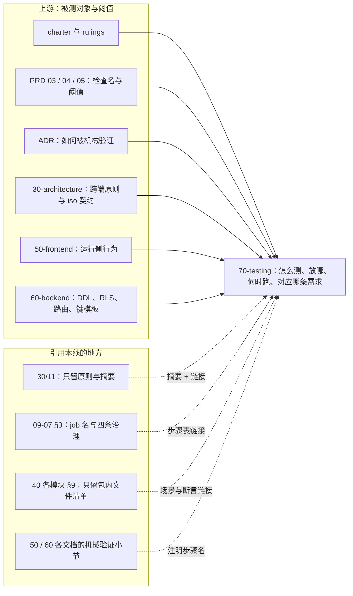
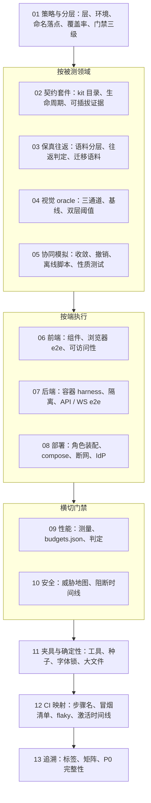

# 70 测试设计线：定位、边界与导航
> 状态：v0.1 | 负责：测试设计线 | 更新：2026-09-25；2026-09-25（§4.19）；2026-09-25（§4.19 N1）；2026-09-26（§4.20）；2026-09-26（§4.21 Remap：原 30/08 引用按 60-backend/README §6.1 改指新位置，30/08 已删除）；2026-10-03（补登 §4.22：表格与图表收口的测试落点——06 §5 第 26、32、33 行，05 `sc-30`、`sc-31`，09 §3.1 大表基准，03 §12.1 PowerPoint 对照，13 §6.7）；2026-10-03（§4.24 设计线对齐审计：§6 新增 §4.24 落实表，§9 变更记录加两行）；2026-10-04（design-language-v3 第 0 批：§6 新增 rulings §4.25 DS-1…DS-7 的落实表，§4.20 段注明 FE-08 尾部区断言已随 Ribbon 取消，§9 变更记录加一行）；2026-10-04（design-language-v3 第 0 批：术语残留清理：ribbon / 状态栏 / `ui.ribbon` / `ui.statusBar` 的历史陈述改用 check-terms 认可的标记措辞（废弃、作废、取代、原名））；2026-10-04（design-language-v3 第 0 批：复验修正——原「状态胶囊」改称文件名旁的同步状态行（rulings §4.25 DS-6），带作废标记的历史陈述统一措辞）；2026-10-05（design-language-v3 第 0 批修正：§6 的 §4.25 落实表补 DS-9…DS-16、DS-18…DS-20 一行（落点引用 13 §6.9）与 DS-17 一行，表头注明 2026-10-05 补登）；2026-10-07（design-language-v3 第 1 批：§6 的 §4.25 落实表把 DS-17 行改为已随 DS-21 拍板，新增 DS-21…DS-30 与 TB-1…TB-30 两行（落点引用 13 §6.9、06、04、12）；§9 变更记录加一行）；2026-10-08（design-language-v3 第 1 批收口：§6 的 §4.25 落实表表头补 2026-10-08，新增 DS-31…DS-33 与 TB-31…TB-52 两行（落点引用 13 §6.9、06、01、03、12），TB-1…TB-30 行注明 TB-1 括注已更正；§9 变更记录加一行；依据 rulings §4.25 DS-31…DS-33、TB-31…TB-52）；2026-10-08（design-language-v3 第 1 批评审修改：§6 的 §4.25 落实表表头补评审修改，新增 DS-34…DS-37 与 TB-55…TB-58 一行（快速样式库原位展开、安静控件的边界口径与非颜色线索、截图基线重拍；落点引用 13 §6.9、06、04），TB-31…TB-52 行补登收口第二轮的 TB-53、TB-54；§9 变更记录加一行；依据 rulings §4.25 DS-34…DS-37、TB-55…TB-58）；2026-10-15（design-language-v3 第 2 批：§6 末表新增 DS-38…DS-63 一组（协作族的整栏面板与对话框宽度、评论、版本历史、分享与访问申请、插件收纳与横幅、保真报告与降级对象、横幅与离线、状态行、内部改齐，DS-63 无测试要求；落点引用 13 §6.9、06、04、05、07、10），§9 变更记录加一行；依据 rulings §4.25 DS-38…DS-63）；2026-10-15（design-language-v3 第 2 批回写：§6 末表新增 DS-64…DS-68 与 TB-59…TB-75 一行（降级对象在评审与只读下照常出菜单、撰写框按页保留草稿、链接到期等同收紧、访问申请的 Webhook 事件、申请被拒不告知；整栏面板宽度与插件面板绑定、评论钉菜单与 `Enter` 落钉、版本历史降权与说明长度、非所有者的成员与链接、横幅档位与里程碑、圆点数据来源、换账号横幅、本机键、令牌信封与每份文档一条链接、回收站里的访问申请、API 建的空文档；TB-67、TB-75 无本批测试要求；落点引用 13 §6.9、06、07、10、11、04），表头补同日的 DS-64…DS-68 与 TB-59…TB-75；§9 变更记录加一行；依据 rulings §4.25 DS-64…DS-68、TB-59…TB-75）；2026-10-15（design-language-v3 第 2 批回写：§6 末表新增 DS-69、DS-70 与 TB-76…TB-86 一行（非所有者复制分享链接与令牌出处、版本历史最早一条的来源、插件深链与失败码、组内次序、恢复的撰写框不抢焦点、导出本地副本对话框放在 SDK；TB-80…TB-83 无本批测试要求；落点引用 13 §6.9、06、07、10、11、04），表头补同日的 DS-69、DS-70 与 TB-76…TB-86；§9 变更记录加一行；依据 rulings §4.25 DS-69、DS-70、TB-76…TB-86）；2026-10-15（design-language-v3 第 2 批回写：§6 末表新增 TB-87…TB-95 一行（落点在 13 §6.9、06、07），表头补同日的 TB-87…TB-95；§9 变更记录加一行；依据 rulings §4.25 TB-87…TB-95）；同日再补：§6 末表增 TB-96…TB-100 一行（逐条落点见 13 §6.9）；2026-10-22（design-language-v3 第 3 批：§6 的 §4.25 落实表表头补第 3 批，新增 DS-71…DS-78 与 TB-101…TB-106、DS-79…DS-136 与 TB-107…TB-129 两行（落点引用 13 §6.9、06、04、05、07、10、11、12）；§9 变更记录加一行；依据 rulings §4.25 DS-71…DS-136、TB-101…TB-129）；2026-10-22（design-language-v3 第 3 批回写续：§6 的 §4.25 落实表新增 DS-137、DS-138 与 TB-130…TB-151 一行（落点引用 13 §6.9 与 06、07、02、05、08、10、04、09、11、12 的具体小节）；§9 变更记录加一行；依据 rulings §4.25 DS-137、DS-138、TB-130…TB-151；同日再补：§6 的 §4.25 落实表新增 TB-152…TB-162 一行（落点引用 13 §6.9 与 06、07、08、04、09、11、12 的具体小节）；§9 变更记录加一行；依据 rulings §4.25 TB-152…TB-162；2026-10-22 复核修正：§6 的 §4.25 落实表表头补到 DS-139 与 TB-174、新增 DS-139 与 TB-163…TB-169、TB-170…TB-174 两行，TB-59…TB-75 一行注明 TB-67 的第 3 批复核结果，TB-152…TB-162 一行与 §9 变更记录去掉回写轮次字样、§9 两行的标签改为「回写续 / 回写续，同日再补」，§9 本批末行补复核修正；状态头的回写轮次字样改为「回写续 / 同日再补」；§6 引言与 TB-170…TB-174 一行扩到 TB-175，这一行补 TB-171 扩到的列表形态、搜索与排序，TB-172、TB-173 的补句与 TB-175 的落点，§9 本批末行同步；§6 引言与这一行再扩到 TB-178，补 TB-176…TB-178 的落点与 TB-172 再补的一句，§9 本批末行同步）；2026-10-23（design-language-v3 第 3 批评审修改：§6 的 §4.25 落实表表头补 DS-140…DS-143 与 TB-179…TB-183，DS-79…DS-136 一行注明导入页与过渡页由 DS-140 取代，新增 DS-140…DS-143、TB-179…TB-183 一行（落点引用 13 §6.9 与 06、04、08、10、12、13 的具体小节）；§9 变更记录加一行；依据 rulings §4.25 DS-140…DS-143、TB-179…TB-183）；2026-11-04（design-language-v3 母版视图改版：§6 的 §4.25 落实表表头补 DS-144…DS-177 与 TB-184…TB-210，新增一行（落点引用 13 §6.9 与 06、04、09、02、11、13 的具体小节，TB-184、TB-185 的去处一并写）；§9 变更记录加一行；同日再补：§6 新增一行首次出现的「上下文条」带提示「母版视图的模式横幅」，§9 该行补记同日对 06、11、13 的再补；再补：§9 该行补记 04、06、09、13 的再补；rulings §4.25 DS-144…DS-177、TB-184…TB-210；需求编号、优先级与里程碑不变） | 依赖：rulings §4.25 DS-144…DS-177、TB-184…TB-210、rulings §4.25 DS-140…DS-143、TB-179…TB-183、rulings §4.25 TB-170…TB-178、rulings §4.25 DS-139、TB-163…TB-169、rulings §4.25 TB-152…TB-162、rulings §4.25 DS-137、DS-138、TB-130…TB-151、rulings §4.25 DS-71…DS-136、TB-101…TB-129、charter v0.2、rulings §4.11–§4.25、[docs/README.md](../README.md)、[30-architecture/11](../30-architecture/11-testing-strategy.md)、[09-type-discipline/07](../30-architecture/09-type-discipline/07-hooks-and-ci.md)、[40-modules/_template.md](../40-modules/_template.md)

## 1. 定位

`70-testing/` 是测试侧的唯一事实源，回答五个问题：**测什么**（以哪条需求、裁决或契约为被测对象）、**放在哪里**（文件后缀与目录）、**用什么工具**、**阈值怎么判**、**在 13 个 CI job 的哪个步骤运行**，并维护「需求 → 测试」的追溯矩阵。

- 被测对象的定义不在本线：跨端契约与协议在 30-architecture，前端运行侧行为在 [50-frontend](../50-frontend/README.md)，后端表结构、RLS、路由与键模板在 [60-backend](../60-backend/README.md)。50 / 60 每份文档末的「机械验证」小节写「断言什么」并注明本线的步骤名，本线写「怎么断言、放哪、何时跑」。
- 数字（PRD NF 的 gate、体积预算、协同阈值）只引用不复制：gate 取 PRD 04，前端 target 取 [50/13](../50-frontend/13-performance-and-bundling.md)，服务端 target 取 [60/01](../60-backend/01-service-overview-and-roles.md)；本线定义测量方法与判定规则。
- 30/11 只保留跨端测试原则（金字塔、不 mock 内核只 mock IO、确定性、契约即验收、阈值只收紧）与 Univer 对照表，其余章节由总编排改为「摘要 + 链接」指向本线（§8）。

---

## 2. 本线拥有 / 本线引用

三条设计线（50 / 60 / 70）的总边界表在 [docs/README.md](../README.md)（由总编排回写，§8），本节只列本线自己的两张表。

**本线拥有**：

| 事项 | 文件 |
|---|---|
| 测试分层与运行环境、文件命名与落点（T-NAMING）、根 `test/` 布局、iso 冒烟、类型测试、覆盖率、门禁三级、所有权矩阵 | [01](./01-strategy-and-layers.md) |
| 契约套件目录、kit 统一接口、用例 id 与运行矩阵、生命周期套件、可插拔与文档类型盲证据 | [02](./02-contract-suites-and-pluggability.md) |
| 语料分层与清单 schema、零编辑与编辑后往返判定、导出确定性、快照迁移语料 | [03](./03-fidelity-roundtrip-and-corpus.md) |
| 视觉 oracle 三通道、基线生成、双层阈值、capabilities | [04](./04-visual-oracle.md) |
| 协同模拟、fuzz、性质测试、确定性协同与离线脚本 | [05](./05-collab-simulation-and-property-tests.md) |
| 前端组件测试、浏览器 e2e、可访问性执行口径 | [06](./06-frontend-component-and-e2e.md) |
| 后端集成、容器 harness、数据库隔离、API / WS e2e | [07](./07-backend-integration-and-api-e2e.md) |
| 部署拓扑与环境 e2e、IdP 兼容矩阵、发布与备份演练 | [08](./08-deployment-and-environment-e2e.md) |
| 性能与容量的测量方法、`test/perf/budgets.json` 结构、门禁判定 | [09](./09-performance-and-capacity.md) |
| 威胁 → 测试 → 执行点总表、安全用例的阻断时间线 | [10](./10-security-testing.md) |
| 夹具、确定性工具、服务端种子、IdP 夹具、字体锁、大文件存储 | [11](./11-test-data-fixtures-and-determinism.md) |
| CI 步骤名定稿、三段触发、PR 冒烟清单、flaky 策略、里程碑激活时间线 | [12](./12-ci-gates-mapping.md) |
| 追溯标签、`requirements.json`、检查名目录、P0 完整性判定 | [13](./13-requirements-traceability.md) |

**本线引用**（不拥有，冲突以右列事实源为准）：

| 事项 | 事实源 | 本线怎么用 |
|---|---|---|
| 金字塔、只 mock IO、确定性、契约即验收、阈值只收紧 | [30/11](../30-architecture/11-testing-strategy.md) 保留的原则段 | 01 §1 引用 |
| 13 个 CI job 名封闭集合与四条治理（存在、PR 触发、error 阻断、不可跳过） | [09-07 §3](../30-architecture/09-type-discipline/07-hooks-and-ci.md#3-ci-工作流矩阵) | 12 只定义 job 内的步骤 |
| 扫描器定义与「14 个」上限 | [09-06](../30-architecture/09-type-discipline/06-scanners.md)、09-08 §11 | 只作执行点引用，不新增扫描器 |
| iso 契约本体（DocumentStore、StoreOp、中性撤销、TextMeasurer、RenderTarget、OfflineStore） | 30 正文与已接受 ADR | 02 kit 的断言对象 |
| WS 帧、CONTROL、ack、关闭码 | 30/06 §6 | 05、07 的断言对象 |
| 前端运行侧行为（Session FSM、/render ready 判据、CSP 正文、错误文案） | 50-frontend | 06、10 的断言对象 |
| DDL、RLS 测试矩阵、迁移编号、Valkey 键模板、对象键、REST 路由表、配置 schema | 60-backend | 07、08、10、11 的断言对象与种子依据 |
| 验收检查名、验收阈值、NF gate 数值 | PRD 03 / 04 / 05 | 09、12、13 |
| 包内测试文件清单 | 40-modules 各 §9 | 01 §5 对账 |

**图 R-1 测试设计线与上下游的边界**

怎么读：实线从左侧上游指向本线，表示本线以它们为被测对象或阈值来源；右侧虚线从引用方指向本线，标签是引用方式——这些文档不再复述测试细则，只留摘要并链接到 70。

依据：计划 ownership「口径链」与「机械验证分工」两条；rulings §4.18 GV-14。

---

## 3. 文件地图与阅读顺序

建议顺序：01 → 02 / 03 / 04 / 05 → 06 / 07 / 08 → 09 / 10 → 11 → 12 → 13。先读 01 建立分层与落点，再按被测领域读契约、保真、oracle、协同，然后按端读前端、后端、部署，接着读横切的性能与安全，最后读夹具、CI 映射与追溯。

**图 R-2 本线文件阅读路径**

怎么读：自上而下是推荐阅读顺序；同一分组内的文件互不依赖，可按需挑读；11–13 是支撑性文档，写新测试前查 11，排查 CI 失败查 12，出口评审查 13。

---

## 4. 术语

| 术语 | 含义 |
|---|---|
| gated（阻断） | 检查失败即 job 失败、阻断合并；只能收紧，降级须走带 issue 与到期日的临时例外（[01 §10](./01-strategy-and-layers.md#10-门禁三级)） |
| 报告 | job 通过，同时产出产物（HTML、JSON、差异图）或 PR 注释；不存在 warn 级别（决策 T-PERF-GATE） |
| 人工 / 半机械 | 证据归档在 `test/evidence/<里程碑>/<检查名>.md`，追溯矩阵标 `manual` 并单独统计 |
| kit（契约套件） | Definition 所在包从 `./testing` 导出的 `run<Definition>Conformance(factory, options)`，Provider 的验收（[02](./02-contract-suites-and-pluggability.md)） |
| PR 冒烟子集 | `e2e/smoke` 步骤在每个 PR 上运行的固定用例集，清单在 [12 §4](./12-ci-gates-mapping.md) |
| main 全量段 | 合入 main 后才运行的 e2e 全量、compose 与断网 e2e、性能全量 |
| nightly 套件 | schedule 触发同一工作流、`CORDEX_SUITE=nightly`，复用 13 个 job 名，只放大规模（协同模拟万轮、oracle 全量、T1+T2 全量语料、Keycloak） |
| 包络 / 天花板 | 性能保证包络（门禁只收紧）与系统天花板（只监测、超出拒绝导入），rulings §4.15 Q5 |
| gate / target | gate 取 PRD 值，超出即失败；target 取 50/13、60/01 的更严值，超出只报告 |
| oracle | 以 PowerPoint 输出为基线的视觉与结构比对（[04](./04-visual-oracle.md)） |
| repro 种子 | 随机测试失败时记录的种子与最小化后的显式操作序列，入库成为确定性回归用例 |
| T1 / T2 / T3 语料 | 规范语料（入 git）/ 真实语料 / 压力语料（后两者只登记清单、文件在对象存储），决策 T-CORPUS |
| 人物与 `fixtureId` | 服务端基础种子里的固定用户与固定 UUID（[11 §6](./11-test-data-fixtures-and-determinism.md#6-服务端种子构建器)） |
| PRD 检查名 / CI 步骤名 | PRD 里的验收检查名（如 `fidelity:roundtrip`、`security:rls`）是需求侧名字；CI 步骤名（如 `test/fidelity-roundtrip`、`e2e/smoke`）是执行侧名字；二者映射在 [12 §6](./12-ci-gates-mapping.md) 与 [13 §3](./13-requirements-traceability.md) |

---

## 5. 引用规则

- 其它线引用本线写相对链接加小节号，形如「[70-testing/05 §9](./05-collab-simulation-and-property-tests.md)」；不复制本线的表格与阈值。
- 50 / 60 的「机械验证」小节每行写三样东西：断言（what）、本线的 CI 步骤名（`job/步骤`）、测试文件落点（后缀与目录按 [01 §4](./01-strategy-and-layers.md#4-文件命名与落点t-naming)）。
- 测试文件与用例的追溯标签按 [13 §1](./13-requirements-traceability.md)：`@req PRD:<id>`、`@ruling <节>/<id>`、`@adr <编号>/<决策号>`（决策 T-REQ）。
- 写「扫描器 + 名字」时，名字必须能在 09-06 或 09-08 §11 查到（`docs/_tools/check-scanner-names.py`）；本线不新增扫描器与 CI job。

**CI 步骤工作名**（以 [12 §2](./12-ci-gates-mapping.md) 为定稿，其余文件引用时用这些名字）：

| job | 步骤 |
|---|---|
| `test` | `unit`、`contract`、`lifecycle`、`fidelity-roundtrip`、`collab-sim`、`snapshot-migration-corpus`、`preset-blind`、`server-integration`、`requirement-matrix` |
| `test-typecheck` | 单一步骤 |
| `iso-smoke` | 单一步骤 |
| `e2e` | `smoke`（内含 `security-rls`、`renderer-egress`、`login-oidc-mock`、`login-casdoor`）、`oracle-gated`、`a11y`、`full-compose`、`full-airgap` |
| `perf` | `perf-client`、`perf-collab`、`perf-server` |
| `scanners` | `lockfile-guard`（全量模式，先行）、`scan-*`、`check-*`、`license-allowlist`、`vuln-audit`、`scan-manifest --check`、`schema-lock`、`shadcn-diff`、`horizontal-freeze` |
| `api-surface` | `api-surface`（主步骤）、`docs-coverage`（M4）、`scaffold-e2e`（M4） |
| `lint`、`typecheck`、`depcruise`、`policy-check`、`xsd-validate`、`coverage-patch` | 单一步骤 |

nightly 以 `CORDEX_SUITE=nightly` 复用同名 job（决策 T-CI）。

---

## 6. 待决项的处理结果

**30/11 §14 T1–T4 的处理结果**：

| # | 事项 | 结果 | 依据 |
|---|---|---|---|
| T1 | 大基线与样本的存储 | 已定：对象存储 + sha256 清单，不用 Git LFS；≤ 2 MB 的 T1 样本入 git（[11 §10](./11-test-data-fixtures-and-determinism.md#10-大文件t-corpus)） | 决策 T-CORPUS（needsUser=false） |
| T2 | 性能 runner | 已定：M1 GitHub larger runner（4 核）；自托管专用 runner M2 前落地，承载 gated 协同与 RM-S 服务端压测；低配以 CDP CPU 4× 节流近似（[09 §9](./09-performance-and-capacity.md)、[12 §8](./12-ci-gates-mapping.md)） | rulings §4.19 D-TEST-INFRA |
| T3 | PowerPoint 基线机器与版本锁定 | 已定：一台 Windows + PowerPoint 365 维护机，不进 CI，脚本生成基线提 PR 评审签字；macOS 基线 M2 加入（[04 §2](./04-visual-oracle.md)） | rulings §4.19 D-TEST-INFRA |
| T4 | e2e 在 PR 上的范围 | 已定：默认 8 条 + `security-rls` + `renderer-egress` + `login-oidc-mock` + `login-casdoor` + `oracle-gated`，分片后 ≤ 15 min（[12 §4](./12-ci-gates-mapping.md)） | 决策 T-CI（needsUser=false） |

D-TEST-INFRA 的原推荐「M3 前落自托管 runner」随 rulings §4.19 D-M2-CONTENT（协同后端提前到 M2）提前为「M2 前」，RM-S 服务端场景自 M2 起。

**本线已定项**（needsUser=false，按推荐写入，段内注明依据）：

| 决策 | 结论摘要 | 落点 |
|---|---|---|
| T-NAMING | `*.type-test.ts`、`*.browser.test.ts`、`*.int-spec.ts`、`*.e2e-spec.ts`、`apps/web/e2e/**/*.spec.ts`、根 `test/<suite>/`；废 `test/e2e`、`test/server-integration` | 01 §4 |
| T-COVERAGE-EVIDENCE | patch 行 ≥ 80%、分支 ≥ 70% 阻断，包级不下降；包级下限只作目标；人工证据归档格式 | 01 §8 |
| T-DETERMINISM | `FixedClock`、`SeededRandom` 归 shared/testing；服务端 `CLOCK` 端口 | 11 §2–§3 |
| T-DB-ISOLATION | 每 worker 迁移 template 库、每测试文件克隆；非属主角色连接；不用事务回滚隔离 | 07 §3、11 §6 |
| T-IDP | PR：oidc-provider mock + Casdoor；nightly：Keycloak；Entra、飞书人工 | 11 §7、08 §7 |
| T-CORPUS | 见上 T1 | 03 §1、11 §10 |
| T-ORACLE | gated 宽 1280 px；单样本类别阈值与矩阵行聚合两层都须通过；1920 只报告 | 04 §2、§6 |
| T-PERF-GATE | PR 超 PRD 绝对 gate 即失败；相对回归 PR 只注释、main / nightly 超 10% 失败；内存 20 次开关增长 ≤ 5% | 09 §10、01 §10 |
| T-BUNDLE | 唯一阻断点 `scanners` 的 `scan-bundle-budget`，其余体积断言为信息性 | 09 §11 |
| T-CI | 见上 T4；服务端集成进 `test/server-integration`；flaky 与 nightly 策略 | 12 |
| T-REQ | 三类标签；P0 完整性由 `test/requirement-matrix` 判定 | 13 §1 |
| T-KITS | SceneProvider 不设 kit；新增 `runPermissionPolicyConformance`；UiRenderer 登记 | 02 §3 |

**rulings §4.19 已裁定、影响本线用例的跨线项**（原「待确认（总编排）」，已按裁决定稿）：

| 决策 | 本线的落实 |
|---|---|
| D-M2-CONTENT（协同后端提前到 M2） | 协同网关、Room、update 持久化与快照、服务端导入相关的测试步骤自 M2 激活：`test/collab-sim`、`test/server-integration` 的协同与导入分节、`perf/perf-collab`、`perf/perf-server` 的 RM-S 场景（[12 §7](./12-ci-gates-mapping.md)）；删去 pptx 内容版本用例，改为快照 bootstrap 与服务端导入用例（[06 §5](./06-frontend-component-and-e2e.md) 第 21、22 行，[07 §8](./07-backend-integration-and-api-e2e.md) D10、§11.2–§11.3）；M2 基线包来自 import 快照（[03 §10](./03-fidelity-roundtrip-and-corpus.md)）；PRD 05 新增的 M2 检查名 `server:import`、`collab:persist`、`collab:gate`、`collab:unsaved` 登记在 [13 §3.3](./13-requirements-traceability.md)；M3 只保留多人协同体验层（在场、评论、权限细化、离线体验、多实例与 PG 故障溢写、保留期清理、换纪元、服务端导出与缩略图等）。逐项边界以 [PRD 05 §0.3](../10-prd/05-milestones-and-scope.md) 为准 |
| INC-09（「未保存到服务器」） | 服务端 `CONTROL.room.persist` 信号（[02 §5.2](./02-contract-suites-and-pluggability.md)、[07 §9](./07-backend-integration-and-api-e2e.md) W5）；客户端判据三分支与分级受众（[05 §9](./05-collab-simulation-and-property-tests.md)、[06 §5](./06-frontend-component-and-e2e.md)）：发起方横幅「未保存到服务器 N 项」，其余协作者同步状态行弱提示「服务器保存延迟」 |
| C-06（自动快照保留） | `snapshots-retention` 断言（[07 §11.4](./07-backend-integration-and-api-e2e.md)）与边界做法（[11 §3](./11-test-data-fixtures-and-determinism.md#3-假时钟统一规则)）：30 天全量、按 UTC 日稀疏至 `autoSnapshotDailyDays`（默认 365，0 = 永久）、named 上限 200、最新 import 快照不删 |
| D-COMMENTS-PKG（新增 `@cordexjs/comments`） | `pluggable:m3` 白名单 `{−store-memory, +store-yjs, −collab-core#local-presence, +collab-yjs, +collab-transport-ws, +comments}`（[02 §10](./02-contract-suites-and-pluggability.md)） |
| D-TEST-INFRA | 见上 T2 / T3 |
| N1-IMPORT-OVERWRITE-RESTORE-LOCK（恢复不锁、覆盖导入换纪元，补完阶段用户裁决） | 锁定断言只剩覆盖导入与迁移（[02 §5.2](./02-contract-suites-and-pluggability.md) `lock/room-locked-signal`、[07 §9](./07-backend-integration-and-api-e2e.md) W14）；恢复不加锁（02 `restore/no-lock`、07 W16、[06 §5](./06-frontend-component-and-e2e.md) 第 15 行）；覆盖导入换纪元（02 `epoch/external-epoch-control-closes-4428`、`put/import-bumps-epoch`，07 W17 与 §11.2 J7，[05 §9](./05-collab-simulation-and-property-tests.md) `rs/import-overwrite`，06 §5 第 21 行）；追溯标签 `@ruling 4.19/N1-IMPORT-OVERWRITE-RESTORE-LOCK`（[13 §6.3](./13-requirements-traceability.md)） |

**rulings §4.20 已裁定、影响本线用例的项**（2026-09-26，3 项决策与 12 项默认值由用户逐条确认、25 项机械修正按权威执行；FE-08 用户已确认 playground 样张并回写，本线在 [06](06-frontend-component-and-e2e.md) §2.2 登记尾部区断言；2026-10-04 起尾部区随 Ribbon 废弃，该行改为「编辑器结构与创建工具条」，见下文 §4.25 表）：

| 条目 | 本线的落实 |
|---|---|
| BE-01+TX-03（WS 升级先扣后退加每用户上限） | [10](./10-security-testing.md) SEC-RL-03 (a)–(f)：验签通过即退还、4401 / 4408 / 4427 等不退、第 33 个连接 `auth.denied{collab.rate_limited}` + 4429；[02 §5.2](./02-contract-suites-and-pluggability.md) `admission/per-user-connection-cap-4429`；[07 §9](./07-backend-integration-and-api-e2e.md) W4 同一出口 IP 30 人 1012 后 ≤ 5 s 重连完；[09 §6](./09-performance-and-capacity.md) `ws-capacity` 在默认限额下按先扣后退爬升、不再放宽 |
| BE-04（客户端 IP 统一 `clientIp()`） | SEC-RL-01（REST）与 SEC-RL-03 (f)（WS 升级）伪造 `X-Forwarded-For` 首跳不换限流主体与 `ip_hash`；[08 §4](./08-deployment-and-environment-e2e.md) G12 覆盖 web 容器 `terminate` 与 `upstream` 两种模式（60/17 DEP-03） |
| BE-05+TX-22（唯一 owner 空窗的运维转移命令） | [07 §7.4](./07-backend-integration-and-api-e2e.md) O1–O5（`soleOwnerDocCount`、`cordex-ops documents:reassign-owner`、`admin.owner_reassigned`、≤ 1 s 重算、新 owner 可撤链接）；SEC-DA-07 注明计数 |
| TX-01+BE-10（ADR-0038 version-restore-undo） | [05 §7.2](./05-collab-simulation-and-property-tests.md) `rs/restore-revert-*` 三类场景占位（随 ADR 定稿补全）；PRD 05 M3 检查名 `history:restore-revert` 登记在 [13 §3.4](./13-requirements-traceability.md) 与 [12 §6](./12-ci-gates-mapping.md) |
| FE-01（UnitScope 默认 Provider 登记 API） | [02 §9.1](./02-contract-suites-and-pluggability.md) `units/*`：重复登记被拒、只影响新 Unit、dispose 后无残留 |
| FE-03、FE-04、FE-05、FE-23（默认版式、墓碑期并发引用、删除可撤销、删除母版的目标版式） | [05 §6](./05-collab-simulation-and-property-tests.md) `sc-20` 改为墓碑期读时容错与硬删时修复两个变体；§7.1 `ml/*` 与 `undo/delete-layout-revert-skips-later-writes`；§8 `inject/dangling-layout` 按 I-ML2 链；§10 删除版式与母版的性质；[06 §5](./06-frontend-component-and-e2e.md) 第 25 行的对话框与撤销 Toast |
| FE-02、FE-06、FE-07、FE-16、FE-18+TX-06 | [06](./06-frontend-component-and-e2e.md)：放映始终实时应用远端更新（§5 第 12 行）、`enablement` 与 `can.*` 禁用不隐藏（§2.2）、应用主题直接执行加可撤销 Toast（§5 第 25 行）、嵌入样式隔离（§11）、Trusted Types `default` 策略与第三方样式零违规（§10.1，安全目录侧 SEC-CL-02） |
| BE-03+TX-14（迁移 SQL 逐字一致，DB-13） | [12 §2、§7](./12-ci-gates-mapping.md) 登记 `scanners/check-migrations-sync`：M1 首批迁移入库的 PR 激活并直接 gated，不起容器 |
| BE-07+TX-05（最低主机规格实测） | [09 §6](./09-performance-and-capacity.md) 登记 `host-footprint`（nightly、自托管 runner、core 与 core+idp 两档、只报告），数值由后端设计线 M3 出口前回填 60/17 §11 |
| TX-02、TX-04（术语与链接检查） | [13 §3.1](./13-requirements-traceability.md) `M0#2` 改为 `check-terms.py`；§10 的链接执行点改为 `check-links.py` |
| TX-08、TX-09、TX-10、TX-13、TX-16、TX-23 | §7 第 9、10 条已采纳（TD-110、TD-111）；§8 的 Clock / Random、`FixedClock` 统一、语料与覆盖率改指各行已回写；SEC-SC-05 与 [12 §2](./12-ci-gates-mapping.md) `lockfile-guard` 加 typescript、y-protocols 版本钉；[11 §10](./11-test-data-fixtures-and-determinism.md) 与 [12 §3](./12-ci-gates-mapping.md) 登记语料桶四个变量；[13 §11](./13-requirements-traceability.md) 第 5 条不采纳、以 `<里程碑>#<序号>` 为正式检查名 |

**rulings §4.24 已裁定、影响本线用例的项**（2026-10-03，AL-1…AL-7 用户裁决、TA-1…TA-10 总编排裁定；逐条追溯见 [13 §6.8](./13-requirements-traceability.md)）：

| 条目 | 本线的落实 |
|---|---|
| AL-1、AL-5（链接不授予 editor；分享对话框无下载开关） | [07](./07-backend-integration-and-api-e2e.md) §5.1 X3、§7.1 删链接 editor，§7.2 S8、§4 MG9；[10](./10-security-testing.md) SEC-AZ-19；[06](./06-frontend-component-and-e2e.md) §5 第 36 行 |
| AL-2、AL-4（个人插件面板为对话框路由；导出里程碑按 OF-19） | [06](./06-frontend-component-and-e2e.md) §5 第 28、35、37 行 |
| AL-3、TA-9（renderer 不读库；足迹服务端链路与按策略装配） | [03](./03-fidelity-roundtrip-and-corpus.md) §6 X6、X8；[10](./10-security-testing.md) SEC-RS-08；[07](./07-backend-integration-and-api-e2e.md) §9 W23、§11.6 AU9 |
| AL-6（评论不进足迹） | [02](./02-contract-suites-and-pluggability.md) §10.1 `footprint/comments-excluded`；[03](./03-fidelity-roundtrip-and-corpus.md) §6 X7；[05](./05-collab-simulation-and-property-tests.md) §10；[06](./06-frontend-component-and-e2e.md) §5 第 34 行 |
| AL-7（SV-13 Headless 自动化 M3） | [07](./07-backend-integration-and-api-e2e.md) §11.6 AU1–AU10、§12.2 H5；[09](./09-performance-and-capacity.md) `template-fill-100` 改 M3；[10](./10-security-testing.md) SEC-IN-11；[12](./12-ci-gates-mapping.md) §7 |
| TA-1、TA-2、TA-5、TA-6、TA-7、TA-8 | [13](./13-requirements-traceability.md) §6.8 各行；[02](./02-contract-suites-and-pluggability.md) §10.1 `exclude/dependency-closure`；[06](./06-frontend-component-and-e2e.md) §2.2 与 §5 第 39 行 |
| TA-4、TA-10（失败会话数小时桶；配额、位图参数、协作者摘要、页头版本） | [07](./07-backend-integration-and-api-e2e.md) §7.5 PL10、PL11，§8 D12、D13，§11.2 J8；[10](./10-security-testing.md) SEC-AZ-18 |
| 审计缺口：表格 / 图表编辑 e2e、`admin/` 目录、图表软冲突、快照 diff、审计导出、个人资料 | [06](./06-frontend-component-and-e2e.md) §3.1、§5 第 32–33 行；[05](./05-collab-simulation-and-property-tests.md) `sc-30`、`sc-31`；[07](./07-backend-integration-and-api-e2e.md) §8 D14、§12.3、§6 A14 |
| 13 追溯 | §1.1 `4.21`、`4.22`、`4.24` 的 id 生成口径；§6.6–§6.8；§7 ADR 0018、0019、0036、0049、0050；[12](./12-ci-gates-mapping.md) §6 插件四个检查名 |

**rulings §4.25 设计语言 v3 已裁定、影响本线用例的项**（2026-10-04，DS-1…DS-8；2026-10-05 补 DS-9…DS-20；2026-10-07 补第 1 批 DS-21…DS-30 与总编排口径 TB-1…TB-30；2026-10-08 补第 1 批收口 DS-31…DS-33 与 TB-31…TB-54，同日补第 1 批评审修改 DS-34…DS-37 与 TB-55…TB-58；2026-10-15 补第 2 批（协作族）DS-38…DS-63，同日回写中先后补 DS-64…DS-68 与总编排口径 TB-59…TB-75、DS-69、DS-70 与 TB-76…TB-86、TB-87…TB-95；2026-10-22 补第 3 批（应用壳族）DS-71…DS-136 与总编排口径 TB-101…TB-129，同日回写中再补 DS-137…DS-139 与 TB-130…TB-178，2026-10-23 补第 3 批评审修改 DS-140…DS-143 与 TB-179…TB-183；2026-11-04 补母版视图改版 DS-144…DS-177 与总编排口径 TB-186…TB-210，同时补计 10-23 追加的 TB-184、TB-185；变更 `design-language-v3` 第 0、1、2、3 批与母版视图改版；逐条追溯见 [13 §6.9](./13-requirements-traceability.md)；DP、TP 两组的流程门禁由 `dev-process` 登记在 [12](./12-ci-gates-mapping.md) §2）：

| 条目 | 本线的落实 |
|---|---|
| DS-1（去掉 Ribbon，工具条只管创建，检查器只管属性） | [06](./06-frontend-component-and-e2e.md) §2.2「编辑器结构与创建工具条」「检查器分区」两行（取代 FE-08 尾部区行）；§5 第 40 行（工具条只含创建工具、原入口按设计 02 §7.1 逐行可达）；第 2、6、8、18、24、25、26、33 行的 Ribbon 页签与应用栏入口改为主菜单、文档菜单、工具条与检查器分区；第 7 行首页按 v3 首页结构 |
| DS-2（中性平面，去掉毛玻璃） | [06](./06-frontend-component-and-e2e.md) §11 同屏 `backdrop-filter` 为 0 与 v3 平面规则（取代玻璃退化与 `data-interacting`）、§7.5；[04](./04-visual-oracle.md) §9 截图基线按 v3 状态矩阵；[09](./09-performance-and-capacity.md) `glass-interacting` 作废 |
| DS-3、DS-4（视图入口；网格收起两栏） | [06](./06-frontend-component-and-e2e.md) §5 第 41 行（三个入口同一状态、两栏收为胶囊、双击或回车回单页、焦点转移、中性色焦点框）与图 6-7；§7.3 F6 按 v3 区域、「视图切换与幻灯片网格」行；§7.4 焦点框例外 |
| DS-5（`ui.ribbon` 作废，创建走 `ui.toolbar`、格式走 `ui.inspectorSection`） | [06](./06-frontend-component-and-e2e.md) §5 第 16 行与冒烟第 4 条（插件条目在「更多」）；[02](./02-contract-suites-and-pluggability.md) §10 `pluggable:m2`、§12 CTK `bad-toolbar-item` 与 `retired-point`；[12](./12-ci-gates-mapping.md) §4 第 4 条 |
| DS-6（`ui.statusBar` 作废，状态走通知与横幅） | [06](./06-frontend-component-and-e2e.md) §2.2 插件横幅行、§3.3 原「状态胶囊」（已作废）改指文件名下方的同步状态、§5 第 28、34 行（「N 个插件启动失败」横幅，无「插件正常」） |
| DS-7、DS-8（旧版全量迁移后删除；三批迁移） | [04](./04-visual-oracle.md) §9 旧路由基线不迁移、按批补基线；[06](./06-frontend-component-and-e2e.md) §7.2 `/styleguide` 行；各处「随 design-language-v3 第 N 批定稿」的断言在该批拍板回写时补齐（06 §14） |
| DS-9…DS-16、DS-18…DS-20（2026-10-05 细化：对比度、首页「设置」与首页结构、快捷键、文字迷你工具条与占位符按钮组的去除、只读检查器、替换键、账户菜单与「插件…」、删除项、「背景」合并） | 逐条落点见 [13 §6.9](./13-requirements-traceability.md)：[06](./06-frontend-component-and-e2e.md) §2.2「编辑器结构与创建工具条」「检查器分区」两行、§5 第 7、8、28、32、40、42 行、§7.3「字符键快捷键」行；对比度静态门禁 design `contrast.test.ts`（[40/10 §9](../40-modules/10-ui-shell-and-slide-ui.md)） |
| DS-17（紧凑与仅查看形态补进第 1 批） | 已随 DS-21 拍板（2026-10-07）：[06](./06-frontend-component-and-e2e.md) §2.2「三种形态」「抽屉与底部面板的焦点」两行、§5 第 44 行、§7.3–§7.5；[04](./04-visual-oracle.md) §9 紧凑与仅查看两张基线 |
| DS-21…DS-30（2026-10-07 第 1 批：编辑器族 + 窄屏样张拍板；表格图表不设迷你工具条；评审条替换工具条；强调色参考线；隐藏页入口；数据面板替换检查器栏；长度单位与网格 12 pt；手机发表评论；文本格式键；母版占位符类型） | 逐条落点见 [13 §6.9](./13-requirements-traceability.md)：[06](./06-frontend-component-and-e2e.md) §2.2 第 1 批新增与改写各行、§5 第 6、12、25–28、32、33、40–42 行改写与新增第 43–48 行（图 6-8）、§7.2–§7.7、§11 平面规则 ⑤；[04](./04-visual-oracle.md) §9 第 1 批代表状态与弹层基线；[13](./13-requirements-traceability.md) §1.1、§6.7、§6.9 |
| TB-1…TB-30（2026-10-07 总编排按既有裁决裁定的技术口径；TB-1 的括注 2026-10-08 更正：创建工具条的「选择」仍由 slide-ui 贡献，见 TB-38） | 逐条落点见 [13 §6.9](./13-requirements-traceability.md)；其中 TB-3（a11y 与 csp-strict 门禁对象为产品 `/styleguide`）见 [06](./06-frontend-component-and-e2e.md) §7.2、§10.1 与 [12](./12-ci-gates-mapping.md) §2、§4；TB-2（`--layer-panel`）见 06 §11；TB-4（裁剪取消回滚）见 06 §2.2；其余落在 06 §5 对应行 |
| DS-31…DS-33（2026-10-08 第 1 批收口：快速样式与幻灯片大小的入口；PRD 细节以样张为准；主题画廊与开始页模板统一为 5 套） | 逐条落点见 [13 §6.9](./13-requirements-traceability.md)：[06](./06-frontend-component-and-e2e.md) §2.2「检查器分区」「主菜单与文档菜单」「面板分隔条」三行、§5 第 6、7、25、40、48 行、§7.2、§7.3「形状快速样式」行；[13](./13-requirements-traceability.md) §3.3 `master:view`、`layout:apply`，§3.4 `theme:edit`，§5a FMT、SLD、ML 行 |
| TB-31…TB-54（2026-10-08 总编排裁定的技术口径；TB-53、TB-54 于第 1 批评审修改时补登） | 逐条落点见 [13 §6.9](./13-requirements-traceability.md)：多数落在 [06](./06-frontend-component-and-e2e.md) §2.2 各行与 §5 第 6、9、26、27、32、43、44、46、48 行、§7.2–§7.7、§10.1（形状替代文本与不透明度、段落间距单位、母版占位符「文本」、网格边界对比度、`help-center` 与开发者面板、本机布局键与登出清理、阅读顺序入口、母版视图进入判定、平板只读、`/styleguide` 在测试环境、说明行文案、文本插入符焦点）；TB-45、TB-47 的导出口径见 [03](./03-fidelity-roundtrip-and-corpus.md) §5.1；TB-48 见 [01](./01-strategy-and-layers.md) §4 与 [12](./12-ci-gates-mapping.md) §2 `scanners/process-module-tree`；TB-49、TB-50 另见 12 §2、§4、§7；TB-36 无独立测试要求；TB-53（主题画廊「当前」卡）见 06 §5 第 25 行，TB-54（形状缺替代文本的计入口径）见 06 §2.2「检查器分区」行 |
| DS-34…DS-37、TB-55…TB-58（2026-10-08 第 1 批评审修改：快速样式库改为检查器内原位展开；检查器控件安静样式，控件边界不再要求 ≥ 3:1；开关按下强调色淡底；次按钮透明底加细边） | 逐条落点见 [13 §6.9](./13-requirements-traceability.md)：[06](./06-frontend-component-and-e2e.md) §2.2「检查器分区」行、§5 第 40 行、§7.2、§7.3「形状快速样式」行（DS-34：样式库在「快速样式」节里原位展开、应用后保持展开，收起按钮 / 再按缩略行 / `Esc` 收起）；06 §7.4 新增「选中与按下的非颜色线索与控件边界」条（DS-35、DS-36：数字与文本输入、下拉、分段与按下态不再断言边界 ≥ 3:1，改断言字重与图标描边、焦点环；复选框与单选圈外框、插入表格网格、焦点环与自己头像外圈仍断言 ≥ 3:1）；对比度静态门禁 design `contrast.test.ts` 的配对随设计 04 §2.6 改写（[40/10 §9](../40-modules/10-ui-shell-and-slide-ui.md) 的测试注释已由模块线同步，13 §11）；[04](./04-visual-oracle.md) §9 截图基线随 DS-35…DS-37、TB-55、TB-56 重拍；TB-57、TB-58 无独立测试要求 |
| DS-38…DS-63（2026-10-15 第 2 批：协作族六个场景拍板——整栏面板 280 / 400 与插件对话框 640；版本预览与两条横幅、三档确认；状态色方案 B 与插件横幅中性底；身份色 12 色；评论筛选、评论工具、页级评论、手机与平板；分享链接区与撤销、非所有者只读与访问申请；插件收纳、横幅先后、单个失败标题、插件面板细则；访问撤销阻断页；保真提示与降级对象；加载出错空态统一；版本历史细则；需要人工处理的横幅、长时间离线与离开拦截、窄屏横幅与同时编辑提示、状态行各态；内部改齐与第 1 批评论页签；备选状态留在样张标「未采纳」） | 逐条落点见 [13 §6.9](./13-requirements-traceability.md)：[06](./06-frontend-component-and-e2e.md) §2.2 新增第 2 批九行与插件、横幅、焦点各行改写，§5 第 10–15、23、28、29、34、36、40、43、44、46 行改写与新增第 49–55 行（图 6-9），§7.2–§7.7、§8、§11；[04](./04-visual-oracle.md) §9 第 2 批代表状态与第 1 批两组重拍，`alt-*` 备选状态不进基线（DS-63）；[05](./05-collab-simulation-and-property-tests.md) §6 `sc-09`、`sc-12`、`sc-15` 的界面表达、§8 `inject/thread-delete-non-owner`、§9 `rs/long-offline-review`；[07](./07-backend-integration-and-api-e2e.md) §7.2 S9–S13、§8 D15、D16、§9 W7、§12.1；[10](./10-security-testing.md) SEC-AZ-20、SEC-AZ-21（顺带改正 SEC-AZ-02 的「仅链接 editor」）；[11](./11-test-data-fixtures-and-determinism.md) §6 种子链接改为 viewer / commenter；[13](./13-requirements-traceability.md) §1.1、§3.3、§3.4、§5、§5a、§6.5、§6.9、§11；新端点与错误码待后端登记、新测试文件待 40-modules 登记（06 §14） |
| DS-64…DS-68、TB-59…TB-75（2026-10-15 第 2 批回写：降级对象在评审、只读浏览与降权下照常出「能摆放」菜单；写了内容的撰写框换页按页保留草稿；分享链接到期等同收紧；访问申请的 Webhook 事件 `access_request.created`；申请被拒不告知申请人；以及总编排口径：插件整页面板与检查器分区的绑定、整栏面板宽度、评论钉菜单与 `Enter` 落钉、版本历史面板降权与说明长度、非所有者的成员与链接、横幅档位与里程碑、圆点数据来源、换账号横幅、本机键、令牌信封与每份文档一条链接、回收站里的访问申请、API 建的空文档） | 逐条落点见 [13 §6.9](./13-requirements-traceability.md)：[06](./06-frontend-component-and-e2e.md) §2.2「降级对象」「评论工具」「评论面板与评论钉」「检查器分区」「检查器整栏面板」「面板分隔条」「「分享」按钮」「同步状态行各态」「新窗口重新登录」各行，§5 第 7、9、10、14、15、21、29、33、36、39、43、49、50、51、54 行，§7.2、§7.3、§7.6；[07](./07-backend-integration-and-api-e2e.md) §4 MG10、§5.1 X3 / X4 / X6、§7.2 S10、S12、S13 与新增 S14、§8 D10、D15、§12.2 新增 H6；[10](./10-security-testing.md) SEC-AZ-09、SEC-AZ-20、SEC-AZ-21；[11](./11-test-data-fixtures-and-determinism.md) §6 种子链接按「每份文档至多一条未撤销的链接」重排（新增 docC，改正 `linkView` 的未来到期值）与访问申请事件的订阅种子；[04](./04-visual-oracle.md) §9 整栏面板两张基线的宽度口径；TB-67 只注明随第 3 批复核（第 3 批已定：加载行 DS-86、阅读顺序常驻入口在偏好设置 DS-116、导入详情高亮开关删去 DS-114）、TB-75 不改本线 |
| DS-69、DS-70、TB-76…TB-86（2026-10-15 第 2 批回写：链接授予角色时非所有者「复制链接」复制分享链接、令牌并入成员列表读者视图；版本历史最早一条按来源写；以及总编排口径：管理员插件深链、插件失败的错误码与阶段、两组失败行都在组内最前、恢复的撰写框不抢焦点与进网格 / 切评审同换页、未画的三条横幅随第 3 批、示例评论数、样张底座、导出本地副本对话框放在 SDK） | 逐条落点见 [13 §6.9](./13-requirements-traceability.md)：[06](./06-frontend-component-and-e2e.md) §2.2「评论工具」「浮层的焦点契约」「个人插件面板」「面板分隔条」各行，§5 第 15、28、30、36、49、51、52 行，§7.2、§7.3；[07](./07-backend-integration-and-api-e2e.md) §7.2 S10–S12、S14，§8 新增 D17，并按跨组核对补 §4 MG6、MG10 与 §12.2 H6；[10](./10-security-testing.md) SEC-AZ-09、SEC-AZ-20；[11](./11-test-data-fixtures-and-determinism.md) §6 注明非所有者读到 `linkComment` 的令牌；[04](./04-visual-oracle.md) §14 登记不增减基线；TB-80…TB-83 无本批测试要求 |
| TB-87…TB-95（2026-10-15 第 2 批回写，总编排口径：切到评审或返回编辑后仍在同一页时撰写框当场恢复、又明确发起新评论时焦点进恢复的撰写框、草稿留着期间锚点不在了；仅查看形态「评论」的计数；版本历史最早一条的类别名；令牌解密失败时「复制链接」不可用；令牌加解密件的模块归属、读者投影的列、导入文件名限长） | 逐条落点见 [13 §6.9](./13-requirements-traceability.md)：[06](./06-frontend-component-and-e2e.md) §2.2「评论工具」「浮层的焦点契约」两行，§5 第 15、36、44、49 行，§7.3、§7.7；[07](./07-backend-integration-and-api-e2e.md) §7.2 S10、S12，§8 D17（并按跨组核对补 `ck_document_snapshots_origin_name_len` 兜底）；TB-93 没有本线断言的变化；只改行为与文字，不涉及截图基线（[04](./04-visual-oracle.md) 不改） |
| TB-96…TB-100（2026-10-15 第 2 批回写，总编排口径：「复制诊断信息」复制四行、带阶段；再次发起评论时评论工具照常按下；覆盖导入所在月份的摘要类别名与同月两类时取最新；撤销删页不带回草稿） | 逐条落点见 [13 §6.9](./13-requirements-traceability.md)：[06](./06-frontend-component-and-e2e.md) §2.2「评论工具」「浮层的焦点契约」两行，§5 第 15、36、44、49 行，§7.3、§7.7；[07](./07-backend-integration-and-api-e2e.md) §7.2 S10、S12，§8 D17（并按跨组核对补 `ck_document_snapshots_origin_name_len` 兜底）；TB-93 没有本线断言的变化；只改行为与文字，不涉及截图基线（[04](./04-visual-oracle.md) 不改） |
| DS-71…DS-78、TB-101…TB-106（2026-10-16 第 3 批开工前：登录、会话与错误页并入第 3 批；模板库最小样张；嵌入画全套；TB-58 五项的处理；横幅统一 40；只留单档密度；标杆对照；`Mod+E` 留给居中、导出改 `Mod+Shift+E`；以及总编排口径：普通成员直访管理页、放映结束页、「放映」工具提示、放映跳页、快捷键面板分组、命令面板两态） | 逐条落点见 [13 §6.9](./13-requirements-traceability.md)：[06](./06-frontend-component-and-e2e.md) §2.2「横幅通道」「偏好设置对话框」「快捷键面板」「命令面板」「放映舞台与控制条」各行，§5 第 30、37、42、58、59、61、63–66 行，§7.4（删去「紧凑密度」）；[04](./04-visual-oracle.md) §9 横幅高度后的重拍；DS-77 只影响 docs-sync 偏差记录，没有测试要求 |
| DS-79…DS-136、TB-107…TB-129（2026-10-21 至 10-22 第 3 批：应用壳族十八个场景拍板——左栏即筛选与回收站、搜索框下拉、同一张卡片与菜单、回收站与永久删除、加载行与空态、窄屏与手机不新建、帮助菜单按配置、账户菜单主题三项与 M2 不显示个人资料、应用壳横幅位置、模板库范围、管理员详情抽屉与草稿圆点、被拒横幅去按钮、导入页与全屏过渡页（2026-10-23 起由 DS-140 取代，见末行）、协同快照打开、导出收尾与取消、PNG 范围、导出三项细节、不加打印、降权后导出不可用、跟随进入放映、放映的指针与 F5、退出停在最后显示页、查看器的缺插件一行与窄屏、嵌入里的出口、设置为居中对话框、通知只留一项、快捷键浮动面板、阅读顺序入口、命令面板不加遮罩、登录页版式与失败落点、IdP 不可达也 302、404 单独成页、画布底主按钮不可用态、停用后换账号、新窗口失败页、三条文档状态横幅、导出本地副本第二句、紧凑整栏面板与平板评论、头像角标、TB-58 四项；以及总编排口径 TB-107…TB-129） | 逐条落点见 [13 §6.9](./13-requirements-traceability.md)（新增二十三行）：[06](./06-frontend-component-and-e2e.md) §2.2 新增十二行与改写十三行，§3.2、§3.3，§5 第 2–5、7–11、19–21、23、24、30、35、37–44、51、52 行改写与新增第 56–70 行（图 6-10），§7.2–§7.7、§8、§10.1、§10.3、§11、§13、§14；[04](./04-visual-oracle.md) §9 第 3 批代表状态与第 1、2 批的有意重拍；[05](./05-collab-simulation-and-property-tests.md) §9 `rs/version-drift-closed` 与换纪元、元素上限脚本；[07](./07-backend-integration-and-api-e2e.md) §6 A6、A14、A15、A16，§7.5 PL12，§8 D8、D18，§11.2 J8、J9、J10；[10](./10-security-testing.md) SEC-AU-11、SEC-XS-03、SEC-XS-04、SEC-CL-03；[11](./11-test-data-fixtures-and-determinism.md) §7 IdP 夹具与 §9 第 3 批夹具；[12](./12-ci-gates-mapping.md) §7、§14；DS-77、TB-126 没有本线测试要求，DS-123 与 TB-128 只由截图基线锁定 |
| DS-137、DS-138、TB-130…TB-151（2026-10-22 第 3 批回写：M2 的卡片「分享…」与编辑器「分享」留在原位不可用；备注为空一律「这一页没有演讲者备注」；以及总编排口径：搜索下拉的组合框键盘、网格 / 列表共用、帮助入口按配置、导入「取消」的去向、不允许全屏时没有「全屏」、缩略图虚拟化、触控设备的不可用原因、个人资料只改显示名、降权的文档菜单、导出本地副本第二句的中性句、Casdoor 不支持 `prompt=login` 的退路、`trashDays`、删去 `avatarUrl` 入参、开放注册必有注册地址、两份列表的次序、嵌入的壳意图声明、元素上限横幅的两个数、`limits.importMaxBytes`、图片导出页数上限、两个缩放 Operation、嵌入标记的传法、页级占位由渲染层画） | 逐条落点见 [13 §6.9](./13-requirements-traceability.md)（新增 `4.25/DS-137`、`4.25/DS-138`、`4.25/TB-135`、`4.25/TB-151` 四行，其余并入第 3 批同主题的行）：[06](./06-frontend-component-and-e2e.md) §1，§2.2 十四行，§5 第 1、4–10、21、23、24、36、37、40、42–44、47、50、51、56、57、59、61、62、64、65、67、70 行，§7.2–§7.4，§14；[07](./07-backend-integration-and-api-e2e.md) §6 A3、A14，§7.5 新增 PL13，§8 D7、D8、D18，§9 W7，§11.2 J9，§17；[02](./02-contract-suites-and-pluggability.md) §2.4、§5.1、§5.2；[05](./05-collab-simulation-and-property-tests.md) §9 `rs/over-ceiling-readonly`；[08](./08-deployment-and-environment-e2e.md) §2 RA12、§4 G8 与新增 G14、§7；[10](./10-security-testing.md) SEC-CT-05、SEC-CL-07；[04](./04-visual-oracle.md) §8 新增页级占位专项、§9 重拍三处、§13；[09](./09-performance-and-capacity.md) §3、§12；[11](./11-test-data-fixtures-and-determinism.md) §9；[12](./12-ci-gates-mapping.md) §14 |
| TB-152…TB-162（2026-10-22 第 3 批回写，总编排口径：SVG 多页导出不分档、平板的顶部提示行、手机与平板上的快捷键面板与触控形态的菜单项不写「⌘/」、「恢复」失败的两种写法、M2 阻断页的「申请访问」不可用、renderer 怎样判定页级回退的页、web 容器直接读 `CORDEX_SCALE_MAX_FILE_BYTES`、嵌入且触控时以触控原因为准、M3 模板源按 RuntimeConfig `templates.sources`、M2「分享」按钮的宿主属性 `shareUnavailable`、壳意图经无参 Operation 进命令面板） | 逐条落点见 [13 §6.9](./13-requirements-traceability.md)（全部并入同主题的九行）：[06](./06-frontend-component-and-e2e.md) §2.2「三种形态」「母版视图」「禁用而不隐藏」「快捷键作用域」「「分享」按钮」「应用壳布局」「账户菜单条目」「快捷键面板」「命令面板」各行与新增「嵌入桥」一行，§3.2，§5 第 7、8、9、21、23、35、36、37、40、46、55、56、58、61、63、64、66、70 行，§6.3 R8，§7.2、§7.3，§14；[07](./07-backend-integration-and-api-e2e.md) §11.3 新增页级回退与页级失败、§17；[08](./08-deployment-and-environment-e2e.md) §4 G8、G14、§12；[04](./04-visual-oracle.md) §8、§13、§14；[09](./09-performance-and-capacity.md) §3、§12；[11](./11-test-data-fixtures-and-determinism.md) §9；[12](./12-ci-gates-mapping.md) §14。同时核对别组提来的 12 条修改（06、07、08），其中多数此前已按此写 |
| DS-139、TB-163…TB-169（2026-10-22 第 3 批回写，用户裁决与总编排口径：降权时文档菜单的「创建副本」改为不可用；「触控设备」只指平板、手机按窗口窄写，形态子句先窗口窄再触控再桌面；触控形态的菜单项一律不写键位提示；平板上开始页与文档列表的左栏与列数按窗口宽度；浏览器图片导出遇运行时单页渲染出错即失败；手机与平板直接打开 `/import` 照常显示；模板源跨源时的 CSP；测试部署的渲染故障注入点） | 逐条落点见 [13 §6.9](./13-requirements-traceability.md)（DS-139 并入导出一行，TB-163…TB-169 并入同主题的七行）：[06](./06-frontend-component-and-e2e.md) §2.2「三种形态」「母版视图」「禁用而不隐藏」「主菜单与文档菜单」「应用壳布局」「文档卡片网格」「账户菜单条目」「快捷键面板」各行，§3.2、§3.5，§5 第 6–8、21、24、37、43、44、56、58、59、61、63、66、70 行，§6.3 R8，§7.2、§7.4、§7.6、§7.7，§10.2，§14；[04](./04-visual-oracle.md) §9、§14；[07](./07-backend-integration-and-api-e2e.md) §11.3、§17；[08](./08-deployment-and-environment-e2e.md) §4 G8、§12；[10](./10-security-testing.md) SEC-CL-01、SEC-CL-03、SEC-CL-07、§17；[11](./11-test-data-fixtures-and-determinism.md) §9；[12](./12-ci-gates-mapping.md) §14；只改行为或文字，不增减截图基线 |
| TB-170…TB-178（2026-10-22 第 3 批回写，总编排口径，复核期间追加：平板上列表头的网格 / 列表与「最近」的排序照常、平板的搜索框随左栏；卡片第二行缺编辑者或内容时间时的写法，其后扩到列表形态的两列、搜索下拉与搜索结果页每一行和开始页「最近编辑」的排序；仅查看形态（手机与平板）横幅在最顶上、按钮一行放不下才换行，其后补触控形态的按钮照常 44、横幅随之撑高；页面渲染出错时导出失败的原因句，其后补文案登记处与 `render.page_failed` 面向用户；`/render` 不设故障注入点；导出作业因单页超时失败时的原因句；导出失败态其余失败用通用文案；诊断包归 SDK、e2e 用的页面全局只在测试部署挂出；自动化作业的页级失败同 render-export、renderer 诊断映射为纯函数单测；其后 TB-172 再补应用壳页面同此、一行放得下时 55） | 逐条落点见 [13 §6.9](./13-requirements-traceability.md)（TB-170、TB-171 并入文档列表与开始页，TB-172 并入紧凑与平板，TB-173、TB-175、TB-176 并入导出，TB-174、TB-177、TB-178 并入 `4.25/TB-151`）：[06](./06-frontend-component-and-e2e.md) §2.2「横幅通道」「应用壳布局」「文档卡片网格」「搜索框下拉」与 `user:true` 错误码文案各行、新增「诊断接口」「SDK 诊断包」两行，§3.5，§5 第 7、20、37、44、56、57 行，§6.1、§6.3 R8，§7.4、§7.7，§13，§14；[07](./07-backend-integration-and-api-e2e.md) §8 D18、§11.3、§17；[10](./10-security-testing.md) SEC-CL-07、§17；[11](./11-test-data-fixtures-and-determinism.md) §9；[12](./12-ci-gates-mapping.md) §14；[13](./13-requirements-traceability.md) §3.3、§5a EXP、§6.9；[04](./04-visual-oracle.md) §14 登记不增减截图基线 |
| DS-140…DS-143、TB-179…TB-183（2026-10-23 第 3 批文档评审时的修改：导入全程在叠在原页上的「导入」对话框里，取代 DS-97 整屏过渡页与 DS-98 整屏导入页；落区静止用安静虚线、拖入悬停强调色虚线加淡底；全站对话框按 Figma 统一——标题栏 40、圆角 12、× 正文色；导出格式行加 Tabler 文件类型图标；以及总编排口径：导入对话框的尺寸、地址与历史、取消即关闭，拖放与主区落区，手机底部面板与平板对话框，文件类型图标的用法与来源，授权不明的彩色备选不保留） | 逐条落点见 [13 §6.9](./13-requirements-traceability.md)（导入一行改写为 DS-140、DS-141 与 TB-179…TB-181，DS-97、DS-98 不再列；DS-143、TB-182 并入导出一行；新增 `4.25/DS-142` 一行；TB-183 没有测试要求）：[06](./06-frontend-component-and-e2e.md) §1，§2.2「应用壳布局」行，§3.2、§3.3，§5 第 7、21、37、51、56、70 行与图 6-10，§7.2 `/import` 行，§7.3 新增「导入对话框」行，§7.6，§7.7 新增「导入与导出对话框」行，§8、§11（平面规则 ⑥）、§13、§14；[04](./04-visual-oracle.md) §9 第 3 批代表状态换成导入对话框各态、加 `export.m3-pdf` 与 `home.drop-import`，新增「第 3 批评审修改随之重拍」条，§14；[08](./08-deployment-and-environment-e2e.md) §4 G14；[10](./10-security-testing.md) SEC-SC-01、§17；[12](./12-ci-gates-mapping.md) §6、§14；[13](./13-requirements-traceability.md) §1.1、§2、§3.3、§4、§5a、§6.9、§11 |
| TB-184、TB-185（2026-10-23 第 3 批评审修改时追加的两条总编排口径：DS-142 的范围扩到模态抽屉、手机底部面板不改；拖入落区的淡底先垫面板色再叠强调色淡底）；DS-144…DS-177、TB-186…TB-210（2026-11-02 至 11-04 母版视图改版：按标杆重新设计；上下文条（母版视图的模式横幅）与窗格选中即编辑对象；普通视图检查器的「编辑版式」与「转到版式」；占位符标注与一种细线缩略图；熟手四项；检查器、「占位符 ▾」与多选画布；加载与失败的统一画法；「主题颜色与字体」盖检查器栏；M3 为主加一组 M2；母版视图里普通视图的入口与带进来的浮动层；第一步接线的进入、焦点、跟随与往返各题；回写中裁的对比场景照 DS-63 保留、「转到版式」的适用面、版式名不限行数、03-13 逐项占位的读法与不可用头像的外观；以及总编排口径：图标、画布几何、标注层的归属与落位、锁签、缩略画法、名称折行、主题弹层细则、键盘进入文本编辑、Esc 逐级、三个键、菜单与「撤销」后的焦点、多选回单选、上下文条的播报、原因句、插入占位符的键盘等价、普通视图入口的细则、浮动层、占位符匹配、`canvas.top`、两条无参命令、叫法、入口判定、竖分隔） | 逐条落点见 [13 §6.9](./13-requirements-traceability.md)（TB-184 并入 `4.25/DS-142` 一行、TB-185 并入导入一行；母版视图改版按主题合并为十一行，DS-176 并入 `4.25/TB-135` 一行，DS-144、DS-173、TB-201、TB-208 不列）：[06](./06-frontend-component-and-e2e.md) §1，§2.2「母版视图」「检查器分区」「主菜单与文档菜单」「浮层的焦点契约」「快捷键作用域」「跟随」各行与新增「母版视图的占位符标注与缩略图」行，§3.3，§5 第 6 行改写与新增第 71–74 行、图 6-11，第 15、25、42、43、44、50、60、63、64 行，§7.2、§7.3、§7.5–§7.7，§8，§14；[04](./04-visual-oracle.md) §8「母版视图合成」不含标注层，§9 新增母版视图改版的代表状态与随之重拍两条、「基线来源」条写明按转正样张重拍的对照截图，§14；[09](./09-performance-and-capacity.md) §3 `master-range-switch` 作废、新增 `master-node-switch`，§14；[02](./02-contract-suites-and-pluggability.md) §3 全表第 8 行覆盖层改名 `master-annotations`；[11](./11-test-data-fixtures-and-determinism.md) §4、§9 母版视图夹具；[13](./13-requirements-traceability.md) §1.1、§2、§3.3、§4、§5、§5a、§6.9、§11 |

---

## 7. 对章程与上游文档的异议与建议

不擅改上游文档；以下各条由总编排裁决或按 §8 回写。

| # | 对象 | 问题 | 本线的处理或建议 |
|---|---|---|---|
| 1 | 30/11 §0 门禁表与门禁流 ①；PRD 04 NF-09 | 30/11 写「性能 PR 上仅告警」，NF-09 写「PR 超预算 5% 失败」 | 按 T-PERF-GATE：PR 超 PRD 绝对 gate 即失败，相对回归只作注释；建议 NF-09 该行保留数值、判定方式链接 [09 §10](./09-performance-and-capacity.md)，避免两处各写一套判定 |
| 2 | 30/11 §7 | 基线 1920×1080 与 PRD 的 1280 px 口径不一致 | 按 T-ORACLE：gated 用宽 1280 px，1920 只报告 |
| 3 | 30/11 §10 | 「打开 / 关闭 20 次增长 ≤ 10%」宽于 PRD | 按 T-PERF-GATE 取 ≤ 5% |
| 4 | 30/11 §7、§11 | 基线与大样本「LFS 或对象存储」 | 按 T-CORPUS 只用对象存储 |
| 5 | 30/11 §2、§12；40/02 §9 | 类型测试后缀 `*.test-d.ts` 与 ADR-0048 的 `*.type-test.ts` 不一致 | 按 T-NAMING 取 `*.type-test.ts` |
| 6 | 30/11 §17 | `// @req CO-08` 与 rulings §4.18 的 CO- / BE- 编号同形，无法区分来源 | 按 T-REQ 用 `@req PRD:` / `@ruling` / `@adr` 三类标签 |
| 7 | 09-07 §2.3 | 留给运行时线的问题：单测是否进 `pre-push` | 答复：不进，本地用 `pnpm test:changed`（[01 §9](./01-strategy-and-layers.md#9-本地与-ci-分工)） |
| 8 | 40/_template §9 | 示意顶层 `tests/{unit,contract,integration,fixtures}/`，与 30/02 §4.0 的同位约定矛盾（40/02 §12 G-12 已指出） | 模板 §9 改为「包内测试文件清单；场景与断言见 70」 |
| 9 | 09-type-discipline（类型治理线） | lint 确定性规则 TD-097 只作用于 `ooxml-*`，测试代码里的 `Math.random` / `Date.now` 无机械约束 | 建议把作用域扩展到 `**/__tests__/**` 与 `test/**`（`test/perf/**` 豁免）；属既有 lint 规则的作用域调整，不新增扫描器（[11 §12](./11-test-data-fixtures-and-determinism.md#12-机械验证)）→ 已采纳，TD-110（TX-08）：作用域扩到全部生产与测试代码，测试另禁 `performance.now`（rulings §4.20） |
| 10 | 09-type-discipline §6 | 「每个 Definition 至少一个 `*.type-test.ts`」没有机械核对 | 建议作为 `scan-manifest` 规则 (e) 的子检查（与「Provider 调用 kit」同一次遍历），不新增扫描器 → 已采纳，TD-111（TX-09）：`scan-manifest` 规则 (e3)（rulings §4.20；[01 §7](./01-strategy-and-layers.md)） |
| 11 | 60/05（可测性要求） | 房间名额 Lua 脚本若读 Valkey `TIME`，60 s 过期与 15 s 刷新无法确定性测试 | 已由 [60/05 §4.2](../60-backend/05-modules-collab-and-snapshots.md) 采纳（`ARGV` 传入 `nowMs`），无需回写；测试做法见 [11 §3](./11-test-data-fixtures-and-determinism.md#3-假时钟统一规则) |
| 12 | 30/02 §4；40/06 | 同一替身分别叫 `FixedMetricsMeasurer` 与 `FixedWidthMeasurer` | 统一为 `FixedWidthMeasurer` |
| 13 | 计划 T-DETERMINISM 的归属写法 | 把 `createCommandHarness`、`permission-fakes` 归在 kernel/testing | 40/02 §5 的文件表放在 model-core/testing，以 40/02 为准（[11 §2](./11-test-data-fixtures-and-determinism.md#2-确定性工具目录)） |
| 14 | charter §8、§9.1 | 文档树与分工表尚无测试设计线 | 由总编排在索引回写中补齐 |
| 15 | 30/06 §4 目录树、40/05 §4–§5 与 [05 §2.1](./05-collab-simulation-and-property-tests.md) | `createCollabCluster`、`NetworkModel` 在 30/06、40/05 归 `@cordexjs/collab-yjs/testing`；05 §2.1 改放根 `test/collab-sim/`（理由：模拟需同时装 `server-collab` 与 `model-slide`，水平层包的 `testing/` 装不下） | 已定：按决策 T-NAMING 放根 `test/collab-sim/`（01 §5、11 §2 已改）；30/06 §4 与 40/05 的旧写法由回写删除 |

---

## 8. 回写清单

由总编排在全部写作组完成后执行；本线不改其它文档。

**计划 referencePlan 中与本线有关的条目**：

| 被改文档 | 改法 |
|---|---|
| 30/11 §0 | 保留金字塔原则一段；门禁一览表改为链接 [01](./01-strategy-and-layers.md) 与 [12](./12-ci-gates-mapping.md) |
| 30/11 §1 | 保留「不 mock 内核只 mock IO、确定性」原则段；细则链接 [01](./01-strategy-and-layers.md)、[11](./11-test-data-fixtures-and-determinism.md) |
| 30/11 §2、§5、§12 | → 01 |
| 30/11 §3、§4 | → 02 |
| 30/11 §6、§11 | → 03 |
| 30/11 §7 | → 04 |
| 30/11 §8 | → 05 |
| 30/11 §9 | → 09 |
| 30/11 §10 | → 06、07、08、10 |
| 30/11 §14、§16 | → 本 README §6 |
| 30/11 §17 | → 02、12、13 |
| 30/11 §13、§15 | 保留 |
| 30/07 §9 性能预算与测量 | 数值 → 50/13；测量与门禁 → 09 |
| 09-07 §3 | `test` / `e2e` / `perf` 行的「所含步骤」清单改为链接 12，保留 job 名与四条治理 |
| 09-07 §2.3 | 保留，并链接 01 §9 的本地命令 |
| 09-06 §12 | 保留 `scan-requirement-tags` 定义；完整性门禁链接 13 |
| 09-06 §14–§15 | 两个 `budgets.json`（类型 ratchet 与性能预算）加区分说明，性能一侧链接 09 |
| 40/01 §5.9 | CI job 矩阵的步骤清单改为链接 12 |
| 40/_template §9 | 改为「文件清单；场景与断言见 70」 |
| PRD 04 NF-01、NF-09 | 保留 gate 数值；测量与判定链接 09 |
| 40 各模块 §9 | 「覆盖率与性能预算引用 11（30-architecture）」改为引用 [01 §8](./01-strategy-and-layers.md#8-覆盖率与证据归档t-coverage-evidence) 与 [09](./09-performance-and-capacity.md)（2026-09-26 随 rulings §4.20 TX-10 第 ⑤ 项回写：40/01、40/03、40/06、40/07、40/13 改指本线，40/06 另指 50/13；40/09、40/12 的原 30/08 篇 §12 改指 60/01 §12 与 09） |
| docs/README.md、30-architecture/README.md、40-modules/README.md、`_tools/gen-docs-site.py` | 登记三条新线并写三线总边界表（本 README §2 引用它） |

**本线新增的回写项**（来自 01 §4 废止表与 11 的登记）：

| 被改文档 | 改法 |
|---|---|
| 40/02 §9 | `augment.test-d.ts` → `augment.type-test.ts`；根 `test/preset-blind.test.ts` → `test/preset-blind/preset-blind.test.ts` |
| 40/02 §4 / §5（shared） | 登记 `Clock`、`Random` 端口与 `testing/{clock,random}.ts`；`newNodeId()` 与 `order.ts` 随机后缀接受 `Clock` + `Random` 注入（2026-09-26 随 rulings §4.20 TX-10 第 ① 项回写，是 TD-110 的前置） |
| 40/04 §9 | `fixtures/pptx/wild/` → T2，只登记在 `test/corpus/manifest.json`（2026-09-26 随 TX-10 第 ④ 项回写：T2 / T3 语料存对象存储，只在 `test/fidelity-roundtrip` 运行） |
| 40/08 §9 | `document-rls.e2e-spec.ts` → `apps/server/test/e2e/smoke/security-rls.e2e-spec.ts`；模块内 `*.spec.ts`（如 `document-purge.processor.spec.ts`）→ `*.test.ts`（内存替身），接容器的 Provider 契约调用 → `apps/server/test/integration/conformance/*.int-spec.ts`（[02 §1](./02-contract-suites-and-pluggability.md)） |
| 40/09 §9 | `render-zero-egress.e2e-spec.ts` → `smoke/renderer-egress.e2e-spec.ts`；「headless 同构冒烟打开全部语料」改归保真往返的服务端路径；模块内 `*.spec.ts` → `*.test.ts`，其中接 testcontainers 的 `pg-update-store`、`redis-fanout.bus`、`redis-lease-lock` 等 → `apps/server/test/integration/conformance/*.int-spec.ts` |
| 40/10 §9 | ui-react `__tests__/e2e/` 的三个 Playwright spec 迁出包：`styleguide.a11y.spec.ts` → `apps/web/e2e/a11y/`，`editor.visual.spec.ts`、`perf.spec.ts` → `apps/web/e2e/ui/`（[06 §3](./06-frontend-component-and-e2e.md)）；`perf.spec.ts` 的体积断言标信息性（2026-10-08 已回写：三个 spec 改登记在 40/11 §9） |
| 40/12 §4 / §9 | 模块内 `*.spec.ts` → `*.test.ts`；接真实 PG / Valkey 的处理器与审计测试 → `apps/server/test/integration/**/*.int-spec.ts`；登记 `src/shared/clock.ts`（`CLOCK`；2026-09-26 随 TX-10 第 ② 项回写） |
| 40/13 §9 | `test/preset-coexist.test.ts` → `test/preset-blind/preset-coexist.test.ts` |
| 30/02 §4 | `FixedMetricsMeasurer` → `FixedWidthMeasurer` |
| 60/02、60/04、60/06 等写作「FakeClock」处 | 统一为 `FixedClock`（`@cordexjs/shared/testing`，服务端不另建类，[11 §2](./11-test-data-fixtures-and-determinism.md#2-确定性工具目录)）（2026-09-26 随 TX-10 第 ③ 项回写正文 14 处，含本线 07 §11.2 J7；旧名登记进 `docs/_tools/terms.json`，TX-02） |
| 70/04 §3 字体锁条目 | 增加 `source`、`inProduct` 两个字段（[11 §8](./11-test-data-fixtures-and-determinism.md#8-字体-profile) 的一致性检查依赖它们；本线内部对齐） |

---

## 9. 状态与变更记录

| 日期 | 版本 | 变更 |
|---|---|---|
| 2026-09-25 | v0.1 | 新建测试设计线（用户要求前端、后端、测试三份设计分开）：从 30/11、09-07、40 各 §9 收拢测试内容；本 README 与 01、11 由 te-overview 组写作，02–10、12、13 由并行组写作 |
| 2026-09-25 | v0.1（§4.19） | 落实 rulings §4.19 五项裁决：协同后端相关步骤与用例由「M3 前置技术切片」改为 M2 激活并删去 pptx 内容版本用例；INC-09、C-06、D-COMMENTS-PKG、D-TEST-INFRA 定稿并删去全部「待确认（总编排）」；13 的 `rulings.json` 生成口径加入 evidence `leftoverDecisions`；另按分诊修正 WS 断言（over_ceiling、room.locked、version.restored、X-Cordex-Epoch、L2 计数起点、auth.refresh 重新绑定）与命名、确定性、步骤表等杂项 |
| 2026-09-25 | v0.1（§4.19 N1） | 落实 rulings §4.19 表末 N1「恢复不锁、覆盖导入换纪元」：02、05、06、07、13 删去恢复锁定的断言，新增覆盖导入换纪元与恢复不加锁的用例及追溯行 |
| 2026-09-26 | v0.1（§4.20） | 落实 rulings §4.20 遗留小项收口（§6 末表）：WS 升级先扣后退与每用户上限（10、02、07、09）、客户端 IP（10、08）、唯一 owner 运维转移（07、10）、ADR-0038 `rs/restore-revert-*` 占位与 `history:restore-revert` 追溯（05、12、13）、UnitScope 登记表用例（02）、默认版式 / 墓碑期引用 / 删除可撤销 / 删除母版目标（05、06）、Trusted Types `default` 策略与第三方样式零违规（06、10）、`enablement` 与嵌入样式隔离（06）、`check-migrations-sync` 激活（12）、`host-footprint` 场景（09、12）、TD-110 / TD-111 采纳与 FakeClock 统一（01、07、11、README）、语料桶变量（11、12）、`check-terms` / `check-links` 执行点（13、README）；13 增加 `4.20` 标签口径与 §6.4 |
| 2026-10-03 | v0.1（§4.22 补登） | 补登 rulings §4.22 设计待决收口的测试落点：表格编辑与图表编辑 e2e（06 §5 第 32、33 行，§7.2、§7.3）、图表类别 / 系列软冲突（05 `sc-30`、`sc-31`）、插入落点（06 §5 第 26 行）、13 §6.7 追溯；DF-03 / DF-08 / DF-09 对照语料（03 §12.1）与 DF-10 大表基准（09 §3.1）沿用 2026-09-30 已登记的写法 |
| 2026-10-03 | v0.1（§4.24） | 落实 rulings §4.24 设计线对齐审计（§6 末表）：13 补 §4.21、§4.22、§4.24 裁决映射与 ADR 0018 / 0019 / 0036 / 0049 / 0050；12 补 `plugins:*` 四项、插件激活行与冒烟第 4 条按部署策略停用；06 补表格 / 图表 e2e、`admin/` 目录与本轮前端新增（第 32–39 行）；05 补图表软冲突与足迹性质；07 补自动化作业、配额、协作者摘要、链接不授予 editor、`AdminPluginDetail`、迁移 0063 / 0074、审计导出、个人资料与快照 diff 占位；03 补足迹服务端链路与按策略装配；09 `template-fill-100` 改 M3；10 新增 SEC-IN-11、AZ-18、AZ-19、DA-08、RS-08；02、01、11 同步 |
| 2026-10-04 | v0.1（§4.25 design-language-v3 第 0 批） | 落实 rulings §4.25 DS-1…DS-7（§6 末表）：06 的 Ribbon 页签与按钮、应用栏、状态栏入口改为底部工具条、检查器分区、主菜单、文档菜单与横幅，testid 对齐 v3 样张锚点，新增编辑器结构与入口去向、网格视图联动两族 e2e 与图 6-7，a11y 矩阵、F6、焦点与读屏按 v3 改写，材质层断言改为平面规则；04 §9 UI 截图基线对齐 v3 路由（旧路由基线随全量迁移删除）；02 `pluggable:m2` 与 CTK 负向样例；09 `glass-interacting` 作废；12 冒烟第 1、4、5 条措辞；13 加 `4.25` 标签口径与 §6.9 |
| 2026-10-07 | v0.1（§4.25 design-language-v3 第 1 批） | 落实 rulings §4.25 DS-21…DS-30 与 TB-1…TB-30（§6 末表）：06 按已拍板的第 1 批样张补组件与 e2e 断言——评审条与浏览条、三种形态与抽屉 / 底部面板焦点、主菜单与文档菜单随角色与降权、浮层焦点契约、长度单位与网格 12 pt、文本格式键、面板分隔条，表格与图表不设迷你工具条（命令在检查器、右键与命令面板）、数据面板 400 与紧凑底部 Sheet、母版视图横幅退出与 < 640 退出、形状库漫游、裁剪取消回滚、查找在评审下无替换行，新增第 43–48 行与图 6-8，a11y 矩阵、键盘与 44 × 44 目标按形态补齐，`/styleguide` 门禁对象按 TB-3 定稿；04 §9 补第 1 批代表状态截图基线与重建弹层基线；12 写明 a11y 与 csp-strict 门禁对象与第 1 批用例的步骤归属；13 扩 `4.25` 标签口径到 DS-30 与 TB、补 §6.9 落点并按 PRD 与 06 同步 §3.3、§4、§5、§5a、§6.7 的表述与落点 |
| 2026-10-08 | v0.1（§4.25 design-language-v3 第 1 批收口） | 落实 rulings §4.25 DS-31…DS-33 与 TB-31…TB-52（§6 末两行）：06 补快速样式与 42 格样式库、「文件 › 幻灯片大小…」P2、内置主题 5 套与 3 个变体、重置页确认对话框、母版横幅两种说明同一计数、母版检查器「文本」、形状替代文本与不透明度、表格网格边界对比度、`help-center` 与开发者面板、本机布局键与登出清理、母版视图进入原因「在更大窗口中编辑」、说明行文案（断言查说明行）、文本插入符焦点、平板只读与手机可发表、`/styleguide` 只在测试环境挂出，§7.3 补查找面板与快速样式的键盘；13 扩 `4.25` 标签口径到 DS-33 与 TB-52、补 §6.9 落点并同步 §3.3、§3.4、§4、§5a；12 写明 `/styleguide` 的提供方式、平板只读与测试文件迁入时机；03 编辑脚本补形状不透明度与背景「应用到全部」；01 落点规则补测试文件登记（TB-48）；04 回写清单核对 |
| 2026-10-08 | v0.1（§4.25 design-language-v3 第 1 批评审修改） | 落实 rulings §4.25 DS-34…DS-37 与 TB-55…TB-58（§6 末行）：06 的快速样式库由弹层改为检查器「快速样式」节内原位展开，应用后保持展开、收起按钮 / 再按缩略行 / `Esc` 收起（§2.2、§5 第 40 行、§7.2、§7.3），§7.4 新增「选中与按下的非颜色线索与控件边界」条（数字与文本输入、下拉、分段与按下态不再断言边界 ≥ 3:1，改断言字重与图标描边，复选框、单选圈、插入表格网格、焦点环与自己头像外圈仍断言），并补登收口第二轮的 TB-53、TB-54（§5 第 25 行、§2.2）；04 §9 新增「控件画法与基线重拍」条；13 扩 `4.25` 标签口径到 DS-37 与 TB-58、§6.9 新增两行并改写 DS-9、DS-31、DS-33、TB-32、TB-35 行，§4 NF-05、§5a FMT 行同步，§11 登记（40/10 §9 的测试注释核对为已同步） |
| 2026-10-15 | v0.1（§4.25 design-language-v3 第 2 批） | 落实 rulings §4.25 DS-38…DS-63（§6 末行）：06 按已拍板的第 2 批样张（评论、版本历史、分享、插件、保真报告、离线与冲突）补组件与 e2e 断言——评论面板与评论钉、评论工具（发表后保持按下、键盘新建、页级评论）、检查器整栏面板 280 / 400 与插件对话框 640、加载出错空态统一、轻提示两帧后播报、焦点不经过 body、同步状态行各态、「分享」待处理圆点、降级对象、横幅通道（六类不可关闭、版本预览两条、窄屏竖排），改写评论、版本历史、分享、个人插件面板、缺插件、插件横幅、评审与降权、窄屏各行并删去与裁决冲突的旧断言，新增第 49–55 行与图 6-9，a11y 矩阵、键盘、读屏与平面规则同步；04 §9 补第 2 批代表状态、备选状态不进基线、第 1 批两组重拍；05 补讨论串删除权限的软门禁变体、长时间离线的确定性脚本与软冲突的界面去向；07 补改链接角色、令牌取回、收紧即撤销、非所有者成员列表、访问申请、命名上限、恢复前自动版本、只读加入不自动提升与讨论串删除权限；10 补 SEC-AZ-20、SEC-AZ-21 并改正 SEC-AZ-02；11 种子分享链接改为 viewer / commenter；13 扩 `4.25` 标签口径到 DS-63、§6.9 新增 24 行与图 13-10 落点、§3.3 / §3.4 / §5 / §5a / §6.5 同步 |
| 2026-10-15 | v0.1（§4.25 design-language-v3 第 2 批回写） | 落实 rulings §4.25 DS-64…DS-68 与 TB-59…TB-75（§6 末行），并核对别组报来的跨组修改：06 的降级对象在评审、只读浏览与降权下照常出菜单，撰写框换页按页保留草稿，`Enter` 落钉的前提，评论钉菜单不经 `ui.contextMenu`，整栏面板两档宽度与分隔条、插件整页面板经 `expandPanel` 与 `ui.openPanel{id}` 打开，版本历史面板开着时被降权、说明 ≤ 200 字、恢复确认卡初始焦点在「取消」、API 建的空文档，链接到期等同收紧、申请被拒不告知、非所有者的链接只读一行、圆点的数据来源，换账号横幅只留导出，登出清理的两个新键，「文档正忙」图标与两条横幅的里程碑改 M3，焦点不经过 body 改为逐帧采样；07 新增 MG10、S14、H6，改 X3 / X4 / X6、S10、S12、S13、D10、D15；10 改 SEC-AZ-09、SEC-AZ-20、SEC-AZ-21；11 种子链接按每份文档一条重排；04 整栏面板基线的宽度口径；13 扩 `4.25` 标签口径到 DS-68 与第二张 TB 表、§6.9 新增 14 行 |
| 2026-10-15 | v0.1（§4.25 design-language-v3 第 2 批回写） | 落实 rulings §4.25 DS-69、DS-70 与 TB-76…TB-86（§6 末行），并核对别组报来的跨组项：06 的非所有者在链接授予角色时复制分享链接、说明行与所有者相同、只发一次成员列表请求，两处同时改链接的 409 改用 `PATCH` 与新码的去向，版本历史最早一条按四种来源写，管理员深链与插件失败的码、阶段与组内次序，恢复的撰写框不抢焦点、进网格与切评审同换页，导出本地副本对话框由 SDK 提供，分隔条不可拖时留在 `Tab` 顺序；07 改 S10–S12、S14，新增 D17，MG6 / MG10 / H6 按后端定稿写明迁移 0075、七列 INSERT 与载荷键集合；10 改 SEC-AZ-09、SEC-AZ-20；11、04 各登记一句；13 扩 `4.25` 标签口径到 DS-70 与 TB-86、§6.9 新增五行，DS-64…DS-68 那一条的 40/01 待回写项核对为已回写；06 §14 的第 2 批跨线回写核对为已回写 |
| 2026-10-15 | v0.1（§4.25 design-language-v3 第 2 批回写） | 落实 rulings §4.25 TB-87…TB-95（§6 末行），并核对别组报来的跨组项：06 补切到评审或返回编辑后仍在同一页时撰写框当场恢复、又明确发起新评论时焦点进恢复的撰写框、草稿留着期间锚点不在了、在临时钉上按 `Enter` 进撰写框与恢复的撰写框发表后仍是「选择」，仅查看形态「评论」的计数与幻灯片列表读屏名，版本历史最早一条与月份行的类别名，令牌取不到时「复制链接」不可用；07 补 S10、S12 的解密失败与读者投影的列、D17 的文件名边界与 `origin_name` 长度兜底；13 扩 `4.25` 标签口径到 TB-95、§6.9 新增五行 |
| 2026-10-22 | v0.1（§4.25 design-language-v3 第 3 批） | 落实 rulings §4.25 DS-71…DS-136 与 TB-101…TB-129（§6 末两行）：06 按已拍板的第 3 批样张（应用壳族十八个场景）补组件与 e2e 断言——应用壳布局、文档卡片网格、搜索框下拉、账户菜单条目、偏好设置对话框、快捷键面板、命令面板、放映舞台、跟随、头像角标与多窗口、登录页与回调页、视图切换与锁定比例十二行组件断言，改写查看器、开始页、账户菜单、登录与会话、重新登录、分享落地、深链、版本漂移、导入、回收站与永久删除、创建副本、管理员插件页、导出对话框、编辑器结构、网格视图、快捷键、评审与降权、窄屏、横幅与状态行各行并删去与裁决冲突的旧断言，新增第 56–70 行与图 6-10，a11y 矩阵、键盘、读屏、平面规则与安全 e2e 同步；04 §9 补第 3 批代表状态与第 1、2 批的有意重拍；05 补版本漂移、换纪元与元素上限的会话脚本口径；07 补发起登录的出口与 `prompt=login`、回调失败出口、`lastErrorPhase`、回收站三类人、文档列表的新字段与固定次序、导出取消与范围口径；10 新增 SEC-AU-11 并补 SEC-XS-03、SEC-XS-04、SEC-CL-03；11 补 IdP 夹具与第 3 批夹具；12 补 `e2e/full-compose` 的第 3 批用例；13 扩 `4.25` 标签口径到 DS-136 与第三、第四张 TB 表、§6.9 新增二十三行；需求编号、优先级与里程碑不变 |
| 2026-10-22 | v0.1（§4.25 design-language-v3 第 3 批回写续） | 落实 rulings §4.25 DS-137、DS-138 与 TB-130…TB-151（§6 末行），并核对别组报来的跨组修改：06 补 M2 的分享入口不可用、备注空态、搜索下拉的组合框键盘与手机行高、网格 / 列表两处共用、回收站天数取 `trashDays`、两份列表的次序、各处不可用原因按窗口窄 / 触控 / 嵌入分写与嵌入标记的来源、帮助入口按配置、降权时文档菜单三项不可用、个人资料只改显示名、iframe 嵌入的壳意图声明、导入上限与「取消」去向、缩略图虚拟化、图片导出页数上限、两个缩放 Operation、不允许全屏时没有「全屏」、页级占位由渲染层画、元素上限横幅的两个数、导出本地副本第二句的中性句、Casdoor 的 `prompt=login` 退路，管理页两行的被测文件名对齐 40/10、40/11，§14 第 3 批跨线回写核对为已回写；07 补 `/auth/config` 的 `signupUrl` 与 `trashDays`、个人资料只收 `displayName`、PL13 清单不返回 `declared`、D7 / D8 / D18 的新列与次序和未登记查询参数 400、W7 的两个字段、J9 的码名；02 补 `UpdateStore.lastEditor` 两个用例与变异体、超天花板加入的两个字段；05、08、10、04、09、11、12 同步；13 扩 `4.25` 标签口径到 DS-138 与第五张 TB 表、§6.9 新增四行并补 DS-42 行；需求编号、优先级与里程碑不变 |
| 2026-10-22 | v0.1（§4.25 design-language-v3 第 3 批回写续，同日再补） | 落实 rulings §4.25 TB-152…TB-162（§6 末行），并核对别组提来的修改：06 补嵌入且触控时以触控原因为准、`Mod+D` 在左栏缩略图与网格里复制幻灯片、「分享」按钮的三种宿主传法、手机与平板上的快捷键面板与触控形态的菜单项不写「⌘/」、壳意图进命令面板与新增「嵌入桥」组件行，§3.2 的平板与手机 project 另跑 `shell/` 与嵌入的 `@mobile` 用例，§5 补平板的顶部提示行、DS-119 两态落在哪个 spec、直接打开 `/import` 后「取消」的去向、「恢复」失败的两种写法、M2 阻断页的「申请访问」不可用、「为我关闭」后快捷键面板即时刷新与焦点去向、3840 一档与 SVG 不分档、取消遇 409、模板源按 `templates.sources`，§6.3 新增 R8；07 §11.3 补页级回退与页级失败；08 G8 补模板源的渲染与校验、G14 补 web 容器读同名变量的例外；04 §8 写明只对保真占位做与服务端的互比；09、11、12 同步；13 第五张 TB 表扩到 TB-162，§6.9 把 TB-152…TB-162 并入同主题的九行；需求编号、优先级与里程碑不变。2026-10-22 复核修正：落实 rulings §4.25 DS-139 与 TB-163…TB-169（§6 末行）——06 按「触控设备」只指平板、手机按窗口窄改写形态类原因与状态行，触控形态的菜单项一律不写键位提示，平板上开始页与文档列表的左栏与列数按窗口宽度，浏览器图片导出遇运行时渲染出错即失败，手机与平板直接打开 `/import`，跨源模板源进网络白名单，§3.5 登记测试部署的故障注入点，降权后的文档菜单改引 DS-139、样张补 `version-history.degraded-menu`，M2「申请访问」不可用时阻断页说明句不变；04 写明 TB-58 四项采纳的是哪几态、运行时渲染出错的页已有旧行时保留旧图；07 §8 D18 写码名 `server.documents.validation_failed`、§11.3 补已有旧行时 `GET` 仍返回旧图（这一页的失败先写成用故障注入点制造，其后按 TB-174 改为一律用 renderer 桩）；08 G8 补模板源进 CSP 与非测试部署没有故障注入项；10 SEC-CL-01、SEC-CL-03、SEC-CL-07 同步；11、12、13 同步；按别组提来的修改把 06 §14 的模块线回写核对为已回写、13 §6.9 `4.25/TB-151` 行补 `degrade.test.ts` 的上报断言；清理残留的回写轮次字样与几处已完成仍写「待回写」的条目（02 §3、05 §14、07 §17、08 §13、13 §11）；其后按别的复核者报来的修改补 06 导入页的到达焦点、触控形态「更多」不写键位、故障注入点的登记名与登录页说明句的两种写法，07 §6 A3 补 `idpDisplayName` 缺省为空时不下发，落实复核期间 rulings 追加的 TB-170…TB-174（06、07、10、11、12、13 同步，04 登记不增减基线，§6 末行），各文件状态头的回写轮次字样统一为「回写续 / 同日再补」，06 §14、07 §17、08 §13、10 §17、13 §11 里几处已完成仍写「待…」或「请…同步」的条目核对为已回写；其后 rulings 再追加 TB-175，TB-171 扩到列表形态、搜索与排序，TB-172、TB-173 各补一句：06 补列表与搜索里缺编辑者时的写法与「最近编辑」排序、触控形态横幅的按钮与 × 照常 44、`render.page_failed` 面向用户与单页超时的原因句，按别组提来的修改新增 §2.2「诊断接口」一行、§6.3 R8 合成时抛错的一半落到 `application/render-page.usecase.test.ts`；07 §11.3 补单页超时的作业失败码与两种页级失败按 terminal 结束，D18 补服务端不补值，§17 的 RLS 矩阵文件名核对为 60/08 已登记；04、12、13 同步（§6 末行）；其后 rulings 再追加 TB-176…TB-178、TB-172 再补一句：06 补导出失败态其余失败的通用文案、触控形态横幅一行放得下时 55 且应用壳页面同此、诊断包归 SDK（新增 §2.2「SDK 诊断包」一行）与页面全局只在测试部署挂出，§7.2 写明矩阵由 `a11y/matrix.a11y.spec.ts` 逐格执行；07 §5 的 RLS 矩阵补 R15、D18 写明用例落点、§11.3 补自动化作业的页级失败与 renderer 诊断映射的纯函数单测；10 SEC-DA-01 补 R15、SEC-CL-07 补页面全局只在测试部署挂出；04、12、13 同步（§6 末行） |
| 2026-10-23 | v0.1（§4.25 design-language-v3 第 3 批评审修改） | 落实 rulings §4.25 DS-140…DS-143 与 TB-179…TB-183（§6 末行）：06 把服务端导入改写为叠在原页上的导入对话框（选文件、拖入、上传、解析与失败都在框里，`/import` 叠在来路之上、后退即关闭，成功后以替换方式进编辑器，手机为底部面板、平板为对话框），开始页与文档列表的「导入 .pptx」与主区拖入落区随之改，导出与「导出本地副本」的格式行补文件类型图标，§11 平面规则补对话框画法 ⑥，a11y 矩阵、键盘与读屏同步，删去整屏导入页、过渡页与失败页的旧断言；04 §9 的导入代表状态换成对话框各态、加 `export.m3-pdf` 与 `home.drop-import`，第 2、3 批开着对话框或抽屉的基线随新画法重拍；08 G14、10 SEC-SC-01、12 §6 / §14 同步；13 扩 `4.25` 标签口径到 DS-143 与 TB-183、§6.9 改写导入一行并新增 `4.25/DS-142`；需求编号、优先级与里程碑不变 |
| 2026-11-04 | v0.1（§4.25 design-language-v3 母版视图改版） | 落实 rulings §4.25 DS-144…DS-177 与 TB-186…TB-210，并补计 TB-184、TB-185（§6 末行）：06 按转正后的母版视图改写——§1 边界（演示种子与对比场景不是被测行为），§2.2 母版视图的进入判定、浮层与焦点，检查器的「编辑版式」与「转到版式」、母版视图的检查器，普通视图入口的不可用、快捷键作用域与跟随，新增占位符标注与缩略图一行，§3.3 区域前缀，§5 第 6 行只留入口、退出、可用性与总则，新增第 71–74 行（上下文条与窗格；画布、工具条、标注与多选；检查器、M2 与加载；进出时普通视图的浮层与入口）与图 6-11，删除、主题弹层、只读、窄屏、快捷键、命令面板、保真报告与跟随各行同步，a11y 矩阵、键盘、读屏与伪本地化同步；04 §8 母版视图合成不含标注层，§9 新增母版视图改版的代表状态与随之重拍两条、写明按转正样张重拍的对照截图；09 `master-range-switch` 作废、新增只对照 target 的 `master-node-switch`；02 §3 全表第 8 行覆盖层改名 `master-annotations`；11 母版视图夹具；13 把 `4.25` 的条目集合扩到 DS-177 与第六张表 TB-186…TB-210（第五张表补计到 TB-185）、§6.9 新增按主题合并的十一行并注明 DS-15、DS-21、DS-53 的修订；同日再补：06、04、09、13 与本文首次出现的「上下文条」带提示，06 的母版视图断言按设计 03-26 与前端 50/10 §12.1 V4、V6、50/11 §11.2 V12 对齐（窗格右键引用页的不可用原因、M2 顶行、Esc 逐级、上下文条的播报、读屏的母版行），06 §14 跨线回写一行改为核对结果，11 按 40/10 §5 写全 `fixtureSlideUnit` 的所在文件与已登记的多母版变体，13 的单测落点同步；再补：04 §9「母版视图改版随之重拍」由示例改为规则（不逐个列状态），「代表状态」写明主菜单「视图」里的入口不另截，「基线来源」条写全按改版后的样张重拍的 39 张对照截图、其余只作历史对照，§14 回写清单核对为已回写；06 第 6 行的入口分类同设计 03-26 §1.1，第 71 行「保留母版」的勾选语义与 §7.3、§7.7 键盘重排后的播报同 03-26 §3、§9，§2.2 补占位符标注覆盖层的启用入参与对读屏隐藏，§14 跨线回写一行再核，§8 伪本地化一行的上下文条换行同设计 03-26 §6.3；13 §3.3 的入口分类与 §6.9 `4.25/DS-148` 一行同步，§6.9 `4.25/DS-145` 一行补加载中时不画对象段；09 §14 核对 50/13 §12 `client.master.switch` 的说明已回写 |

---

## 10. 机械验证

| 断言 | 执行点 |
|---|---|
| 本线全部 Mermaid 图通过校验（引号口径、规模、解析），0 invalid | `docs/_tools/mermaid-check.cjs` |
| 文中「扫描器 + 名字」都能在 09-06 或 09-08 §11 查到 | `docs/_tools/check-scanner-names.py` |
| 其它文档引用的 `job/步骤` 名都在 12 §2 定稿表内 | 评审；总编排回写时可在 `docs/_tools` 增加同类检查（不属本线工具） |
| 本线文件之间与指向其它线的相对链接：目标文件存在、`#` 锚点按 GitHub 规则精确匹配（不做相近改指）；带目录前缀的章节引用（如「60/16 §1」「50-frontend/14 §4.1」）在目标文件中有该编号的标题 | `docs/_tools/check-links.py`（rulings §4.20 TX-04；只读、失配报「文件:行 → 目标」并退出码 1，改文档后必跑）；`gen-docs-site.py` 报告中的相近改指数不算通过 |
| 术语表登记的旧名（如 `FakeClock`、`*.test-d.ts`）在本线正文中残留 0 处（本 README、01 的废止与更名对照表按 `allowIn` 放行） | `docs/_tools/check-terms.py` + `terms.json`（rulings §4.20 TX-02） |
